# 11S405-2 建筑给水聚烯烃类塑料管道安装

国家建筑标准设计图集

11S405-1～4
(替代 02SS405-1～4)

**建筑给水塑料管道安装**

批准部门：中华人民共和国住房和城乡建设部

组织编制: 中国建筑标准设计研究院

中國计划出版社

**关于批准《典型地区用节能型外门窗》等10项国家建筑标准设计的通知**

建质[2011]164号

各省、自治区住房和城乡建设厅，直辖市建委(建交委)及有关部门，新疆生产建设兵团建设局，总后基建营房部工程局，国务院有关部门建设司：

经审查, 批准由中国建筑标准设计研究院等单位编制的《典型地区用节能型外门窗》等10项标准设计为国家建筑标准设计，自2011年12月1日起实施。原《硬聚氯乙烯(PVC-U)给水管安装》(02SS405-1)、《无规共聚聚丙烯(PP-R)给水管安装》（02SS405-2）、《铝塑复合给水管安装》(02SS405-3)、《交联聚乙烯(PE-X)给水管安装》（02SS405-4）、《水箱及水池水位自动控制安装》(90D703-1)、《液位测量装置安装》（99D703-2）标准设计同时废止。

附件：《典型地区用节能型外门窗》等10项国家建筑标准设计名称及编号表

中华人民共和国住房和城乡建设部
二〇一一年十月十二日

“建质[2011]164号”文批准的10项国家建筑标准设计图集号

<table><tr><td>序号</td><td>图集号</td><td>序号</td><td>图集号</td><td>序号</td><td>图集号</td><td>序号</td><td>图集号</td><td>序号</td><td>图集号</td></tr><tr><td>1</td><td>11J607-2</td><td>3</td><td>11J934-2</td><td>5</td><td>11S405-2</td><td>7</td><td>11S405-4</td><td>9</td><td>11D703-1</td></tr><tr><td>2</td><td>11J934-1</td><td>4</td><td>11S405-1</td><td>6</td><td>11S405-3</td><td>8</td><td>11K406</td><td>10</td><td>11D703-2</td></tr></table>

**建筑给水聚烯烃类塑料管道安装**

中国建筑标准设计研究院

**《建筑给水聚烯烃类塑料管道安装》编审名单**

编制组负责人：陈永青

编制组成员：蒋加林 陈永青 曲申酉 肖睿书 覃火坤 陆丽妃 莫涛涛 莫雪天 陈如融 唐自威

审查组长：贾苇

审查组成员： 赵世明 姜文源 王研 郑克白 方玉妹 涂正纯 孙钢 程宏伟 门汉光 符培勇

(排名不分先后)

项目负责人： 王岩松

项目技术负责人：贾苇

国标图热线电话：010-68799100

发行电话：010-68318822

查阅标准图集相关信息请登录国家建筑标准设计网站 http://www.chinabuilding.com.cn

**建筑给水聚烯烃类塑料管道安装**

主编单位 广西华蓝设计(集团)有限公司

实行日期 二〇一一年十二月一日

统一编号 GJBT-1187

图集号 11S405-2

**目录**

目录……1
总说明……3
管材规格及性能
PP-R管材规格及性能……11
PP-R管件规格及性能……12
PE管材规格及性能(一)……13
PE管材规格及性能(二)……14
PE管件规格及性能(一)……15
PE管件规格及性能(二)……16
PE管件规格及性能(三)……17
PE-X管材规格及性能……18
PE-X管材系统适应性试验、管件力学性能……19
PE-RT管材及管件物理力学性能……20
PE-RT管材规格尺寸……21

PE-RT管件规格尺寸……22
PB管材物理力学性能……23
PB管材规格、管件物理力学性能……24
PB管件规格尺寸……25
管道连接
PP-R管热熔承插连接……26
PE、PE-RT、PB管热熔承插连接……27
PE、PE-RT管热熔对接连接……28
PP-R管电熔连接……29
PE、PE-RT、PB管电熔连接……30
PE-X管卡箍式连接……31
PE-X管卡压式连接……32
法兰连接……33
螺纹连接（一）……34

<table><tr><td colspan="9">目录</td><td>图集号</td><td>11S405-2</td></tr><tr><td>审核</td><td>曲申酉</td><td>曲申酉</td><td>校对</td><td>蒋加林</td><td>蒋加林</td><td>设计</td><td>莫涛涛</td><td>莫涛涛</td><td>页</td><td>1</td></tr></table>

螺纹连接（二）……35
横管、立管、支管及伸缩节安装
横管安装（一）……36
横管安装（二）……37
最小自由臂、最大支承间距尺寸表……38
立管安装……39
支管安装……40
单向伸缩节安装……41
多球橡胶伸缩节安装……42
热水管托、支架布置……43
管件图
PP-R管件（一）……44
PP-R管件（二）……45
PP-R管件（三）……46
PP-R管件（四）……47
PP-R管件（五）……48
PP-R管件（六）……49
PE管件（一）……50

PE管件(二)....51
PE管件(三)....52
PE管件(四)....53
PE管件(五)....54
PE管件(六)....55
PE-X管卡箍式管件(一)....56
PE-X管卡箍式管件(二)....57
PE-X管卡箍式管件(三)....58
PE-RT管件(一)....59
PE-RT管件(二)....60
PE-RT管件(三)....61
PE-RT管件(四)....62
PE-RT管件(五)....63
PB管件(一)....64
PB管件(二)....65
PB管件(三)....66
PB管件(四)....67

<table><tr><td colspan="9">目录</td><td>图集号</td><td>11S405-2</td></tr><tr><td>审核</td><td>曲申酉</td><td></td><td>校对</td><td>蒋加林</td><td></td><td>设计</td><td>莫涛涛</td><td>莫涛涛</td><td>页</td><td>2</td></tr></table>

**总说明**

**1 编制依据**

本图集根据中华人民共和国住房和城乡建设部建质函[2008]83号文“关于印发《2008年国家建筑标准设计编制工作计划》的通知”下达的任务，对原02SS405-2《无规共聚聚丙烯（PP-R）给水管安装》和02SS405-4《交联聚乙烯（PE-X）给水管安装》合并修编。

**2 设计依据**

《建筑给水排水设计规范》 GB 50015-2003（2009年版）
《建筑给水排水及采暖工程质量验收规范》 GB 50242-2002
《建筑给水聚乙烯类管道工程技术规程》 CJJ/T 98-2003
《建筑给水聚丙烯管道工程技术规范》 GB/T 50349-2005
《冷热水用聚丙烯管道系统 第2部分：管材》

GB/T 18742.2-2002

《冷热水用聚丙烯管道系统 第3部分：管件》
GB/T 18742.3-2002

《给水用聚乙烯(PE) 管材》 GB/T 13663-2000

《给水用聚乙烯(PE)管道系统 第2部分：管件》
GB/T 13663.2-2005

《冷热水用交联聚乙烯(PE-X)管道系统 第2部分：管材》 GB/T 18992.2-2003

《冷热水用耐热聚乙烯(PE-RT)管道系统》 CJ/T 175-2002  
《冷热水用聚丁烯(PB)管道系统 第2部分：管材》 GB/T 19473.2-2004

《冷热水用聚丁烯(PB)管道系统 第3部分：管件》
GB/T 19473.3-2004

当依据的标准规范进行修订或有新的标准规范出版实施时，应对本图集相关内容进行复核后选用。

**3 适用范围**

本图集适用于新建、改建、扩建的民用建筑工程中系统工作压力小于等于0.6MPa，dn≤160mm的聚烯烃类（含PP-R、PE、PE-X、PE-RT、PB）建筑用给水塑料管道安装。其中，PP-R、PE、PE-X、PE-RT、PB适用于长期工作温度小于等于40℃的冷水系统，PP-R、PE-X、PE-RT、PB适用于长期工作温度小于等于70℃的热水系统。

本图集不得用于室内消防管道及与消防管道相连接的其他给水系统。工业建筑工程可参照使用。

**4 管材选择**

4.1 应根据系统工作压力、工作温度和使用环境等因素选用管道材质。详见总说明第4页表1聚烯烃类塑料管道选用表。

4.2 在管道材质选定后，应根据系统工作压力和输送水的温度，再考虑工程所需的安全余量，确定管材的公称压力（PN）、管系列（S）或标准尺寸比（SDR）。现通常用管系列S值选择管材规格。

$$
S = \frac {d n - e _ {n}}{2 e _ {n}}
$$

$$
\mathrm{SDR} = \frac {\mathrm{dn}}{\mathrm{en}}
$$

$$
S = (S D R - 1) / 2
$$

式中：dn - 公称外径（mm）；
en - 公称壁厚（mm）。

<table><tr><td colspan="9">总说明</td><td>图集号</td><td>11S405-2</td></tr><tr><td>审核</td><td>曲申酉</td><td>曲申酉</td><td>校对</td><td>蒋加林</td><td>蒋加林</td><td>设计</td><td>莫涛涛</td><td>莫涛涛</td><td>页</td><td>3</td></tr></table>

表1 聚烯烃类塑料管道选用表

<table><tr><td rowspan="2">序号</td><td rowspan="2">管道名称</td><td colspan="4">适用范围</td><td rowspan="2">主要连接方式</td><td rowspan="2">管道敷设方式及场所</td><td rowspan="2">线膨胀系数[mm/(m·°C)]</td><td rowspan="2">材质系数K</td><td rowspan="2">燃烧性能</td><td rowspan="2" colspan="2">本图集参协编单位</td></tr><tr><td>管径(mm)</td><td>工作压力(MPa)</td><td>冷水(≤40°C)</td><td>热水(≤70°C)</td></tr><tr><td>1</td><td>无规共聚聚丙烯管(PP-R)</td><td>20~110</td><td>≤0.6</td><td>√</td><td>√</td><td>1.基本连接:热熔承插连接、电熔连接2.过渡连接:法兰连接、螺纹连接</td><td rowspan="2">宜暗装于管井、管窿、吊顶内,支管宜暗敷楼(地)面垫层内、建筑装饰夹层、沿墙开槽的管槽内;不宜露天安装</td><td>0.18~0.20</td><td>20</td><td>易燃</td><td colspan="2">广东联塑科技实业有限公司广东雄塑科技实业有限公司广西佳利工贸有限公司成都川路塑胶集团有限公司上海白蝶管业科技股份有限公司福建亚通新材料科技股份有限公司佛山市日丰企业有限公司广西梧州五一塑料制品有限公司(协编)</td></tr><tr><td>2</td><td>聚乙烯管(PE80、PE100)</td><td>20~160</td><td>≤0.6</td><td>√</td><td>-</td><td>1.基本连接:热熔承插连接、热熔对接连接、电熔连接2.过渡连接:法兰连接螺纹连接</td><td>0.15~0.20</td><td>27</td><td>易燃</td><td colspan="2">广东雄塑科技实业有限公司福建亚通新材料科技股份有限公司</td></tr><tr><td>3</td><td>交联聚乙烯管(PE-X)</td><td>16~63</td><td>≤0.6</td><td>√</td><td>√</td><td>1.基本连接:卡箍式连、卡压式连接2.过渡连接:螺纹连接</td><td rowspan="3">宜暗装于管井、管窿、吊顶内,支管宜暗敷楼(地)面垫层内、建筑装饰夹层、沿墙开槽的管槽内;支管宜采用分水器安装;不宜露天安装</td><td>0.15</td><td>20</td><td>易燃</td><td colspan="2">上海天奋实业有限公司</td></tr><tr><td>4</td><td>耐热聚乙烯管(PE-RT)</td><td>16~160</td><td>≤0.6</td><td>√</td><td>√</td><td>1.基本连接:热熔承插连接、热熔对接连接电熔连接2.过渡连接:法兰连接、螺纹连接</td><td>0.18~0.20</td><td>27</td><td>易燃</td><td colspan="2">广东联塑科技实业有限公司成都川路塑胶集团有限公司福建亚通新材料科技股份有限公司</td></tr><tr><td>5</td><td>聚丁烯管(PB)</td><td>16~160</td><td>≤0.6</td><td>√</td><td>√</td><td>1.基本连接:热熔承插连接、电熔连接2.过渡连接:法兰连接、螺纹连接</td><td>0.13</td><td>10</td><td>易燃</td><td colspan="2">广东联塑科技实业有限公司成都川路塑胶集团有限公司</td></tr><tr><td rowspan="2" colspan="7"></td><td colspan="5">总说明</td><td>图集号 11S405-2</td></tr><tr><td>审核</td><td>曲申酉</td><td>校对</td><td>蒋加林</td><td>设计 莫涛涛 莫涛涛</td><td>页 4</td></tr></table>

公称压力（PN）指管材在20℃的水温条件下，使用年限为50年，产品标准所给定的允许最大工作压力。

4.3 用于热水系统时，根据长期设计温度不同，PP-R、PE-RT、PE-X和PB管材分为两个应用级别，详见表2:

表2 热水管道使用条件级别

<table><tr><td>应用级别</td><td>To(°C)</td><td>在To下的时间(年)</td><td>Tmax(°C)</td><td>在Tmax下的时间(年)</td><td>Tmal(°C)</td><td>在Tmal下的时间(h)</td></tr><tr><td>级别1</td><td>60</td><td>49</td><td>80</td><td>1</td><td>95</td><td>100</td></tr><tr><td>级别2</td><td>70</td><td>49</td><td>80</td><td>1</td><td>95</td><td>100</td></tr><tr><td colspan="7">注:表中所列各使用条件级别的管道系统同时满足在20°C、1MPa条件下输送冷水50年使用寿命的要求。</td></tr></table>

PP-R、PE-RT、PE-X和PB管材应根据应用级别，系统所需工作压力和安全余量，按照下列公式计算确定热水管材设计压力 $P_{D}$ 。对于热水长期工作温度小于等于70℃，按表3选取相应管材的S值。

$$
\mathrm{P} _ {\mathrm{D}} = \mathrm{C} _ {\mathrm{A}} \cdot \mathrm{Pm}
$$

式中： $P_{D}$ - 管材设计压力 (MPa);

$C_{A}$ - 工程应用管材的安全系数取1.2\~1.5；PP-R管材及重要工程应取1.5；其他聚烯烃管材取1.2；

Pm - 系统工作压力 (MPa)。

表3 热水管材管系列S与设计压力Pd对照表

<table><tr><td rowspan="2" colspan="2">管材\品种\长期工作\设计压力</td><td colspan="4"> $P_D$ (MPa)</td></tr><tr><td>0.40</td><td>0.60</td><td>0.80</td><td>1.00</td></tr><tr><td>PP-R</td><td>&lt;70</td><td>S5</td><td>S3.2</td><td>S2.5</td><td>S2</td></tr><tr><td>PE-X</td><td>&lt;70</td><td>S6.3</td><td>S5</td><td>S4</td><td>S3.2</td></tr><tr><td>PE-RT</td><td>&lt;70</td><td>S5</td><td>S3.2</td><td>S2.5</td><td>-</td></tr><tr><td>PB</td><td>&lt;70</td><td>S10</td><td>S8</td><td>S6.3</td><td>S5</td></tr></table>

4.4 用于冷水系统的PP-R、PE、PE-RT和PB管材，选用管材的公称压力（PN）按照下式计算。计算所需管材的公称压力PN后选择管系列S值，PP-R详见本图集第11页；PE详见本图集第14页；PE-RT详见本图集第21页；PB详见本图集第24页。

$$
\mathrm{PN} = \mathrm{C} _ {\mathrm{A}} \cdot \mathrm{P} _ {\text {m}} / \mathrm{f}
$$

式中：PN - 管材的公称压力（MPa）；

$C_{A}$ - 工程应用管材的安全系数, 取1.2\~1.5; PP-R管材及重要工程应取1.5; 其他聚烯烃管材取1.2\~1.5;

$P_{m}$ - 系统工作压力（MPa）；

f - 管道工作温度的压力折减系数, 按表4选用。(管道工程计算时温度的压力折减系数宜按实际最不利温度取值)。

表4 各种管材工作温度的压力折减系数(f)

<table><tr><td rowspan="2">冷水管管材品种</td><td colspan="3">工作温度</td></tr><tr><td>20°C</td><td>30°C</td><td>40°C</td></tr><tr><td>聚丙烯(PP-R)</td><td>1.0</td><td>0.84</td><td>0.70</td></tr><tr><td>聚乙烯(PE80、PE100)</td><td>1.0</td><td>0.85</td><td>0.74</td></tr><tr><td>耐热聚乙烯(PE-RT)</td><td>1.0</td><td>0.90</td><td>0.85</td></tr><tr><td>聚丁烯(PB)</td><td>1.0</td><td>0.90</td><td>0.80</td></tr></table>

注：工作温度在20℃\~30℃、30℃\~40℃之间宜采用内插法。

4.5 对于系统工作压力0.6MPa、水温40℃的PE-X冷水管道，考虑温度和安全余量后推荐选用S5系列。

**5 管道连接**

管道的连接方式应根据管径、冷热水介质的温度和敷设方法选用。

5.1 PP-R冷热水管

<table><tr><td colspan="9">总说明</td><td>图集号</td><td>11S405-2</td></tr><tr><td>审核</td><td>曲申酉</td><td>曲申酉</td><td>校对</td><td>蒋加林</td><td>蒋加林</td><td>设计</td><td>莫涛涛</td><td>莫涛涛</td><td>页</td><td>5</td></tr></table>

热熔承插连接：dn≤110mm；
电熔连接：dn≥110mm、热熔施工困难的场所；
过渡连接：法兰连接、螺纹连接。

5.2 PE冷水管、PE-RT冷热水管
热熔承插连接：dn≤63mm；
热熔对接连接：dn＞63mm；
电熔连接：热熔施工困难的场所；
过渡连接：dn≥63mm法兰连接；dn20～dn63mm螺纹连接。

**5.3 PE-X冷热水管**

卡箍式连接：dn16～dn32m的冷热水管。
卡压式连接：dn32～dn63m的冷热水管；
过渡连接：螺纹连接。

5.4 PB冷热水管
热熔承插连接：dn≤110mm；
电熔连接：dn＞110mm或热熔施工困难的场所。
过渡连接：法兰连接、螺纹连接。

**6 管道布置与敷设**

6.1 室内管道宜暗装，但不得埋设在钢筋混凝土承重结构内。

6.2 室内管道宜在管井、管窿、吊顶、管沟内敷设。dn≤25mm的支管可覆设在垫层和墙槽内，埋设管道宜套波纹套管且无接头；可采用热熔连接，不得采用机械连接。管道嵌入墙体内敷设时，应预留管槽；未预留管槽时，墙体内横向管槽开凿长度不得超过300mm。管道埋设深度应确保管道外侧水泥砂浆的保护厚度，埋设的管道应设管卡。

6.3 在用水器具集中的卫生间，当采用PE-X管、PE-RT管、PB管等盘状柔韧性给水塑料管材时，宜采用分水器配水，并使各支管以最短距离到达各配水点。

6.4 管道垂直穿越内墙、板、梁、柱时应设套管；穿越地下室外墙时应设防水套管；穿越楼板和屋面时应采取防水措施。做法详见11S405-4《建筑给水塑料管道安装通用详图》。

6.5 水箱（池）的进（出）水管、排污管等，自水箱（池）至阀门的管段应采用金属管。

6.6 冷、热水管道与其他管道之间距不宜小于100mm，与其他管道交叉敷设时，应采取保护措施；与其他管道同沟（架）平行敷设时宜沿沟（架）边布置，热水管道宜敷设在外侧；上下布置时热水管应敷设在上方；冷水管不得敷设在热水管或蒸汽管的上面，且平面位置应错开。

6.7 管道不宜敷设在厨房间灶具或加热设备的上部。明敷立管与家用燃气热水器净距不得小于200mm，与煤气灶具净距不得小450mm，与供暖管道净距不得小于200mm。管道应远离热源，当不可避免，管壁受热源影响其表面温度超过60℃时，管壁应采取隔热措施。

6.8 管道不得直接与水加热器或热水机组（器）连接，应采用长度不小于400mm的金属管段过渡。管道与加热设备连接时，应根据管网压力的波动情况或加热器功能，采取防止热水回流到冷水管道的措施。

6.9 室内管道不宜穿越伸缩缝、沉降缝。如必须穿越时，应采取补偿管道伸缩和剪切变形的措施。

宜采取折角转弯敷设，折边长度由建筑物的沉降量及管材、管件的连接方式决定，一般不小于500mm，做法详见11S405-4《建筑给水塑料管道安装通用详图》。

<table><tr><td colspan="9">总说明</td><td>图集号</td><td>11S405-2</td></tr><tr><td>审核</td><td>曲申酉</td><td>曲申酉</td><td>校对</td><td>蒋加林</td><td>蒋加林</td><td>设计</td><td>莫涛涛</td><td>莫涛涛</td><td>页</td><td>6</td></tr></table>

6.10 给水引入管宜采取折角转弯敷设，做法详见11S405-4《建筑给水塑料管道安装通用详图》。

6.11 给水横管宜有0.002\~0.005的坡度，坡向泄水点。

6.12 给水管道当有可能产生冰冻时，应采用轻质发泡材料为绝热层的防冻保温措施。

6.13 室内热水干管和支管应采取保温措施，绝热层的厚度应通过计算确定，详见03S401《管道和设备保温、防结露及电伴热》。

6.14 室内明装的浅色透光管和室外明覆的聚烯烃类管，管道应采取透光和防碰撞等保护措施。

6.15 管径小于32mm冷、热水管道，可采用加管托敷设。

6.16 立管外壁离墙的距离一般不宜大于50mm，安装位置不应妨碍使用，并符合美观要求。

**7 管道伸缩补偿**

7.1 室内管道应合理设置伸缩补偿装置与支承（包括固定支承和滑动支承），以控制管道伸缩方向，补偿管道伸缩。

7.2 室内管道常用的伸缩补偿方式包括利用管道折角等自然补偿、多球橡胶伸缩节和塑料伸缩节补偿等。有条件时优先选择自然补偿。

7.3 聚烯烃类给水管的线膨胀系数为0.13\~0.20mm/m·℃。在管道系统设计时，应严格防止因水温或环境温度变化产生的膨胀量在纵向积累，采取补偿技术措施。

7.4 冷水管道的轴向伸缩量应按下式计算：

$$
\Delta \mathrm{L} = \Delta t \cdot \mathrm{L} \cdot \alpha
$$

$$
\Delta t = 0. 6 5 \Delta t s + 0. 1 \Delta t g
$$

式中： $\Delta L -$ 计算管段的伸缩量(mm);

L - 计算管段的长度 (m);

α - 管材的线膨胀系数 (mm/m·℃)，详见本图集总说明第4页表1；

$\Delta t - \text{计算温差} (\text{℃})$ ;

$\Delta ts - \text{管道内水的最大温差}(^{\circ}\mathrm{C})$ ;

$\Delta tg - \text{管道周围环境温差}(^{\circ}\mathrm{C})$ 。

注：当计算资料不齐全时，冷水最低温度按5℃计算，管内最高水温按40℃、环境温差宜按35℃计算。

7.5 热水管道的轴向伸缩量应按下式计算：

$$
\Delta \mathrm{L} = \mathrm{L} \cdot \alpha \cdot \Delta \mathrm{ts}
$$

注：1. 当计算资料不齐全时，冷水最低温度按5℃计算。

2. 热水计算温度一般为70℃，当为交联聚乙烯(PE-X)和聚丁烯(PB)管，当经常工作温度超过70℃时，按实际工作温度计算，但最高不得大于90℃。

7.6 管道最小自由臂长度La应按下式计算。

$$
\mathrm{La} = \mathrm{K} \cdot \sqrt {\Delta \mathrm{L} \cdot \mathrm{dn}}
$$

式中：La - 最小自由臂长度 (mm)；

K - 材质系数, 详见本图集总说明第4页表1;

$\Delta L - \text{计算管段轴向伸缩量 (mm)};$

dn - 管材的公称外径 (mm)。

7.7 当管径dn小于等于32mm时，可采用由企业生产的环形补偿器，环形补偿器环状内径由管材的材质决定。

7.8 冷热水管道系统采用以下的敷设方法或安装形式可不设补偿设施：

7.8.1 管径小于等于25mm的直埋式配水管。

<table><tr><td colspan="9">总说明</td><td>图集号</td><td>11S405-2</td></tr><tr><td>审核</td><td>曲申酉</td><td>曲申酉</td><td>校对</td><td>蒋加林</td><td>蒋加林</td><td>设计</td><td>莫涛涛</td><td>莫涛涛</td><td>页</td><td>7</td></tr></table>

7.8.2 明敷或非埋设的暗设管道，采用固定支承的强制安装管段。

7.8.3 立管周围或横管的下部，设有金属管托的管段。

7.9 明敷管道管径不大于25mm，在水流的分支部位，分支管段的端部应设置自由管段。

**8 管道支承**

8.1 管道系统设计应严格防止因水温或环境温度变化所产生的膨胀量在管路长度方向积累，必须按规定设置固定支承和滑动支承。

8.2 管道系统横管直线管段固定支承的最大间距应根据所采用的补偿方式经计算确定。

8.3 当管道采用金属管托时，均应为固定支承。PP-R管道做法详见本图集第43页，其他聚烯烃类管道可参照采用。

8.4 冷热水管道明敷及暗设支吊架的最大间距应符合本图集第38、39页表中最大支承间距的规定。

8.5 管道系统在以下部位应设置固定支承:

8.5.1 立管有横管接出，在立管的分支部位。

8.5.2 当管道穿越楼板时预设套管，在离地250mm应设固定支架。

8.5.3 自由臂计算管段的下游一侧。

8.5.4 按本图集总说明第8.2条规定的横管直线管段最大固定支承距离的两端。

8.5.5 Ⅱ型及环形补偿器顶端的中间位置。

8.6 阀门、水表、浮球阀等给水附件和分水器应设固定支架。

8.7 管道不得作为其他管道、设备或附件的支承点, 不得用于

其他管道的拉、攀、吊件的受力件。

**9 管道的采购、运输及储存**

9.1 应按设计采用的管材种类、型号、压力等级进行备料。所有管材、管件的产品质量应符合国家或行业现行产品标准的要求。管材、管件、橡胶垫及施工专用机具应由同一厂家配套供应。

9.2 管材、管件在运输、装卸、搬运时，应小心轻放，排放整齐，避免油污和化学物污染，不得受到剧烈撞击及尖锐物触碰，不得抛、摔、滚、拖。长距离运输时，应堆放密实，防止相互激烈碰撞。

9.3 管材、管件应远离热源，不得长期露天堆放，库房应通风良好，室温应低于40℃，管材堆放高度不宜大于1.5m，管件堆放高度不得高于2.0m。管材应分类、分压力等级堆放，底部应设支垫物，支垫物间距不宜大于1.0m。

**10 管道施工安装**

10.1 管道安装应分别遵照该种管材的工程技术规程（规范）和《建筑给水排水及采暖工程施工质量验收规范》GB 50242的规定执行。

10.2 施工单位应按照设计要求对管材、管件以及安装辅料的产品合格证、符合相关标准要求的检验报告进行检验。

10.3 当管材堆放场温度与施工现场温度有明显差异时，应将其在施工场地静置一定时间，待温度接近时再施工。

10.4 冬季施工时，应注意PP-R管道的低温脆性。

10.5 管材的截断应采用专用管剪或管子割刀，其截断面应垂直

<table><tr><td colspan="9">总说明</td><td>图集号</td><td>11S405-2</td></tr><tr><td>审核</td><td>曲申酉</td><td>曲申酉</td><td>校对</td><td>蒋加林</td><td>蒋加林</td><td>设计</td><td>莫涛涛</td><td>莫涛涛</td><td>页</td><td>8</td></tr></table>

于管材中心线。

10.6 管道与卫生器具金属配件连接时，宜采用嵌铜内丝的注塑管件。

10.7 对于dn≤25mm的管道转弯时，可尽量利用管道自身直接弯曲，弯曲半径以管轴心计不宜小于管道外径的6倍。

10.8 管道穿墙壁、楼板及嵌墙暗装时，宜配合土建预埋套管或预留墙槽。未经建筑结构设计许可，不得在墙体上横向开凿长度超过300mm的管槽。当采用空心砖时不得嵌墙暗装。详见国家建筑标准设计图集11S405-4《建筑给水塑料管道安装通用详图》。10.9 管道引出地（楼）面处应设置护套管，护套管顶部宜高出地(楼)面100mm。

10.10 管道穿基础墙处应预埋套管，管顶与套管内顶净空距离不应小于建筑物的沉降量，且不宜小于100mm；管道穿越屋面、楼面及地下室时应采取防水措施。

10.11 室内地坪以下管道埋设,应在土建工程回填土夯实以后重新开挖进行。不得在回填土之前或未经夯实的土层上埋设。埋地管道沟底应平整,不得有突出的尖硬物。原土粒径不宜大于12mm,必要时可铺100mm厚砂垫层。管道周围回填土填至管顶以上300mm处,经夯实后方可回填原土。室内埋地管道的埋深不宜小于300mm。

10.12 由室外引进室内的埋地管道宜分两段敷设。在室内管道安装完毕并伸出外墙200\~250mm后进行临时封堵；在主体建筑物完工后进行室外工程施工时，再连接户外管段。

10.13 管道系统安装间歇和安装结束，应及时将敞开管口处进行临时封堵，在施工过程中必须严格防止异物进入管内。

10.14 埋设在地面垫层和墙体内管道，在土建毛坯面层施工结束

后，应标出管道的走向标志线。

10.15 施工现场不得有明火，严禁对管道进行明火烘弯。

**11 管道的水压试验、冲洗、消毒和验收**

**11.1 水压试验**

11.1.1 管道系统必须采用水压试压，不得以气压取代水压。

11.1.2 隐蔽埋设的管道，应在隐蔽前进行水压试验。

11.1.3 热熔或电熔连接的管道，水压试验应在连接24h后进行。

11.1.4 管道安装完毕，外观检查合格后，方可进行试压。

11.1.5 热水管道应在系统安装完毕，管道保温之前进行试压。

11.1.6 对于PP-R管材，冷水管道试验压力应为冷水管道系统设计压力的1.5倍，但不得小于0.9MPa；热水管道试验压力，应为热水管道系统设计压力的2.0倍，但不得小于1.2MPa。对于其他管材，试验压力应为管道系统设计工作压力的1.5倍，但不得小于0.6MPa。

11.1.7 试压介质为常温清水，当系统较大时可分段、分层进行水压试验，但在分段、分层验收后整个管道系统合拢前必须再进行一次水压试验。

11.1.8 水压试验前，对试压管道应采取安全有效的固定和保护措施，且接头部位应明露。

11.1.9 寒冷地区冬季进行水压试验时，应采取有效的防冻措施，试验完毕后应及时泄水。

11.1.10 试压方法与步骤应严格按照各种管材技术规范的要求进行。

11.2 管道的冲洗、消毒

11.2.1 给水管道系统在验收前应进行通水冲洗，冲洗水流速不宜小于2m/s。冲洗时应不留死角，每个配水点龙头应打开，系统最低点应设放水口，清洗时间控制在冲洗出口处排水的水质与进水相当为止。

<table><tr><td colspan="9">总说明</td><td>图集号</td><td>11S405-2</td></tr><tr><td>审核</td><td>曲申酉</td><td>曲申酉</td><td>校对</td><td>蒋加林</td><td>蒋加林</td><td>设计</td><td>莫涛涛</td><td>莫涛涛</td><td>页</td><td>9</td></tr></table>

11.2.2 生活饮用水系统经冲洗后，可用含量不低于20mg/L的氯离子浓度的清洁水浸泡24h。

管道消毒后,再用饮用水冲洗,并经卫生监督管理部门取样检验,水质符合现行国家标准《生活饮用水卫生标准》GB 5749后,方可交付使用。用于饮用净水的管道系统,其水质还应符合《饮用净水水质标准》CJ 94的相关规定。

11.3 验收。应按照《建筑给水排水及采暖工程施工质量验收规范》GB 50242以及塑料管道相应规程（规范）的要求进行验收。主要检查选材是否正确、标高与坡度、支吊架位置和间距、伸缩变形补偿措施、阀门灵活度等，以及管道试压、消毒与冲洗是否满足相关要求，工程监理资料是否齐全，隐蔽工程验收记录是否完整并符合要求等。

**12 其他**

12.1 本图所注尺寸，除注明外均以mm计。

12.2 有关其他管道支、吊架的内容详见国标图集03S402《室内管道支架及吊架》。

12.3 室内热水管道的保温做法详见03S401《管道和设备保温、防结露及电伴热》。

12.4 管卡、支承、吊架、保温、各种阀门和管道明（暗）装等施工安装详图详见国标图集11S405-4《建筑给水塑料管道安装通用详图》。

12.5 本图集根据行业标准《建筑给水塑料管道工程技术规程》CJJ/T 182报批稿(2012年)进行编制，待标准正式出版发行后以正式条文为准。

12.6 本图集仅编制了常用管件，其他管件请向有关厂商咨询。

**13 本图集参编单位**

广东联塑科技实业有限公司  
广东雄塑科技实业有限公司  
广西佳利工贸有限公司  
成都川路塑胶集团有限公司  
上海白蝶管业科技股份有限公司  
上海天奋实业有限公司  
福建亚通新材料科技股份有限公司  
佛山市日丰企业有限公司

<table><tr><td colspan="9">总说明</td><td>图集号</td><td>11S405-2</td></tr><tr><td>审核</td><td>曲申酉</td><td>曲申酉</td><td>校对</td><td>蒋加林</td><td>蒋加林</td><td>设计</td><td>莫涛涛</td><td>莫涛涛</td><td>页</td><td>10</td></tr></table>

<table><tr><td colspan="2">分类</td><td colspan="6">项目</td><td colspan="2">技术指标</td></tr><tr><td rowspan="8" colspan="2">管材的物理力学性能</td><td colspan="6">纵向回缩率(135±2°C)</td><td colspan="2">≤2%</td></tr><tr><td colspan="6">简支梁冲击试验(0±2°C)</td><td colspan="2">破损率&lt;试样的10%</td></tr><tr><td rowspan="4">静液压试验</td><td colspan="5">20°C、16.0MPa、1h</td><td rowspan="4" colspan="2">无破裂无渗漏</td></tr><tr><td colspan="5">95°C、4.2MPa、22h</td></tr><tr><td colspan="5">95°C、3.8MPa、165h</td></tr><tr><td colspan="5">95°C、3.5MPa、1000h</td></tr><tr><td colspan="6">熔体质量流动速率MFR(230°C/2.16kg)</td><td colspan="2">变化率&lt;原料的30%</td></tr><tr><td colspan="6">静液压状态下、热稳定性(110°C、1.9MPa、8760h)</td><td colspan="2">无破裂无渗漏</td></tr><tr><td rowspan="6" colspan="2">系统适用性</td><td rowspan="5">内压试验</td><td colspan="5">S5(95°C、0.68MPa、1000h)</td><td rowspan="5" colspan="2">无破裂无渗漏</td></tr><tr><td colspan="5">S4(95°C、0.80MPa、1000h)</td></tr><tr><td colspan="5">S3.2(95°C、1.11MPa、1000h)</td></tr><tr><td colspan="5">S2.5(95°C、1.31MPa、1000h)</td></tr><tr><td colspan="5">S2(95°C、1.64MPa、1000h)</td></tr><tr><td colspan="6">热循环试验(最高95°C、最低20°C、1.0MPa、5000次)</td><td colspan="2">无破裂无渗漏</td></tr><tr><td colspan="2">卫生性能</td><td colspan="6">卫生性能</td><td colspan="2">符合《生活饮用水输配水设备及防护材料的安全性评价标准》GB/T 17219</td></tr><tr><td colspan="10">注:管材与符合GB/T 18742.3规定的管件连接后应通过内压和热循环两项组合试验。</td></tr><tr><td colspan="10">2.无规共聚聚丙烯(PP-R)给水管材型式为直管。3.管材一般为灰色,其他颜色可由供需双方协商确定。4.管材的色泽应基本一致。管材的内外表面应光滑、平整、无凹陷、气泡和其他影响性能的表面缺陷。管材不应含有可见杂质。管材端面应切割平整并与轴线垂直。管材应不透光。5.管材与管件之间的连接采用热熔连接,安装部位狭窄处,采用电熔连接。6.管材壁厚应大于等于本图表列数据en,不允许有负偏差。7.直管管长一般按4m或6m供应,也可由供需双方商定,不应有负偏差。8.用于冷、热水系统的管材、管件生产厂家应出具系统适用性试验报告。</td></tr><tr><td colspan="8">PP-R管材规格及性能</td><td>图集号</td><td>11S405</td></tr><tr><td>审核</td><td>曲申酉</td><td>曲中酉</td><td>校对</td><td>蒋加林</td><td>蒋加林</td><td>设计</td><td>覃火坤</td><td>页</td><td>11</td></tr></table>

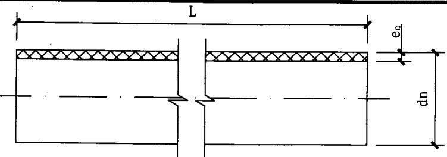  
PP-R管材示意图

PP-R管系列S及规格尺寸（mm）

<table><tr><td rowspan="5">公称外径dn</td><td colspan="2">平均外径dem</td><td colspan="5">管系列S、公称压力(MPa)</td></tr><tr><td rowspan="4">最大max</td><td rowspan="4">最小min</td><td>S5</td><td>S4</td><td>S3.2</td><td>S2.5</td><td>S2</td></tr><tr><td>PN1.25 $^{1}$ </td><td>PN1.6 $^{1}$ </td><td>PN2.0 $^{1}$ </td><td>PN2.5 $^{1}$ </td><td>PN3.2 $^{1}$ </td></tr><tr><td>PN1.0 $^{2}$ </td><td>PN1.25 $^{2}$ </td><td>PN1.6 $^{2}$ </td><td>PN2.0 $^{2}$ </td><td>PN2.5 $^{2}$ </td></tr><tr><td colspan="5">管材公称壁厚en</td></tr><tr><td>16</td><td>16.3</td><td>16</td><td>-</td><td>2.0</td><td>2.2</td><td>2.7</td><td>3.3</td></tr><tr><td>20</td><td>20.3</td><td>20</td><td>2.0</td><td>2.3</td><td>2.8</td><td>3.4</td><td>4.1</td></tr><tr><td>25</td><td>25.3</td><td>25</td><td>2.3</td><td>2.8</td><td>3.5</td><td>4.2</td><td>5.1</td></tr><tr><td>32</td><td>32.3</td><td>32</td><td>2.9</td><td>3.6</td><td>4.4</td><td>5.4</td><td>6.5</td></tr><tr><td>40</td><td>40.4</td><td>40</td><td>3.7</td><td>4.5</td><td>5.5</td><td>6.7</td><td>8.1</td></tr><tr><td>50</td><td>50.5</td><td>50</td><td>4.6</td><td>5.6</td><td>6.9</td><td>8.3</td><td>10.1</td></tr><tr><td>63</td><td>63.6</td><td>63</td><td>5.8</td><td>7.1</td><td>8.6</td><td>10.5</td><td>12.7</td></tr><tr><td>75</td><td>75.7</td><td>75</td><td>6.8</td><td>8.4</td><td>10.3</td><td>12.5</td><td>15.1</td></tr><tr><td>90</td><td>90.9</td><td>90</td><td>8.2</td><td>10.1</td><td>12.3</td><td>15.0</td><td>18.1</td></tr><tr><td>110</td><td>111.0</td><td>110</td><td>10.0</td><td>12.3</td><td>15.1</td><td>18.3</td><td>22.1</td></tr><tr><td>125</td><td>126.2</td><td>125</td><td>11.4</td><td>14.0</td><td>17.1</td><td>20.8</td><td>25.1</td></tr><tr><td>160</td><td>161.5</td><td>160</td><td>14.6</td><td>17.9</td><td>21.9</td><td>26.6</td><td>32.1</td></tr><tr><td colspan="8">注:1.为管道系统总使用系数C=1.25时的管系列S和公称压力PN的关系。2.为管道系统总使用系数C=1.5时的管系列S和公称压力PN的关系。</td></tr></table>

PP-R管材物理力学和卫生性能、系统适用性

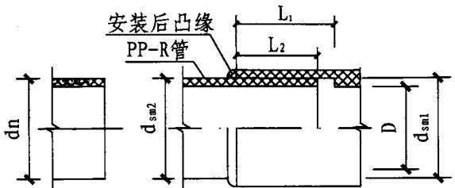  
热熔承插连接

热熔承插连接管件承口及连接尺寸（mm）

<table><tr><td rowspan="3">公称外径dn</td><td rowspan="3">最小承口深度L1,min</td><td rowspan="3">最小插入深度L2,min</td><td colspan="4">承口的平均内径</td><td rowspan="3">最大不圆度(%)</td><td rowspan="3">最小通径D</td></tr><tr><td colspan="2">dsm1</td><td colspan="2">dsm2</td></tr><tr><td>最小</td><td>最大</td><td>最小</td><td>最大</td></tr><tr><td>16</td><td>13.3</td><td>9.8</td><td>14.8</td><td>15.3</td><td>15.0</td><td>15.5</td><td>0.6</td><td>9.0</td></tr><tr><td>20</td><td>14.5</td><td>11.0</td><td>18.8</td><td>19.3</td><td>19.0</td><td>19.5</td><td>0.6</td><td>13.0</td></tr><tr><td>25</td><td>16.0</td><td>12.5</td><td>23.5</td><td>24.1</td><td>23.8</td><td>24.4</td><td>0.7</td><td>18.0</td></tr><tr><td>32</td><td>18.1</td><td>14.6</td><td>30.4</td><td>31.0</td><td>30.7</td><td>31.3</td><td>0.7</td><td>25.0</td></tr><tr><td>40</td><td>20.5</td><td>17.0</td><td>38.3</td><td>38.9</td><td>38.7</td><td>39.3</td><td>0.7</td><td>31.0</td></tr><tr><td>50</td><td>23.5</td><td>20.0</td><td>48.3</td><td>48.9</td><td>48.7</td><td>49.3</td><td>0.8</td><td>39.0</td></tr><tr><td>63</td><td>27.4</td><td>23.9</td><td>61.1</td><td>61.7</td><td>61.6</td><td>62.2</td><td>0.8</td><td>49.0</td></tr><tr><td>75</td><td>31.0</td><td>27.5</td><td>71.9</td><td>72.7</td><td>73.2</td><td>74.0</td><td>1.0</td><td>58.2</td></tr><tr><td>90</td><td>35.5</td><td>32.0</td><td>86.4</td><td>87.4</td><td>87.8</td><td>88.8</td><td>1.2</td><td>69.8</td></tr><tr><td>110</td><td>41.5</td><td>38.0</td><td>105.8</td><td>106.8</td><td>107.3</td><td>108.5</td><td>1.4</td><td>85.4</td></tr><tr><td colspan="9">注:管件的公称外径dn指与管件相连的管材公称外径。</td></tr></table>

PP-R管件物理力学和卫生性能、系统适用性

<table><tr><td>分类</td><td>项目</td><td>技术指标</td></tr><tr><td rowspan="2">管件的物理力学性能</td><td>静液压试验</td><td>无破裂无渗漏</td></tr><tr><td>静液压状态下热稳定性试验</td><td>无破裂无渗漏</td></tr><tr><td rowspan="2">系统适用性</td><td>内压试验</td><td>无破裂无渗漏</td></tr><tr><td>热循环试验</td><td>无破裂无渗漏</td></tr><tr><td>卫生性能</td><td>卫生性能</td><td>符合《生活饮用水输配水设备及防护材料的安全性评价标准》GB/T 17219</td></tr><tr><td colspan="3">注:管件与符合GB/T 18742.2规定的管材连接后应通过内压和热循环两项组合试验。</td></tr></table>

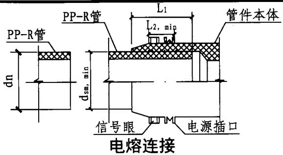  
电熔连接管件承口尺寸与相应对称外径（mm）

<table><tr><td rowspan="2">公称外径dn</td><td rowspan="2">熔合段最小内径dsm, min</td><td rowspan="2">熔合段最小长度L2, min</td><td colspan="2">插入长度L1</td></tr><tr><td>min</td><td>max</td></tr><tr><td>16</td><td>16.1</td><td>10</td><td>20</td><td>35</td></tr><tr><td>20</td><td>20.1</td><td>10</td><td>20</td><td>37</td></tr><tr><td>25</td><td>25.1</td><td>10</td><td>20</td><td>40</td></tr><tr><td>32</td><td>32.1</td><td>10</td><td>20</td><td>44</td></tr><tr><td>40</td><td>40.1</td><td>10</td><td>20</td><td>49</td></tr><tr><td>50</td><td>50.1</td><td>10</td><td>20</td><td>55</td></tr><tr><td>63</td><td>63.2</td><td>11</td><td>23</td><td>63</td></tr><tr><td>75</td><td>75.2</td><td>12</td><td>25</td><td>70</td></tr><tr><td>90</td><td>90.2</td><td>13</td><td>28</td><td>79</td></tr><tr><td>110</td><td>110.3</td><td>15</td><td>32</td><td>85</td></tr><tr><td>125</td><td>125.3</td><td>16</td><td>35</td><td>90</td></tr><tr><td>140</td><td>140.3</td><td>18</td><td>38</td><td>95</td></tr><tr><td>160</td><td>160.4</td><td>20</td><td>42</td><td>101</td></tr></table>

说明：  
1. 无规共聚聚丙烯（PP-R）给水管件应符合国家标准《冷热水用聚丙烯管道系统 第3部分：管件》GB/T 18742.3-2002的相关规定及要求。  
2. 无规共聚聚丙烯（PP-R）给水管件按熔接方式不同分为热熔承插连接管件和电熔管件。  
3. 管件颜色根据供需双方协商确定。  
4. 管件表面应光滑、平整，不允许有裂纹、气泡、脱皮和明显的杂质、严重的缩形以及色泽不均、分解变色等缺陷。管件应不透光。  
5. 管件按管系列S分类与管材相同, 分为S5、S4、S3.2、S2.5、S2五个管系列。管件的壁厚应不小于同系列S的管材的壁厚。  
6. 管件与管材连接应进行内压和热循环两项系统性试验，试验数据详见本图集第11页。  
7. 管件应由管材生产企业配套供应。

<table><tr><td colspan="9">PP-R管件规格及性能</td><td>图集号</td><td>11S405-2</td></tr><tr><td>审核</td><td>曲申酉</td><td>曲申酉</td><td>校对</td><td>蒋加林</td><td>蒋加林</td><td>设计</td><td>覃火坤</td><td>覃火坤</td><td>页</td><td>12</td></tr></table>

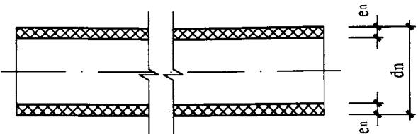  
PE管材示意图

PE管材的静液压强度

<table><tr><td rowspan="2">项目</td><td colspan="2">环向应力(MPa)</td><td rowspan="2">要求</td></tr><tr><td>PE80</td><td>PE100</td></tr><tr><td>20°C静液压强度(100h)</td><td>9.0</td><td>12.4</td><td>不破裂、不渗漏</td></tr><tr><td>80°C静液压强度(165h)</td><td>4.6</td><td>5.5</td><td>不破裂、不渗漏</td></tr><tr><td>80°C静液压强度(1000h)</td><td>4.0</td><td>5.0</td><td>不破裂、不渗漏</td></tr><tr><td colspan="4">注:80°C静压强度(165h)试验只考虑脆性破坏。如果在要求的时间(165h)内发生韧性破坏,则按下表选择较低的破坏应力和相应的最小破坏时间重新试验。</td></tr></table>

PE管材80℃时静液压强度(165h)再试验要求

<table><tr><td colspan="2">PE80</td><td colspan="2">PE100</td></tr><tr><td>应力(MPa)</td><td>最小破坏时间(h)</td><td>应力(MPa)</td><td>最小破坏时间(h)</td></tr><tr><td>4.5</td><td>219</td><td>5.4</td><td>233</td></tr><tr><td>4.4</td><td>283</td><td>5.3</td><td>332</td></tr><tr><td>4.3</td><td>394</td><td>5.2</td><td>476</td></tr><tr><td>4.2</td><td>533</td><td>5.1</td><td>688</td></tr><tr><td>4.1</td><td>727</td><td>5.0</td><td>1000</td></tr><tr><td>4.0</td><td>1000</td><td>-</td><td>-</td></tr></table>

PE管材物理力学性能及卫生指标

<table><tr><td colspan="2">项目</td><td>要求</td></tr><tr><td colspan="2">纵向回缩率(110°C,%)</td><td> $\leqslant 3$ </td></tr><tr><td colspan="2">断裂伸长率(%)</td><td> $\geqslant 350$ </td></tr><tr><td colspan="2">氧化诱导时间(min,200°C)</td><td> $\geqslant 20$ </td></tr><tr><td rowspan="3">耐候性*(管材累计接受 $\geqslant 3.5GJ/m^{2}$ 老化能量后)</td><td>80°C维持静液液压试验(165h)</td><td>无破裂,无渗漏</td></tr><tr><td>断裂伸长率(%)</td><td> $\geqslant 350$ </td></tr><tr><td>氧化诱导时间(min,220°C)</td><td> $\geqslant 10$ </td></tr><tr><td colspan="3">注:*仅适用于蓝色管材。</td></tr></table>

说明：  
1. 给水用聚乙烯（PE）管材应符合国家标准《给水用聚乙烯（PE）管材》GB/T 13663-2000的相关规定及要求。

给水用聚乙烯(PE)管材型式为直管、盘管，按材料等级分为PE63、PE80、PE100三个级别，本图集只编制PE80和PE100两个级别。

2. 给水用聚乙烯(PE)管材与管材之间的连接采用热熔和电熔连接。

3. 输送生活饮用水的管材卫生性能应符合《生活饮用水输配水设备及防护材料安全性评价标准》GB 17219的要求。

<table><tr><td colspan="9">PE管材规格及性能(一)</td><td>图集号</td><td>11S405-2</td></tr><tr><td>审核</td><td>曲申酉</td><td>曲申酉</td><td>校对</td><td>蒋加林</td><td>蒋加林</td><td>设计</td><td>莫涛涛</td><td>莫涛涛</td><td>页</td><td>13</td></tr></table>

PE管材公称压力和规格尺寸

<table><tr><td rowspan="7">公称外径dn</td><td colspan="5">PE80</td><td colspan="5">PE100</td><td rowspan="7">最小平均外径dem,min</td><td rowspan="6" colspan="2">最大平均外径dem,max</td></tr><tr><td colspan="5">公称壁厚en(mm)</td><td colspan="5">公称壁厚en(mm)</td></tr><tr><td colspan="5">管材S(SDR)系列</td><td colspan="5">管材S(SDR)系列</td></tr><tr><td>S16</td><td>S10</td><td>S8</td><td>S6.3</td><td>S5</td><td>S12.5</td><td>S10</td><td>S8</td><td>S6.3</td><td>S5</td></tr><tr><td>SDR33</td><td>SDR21</td><td>SDR17</td><td>SDR13.6</td><td>SDR11</td><td>SDR26</td><td>SDR21</td><td>SDR17</td><td>SDR13.6</td><td>SDR11</td></tr><tr><td colspan="5">公称压力(MPa)</td><td colspan="5">公称压力(MPa)</td></tr><tr><td>PN0.4</td><td>PN0.6</td><td>PN0.8</td><td>PN1.0</td><td>PN1.25</td><td>PN0.6</td><td>PN0.8</td><td>PN1.0</td><td>PN1.25</td><td>PN1.6</td><td>等级A</td><td>等级B</td></tr><tr><td>20</td><td>-</td><td>-</td><td>-</td><td>-</td><td>-</td><td>-</td><td>-</td><td>-</td><td>-</td><td>-</td><td>20.0</td><td>20.3</td><td>20.3</td></tr><tr><td>25</td><td>-</td><td>-</td><td>-</td><td>-</td><td>2.3</td><td>-</td><td>-</td><td>-</td><td>-</td><td>-</td><td>25.0</td><td>25.3</td><td>25.3</td></tr><tr><td>32</td><td>-</td><td>-</td><td>-</td><td>-</td><td>3.0</td><td>-</td><td>-</td><td>-</td><td>-</td><td>3.0</td><td>32.0</td><td>32.3</td><td>32.3</td></tr><tr><td>40</td><td>-</td><td>-</td><td>-</td><td>-</td><td>3.7</td><td>-</td><td>-</td><td>-</td><td>-</td><td>3.7</td><td>40.0</td><td>40.4</td><td>40.3</td></tr><tr><td>50</td><td>-</td><td>-</td><td>-</td><td>-</td><td>4.6</td><td>-</td><td>-</td><td>-</td><td>-</td><td>4.6</td><td>50.0</td><td>50.5</td><td>50.3</td></tr><tr><td>63</td><td>-</td><td>-</td><td>-</td><td>4.7</td><td>5.8</td><td>-</td><td>-</td><td>-</td><td>4.7</td><td>5.8</td><td>63.0</td><td>63.6</td><td>63.4</td></tr><tr><td>75</td><td>-</td><td>-</td><td>4.5</td><td>5.6</td><td>6.8</td><td>-</td><td>-</td><td>4.5</td><td>5.6</td><td>6.8</td><td>75.0</td><td>75.7</td><td>75.5</td></tr><tr><td>90</td><td>-</td><td>4.3</td><td>5.4</td><td>6.7</td><td>8.2</td><td>-</td><td>4.3</td><td>5.4</td><td>6.7</td><td>8.2</td><td>90.0</td><td>90.9</td><td>90.6</td></tr><tr><td>110</td><td>-</td><td>5.3</td><td>6.6</td><td>8.1</td><td>10.0</td><td>4.2</td><td>5.3</td><td>6.6</td><td>8.1</td><td>10.0</td><td>110.0</td><td>111.0</td><td>110.7</td></tr><tr><td>125</td><td>-</td><td>6.0</td><td>7.4</td><td>9.2</td><td>11.4</td><td>4.8</td><td>6.0</td><td>7.4</td><td>9.2</td><td>11.4</td><td>125.0</td><td>126.2</td><td>125.8</td></tr><tr><td>140</td><td>4.3</td><td>6.7</td><td>8.3</td><td>10.3</td><td>12.7</td><td>5.4</td><td>6.7</td><td>8.3</td><td>10.3</td><td>12.7</td><td>140.0</td><td>141.3</td><td>140.9</td></tr><tr><td>160</td><td>4.9</td><td>7.7</td><td>9.5</td><td>11.8</td><td>14.6</td><td>6.2</td><td>7.7</td><td>9.5</td><td>11.8</td><td>14.6</td><td>160.0</td><td>161.5</td><td>161.0</td></tr></table>

PE管件的力学性能

<table><tr><td rowspan="2">项目</td><td rowspan="2">要求</td><td rowspan="2">试样数量(个)</td><td colspan="2">试验参数</td></tr><tr><td>参数</td><td>数值</td></tr><tr><td rowspan="4">20°C静液压强度</td><td rowspan="4">无破裂、无渗漏</td><td rowspan="4">3</td><td>试验温度</td><td>20°C</td></tr><tr><td>试验时间</td><td>100h</td></tr><tr><td>环应力PE80</td><td>10.0MPa</td></tr><tr><td>环应力PE100</td><td>12.4MPa</td></tr><tr><td rowspan="4">80°C静液压强度</td><td rowspan="4">无破裂、无渗漏</td><td rowspan="4">3</td><td>试验温度</td><td>80°C</td></tr><tr><td>试验时间</td><td>165h*</td></tr><tr><td>环应力PE80</td><td>4.5MPa</td></tr><tr><td>环应力PE100</td><td>5.4MPa</td></tr><tr><td rowspan="4">80°C静液压强度</td><td rowspan="4">无破裂、无渗漏</td><td rowspan="4">3</td><td>试验温度</td><td>80°C</td></tr><tr><td>试验时间</td><td>1000h</td></tr><tr><td>环应力PE80</td><td>4.0MPa</td></tr><tr><td>环应力PE100</td><td>5.0MPa</td></tr><tr><td colspan="5">注:*为如果出现脆性破坏,视为不合格;当出现韧性破坏,再试验步骤见本图集第13页。</td></tr></table>

PE管件的物理机械性能

<table><tr><td rowspan="2">项目</td><td rowspan="2">要求</td><td colspan="2">试验参数</td></tr><tr><td>参数</td><td>数值</td></tr><tr><td rowspan="2">熔体质量流动速率(MFR)对PE80和PE100</td><td rowspan="2">MFR的变化小于材料MFR值的 $\pm 20\%^*$ </td><td>试验温度</td><td>190°C</td></tr><tr><td>载荷</td><td>5kg</td></tr><tr><td rowspan="2">氧化诱导时间(热稳定性)</td><td rowspan="2">&gt;20min</td><td>试验温度</td><td>200°C</td></tr><tr><td>试样数</td><td>3</td></tr><tr><td>电熔管件的熔接强度</td><td>脆性破坏所占百分比≤33.3%</td><td>试验温度</td><td>23°C</td></tr></table>

续表 PE管件的物理机械性能

<table><tr><td rowspan="2">项目</td><td rowspan="2">要求</td><td colspan="2">试验参数</td></tr><tr><td>参数</td><td>数值</td></tr><tr><td>插口管件-对接熔接管件的熔接强度</td><td>试验到破坏为止:韧性:通过脆性:未通过</td><td>试验温度</td><td>23°C</td></tr><tr><td rowspan="3">鞍形旁通的冲击强度</td><td rowspan="3">无破裂、无渗漏</td><td>试验温度</td><td>(0±2)°C</td></tr><tr><td>重锤质量</td><td>(2500±20)g</td></tr><tr><td>下落高度</td><td>(2000±10)mm</td></tr><tr><td colspan="4">注:*为管件上取样测量值与所用混配料测量值的对比。</td></tr></table>

机械连接接头的力学性能\*

<table><tr><td rowspan="2">项目</td><td rowspan="2">要求</td><td rowspan="2">试样数</td><td colspan="2">试验参数</td></tr><tr><td>参数</td><td>数值</td></tr><tr><td rowspan="2">内压密封性试验</td><td rowspan="2">无渗漏</td><td rowspan="2">1</td><td>试验时间</td><td>1h</td></tr><tr><td>试验压力</td><td> $1.5 \times$ 管材 [PN]</td></tr><tr><td rowspan="4">外压密封性试验</td><td rowspan="4">无渗漏</td><td rowspan="4">1</td><td>试验压力</td><td> $\Delta p=0.01MPa$ </td></tr><tr><td>试验时间</td><td>1h</td></tr><tr><td>试验压力</td><td> $\Delta p=0.08MPa$ </td></tr><tr><td>试验时间</td><td>1h</td></tr><tr><td rowspan="2">耐弯曲密封性试验</td><td rowspan="2">无渗漏</td><td rowspan="2">1</td><td>试验时间</td><td>1h</td></tr><tr><td>试验压力</td><td> $1.5 \times$ 管材 [PN]</td></tr><tr><td rowspan="2">耐拉拔试验</td><td rowspan="2">管材不从管件上拔脱或分离</td><td rowspan="2">-</td><td>试验温度</td><td> $23^{\circ}C$ </td></tr><tr><td>试验时间</td><td>1h</td></tr><tr><td colspan="5">注:*为相连管材的公称外径不大于63的机械连接接头。</td></tr></table>

<table><tr><td colspan="9">PE管件规格及性能(一)</td><td>图集号</td><td>11S405-2</td></tr><tr><td>审核</td><td>曲申酉</td><td>曲申酉</td><td>校对</td><td>蒋加林</td><td>蒋加林</td><td>设计</td><td>莫涛涛</td><td>莫涛涛</td><td>页</td><td>15</td></tr></table>

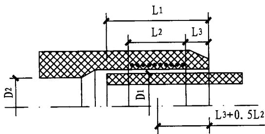  
电熔管件承口示意图

电熔管件承口尺寸（mm）

<table><tr><td rowspan="2">管件公称直径 dn</td><td colspan="3">插入深度</td><td rowspan="2">熔区长度 $L_{2min}$ </td></tr><tr><td> $L_{1min}$ 电流调节</td><td> $L_{1min}$ 电压调节</td><td> $L_{1max}$ </td></tr><tr><td>20</td><td>20</td><td>25</td><td>41</td><td>10</td></tr><tr><td>25</td><td>20</td><td>25</td><td>41</td><td>10</td></tr><tr><td>32</td><td>20</td><td>25</td><td>44</td><td>10</td></tr><tr><td>40</td><td>20</td><td>25</td><td>49</td><td>10</td></tr><tr><td>50</td><td>20</td><td>28</td><td>55</td><td>10</td></tr><tr><td>63</td><td>23</td><td>31</td><td>63</td><td>11</td></tr><tr><td>75</td><td>25</td><td>35</td><td>70</td><td>12</td></tr><tr><td>90</td><td>28</td><td>40</td><td>79</td><td>13</td></tr><tr><td>110</td><td>32</td><td>53</td><td>82</td><td>15</td></tr><tr><td>125</td><td>35</td><td>58</td><td>87</td><td>16</td></tr><tr><td>140</td><td>38</td><td>62</td><td>92</td><td>18</td></tr><tr><td>160</td><td>42</td><td>68</td><td>98</td><td>20</td></tr><tr><td colspan="5">注:1. 管件公称压力越大,熔区长度越长,以满足性能要求。2. 制造商应说明D1和L1的最大及最小实际值,以便确定是否影响装夹及连接装配。</td></tr></table>

**说明：**

1. 给水用聚乙烯(PE)管件应符合国家标准《给水用聚乙烯(PE)管道系统 第2部分：管件》GB/T 13663.2-2005的相关规定及要求。

(1) 管件应由管材生产单位配套供应。

(2) 管件按连接形式分为熔接连接管件、螺纹连接、法兰连接管件。

(3) 熔接连接管件分为三类，即电熔管件、插口管件和热熔承插连接连接管件。

2. 管件聚乙烯部分的颜色为黑色或蓝色，蓝色聚乙烯管件应避免紫外光线直接照射。

3. 电熔管件的电阻值应在下列范围内：

最大值：标称值 $\times (1 + 10\%) + 0.1\Omega$

最小值：标称值 × (1 - 10%)。

注:电熔管件典型接线端的示例见GB/T 13663.2-2005附录A。电熔管件宜根据工作时的电压和电流及电流特性设置相应的电气保护措施。对于电压大于25V的情况,在按照管件和设备制造商的说明进行装配熔接时,宜确保人无法直接接触到带电部分。

4. 输送生活饮用水管件的卫生性能应符合《生活饮用水输配水设备及防护材料安全性评价标准》GB 17219的要求。

<table><tr><td colspan="9">PE管件规格及性能(二)</td><td>图集号</td><td>11S405-2</td></tr><tr><td>审核</td><td>曲申酉</td><td>曲申酉</td><td>校对</td><td>蒋加林</td><td>蒋加林</td><td>设计</td><td>莫涛涛</td><td>莫涛涛</td><td>页</td><td>16</td></tr></table>

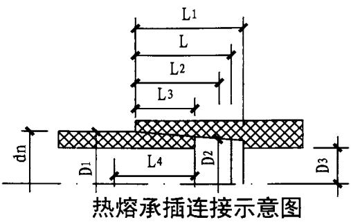  
(L1-从承口端面到其根部台肩处的承口实际长度；L4-管子插口端的加热长度，  
即管子插口端部进入加热工具的长度）

热熔承插管件公称尺寸从20～63管件承口尺寸（mm）

<table><tr><td rowspan="2">公称尺寸</td><td rowspan="2">承口公称内径</td><td colspan="4">承口平均内径</td><td rowspan="2">最大不圆度</td><td rowspan="2">最小通径</td><td rowspan="2">承口参考长度</td><td rowspan="2" colspan="2">承口加热长度</td><td rowspan="2" colspan="2">管材插入深度</td></tr><tr><td colspan="2">口部</td><td colspan="2">根部</td></tr><tr><td>DN/OD</td><td>dn</td><td>D1min</td><td>D1max</td><td>D2min</td><td>D2max</td><td>max</td><td>D3</td><td>Lmin</td><td>L2min</td><td>L2max</td><td>L3min</td><td>L3max</td></tr><tr><td>20</td><td>20</td><td>19.2</td><td>19.5</td><td>19.0</td><td>19.3</td><td>0.4</td><td>13</td><td>14.5</td><td>12.0</td><td>14.5</td><td>11.0</td><td>13.5</td></tr><tr><td>25</td><td>25</td><td>24.1</td><td>24.5</td><td>23.9</td><td>24.3</td><td>0.4</td><td>18</td><td>16.0</td><td>13.5</td><td>16.0</td><td>12.5</td><td>15.0</td></tr><tr><td>32</td><td>32</td><td>31.1</td><td>31.5</td><td>30.9</td><td>31.3</td><td>0.5</td><td>25</td><td>18.1</td><td>15.6</td><td>18.1</td><td>14.6</td><td>17.1</td></tr><tr><td>40</td><td>40</td><td>39.0</td><td>39.4</td><td>38.8</td><td>39.2</td><td>0.5</td><td>31</td><td>20.5</td><td>18.0</td><td>20.5</td><td>17.0</td><td>19.5</td></tr><tr><td>50</td><td>50</td><td>48.9</td><td>49.4</td><td>48.7</td><td>49.2</td><td>0.6</td><td>39</td><td>23.5</td><td>21.0</td><td>23.5</td><td>20.0</td><td>22.5</td></tr><tr><td>63</td><td>63</td><td>62.0</td><td>62.4</td><td>61.6</td><td>62.1</td><td>0.6</td><td>49</td><td>27.4</td><td>24.9</td><td>27.4</td><td>23.9</td><td>26.4</td></tr></table>

热熔承插管件公称尺寸从75～125管件承口尺寸（mm）

<table><tr><td rowspan="2">公称尺寸</td><td rowspan="2" colspan="2">管材平均外径</td><td rowspan="2">承口公称内径</td><td colspan="4">承口平均内径</td></tr><tr><td colspan="2">口部</td><td colspan="2">根部</td></tr><tr><td>DN/OD</td><td> $dem_{min}$ </td><td> $dem_{max}$ </td><td>dn</td><td> $D1_{min}$ </td><td> $D1_{max}$ </td><td> $D2_{min}$ </td><td> $D2_{max}$ </td></tr><tr><td>75</td><td>75.0</td><td>75.5</td><td>75</td><td>74.3</td><td>74.8</td><td>73.0</td><td>73.5</td></tr><tr><td>90</td><td>90.0</td><td>90.6</td><td>90</td><td>89.3</td><td>89.9</td><td>87.9</td><td>88.5</td></tr><tr><td>110</td><td>110.0</td><td>110.6</td><td>110</td><td>109.4</td><td>110.0</td><td>107.7</td><td>108.3</td></tr><tr><td>125</td><td>125.0</td><td>125.6</td><td>125</td><td>124.4</td><td>125.0</td><td>122.6</td><td>123.2</td></tr></table>

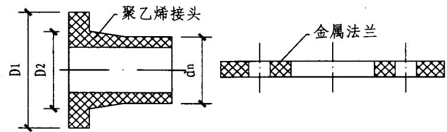  
聚乙烯法兰接头示意图

热熔对接聚乙烯法兰接头的尺寸（mm）

<table><tr><td>管材和插口的公称外径dn</td><td> $D_{1\min}$ </td><td> $D_2$ </td><td>管材和插口的公称外径dn</td><td> $D_{1\min}$ </td><td> $D_2$ </td></tr><tr><td>20</td><td>45</td><td>27</td><td>75</td><td>122</td><td>89</td></tr><tr><td>25</td><td>58</td><td>33</td><td>90</td><td>138</td><td>105</td></tr><tr><td>32</td><td>68</td><td>40</td><td>110</td><td>158</td><td>125</td></tr><tr><td>40</td><td>78</td><td>50</td><td>125</td><td>158</td><td>132</td></tr><tr><td>50</td><td>88</td><td>61</td><td>140</td><td>188</td><td>155</td></tr><tr><td>63</td><td>102</td><td>75</td><td>160</td><td>212</td><td>175</td></tr></table>

续表热熔承插管件公称尺寸从75～125管件承口尺寸（mm）

<table><tr><td>公称尺寸</td><td>最大不圆度</td><td>最小通径</td><td>承口参考长度</td><td colspan="2">承口加热长度</td><td colspan="2">管材插入深度</td></tr><tr><td>DN/OD</td><td>max</td><td>D3</td><td>Lmin</td><td> $L2_{min}$ </td><td> $L2_{max}$ </td><td> $L3_{min}$ </td><td> $L3_{max}$ </td></tr><tr><td>75</td><td>0.7</td><td>59</td><td>30</td><td>26</td><td>30</td><td>25</td><td>29</td></tr><tr><td>90</td><td>1.0</td><td>71</td><td>33</td><td>29</td><td>33</td><td>28</td><td>32</td></tr><tr><td>110</td><td>1.0</td><td>87</td><td>37</td><td>33</td><td>37</td><td>32</td><td>36</td></tr><tr><td>125</td><td>1.0</td><td>99</td><td>40</td><td>36</td><td>40</td><td>35</td><td>39</td></tr></table>

<table><tr><td colspan="9">PE管件规格及性能(三)</td><td>图集号</td><td>11S405-2</td></tr><tr><td>审核</td><td>曲申酉</td><td>曲申酉</td><td>校对</td><td>蒋加林</td><td>蒋加林</td><td>设计</td><td>莫涛涛</td><td>莫涛涛</td><td>页</td><td>17</td></tr></table>

  
PE-X管材示意图

PE-X管材的规格尺寸

<table><tr><td rowspan="5">公称外径dn</td><td colspan="2">平均外径</td><td colspan="4">管系列S、公称压力PN(MPa)</td></tr><tr><td rowspan="4">dem,min</td><td rowspan="4">dem,max</td><td>S6.3</td><td>S5</td><td>S4</td><td>S3.2</td></tr><tr><td>PN1.0 $^{1}$ </td><td>PN1.25 $^{1}$ </td><td>PN1.6 $^{1}$ </td><td>PN2.0 $^{1}$ </td></tr><tr><td>PN1.0 $^{2}$ </td><td>PN1.25 $^{2}$ </td><td>PN1.25 $^{2}$ </td><td>PN1.6 $^{2}$ </td></tr><tr><td colspan="4">公称壁厚en(mm)</td></tr><tr><td>16</td><td>16.0</td><td>16.3</td><td>1.8 $^{3}$ </td><td>1.8 $^{3}$ </td><td>1.8</td><td>2.2</td></tr><tr><td>20</td><td>20.0</td><td>20.3</td><td>1.9 $^{3}$ </td><td>1.9</td><td>2.3</td><td>2.8</td></tr><tr><td>25</td><td>25.0</td><td>25.3</td><td>1.9</td><td>2.3</td><td>2.8</td><td>3.5</td></tr><tr><td>32</td><td>32.0</td><td>32.3</td><td>2.4</td><td>2.9</td><td>3.6</td><td>4.4</td></tr><tr><td>40</td><td>40.0</td><td>40.4</td><td>3.0</td><td>3.7</td><td>4.5</td><td>5.5</td></tr><tr><td>50</td><td>50.0</td><td>50.5</td><td>3.7</td><td>4.6</td><td>5.6</td><td>6.9</td></tr><tr><td>63</td><td>63.0</td><td>63.6</td><td>4.7</td><td>5.8</td><td>7.1</td><td>8.6</td></tr><tr><td colspan="7">注:1.当管道系统的总使用系数C为1.25时管系列S与公称压力PN的关系;2.当管道系统的总使用系数C为1.5时管系列S与公称压力PN的关系;3.考虑到刚性与连接的要求,该厚度不按管系列计算。</td></tr></table>

说明：  
1. 交联聚乙烯（PE-X）给水管材应符合国家标准《冷热水用交联聚乙烯(PE-X)管道系统 第2部分:管材》GB/T 18992.2-2003的相关规定及要求。  
2. 管材颜色由供需双方协商确定。  
3. 管材外观应达到下列要求：  
(1) 管材的内外表面应该光滑、平整、干净，不能有可能影响产品性能的明显划痕、凹陷、气泡等缺陷；

PE-X管材的物理力学性能

<table><tr><td colspan="2">项目</td><td>要求</td></tr><tr><td rowspan="5">耐静液压</td><td>20°C、12MPa、1h</td><td rowspan="5">无渗漏、无破裂</td></tr><tr><td>95°C、4.8MPa、1h</td></tr><tr><td>95°C、4.7MPa、22h</td></tr><tr><td>95°C、4.6MPa、165h</td></tr><tr><td>95°C、4.4MPa、1000h</td></tr><tr><td rowspan="3">纵向回缩率(120°C)</td><td>en≤8mm,1h</td><td rowspan="3">≤3%</td></tr><tr><td>8mm≤en≤16mm,2h</td></tr><tr><td>en&gt;16mm,4h</td></tr><tr><td>静液压状态下的热稳定性</td><td>在110°C,2.5MPa静液压力条件下,8760h</td><td>无渗漏、无破裂</td></tr><tr><td rowspan="4">交联度(%)</td><td>过氧化物交联</td><td>≥70</td></tr><tr><td>硅烷交联</td><td>≥65</td></tr><tr><td>电子束交联</td><td>≥60</td></tr><tr><td>偶氮交联</td><td>≥60</td></tr></table>

(2) 管壁应无可见的杂质，管材表面颜色应均匀一致，不允许有明显色差；  
(3) 管材端面应切割平整，并与管材的轴线垂直。  
4. 明装有遮光要求的管材应不透光。  
5. 管材与管材、管材与管件之间的连接采用机械连接，如卡箍式或锥面卡套式连接。  
6. 管材壁厚en应大于等于本图表数据，不允许有负偏差。  
7. 直管管长一般按4m或6m供应，也可由供需双方商定，不应有负偏差。盘管最大管径dn32，管长一般按60m\~400m供应。  
8. 管材的卫生指标应符合《生活饮用水输配水设备及防护材料安全性评价标准》GB/T 17219的规定。

<table><tr><td colspan="9">PE-X管材规格及性能</td><td>图集号</td><td>11S405-2</td></tr><tr><td>审核</td><td>曲申酉</td><td>曲申酉</td><td>校对</td><td>蒋加林</td><td>蒋加林</td><td>设计</td><td>覃火坤</td><td>覃火坤</td><td>页</td><td>18</td></tr></table>

PE-X管材的系统适应性试验

<table><tr><td colspan="8">项目</td><td>要求</td></tr><tr><td rowspan="4" colspan="2">静液压试验</td><td>S6.3</td><td colspan="5">20°C、1.5Pd、1h95°C、0.7MPa、1000h</td><td rowspan="4">无渗漏、无破裂</td></tr><tr><td>S5</td><td colspan="5">20°C、1.5Pd、1h95°C、0.88MPa、1000h</td></tr><tr><td>S4</td><td colspan="5">20°C、1.5Pd、1h95°C、1.10MPa、1000h</td></tr><tr><td>S3.2</td><td colspan="5">20°C、1.5Pd、1h95°C、1.38MPa、1000h</td></tr><tr><td rowspan="3">热循环试验</td><td>项目</td><td>最高设计温度Tmax(°C)</td><td>最高试验温度(°C)</td><td>最低试验温度(°C)</td><td>试验压力(MPa)</td><td>循环次数(次)</td><td>每次循环的时间(min)</td><td rowspan="3">无渗漏、无破裂</td></tr><tr><td>级别1</td><td>80</td><td>90</td><td>20</td><td>Pd</td><td>5000</td><td rowspan="2"> $30^{+2}_{0}$ (冷热水各 $15^{+1}_{0}$ )</td></tr><tr><td>级别2</td><td>80</td><td>90</td><td>20</td><td>Pd</td><td>5000</td></tr><tr><td colspan="2">循环压力冲击试验</td><td colspan="6">最高试验压力1.5±0.05MPa、最低试验压力0.1±0.05MPa、23±2°C、循环10000次、循环频率≥30次/min</td><td>无渗漏、无破裂</td></tr><tr><td rowspan="8">系统适应性</td><td rowspan="5">耐拉拔试验</td><td colspan="6">温度23±2°C、所有压力等级、轴向拉力1.178dn2N、1h</td><td rowspan="5">不发生轴向变形</td></tr><tr><td colspan="6">温度95°C、系统设计压力0.4MPa、轴向拉力0.314dn2N、1h</td></tr><tr><td colspan="6">温度95°C、系统设计压力0.6MPa、轴向拉力0.471dn2N、1h</td></tr><tr><td colspan="6">温度95°C、系统设计压力0.8MPa、轴向拉力0.628dn2N、1h</td></tr><tr><td colspan="6">温度95°C、系统设计压力1.0MPa、轴向拉力0.785dn2N、1h</td></tr><tr><td rowspan="2">弯曲试验</td><td colspan="6">级别1:最高设计温度80°C、管材材料的设计应力3.85MPa、20°C、1h</td><td rowspan="2">无渗漏、无破裂</td></tr><tr><td colspan="6">级别2:最高设计温度80°C、管材材料的设计应力3.54MPa、20°C、1h</td></tr><tr><td>真空试验</td><td colspan="6">23°C试验温度、-0.08MPa静液压应力、1h</td><td>真空压力变化≤0.005MPa</td></tr><tr><td colspan="9">注:管材与管件连接后应通过静液压、热循环、循环压力冲击、耐拉拔、弯曲、真空六种系统适应性试验。</td></tr></table>

说明：  
1. 交联聚乙烯（PE-X）给水管件应符合城镇建设行业标准《建筑给水交联聚乙烯(PE-X)管用管件 技术条件》GJ/T 138-2001的相关规定及要求。  
2. 交联聚乙烯（PE-X）给水管用管件材质分为不锈钢、黄铜、紫  
6. 管件应由管材生产企业配套供应。

PE-X管用管件的力学性能

<table><tr><td colspan="2">项目</td><td>要求</td></tr><tr><td rowspan="4">耐液压性能</td><td>在20°C试验温度,12MPa静液压应力条件下,1h</td><td rowspan="4">无渗漏、无破裂</td></tr><tr><td>在95°C试验温度,4.8MPa静液压应力条件下,1h</td></tr><tr><td>在95°C试验温度,4.7MPa静液压应力条件下,165h</td></tr><tr><td>在95°C试验温度,4.4MPa静液压应力条件下,1000h</td></tr></table>

铜、铸造铜合金等四种材质。

(1) 不锈钢材质应符合《不锈钢冷轧钢板和钢带》GB/T 3280的规定；

(2) 黄铜材质应符合《加工黄铜 化学成分和产品形状》GB/T 5232 的规定；

(3) 紫铜材质应符合《加工铜及铜合金化学成分和产品形状》GB/T 5231的规定；

(4) 铸造铜合金符合《铸造铜合金技术条件》GB/T 1176的规定。

(1) 管件内外表面必须光洁, 不允许有裂纹、冷隔、蜂窝及其他任何影响使用的明显缺陷。

(2) 螺纹应完好规整、无断扣、压伤、毛刺、划伤等缺陷。

4. 螺纹精度: 普通螺纹应符合《普通螺纹 公差》 GB/T 197 的规定; 管螺纹应符合《55° 密封管螺纹》GB/T 7306 的规定; 梯形螺纹应符合《梯形螺纹 第4部分: 公差》GB/T 5796.4 的规定。

5. 管件的卫生指标应符合《生活饮用水输配水设备及防护材料安全性评价标准》GB/T 17219的规定。

<table><tr><td colspan="9">PE-X管材系统适应性试验、管件力学性能</td><td>图集号</td><td>11S405-2</td></tr><tr><td>审核</td><td>曲申酉</td><td>曲申酉</td><td>校对</td><td>蒋加林</td><td>蒋加林</td><td>设计</td><td>覃火坤</td><td>覃火坤</td><td>页</td><td>19</td></tr></table>

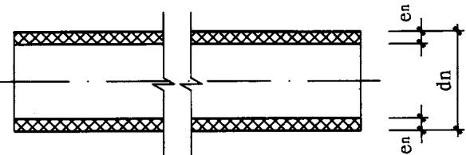  
PE-RT管材示意图

PE-RT管材、管件的物理力学性能

<table><tr><td colspan="2">项目</td><td>要求</td></tr><tr><td rowspan="3">纵向回缩率(110°C)</td><td> $e_n \leq 8mm, 1h$ </td><td rowspan="3">&lt;3%</td></tr><tr><td> $8mm < e_n \leq 16mm, 2h$ </td></tr><tr><td> $e_n > 16mm, 3h$ </td></tr><tr><td rowspan="3">静液压试验</td><td>在20°C试验温度,10.0MPa试验环应力条件下,1h</td><td rowspan="3">无破裂无渗漏</td></tr><tr><td>在95°C试验温度,3.55MPa试验环应力条件下,165h</td></tr><tr><td>在95°C试验温度,3.5MPa试验环应力条件下,1000h</td></tr><tr><td>静液压状态下的热稳定性试验</td><td>在110°C试验温度,1.90MPa试验环应力条件下,8760h</td><td>无破裂无渗漏</td></tr><tr><td>熔体质量流动速率MFR(g/10min)</td><td>190°C、2.16kg</td><td>变化率&lt;原料的30%</td></tr><tr><td colspan="3">注:1.用管状试样或管件与管材相连试验,管状试样按实际壁厚计算试验压力;管件与管材相连作为试样时,按相同管系列S管材的公称壁厚计算试验压力。如试验中管材破裂则试验应重做。2.相同原料同一生产厂家的管材已做过本试验则管件可不做。3.95°C/165h静液压试验仅适用于管材。</td></tr></table>

**说明：**

1. 冷热水用耐热聚乙烯(PE-RT)管材、管件应符合国家行业标准《冷热水用耐热聚乙烯(PE-RT)管道系统》CJ/T 175-2002的相关规定及要求。

2. 颜色根据供需双方协商确定。管材的色泽应基本一致。

3. 管材和管件的内外表面应光滑、平整、清洁，无凹陷、气泡、明显的划伤和其他影响性能的表面缺陷。管材和管件不应含有明显可见的杂质。管材端面应切割平整并与轴线垂直。

4. 对明装有遮光要求时，管材应不透光。

5. 对于带气体阻隔的管材, 在 $40^{\circ} \mathrm{C}$ 温度下的透氧氯应不超过 $0.10 \mathrm{~g} / (\mathrm{m} \cdot \mathrm{d})$ 。

6. 冷热水用耐热聚乙烯（PE-RT）管材型式为直管和盘管。当管道外径dn≤63时，可根据用户需要采用盘管供货。

7. 管材按结构不同分为带阻隔层和不带阻隔层两种。管件按连接方式不同分为热熔承插连接管件、电熔连接管件和机械连接管件。

8. 管材与管材、管材与管件之间的连接采用热熔承插和电熔连接。

9. 管材、管件的卫生指标应符合《生活饮用水输配水设备及防护材料安全性评价标准》GB/T 17219的规定。

10. 管材管件应由生产企业配套供应。

<table><tr><td colspan="9">PE-RT管材及管件物理力学性能</td><td>图集号</td><td>11S405-2</td></tr><tr><td>审核</td><td>曲申酉</td><td>曲申酉</td><td>校对</td><td>蒋加林</td><td>蒋加林</td><td>设计</td><td>陆丽妃</td><td>陆丽妃</td><td>页</td><td>20</td></tr></table>

<table><tr><td rowspan="4">公称外径dn</td><td colspan="2">平均外径dem</td><td colspan="2">圆度</td><td colspan="5">管系列S、公称压力PN(MPa)</td></tr><tr><td rowspan="3">最大max</td><td rowspan="3">最小min</td><td rowspan="3">直管</td><td rowspan="3">盘管</td><td>S6.3</td><td>S5</td><td>S4</td><td>S3.2</td><td>S2.5</td></tr><tr><td>-</td><td>PN1.25</td><td>PN1.6</td><td>PN2.0</td><td>PN2.5</td></tr><tr><td colspan="5">管材公称壁厚en</td></tr><tr><td>16</td><td>16.3</td><td>16</td><td> $\leqslant 1.0$ </td><td> $\leqslant 1.0$ </td><td>-</td><td>-</td><td>2.0</td><td>2.2</td><td>2.7</td></tr><tr><td>20</td><td>20.3</td><td>20</td><td> $\leqslant 1.0$ </td><td> $\leqslant 1.2$ </td><td>-</td><td>2.0</td><td>2.3</td><td>2.8</td><td>3.4</td></tr><tr><td>25</td><td>25.3</td><td>25</td><td> $\leqslant 1.0$ </td><td> $\leqslant 1.5$ </td><td>2.0</td><td>2.3</td><td>2.8</td><td>3.5</td><td>4.2</td></tr><tr><td>32</td><td>32.3</td><td>32</td><td> $\leqslant 1.0$ </td><td> $\leqslant 2.0$ </td><td>2.4</td><td>2.9</td><td>3.6</td><td>4.4</td><td>5.4</td></tr><tr><td>40</td><td>40.4</td><td>40</td><td> $\leqslant 1.0$ </td><td> $\leqslant 2.4$ </td><td>3.0</td><td>3.7</td><td>4.5</td><td>5.5</td><td>6.7</td></tr><tr><td>50</td><td>50.5</td><td>50</td><td> $\leqslant 1.2$ </td><td> $\leqslant 3.0$ </td><td>3.7</td><td>4.6</td><td>5.6</td><td>6.9</td><td>8.3</td></tr><tr><td>63</td><td>63.6</td><td>63</td><td> $\leqslant 1.6$ </td><td> $\leqslant 3.8$ </td><td>4.7</td><td>5.8</td><td>7.1</td><td>8.6</td><td>10.5</td></tr><tr><td>75</td><td>75.7</td><td>75</td><td> $\leqslant 1.8$ </td><td>-</td><td>5.6</td><td>6.8</td><td>8.4</td><td>10.3</td><td>12.5</td></tr><tr><td>90</td><td>90.9</td><td>90</td><td> $\leqslant 2.2$ </td><td>-</td><td>6.7</td><td>8.2</td><td>10.1</td><td>12.3</td><td>15.0</td></tr><tr><td>110</td><td>111.0</td><td>110</td><td> $\leqslant 2.7$ </td><td>-</td><td>8.1</td><td>10.0</td><td>12.3</td><td>15.1</td><td>18.3</td></tr><tr><td>125</td><td>126.2</td><td>125</td><td> $\leqslant 3.0$ </td><td>-</td><td>9.2</td><td>11.4</td><td>14.0</td><td>17.1</td><td>20.8</td></tr><tr><td>160</td><td>161.6</td><td>160</td><td> $\leqslant 3.9$ </td><td>-</td><td>11.8</td><td>14.6</td><td>17.9</td><td>21.9</td><td>26.6</td></tr><tr><td colspan="10">注:公称压力PN根据广东联塑科技实业有限公司提供的技术资料编制。</td></tr></table>

PE-RT管规格尺寸（mm）

PE-RT管材系统适应性试验要求

<table><tr><td colspan="3">项目</td><td>要求</td></tr><tr><td>静液压试验</td><td colspan="2">95°C、3.5MPa、1000h</td><td>无渗漏、无破裂</td></tr><tr><td rowspan="5">耐拉拔试验</td><td>S6.3</td><td>23°C、轴向拉力 $1.178dn^{2}N$ 、1h;90°C、轴向拉力 $0.314dn^{2}N$ 、1h</td><td rowspan="5">不发生轴向变形</td></tr><tr><td>S5</td><td>23°C、轴向拉力 $1.178dn^{2}N$ 、1h;90°C、轴向拉力 $0.471dn^{2}N$ 、1h;95°C、轴向拉力 $0.314dn^{2}N$ 、1h</td></tr><tr><td>S4</td><td>23°C、轴向拉力 $1.178dn^{2}N$ 、1h;90°C、轴向拉力 $0.471dn^{2}N$ 、1h</td></tr><tr><td>S3.2</td><td>23°C、轴向拉力 $1.178dn^{2}N$ 、1h;90°C、轴向拉力 $0.628dn^{2}N$ 、1h;95°C、轴向拉力 $0.471dn^{2}N$ 、1h</td></tr><tr><td>S2.5</td><td>23°C、轴向拉力 $1.178dn^{2}N$ 、1h;90°C、轴向拉力 $0.785dn^{2}N$ 、1h;95°C、轴向拉力 $0.628dn^{2}N$ 、1h</td></tr><tr><td rowspan="5">热循环试验</td><td>S6.3</td><td>最高试验温度95°C、最低试验温度20°C、0.4MPa、5000次</td><td rowspan="5">无渗漏、无破裂</td></tr><tr><td>S5</td><td>最高试验温度95°C、最低试验温度20°C、0.6MPa、5000次</td></tr><tr><td>S4</td><td>最高试验温度95°C、最低试验温度20°C、0.6MPa、5000次</td></tr><tr><td>S3.2</td><td>最高试验温度95°C、最低试验温度20°C、0.8MPa、5000次</td></tr><tr><td>S2.5</td><td>最高试验温度95°C、最低试验温度20°C、1.0MPa、5000次</td></tr><tr><td>循环压力冲击试验</td><td colspan="2">最高试验压力 $1.5 \pm 0.05MPa$ 、最低试验压力 $0.1 \pm 0.05MPa$ 、 $23 \pm 2°C$ 、循环10000次、循环频率 $\geqslant 30$ 次/min</td><td>无渗漏、无破裂</td></tr><tr><td>耐弯曲试验</td><td colspan="2">20°C、1.5MPa、1h</td><td>无渗漏</td></tr><tr><td colspan="4">注:1.一个循环周期时间为 $30_{0}^{+2}min$ ,包括 $15_{0}^{+1}min$ 最高试验温度和 $15_{0}^{+1}min$ 最低试验温度。2.管材与机械连接管件连接后应通过系统静液压、耐拉拔、热循环、循环压力冲击、耐弯曲五种系统适应性试验,管材与熔接管件连接后应通过系统静液压、热循环两种系统适应性试验。</td></tr></table>

<table><tr><td colspan="9">PE-RT管材规格尺寸</td><td>图集号</td><td>11S405-2</td></tr><tr><td>审核</td><td>曲申酉</td><td>曲申酉</td><td>校对</td><td>蒋加林</td><td>蒋加林</td><td>设计</td><td>陆丽妃</td><td>陆丽妃</td><td>页</td><td>21</td></tr></table>

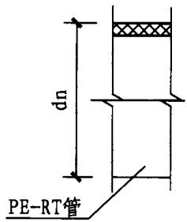

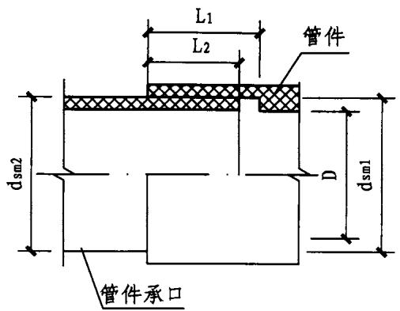  
热熔承插连接管件承口

热熔承插连接管件承口及连接尺寸（mm）

<table><tr><td rowspan="3">公称外径dn</td><td rowspan="3">最小承口深度 $L_1$ </td><td rowspan="3">最小插入深度 $L_2$ </td><td colspan="4">承口的平均内径</td><td rowspan="3">最大不圆度(%)</td><td rowspan="3">最小通径D</td></tr><tr><td colspan="2"> $d_{sm1}$ </td><td colspan="2"> $d_{sm2}$ </td></tr><tr><td>最小</td><td>最大</td><td>最小</td><td>最大</td></tr><tr><td>16</td><td>13.3</td><td>9.8</td><td>14.8</td><td>15.3</td><td>15.0</td><td>15.5</td><td>0.6</td><td>9.0</td></tr><tr><td>20</td><td>14.5</td><td>11.0</td><td>18.8</td><td>19.3</td><td>19.0</td><td>19.5</td><td>0.6</td><td>13.0</td></tr><tr><td>25</td><td>16.0</td><td>12.5</td><td>23.5</td><td>24.1</td><td>23.8</td><td>24.4</td><td>0.7</td><td>18.0</td></tr><tr><td>32</td><td>18.1</td><td>14.6</td><td>30.4</td><td>31.0</td><td>30.7</td><td>31.3</td><td>0.7</td><td>25.0</td></tr><tr><td>40</td><td>20.5</td><td>17.0</td><td>38.3</td><td>38.9</td><td>38.7</td><td>39.3</td><td>0.7</td><td>31.0</td></tr><tr><td>50</td><td>23.5</td><td>20.0</td><td>48.3</td><td>48.9</td><td>48.7</td><td>49.3</td><td>0.8</td><td>39.0</td></tr><tr><td>63</td><td>27.4</td><td>23.9</td><td>61.1</td><td>61.7</td><td>61.6</td><td>62.2</td><td>0.8</td><td>49.0</td></tr><tr><td>75</td><td>31.0</td><td>27.5</td><td>71.9</td><td>72.7</td><td>73.2</td><td>74.0</td><td>1.0</td><td>58.2</td></tr><tr><td>90</td><td>35.5</td><td>32.0</td><td>86.4</td><td>87.4</td><td>87.8</td><td>88.8</td><td>1.2</td><td>69.8</td></tr><tr><td>110</td><td>41.5</td><td>38.0</td><td>105.8</td><td>106.8</td><td>107.3</td><td>108.5</td><td>1.4</td><td>85.4</td></tr><tr><td colspan="9">注:1.此处的公称外径dn指与管件相连管材的公称外径。2. $d_{sm1}$ 、 $d_{sm2}$ 分别指接头管件承口的里端和外端的内径。</td></tr></table>

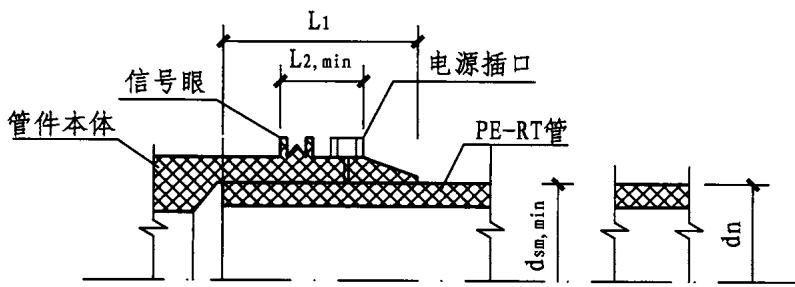  
电熔连接管件承口

电熔连接管件承口尺寸与相应对称外径（mm）

<table><tr><td rowspan="2" colspan="3">公称外径dn</td><td rowspan="2" colspan="2">熔合段最小内径 $d_{dsm, min}$ </td><td rowspan="2">熔合段最小长度 $L_2, min$ </td><td colspan="2">插入长度 $L_1$ </td></tr><tr><td>min</td><td>max</td></tr><tr><td colspan="3">16</td><td colspan="2">16.1</td><td>10</td><td>20</td><td>35</td></tr><tr><td colspan="3">20</td><td colspan="2">20.1</td><td>10</td><td>20</td><td>37</td></tr><tr><td colspan="3">25</td><td colspan="2">25.1</td><td>10</td><td>20</td><td>40</td></tr><tr><td colspan="3">32</td><td colspan="2">32.1</td><td>10</td><td>20</td><td>44</td></tr><tr><td colspan="3">40</td><td colspan="2">40.1</td><td>10</td><td>20</td><td>49</td></tr><tr><td colspan="3">50</td><td colspan="2">50.1</td><td>10</td><td>20</td><td>55</td></tr><tr><td colspan="3">63</td><td colspan="2">63.2</td><td>11</td><td>23</td><td>63</td></tr><tr><td colspan="3">75</td><td colspan="2">75.2</td><td>12</td><td>25</td><td>70</td></tr><tr><td colspan="3">90</td><td colspan="2">90.2</td><td>13</td><td>28</td><td>79</td></tr><tr><td colspan="3">110</td><td colspan="2">110.3</td><td>15</td><td>32</td><td>85</td></tr><tr><td colspan="3">125</td><td colspan="2">125.3</td><td>16</td><td>35</td><td>90</td></tr><tr><td colspan="3">140</td><td colspan="2">140.3</td><td>18</td><td>38</td><td>95</td></tr><tr><td colspan="3">160</td><td colspan="2">160.4</td><td>20</td><td>42</td><td>101</td></tr><tr><td colspan="8">注:此处的公称外径dn指与管件相连管材的公称外径。</td></tr><tr><td colspan="7">PE-RT管件规格尺寸</td><td>图集号 11S405-2</td></tr><tr><td>核</td><td>曲申酉</td><td>曲中酉</td><td>校对</td><td>蒋加林</td><td>设计</td><td>陆丽妃</td><td>页 22</td></tr></table>

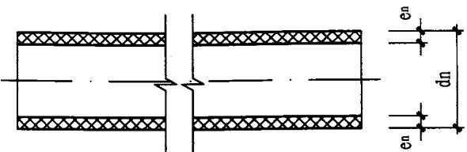  
PB管材示意图

PB管材物理力学性能

<table><tr><td colspan="2">项目</td><td>要求</td></tr><tr><td rowspan="4">静液压</td><td>20°C、15.5MPa、1h</td><td rowspan="4">无渗漏、无破裂</td></tr><tr><td>95°C、6.5MPa、22h</td></tr><tr><td>95°C、6.2MPa、165h</td></tr><tr><td>95°C、6.0MPa、1000h</td></tr><tr><td rowspan="3">纵向回缩率(110°C)</td><td>en≤8mm,1h</td><td rowspan="3">≤2%</td></tr><tr><td>8mm≤en≤16mm,2h</td></tr><tr><td>en&gt;16mm,4h</td></tr><tr><td>静液压状态下的热稳定性</td><td>110°C、2.4MPa、8760h</td><td>无渗漏、无破裂</td></tr><tr><td>熔体质量流动速率MFR(g/10min)</td><td>190°C、5kg</td><td>与对原料测定值之差,不应超过0.3</td></tr></table>

PB管材系统适应性试验

<table><tr><td colspan="7">项目</td><td>要求</td></tr><tr><td rowspan="4">耐内压试验</td><td>管系列S值</td><td>S10</td><td>S8</td><td>S6.3</td><td>S5</td><td>S4/S3.2</td><td rowspan="4">无渗漏、无破裂</td></tr><tr><td>试验温度(°C)</td><td>95</td><td>95</td><td>95</td><td>95</td><td>95</td></tr><tr><td>试验压力(MPa)</td><td>0.55</td><td>0.71</td><td>0.95</td><td>1.19</td><td>1.39</td></tr><tr><td>试验时间(h)</td><td>1000</td><td>1000</td><td>1000</td><td>1000</td><td>1000</td></tr><tr><td rowspan="3">弯曲试验</td><td>试验温度(°C)</td><td>20</td><td>20</td><td>20</td><td>20</td><td>20</td><td rowspan="3">无渗漏、无破裂</td></tr><tr><td>试验压力(MPa)</td><td>1.42</td><td>1.85</td><td>2.46</td><td>3.08</td><td>3.60</td></tr><tr><td>试验时间(h)</td><td>1</td><td>1</td><td>1</td><td>1</td><td>1</td></tr><tr><td rowspan="5">耐拉拔试验</td><td colspan="6">温度 $23 \pm 2°C$ 、所有压力等级、轴向拉力 $1.178dn^{2}N$ 、1h</td><td rowspan="5">不发生轴向变形</td></tr><tr><td colspan="6">温度 $95°C$ 、系统设计压力 $0.4MPa$ 、轴向拉力 $0.314dn^{2}N$ 、1h</td></tr><tr><td colspan="6">温度 $95°C$ 、系统设计压力 $0.6MPa$ 、轴向拉力 $0.471dn^{2}N$ 、1h</td></tr><tr><td colspan="6">温度 $95°C$ 、系统设计压力 $0.8MPa$ 、轴向拉力 $0.628dn^{2}N$ 、1h</td></tr><tr><td colspan="6">温度 $95°C$ 、系统设计压力 $1.0MPa$ 、轴向拉力 $0.785dn^{2}N$ 、1h</td></tr></table>

PE-RT管材系统适应性试验要求

<table><tr><td colspan="8">项目</td><td>要求</td></tr><tr><td rowspan="6">热循环试验</td><td colspan="3">项目</td><td colspan="2">级别1</td><td colspan="2">级别2</td><td rowspan="6">无渗漏、无破裂</td></tr><tr><td colspan="3">最高试验温度(°C)</td><td colspan="2">90</td><td colspan="2">90</td></tr><tr><td colspan="3">最低试验温度(°C)</td><td colspan="2">20</td><td colspan="2">20</td></tr><tr><td colspan="3">试验压力(MPa)</td><td colspan="2">PD</td><td colspan="2">PD</td></tr><tr><td colspan="3">循环次数</td><td colspan="2">5000</td><td colspan="2">5000</td></tr><tr><td colspan="3">每次循环的时间(min)</td><td colspan="4"> $30_{0}^{+2}$ (冷热水各 $15_{0}^{+1}$ )</td></tr><tr><td rowspan="6">循环压力冲击试验</td><td colspan="4">试验压力(MPa)</td><td rowspan="2">试验温度(°C)</td><td rowspan="2">循环次数</td><td rowspan="2">循环频率(次/min)</td><td rowspan="6">无渗漏、无破裂</td></tr><tr><td>试验压力</td><td>最高试验压力</td><td>最低试验压力</td><td></td></tr><tr><td>0.4</td><td>0.6</td><td>0.05</td><td rowspan="4" colspan="2"> $23 \pm 2$ </td><td rowspan="4">10000</td><td rowspan="4"> $30 \pm 5$ </td></tr><tr><td>0.6</td><td>0.9</td><td>0.05</td></tr><tr><td>0.8</td><td>1.2</td><td>0.05</td></tr><tr><td>1.0</td><td>1.5</td><td>0.05</td></tr><tr><td>真空试验</td><td colspan="7">23°C、-0.08MPa、1h</td><td>真空压力变化 $\leqslant 0.005MPa$ </td></tr></table>

说明：  
1. 冷热水用聚丁烯(PB)管材应符合国家标准《冷热水用聚丁烯(PB)管道系统 第2部分：管材》GB/T 19473.2-2004的相关规定及要求。  
2. 颜色由供需双方协商确定。  
3. 管材的内外表面应光滑、平整、清洁，不应有可能影响产品性能的明显划痕、凹陷、气泡等缺陷。管材表面颜色应均匀一致，不允许有明显色差。管材端面应切割平整。  
4. 给水用管材应不透光。  
5. 冷热水用聚丁烯(PB)管材型式为直管和盘管。当管道外径dn≤32时，可根据用户需要采用盘管供货。  
6. 管材与管件连接后，热熔承插连接和电熔焊连接应通过耐内压和热循环两种系统适应性试验；机械连接应通过耐内压、弯曲、耐拉拔、热循环、循环压力冲击、真空六种系统适应性试验。  
7. 管材的卫生指标应符合《生活饮用水输配水设备及防护材料安全性评价标准》GB/T 17219的规定。

<table><tr><td colspan="9">PB管材物理力学性能</td><td>图集号</td><td>11S405-2</td></tr><tr><td>审核</td><td>曲申酉</td><td>曲申酉</td><td>校对</td><td>蒋加林</td><td>蒋加林</td><td>设计</td><td>莫雪天</td><td>莫雪天</td><td>页</td><td>23</td></tr></table>

PB管系列S及规格尺寸（mm）

<table><tr><td rowspan="4">公称外径dn</td><td rowspan="3" colspan="2">平均外径.</td><td colspan="6">管系列</td></tr><tr><td>S10</td><td>S8</td><td>S6.3</td><td>S5</td><td>S4</td><td>S3.2</td></tr><tr><td>-</td><td>-</td><td>-</td><td>PN1.6</td><td>PN2.0</td><td>PN2.5</td></tr><tr><td>最大max</td><td>最小min</td><td colspan="6">公称壁厚en</td></tr><tr><td>16</td><td>16.3</td><td>16.0</td><td>1.3</td><td>1.3</td><td>1.3</td><td>1.5</td><td>1.8</td><td>2.2</td></tr><tr><td>20</td><td>20.3</td><td>20.0</td><td>1.3</td><td>1.3</td><td>1.5</td><td>1.9</td><td>2.3</td><td>2.8</td></tr><tr><td>25</td><td>25.3</td><td>25.0</td><td>1.3</td><td>1.5</td><td>1.9</td><td>2.3</td><td>2.8</td><td>3.5</td></tr><tr><td>32</td><td>32.3</td><td>32.0</td><td>1.6</td><td>1.9</td><td>2.4</td><td>2.9</td><td>3.6</td><td>4.4</td></tr><tr><td>40</td><td>40.4</td><td>40.0</td><td>2.0</td><td>2.4</td><td>3.0</td><td>3.7</td><td>4.5</td><td>5.5</td></tr><tr><td>50</td><td>50.5</td><td>50.0</td><td>2.4</td><td>3.0</td><td>3.7</td><td>4.6</td><td>5.6</td><td>6.9</td></tr><tr><td>63</td><td>63.6</td><td>63.0</td><td>3.0</td><td>3.8</td><td>4.7</td><td>5.8</td><td>7.1</td><td>8.6</td></tr><tr><td>75</td><td>75.7</td><td>75.0</td><td>3.6</td><td>4.5</td><td>5.6</td><td>6.8</td><td>8.4</td><td>10.3</td></tr><tr><td>90</td><td>90.9</td><td>90.0</td><td>4.3</td><td>5.4</td><td>6.7</td><td>8.2</td><td>10.1</td><td>12.3</td></tr><tr><td>110</td><td>111.0</td><td>110.0</td><td>5.3</td><td>6.6</td><td>8.1</td><td>10.0</td><td>12.3</td><td>15.1</td></tr><tr><td>125</td><td>126.2</td><td>125.0</td><td>6.0</td><td>7.4</td><td>9.2</td><td>11.4</td><td>14.0</td><td>17.1</td></tr><tr><td>140</td><td>141.3</td><td>140.0</td><td>6.7</td><td>8.3</td><td>10.3</td><td>12.7</td><td>15.7</td><td>19.2</td></tr><tr><td>160</td><td>161.5</td><td>160.0</td><td>7.7</td><td>9.5</td><td>11.8</td><td>14.6</td><td>17.9</td><td>21.9</td></tr><tr><td colspan="9">注:1.管材的平均外径和最小壁厚应符合本表要求,且不允许有负偏差;但对于熔接连接的管材,最小壁厚为1.9mm。聚丁烯管材的壁厚值不包括阻隔层的厚度。2.管长一般按每根6m、9m或12m供应,如有特殊要求,供需双方协商确定。3.盘管盘架直径应不小于管材外径的18倍。管盘展开长度由供需双方商定。4.公称压力PN根据广东联塑科技实业有限公司提供的技术资料编制。</td></tr></table>

PB管件物理力学性能

<table><tr><td colspan="8">项目</td><td>要求</td></tr><tr><td rowspan="7">静液压试验</td><td>管系列S值</td><td>S10</td><td>S8</td><td>S6.3</td><td>S5</td><td>S4/S3.2</td><td rowspan="7">无渗漏、无破裂</td><td></td></tr><tr><td>试验压力(MPa)</td><td>1.42</td><td>1.85</td><td>2.46</td><td>3.08</td><td>3.60</td><td></td></tr><tr><td>试验温度(°C)</td><td colspan="5">20</td><td></td></tr><tr><td>试验时间(h)</td><td colspan="5">1</td><td></td></tr><tr><td>试验压力(MPa)</td><td>0.55</td><td>0.71</td><td>0.95</td><td>1.19</td><td>1.39</td><td></td></tr><tr><td>试验温度(°C)</td><td colspan="5">95</td><td></td></tr><tr><td>试验时间(h)</td><td colspan="5">1000</td><td></td></tr><tr><td>静液压状态下的热稳定性</td><td colspan="6">110°C、2.4MPa、8760h1、2</td><td>无渗漏、无破裂</td><td></td></tr><tr><td>熔体质量流动速率MFR</td><td colspan="6">190°C、5kg、10min</td><td>与对原料测定值之差,不应超过0.3g/10min</td><td></td></tr><tr><td colspan="8">注:1.用管状试样或管件与管材相连进行试验。管状试样按实际壁厚计算试验压力;管件与管材相连作为试样时,按相同管系列S的管材的公称壁厚计算试验压力,如试验中管材破裂则试验应重做。2.相同原料同一生产厂家生产的管材已做过本试验则管件可不做。</td><td></td></tr><tr><td colspan="8">3.管件表面应光滑、平整,不应有裂纹、气泡、脱皮和明显的杂质、严重的冷斑以及色泽不均、分解变色等缺陷。4.给水用管件应不透光。5.管件按管系列S分类与管材相同。管件的主体壁厚应不小于相同系列S管材的壁厚。6.管件分为熔接管件和机械连接管件。熔接管件按熔接方式的不同分为热熔承插和电熔连接管件。7.带金属螺纹接头的管件其螺纹部分应符合《55°密封管螺纹》GB/T 7306的规定。8.管件的系统性试验参数详见本图集第23页。9.管材、管件和专用机具应由同一生产企业配套供应。10.管件的卫生指标应符合《生活饮用水输配水设备及防护材料安全性评价标准》GB/T 17219的规定。</td><td></td></tr><tr><td colspan="7">PB管材规格、管件物理力学性能</td><td>图集号</td><td>11S405-</td></tr><tr><td>审核</td><td>曲电西</td><td>校对</td><td>蒋加林</td><td>设计</td><td>莫雪天</td><td>页</td><td>24</td><td></td></tr></table>

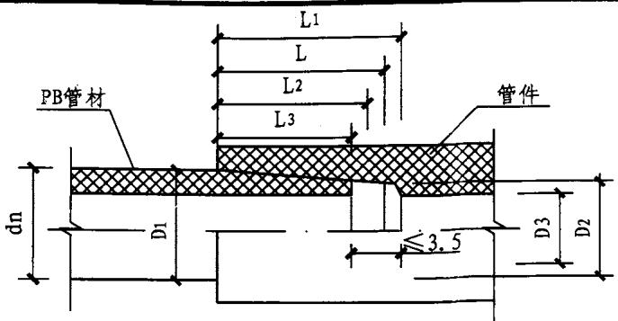  
热熔承插连接管件承口

热熔连接管件承口规格尺寸(mm)

<table><tr><td rowspan="3">公称外径dn</td><td colspan="4">承口的平均内径</td><td rowspan="3">最大不圆度</td><td rowspan="2">最小通径</td><td rowspan="2">承口参照深度</td><td rowspan="2" colspan="2">承口加热深度</td><td rowspan="2" colspan="2">承插深度</td></tr><tr><td colspan="2">D1</td><td colspan="2">D2</td></tr><tr><td>max</td><td>min</td><td>max</td><td>min</td><td>D3</td><td>Lmin0.3dn+8.5</td><td>L2,min(L-2.5)</td><td>L2,max(L)</td><td>L3,min(L-3.5)</td><td>L3,max(L)</td></tr><tr><td>16</td><td>15.5</td><td>15.0</td><td>15.3</td><td>14.8</td><td>0.6</td><td>9</td><td>13.3</td><td>10.8</td><td>13.3</td><td>9.8</td><td>13.3</td></tr><tr><td>20</td><td>19.5</td><td>19.0</td><td>19.3</td><td>18.8</td><td>0.6</td><td>13</td><td>14.5</td><td>12.0</td><td>14.5</td><td>11.0</td><td>14.5</td></tr><tr><td>25</td><td>24.4</td><td>23.8</td><td>24.1</td><td>23.5</td><td>0.7</td><td>18</td><td>16.0</td><td>13.5</td><td>16.0</td><td>12.5</td><td>16.0</td></tr><tr><td>32</td><td>31.3</td><td>30.7</td><td>31.0</td><td>30.4</td><td>0.7</td><td>25</td><td>18.1</td><td>15.6</td><td>18.1</td><td>14.6</td><td>18.1</td></tr><tr><td>40</td><td>39.3</td><td>38.7</td><td>38.9</td><td>38.3</td><td>0.7</td><td>31</td><td>20.5</td><td>18.0</td><td>20.5</td><td>17.0</td><td>20.5</td></tr><tr><td>50</td><td>49.3</td><td>48.7</td><td>48.9</td><td>48.3</td><td>0.8</td><td>39</td><td>23.5</td><td>21.0</td><td>23.5</td><td>20.0</td><td>23.5</td></tr><tr><td>63</td><td>62.2</td><td>61.6</td><td>61.7</td><td>61.1</td><td>0.8</td><td>49</td><td>27.4</td><td>24.9</td><td>27.4</td><td>23.9</td><td>27.4</td></tr><tr><td colspan="12">不去皮</td></tr><tr><td>75</td><td>74.0</td><td>73.2</td><td>72.7</td><td>71.9</td><td>1.0</td><td>58.2</td><td>31.0</td><td>28.5</td><td>31.0</td><td>27.5</td><td>31.0</td></tr><tr><td>90</td><td>88.8</td><td>87.8</td><td>87.4</td><td>86.4</td><td>1.2</td><td>69.8</td><td>35.5</td><td>33.0</td><td>35.5</td><td>32.0</td><td>35.5</td></tr><tr><td>110</td><td>108.5</td><td>107.3</td><td>106.8</td><td>105.8</td><td>1.4</td><td>85.4</td><td>41.5</td><td>39.0</td><td>41.5</td><td>38.0</td><td>41.5</td></tr><tr><td colspan="12">去皮</td></tr><tr><td>75</td><td>73.2</td><td>72.6</td><td>72.9</td><td>72.3</td><td>1.0</td><td>58.2</td><td>31.0</td><td>28.5</td><td>31.0</td><td>27.5</td><td>31.0</td></tr><tr><td>90</td><td>87.8</td><td>87.1</td><td>87.4</td><td>86.7</td><td>1.2</td><td>69.8</td><td>35.5</td><td>33.0</td><td>35.5</td><td>32.0</td><td>35.5</td></tr><tr><td>110</td><td>107.1</td><td>106.3</td><td>106.5</td><td>105.7</td><td>1.4</td><td>85.4</td><td>41.5</td><td>39.0</td><td>41.5</td><td>38.0</td><td>41.5</td></tr><tr><td colspan="12">注:管件承口壁厚不得小于同规格管材壁厚。</td></tr></table>

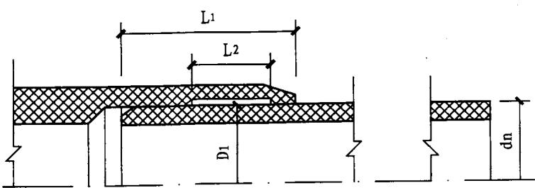

**电熔连接管件承口**

电熔连接管件承口尺寸(mm)

<table><tr><td rowspan="2" colspan="3">公称外径dn</td><td rowspan="2" colspan="2">熔融区平均内径D1,min</td><td rowspan="2" colspan="2">加热长度L2,min</td><td colspan="3">插入长度L1</td></tr><tr><td colspan="2">min</td><td>max</td></tr><tr><td colspan="3">16</td><td colspan="2">16.1</td><td colspan="2">10</td><td colspan="2">20</td><td>35</td></tr><tr><td colspan="3">20</td><td colspan="2">20.1</td><td colspan="2">10</td><td colspan="2">20</td><td>37</td></tr><tr><td colspan="3">25</td><td colspan="2">25.1</td><td colspan="2">10</td><td colspan="2">20</td><td>40</td></tr><tr><td colspan="3">32</td><td colspan="2">32.1</td><td colspan="2">10</td><td colspan="2">20</td><td>44</td></tr><tr><td colspan="3">40</td><td colspan="2">40.1</td><td colspan="2">10</td><td colspan="2">20</td><td>49</td></tr><tr><td colspan="3">50</td><td colspan="2">50.1</td><td colspan="2">10</td><td colspan="2">20</td><td>55</td></tr><tr><td colspan="3">63</td><td colspan="2">63.2</td><td colspan="2">11</td><td colspan="2">23</td><td>63</td></tr><tr><td colspan="3">75</td><td colspan="2">75.2</td><td colspan="2">12</td><td colspan="2">25</td><td>70</td></tr><tr><td colspan="3">90</td><td colspan="2">90.2</td><td colspan="2">13</td><td colspan="2">28</td><td>79</td></tr><tr><td colspan="3">110</td><td colspan="2">110.3</td><td colspan="2">15</td><td colspan="2">32</td><td>85</td></tr><tr><td colspan="3">125</td><td colspan="2">125.3</td><td colspan="2">16</td><td colspan="2">35</td><td>90</td></tr><tr><td colspan="3">140</td><td colspan="2">140.3</td><td colspan="2">18</td><td colspan="2">38</td><td>95</td></tr><tr><td colspan="3">160</td><td colspan="2">160.4</td><td colspan="2">20</td><td colspan="2">42</td><td>101</td></tr><tr><td colspan="10">注:此处的公称外径dn指与管件相连管材的公称外径。</td></tr><tr><td colspan="9">PB管件规格尺寸</td><td>图集号 11S405-2</td></tr><tr><td>审核</td><td>曲申酉</td><td>曲申酉</td><td>校对</td><td>蒋加林</td><td>蒋加林</td><td>设计</td><td>莫雪天</td><td>莫雪天</td><td>页 25</td></tr></table>

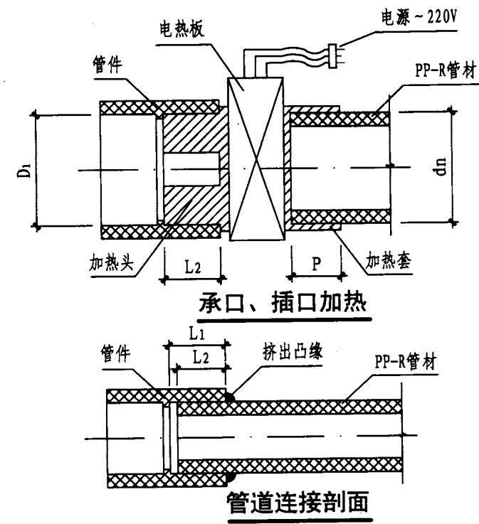

PP-R热熔连接技术要求（mm）

<table><tr><td>公称外径dn</td><td>最小承插深度(mm)</td><td>加热时间(s)</td><td>加工时间(s)</td><td>冷却时间(min)</td></tr><tr><td>20</td><td>11.0</td><td>5</td><td>4</td><td>3</td></tr><tr><td>25</td><td>12.5</td><td>7</td><td>4</td><td>3</td></tr><tr><td>32</td><td>14.6</td><td>8</td><td>4</td><td>4</td></tr><tr><td>40</td><td>17.0</td><td>12</td><td>6</td><td>4</td></tr><tr><td>50</td><td>20.0</td><td>18</td><td>6</td><td>5</td></tr><tr><td>63</td><td>23.9</td><td>24</td><td>6</td><td>6</td></tr><tr><td>75</td><td>27.5</td><td>30</td><td>10</td><td>8</td></tr><tr><td>90</td><td>32.0</td><td>40</td><td>10</td><td>8</td></tr><tr><td>110</td><td>38.0</td><td>50</td><td>15</td><td>10</td></tr></table>

注：本表适用的环境温度为20℃。低于该环境温度，加热时间适当延长；若环境温度低于5℃，加热时间宜延长50%。

说明：

1. 本图适用于PP-R管的热熔承插连接。

2. 热熔机具接通电源，达到工作温度 $(260\pm10^{\circ}\mathrm{C})$ 指示灯亮后方能用于接管。

3. 连接前管材端部宜去掉40\~50。切割管材时，应使端面垂直于管轴线。管材切割宜使用管子剪或管道切割机，也可使用钢锯，切割后的管材断面应去除毛边和毛刺。

4. 管材与管件连接端面应清洁、干燥、无油。

5. 用卡尺和笔在管端测量并标绘出承插深度, 承插深度不应小于左表的要求。

6. 熔接弯头或三通时，按设计图纸要求，应注意其方向，在管件和管材的直线方向上，用辅助标志标出其位置。

7. 连接时，无旋转地把管端导入加热套内，插入到所标深度，同时，无旋转地把管件推到加热头上，达到规定标志处。

8. 达到加热时间后, 立即把管材与管件从加热套与加热头上同时取下, 迅速无旋转地直线均匀对插入到所标深度, 使接头处形成均匀凸缘。

9. 在规定的加工时间内，刚熔接好的接头还可校正，但不得旋转。

10. 完成连接的连接件应免受外力，应自然冷却。

11. 管径dn>50时，宜在台式加热工具上进行连接，操作过程应满足产品生产企业提出的要求。

12. 加热时间、加工时间及冷却时间应按热熔机具生产厂家的要求进行。如无要求时，可参照左表。

<table><tr><td colspan="9">PP-R管热熔承插连接</td><td>图集号</td><td>11S405-2</td></tr><tr><td>审核</td><td>曲申酉</td><td>曲申酉</td><td>校对</td><td>蒋加林</td><td>蒋加林</td><td>设计</td><td>覃火坤</td><td>覃火坤</td><td>页</td><td>26</td></tr></table>

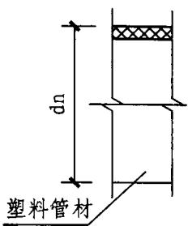

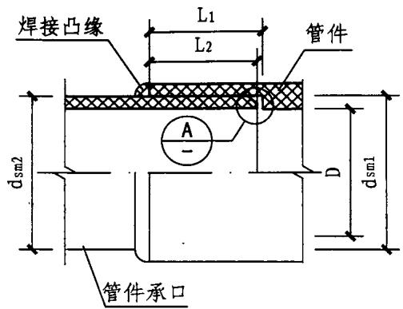

热熔承插连接管件承口

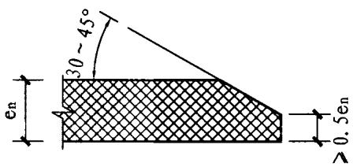  
A

**说明：**

1. 本图适用于PE、PE-RT、PB管的热熔承插连接。

2. 热熔承插连接步骤:

(1) 管材端面按节点①加工倒角，坡角不宜小于30°，且管材表面坡口长度不宜大于4.0mm；

(2) 用清洁干布，擦净管材、管件连接处表面和热熔连接工具加热器上面的污物；

(3) 测量管件的承口深度，在管材表面作出插入深度标记；

(4) 对管材的外面和管件的内表面用热熔工具加热。加热温度、时间等技术参数应满足加热设备生产企业要求。当环境温度低于 $5^{\circ} \mathrm{C}$ 时，加热时间宜延长一半；

(5) 加热结束将连接的管材、管件迅速脱离加热工具，以均匀的外力无旋转地将管材插入管件承口到管材的标志线，插入后应在管件承口的端部形成完整均匀的凸缘。

3. 管径dn>50时，宜在台式加热工具上进行连接，其操作过程应满足产品生产企业提出的要求。

4. 热熔承插连接保压、冷却时间应满足热熔承插连接工具生产企业和管材、管件生产企业的要求。

5. 完成连接的连接件应免受外力，且管材、管件在1h内不宜搬运，冬天72h、夏天24h以内不宜进行试压，应自然冷却。

<table><tr><td colspan="9">PE、PE-RT、PB管热熔承插连接</td><td>图集号</td><td>11S405-2</td></tr><tr><td>审核</td><td>曲申酉</td><td>曲申酉</td><td>校对</td><td>蒋加林</td><td>蒋加林</td><td>设计</td><td>陆丽妃</td><td>陆丽妃</td><td>页</td><td>27</td></tr></table>

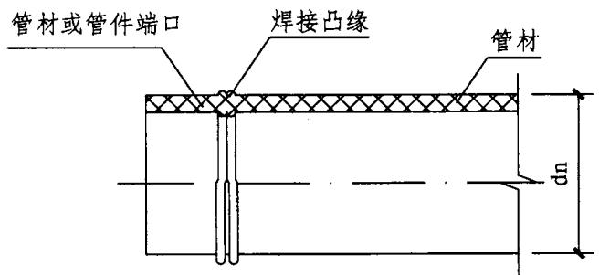  
热熔对接连接

**说明：**

1. 本图适用于PE、PE-RT管，当管道外径dn>63时的热熔对接连接。

**2. 热熔对接连接步骤：**

(1) 在热熔对接连接工具上，应校直两对应的待连接件，使其在同一轴线上，错边不宜大于壁厚的10%;

(2) 应用热熔对接连接工具上的铣刀铣削待连接的端面, 使其与管道轴线垂直, 并应保证待连接面能吻合;

(3) 应用洁净棉布擦净管材或管件待连接端面, 以及热熔对接连接工具加热面上的污物;

(4) 用热熔对接连接工具加热待连接的端面；

(5) 加热完毕，待连接件应迅速脱离加热器，并用均匀外力使待连接件端面完全接触，在接头处应形成均匀的 $\infty$ 型凸缘。

3. 热熔对接连接加热时间、加热温度、保压、冷却时间应满足热熔对接连接工具生产企业和管材、管件生产企业的要求。

<table><tr><td colspan="9">PE、PE-RT管热熔对接连接</td><td>图集号</td><td>11S405-2</td></tr><tr><td>审核</td><td>曲申酉</td><td>曲申酉</td><td>校对</td><td>蒋加林</td><td>蒋加林</td><td>设计</td><td>莫涛涛</td><td>莫涛涛</td><td>页</td><td>28</td></tr></table>

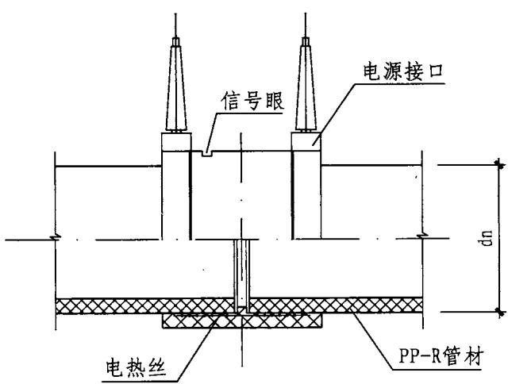

电熔连接  
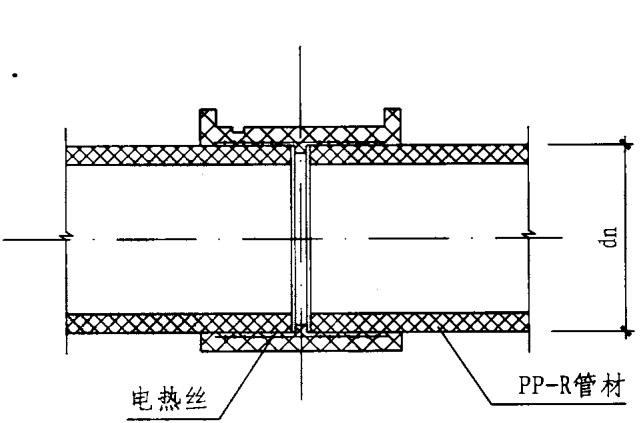  
管道连接剖面

说明：

1. 电熔连接主要用于大口径 $(\mathrm{dn} \geqslant 110)$ 、管道最后连接处或热熔安装困难的场所。

2. 电熔连接步骤:

(1) 应保持电熔管件与管材的熔合部位不受潮；

(2)电熔承插连接管材的连接端应切割垂直，并应用洁净棉布擦净管材和管件连接面上的污物。当表面有油污时，应用清洁干布丙酮或95%无水酒精擦拭。标出承插深度，刮除其表皮；

(3)校直两对应的连接件，使其处于同一轴线上；

(4) 电熔连接机具与电熔管件的导线连通应正确。连接前，应检查通电加热的电压；

(5) 在熔合及冷却过程中, 不得移动、转动电熔管件和熔合的管道, 不得在连接件上施加任何外力;

(6)电熔连接的标准加热时间应由生产厂家提供,并应随环境温度的不同加以调整。电熔连接的加热时间与环境温度的关系可参照下表。

电熔连接的加热时间与环境温度的关系

<table><tr><td>环境温度(°C)</td><td>加热时间(s)</td><td>环境温度(°C)</td><td>加热时间(s)</td></tr><tr><td>-10</td><td>t+12%t</td><td>+30</td><td>t-4%t</td></tr><tr><td>0</td><td>t+8%t</td><td>+40</td><td>t-8%t</td></tr><tr><td>+10</td><td>t+4%t</td><td>+50</td><td>t-12%t</td></tr><tr><td>+20</td><td>标准加热时间t</td><td>-</td><td>-</td></tr></table>

注：若电熔机具具有温度自动补偿功能，则不需调整加热时间。

(7) 电熔过程中, 当信号眼内熔体有突出沿口现象, 通电加热完成。

(8) 通电结束，移出电源插头，平放静置冷却。

<table><tr><td colspan="9">PP-R管电熔连接</td><td>图集号</td><td>11S405-2</td></tr><tr><td>审核</td><td>曲申酉</td><td>曲申酉</td><td>校对</td><td>蒋加林</td><td>蒋加林</td><td>设计</td><td>覃火坤</td><td>覃火坤</td><td>页</td><td>29</td></tr></table>

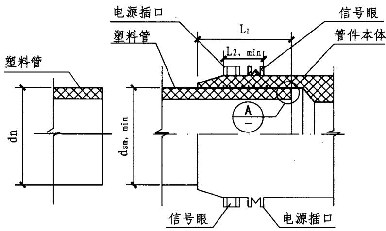

电熔连接  
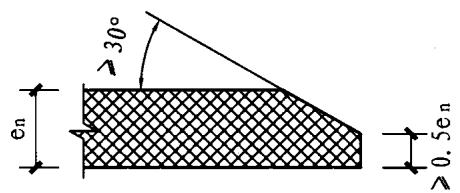  
A

**说明：**

1. 本图适用于PE、PE-RT、PB管材的电熔连接，主要用于大口径或安装困难的场所。

**2. 电熔连接步骤:**

(1) 应用专用刮刀均匀刮除管材连接部表皮，管材端口外部宜进行坡口，坡角不宜小于 $30^{\circ}$ ，且管材表面坡口长度不宜大于4.0mm；

(2) 应测量和核对管件承口长度，并应在管材插入端标出插入长度；

(3) 应用洁净棉布擦净管材、管件待连接面上得污物；

(4) 管材应插入管件承口内至管材插入长度的标记位置；

(5) 通电的电流、电压和时间应满足电熔连接工具生产企业和电熔管件生产企业的要求；

(6) 通电结束，移出电源插头，平放静置冷却。

<table><tr><td colspan="9">PE、PE-RT、PB管电熔连接</td><td>图集号</td><td>11S405-2</td></tr><tr><td>审核</td><td>曲申酉</td><td>曲申酉</td><td>校对</td><td>蒋加林</td><td>蒋加林</td><td>设计</td><td>陆丽妃</td><td>陆丽妃</td><td>页</td><td>30</td></tr></table>

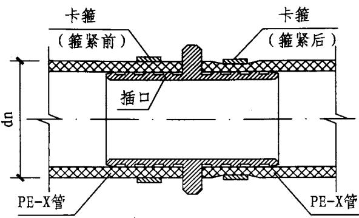  
卡箍连接

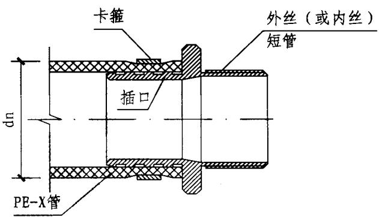  
卡箍套丝接

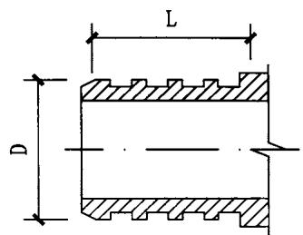

<table><tr><td>dn</td><td>D</td><td>L</td></tr><tr><td>20</td><td>15.9</td><td>16.1</td></tr><tr><td>25</td><td>20.3</td><td>16.1</td></tr><tr><td>32</td><td>26.1</td><td>20</td></tr><tr><td>40</td><td>32.5</td><td>23.8</td></tr><tr><td>50</td><td>40.7</td><td>23.8</td></tr><tr><td>63</td><td>51.3</td><td>23.8</td></tr></table>

**插口段详图**

**说明：**

1. 本图适用于 $16 \leqslant dn \leqslant 32$ 的冷热水管。

2. 订货时应分别注明热水管卡箍接头或冷水管卡箍接头的规格与数量，满足匹配相同外径不同壁厚的管材要求。

3. 卡箍连接时必须采用专用的电动或液压夹紧钳夹紧卡箍环直至夹钳的卡头部二翼合拢为止，当 $dn \leqslant 32$ 时也可用手动长钳。卡箍环夹紧后需用专用定径卡板检查卡箍环周边，以不受阻为合格。

4. PE-X管与内丝阀门等附件连接需匹配卡箍式外丝直通。

5. 本图按S5系列编制，采用其他系列管材时管件尺寸由管材生产厂家提供。

<table><tr><td colspan="9">PE-X管卡箍式连接</td><td>图集号</td><td>11S405-2</td></tr><tr><td>审核</td><td>曲申酉</td><td>曲申酉</td><td>校对</td><td>蒋加林</td><td>蒋加林</td><td>设计</td><td>覃火坤</td><td>覃火坤</td><td>页</td><td>31</td></tr></table>

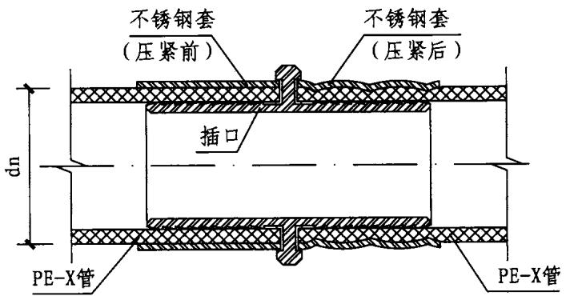  
卡压连接

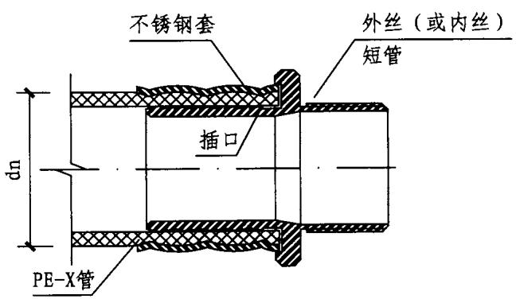  
卡压套丝接

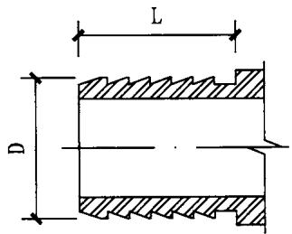  
插口段详图

<table><tr><td colspan="2">dn</td><td>32</td><td>40</td><td>50</td><td>63</td></tr><tr><td colspan="2">L</td><td>26.0</td><td>31.0</td><td>41.0</td><td>51.0</td></tr><tr><td rowspan="2">D</td><td>管系列S5</td><td>25.8</td><td>31.8</td><td>40.0</td><td>50.6</td></tr><tr><td>管系列S4</td><td>24.4</td><td>30.5</td><td>38.3</td><td>48.1</td></tr></table>

说明：

1. 本图适用于 $32 \leqslant dn \leqslant 63$ 的冷热水管。

2. 订货时应分别注明热水管卡压接头或冷水管卡压接头的规格与数量，满足匹配相同外径不同壁厚的管材要求。

3. PE-X管与内丝阀门等附件连接需匹配卡压式外丝直通。

4. 卡压式连接前应用整圆扩孔器或绞刀将管口端部整圆扩孔，管件插入后套上不锈钢套环，然后用专用的电动或液压工具将套环压紧，当dn≤25时也可用手动长钳。

5. 卡压式连接应满足管件生产厂家的技术要求。

<table><tr><td colspan="9">PE-X管卡压式连接</td><td>图集号</td><td>11S405-2</td></tr><tr><td>审核</td><td>曲申酉</td><td>曲申酉</td><td>校对</td><td>蒋加林</td><td>蒋加林</td><td>设计</td><td>覃火坤</td><td>覃火坤</td><td>页</td><td>32</td></tr></table>

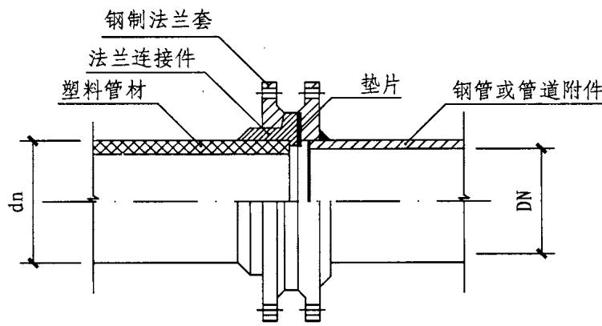  
法兰连接

**说明：**

1. 应按金属管道法兰连接要求，将一个钢质法兰片焊接在待连接的钢管端部。

2. 应将另一个钢质法兰片(背压活套法兰)套入待连接的塑料法兰连接件的端部。

3. 校正两对应的连接件，使连接的两片法兰垂直于管道中心线，表面相互平行。

4. 法兰间应衬耐热无毒橡胶垫片。

5. 应使用相同规格的螺母，安装方向一致。螺栓应对称紧固。紧固好的螺栓应露出螺母之外。螺栓螺帽宜采用镀锌件。

6. 连接管道的长度应精确，当紧固螺栓时，不应使管道产生轴向拉力。

7. 法兰连接部位应设置支吊架。

8. 法兰盘应采用钢制，钢制法兰盘应做好防腐。

塑料给水管与同种材质管道、金属管道、管道附件、设备连接等。
冷水管：PP-R、PE-RT、PE80、PE100等；
热水管：PP-R、PE-RT、PB等。

<table><tr><td colspan="9">法兰连接</td><td>图集号</td><td>11S405-2</td></tr><tr><td>审核</td><td>曲申酉</td><td>曲申酉</td><td>校对</td><td>蒋加林</td><td>蒋加林</td><td>设计</td><td>莫涛涛</td><td>莫涛涛</td><td>页</td><td>33</td></tr></table>

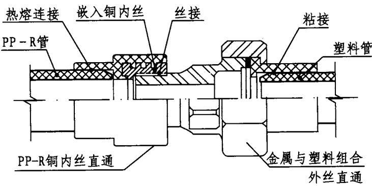  
与金属和塑料组合外丝直通接头连接

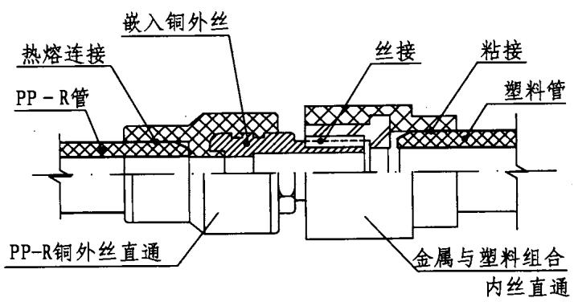

**与金属和塑料组合内丝直通接头连接**

说明：

1. 本图按PP-R管与金属和塑料组合直通接头、与金属管的连接编制，PE、PE-RT、PB管可参照使用。

2. 严禁在塑料管上套丝。

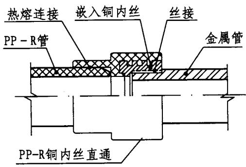

**与金属管连接(二)**

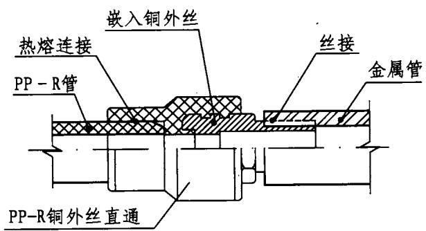

**与金属管连接(一)**

3. 丝接处应先顺时针缠绕四氟乙烯生料带，缠绕要均匀、平整，不能绕到管头外或在管口内。嵌入的铜内（外）丝要求光滑、干净，不允许有断丝现象。

<table><tr><td colspan="9">螺纹连接(一)</td><td>图集号</td><td>11S405-2</td></tr><tr><td>审核</td><td>曲申酉</td><td></td><td>校对</td><td>蒋加林</td><td></td><td>设计</td><td>莫涛涛</td><td>莫涛涛</td><td>页</td><td>34</td></tr></table>

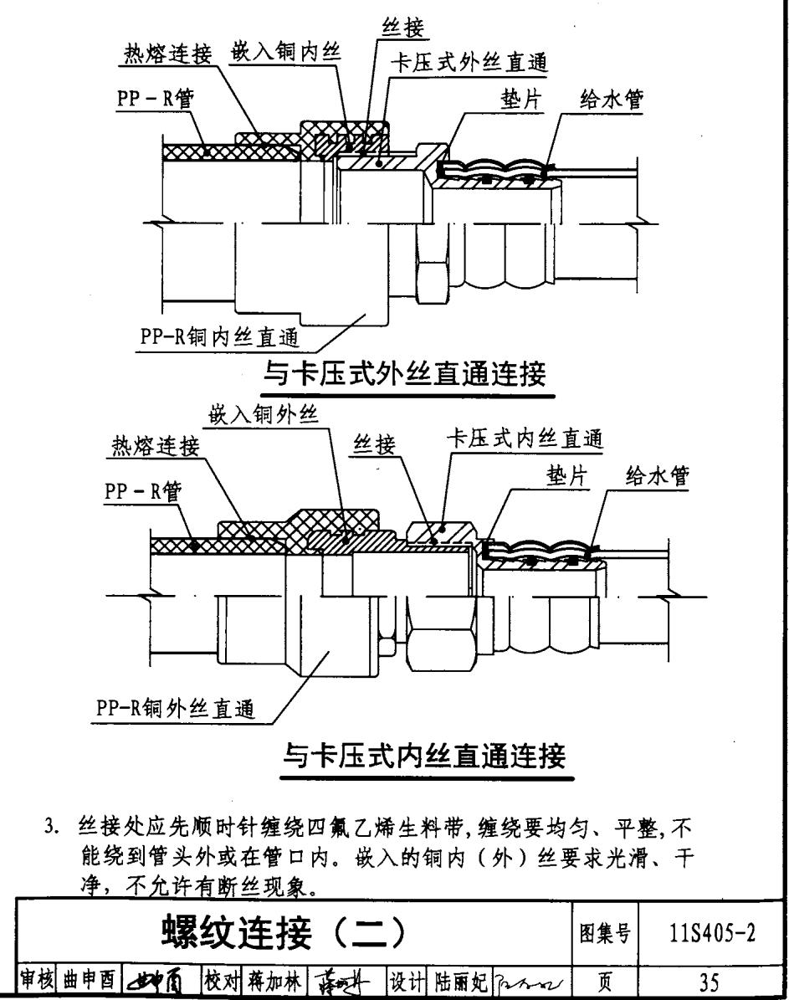

与卡套式外丝直通连接  
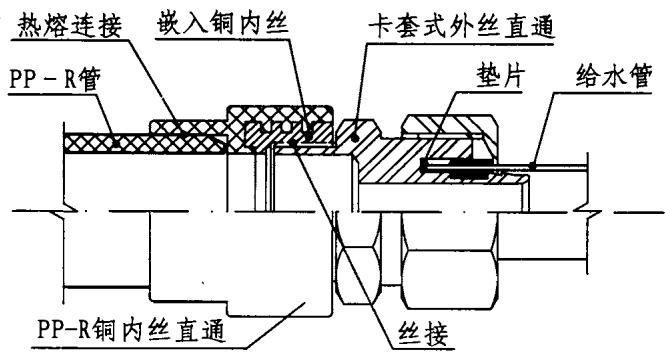

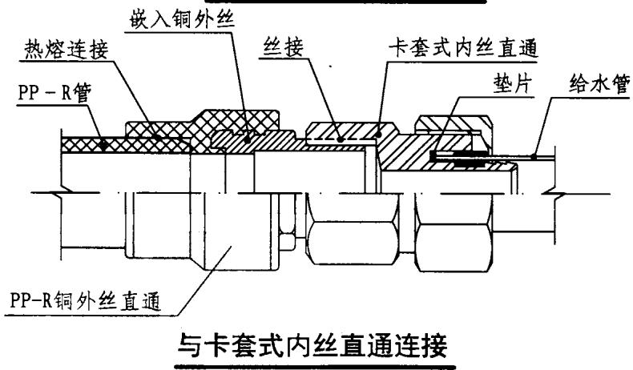

说明：

1. 本图按PP-R管与给水管卡套式和卡压式连接绘制，PE、PE-RT、PB管可参照使用。

2. 严禁在塑料管上套丝。

3. 丝接处应先顺时针缠绕四氟乙烯生料带，缠绕要均匀、平整，不能绕到管头外或在管口内。嵌入的铜内（外）丝要求光滑、干净，不允许有断丝现象。

<table><tr><td colspan="9">螺纹连接(二)</td><td>图集号</td><td>11S405-2</td></tr><tr><td>审核</td><td>曲申酉</td><td>曲申酉</td><td>校对</td><td>蒋加林</td><td>蒋加林</td><td>设计</td><td>陆丽妃</td><td>陆丽妃</td><td>页</td><td>35</td></tr></table>

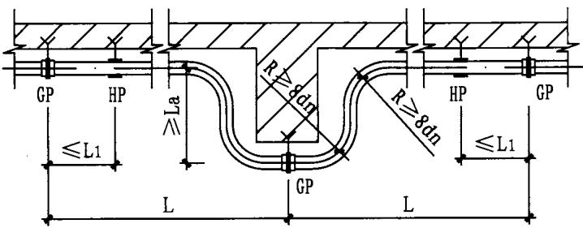  
U 形补偿

(dn≤32)  
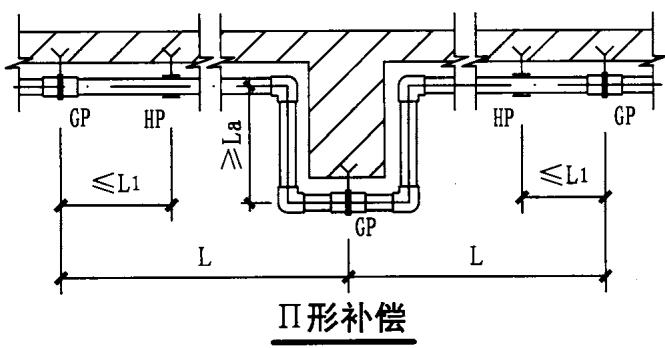

**说明：**

1. 固定支承间应有伸缩补偿，伸缩补偿根据设计要求可采用不同形式。

2. U形补偿和自由壁补偿（一）适用于PE、PE-X、PE-RT和PB管无管件连接的给水横管； $\Pi$ 形补偿和自由壁补偿（二）适用于PP-R、PE、PE-X、PE-RT和PB管有管件连接的给水横管。

3. 图中GP表示固定支承，HP表示滑动支承。

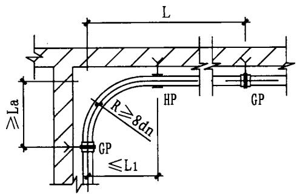  
自由臂补偿(一)

(dn≤32)  
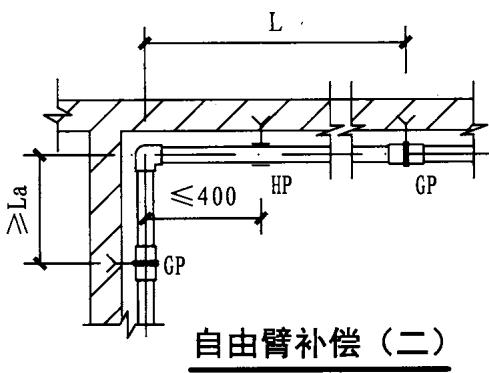  
4. 图中L为计算管长，L1为最大支承间距，La为最小自由臂。具体尺寸数值详见本图集第38页。  
5. U形或 $\Pi$ 形补偿器可水平也可竖直安装。  
6. 冷、热水管共用支承时应根据热水管支承间距确定。暗敷直埋管道的支承间距不宜大于1200。  
7. 图中所示为非保温管道，保温管道的做法详见本图集第43页。

<table><tr><td colspan="9">横管安装(一)</td><td>图集号</td><td>11S405-2</td></tr><tr><td>审核</td><td>曲申酉</td><td>曲申酉</td><td>校对</td><td>蒋加林</td><td>蒋加林</td><td>设计</td><td>莫雪天</td><td>莫雪天</td><td>页</td><td>36</td></tr></table>

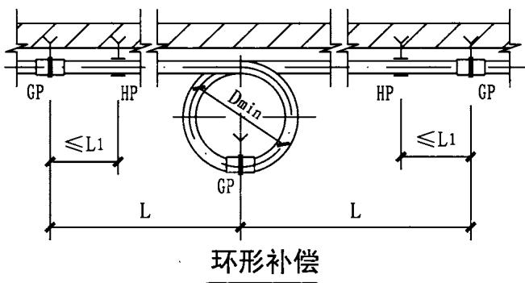  
(成品)

成品环形补偿

<table><tr><td>dn</td><td>20</td><td>25</td><td>32</td></tr><tr><td>Dmin</td><td>350</td><td>400</td><td>450</td></tr></table>

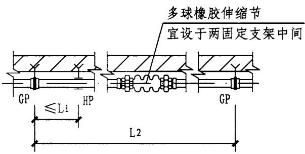  
多球橡胶伸缩节补偿

**自耦合压力密封单向伸缩节**

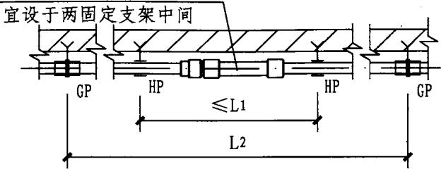  
自耦合压力密封单向伸缩节补偿

**说明：**

1. 固定支承间应有伸缩补偿，伸缩补偿根据设计要求可采用不同形式。

2. 环形补偿形和多球橡胶伸缩节补偿适用于PP-R、PE、PE-X、PE-RT和PB管；自耦合压力密封单向伸缩节补偿适用于PP-R管。

3. 图中GP、HP分别为固定支承及滑动支承的代号。

4. 图中L为计算管长，L1为最大支承间距，La为最小自由臂。具体尺寸数值详见本图集第38页。

5. 图中L2需根据本图集第7页总说明第7节公式经计算确定。

6. 多球橡胶伸缩节可水平也可竖直安装。

7. 冷、热水管共用支、吊架时应根据热水管支吊架间距确定。暗敷直埋管道的支承间距不宜大于1200。

<table><tr><td colspan="9">横管安装(二)</td><td>图集号</td><td>11S405-2</td></tr><tr><td>审核</td><td>曲申酉</td><td>曲申酉</td><td>校对</td><td>蒋加林</td><td>蒋加林</td><td>设计</td><td>莫雪天</td><td>莫雪天</td><td>页</td><td>37</td></tr></table>

最小自由臂、最大支承间距尺寸表

<table><tr><td colspan="2">管材类型</td><td>线膨胀系数α[mm/°C]</td><td>材质系数K</td><td>dn(mm)参数</td><td>16</td><td>20</td><td>25</td><td>32</td><td>40</td><td>50</td><td>63</td><td>75</td><td>90</td><td>110</td><td>125</td><td>160</td></tr><tr><td rowspan="6">PP-R</td><td rowspan="3">冷水管</td><td rowspan="6">0.20</td><td rowspan="6">20</td><td>计算管长L (m)</td><td colspan="12">4.0</td></tr><tr><td>最小自由臂La (mm)</td><td>-</td><td>410</td><td>458</td><td>518</td><td>580</td><td>648</td><td>727</td><td>798</td><td>869</td><td>961</td><td>-</td><td>-</td></tr><tr><td>最大支承间距L1 (mm)</td><td>-</td><td>600</td><td>700</td><td>800</td><td>900</td><td>1000</td><td>1100</td><td>1200</td><td>1350</td><td>1550</td><td>-</td><td>-</td></tr><tr><td rowspan="3">热水管</td><td>计算管长L (m)</td><td colspan="12">0.8</td></tr><tr><td>最小自由臂La (mm)</td><td>-</td><td>289</td><td>322</td><td>365</td><td>408</td><td>456</td><td>512</td><td>559</td><td>612</td><td>677</td><td>-</td><td>-</td></tr><tr><td>最大支承间距L1 (mm)</td><td>-</td><td>300</td><td>350</td><td>400</td><td>500</td><td>600</td><td>700</td><td>800</td><td>1200</td><td>1300</td><td>-</td><td>-</td></tr><tr><td rowspan="3">PE</td><td rowspan="3">冷水管</td><td rowspan="3">0.20</td><td rowspan="3">27</td><td>计算管长L (m)</td><td colspan="12">2.5</td></tr><tr><td>最小自由臂La (mm)</td><td>-</td><td>438</td><td>489</td><td>554</td><td>619</td><td>692</td><td>777</td><td>847</td><td>928</td><td>1026</td><td>1094</td><td>1238</td></tr><tr><td>最大支承间距L1 (mm)</td><td>-</td><td>600</td><td>700</td><td>800</td><td>900</td><td>1000</td><td>1100</td><td>1200</td><td>1350</td><td>1550</td><td>1700</td><td>1900</td></tr><tr><td rowspan="6">PE-X</td><td rowspan="3">冷水管</td><td rowspan="6">0.15</td><td rowspan="6">20</td><td>计算管长L (m)</td><td colspan="12">4.0</td></tr><tr><td>最小自由臂La (mm)</td><td>317</td><td>355</td><td>397</td><td>449</td><td>502</td><td>562</td><td>630</td><td>-</td><td>-</td><td>-</td><td>-</td><td>-</td></tr><tr><td>最大支承间距L1 (mm)</td><td>600</td><td>600</td><td>700</td><td>800</td><td>900</td><td>1000</td><td>1100</td><td>-</td><td>-</td><td>-</td><td>-</td><td>-</td></tr><tr><td rowspan="3">热水管</td><td>计算管长L (m)</td><td colspan="12">1.0</td></tr><tr><td>最小自由臂La (mm)</td><td>250</td><td>280</td><td>313</td><td>354</td><td>395</td><td>442</td><td>496</td><td>-</td><td>-</td><td>-</td><td>-</td><td>-</td></tr><tr><td>最大支承间距L1 (mm)</td><td>300</td><td>300</td><td>350</td><td>400</td><td>500</td><td>600</td><td>700</td><td>-</td><td>-</td><td>-</td><td>-</td><td>-</td></tr><tr><td rowspan="6">PE-RT</td><td rowspan="3">冷水管</td><td rowspan="6">0.20</td><td rowspan="6">27</td><td>计算管长L (m)</td><td colspan="12">2.5</td></tr><tr><td>最小自由臂La (mm)</td><td>392</td><td>438</td><td>489</td><td>554</td><td>619</td><td>692</td><td>777</td><td>847</td><td>928</td><td>1026</td><td>1094</td><td>1238</td></tr><tr><td>最大支承间距L1 (mm)</td><td>600</td><td>600</td><td>700</td><td>800</td><td>900</td><td>1000</td><td>1100</td><td>1200</td><td>1350</td><td>1550</td><td>1700</td><td>1900</td></tr><tr><td rowspan="3">热水管</td><td>计算管长L (m)</td><td colspan="12">0.5</td></tr><tr><td>最小自由臂La (mm)</td><td>276</td><td>308</td><td>345</td><td>390</td><td>436</td><td>487</td><td>547</td><td>597</td><td>654</td><td>722</td><td>769</td><td>870</td></tr><tr><td>最大支承间距L1 (mm)</td><td>300</td><td>300</td><td>350</td><td>400</td><td>500</td><td>600</td><td>700</td><td>800</td><td>950</td><td>1100</td><td>1250</td><td>1500</td></tr><tr><td rowspan="6">PB</td><td rowspan="3">冷水管</td><td rowspan="6">0.13</td><td rowspan="6">10</td><td>计算管长L (m)</td><td colspan="12">6.0</td></tr><tr><td>最小自由臂La (mm)</td><td>181</td><td>203</td><td>227</td><td>256</td><td>287</td><td>320</td><td>340</td><td>392</td><td>430</td><td>475</td><td>-</td><td>-</td></tr><tr><td>最大支承间距L1 (mm)</td><td>450</td><td>450</td><td>500</td><td>600</td><td>700</td><td>800</td><td>900</td><td>1100</td><td>1250</td><td>1350</td><td>-</td><td>-</td></tr><tr><td rowspan="3">热水管</td><td>计算管长L (m)</td><td colspan="12">3.0</td></tr><tr><td>最小自由臂La (mm)</td><td>202</td><td>226</td><td>252</td><td>285</td><td>319</td><td>356</td><td>400</td><td>436</td><td>478</td><td>528</td><td>-</td><td>-</td></tr><tr><td>最大支承间距L1 (mm)</td><td>300</td><td>300</td><td>400</td><td>400</td><td>450</td><td>500</td><td>600</td><td>700</td><td>800</td><td>900</td><td>-</td><td>-</td></tr></table>

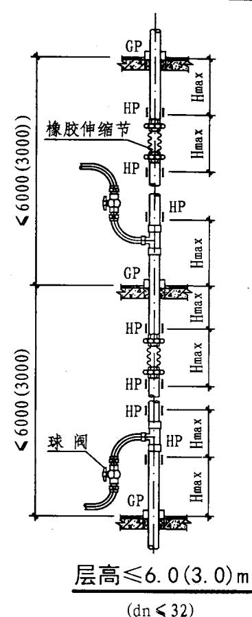

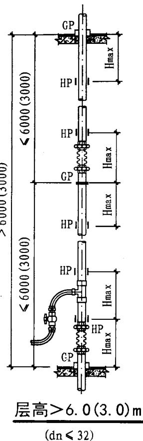

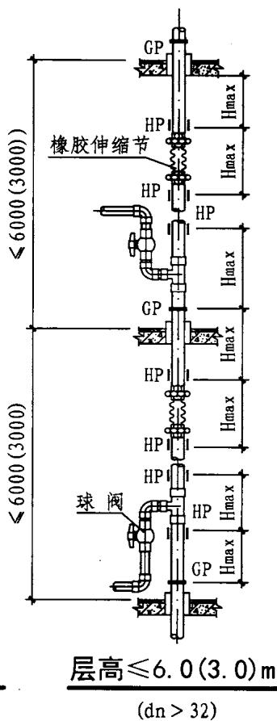

冷水管最大支承间距尺寸表（mm）

<table><tr><td rowspan="2">管材名称</td><td colspan="12">dn</td></tr><tr><td>16</td><td>20</td><td>25</td><td>32</td><td>40</td><td>50</td><td>63</td><td>75</td><td>90</td><td>110</td><td>125</td><td>160</td></tr><tr><td>PP-R</td><td>-</td><td>900</td><td>1000</td><td>1100</td><td>1300</td><td>1600</td><td>1800</td><td>2000</td><td>2200</td><td>2400</td><td>-</td><td>-</td></tr><tr><td>PE</td><td>-</td><td>850</td><td>980</td><td>1100</td><td>1300</td><td>1600</td><td>1800</td><td>2000</td><td>2200</td><td>2400</td><td>2600</td><td>2800</td></tr><tr><td>PE-X</td><td>850</td><td>850</td><td>980</td><td>1100</td><td>1300</td><td>1600</td><td>1800</td><td>-</td><td>-</td><td>-</td><td>-</td><td>-</td></tr><tr><td>PE-RT</td><td>850</td><td>850</td><td>980</td><td>1100</td><td>1300</td><td>1600</td><td>1800</td><td>2000</td><td>2200</td><td>2400</td><td>2600</td><td>2800</td></tr><tr><td>PB</td><td>700</td><td>700</td><td>800</td><td>900</td><td>1000</td><td>1100</td><td>1200</td><td>1350</td><td>1500</td><td>1800</td><td>-</td><td>-</td></tr></table>

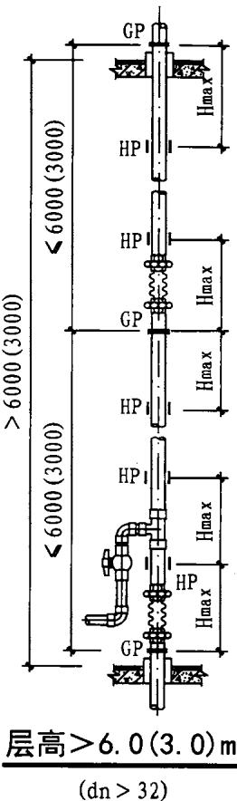

1. 在安装空间允许的条件下补偿方式宜优先采用自然补偿；无安装条件时宜采用多球橡胶伸缩节补偿器。

2. 补偿器规格与连接方式：多球橡胶伸缩节dn20\~63丝接，dn63\~110法兰连接。

3. 立管安装于外墙时，应采取避免管道受阳光直接照射的措施。

4. 管道伸缩节详见本图集第41、42页，管道支承详见11S405-4《建筑给水塑料管道安装通用详图》。

5. 括号内数字为热水用数据。

6. 图中GP、HP分别代表固定支承与滑动支承。

7. 给水立管最大支承间距Hmax详见下表。

8. 本图管道伸缩变形长度 $\Delta L$ 可根据本图集第7页总说明第7节公式进行计算，其中管段计算长度 $L: \text{冷水} \leqslant 6\mathrm{m}$ ，热水 $\leqslant 3\mathrm{m}$ 。

9. 最大支承间距PP-R管摘自《建筑给水聚丙烯管道工程技术规范》GB/T 50349-2005；PE、PE-X、PE-RT管摘自《建筑给水聚乙烯类管道工程技术规程》CJJ/T 98-2003；PB管摘自《建筑给水塑料管管道工程技术规程》报批稿(2012年)。

10. 表内最大支承间距，包括固定支架间距和滑动支架的间距。

12. 热水管道当采用轻质发泡材料保温时，支吊架最大间距应乘以修正系数0.80。

热水管最大支承间距尺寸表（mm）

<table><tr><td rowspan="2" colspan="3">管材名称</td><td colspan="12">dn</td></tr><tr><td>16</td><td>20</td><td>25</td><td>32</td><td>40</td><td>50</td><td>63</td><td>75</td><td>90</td><td>110</td><td>125</td><td>160</td></tr><tr><td colspan="3">PP-R、PB</td><td>400</td><td>400</td><td>450</td><td>520</td><td>650</td><td>780</td><td>910</td><td>1040</td><td>1700</td><td>1700</td><td>-</td><td>-</td></tr><tr><td colspan="3">PE-X</td><td>780</td><td>780</td><td>900</td><td>1050</td><td>1180</td><td>1300</td><td>1490</td><td>-</td><td>-</td><td>-</td><td>-</td><td>-</td></tr><tr><td colspan="3">PE-RT</td><td>780</td><td>780</td><td>900</td><td>1050</td><td>1180</td><td>1300</td><td>1490</td><td>1600</td><td>1750</td><td>1950</td><td>2050</td><td>2200</td></tr><tr><td colspan="11">立管安装</td><td colspan="2">图集号</td><td colspan="2">11S405-2</td></tr><tr><td>审核</td><td>肖睿书</td><td></td><td>校对</td><td>陈永青</td><td></td><td>设计</td><td>唐自威</td><td></td><td>唐自威</td><td></td><td colspan="2">页</td><td colspan="2">39</td></tr></table>

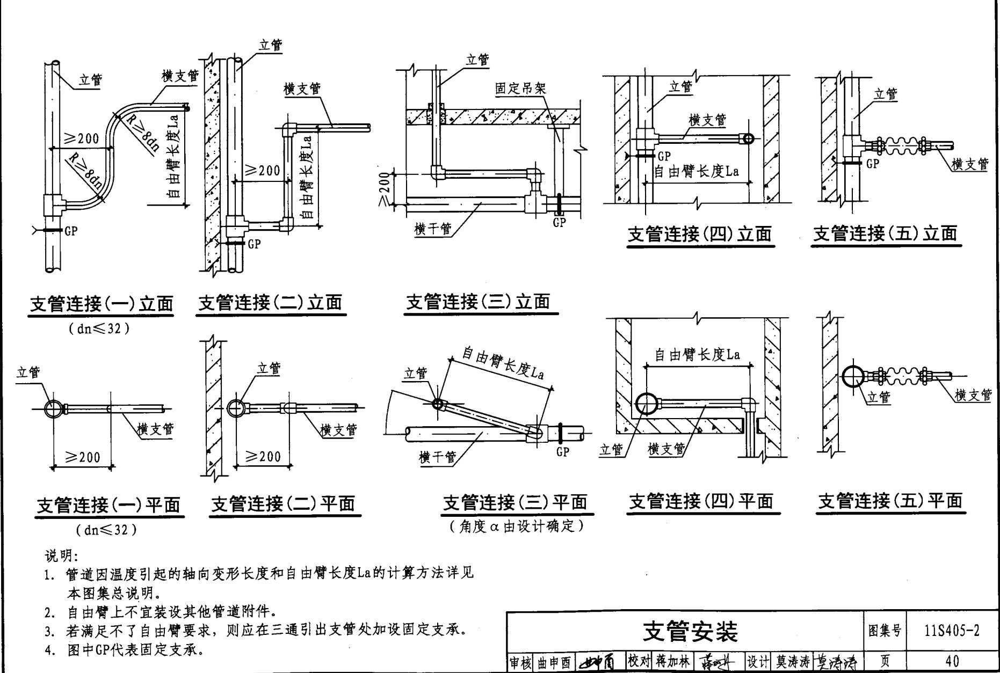  
3. 若满足不了自由臂要求，则应在三通引出支管处加设固定支承。

<table><tr><td colspan="9">支管安装</td><td>图集号</td><td>11S405-2</td></tr><tr><td>审核</td><td>曲申酉</td><td>曲申酉</td><td>校对</td><td>蒋加林</td><td>蒋加林</td><td>设计</td><td>莫涛涛</td><td>莫涛涛</td><td>页</td><td>40</td></tr></table>

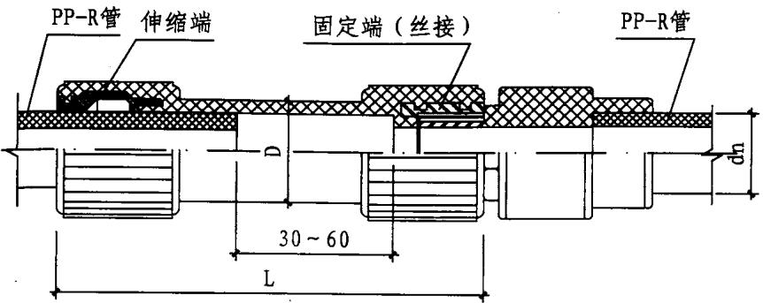  
dn20～63单向伸缩节

dn20～63单向伸缩节尺寸（mm）

<table><tr><td>dn</td><td>20</td><td>25</td><td>32</td><td>40</td><td>50</td><td>63</td></tr><tr><td>L</td><td>170</td><td>170</td><td>170</td><td>180</td><td>190</td><td>200</td></tr><tr><td>D</td><td>24.2</td><td>30.0</td><td>38.2</td><td>47.7</td><td>59.4</td><td>74.5</td></tr></table>

dn75～110单向伸缩节尺寸（mm）

<table><tr><td>dn</td><td>75</td><td>90</td><td>110</td></tr><tr><td>L</td><td>175</td><td>175</td><td>175</td></tr><tr><td>D</td><td>85.5</td><td>101.8</td><td>121.0</td></tr></table>

**说明：**

1. 本图适用于PP-R管道，按市售产品绘制。

2. 本图dn20\~63自耦合压力密封单向伸缩节采用PP-R材料制作，dn75\~110自耦合压力密封单向伸缩节采用H57铜制作。

3. 先将PP-R管从伸缩节承插端插入至伸缩节另一端底，然后再退出30\~60。

<table><tr><td colspan="9">单向伸缩节安装</td><td>图集号</td><td>11S405-2</td></tr><tr><td>审核</td><td>陈永青</td><td>陈永青</td><td>校对</td><td>肖睿书</td><td>肖睿书</td><td>设计</td><td>陈如融</td><td>陈如融</td><td>页</td><td>41</td></tr></table>

KDT多球橡胶伸缩节技术性能（活接头连接）(mm)

<table><tr><td>外径</td><td>公称直径</td><td>内螺纹</td><td colspan="2">产品长度</td><td colspan="2">轴向位移</td><td rowspan="2">横向位移</td></tr><tr><td>dn</td><td>DN</td><td>G</td><td> $L_1$ </td><td> $L_2$ </td><td>伸长</td><td>压缩</td></tr><tr><td>20</td><td>15</td><td>1/2&quot;</td><td>133</td><td>180</td><td>25</td><td>30</td><td>30</td></tr><tr><td>25</td><td>20</td><td>3/4&quot;</td><td>133</td><td>184</td><td>25</td><td>30</td><td>30</td></tr><tr><td>32</td><td>25</td><td>1&quot;</td><td>135</td><td>185</td><td>25</td><td>30</td><td>30</td></tr><tr><td>40</td><td>32</td><td> $1\frac{1}{4}"$ </td><td>146</td><td>206</td><td>28</td><td>35</td><td>35</td></tr><tr><td>50</td><td>40</td><td> $1\frac{1}{2}"$ </td><td>160</td><td>224</td><td>32</td><td>40</td><td>35</td></tr><tr><td>63</td><td>50</td><td>2&quot;</td><td>175</td><td>240</td><td>35</td><td>45</td><td>40</td></tr></table>

说明：  
1. 本图适用于PP-R、PE、PE-X、PE-RT、PB等管材。  
2. 多球橡胶伸缩节工作压力：1.0MPa；爆破压力：3.0MPa。  
3. 适用温度： $-10 \sim 105^{\circ}C$ 。  
4. 适用介质：冷热水、弱酸。

KDT多球橡胶伸缩节技术性能（法兰连接）(mm)

<table><tr><td>外径</td><td>公称直径</td><td>产品长度</td><td colspan="2">轴向位移</td><td rowspan="2">横向位移</td></tr><tr><td>dn</td><td>DN</td><td>L</td><td>伸长</td><td>压缩</td></tr><tr><td>63</td><td>50</td><td>175</td><td>40</td><td>55</td><td>40</td></tr><tr><td>75</td><td>65</td><td>200</td><td>45</td><td>65</td><td>40</td></tr><tr><td>90</td><td>80</td><td>252</td><td>55</td><td>85</td><td>45</td></tr><tr><td>110</td><td>100</td><td>285</td><td>60</td><td>95</td><td>50</td></tr><tr><td>160</td><td>150</td><td>303</td><td>60</td><td>100</td><td>50</td></tr></table>

<table><tr><td colspan="9">多球橡胶伸缩节安装</td><td>图集号</td><td>11S405-2</td></tr><tr><td>审核</td><td>肖睿书</td><td></td><td>校对</td><td>陈永青</td><td></td><td>设计</td><td>唐自威</td><td>唐自威</td><td>页</td><td>42</td></tr></table>

管托、保温结构详图  

尺寸表

<table><tr><td rowspan="2">dn</td><td colspan="2">冷水管</td><td colspan="2">热水管</td><td rowspan="2">t</td></tr><tr><td>L1</td><td>L2</td><td>L1</td><td>L2</td></tr><tr><td>20</td><td>810</td><td>1210</td><td>400</td><td>540</td><td>0.8</td></tr><tr><td>25</td><td>940</td><td>1350</td><td>470</td><td>600</td><td>0.8</td></tr><tr><td>32</td><td>1080</td><td>1480</td><td>540</td><td>700</td><td>0.8</td></tr><tr><td>40</td><td>1210</td><td>1750</td><td>670</td><td>870</td><td>0.8</td></tr><tr><td>50</td><td>1350</td><td>2160</td><td>810</td><td>1050</td><td>0.8</td></tr><tr><td>63</td><td>1480</td><td>2430</td><td>940</td><td>1220</td><td>0.8</td></tr><tr><td>75</td><td>1620</td><td>2700</td><td>1080</td><td>1400</td><td>1.0</td></tr><tr><td>90</td><td>1820</td><td>2970</td><td>1620</td><td>2100</td><td>1.0</td></tr><tr><td>110</td><td>2090</td><td>3240</td><td>1750</td><td>2290</td><td>1.0</td></tr></table>

说明：

1. 本图适用于PP-R管。

2. 图中GP为固定支架的代号。

3. 管托应由管材厂家配套供货。

4. 本图根据《建筑给水聚丙烯管道工程技术规范》GB/T 50349-2005 和上海白蝶管业科技股份有限公司提供的技术资料编制。

<table><tr><td colspan="9">热水管托、支架布置</td><td>图集号</td><td>11S405-2</td></tr><tr><td>审核</td><td>曲申酉</td><td></td><td>校对</td><td>蒋加林</td><td></td><td>设计</td><td>莫涛涛</td><td>莫涛涛</td><td>页</td><td>43</td></tr></table>

  
直接头

<table><tr><td>dn</td><td>z</td><td>L</td></tr><tr><td>20</td><td>5</td><td>34</td></tr><tr><td>25</td><td>5</td><td>37</td></tr><tr><td>32</td><td>5</td><td>41</td></tr><tr><td>40</td><td>5</td><td>46</td></tr><tr><td>50</td><td>5</td><td>52</td></tr><tr><td>63</td><td>5</td><td>60</td></tr><tr><td>75</td><td>5</td><td>66</td></tr><tr><td>90</td><td>5</td><td>76</td></tr><tr><td>110</td><td>5</td><td>88</td></tr></table>

  
$90^{\circ}$ 弯头

<table><tr><td>dn</td><td>Z</td><td>L</td></tr><tr><td>20</td><td>12</td><td>28</td></tr><tr><td>25</td><td>14</td><td>32</td></tr><tr><td>32</td><td>18</td><td>36</td></tr><tr><td>40</td><td>22</td><td>44</td></tr><tr><td>50</td><td>26</td><td>52</td></tr><tr><td>63</td><td>33</td><td>62</td></tr><tr><td>75</td><td>38.5</td><td>75</td></tr><tr><td>90</td><td>48.5</td><td>84</td></tr><tr><td>110</td><td>57.5</td><td>99</td></tr></table>

<table><tr><td> $dn_1 \times dn_2$ </td><td>Z</td><td>L</td><td> $dn_1 \times dn_2$ </td><td>Z</td><td>L</td></tr><tr><td>25 × 20</td><td>7</td><td>38</td><td>63 × 32</td><td>33</td><td>79</td></tr><tr><td>32 × 20</td><td>10</td><td>43</td><td>63 × 40</td><td>21</td><td>69</td></tr><tr><td>32 × 25</td><td>9</td><td>43.5</td><td>63 × 50</td><td>17.5</td><td>68.5</td></tr><tr><td>40 × 20</td><td>8</td><td>43</td><td>75 × 32</td><td>36</td><td>85.6</td></tr><tr><td>40 × 25</td><td>13.5</td><td>50</td><td>75 × 40</td><td>39</td><td>90.8</td></tr><tr><td>40 × 32</td><td>11</td><td>50</td><td>75 × 50</td><td>19</td><td>73.5</td></tr><tr><td>50 × 20</td><td>23</td><td>61</td><td>75 × 63</td><td>14</td><td>72.5</td></tr><tr><td>50 × 25</td><td>20</td><td>59.5</td><td>90 × 63</td><td>21</td><td>84</td></tr><tr><td>50 × 32</td><td>17</td><td>59.1</td><td>90 × 75</td><td>14.5</td><td>81</td></tr><tr><td>50 × 40</td><td>10</td><td>54.6</td><td>110 × 75</td><td>27</td><td>99.5</td></tr><tr><td>63 × 20</td><td>34</td><td>76</td><td>110 × 90</td><td>18</td><td>95</td></tr><tr><td>63 × 25</td><td>32</td><td>75.7</td><td>-</td><td>-</td><td>-</td></tr></table>

  
异径直接

$45^{\circ}$ 弯头

<table><tr><td>dn</td><td>Z</td><td>L</td></tr><tr><td>20</td><td>8</td><td>14.5</td></tr><tr><td>25</td><td>8</td><td>16</td></tr><tr><td>32</td><td>8</td><td>18</td></tr><tr><td>40</td><td>10.6</td><td>20.5</td></tr><tr><td>50</td><td>15.0</td><td>23.5</td></tr><tr><td>63</td><td>21.1</td><td>27.5</td></tr><tr><td>75</td><td>16.5</td><td>31</td></tr><tr><td>90</td><td>19.5</td><td>35.5</td></tr><tr><td>110</td><td>24</td><td>41.5</td></tr></table>

<table><tr><td rowspan="2">说明:本图根据成都川路塑胶集团有限公司提供的技术资料编制。</td><td colspan="9">PP-R管件(一)</td><td>图集号</td><td>11S405-2</td></tr><tr><td>审核</td><td>曲申酉</td><td>曲申酉</td><td>校对</td><td>蒋加林</td><td>蒋加林</td><td>设计</td><td>覃火坤</td><td>覃火坤</td><td>页</td><td>44</td></tr></table>

  
异径弯头

<table><tr><td>dn1×dn2</td><td>Z1</td><td>L1</td><td>Z2</td><td>L2</td></tr><tr><td>25×20</td><td>12.5</td><td>28.5</td><td>15</td><td>29.5</td></tr><tr><td>32×20</td><td>12.5</td><td>30.6</td><td>18</td><td>32.5</td></tr><tr><td>32×25</td><td>14.5</td><td>32.6</td><td>18</td><td>34</td></tr><tr><td>40×20</td><td>13.5</td><td>34</td><td>22.5</td><td>37</td></tr><tr><td>40×25</td><td>16</td><td>36.5</td><td>22.5</td><td>38.5</td></tr><tr><td>40×32</td><td>19.5</td><td>40</td><td>22.5</td><td>40.6</td></tr></table>

  
正三通

<table><tr><td>dn</td><td>Z</td><td>L</td></tr><tr><td>20</td><td>12</td><td>28</td></tr><tr><td>25</td><td>14</td><td>32</td></tr><tr><td>32</td><td>18</td><td>36</td></tr><tr><td>40</td><td>22</td><td>44</td></tr><tr><td>50</td><td>26</td><td>52</td></tr><tr><td>63</td><td>33</td><td>62</td></tr><tr><td>75</td><td>38</td><td>69.5</td></tr><tr><td>90</td><td>47.5</td><td>83</td></tr><tr><td>110</td><td>55</td><td>101</td></tr></table>

  
异径三通

<table><tr><td>dn1×dn2</td><td>Z1</td><td>L1</td><td>Z2</td><td>L2</td><td rowspan="10"></td><td>dn1×dn2</td><td>Z1</td><td>L1</td><td>Z2</td><td>L2</td><td rowspan="10"></td><td>dn1×dn2</td><td>Z1</td><td>L1</td><td>Z2</td><td>L2</td></tr><tr><td>25×20</td><td>13</td><td>29</td><td>15.5</td><td>30</td><td>50×40</td><td>22.5</td><td>46</td><td>27.5</td><td>48</td><td>75×50</td><td>28</td><td>59</td><td>41</td><td>64.5</td></tr><tr><td>32×20</td><td>13</td><td>31.1</td><td>19</td><td>33.5</td><td>63×20</td><td>14.4</td><td>41.9</td><td>34</td><td>48.5</td><td>75×63</td><td>34</td><td>65</td><td>40.5</td><td>68</td></tr><tr><td>32×25</td><td>15.5</td><td>33.6</td><td>19</td><td>35</td><td>63×25</td><td>15</td><td>42.5</td><td>34</td><td>50</td><td>90×63</td><td>35.5</td><td>70.5</td><td>48</td><td>75.5</td></tr><tr><td>40×20</td><td>15.5</td><td>36</td><td>23</td><td>37.5</td><td>63×32</td><td>18.5</td><td>46</td><td>34</td><td>52.1</td><td>110×50</td><td>27</td><td>69</td><td>57</td><td>80.5</td></tr><tr><td>40×25</td><td>15.5</td><td>36</td><td>23</td><td>39</td><td>63×40</td><td>23</td><td>50.5</td><td>35</td><td>55.5</td><td>110×63</td><td>34</td><td>75.5</td><td>57</td><td>84.5</td></tr><tr><td>40×32</td><td>19</td><td>39.5</td><td>23</td><td>41.1</td><td>63×50</td><td>27.5</td><td>55</td><td>34</td><td>57.5</td><td>110×75</td><td>40</td><td>81.5</td><td>57</td><td>88</td></tr><tr><td>50×20</td><td>15.5</td><td>39</td><td>28</td><td>42.5</td><td>75×20</td><td>17.3</td><td>45.5</td><td>36.4</td><td>50.9</td><td rowspan="3">110×90</td><td rowspan="3">47.5</td><td rowspan="3">89</td><td rowspan="3">57</td><td rowspan="3">92.5</td></tr><tr><td>50×25</td><td>15.5</td><td>39</td><td>28</td><td>44</td><td>75×25</td><td>17.3</td><td>48</td><td>36.4</td><td>54.5</td></tr><tr><td>50×32</td><td>19</td><td>42.5</td><td>28</td><td>46.1</td><td>75×40</td><td>22.5</td><td>53.5</td><td>40.5</td><td>61</td></tr></table>

<table><tr><td rowspan="2">说明:本图根据成都川路塑胶集团有限公司提供的技术资料编制。</td><td colspan="9">PP-R管件(二)</td><td>图集号</td><td>11S405-2</td></tr><tr><td>审核</td><td>曲申酉</td><td>曲申酉</td><td>校对</td><td>蒋加林</td><td>蒋加林</td><td>设计</td><td>覃火坤</td><td>覃火坤</td><td>页</td><td>45</td></tr></table>

<table><tr><td rowspan="4">四通</td><td>dn</td><td>L</td><td rowspan="4" colspan="6">管帽</td><td rowspan="4" colspan="4">管堵</td><td></td></tr><tr><td>20</td><td>25.5</td><td></td></tr><tr><td>25</td><td>29.5</td><td></td></tr><tr><td>32</td><td>35.0</td><td></td></tr><tr><td rowspan="3">过桥弯</td><td>dn</td><td>L</td><td>H</td><td rowspan="3" colspan="9">法兰连接件</td><td></td></tr><tr><td>20</td><td>98</td><td>14.5</td><td></td></tr><tr><td>25</td><td>98</td><td>16</td><td></td></tr><tr><td rowspan="2" colspan="4">说明:本图根据成都川路塑胶集团有限公司提供的技术资料编制。</td><td colspan="7">PP-R管件(三)</td><td>图集号</td><td>11S405-2</td><td></td></tr><tr><td>审核</td><td>曲申酉</td><td>曲仲辰</td><td>校对</td><td>蒋加林</td><td>蒋加林</td><td>设计</td><td>覃火坤</td><td>页</td><td>46</td></tr></table>

<table><tr><td>dn × G</td><td>Z</td><td>L</td></tr><tr><td>20 × 1/2&quot;</td><td>25</td><td>39.5</td></tr><tr><td>20 × 3/4&quot;</td><td>27</td><td>41.7</td></tr><tr><td>25 × 1/2&quot;</td><td>26</td><td>42</td></tr><tr><td>25 × 3/4&quot;</td><td>26.5</td><td>42.6</td></tr><tr><td>32 × 3/4&quot;</td><td>27.5</td><td>45.8</td></tr><tr><td>32 × 1&quot;</td><td>26.4</td><td>44.5</td></tr></table>

内丝直通

<table><tr><td>dn × G</td><td>Z</td><td>L</td><td> $Z_{2}$ </td><td> $L_{2}$ </td></tr><tr><td>20 ×1/2&quot;</td><td>18</td><td>16</td><td>24</td><td>12</td></tr><tr><td>20 ×3/4&quot;</td><td>18</td><td>16</td><td>24</td><td>12</td></tr><tr><td>25 ×1/2&quot;</td><td>18</td><td>18</td><td>24</td><td>12</td></tr><tr><td>25 ×3/4&quot;</td><td>21</td><td>18</td><td>24</td><td>12</td></tr><tr><td>32 ×3/4&quot;</td><td>14</td><td>18</td><td>26</td><td>17</td></tr><tr><td>32 ×1&quot;</td><td>28</td><td>20</td><td>28</td><td>16</td></tr><tr><td>40 ×8/2&quot;</td><td>55.5</td><td>20.5</td><td>43.5</td><td>20</td></tr></table>

$90^{\circ}$ 内丝弯头

  
外丝直通

<table><tr><td>dn × G</td><td>Z</td><td>L</td></tr><tr><td>20 × 1/2&quot;</td><td>39</td><td>53.5</td></tr><tr><td>20 × 3/4&quot;</td><td>39.3</td><td>54</td></tr><tr><td>25 × 1/2&quot;</td><td>40</td><td>56.2</td></tr><tr><td>25 × 3/4&quot;</td><td>42</td><td>58</td></tr><tr><td>32 × 3/4&quot;</td><td>43</td><td>61.3</td></tr><tr><td>32 × 1&quot;</td><td>42.2</td><td>60.5</td></tr></table>

  
$90^{\circ}$ 外丝弯头

<table><tr><td>dn × G</td><td>Z1</td><td>L1</td><td>Z2</td><td>L2</td></tr><tr><td>20 × 1/2&quot;</td><td>18</td><td>16</td><td>36</td><td>12</td></tr><tr><td>20 × 3/4&quot;</td><td>18</td><td>16</td><td>36</td><td>14</td></tr><tr><td>25 × 1/2&quot;</td><td>22.5</td><td>16</td><td>36</td><td>15</td></tr><tr><td>25 × 3/4&quot;</td><td>22.5</td><td>18</td><td>36</td><td>15</td></tr><tr><td>32 × 3/4&quot;</td><td>21</td><td>20</td><td>36</td><td>14</td></tr><tr><td>32 × 1&quot;</td><td>28</td><td>20</td><td>46</td><td>16</td></tr></table>

<table><tr><td rowspan="2">说明:本图根据成都川路塑胶集团有限公司提供的技术资料编制。</td><td colspan="9">PP-R管件(四)</td><td>图集号</td><td>11S405-2</td></tr><tr><td>审核</td><td>曲申酉</td><td>曲申酉</td><td>校对</td><td>蒋加林</td><td>蒋加林</td><td>设计</td><td>覃火坤</td><td>覃火坤</td><td>页</td><td>47</td></tr></table>

  
内丝三通

<table><tr><td>dn×G</td><td>Z1</td><td>L1</td><td>Z2</td><td>L2</td></tr><tr><td>20×1/2&quot;</td><td>12</td><td>15</td><td>24</td><td>12</td></tr><tr><td>20×3/4&quot;</td><td>12</td><td>15</td><td>24</td><td>12</td></tr><tr><td>25×1/2&quot;</td><td>18</td><td>19</td><td>24</td><td>12</td></tr><tr><td>25×3/4&quot;</td><td>18</td><td>19</td><td>24</td><td>12</td></tr><tr><td>32×3/4&quot;</td><td>17</td><td>20</td><td>28</td><td>16</td></tr><tr><td>32×1&quot;</td><td>17</td><td>20</td><td>28</td><td>16</td></tr></table>

  
外丝三通

<table><tr><td>dn×G</td><td>Z1</td><td>L1</td><td>Z2</td><td>L2</td></tr><tr><td>20×1/2&quot;</td><td>12</td><td>15</td><td>36</td><td>12</td></tr><tr><td>20×3/4&quot;</td><td>12</td><td>15</td><td>36</td><td>14</td></tr><tr><td>25×1/2&quot;</td><td>13</td><td>16</td><td>36</td><td>15</td></tr><tr><td>25×3/4&quot;</td><td>13</td><td>16</td><td>36</td><td>15</td></tr><tr><td>32×1&quot;</td><td>17</td><td>18</td><td>45</td><td>16</td></tr><tr><td>40×1&quot;</td><td>21</td><td>20.5</td><td>41.5</td><td>15</td></tr><tr><td>50×1&quot;</td><td>21</td><td>23.5</td><td>47</td><td>15</td></tr></table>

  
金属外螺纹活接头

<table><tr><td>dn × G</td><td>Z</td><td>L</td></tr><tr><td>20 × 1/2&quot;</td><td>36</td><td>50.5</td></tr><tr><td>20 × 3/4&quot;</td><td>41.5</td><td>56</td></tr><tr><td>25 × 3/4&quot;</td><td>39.5</td><td>55.5</td></tr><tr><td>25 × 1&quot;</td><td>45</td><td>61.5</td></tr><tr><td>32 × 1&quot;</td><td>43.2</td><td>61.5</td></tr></table>

  
金属内螺纹活接头

<table><tr><td>dn × G</td><td>Z</td><td>L</td></tr><tr><td>20 ×1/2&quot;</td><td>22.5</td><td>37</td></tr><tr><td>20 ×3/4&quot;</td><td>31</td><td>45.5</td></tr><tr><td>25 ×1&quot;</td><td>29</td><td>45</td></tr><tr><td>25 ×3/4&quot;</td><td>32</td><td>48</td></tr><tr><td>32 ×1&quot;</td><td>29.5</td><td>48</td></tr></table>

<table><tr><td rowspan="10">外螺纹直通</td><td rowspan="10">dn×G</td><td rowspan="10">Z</td><td rowspan="10">L</td><td rowspan="10">管卡</td><td colspan="2">dn</td><td></td></tr><tr><td colspan="2">20</td><td></td></tr><tr><td colspan="2">25</td><td></td></tr><tr><td colspan="2">32</td><td></td></tr><tr><td colspan="2">40</td><td></td></tr><tr><td colspan="2">50</td><td></td></tr><tr><td colspan="2">63</td><td></td></tr><tr><td colspan="2">75</td><td></td></tr><tr><td colspan="2">90</td><td></td></tr><tr><td colspan="2">110</td><td></td></tr><tr><td rowspan="5">内丝直通</td><td rowspan="5">dn×G</td><td rowspan="5">Z</td><td rowspan="5">L</td><td rowspan="5">绕曲管</td><td>dn</td><td>L</td><td></td></tr><tr><td>20</td><td>315</td><td></td></tr><tr><td>25</td><td>315</td><td></td></tr><tr><td>32</td><td>315</td><td></td></tr><tr><td></td><td></td><td></td></tr><tr><td rowspan="2" colspan="4">说明:本图根据成都川路塑胶集团有限公司提供的技术资料编制。</td><td colspan="2">PP-R管件(六)</td><td>图集号</td><td>11S405-2</td></tr><tr><td>审核</td><td>曲申酉</td><td>校对</td><td>蒋加林</td></tr></table>

  
承插等径直通

<table><tr><td>公称直径 dn</td><td>L1</td><td>L</td><td>z</td></tr><tr><td>20</td><td>16.5</td><td>37</td><td>4</td></tr><tr><td>25</td><td>18.0</td><td>40</td><td>4</td></tr><tr><td>32</td><td>20.5</td><td>45</td><td>4</td></tr><tr><td>40</td><td>22.5</td><td>50</td><td>5</td></tr><tr><td>50</td><td>25.5</td><td>56</td><td>5</td></tr><tr><td>63</td><td>29.5</td><td>65</td><td>6</td></tr><tr><td>75</td><td>33.0</td><td>72</td><td>6</td></tr><tr><td>90</td><td>36.0</td><td>78</td><td>6</td></tr><tr><td>110</td><td>42.0</td><td>90</td><td>6</td></tr></table>

  
$90^{\circ}$ 承插等径弯头

<table><tr><td>公称直径 dn</td><td>Z</td><td>L</td></tr><tr><td>20</td><td>33</td><td>16.5</td></tr><tr><td>25</td><td>37</td><td>18.0</td></tr><tr><td>32</td><td>43</td><td>20.5</td></tr><tr><td>40</td><td>48</td><td>22.5</td></tr><tr><td>50</td><td>61</td><td>25.5</td></tr><tr><td>63</td><td>69</td><td>29.5</td></tr></table>

  
承插异径套

<table><tr><td>公称直径dn1×dn2</td><td>L1</td><td>L2</td><td>L</td></tr><tr><td>25×20</td><td>16.5</td><td>18</td><td>45</td></tr><tr><td>32×20</td><td>16.5</td><td>20.5</td><td>56</td></tr><tr><td>32×25</td><td>18</td><td>20.5</td><td>52</td></tr><tr><td>40×20</td><td>16.5</td><td>22.5</td><td>63</td></tr><tr><td>40×25</td><td>18</td><td>22.5</td><td>61</td></tr><tr><td>40×32</td><td>20.5</td><td>22.5</td><td>54</td></tr><tr><td>50×20</td><td>16.5</td><td>25.5</td><td>68</td></tr><tr><td>50×25</td><td>18</td><td>25.5</td><td>67</td></tr><tr><td>50×32</td><td>20.5</td><td>25.5</td><td>67</td></tr><tr><td>50×40</td><td>22.5</td><td>25.5</td><td>62</td></tr><tr><td>63×25</td><td>18</td><td>29.5</td><td>82</td></tr><tr><td>63×32</td><td>20.5</td><td>29.5</td><td>84</td></tr><tr><td>63×40</td><td>22.5</td><td>29.5</td><td>82</td></tr><tr><td>63×50</td><td>25.5</td><td>29.5</td><td>71</td></tr></table>

  
$45^{\circ}$ 承插等径弯头

<table><tr><td>公称直径 dn</td><td>L1</td><td>L2</td></tr><tr><td>20</td><td>16.5</td><td>24</td></tr><tr><td>25</td><td>18</td><td>27</td></tr><tr><td>32</td><td>20.5</td><td>32</td></tr><tr><td>40</td><td>22.5</td><td>35</td></tr><tr><td>50</td><td>25.5</td><td>41</td></tr><tr><td>63</td><td>29.5</td><td>48</td></tr></table>

  
$90^{\circ}$ 承插等径三通

<table><tr><td>公称直径dn</td><td>L1</td><td>L</td><td>Z</td></tr><tr><td>20</td><td>16.5</td><td>64</td><td>32</td></tr><tr><td>25</td><td>18.0</td><td>72</td><td>36</td></tr><tr><td>32</td><td>20.0</td><td>86</td><td>43</td></tr><tr><td>40</td><td>22.5</td><td>96</td><td>48</td></tr><tr><td>50</td><td>25.5</td><td>114</td><td>57</td></tr><tr><td>63</td><td>29.5</td><td>142</td><td>71</td></tr></table>

  
$90^{\circ}$ 对接等径三通

<table><tr><td>公称直径dn</td><td>L1</td><td>Z</td><td>L</td></tr><tr><td>75</td><td>75</td><td>132</td><td>264</td></tr><tr><td>90</td><td>85</td><td>150</td><td>300</td></tr><tr><td>110</td><td>87</td><td>163</td><td>326</td></tr><tr><td>125</td><td>87</td><td>170.5</td><td>341</td></tr><tr><td>160</td><td>100</td><td>210</td><td>400</td></tr></table>

  
$90^{\circ}$ 承插异径三通

<table><tr><td>公称直径dn1×dn2</td><td>L1</td><td>L2</td><td>L</td><td>Z</td></tr><tr><td>25×20</td><td>18</td><td>16.5</td><td>66</td><td>34</td></tr><tr><td>32×20</td><td>20.5</td><td>16.5</td><td>72</td><td>38</td></tr><tr><td>32×25</td><td>20.5</td><td>18</td><td>77</td><td>40</td></tr><tr><td>40×20</td><td>22.5</td><td>16.5</td><td>78</td><td>42</td></tr><tr><td>40×25</td><td>22.5</td><td>18</td><td>83</td><td>44</td></tr><tr><td>40×32</td><td>22.5</td><td>20.5</td><td>90</td><td>46</td></tr><tr><td>50×20</td><td>25.5</td><td>16.5</td><td>86</td><td>47</td></tr><tr><td>50×25</td><td>25.5</td><td>18</td><td>91</td><td>49</td></tr><tr><td>50×32</td><td>25.5</td><td>20.5</td><td>98</td><td>51</td></tr><tr><td>50×40</td><td>25.5</td><td>22.5</td><td>104</td><td>53</td></tr><tr><td>63×25</td><td>29.5</td><td>18</td><td>101</td><td>55</td></tr><tr><td>63×32</td><td>29.5</td><td>20.5</td><td>108</td><td>57</td></tr><tr><td>63×40</td><td>29.5</td><td>22.5</td><td>112</td><td>59</td></tr><tr><td>63×50</td><td>29.5</td><td>25.5</td><td>122</td><td>62</td></tr></table>

  
$90^{\circ}$ 对接等径弯头

<table><tr><td>公称直径dn</td><td>Z</td><td>L</td></tr><tr><td>75</td><td>132</td><td>75</td></tr><tr><td>90</td><td>150</td><td>85</td></tr><tr><td>110</td><td>163</td><td>87</td></tr><tr><td>125</td><td>170.5</td><td>87</td></tr><tr><td>160</td><td>200</td><td>100</td></tr></table>

<table><tr><td rowspan="2">说明:本图根据广东联塑科技实业有限公司提供的技术资料编制。</td><td colspan="9">PE管件(二)</td><td>图集号</td><td>11S405-2</td></tr><tr><td>审核</td><td>曲申酉</td><td>曲申酉</td><td>校对</td><td>蒋加林</td><td>蒋加林</td><td>设计</td><td>莫涛涛</td><td>莫涛涛</td><td>页</td><td>51</td></tr></table>

<table><tr><td rowspan="12">对接异径套</td><td>公称直径dn1×dn2</td><td>L1</td><td>L2</td><td>L</td></tr><tr><td>75×63</td><td>70</td><td>75</td><td>156</td></tr><tr><td>90×63</td><td>70</td><td>80</td><td>178</td></tr><tr><td>90×75</td><td>70</td><td>80</td><td>164</td></tr><tr><td>110×63</td><td>70</td><td>80</td><td>196</td></tr><tr><td>110×75</td><td>70</td><td>80</td><td>184</td></tr><tr><td>110×90</td><td>70</td><td>80</td><td>169</td></tr><tr><td>125×63</td><td>70</td><td>80</td><td>200</td></tr><tr><td>125×110</td><td>80</td><td>80</td><td>178</td></tr><tr><td>160×90</td><td>80</td><td>90</td><td>242</td></tr><tr><td>160×110</td><td>80</td><td>100</td><td>228</td></tr><tr><td>160×125</td><td>80</td><td>80</td><td>195</td></tr><tr><td colspan="5"></td></tr></table>

焊接60°等径斜三通

<table><tr><td>公称直径D</td><td>L1</td><td>L</td></tr><tr><td>110</td><td>325</td><td>410</td></tr><tr><td>125</td><td>355</td><td>545</td></tr><tr><td>160</td><td>412</td><td>642</td></tr></table>

<table><tr><td>公称直径 dn</td><td>L1</td><td>L2</td><td>L</td></tr><tr><td>110</td><td>150</td><td>205</td><td>410</td></tr><tr><td>125</td><td>150</td><td>215</td><td>430</td></tr><tr><td>160</td><td>150</td><td>230</td><td>460</td></tr></table>

焊接90°等径三通  

焊接45°等径斜三通

<table><tr><td>公称直径 D</td><td>L1</td><td>L</td></tr><tr><td>110</td><td>325</td><td>410</td></tr><tr><td>125</td><td>410</td><td>600</td></tr><tr><td>160</td><td>412</td><td>642</td></tr></table>

<table><tr><td>公称直径 dn</td><td>L1</td><td>L2</td></tr><tr><td>110</td><td>120</td><td>131</td></tr><tr><td>125</td><td>160</td><td>176</td></tr><tr><td>160</td><td>160</td><td>176</td></tr></table>

焊接22.5°弯头

<table><tr><td>公称直径dn</td><td>L1</td><td>L2</td><td>L</td></tr><tr><td>110</td><td>150</td><td>205</td><td>410</td></tr><tr><td>125</td><td>150</td><td>215</td><td>430</td></tr><tr><td>160</td><td>150</td><td>230</td><td>460</td></tr></table>

焊接90° 等径四通

<table><tr><td colspan="9">PE管件(四)</td><td>图集号</td><td>11S405-2</td></tr><tr><td>审核</td><td>曲申酉</td><td>曲申酉</td><td>校对</td><td>蒋加林</td><td>蒋加林</td><td>设计</td><td>莫涛涛</td><td>莫涛涛</td><td>页</td><td>53</td></tr></table>

说明：本图根据广东联塑科技实业有限公司提供的技术资料编制。  

<table><tr><td>公称直径dn</td><td>L1</td><td>L</td><td>D1</td></tr><tr><td>75</td><td>16</td><td>125</td><td>122</td></tr><tr><td>90</td><td>17</td><td>140</td><td>138</td></tr><tr><td>110</td><td>18</td><td>160</td><td>158</td></tr><tr><td>125</td><td>18</td><td>160</td><td>163</td></tr><tr><td>160</td><td>25</td><td>180</td><td>212</td></tr></table>

对接法兰

<table><tr><td>公称直径dn×Rp</td><td>L1</td><td>L2</td><td>H1</td><td>H2</td></tr><tr><td>20×1/2&quot;</td><td>16.5</td><td>17.5</td><td>30</td><td>36</td></tr><tr><td>20×3/4&quot;</td><td>16.5</td><td>17.5</td><td>33</td><td>36</td></tr><tr><td>25×1/2&quot;</td><td>18</td><td>17.5</td><td>33</td><td>38</td></tr><tr><td>25×3/4&quot;</td><td>18</td><td>17.5</td><td>35</td><td>38</td></tr><tr><td>32×1/2&quot;</td><td>20.5</td><td>17.5</td><td>35</td><td>42</td></tr><tr><td>32×3/4&quot;</td><td>20.5</td><td>17.5</td><td>38</td><td>42</td></tr><tr><td>32×1&quot;</td><td>20.5</td><td>23</td><td>40.5</td><td>53</td></tr></table>

内螺纹弯头

法兰盘(钢)  

<table><tr><td>公称直径dn</td><td>D1</td><td>d</td><td>N</td><td>L</td></tr><tr><td>75</td><td>145</td><td>18</td><td>4</td><td>18</td></tr><tr><td>90</td><td>160</td><td>18</td><td>8</td><td>20</td></tr><tr><td>110</td><td>180</td><td>18</td><td>8</td><td>22</td></tr><tr><td>125</td><td>180</td><td>18</td><td>8</td><td>22</td></tr><tr><td>160</td><td>240</td><td>22</td><td>8</td><td>24</td></tr></table>

<table><tr><td>公称直径dn×R</td><td>L1</td><td>L2</td><td>H1</td><td>H2</td></tr><tr><td>20×1/2&quot;</td><td>16.5</td><td>14</td><td>30</td><td>50</td></tr><tr><td>20×3/4&quot;</td><td>16.5</td><td>14</td><td>33</td><td>50</td></tr><tr><td>25×1/2&quot;</td><td>18</td><td>14</td><td>33</td><td>52</td></tr><tr><td>25×3/4&quot;</td><td>18</td><td>14</td><td>35</td><td>52</td></tr><tr><td>32×1/2&quot;</td><td>20.5</td><td>14</td><td>35</td><td>56</td></tr><tr><td>32×3/4&quot;</td><td>20.5</td><td>14</td><td>38</td><td>56</td></tr><tr><td>32×1&quot;</td><td>20.5</td><td>19</td><td>40.5</td><td>72</td></tr></table>

外螺纹弯头

<table><tr><td colspan="9">PE管件(五)</td><td>图集号</td><td>11S405-2</td></tr><tr><td>审核</td><td>曲申酉</td><td>曲申酉</td><td>校对</td><td>蒋加林</td><td>蒋加林</td><td>设计</td><td>莫涛涛</td><td>莫涛涛</td><td>页</td><td>54</td></tr></table>

  
内螺纹直接头

<table><tr><td>公称直径dn×Rp</td><td>L1</td><td>L2</td><td>L</td></tr><tr><td>20×1/2&quot;</td><td>16.5</td><td>17.5</td><td>42</td></tr><tr><td>20×3/4&quot;</td><td>16.5</td><td>17.5</td><td>42</td></tr><tr><td>25×1/2&quot;</td><td>18</td><td>17.5</td><td>44.5</td></tr><tr><td>25×3/4&quot;</td><td>18</td><td>17.5</td><td>45</td></tr><tr><td>32×1/2&quot;</td><td>20.5</td><td>17.5</td><td>47</td></tr><tr><td>32×3/4&quot;</td><td>20.5</td><td>17.5</td><td>47</td></tr><tr><td>32×1&quot;</td><td>20.5</td><td>23</td><td>59</td></tr><tr><td>40×1&quot;</td><td>22.5</td><td>23</td><td>60</td></tr><tr><td>40×5/4&quot;</td><td>22.5</td><td>23</td><td>64</td></tr><tr><td>50×5/4&quot;</td><td>25.5</td><td>23</td><td>66</td></tr><tr><td>50×2/3&quot;</td><td>25.5</td><td>23</td><td>68.5</td></tr><tr><td>63×2&quot;</td><td>29.5</td><td>25</td><td>77</td></tr></table>

  
外螺纹直接头

<table><tr><td>公称直径dn×R</td><td>L1</td><td>L2</td><td>L</td></tr><tr><td>20×1/2&quot;</td><td>16.5</td><td>14</td><td>56</td></tr><tr><td>20×3/4&quot;</td><td>16.5</td><td>14</td><td>56</td></tr><tr><td>25×1/2&quot;</td><td>18</td><td>14</td><td>58.5</td></tr><tr><td>25×3/4&quot;</td><td>18</td><td>14</td><td>59</td></tr><tr><td>32×1/2&quot;</td><td>20.5</td><td>14</td><td>61</td></tr><tr><td>32×3/4&quot;</td><td>20.5</td><td>14</td><td>61</td></tr><tr><td>32×1&quot;</td><td>20.5</td><td>19</td><td>78</td></tr><tr><td>40×1&quot;</td><td>22.5</td><td>19</td><td>79</td></tr><tr><td>40×5/4&quot;</td><td>22.5</td><td>21</td><td>85</td></tr><tr><td>50×5/4&quot;</td><td>25.5</td><td>21</td><td>87</td></tr><tr><td>50×3/2&quot;</td><td>25.5</td><td>21</td><td>89.5</td></tr><tr><td>63×2&quot;</td><td>29.5</td><td>24</td><td>102</td></tr></table>

<table><tr><td>公称直径dn×Rp</td><td>L1</td><td>L2</td><td>L</td><td>Z</td></tr><tr><td>20×1/2&quot;</td><td>16.5</td><td>14</td><td>60</td><td>50</td></tr><tr><td>20×3/4&quot;</td><td>16.5</td><td>14</td><td>66</td><td>50</td></tr><tr><td>25×1/2&quot;</td><td>18</td><td>14</td><td>66</td><td>52</td></tr><tr><td>25×3/4&quot;</td><td>18</td><td>14</td><td>70</td><td>52</td></tr><tr><td>32×1/2&quot;</td><td>20.5</td><td>14</td><td>70</td><td>56</td></tr><tr><td>32×3/4&quot;</td><td>20.5</td><td>14</td><td>76</td><td>56</td></tr><tr><td>32×1&quot;</td><td>20.5</td><td>19</td><td>81</td><td>72</td></tr></table>

外螺纹三通

  
内螺纹三通

<table><tr><td>公称直径dn×Rp</td><td>L1</td><td>L2</td><td>L</td><td>Z</td></tr><tr><td>20×1/2&quot;</td><td>16.5</td><td>17.5</td><td>60</td><td>36</td></tr><tr><td>20×3/4&quot;</td><td>16.5</td><td>17.5</td><td>66</td><td>36</td></tr><tr><td>25×1/2&quot;</td><td>18</td><td>17.5</td><td>66</td><td>38</td></tr><tr><td>25×3/4&quot;</td><td>18</td><td>17.5</td><td>70</td><td>38</td></tr><tr><td>32×1/2&quot;</td><td>20.5</td><td>17.5</td><td>70</td><td>42</td></tr><tr><td>32×3/4&quot;</td><td>20.5</td><td>17.5</td><td>76</td><td>42</td></tr><tr><td>32×1&quot;</td><td>20.5</td><td>23</td><td>81</td><td>53</td></tr></table>

<table><tr><td rowspan="2">说明:本图根据广东联塑科技实业有限公司提供的技术资料编制。</td><td colspan="9">PE管件(六)</td><td>图集号</td><td>11S405-2</td></tr><tr><td>审核</td><td>曲申酉</td><td>曲申酉</td><td>校对</td><td>蒋加林</td><td>蒋加林</td><td>设计</td><td>莫涛涛</td><td>莫涛涛</td><td>页</td><td>55</td></tr></table>

同径直通

<table><tr><td>dn</td><td>D</td><td>L</td></tr><tr><td>20</td><td>15.9</td><td>16.1</td></tr><tr><td>25</td><td>20.3</td><td>16.1</td></tr><tr><td>32</td><td>26.1</td><td>20</td></tr><tr><td>40</td><td>32.5</td><td>23.8</td></tr><tr><td>50</td><td>40.7</td><td>23.8</td></tr><tr><td>63</td><td>51.3</td><td>23.8</td></tr></table>

<table><tr><td> $dn \times dn_1$ </td><td> $D \times D_1$ </td><td>L</td><td> $L_1$ </td><td rowspan="9"></td><td> $dn \times dn_1$ </td><td> $D \times D_1$ </td><td>L</td><td> $L_1$ </td></tr><tr><td>25 × 20</td><td>20.3 × 15.9</td><td>16.1</td><td>16.1</td><td>63 × 25</td><td>51.3 × 20.3</td><td>23.8</td><td>16.1</td></tr><tr><td>32 × 20</td><td>26.1 × 15.9</td><td>20</td><td>16.1</td><td>40 × 32</td><td>32.5 × 26.1</td><td>23.8</td><td>20</td></tr><tr><td>40 × 20</td><td>32.5 × 15.9</td><td>23.8</td><td>16.1</td><td>50 × 32</td><td>40.7 × 26.1</td><td>23.8</td><td>20</td></tr><tr><td>50 × 20</td><td>40.7 × 15.9</td><td>23.8</td><td>16.1</td><td>63 × 32</td><td>51.3 × 26.1</td><td>23.8</td><td>20</td></tr><tr><td>63 × 20</td><td>51.3 × 15.9</td><td>23.8</td><td>16.1</td><td>50 × 40</td><td>40.7 × 32.5</td><td>23.8</td><td>23.8</td></tr><tr><td>32 × 25</td><td>26.1 × 20.3</td><td>20</td><td>16.1</td><td>63 × 40</td><td>51.3 × 32.5</td><td>23.8</td><td>23.8</td></tr><tr><td>40 × 25</td><td>32.5 × 20.3</td><td>23.8</td><td>16.1</td><td rowspan="2">63 × 50</td><td rowspan="2">51.3 × 40.7</td><td rowspan="2">23.8</td><td rowspan="2">23.8</td></tr><tr><td>50 × 25</td><td>40.7 × 20.3</td><td>23.8</td><td>16.1</td></tr></table>

  
异径直通

直角弯头

<table><tr><td>dn</td><td>D</td><td>L</td></tr><tr><td>20</td><td>15.9</td><td>16.1</td></tr><tr><td>25</td><td>20.3</td><td>16.1</td></tr><tr><td>32</td><td>26.1</td><td>20</td></tr><tr><td>40</td><td>32.5</td><td>23.8</td></tr><tr><td>50</td><td>40.7</td><td>23.8</td></tr><tr><td>63</td><td>51.3</td><td>23.8</td></tr></table>

异径直角弯头

<table><tr><td>dn × dn1</td><td>D × D1</td><td>L</td><td>L1</td></tr><tr><td>32 × 20</td><td>26.1 × 15.9</td><td>20</td><td>16.1</td></tr><tr><td>40 × 20</td><td>32.5 × 15.9</td><td>23.8</td><td>16.1</td></tr><tr><td>50 × 20</td><td>40.7 × 15.9</td><td>23.8</td><td>16.1</td></tr><tr><td>63 × 20</td><td>51.3 × 15.9</td><td>23.8</td><td>16.1</td></tr><tr><td>40 × 25</td><td>32.5 × 20.3</td><td>23.8</td><td>16.1</td></tr><tr><td>50 × 25</td><td>40.7 × 20.3</td><td>23.8</td><td>16.1</td></tr><tr><td>63 × 25</td><td>51.3 × 20.3</td><td>23.8</td><td>16.1</td></tr><tr><td>40 × 32</td><td>32.5 × 26.1</td><td>23.8</td><td>20</td></tr><tr><td>50 × 32</td><td>40.7 × 26.1</td><td>23.8</td><td>20</td></tr><tr><td>63 × 32</td><td>51.3 × 26.1</td><td>23.8</td><td>20</td></tr></table>

<table><tr><td>dn</td><td>D</td><td>L</td></tr><tr><td>20</td><td>15.9</td><td>16.1</td></tr><tr><td>25</td><td>20.3</td><td>16.1</td></tr><tr><td>32</td><td>26.1</td><td>20</td></tr><tr><td>40</td><td>32.5</td><td>23.8</td></tr><tr><td>50</td><td>40.7</td><td>23.8</td></tr><tr><td>63</td><td>51.3</td><td>23.8</td></tr></table>

同径三通

<table><tr><td rowspan="2">说明:本图根据市售产品编制。</td><td colspan="9">PE-X卡箍式管件(一)</td><td>图集号</td><td>11S405-2</td></tr><tr><td>审核</td><td>曲申西</td><td>曲申西</td><td>校对</td><td>蒋加林</td><td>蒋加林</td><td>设计</td><td>覃火坤</td><td>覃火坤</td><td>页</td><td>56</td></tr></table>

  
异径三通

<table><tr><td>dn × dn1</td><td>D × D1</td><td>L</td><td>L1</td><td rowspan="9"></td><td>dn × dn1</td><td>D × D1</td><td>L</td><td>L1</td></tr><tr><td>25 × 20</td><td>20.3 × 15.9</td><td>16.1</td><td>16.1</td><td>63 × 25</td><td>51.3 × 20.3</td><td>23.8</td><td>16.1</td></tr><tr><td>32 × 20</td><td>26.1 × 15.9</td><td>20</td><td>16.1</td><td>40 × 32</td><td>32.5 × 26.1</td><td>23.8</td><td>20</td></tr><tr><td>40 × 20</td><td>32.5 × 15.9</td><td>23.8</td><td>16.1</td><td>50 × 32</td><td>40.7 × 26.1</td><td>23.8</td><td>20</td></tr><tr><td>50 × 20</td><td>40.7 × 15.9</td><td>23.8</td><td>16.1</td><td>63 × 32</td><td>51.3 × 26.1</td><td>23.8</td><td>20</td></tr><tr><td>63 × 20</td><td>51.3 × 15.9</td><td>23.8</td><td>16.1</td><td>50 × 40</td><td>40.7 × 32.5</td><td>23.8</td><td>23.8</td></tr><tr><td>32 × 25</td><td>26.1 × 20.3</td><td>20</td><td>16.1</td><td>63 × 40</td><td>51.3 × 32.5</td><td>23.8</td><td>23.8</td></tr><tr><td>40 × 25</td><td>32.5 × 20.3</td><td>23.8</td><td>16.1</td><td rowspan="2">63 × 50</td><td rowspan="2">51.3 × 40.7</td><td rowspan="2">23.8</td><td rowspan="2">23.8</td></tr><tr><td>50 × 25</td><td>40.7 × 20.3</td><td>23.8</td><td>16.1</td></tr></table>

带耳内丝弯头  
(dn20)

内丝直通

<table><tr><td>dn</td><td>G</td><td>D</td><td>L</td></tr><tr><td>20</td><td> $1/2^{\prime\prime}$ </td><td>15.9</td><td>16.1</td></tr><tr><td>20</td><td> $3/4^{\prime\prime}$ </td><td>15.9</td><td>16.1</td></tr><tr><td>25</td><td> $1/2^{\prime\prime}$ </td><td>20.3</td><td>16.1</td></tr><tr><td>25</td><td> $3/4^{\prime\prime}$ </td><td>20.3</td><td>16.1</td></tr><tr><td>25</td><td> $1^{\prime\prime}$ </td><td>20.3</td><td>16.1</td></tr><tr><td>32</td><td> $3/4^{\prime\prime}$ </td><td>26.1</td><td>20</td></tr><tr><td>32</td><td> $1^{\prime\prime}$ </td><td>26.1</td><td>20</td></tr><tr><td>40</td><td> $3/4^{\prime\prime}$ </td><td>32.5</td><td>23.8</td></tr><tr><td>50</td><td> $3/4^{\prime\prime}$ </td><td>40.7</td><td>23.8</td></tr><tr><td>63</td><td> $3/4^{\prime\prime}$ </td><td>51.3</td><td>23.8</td></tr></table>

外丝直通

<table><tr><td>dn</td><td>G</td><td>D</td><td>L</td></tr><tr><td>20</td><td> $1/2^{n}$ </td><td>15.9</td><td>16.1</td></tr><tr><td>20</td><td> $3/4^{n}$ </td><td>15.9</td><td>16.1</td></tr><tr><td>25</td><td> $1/2^{n}$ </td><td>20.3</td><td>16.1</td></tr><tr><td>25</td><td> $3/4^{n}$ </td><td>20.3</td><td>16.1</td></tr><tr><td>25</td><td> $1^{n}$ </td><td>20.3</td><td>16.1</td></tr><tr><td>32</td><td> $1^{n}$ </td><td>26.1</td><td>20</td></tr><tr><td>40</td><td> $3/4^{n}$ </td><td>32.5</td><td>23.8</td></tr><tr><td>50</td><td> $3/4^{n}$ </td><td>40.7</td><td>23.8</td></tr><tr><td>63</td><td> $3/4^{n}$ </td><td>51.3</td><td>23.8</td></tr></table>

$\phi 4.5$  
  
A向视图

<table><tr><td rowspan="2">说明:本图根据市售产品编制。</td><td colspan="9">PE-X卡箍式管件(二)</td><td>图集号</td><td>11S405-2</td></tr><tr><td>审核</td><td>曲申酉</td><td>曲申酉</td><td>校对</td><td>蒋加林</td><td>蒋加林</td><td>设计</td><td>覃火坤</td><td>覃火坤</td><td>页</td><td>57</td></tr></table>

<table><tr><td rowspan="8">外丝弯头</td><td>dn</td><td>G</td><td>D</td><td colspan="2">L</td></tr><tr><td>20</td><td>1/2"</td><td>15.9</td><td colspan="2">16.1</td></tr><tr><td>20</td><td>3/4"</td><td>15.9</td><td colspan="2">16.1</td></tr><tr><td>25</td><td>1/2"</td><td>20.3</td><td colspan="2">16.1</td></tr><tr><td>25</td><td>3/4"</td><td>20.3</td><td colspan="2">16.1</td></tr><tr><td>25</td><td>1"</td><td>20.3</td><td colspan="2">16.1</td></tr><tr><td>32</td><td>3/4"</td><td>26.1</td><td colspan="2">20</td></tr><tr><td>32</td><td>1"公称直径dn</td><td>26.1d</td><td colspan="2">20L</td></tr><tr><td colspan="2" rowspan="7"></td><td></td><td></td><td></td><td>z</td></tr><tr><td>16</td><td>20</td><td>13.5</td><td>3</td></tr><tr><td>20</td><td>25.1</td><td>14.5</td><td>3</td></tr><tr><td>25</td><td>30.8</td><td>16</td><td>4</td></tr><tr><td>32</td><td>39.5</td><td>18.1</td><td>4</td></tr><tr><td>40</td><td>53.5</td><td>22.5</td><td>1.5</td></tr><tr><td>50</td><td>67</td><td>25.5</td><td>2</td></tr><tr><td colspan="6">直接头</td></tr><tr><td colspan="3"></td><td colspan="3">异径直接</td></tr><tr><td>公称直径dn1×dn2</td><td>d1</td><td>d2</td><td>L</td><td>L1</td><td>L2</td></tr><tr><td>20×16</td><td>25.1</td><td>20</td><td>36</td><td>14.5</td><td>13.5</td></tr><tr><td>25×16</td><td>30.8</td><td>20</td><td>37.5</td><td>16</td><td>12.6</td></tr><tr><td>25×20</td><td>30.8</td><td>25.1</td><td>38.5</td><td>16</td><td>14.5</td></tr><tr><td>32×20</td><td>39.5</td><td>25.1</td><td>42.6</td><td>18.1</td><td>14.5</td></tr><tr><td>32×25</td><td>39.5</td><td>30.8</td><td>44.1</td><td>18.1</td><td>16</td></tr><tr><td>40×20</td><td>53.5</td><td>28</td><td>46</td><td>22.5</td><td>16</td></tr><tr><td>40×25</td><td>53.5</td><td>34</td><td>50.5</td><td>22.5</td><td>20</td></tr><tr><td>40×32</td><td>53.5</td><td>43</td><td>48.5</td><td>22.5</td><td>18</td></tr><tr><td>50×20</td><td>67</td><td>28</td><td>51.5</td><td>25.5</td><td>16</td></tr><tr><td>50×25</td><td>67</td><td>34</td><td>52.5</td><td>25.5</td><td>18</td></tr><tr><td>50×32</td><td>67</td><td>43</td><td>57</td><td>25.5</td><td>20</td></tr><tr><td>50×40</td><td>67</td><td>53.5</td><td>58</td><td>25.5</td><td>22.5</td></tr><tr><td colspan="6">说明:本图根据广东联塑科技实业有限公司提供的技术资料编制。</td></tr></table>

  
异径三通

  
法兰

<table><tr><td>公称直径 $dn_1 \times dn_2$ </td><td> $d_1$ </td><td> $d_2$ </td><td> $L_1$ </td><td> $L_2$ </td><td> $Z_1$ </td><td> $Z_2$ </td></tr><tr><td> $20 \times 16$ </td><td>25.1</td><td>20</td><td>14.5</td><td>13.5</td><td>49</td><td>20</td></tr><tr><td> $25 \times 16$ </td><td>30.8</td><td>20</td><td>16</td><td>12.6</td><td>52</td><td>28</td></tr><tr><td> $25 \times 20$ </td><td>30.8</td><td>25.1</td><td>16</td><td>14.5</td><td>58</td><td>29.5</td></tr><tr><td> $32 \times 20$ </td><td>39.5</td><td>25.1</td><td>18.1</td><td>14.5</td><td>62</td><td>33</td></tr><tr><td> $32 \times 25$ </td><td>39.5</td><td>30.8</td><td>18.1</td><td>16</td><td>66</td><td>34.5</td></tr><tr><td> $40 \times 20$ </td><td>53.5</td><td>28</td><td>22.5</td><td>16</td><td>69</td><td>38</td></tr><tr><td> $40 \times 25$ </td><td>53.5</td><td>34</td><td>22.5</td><td>18</td><td>73.5</td><td>40.5</td></tr><tr><td> $40 \times 32$ </td><td>53.5</td><td>43</td><td>22.5</td><td>20</td><td>80.5</td><td>42.5</td></tr><tr><td> $50 \times 20$ </td><td>67</td><td>28</td><td>25.5</td><td>16</td><td>73.5</td><td>42.7</td></tr><tr><td> $50 \times 25$ </td><td>67</td><td>34</td><td>25.5</td><td>18</td><td>78</td><td>45</td></tr><tr><td> $50 \times 32$ </td><td>67</td><td>43</td><td>25.5</td><td>20</td><td>86.5</td><td>47.5</td></tr><tr><td> $50 \times 40$ </td><td>67</td><td>53</td><td>25.5</td><td>22.5</td><td>94</td><td>50.5</td></tr></table>

<table><tr><td>公称直径dn</td><td>d</td><td> $d_1$ </td><td>L</td><td> $L_1$ </td></tr><tr><td>20</td><td>28</td><td>33</td><td>19.5</td><td>16</td></tr><tr><td>25</td><td>34</td><td>38</td><td>22.5</td><td>18</td></tr><tr><td>32</td><td>43</td><td>50</td><td>25</td><td>20</td></tr><tr><td>40</td><td>53.5</td><td>59</td><td>26.5</td><td>22.5</td></tr><tr><td>50</td><td>67</td><td>73</td><td>29.5</td><td>25.5</td></tr><tr><td>63</td><td>83.5</td><td>92</td><td>34</td><td>29.5</td></tr></table>

  
正三通

<table><tr><td>公称直径dn</td><td>d</td><td>L</td><td>z</td></tr><tr><td>16</td><td>20</td><td>13.5</td><td>10</td></tr><tr><td>20</td><td>25.1</td><td>14.5</td><td>13.5</td></tr><tr><td>25</td><td>30.8</td><td>16</td><td>14</td></tr><tr><td>32</td><td>39.5</td><td>18.1</td><td>17.9</td></tr><tr><td>40</td><td>53.5</td><td>22.5</td><td>21.5</td></tr><tr><td>50</td><td>67</td><td>25.5</td><td>27</td></tr></table>

<table><tr><td colspan="9">PE-RT管件(二)</td><td>图集号</td><td>11S405-2</td></tr><tr><td>审核</td><td>曲申酉</td><td>曲申酉</td><td>校对</td><td>蒋加林</td><td>蒋加林</td><td>设计</td><td>陆丽妃</td><td>陆丽妃</td><td>页</td><td>60</td></tr></table>

<table><tr><td>公称直径dn</td><td>e</td><td>L</td><td>H</td><td rowspan="4">桥形弯</td><td rowspan="4" colspan="8"></td></tr><tr><td>20</td><td>3.4</td><td>315</td><td>47</td></tr><tr><td>25</td><td>4.2</td><td>315</td><td>52</td></tr><tr><td>32</td><td>5.4</td><td>315</td><td>66</td></tr></table>

  
外螺纹三通

<table><tr><td>公称直径dn×R</td><td>d</td><td>d1</td><td>d2</td><td>d3</td><td>L</td><td>L1</td><td>L2</td><td>L3</td><td>L4</td></tr><tr><td>20×1/2&quot;</td><td>28</td><td>24</td><td>28.5</td><td>38</td><td>58</td><td>16</td><td>34</td><td>10</td><td>58</td></tr><tr><td>20×3/4&quot;</td><td>28</td><td>30.5</td><td>34.5</td><td>45</td><td>62</td><td>16</td><td>35</td><td>12.5</td><td>61.5</td></tr><tr><td>25×1/2&quot;</td><td>34</td><td>24</td><td>28.5</td><td>38</td><td>62</td><td>18</td><td>36</td><td>10</td><td>60</td></tr><tr><td>25×3/4&quot;</td><td>34</td><td>30.5</td><td>34.5</td><td>45</td><td>65</td><td>18</td><td>38</td><td>12.5</td><td>64.5</td></tr><tr><td>32×1/2&quot;</td><td>43</td><td>24</td><td>28.5</td><td>38</td><td>65</td><td>20</td><td>39.5</td><td>10</td><td>63.5</td></tr><tr><td>32×1&quot;</td><td>43</td><td>40</td><td>45.5</td><td>58.5</td><td>75</td><td>20</td><td>43.5</td><td>12</td><td>74.5</td></tr><tr><td>32×3/4&quot;</td><td>43.</td><td>30.5</td><td>34.5</td><td>45</td><td>68</td><td>20</td><td>41.5</td><td>12.5</td><td>68</td></tr></table>

  
内螺纹直接头

<table><tr><td>公称直径dn×R</td><td>d1</td><td>d2</td><td>d3</td><td>d4</td><td>L</td><td>L1</td><td>L2</td><td>L3</td></tr><tr><td>16×1/2&quot;</td><td>24</td><td>26</td><td>28.5</td><td>38</td><td>34</td><td>18</td><td>14.5</td><td>10</td></tr><tr><td>32×1&quot;</td><td>43</td><td>40</td><td>45.5</td><td>58.5</td><td>46</td><td>21</td><td>20</td><td>12</td></tr><tr><td>40×1&quot;</td><td>53.5</td><td>40</td><td>45.5</td><td>58.5</td><td>48.5</td><td>21</td><td>22.5</td><td>12</td></tr><tr><td>40× $1\frac{1}{4}$ &quot;</td><td>53.5</td><td>51</td><td>56.5</td><td>73</td><td>49.5</td><td>21</td><td>22.5</td><td>15</td></tr><tr><td>50× $1\frac{1}{2}$ &quot;</td><td>67</td><td>57.5</td><td>63</td><td>83.5</td><td>53</td><td>21</td><td>25.5</td><td>15</td></tr><tr><td>50× $1\frac{1}{4}$ &quot;</td><td>67</td><td>51</td><td>56.5</td><td>73</td><td>52</td><td>21</td><td>25.5</td><td>15</td></tr></table>

PE-RT管件(四)

活接头 I

<table><tr><td>公称直径dn×R</td><td>d</td><td>d1</td><td>d2</td><td>L</td><td>L1</td><td>L2</td></tr><tr><td>20×1/2&quot;</td><td>28</td><td>18.5</td><td>24</td><td>16</td><td>20</td><td>37.5</td></tr><tr><td>20×3/4&quot;</td><td>28</td><td>24</td><td>30</td><td>16</td><td>19</td><td>39</td></tr><tr><td>25×1/2&quot;</td><td>34</td><td>18.5</td><td>25</td><td>18</td><td>20</td><td>40</td></tr><tr><td>25×3/4&quot;</td><td>34</td><td>24</td><td>30.3</td><td>18</td><td>19</td><td>41.5</td></tr><tr><td>32×1&quot;</td><td>43</td><td>30</td><td>37</td><td>20.5</td><td>20</td><td>48</td></tr></table>

  
外螺纹直接头

<table><tr><td>公称直径dn×R</td><td>d</td><td>d1</td><td>d2</td><td>L</td><td>L1</td><td>L2</td><td>L3</td><td>L4</td><td>L5</td></tr><tr><td> $16 \times 1/2''$ </td><td>24</td><td>28.5</td><td>38</td><td>58</td><td>14</td><td>34</td><td>17</td><td>18</td><td>14.5</td></tr><tr><td> $32 \times 1''$ </td><td>43</td><td>45.5</td><td>58.5</td><td>77</td><td>19</td><td>46</td><td>16</td><td>21</td><td>20</td></tr><tr><td> $40 \times 1''$ </td><td>53.5</td><td>45.5</td><td>58.5</td><td>79.5</td><td>19</td><td>48.5</td><td>16</td><td>21</td><td>22.5</td></tr><tr><td> $40 \times 1\frac{1}{4}''$ </td><td>53.5</td><td>56.5</td><td>73</td><td>85.5</td><td>21</td><td>49.5</td><td>17.5</td><td>21</td><td>22.5</td></tr><tr><td> $50 \times 1\frac{1}{2}''$ </td><td>67</td><td>63</td><td>83.5</td><td>89</td><td>21</td><td>53</td><td>17</td><td>21</td><td>25.5</td></tr><tr><td> $50 \times 1\frac{1}{4}''$ </td><td>67</td><td>56.5</td><td>73</td><td>88</td><td>21</td><td>52</td><td>17.5</td><td>21</td><td>25.5</td></tr></table>

<table><tr><td rowspan="2">说明:本图根据广东联塑科技实业有限公司提供的技术资料编制。</td><td colspan="9">PE-RT管件(五)</td><td>图集号</td><td>11S405-2</td></tr><tr><td>审核</td><td>曲申酉</td><td>曲申酉</td><td>校对</td><td>蒋加林</td><td>蒋加林</td><td>设计</td><td>陆丽妃</td><td>陆丽妃</td><td>页</td><td>63</td></tr></table>

<table><tr><td rowspan="5">直通</td><td>dn</td><td>L1</td><td>L</td><td></td></tr><tr><td>16</td><td>14.5</td><td>31</td><td></td></tr><tr><td>20</td><td>16</td><td>34.5</td><td></td></tr><tr><td>25</td><td>18</td><td>38.5</td><td></td></tr><tr><td>32</td><td>20</td><td>42.5</td><td></td></tr><tr><td rowspan="5">管帽</td><td>dn</td><td>L1</td><td>L</td><td></td></tr><tr><td>16</td><td>14.5</td><td>19</td><td></td></tr><tr><td>20</td><td>16</td><td>21.5</td><td></td></tr><tr><td>25</td><td>18</td><td>25</td><td></td></tr><tr><td>32</td><td>20</td><td>29.5</td><td></td></tr><tr><td rowspan="7">异径套管</td><td>dn1×dn2</td><td>L1</td><td>L2</td><td>L</td></tr><tr><td>20×16</td><td>16</td><td>14.5</td><td>34</td></tr><tr><td>25×16</td><td>18</td><td>14.5</td><td>38</td></tr><tr><td>25×20</td><td>18</td><td>16</td><td>38</td></tr><tr><td>32×16</td><td>20</td><td>14.5</td><td>44</td></tr><tr><td>32×20</td><td>20</td><td>16</td><td>44</td></tr><tr><td>32×25</td><td>20</td><td>18</td><td>44</td></tr><tr><td colspan="5">说明:本图根据广东联塑科技实业有限公司提供的技术资料编制。</td></tr><tr><td rowspan="5">等径三通</td><td>dn</td><td>L1</td><td>L2</td><td>L</td></tr><tr><td>16</td><td>14.5</td><td>23</td><td>46</td></tr><tr><td>20</td><td>16</td><td>27.5</td><td>55</td></tr><tr><td>25</td><td>18</td><td>31.5</td><td>63</td></tr><tr><td>32</td><td>20</td><td>37</td><td>74</td></tr></table>

  
铜外丝弯头
热熔承插配件

<table><tr><td>公称直径dn×d</td><td>L</td><td>L1</td><td>L2</td><td>公称直径dn×d</td><td>L</td><td>L1</td><td>L2</td></tr><tr><td>20×1/2&quot;</td><td>30</td><td>16</td><td>46.5</td><td>32×1/2&quot;</td><td>37</td><td>20</td><td>51</td></tr><tr><td>25×1/2&quot;</td><td>32</td><td>18</td><td>49.5</td><td>32×3/4&quot;</td><td>39.5</td><td>20</td><td>52.5</td></tr><tr><td>25×3/4&quot;</td><td>34.5</td><td>18</td><td>52.5</td><td>32×1&quot;</td><td>44</td><td>20</td><td>69.5</td></tr></table>

  
铜内丝弯头
热熔承插配件

<table><tr><td>公称直径dn×d</td><td>L</td><td> $L_1$ </td><td> $L_2$ </td><td>公称直径dn×d</td><td>L</td><td> $L_1$ </td><td> $L_2$ </td></tr><tr><td> $20\times 1/2^n$ </td><td>29</td><td>16</td><td>33.5</td><td> $32\times 1/2^n$ </td><td>39</td><td>20</td><td>35.5</td></tr><tr><td> $25\times 1/2^n$ </td><td>32</td><td>18</td><td>36.5</td><td> $32\times 3/4^n$ </td><td>43</td><td>20</td><td>42.5</td></tr><tr><td> $25\times 3/4^n$ </td><td>36</td><td>18</td><td>42</td><td> $32\times 1^n$ </td><td>46</td><td>20</td><td>53.5</td></tr></table>

<table><tr><td colspan="9">PB管件(三)</td><td>图集号</td><td>11S405-2</td></tr><tr><td>审核</td><td>曲申酉</td><td>曲申酉</td><td>校对</td><td>蒋加林</td><td>蒋加林</td><td>设计</td><td>莫雪天</td><td>莫雪天</td><td>页</td><td>66</td></tr></table>

<table><tr><td colspan="8">铜内丝三通</td><td colspan="9">铜外丝三通</td></tr><tr><td>公称直径dn×d</td><td>L</td><td>L1</td><td>L2</td><td>公称直径dn×d</td><td>L</td><td>L1</td><td>L2</td><td>公称直径dn×d</td><td>L</td><td>L1</td><td>L2</td><td>公称直径dn×d</td><td>L</td><td>L1</td><td>L2</td><td></td></tr><tr><td>20×1/2&quot;</td><td>58</td><td>16</td><td>33.5</td><td>32×1/2&quot;</td><td>72</td><td>20</td><td>40.5</td><td>20×1/2&quot;</td><td>58</td><td>16</td><td>48</td><td>32×1/2&quot;</td><td>68</td><td>20</td><td>55</td><td></td></tr><tr><td>25×1/2&quot;</td><td>64</td><td>18</td><td>36.5</td><td>32×3/4&quot;</td><td>80</td><td>20</td><td>45.5</td><td>25×1/2&quot;</td><td>60.5</td><td>18</td><td>50.5</td><td>32×3/4&quot;</td><td>73</td><td>20</td><td>57.5</td><td></td></tr><tr><td>25×3/4&quot;</td><td>72</td><td>18</td><td>42</td><td>32×1&quot;</td><td>92</td><td>20</td><td>53.5</td><td>25×3/4&quot;</td><td>69</td><td>18</td><td>53</td><td>32×1&quot;</td><td>88</td><td>20</td><td>72</td><td></td></tr><tr><td rowspan="2" colspan="8">说明:本图根据广东联塑科技实业有限公司提供的技术资料编制。</td><td colspan="6">PB管件(四)</td><td>图集号</td><td>11S405-2</td><td></td></tr><tr><td>审核</td><td>曲申酉</td><td>校对</td><td>蒋加林</td><td>设计</td><td>莫雪天</td><td>页</td><td>67</td><td></td></tr></table>