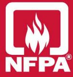

NFPA®

Standard for the Installation of Stationary Pumps for Fire Protection

2019

**IMPORTANT NOTICES AND DISCLAIMERS CONCERNING NFPA® STANDARDS**

**NOTICE AND DISCLAIMER OF LIABILITY CONCERNING THE USE OF NFPA STANDARDS**

NFPA® codes, standards, recommended practices, and guides (“NFPA Standards”), of which the document contained herein is one, are developed through a consensus standards development process approved by the American National Standards Institute. This process brings together volunteers representing varied viewpoints and interests to achieve consensus on fire and other safety issues. While the NFPA administers the process and establishes rules to promote fairness in the development of consensus, it does not independently test, evaluate, or verify the accuracy of any information or the soundness of any judgments contained in NFPA Standards.

The NFPA disclaims liability for any personal injury, property, or other damages of any nature whatsoever, whether special, indirect, consequential or compensatory, directly or indirectly resulting from the publication, use of, or reliance on NFPA Standards. The NFPA also makes no guaranty or warranty as to the accuracy or completeness of any information published herein.

In issuing and making NFPA Standards available, the NFPA is not undertaking to render professional or other services for or on behalf of any person or entity. Nor is the NFPA undertaking to perform any duty owed by any person or entity to someone else. Anyone using this document should rely on his or her own independent judgment or, as appropriate, seek the advice of a competent professional in determining the exercise of reasonable care in any given circumstances.

The NFPA has no power, nor does it undertake, to police or enforce compliance with the contents of NFPA Standards. Nor does the NFPA list, certify, test, or inspect products, designs, or installations for compliance with this document. Any certification or other statement of compliance with the requirements of this document shall not be attributable to the NFPA and is solely the responsibility of the certifier or maker of the statement.

**REVISION SYMBOLS IDENTIFYING CHANGES FROM THE PREVIOUS EDITION**

Text revisions are shaded. A Δ before a section number indicates that words within that section were deleted and a Δ to the left of a table or figure number indicates a revision to an existing table or figure. When a chapter was heavily revised, the entire chapter is marked throughout with the Δ symbol. Where one or more sections were deleted, a • is placed between the remaining sections. Chapters, annexes, sections, figures, and tables that are new are indicated with an N .

Note that these indicators are a guide. Rearrangement of sections may not be captured in the markup, but users can view complete revision details in the First and Second Draft Reports located in the archived revision information section of each code at www.nfpa.org/docinfo. Any subsequent changes from the NFPA Technical Meeting, Tentative Interim Amendments, and Errata are also located there.

**ALERT: THIS STANDARD HAS BEEN MODIFIED BY A TIA OR ERRATA**

Users of NFPA codes, standards, recommended practices, and guides (“NFPA Standards”) should be aware that NFPA Standards may be amended from time to time through the issuance of a Tentative Interim Amendment (TIA) or corrected by Errata. An official NFPA Standard at any point in time consists of the current edition of the document together with any TIAs and Errata then in effect.

To determine whether an NFPA Standard has been amended through the issuance of TIAs or corrected by Errata, go to www.nfpa.org/docinfo to choose from the list of NFPA Standards or use the search feature to select the NFPA Standard number (e.g., NFPA 13). The document information page provides up-todate document-specific information as well as postings of all existing TIAs and Errata. It also includes the option to register for an “Alert” feature to receive an automatic email notification when new updates and other information are posted regarding the document.

**IMPORTANT NOTICES AND DISCLAIMERS CONCERNING NFPA® STANDARDS**

**ADDITIONAL NOTICES AND DISCLAIMERS**

**Updating of NFPA Standards**

Users of NFPA codes, standards, recommended practices, and guides (“NFPA Standards”) should be aware that these documents may be superseded at any time by the issuance of new editions or may be amended from time to time through the issuance of Tentative Interim Amendments or corrected by Errata. An official NFPA Standard at any point in time consists of the current edition of the document together with any Tentative Interim Amendments and any Errata then in effect. In order to determine whether a given document is the current edition and whether it has been amended through the issuance of Tentative Interim Amendments or corrected through the issuance of Errata, consult appropriate NFPA publications such as the National Fire Codes® Subscription Service, visit the NFPA website at www.nfpa.org, or contact the NFPA at the address listed below.

**Interpretations of NFPA Standards**

A statement, written or oral, that is not processed in accordance with Section 6 of the Regulations Governing the Development of NFPA Standards shall not be considered the official position of NFPA or any of its Committees and shall not be considered to be, nor be relied upon as, a Formal Interpretation.

**Patents**

The NFPA does not take any position with respect to the validity of any patent rights referenced in, related to, or asserted in connection with an NFPA Standard. The users of NFPA Standards bear the sole responsibility for determining the validity of any such patent rights, as well as the risk of infringement of such rights, and the NFPA disclaims liability for the infringement of any patent resulting from the use of or reliance on NFPA Standards.

NFPA adheres to the policy of the American National Standards Institute (ANSI) regarding the inclusion of patents in American National Standards (“the ANSI Patent Policy”), and hereby gives the following notice pursuant to that policy:

NOTICE: The user’s attention is called to the possibility that compliance with an NFPA Standard may require use of an invention covered by patent rights. NFPA takes no position as to the validity of any such patent rights or as to whether such patent rights constitute or include essential patent claims under the ANSI Patent Policy. If, in connection with the ANSI Patent Policy, a patent holder has filed a statement of willingness to grant licenses under these rights on reasonable and nondiscriminatory terms and conditions to applicants desiring to obtain such a license, copies of such filed statements can be obtained, on request, from NFPA. For further information, contact the NFPA at the address listed below.

**Law and Regulations**

Users of NFPA Standards should consult applicable federal, state, and local laws and regulations. NFPA does not, by the publication of its codes, standards, recommended practices, and guides, intend to urge action that is not in compliance with applicable laws, and these documents may not be construed as doing so.

**Copyrights**

NFPA Standards are copyrighted. They are made available for a wide variety of both public and private uses. These include both use, by reference, in laws and regulations, and use in private self-regulation, standardization, and the promotion of safe practices and methods. By making these documents available for use and adoption by public authorities and private users, the NFPA does not waive any rights in copyright to these documents.

Use of NFPA Standards for regulatory purposes should be accomplished through adoption by reference. The term “adoption by reference” means the citing of title, edition, and publishing information only. Any deletions, additions, and changes desired by the adopting authority should be noted separately in the adopting instrument. In order to assist NFPA in following the uses made of its documents, adopting authorities are requested to notify the NFPA (Attention: Secretary, Standards Council) in writing of such use. For technical assistance and questions concerning adoption of NFPA Standards, contact NFPA at the address below.

**For Further Information**

All questions or other communications relating to NFPA Standards and all requests for information on NFPA procedures governing its codes and standards development process, including information on the procedures for requesting Formal Interpretations, for proposing Tentative Interim Amendments, and for proposing revisions to NFPA standards during regular revision cycles, should be sent to NFPA headquarters, addressed to the attention of the Secretary, Standards Council, NFPA, 1 Batterymarch Park, P.O. Box 9101, Quincy, MA 02269-9101; email: stds\_admin@nfpa.org.

For more information about NFPA, visit the NFPA website at www.nfpa.org. All NFPA codes and standards can be viewed at no cost at www.nfpa.org/docinfo.

**NFPA® 20**