# NFPA 20 - Standard for the Installation of Stationary Pumps for Fire Protection - 2019

**2019 Edition**

This edition of NFPA 20, Standard for the Installation of Stationary Pumps for Fire Protection, was prepared by the Technical Committee on Fire Pumps. It was issued by the Standards Council on May 4, 2018, with an effective date of May 24, 2018, and supersedes all previous editions.

This document has been amended by one or more Tentative Interim Amendments (TIAs) and/or Errata. See “Codes & Standards” at www.nfpa.org for more information.

This edition of NFPA 20 was approved as an American National Standard on May 24, 2018.

**Origin and Development of NFPA 20**

The first National Fire Protection Association standard for automatic sprinklers was published in 1896 and contained paragraphs on steam and rotary fire pumps.

The Committee on Fire Pumps was organized in 1899 with five members from underwriter associations. Modern committee membership has included representatives of Underwriters Laboratories of both the United States and Canada, Insurance Services Office, Factory Mutual, Industrial Risk Insurers, national trade associations, state governments, engineering organizations, and private individuals.

Early fire pumps were only secondary supplies for sprinklers, standpipes, and hydrants and were started manually. Today, fire pumps have greatly increased in number and in applications — many are the major or only water supply, and almost all are started automatically. Early pumps usually took suction by lift from standing or flowing water supplies because the famed National Standard Steam Fire Pump and rotary types suited that service. Ascendancy of the centrifugal pump resulted in positive head supply to horizontal shaft pumps from public water supplies and aboveground tanks. Later, vertical shaft turbine–type pumps were lowered into wells or into wet pits supplied from ponds or other belowground sources of water.

Gasoline engine–driven pumps first appeared in this standard in 1913. From an early status of relative unreliability and of supplementary use only, first spark-ignited gasoline engines and then compression ignition diesels have steadily developed engine-driven pumps to a place alongside electric-driven units for total reliability.

Fire protection now calls for larger pumps, higher pressures, and more varied units for a wide range of systems protecting both life and property. Hydraulically calculated and designed sprinkler and special fire protection systems have changed concepts of water supply completely.

Since the formation of this committee, each edition of NFPA 20 has incorporated appropriate provisions to cover new developments and has omitted obsolete provisions. NFPA action on successive editions has been taken in the following years: 1907, 1910–1913, 1915, 1918–1921, 1923– 1929, 1931–1933, 1937, 1939, 1943, 1944, 1946–1948, 1951, 1953, 1955, 1957, 1959–1972, 1974, 1976, 1978, 1980, 1983, 1987, 1990, 1993, 1996, 1999, 2003, and 2007.

The 1990 edition included several amendments with regard to some of the key components associated with electric-driven fire pumps. In addition, amendments were made to allow the document to conform more closely to the NFPA Manual of Style.

The 1993 edition included significant revisions to chapters 6 and 7 with regard to the arrangement of the power supply to electric-driven fire pumps. These clarifications were intended to provide the necessary requirements to make the system as reliable as possible.

The 1996 edition continued the changes initiated in the 1993 edition, and chapters 6 and 7, which addressed electric drives and controllers, underwent significant revision. New information was also added regarding engine-cooling provisions, earthquake protection, and backflow preventers. Chapter 5, which addressed provisions for high-rise buildings, was removed, as were capacity limitations on in-line and end suction pumps. Additionally, provisions regarding suction pipe fittings were updated.

The 1999 edition of the standard included requirements for positive displacement pumps for both water mist and foam systems. The document title was revised to reflect this change, since the 1999 edition addressed requirements for pumps other than centrifugal. Enforceable language was added, particularly regarding protection of equipment.

Revisions for the 2003 edition included updating the document to conform with the latest edition of the Manual of Style for NFPA Technical Committee Documents. Provisions were also added to address the use of fire pump drivers using variable speed pressure limiting control. Acceptance test criteria were added to the document for replacement of critical path components of a fire pump installation.

For the 2007 edition, requirements for variable speed drives were refined, requirements for break tanks were added, and component replacement testing tables were included.

The 2010 edition included a new chapter on fire pumps for high-rise buildings. Requirements for pumps arranged in series were also added to the general requirements chapter. Chapter 11 of the standard was reorganized.

The 2013 edition clarified and added new requirements for water mist positive displacement pumping units. Chapter 5 of the standard was reorganized. Limited service controller requirements were revised, and the component replacement table was removed.

The 2016 edition of NFPA 20 provided new requirements for pumps in series relative to protection of control wiring, status signals, and communications. NFPA 20 recognized the potential use of multistage, multiport pumps in fire suppression systems and provided requirements specific to that application. Break tank criteria were removed and are now in accordance with NFPA 22, Standard for Water Tanks for Private Fire Protection. A new annex, Annex C, was added to provide guidance on controller security where a controller is connected to the Internet. New requirements were added to address use of an automatic fuel maintenance system with a diesel fire pump installation. In addition, protection criteria for both a diesel fire pump room and an electric fire pump room were defined in Chapter 4.

The 2019 edition of NFPA 20 is revised to recognize new technologies, including automated inspection and testing, distance monitoring, automated valves, and self-regulating variable speed fire pump units. Provisions are added to require that a single entity be responsible for acceptable fire pump unit performance. A new definition for lowest permissible suction pressure is added to provide a better understanding of the maximum available flow by connecting it to a suction pressure. Requirements are added to clarify where manifolding of fire pump test piping is permitted, as well as where combining fire pump test piping with relief valve discharge piping is permitted. New definitions are added to differentiate between standby power and alternate power and to ensure proper application of these terms throughout the document. The term very tall building is defined and the requirements pertaining to these buildings are expanded, including those for automatic tank refill valves. New requirements and annex material are added to help package designers through the evaluation of mass elastic systems. The requirements for hydraulic cranking systems are revised to distinguish between systems used as primary cranking systems and those used as secondary cranking systems. Annex C is revised significantly to make data formatting more universal

**Technical Committee on Fire Pumps**

Gayle Pennel, Chair JENSEN HUGHES, IL [SE]

R. T. Leicht, Secretary State of Delaware, DE [E] Rep. International Fire Marshals Association

Michael E. Aaron, Wiss Janney Elstner Associates, Inc., IL [SE]   
Timothy Ballengee, Peerless Pump Company, NC [M]   
James A. Beals, Jacobs Engineering, VA [SE]   
Marinus Both, Western States Fire Protection Company, NV [IM]   
Pat D. Brock, Oklahoma State University, OK [SE]   
Brian Buscher, AC Fire Pump Systems, IL [M]   
John D. Campbell, Global Fire Protection Group, LLC, MO [SE]   
Stephen A. Clark, Jr., Allianz Risk Consulting, LLC, VA [I]   
Bradford T. Cronin, Newport Fire Department, RI [E]   
Mohammad Dadgardoust, LRI Engineering Inc., Canada [SE]   
Mike Dawson, Cummins Sales and Service, WI [M]   
Alan A. Dorini, Gulfstream Pump & Equipment, Inc., FL [IM]   
Byron E. Ellis, Entergy Corporation, LA [U] Rep. Edison Electric Institute   
Christina F. Francis, The Procter & Gamble Company, AL [M]   
David B. Fuller, FM Approvals, RI [I]   
Bill M. Harvey, Harvey & Associates, Inc., SC [IM] Rep. American Fire Sprinkler Association   
Stephen M. Jaskolka, The DuPont Company, Inc., DE [U] Rep. NFPA Industrial Fire Protection Section   
Hatem Ezzat Kheir, Kheir Group, Egypt [IM]   
John R. Kovacik, UL LLC, IL [RT]   
Jennifer A. McGrath, Pentair, IL [M]

Gregory A. Bartels, Sprinkler Fitters LU 669-JATC, MD [L] (Alt. to Michael A. Rothmier)

Kerry M. Bell, UL LLC, IL [RT] (Alt. to John R. Kovacik)

Tom de Nooij, Riskonet B.V., The Netherlands [SE] (Alt. to John D. Campbell)

Brandon W. Frakes, Global Asset Protection Services, LLC, NC [I] (Alt. to Jeffrey R. Roberts)

Leroy Franklin, Pentair, IL [M] (Alt. to Jennifer A. McGrath)

Aaron Grode, Cummins Sales and Service, WI [M] (Alt. to Mike Dawson)

Louis Guerrazzi, National Fire Sprinkler Association, MD [IM] (Alt. to Terry L. Victor)

Andrew C. Higgins, Allianz Risk Consulting, LLC, NC [I] (Alt. to Stephen A. Clark, Jr.)

Richard A. Holub, The DuPont Company, Inc., DE [U] (Alt. to Stephen M. Jaskolka)

Steven D. Holzkopf, APEX Pumping Equipment, Inc., IL [M] (Alt. to Vincent Rodriguez)

Kenneth E. Isman, University of Maryland, MD [SE] (Alt. to Milosh T. Puchovsky)

Robert W. Johnson, Liberty Mutual Commercial Markets, MI [I] (Alt. to Joseph R. Sanford)

James S. Nasby, Columbia Engineering, IL [SE]

Peter Placidus Petrus, Indonesian Fire & Rescue Foundation, Indonesia [E]

Damon T. Pietraz, Underwood Fire Equipment, Inc., MI [IM]

Milosh T. Puchovsky, Worcester Polytechnic Institute, MA [SE]

Edward A. Ramirez, Chicago Bridge Iron Company, TX [SE]

Jeffrey R. Roberts, Global Asset Protection Services, LLC, MS [I]

Vincent Rodriguez, Apex Pumping Equipment, Inc., IL [M] Rep. Illinois Fire Prevention Association

Michael A. Rothmier, UA Joint Apprenticeship Committee LU 669, CO [L]

Rep. United Assn. of Journeymen & Apprentices of the Plumbing & Pipe Fitting Industry

Joseph R. Sanford, Liberty Mutual Property Risk Engineering, MA [I]

Darrell A. Snyder, Patterson Pump Company, GA [M] Rep. Hydraulic Institute

William F. Stelter, Master Control Systems, Inc., IL [M] Rep. National Electrical Manufacturers Association

Terry L. Victor, Johnson Controls/Tyco/SimplexGrinnell, MD [IM] Rep. National Fire Sprinkler Association

John Whitney, Clarke Fire Protection Products, Inc., OH [M]

**Alternates**

Mohamed Ezzat Kheir, Kheir Group, Egypt [IM] (Alt. to Hatem Ezzat Kheir)

Michael Koska, National Fire Suppression/Western States Fire   
Protection Company, KS [IM] (Alt. to Marinus Both)

Timothy J. LaRose, JENSEN HUGHES, RI [SE] (Alt. to Gayle Pennel)

Floyd Luinstra, Oklahoma State University, OK [SE] (Alt. to Pat D. Brock)

Roger Meuer, Alliant Energy, IA [U] (Alt. to Byron E. Ellis)

Michael R. Moran, State of Delaware, DE [E] (Alt. to R. T. Leicht)

Michael J. Spaziani, FM Global, MA [I] (Alt. to David B. Fuller)

Douglas A. Stephens, ASCO Power Technologies, NC [M] (Alt. to William F. Stelter)

Kyle J. Tingle, Clarke Fire Protection, IA [M] (Alt. to John Whitney)

Shawn C. Yates, Jacobs Engineering Group Inc., TX [SE] (Alt. to James A. Beals)

Marvin F. Yoder, Jr., HSI/Premierflow, OK [IM] (Alt. to Alan A. Dorini)

**Nonvoting**

Edward D. Leedy, Naperville, IL (Member Emeritus)

Janna E. Shapiro, NFPA Staff Liaison

This list represents the membership at the time the Committee was balloted on the final text of this edition. Since that time, changes in the membership may have occurred. A key to classifications is found at the back of the document.

NOTE: Membership on a committee shall not in and of itself constitute an endorsement of the Association or any document developed by the committee on which the member serves.

Committee Scope: This Committee shall have primary responsibility for documents on the selection and installation of stationary pumps supplying water or special additives including but not limited to foam concentrates for private fire protection, including suction piping, valves and auxiliary equipment, electric drive and control equipment, and internal combustion engine drive and control equipment.

Chapter 1 Administration . 20– 7   
1.1 Scope. 20– 7   
1.2 Purpose. 20– 7   
1.3 Application. 20– 7   
1.4 Retroactivity. 20– 7   
1.5 Equivalency. 20– 7   
1.6 Units. 20– 7   
Chapter 2 Referenced Publications 20– 8   
2.1 General. 20– 8   
2.2 NFPA Publications. 20– 8   
2.3 Other Publications. 20– 8   
2.4 References for Extracts in Mandatory Sections. 20– 9   
Chapter 3 Definitions 20– 9   
3.1 General. 20– 9   
3.2 NFPA Official Definitions. 20– 9   
3.3 General Definitions. 20– 9   
Chapter 4 General Requirements 20– 13   
4.1 Pumps. 20– 13   
4.2 Approval Required. 20– 13   
4.3 Pump Operation. 20– 14   
4.4 Fire Pump Unit Performance. 20– 14   
4.5 Certified Shop Test. 20– 15   
4.6 Liquid Supplies. 20– 15   
4.7 Pumps, Drivers, and Controllers. 20– 15   
4.8 Self-Regulating Variable Speed Fire Pump Units. 20– 16   
4.9 Multistage Multiport Pump. 20– 17   
4.10 Centrifugal Fire Pump Capacities. 20– 17   
4.11 Nameplate. 20– 17   
4.12 Pressure Gauges. 20– 17   
4.13 Circulation Relief Valve. 20– 17   
4.14 Equipment Protection. 20– 17   
4.15 Pipe and Fittings. 20– 19   
4.16 Suction Pipe and Fittings. 20– 19   
4.17 Discharge Pipe and Fittings. 20– 21   
4.18 Valve Supervision. 20– 21   
4.19 Protection of Piping Against Damage Due to   
Movement. 20– 21   
4.20 Relief Valves for Centrifugal Pumps. 20– 21   
4.21 Pumps Arranged in Series. 20– 22   
4.22 Water Flow Test Devices. 20– 23   
4.23 Steam Power Supply Dependability. 20– 24   
4.24 Shop Tests. 20– 24   
4.25 Pump Shaft Rotation. 20– 25   
4.26 Other Signals. 20– 25   
4.27 Pressure Maintenance (Jockey or Make-Up)   
Pumps. 20– 25   
4.28 Summary of Centrifugal Fire Pump Data. 20– 25   
4.29 Backflow Preventers and Check Valves. 20– 25   
4.30 Earthquake Protection. 20– 26   
4.31 Packaged Fire Pump Assemblies. 20– 27   
4.32 Pressure Actuated Controller Pressure Sensing   
Lines. 20– 28   
4.33 Break Tanks. 20– 28   
4.34 Field Acceptance Test of Pump Units. 20– 28   
4.35 Automated Inspection, Testing, and Distance   
Monitoring of Devices, Meters, and Equipment. 20– 28   
Chapter 5 Fire Pumps for High-Rise Buildings 20– 28   
5.1 General. 20– 28   
5.2 Equipment Access. 20– 28   
5.3 Water Supply Tanks. 20– 28   
5.4 Fire Pump Test Arrangement. 20– 28   
5.5 Alternate Power. 20– 28

## Contents

5.6 Very Tall Buildings. 20– 29   
Chapter 6 Centrifugal Pumps 20– 29   
6.1 General. 20– 29   
6.2 Factory and Field Performance 20– 29   
6.3 Fittings. 20– 30   
6.4 Foundation and Setting. 20– 30   
6.5 Connection to Driver and Alignment. 20– 30   
Chapter 7 Vertical Shaft Turbine–Type Pumps 20– 30   
7.1 General. 20– 30   
7.2 Water Supply. 20– 30   
7.3 Pump. 20– 31   
7.4 Installation 20– 32   
7.5 Driver. 20– 33   
7.6 Operation and Maintenance. 20– 34   
Chapter 8 Positive Displacement Pumps 20– 34   
8.1 General. 20– 34   
8.2 Foam Concentrate and Additive Pumps. 20– 35   
8.3 Water Mist System Pumps. 20– 35   
8.4 Water Mist Positive Displacement Pumping   
Units. 20– 35   
8.5 Fittings. 20– 35   
8.6 Pump Drivers. 20– 36   
8.7 Controllers. 20– 36   
8.8 Foundation and Setting. 20– 36   
8.9 Driver Connection and Alignment. 20– 36   
8.10 Flow Test Devices. 20– 36   
Chapter 9 Electric Drive for Pumps 20– 36   
9.1 General. 20– 36   
9.2 Normal Power. 20– 37   
9.3 Alternate Power. 20– 37   
9.4 Voltage Drop. 20– 38   
9.5 Motors. 20– 38   
9.6 On-Site Standby Generator Systems. 20– 39   
9.7 Junction Boxes 20– 40   
9.8 Listed Electrical Circuit Protective System to   
Controller Wiring. 20– 40   
9.9 Raceway Terminations. 20– 40   
Chapter 10 Electric-Drive Controllers and Accessories ... 20– 40   
10.1 General. 20– 40   
10.2 Location. 20– 41   
10.3 Construction 20– 41   
10.4 Components. 20– 42   
10.5 Starting and Control. 20– 44   
10.6 Controllers Rated in Excess of 600 V. 20– 46   
10.7 Limited Service Controllers. 20– 47   
10.8 Power Transfer for Alternate Power Supply. 20– 47   
10.9 Controllers for Additive Pump Motors. 20– 49   
10.10 Controllers with Variable Speed Pressure   
Limiting Control or Variable Speed Suction   
Limiting Control. 20– 49   
Chapter 11 Diesel Engine Drive 20– 51   
11.1 General. 20– 51   
11.2 Engines. 20– 51   
11.3 Pump Room. 20– 56   
11.4 Fuel Supply and Arrangement. 20– 57   
11.5 Engine Exhaust. 20– 59   
11.6 Diesel Engine Driver System Operation. 20– 59   
Chapter 12 Engine Drive Controllers . 20– 60   
12.1 Application. 20– 60   
12.2 Location. 20– 60   
12.3 Construction. 20– 60   
12.4 Components. 20– 61   
12.5 Battery Recharging. 20– 62   
12.6 Battery Chargers. . 20– 62   
12.7 Starting and Control. 20– 62   
12.8 Air-Starting Engine Controllers. . 20– 64   
Chapter 13 Steam Turbine Drive . 20– 65   
13.1 General. 20– 65   
13.2 Turbine. 20– 65   
13.3 Installation. 20– 66   
Chapter 14 Acceptance Testing, Performance, and   
Maintenance 20– 66   
14.1 Hydrostatic Tests and Flushing. . 20– 66   
14.2 Field Acceptance Tests. 20– 66   
14.3 Record Drawings, Test Reports, Manuals, Special   
Tools, and Spare Parts. .... 20– 69   
14.4 Periodic Inspection, Testing, and Maintenance. .. 20– 69   
14.5 Component Replacement. 20– 69   
Annex A Explanatory Material ... 20– 70   
Annex B Possible Causes of Pump Troubles . 20– 119   
Annex C Fire Pump Room Connectivity . 20– 122   
Annex D Material Extracted by NFPA 70, Article 695 .. 20– 177   
Annex E Informational References 20– 180   
Index 20– 182

**NFPA 20**

**Standard for the**

**Installation of Stationary Pumps for Fire Protection**

2019 Edition

IMPORTANT NOTE: This NFPA document is made available for use subject to important notices and legal disclaimers. These notices and disclaimers appear in all publications containing this document and may be found under the heading “Important Notices and Disclaimers Concerning NFPA Standards.” They can also be viewed at www.nfpa.org/disclaimers or obtained on request from NFPA.

UPDATES, ALERTS, AND FUTURE EDITIONS: New editions of NFPA codes, standards, recommended practices, and guides (i.e., NFPA Standards) are released on scheduled revision cycles. This edition may be superseded by a later one, or it may be amended outside of its scheduled revision cycle through the issuance of Tentative Interim Amendments (TIAs). An official NFPA Standard at any point in time consists of the current edition of the document, together with all TIAs and Errata in effect. To verify that this document is the current edition or to determine if it has been amended by TIAs or Errata, please consult the National Fire Codes® Subscription Service or the “List of NFPA Codes & Standards” at www.nfpa.org/docinfo. In addition to TIAs and Errata, the document information pages also include the option to sign up for alerts for individual documents and to be involved in the development of the next edition.

NOTICE: An asterisk (\*) following the number or letter designating a paragraph indicates that explanatory material on the paragraph can be found in Annex A.

A reference in brackets [ ] following a section or paragraph indicates material that has been extracted from another NFPA document. As an aid to the user, the complete title and edition of the source documents for extracts in mandatory sections of the document are given in Chapter 2 and those for extracts in informational sections are given in Annex E. Extracted text may be edited for consistency and style and may include the revision of internal paragraph references and other references as appropriate. Requests for interpretations or revisions of extracted text shall be sent to the technical committee responsible for the source document.

Information on referenced publications can be found in Chapter 2 and Annex E.

**Chapter 1 Administration**

**1.1\* Scope.**

1.1.1 This standard deals with the selection and installation of pumps supplying liquid for private fire protection.

1.1.2 The scope of this document shall include liquid supplies; suction, discharge, and auxiliary equipment; power supplies, including power supply arrangements; electric drive and control; diesel engine drive and control; steam turbine drive and control; and acceptance tests and operation.

1.1.3 This standard does not cover system liquid supply capacity and pressure requirements, nor does it cover requirements for periodic inspection, testing, and maintenance of fire pump systems.

1.1.4 This standard does not cover the requirements for installation wiring of fire pump units.

1.2 Purpose. The purpose of this standard is to provide a reasonable degree of protection for life and property from fire through installation requirements for stationary pumps for fire protection based upon sound engineering principles, test data, and field experience.

**1.3 Application.**

1.3.1 This standard shall apply to centrifugal single-stage and multistage pumps of the horizontal or vertical shaft design and positive displacement pumps of the horizontal or vertical shaft design.

1.3.2 Requirements are established for the design and installation of single-stage and multistage pumps, pump drivers, and associated equipment.

1.4 Retroactivity. The provisions of this standard reflect a consensus of what is necessary to provide an acceptable degree of protection from the hazards addressed in this standard at the time the standard was issued.

1.4.1 Unless otherwise specified, the provisions of this standard shall not apply to facilities, equipment, structures, or installations that existed or were approved for construction or installation prior to the effective date of the standard. Where specified, the provisions of this standard shall be retroactive.

1.4.2 In those cases where the authority having jurisdiction determines that the existing situation presents an unacceptable degree of risk, the authority having jurisdiction shall be permitted to apply retroactively any portions of this standard deemed appropriate.

1.4.3 The retroactive requirements of this standard shall be permitted to be modified if their application clearly would be impractical in the judgment of the authority having jurisdiction, and only where it is clearly evident that a reasonable degree of safety is provided.

1.5 Equivalency. Nothing in this standard is intended to prevent the use of systems, methods, or devices of equivalent or superior quality, strength, fire resistance, effectiveness, durability, and safety over those prescribed by this standard.

1.5.1 Technical documentation shall be submitted to the authority having jurisdiction to demonstrate equivalency.

1.5.2 The system, method, or device shall be approved for the intended purpose by the authority having jurisdiction.

**1.6 Units.**

1.6.1 Metric units of measurement in this standard are in accordance with the modernized metric system known as the International System of Units (SI).

1.6.2 Liter and bar in this standard are outside of but recognized by SI.

1.6.3 Units are listed in Table 1.6.3 with conversion factors.

1.6.4 Conversion. The conversion procedure is to multiply the quantity by the conversion factor and then round the result to an appropriate number of significant digits.

1.6.5 Trade Sizes. Where industry utilizes nominal dimensions to represent materials, products, or performance, direct

Δ Table 1.6.3 System of Units
<table><tr><td>Name of Unit</td><td>Unit Abbreviation</td><td>Conversion Factor</td></tr><tr><td>Meter(s)</td><td>m</td><td> $1 \ \mathrm { f t } = 0 . 3 0 4 8 \ \mathrm { m }$ </td></tr><tr><td>Foot (feet)</td><td>ft</td><td> $1 \ \mathrm { m } = 3 . 2 8 1 \ \mathrm { f t }$ </td></tr><tr><td>Millimeter(s)</td><td>mm</td><td> $1 \ \mathrm { i n . = 2 5 . 4 \ m m }$ </td></tr><tr><td>Inch(es)</td><td>in.</td><td> $1 \ { \mathrm { m m } } = 0 . 0 3 9 3 7 \ { \mathrm { i n } } .$ </td></tr><tr><td>Liter(s)</td><td>L</td><td> $\mathrm { 1 ~ g a l = 3 . 7 8 5 ~ L }$ </td></tr><tr><td>Gallon(s) (U.S.)</td><td> $\mathrm { g a l }$ </td><td> $1 { \bar { \mathrm { L } } } = 0 . 2 6 4 2 { \mathrm { g a l } }$ </td></tr><tr><td>Cubic decimeter(s)</td><td> $\mathrm { { d m ^ { 3 } } }$ </td><td>1  $\mathrm { | \ g a l = 3 . 7 8 5 \ d m ^ { 3 } }$ </td></tr><tr><td>Cubic meter(s)</td><td> $\mathrm { m ^ { 3 } }$ </td><td>1  $\mathrm { \ddot { f } t ^ { 3 } } = 0 . 0 2 8 3 \ : \mathrm { m ^ { 3 } }$ </td></tr><tr><td>Cubic foot (feet)</td><td> $\mathrm { f t ^ { 3 } }$ </td><td> $1 \ \mathrm { m } ^ { 3 } = 3 5 . 3 1 \ \mathrm { f t } ^ { 3 }$ </td></tr><tr><td>Pascal(s)</td><td> $\mathrm { P a }$ </td><td> $1 { \mathrm { ~ p s i } } = 6 8 9 4 . 7 5 7 { \mathrm { ~ P a } } ;$ </td></tr><tr><td>Pound(s) per</td><td>psi</td><td> ${ \bar { 1 } } { \mathrm { ~ b a r } } = 1 0 ^ { 5 } { \mathrm { ~ P a } }$   $1 \ \mathrm { { P a } = 0 . 0 0 0 1 4 5 \ p s i ; }$ </td></tr><tr><td>square inch Bar</td><td>bar</td><td> $1 \ \mathrm { b a r } = 1 4 . 5 \ \mathrm { p s i }$   $1 \ \mathrm { P a } = 1 0 ^ { - 5 } \ \mathrm { b a r } ;$ </td></tr></table>

Note: For additional conversions and information, see IEEE/ASTM SI10, Standard for Use of the International System of Units (SI): The Modern Metric System.

conversions have not been utilized and appropriate trade sizes have been included.

**Chapter 2 Referenced Publications**

2.1 General. The documents or portions thereof listed in this chapter are referenced within this standard and shall be considered part of the requirements of this document.

2.2 NFPA Publications. National Fire Protection Association, 1 Batterymarch Park, Quincy, MA 02169-7471.

NFPA 13, Standard for the Installation of Sprinkler Systems, 2019 edition.

NFPA 22, Standard for Water Tanks for Private Fire Protection, 2018 edition.

NFPA 24, Standard for the Installation of Private Fire Service Mains and Their Appurtenances, 2019 edition.

NFPA 25, Standard for the Inspection, Testing, and Maintenance of Water-Based Fire Protection Systems, 2017 edition.

NFPA 37, Standard for the Installation and Use of Stationary Combustion Engines and Gas Turbines, 2018 edition.

NFPA 51B, Standard for Fire Prevention During Welding, Cutting, and Other Hot Work, 2019 edition.

NFPA 70®, National Electrical Code®, 2017 edition.

NFPA 70E®, Standard for Electrical Safety in the Workplace®, 2018 edition.

NFPA 72®, National Fire Alarm and Signaling Code®, 2019 edition.

NFPA 110, Standard for Emergency and Standby Power Systems, 2019 edition.

NFPA 1963, Standard for Fire Hose Connections, 2014 edition.

**2.3 Other Publications.**

2.3.1 AGMA Publications. American Gear Manufacturers Association, 1001 N. Fairfax Street, Suite 500, Alexandria, VA 22314-1587.

ANSI/AGMA 2011-B14, Cylindrical Wormgearing Tolerance and Inspection Methods, 2014.

2.3.2 ANSI Publications. American National Standards Institute, Inc., 25 West 43rd Street, 4th Floor, New York, NY 10036.

ANSI B11.19, Performance Requirements for Safeguarding, 2010.

2.3.3 ASCE Publications. American Society of Civil Engineers, 1801 Alexander Bell Drive, Reston, VA 20191-4400.

ASCE/SEI 7, Minimum Design Loads for Buildings and Other Structures, 2010.

2.3.4 ASME Publications. ASME International, Two Park Avenue, New York, NY 10016-5990.

Boiler and Pressure Vessel Code, 2015.

2.3.5 AWS Publications. American Welding Society, 8669 NW 36 Street, Suite 130, Miami, FL 33166-6672.

AWS D1.1/D1.1M, Structural Welding Code — Steel, 2015.

2.3.6 HI Publications. Hydraulic Institute, 6 Campus Drive, First Floor North, Parsippany, NJ 07054-4406.

ANSI/HI 1.4, Rotodynamic Centrifugal Pumps for Manuals Describing Installation, Operation and Maintenance, 2014.

ANSI/HI 3.6, Rotary Pump Tests, 2016.

2.3.7 IEEE Publications. IEEE, Three Park Avenue, 17th Floor, New York, NY 10016-5997.

IEEE/ASTM SI10, Standard for Use of the International System of Units (SI): The Modern Metric System, 2010.

ANSI/IEEE C62.1, IEEE Standard for Gapped Silicon-Carbide Surge Arresters for AC Power Circuits, 1989.

ANSI/IEEE C62.11, IEEE Standard for Metal-Oxide Surge Arresters for Alternating Current Power Circuits (>1 kV), 2012.

ANSI/IEEE C62.41, IEEE Recommended Practice for Surge Voltages in Low-Voltage AC Power Circuits, 1991.

2.3.8 ISO Publications. International Organization for Standardization, ISO Central Secretariat, BIBC II, Chemin de Blandonnet 8, CP 401, 1214 Vernier, Geneva, Switzerland.

ISO 15540, Fire Resistance of Non-Metallic Hose Assemblies and Non-Metallic Compensators — Test Methods, 2nd edition, 2016.

2.3.9 NEMA Publications. National Electrical Manufacturers Association, 1300 North 17th Street, Suite 900, Arlington, VA 22209.

NEMA MG-1, Motors and Generators, 2014.

2.3.10 UL Publications. Underwriters Laboratories Inc., 333 Pfingsten Road, Northbrook, IL 60062-2096.

ANSI/UL 142, Standard for Steel Aboveground Tanks for Flammable and Combustible Liquids, 2013.

ANSI/UL 508, Standard for Industrial Control Equipment, 2013.

ANSI/UL 1449, Standard for Surge Protective Devices, 2016.

**2.3.11 Other Publications.**

Merriam-Webster’s Collegiate Dictionary, 11th edition, Merriam-Webster, Inc., Springfield, MA, 2003.

**2.4 References for Extracts in Mandatory Sections.**

NFPA 14, Standard for the Installation of Standpipe and Hose Systems, 2016 edition.

NFPA 37, Standard for the Installation and Use of Stationary Combustion Engines and Gas Turbines, 2018 edition.

NFPA 70®, National Electrical Code®, 2017 edition.

NFPA 110, Standard for Emergency and Standby Power Systems, 2019 edition.

NFPA 1451, Standard for a Fire and Emergency Service Vehicle Operations Training Program, 2018 edition.

NFPA 5000®, Building Construction and Safety Code®, 2018 edition.

**Chapter 3 Definitions**

3.1 General. The definitions contained in this chapter shall apply to the terms used in this standard. Where terms are not defined in this chapter or within another chapter, they shall be defined using their ordinarily accepted meanings within the context in which they are used. Merriam-Webster’s Collegiate Dictionary, 11th edition, shall be the source for the ordinarily accepted meaning.

**3.2 NFPA Official Definitions.**

3.2.1\* Approved. Acceptable to the authority having jurisdiction.

3.2.2\* Authority Having Jurisdiction (AHJ). An organization, office, or individual responsible for enforcing the requirements of a code or standard, or for approving equipment, materials, an installation, or a procedure.

3.2.3\* Listed. Equipment, materials, or services included in a list published by an organization that is acceptable to the authority having jurisdiction and concerned with evaluation of products or services, that maintains periodic inspection of production of listed equipment or materials or periodic evaluation of services, and whose listing states that either the equipment, material, or service meets appropriate designated standards or has been tested and found suitable for a specified purpose.

3.2.4 Shall. Indicates a mandatory requirement.

3.2.5 Should. Indicates a recommendation or that which is advised but not required.

3.2.6 Standard. An NFPA Standard, the main text of which contains only mandatory provisions using the word “shall” to indicate requirements and that is in a form generally suitable for mandatory reference by another standard or code or for adoption into law. Nonmandatory provisions are not to be considered a part of the requirements of a standard and shall be located in an appendix, annex, footnote, informational note, or other means as permitted in the NFPA Manuals of Style. When used in a generic sense, such as in the phrase “standards development process” or “standards development activities,” the term “standards” includes all NFPA Standards, including Codes, Standards, Recommended Practices, and Guides.

**3.3 General Definitions.**

3.3.1 Additive. A liquid such as foam concentrates, emulsifiers, and hazardous vapor suppression liquids and foaming

agents intended to be injected into the water stream at or above the water pressure.

**N 3.3.2 Alternate Power. See 3.3.46.1.**

3.3.3 Aquifer. An underground formation that contains sufficient saturated permeable material to yield significant quantities of water.

3.3.4 Aquifer Performance Analysis. A test designed to determine the amount of underground water available in a given field and proper well spacing to avoid interference in that field. Basically, test results provide information concerning transmissibility and storage coefficient (available volume of water) of the aquifer.

N 3.3.5 Automated Inspection and Testing. The performance of inspections and tests at a distance from the system or component being inspected or tested through the use of electronic devices or equipment installed for the purpose.

3.3.6 Automatic Transfer Switch. See 3.3.67.2.1.

3.3.7 Branch Circuit. See 3.3.10.1.

3.3.8 Break Tank. A tank providing suction to a fire pump whose capacity is less than the fire protection demand (flow rate times flow duration).

3.3.9 Churn. See 3.3.42, No Flow (Churn, Shutoff).

3.3.10 Circuit.

3.3.10.1 Branch Circuit. The circuit conductors between the final overcurrent device protecting the circuit and the outlet(s). [70: Art. 100]

3.3.10.2 Fault Tolerant External Control Circuit. Those control circuits either entering or leaving the fire pump controller enclosure, which if broken, disconnected, or shorted will not prevent the controller from starting the fire pump from all other internal or external means and can cause the controller to start the pump under these conditions.

**3.3.11 Circulation Relief Valve. See 3.3.75.4.1.**

3.3.12 Corrosion-Resistant Material. Materials such as brass, copper, Monel®, stainless steel, or other equivalent corrosionresistant materials.

3.3.13 Diesel Engine. See 3.3.18.1.

3.3.14 Discharge Pressure. See 3.3.47.1.

3.3.15 Disconnecting Means. A device, or group of devices, or other means by which the conductors of a circuit can be disconnected from their source of supply. [70: Art. 100]

N 3.3.16 Distance Monitoring. The monitoring of various conditions of a system or component from a location distant from the system or component through the use of electronic devices, meters, or equipment installed for the purpose.

3.3.17 Drawdown. The vertical difference between the pumping water level and the static water level.

3.3.18 Engine.

3.3.18.1\* Diesel Engine. An internal combustion engine in which the fuel is ignited entirely by the heat resulting from the compression of the air supplied for combustion.

3.3.18.1.1 Internal Combustion Engine. Any engine in which the working medium consists of the products of combustion of the air and fuel supplied.

N 3.3.19 Engine Battery. A battery used to provide sufficient electrical energy to crank the engine to achieve engine start and the necessary energy for system controls.

**3.3.20 Fault Tolerant External Control Circuit. See 3.3.10.2.**

3.3.21 Feeder. All circuit conductors between the service equipment, the source of a separately derived system, or other power supply source and the final branch-circuit overcurrent device. [70: Art. 100]

3.3.22 Fire Pump Alarm. A supervisory signal indicating an abnormal condition requiring immediate attention.

3.3.23 Fire Pump Controller. A group of devices that serve to govern, in some predetermined manner, the starting and stopping of the fire pump driver and to monitor and signal the status and condition of the fire pump unit.

3.3.24 Fire Pump Unit. An assembled unit consisting of a fire pump, driver, controller, and accessories.

3.3.25 Flexible Connecting Shaft. A device that incorporates two flexible joints and a telescoping element.

3.3.26 Flexible Coupling. A device used to connect the shafts or other torque-transmitting components from a driver to the pump, and that permits minor angular and parallel misalignment as restricted by both the pump and coupling manufacturers.

3.3.27 Flooded Suction. The condition where water flows from an atmospheric vented source to the pump without the average pressure at the pump inlet flange dropping below atmospheric pressure with the pump operating at 150 percent of its rated capacity.

3.3.28 Groundwater. That water that is available from a well, driven into water-bearing subsurface strata (aquifer).

3.3.29\* Head. A quantity used to express a form (or combination of forms) of the energy content of water per unit weight of the water referred to any arbitrary datum.

3.3.29.1 Net Positive Suction Head (NPSH) (h ). The total suction head in feet (meters) of liquid absolute, determined at the suction nozzle, and referred to datum, less the vapor pressure of the liquid in feet (meters) absolute.

3.3.29.2 Total Discharge Head (hd). The reading of a pressure gauge at the discharge of the pump, converted to feet (meters) of liquid, and referred to datum, plus the velocity head at the point of gauge attachment.

**3.3.29.3 Total Head.**

3.3.29.3.1\* Total Head (H), Horizontal Pumps. The measure of the work increase, per pound (kilogram) of liquid, imparted to the liquid by the pump, and therefore the algebraic difference between the total discharge head and the total suction head. Total head, as determined on test where suction lift exists, is the sum of the total discharge head and total suction lift. Where positive suction head exists, the total head is the total discharge head minus the total suction head.

3.3.29.3.2\* Total Head (H), Vertical Turbine Pumps. The distance from the pumping liquid level to the center of the discharge gauge plus the total discharge head.

3.3.29.4 Total Rated Head. The total head developed at rated capacity and rated speed for a centrifugal pump.

3.3.29.5 Total Suction Head. Suction head exists where the total suction head is above atmospheric pressure. Total suction head, as determined on test, is the reading of a gauge at the suction of the pump, converted to feet (meters) of liquid, and referred to datum, plus the velocity head at the point of gauge attachment.

3.3.29.6\* Velocity Head (hv). The kinetic energy of a unit weight of fluid moving with velocity (v) determined at the point of the gauge connection.

3.3.30 High-Rise Building. A building where the floor of an occupiable story is greater than 75 ft (23 m) above the lowest level of fire department vehicle access. [5000, 2018]

3.3.31 In Sight From (Within Sight From, Within Sight). Where this Code specifies that one equipment shall be “in sight from,” “within sight from,” or “within sight of,” and so forth, another equipment, the specified equipment is to be visible and not more than 15 m (50 ft) distant from the other. [70: Art. 100]

3.3.32 Internal Combustion Engine. See 3.3.18.1.1.

**3.3.33 Isolating Switch. See 3.3.67.1.**

3.3.34 Liquid. For the purposes of this standard, liquid refers to water, foam-water solution, foam concentrates, water additives, or other liquids for fire protection purposes.

**3.3.35 Liquid Level.**

3.3.35.1 Pumping Liquid Level. The level, with respect to the pump, of the body of liquid from which it takes suction when the pump is in operation. Measurements are made the same as with the static liquid level.

3.3.35.2 Static Liquid Level. The level, with respect to the pump, of the body of liquid from which it takes suction when the pump is not in operation. For vertical shaft turbine–type pumps, the distance to the liquid level is measured vertically from the horizontal centerline of the discharge head or tee.

3.3.36 Loss of Phase. The loss of one or more, but not all, phases of the polyphase power source.

**3.3.37 Manual Transfer Switch. See 3.3.67.2.2.**

3.3.38 Maximum Pump Brake Horsepower. The maximum brake horsepower required to drive the pump at rated speed. The pump manufacturer determines this by shop test under expected suction and discharge conditions. Actual field conditions can vary from shop conditions.

**3.3.39 Motor.**

3.3.39.1 Dripproof Guarded Motor. A dripproof machine whose ventilating openings are guarded in accordance with the definition for dripproof motor.

3.3.39.2 Dripproof Motor. An open motor in which the ventilating openings are so constructed that successful operation is not interfered with when drops of liquid or solid particles strike or enter the enclosure at any angle from 0 to 15 degrees downward from the vertical.

3.3.39.3 Dust-Ignition-Proof Motor. A totally enclosed motor whose enclosure is designed and constructed in a manner that will exclude ignitible amounts of dust or amounts that might affect performance or rating and that will not permit arcs, sparks, or heat otherwise generated or liberated inside of the enclosure to cause ignition of exterior accumulations or atmospheric suspensions of a specific dust on or in the vicinity of the enclosure.

3.3.39.4 Electric Motor. A motor that is classified according to mechanical protection and methods of cooling.

3.3.39.5 Explosionproof Motor. A totally enclosed motor whose enclosure is designed and constructed to withstand an explosion of a specified gas or vapor that could occur within it and to prevent the ignition of the specified gas or vapor surrounding the motor by sparks, flashes, or explosions of the specified gas or vapor that could occur within the motor casing.

3.3.39.6 Guarded Motor. An open motor in which all openings giving direct access to live metal or rotating parts (except smooth rotating surfaces) are limited in size by the structural parts or by screens, baffles, grilles, expanded metal, or other means to prevent accidental contact with hazardous parts. Openings giving direct access to such live or rotating parts shall not permit the passage of a cylindrical rod 0.75 in. (19 mm) in diameter.

3.3.39.7 Open Motor. A motor having ventilating openings that permit passage of external cooling air over and around the windings of the motor. Where applied to large apparatus without qualification, the term designates a motor having no restriction to ventilation other than that necessitated by mechanical construction.

3.3.39.8 Totally Enclosed Fan-Cooled Motor. A totally enclosed motor equipped for exterior cooling by means of a fan or fans integral with the motor but external to the enclosing parts.

3.3.39.9 Totally Enclosed Motor. A motor enclosed so as to prevent the free exchange of air between the inside and the outside of the case but not sufficiently enclosed to be termed airtight.

3.3.39.10 Totally Enclosed Nonventilated Motor. A totally enclosed motor that is not equipped for cooling by means external to the enclosing parts.

3.3.40 Net Positive Suction Head (NPSH) (h ). See 3.3.29.1.

3.3.41 Net Pressure (Differential Pressure). See 3.3.47.3.

3.3.42\* No Flow (Churn, Shutoff). The condition of zero flow when the fire pump is running but the only water passing through the pump is a small flow that is discharged through the pump circulation relief valve or supplies the cooling for a diesel engine driver.

**3.3.43 On-Site Power Production Facility. See 3.3.46.2.**

**Δ 3.3.44\* On-Site Standby Generator. See 3.3.46.3.**

3.3.45\* Peak Load. As it pertains to acceptance testing in this standard, the maximum power required to drive the pump at any flow rate up to 150 percent of rated capacity (flow).

**N 3.3.46 Power.**

N 3.3.46.1 Alternate Power. A power source that is independent of the primary power supply.

N 3.3.46.2 On-Site Power Production Facility. An on-site normal supply of electric power that is expected to be constantly producing power.

N 3.3.46.3 On-Site Standby Generator. A facility producing electric power on site as the alternate supply of electric power. It differs from an on-site power production facility, in that it is not constantly producing power. [70:695.2]

N 3.3.46.4 Standby Power. An alternate power source that is normally inactive but becomes active whenever the primary power is lost.

**3.3.47 Pressure.**

3.3.47.1 Discharge Pressure. The total pressure available at the fire pump discharge flange.

N 3.3.47.2\* Lowest Permissible Suction Pressure. The lowest suction pressure permitted by this standard and the authority having jurisdiction.

3.3.47.3\* Net Pressure (Differential Pressure). For vertical turbine fire pumps, the total pressure at the fire pump discharge flange plus the total suction lift. For other fire pumps, the total pressure at the fire pump discharge flange minus the total pressure at the fire pump suction flange.

3.3.47.4 Rated Pressure. The net pressure (differential pressure) at rated flow and rated speed as marked on the manufacturer’s nameplate.

3.3.47.5 Suction Pressure. The total pressure available at the fire pump suction flange.

3.3.48 Pressure-Regulating Device. A device designed for the purpose of reducing, regulating, controlling, or restricting water pressure. [14, 2016]

**3.3.49 Pump.**

3.3.49.1 Additive Pump. A pump that is used to inject additives into the water stream.

3.3.49.2 Can Pump. A vertical shaft turbine–type pump in a can (suction vessel) for installation in a pipeline to raise water pressure.

3.3.49.3 Centrifugal Pump. A pump in which the pressure is developed principally by the action of centrifugal force.

3.3.49.4 End Suction Pump. A single suction pump having its suction nozzle on the opposite side of the casing from the stuffing box and having the face of the suction nozzle perpendicular to the longitudinal axis of the shaft.

3.3.49.5 Fire Pump. A pump that is a provider of liquid flow and pressure dedicated to fire protection.

3.3.49.6 Foam Concentrate Pump. See 3.3.49.1, Additive Pump.

3.3.49.7 Gear Pump. A positive displacement pump characterized by the use of gear teeth and casing to displace liquid.

3.3.49.8 Horizontal Pump. A pump with the shaft normally in a horizontal position.

3.3.49.9 Horizontal Split-Case Pump. A centrifugal pump characterized by a housing that is split parallel to the shaft.

3.3.49.10 In-Line Pump. A centrifugal pump whose drive unit is supported by the pump having its suction and discharge flanges on approximately the same centerline.

3.3.49.11\* Multistage Multiport Pump. A single-driver pump with multiple impellers operating in series where the discharge from each impeller, except the last impeller, is the suction for the next impeller, and discharge ports are provided after multiple impellers.

3.3.49.12 Packaged Fire Pump Assembly. Fire pump unit components assembled at a packaging facility and shipped as a unit to the installation site. The scope of listed components (where required to be listed by this standard) in a preassembled package includes the pump, driver, controller, and other accessories identified by the packager assembled onto a base with or without an enclosure.

3.3.49.13 Piston Plunger Pump. A positive displacement pump characterized by the use of a piston or plunger and a cylinder to displace liquid.

3.3.49.14 Positive Displacement Pump. A pump that is characterized by a method of producing flow by capturing a specific volume of fluid per pump revolution and reducing the fluid void by a mechanical means to displace the pumping fluid.

3.3.49.15 Pressure Maintenance (Jockey or Make-Up) Pump. A pump designed to maintain the pressure on the fire protection system(s) between preset limits when the system is not flowing water.

3.3.49.16 Rotary Lobe Pump. A positive displacement pump characterized by the use of a rotor lobe to carry fluid between the lobe void and the pump casing from the inlet to the outlet.

3.3.49.17 Rotary Vane Pump. A positive displacement pump characterized by the use of a single rotor with vanes that move with pump rotation to create a void and displace liquid.

3.3.49.18 Vertical Lineshaft Turbine Pump. A vertical shaft centrifugal pump with rotating impeller or impellers and with discharge from the pumping element coaxial with the shaft. The pumping element is suspended by the conductor system, which encloses a system of vertical shafting used to transmit power to the impellers, the prime mover being external to the flow stream.

3.3.49.19\* Water Mist Positive Displacement Pumping Unit. Multiple positive displacement pumps designed to operate in parallel that discharges into a single common water mist distribution system.

**3.3.50 Pumping Liquid Level. See 3.3.35.1.**

3.3.51 Qualified Person. A person who, by possession of a recognized degree, certificate, professional standing, or skill, and who, by knowledge, training, and experience, has demonstrated the ability to deal with problems related to the subject matter, the work, or the project. [1451, 2018]

3.3.52 Rated Flow. The capacity of the pump at rated speed and rated pressure as marked on the manufacturer's nameplate.

**3.3.53 Rated Pressure. See 3.3.47.4.**

3.3.54 Record Drawing (As-Built). A design, working drawing, or as-built drawing that is submitted as the final record of documentation for the project.

3.3.55\* Series Fire Pump Unit. All fire pump units located within the same building that operate in a series arrangement where the first fire pump takes suction directly from a water supply and each sequential pump takes suction under pump pressure from the preceding pump. Two pumps that operate in series through a tank(s) or break tank(s) are not considered part of a series fire pump unit.

3.3.56\* Service. The conductors and equipment for delivering electric energy from the serving utility to the wiring system of the premises served. [70: Art. 100]

3.3.57\* Service Equipment. The necessary equipment, usually consisting of a circuit breaker(s) or switch(es) and fuse(s) and their accessories, connected to the load end of service conductors to a building or other structure, or an otherwise designated area, and intended to constitute the main control and cutoff of the supply. [70: Art. 100]

3.3.58 Service Factor. A multiplier of an ac motor that, when applied to the rated horsepower, indicates a permissible horsepower loading that can be carried at the rated voltage, frequency, and temperature. For example, the multiplier 1.15 indicates that the motor is permitted to be overloaded to 1.15 times the rated horsepower.

3.3.59\* Set Pressure. As applied to variable speed pumps, the pressure that the variable speed pressure limiting control system is set to maintain.

3.3.60 Shutoff (No Flow, Churn). See 3.3.42, No Flow (Churn, Shutoff).

3.3.61\* Signal. An indicator of status.

3.3.62 Speed.

3.3.62.1 Engine Speed. The speed indicated on the engine nameplate.

3.3.62.2 Motor Speed. The speed indicated on the motor nameplate.

3.3.62.3 Rated Speed. The speed for which the fire pump is listed and that appears on the fire pump nameplate.

N 3.3.63 Standby Power. See 3.3.46.4.

3.3.64 Static Liquid Level. See 3.3.35.2.

N 3.3.65 Suction Diffuser. A device that provides uniform flow into the suction side of a pump, equivalent to 10 pipediameters of straight pipe.

3.3.66 Suction Pressure. See 3.3.47.5.

3.3.67 Switch.

3.3.67.1 Isolating Switch. A switch intended for isolating an electric circuit from its source of power. It has no interrupting rating, and it is intended to be operated only after the circuit has been opened by some other means.

**3.3.67.2 Transfer Switch.**

3.3.67.2.1 Automatic Transfer Switch (ATS). Self-acting equipment for transferring the connected load from one power source to another power source. [110, 2019]

3.3.67.2.2 Manual Transfer Switch. A switch operated by direct manpower for transferring one or more load conductor connections from one power source to another.

N 3.3.68 Torsional Coupling. A driveline component capable of transmitting torque having a very low spring constant along the axis of rotation to detune the driveline and move any damaging resonances safely below operating speed.

3.3.69 Total Discharge Head (h ). See 3.3.29.2.

3.3.70 Total Head (H), Horizontal Pumps. See 3.3.29.3.1.

3.3.71 Total Head (H), Vertical Turbine Pumps. See   
3.3.29.3.2.

3.3.72 Total Rated Head. See 3.3.29.4.

3.3.73 Total Suction Head (h ). See 3.3.29.5.

3.3.74 Total Suction Lift (h ). Suction lift that exists where the total suction head is below atmospheric pressure. Total suction lift, as determined on test, is the reading of a liquid manometer at the suction nozzle of the pump, converted to feet (meters) of liquid, and referred to datum, minus the velocity head at the point of gauge attachment.

**3.3.75 Valve.**

3.3.75.1 Dump Valve. An automatic valve installed on the discharge side of a positive displacement pump to relieve pressure prior to the pump driver reaching operating speed.

3.3.75.2 Pressure Control Valve. A pilot-operated pressurereducing valve designed for the purpose of reducing the downstream water pressure to a specific value under both flowing (residual) and nonflowing (static) conditions. [14, 2016]

3.3.75.3 Pressure-Reducing Valve. A valve designed for the purpose of reducing the downstream water pressure under both flowing (residual) and nonflowing (static) conditions. [14, 2016]

3.3.75.4 Relief Valve. A device that allows the diversion of liquid to limit excess pressure in a system.

3.3.75.4.1 Circulation Relief Valve. A valve used to cool a pump by discharging a small quantity of water. This valve is separate from and independent of the main relief valve.

3.3.75.5 Suction Pressure Regulating Valve. A pilot-operated valve installed in discharge piping that maintains positive pressure in the suction piping, while monitoring pressure in the suction piping through a sensing line.

3.3.75.6 Unloader Valve. A valve that is designed to relieve excess flow below pump capacity at set pump pressure.

**3.3.76 Variable Speed Pumps and Controllers.**

N 3.3.76.1 Self-Regulating Control. The portion of a selfregulating variable speed fire pump unit that controls the pump speed and power.

3.3.76.2\* Self-Regulating Variable Speed Fire Pump Unit. A factory-built integrated fire pump unit consisting of pump, driver, and variable speed control unit, configured to maintain the set pressure until the maximum power draw is reached, while acting as a variable speed pressure limiting control and/or a variable speed suction limiting control.

N 3.3.76.3 Variable Speed Pressure Limiting Control. A speed control system used to limit the total discharge pressure by reducing the pump driver speed from rated speed.

N 3.3.76.4 Variable Speed Pump. A fire pump with variable speed pressure limiting control or a self-regulating variable speed fire pump unit.

3.3.76.5 Variable Speed Suction Limiting Control. A speed control system used to maintain a minimum positive suction pressure at the pump inlet by reducing the pump driver speed while monitoring pressure in the suction piping through a sensing line.

3.3.77 Velocity Head (hv). See 3.3.29.6.

N 3.3.78 Vertical Fire Protection Zone. A vertical zone within a high-rise building that is supplied from a fire pump(s) and/or water storage tank(s).

N 3.3.79 Very Tall Building. A high-rise building where the fire protection water demand exceeds the pumping capacity of the fire department.

3.3.80 Wet Pit. A timber, concrete, or masonry enclosure having a screened inlet kept partially filled with water by an open body of water such as a pond, lake, or stream.

**Chapter 4 General Requirements**

4.1 Pumps. This standard shall apply to centrifugal singlestage and multistage pumps of the horizontal or vertical shaft design and positive displacement pumps of the horizontal or vertical shaft design.

**4.2\* Approval Required.**

4.2.1 Stationary pumps shall be selected based on the conditions under which they are to be installed and used.

4.2.2 The pump manufacturer or its authorized representative shall be given complete information concerning the liquid and power supply characteristics.

4.2.3 A complete plan and detailed data describing pump, driver, controller, power supply, fittings, suction and discharge connections, and liquid supply conditions shall be prepared for approval.

4.2.3.1 Plans shall be drawn to an indicated scale, on sheets of uniform size, and shall indicate, as a minimum, the items from the following list that pertain to the design of the system:

(1) Name(s) of owner and occupant

(2) Location, including street address

(3) Point of compass

(4) Name and address of installing contractor

(5) Pump make and model number

(6) Pump rating \_\_\_\_\_\_\_ gpm @ \_\_\_\_\_ psi \_\_\_\_\_\_ rpm

(7) Suction main size, length, location, type and class/ schedule of material, and point of connection to water supply, as well as depth to top of pipe below grade

(8) Water storage tank, if applicable

(9) Size and type of valves, regulators, meters, and valve pits, if applicable

(10) Water supply information including the following flow test information, if applicable:

(a) Location and elevation of static and residual test gauge with relation to the elevation reference point

(b) Flow location

(c) Static pressure, psi (bar)

(d) Residual pressure, psi (bar)

(e) Flow, gpm (L/min)

(f) Date

(g) Time

(h) Name of person who conducted the test or supplied the information

(i) Other sources of water supply, with pressure or elevation

(11) Other sources of water supply, with pressure or elevation (12) Pump driver details including manufacturer and horsepower

(13) Voltage for electric motor–driven pumps

(14) Fuel system details for diesel-driven pumps

(15) Controller manufacturer, type, and rating

(16) Suction and discharge pipe, fitting, and valve types

(17) Test connection piping and valves

(18) Flow meter details, if applicable (19) Pressure maintenance pump and controller arrangement including sensing line details, if applicable

4.2.4 Each pump, driver, controlling equipment, power supply and arrangement, and liquid supply shall be approved by the authority having jurisdiction for the specific field conditions encountered.

**4.3 Pump Operation.**

4.3.1\* Means shall be provided for qualified personnel to determine that the fire pump is operating in a satisfactory manner during pump operation.

**4.3.2 System Designer.**

4.3.2.1 The system designer shall be identified on the system design documents.

4.3.2.2 Acceptable minimum evidence of qualifications or certification shall be provided when requested by the authority having jurisdiction.

4.3.2.3 Qualified personnel shall include, but not be limited to, one or more of the following:

(1) Personnel who are factory trained and certified for fire pump system design of the specific type and brand of system being designed

(2)\* Personnel who are certified by a nationally recognized fire protection certification organization acceptable to the authority having jurisdiction

(3) Personnel who are registered, licensed, or certified by a state or local authority

4.3.2.4 Additional evidence of qualification or certification shall be permitted to be required by the authority having jurisdiction.

**4.3.3 System Installer.**

4.3.3.1 Installation personnel shall be qualified or shall be supervised by persons who are qualified in the installation, inspection, and testing of fire protection systems.

4.3.3.2 Minimum evidence of qualifications or certification shall be provided when requested by the authority having jurisdiction.

4.3.3.3 Qualified personnel shall include, but not be limited to, one or more of the following:

(1) Personnel who are factory trained and certified for fire pump system installation of the specific type and brand of system being designed

(2)\* Personnel who are certified by a nationally recognized fire protection certification organization acceptable to the authority having jurisdiction

(3) Personnel who are registered, licensed, or certified by a state or local authority

4.3.3.4 Additional evidence of qualification or certification shall be permitted to be required by the authority having jurisdiction.

**4.3.4\* Service Personnel Qualifications and Experience.**

4.3.4.1 Service personnel shall be qualified and experienced in the inspection, testing, and maintenance of fire protection systems.

4.3.4.2 Qualified personnel shall include, but not be limited to, one or more of the following:

(1) Personnel who are factory trained and certified for fire pump system servicing of the specific type and brand of system being designed

(2)\* Personnel who are certified by a nationally recognized fire protection certification organization acceptable to the authority having jurisdiction

(3) Personnel who are registered, licensed, or certified by a state or local authority

(4) Personnel who are employed and qualified by an organization listed by a nationally recognized testing laboratory for the servicing of fire protection systems

4.3.4.3 Additional evidence of qualification or certification shall be permitted to be required by the authority having jurisdiction.

**4.4 Fire Pump Unit Performance.**

4.4.1 The fire pump unit, consisting of a pump, driver, and controller, shall perform in compliance with this standard as an entire unit when installed or when components have been replaced.

4.4.2 The complete fire pump unit shall be field acceptance tested for proper performance in accordance with the provisions of this standard. (See Section 14.2.)

N 4.4.3\* A single entity shall be designated as having responsibility for acceptable unit performance of the pump, driver, controller, and transfer switch equipment as required by this standard.

**4.5 Certified Shop Test.**

4.5.1 Certified shop test curves showing head capacity and brake horsepower of the pump shall be furnished by the manufacturer to the purchaser.

4.5.1.1 For water mist positive displacement pumping units, certified shop test data, including flow, pressure, and horsepower, shall be provided for each independent pump.

4.5.1.2 For a multistage multiport pump, certified shop test data that include flow, pressure, and horsepower shall be provided for each outlet.

4.5.1.3 For water mist positive displacement pumping units, certified shop test data, including flow, pressure, and horsepower, shall also be provided for the fire pump unit with variable speed features deactivated.

4.5.1.3.1 The certified fire pump unit shop test data shall be developed by activating the individual fire pumps in the same operating sequence that the controller will utilize.

4.5.1.4 For water mist positive displacement pumping units with variable speed features, certified shop test data, including flow, pressure, and horsepower, shall also be provided for the fire pump unit with variable speed features activated.

4.5.1.4.1 The certified fire pump unit shop test data shall be developed by activating the individual fire pumps in the same operating sequence that the controller will utilize.

N 4.5.1.5\* For self-regulating variable speed fire pump units, two additional certified test curves showing the flow, net pressure, power, and speed shall be provided for each pump operating under the following conditions:

(1) In self-regulating variable speed mode with the pump unit operating at constant discharge pressure, as measured by the discharge pressure transducer, through the design duty, and all flow rates from churn beyond 150 percent of rated flow until the maximum power draw is reached

(2) In self-regulating variable speed mode with the pump unit operating at constant boost pressure through the design duty, and all flow rates from churn beyond 150 percent of rated flow until the maximum power draw is reached

4.5.2 The purchaser shall furnish the data required in 4.5.1 to the authority having jurisdiction.

**4.6 Liquid Supplies.**

**4.6.1\* Reliability.**

4.6.1.1 The adequacy and dependability of the water source are of primary importance and shall be fully determined, with due allowance for its reliability in the future.

4.6.1.2 Where a water flow test is used to determine the adequacy of the attached water supply, the test shall have been completed not more than 12 months prior to the submission of working plans, unless otherwise permitted by the authority having jurisdiction.

**4.6.2\* Sources.**

4.6.2.1 Any source of water that is adequate in quality, quantity, and pressure shall be permitted to provide the supply for a fire pump.

4.6.2.2 Where the water supply from a public service main is not adequate in quality, quantity, or pressure, an alternative water source shall be provided.

4.6.2.3 The adequacy of the water supply shall be determined and evaluated prior to the specification and installation of the fire pump.

Δ 4.6.2.3.1\* Where the maximum flow available from the water supply main cannot provide a flow of 150 percent of the rated flow of the pump at the lowest permissible suction pressure, but the water supply can provide the greater of 100 percent of rated flow or the maximum flow demand of the fire protection system(s) at the lowest permissible suction pressure, the water supply shall be deemed to be adequate.

4.6.2.3.2 The available flow at the fire pump discharge at the lowest permissible suction pressure shall be a minimum of 100 percent of rated flow.

N 4.6.2.3.3 The available flow and pressure at the fire pump discharge shall be adequate to meet the maximum fire protection demand.

4.6.2.4 For liquids other than water, the liquid source for the pump shall be adequate to supply the maximum required flow rate for any simultaneous demands for the required duration and the required number of discharges.

4.6.3 Level. The minimum water level of a well or wet pit shall be determined by pumping at not less than 150 percent of the fire pump rated capacity.

**4.6.4\* Stored Supply.**

4.6.4.1 A stored supply plus reliable automatic refill shall be sufficient to meet the demand placed upon it for the design duration.

4.6.4.2 A reliable method of replenishing the supply shall be provided.

**4.6.5 Head.**

4.6.5.1 Except as provided in 4.6.5.2, the head available from a water supply shall be figured on the basis of a flow of 150 percent of rated capacity of the fire pump.

4.6.5.2 Where the water supply cannot provide a flow of 150 percent of the rated flow of the pump at the lowest permissible suction pressure, but the water supply can provide the greater of 100 percent of the rated flow or the flow demand of the fire protection system(s) at the lowest permissible suction pressure, the head available from the water supply shall be permitted to be calculated on the basis of the maximum flow available at the lowest permissible suction pressure.

4.6.5.3 The head described in 4.6.5.1 and 4.6.5.2 shall be as indicated by a flow test.

**4.7 Pumps, Drivers, and Controllers.**

4.7.1\* Fire pumps shall be dedicated to and listed for fire protection service.

4.7.2 Acceptable drivers for pumps at a single installation shall be electric motors, diesel engines, steam turbines, or a combination thereof.

4.7.3\* A pump shall not be equipped with more than one driver.

4.7.4 Each fire pump shall have its own dedicated driver unless otherwise permitted in 8.6.3.1.

4.7.5 Each driver or water mist positive displacement pumping unit shall have its own dedicated controller.

4.7.6\* The driver shall be selected in accordance with 9.5.2 (electric motors), 11.2.2 (diesel engines), or 13.1.2 (steam turbines) to provide the required power to operate the pump at rated speed and maximum pump load under any flow condition.

**4.7.7\* Maximum Pressure for Centrifugal Pumps.**

4.7.7.1 The net pump shutoff (churn) pressure plus the maximum static suction pressure, adjusted for elevation, shall not exceed the pressure for which the system components are rated.

4.7.7.2\* Pressure relief valves and pressure-regulating devices in the fire pump installation shall not be used as a means to meet the requirements of 4.7.7.1.

**4.7.7.3 Variable Speed Pump**

4.7.7.3.1 Variable speed pumps, as defined in this standard, shall be acceptable to limit system pressure.

Δ 4.7.7.3.2\* The set pressure plus the maximum pressure variance during variable speed operation and adjusted for elevation shall not exceed the pressure rating of any system component.

**N 4.8 Self-Regulating Variable Speed Fire Pump Units.**

N 4.8.1 Each variable speed self-regulating control unit shall maintain the factory-certified test data for variable speed operating conditions.

N 4.8.2 A self-regulating variable speed fire pump unit shall be factory assembled and listed as a unit.

N 4.8.3 Each self-regulating variable speed fire pump unit shall be provided with an across-the-line fire pump controller in accordance with Chapter 10.

N 4.8.4 When alternate power is provided for the pump, an across-the-line combination fire pump controller/transfer switch designed and installed in accordance with Chapter 10 shall be provided.

N 4.8.5 As a minimum, each variable speed drive control unit shall be provided in a National Electrical Manufacturers Association (NEMA), Type 4, watertight enclosure with an ingress protection (IP) rating of IP66.

N 4.8.6 Each self-regulating variable speed fire pump unit shall be provided with a minimum of 5 percent line reactance on the input.

N 4.8.7 The current rating of the variable frequency drive (VFD) shall not be exceeded when operating in the motor service factor.

N 4.8.8 Self-regulating variable speed fire pump units shall monitor the suction pressure, discharge pressure, the power draw, and the calculated flow rate and provide a supervisory alarm signal to the controller whenever the results do not match the design curve of the unit.

N 4.8.9 Self-regulating variable speed fire pump units shall monitor the variable speed drive and provide a supervisory alarm signal to the controller whenever any of the following conditions occur:

(1) Pump run   
(2) High temperature   
(3) Overcurrent   
(4) Overvoltage   
(5) Undervoltage   
(6) Ground fault   
(7) Phase loss   
(8)\* Set pressure not met   
(9) Overpressure   
(10) Bypass mode

N 4.8.9.1 Remote contacts that close to indicate an alarm shall be provided for connection to the controller.

N 4.8.10 A self-regulating variable speed fire pump unit shall have a visible display panel capable of showing, as a minimum, set pressure, maximum permissible power draw, all phase-tophase voltages, all phase amperages, boost pressure, calculated rpm, calculated flow, alerts, and faults with an accuracy within ±2 percent.

N 4.8.11 Suction and discharge transducers for self-regulating variable speed fire pump units shall be provided and protected from mechanical damage.

N 4.8.12 Self-regulating variable speed fire pump units shall capture and maintain all operating information for a minimum of 2 years.

N 4.8.13 A minimum clear working space in accordance with 110.26(A)(1) of NFPA 70 shall be provided for the pump, variable speed driver, and self-regulating control unit.

N 4.8.14 The unit shall have no resonant first-order harmonic critical speed below 120 percent of maximum operating speed in either self-regulating or manual operator mode, whichever is greater.

N 4.8.15 Means shall be provided on each self-regulating variable speed fire pump unit to field adjust the set pressure.

N 4.8.15.1 The adjustment shall be secured by password protection or other equivalent means.

N 4.8.16\* When operating under no-flow conditions, each selfregulating variable speed fire pump unit shall operate at a speed that provides at least 25 percent of its rated pressure.

N 4.8.17 Within 20 seconds after a demand to start, pumps shall supply and maintain a stable discharge pressure (±10 percent) throughout the entire range of operation.

N 4.8.18 All motor-starting contactors shall comply with 10.4.5.1.

N 4.8.19 An automatic bypass shall be provided in accordance with 10.10.3 and 10.10.4.2.

N 4.8.20 An emergency-run mechanical control shall be provided in accordance with 10.5.3.2.

N 4.8.21 Circuit protection shall be provided in the VFD path in accordance with 10.10.5.

N 4.8.22 The assembly shall be marked with the short-circuit current rating.

N 4.8.23 Local control shall be in accordance with 10.10.7.1 and 10.10.7.3.

N 4.8.24 The maximum operating frequency shall not exceed line frequency.

**4.9 Multistage Multiport Pump.**

4.9.1 Multistage multiport fire pumps shall be installed in accordance with this standard.

4.9.2 A shutoff valve shall not be required between the impellers of a multistage multiport pump.

**4.10\* Centrifugal Fire Pump Capacities.**

4.10.1 A centrifugal fire pump for fire protection shall be selected so that the greatest single demand for any fire protection system connected to the pump is less than or equal to 150 percent of the rated capacity (flow) of the pump.

4.10.2\* Centrifugal fire pumps shall have one of the rated capacities in gpm (L/min) identified in Table 4.10.2 and shall be rated at net pressures of 40 psi (2.7 bar) or more.

4.10.3 Centrifugal fire pumps with ratings over 5000 gpm (18,925 L/min) shall be subject to individual review by either the authority having jurisdiction or a listing laboratory.

**4.11 Nameplate.**

4.11.1 Pumps shall be provided with a nameplate.

4.11.2 The name plate shall be made of and attached using corrosion resistant material.

N 4.11.3 The nameplate shall indicate the maximum pump horsepower demand required to power the pump at any flow, including flows beyond 150 percent of the rated capacity.

**4.12 Pressure Gauges.**

4.12.1 Discharge.

4.12.1.1 A pressure gauge having a dial not less than 3.5 in. (89 mm) in diameter shall be connected near the discharge casting with a nominal 0.25 in. (6 mm) gauge valve.

4.12.1.2 The dial shall indicate pressure to at least twice the rated working pressure of the pump but not less than 200 psi (13.8 bar).

4.12.1.3 The face of the dial shall read in bar, pounds per square inch, or both with the manufacturer's standard graduations.

Δ Table 4.10.2 Centrifugal Fire Pump Capacities
<table><tr><td>gpm</td><td>L/min</td><td>gpm</td><td>L/min</td></tr><tr><td>25</td><td>95</td><td>1,000</td><td>3,785</td></tr><tr><td>50</td><td>189</td><td>1,250</td><td>4,731</td></tr><tr><td>100</td><td>379</td><td>1,500</td><td>5,677</td></tr><tr><td>150</td><td>568</td><td>2,000</td><td>7,570</td></tr><tr><td>200</td><td>757</td><td>2,500</td><td>9,462</td></tr><tr><td>250</td><td>946</td><td>3,000</td><td>11,355</td></tr><tr><td>300</td><td>1,136</td><td>3,500</td><td>13,247</td></tr><tr><td>400</td><td>1,514</td><td>4,000</td><td>15,140</td></tr><tr><td>450</td><td>1,703</td><td>4,500</td><td>17,032</td></tr><tr><td>500</td><td>1,892</td><td>5,000</td><td>18,925</td></tr><tr><td>750</td><td>2,839</td><td></td><td></td></tr></table>

**4.12.2\* Suction.**

4.12.2.1 Unless the requirements of 4.12.2.4 are met, a gauge having a dial not less than 3.5 in. (89 mm) in diameter shall be connected to the suction pipe near the pump with a nominal 0.25 in. (6 mm) gauge valve.

4.12.2.1.1 Where the minimum pump suction pressure is below 20 psi (1.3 bar) under any flow condition, the suction gauge shall be a compound pressure and vacuum gauge.

4.12.2.2 The face of the dial shall read in inches of mercury (millimeters of mercury) or psi (bar) for the suction range.

4.12.2.3 The gauge shall have a pressure range two times the rated maximum suction pressure of the pump.

4.12.2.4 The requirements of 4.12.2 shall not apply to vertical shaft turbine–type pumps taking suction from a well or open wet pit.

**4.13 Circulation Relief Valve.**

**4.13.1 General Requirements.**

4.13.1.1\* Where an electric variable speed pump is installed, the automatic circulation relief valve shall open at the minimum speed.

4.13.1.2 Unless the requirements of 4.13.1.8 are met, each pump(s) shall have an automatic relief valve listed for the fire pump service installed and set below the shutoff pressure at minimum expected suction pressure.

4.13.1.3 The valve shall be installed on the discharge side of the pump before the discharge check valve.

4.13.1.3.1 For multistage multiport pumps, the automatic circulation relief valve shall be installed before the discharge check valve for the last port and set below the churn pressure of the first port.

4.13.1.4 The valve shall provide sufficient water flow to prevent the pump from overheating when operating with no discharge.

4.13.1.5 Provisions shall be made for discharge to a drain.

4.13.1.6 Circulation relief valves shall not be tied in with the packing box or drip rim drains.

4.13.1.7 The automatic relief valve shall have a nominal size of 0.75 in. (19 mm) for pumps with a rated capacity not exceeding 2500 gpm (9462 L/min) and have a nominal size of 1 in. (25 mm) for pumps with a rated capacity of 3000 gpm to 5000 gpm (11,355 L/min to 18,925 L/min).

4.13.1.8 The requirements of 4.13.1 shall not apply to enginedriven pumps for which engine cooling water is taken from the pump discharge.

**4.14\* Equipment Protection.**

4.14.1\* General Requirements. The fire pump, driver, controller, water supply, and power supply shall be protected against possible interruption of service through damage caused by explosion, fire, flood, earthquake, rodents, insects, windstorm, freezing, vandalism, and other adverse conditions.

**4.14.1.1\* Indoor Fire Pump Units.**

4.14.1.1.1 Except as permitted in 4.14.1.1.3, fire pump units serving high-rise buildings shall be protected from surrounding occupancies by a minimum of 2-hour fire-rated construction or physically separated from the protected building by a minimum of 50 ft (15.3 m).

4.14.1.1.2\* Except as permitted in 4.14.1.1.3, indoor fire pump rooms in non-high-rise buildings or in separate fire pump buildings shall be physically separated or protected by fire-rated construction in accordance with Table 4.14.1.1.2.

4.14.1.1.3\* Fire pump units supplying a local application fire protection system(s) shall be physically separated from the hazard being protected in a manner that will prevent a fire associated with the hazard from directly exposing the pumping unit.

4.14.1.1.4 The location of and access to the fire pump room shall be preplanned with the fire department.

4.14.1.1.5\* Except as permitted in 4.14.1.1.6, rooms containing fire pumps shall be free from storage, equipment, and penetrations not essential to the operation of the pump and related components.

4.14.1.1.6\* Equipment related to domestic water distribution shall be permitted to be located within the same room as the fire pump equipment.

4.14.1.1.7 The pump room or pump house shall be sized to fit all of the components necessary for the operation of the fire pump and to accommodate the following:

(1) Clearance between components for installation and maintenance

(2) Clearance between a component and the wall for installation and maintenance

(3) Clearance between energized electrical equipment and other equipment in accordance with NFPA 70

(4) Orientation of the pump to the suction piping to allow compliance with 4.16.6.3

4.14.1.2 Outdoor Fire Pump Units.

Δ 4.14.1.2.1 Fire pump units that are outdoors shall be located at least 50 ft (15.3 m) away from any buildings and other fire exposures.

Δ 4.14.1.2.2 Outdoor installations shall be required to be provided with protection against possible interruption in accordance with 4.14.1.

4.14.1.3 Fire Pump Buildings or Rooms with Diesel Engines. Fire pump buildings or rooms enclosing diesel engine pump drivers and day tanks shall be protected with an automatic sprinkler system installed in accordance with NFPA 13 as an Extra Hazard Group 2 occupancy.

Table 4.14.1.1.2 Equipment Protection
<table><tr><td>Pump Room/ House</td><td>Building(s) Exposing Pump Room/House</td><td>Required Separation</td></tr><tr><td>Not sprinklered</td><td>Not sprinklered</td><td>2 hour fire-rated</td></tr><tr><td>Not sprinklered</td><td>Fully sprinklered</td><td>or</td></tr><tr><td>Fully sprinklered</td><td>Not sprinklered</td><td>50 ft (15.3 m)</td></tr><tr><td>Fully sprinklered</td><td>Fully sprinklered</td><td>1 hour fire-rated or 50 ft (15.3 m)</td></tr></table>

4.14.1.4 Fire Pump Buildings or Rooms with Electric Drivers. For buildings that are required to be sprinklered, fire pump buildings or rooms enclosing electric fire pump drivers shall be protected with an automatic sprinkler system installed in accordance with NFPA 13 as an Ordinary Hazard Group 1 occupancy.

**4.14.2 Equipment Access.**

4.14.2.1 The location of and access to the fire pump room(s) shall be pre-planned with the fire department.

4.14.2.1.1 Except as provided in 4.14.2.1.1.1, fire pump rooms not directly accessible from the outside shall be accessible through a fire-resistant-rated corridor from an enclosed stairway or exterior exit.

4.14.2.1.1.1 Fire pump units supplying only local application fire protection systems shall be accessible by a path that is not subject to exposure from a fire in any hazard protected by the fire pump.

N 4.14.2.1.1.2 Where a fire pump is installed in a parking garage or some other portion of a building separated from the rest of the building by fire-rated construction equivalent to the pump room, and the portion of the building containing the fire pump is protected by a sprinkler system that does not rely on the fire pump, the protected access to the pump room shall not be required.

4.14.2.1.2 The portions of the building needed for the access, as required by 4.14.2.1.1, shall have a fire resistance rating not less than the fire resistance rating of the fire pump room.

4.14.3 Heat.

4.14.3.1 An approved or listed source of heat shall be provided for maintaining the temperature of a pump room or pump house, where required, above 40°F (4°C).

4.14.3.2 The requirements of 11.6.5 shall be followed for higher temperature requirements for internal combustion engines.

4.14.4 Normal Lighting. Artificial light shall be provided in a pump room or pump house.

4.14.5 Emergency Lighting.

4.14.5.1 Pump rooms shall be provided with emergency lighting.

4.14.5.2 The intensity of illumination in the pump room(s) shall be 3.0 ft-candles (32.3 lux), unless otherwise specified by a requirement recognized by the authority having jurisdiction.

4.14.5.3 Emergency lights shall not be connected to an engine-starting battery.

4.14.5.4 The emergency lighting shall be capable of maintaining the lighting level for a minimum of 2 hours.

4.14.6 Ventilation. Provision shall be made for ventilation of a pump room or pump house.

4.14.7\* Drainage.

4.14.7.1 Floors shall be pitched for adequate drainage of escaping water away from critical equipment such as the pump, driver, controller, and so forth.

4.14.7.2 The pump room or pump house shall be provided with a floor drain that will discharge to a frost-free location.

4.14.8 Guards. Couplings and flexible connecting shafts shall be installed with a coupling guard in accordance with Section 7 of ANSI B11.19, Performance Requirements for Safeguarding.

**4.15 Pipe and Fittings.**

**4.15.1\* Steel Pipe.**

4.15.1.1 Steel pipe shall be used aboveground except for connection to underground suction and underground discharge piping.

4.15.1.2 Where corrosive water conditions exist, steel suction pipe shall be galvanized or painted on the inside prior to installation with a paint recommended for submerged surfaces.

**4.15.1.3 Thick bituminous linings shall not be used.**

**4.15.2\* Joining Method.**

4.15.2.1 Sections of steel piping shall be joined by means of screwed, flanged mechanical grooved joints or other approved fittings.

4.15.2.2 Slip-type fittings shall be permitted to be used where installed as required by 4.16.6 and where the piping is mechanically secured to prevent slippage.

N 4.15.2.3 The piping around check valves installed per 4.32.4.1, orifice unions, orifice plates, flowmeters, and other devices that have restricting orifices shall have a means to perform an internal inspection or a means to disassemble the piping to allow for the internal inspection of the restricting orifice(s).

N 4.15.3 Restricting Orifice Identification. Check valves installed per 4.32.4.1, orifice unions, orifice plates, and other devices with a restricting orifice shall have a permanent tag or other means of identification indicating that a restricting orifice is present.

**4.15.4 Concentrate and Additive Piping.**

4.15.4.1 Foam concentrate or additive piping shall be a material that will not corrode in this service.

4.15.4.2 Galvanized pipe shall not be used for foam concentrate service.

4.15.5 Drain Piping. Drain pipe and its fittings that discharge to atmosphere shall be permitted to be constructed of metallic or polymeric materials.

**4.15.6\* Piping, Hangers, and Seismic Bracing.**

4.15.6.1 The support of pipe and fittings shall comply with the requirements of Chapter 17 of NFPA 13.

4.15.6.2 The seismic protection, where applicable, of pipe and fittings shall comply with the requirements of Chapter 18 of NFPA 13.

4.15.7\* Cutting and Welding. Torch cutting or welding in the pump house shall be permitted as a means of modifying or repairing pump house piping when it is performed in accordance with NFPA 51B.

**4.16 Suction Pipe and Fittings.**

**4.16.1\* Components.**

4.16.1.1 The suction components shall consist of all pipe, valves, and fittings from the pump suction flange to the connection to the public or private water service main, storage tank, or reservoir, and so forth, that feeds water to the pump.

4.16.1.2 Where pumps are installed in series, the suction pipe for the subsequent pump(s) shall begin at the system side of the discharge valve of the previous pump.

4.16.2 Installation. Suction pipe shall be installed and tested in accordance with NFPA 24.

**4.16.3 Suction Size.**

4.16.3.1 Unless the requirements of 4.16.3.2 are met, the size of the suction pipe for a single pump or of the suction header pipe for multiple pumps (designed to operate together) shall be such that, with all pumps operating at maximum flow (150 percent of rated capacity or the maximum flow available from the water supply at the lowest permissible suction pressure, as discussed in 4.6.2.3.1), the gauge pressure at the pump suction flanges shall be 0 psi (0 bar) or higher.

4.16.3.2\* The requirements of 4.16.3.1 shall not apply where the supply is a suction tank with its base at or above the same elevation as the pump, and the gauge pressure at the pump suction flange shall be permitted to drop to –3 psi (−0.2 bar) at 150 percent of rated flow with the lowest water level after the maximum system demand and duration have been supplied.

4.16.3.3 The size of that portion of the suction pipe located within 10 pipe diameters upstream of the pump suction flange shall be not less than that specified in Section 4.28.

**4.16.4\* Pumps with Bypass.**

4.16.4.1 Where the suction supply is of sufficient pressure to be of material value without the pump, the pump shall be installed with a bypass. (See Figure A.4.16.4.)

4.16.4.2 For multistage multiport pumps, a bypass shall be installed between the pump suction and the first outlet port and between sequential outlet ports wherever the bypass can provide pressure that is of material value without the impeller. (See Figure A.4.16.4.)

4.16.4.3 The size of the bypass shall be at least as large as the pipe size required for discharge pipe as specified in Section 4.28.

**4.16.5\* Valves.**

4.16.5.1 A listed outside screw and yoke (OS&Y) gate valve shall be installed in the suction pipe.

**N 4.16.5.2 Valve Closure Time.**

N 4.16.5.2.1 Listed indicating valves shall not close in less than 5 seconds when operated at maximum possible speed from the fully open position.

N 4.16.5.2.2 Valves with an automatic means to operate the valve shall not close in less than 5 seconds when operated at maximum possible speed from the fully open position.

**N 4.16.5.3 Automated Valves.**

N 4.16.5.3.1 A listed indicating valve with automated controls shall be permitted.

N 4.16.5.3.2 The automated water control valve assembly shall meet the following criteria:

(1) Include a reliable position indication

(2) Include a valve supervisory switch and be connected to a remote supervisory station

(3) Operate manually as well as automatically

4.16.5.4 No control valve other than a listed OS&Y valve and the devices as permitted in 4.29.3 shall be installed in the suction pipe within 50 ft (15.3 m) of the pump suction flange.

**4.16.6\* Installation.**

4.16.6.1 General. Suction pipe shall be laid carefully to avoid air leaks and air pockets, either of which can seriously affect the operation of the pump.

**4.16.6.2 Freeze Protection.**

4.16.6.2.1 Suction pipe shall be installed below the frost line or in frostproof casings.

4.16.6.2.2 Where pipe enters streams, ponds, or reservoirs, special attention shall be given to prevent freezing either underground or underwater.

**4.16.6.3 Elbows and Tees.**

4.16.6.3.1 Unless the requirements of 4.16.6.3.2 are met, elbows and tees with a centerline plane parallel to a horizontal split-case pump shaft shall not be permitted. (See Figure A.4.16.6.)

4.16.6.3.2 The requirements of 4.16.6.3.1 shall not apply to elbows and tees with a centerline plane parallel to a horizontal split-case pump shaft where the distance between the flanges of the pump suction intake and the elbow and tee is greater than 10 times the suction pipe diameter.

4.16.6.3.3 Elbows and tees with a centerline plane perpendicular to the horizontal split-case pump shaft shall be permitted at any location in the pump suction intake.

4.16.6.4 Eccentric Tapered Reducer or Increaser. Where the suction pipe and pump suction flange are not of the same size, they shall be connected with an eccentric tapered reducer or increaser installed in such a way as to avoid air pockets.

4.16.6.5 Strain Relief. Where the pump and its suction supply are on separate foundations with rigid interconnecting pipe, the pipe shall be provided with strain relief. [See Figure A.6.3.1(a).]

4.16.7 Multiple Pumps. Where a single suction pipe supplies more than one pump, the suction pipe layout at the pumps shall be arranged so that each pump will receive its proportional supply.

**4.16.8\* Suction Screening.**

4.16.8.1 Where the water supply is obtained from an open source such as a pond or wet pit, the passage of materials that might clog the pump shall be obstructed.

4.16.8.2 Double intake screens shall be provided at the suction intake.

4.16.8.3 Screens shall be removable, or an in situ cleaning shall be provided.

4.16.8.4 Below minimum water level, these screens shall have an effective net area of opening of 1 in.2 for each 1 gpm (170 mm2 for each 1 L/min) at 150 percent of rated pump capacity.

4.16.8.5 Screens shall be so arranged that they can be cleaned or repaired without disturbing the suction pipe.

4.16.8.6 Mesh screens shall be brass, copper, Monel, stainless steel, or other equivalent corrosion-resistant metallic material wire screen of 0.50 in. (12.7 mm) maximum mesh and No. 10 B&S gauge.

4.16.8.7 Where flat panel mesh screens are used, the wire shall be secured to a metal frame sliding vertically at the entrance to the intake.

4.16.8.8 Where the screens are located in a sump or depression, they shall be equipped with a debris-lifting rake.

4.16.8.9 Periodically, the system shall be test pumped, the screens shall be removed for inspection, and accumulated debris shall be removed.

4.16.8.10 Continuous slot screens shall be brass, copper, Monel, stainless steel, or other equivalent corrosion-resistant metallic material of 0.125 in. (3.2 mm) maximum slot and profile wire construction.

4.16.8.11 Screens shall have at least 62.5 percent open area.

4.16.8.12 Where zebra mussel infestation is present or reasonably anticipated at the site, the screens shall be constructed of a material with demonstrated resistance to zebra mussel attachment or coated with a material with demonstrated resistance to zebra mussel attachment at low velocities.

4.16.8.13 The overall area of the screen shall be 1.6 times the net screen opening area. (See screen details in Figure A.7.2.2.2.)

4.16.9\* Devices in Suction Piping.

4.16.9.1 No device or assembly, unless identified in 4.16.9.2, that will stop, restrict the starting of, or restrict the discharge of a fire pump or pump driver shall be installed in the suction piping.

4.16.9.2 The following devices shall be permitted in the suction piping where the following requirements are met:

(1) Check valves and backflow prevention devices and assemblies shall be permitted where required by other NFPA standards or the authority having jurisdiction and installed in accordance with Section 4.29.

(2) Where the authority having jurisdiction requires positive pressure to be maintained on the suction piping, a pressure sensing line for a low suction pressure control, specifically listed for fire pump service, shall be permitted to be connected to the suction piping.

(3) Devices shall be permitted to be installed in the suction supply piping or stored water supply and arranged to activate a signal if the pump suction pressure or water level falls below a predetermined minimum.

(4) Suction strainers shall be permitted to be installed in the suction piping where required by other sections of this standard.

(5) A listed suction diffuser shall be permitted in the fire pump suction.

(6) Other devices specifically permitted or required by this standard shall be permitted.

4.16.10\* Anti-Vortex Plate. Where a tank is used as the suction source for a fire pump, the discharge outlet of the tank shall be equipped with an assembly that controls vortex flow in accordance with NFPA 22.

**4.17 Discharge Pipe and Fittings.**

4.17.1 The discharge components shall consist of pipe, valves, and fittings extending from the pump discharge flange to the system side of the discharge valve.

4.17.2 For multistage multiport pumps, the discharge components for each port shall consist of pipe, valves, and fittings extending from the pump port discharge flange to the system side of the discharge valve for that port.

4.17.3 The pressure rating of the discharge components shall be adequate for the maximum total discharge head with the pump operating at shutoff and rated speed but shall not be less than the rating of the fire protection system.

4.17.4\* Steel pipe with flanges, screwed joints, or mechanical grooved joints shall be used above ground.

4.17.5 All pump discharge pipe shall be hydrostatically tested in accordance with NFPA 13.

4.17.6\* The size of pump discharge pipe and fittings shall not be less than that given in Section 4.28.

4.17.7\* A listed check valve or backflow preventer shall be installed in the pump discharge assembly.

4.17.8\* A listed indicating gate or butterfly valve shall be installed on the fire protection system side of the pump discharge check valve.

4.17.9 Where pumps are installed in series, a butterfly valve shall not be installed between pumps.

**4.17.10 Low Suction Pressure Controls.**

4.17.10.1 Suction pressure regulating valves that are listed for fire pump service and that are suction pressure sensitive shall be permitted where the authority having jurisdiction requires positive pressure to be maintained on the suction piping.

4.17.10.2 Where a suction pressure regulating valve is used, it shall be installed according to manufacturers' recommendations in the piping between the pump and the discharge check valve.

4.17.10.3 The size of the suction pressure regulating valve shall not be less than that given for discharge piping in Section 4.28.

4.17.10.4 The friction loss through a suction pressure regulating valve in the fully open position shall be taken into account in the design of the fire protection system.

4.17.10.5 System design shall be such that the suction pressure regulating valve is in the fully open position at the system design point and at 100 percent of rated flow.

4.17.11\* Pressure-Regulating Devices. No pressure-regulating devices shall be installed in the discharge pipe except as permitted in this standard.

**4.18\* Valve Supervision.**

4.18.1 Supervised Open. Where provided, the suction valve, discharge valve, bypass valves, and isolation valves on the backflow prevention device or assembly shall be supervised open by one of the following methods:

(1) Central station, proprietary, or remote station signaling service

(2) Local signaling service that will cause the sounding of an audible signal at a constantly attended point

(3) Locking valves open

(4) Sealing of valves and approved weekly recorded inspection where valves are located within fenced enclosures under the control of the owner

4.18.2 Supervised Closed. Control valves located in the pipeline to the hose valve header shall be supervised closed by one of the methods allowed in 4.18.1.

4.19\* Protection of Piping Against Damage Due to Movement. A clearance shall be provided around pipes that pass through walls, ceilings, or floors of the fire pump room enclosure.

4.19.1 Unless the requirements of 4.19.2 through 4.19.4 are met, where pipe passes through walls, ceilings, or floors of the fire pump room enclosure, the holes shall be sized such that the diameter of the hole is nominally 2 in. (50 mm) larger than the pipe.

4.19.2 Where clearance is provided by a pipe sleeve, a nominal diameter 2 in. (50 mm) larger than the nominal diameter of the pipe shall be acceptable.

4.19.3 No clearance is required if flexible couplings are located within 1 ft (305 mm) of each side of the wall, ceiling, or floor.

4.19.4 Where protection of piping against damage caused by earthquakes is required, the provisions of Section 4.30 shall apply.

4.19.5 Where required, the clearance shall be filled with flexible material that is compatible with the piping materials and maintains any required fire resistance rating of the enclosure.

**4.20 Relief Valves for Centrifugal Pumps.**

**4.20.1\* General.**

4.20.1.1\* Pressure relief valves shall be used only where specifically permitted by this standard.

4.20.1.2 Where a diesel engine fire pump is installed and where a total of 121 percent of the net rated shutoff (churn) pressure plus the maximum static suction pressure, adjusted for elevation, exceeds the pressure for which the system components are rated, a pressure relief valve shall be installed.

4.20.1.3 Where an electric variable speed pump or a diesel pressure limiting driver is installed, and the maximum total discharge head adjusted for elevation with the pump operating at shutoff and rated speed exceeds the pressure rating of the system components, a pressure relief valve shall be installed.

4.20.1.3.1 Where an electric variable speed pump or diesel pressure limiting driver is used, the pressure relief valve shall be set to a minimum of 10 psi (0.68 bar) above the set pressure of the variable speed pressure limiting control.

4.20.2 Size. The relief valve size shall be determined by one of the methods specified in 4.20.2.1 or 4.20.2.2.

4.20.2.1\* The relief valve shall be permitted to be sized hydraulically to discharge sufficient water to prevent the pump discharge pressure, adjusted for elevation, from exceeding the pressure rating of the system components.

4.20.2.2 If the relief valve is not sized hydraulically, the relief valve size shall not be less than that given in Section 4.28. (See also 4.20.7 and A.4.20.7 for conditions that affect size.)

4.20.3 Location. The relief valve shall be located between the pump and the pump discharge check valve and shall be so attached that it can be readily removed for repairs without disturbing the piping.

**4.20.4 Type.**

4.20.4.1 Pressure relief valves shall be either a listed springloaded or a pilot-operated diaphragm type.

4.20.4.2 Pilot-operated pressure relief valves, where attached to vertical shaft turbine pumps, shall be arranged to prevent relieving of water at water pressures less than the pressure relief setting of the valve.

**4.20.5\* Discharge.**

4.20.5.1 The relief valve shall discharge into an open pipe or into a cone or funnel secured to the outlet of the valve.

4.20.5.2 Water discharge from the relief valve shall be readily visible or easily detectable by the pump operator.

4.20.5.3 Splashing of water into the pump room shall be avoided.

4.20.5.4 If a closed-type cone is used, it shall be provided with means for detecting motion of water through the cone.

4.20.5.5 If the relief valve is provided with means for detecting motion (flow) of water through the valve, then cones or funnels at its outlet shall not be required.

**4.20.6 Discharge Piping.**

4.20.6.1 Except as permitted in 4.20.6.2, the relief valve discharge pipe shall be of a size not less than that given in Section 4.28.

4.20.6.2 The discharge pipe shall be permitted to be sized hydraulically to discharge sufficient water to prevent the pump discharge pressure, adjusted for elevation, from exceeding the pressure rating of the system components.

4.20.6.2.1 If the pipe employs more than one elbow, the next larger pipe size shall be used.

4.20.6.3 Relief valve discharge piping returning water back to the supply source, such as an aboveground storage tank, shall be run independently and not be combined with the discharge from other relief valves.

N 4.20.6.4 Relief valve discharge piping from a single fire pump returning water back to the supply source shall be permitted to be combined with fire pump test piping downstream of any control valve in a manner that complies with 4.20.6, 4.22.2, and 4.22.3.

N 4.20.6.5 The discharge piping from multiple relief valves shall not be combined with fire pump test piping.

N 4.20.6.6 Isolation of the test header piping from the pressure relief valve discharge shall be possible.

4.20.7\* Discharge to Source of Supply. Where the relief valve is piped back to the source of supply, the relief valve and piping shall have sufficient capacity to prevent pressure from exceeding that for which system components are rated.

4.20.7.1 Where a pressure relief valve has been piped back to suction, a circulation relief valve sized in accordance with 4.13.1.7 and 4.20.7 and discharged to atmosphere shall be provided downstream of the pressure relief valve. The circulating relief valve shall actuate below the opening set point of the pressure relief valve to ensure cooling of the pump during churn operation.

Δ 4.20.7.2 Where pump discharge water is piped back to pump suction and the pump is driven by a diesel engine with heat exchanger cooling, the controller shall provide a visual indicator and audible alarm and stop the engine when a high cooling water temperature signal as required by 11.2.4.4.8 is received, provided there are no active emergency requirements for the pump to run.

4.20.7.2.1 The requirements of 4.20.7.2 shall not apply when pump discharge water is being piped back to a water storage reservoir.

4.20.8\* Discharge to Suction Reservoir. Where the supply of water to the pump is taken from a suction reservoir of limited capacity, the drain pipe shall discharge into the reservoir at a point as far from the pump suction as is necessary to prevent the pump from drafting air introduced by the drain pipe discharge.

4.20.9 Shutoff Valve. A shutoff valve shall not be installed in the relief valve supply or discharge piping.

4.21 Pumps Arranged in Series.

4.21.1 Series Fire Pump Unit Performance.

4.21.1.1 A series fire pump unit (pumps, drivers, controllers, and accessories) shall perform in compliance with this standard as an entire unit.

4.21.1.2 Within 20 seconds after a demand to start, pumps in series shall supply and maintain a stable discharge pressure (±10 percent) throughout the entire range of operation.

4.21.1.2.1 The discharge pressure shall be permitted to restabilize whenever the flow condition changes.

4.21.1.3 The complete series fire pump unit shall be field acceptance tested for proper performance in accordance with the provisions of this standard. (See Section 14.2.)

**4.21.2 Series Fire Pump Unit Arrangement.**

4.21.2.1\* Except as permitted by 4.21.2.2, all the pumps that are a part of a series fire pump unit shall be located within the same fire pump room.

4.21.2.2 Pumps that are a part of a series fire pump unit shall be permitted to be located in separate pump rooms where all the following conditions are met:

(1) Each pump shall be arranged so that all pumps operating in series can be manually stopped or started from all pump rooms housing the series fire pumps.

(2) The suction and discharge pressures from all pumps operating in series shall be displayed in all pump rooms housing the series fire pumps.

(3) The alarms and signals shall be annunciated in the other pump rooms for all pumps that are a part of the series fire pump unit in accordance with 4.21.2.8 and 4.21.2.9.

(4) The interconnect control wiring between the controllers in different pump rooms shall comply with 4.21.2.8 and 4.21.2.9.

(5) A pump room communication system that shall comply with 4.21.2.9 and 4.21.2.10.

4.21.2.3 No more than three pumps shall be allowed to operate in series as a part of a series fire pump unit.

4.21.2.4 No more than two variable speed pumps shall be allowed to operate in series as a part of a series fire pump unit.

4.21.2.5 No pump in a series pump unit shall be shut down automatically for any condition of suction pressure.

4.21.2.6 No pressure-reducing or pressure-regulating valves shall be installed between fire pumps arranged in series as a part of a series fire pump unit.

4.21.2.7 The pressure at any point in any pump in a series fire pump unit, with all pumps running at shutoff and rated speed at the maximum static suction supply, shall not exceed any pump suction, discharge, or case working pressure rating.

4.21.2.8 Protection of Control Wiring for Series Fire Pump Units.

4.21.2.8.1\* Interconnected control wiring of fire pumps in series that are not located in the same room and that affect the starting of the supply (lower zone) pump(s) shall be protected against fire and physical damage in the same manner as power conductors described in NFPA 70, Article 695.

4.21.2.8.1.1 The motor on the supply (lower zone) pump(s) shall start on the opening of the control circuit (remote start) loop.

4.21.2.8.1.2 The installed controllers shall meet the requirements of 10.5.2.5 or 12.7.2.5 as applicable.

**4.21.2.9 Status Signals for Series Fire Pump Units.**

4.21.2.9.1 Audible and visual status signals shall be provided in each pump room indicating the status of the associated series pump(s) not located in the same pump room.

Δ 4.21.2.9.1.1 The following audible and visual signals shall be provided in each pump room for each series electric fire pump(s).

(1) Pump running in accordance with 10.4.7.2.1

(2) Phase loss in accordance with 10.4.7.2.2

(3) Phase reversal in accordance with 10.4.7.2.3

(4) Controller connected to alternative source in accordance with 10.4.7.2.4

(5) Alternate circuit breaker open or tripped in accordance with 10.8.3.12.1

(6) Low suction pressure — suction pressure more than 10 psi (0.68 bar) below the design suction pressure on any downstream series pump(s)

Δ 4.21.2.9.1.2 The following audible and visual signals shall be provided in each pump room for each series diesel fire pump(s).

(1) Pump running in accordance with 12.4.2.3(1)

(2) Control switch in off or manual position in accordance with 12.4.2.3(2)

(3) Trouble on controller or engine in accordance with 12.4.2.3(3)

(4) Low suction pressure — suction pressure more than 10 psi (0.68 bar) below the design suction pressure on any downstream series pump(s)

4.21.2.9.2 Series fire pump controller(s) shall be provided with additional contacts for remote indication in accordance with 4.21.2.9.1.1 or 4.21.2.9.1.2.

4.21.2.9.2.1 Where other means are used to communicate this information, additional contacts in 4.21.2.9.2 shall not be required.

**4.21.2.10 Communications for Series Fire Pump Units.**

4.21.2.10.1 A two-way, in-building emergency services communications system in accordance with NFPA 72 shall be provided in each pump room where pumps in series are not located in the same room.

4.21.2.10.1.1 The communication system shall meet the survivability requirements of NFPA 72.

4.22 Water Flow Test Devices.

4.22.1 General.

4.22.1.1\* A fire pump installation shall be arranged to allow the test of the pump at its rated conditions as well as the suction supply at the maximum flow available from the fire pump.

N 4.22.1.2 Where multiple pumps are installed, it shall be permitted to manifold the fire pump test discharge piping to a common flow measuring device and discharge.

N 4.22.1.2.1 Where a single pump can supply the maximum fire protection system demand, the common piping, flow measuring device, and discharge shall be sized for the fire pump with the highest rated flow in accordance with 4.22.2 and 4.22.3.

N 4.22.1.2.2 Where multiple pumps arranged in series are required to meet the maximum fire protection system demand, the common piping, flow measuring device, and discharge shall be sized for the fire pump with the highest rated flow in accordance with 4.22.2 and 4.22.3.

N 4.22.1.2.3 Where multiple pumps arranged in parallel are required to operate simultaneously to meet the maximum fire protection system demand, the common piping, flow measuring device, and discharge shall be sized in accordance with 4.22.2 and 4.22.3 for the combined rated flow of all fire pumps required to operate simultaneously.

N 4.22.1.2.4 The common flow measuring device shall be capable of providing accurate flow measurements when testing a single fire pump and when simultaneously testing all fire pumps required to operate simultaneously.

N 4.22.1.2.5 A control valve shall be installed on each fire pump test connection upstream of the manifold.

4.22.1.3\* Where water usage or discharge is not permitted for the duration of the test specified in Chapter 14, the outlet shall be used to test the pump and suction supply and determine that the system is operating in accordance with the design.

4.22.1.4 The flow shall continue until the flow has stabilized. (See 14.2.6.6.)

4.22.1.5\* Where a test header is installed, it shall be installed on an exterior wall or in another location outside the pump room that allows for water discharge during testing.

**4.22.2 Meters and Testing Devices.**

4.22.2.1\* Metering devices or fixed nozzles for pump testing shall be listed.

4.22.2.2 Metering devices or fixed nozzles shall be capable of water flow of not less than 175 percent of rated pump capacity.

4.22.2.3 All of the meter system piping shall be permitted to be sized hydraulically but shall not be smaller than as specified by the meter manufacturer.

4.22.2.4 If the meter system piping is not sized hydraulically, then all of the meter system piping shall be sized as specified by the meter manufacturer but not less than the meter device sizes shown in Section 4.28.

4.22.2.5 For nonhydraulically sized piping, the minimum size meter for a given pump capacity shall be permitted to be used where the meter system piping does not exceed 100 ft (30.5 m) equivalent length.

4.22.2.6 For nonhydraulically sized piping, where meter system piping exceeds 100 ft (30.5 m), including length of straight pipe plus equivalent length in fittings, elevation, and loss through meter, the next larger size of piping shall be used to minimize friction loss.

4.22.2.7 The primary element shall be suitable for that pipe size and pump rating.

4.22.2.8 The readout instrument shall be sized for the pumprated capacity. (See Section 4.28.)

4.22.2.9 When discharging back into a tank, the discharge nozzle(s) or pipe shall be located at a point as far from the pump suction as is necessary to prevent the pump from drafting air introduced by the discharge of test water into the tank.

4.22.2.10\* Where a metering device is installed in a loop arrangement for fire pump flow testing, an alternate means of measuring flow shall be provided.

4.22.2.10.1 The alternate means of measuring flow shall be located downstream of and in series with the flow meter.

4.22.2.10.2 The alternate means of measuring flow shall function for the range of flows necessary to conduct a full flow test.

4.22.2.10.3 An appropriately sized test header shall be an acceptable alternate means of measuring flow.

**4.22.3 Hose Valves.**

4.22.3.1\* General.

4.22.3.1.1 Hose valves shall be listed.

4.22.3.1.2 The number and size of hose valves used for pump testing shall be as specified in Section 4.28.

4.22.3.1.3 Where outlets are being utilized as a means to test the fire pump in accordance with 4.22.1.1, one of the following methods shall be used:

(1)\* Hose valves mounted on a hose valve header with supply pipe sized in accordance with 4.22.3.4 and Section 4.28

(2) Wall hydrants, yard hydrants, or standpipe outlets of sufficient number and size to allow testing of the pump

4.22.3.2 Thread Type. Thread types shall be in compliance with one of the following:

(1) Hose valve(s) shall have the NH standard external thread for the valve size specified, as stipulated in NFPA 1963.

(2) Where local fire department connections do not conform to NFPA 1963 and the connection is to be utilized as a wall hydrant, the authority having jurisdiction shall designate the threads to be used.

**4.22.3.3 Location.**

4.22.3.3.1 A listed indicating butterfly or gate valve shall be located in the pipeline to the hose valve header.

Δ 4.22.3.3.2 A drain valve or automatic ball drip shall be located in the pipeline at a low point between the valve and the header. [See Figure A.6.3.1(a) and Figure A.7.2.2.1.]

4.22.3.3.3 The valve required in 4.22.3.3.1 shall be at a point in the line close to the pump. [See Figure A.6.3.1(a).]

Δ 4.22.3.4 Pipe Size. The pipe size shall be in accordance with one of the following methods:

(1) Where the pipe between the hose valve header and the connection to the pump discharge pipe is over 15 ft (4.5 m) in length, the next larger pipe size than that required by 4.22.3.1.3 shall be used.

(2)\* This pipe shall be permitted to be sized by hydraulic calculations that match the actual test configuration and that include the required pitot pressure and friction loss for the total length of pipe and fire hose plus equivalent lengths of fittings, control valve, and hose valves, plus elevation loss, from the pump discharge flange to the discharge outlets.

N 4.22.3.4.1 In accordance with 4.22.3.4(2), the installation shall be proven by a test flowing the lessor of 150 percent of rated flow or the maximum flow available at the lowest permissible suction pressure to achieve the required pitot pressure or higher.

**4.23 Steam Power Supply Dependability.**

4.23.1 Steam Supply.

4.23.1.1 Careful consideration shall be given in each case to the dependability of the steam supply and the steam supply system.

4.23.1.2 Consideration shall include the possible effect of interruption of transmission piping either on the property or in adjoining buildings that could threaten the property.

4.24 Shop Tests.

4.24.1 General. Each individual pump shall be tested at the factory to provide detailed performance data and to demonstrate its compliance with specifications.

**4.24.2 Preshipment Tests.**

4.24.2.1 Before shipment from the factory, each pump shall be hydrostatically tested by the manufacturer for a period of not less than 5 minutes.

4.24.2.2 The test pressure shall not be less than one and onehalf times the sum of the pump's shutoff head plus its maximum allowable suction head, but in no case shall it be less than 250 psi (17.24 bar).

4.24.2.3 Pump casings shall be essentially tight at the test pressure.

4.24.2.4 During the test, no objectionable leakage shall occur at any joint.

4.24.2.5 In the case of vertical turbine–type pumps, both the discharge casting and pump bowl assembly shall be tested.

4.25\* Pump Shaft Rotation. Pump shaft rotation shall be determined and correctly specified when fire pumps and equipment involving that rotation are ordered.

4.26\* Other Signals. Where required by other sections of this standard, signals shall call attention to improper conditions in the fire pump equipment.

**4.27\* Pressure Maintenance (Jockey or Make-Up) Pumps.**

4.27.1 For pressure-actuated fire pumps, a means to maintain the pressure in the fire protection system shall be provided in accordance with one of the following:

(1) A pressure maintenance (jockey) pump

(2) A water mist positive displacement pumping unit in accordance with 8.5.7.2

(3) Another approved means that is not the main fire pump

4.27.2 Pressure maintenance pumps shall not be required to be listed. Pressure maintenance pumps shall be approved.

4.27.2.1\* The pressure maintenance pump shall be sized to replenish the fire protection system pressure due to allowable leakage and normal drops in pressure.

4.27.3 Pressure maintenance pumps shall have rated capacities not less than any normal leakage rate.

4.27.4 Pressure maintenance pumps shall have discharge pressure sufficient to maintain the desired fire protection system pressure.

**4.27.5\* Excess Pressure.**

4.27.5.1 Where a centrifugal-type pressure maintenance pump has a total discharge pressure with the pump operating at shutoff exceeding the working pressure rating of the fire protection equipment, or where a turbine vane (peripheral) type of pump is used, a relief valve sized to prevent overpressuring of the system shall be installed on the pump discharge to prevent damage to the fire protection system.

4.27.5.2 Running period timers shall not be used where jockey pumps are utilized that have the capability of exceeding the working pressure of the fire protection systems.

4.27.6 Piping and Components for Pressure Maintenance Pumps.

4.27.6.1 Steel pipe shall be used for suction and discharge piping on pressure maintenance pumps, which includes packaged prefabricated systems.

4.27.6.2 Valves and components for the pressure maintenance pump shall not be required to be listed.

4.27.6.3 An isolation valve shall be installed on the suction side of the pressure maintenance pump to isolate the pump for repair.

4.27.6.4 A check valve and isolation valve shall be installed in the discharge pipe.

4.27.6.5\* Indicating valves shall be installed in such places as needed to make the pump, check valve, and miscellaneous fittings accessible for repair.

4.27.6.6 The pressure sensing line for the pressure maintenance pump shall be in accordance with Section 4.32.

4.27.6.7 The isolation valves serving the pressure maintenance pump shall not be required to be supervised.

4.27.7 Except as permitted in Chapter 8, the primary or standby fire pump shall not be used as a pressure maintenance pump.

4.27.8 The controller for a pressure maintenance pump shall be listed but shall not be required to be listed for fire pump service.

4.27.9 The pressure maintenance pump shall not be required to have alternate or standby power.

Δ 4.28 Summary of Centrifugal Fire Pump Data. The sizes indicated in Table 4.28(a) and Table 4.28(b) shall be used as a minimum.

**4.29 Backflow Preventers and Check Valves.**

4.29.1 Check valves and backflow prevention devices and assemblies shall be listed for fire protection service.

4.29.2 Relief Valve Drainage.

4.29.2.1 Where the backflow prevention device or assembly incorporates a relief valve, the relief valve shall discharge to a drain appropriately sized for the maximum anticipated flow from the relief valve.

4.29.2.2 An air gap shall be provided in accordance with the manufacturer's recommendations.

4.29.2.3 Water discharge from the relief valve shall be readily visible or easily detectable.

4.29.2.4 Performance of the requirements in 4.29.2.1 through 4.29.2.3 shall be documented by engineering calculations and tests.

4.29.3 Devices in Suction Piping. Where located in the suction pipe of the pump, check valves and backflow prevention devices or assemblies shall be located a minimum of 10 pipe diameters from the pump suction flange.

4.29.3.1 Where a backflow preventer with butterfly control valves is installed in the suction pipe, the backflow preventer is required to be at least 50 ft (15.2 m) from the pump suction flange (as measured along the route of pipe) in accordance with 4.16.5.4.

4.29.4 Evaluation.

**4.29.4.1 Backflow Prevention Device.**

N 4.29.4.1.1 Where a backflow prevention device or assembly is installed in connection with the pump, special consideration shall be given to the increased pressure loss resulting from the installation.

Δ Table 4.28(a) Summary of Centrifugal Fire Pump Data (U.S. Customary)
<table><tr><td rowspan=2 colspan=1>Pump Rating(gpm)</td><td rowspan=2 colspan=9>Minimum Pipe Sizes (Nominal)(in.)Number and Size ofRelief                                                        HoseValve      Meter                      Nonthreaded   HeaderSuctiona,b,c  Dischargea Relief ValveDischarge   Device    Hose Valves   Connections</td></tr><tr><td rowspan=1 colspan=1>Supply</td></tr><tr><td rowspan=2 colspan=1>2550</td><td rowspan=1 colspan=1>1</td><td rowspan=1 colspan=1>1</td><td rowspan=1 colspan=1>%/4</td><td rowspan=1 colspan=2>1         1/4</td><td rowspan=1 colspan=2>1-1/2</td><td rowspan=1 colspan=1>1-2/2</td><td rowspan=1 colspan=1>1</td></tr><tr><td rowspan=1 colspan=1>11/2</td><td rowspan=1 colspan=1>1/4</td><td rowspan=1 colspan=1>1/4</td><td rowspan=1 colspan=1>11/2</td><td rowspan=1 colspan=1>2</td><td rowspan=1 colspan=2>1-1½/2</td><td rowspan=1 colspan=1>1-2½/2</td><td rowspan=1 colspan=1>1½/2</td></tr><tr><td rowspan=3 colspan=1>100150200</td><td rowspan=1 colspan=1>2</td><td rowspan=1 colspan=1>2</td><td rowspan=1 colspan=1>1/2</td><td rowspan=1 colspan=1>2</td><td rowspan=1 colspan=1>21/2</td><td rowspan=1 colspan=2>1-21/2</td><td rowspan=1 colspan=1>1-2½/2</td><td rowspan=1 colspan=1>21/2</td></tr><tr><td rowspan=1 colspan=1>21/2</td><td rowspan=1 colspan=1>2/2</td><td rowspan=1 colspan=1>2</td><td rowspan=1 colspan=1>21/2</td><td rowspan=1 colspan=1>3</td><td rowspan=1 colspan=2>1-2½/</td><td rowspan=1 colspan=1>1-2/2</td><td rowspan=1 colspan=1>21/2</td></tr><tr><td rowspan=1 colspan=1>3</td><td rowspan=1 colspan=1>3</td><td rowspan=1 colspan=1>2</td><td rowspan=1 colspan=1>21/2</td><td rowspan=1 colspan=1>3</td><td rowspan=1 colspan=2>1-2/2</td><td rowspan=1 colspan=1>1-2½/2</td><td rowspan=1 colspan=1>21/2</td></tr><tr><td rowspan=1 colspan=1>250</td><td rowspan=1 colspan=1>31/2</td><td rowspan=1 colspan=1>3</td><td rowspan=1 colspan=1>2</td><td rowspan=1 colspan=1>21/2</td><td rowspan=1 colspan=1>31/2</td><td rowspan=1 colspan=2>1-2/2</td><td rowspan=1 colspan=1>1-2½/2</td><td rowspan=1 colspan=1>3</td></tr><tr><td rowspan=1 colspan=1>300</td><td rowspan=1 colspan=1>4</td><td rowspan=1 colspan=1>4</td><td rowspan=1 colspan=1>2/2</td><td rowspan=1 colspan=1>31/2</td><td rowspan=1 colspan=1>31/2</td><td rowspan=1 colspan=2>1-2/2</td><td rowspan=1 colspan=1>1-2½/2</td><td rowspan=1 colspan=1>3</td></tr><tr><td rowspan=1 colspan=1>400</td><td rowspan=1 colspan=1>4</td><td rowspan=1 colspan=1>4</td><td rowspan=1 colspan=1>3</td><td rowspan=1 colspan=1>5</td><td rowspan=1 colspan=1>4</td><td rowspan=1 colspan=2>2-2/2</td><td rowspan=1 colspan=1>1-5</td><td rowspan=1 colspan=1>4</td></tr><tr><td rowspan=2 colspan=1>450500</td><td rowspan=1 colspan=1>5</td><td rowspan=1 colspan=1>5</td><td rowspan=1 colspan=1>3</td><td rowspan=1 colspan=1>5</td><td rowspan=1 colspan=1>4</td><td rowspan=1 colspan=2>2-2½/2</td><td rowspan=1 colspan=1>1-5</td><td rowspan=1 colspan=1>4</td></tr><tr><td rowspan=1 colspan=1>5</td><td rowspan=1 colspan=1>5</td><td rowspan=1 colspan=1>3</td><td rowspan=1 colspan=1>5</td><td rowspan=1 colspan=1>5</td><td rowspan=1 colspan=2>2-2½/2</td><td rowspan=1 colspan=1>1-5</td><td rowspan=1 colspan=1>4</td></tr><tr><td rowspan=1 colspan=1>750</td><td rowspan=1 colspan=1>6</td><td rowspan=1 colspan=1>6</td><td rowspan=1 colspan=1>4</td><td rowspan=1 colspan=1>6</td><td rowspan=1 colspan=1>5</td><td rowspan=1 colspan=2>3-2/2</td><td rowspan=1 colspan=1>1-5</td><td rowspan=1 colspan=1>6</td></tr><tr><td rowspan=1 colspan=1>1000</td><td rowspan=1 colspan=1>8</td><td rowspan=1 colspan=1>6</td><td rowspan=1 colspan=1>4</td><td rowspan=1 colspan=1>8</td><td rowspan=1 colspan=1>6</td><td rowspan=1 colspan=2>4-2½/2</td><td rowspan=1 colspan=1>1-5</td><td rowspan=1 colspan=1>6</td></tr><tr><td rowspan=1 colspan=1>1250</td><td rowspan=1 colspan=1>8</td><td rowspan=1 colspan=1>8</td><td rowspan=1 colspan=1>6</td><td rowspan=1 colspan=1>8</td><td rowspan=1 colspan=1>6</td><td rowspan=1 colspan=2>6—2½/2</td><td rowspan=1 colspan=1>1-5</td><td rowspan=1 colspan=1>8</td></tr><tr><td rowspan=2 colspan=1>15002000</td><td rowspan=1 colspan=1>8</td><td rowspan=1 colspan=1>8</td><td rowspan=1 colspan=1>6</td><td rowspan=1 colspan=1>8</td><td rowspan=1 colspan=1>8</td><td rowspan=1 colspan=2>6-2/2</td><td rowspan=1 colspan=1>1-5</td><td rowspan=1 colspan=1>8</td></tr><tr><td rowspan=1 colspan=1>10</td><td rowspan=1 colspan=1>10</td><td rowspan=1 colspan=1>6</td><td rowspan=1 colspan=1>10</td><td rowspan=1 colspan=1>8</td><td rowspan=1 colspan=2>6-2/2</td><td rowspan=1 colspan=1>2—5d</td><td rowspan=1 colspan=1>8</td></tr><tr><td rowspan=1 colspan=1>2500</td><td rowspan=1 colspan=1>10</td><td rowspan=1 colspan=1>10</td><td rowspan=1 colspan=1>6</td><td rowspan=1 colspan=1>10</td><td rowspan=1 colspan=1>8</td><td rowspan=1 colspan=2>8-21/2</td><td rowspan=1 colspan=1>2—5d</td><td rowspan=1 colspan=1>10</td></tr><tr><td rowspan=1 colspan=1>3000</td><td rowspan=1 colspan=1>12</td><td rowspan=1 colspan=1>12</td><td rowspan=1 colspan=1>8</td><td rowspan=1 colspan=1>12</td><td rowspan=1 colspan=1>8</td><td rowspan=1 colspan=2>12-21/2</td><td rowspan=1 colspan=1>2—5d</td><td rowspan=1 colspan=1>10</td></tr><tr><td rowspan=1 colspan=1>3500</td><td rowspan=1 colspan=1>12</td><td rowspan=1 colspan=1>12</td><td rowspan=1 colspan=1>8</td><td rowspan=1 colspan=1>12</td><td rowspan=1 colspan=1>10</td><td rowspan=1 colspan=2>12-2½/2</td><td rowspan=1 colspan=1>3-5d</td><td rowspan=1 colspan=1>12</td></tr><tr><td rowspan=1 colspan=1>4000</td><td rowspan=1 colspan=1>14</td><td rowspan=1 colspan=1>12</td><td rowspan=1 colspan=1>8</td><td rowspan=1 colspan=1>14</td><td rowspan=1 colspan=1>10</td><td rowspan=1 colspan=1>16-2½/2</td><td rowspan=1 colspan=1></td><td rowspan=1 colspan=1>3—5d</td><td rowspan=1 colspan=1>12</td></tr><tr><td rowspan=1 colspan=1>4500</td><td rowspan=1 colspan=1>16</td><td rowspan=1 colspan=1>14</td><td rowspan=1 colspan=1>8</td><td rowspan=1 colspan=1>14</td><td rowspan=1 colspan=1>10</td><td rowspan=1 colspan=1>16-2½/</td><td rowspan=1 colspan=1></td><td rowspan=1 colspan=1>3—5d</td><td rowspan=1 colspan=1>12</td></tr><tr><td rowspan=1 colspan=1>5000</td><td rowspan=1 colspan=1>16</td><td rowspan=1 colspan=1>14</td><td rowspan=1 colspan=1>8</td><td rowspan=1 colspan=1>14</td><td rowspan=1 colspan=1>10</td><td rowspan=1 colspan=2>2021/2</td><td rowspan=1 colspan=1>3—5d</td><td rowspan=1 colspan=1>12</td></tr></table>

Notes:  
(1) The pressure relief valve is permitted to be sized in accordance with 4.20.2.1.  
(2) The pressure relief valve discharge is permitted to be sized in accordance with 4.20.6.2.  
(3) The flowmeter device is permitted to be sized in accordance with 4.22.2.3.  
(4) The hose header supply is permitted to be sized in accordance with 4.22.3.4.  
(5) Other types of test outlets, sizes, and quantities are permitted when approved by the authority having jurisdiction.  
aActual diameter of pump flange is permitted to be different from pipe diameter.  
bApplies only to that portion of suction pipe specified in 4.16.3.3.  
cSuction pipe sizes in Table 4.28(a) are based on a maximum velocity at 150 percent rated capacity to 15 ft/sec (4.6 m/sec) in most cases.  
dProvide a control valve on each outlet where more than one nonthreaded connection is required.

4.29.4.1.2 Where a backflow prevention device is installed, the final arrangement shall provide effective pump performance at the lowest permissible suction pressure.

4.29.4.1.3 The discharge flow rate shall meet or exceed the fire protection system design flow.

4.29.4.1.4 The discharge flow rate shall meet or exceed   
100 percent of the fire pump rated flow rate.

4.29.4.1.5 Determination of effective pump performance shall be documented by engineering calculations and tests.

4.29.4.1.6 Retroactive installation of a backflow prevention device shall not reduce the suction pressure below that permitted in this standard and accepted by the authority having jurisdiction.

4.29.4.1.7 Retroactive installation of a backflow prevention device shall not result in a discharge pressure that does not meet the maximum system demand and 100 percent of the rated flow rate for the fire pump.

**4.30 Earthquake Protection.**

4.30.1 General. Where water-based fire protection systems to be protected against damage from earthquakes, 4.30.2 and 4.30.3 shall apply.

4.30.2\* Seismic Loads. Horizontal seismic loads shall be determined in accordance with NFPA 13; ASCE/SEI 7, Minimum Design Loads for Buildings and Other Structures; local, state, or international codes; or other sources acceptable to the authority having jurisdiction.

**4.30.3 Components.**

4.30.3.1 Pump Driver and Controller. The fire pump, driver, and fire pump controller shall be attached to their foundations with materials capable of resisting applicable seismic loads.

4.30.3.2\* High Center of Gravity. Pumps with high centers of gravity, such as vertical in-line pumps, shall be mounted at their base and braced above their center of gravity.

Δ Table 4.28(b) Summary of Centrifugal Fire Pump Data (Metric)
<table><tr><td rowspan=3 colspan=1>Pump Rating(L/min)</td><td rowspan=1 colspan=8>Minimum Pipe Sizes (Nominal)(mm)</td></tr><tr><td rowspan=2 colspan=8>Number and Size ofHoseRelief Valve   Meter                       Nonthreaded   HeaderSuctiona,b,c   Dischargeª Relief Valve Discharge    Device    Hose Valves</td></tr><tr><td rowspan=1 colspan=1>Connections</td><td rowspan=1 colspan=1>Supply</td></tr><tr><td rowspan=1 colspan=1>95</td><td rowspan=1 colspan=1>25</td><td rowspan=1 colspan=1>25</td><td rowspan=1 colspan=1>19</td><td rowspan=1 colspan=2>25          32</td><td rowspan=1 colspan=1>1-38</td><td rowspan=1 colspan=1>1-65</td><td rowspan=1 colspan=1>25</td></tr><tr><td rowspan=1 colspan=1>189</td><td rowspan=1 colspan=1>38</td><td rowspan=1 colspan=1>32</td><td rowspan=1 colspan=1>32</td><td rowspan=1 colspan=1>38</td><td rowspan=1 colspan=1>50</td><td rowspan=1 colspan=1>1-38</td><td rowspan=1 colspan=1>1-65</td><td rowspan=1 colspan=1>38</td></tr><tr><td rowspan=1 colspan=1>379</td><td rowspan=1 colspan=1>50</td><td rowspan=1 colspan=1>50</td><td rowspan=1 colspan=1>38</td><td rowspan=1 colspan=1>50</td><td rowspan=1 colspan=1>65</td><td rowspan=1 colspan=1>1-65</td><td rowspan=1 colspan=1>1-65</td><td rowspan=1 colspan=1>65</td></tr><tr><td rowspan=1 colspan=1>568</td><td rowspan=1 colspan=1>65</td><td rowspan=1 colspan=1>65</td><td rowspan=1 colspan=1>50</td><td rowspan=1 colspan=1>65</td><td rowspan=1 colspan=1>75</td><td rowspan=1 colspan=1>1-65</td><td rowspan=1 colspan=1>1-65</td><td rowspan=1 colspan=1>65</td></tr><tr><td rowspan=1 colspan=1>757</td><td rowspan=1 colspan=2>75           75</td><td rowspan=1 colspan=1>50</td><td rowspan=1 colspan=2>65          75</td><td rowspan=1 colspan=1>1-65</td><td rowspan=1 colspan=1>1-65</td><td rowspan=1 colspan=1>65</td></tr><tr><td rowspan=1 colspan=1>946</td><td rowspan=1 colspan=1>85</td><td rowspan=1 colspan=1>75</td><td rowspan=1 colspan=1>50</td><td rowspan=1 colspan=1>65</td><td rowspan=1 colspan=1>85</td><td rowspan=1 colspan=1>1-65</td><td rowspan=1 colspan=1>1-65</td><td rowspan=1 colspan=1>75</td></tr><tr><td rowspan=1 colspan=1>1,136</td><td rowspan=1 colspan=1>100</td><td rowspan=1 colspan=1>100</td><td rowspan=1 colspan=1>65</td><td rowspan=1 colspan=1>85</td><td rowspan=1 colspan=1>85</td><td rowspan=1 colspan=1>1-65</td><td rowspan=1 colspan=1>1-65</td><td rowspan=1 colspan=1>75</td></tr><tr><td rowspan=1 colspan=1>1,514</td><td rowspan=1 colspan=1>100</td><td rowspan=1 colspan=1>100</td><td rowspan=1 colspan=1>75</td><td rowspan=1 colspan=1>125</td><td rowspan=1 colspan=1>100</td><td rowspan=1 colspan=1>2-65</td><td rowspan=1 colspan=1>1-125</td><td rowspan=1 colspan=1>100</td></tr><tr><td rowspan=1 colspan=1>1,703</td><td rowspan=1 colspan=1>125</td><td rowspan=1 colspan=1>125</td><td rowspan=1 colspan=1>75</td><td rowspan=1 colspan=1>125</td><td rowspan=1 colspan=1>100</td><td rowspan=1 colspan=1>2—65</td><td rowspan=1 colspan=1>1-125</td><td rowspan=1 colspan=1>100</td></tr><tr><td rowspan=1 colspan=1>1,892</td><td rowspan=1 colspan=1>125</td><td rowspan=1 colspan=1>125</td><td rowspan=1 colspan=1>75</td><td rowspan=1 colspan=2>125         125</td><td rowspan=1 colspan=1>2—65</td><td rowspan=1 colspan=1>1-125</td><td rowspan=1 colspan=1>100</td></tr><tr><td rowspan=1 colspan=1>2,839</td><td rowspan=1 colspan=1>150</td><td rowspan=1 colspan=1>150</td><td rowspan=1 colspan=1>100</td><td rowspan=1 colspan=1>150</td><td rowspan=1 colspan=1>125</td><td rowspan=1 colspan=1>3-65</td><td rowspan=1 colspan=1>1-125</td><td rowspan=1 colspan=1>150</td></tr><tr><td rowspan=1 colspan=1>3,785</td><td rowspan=1 colspan=1>200</td><td rowspan=1 colspan=1>150</td><td rowspan=1 colspan=1>100</td><td rowspan=1 colspan=1>200</td><td rowspan=1 colspan=1>150</td><td rowspan=1 colspan=1>4-65</td><td rowspan=1 colspan=1>1-125</td><td rowspan=1 colspan=1>150</td></tr><tr><td rowspan=1 colspan=1>4,731</td><td rowspan=1 colspan=1>200</td><td rowspan=1 colspan=1>200</td><td rowspan=1 colspan=1>150</td><td rowspan=1 colspan=1>200</td><td rowspan=1 colspan=1>150</td><td rowspan=1 colspan=1>6-65</td><td rowspan=1 colspan=1>1-125</td><td rowspan=1 colspan=1>200</td></tr><tr><td rowspan=1 colspan=1>5,677</td><td rowspan=1 colspan=1>200</td><td rowspan=1 colspan=1>200</td><td rowspan=1 colspan=1>150</td><td rowspan=1 colspan=1>200</td><td rowspan=1 colspan=1>200</td><td rowspan=1 colspan=1>6-65</td><td rowspan=1 colspan=1>1-125</td><td rowspan=1 colspan=1>200</td></tr><tr><td rowspan=1 colspan=1>7,570</td><td rowspan=1 colspan=1>250</td><td rowspan=1 colspan=1>250</td><td rowspan=1 colspan=1>150</td><td rowspan=1 colspan=1>250</td><td rowspan=1 colspan=1>200</td><td rowspan=1 colspan=1>6-65</td><td rowspan=1 colspan=1>2—125d</td><td rowspan=1 colspan=1>200</td></tr><tr><td rowspan=1 colspan=1>9,462</td><td rowspan=1 colspan=1>250</td><td rowspan=1 colspan=1>250</td><td rowspan=1 colspan=1>150</td><td rowspan=1 colspan=1>250</td><td rowspan=1 colspan=1>200</td><td rowspan=1 colspan=1>8-65</td><td rowspan=1 colspan=1>2-125d</td><td rowspan=1 colspan=1>250</td></tr><tr><td rowspan=1 colspan=1>11,355</td><td rowspan=1 colspan=1>300</td><td rowspan=1 colspan=1>300</td><td rowspan=1 colspan=1>200</td><td rowspan=1 colspan=1>300</td><td rowspan=1 colspan=1>200</td><td rowspan=1 colspan=1>12-65</td><td rowspan=1 colspan=1>2—125d</td><td rowspan=1 colspan=1>250</td></tr><tr><td rowspan=1 colspan=1>13,247</td><td rowspan=1 colspan=1>300</td><td rowspan=1 colspan=1>300</td><td rowspan=1 colspan=1>200</td><td rowspan=1 colspan=1>300</td><td rowspan=1 colspan=1>250</td><td rowspan=1 colspan=1>12—65</td><td rowspan=1 colspan=1>3—125d</td><td rowspan=1 colspan=1>300</td></tr><tr><td rowspan=1 colspan=1>15,140</td><td rowspan=1 colspan=1>350</td><td rowspan=1 colspan=1>300</td><td rowspan=1 colspan=1>200</td><td rowspan=1 colspan=1>350</td><td rowspan=1 colspan=1>250</td><td rowspan=1 colspan=1>16-65</td><td rowspan=1 colspan=1>3—125d</td><td rowspan=1 colspan=1>300</td></tr><tr><td rowspan=1 colspan=1>17,032</td><td rowspan=1 colspan=1>400</td><td rowspan=1 colspan=1>350</td><td rowspan=1 colspan=1>200</td><td rowspan=1 colspan=1>350</td><td rowspan=1 colspan=1>250</td><td rowspan=1 colspan=1>16-65</td><td rowspan=1 colspan=1>3-125d</td><td rowspan=1 colspan=1>300</td></tr><tr><td rowspan=1 colspan=1>18,925</td><td rowspan=1 colspan=1>400</td><td rowspan=1 colspan=1>350</td><td rowspan=1 colspan=1>200</td><td rowspan=1 colspan=1>350</td><td rowspan=1 colspan=1>250</td><td rowspan=1 colspan=1>20—65</td><td rowspan=1 colspan=1>3—125d</td><td rowspan=1 colspan=1>300</td></tr></table>

Notes:  
(1) The pressure relief valve is permitted to be sized in accordance with 4.20.2.1.  
(2) The pressure relief valve discharge is permitted to be sized in accordance with 4.20.6.2.  
(3) The flowmeter device is permitted to be sized in accordance with 4.22.2.3.  
(4) The hose header supply is permitted to be sized in accordance with 4.22.3.4.  
(5) Other types of test outlets are permitted when approved by the authority having jurisdiction.  
aActual diameter of pump flange is permitted to be different from pipe diameter.  
bApplies only to that portion of suction pipe specified in 4.16.3.3.  
cSuction pipe sizes in Table 4.28(b) are based on a maximum velocity at 150 percent rated capacity to 15 ft/sec (4.6 m/sec) in most cases.  
dProvide a control valve on each outlet where more than one nonthreaded connection is required.

4.30.3.3\* Pipe and Fittings. Pipe and fittings shall be protected in accordance with NFPA 13.

4.30.3.4 Appurtenances. Seismic protection of appurtenances, including trim pieces, shall be required where they are essential for post-earthquake operation of the fire pump.

4.30.3.4.1\* Where seismically protecting smaller diameter trim lines, restraint shall be sufficient.

**4.31 Packaged Fire Pump Assemblies.**

4.31.1 A packaged fire pump assembly, with or without an enclosure, shall meet all of the following requirements:

(1) The components shall be assembled and affixed onto a steel framing structure.

(2) Welders shall be qualified in accordance with the Section 9 of ASME Boiler and Pressure Vessel Code or with the American Welding Society AWS D1.1/D1.1M, Structural Welding Code — Steel.

(3) The assembly shall be listed for fire pump service.

(4) The total assembly shall be engineered and designed by a system designer as referenced in 4.3.2.

(5) All plans and data sheets shall be submitted and reviewed by the authority having jurisdiction, with copies of the stamped approved submittals used in the assembly and for record keeping.

4.31.2 All electrical components, clearances, and wiring shall meet the minimum requirements of the applicable NFPA 70 articles.

4.31.3 Packaged and prefabricated skid unit(s) shall meet all the requirements in this standard, including those described in Sections 4.14 through 4.19.

4.31.4 Careful consideration shall be given to the possible effects of system component damage during shipment to the project site.

4.31.4.1 The structural integrity shall be maintained with minimal flexing and movement.

4.31.4.2 The necessary supports and restraints shall be installed to prevent damage and breakage during transit.

4.31.5 The packaged fire pump shall have the correct lifting points marked to ensure safe rigging of the unit.

4.31.6 All packaged pump house or pump skids, or both, shall meet the requirements of Section 4.30.

4.31.7 Suction and discharge piping shall be thoroughly inspected, including checking all flanged and mechanical connections per manufacturers' recommendations, after the pump house or skid unit is set in place on the permanent foundation.

4.31.8 The units shall be properly anchored and grouted in accordance with Section 6.4.

4.31.9\* The interior floor of a package pump house shall be of solid construction with grading to provide proper drainage for the fire pump components.

4.31.9.1 The interior floor shall be permitted to be provided with grouting in accordance with 4.31.8 or installed after the packaged pump house is set in place in accordance with 4.31.10.

4.31.9.2 The structural frame for a packaged pump house shall be mounted on an engineered footing designed to withstand the live loads of the packaged unit and the applicable wind loading requirements.

4.31.9.3 The foundation footings of a package pump house shall include the necessary anchor points required to secure the package to the foundation.

4.31.10 A highly skid-resistant, solid structural plate floor with grout holes shall be permitted to be used where protection from corrosion and drainage is provided for all incidental pump room spillage or leakage.

**4.32\* Pressure Actuated Controller Pressure Sensing Lines.**

4.32.1 For all pump installations, including jockey pumps, each controller shall have its own individual pressure sensing line.

4.32.1.1 Every multistage multiport pump for each discharge port shall have its own individual pressure sensing line connected to the fire pump controller.

4.32.1.1.1 The pressure maintenance pump controller for each discharge port shall have its own individual pressure sensing line.

4.32.2 The pressure sensing line connection for each pump, including jockey pumps, shall be made between that pump's discharge check valve and discharge isolation valve.

4.32.3\* The pressure sensing line shall be brass, rigid copper pipe Types K, L, or M, or Series 300 stainless steel pipe or tube, and the fittings shall be of 1∕2 in. (15 mm) nominal size.

**4.32.4 Check Valves or Ground-Face Unions.**

4.32.4.1 Where the requirements of 4.32.4.2 are not met, two bronze or stainless steel check valves shall be installed in the pressure sensing line at least 5 ft (1.52 m) apart with a nominal 3∕32 in. (2.4 mm) hole drilled in the bronze or stainless steel clapper to serve as dampening. [See Figure A.4.32(a) and Figure A.4.32(b).]

4.32.4.2 Where the water is clean, ground-face unions with noncorrosive diaphragms drilled with a nominal 3∕32 in. (2.4 mm) orifice shall be permitted in place of the check valves.

4.32.4.3 There shall be two inspection test valves attached to the pressure sensing line that shall consist of a tee, a valve, a second tee with the branch plugged, and a second valve. [See Figure A.4.32(a) and Figure A.4.32(b).]

4.32.5 Shutoff Valve. There shall be no shutoff valve in the pressure sensing line.

4.32.6 Pressure Switch Actuation. Pressure switch actuation at the low adjustment setting shall initiate the pump starting sequence (if the pump is not already in operation).

4.33 Break Tanks. Where a break tank is used to provide the pump suction water supply, the installation shall comply with NFPA 22.

4.34 Field Acceptance Test of Pump Units. Upon completion of the entire fire pump installation, an acceptance test shall be conducted in accordance with the provisions of this standard. (See Chapter 14.)

N 4.35 Automated Inspection, Testing, and Distance Monitoring of Devices, Meters, and Equipment.

N 4.35.1\* Devices, meters, and equipment utilized to perform automated inspection and testing procedures that are subjected to system pressure, where provided, shall be listed.

N 4.35.2\* Devices, meters, and equipment utilized to perform distance monitoring of system or component status that are subjected to system pressure, where provided, shall be listed.

**Chapter 5 Fire Pumps for High-Rise Buildings**

**5.1 General.**

**5.1.1 Application.**

5.1.1.1 This chapter applies to all fire pumps within a building wherever a building is defined as high-rise in accordance with 3.3.30.

5.1.1.2 The provisions of all other chapters of this standard shall apply unless specifically addressed by this chapter.

5.2\* Equipment Access. Location and access to the fire pump room shall be preplanned with the fire department.

**5.3 Water Supply Tanks.**

5.3.1 Where provided, water tanks shall be installed in accordance with NFPA 22.

5.3.2 When a water tank serves domestic and fire protection systems, the domestic supply connection shall be connected above the level required for fire protection demand.

5.4 Fire Pump Test Arrangement. Where the water supply to a fire pump is a tank, a listed flowmeter or a test header discharging back into the tank with a calibrated nozzle(s) arranged for the attachment of a pressure gauge to determine pitot pressure shall be required.

5.5 Alternate Power. Where electric motor–driven fire pump(s) are used, a reliable alternate source of power in accordance with Section 9.6 or a back-up fire pump in accordance with Section 9.3 shall be provided for the fire pump installation.

**5.6\* Very Tall Buildings.**

**5.6.1 Water Supply Tanks for Very Tall Buildings.**

5.6.1.1\* Where the primary supply source for a vertical fire protection zone is stored water within the building, each zone shall be supplied by a minimum of two tanks

5.6.1.1.1 A water tank shall be permitted to be divided into compartments such that the compartments function as individual tanks.

5.6.1.1.2\* The total volume of all tanks or compartments supplying a vertical fire protection zone shall be sufficient for the full fire protection demand in that zone.

5.6.1.1.3 Each individual tank or compartment directly supplying a vertical fire protection zone shall be sized so that at least 50 percent of the fire protection demand is stored with any one compartment or tank out of service.

5.6.1.2 An automatic refill valve shall be provided for each tank or tank compartment.

5.6.1.3 A manual refill valve shall be provided for each tank or tank compartment.

5.6.1.4\* Each refill valve shall be sized and arranged to independently supply the system fire protection demand.

N 5.6.1.5 The refill rate shall be sustainable for the required water supply duration.

5.6.1.6\* The automatic and manual fill valve combination for each tank or tank compartment shall have its own connection to one of the following:

(1) A standpipe riser for a zone that is not supplied from the tank served by the refill valve and is provided with a backup fire pump

(2) A gravity feed express or standpipe riser for a zone that is not supplied from the tank served by the refill valve

(3) A dedicated riser from a fire pump located below the refill valve

(4) A reliable domestic riser sized to meet the requirements of 5.6.1.4

5.6.1.6.1\* Each refill connection shall be made to a different riser.

N 5.6.1.6.2 The refill connections shall be interconnected.

N 5.6.1.6.2.1 When the refill valves are connected to different zones, check valves shall be installed in each standpipe connection to prevent cross flow between the different zones.

N 5.6.1.6.2.2 Isolation valves shall be provided on both sides of each check valve required by 5.6.1.6.2.1.

N 5.6.1.6.3 Isolation valves shall be provided between each interconnection.

N 5.6.1.6.4 When at least one of the tank valves is fed from below, the primary fill shall be from below.

N 5.6.1.6.4.1\* When the fill valves are connected to different zones, the isolation valve shall be permitted to be normally closed to assure that the primary refill is the first refill to operate.

N 5.6.1.6.5\* Each tank shall be provided with an overflow sized for the maximum refill rate with a single automatic refill valve operating fully open.

N 5.6.1.6.6 The overflow shall be piped to a safe discharge location.

5.6.2 Fire Pump Backup. Fire pumps serving zones that are partially or wholly beyond the pumping capability of the fire department apparatus shall be provided with one of the following:

(1) A fully independent and automatic backup fire pump unit(s) arranged so that all zones can be maintained in full service with any one pump out of service.

(2) An auxiliary means that is capable of providing the full fire protection demand and that is acceptable to the authority having jurisdiction.

**Chapter 6 Centrifugal Pumps**

**6.1 General.**

**6.1.1\* Types.**

6.1.1.1 Centrifugal pumps shall be of the overhung impeller design and the impeller between bearings design.

6.1.1.2 The overhung impeller design shall be close coupled or separately coupled single- or two-stage end-suction-type [see Figure A.6.1.1(a) and Figure A.6.1.1(b)] or in-line-type [see Figure A.6.1.1(c) through Figure A.6.1.1(e)] pumps.

6.1.1.3 The impeller between bearings design shall be separately coupled single-stage or multistage axial (horizontal) splitcase-type [see Figure A.6.1.1(f)] or radial (vertical) split-case-type [see Figure A.6.1.1(g)] pumps.

6.1.2\* Application. Centrifugal pumps shall not be used where a static suction lift is required.

**6.2\* Factory and Field Performance.**

6.2.1 Pumps shall furnish not less than 150 percent of rated capacity at not less than 65 percent of total rated head. (See Figure A.6.2.)

6.2.1.1 Each discharge outlet in a multistage multiport pump shall furnish not less than 150 percent of rated capacity at not less than 65 percent of total rated head. (See Figure A.6.2.)

6.2.2 The shutoff head shall not exceed 140 percent of rated head for any type pump. (See Figure A.6.2.)

6.2.2.1 For each discharge outlet in a multistage multiport pump, the shutoff head shall not exceed 140 percent of rated head for any type pump. (See Figure A.6.2.)

N 6.2.2.2 When operating below the rated speed in a selfregulating mode, a self-regulating variable speed fire pump unit shall maintain the discharge pressure within 5 percent of the set pressure.

N 6.2.2.3 When operating below the rated speed with a variable speed pump in suction control mode, a variable speed fire pump shall maintain the suction pressure at or above the lowest permissible suction pressure with an accuracy of −0/+3 psi (−0/+0.2 bar).

**6.3 Fittings.**

6.3.1\* Where necessary, the following fittings for the pump shall be provided by the pump manufacturer or an authorized representative:

(1) Automatic air release valve

(2) Circulation relief valve

(3) Pressure gauges

6.3.2 Where necessary, the following fittings shall be provided:

(1) Eccentric tapered reducer at suction inlet

(2) Hose valve manifold with hose valves

(3) Flow measuring device

(4) Relief valve and discharge cone

(5) Pipeline strainer

**6.3.3 Automatic Air Release.**

6.3.3.1 Unless the requirements of 6.3.3.2 are met, pumps that are automatically controlled shall be provided with a listed float-operated air release valve having a nominal 0.50 in. (12.7 mm) minimum diameter discharged to atmosphere.

6.3.3.2 The requirements of 6.3.3.1 shall not apply to overhung impeller–type pumps with top centerline discharge or that are vertically mounted to naturally vent the air.

**6.4 Foundation and Setting.**

6.4.1\* Overhung impeller and impeller between bearings design pumps and driver shall be mounted on a common grouted base plate.

6.4.2 Pumps of the overhung impeller close coupled in-line type [see Figure A.6.1.1(c)] shall be permitted to be mounted on a base attached to the pump mounting base plate.

6.4.3 The base plate shall be securely attached to a solid foundation in such a way that pump and driver shaft alignment is ensured.

6.4.4\* The foundation shall be sufficiently substantial to form a permanent and rigid support for the base plate.

6.4.5 The base plate, with pump and driver mounted on it, shall be set level on the foundation.

6.5\* Connection to Driver and Alignment.

**6.5.1 Coupling Type.**

6.5.1.1 Separately coupled–type pumps with electric motor or diesel engine drivers shall be connected by a flexible coupling or flexible connecting shaft.

6.5.1.2\* Flexible couplings and flexible connecting shafts shall be listed for fire pump service and installed in accordance with the listing.

6.5.2 Pumps and drivers on separately coupled–type pumps shall be aligned in accordance with the coupling and pump manufacturers' specifications and the ANSI/HI 1.4, Rotody namic Centrifugal Pumps for Manuals Describing Installation, Opera tion and Maintenance. (See A.6.5.)

**Chapter 7 Vertical Shaft Turbine–Type Pumps**

**7.1\* General.**

7.1.1\* Application. Where the water supply is located below the discharge flange centerline and the water supply pressure is insufficient to deliver the water to the fire pump, a vertical shaft turbine–type pump shall be used.

**7.1.2 Factory and Field Performance.**

7.1.2.1 Pumps shall furnish not less than 150 percent of rated capacity at a total head of not less than 65 percent of the total rated head. (See Figure A.6.2.)

7.1.2.2 The total shutoff head shall not exceed 140 percent of the total rated head on vertical turbine pumps. (See Figure A.6.2.)

7.1.2.3 The vertical turbine–type pump shall be designed to operate in a vertical position with all parts in correct alignment.

**7.2 Water Supply.**

**7.2.1 Source.**

7.2.1.1\* The water supply shall be adequate, dependable, and acceptable to the authority having jurisdiction.

7.2.1.2\* The acceptance of a well as a water supply source shall be dependent upon satisfactory development of the well and establishment of satisfactory aquifer characteristics.

**7.2.2 Pump Submergence.**

**7.2.2.1\* Well Installations.**

7.2.2.1.1 Submergence of the pump bowls shall be provided for reliable operation of the fire pump unit.

7.2.2.1.2 Submergence of the second impeller from the bottom of the pump bowl assembly shall be not less than 10 ft (3.2 m) below the pumping water level at 150 percent of rated capacity. (See Figure A.7.2.2.1.)

7.2.2.1.3\* The submergence shall be increased by 1 ft (0.3 m) for each 1000 ft (305 m) of elevation above sea level.

**7.2.2.2\* Wet Pit Installations.**

7.2.2.2.1 To provide submergence for priming, the elevation of the second impeller from the bottom of the pump bowl assembly shall be such that it is below the lowest pumping water level in the open body of water supplying the pit.

7.2.2.2.2 For pumps with rated capacities of 2000 gpm (7570 L/min) or greater, additional submergence is required to prevent the formation of vortices and to provide required net positive suction head (NPSH) in order to prevent excessive cavitation.

7.2.2.2.3 The required submergence shall be obtained from the pump manufacturer.

7.2.2.2.4 The distance between the bottom of the strainer and the bottom of the wet pit shall be at least one-half of the pump bowl diameter but not less than 12 in. (305 mm).

**7.2.3 Well Construction.**

7.2.3.1 It shall be the responsibility of the groundwater supply contractor to perform the necessary groundwater investigation

to establish the reliability of the supply, to develop a well to produce the required supply, and to perform all work and install all equipment in a thorough and workmanlike manner.

7.2.3.2 To support the requirements of 7.2.3.1, the well shall be of ample diameter and sufficiently plumb to receive the pump.

**7.2.4 Unconsolidated Formations (Sands and Gravels).**

7.2.4.1 All casings shall be of steel of such diameter and installed to such depths as the formation could justify and as best meet the conditions.

7.2.4.2 Both inner and outer casings shall have a minimum wall thickness of 0.375 in. (9.5 mm).

7.2.4.3 Inner casing diameter shall be not less than 2 in.   
(51 mm) larger than the pump bowls.

7.2.4.4 The outer casing shall extend down to approximately the top of the water-bearing formation.

7.2.4.5 The inner casing of lesser diameter and the well screen shall extend as far into the formation as the water-bearing stratum could justify and as best meets the conditions.

7.2.4.6 The well screen is a vital part of the construction, and careful attention shall be given to its selection.

7.2.4.7 The well screen shall be the same diameter as the inner casing and of the proper length and percent open area to provide an entrance velocity not exceeding 0.15 ft/sec (46 mm/sec).

7.2.4.8 The screen shall be made of a corrosion- and acidresistant material, such as stainless steel or Monel.

7.2.4.9 Monel shall be used where it is anticipated that the chloride content of the well water will exceed 1000 parts per million.

7.2.4.10 The screen shall have adequate strength to resist the external forces that will be applied after it is installed and to minimize the likelihood of damage during the installation.

7.2.4.11 The bottom of the well screen shall be sealed properly with a plate of the same material as the screen.

7.2.4.12 The sides of the outer casing shall be sealed by the introduction of neat cement placed under pressure from the bottom to the top.

7.2.4.13 Cement shall be allowed to set for a minimum of   
48 hours before drilling operations are continued.

7.2.4.14 The immediate area surrounding the well screen not less than 6 in. (152 mm) shall be filled with clean and wellrounded gravel.

7.2.4.15 This gravel shall be of such size and quality as will create a gravel filter to ensure sand-free production and a low velocity of water leaving the formation and entering the well.

**7.2.4.16 Tubular Wells.**

7.2.4.16.1 Wells for fire pumps not exceeding 450 gpm (1703 L/min) developed in unconsolidated formations without an artificial gravel pack, such as tubular wells, shall be acceptable sources of water supply for fire pumps not exceeding 450 gpm (1703 L/min).

7.2.4.16.2 Tubular wells shall comply with all the requirements of 7.2.3 and 7.2.4, except compliance with 7.2.4.11 through 7.2.4.15 shall not be required.

7.2.5\* Consolidated Formations. Where the drilling penetrates unconsolidated formations above the rock, surface casing shall be installed, seated in solid rock, and cemented in place.

**7.2.6 Developing a Well.**

7.2.6.1 Developing a new well and cleaning it of sand or rock particles (not to exceed 5 ppm) shall be the responsibility of the groundwater supply contractor.

7.2.6.2 Such development shall be performed with a test pump and not a fire pump.

7.2.6.3 Freedom from sand shall be determined when the test pump is operated at 150 percent of rated capacity of the fire pump for which the well is being prepared.

**7.2.7\* Test and Inspection of Well.**

7.2.7.1 A test to determine the water production of the well shall be made.

7.2.7.2 An acceptable water measuring device such as an orifice, a venturi meter, or a calibrated pitot tube shall be used.

7.2.7.3 The test shall be witnessed by a representative of the customer, contractor, and authority having jurisdiction, as required.

7.2.7.4 The test shall be continuous for a period of at least 8 hours at 150 percent of the rated capacity of the fire pump with 15-minute-interval readings over the period of the test.

7.2.7.5 The test shall be evaluated with consideration given to the effect of other wells in the vicinity and any possible seasonal variation in the water table at the well site.

7.2.7.6 Test data shall describe the static water level and the pumping water level at 100 percent and 150 percent, respectively, of the rated capacity of the fire pump for which the well is being prepared.

7.2.7.7 All existing wells within a 1000 ft (305 m) radius of the fire well shall be monitored throughout the test period.

**7.3 Pump.**

**7.3.1\* Vertical Turbine Pump Head Component.**

7.3.1.1 The pump head shall be either the aboveground or belowground discharge type.

7.3.1.2 The pump head shall be designed to support the driver, pump, column assembly, bowl assembly, maximum down thrust, and the oil tube tension nut or packing container.

**7.3.2 Column.**

7.3.2.1\* The pump column shall be furnished in sections not exceeding a nominal length of 10 ft (3 m), shall be not less than the weight specified in Table 7.3.2.1(a) and Table 7.3.2.1(b), and shall be connected by threaded-sleeve couplings or flanges.

7.3.2.2 The ends of each section of threaded pipe shall be faced parallel and machined with threads to permit the ends to butt so as to form accurate alignment of the pump column.

Δ Table 7.3.2.1(a) Pump Column Pipe Weights (U.S. Customary)
<table><tr><td>Nominal Size (in.)</td><td>Outside Diameter (O.D.) (in.)</td><td>Weight per Unit Length (Plain Ends) (lb/ft)</td></tr><tr><td>6</td><td>6.625</td><td>18.97</td></tr><tr><td>7</td><td>7.625</td><td>22.26</td></tr><tr><td>8</td><td>8.625</td><td>24.70</td></tr><tr><td>9</td><td>9.625</td><td>28.33</td></tr><tr><td>10</td><td>10.75</td><td>31.20</td></tr><tr><td>12</td><td>12.75</td><td>43.77</td></tr><tr><td>14</td><td>14.00</td><td>53.57</td></tr></table>

Δ Table 7.3.2.1(b) Pump Column Pipe Weights (Metric)
<table><tr><td>Nominal Size (mm)</td><td>Outside Diameter (O.D.) (mm)</td><td>Weight per Unit Length (Plain Ends) (kg/m)</td></tr><tr><td>150</td><td>161</td><td>28.230</td></tr><tr><td>200</td><td>212</td><td>36.758</td></tr><tr><td>250</td><td>264</td><td>46.431</td></tr><tr><td>300 350</td><td>315</td><td>65.137</td></tr><tr><td></td><td>360</td><td>81.209</td></tr></table>

7.3.2.3 All column flange faces shall be parallel and machined for rabbet fit to permit accurate alignment.

7.3.2.4 Where the static water level exceeds 50 ft (15.3 m) below ground, oil-lubricated-type pumps shall be used. (See Figure A.7.1.1.)

7.3.2.5 Where the pump is of the enclosed lineshaft oillubricated type, the shaft-enclosing tube shall be furnished in interchangeable sections not over 10 ft (3 m) in length of extra-strong pipe.

7.3.2.6 An automatic sight feed oiler shall be provided on a suitable mounting bracket with connection to the shaft tube for oil-lubricated pumps. (See Figure A.7.1.1.)

7.3.2.7 The pump lineshafting shall be sized so critical speed shall be 25 percent above and below the operating speed of the pump.

7.3.2.8 Operating speed shall include all speeds from shutoff to the 150 percent point of the pump, which vary on engine drives.

7.3.2.9 Operating speed for variable speed pressure limiting control drive systems shall include all speeds from rated to minimum operating speed.

**7.3.3 Bowl Assembly.**

7.3.3.1 The pump bowl shall be of close-grained cast iron, bronze, or other suitable material in accordance with the chemical analysis of the water and experience in the area.

7.3.3.2 Impellers shall be of the enclosed type and shall be of bronze or other suitable material in accordance with the chemical analysis of the water and experience in the area.

**7.3.4 Suction Strainer.**

7.3.4.1 A cast or heavy fabricated, corrosion-resistant metal cone or basket-type strainer shall be attached to the suction manifold of the pump.

7.3.4.2 The suction strainer shall have a free area of at least four times the area of the suction connections, and the openings shall be sized to restrict the passage of a 0.5 in. (12.7 mm) sphere.

7.3.4.3 For installations in a wet pit, this suction strainer shall be required in addition to the intake screen. (See Figure A.7.2.2.2.)

**7.3.5 Fittings.**

7.3.5.1 The following fittings shall be required for attachment to the pump:

(1) Automatic air release valve as specified in 7.3.5.2

(2) Water level detector as specified in 7.3.5.3

(3) Discharge pressure gauge as specified in 4.12.1

(4) Relief valve and discharge cone where required by 4.20.1

(5) Hose valve header and hose valves as specified in 4.22.3 or metering devices as specified in 4.22.2

**7.3.5.2 Automatic Air Release.**

7.3.5.2.1 A nominal 1.5 in. (38 mm) pipe size or larger automatic air release valve shall be provided to vent air from the column and the discharge head upon the starting of the pump.

7.3.5.2.2 This valve shall also admit air to the column to dissipate the vacuum upon stopping of the pump.

7.3.5.2.3 This valve shall be located at the highest point in the discharge line between the fire pump and the discharge check valve.

7.3.5.3\* Water Level Detection. Water level detection shall be required for all vertical turbine pumps installed in wells to monitor the suction pressure available at the shutoff, 100 percent flow, and 150 percent flow points, to determine if the pump is operating within its design conditions.

7.3.5.3.1 Each well installation shall be equipped with a suitable water level detector.

7.3.5.3.2 If an air line is used, it shall be brass, copper, or series 300 stainless steel.

7.3.5.3.3 Air lines shall be strapped to column pipe at 10 ft (3 m) intervals.

7.4\* Installation.

**7.4.1 Pump House.**

7.4.1.1 The pump house shall be of such design as will offer the least obstruction to the convenient handling and hoisting of vertical pump parts.

7.4.1.2 The requirements of Sections 4.14 and 11.3 shall also apply.

**7.4.2 Outdoor Setting.**

7.4.2.1 If in special cases the authority having jurisdiction does not require a pump room and the unit is installed outdoors, the driver shall be screened or enclosed and protected against tampering.

7.4.2.2 The screen or enclosure required in 7.4.2.1 shall be easily removable and shall have provision for ample ventilation.

**7.4.3 Foundation.**

7.4.3.1 Certified dimension prints shall be obtained from the manufacturer.

7.4.3.2 The foundation for vertical pumps shall be built to carry the entire weight of the pump and driver plus the weight of the water contained in it.

7.4.3.3 Foundation bolts shall be provided to firmly anchor the pump to the foundation.

7.4.3.4 The foundation shall be of sufficient area and strength that the load per square inch (square millimeter) on concrete does not exceed design standards.

7.4.3.5 The top of the foundation shall be carefully leveled to permit the pump to hang freely over a well pit on a shortcoupled pump.

7.4.3.6 On a well pump, the pump head shall be positioned plumb over the well, which is not necessarily level.

**7.4.3.7 Sump or Pit.**

7.4.3.7.1 Where the pump is mounted over a sump or pit, Ibeams shall be permitted to be used.

7.4.3.7.2 Where a right-angle gear is used, the driver shall be installed parallel to the beams.

**7.5 Driver.**

**7.5.1 Method of Drive.**

7.5.1.1 The driver provided shall be so constructed that the total thrust of the pump, which includes the weight of the shaft, impellers, and hydraulic thrust, can be carried on a thrust bearing of ample capacity so that it will have an average life rating of 15,000 hours.

7.5.1.2 All drivers shall be so constructed that axial adjustment of impellers can be made to permit proper installation and operation of the equipment.

7.5.1.3 Vertical shaft turbine pumps shall be driven by a vertical hollow shaft electric motor or vertical hollow shaft rightangle gear drive with diesel engine or steam turbine except as permitted in 7.5.1.4.

7.5.1.4 The requirements of 7.5.1.3 shall not apply to diesel engines and steam turbines designed and listed for vertical installation with vertical shaft turbine–type pumps, which shall be permitted to employ solid shafts and shall not require a right-angle gear drive but shall require a nonreverse mechanism.

7.5.1.5 Motors shall be of the vertical hollow-shaft type and comply with 9.5.1.9.

**7.5.1.6 Mass Elastic System.**

7.5.1.6.1\* For vertical turbine pumps using right-angle gear drives driven by a diesel engine, a listed torsional coupling shall be used and mounted on the engine side of the driveshaft.

N 7.5.1.6.1.1 For drive systems that include a diesel engine, torsional coupling, right-angle gear drive, and vertical shaft pump, the pump manufacturer shall provide, at a minimum, a 3-mass torsional frequency calculation, indicating that the first two natural frequencies of the system and the critical speeds associated with engine firing frequency are found to be no less than 25 percent above or below when the pump is operating at rated speed.

N 7.5.1.6.1.2\* The torsional frequency calculation specified in 7.5.1.6.1.1 shall include the mass elastic characteristics for a wetted pump with the specific impeller(s) trim, torsional coupling, right-angle gear, gear ratio, flexible connecting shaft, and the engine.

N 7.5.1.6.1.3\* Where the calculations required in 7.5.1.6.1.1 indicate that critical speeds are found to fall less than 25 percent above or below pump rated speed, a further detailed set of forced response calculations shall be required for the vertical and horizontal components indicating there are no damaging vibratory stresses or torques.

N 7.5.1.6.1.4\* The torsional analysis specified in 7.5.1.6.1.3 shall include the mass elastic characteristics required in 7.5.1.6.1.2 plus the following:

(1) The excitation characteristics of the specific engine and rating

(2) A fully flexible lumped parameter model having multiple elements along the length of the engine crankshaft, the horizontal shafting, and vertical shafting to all pump stages

(3) The effect of engine misfire

N 7.5.1.6.1.5 For a system defined in 7.5.1.6.1 that uses a variable speed diesel driver, the operating speed for the analytical speeds shall be defined as not less than 25 percent above the pump rated speed and not less than 25 percent below the lowest possible speed of the variable speed driver.

N 7.5.1.6.1.6 The torsional coupling required in 7.5.1.6.1 shall be permitted to be omitted when a complete mass elastic system torsional analysis is provided and accepted by the authority having jurisdiction and indicates that the system meets the requirements of 7.5.1.6.1.3 without a torsional coupling being included in the system.

N 7.5.1.6.1.7 In addition to the requirements of 7.5.1.6.1.3, results shall include engine critical response, crankshaft stress, and crankshaft damper heat dissipation.

7.5.1.6.2 For variable speed vertical hollow shaft electric motors, the pump manufacturer shall provide a complete mass elastic system torsional analysis to ensure there are no damag ing stresses or critical speeds less than 25 percent above o below the operating speed of the pump and driver

7.5.1.6.3 For variable speed vertical hollow shaft electric motors, the pump manufacturer shall provide a complete mass elastic system torsional analysis to ensure there are no damaging stresses or critical speeds within 25 percent above and below the operating speed of the pump and drive.

Δ 7.5.1.6.4 For vertical turbine pumps using angle gear drives driven by a diesel engine, a torsional coupling shall be used and mounted on the engine side of the driver shaft.

Δ 7.5.1.6.4.1 The torsional coupling shall be permitted to be omitted when a mass elastic system torsional analysis is provided and accepted by the authority having jurisdiction.

**7.5.1.7 Gear Drives.**

7.5.1.7.1 Gear drives and flexible connecting shafts shall be acceptable to the authority having jurisdiction.

7.5.1.7.2 Gear drives shall be of the vertical hollow-shaft type, permitting adjustment of the impellers for proper installation and operation of the equipment.

7.5.1.7.3 The gear drive shall be equipped with a nonreverse mechanism

7.5.1.7.4 All gear drives shall be listed and rated by the manufacturer at a load equal to the maximum horsepower and thrust of the pump for a minimum of 15,000 hours of operation, as well as being capable of transferring the minimum and maximum conditions, as defined by the pump manufacturer, for which the gear drive is intended.

7.5.1.7.5 Water-cooled gear drives shall be equipped with a visual means to determine whether water circulation is occurring.

**7.5.1.8 Flexible Connecting Shafts.**

7.5.1.8.1 Unless the requirements of 7.5.1.4 are met, engines shall be connected to vertical shaft pumps by means of a rightangle gear drive with a listed flexible connecting shaft, which will prevent undue strain on both the engine and the gear drive.

7.5.1.8.2 The flexible connecting shaft shall be listed for this diesel fire pump service.

7.5.1.8.3 The operating angle for the flexible connecting shaft shall not exceed the limits specified by the manufacturer for the speed and horsepower transmitted under any static or operating conditions.

7.5.1.8.4 The requirements of 7.5.1.8.1 shall not apply to diesel engines and steam turbines designed and listed for vertical installation with vertical shaft turbine–type pumps, which shall be permitted to employ solid shafts, shall not require a right-angle drive, but shall require a non-reverse ratchet.

7.5.2 Controls. The controllers for the motor, diesel engine, or steam turbine shall comply with specifications for either electric-drive controllers in Chapter 10 or engine drive controllers in Chapter 12.

**7.5.3 Variable Speed Vertical Turbine Pumps.**

7.5.3.1 The pump supplier shall inform the controller manufacturer of any and all critical resonant speeds within the operating speed range of the pump, which is from zero up to full speed.

7.5.3.2 When water-lubricated pumps with lineshaft bearings are installed, the pump manufacturer shall inform the controller manufacturer of the maximum allowed time for water to reach the top bearing under the condition of the lowest anticipated water level of the well or reservoir.

**7.6 Operation and Maintenance.**

**7.6.1 Operation.**

7.6.1.1\* Before the unit is started for the first time after installation, all field-installed electrical connections and discharge piping from the pump shall be checked.

7.6.1.2 With the top drive coupling removed, the drive shaft shall be centered in the top drive coupling for proper alignment and the motor shall be operated momentarily to ensure that it rotates in the proper direction.

7.6.1.3 With the top drive coupling reinstalled, the impellers shall be set for proper clearance according to the manufacturer's instructions.

7.6.1.4\* With the precautions of 7.6.1.1 through 7.6.1.3 taken, the pump shall be started and allowed to run.

7.6.1.5 The operation shall be observed for vibration while running, with vibration limits according to the ANSI/HI 1.4, Rotodynamic Centrifugal Pumps for Manuals Describing Installation, Operation and Maintenance.

7.6.1.6 The driver shall be observed for proper operation.

**7.6.2 Maintenance.**

7.6.2.1 The manufacturer's instructions shall be carefully followed in making repairs and dismantling and reassembling pumps.

7.6.2.2 When spare or replacement parts are ordered for the pump, the pump serial number stamped on the nameplate fastened to the pump head shall be included in order to make sure the proper parts are provided.

N 7.6.2.3 When spare or replacement parts are ordered for the gearbox, the gearbox serial number stamped on the nameplate fastened to the gear case shall be included in order to make sure the proper parts are provided.

7.6.2.4 Ample head room and access for removal of the pump shall be maintained.

**Chapter 8 Positive Displacement Pumps**

8.1\* General.

8.1.1 Types. Positive displacement pumps shall be as defined in 3.3.49.14.

**8.1.2\* Suitability.**

8.1.2.1 The positive displacement–type pump shall be listed for the intended application.

8.1.2.2\* The listing shall verify the characteristic performance curves for a given pump model.

**8.1.3 Application.**

8.1.3.1 Positive displacement pumps shall be permitted to pump liquids for fire protection applications.

8.1.3.2 The selected pump shall be appropriate for the viscosity of the liquid.

**8.1.4 Pump Seals.**

8.1.4.1 The seal type acceptable for positive displacement pumps shall be either mechanical or lip seal.

8.1.4.2 Packing shall not be used.

8.1.5\* Pump Materials. Materials used in pump construction shall be selected based on the corrosion potential of the environment, fluids used, and operational conditions. (See 3.3.12 for definition of corrosion-resistant materials.)

**8.1.6 Dump Valve.**

8.1.6.1 A dump valve shall be provided on all closed head systems to allow the positive displacement pump to bleed off excess pressure and achieve operating speed before subjecting the driver to full load.

8.1.6.2 The dump valve shall operate only for the duration necessary for the positive displacement pump to achieve operating speed.

**8.1.6.3 Dump Valve Control.**

8.1.6.3.1 Automatic Operation. When an electrically operated dump valve is used, it shall be controlled by the positive displacement pump controller.

8.1.6.3.2 Manual Operation. Means shall be provided at the controller to ensure dump valve operation during manual start.

**8.1.6.4 Dump valves shall be listed.**

8.1.6.5 Dump valve discharge shall be permitted to be piped to the liquid supply tank, pump suction, drain, or liquid supply.

**8.2 Foam Concentrate and Additive Pumps.**

8.2.1 Additive Pumps. Additive pumps shall meet the requirements for foam concentrate pumps.

8.2.2\* Net Positive Suction Head. Net positive suction head (NPSH) shall exceed the pump manufacturer's required NPSH plus 5 ft (1.52 m) of liquid.

8.2.3 Seal Materials. Seal materials shall be compatible with the foam concentrate or additive.

8.2.4\* Dry Run. Foam concentrate pumps shall be capable of dry running for 10 minutes without damage.

8.2.5\* Minimum Flow Rates. Pumps shall have foam concentrate flow rates to meet the maximum foam flow demand for their intended service.

8.2.6\* Discharge Pressure. The discharge pressure of the pump shall exceed the maximum water pressure under any operating condition at the point of foam concentrate injection.

**8.3 Water Mist System Pumps.**

8.3.1\* Positive displacement pumps for water shall have adequate capacities to meet the maximum system demand for their intended service.

8.3.2 NPSH shall exceed the pump manufacturer's required NPSH plus 5 ft (1.52 m) of liquid.

8.3.3 The inlet pressure to the pump shall not exceed the pump manufacturer's recommended maximum inlet pressure.

8.3.4 When the pump output has the potential to exceed the system flow requirements, a means to relieve the excess flow such as an unloader valve or orifice shall be provided.

8.3.5 Where the pump is equipped with an unloader valve, it shall be in addition to the safety relief valve as outlined in 8.5.2.

**8.4 Water Mist Positive Displacement Pumping Units.**

8.4.1 Water mist positive displacement pumping units shall be dedicated to and listed as a unit for fire protection service.

8.4.2 Except as provided in 8.4.3 through 8.4.8, all the requirements of this standard shall apply.

8.4.3 Water mist positive displacement pumping units shall include pumps, driver(s), and controller as a complete operating unit.

8.4.4 The pump controller shall manage the performance of all pumps and drivers to provide continuous and smooth operation without intermittent pump cycling or discharge pressure varying by more than 10 percent during pump sequencing after rated pressure has been achieved.

8.4.5 Redundancy shall be built into the units such that failure of a line pressure sensor or primary control board will not prevent the system from functioning as intended.

8.4.6 Where provided with a variable speed control, failure of the variable speed control feature shall cause the controller to bypass and isolate the variable speed control system.

8.4.7 The unit controller shall be arranged so that each pump can be manually operated individually without opening the enclosure door.

8.4.8 The requirement in 10.3.4.3 shall apply to each individual motor and the entire unit.

**8.5 Fittings.**

8.5.1 Gauges. A compound suction gauge and a discharge pressure gauge shall be furnished.

**8.5.2\* General Information for Relief Valves.**

8.5.2.1 All pumps shall be equipped with a listed safety relief valve capable of relieving 100 percent of the rated pump capacity at a pressure not exceeding 125 percent of the relief valve set pressure.

8.5.2.2 The pressure relief valve shall be set such that the pressure required to discharge the rated pump capacity is at or below the lowest rated pressure of any component.

8.5.2.3 The relief valve shall be installed on the pump discharge to prevent damage to the fire protection system.

**8.5.3\* Relief Valves for Foam Concentrate Pumps.**

8.5.3.1 For foam concentrate pumps, safety relief valves shall be piped in one of the following ways:

(1) Connection of the discharge from the safety relief valve to the foam concentrate tank(s)

(2) Where there is a tank return line, connection of the discharge from the safety relief valve to this line leading back to the tank provided there is no valve of any kind between the relief valve and the foam concentrate tank(s)

(3) Connection of the discharge from the safety relief valve to the pump suction piping if a means to prevent overheating is provided

8.5.3.2 There shall be no valve between the outlet of the safety relief valve and its connection to the system.

**8.5.4\* Relief Valves for Water Mist Pumps.**

8.5.4.1 Except as provided in 8.5.4.2, safety relief valves on positive displacement water mist pumps shall discharge to a drain or to a water supply at atmospheric pressure.

8.5.4.2 A safety relief valve shall be permitted to discharge into the pump suction where conditions meet both of the following:

(1) A means is provided to prevent overheating.

(2) The safety relief valve and pump driver are sized to accommodate the back pressure in the pump suction.

**8.5.5\* Suction Strainer.**

8.5.5.1 Pumps shall be equipped with a removable and cleanable suction strainer installed at least 10 pipe diameters from the pump suction inlet.

8.5.5.2 Suction strainer pressure drop shall be calculated to ensure that sufficient NPSH is available to the pump.

8.5.5.3 The net open area of the strainer shall be at least four times the area of the suction piping.

8.5.5.4 Strainer mesh size shall be in accordance with the pump manufacturer's recommendation.

8.5.6 Water Supply Protection. Design of the system shall include protection of potable water supplies and prevention of cross connection or contamination.

**8.5.7 Pressure Maintenance.**

8.5.7.1 Except as permitted in 8.5.7.2, the primary or standby fire pump shall not be used as a pressure maintenance pump.

8.5.7.2 Water mist positive displacement pumping units that are designed and listed to alternate pressure maintenance duty between two or more pumps with variable speed pressure limiting control, and that provide a supervisory signal wherever pressure maintenance is required more than two times in one hour, shall be permitted to maintain system pressure.

8.5.7.3 When in the pressure maintenance mode, water mist positive displacement pumping units used for pressure maintenance shall not provide more than half of the nozzle flow of the smallest system nozzle when the standby pressure is applied at the smallest nozzle.

8.5.7.4 A single sensing line shall be permitted to be used for a water mist positive displacement pumping unit controller where the unit also serves for pressure maintenance on a water mist system.

**8.6 Pump Drivers.**

8.6.1\* The driver shall be sized for and have enough power to operate the pump and drive train at all design points.

**8.6.2 Reduction Gears.**

8.6.2.1 If a reduction gear is provided between the driver and the pump, it shall be listed for the intended use.

8.6.2.1.1 Reduction gears shall meet the requirements of ANSI/AGMA 2011-B14, Cylindrical Wormgearing Tolerance and Inspection Methods.

8.6.2.2 Gears shall be AGMA Class 7 or better, and pinions shall be AGMA Class 8 or better.

8.6.2.3 Bearings shall be in accordance with AGMA standards and applied for an L10 life of 15,000 hours.

8.6.2.4 For drive systems that include a gear case, the pump manufacturer shall provide a complete mass elastic system torsional analysis to ensure there are no damaging stresses or critical speeds within 25 percent above and below the operating speed of the pump(s) and driver.

8.6.2.4.1 For variable speed drives, the analysis of 8.6.2.4 shall include all speeds down to 25 percent below the lowest operating speed obtainable with the variable speed drive.

**8.6.3 Common Drivers.**

8.6.3.1 A single driver shall be permitted to drive more than one positive displacement pump.

8.6.3.2 Redundant pump systems shall not be permitted to share a common driver.

8.7\* Controllers. See Section 8.4 and Chapters 10 and 12 for requirements for controllers.

**8.8 Foundation and Setting.**

8.8.1 The pump and driver shall be mounted on a common grouted base plate.

8.8.2 The base plate shall be securely attached to a solid foundation in such a way that proper pump and driver shaft alignment will be maintained.

8.8.3 The foundation shall provide a solid support for the base plate.

**8.9 Driver Connection and Alignment.**

8.9.1 The pump and driver shall be connected by a listed, closed coupled, flexible coupling or timing gear type of belt drive coupling.

8.9.2 The coupling shall be selected to ensure that it is capable of transmitting the horsepower of the driver and does not exceed the manufacturer's maximum recommended horsepower and operating speed.

8.9.3 Pumps and drivers shall be aligned once final base plate placement is complete.

8.9.4 Alignment shall be in accordance with the coupling manufacturer's specifications.

8.9.5 The operating angle for the flexible coupling shall not exceed the recommended tolerances.

**8.10 Flow Test Devices.**

8.10.1 A positive displacement pump installation shall be arranged to allow the test of the pump at its rated conditions as well as the suction supply at the maximum flow available from the pump.

8.10.2 Additive pumping systems shall be equipped with a flow meter or orifice plate installed in a test loop back to the additive supply tank.

8.10.3 Water pumping systems shall be equipped with a flowmeter or orifice plate installed in a test loop back to the water supply, tank, inlet side of the water pump, or drain.

**Chapter 9 Electric Drive for Pumps**

**9.1 General.**

9.1.1 This chapter covers the minimum performance and testing requirements of the sources and transmission of electrical power to motors driving fire pumps.

9.1.2 This chapter also covers the minimum performance requirements of all intermediate equipment between the

source(s) and the pump, including the motor(s) but excepting the electric fire pump controller, transfer switch, and accessories (see Chapter 10).

9.1.3 All electrical equipment and installation methods shall comply with NFPA 70, Article 695, and other applicable articles.

9.1.4\* All power supplies shall be located and arranged to protect against damage by fire from within the premises and exposing hazards.

9.1.5 All power supplies shall have the capacity to run the fire pump on a continuous basis.

9.1.6 All power supplies shall comply with the voltage drop requirements of Section 9.4.

9.1.7\* Phase converters shall not be used to supply power to a fire pump.

**9.1.8\* Interruption.**

9.1.8.1 No ground fault interruption means shall be installed in any fire pump control or power circuit.

9.1.8.2 No arc fault interruption means shall be installed in any fire pump control or power circuit.

N 9.1.8.3 Arc-resistant equipment shall be permitted.

**9.2\* Normal Power.**

9.2.1 An electric motor–driven fire pump shall be provided with a normal source of power as a continually available source.

Δ 9.2.2 The normal source of power required in 9.2.1 and its routing shall be arranged in accordance with one of the following:

(1) Service connection dedicated to the fire pump installation

(2) On-site power production facility connection dedicated to the fire pump installation

(3) Dedicated feeder connection derived directly from the dedicated service to the fire pump installation

(4) As a feeder connection where all of the following conditions are met:

(a) The protected facility is part of a multibuilding campus-style arrangement.

(b) A backup source of power is provided from a source independent of the normal source of power.

(c) It is impractical to supply the normal source of power through the arrangement in 9.2.2(1), 9.2.2(2), or 9.2.2(3).

(d) The arrangement is acceptable to the authority having jurisdiction.

(e) The overcurrent protection device(s) in each disconnecting means is selectively coordinated with any other supply side overcurrent protective device(s).

(5) Dedicated transformer connection directly from the service meeting the requirements of Article 695 of NFPA 70

Δ 9.2.3 For fire pump installations using the arrangement in 9.2.2(1), 9.2.2(2), 9.2.2(3), or 9.2.2(5) for the normal source of power, no more than one disconnecting means and associated overcurrent protection device shall be installed in the power supply to the fire pump controller.

9.2.3.1 Where the disconnecting means permitted by 9.2.3 is installed, the disconnecting means shall meet all of the following requirements:

(1) It shall be identified as being suitable for use as service equipment.

(2) It shall be lockable in both the closed position and the open position.

(3)\* It shall be located remote from other building disconnecting means.

(4)\* It shall be located remote from other fire pump source disconnecting means.

(5) It shall be marked “Fire Pump Disconnecting Means” in letters that are no less than 1 in. (25 mm) in height and that can be seen without having to open enclosure doors or covers.

9.2.3.2 Where the disconnecting means permitted by 9.2.3 is installed, a placard shall be placed adjacent to the fire pump controller stating the location of this disconnecting means and the location of any key needed to unlock the disconnect.

9.2.3.3 Where the disconnecting means permitted by 9.2.3 is installed, the disconnect shall be supervised in the closed position by one of the following methods:

(1) Central station, proprietary, or remote station signal device

(2) Local signaling service that will cause the sounding of an audible signal at a constantly attended location

(3) Locking the disconnecting means in the closed position

(4) Where the disconnecting means is located within fenced enclosures or in buildings under the control of the owner, sealing the disconnecting means and performing approved weekly recorded inspections

9.2.3.4 Where the overcurrent protection permitted by 9.2.3 is installed, the overcurrent protection device shall be rated to carry indefinitely the sum of the locked rotor current of the largest pump motor and the full-load current of all of the other pump motors and accessory equipment.

9.2.3.4.1 Alternatively, compliance with 9.2.3.4 shall be based on an assembly listed for fire pump service that complies with the following:

(1) The overcurrent protection device shall not open within 2 minutes at 600 percent full-load current.

(2) The overcurrent protection device shall not open with a restart transient of 24 times the full-load current.

(3) The overcurrent protection device shall not open within 10 minutes at 300 percent full-load current.

(4) The trip point for circuit breakers shall not be field adjustable.

Δ 9.2.3.4.2 Overcurrent Device Selection. An instantaneous trip circuit breaker shall be permitted in lieu of the overcurrent devices specified in 10.8.2.2(2) provided it is part of a transfer switch assembly listed for fire pump service and complies with 9.2.3.4.1.

**9.3 Alternate Power.**

Δ 9.3.1 Unless there is an installed power arrangement as described in 9.3.3, at least one alternative source of power shall be provided for high-rise buildings.

9.3.2\* Other Sources. Except for an arrangement described in 9.3.3, at least one alternate source of power shall be provided where the normal source is not reliable.

9.3.3 An alternate source of power for the primary fire pump shall not be required where a backup engine-driven fire pump, backup steam turbine-driven fire pump, or backup electric motor–driven fire pump with independent power source meeting 9.2.2 is installed in accordance with this standard.

Δ 9.3.4 Where provided, the alternate source of power shall be supplied from one of the following sources:

(1) A generator installed in accordance with Section 9.6 (2) One of the sources identified in 9.2.2(1), 9.2.2(2), 9.2.2(3), or 9.2.2(5) where the power is provided independent of the normal source of power

9.3.5 Where provided, the alternate supply shall be arranged so that the power to the fire pump is not disrupted when overhead lines are de-energized for fire department operations.

**9.3.6 Two or More Alternate Sources.**

N 9.3.6.1 Where the alternate source consists of two or more sources of power and one of the sources is a dedicated feeder derived from a utility service separate from that used by the normal source, the disconnecting means, overcurrent protective device, and conductors shall not be required to meet the requirements of Section 9.2 and shall be permitted to be installed in accordance with NFPA 70.

N 9.3.6.2 Protective devices shall not be installed in the load side of the power transfer switch.

**9.4\* Voltage Drop.**

9.4.1 Unless the requirements of 9.4.2 or 9.4.3 are met, the voltage at the controller line terminals shall not drop more than 15 percent below normal (controller-rated voltage) under motor-starting conditions.

9.4.2 The requirements of 9.4.1 shall not apply to emergencyrun mechanical starting, provided a successful start can be demonstrated on the standby generator system. (See 10.5.3.2.)

N 9.4.2.1\* The requirements of 9.4.1 shall apply to the emergency-run mechanical control of the self-regulating variable speed fire pump unit.

9.4.3 The requirements of 9.4.1 shall not apply to the bypass mode of a variable speed pressure limiting control (see 10.10.3), provided a successful start can be demonstrated on the standby gen-set.

9.4.4 The voltage at the contactor(s) load terminals to which the motor is connected shall not drop more than 5 percent below the voltage rating of the motor when the motor is operating at 115 percent of the full-load current rating of the motor.

9.4.4.1 Wiring from the controller(s) to the pump motor shall be in rigid metal conduit, intermediate metal conduit, electrical metallic tubing, liquidtight flexible metal conduit, or liquidtight flexible nonmetallic conduit Type LFNC-B, listed Type MC cable with an impervious covering, or Type MI cable.

9.4.4.2 Electrical connections at motor terminal boxes shall be made with a listed means of connection.

9.4.4.3 Twist-on, insulation-piercing type, and soldered wire connectors shall not be permitted to be used for this purpose.

**9.5 Motors.**

**9.5.1 General.**

9.5.1.1 All motors shall comply with NEMA MG-1, Motors and Generators, and shall be marked as complying with NEMA Design B standards for three-phase motors or NEMA Design N or L standards for single-phase motors, and shall be specifically listed for fire pump service. [See Table 9.5.1.1(a), Table 9.5.1.1(b), and Table 9.5.1.1(c).]

Δ Table 9.5.1.1(a) Horsepower and Locked Rotor Current Motor Designation for Three-Phase NEMA Design B Motors
<table><tr><td>Rated Horsepower</td><td>Locked Rotor Current Three-Phase 230 V at 60 Hertz (A)*</td><td>Motor Designation (NFPA 70, Locked Rotor Indicating Code Letter) “F” to and Including</td></tr><tr><td>1</td><td>30</td><td>N</td></tr><tr><td>11/2</td><td>40</td><td>M</td></tr><tr><td>2</td><td>50</td><td>L</td></tr><tr><td>3</td><td>64</td><td>K</td></tr><tr><td>5</td><td>92</td><td>J</td></tr><tr><td>71/2</td><td>127</td><td>H</td></tr><tr><td>10</td><td>162</td><td>H</td></tr><tr><td>15</td><td>232</td><td>G</td></tr><tr><td>20</td><td>290</td><td>G</td></tr><tr><td>25</td><td>365</td><td>G</td></tr><tr><td>30</td><td>435</td><td>G</td></tr><tr><td>40</td><td>580</td><td>G</td></tr><tr><td>50</td><td>725</td><td>G</td></tr><tr><td>60</td><td>870</td><td>G</td></tr><tr><td>75</td><td>1085</td><td>G</td></tr><tr><td>100</td><td>1450</td><td>G</td></tr><tr><td>125</td><td>1815</td><td>G</td></tr><tr><td>150</td><td>2170</td><td>G</td></tr><tr><td>200</td><td>2900</td><td>G</td></tr><tr><td>250</td><td>3650</td><td>G</td></tr><tr><td>300</td><td>4400</td><td>G</td></tr><tr><td>350</td><td>5100</td><td>G</td></tr><tr><td>400</td><td>5800</td><td>G</td></tr><tr><td>450</td><td>6500</td><td>G</td></tr><tr><td>500</td><td>7250</td><td>G</td></tr></table>

\*Locked rotor current values are maximums.

9.5.1.1.1 Single-phase motors shall be used only in across-theline starting applications.

N 9.5.1.1.2 International Electrotechnical Commission (IEC) motors, where used, shall be listed for fire service.

9.5.1.2 The requirements of 9.5.1.1 shall not apply to directcurrent, high-voltage (over 600 V), large-horsepower [over 500 hp (373 kW)], single-phase, universal-type, or wound-rotor motors, which shall be permitted to be used where approved.

9.5.1.3 Part-winding motors shall have a 50-50 winding ratio in order to have equal currents in both windings while running at nominal speed.

Δ Table 9.5.1.1(b) Horsepower and Locked Rotor Current Motor Designation for Single-Phase NEMA Design N and L Motors
<table><tr><td rowspan="2">Rated</td><td colspan="2">Locked Rotor Current Single-Phase 115 V at 60 Hertz (A)*</td><td colspan="2">Locked Rotor Current Single-Phase 230 V at 60 Hertz (A)*</td></tr><tr><td>Horsepower Design N</td><td>Design L</td><td>Design N</td><td>Design L</td></tr><tr><td>16</td><td>20</td><td></td><td>12</td><td></td></tr><tr><td>1/4</td><td>26</td><td></td><td>15</td><td></td></tr><tr><td>1/3</td><td>31</td><td></td><td>18</td><td></td></tr><tr><td>1/2</td><td>45</td><td>45</td><td>25</td><td>25</td></tr><tr><td>%/4</td><td>61</td><td>61</td><td>35</td><td>35</td></tr><tr><td>1</td><td>80</td><td>80</td><td>45</td><td>45</td></tr><tr><td>11/2</td><td></td><td></td><td></td><td>50</td></tr><tr><td>2</td><td></td><td></td><td></td><td>65</td></tr><tr><td>3</td><td></td><td></td><td></td><td>90</td></tr><tr><td>5</td><td></td><td></td><td></td><td>135</td></tr><tr><td>7/2</td><td></td><td></td><td></td><td>200</td></tr><tr><td>10</td><td></td><td></td><td></td><td>260</td></tr></table>

\*Locked rotor current values are maximums.

Δ Table 9.5.1.1(c) Horsepower and Locked Rotor Current Motor Designation for Three-Phase, 380 V, 50 Hertz, NEMA Design B Motors
<table><tr><td>Rated</td><td>Locked Rotor Current Three-Phase 380 V at 50 Hertz (A)*</td><td>Motor Designation (NFPA 70, Locked Rotor Indicating Code Letter) “F” to and Including</td></tr><tr><td>1</td><td>20</td><td>P</td></tr><tr><td>1½/2</td><td>27</td><td>N</td></tr><tr><td>2</td><td>34</td><td>M</td></tr><tr><td>3</td><td>43</td><td>L</td></tr><tr><td>5</td><td>61</td><td>K</td></tr><tr><td>71/2</td><td>84</td><td>J</td></tr><tr><td>10</td><td>107</td><td>H</td></tr><tr><td>15</td><td>154</td><td>H</td></tr><tr><td>20</td><td>194</td><td>H</td></tr><tr><td>25</td><td>243</td><td>H</td></tr><tr><td>30</td><td>289</td><td>H</td></tr><tr><td>40</td><td>387</td><td>H</td></tr><tr><td>50</td><td>482</td><td>H</td></tr><tr><td>60</td><td>578</td><td>H</td></tr><tr><td>75</td><td>722</td><td>H</td></tr><tr><td>100</td><td>965</td><td>H</td></tr><tr><td>125</td><td>1207</td><td>H</td></tr><tr><td>150</td><td>1441</td><td>H</td></tr><tr><td>200</td><td>1927</td><td>H</td></tr><tr><td>250</td><td>2534</td><td>H</td></tr><tr><td>300</td><td>3026</td><td>H</td></tr><tr><td>350</td><td>3542</td><td>H</td></tr><tr><td>400</td><td>4046</td><td>H</td></tr><tr><td>450</td><td>4539</td><td>H</td></tr><tr><td>500</td><td>5069</td><td>H</td></tr></table>

\*Locked rotor current values are maximums.

**9.5.1.4\* Motors Used with Variable Speed Controllers.**

9.5.1.4.1 Motors shall meet the applicable requirements of NEMA MG-1, Motors and Generators, Part 30 or 31.

9.5.1.4.2 Motors shall be listed, suitable, and marked for inverter duty.

**9.5.1.4.3 Listing shall not be required if 9.5.1.2 applies.**

9.5.1.5\* The corresponding values of locked rotor current for motors rated at other voltages shall be determined by multiplying the values shown by the ratio of 460 V to the rated voltage in Table 9.5.1.1(a).

9.5.1.6 Code letters of motors for all other voltages shall conform with those shown for 460 V in Table 9.5.1.1(a).

**9.5.1.7 All motors shall be rated for continuous duty.**

9.5.1.8 Electric motor–induced transients shall be coordinated with the provisions of 10.4.3.3 to prevent nuisance tripping of motor controller protective devices.

**9.5.1.9 Motors for Vertical Shaft Turbine–Type Pumps.**

9.5.1.9.1 Motors for vertical shaft turbine–type pumps shall be dripproof, squirrel-cage induction type.

9.5.1.9.2 The motor shall be equipped with a nonreverse ratchet.

**9.5.2 Current Limits.**

9.5.2.1 The motor capacity in horsepower shall be such that the maximum motor current in any phase under any condition of pump load and voltage unbalance shall not exceed the motor-rated full-load current multiplied by the service factor.

9.5.2.2 The following shall apply to the service factor:

(1) The maximum service factor at which a motor shall be used is 1.15.

(2) Where the motor is used with a variable speed pressure limiting controller, the service factor used shall be as marked on the motor, but in no case exceed 1.15.

9.5.2.3 These service factors shall be in accordance with NEMA MG-1, Motors and Generators.

9.5.2.4 General-purpose (open and dripproof) motors, totally enclosed fan-cooled (TEFC) motors, and totally enclosed nonventilated (TENV) motors shall not have a service factor larger than 1.15.

9.5.2.5 Motors used at altitudes above 3300 ft (1000 m) shall be operated or derated according to NEMA MG-1, Motors and Generators, Part 14.

**9.5.3 Marking.**

9.5.3.1 Marking of motor terminals shall be in accordance with NEMA MG-1, Motors and Generators, Part 2.

9.5.3.2 A motor terminal connecting diagram for multiple lead motors shall be furnished by the motor manufacturer.

**9.6 On-Site Standby Generator Systems.**

**9.6.1 Capacity.**

9.6.1.1 Where on-site generator systems are used to supply power to fire pump motors to meet the requirements of 9.3.2, they shall be of sufficient capacity to allow normal starting and

running of the motor(s) driving the fire pump(s) while supplying all other simultaneously operated load(s) while meeting the requirements of Section 9.4.

9.6.1.2 A tap ahead of the on-site generator disconnecting means shall not be required.

**9.6.2\* Power Sources.**

9.6.2.1 On-site standby generator systems shall comply with Section 9.4 and shall meet the requirements of Level 1, Type 10, Class X systems of NFPA 110.

9.6.2.2 The generator shall run and continue to produce rated nameplate power without shutdown or derate for alarms and warnings or failed engine sensors, except for overspeed shutdown.

9.6.2.3 The generator fuel supply capacity shall be sufficient to provide 8 hours of fire pump operation at 100 percent of the rated pump capacity in addition to the supply required for other demands.

9.6.3 Sequencing. Automatic sequencing of the fire pumps shall be permitted in accordance with 10.5.2.5.

9.6.4 Transfer of Power. Transfer of power to the fire pump controller between the normal supply and one alternate supply shall take place within the pump room.

**9.6.5\* Protective Devices.**

Δ 9.6.5.1 Protective devices installed in the fire pump circuits of the on-site generator power source shall allow instantaneous pickup of the full pump room load and shall comply with NFPA 70, Section 700.28.

9.6.5.2 Protective devices in the fire pump circuit shall be supervised by remote monitoring.

9.6.5.3 The fire pump circuit breaker shall not be required to be coordinated with the generator power source protective device, provided it is used in an individual branch circuit and is coordinated with all other line side protective devices.

9.7 Junction Boxes. Where fire pump wiring to or from a fire pump controller is routed through a junction box, the following requirements shall be met:

(1) The junction box shall be securely mounted.

(2)\* Mounting and installation of a junction box shall not violate the enclosure type rating of the fire pump controller(s).

(3)\* Mounting and installation of a junction box shall not violate the integrity of the fire pump controller(s) and shall not affect the short circuit rating of the controller(s).

(4) As a minimum, a Type 2, dripproof enclosure (junction box) shall be used. The enclosure shall be listed to match the fire pump controller enclosure type rating.

(5) Terminals, junction blocks, and splices, where used, shall be listed.

(6) Neither a fire pump controller nor a fire pump power transfer switch, where provided, shall not be used as a junction box to supply other equipment, including a pressure maintenance (jockey) pump(s). (See 10.3.4.5.1 and 10.3.4.6.)

(7) Neither a fire pump controller nor a fire pump power transfer switch shall be used as a junction box for wire splices.

9.8 Listed Electrical Circuit Protective System to Controller Wiring.

9.8.1\* Where single conductors (individual conductors) are used, they shall be terminated in a separate junction box.

9.8.1.1 The junction box shall be installed ahead of the fire pump controller, a minimum of 12 in. (305 mm) beyond the fire-rated wall or floor bounding the fire zone.

9.8.1.2 Single conductors (individual conductors) shall not enter the fire pump enclosure separately.

9.8.2\* Where required by the manufacturer of a listed electrical circuit protective system, by NFPA 70, or by the listing, the raceway between a junction box and the fire pump controller shall be sealed at the junction box end as required and in accordance with the instructions of the manufacturer. (See NFPA 70, Article 695.)

9.8.3 Standard wiring between the junction box and the controller shall be considered acceptable.

**9.9 Raceway Terminations.**

9.9.1 Listed conduit hubs shall be used to terminate raceway (conduit) to the fire pump controller.

9.9.2 The type rating of the conduit hub(s) shall be at least equal to that of the fire pump controller.

9.9.3 The installation instructions of the manufacturer of the fire pump controller shall be followed.

9.9.4 Alterations to the fire pump controller, other than conduit entry as allowed by NFPA 70 shall be approved by the authority having jurisdiction.

**Chapter 10 Electric-Drive Controllers and Accessories**

**10.1 General.**

**10.1.1 Application.**

10.1.1.1 This chapter covers the minimum performance and testing requirements for controllers and transfer switches for electric motors driving fire pumps.

10.1.1.2 Accessory devices, including fire pump alarm and signaling means, are included where necessary to ensure the minimum performance of the equipment mentioned in 10.1.1.1.

**10.1.2 Performance and Testing.**

10.1.2.1 Listing. All controllers and transfer switches shall be specifically listed for electric motor–driven fire pump service.

**10.1.2.2\* Marking.**

10.1.2.2.1 The controller and transfer switch shall be suitable for the available short-circuit current at the line terminals of the controller and transfer switch.

10.1.2.2.2 The controller and transfer switch shall be marked “Suitable for use on a circuit capable of delivering not more than \_\_\_\_ amperes RMS symmetrical at \_\_\_\_ volts ac,” or “ amperes RMS symmetrical at \_\_\_ volts ac short-circuit current rating,” or equivalent, where the blank spaces shown shall have appropriate values filled in for each installation.

10.1.2.3 Preshipment. All controllers shall be completely assembled, wired, and tested by the manufacturer before shipment from the factory.

10.1.2.3.1 Controllers shipped in sections shall be completely assembled, wired, and tested by the manufacturer before shipment from the factory.

10.1.2.3.2 Such controllers shall be reassembled in the field, and the proper assembly shall be verified by the manufacturer or designated representative.

10.1.2.4 Service Equipment Listing. All controllers and transfer switches shall be listed as “suitable for use as service equipment” where so used.

**10.1.2.5 Additional Marking.**

10.1.2.5.1 All controllers shall be marked “Electric Fire Pump Controller” and shall show plainly the name of the manufacturer, identifying designation, maximum operating pressure, enclosure type designation, and complete electrical rating.

10.1.2.5.2 Where multiple pumps serve different areas or portions of the facility, an appropriate sign shall be conspicuously attached to each controller indicating the area, zone, or portion of the system served by that pump or pump controller.

10.1.2.6 Service Arrangements. It shall be the responsibility of the pump manufacturer or its designated representative to make necessary arrangements for the services of a manufacturer's representative when needed for service and adjustment of the equipment during the installation, testing, and warranty periods.

10.1.2.7 State of Readiness. The controller shall be in a fully functional state within 10 seconds upon application of ac power.

10.1.3\* Design. All electrical control equipment design shall comply with NFPA 70, Article 695, and other applicable documents.

**10.2 Location.**

10.2.1\* Controllers shall be located as close as is practical to the motors they control and shall be within sight of the motors.

10.2.2 Controllers shall be located or protected so that they will not be damaged by water escaping from pumps or pump connections.

10.2.3 Current-carrying parts of controllers shall be not less than 12 in. (305 mm) above the floor level.

10.2.4 Working clearances around controllers shall comply with NFPA 70, Article 110.

**10.3 Construction.**

10.3.1 Equipment. All equipment shall be suitable for use in locations subject to a moderate degree of moisture, such as a damp basement.

10.3.2 Mounting. All equipment shall be mounted in a substantial manner on a single noncombustible supporting structure.

**10.3.3 Enclosures.**

10.3.3.1\* The structure or panel shall be securely mounted in, as a minimum, a National Electrical Manufacturers Association

(NEMA) Type 2, dripproof enclosure(s) or an enclosure(s) with an ingress protection (IP) rating of IP31.

10.3.3.2 Where the equipment is located outside, or where special environments exist, suitably rated enclosures shall be used.

10.3.3.3 The enclosure(s) shall be grounded in accordance with NFPA 70, Article 250.

**10.3.4 Connections and Wiring.**

10.3.4.1 All busbars and connections shall be readily accessible for maintenance work after installation of the controller.

10.3.4.2 All busbars and connections shall be arranged so that disconnection of the external circuit conductors will not be required.

10.3.4.3 Means shall be provided on the exterior of the controller to read all line currents and all line voltages with an accuracy within ±2 percent of motor nameplate voltage and current.

N 10.3.4.3.1 Where a self-regulating variable speed fire pump unit is applied to the output of the controller, the accuracy of the fire pump controller meters shall not be required to be maintained, and the meters on the self-regulating variable speed fire pump unit shall be used.

**10.3.4.4 Continuous-Duty Basis.**

10.3.4.4.1 Unless the requirements of 10.3.4.4.2 are met, busbars and other wiring elements of the controller shall be designed on a continuous-duty basis.

10.3.4.4.2 The requirements of 10.3.4.4.1 shall not apply to conductors that are in a circuit only during the motor starting period, which shall be permitted to be designed accordingly.

10.3.4.5 Field Connections.

10.3.4.5.1 A fire pump controller shall not be used as a junction box for any purpose (see Section 9.7), including the following:

(1) To supply other equipment

(2) To splice incoming or outgoing wires

(3) To connect external surge suppression

10.3.4.5.2 No undervoltage, phase loss, frequency sensitive, or other device(s) shall be field installed that automatically or manually prohibits electrical actuation of the motor contactor.

10.3.4.5.3 Except as provided in 4.21.2.2(1) and 10.9.4, remote shutdown or interlock to prevent normal operation shall not be permitted unless approved by the authority having jurisdiction.

10.3.4.6 Electrical supply conductors for pressure maintenance (jockey or make-up) pump(s) shall not be connected to the fire pump controller.

**10.3.5 Protection of Control Circuits.**

10.3.5.1 Circuits that are necessary for proper operation of the controller shall not have overcurrent protective devices connected in them.

10.3.5.2 The secondary of the transformer and control circuitry shall be permitted to be ungrounded except as required in 10.6.5.4.

10.3.6\* External Operation. All switching equipment for manual use in connecting or disconnecting or starting or stopping the motor shall be externally operable.

**10.3.7 Electrical Diagrams and Instructions.**

10.3.7.1 An electrical schematic diagram shall be provided and permanently attached to the inside of the controller enclosure.

10.3.7.2 All the field wiring terminals shall be plainly marked to correspond with the field connection diagram furnished.

10.3.7.3\* Complete instructions covering the operation of the controller shall be provided and conspicuously mounted on the controller.

10.3.7.4 The installation instructions of the manufacturer of the fire pump controller shall be followed.

**10.3.8 Marking.**

10.3.8.1 Each motor control device and each switch and circuit breaker shall be marked to plainly indicate the name of the manufacturer, the designated identifying number, and the electrical rating in volts, horsepower, amperes, frequency, phases, and so forth, as appropriate.

10.3.8.2 The markings shall be so located as to be visible after installation.

**10.4 Components.**

**10.4.1\* Voltage Surge Arrester.**

10.4.1.1 Unless the requirements of 10.4.1.3 or 10.4.1.4 are met, a voltage surge arrester complying with ANSI/IEEE C62.1, IEEE Standard for Gapped Silicon-Carbide Surge Arresters for AC Power Circuits, or ANSI/IEEE C62.11, IEEE Standard for Metal-Oxide Surge Arresters for Alternating Current Power Circuits (>1 kV), shall be installed from each phase to ground. (See 10.3.3.3.)

10.4.1.2 The surge arrester shall be rated to suppress voltage surges above line voltage.

10.4.1.3 The requirements of 10.4.1.1 and 10.4.1.2 shall not apply to controllers rated in excess of 600 V. (See Section 10.6.)

Δ 10.4.1.4 The requirements of 10.4.1.1 and 10.4.1.2 shall not apply where the controller can withstand without damage a 10 kV impulse in accordance with ANSI/IEEE C62.41, IEEE Recommended Practice for Surge Voltages in Low-Voltage AC Power Circuits, or where the controller is listed to withstand surges and impulses in accordance with ANSI/UL 1449, Standard for Surge Protective Devices.

**10.4.2 Isolating Switch.**

**10.4.2.1 General.**

10.4.2.1.1 The isolating switch shall be a manually operable motor circuit switch or a molded case switch having a horsepower rating equal to or greater than the motor horsepower.

10.4.2.1.2\* A molded case switch having an ampere rating not less than 115 percent of the motor rated full-load current and also suitable for interrupting the motor locked rotor current shall be permitted.

10.4.2.1.3 A molded case isolating switch shall be permitted to have self-protecting instantaneous short-circuit overcurrent protection, provided that this switch does not trip unless the circuit breaker in the same controller trips.

10.4.2.2 Externally Operable. The isolating switch shall be externally operable.

10.4.2.3\* Ampere Rating. The ampere rating of the isolating switch shall be at least 115 percent of the full-load current rating of the motor.

**10.4.2.4 Warning.**

10.4.2.4.1 Unless the requirements of 10.4.2.4.2 are met, the following warning shall appear on or immediately adjacent to the isolating switch:

**WARNING**

**DO NOT OPEN OR CLOSE THIS SWITCH WHILE THE CIRCUIT BREAKER (DISCONNECTING MEANS) IS IN CLOSED POSITION.**

10.4.2.4.2 Instruction Label. The requirements of 10.4.2.4.1 shall not apply where the requirements of 10.4.2.4.2.1 and 10.4.2.4.2.2 are met.

10.4.2.4.2.1 Where the isolating switch and the circuit breaker are so interlocked that the isolating switch can be neither opened nor closed while the circuit breaker is closed, the warning label shall be permitted to be replaced with an instruction label that directs the order of operation.

10.4.2.4.2.2 This label shall be permitted to be part of the label required by 10.3.7.3.

**10.4.2.5 Operating Handle.**

10.4.2.5.1 Unless the requirements of 10.4.2.5.2 are met, the isolating switch operating handle shall be provided with a spring latch that shall be so arranged that it requires the use of the other hand to hold the latch released in order to permit opening or closing of the switch.

10.4.2.5.2 The requirements of 10.4.2.5.1 shall not apply where the isolating switch and the circuit breaker are so interlocked that the isolating switch can be neither opened nor closed while the circuit breaker is closed.

**10.4.3 Circuit Breaker (Disconnecting Means).**

10.4.3.1\* General. The motor branch circuit shall be protected by a circuit breaker that shall be connected directly to the load side of the isolating switch and shall have one pole for each ungrounded circuit conductor.

10.4.3.2 Mechanical Characteristics. The circuit breaker shall have the following mechanical characteristics:

(1) It shall be externally operable. (See 10.3.6.)

(2) It shall trip free of the handle.

(3) A nameplate with the legend “Circuit breaker — disconnecting means” in letters not less than 3∕8 in. (10 mm) high shall be located on the outside of the controller enclosure adjacent to the means for operating the circuit breaker.

**10.4.3.3\* Electrical Characteristics.**

10.4.3.3.1 The circuit breaker shall have the following electrical characteristics:

(1) A continuous current rating not less than 115 percent of the rated full-load current of the motor

(2) Overcurrent-sensing elements of the nonthermal type

(3) Instantaneous short-circuit overcurrent protection

(4)\* An adequate interrupting rating to provide the suitability rating of the controller discussed in 10.1.2.2

(5) Capability of allowing normal and emergency starting and running of the motor without tripping (see 10.5.3.2)

(6) An instantaneous trip setting of not more than 20 times the full-load current

10.4.3.3.1.1\* The circuit breaker shall not trip when starting a motor from rest in the across-the-line (direct-on-line) mode, whether or not the controller is of the reduced inrush starting type.

10.4.3.3.1.2\* The circuit breaker shall not trip when power is interrupted from a running pump, or if the pump is restarted in less than 3 seconds after being shut down. If a control circuit preventing a re-start within 3 seconds is provided, this requirement shall not apply.

10.4.3.3.2\* Current limiters, where integral parts of the circuit breaker, shall be permitted to be used to obtain the required interrupting rating, provided all the following requirements are met:

(1) The breaker shall accept current limiters of only one rating.

(2) The current limiters shall hold 300 percent of full-load motor current for a minimum of 30 minutes.

(3) The current limiters, where installed in the breaker, shall not open at locked rotor current.

(4) A spare set of current limiters of correct rating shall be kept readily available in a compartment or rack within the controller enclosure.

10.4.4 Locked Rotor Overcurrent Protection. The only other overcurrent protective device that shall be required and permitted between the isolating switch and the fire pump motor shall be located within the fire pump controller and shall possess the following characteristics:

(1) For a squirrel-cage or wound-rotor induction motor, the device shall be of the time-delay type having tripping times as follows:

(a) Between 8 seconds and 20 seconds at locked rotor current

(b) Three minutes at a minimum of 300 percent of motor full-load current

(2) For a direct-current motor, the device shall be as follows:

(a) Of the instantaneous type

(b) Calibrated and set at a minimum of 400 percent of motor full-load current

(3) There shall be visual means or markings clearly indicated on the device that proper settings have been made.

(4)\* It shall be possible to reset the device for operation immediately after tripping, with the tripping characteristics thereafter remaining unchanged.

(5) Tripping shall be accomplished by opening the circuit breaker, which shall be of the external manual reset type.

**10.4.5 Motor Starting Circuitry.**

10.4.5.1 Motor Contactor. The motor contactor shall be horsepower rated and shall be of the magnetic type with a contact in each ungrounded conductor.

10.4.5.1.1 Running contactors shall be sized for both the locked rotor currents and the continuous running currents encountered.

10.4.5.1.2 Starting contactors shall be sized for both the locked rotor current and the acceleration (starting) encountered.

**10.4.5.2 Timed Acceleration.**

10.4.5.2.1 For electrical operation of reduced-voltage controllers, timed automatic acceleration of the motor shall be provided.

10.4.5.2.2 The period of motor acceleration shall not exceed   
10 seconds.

10.4.5.3 Starting Resistors. Starting resistors shall be designed to permit one 5-second starting operation every 80 seconds for a period of not less than 1 hour.

**10.4.5.4 Starting Reactors and Autotransformers.**

10.4.5.4.1 Starting reactors and autotransformers shall comply with the requirements of ANSI/UL 508, Standard for Industrial Control Equipment, Table 92.1.

10.4.5.4.2 Starting reactors and autotransformers over 200 hp shall be permitted to be designed to Part 3 of ANSI/UL 508, Standard for Industrial Control Equipment, Table 92.1, in lieu of Part 4.

**10.4.5.5 Soft Start Units.**

10.4.5.5.1 Soft start units shall be horsepower rated or specifically designed for the service.

10.4.5.5.2 The bypass contactor shall comply with 10.4.5.1.

10.4.5.5.3 Soft start units shall comply with the duty cycle requirements in accordance with 10.4.5.4.1 and 10.4.5.4.2.

**10.4.5.6 Operating Coils.**

N 10.4.5.6.1 For controllers of 500 V or less, the operating coil(s) for any motor contactor(s) and any bypass contactor(s), if provided, shall be supplied directly from the main power voltage and not through a transformer.

N 10.4.5.6.2 For controllers rated above 500 V but not more than 600 V, a transformer shall be permitted to supply the operating coils referred to in 10.4.5.6.1.

**10.4.5.7\* Single-Phase Sensors in Controller.**

10.4.5.7.1 Sensors shall be permitted to prevent a three-phase motor from starting under single-phase condition.

10.4.5.7.2 Such sensors shall not cause disconnection of the motor if it is running at the time of single-phase occurrence.

10.4.5.7.3 Such sensors shall be monitored to provide a local visible signal in the event of malfunction of the sensors.

10.4.5.8 No ground fault protection (tripping) shall be allowed.

10.4.5.9 A ground fault alarm shall be permitted.

**10.4.6\* Signal Devices on Controller.**

**10.4.6.1 Power Available Visible Indicator.**

10.4.6.1.1 A visible indicator shall monitor the availability of power in all phases at the line terminals of the motor contactor or of the bypass contactor, if provided.

10.4.6.1.2 If the visible indicator is a pilot lamp, it shall be accessible for replacement.

10.4.6.1.3 When power is supplied from multiple power sources, monitoring of each power source for phase loss shall be permitted at any point electrically upstream of the line terminals of the contactor, provided all sources are monitored.

**10.4.6.2 Phase Reversal.**

10.4.6.2.1 Phase reversal of the power source to which the line terminals of the motor contactor are connected shall be indicated by a visible indicator.

10.4.6.2.2 When power is supplied from multiple power sources, monitoring of each power source for phase reversal shall be permitted at any point electrically upstream of the line terminals of the contactor, provided all sources are monitored.

10.4.7\* Fire Pump Alarm and Signal Devices Remote from Controller.

10.4.7.1 Where the pump room is not constantly attended, audible or visible signals powered by a separate reliable supervised source not exceeding 125 V shall be provided at a point of constant attendance.

10.4.7.2 These fire pump alarms and signals shall indicate the information in 10.4.7.2.1 through 10.4.7.2.6.

10.4.7.2.1 Pump or Motor Running. The signal shall actuate whenever the controller has operated into a motor-running condition.

10.4.7.2.2 Loss of Phase.

10.4.7.2.2.1 The fire pump alarm shall actuate whenever any phase at the line terminals of the motor contactor is lost.

10.4.7.2.2.2 All phases shall be monitored, which detects loss of phase whether the motor is running or at rest.

10.4.7.2.2.3 When power is supplied from multiple power sources, monitoring of each power source for phase loss shall be permitted at any point electrically upstream of the line terminals of the contactor, provided all sources are monitored.

Δ 10.4.7.2.3 Phase Reversal. The fire pump alarm shall actuate whenever the three-phase power at the line terminals of the motor contactor is reversed.

10.4.7.2.4 Controller Connected to Alternate Source. Where two sources of power are supplied to meet the requirements of 9.3.2, this signal shall indicate whenever the alternate source is the source supplying power to the controller.

N 10.4.7.2.5 Alternate Source Isolating Switch or Circuit Breaker Open. Where two sources of power are supplied to meet the requirements of 9.3.2, a signal shall be provided to indicate that the alternate source isolating switch or circuit breaker is open or tripped.

N 10.4.7.2.6 Controller or System Trouble. A controller or system trouble alarm shall actuate whenever a ground-fault signal, when provided (see 10.4.5.9), a pressure-sensing device signal (see 10.5.2.1.3.1 and 10.5.2.1.3.2), a variable speed trouble signal, or a fail-to-start signal (see 10.5.2.7.5) occurs.

10.4.8 Controller Contacts for Remote Indication. Controllers shall be equipped with contacts (open or closed) to operate circuits for the conditions in 10.4.7.2.1 through 10.4.7.2.3 and 10.4.7.2.6 and when a controller is equipped with a transfer switch in accordance with 10.4.7.2.4 and 10.4.7.2.5.

**10.5 Starting and Control.**

**10.5.1\* Automatic and Nonautomatic.**

10.5.1.1 An automatic controller shall be self-acting to start, run, and protect a motor.

10.5.1.2 An automatic controller shall be arranged to start the driver upon actuation of a pressure switch or nonpressure switch actuated in accordance with 10.5.2.1 or 10.5.2.2.

10.5.1.3 An automatic controller shall be operable also as a nonautomatic controller.

10.5.1.4 A nonautomatic controller shall be actuated by manually initiated electrical means and by manually initiated mechanical means.

**10.5.2 Automatic Controller.**

10.5.2.1\* Water Pressure Control.

10.5.2.1.1 Pressure-Sensing Device.

10.5.2.1.1.1 A pressure-sensing device, either a pressureactuated switch or electronic pressure sensor, having adjustable high- and low-calibrated set points shall be provided as part of the controller.

N 10.5.2.1.1.2\* Water piping shall not be extended into the controller.

10.5.2.1.1.3 For multistage multiport pumps, a dedicated pressure-sensing device as described in 10.5.2.1.1.1 shall be provided for each discharge port of the pump as part of the controller.

10.5.2.1.1.4 For multistage multiport pumps, a dedicated pressure recorder as described in 10.5.2.1.8.2 shall be provided for each discharge port of the pump as part of the controller.

10.5.2.1.1.5 The requirements of 10.5.2.1.1.1 and 10.5.2.1.1.3 shall not apply in a non-pressure-actuated controller, where the pressure-sensing device shall not be required.

10.5.2.1.2 There shall be no pressure snubber or restrictive orifice employed within the sensing device.

10.5.2.1.3\* Where an electronic pressure sensor is used to automatically control fire pump operation, the fire pump controller shall monitor this electronic pressure sensor during automatic testing.

10.5.2.1.3.1\* Where the electronic pressure sensor reading exceeds 10 psi (0.68 bar) during any automatic pump start that was initiated by the solenoid drain valve, as required by 10.5.2.7.3, the controller shall activate a visual and audible alarm that can be silenced.

Δ 10.5.2.1.3.2\* Where an electronic pressure sensor is used to control fire pump operation, the fire pump controller shall monitor and provide a signal for the following electronic pressure sensor conditions:

(1) Any time the electronic pressure sensor output is less than 10 percent of rated span or below its rated zero pressure output

(2) Any time the electronic pressure sensor reading is more than 10 percent above its rated full-scale output

10.5.2.1.4 There shall be no valve or other restrictions within the controller ahead of the pressure-sensing device.

10.5.2.1.5 This pressure-sensing device shall be responsive to water pressure in the fire protection system.

10.5.2.1.6 The pressure-sensing device shall be capable of withstanding a momentary surge pressure of 400 psi (27.6 bar) or 133 percent of fire pump controller rated operating pressure, whichever is higher, without losing its accuracy.

10.5.2.1.7 Suitable provision shall be made for relieving pressure to the pressure-sensing device to allow testing of the operation of the controller and the pumping unit. [See Figure A.4.32(a) and Figure A.4.32(b).]

10.5.2.1.8 Water pressure control shall be in accordance with   
10.5.2.1.8.1 through 10.5.2.1.8.6.

10.5.2.1.8.1 Pressure -sensing element of the pressure-sensing device at the low adjustment setting shall initiate pump starting sequence (if pump is not already in operation).

10.5.2.1.8.2\* A pressure-recording device shall record the pressure in each fire pump controller pressure-sensing line at the input to the controller.

10.5.2.1.8.3 The pressure recorder shall be listed as part of the controller or shall be a separately listed unit installed to sense the pressure at the input of the controller.

Δ 10.5.2.1.8.4 The recorder shall be capable of storing events for at least 7 days.

10.5.2.1.8.5 The pressure-sensing element of the recorder shall be capable of withstanding a momentary surge pressure of at least 400 psi (27.6 bar) or 133 percent of fire pump controller rated operating pressure, whichever is greater, without losing its accuracy.

Δ 10.5.2.1.8.6 For variable speed pressure limiting control, a 1∕2 in. (12.7 mm) nominal size inside diameter pressure line shall be connected to the discharge piping at a point recommended by the variable speed control manufacturer. The connection shall be between the discharge check valve and the discharge control valve.

Δ 10.5.2.1.8.7 Access to the recorder data shall not require opening the controller nor require taking the controller out of service.

**10.5.2.2 Nonpressure Switch–Actuated Automatic Controller.**

10.5.2.2.1 Nonpressure switch–actuated automatic fire pump controllers shall commence the controller's starting sequence by the automatic opening of a remote contact(s).

**10.5.2.2.2 The pressure switch shall not be required.**

10.5.2.2.3 There shall be no means capable of stopping the fire pump motor except those on the fire pump controller.

**10.5.2.3 Fire Protection Equipment Control.**

10.5.2.3.1 Where the pump supplies special water control equipment (deluge valves, dry pipe valves, etc.), it shall be permitted to start the motor before the pressure-actuated switch(es) would do so.

10.5.2.3.2 Under such conditions the controller shall be equipped to start the motor upon operation of the fire protection equipment.

10.5.2.3.3 Starting of the motor shall be initiated by the opening of the control circuit loop containing this fire protection equipment.

**10.5.2.4 Manual Electric Control at Remote Station.**

N 10.5.2.4.1 Where additional control stations for causing nonautomatic continuous operation of the pumping unit, independent of the pressure-actuated switch, are provided at locations remote from the controller, such stations shall not be operable to stop the motor, except as permitted by 10.5.2.4.2.

N 10.5.2.4.2 A remote momentary station shall be permitted to include a remote stop as long as the remote station is installed within sight of the fire pump controller.

**10.5.2.5 Sequence Starting of Pumps.**

10.5.2.5.1 The controller for each unit of multiple pump units shall incorporate a sequential timing device to prevent any one driver from starting simultaneously with any other driver.

10.5.2.5.2 Each pump supplying suction pressure to another pump shall be arranged to start within 10 seconds before the pump it supplies.

10.5.2.5.2.1 Starting of the motor shall be initiated by the opening of the control circuit loop containing this fire protection equipment.

10.5.2.5.3 If water requirements call for more than one pumping unit to operate, the units shall start at intervals of 5 to 10 seconds.

10.5.2.5.4 Failure of a leading driver to start shall not prevent subsequent pumping units from starting.

**10.5.2.6 External Circuits Connected to Controllers.**

10.5.2.6.1 External control circuits that extend outside the fire pump room shall be arranged so that failure of any external circuit (open, ground-fault, or short circuit) shall not prevent operation of pump(s) from all other internal or external means.

10.5.2.6.2 Breakage, disconnecting, shorting of the wires, ground fault, or loss of power to these circuits shall be permitted to cause continuous running of the fire pump but shall not prevent the controller(s) from starting the fire pump(s) due to causes other than these external circuits.

10.5.2.6.3 All control conductors within the fire pump room that are not fault tolerant as described in 10.5.2.6.1 and 10.5.2.6.2 shall be protected against mechanical injury.

**10.5.2.7 Automatic Testing.**

10.5.2.7.1 The controller equipment shall be arranged to automatically start, run, and shut down the motor at the minimum no-flow test frequency and duration required by NFPA 25.

10.5.2.7.2 Performance of the automatic testing shall be recorded as a pressure drop indication on the pressure recorder.

10.5.2.7.3 A solenoid valve drain on the pressure control line shall be the initiating means.

10.5.2.7.4 In a non-pressure-actuated controller, the automatic testing shall be permitted to be initiated by a means other than a solenoid valve.

10.5.2.7.5 A visible indicator and audible alarm shall be provided when the controller fails to start from the automatic mode.

**10.5.3 Nonautomatic Controller.**

**10.5.3.1 Manual Electric Control at Controller.**

10.5.3.1.1 There shall be a manually operated switch on the control panel so arranged that, when the motor is started manually, its operation cannot be affected by the pressureactuated switch.

10.5.3.1.2 The arrangement shall also provide that the unit will remain in operation until manually shut down.

**10.5.3.2\* Emergency-Run Mechanical Control at Controller.**

10.5.3.2.1 The controller shall be equipped with an emergency-run handle or lever that operates to mechanically close the motor-circuit switching mechanism.

10.5.3.2.1.1 This handle or lever shall provide for nonautomatic continuous running operation of the motor(s), independent of any electric control circuits, magnets, or equivalent devices and independent of the pressure-activated control switch.

10.5.3.2.1.2 Means shall be incorporated for mechanically latching or holding the handle or lever for manual operation in the actuated position.

10.5.3.2.1.3 The mechanical latching shall be designed to be automatic or manual.

10.5.3.2.2 The handle or lever shall be arranged to move in one direction only from the off position to the final position.

10.5.3.2.3 The motor starter shall return automatically to the off position in case the operator releases the starter handle or lever in any position but the full running position.

10.5.3.2.4 The operating handle shall be marked or labeled as to function and operation.

**10.5.3.3 Manual Testing of Automatic Operation.**

10.5.3.3.1 The controller shall be arranged to manually start the motor by opening the solenoid valve drain when so initiated by the operator.

10.5.3.3.2 For a non-pressure-actuated controller, the manual test shall be permitted to be initiated by a means other than a solenoid valve.

10.5.4 Methods of Stopping. Shutdown shall be accomplished by the methods in 10.5.4.1 and 10.5.4.2.

10.5.4.1 Manual. Manual shutdown shall be accomplished by operation of a pushbutton on the outside of the controller enclosure that, in the case of automatic controllers, shall return the controller to the full automatic position.

10.5.4.2 Automatic Shutdown After Automatic Start. Automatic shutdown shall not be permitted if starting and running causes are present.

10.5.4.2.1 Automatic shutdown shall be permitted only in the following circumstances:

(1)\* During automatic testing in accordance with 10.5.2.7

(2) Where approved by the authority having jurisdiction

10.5.4.2.2 Where automatic shutdown after automatic start is permitted, a minimum run timer set for at least 10 minutes shall be used.

**10.6 Controllers Rated in Excess of 600 V.**

10.6.1 Control Equipment. Controllers rated in excess of 600 V shall comply with the requirements of Chapter 10, except as provided in 10.6.2 through 10.6.8.

**10.6.2 Provisions for Testing.**

**10.6.2.1 The provisions of 10.3.4.3 shall not apply.**

10.6.2.2 An ammeter(s) shall be provided on the controller with a suitable means for reading the current in each phase.

10.6.2.3 An indicating voltmeter(s), deriving power of not more than 125 V from a transformer(s) connected to the highvoltage supply, shall also be provided with a suitable means for reading each phase voltage.

**10.6.3 Disconnecting Under Load.**

10.6.3.1 Provisions shall be made to prevent the isolating switch from being opened under load, except as permitted in 10.6.3.2.

10.6.3.2 A load-break disconnecting means shall be permitted to be used in lieu of the isolating switch if the fault closing and interrupting ratings equal or exceed the requirements of the installation.

10.6.4 Pressure-Actuated Switch Location. Special precautions shall be taken in locating the pressure-actuated switch called for in 10.5.2.1 to prevent any water leakage from coming in contact with high-voltage components.

**10.6.5 Low-Voltage Control Circuit.**

10.6.5.1 The low-voltage control circuit shall be supplied from the high-voltage source through a stepdown transformer(s) protected by high-voltage fuses in each primary line.

10.6.5.2 The transformer power supply shall be interrupted when the isolating switch is in the open position.

10.6.5.3 The secondary of the transformer and control circuitry shall otherwise comply with 10.3.5.

10.6.5.4 One secondary line of the high voltage transformer or transformers shall be grounded unless all control and operator devices are rated for use at the high (primary) voltage.

10.6.5.5 Current Transformers. Unless rated at the incoming line voltage, the secondaries of all current transformers used in the high voltage path shall be grounded.

**10.6.6 Indicators on Controller.**

10.6.6.1 Specifications for controllers rated in excess of 600 V shall differ from those in 10.4.6.

10.6.6.2 A visible indicator shall be provided to indicate that power is available.

10.6.6.3 The current supply for the visible indicator shall come from the secondary of the control circuit transformer through resistors, if found necessary, or from a small-capacity stepdown transformer, which shall reduce the control transformer secondary voltage to that required for the visible indicator.

10.6.6.4 If the visible indicator is a pilot lamp, it shall be accessible for replacement.

10.6.7 Protection of Personnel from High Voltage. Necessary provisions shall be made, including such interlocks as might be needed, to protect personnel from accidental contact with high voltage.

10.6.8 Disconnecting Means. A contactor in combination with current-limiting motor circuit fuses shall be permitted to be used in lieu of the circuit breaker (disconnecting means) required in 10.4.3.1 if all of the following requirements are met:

(1) Current-limiting motor circuit fuses shall be mounted in the enclosure between the isolating switch and the contactor and shall interrupt the short-circuit current available at the controller input terminals.

(2) These fuses shall have an adequate interrupting rating to provide the suitability rating (see 10.1.2.2) of the controller.

(3) The current-limiting fuses shall be sized to hold 600 percent of the full-load current rating of the motor for at least 100 seconds.

(4) A spare set of fuses of the correct rating shall be kept readily available in a compartment or rack within the controller enclosure.

**10.6.9 Locked Rotor Overcurrent Protection.**

10.6.9.1 Tripping of the locked rotor overcurrent device required by 10.4.4 shall be permitted to be accomplished by opening the motor contactor coil circuit(s) to drop out the contactor.

10.6.9.2 Means shall be provided to restore the controller to normal operation by an external manually reset device.

**10.6.10 Emergency-Run Mechanical Control at Controller.**

10.6.10.1 The controller shall comply with 10.5.3.2.1 and 10.5.3.2.2, except that the mechanical latching can be automatic.

10.6.10.2 Where the contactor is latched in, the locked rotor overcurrent protection of 10.4.4 shall not be required.

**10.7 Limited Service Controllers.**

10.7.1 Limitations. Limited service controllers consisting of automatic controllers for across-the-line starting of squirrelcage motors of 30 hp or less, 600 V or less, shall be permitted to be installed where such use is acceptable to the authority having jurisdiction.

10.7.2 Requirements. The provisions of Sections 10.1 through 10.5 shall apply, unless specifically addressed in 10.8.2.1 through 10.8.2.3.

10.7.2.1 In lieu of 10.1.2.5.1, each controller shall be marked “Limited Service Controller” and shall show plainly the name of the manufacturer, the identifying designation, the maximum operating pressure, the enclosure type designation, and the complete electrical rating.

10.7.2.2 The controller shall have a short-circuit current rating not less than 10,000 A.

10.7.2.3 The manually operated isolating switch specified in   
10.4.2 shall not be required.

**10.8\* Power Transfer for Alternate Power Supply.**

**10.8.1 General.**

10.8.1.1 Where required by the authority having jurisdiction or to meet the requirements of 9.3.2 where an on-site electrical power transfer device is used for power source selection, such switch shall comply with the provisions of Section 10.8 as well as Sections 10.1, 10.2, and 10.3 and 10.4.1.

10.8.1.2 Manual transfer switches shall not be used to transfer power between the normal supply and the alternate supply to the fire pump controller.

10.8.1.3 No remote device(s) shall be installed that will prevent automatic operation of the transfer switch.

10.8.2\* Fire Pump Controller and Transfer Switch Arrangements.

10.8.2.1 Arrangement I (Listed Combination Fire Pump Controller and Power Transfer Switch).

10.8.2.1.1 Self-Contained Power Switching Assembly. Where the power transfer switch consists of a self-contained power switching assembly, such assembly shall be housed in a barriered compartment of the fire pump controller or in a separate enclosure attached to the controller and marked “Fire Pump Power Transfer Switch.”

**10.8.2.1.2 Isolating Switch.**

10.8.2.1.2.1 An isolating switch, complying with 10.4.2, located within the power transfer switch enclosure or compartment shall be provided ahead of the alternate input terminals of the transfer switch.

10.8.2.1.2.2 The isolating switch shall be suitable for the available short circuit of the alternate source.

10.8.2.1.3 Circuit Breaker. The transfer switch emergency side shall be provided with a circuit breaker complying with 10.4.3 and 10.4.4.

10.8.2.1.4 Cautionary Marking. The fire pump controller and transfer switch (see 10.8.2.1) shall each have a cautionary marking to indicate that the isolation switch for both the controller and the transfer switch is opened before servicing the controller, transfer switch, or motor.

10.8.2.1.5 Turning off the normal source isolating switch or the normal source circuit breaker shall not inhibit the transfer switch from operating as required by 10.8.3.6.1 through 10.8.3.6.4.

Δ 10.8.2.2 Arrangement II (Individually Listed Fire Pump Controller and Power Transfer Switch). The following shall be provided:

(1) A fire pump controller power transfer switch complying with Sections 9.6 and 10.8 and a fire pump controller shall be provided. The overcurrent protection required by 10.8.2.2(2) and the isolating switch required by 10.8.2.2(3) shall be permitted to be provided in a separate enclosure upstream of the transfer switch.

(2) The transfer switch overcurrent protection for both the normal and alternate sources shall comply with 9.2.3.4 or 9.2.3.4.1.

(3) An instantaneous trip circuit breaker shall be permitted in lieu of the overcurrent devices specified in 10.8.2.2(2) provided it is part of a transfer switch assembly listed for fire pump service and complies with 9.2.3.4.1.

(4) An isolating switch ahead of the alternate source input terminals of the transfer switch shall meet the following requirements:

(a) The isolating switch shall be externally operable and lockable in both the closed and the open position.

(b) A placard shall be externally installed on the isolating switch stating “Fire Pump Isolating Switch,” with letters at least 1 in. (25 mm) in height.

(c) A placard shall be placed adjacent to the fire pump controller stating the location of the isolating switch and the location of the key (if the isolating switch is locked).

(d) The isolating switch shall be supervised by one of the following methods to indicate when it is not closed:

i. Central station, proprietary, or remote station signal service

ii. Local signaling service that will cause the sounding of an audible signal at a constantly attended point

iii. Locking the isolating switch closed

iv. Sealing of isolating switches and approved weekly recorded inspections where isolating switches are located within fenced enclosures or in buildings under the control of the owner (e) This supervision shall operate an audible and visible signal on the transfer switch and permit monitoring at a remote point, where required.

(5) The isolation switch shall not have short-circuit or overcurrent protection as part of the switching mechanism of the isolating switch.

(6) The transfer switch shall be the delayed transition type with a maximum delay time of 3 seconds.

10.8.2.3 Transfer Switch. Each fire pump shall have its own dedicated transfer switch(es) where a transfer switch(es) is required.

**10.8.3 Power Transfer Switch Requirements.**

10.8.3.1 Listing. The power transfer switch shall be specifically listed for fire pump service.

10.8.3.2 Suitability. The power transfer switch shall be suitable for the available short-circuit currents at the transfer switch normal and alternate input terminals.

10.8.3.3 Electrically Operated and Mechanically Held. The power transfer switch shall be electrically operated and mechanically held.

10.8.3.4 Ampere Rating. The power transfer switch shall have an ampere rating not less than 115 percent of the motor fullload current and shall also be suitable for switching the motor locked rotor current.

**10.8.3.5 Manual Means of Operation.**

10.8.3.5.1 A means for safe manual (nonelectrical) operation of the power transfer switch shall be provided.

10.8.3.5.2 This manual means shall not be required to be externally operable.

**10.8.3.6 Undervoltage- and Phase-Sensing Devices.**

10.8.3.6.1 The power transfer switch shall be provided with undervoltage-sensing devices to monitor all ungrounded lines of the normal power source.

10.8.3.6.2 Where the voltage on any phase of the normal source falls below 85 percent of motor-rated voltage, the power transfer switch shall automatically initiate starting of the standby generator, if provided and not running, and initiate transfer to the alternate source.

10.8.3.6.3 Where the voltage on all phases of the normal source returns to within acceptable limits, the fire pump controller shall be permitted to be retransferred to the normal source.

10.8.3.6.4 Phase reversal of the normal source power (see 10.4.6.2) shall cause a simulated normal source power failure upon sensing phase reversal.

10.8.3.6.5 For Arrangement II Units, the sensing of voltage described in 10.8.3.6.2 shall be permitted at the input to the power transfer switch instead of at the load terminals of the fire pump controller circuit breaker.

10.8.3.7 Voltage- and Frequency-Sensing Devices. Unless the requirements of 10.8.3.7.3 are met, the requirements of 10.8.3.7.1 and 10.8.3.7.2 shall apply.

10.8.3.7.1 Voltage- and frequency-sensing devices shall be provided to monitor at least one ungrounded conductor of the alternate power source.

10.8.3.7.2 Transfer to the alternate source shall be inhibited until there is adequate voltage and frequency to serve the fire pump load.

10.8.3.7.3 Where the fire pump controller is marked to indicate that the alternate source is provided by a second utility power source, the requirements of 10.8.3.7.1 and 10.8.3.7.2 shall not apply, and undervoltage-sensing devices shall monitor all ungrounded conductors in lieu of a frequency-sensing device.

10.8.3.8 Visible Indicators. Two visible indicators shall be provided to externally indicate the power source to which the fire pump controller is connected.

10.8.3.9 Retransfer.

10.8.3.9.1 Means shall be provided to delay retransfer from the alternate power source to the normal source until the normal source is stabilized.

10.8.3.9.2 This time delay shall be automatically bypassed if the alternate source fails.

10.8.3.10 In-Rush Currents. Means shall be provided to prevent higher than normal in-rush currents when transferring the fire pump motor from one source to the other.

10.8.3.10.1 The use of an “in-phase monitor” to comply with the requirements of 10.8.3.10 shall be prohibited.

Δ 10.8.3.10.2 The use of an intentional delay via an open neutral position of the transfer switch to comply with the requirements of 10.8.3.10 shall be permitted.

10.8.3.11\* Overcurrent Protection. The power transfer switch shall not have short circuit or overcurrent protection as part of the switching mechanism of the transfer switch.

10.8.3.12 Additional Requirements. The following shall be provided:

(1) A device to delay starting of the alternate source generator to prevent nuisance starting in the event of momentary dips and interruptions of the normal source

(2) A circuit loop to the alternate source generator whereby either the opening or closing of the circuit will start the alternate source generator (when commanded by the power transfer switch) (see 10.8.3.6)

(3) A means to prevent sending of the signal for starting of the alternate source generator when commanded by the power transfer switch, if the alternate isolating switch or the alternate circuit breaker is in the open or tripped position

Δ 10.8.3.12.1 The alternate isolating switch and the alternate circuit breaker shall be monitored to indicate when one of them is in the open or tripped position, as specified in 10.8.3.12(3).

10.8.3.12.2 Supervision shall operate an audible and visible signal on the fire pump controller/automatic transfer switch combination and permit monitoring at a remote point where required.

10.8.3.13 Momentary Test Switch. A momentary test switch, externally operable, shall be provided on the enclosure that will simulate a normal power source failure.

10.8.3.14 Remote Indication. Auxiliary open or closed contacts mechanically operated by the fire pump power transfer switch mechanism shall be provided for remote indication in accordance with 10.4.8.

**10.9 Controllers for Additive Pump Motors.**

10.9.1 Control Equipment. Controllers for additive pump motors shall comply with the requirements of Sections 10.1 through 10.5 (and Section 10.8, where required) unless specifically addressed in 10.9.2 through 10.9.5.

10.9.2 Automatic Starting. In lieu of the pressure-actuated switch described in 10.5.2.1, automatic starting shall be capable of being accomplished by the automatic opening of a closed circuit loop containing this fire protection equipment.

**10.9.3 Methods of Stopping.**

10.9.3.1 Manual shutdown shall be provided.

10.9.3.2 Automatic shutdown shall not be permitted.

10.9.4 Lockout.

10.9.4.1 Where required, the controller shall contain a lockout feature where used in a duty-standby application.

10.9.4.2 Where supplied, this lockout shall be indicated by a visible indicator and provisions for annunciating the condition at a remote location.

10.9.5 Marking. The controller shall be marked “Additive Pump Controller.”

10.10\* Controllers with Variable Speed Pressure Limiting Control or Variable Speed Suction Limiting Control.

**10.10.1 Control Equipment.**

10.10.1.1 Controllers equipped with variable speed pressure limiting control or variable speed suction limiting control shall comply with the requirements of Chapter 10, except as provided in 10.10.1 through 10.10.11.

10.10.1.2 Controllers with variable speed pressure limiting control or variable speed suction limiting control shall be listed for fire service.

10.10.1.3 The variable speed pressure limiting control or variable speed suction limiting control shall have a horsepower rating at least equal to the motor horsepower or, where rated in amperes, shall have an ampere rating not less than the motor full-load current.

N 10.10.1.3.1 The current rating of the variable frequency drive (VFD) shall not be exceeded when operating in the motor service factor.

10.10.1.4 Controllers for motors driving constant torque loads, such as positive displacement water mist or additive (foam) pumps shall be rated for constant torque applications, and the variable frequency drive (VFD) unit in such controllers shall be rated for constant torque motor load.

10.10.2 Additional Marking. In addition to the markings required in 10.1.2.5.1, the controller shall be marked with the maximum ambient temperature rating.

10.10.3\* Bypass Operation.

10.10.3.1\* Upon failure of the variable speed pressure limiting control to keep the system pressure at or above the set pressure of the variable speed pressure limiting control system, the controller shall bypass and isolate the variable speed pressure limiting control system and operate the pump at rated speed.

10.10.3.1.1 Low Pressure. If the system pressure remains below the set pressure for more than 15 seconds, the bypass operation shall occur.

10.10.3.1.2\* Drive Not Operational. If the variable speed drive indicates that it is not operational within 5 seconds, the bypass operation shall occur.

10.10.3.1.3\* Means shall be provided to prevent higher than normal in-rush currents when transferring the fire pump motor from the variable speed mode to the bypass mode.

10.10.3.2 When the variable speed pressure limiting control is bypassed, the unit shall remain bypassed until manually restored.

10.10.3.3 The bypass contactors shall be operable using the emergency-run handle or lever defined in 10.5.3.2.

10.10.3.4 Automatic Shutdown. When the variable speed pressure limiting control is bypassed, automatic shutdown of the controller shall be as permitted by 10.5.4.2.

Δ 10.10.3.5 When the variable speed pressure limiting control is bypassed, automatic shutdown of the controller shall be as permitted by 10.5.4.2.

**10.10.4 Isolation.**

10.10.4.1 The variable speed drive shall be line and load isolated when not in operation.

10.10.4.2 The variable speed drive load isolation contactor and the bypass contactor shall be mechanically and electrically interlocked to prevent simultaneous closure.

**10.10.5\* Circuit Protection.**

10.10.5.1 Separate variable speed drive circuit protection shall be provided between the line side of the variable speed drive and the load side of the circuit breaker required in 10.4.3.

10.10.5.2 The circuit protection required in 10.10.5.1 shall be coordinated such that the circuit breaker in 10.4.3 does not trip due to a fault condition in the variable speed circuitry.

**10.10.6 Power Quality.**

10.10.6.1 Power quality correction equipment shall be located in the variable speed circuit.

10.10.6.1.1 As a minimum, 5 percent line reactance shall be provided.

10.10.6.2\* Where higher system voltages or longer cable lengths exist, the cable length and motor requirements shall be coordinated.

10.10.6.3 Coordination shall not be required where the system voltage does not exceed 480 V and cable lengths between the motor and controller do not exceed 100 ft (30.5 m) (see 10.10.6.2).

**10.10.7 Local Control.**

10.10.7.1 All control devices required to keep the controller in automatic operation shall be within lockable enclosures.

10.10.7.2 Except as provided in 10.10.7.2.1, the variable speed pressure sensing element connected in accordance with 10.5.2.1.8.6 shall only be used to control the variable speed drive.

10.10.7.2.1 Where redundant pressure sensing elements are provided as part of a water mist positive displacement pumping unit, they shall be permitted for other system functions.

10.10.7.3 Means shall be provided to manually select between variable speed and bypass mode.

10.10.7.4 Except as provided in 10.10.7.4.2, common pressure control shall not be used for multiple pump installations.

10.10.7.4.1 Each controller pressure sensing control circuit shall operate independently.

10.10.7.4.2 A common pressure control shall be permitted to be used for a water mist positive displacement pumping unit controller.

**10.10.8 Indicating Devices on Controller.**

10.10.8.1 Drive Failure. A visible indicator shall be provided to indicate when the variable speed drive has failed.

10.10.8.2 Bypass Mode. A visible indicator shall be provided to indicate when the controller is in bypass mode.

10.10.8.3 Variable Speed Pressure Limiting Control Overpressure. Visible indication shall be provided on all controllers equipped with variable speed pressure limiting control to actuate at 115 percent of set pressure.

10.10.9 Controller Contacts for Remote Indication. Controllers shall be equipped with contacts (open or closed) to operate circuits for the conditions in 10.10.8.

**10.10.10 System Performance.**

10.10.10.1\* The controller shall be provided with suitable adjusting means to account for various field conditions.

10.10.10.2 Operation at reduced speed shall not result in motor overheating.

10.10.10.3 The maximum operating frequency shall not exceed line frequency.

10.10.10.4 Within 20 seconds after a demand to start, pumps shall supply and maintain a stable discharge pressure (±10 percent) throughout the entire range of operation.

10.10.10.4.1 The discharge pressure shall be permitted to restabilize whenever the flow condition changes.

10.10.11 Critical Settings. Means shall be provided and permanently attached to the inside of the controller enclosure to record the following settings:

(1) Variable speed pressure limiting set point setting

(2) Pump start pressure

(3) Pump stop pressure

**10.10.12 Variable Speed Drives for Vertical Pumps.**

10.10.12.1 The pump supplier shall inform the controller manufacturer of any and all critical resonant speeds within the operating speed range of the pump, which is from zero speed up to full speed.

10.10.12.1.1 The controller shall avoid operating at or ramping through these speeds.

10.10.12.1.2 The controller shall make use of skip frequencies with sufficient bandwidth to avoid exciting the pump into resonance.

10.10.12.2 When water-lubricated pumps with lineshaft bearings are installed, the pump manufacturer shall inform the controller manufacturer of the maximum allowed time for water to reach the top bearing under the condition of the lowest anticipated water level of the well or reservoir.

10.10.12.2.1 The controller shall provide a ramp up speed within this time period.

10.10.12.3 The ramp down time shall be approved or agreed to by the pump manufacturer.

10.10.12.4 Any skip frequencies employed and their bandwidth shall be included along with the information required in 10.10.11.

10.10.12.5 Ramp up and ramp down times for waterlubricated pumps shall be included along with the information required in 10.10.11.

**Chapter 11 Diesel Engine Drive**

**11.1 General.**

11.1.1 This chapter provides requirements for minimum performance of diesel engine drivers.

11.1.2 Accessory devices, such as monitoring and signaling means, are included where necessary to ensure minimum performance of the aforementioned equipment.

**11.1.3\* Engine Type.**

11.1.3.1 Diesel engines for fire pump drive shall be of the compression ignition type.

11.1.3.2 Spark-ignited internal combustion engines shall not be used.

**11.2 Engines.**

11.2.1 Listing. Engines shall be listed for fire pump service.

**11.2.2 Engine Ratings.**

11.2.2.1 Engines shall have a nameplate indicating the listed horsepower rating available to drive the pump.

11.2.2.2\* The horsepower capability of the engine, when equipped for fire pump service, shall have a 4-hour minimum horsepower rating not less than 10 percent greater than the listed horsepower on the engine nameplate.

11.2.2.3 Engines shall be acceptable for horsepower ratings listed by the testing laboratory for standard SAE conditions.

11.2.2.4\* A deduction of 3 percent from engine horsepower rating at standard SAE conditions shall be made for each 1000 ft (300 m) of altitude above 300 ft (91 m).

11.2.2.5\* A deduction of 1 percent from engine horsepower rating as corrected to standard SAE conditions shall be made for every 10°F (5.6°C) above 77°F (25°C) ambient temperature.

11.2.2.6 Where right-angle gear drives (see 7.5.1.8) are used between the vertical turbine pump and its driver, the horsepower requirement of the pump shall be increased to allow for power loss in the gear drive.

11.2.2.7 After the requirements of 11.2.2.1 through 11.2.2.6 have been complied with, engines shall have a 4-hour minimum horsepower rating equal to or greater than the brake horsepower required to drive the pump at its rated speed under any conditions listed for environmental conditions under pump load.

**11.2.3 Engine Power Connection to Pump.**

Δ 11.2.3.1 Horizontal shaft engines shall be provided with a means for direct attachment of a flexible coupling adaptor, a flexible connecting shaft adaptor, a stub shaft, or a torsional coupling to the engine flywheel. (See Section 6.5 and 7.5.1.4.)

**11.2.4 Engine Speed Controls.**

**11.2.4.1 Speed Control Governor.**

11.2.4.1.1 Engines shall be provided with a governor capable of regulating engine speed within a range of 10 percent between shutoff and maximum load condition of the pump.

11.2.4.1.2 The governor shall be field adjustable and set and secured to maintain rated pump speed at maximum pump load.

N 11.2.4.1.3 Mechanical fuel injection engines with a mechanical governor speed control device shall be allowed to employ an electric-actuated speed control override system to achieve speed control of less than 10 percent, provided the requirements of 11.2.4.1.1 are still met in the event that any component of the electric actuator speed control system fails.

11.2.4.1.4 Engines shall accelerate to rated output speed within 20 seconds.

**11.2.4.2\* Electronic Fuel Management Control.**

11.2.4.2.1 Alternate Electronic Control Module. Engines that incorporate an electronic control module (ECM) to accomplish and control the fuel injection process shall have an alternate ECM permanently mounted and wired so the engine can produce its full rated power output in the event of a failure of the primary ECM.

11.2.4.2.2 ECM Voltage Protection. ECMs shall be protected from transient voltage spikes and reverse dc current.

**11.2.4.2.3 ECM Selector Switch.**

**11.2.4.2.3.1 Operation.**

(A) The transition from the primary ECM to the alternate, or alternate to primary shall be controlled by a hand/automatic switch without an off position.

(B) When the switch required in 11.2.4.2.3.1(A) is in the automatic position, the transition from the primary ECM to the alternate, or alternate to primary shall be accomplished automatically upon failure of either ECM.

(C) When the switch required in 11.2.4.2.3.1(A) is in the hand position, the transition from the primary ECM to the alternate, or from alternate to primary shall be accomplished manually.

11.2.4.2.3.2 Supervision. A visual indicator shall be provided on the engine instrument panel, and a supervisory signal shall be provided to the controller when the ECM selector switch is positioned to the alternate ECM.

**11.2.4.2.3.3 Contacts.**

(A) The contacts for each circuit shall be rated for both the minimum and maximum current and voltage.

(B) The total resistance of each ECM circuit through the selector switch shall be approved by the engine manufacturer.

**11.2.4.2.3.4 Enclosure.**

(A) The selector switch shall be enclosed in a NEMA Type 2 dripproof enclosure.

(B) Where special environments exist, suitably rated enclosures shall be used.

**11.2.4.2.3.5 Mounting.**

(A) The selector switch and enclosure shall be engine mounted.

(B) The selector switch enclosure and/or the selector switch inside shall be isolated from engine vibration to prevent any deterioration of contact operation.

11.2.4.2.4\* Engine Power Output. The ECM (or its connected sensors) shall not, for any reason, intentionally cause a reduction in the engine's ability to produce rated power output.

11.2.4.2.5 ECM Sensors. Any sensor necessary for the function of the ECM that affects the engine's ability to produce its rated power output shall have a redundant sensor that shall operate automatically in the event of a failure of the primary sensor.

11.2.4.2.6 ECM Engine Supervision. A common supervisory signal shall be provided to the controller as a minimum for the following events:

(1) Fuel injection trouble

(2) Low fuel pressure

(3) Any primary sensor failure

**11.2.4.2.7 ECM and Engine Power Supply.**

11.2.4.2.7.1\* In the standby mode, the engine batteries or battery chargers shall be used to power the ECM.

11.2.4.2.7.2 Engines shall not require more than 0.5 ampere from the battery or battery charger while the engine is not running.

11.2.4.3 Variable Speed Pressure Limiting Control or Variable Speed Suction Limiting Control (Optional).

11.2.4.3.1 Variable speed pressure limiting control or variable speed suction limiting control systems used on diesel engines for fire pump drive shall be listed for fire pump service and be capable of limiting the pump output total rated head (pressure) or suction pressure by reducing pump speed.

11.2.4.3.2 Variable speed control systems shall not replace the engine governor as defined in 11.2.4.1.

11.2.4.3.3 In the event of a failure of the variable speed control system, the engine shall operate at pump-rated speed with the governor defined in 11.2.4.1.

**11.2.4.3.4 Pressure-Sensing Line.**

11.2.4.3.4.1 A pressure-sensing line shall be provided to the engine with a 1∕2 in. (12.7 mm) nominal size inside diameter line.

11.2.4.3.4.2 For pressure-limiting control, a sensing line shall be installed from a connection between the pump discharge flange and the discharge check valve to the engine.

11.2.4.3.4.3\* If the pressure-sensing line is installed where sediment could enter, a drop-down trap and a cleanout shall be installed.

11.2.4.3.4.4 For suction-limiting control, a sensing line shall be installed from a connection at the pump inlet flange to the engine.

11.2.4.3.5 Within 20 seconds after a demand to start, pumps shall supply and maintain a stable discharge pressure (±10 percent) throughout the entire range of operation.

11.2.4.3.5.1 The discharge pressure shall be permitted to restabilize whenever the flow condition changes.

11.2.4.4 Engine Overspeed Shutdown Control, Low Oil Pressure Signal, and High and Low Coolant Temperature Signals.

11.2.4.4.1 Engines shall be provided with an overspeed shutdown device.

11.2.4.4.2 The overspeed device shall be arranged to shut down the engine in a speed range of 10 to 20 percent above rated engine speed and to be manually reset.

11.2.4.4.3 A means shall be provided to indicate an overspeed trouble signal to the automatic engine controller such that the controller cannot be reset until the overspeed shutdown device is manually reset to normal operating position.

11.2.4.4.4 Means shall be provided for verifying overspeed switch and circuitry shutdown function.

11.2.4.4.5 Means shall be provided for signaling critically low oil pressure in the engine lubrication system to the controller.

11.2.4.4.5.1 Means shall be provided on the engine for testing the operation of the oil pressure signal to the controller resulting in visible and common audible alarm on the controller as required in 12.4.1.3.

11.2.4.4.5.2 Instructions for performing the test in 11.2.4.4.5.1 shall be included in the engine manual.

11.2.4.4.6 Means shall be provided for signaling high engine temperature to the controller.

11.2.4.4.6.1 Means shall be provided on the engine for testing the operation of the high engine temperature signal to the controller, resulting in visible and common audible alarm on the controller as required in 12.4.1.3.

11.2.4.4.6.2 Instructions for performing the test in 11.2.4.4.6.1 shall be included in the engine manual.

11.2.4.4.7 Means shall be provided for signaling low engine temperature to the controller.

11.2.4.4.7.1 Means shall be provided on the engine for testing the operation of the low engine temperature signal to the controller, resulting in a visible and common audible alarm on the controller as required in 12.4.1.4.

11.2.4.4.7.2 Instructions for performing the test in 11.2.4.4.7.1 shall be included in the engine manual.

11.2.4.4.8 Means shall be provided for signaling high cooling water temperature to the controller at a temperature specified by the engine manufacturer coordinated with the sizing of the heat exchanged water supply.

11.2.4.4.8.1 Means shall be provided on the engine for testing the operation of the high cooling water temperature signal to the controller, resulting in a visible and common audible alarm on the controller as required in 12.4.1.3.

11.2.4.4.8.2 Instructions for performing the test in 11.2.4.4.8.1 shall be included in the engine manual.

**11.2.4.5 Engine Running and Crank Termination Control.**

11.2.4.5.1 Engines shall be provided with a speed-sensitive switch to signal engine running and crank termination.

11.2.4.5.2 Power for this signal shall be taken from a source other than the engine generator or alternator.

**11.2.5 Instrumentation.**

**11.2.5.1 Instrument Panel.**

11.2.5.1.1 All engine instruments shall be placed on a panel secured to the engine or inside an engine base plate–mounted controller.

11.2.5.1.2 The engine instrument panel shall not be used as a junction box or conduit for any ac supply.

**11.2.5.2 Engine Speed.**

11.2.5.2.1 A tachometer or other means shall be provided to indicate revolutions per minute of the engine, including zero, at all times.

11.2.5.2.2 The tachometer shall be the totalizing type, or an hour meter or other means shall be provided to record total time of engine operation.

11.2.5.2.3 Tachometers with digital display shall be permitted to be blank when the engine is not running.

11.2.5.3 Oil Pressure. Engines shall be provided with an oil pressure gauge or other means to indicate lubricating oil pressure.

11.2.5.4 Temperature. Engines shall be provided with a temperature gauge or other means to indicate engine coolant temperature at all times.

11.2.5.5 The engine shall be provided with a means to indicate the type of trouble being signaled in 11.2.4.2.6.

**11.2.6 Wiring Elements.**

**11.2.6.1 Automatic Controller Wiring in Factory.**

11.2.6.1.1\* All connecting wires for automatic controllers shall be harnessed or flexibly enclosed, mounted on the engine, and connected in an engine junction box to terminals numbered to correspond with numbered terminals in the controller.

11.2.6.1.2 All wiring on the engine, including starting circuitry, shall be sized on a continuous-duty basis.

N 11.2.6.1.3 Provisions shall be made on the engine for connecting two remote sensing leads from each of the battery chargers for the purpose of accurately measuring the voltage across each of the battery terminals under all load conditions.

**11.2.6.2\* Automatic Control Wiring in the Field.**

11.2.6.2.1 Interconnections between the automatic controller and the engine junction box shall be made using stranded wire sized on a continuous-duty basis.

11.2.6.2.1.1 Interconnection wire size shall be based on length as recommended for each terminal by the controller manufacturer.

11.2.6.2.2 The dc interconnections between the automatic controller and engine junction box and any ac power supply to the engine shall be routed in separate conduits.

**11.2.6.3 Battery Cables.**

11.2.6.3.1 Battery cables shall be sized in accordance with the engine manufacturer's recommendations considering the cable length required for the specific battery location.

**11.2.7 Starting Methods.**

11.2.7.1 Starting Devices. Engines shall be equipped with a reliable starting device.

11.2.7.2 Electric Starting. Where electric starting is used, the electric starting device shall take current from a storage battery(ies).

**11.2.7.2.1 Engine Batteries.**

11.2.7.2.1.1 Each engine shall be provided with two storage battery units: battery unit A and battery unit B.

11.2.7.2.1.2\* Flooded lead-acid batteries shall be furnished in a moist or dry charge condition with electrolyte liquid in a separate container. Valve-regulated lead-acid (VRLA) batteries shall be furnished in a completed, charged condition.

11.2.7.2.1.3 Nickel-cadmium or other kinds of batteries shall be permitted to be installed in lieu of lead-acid batteries, provided they meet the engine manufacturer's requirements and the charging voltage levels of the chargers in 11.2.7.2.5.3 are coordinated to meet the requirements of the specific batteries.

Δ 11.2.7.2.1.4\* At 40°F (4°C), battery unit A shall have the capacity sufficient to maintain the cranking speed recommended by the engine manufacturer, during six consecutive cycles of 15 seconds of cranking and 15 seconds of rest.

N 11.2.7.2.1.5 At 40°F (4°C), battery unit B shall have the capacity sufficient to maintain the cranking speed recommended by the engine manufacturer, during six consecutive cycles of 15 seconds of cranking and 15 seconds of rest.

11.2.7.2.1.6\* Battery unit A and battery unit B, combined, shall be sized, based on calculations, to have capacity to carry the loads defined in 11.2.7.2.3 for 72 hours of standby power followed by six consecutive cycles of 15 seconds of cranking and 15 seconds of rest, without ac power being available for battery charging.

**11.2.7.2.2\* Battery Isolation.**

11.2.7.2.2.1 Engines with only one cranking motor shall include a main battery contactor installed between each battery and the cranking motor for battery isolation.

(A) Main battery contactors shall be listed for fire pump driver service.

(B) Main battery contactors shall be rated for the cranking motor current.

(C) Main battery contactors shall be capable of manual mechanical operation, including positive methods such as spring-loaded, over-center operator to energize the starting motor in the event of controller circuit failure.

11.2.7.2.2.2 Engines with two cranking motors shall have one cranking motor dedicated to each battery.

(A) Each cranking motor shall meet the cranking requirements of a single cranking motor system.

(B) To activate cranking, each cranking motor shall have an integral solenoid relay to be operated by the pump set controller.

(C) Each cranking motor integral solenoid relay shall be capable of being energized from a manual operator listed and rated for the cranking motor solenoid relay and include a mechanical switch on the engine panel to energize the starting motor in the event of controller circuit failure.

**11.2.7.2.3 Battery Loads.**

11.2.7.2.3.1 Nonessential loads shall not be powered from the engine starting batteries.

11.2.7.2.3.2 Essential loads, including the engine, controller, and all pump room equipment combined, shall not exceed 0.5 ampere each for a total of 1.5 amperes, on a continuous basis.

**11.2.7.2.4\* Battery Location.**

11.2.7.2.4.1 Storage batteries shall be rack supported above the floor, secured against displacement, and located where they will not be subject to excessive temperature, vibration, mechanical injury, or flooding with water.

11.2.7.2.4.2 Current-carrying parts shall not be less than 12 in.   
(305 mm) above the floor level.

11.2.7.2.4.3 Storage batteries shall be readily accessible for servicing.

11.2.7.2.4.4 Storage batteries shall not be located in front of the engine-mounted instruments and controls.

11.2.7.2.4.5 Storage battery racks and their location shall meet the requirements of NFPA 70.

**N 11.2.7.2.5\* Battery Recharging.**

N 11.2.7.2.5.1 Two means for recharging storage batteries shall be provided.

N 11.2.7.2.5.2 One method shall be the generator or alternator furnished with the engine.

N 11.2.7.2.5.3 The other method shall be an automatically controlled battery charger, in accordance with Section 12.6, taking power from an ac power source.

**11.2.7.3 Hydraulic Starting.**

11.2.7.3.1 Where hydraulic starting is used, the accumulators and other accessories shall be enclosed or so protected that they are not subject to mechanical injury.

11.2.7.3.2\* The piping between the engine and the hydraulic accumulator system shall be installed in accordance with the manufacturer’s maximum allowed pressure drop recommendations.

11.2.7.3.3 The diesel engine as installed shall be without starting aid except that as required in 11.2.8.2.

11.2.7.3.4 The diesel engine as installed shall be capable of carrying its full rated load within 20 seconds after cranking is initiated with the intake air, room ambient temperature, and all starting equipment at 32°F (0°C).

11.2.7.3.5 The hydraulic cranking system shall be a selfcontained system that will provide the required cranking forces and engine starting revolutions per minute (rpm) as recommended by the engine manufacturer.

N 11.2.7.3.6 Electrically operated means or air operated means shall automatically recharge and maintain the stored hydraulic pressure to the predetermined pressure requirements.

N 11.2.7.3.7 The means of automatically maintaining the hydraulic system within the predetermined pressure requirements shall be energized from the main bus and the final emergency bus if one is provided.

N 11.2.7.3.8 Engine driven means shall be provided to recharge the hydraulic system when the engine is running.

N 11.2.7.3.9 Means shall be provided to manually recharge, bleed, and purge the hydraulic accumulator system.

N 11.2.7.3.10 When the engine is equipped with multiple cranking systems (of different types), one system shall be defined as a primary cranking system and the other as a secondary cranking system.

N 11.2.7.3.11 When used as the only or primary cranking system, the capacity of the hydraulic cranking system shall provide not fewer than twelve cranking cycles of not less than 15 seconds each (capacity for 180 seconds of total crank time).

N 11.2.7.3.11.1 The total capacity shall be provided from two separate, equally sized accumulator systems.

N 11.2.7.3.11.2 The first six attempts shall be automatic from the signaling source, alternating between accumulator systems.

N 11.2.7.3.11.3 The second six attempts shall be manually activated from either engine or controller, with each button-push initiating a complete 15-second crank attempt.

N 11.2.7.3.12 When used as a secondary cranking system, the capacity of the hydraulic cranking system shall be capable of providing not fewer than six cranking cycles of not less than 15 seconds each (capacity for 90 seconds of total crank time).

N 11.2.7.3.12.1 The first three attempts shall be automatic from the signaling source.

N 11.2.7.3.12.2 The second three attempts are to be manually activated from either engine or controller, with each buttonpush initiating a complete 15-second crank attempt.

N 11.2.7.3.13 For primary and secondary cranking systems, each cranking cycle shall provide the necessary number of revolutions at the required rpm to permit the diesel engine to meet the requirements of carrying its full rated load within 20 seconds after cranking is initiated with intake air, room ambient temperature, and hydraulic cranking system at 32°F (0°C).

N 11.2.7.3.14 All controls for engine shutdown in the event of overspeed shall be 12 V dc or 24 V dc source to accommodate controls supplied on the engine, and the following also shall apply:

(a) In the event of such failure, the hydraulic cranking system shall provide an interlock to prevent the engine from recranking.

(b) The interlock shall be manually reset for automatic starting when engine failure is corrected.

**11.2.7.4 Air Starting.**

11.2.7.4.1 In addition to the requirements of Section 11.1 through 11.2.7, 11.2.8.1, 11.2.8 through 11.6.2, 11.6.4, and 11.6.6, the requirements of 11.2.7.4 shall apply.

**11.2.7.4.2 Automatic Controller Connections in Factory.**

11.2.7.4.2.1 All conductors for automatic controllers shall be harnessed or flexibly enclosed, mounted on the engine, and connected in an engine junction box to terminals numbered to correspond with numbered terminals in the controller.

11.2.7.4.2.2 These requirements shall ensure ready connection in the field between the two sets of terminals.

**11.2.7.4.3 Signal for Engine Running and Crank Termination.**

11.2.7.4.3.1 Engines shall be provided with a speed-sensitive switch to signal running and crank termination.

11.2.7.4.3.2 Power for this signal shall be taken from a source other than the engine compressor.

**11.2.7.4.4\* Air Starting Supply.**

11.2.7.4.4.1 Where the engine is equipped with multiple cranking systems of different types, one system shall be defined as a primary cranking system and the other as a secondary cranking system.

N 11.2.7.4.4.2 Where used as the only or primary cranking system, the air supply container shall be sized for 180 seconds of continuous cranking without recharging.

N 11.2.7.4.4.3 Where used as the only or primary cranking system, the total capacity shall be provided from two separate, equally sized air supply containers A and B.

N 11.2.7.4.4.4 Where used as the only or primary cranking system, the first start attempt shall be automatic from the signaling source, pulling from air supply container A with 90 seconds of crank duration.

N 11.2.7.4.4.5 Where used as the only or primary cranking system, the second start attempt shall be manually activated from either engine or controller, pulling from air supply container B and only cranking while the button is held in.

N 11.2.7.4.4.6 Where used as a secondary cranking system, the air supply container shall be sized for 90 seconds of continuous cranking without recharging.

N 11.2.7.4.4.7 Where used as a secondary cranking system, the first start attempt shall be automatic from the signaling source with 45 seconds of crank duration.

N 11.2.7.4.4.8 Where used as a secondary cranking system, the second start attempt shall be manually activated from either engine or controller, only cranking while the button is held in.

11.2.7.4.4.9 There shall be a separate, suitably powered automatic air compressor or means of obtaining air from some other system, independent of the compressor driven by the fire pump engine.

11.2.7.4.4.10 Suitable supervisory service shall be maintained to indicate high and low air pressure conditions.

11.2.7.4.4.11 A bypass conductor with a manual valve or switch shall be installed for direct application of air from the air container to the engine starter in the event of control circuit failure.

**11.2.8 Engine Cooling System.**

11.2.8.1 The engine cooling system shall be included as part of the engine assembly and shall be one of the following closed-circuit types:

(1) A heat exchanger type that includes a circulating pump driven by the engine, a heat exchanger, and an engine jacket temperature regulating device

(2) A radiator type that includes a circulating pump driven by the engine, a radiator, an engine jacket temperature regu‐

lating device, and an engine-driven fan for providing positive movement of air through the radiator

11.2.8.2 A means shall be provided to maintain 120°F (49°C) at the combustion chamber.

11.2.8.3 An opening shall be provided in the circuit for filling the system, checking coolant level, and adding make-up coolant when required.

11.2.8.4 The coolant shall comply with the recommendation of the engine manufacturer.

**11.2.8.5\* Heat Exchanger Water Supply.**

11.2.8.5.1 The cooling water supply for a heat exchanger–type system shall be from the discharge of the pump taken off prior to the pump discharge check valve.

11.2.8.5.2 The cooling water flow required shall be set based on the maximum ambient cooling water.

**11.2.8.5.3 Heat Exchanger Water Supply Components.**

11.2.8.5.3.1 Threaded rigid piping shall be used for this connection.

11.2.8.5.3.2 Nonmetallic flexible sections shall be allowed between the pump discharge and cooling water supply assembly inlet, and between the cooling water supply assembly discharge and engine inlet, provided they have at least 2 times the fire pump discharge rated pressure and have a 30-minute fire resistance rating equal to ISO 15540, Fire Resistance of Non Metallic Hose Assemblies and Non-Metallic Compensators — Test Methods.

11.2.8.5.3.3 The pipe connection in the direction of flow shall include an indicating manual shutoff valve, an approved flushing-type strainer in addition to the one that can be a part of the pressure regulator, a pressure regulator, an automatic valve, and a second indicating manual shutoff valve or a springloaded check valve.

11.2.8.5.3.4 The indicating manual shutoff valves shall have permanent labeling with minimum 1∕2 in. (12.7 mm) text that indicates the following: For the valve in the heat exchanger water supply, “Normal/Open” for the normal open position when the controller is in the automatic position and “Caution: Nonautomatic/Closed” for the emergency or manual position.

11.2.8.5.3.5 The pressure regulator shall be of such size and type that it is capable of and adjusted for passing approximately 120 percent of the cooling water required when the engine is operating at maximum brake horsepower and when the regulator is supplied with water at the pressure of the pump when it is pumping at 150 percent of its rated capacity.

**11.2.8.5.3.6 Automatic Valve.**

(A) An automatic valve listed for fire protection service shall permit flow of cooling water to the engine when it is running.

(B) Energy to operate the automatic valve shall come from the diesel driver or its batteries and shall not come from the building.

(C) The automatic valve shall be normally closed.

(D) The automatic valve shall not be required on a vertical shaft turbine–type pump or any other pump when there is no pressure in the discharge when the pump is idle.

11.2.8.5.3.7 A pressure gauge shall be installed in the cooling water supply system on the engine side of the last valve in the heat exchanger water supply and bypass supply.

11.2.8.5.3.8 Potable Water Separation (Optional). Where two levels of separation for possible contaminants to the ground or potable water source are required by the authority having jurisdiction, dual spring-loaded check valves or backflow preventers shall be installed.

(A)\* The spring-loaded check valve(s) shall replace the second indicating manual shutoff valve(s) in the cooling loop assembly as stated in 11.2.8.5.3.3.

(B)\* If backflow preventers are used, the devices shall be listed for fire protection service and installed in parallel in the water supply and water supply bypass assembly.

(C) Where the authority having jurisdiction requires the installation of backflow prevention devices in connection with the engine, special consideration shall be given to the increased pressure loss, which will require that the cooling loop pipe size be evaluated and documented by engineering calculations to demonstrate compliance with the engine manufacturer's recommendation.

**11.2.8.6\* Heat Exchanger Water Supply Bypass.**

11.2.8.6.1 A threaded rigid pipe bypass line shall be installed around the heat exchanger water supply.

11.2.8.6.2 The pipe connection in the direction of flow shall include an indicating manual shutoff valve, an approved flushing-type strainer in addition to the one that can be a part of the pressure regulator, a pressure regulator, and an indicating manual shutoff valve or a spring-loaded check valve.

11.2.8.6.3 The indicating manual shutoff valves shall have permanent labeling with minimum 1∕2 in. (12.7 mm) text that indicates the following: For the valve in the heat exchanger water supply bypass, “Normal/Closed” for the normal closed position when the controller is in the automatic position and “Emergency/Open” for manual operation or when the engine is overheating.

**11.2.8.7 Heat Exchanger Waste Outlet.**

11.2.8.7.1 An outlet shall be provided for the wastewater line from the heat exchanger, and the discharge line shall not be less than one size larger than the inlet line.

11.2.8.7.2 The outlet line shall be as short as practical, shall provide discharge into a visible open waste cone, and shall have no valves in it.

11.2.8.7.3 The outlet shall be permitted to discharge to a suction reservoir, provided a visual flow indicator and temperature indicator are installed.

11.2.8.7.4 When the waste outlet piping is longer than 15 ft (4.6 m) or its outlet discharges are more than 4 ft (1.2 m) higher than the heat exchanger, or both, the pipe size shall be increased by at least one size.

**11.2.8.8 Radiators.**

11.2.8.8.1 The heat from the primary circuit of a radiator shall be dissipated by air movement through the radiator created by a fan included with, and driven by, the engine.

11.2.8.8.2 The radiator shall be designed to limit maximum engine operating temperature with an inlet air temperature of 120°F (49°C) at the combustion air cleaner inlet.

11.2.8.8.3 The radiator shall include the plumbing to the engine and a flange on the air discharge side for the connection of a flexible duct from the discharge side to the discharge air ventilator.

**11.2.8.8.4 Fan.**

11.2.8.8.4.1 The fan shall push the air through the radiator to be exhausted from the room via the air discharge ventilator.

11.2.8.8.4.2 To ensure adequate airflow through the room and the radiator, the fan shall be capable of a 0.5 in. water column (13 mm water column) restriction created by the combination of the air supply and the discharge ventilators in addition to the radiator, fan guard, and other engine component obstructions.

11.2.8.8.4.3 The fan shall be guarded for personnel protection.

**11.2.9 Engine Lubrication.**

11.2.9.1 The engine manufacturer's recommendations for oil heaters shall be followed.

**11.3\* Pump Room.**

11.3.1 The floor or surface around the pump and engine shall be pitched for adequate drainage of escaping water away from critical equipment, such as pump, engine, controller, fuel tank, and so forth.

**11.3.2\* Ventilation.**

11.3.2.1 Ventilation shall be provided for the following functions:

(1) To control the maximum temperature to 120°F (49°C) at the combustion air cleaner inlet with engine running at rated load

(2) To supply air for engine combustion

(3) To remove any hazardous vapors

(4) To supply and exhaust air as necessary for radiator cooling of the engine when required

11.3.2.2 The ventilation system components shall be coordinated with the engine operation.

**11.3.2.3\* Air Supply Ventilator.**

11.3.2.3.1 The air supply ventilator shall be considered to include anything in the air supply path to the room.

11.3.2.3.2 The total air supply path to the pump room shall not restrict the flow of the air more than 0.2 in. water column (5.1 mm water column).

**11.3.2.4\* Air Discharge Ventilator.**

11.3.2.4.1 The air discharge ventilator shall be considered to include anything in the air discharge path from the engine to the outdoors.

11.3.2.4.2 The air discharge ventilator shall allow sufficient air to exit the pump room to satisfy 11.3.2.

**11.3.2.4.3 Radiator-Cooled Engines.**

11.3.2.4.3.1 For radiator-cooled engines, the radiator discharge shall be ducted outdoors in a manner that will prevent recirculation.

11.3.2.4.3.2 The duct shall be attached to the radiator via a flexible section.

11.3.2.4.3.3 The air discharge path for radiator-cooled engines shall not restrict the flow of air more than 0.3 in. water column (7.6 mm water column).

11.3.2.4.3.4\* A recirculation duct shall be permitted for cold weather operation provided that the following requirements are met:

(1) The recirculation airflow shall be regulated by a thermostatically controlled damper.

(2) The control damper shall fully close in a failure mode.

(3) The recirculated air shall be ducted to prevent direct recirculation to the radiator.

(4) The recirculation duct shall not cause the temperature at the combustion air cleaner inlet to rise above 120°F (49°C).

(5) The bypass shall be installed in such a way as to supply air to the room when needed and when the control damper is open, and not exhaust air from the room.

**11.4 Fuel Supply and Arrangement.**

**11.4.1 General.**

11.4.1.1 Plan Review. Before any fuel system is installed, plans shall be prepared and submitted to the authority having jurisdiction for agreement on suitability of the system for prevailing conditions.

**11.4.1.2\* Fuel Supply Tank.**

11.4.1.2.1 The fuel supply tank and fuel shall be reserved exclusively for the fire pump diesel engine.

11.4.1.2.2 There shall be a separate fuel supply tank for each engine.

11.4.1.2.3 There shall be a separate fuel supply and return line for each engine.

11.4.1.3 Fuel Supply Tank Capacity.

11.4.1.3.1\* Fuel supply tank(s) shall have a capacity at least equal to 1 gal per hp (5.07 L per kW), plus 5 percent volume for expansion and 5 percent volume for sump.

11.4.1.3.2 Whether larger-capacity fuel supply tanks are required shall be determined by prevailing conditions, such as refill cycle and fuel heating due to recirculation, and shall be subject to special conditions in each case.

11.4.1.4 Tank Construction.

11.4.1.4.1 Tanks shall be single wall or double wall and shall be designed and constructed in accordance with recognized engineering standards such as ANSI/UL 142, Standard for Steel Aboveground Tanks for Flammable and Combustible Liquids.

11.4.1.4.2 Tanks shall be securely mounted on noncombustible supports.

11.4.1.4.3 Tanks used in accordance with the rules of this standard shall be limited in size to 1320 gal (4996 L).

11.4.1.4.3.1 For situations where fuel tanks in excess of 1320 gal (4996 L) are being used, the requirements of NFPA 37 shall apply.

11.4.1.4.4 Single-wall fuel tanks shall be enclosed with a wall, curb, or dike sufficient to hold the entire capacity of the tank.

11.4.1.5 Tank Connections.

11.4.1.5.1 Each tank shall have a fill connection.

11.4.1.5.1.1 Fill pipes that enter the top of the tank shall terminate within 6 in. (152 mm) of the bottom of the tank and shall be installed or arranged so that vibration is minimized.

11.4.1.5.2 Each tank shall have a drain connection.

11.4.1.5.2.1 A drain connection located in the lowest point of the tank shall be 1 in. (25 mm) NPT.

11.4.1.5.3 Each tank shall have a vent connection.

11.4.1.5.3.1 Normal vents shall be 2 in. (50 mm) NPT or sized in accordance with ANSI/UL 142, Standard for Steel Aboveground Tanks for Flammable and Combustible Liquids, or other approved standards.

Δ (A) As an alternative to the requirement in 11.4.1.5.3.1, the normal vent shall be at least as large as the largest filling or withdrawal connection, but in no case shall it be less than 11∕4 in. (32 mm) nominal inside diameter.

11.4.1.5.4 Each tank shall have an engine supply connection.

11.4.1.5.4.1 The fuel supply pipe connection shall be located on a side of the tank.

11.4.1.5.4.2 The engine fuel supply (suction) pipe connection shall be located on the tank so that 5 percent of the tank volume provides a sump volume not usable by the engine.

11.4.1.5.4.3 The tank connection shall be no smaller than the fuel supply piping to the engine.

11.4.1.5.5 Each tank shall have an engine return connection.

11.4.1.5.5.1 The tank connection shall be no smaller than the fuel return piping from the engine.

11.4.1.5.6 Each tank shall have a fuel level switch connection.

11.4.1.5.6.1 The fuel tank shall have one 2 in. (50.8 mm) NPT threaded port in the top, near the center, of the tank to accommodate the low fuel level switch required in 11.4.2.

11.4.1.5.7 Each tank shall have an active fuel maintenance return connection.

11.4.1.5.7.1 The fuel tank shall have one minimum 1 in. (25.4 mm) NPT threaded port in the top of the tank to accommodate the connection of a line for the return fuel from an active fuel maintenance system.

11.4.1.5.7.2 Where there is not an active fuel system installed, a plug shall be installed in this connection.

Δ 11.4.1.5.8 If a double-wall tank is installed, the interstitial space between the shells of the diesel fuel storage tank shall be monitored for fuel leakage and annunciated by the engine drive controller.

N 11.4.1.5.9 The signal shall be of the supervisory type.

**11.4.1.6 Vent Piping.**

11.4.1.6.1 Vent piping shall be arranged so that the vapors are discharged upward or horizontally away from adjacent walls and will not be trapped by eaves or other obstructions.

11.4.1.6.2 Outlets shall terminate at least 5 ft (1.5 m) from building openings.

11.4.1.6.3 Outlets shall terminate at least 12 ft (3.7 m) above the finished ground level.

11.4.1.6.4 Vents from interstitial spaces of double-wall tanks shall meet the requirements of 11.4.1.6.2 and 11.4.1.6.3 and shall not be manifolded together with a vent from the primary compartment of the tank.

**11.4.2 Tank Level Indication.**

11.4.2.1 Means other than sight tubes for continuous indicating of the amount of fuel in each storage tank shall be provided.

11.4.2.2 A fuel level indicator shall be provided to activate at the two-thirds tank level.

11.4.2.3 The low fuel level condition shall initiate a supervisory signal.

11.4.2.4 Tanks shall be prevented from overfilling by one of the following:

(1) An automatic mechanism that sends an audible or visible signal to the person filling the tank when it reaches 90 percent of the tank’s capacity and automatically shuts off the flow of liquid to the tank when it reaches 95 percent of the tank’s capacity.

(2) A permanent sign at the fill point with the tank calibration chart and instructions about the filling procedure, which includes having the person performing the fill operation determine how full the tank is prior to filling and calculate the quantity of fuel (in gallons or liters) that it will take to get the tank to 90 percent of the tank’s capacity. Where climatic conditions are such that the sign could be obscured by ice or snow, weathered beyond readability, or otherwise rendered unreadable, the procedures and chart shall be permitted to be located in an office window, lock box, or other location accessible to the person performing the filling of the tank.

(3) Any approved procedure for preventing the tank from being overfilled.

**11.4.3\* Fuel Supply Tank Location.**

11.4.3.1 Diesel fuel supply tanks shall be located above ground in accordance with municipal or other ordinances and in accordance with requirements of the authority having jurisdiction and shall not be buried.

11.4.3.2 In zones where freezing temperatures [32°F (0°C)] are possible, the fuel supply tanks shall be located in the pump room.

11.4.3.3 The supply tank shall be located so the fuel supply pipe connection to the engine is no lower than the level of the engine fuel transfer pump.

11.4.3.4 The engine manufacturer's fuel pump static head pressure limits shall not be exceeded when the level of fuel in the tank is at a maximum.

**11.4.4\* Fuel Piping.**

11.4.4.1 Flame-resistant reinforced flexible hose with a 30- minute fire resistance rating equal to ISO 15540, Fire Resistance of Non-Metallic Hose Assemblies and Non-Metallic Compensators — Test Methods, and a pressure rating no less than 2 times the fuel supply and return working pressure with threaded connections shall be provided at the engine for connection to fuel system piping.

11.4.4.2 Fuel piping shall not be galvanized steel or copper.

11.4.4.2.1 Where black steel pipe is used for fuel piping, the fittings shall be steel or malleable iron fittings.

11.4.4.3 The fuel return line shall be installed according to the engine manufacturer's recommendation.

11.4.4.3.1 A check valve, as specified by the engine manufacturer, shall be permitted to be installed in the fuel return line only when required by the engine manufacturer.

11.4.4.4 There shall be no shutoff valve in the fuel return line to the tank.

11.4.4.5 A manual shut off valve shall be provided within the tank fuel supply line.

11.4.4.5.1 The valve shall be locked in the open position.

11.4.4.5.2 No other valve than a manual locked open valve shall be put in the fuel line from the fuel tank to the engine except as provided as part of the listed engine.

11.4.4.6\* Fuel Line Protection. A guard, pipe protection, or approved double-walled pipe shall be provided for all fuel lines exposed to traffic or possible damage.

11.4.4.7\* Fuel Solenoid Valve. Where an electric solenoid valve is used to control the engine fuel supply, it shall be capable of manual mechanical operation or of being manually bypassed in the event of a control circuit failure.

**11.4.5\* Fuel Type.**

11.4.5.1\* The type and grade of diesel fuel shall be as specified by the engine manufacturer.

11.4.5.2 In areas where local air quality management regulations allow only the use of DF #1 fuel and no diesel fire pump driver is available listed for use with DF #1 fuel, an engine listed for use with DF #2 shall be permitted to be used but shall have the nameplate rated horsepower derated 10 percent, provided the engine manufacturer approves the use of DF #1 fuel.

11.4.5.3 The grade of fuel shall be indicated on the engine nameplate required in 11.2.2.1.

11.4.5.4 The grade of fuel oil shall be indicated on the fuel tank by letters that are a minimum of 6 in. (152 mm) in height and in contrasting color to the tank.

11.4.5.5 Residual fuels, domestic heating furnace oils, and drained lubrication oils shall not be used.

11.4.6\* Static Electricity.

11.4.6.1 The tank, pump, and piping shall be designed and operated to prevent electrostatic ignitions.

11.4.6.2 The tank, pump, and piping shall be bonded and grounded.

11.4.6.3 The bond and ground shall be physically applied or shall be inherently present by the nature of the installation.

11.4.6.4 Any electrically isolated section of metallic piping or equipment shall be bonded and grounded to prevent hazardous accumulation of static electricity.

**11.5 Engine Exhaust.**

11.5.1 Exhaust Manifold. Exhaust manifolds and turbochargers shall incorporate provisions to avoid hazard to the operator or to flammable material adjacent to the engine.

**11.5.2\* Exhaust Piping.**

11.5.2.1 Each pump engine shall have an independent exhaust system.

11.5.2.2 A flexible connection with a section of stainless steel, seamless or welded corrugated (not interlocked), not less than 12 in. (305 mm) in length shall be made between the engine exhaust outlet and exhaust pipe.

11.5.2.3 The exhaust pipe shall not be any smaller in diameter than the engine exhaust outlet and shall be as short as possible.

11.5.2.4 The exhaust pipe shall be covered with hightemperature insulation or otherwise guarded to protect personnel from injury.

11.5.2.5 The exhaust pipe and muffler shall be acceptable to the engine manufacturer, and the exhaust back pressure shall not exceed the engine manufacturer's recommendations.

11.5.2.5.1 The exhaust pipe and muffler shall be supported independently of the engine’s flexible exhaust connection.

11.5.2.6 Exhaust pipes shall be installed with clearances of at least 9 in. (229 mm) to combustible materials.

11.5.2.7 Exhaust pipes passing directly through combustible roofs shall be guarded at the point of passage by ventilated metal thimbles that extend not less than 9 in. (229 mm) above and 9 in. (229 mm) below roof construction and are at least 6 in. (152 mm) larger in diameter than the exhaust pipe.

11.5.2.8 Exhaust pipes passing directly through combustible walls or partitions shall be guarded at the point of passage by one of the following methods:

(1) Metal ventilated thimbles not less than 12 in. (305 mm) larger in diameter than the exhaust pipe

(2) Metal or burned clay thimbles built in brickwork or other approved materials providing not less than 8 in. (203 mm) of insulation between the thimble and construction material

11.5.2.9\* Exhaust emission after treatment devices that have the potential to adversely impact the performance and reliability of the engine shall not be permitted.

11.5.2.10 Where required by the authority having jurisdiction, the installation of an exhaust emission after treatment device shall be of the active regeneration type with a pressure-limiting device that permits the engine exhaust to bypass the after treatment device when the engine manufacturer’s maximum allowed exhaust backpressure is exceeded.

**11.5.3 Exhaust Discharge Location.**

11.5.3.1 Exhaust from the engine shall be piped to a safe point outside the pump room and arranged to exclude water.

11.5.3.2 Exhaust gases shall not be discharged where they will affect persons or endanger buildings.

11.5.3.3 Exhaust systems shall terminate outside the structure at a point where hot gases, sparks, or products of combustion will discharge to a safe location. [37:8.2.3.1]

11.5.3.4 Exhaust system terminations shall not be directed toward combustible material or structures, or into atmospheres containing flammable gases, flammable vapors, or combustible dusts. [37:8.2.3.2]

11.5.3.5 Exhaust systems equipped with spark-arresting mufflers shall be permitted to terminate in Division 2 locations as defined in Article 500 and Article 505 of NFPA 70. [37:8.2.3.3]

**11.6\* Diesel Engine Driver System Operation.**

**11.6.1 Weekly Run.**

11.6.1.1 Engines shall be designed and installed so that they can be started no less than once a week and run for no less than 30 minutes to attain normal running temperature.

11.6.1.2 Engines shall run smoothly at rated speed, except for engines addressed in 11.6.1.3.

11.6.1.3 Engines equipped with variable speed pressure limiting control shall be permitted to run at reduced speeds provided factory-set pressure is maintained and they run smoothly.

11.6.2\* Engine Maintenance. Engines shall be designed and installed so that they can be kept clean, dry, and well lubricated to ensure adequate performance.

**11.6.3 Battery Maintenance.**

11.6.3.1 Storage batteries shall be designed and installed so that they can be kept charged at all times.

11.6.3.2 Storage batteries shall be designed and installed so that they can be tested frequently to determine the condition of the battery cells and the amount of charge in the battery.

11.6.3.3 Only distilled water shall be used in battery cells.

11.6.3.4 Battery plates shall be kept submerged at all times.

11.6.3.5 The automatic feature of a battery charger shall not be a substitute for proper maintenance of battery and charger.

11.6.3.6 The battery and charger shall be designed and installed so that periodic inspection of both battery and charger is physically possible.

11.6.3.6.1 This inspection shall determine that the charger is operating correctly, the water level in the battery is correct, and the battery is holding its proper charge.

**11.6.4\* Fuel Supply Maintenance.**

11.6.4.1 The fuel storage tanks shall be designed and installed so that they can be kept as full and maintained as practical at all times but never below 66 percent (two-thirds) of tank capacity.

11.6.4.2 The tanks shall be designed and installed so that they can always be filled by means that will ensure removal of all water and foreign material.

11.6.4.3\* The tanks shall be designed and installed so that they can be maintained by means that will ensure removal of water and foreign material.

11.6.4.4\* An active fuel maintenance system listed for fire pump service shall be permitted to be installed for the maintenance of the fuel in the supply tank.

11.6.4.4.1 Where provided, the active fuel maintenance system shall be equipped with a visible indicator to indicate when the system is in need of maintenance.

11.6.4.4.2 Where provided, the active fuel maintenance system shall be equipped with a contact closure for signaling to the controller when the system is in need of maintenance.

11.6.4.4.3 Where provided, the active fuel maintenance systems shall be permanently connected to the fuel tank as follows:

(1) All connections shall be made directly to the tank.

(2) The supply from the tank to the active fuel maintenance system shall include a manual shutoff valve and a connection to the drain located between the bottom of the tank and the drain valve of the fuel storage tank.

(3) The return from the active fuel maintenance system to the fuel storage tank shall be connected to the dedicated connection on the top of the tank with a drop tube down to the 50 percent level, and shall include a manual shutoff valve for servicing the system.

**11.6.5\* Temperature Maintenance.**

11.6.5.1 The temperature of the pump room, pump house, or area where engines are installed shall be designed so that the temperature is maintained at or above the minimum recommended by the engine manufacturer.

N 11.6.5.2 In locations where electrical power is not reliable and where there is a risk of pump room freezing, an alternate power source shall be provided to maintain space heating, battery charging, engine block heating, and lighting.

**11.6.6 Emergency Starting and Stopping.**

11.6.6.1 The sequence for emergency manual operation, arranged in a step-by-step manner, shall be posted on the fire pump engine.

11.6.6.2 It shall be the engine manufacturer's responsibility to list any specific instructions pertaining to the operation of this equipment during the emergency operation.

**Chapter 12 Engine Drive Controllers**

**12.1 Application.**

12.1.1 This chapter provides requirements for minimum performance of automatic/nonautomatic diesel engine controllers for diesel engine–driven fire pumps.

12.1.2 Accessory devices, such as fire pump alarm and signaling means, are included where necessary to ensure minimum performance of the equipment mentioned in 12.1.1.

**12.1.3 General.**

12.1.3.1 All controllers shall be specifically listed for diesel engine–driven fire pump service.

12.1.3.2 All controllers shall be completely assembled, wired, and tested by the manufacturer before shipment from the factory.

**12.1.3.3 Markings.**

12.1.3.3.1 All controllers shall be marked “Diesel Engine Fire Pump Controller” and shall show plainly the name of the manufacturer, the identifying designation, rated operating pressure, enclosure type designation, and complete electrical rating.

12.1.3.3.2 Where multiple pumps serving different areas or portions of the facility are provided, an appropriate sign shall be conspicuously attached to each controller indicating the area, zone, or portion of the system served by that pump or pump controller.

12.1.4 It shall be the responsibility of the pump manufacturer or its designated representative to make necessary arrangements for the services of a controller manufacturer's representative, where needed, for services and adjustment of the equipment during the installation, testing, and warranty periods.

**12.2 Location.**

12.2.1\* Controllers shall be located as close as is practical to the engines they control and shall be within sight of the engines.

12.2.2 Controllers shall be so located or so protected that they will not be damaged by water escaping from pumps or pump connections.

12.2.3 Current carrying parts of controllers shall not be less than 12 in. (305 mm) above the floor level.

12.2.4 Working clearances around controllers shall comply with NFPA 70, Article 110.

12.3 Construction.

**12.3.1 Equipment.**

12.3.1.1\* All equipment shall be suitable for use in locations subject to a moderate degree of moisture, such as a damp basement.

12.3.1.2 Reliability of operation shall not be adversely affected by normal dust accumulations.

12.3.2 Mounting. All equipment not mounted on the engine shall be mounted in a substantial manner on a single noncombustible supporting structure.

12.3.3 Enclosures.

12.3.3.1\* Mounting.

12.3.3.1.1 The structure or panel shall be securely mounted in, as a minimum, a NEMA Type 2 dripproof enclosure(s) or an enclosure(s) with an ingress protection (IP) rating of IP 31.

12.3.3.1.2 Where the equipment is located outside or special environments exist, suitably rated enclosures shall be used.

12.3.3.2 Grounding. The enclosures shall be grounded in accordance with NFPA 70, Article 250.

12.3.4 Locked Lockable Cabinet. All switches required to keep the controller in the automatic position shall be within locked enclosures having breakable glass panels.

**12.3.5 Connections and Wiring.**

**12.3.5.1 Field Wiring.**

12.3.5.1.1 All wiring between the controller and the diesel engine shall be stranded and sized to carry the charging or control currents as required by the controller manufacturer.

12.3.5.1.2 Such wiring shall be protected against mechanical injury.

12.3.5.1.3 Controller manufacturer's specifications for distance and wire size shall be followed.

12.3.5.2 Wiring Elements. Wiring elements of the controller shall be designed on a continuous-duty basis.

**12.3.5.3 Field Connections.**

12.3.5.3.1 A diesel engine fire pump controller shall not be used as a junction box to supply other equipment.

12.3.5.3.2 No external contacts or changes to the controller that interfere with the operation of the controller shall be installed.

12.3.5.3.3 Electrical supply conductors for pressure maintenance (jockey or make-up) pump(s) shall not be connected to the diesel engine fire pump controller.

12.3.5.3.3.1 Except as provided in 4.21.2.2, remote shutdown or interlock to prevent normal operation shall not be permitted unless approved by the authority having jurisdiction.

12.3.5.3.4 Diesel engine fire pump controllers shall be permitted to supply essential and necessary ac or dc power, or both, to operate pump room dampers and engine oil heaters and other associated required engine equipment only when provided with factory-equipped dedicated field terminals and overcurrent protection.

**12.3.6 Electrical Diagrams and Instructions.**

12.3.6.1 A field connection diagram shall be provided and permanently attached to the inside of the enclosure.

12.3.6.2 The field connection terminals shall be plainly marked to correspond with the field connection diagram furnished.

12.3.6.3 For external engine connections, the field connection terminals shall be commonly numbered between the controller and the engine terminals.

12.3.6.4 The installation instructions of the manufacturer of the fire pump controller shall be followed.

**12.3.7 Marking.**

12.3.7.1 Each operating component of the controller shall be plainly marked with the identification symbol that appears on the electrical schematic diagram.

12.3.7.2 The markings shall be located so as to be visible after installation.

12.3.8\* Instructions. Complete instructions covering the operation of the controller shall be provided and conspicuously mounted on the controller.

**12.4 Components.**

**12.4.1 Indicators on Controller.**

**12.4.1.1 All visible indicators shall be plainly visible.**

12.4.1.2\* Visible indication shall be provided to indicate that the controller is in the automatic position. If the visible indicator is a pilot lamp, it shall be accessible for replacement.

12.4.1.3 Separate visible indicators and a common audible fire pump alarm capable of being heard while the engine is running and operable in all positions of the main switch except the off position shall be provided to immediately indicate the following conditions:

(1) Critically low oil pressure in the lubrication system

(2) High engine temperature

(3) Failure of engine to start automatically

(4) Shutdown from overspeed

(5) High cooling water temperature

Δ 12.4.1.4 Separate visible indicators and a common audible signal capable of being heard while the engine is running and operable in all positions of the main switch except the off position shall be provided to immediately indicate the following conditions:

(1)\* Battery failure or missing battery. Each controller shall be provided with a separate visible indicator for each battery. The battery failure signal shall initiate at no lower than two-thirds of battery nominal voltage rating (8.0 V dc on a 12 V dc system). Sensing shall be delayed to prevent nuisance signals.

(2) Battery charger failure. Each controller shall be provided with a separate visible indicator for battery charger failure and shall not require the audible signal for battery charger failure.

(3) Low air or hydraulic pressure. Where air or hydraulic starting is provided (see 11.2.7 and 11.2.7.4), each pressure tank shall provide to the controller separate visible indicators to indicate low pressure.

(4) System overpressure, for engines equipped with variable speed pressure limiting controls, to actuate at 115 percent of set pressure.

(5) ECM selector switch in alternate ECM position (only for engines with ECM control).

(6)\* Common alarm for fuel injection malfunction (only for engines with ECM control).

(7) Low fuel level. Signal at two-thirds tank capacity.

(8) Low air pressure (air-starting engine controllers only). The air supply container shall be provided with a separate visible indicator to indicate low air pressure.

(9) Low engine temperature.

(10) Supervisory signal for interstitial space liquid intrusion.

(11) High cooling water temperature.

(12) Fuel maintenance needed if automatic fuel maintenance system is provided.

12.4.1.5 A separate signal silencing switch or valve, other than the controller main switch, shall be provided for the conditions reflected in 12.4.1.3 and 12.4.1.4.

12.4.1.5.1 The switch or valve shall allow the audible device to be silenced for up to 4 hours and then re-sound repeatedly for the conditions in 12.4.1.3.

12.4.1.5.2 The switch or valve shall allow the audible device to be silenced for up to 24 hours and then re-sound repeatedly for the conditions in 12.4.1.4.

12.4.1.5.3 The audible device shall re-sound until the condition is corrected or the main switch is placed in the off position.

12.4.1.6\* The controller shall automatically return to the nonsilenced state when the alarm(s) have cleared (returned to normal).

12.4.1.7 Where audible signals for the additional conditions listed in A.4.26 are incorporated with the engine fire pump alarms specified in 12.4.1.3, a silencing switch or valve for the additional A.4.26 audible signals shall be provided at the controller.

12.4.1.8 The circuit shall be arranged so that the audible signal will be actuated if the silencing switch or valve is in the silent position when the supervised conditions are normal.

**12.4.2 Signal Devices Remote from Controller.**

12.4.2.1 Where the pump room is not constantly attended, audible or visible signals powered by a source other than the engine starting batteries and not exceeding 125 V shall be provided at a point of constant attendance.

12.4.2.2 Remote Indication. Controllers shall be equipped to operate circuits for remote indication of the conditions covered in 12.4.1.3, 12.4.1.4, and 12.4.2.3.

**12.4.2.3 The remote panel shall indicate the following:**

(1) The engine is running (separate signal).

(2) The controller main switch has been turned to the off or manual position (separate signal).

(3)\* There is trouble on the controller or engine (separate or common signals). (See 12.4.1.4 and 12.4.1.5.)

12.4.3 Controller Contacts for Remote Indication. Controllers shall be equipped with open or closed contacts to operate circuits for the conditions covered in 12.4.2.

**12.4.4\* Pressure Recorder.**

12.4.4.1 A listed pressure recording device shall be installed to sense and record the pressure in each fire pump controller pressure-sensing line at the input to the controller.

12.4.4.2 The recorder shall be capable of operating for at least   
7 days without being reset or rewound.

12.4.4.3 The pressure-sensing element of the recorder shall be capable of withstanding a momentary surge pressure of at least 400 psi (27.6 bar) or 133 percent of fire pump controller rated operating pressure, whichever is higher, without losing its accuracy.

12.4.4.4 The pressure recording device shall be spring wound mechanically or driven by reliable electrical means.

12.4.4.5 The pressure recording device shall not be solely dependent upon alternating current (ac) electric power as its primary power source.

12.4.4.6 Upon loss of ac electric power, the electric-driven recorder shall be capable of at least 24 hours of operation.

12.4.4.7 In a non-pressure-actuated controller, the pressure recorder shall not be required.

12.4.5 Voltmeter. A voltmeter with an accuracy of ±5 percent shall be provided for each battery bank to indicate the voltage during cranking or to monitor the condition of batteries used with air-starting engine controllers.

12.5 Battery Recharging. If an ac power source is not available or is not reliable, another charging method in addition to the generator or alternator furnished with the engine shall be provided.

Δ 12.6 Battery Chargers. The requirements for battery chargers shall be as follows:

(1) Chargers shall be specifically listed for fire pump service and be part of the diesel fire pump controller.

(2) Additional chargers also listed for fire pump service shall be permitted to be installed external to the diesel fire pump controller for added capacity or redundancy.

(3) The rectifier shall be a semiconductor type.

(4) The charger for a lead-acid battery shall be a type that automatically reduces the charging rate to less than 500 mA when the battery reaches a full charge condition.

(5) The battery charger at its rated voltage shall be capable of delivering energy into a fully discharged battery in such a manner that it will not damage the battery.

(6) The battery charger shall restore to the battery 100 percent of the battery's reserve capacity or amperehour rating within 24 hours.

(7) The charger shall be marked with the reserve capacity or ampere-hour rating of the largest capacity battery that it can recharge in compliance with 12.6(4).

(8) Means shall be provided on the exterior of the controller to read the voltage and charging current of each battery within an accuracy of ±2 percent.

(9) The charger shall be designed such that it will not be damaged or blow fuses during the cranking cycle of the engine when operated by an automatic or manual controller.

(10) The charger shall automatically charge at the maximum rate whenever required by the state of charge of the battery.

(11) The battery charger shall be arranged to indicate loss of current output on the load side of the direct current (dc) overcurrent protective device where not connected through a control panel. [See 12.4.1.4(2).]

(12) The charger(s) shall remain in float mode or switch from equalize to float mode while the batteries are under the loads in 11.2.7.2.5.2.

(13) The alternator shall be the primary means of charging when the engine is running.

**12.7\* Starting and Control.**

**12.7.1 Automatic and Nonautomatic.**

12.7.1.1 An automatic controller shall be operable also as a nonautomatic controller.

12.7.1.2 The controller's primary source of power shall not be ac electric power.

**12.7.2 Automatic Operation of Controller.**

**12.7.2.1 Water Pressure Control.**

**12.7.2.1.1 Pressure-Actuated Switch.**

12.7.2.1.1.1 A pressure-actuated switch or electronic pressure sensor having adjustable high- and low-calibrated set points as part of the controller shall be provided.

N 12.7.2.1.1.2\* Water piping shall not be extended into the controller.

12.7.2.1.1.3 For multistage multiport pumps, a dedicated pressure-actuated switch or electronic pressure sensor as described in 12.7.2.1.1.1 shall be provided for each discharge port of the pump as part of the controller.

12.7.2.1.1.4 For multistage multiport pumps, a dedicated pressure recorder as described in 12.4.4.1 shall be provided for each discharge port of the pump as part of the controller.

12.7.2.1.1.5 The requirements of 12.7.2.1.1.1 and 12.7.2.1.1.3 shall not apply to a non-pressure-actuated controller, where the pressure-actuated switch or pressure responsive means shall not be required.

12.7.2.1.2 There shall be no pressure snubber or restrictive orifice employed within the pressure switch or pressure responsive means.

12.7.2.1.3\* Where an electronic pressure sensor is used to automatically control fire pump operation, the fire pump controller shall monitor the transducer during automatic testing.

12.7.2.1.3.1\* When the transducer pressure reading exceeds 10 psi (0.68 bar) during any automatic pump start where initiated by the solenoid drain valve as required by 12.7.2.7.3, the controller shall activate a visual and audible alarm that can be silenced.

12.7.2.1.3.2\* Where an electronic pressure sensor is used to control fire pump operation, the fire pump controller shall monitor for and provide a signal for the following electronic pressure sensor conditions.

(1) Any time the transducer output is less than 10 percent of rated span or below its rated zero pressure output

(2) Any time the pressure transducer reading is more than 10 percent above its rated full-scale output

12.7.2.1.4 There shall be no valve or other restrictions within the controller ahead of the pressure switch or pressure responsive means.

12.7.2.1.5 This switch shall be responsive to water pressure in the fire protection system.

12.7.2.1.6 The pressure sensing element of the switch shall be capable of a momentary surge pressure of 400 psi (27.6 bar) or 133 percent of fire pump controller rated operating pressure, whichever is higher, without losing its accuracy.

12.7.2.1.7 Suitable provision shall be made for relieving pressure to the pressure-actuated switch to allow testing of the operation of the controller and the pumping unit. [See Figure A.4.32(a) and Figure A.4.32(b).]

12.7.2.1.8 Water pressure control shall be as follows:

(1) There shall be no shutoff valve in the pressure sensing line.

(2) Pressure switch actuation at the low adjustment setting shall initiate the pump starting sequence if the pump is not already in operation.

**12.7.2.2 Fire Protection Equipment Control.**

12.7.2.2.1 Where the pump supplies special water control equipment (e.g., deluge valves, dry-pipe valves), the engine shall be permitted to start before the pressure-actuated switch(es) would do so.

12.7.2.2.2 Under such conditions, the controller shall be equipped to start the engine upon operation of the fire protection equipment.

12.7.2.2.3 Starting of the engine shall be initiated by the opening of the control circuit loop containing this fire protection equipment.

12.7.2.3 Manual Electric Control at Remote Station. Where additional control stations for causing nonautomatic continuous operation of the pumping unit, independent of the pressure-actuated switch or control valve, are provided at locations remote from the controller, such stations shall not be operable to stop the engine.

12.7.2.4 Automatic starting upon loss of ac power shall not be permitted unless required by the authority having jurisdiction.

**12.7.2.5 Sequence Starting of Pumps.**

12.7.2.5.1 The controller for each unit of multiple pump units shall incorporate a sequential timing device to prevent any one driver from starting simultaneously with any other driver.

12.7.2.5.2 Each pump supplying suction pressure to another pump shall be arranged to start within 10 seconds before the pump it supplies.

12.7.2.5.2.1 The controllers for pumps arranged in series shall be interlocked to ensure the correct pump starting sequence.

12.7.2.5.3 If water requirements call for more than one pumping unit to operate, the units shall start at intervals of 5 to 10 seconds.

12.7.2.5.4 Failure of a leading driver to start shall not prevent subsequent drivers from starting.

**12.7.2.6 External Circuits Connected to Controllers.**

12.7.2.6.1 With pumping units operating singly or in parallel, the control conductors entering or leaving the fire pump controller and extending outside the fire pump room shall be so arranged as to prevent failure to start due to fault.

12.7.2.6.2 Breakage, disconnecting, shorting of the wires, or loss of power to these circuits shall be permitted to cause continuous running of the fire pump but shall not prevent the controller(s) from starting the fire pump(s) due to causes other than these external circuits.

12.7.2.6.3 All control conductors within the fire pump room that are not fault tolerant shall be protected against mechanical injury.

12.7.2.6.4 When a diesel driver is used in conjunction with a positive displacement pump, the diesel controller shall provide a circuit and timer to actuate and then close the dump valve after engine start is finished.

**12.7.2.7 Automatic Testing.**

12.7.2.7.1 The controller equipment shall be arranged to automatically start, run, and shut down the engine at the minimum no-flow test frequency and duration required by NFPA 25.

12.7.2.7.2 Performance of this weekly program timer shall be recorded as a pressure drop indication on the pressure recorder. (See 12.4.4.)

12.7.2.7.3 A solenoid valve drain on the pressure control line shall be the initiating means.

12.7.2.7.4 The engine shall shut down automatically on high engine temperature, low oil pressure, or high cooling water temperature if no other starting or running cause exists.

12.7.2.7.5 If after shut down a starting cause occurs, the controller shall restart the engine and override the high engine temperature, low oil pressure, or high cooling water temperature shutdowns and run in accordance with 12.7.5.2.

12.7.2.7.6 In a non-pressure-actuated controller, the weekly test shall be permitted to be initiated by means other than a solenoid valve.

12.7.2.7.7 The controller shall use the opposite battery bank (every other bank) for cranking on subsequent weeks.

**12.7.3 Nonautomatic Operation of Controller.**

**12.7.3.1 Manual Control at Controller.**

12.7.3.1.1 There shall be a manually operated switch or valve on the controller panel.

12.7.3.1.2 This switch or valve shall be so arranged that operation of the engine, when manually started, cannot be affected by the pressure-actuated switch.

12.7.3.1.3 The arrangement shall also provide that the unit will remain in operation until manually shut down.

12.7.3.1.4 Failure of any of the automatic circuits shall not affect the manual operation.

**12.7.3.2 Manual Testing of Automatic Operation.**

12.7.3.2.1 The controller shall be arranged to manually start the engine by opening the solenoid valve drain when so initiated by the operator.

12.7.3.2.2 In a non-pressure-actuated controller, the manual test shall be permitted to be initiated by means other than a solenoid valve.

12.7.4 Starting Equipment Arrangement. The requirements for starting equipment arrangement shall be as follows:

(1) Two storage battery units, each complying with the requirements of 11.2.7.2.1, shall be provided and so arranged that manual and automatic starting of the engine can be accomplished with either battery unit.

(2) The starting current shall be furnished by first one battery and then the other on successive operations of the starter.

(3) The battery changeover shall be made automatically, except for manual start.

(4) In the event that the engine does not start after completion of its attempt-to-start cycle, the controller shall stop all further cranking and operate a visible indicator and audible fire pump alarm on the controller.

(5) The attempt-to-start cycle shall be fixed and shall consist of six crank periods of approximately 15-second duration separated by five rest periods of approximately 15-second duration.

(6) In the event that one battery is inoperative or missing, the control shall lock in on the remaining battery unit during the cranking sequence.

**12.7.5 Methods of Stopping.**

12.7.5.1 Manual Electric Shutdown. Manual shutdown shall be accomplished by either of the following:

(1) Operation of the main switch or stop valve inside the controller

(2) Operation of a stop button or stop valve on the outside of the controller enclosure as follows:

(a) The stop button or stop valve shall cause engine shutdown through the automatic circuits only if all starting causes have been returned to normal.

(b) The controller shall then return to the full automatic position.

12.7.5.2\* Automatic Shutdown After Automatic Start. Automatic shutdown shall not be permitted if starting and running causes are present.

12.7.5.2.1 Automatic shutdown shall be permitted only in the following circumstances:

(1)\* During automatic testing in accordance with 12.7.2.7.

(2) When the engine overspeed shutdown device operates:

(a) The controller shall remove power from the engine running devices, prevent further cranking, energize the overspeed fire pump alarm, and lock out until manually reset.

(b) Resetting of the overspeed circuit shall be required at the engine and by resetting the controller main switch to the off position.

(c) The controller shall not be capable of being reset until the engine overspeed shutdown device is manually reset.

(3) Where approved by the authority having jurisdiction.

12.7.5.2.2\* Where automatic shutdown after automatic start is permitted, a minimum run timer set for at least 30 minutes shall be used.

12.7.6 Emergency Control. Automatic control circuits, the failure of which could prevent engine starting and running, shall be completely bypassed during manual start and run.

**12.8 Air-Starting Engine Controllers.**

12.8.1 Existing Requirements. In addition to the requirements in Sections 12.1 through 12.7, the requirements in Section 12.8 shall apply.

12.8.2 Starting Equipment Arrangement. The requirements for starting equipment arrangement shall be as follows:

(1) The air supply container, complying with the requirements of 11.2.7.4.4, shall be provided and so arranged that manual and automatic starting of the engine can be accomplished.

(2) In the event that the engine does not start after completion of its attempt-to-start cycle, the controller shall stop all further cranking and operate the audible and visible fire pump alarms.

(3) The attempt-to-start cycle shall be fixed and shall consist of one crank period of an approximately 90-second duration.

12.8.3 Manual Shutdown. Manual shutdown shall be accomplished by either of the following:

(1) Operation of a stop valve or switch on the controller panel

(2) Operation of a stop valve or switch on the outside of the controller enclosure

12.8.3.1 The stop valve shall cause engine shutdown through the automatic circuits only after starting causes have been returned to normal.

12.8.3.2 This action shall return the controller to full automatic position.

**Chapter 13 Steam Turbine Drive**

**13.1 General.**

**13.1.1 Acceptability.**

13.1.1.1 Steam turbines of adequate power are acceptable prime movers for driving fire pumps.

13.1.1.1.1 Reliability of the turbines shall have been proved in commercial work.

13.1.1.2 The steam turbine shall be directly connected to the fire pump.

**13.1.2 Turbine Capacity.**

13.1.2.1 For steam boiler pressures not exceeding 120 psi (8.3 bar), the turbine shall be capable of driving the pump at its rated speed and maximum pump load with a pressure as low as 80 psi (5.5 bar) at the turbine throttle when exhausting against atmospheric back pressure with the hand valve open.

Δ 13.1.2.2 For steam boiler pressures exceeding 120 psi (8.3 bar), where steam is continuously maintained, a pressure 70 percent of the usual boiler pressure shall take the place of the 80 psi (5.5 bar) pressure required in 13.1.2.1.

13.1.2.3 In ordering turbines for stationary fire pumps, the purchaser shall specify the rated and maximum pump loads at rated speed, the rated speed, the boiler pressure, the steam pressure at the turbine throttle (if possible), and the steam superheat.

**13.1.3\* Steam Consumption.**

13.1.3.1 Prime consideration shall be given to the selection of a turbine having a total steam consumption commensurate with the steam supply available.

13.1.3.2 Where multistage turbines are used, they shall be so designed that the pump can be brought up to speed without a warmup time requirement.

**13.2 Turbine.**

**13.2.1 Casing and Other Parts.**

13.2.1.1\* The casing shall be designed to permit access with the least possible removal of parts or piping.

13.2.1.2 A safety valve shall be connected directly to the turbine casing to relieve high steam pressure in the casing.

**13.2.1.3 Main Throttle Valve.**

13.2.1.3.1 The main throttle valve shall be located in a horizontal run of pipe connected directly to the turbine.

13.2.1.3.2 There shall be a water leg on the supply side of the throttle valve.

13.2.1.3.3 This leg shall be connected to a suitable steam trap to automatically drain all condensate from the line supplying steam to the turbine.

13.2.1.3.4 Steam and exhaust chambers shall be equipped with suitable condensate drains.

13.2.1.3.5 Where the turbine is automatically controlled, these drains shall discharge through adequate traps.

13.2.1.3.6 In addition, if the exhaust pipe discharges vertically, there shall be an open drain at the bottom elbow.

13.2.1.3.7 This drain shall not be valved but shall discharge to a safe location.

13.2.1.4 The nozzle chamber, governor-valve body, pressure regulator, and other parts through which steam passes shall be made of a metal able to withstand the maximum temperatures involved.

**13.2.2 Speed Governor.**

13.2.2.1 The steam turbine shall be equipped with a speed governor set to maintain rated speed at maximum pump load.

13.2.2.2 The governor shall be capable of maintaining, at all loads, the rated speed within a total range of approximately 8 percent from no turbine load to full-rated turbine load by either of the following methods:

(1) With normal steam pressure and with hand valve closed

(2) With steam pressures down to 80 psi (5.5 bar) [or down to 70 percent of full pressure where this is in excess of 120 psi (8.3 bar)] and with hand valve open

13.2.2.3 While the turbine is running at rated pump load, the speed governor shall be capable of adjustment to secure speeds of approximately 5 percent above and 5 percent below the rated speed of the pump.

13.2.2.4 There shall also be provided an independent emergency governing device.

13.2.2.5 The independent emergency governing device shall be arranged to shut off the steam supply at a turbine speed approximately 20 percent higher than the rated pump speed.

**13.2.3 Gauge and Gauge Connections.**

13.2.3.1 A listed steam pressure gauge shall be provided on the entrance side of the speed governor.

13.2.3.2 A 0.25 in. (6 mm) pipe tap for a gauge connection shall be provided on the nozzle chamber of the turbine.

13.2.3.3 The gauge shall indicate pressures not less than one and one-half times the boiler pressure and in no case less than 240 psi (16.5 bar).

13.2.3.4 The gauge shall be marked “Steam.”

**13.2.4 Rotor.**

13.2.4.1 The rotor of the turbine shall be of suitable material.

13.2.4.2 The first unit of a rotor design shall be type tested in the manufacturer's shop at 40 percent above rated speed.

13.2.4.3 All subsequent units of the same design shall be tested at 25 percent above rated speed.

**13.2.5 Shaft.**

13.2.5.1 The shaft of the turbine shall be of high-grade steel, such as open-hearth carbon steel or nickel steel.

13.2.5.2 Where the pump and turbine are assembled as independent units, a flexible coupling shall be provided between the two units.

13.2.5.3 Where an overhung rotor is used, the shaft for the combined unit shall be in one piece with only two bearings.

13.2.5.4 The critical speed of the shaft shall be well above the highest speed of the turbine so that the turbine will operate at all speeds up to 120 percent of rated speed without objectionable vibration.

**13.2.6 Bearings.**

13.2.6.1 Sleeve Bearings. Turbines having sleeve bearings shall have split-type bearing shells and caps.

**13.2.6.2 Ball Bearings.**

13.2.6.2.1 Turbines having ball bearings shall be acceptable after they have established a satisfactory record in the commercial field.

13.2.6.2.2 Means shall be provided to give visible indication of the oil level.

13.3\* Installation. Details of steam supply, exhaust, and boiler feed shall be carefully planned to provide reliability and effective operation of a steam turbine–driven fire pump.

**Chapter 14 Acceptance Testing, Performance, and Maintenance**

**14.1 Hydrostatic Tests and Flushing.**

**14.1.1\* Flushing.**

Δ 14.1.1.1 Suction piping shall be flushed at a flow rate not less than indicated in Table 14.1.1.1 or at the hydraulically calculated water demand rate of the system, whichever is greater.

**14.1.1.2 Flushing shall occur prior to hydrostatic test.**

14.1.1.3 Where the maximum flow available from the water supply cannot provide the flow rate provided in Table 14.1.1.1, the flushing flow rate shall be equal to or greater than 150 percent of rated flow of the connected fire pump.

14.1.1.3.1 Where the maximum flow available from the water supply cannot provide a flow of 150 percent of the rated flow of the pump, the flushing flow rate shall be the greater of

Δ Table 14.1.1.1 Minimum Flow Rates for Flushing Suction Piping
<table><tr><td>Nominal Pipe Size</td><td>Flow rate</td><td>Nominal Pipe Size</td><td>Flow Rate (L/min)</td></tr><tr><td>(in.)</td><td>(gpm)</td><td>(mm)</td><td>140</td></tr><tr><td>1 11/2</td><td>37 85</td><td>25 38</td><td>330</td></tr><tr><td>2</td><td>150</td><td>50</td><td>570</td></tr><tr><td>2/2</td><td>229</td><td>65</td><td>870</td></tr><tr><td>3</td><td>330</td><td>75</td><td>1,250</td></tr><tr><td>3½/2</td><td>450</td><td>85</td><td>1,710</td></tr><tr><td>4</td><td>590</td><td>100</td><td>2,240</td></tr><tr><td>5</td><td>920</td><td>125</td><td>3,490</td></tr><tr><td>6</td><td>1,360</td><td>150</td><td>5,150</td></tr><tr><td>8</td><td>2,350</td><td>200</td><td>8,900</td></tr><tr><td>10</td><td>3,670</td><td>250</td><td>13,900</td></tr><tr><td>12</td><td>5,290</td><td>300</td><td>20,100</td></tr><tr><td>14</td><td>7,200</td><td>350</td><td>27,300</td></tr><tr><td>16</td><td>9,400</td><td>400</td><td>35,600</td></tr></table>

100 percent of rated flow of the connected fire pump or the maximum flow demand of the fire protection system.

14.1.1.3.2 A reduced flushing flow capacity in accordance with 14.1.1.3.1 shall constitute an acceptable test, provided that the flow rate is as much as can be safely achieved and it exceeds the fire protection system design flow rate.

**14.1.2 Hydrostatic Test.**

14.1.2.1 Suction and discharge piping shall be hydrostatically tested at not less than 200 psi (13.8 bar) pressure or at 50 psi (3.4 bar) in excess of the maximum pressure to be maintained in the system, whichever is greater.

14.1.2.2 The pressure required in 14.1.2.1 shall be maintained for 2 hours.

14.1.3\* The installing contractor shall furnish a certificate for flushing and hydrostatic test prior to the start of the fire pump field acceptance test.

**14.2 Field Acceptance Tests.**

14.2.1\* The pump manufacturer, the engine manufacturer (when supplied), the controller manufacturer, and the transfer switch manufacturer (when supplied) or their factoryauthorized representatives shall be present for the field acceptance test. (See Section 4.4.)

14.2.2 The date, time, and location of the field acceptance test shall be coordinated with the authority having jurisdiction.

14.2.3 Pump Room Electrical Wiring. All electric wiring to the fire pump motor(s), including control (multiple pumps) interwiring, normal power supply, alternate power supply where provided, and jockey pump, shall be completed and checked by the electrical contractor prior to the initial startup and acceptance test.

**14.2.4\* Certified Pump Curve.**

14.2.4.1 A copy of the manufacturer's certified pump test curve shall be available for comparison with the results of the field acceptance test.

14.2.4.1.1 For water mist positive displacement pumping units, a copy of the manufacturer’s certified shop test data for both variable speed and non-variable speed operation shall be available for comparison of the results of the field acceptance test.

14.2.4.1.2 For multistage multiport pumps, a copy of the manufacturer’s certified shop test data for each discharge outlet shall be available for comparison with the results of the field acceptance test.

N 14.2.4.1.3 For self-regulating variable speed fire pump units, a copy of the manufacturer’s test curves for self-regulating variable speed constant boost mode, self-regulating variable speed constant discharge mode, and bypass constant speed mode shall be available.

14.2.4.2 At all flow conditions, including those required to be tested in 14.2.6.3, the fire pump as installed shall equal the performance as indicated on the manufacturer's certified shop test curve within the accuracy limits of the test equipment.

14.2.4.2.1 For water mist positive displacement pumping units with variable speed features, the pump unit as installed shall equal the performance as indicated on the fire pump unit manufacturer’s certified shop test data, with variable speed features deactivated within the accuracy limits of the test equipment.

14.2.4.2.2 For water mist positive displacement pumping units, the pump unit as installed shall equal the performance as indicated on the fire pump unit manufacturer’s certified shop test data, with variable speed features activated within the accuracy limits of the test equipment.

N 14.2.4.2.3\* For self-regulating variable speed fire pump units, the unit as installed shall equal the performance as indicated on the fire pump unit manufacturer's certified self-regulating variable speed mode shop test data within the accuracy limits of the test equipment.

14.2.5 System Demand. The actual unadjusted fire pump discharge flows and pressures installed shall meet or exceed the fire protection system's demand.

14.2.6\* Field Acceptance Test Procedures.

14.2.6.1\* Test Equipment.

14.2.6.1.1 Calibrated test equipment shall be provided to determine net pump pressures, rate of flow through the pump, volts and amperes, and speed.

Δ 14.2.6.1.2 Calibrated test gauges, transducers, and other devices used for measurements required in 14.2.6.1.1 during the test shall be used and shall bear a label with the latest date of calibration.

14.2.6.1.2.1 Gauges, transducers, and other devices used for measurements required in 14.2.6.1.1 during the test shall be calibrated annually at minimum.

14.2.6.1.2.2 Calibration of gauges, transducers, and other devices used for measurements required in 14.2.6.1.1 during the test shall be maintained at an accuracy level of ±1 percent.

14.2.6.1.2.3 Fire pump controller voltage and current readings on controllers that are factory calibrated and adjusted to ±2 percent shall be permitted to be used in lieu of calibrated volt/amp meters for the acceptance test.

14.2.6.1.2.4 Fixed outlet flow devices shall be inspected for damage, but they shall not require calibration.

14.2.6.1.3 Discharge and sensing orifices that can be visually observed without disassembling equipment, piping, or valves shall be visually inspected and shall be free of damage and obstructions that could affect the accuracy of the measurement.

14.2.6.1.4 Discharge orifices shall be listed or constructed to a recognized standard with a known discharge coefficient.

14.2.6.1.5 Requirements for personal protective equipment and procedures in accordance with NFPA 70E shall be followed when working near energized electrical or rotating equipment.

N 14.2.6.2 Automated Inspection and Testing Devices and Equipment.

N 14.2.6.2.1 Automated inspection and testing devices and equipment installed on the fire pump system shall be tested to ensure the accuracy of the automated inspection and testing devices and equipment.

N 14.2.6.2.1.1 Automated inspection devices and equipment shall be proven to be as effective as a visual examination.

N 14.2.6.2.1.2 Automated testing devices and equipment shall produce the same action required by this standard to test a device.

N 14.2.6.2.2 The testing shall discharge water where required by this standard and NFPA 25.

N 14.2.6.2.3 Failure of a component or system to pass an automated inspection or test shall result in an audible trouble signal in accordance with NFPA 72.

14.2.6.3 Fire Pump Flow Testing(s).

14.2.6.3.1 The fire pump shall perform at minimum, rated, and peak loads without objectionable overheating of any component.

14.2.6.3.2\* Vibrations of the fire pump assembly shall not be of a magnitude to pose potential damage to any fire pump component.

14.2.6.3.3 The minimum, rated, and peak loads of the fire pump shall be determined by controlling the quantity of water discharged through approved test devices.

14.2.6.3.3.1 Where simultaneous operation of multiple pumps is possible or required as part of a system design, the acceptance test shall include a flow test of all pumps operating simultaneously.

14.2.6.3.4 Where the maximum flow available from the water supply cannot provide a flow of 150 percent of the rated flow of the pump, the fire pump shall be operated at the greater of 100 percent of rated flow or the maximum flow demand of the fire protection system(s) maximum allowable discharge to determine its acceptance.

14.2.6.3.4.1 This reduced capacity shall constitute an acceptable test, provided that the pump discharge exceeds the fire protection system design and flow rate.

14.2.6.3.5 Where the suction to the fire pump is from a break tank, the tank refill rate shall be tested and recorded.

14.2.6.3.5.1 The refill device shall be operated a minimum of five times.

14.2.6.3.6 Water Level Detection. Water level detection shall be required for all vertical turbine pumps installed in wells to determine the water level available at the shutoff and the 100 percent and 150 percent flow points, to determine if the pump is operating within its design conditions.

14.2.6.3.6.1 The distance between the water level and the discharge flange shall be used to determine the net discharge pressure of the pump to prove the pump's performance.

**14.2.6.4 Variable Speed Pumps.**

14.2.6.4.1\* Variable speed pumps shall be tested at no-flow, 25 percent, 50 percent, 75 percent, 100 percent, 125 percent, and 150 percent of rated load in the variable speed mode.

14.2.6.4.1.1 Variable speed pumps shall also be tested at minimum, rated, and peak loads, with the fire pump operating at rated speed.

14.2.6.4.2 The fire protection system shall be isolated and the pressure relief valve closed for the rated speed tests required in 14.2.6.4.1.1.

14.2.6.4.3 The fire protection system shall be open and the relief valve set for the variable speed tests required in 14.2.6.4.1.

**14.2.6.5 Multistage Multiport Pumps.**

14.2.6.5.1 Each discharge outlet on a multistage multiport fire pump shall be tested in accordance with this standard.

**14.2.6.6\* Measurement Procedure.**

14.2.6.6.1 The quantity of water discharging from the fire pump assembly shall be determined and stabilized.

14.2.6.6.2 Immediately thereafter, the operating conditions of the fire pump and driver shall be measured.

**14.2.6.6.3 Positive Displacement Pumps.**

14.2.6.6.3.1 The pump flow for positive displacement pumps shall be tested and determined to meet the specified rated performance criteria where only one performance point is required to establish positive displacement pump acceptability.

14.2.6.6.3.2 The pump flow test for positive displacement pumps shall be accomplished using a flowmeter or orifice plate installed in a test loop back to the supply tank, to the inlet side of a positive displacement water pump, or to drain.

14.2.6.6.3.3 The flowmeter reading or discharge pressure shall be recorded and shall be in accordance with the pump manufacturer's flow performance data.

14.2.6.6.3.4 If orifice plates are used, the orifice size and corresponding discharge pressure to be maintained on the upstream side of the orifice plate shall be made available to the authority having jurisdiction.

14.2.6.6.3.5 Flow rates shall be as specified while operating at the system design pressure. Tests shall be performed in accordance with ANSI/HI 3.6, Rotary Pump Tests.

14.2.6.6.3.6 Positive displacement pumps intended to pump liquids other than water shall be permitted to be tested with water; however, the pump performance will be affected, and manufacturer's calculations shall be provided showing the difference in viscosity between water and the system liquid.

14.2.6.6.3.7 For water mist positive displacement pumping units, each pump shall be operated manually a minimum of six times during the acceptance test.

14.2.6.6.3.8 For water mist positive displacement pumping units, each of the required automatic operations shall operate all pumps, except as provided in 14.2.6.6.3.9 and 14.2.6.6.3.10.

14.2.6.6.3.9 Where redundant pumps are provided, each of the automatic operations shall operate the number of pumps required to meet system demand.

14.2.6.6.3.10 Where redundant pumps are provided, each pump shall operate for a minimum of three automatic operations.

14.2.6.6.4 Electric Motor–Driven Units. For electric motors operating at rated voltage and frequency, the ampere demand on each phase shall not exceed the product of the full-load ampere rating times the allowable service factor as stamped on the motor nameplate.

14.2.6.6.5\* For electric motors operating under varying voltage, the product of the actual voltage and current demand on each phase shall not exceed the product of the rated voltage and rated full-load current times the allowable service factor.

14.2.6.6.6 The voltage at the motor contactor output lugs shall not vary more than 5 percent below or 10 percent above rated (nameplate) voltage during the test. (See Section 9.4.)

**14.2.6.6.7 Engine-Driven Units.**

14.2.6.6.7.1 When dry charge batteries have been supplied, electrolyte shall be added to the batteries a minimum of 24 hours prior to the time the engine is to be started and the batteries given a conditioning charge.

14.2.6.6.7.2 Engine-driven units shall not show signs of overload or stress.

14.2.6.6.7.3 The governor of such units shall be set at the time of the test to properly regulate the engine speed at rated pump speed. (See 11.2.4.1.)

14.2.6.6.7.4 Engines equipped with a variable speed control shall have the variable speed control device nonfunctioning when the governor field adjustment in 11.2.4.1 is set and secured.

14.2.6.6.8 Steam Turbine–Driven Units. The steam turbine shall maintain its speed within the limits specified in 13.2.2.

14.2.6.6.9 Right Angle Gear Drive Units. The gear drive assembly shall operate without excessive objectionable noise, vibration, or heating.

14.2.6.7 Loads Start Test. The fire pump unit shall be started and brought up to rated speed without interruption under the conditions of a discharge equal to peak load.

14.2.6.8\* Phase Reversal Test. For electric motors, a test shall be performed to ensure that there is not a phase reversal condition in either the normal power supply configuration or from the alternate power supply (where provided).

**14.2.7 Controller Acceptance Test for Electric and Diesel Driven Units.**

14.2.7.1\* Fire pump controllers shall be tested in accordance with the manufacturer's recommended test procedure.

14.2.7.2 As a minimum, no fewer than six automatic and six manual operations shall be performed during the acceptance test.

14.2.7.3 An electric-driven fire pump shall be operated for a period of at least 5 minutes at full speed during each of the operations required in 14.2.7.2.

14.2.7.4 An engine driver shall not be required to run for 5 minutes at full speed between successive starts until the cumulative cranking time of successive starts reaches 45 seconds.

14.2.7.5 The automatic operation sequence of the controller shall start the pump from all provided starting features.

14.2.7.6 This sequence shall include pressure switches or remote starting signals.

14.2.7.7 Tests of engine-driven controllers shall be divided between both sets of batteries.

14.2.7.8 The selection, size, and setting of all overcurrent protective devices, including fire pump controller circuit breaker, shall be confirmed to be in accordance with this standard.

14.2.7.9 The fire pump shall be started once from each power service and run for a minimum of 5 minutes.

CAUTION: Manual emergency operation shall be accomplished by manual actuation of the emergency handle to the fully latched position in a continuous motion. The handle shall be latched for the duration of this test run.

**14.2.8 Alternate Power Supply.**

14.2.8.1 On installations with an alternate source of power and an automatic transfer switch, loss of primary source shall be simulated and transfer shall occur while the pump is operating at peak load.

14.2.8.2 Transfer from normal to alternate source and retransfer from alternate to normal source shall not cause opening of overcurrent protection devices in either line.

14.2.8.3 At least half of the manual and automatic operations of 14.2.7.2 shall be performed with the fire pump connected to the alternate source.

14.2.8.4 If the alternate power source is a generator set required by 9.3.2, installation acceptance shall be in accordance with NFPA 110.

**14.2.9 Emergency Governor for Steam Driven Units.**

14.2.9.1 Emergency governor valve for steam shall be operated to demonstrate satisfactory performance of the assembly.

**14.2.9.2 Hand tripping shall be acceptable.**

14.2.10 Simulated Conditions. Both local and remote signals and fire pump alarm conditions shall be simulated to demonstrate satisfactory operation.

14.2.11\* Test Duration. The fire pump or foam concentrate pump shall be in operation for not less than 1 hour total time during all of the foregoing tests.

14.2.12\* Electronic Fuel Management (ECM). For engines with electronic fuel management (ECM) control systems, a function test of both the primary and the alternate ECM shall be conducted.

14.3\* Record Drawings, Test Reports, Manuals, Special Tools, and Spare Parts.

14.3.1 One set of record drawings shall be provided to the building owner.

14.3.2 One copy of the completed test report shall be provided to the building owner.

14.3.3\* One set of instruction manuals for all major components of the fire pump system shall be supplied by the manufacturer of each major component.

**14.3.4 The manual shall contain the following:**

(1) A detailed explanation of the operation of the component

(2) Instructions for routine maintenance

(3) Detailed instructions concerning repairs (4) Parts list and parts identification (5) Schematic electrical drawings of controller, transfer switch, and fire pump control panels

(6)\* List of recommended spare parts and lubricants

14.3.5 Any special tools and testing devices required for routine maintenance shall be available for inspection by the authority having jurisdiction at the time of the field acceptance test.

14.4 Periodic Inspection, Testing, and Maintenance. Fire pumps shall be inspected, tested, and maintained in accordance with NFPA 25.

**14.5 Component Replacement.**

**14.5.1 Positive Displacement Pumps.**

14.5.1.1 Whenever a critical path component in a positive displacement fire pump is replaced, as defined in 14.5.2.5, a field test of the pump shall be performed.

14.5.1.2 If components that do not affect performance are replaced, such as shafts, then only a functional test shall be required to ensure proper installation and reassembly.

14.5.1.3 If components that affect performance are replaced, such as rotors, plungers, and so forth, then a retest shall be conducted by the pump manufacturer or designated representative or qualified persons acceptable to the authority having jurisdiction.

14.5.1.3.1 For water mist positive displacement pumping units, the retest shall include the pump unit as a whole.

**14.5.1.4 Field Retest Results.**

14.5.1.4.1 The field retest results shall be compared to the original pump performance as indicated by the fire pump manufacturer's original factory-certified test curve, whenever it is available.

14.5.1.4.2 The field retest results shall meet or exceed the performance characteristics as indicated on the pump nameplate, and the results shall be within the accuracy limits of field testing as stated elsewhere in this standard.

**14.5.2 Centrifugal Pumps.**

14.5.2.1 Whenever a critical path component in a piece of centrifugal pump equipment is replaced, changed, or modified, a field/on-site retest shall be performed.

14.5.2.2 The replacement of components in fire pumps, fire pump controllers, and drivers shall be performed by factoryauthorized representatives or qualified persons acceptable to the authority having jurisdiction.

14.5.2.3\* When an ECM on an electronic fuel management– controlled engine is replaced, the replacement ECM shall include the same software programming that was in the original ECM.

14.5.2.4 Component Replacement. The requirements of Table 8.6.1 of NFPA 25 shall be followed for component replacement testing.

14.5.2.4.1 Replacement parts shall be provided that will maintain the listing for the fire pump component whenever possible.

14.5.2.4.2 If it is not possible to maintain the listing of a component or if the component was not originally listed for fire protection use, the replacement parts shall meet or exceed the quality of the parts being replaced.

14.5.2.5 Critical path components include the following features of the pump equipment:

(1) Fire pumps

(a) Impeller, casing

(b) Gear drives

(2) Fire pump controllers (electric or diesel): total replacement

(3) Electric motor, steam turbines, or diesel engine drivers

(a) Electric motor replacement

(b) Steam turbine replacement or rebuild

(c) Steam regulator or source upgrade

(d) Engine replacement or engine rebuild

14.5.2.6 Whenever replacement, change, or modification to a critical path component is performed on a fire pump, driver, or controller, as described in 14.5.2.5, a new acceptance test shall be conducted by the pump manufacturer, factoryauthorized representative, or qualified persons acceptable to the authority having jurisdiction.

**14.5.2.7 Field Retests.**

14.5.2.7.1 The field retest results shall be compared to the original pump performance as indicated by the original factory-certified test curve, whenever it is available.

14.5.2.7.2 The field retest results shall meet or exceed the performance characteristics as indicated on the pump nameplate, and they shall be within the accuracy limits of field testing as stated elsewhere in this standard.

**Annex A Explanatory Material**

Annex A is not a part of the requirements of this NFPA document but is included for informational purposes only. This annex contains explanatory material, numbered to correspond with the applicable text paragraphs.

A.1.1 For more information, see NFPA 25 and NFPA 70, Article 695.

A.3.2.1 Approved. The National Fire Protection Association does not approve, inspect, or certify any installations, procedures, equipment, or materials; nor does it approve or evaluate testing laboratories. In determining the acceptability of installations, procedures, equipment, or materials, the authority having jurisdiction may base acceptance on compliance with NFPA or other appropriate standards. In the absence of such standards, said authority may require evidence of proper installation, procedure, or use. The authority having jurisdiction may also refer to the listings or labeling practices of an organization that is concerned with product evaluations and is thus in a position to determine compliance with appropriate standards for the current production of listed items.

A.3.2.2 Authority Having Jurisdiction (AHJ). The phrase “authority having jurisdiction,” or its acronym AHJ, is used in NFPA documents in a broad manner, since jurisdictions and approval agencies vary, as do their responsibilities. Where public safety is primary, the authority having jurisdiction may be a federal, state, local, or other regional department or individual such as a fire chief; fire marshal; chief of a fire prevention bureau, labor department, or health department; building official; electrical inspector; or others having statutory authority. For insurance purposes, an insurance inspection department, rating bureau, or other insurance company representative may be the authority having jurisdiction. In many circumstances, the property owner or his or her designated agent assumes the role of the authority having jurisdiction; at government installations, the commanding officer or departmental official may be the authority having jurisdiction.

A.3.2.3 Listed. The means for identifying listed equipment may vary for each organization concerned with product evaluation; some organizations do not recognize equipment as listed unless it is also labeled. The authority having jurisdiction should utilize the system employed by the listing organization to identify a listed product.

A.3.3.18.1 Diesel Engine. The oil-diesel engine operates on fuel oil injected near top dead center of the compression stroke. The combustion is effected within the working cylinder and not in external chambers.

A.3.3.29 Head. The unit for measuring head is the foot (meter). The relation between pressure expressed in pounds per square inch (bar) and pressure expressed in feet (meters) of head is expressed by the following formulas:

$$
\mathrm { { H e a d ~ i n ~ f e e t } = \frac { \mathrm { { P r e s s u r e ~ i n ~ p s i } } } { 0 . 4 3 3 ~ \mathrm { { s p e c i f i c ~ g r a v i t y } } } }\tag{[A.3.3.29]}
$$

$$
{ \mathrm { H e a d ~ i n ~ m e t e r s } } = { \frac { \mathrm { P r e s s u r e ~ i n ~ b a r } } { 0 . 0 9 8 ~ { \mathrm { s p e c i f i c ~ g r a v i t y } } } }
$$

In terms of foot-pounds (meter-kilograms) of energy per pound (kilogram) of water, all head quantities have the dimen‐

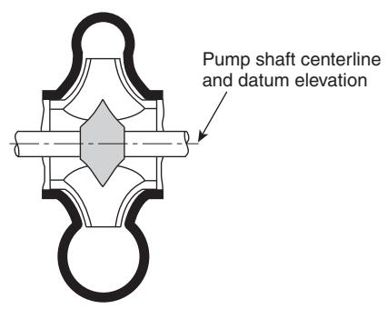

Horizontal double-suction pump  
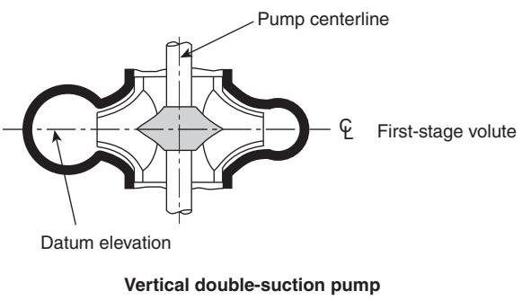

Notes:

(1) For all types of horizontal shaft pumps (single-stage doublesuction pump shown). Datum is same for multistage, single- (end) suction ANSI-type or any pump with a horizontal shaft.

(2) For all types of vertical shaft pumps (single-stage vertical double-suction pump shown). Datum is same for single- (end) suction, in-line, or any pump with a vertical shaft.

sions of feet (meters) of water. All pressure readings are converted into feet (meters) of the water being pumped. (See Figure A.3.3.29.)

A.3.3.29.3.1 Total Head (H), Horizontal Pumps. See Figure A.3.3.29.3.1. (Figure A.3.3.29.3.1 does not show the various types of pumps applicable.)

A.3.3.29.3.2 Total Head (H), Vertical Turbine Pumps. See Figure A.3.3.29.3.2.

A.3.3.29.6 Velocity Head (hv). For the purpose of this standard, the velocity head is calculated using the average velocity, which can be obtained by dividing the flow in cubic feet per second (or cubic meters per second) by the actual area of pipe cross section in square feet (or square meters). The velocity head is the vertical distance a body would have to fall to acquire the velocity (v). The velocity head (h ) is expressed by the following formula:

$$
h _ { v } = { \frac { v ^ { 2 } } { 2 g } }\tag{[A.3.3.29.6]}
$$

where:

v = velocity in the pipe [ft/sec (m/sec)] g = acceleration due to gravity: 32.17 ft/sec2 (9.807 m/sec2) at sea level and 45 degrees latitude

FIGURE A.3.3.29 Datum Elevation of Two Stationary Pump Designs.  
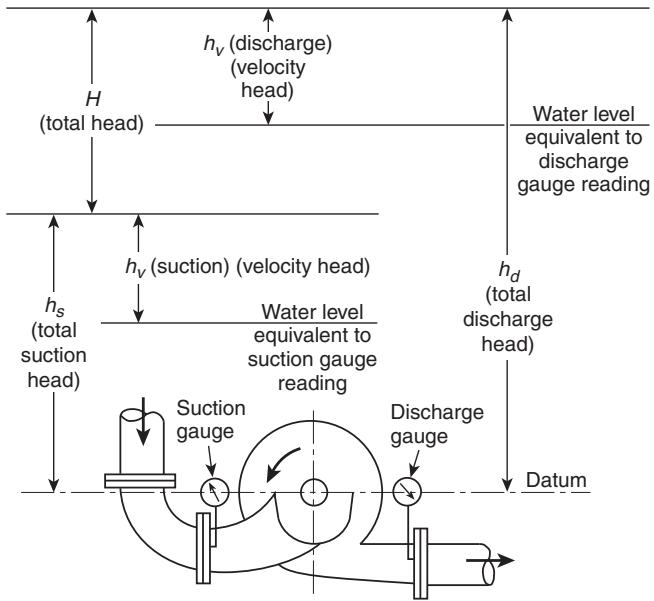  
Note: Installation with suction head above atmospheric pressure shown.

FIGURE A.3.3.29.3.1 Total Head of All Types of Stationary (Not Vertical Turbine–Type) Fire Pumps.  
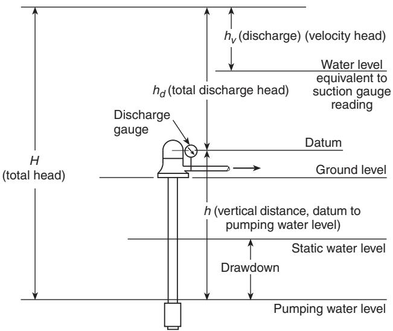  
FIGURE A.3.3.29.3.2 Total Head of Vertical Turbine–Type Fire Pumps.

A.3.3.42 No Flow (Churn, Shutoff). A small discharge of water is required to prevent the pump from overheating when operating under no flow (churn) conditions.

A.3.3.44 On-Site Standby Generator. It differs from an on-site power production facility in that it is not constantly producing power.

A.3.3.45 Peak Load. The maximum power requirements for a centrifugal pump typically occur when the pump is operating between 130 percent and 150 percent of the rated flow. The required power could continue to increase beyond 150 percent of rated flow, but NFPA 20 does not require testing beyond 150 percent of rated flow. The peak load can be determined by looking at the horsepower curve on the fire pump curve supplied by the pump manufacturer.

N A.3.3.47.2 Lowest Permissible Suction Pressure. The lowest pressure permitted by the authority having jurisdiction will likely be upstream of the backflow prevention device or at the connection to the water utility main. The permissible pressure at the pump suction could be lower than the limit stated by the authority having jurisdiction and could be determined by adding the friction loss and pressure elevation change between the cited location and the fire pump suction.

A.3.3.47.3 Net Pressure (Differential Pressure). The net pressure (differential pressure) includes the difference in velocity head correction (pressure) from the pump discharge to the pump suction. In many cases, the difference in suction and discharge velocity head correction (pressure) is small and can be ignored without adversely affecting the evaluation of the pump performance.

A.3.3.49.11 Multistage Multiport Pump. A multistage multiport pump functions similarly to fire pumps arranged in series. The primary difference between a multistage multiport pump and fire pumps arranged in series is that individual drivers are required for fire pumps arranged in series, and no shutoff valve is provided between the impellers on a multistage multiport pump.

A.3.3.49.19 Water Mist Positive Displacement Pumping Unit. It is not the intent of this standard to apply this term to individual pumps used to supply water mist systems. This term is intended to apply to water mist systems designed with multiple pumps where a pump operates individually or multiple pumps operate in parallel based on the demand of the system downstream and the number of nozzles that discharge. These pumps work together as a single unit to provide the necessary flow and pressure of the water mist system.

A.3.3.55 Series Fire Pump Unit. Pumps that fill tanks are not considered to be in series with the pumps supplied by those tanks. Water utilities and “campus type” water distribution systems that supply a fire pump within a building can have pumps that operate independently of, but are necessary to, the operation of a fire pump within the building. These pumps are not included within the definition of series fire pump unit, but the arrangement of these pumps should be reviewed as part of evaluating the water supply.

A.3.3.56 Service. For more information, see NFPA 70, Article 100.

A.3.3.57 Service Equipment. For more information, see NFPA 70, Article 100.

N A.3.3.59 Set Pressure. Pressure is limited by controlling the speed of the fire pump. Once the fire pump reaches its rated speed, the discharge pressure will decrease from the set pressure as the flow rate increases and/or the power draw peaks.

A.3.3.61 Signal. A response to signals is expected within 2 hours.

N A.3.3.76.2 Self-Regulating Variable Speed Fire Pump Unit. The self-regulating variable speed fire pump unit has onboard factory embedded logic that enables it to know the suction pressure, discharge pressure, and power draw, and to calculate the flow and net pressures from that information, and then communicate the information. All accessories required to perform the discharge pressure limiting and net pressure limiting functions by pump speed regulation are integrated in the pump unit.

Each self-regulating variable speed fire pump unit should include a bypass that can operate in automatic mode and via a manual mechanical operator that can be used to bypass the variable frequency drive (VFD) in order to apply power directly to the motor.

A.4.2 Because of the unique nature of fire pump units, the approval should be obtained prior to the assembly of any specific component.

N A.4.3.1 Determination of satisfactory operation can be made by either having a qualified person go to the pump room and monitor conditions in person, or having video, measurement, and sensor equipment installed in the pump room so that a qualified individual can determine satisfactory operation remotely.

A.4.3.2.3(2) Nationally recognized fire protection certification programs include, but are not limited to, those programs offered by the International Municipal Signal Association (IMSA) and the National Institute for Certification in Engineering Technologies (NICET). Note: These organizations and the products or services offered by them have not been independently verified by the NFPA, nor have the products or services been endorsed or certified by the NFPA or any of its technical committees.

A.4.3.3.3(2) See A.4.3.2.3(2).

A.4.3.4 Service personnel should be able to do the following:

(1) Understand the requirements contained in this standard and in NFPA 25 and the fire pump requirements contained in NFPA 70

(2) Understand basic job site safety laws and requirements (3) Apply troubleshooting techniques and determine the cause of fire protection system trouble conditions

(4) Understand equipment-specific requirements, such as programming, application, and compatibility

(5) Read and interpret fire protection system design documentation and manufacturers' inspection, testing, and maintenance guidelines

(6) Properly use tools and equipment required for testing and maintenance of fire protection systems and their components

(7) Properly apply the test methods required by this standard and NFPA 25

A.4.3.4.2(2) See A.4.3.2.3(2).

N A.4.4.3 Unit responsibility means the accountability to answer and resolve any and all problems regarding the installation, compatibility, performance, and acceptance of the equipment. Unit responsibility should not be construed to mean purchase of all components from a single supplier.

N A.4.5.1.5 This requires two additional certified test curves for each pump unit. The self-regulating mode (variable speed) test data shows the pressure/horsepower/speed on the Y axis and the flow on the X axis.

A.4.6.1 For water supply capacity and pressure requirements, see the following documents:

(1) NFPA 1

(2) NFPA 13

(3) NFPA 14

(4) NFPA 15   
(5) NFPA 16   
(6) NFPA 750

A.4.6.2 Where the suction supply is from a factory-use water system, pump operation at 150 percent of rated capacity should not create hazardous process upsets due to low water pressure.

N A.4.6.2.3.1 In this case, the maximum flow should be considered the highest flow that the water supply can achieve at the lowest permissible suction pressure.

A.4.6.4 Water sources containing salt or other materials deleterious to the fire protection systems should be avoided.

Where the authority having jurisdiction approves the start of an engine-driven fire pump on loss of ac power supply, the liquid supply should be sufficient to meet the additional cooling water demand.

A.4.7.1 This subsection does not preclude the use of pumps in public and private water supplies that provide water for domestic, process, and fire protection purposes. Such pumps are not fire pumps and are not expected to meet all the requirements of this standard. Such pumps are permitted for fire protection if they are considered reliable by the analysis mandated in Section 4.6. Evaluating the reliability should include at least the levels of supervision and rapid response to problems as are typical in municipal water systems.

If a private development (campus) needs a fire protection pump, this is typically accomplished by installing a dedicated fire pump (in accordance with this standard) in parallel with a domestic pump or as part of a dedicated fire branch/loop off a water supply.

A.4.7.3 It is not the intent of this subsection to require replacement of dual driver installations made prior to the adoption of the 1974 edition of this standard.

A.4.7.6 For centrifugal and turbine pumps, the maximum brake horsepower required to drive the pump typically occurs at a flow beyond 150 percent of the rated capacity. For positive displacement pumps, the maximum brake horsepower required to drive the pump typically occurs when the relief valve is flowing 100 percent of the rated pump capacity. Pumps connected to variable speed drivers can operate at lower speeds, but the driver needs to be selected based upon the power required to drive the pump at rated speed and maximum pump load under any flow condition.

A.4.7.7 A pressure relief valve is not an acceptable method of reducing system pressure under normal operating conditions. Prior to the 2003 edition, NFPA 20 did not strictly prohibit the use of pressure relief valves for management of excessive pressure at churn or low water flow conditions and only recognized it as a poor design practice as part of the 1999 edition. Existing installations designed under previous editions of NFPA 20 and containing pressure relief valves designed for such purposes might still be in service.

A.4.7.7.2 It is not the intent of this subsection to restrict the use of pressure-reducing valves downstream of the discharge isolation valve for the purpose of meeting the requirements of 4.7.7.

A.4.7.7.3.2 This requirement is intended to take into consideration the set pressure tolerance performance of the variable speed pressure limiting control as stated by the manufacturer.

N A.4.8.9(8) The set pressure not met alarm signal would be sent whenever the discharge pressure is below the set pressure and the power draw is below the design maximum.

N A.4.8.16 Under no-flow conditions, the jockey pump might maintain the pressure in the system above the set pressure, causing the variable speed control to slow down. This limits the minimum pump speed to approximately 50 percent of the rated speed.

A.4.10 The performance of the pump when applied at capacities over 140 percent of rated capacity can be adversely affected by the suction conditions. Application of the pump at capacities less than 90 percent of the rated capacity is not recommended.

The selection and application of the fire pump should not be confused with pump operating conditions. With proper suction conditions, the pump can operate at any point on its characteristic curve from shutoff to 150 percent of its rated capacity.

A.4.10.2 In countries that use the metric system, there do not appear to be standardized flow ratings for pump capacities; therefore, the metric conversions listed in Table 4.10.2 are soft conversions.

A.4.12.2 For protection against damage from overpressure, where desired, a gauge protector should be installed.

N A.4.13.1.1 Under no-flow conditions, the jockey pump might maintain the pressure in the system above the set pressure, causing the variable speed control to slow down. However, there is still a need to discharge a small amount of water to cool the pump.

A.4.14 Special consideration needs to be given to fire pump installations installed below grade. Light, heat, drainage, ventilation, and potential flooding are several of the variables that need to be addressed. Some locations or installations might not require a pump house. Where a pump room or pump house is required, it should be of ample size and located to permit short and properly arranged piping. The suction piping should receive first consideration. The pump house should preferably be a detached building of noncombustible construction. A onestory pump room with a combustible roof, either detached or well protected from an adjoining one-story building, is acceptable if sprinklered. Where a detached building is not feasible, the pump room should be located and constructed to protect the pump unit and controls from falling floors or machinery, and from fire that could drive away the pump operator or damage the pump unit or controls. Access to the pump room should be provided from outside the building. Where the use of brick or reinforced concrete is not feasible, metal lath and plaster is recommended for the construction of the pump room. The pump room or pump house should not be used for storage purposes. Vertical shaft turbine–type pumps might necessitate a removable panel in the pump house roof to permit the pump to be removed for inspection or repair. Proper clearances to equipment should be provided as recommended by the manufacturer's drawings.

Δ A.4.14.1 A fire pump that is inoperative for any reason at any time constitutes an impairment to the fire protection system. It should be returned to service without delay.

Rain, intense heat from the sun, blown freezing rain, blowing sand or dust, flood, rodents, insects, and vandals are adverse conditions to equipment not installed in an acceptable protective building or enclosure. At a minimum, equipment installed should be shielded by a roof or deck.

A.4.14.1.1 Most fire departments have procedures requiring operation of a fire pump unit during an incident. Building designers should locate the fire pump room to be easily accessible during an incident.

A.4.14.1.1.2 The purpose for the “Not Sprinklered” column in Table 4.14.1.1.2 is to provide guidance for unsprinklered buildings. This does not permit sprinklers to be omitted from pump rooms in fully sprinklered buildings.

A.4.14.1.1.3 This section allows for the installation of special hazard fire protection systems such as local application water mist inside buildings that may or may not be otherwise protected. The concern is to assure that a fire associated with the process being protected does not cause an immediate failure of the pumping system. It is not the intent of this section to provide protection for the entire building or to protect the process area from an exposure fire involving that building section.

A.4.14.1.1.5 Equipment that increases the fire hazard (such as boilers) and is not related to fire protection systems should not be in a fire pump room.

N A.4.14.1.1.6 Items that would create an additional hazard, such as fuel-fired water heaters, should not be installed inside the pump room.

A.4.14.7 Pump rooms and pump houses should be dry and free of condensate. To accomplish a dry environment, heat might be necessary.

A.4.15.1 The exterior of aboveground steel piping should be kept painted.

A.4.15.2 Flanges welded to pipe are preferred.

A.4.15.6 Currently, NFPA 13 requirements do not address fire pumps, controllers, driver, fuel tanks (including the trim), test header piping, relief valve piping, or exhaust mufflers.

A.4.15.7 When welding is performed on the pump suction or discharge piping with the pump in place, the welding ground should be on the same side of the pump as the welding.

Δ A.4.16.1 The exterior of steel suction piping should be kept painted.

Buried iron or steel pipe should be lined and coated or protected against corrosion in conformance with AWWA C104, Cement-Mortar Lining for Ductile-Iron Pipe and Fittings, or equivalent standards.

A.4.16.3.2 It is permitted that the suction pressure drop to –3 psi (–0.2 bar) for a centrifugal pump that is taking suction from a grade level storage tank where the pump suction elevation is at or below the water level in the water storage tank at the end of the required water flow duration. This negative suction pressure is to allow for the friction loss in the suction piping when the pump is operating at 150 percent capacity.

A.4.16.4 The following notes apply to Figure A.4.16.4:

(1) A jockey pump is usually required with automatically controlled pumps.

(2) If testing facilities are to be provided, also see Figure A.4.22.1.3(a) and Figure A.4.22.1.3(b).

(3) Pressure-sensing lines also need to be installed in accordance with 10.5.2.1 or 12.7.2.1. See Figure A.4.32(a) and Figure A.4.32(b).

A.4.16.5 Where the suction supply is from public water mains, the gate valve should be located as far as is practical from the suction flange on the pump. Where it comes from a stored water container, the gate valve should be located at the outlet of the container. A butterfly valve on the suction side of the pump can create turbulence that adversely affects the pump performance and can increase the possibility of blockage of the pipe.

A.4.16.6 See Figure A.4.16.6. (See ANSI/HI 9.6.6, Rotodynamic Pumps for Pump Piping, for additional information.)

A.4.16.8 In the selection of screen material, consideration should be given to prevention of fouling from aquatic growth. Antifouling is best accomplished with brass or copper wire.

A.4.16.9 The term device as used in this subsection is intended to include, but not be limited to, devices that sense suction pressure and then restrict or stop the fire pump discharge. Due to the pressure losses and the potential for interruption of the flow to the fire protection systems, the use of backflow prevention devices is discouraged in fire pump piping. Where required, however, the placement of such a device on the discharge side of the pump is to ensure acceptable flow characteristics to the pump suction. It is more efficient to lose the pressure after the pump has boosted it, rather than before the pump boosts it. Where the backflow preventer is on the discharge side of the pump and a jockey pump is installed, the jockey pump discharge and sensing lines need to be located so that a cross-connection is not created through the jockey pump.

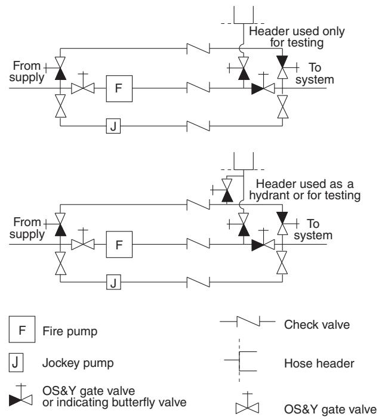

Isolation valve

FIGURE A.4.16.4 Schematic Diagram of Suggested Arrangements for a Fire Pump with a Bypass, Taking Suction from Public Mains.

<table><tr><td>Right</td><td colspan="2">Wrong</td></tr><tr><td>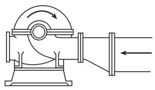</td><td></td><td>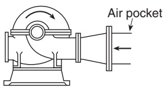 Wrong 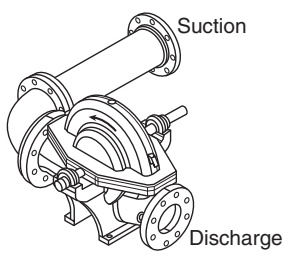</td></tr><tr><td>Right Suction Distance between pump flange and elbow/tee flange is greater than 10 pipe diameters</td><td></td><td>Wrong Suction Distance between pump flange and elbow/tee flange is less than 10 pipe diameters</td></tr><tr><td>Tee/elbow Discharge Right</td><td>Tee/elbow</td><td>Discharge Wrong</td></tr><tr><td>Suction Distance between pump flange and elbow/tee /flange is greater than 10 pipe diameters</td><td>Suction</td><td>Distance between pump flange and elbow/tee flange is less than 10 pipe diameters</td></tr><tr><td>Discharge Right</td><td></td><td>Discharge Right Suction</td></tr><tr><td>Suction</td><td>Optional→ Discharge</td><td></td></tr></table>

FIGURE A.4.16.6 Right and Wrong Pump Suctions.

A.4.16.10 For more information, see ANSI/HI 9.6.6, Rotodynamic Pumps for Pump Piping. (See Figure A.4.16.10.)

A.4.17.4 Flanges welded to the pipe are preferred.

A.4.17.6 The discharge pipe size should be such that, with the pump(s) operating at 150 percent of rated capacity, the velocity in the discharge pipe does not exceed 20 ft/sec (6.1 m/sec).

A.4.17.7 Large fire protection systems sometimes experience severe water hammer caused by backflow when the automatic control shuts down the fire pump. Where conditions can be expected to cause objectionable water hammer, a listed antiwater-hammer check valve should be installed in the discharge line of the fire pump. Automatically controlled pumps in tall buildings could give trouble from water hammer as the pump is shutting down.

Where a backflow preventer is substituted for the discharge check valve, an additional backflow preventer might be necessary in the bypass piping to prevent backflow through the bypass.

Where a backflow preventer is substituted for the discharge check valve, the connection for the sensing line is permitted to be between the last check valve and the last control valve if the pressure sensing line connection can be made without altering the backflow valve or violating its listing. This method can sometimes be done by adding a connection through the test port on the backflow valve. In this situation, the discharge control valve is not necessary, because the last control valve on the backflow preventer serves this function.

Where a backflow preventer is substituted for the discharge check valve and the connection of the sensing line cannot be made within the backflow preventer, the sensing line should be connected between the backflow preventer and the pump's discharge control valve. In this situation, the backflow preventer cannot substitute for the discharge control valve because the sensing line must be able to be isolated.

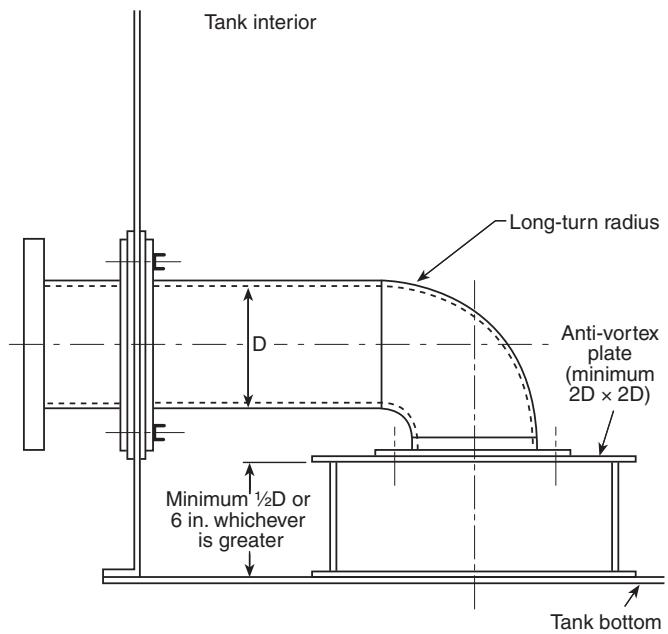  
For SI units, 1 in. = 25.4 mm.

FIGURE A.4.16.10 Anti-Vortex Plate Assembly.

A.4.17.8 See A.4.17.7 for circumstances where a backflow preventer can be substituted for the discharge control valve.

A.4.17.11 See 4.7.7.2.

A.4.18 Isolation valves and control valves are considered to be identical when used in conjunction with a backflow prevention assembly.

A.4.19 Pipe breakage caused by movement can be greatly lessened and, in many cases, prevented by increasing flexibility between major parts of the piping. One part of the piping should never be held rigidly and another free to move without provisions for relieving the strain. Flexibility can be provided by the use of flexible couplings at critical points and by allowing clearances at walls and floors. Fire pump suction and discharge pipes should be treated the same as sprinkler risers for whatever portion is within a building. (See NFPA 13.)

Holes through pump room fire walls should be packed with mineral wool or other suitable material held in place by pipe collars on each side of the wall. Pipes passing through foundation walls or pit walls into the ground should have clearance from these walls, but holes should be watertight. Space around pipes passing through pump room walls or pump house floors can be filled with asphalt mastic. The movement being addressed in Section 4.19 is settling of the system and possible vibration during the operation of the fire pump. The section does not address anticipated earthquake forces.

A.4.20.1 The pressure is required to be evaluated at 121 percent of the net rated shutoff pressure because the pressure is proportional to the square of the speed that the pump is turned. A diesel engine governor is required to be capable of limiting the maximum engine speed to 110 percent, creating a pressure of 121 percent. Since the only time that a pressure relief valve is required by the standard to be installed is when the diesel engine is turning faster than normal, and since this is a relatively rare event, it is permitted for the discharge from the pressure relief valve to be piped back to the suction side of the pump.

A.4.20.1.1 In situations where the required system pressure is close to the pressure rating of the system components and the water supply pressure varies significantly over time, to eliminate system overpressurization, it might be necessary to use one of the following:

(1) A tank between the water supply and the pump suction, in lieu of directly connecting to the water supply piping (2) A variable speed pressure limiting control device

A.4.20.2.1 See Figure A.4.20.2.1.

A.4.20.5 The relief valve cone should be piped to a point where water can be freely discharged, preferably outside the building. If the relief valve discharge pipe is connected to an underground drain, care should be taken that no steam drains enter near enough to work back through the cone and into the pump room.

A.4.20.7 Where the relief valve discharges back to the source of supply, the back pressure capabilities and limitations of the valve to be used should be determined. It might be necessary to increase the size of the relief valve and piping above the minimum to obtain adequate relief capacity due to back pressure restriction.

A.4.20.8 When discharge enters the reservoir below minimum water level, there is not likely to be an air problem. If it enters over the top of the reservoir, the air problem is reduced by extending the discharge to below the normal water level.

A.4.21.2.1 Where pumps are installed in series and are located in the same pump room, the discharge pressure from the second (or third) pump is typically at a pressure that is too high for the outlets on a fire sprinkler or standpipe system on the lower floors of the building. Rather than use this high discharge pressure with pressure-reducing valves, it is a common, and accepted practice, to take the fire protection supply from the discharge of the preceding pump through a connection between that pump and subsequent pump(s) as shown in Figure A.4.22.1.3(a) and Figure A.4.22.1.3(b).

A.4.21.2.8.1 The following methods should be considered acceptable:

(1) Be encased in a minimum of 2 in. (50 mm) of concrete

(2) Be protected by a listed fire-rated assembly that has a minimum 2-hour fire rating and is dedicated to the fire pump circuit(s)

(3) Be a listed electrical circuit protective system that has a minimum 2-hour fire rating

(4) Be protected by a listed fire-rated assembly that has a minimum 2-hour fire rating and contains only emergency alarm and/or control wiring circuits dedicated to fire pumps, or emergency systems generators, or legally required generators, and no power wiring circuits

A.4.22.1.1 The two objectives of running a pump test are to make sure that the pump itself is still functioning properly and to make sure that the water supply can still deliver the correct amount of water to the pump at the correct pressure. Some arrangements of test equipment do not permit the water supply to be tested. Every fire pump installation needs to have at least one arrangement of test equipment where the water supply can be tested. Inspection, testing, and maintenance standards (NFPA 25) require the pump test to be run at least once every 3 years using a method that tests the water supply's ability to provide water to the pump.

A.4.22.1.3 Outlets can be provided through the use of standard test headers, yard hydrants, wall hydrants, or standpipe hose valves.

SAMPLE PRESSURE RELIEF VALVE CALCULATION DISCHARGE TO ATMOSPHERE For a 1,500 gpm at 100 psi Fire Pump
<table><tr><td rowspan=1 colspan=4>1. Pressure rating of the system components</td><td rowspan=1 colspan=1>175</td></tr><tr><td rowspan=1 colspan=4>2. Maximum pump over speed</td><td rowspan=1 colspan=1>110%</td></tr><tr><td rowspan=1 colspan=4>3. Pump size</td><td rowspan=1 colspan=1>1,500</td></tr><tr><td rowspan=1 colspan=4>4. Rated pump pressure</td><td rowspan=1 colspan=1>100</td></tr><tr><td rowspan=1 colspan=3></td><td rowspan=1 colspan=1>NormalStatic Pressure(at rated speed)</td><td rowspan=1 colspan=1>MaximumPressure Static(at Max PumpOver speed)</td></tr><tr><td rowspan=1 colspan=3>5. Pump net pressure (rated pressure at 100%)</td><td rowspan=1 colspan=1>100</td><td rowspan=1 colspan=1>121.0</td></tr><tr><td rowspan=1 colspan=3>6. Pump net churn pressure (0 flow)</td><td rowspan=1 colspan=1>120</td><td rowspan=1 colspan=1>145.2</td></tr><tr><td rowspan=1 colspan=3>7. Pump net pressure @ 150% of rated flow</td><td rowspan=1 colspan=1>65</td><td rowspan=1 colspan=1>78.7</td></tr><tr><td rowspan=1 colspan=3>8. Maximum static pressure at pump suction</td><td rowspan=1 colspan=1>50</td><td rowspan=1 colspan=1>50</td></tr><tr><td rowspan=1 colspan=3>9. Available flow at pump suction</td><td rowspan=1 colspan=1>1,320</td><td rowspan=1 colspan=1>1,320</td></tr><tr><td rowspan=1 colspan=3>10. Residual pressure at pump suction</td><td rowspan=1 colspan=1>45</td><td rowspan=1 colspan=1>45</td></tr><tr><td rowspan=1 colspan=3>11. Maximum pump discharge pressure at churn</td><td rowspan=1 colspan=1>170</td><td rowspan=1 colspan=1>195.2</td></tr><tr><td rowspan=1 colspan=3>12. Maximum allowable net discharge pressure</td><td rowspan=1 colspan=1></td><td rowspan=1 colspan=1>125</td></tr><tr><td rowspan=1 colspan=4>13. Pump flow rate at maximum net pressure adjusted to normal speed[#12/(#2* #2)] = 103.3 psi</td><td rowspan=1 colspan=1>1,360.4</td></tr><tr><td rowspan=1 colspan=4>14. Required flow rate through the pressure relief valve (pump flow rateat 125 psi and overspeed or [#13* #2])</td><td rowspan=1 colspan=1>1,496.5</td></tr><tr><td rowspan=1 colspan=4>15. Set pressure for pressure relief valve</td><td rowspan=1 colspan=1>175</td></tr><tr><td rowspan=1 colspan=4>16. Pressure relief valve size</td><td rowspan=1 colspan=1>4</td></tr><tr><td rowspan=1 colspan=4>17. Pressure relief valve pipe size</td><td rowspan=1 colspan=1>4.026</td></tr><tr><td rowspan=1 colspan=4>18. Nozzle (pipe) discharge coefficient</td><td rowspan=1 colspan=1>0.9</td></tr><tr><td rowspan=1 colspan=4>19. C factor</td><td rowspan=1 colspan=1>120</td></tr><tr><td rowspan=1 colspan=4>20. Pressure relief valve Cv (P=[Q/Cv]²)</td><td rowspan=1 colspan=1>240</td></tr><tr><td rowspan=5 colspan=1>21. Pressure ReliefValve Fittings</td><td rowspan=1 colspan=1>Type Fitting</td><td rowspan=1 colspan=1>Numberof Fittings</td><td rowspan=1 colspan=1>EquivalentLength</td><td rowspan=1 colspan=1>Total EquivalentLength</td></tr><tr><td rowspan=1 colspan=1>45°</td><td rowspan=1 colspan=1>1</td><td rowspan=1 colspan=1>4</td><td rowspan=1 colspan=1>4</td></tr><tr><td rowspan=1 colspan=1>Ells</td><td rowspan=1 colspan=1>2</td><td rowspan=1 colspan=1>10</td><td rowspan=1 colspan=1>20</td></tr><tr><td rowspan=1 colspan=1>LRE</td><td rowspan=1 colspan=1>0</td><td rowspan=1 colspan=1>6</td><td rowspan=1 colspan=1>0</td></tr><tr><td rowspan=1 colspan=1></td><td rowspan=1 colspan=1></td><td rowspan=1 colspan=1></td><td rowspan=1 colspan=1></td></tr><tr><td rowspan=1 colspan=4>22. Pressure relief valve pipe length</td><td rowspan=1 colspan=1>30</td></tr><tr><td rowspan=1 colspan=4>23. Total equivalent length</td><td rowspan=1 colspan=1>54</td></tr><tr><td rowspan=1 colspan=4>24. Friction loss per foot in pipe at flow #14</td><td rowspan=1 colspan=1>0.594</td></tr><tr><td rowspan=1 colspan=4>25. Total loss in pressure relief valve piping (#23 × #24)</td><td rowspan=1 colspan=1>32.1</td></tr><tr><td rowspan=1 colspan=4>26. Friction loss in pressure relief valve at estimated flow (valve wide open)([#14/#20]2)</td><td rowspan=1 colspan=1>38.9</td></tr><tr><td rowspan=1 colspan=4>27. Pressure at pressure relief valve discharge (#1 – #25– #26)</td><td rowspan=1 colspan=1>104.1</td></tr><tr><td rowspan=1 colspan=4>28. Elevation difference (0.433*Elev difference in feet)</td><td rowspan=1 colspan=1>0</td></tr><tr><td rowspan=1 colspan=4>29. Required pressure at relief piping discharge (pitot pressure at a flow of #14)({#14/[29.83×#18×#172]}2)</td><td rowspan=1 colspan=1>11.8</td></tr><tr><td rowspan=1 colspan=5>Conclusion: The discharge pressure at the pressure relief piping (with the pressure relief valvewide open) exceeds the pitot pressure required for the flow; therefore the pressure relief componentsare adequately sized.</td></tr></table>

FIGURE A.4.20.2.1 Sample Pressure Relief Valve Calculation.

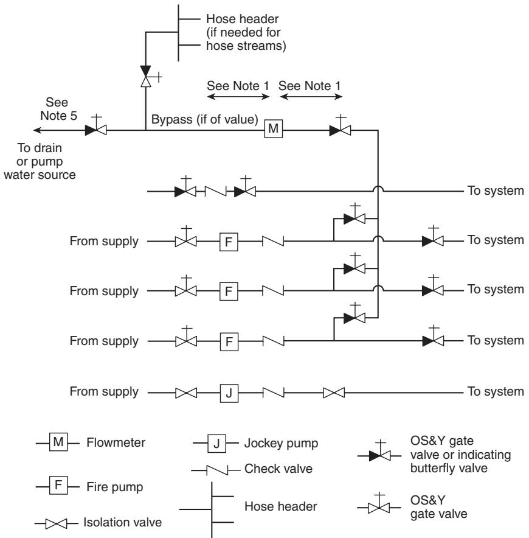  
FIGURE A.4.22.1.3(a) Preferred Arrangement for Measuring Fire Pump Water Flow with Meter for Multiple Pumps and Water Supplies. Water is permitted to discharge to a drain or to the fire pump water source. (See the text for information on the notes.)

The following notes apply to Figure A.4.22.1.3(a) and Figure A.4.22.1.3(b):

(1) The distance from the flowmeter to either isolation valve should be as recommended by the meter manufacturer.

(2) For horizontal split-case fire pumps, there should be a distance of not less than 10 diameters of suction pipe for side connection (not recommended) to the fire pump suction flange. (See 4.16.6.3.1.)

(3) Automatic air release should be provided if piping forms an inverted “U,” trapping air.

(4) The fire protection system should have outlets available to test the fire pump and suction supply piping. (See A.4.22.3.1.)

(5) The closed loop meter arrangement will test only net pump performance. It does not test the condition of the suction supply, valves, piping, and so forth.

(6) Return piping should be arranged so that no air can be trapped that would eventually end up in the eye of the pump impeller.

(7) Turbulence in the water entering the pump should be avoided to eliminate cavitation, which would reduce pump discharge and damage the pump impeller. For this reason, side connection is not recommended.

(8) Prolonged recirculation can cause damaging heat buildup, unless some water is wasted.

(9) The flowmeter should be installed according to manufacturer's instructions.

(10) Pressure sensing lines also need to be installed in accordance with 10.5.2.1. [See Figure A.4.32(a) and Figure A.4.32(b).]

A.4.22.1.5 The hose valves of the fire pump test header should be located on the building exterior. This is because the test discharge needs to be directed to a safe outdoor location, and to protect the fire pumps, controllers, and so forth, from accidental water spray. In instances where damage from theft or vandalism is a concern, the test header hose valves can be located within the building but outside of the fire pump room if, in the judgment of the authority having jurisdiction, the test flow can be safely directed outside the building without undue risk of water spray to the fire pump equipment.

**A.4.22.2.1 Metering devices should discharge to drain.**

In the case of a limited water supply, the discharge should be back to the water source (e.g., suction tank, small pond). If this discharge enters the source below minimum water level, it is not likely to create an air problem for the pump suction. If it enters over the top of the source, the air problem is reduced by extending the discharge to below the normal water level.

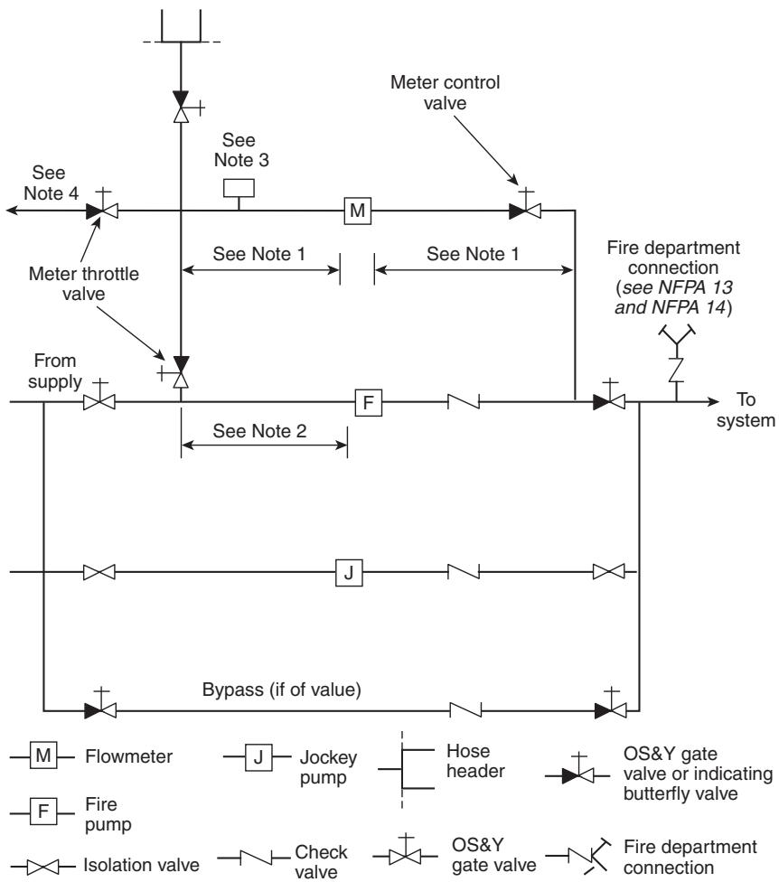  
FIGURE A.4.22.1.3(b) Typical Arrangement for Measuring Fire Pump Water Flow with Meter. Discharge from the flowmeter is recirculated to the fire pump suction line. (See the text for information on the notes.)

A.4.22.2.10 The testing arrangement should be designed to minimize the length of fire hose needed to discharge water safely [approximately 100 ft (30 m)]. Where a flow test meter is installed, an alternate means of testing, such as hydrants, hose valves, test header(s), and so forth is needed as an alternate means of testing the performance of the fire pump, and to verify the accuracy of the metering device.

A.4.22.3.1 The hose valves should be attached to a header or manifold and connected by suitable piping to the pump discharge piping. The connection point should be between the discharge check valve and the discharge gate valve. Hose valves should be located to avoid any possible water damage to the pump driver or controller. If there are other adequate pump testing facilities, the hose valve header can be omitted when its main function is to provide a method of pump and suction supply testing. Where the hose header also serves as the equivalent of a yard hydrant, this omission should not reduce the number of hose valves to less than two.

A.4.22.3.1.3(1) Outlets are typically provided through a standard test header. The test header is usually connected to the pump system between the discharge check valve and the discharge control valve for the pump so that the fire protection system can be isolated from the pump during testing if desired. However, the objective of testing the pump can be achieved with other arrangements as well.

**A.4.22.3.4(2) See Figure A.4.22.3.4(2).**

A.4.25 Pumps are designated as having right-hand, or clockwise (CW), rotation or left-hand, or counterclockwise (CCW), rotation. Diesel engines are commonly stocked and supplied with clockwise rotation.

SAMPLE PUMP TEST HEADER SIZE CALCULATION
<table><tr><td rowspan=1 colspan=3>Pump size</td><td rowspan=1 colspan=1>1500</td><td rowspan=1 colspan=1></td><td rowspan=1 colspan=1></td></tr><tr><td rowspan=1 colspan=3>Number of test hose streams</td><td rowspan=1 colspan=1>6</td><td rowspan=1 colspan=1></td><td rowspan=1 colspan=1></td></tr><tr><td rowspan=1 colspan=3>Size of hose</td><td rowspan=1 colspan=1>21/2</td><td rowspan=1 colspan=1></td><td rowspan=1 colspan=1></td></tr><tr><td rowspan=1 colspan=3>Feet of hose per test hose</td><td rowspan=1 colspan=1>50</td><td rowspan=1 colspan=1></td><td rowspan=1 colspan=1></td></tr><tr><td rowspan=1 colspan=3>Nozzle size</td><td rowspan=1 colspan=1>1.75</td><td rowspan=1 colspan=1></td><td rowspan=1 colspan=1></td></tr><tr><td rowspan=1 colspan=3>Nozzle coefficient</td><td rowspan=1 colspan=1>0.97</td><td rowspan=1 colspan=1></td><td rowspan=1 colspan=1></td></tr><tr><td rowspan=1 colspan=3>Pump test header pipe size</td><td rowspan=1 colspan=1>8.071</td><td rowspan=1 colspan=1></td><td rowspan=1 colspan=1></td></tr><tr><td rowspan=1 colspan=3>C factor</td><td rowspan=1 colspan=1>120</td><td rowspan=1 colspan=1></td><td rowspan=1 colspan=1></td></tr><tr><td rowspan=8 colspan=1>Pump Test HeaderPipe Fittings</td><td rowspan=1 colspan=1>TypeFitting</td><td rowspan=1 colspan=1>Number</td><td rowspan=1 colspan=1>Equiv.Length</td><td rowspan=1 colspan=1>TotalEquiv.Length</td><td rowspan=1 colspan=1></td></tr><tr><td rowspan=1 colspan=1>45°</td><td rowspan=1 colspan=1>1</td><td rowspan=1 colspan=1>9</td><td rowspan=1 colspan=1>9</td><td rowspan=1 colspan=1></td></tr><tr><td rowspan=1 colspan=1>E</td><td rowspan=1 colspan=1>1</td><td rowspan=1 colspan=1>18</td><td rowspan=1 colspan=1>18</td><td rowspan=1 colspan=1></td></tr><tr><td rowspan=1 colspan=1>LRE</td><td rowspan=1 colspan=1>0</td><td rowspan=1 colspan=1>13</td><td rowspan=1 colspan=1>0</td><td rowspan=1 colspan=1></td></tr><tr><td rowspan=1 colspan=1>T</td><td rowspan=1 colspan=1>1</td><td rowspan=1 colspan=1>35</td><td rowspan=1 colspan=1>35</td><td rowspan=1 colspan=1></td></tr><tr><td rowspan=1 colspan=1>BV</td><td rowspan=1 colspan=1>0</td><td rowspan=1 colspan=1>12</td><td rowspan=1 colspan=1>0</td><td rowspan=1 colspan=1></td></tr><tr><td rowspan=1 colspan=1>GV</td><td rowspan=1 colspan=1>1</td><td rowspan=1 colspan=1>4</td><td rowspan=1 colspan=1>4</td><td rowspan=1 colspan=1></td></tr><tr><td rowspan=1 colspan=1>SW</td><td rowspan=1 colspan=1>1</td><td rowspan=1 colspan=1>45</td><td rowspan=1 colspan=1>45</td><td rowspan=1 colspan=1></td></tr><tr><td rowspan=1 colspan=4>Pump test header pipe length</td><td rowspan=1 colspan=1>30</td><td rowspan=1 colspan=1></td></tr><tr><td rowspan=1 colspan=4>Total equivalent length</td><td rowspan=1 colspan=1>141</td><td rowspan=1 colspan=1></td></tr><tr><td rowspan=1 colspan=4>Maximum test flow</td><td rowspan=1 colspan=1>2250</td><td rowspan=1 colspan=1></td></tr><tr><td rowspan=1 colspan=4>Friction loss per ft in pipe</td><td rowspan=1 colspan=1>0.0392</td><td rowspan=1 colspan=1></td></tr><tr><td rowspan=1 colspan=4>Total loss in pump test header pipe</td><td rowspan=1 colspan=1></td><td rowspan=1 colspan=1>5.5</td></tr><tr><td rowspan=1 colspan=4>Flow in each hose</td><td rowspan=1 colspan=1>375</td><td rowspan=1 colspan=1></td></tr><tr><td rowspan=1 colspan=4>Friction loss in 100 ft of hose</td><td rowspan=1 colspan=1>28.125</td><td rowspan=1 colspan=1></td></tr><tr><td rowspan=1 colspan=4>Total friction loss in hose</td><td rowspan=1 colspan=1></td><td rowspan=1 colspan=1>14.1</td></tr><tr><td rowspan=1 colspan=4>Equivalent pipe length 2½ in. valve</td><td rowspan=1 colspan=1>7</td><td rowspan=1 colspan=1></td></tr><tr><td rowspan=1 colspan=4>Friction loss in 2½ in. pipe</td><td rowspan=1 colspan=1>0.4561</td><td rowspan=1 colspan=1></td></tr><tr><td rowspan=1 colspan=5>Friction loss through 2½ in. valve</td><td rowspan=1 colspan=1>3.2</td></tr><tr><td rowspan=1 colspan=5>Required pitot pressure</td><td rowspan=1 colspan=1>18</td></tr><tr><td rowspan=1 colspan=5>Elevation difference</td><td rowspan=1 colspan=1>0</td></tr><tr><td rowspan=1 colspan=5>Required pump discharge</td><td rowspan=1 colspan=1>40.8</td></tr><tr><td rowspan=1 colspan=6></td></tr></table>

**FIGURE A.4.22.3.4(2) Sample Pump Test Header Calculation.**

Pump shaft rotation can be determined as follows:

(1) Horizontal Pump Shaft Rotation. The rotation of a horizontal pump can be determined by standing at the driver end and facing the pump. [See Figure A.4.25(a).] If the top of the shaft revolves from the left to the right, the rotation is right-handed, or clockwise (CW). If the top of the shaft revolves from right to left, the rotation is left-handed, or counterclockwise (CCW).

(2) Vertical Pump Shaft Rotation. The rotation of a vertical pump can be determined by looking down at the top of the pump. If the point of the shaft directly opposite revolves from left to right, the rotation is right-handed, or clockwise (CW). [See Figure A.4.25(b).] If the point of the shaft directly opposite revolves from right to left, the rotation is left-handed, or counterclockwise (CCW).

A.4.26 In addition to those conditions that require signals for pump controllers and engines, there are other conditions for which such signals might be recommended, depending upon local conditions. Some of these conditions are as follows:

(1) Low pump room temperature

(2) Relief valve discharge

(3) Flowmeter left on, bypassing the pump

(4) Water level in suction supply below normal

(5) Water level in suction supply near depletion

(6) Steam pressure below normal

Such additional signals can be incorporated into the trouble signals already provided on the controller, or they can be independent.

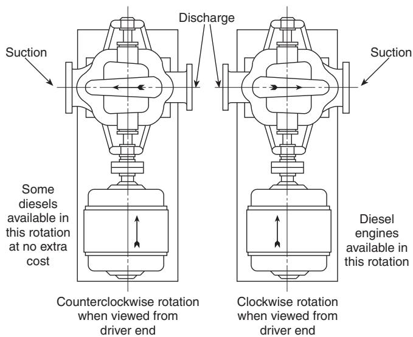  
FIGURE A.4.25(a) Horizontal Pump Shaft Rotation.

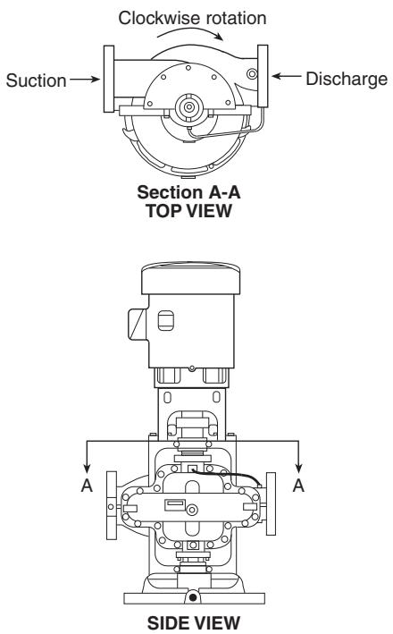  
FIGURE A.4.25(b) Vertical Pump Shaft Rotation.

A.4.27 Pressure maintenance (jockey or make-up) pumps should be used where it is desirable to maintain a uniform or relatively high pressure on the fire protection system.

A domestic water pump in a dual-purpose water supply system can function as a means of maintaining pressure.

A.4.27.2.1 The sizing of the pressure maintenance pump requires a thorough analysis of the type and size of system the pressure maintenance pump will serve. Pressure maintenance pumps on fire protection systems that serve large underground mains need to be larger than pressure maintenance pumps that serve small aboveground fire protection systems. Underground mains are permitted by NFPA 24 to have some leakage (see

10.10.2.2.6 of NFPA 24), while aboveground piping systems are required to be tight when new and should not have significant leakage.

For situations where the pressure maintenance pump serves only aboveground piping for fire sprinkler and standpipe systems, the pressure maintenance pump should be sized to provide a flow less than a single fire sprinkler. The main fire pump should start and run (providing a pump running signal) for any waterflow situation where a sprinkler has opened, which will not happen if the pressure maintenance pump is too large.

One guideline that has been successfully used to size pressure maintenance pumps is to select a pump that will make up the allowable leakage rate in 10 minutes or 1 gpm (3.8 L/min), whichever is larger.

A.4.27.5 A centrifugal-type pressure maintenance pump is preferable.

The following notes apply to a centrifugal-type pressure maintenance pump:

(1) A jockey pump is usually required with automatically controlled pumps.

(2) Jockey pump suction can come from the tank filling supply line. This situation would allow high pressure to be maintained on the fire protection system even when the supply tank is empty for repairs.

(3) Pressure sensing lines also need to be installed in accordance with 10.5.2.1. [See and Figure A.4.32(a) and Figure A.4.32(b).]

A.4.27.6.5 See Figure A.4.27.6.5.

A.4.30.2 NFPA 13 contains specific requirements for seismic design of fire protection systems. It is a simplified approach that was developed to coincide with ASCE/SEI 7, Minimum Design Loads for Buildings and Other Structures, and current building codes.

A.4.30.3.2 The top bracing for these pumps will connect to the pump above its center of gravity. The opposite end of the bracing can connect to the floor or the mounting structure for the pump.

A.4.30.3.3 The exhaust piping from diesel fire pumps can be secured by following the criteria in NFPA 13.

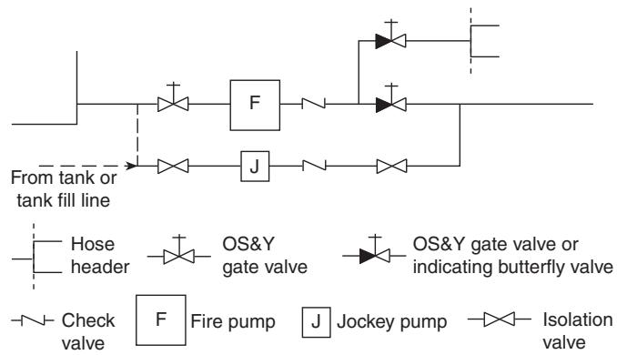  
FIGURE A.4.27.6.5 Jockey Pump Installation with Fire Pump.

A.4.30.3.4.1 Hangers that offer lateral restraint on these smaller diameter trim lines should be sufficient.

A.4.31.9 Figure A.4.31.9 illustrates a typical foundation detail for a packaged fire pump assembly.

A.4.32 See Figure A.4.32(a) and Figure A.4.32(b).

A.4.32.3 The use of soft copper tubing is not permitted for a pressure sensing line because it is easily damaged.

Differentiation must be made between nominal pipe sizes and nominal tube sizes. The nominal pipe sizes are based on the approximate inside diameters of the pipe, whereas tube sizes are based on outside diameters. For example, nominal 1∕2 in. (15 mm) copper Type K, L, or M, or Series 300 stainless steel pipe would be equivalent to nominal 5∕8 in. (16 mm) or 0.625 in. (15 mm) O.D. tube.

N A.4.35.1 Certain devices, meters, and equipment that can be used to perform inspection and testing procedures from a distance are not integral to the system and don’t affect system performance. Automated inspection and testing devices and equipment, such as a digital camera, can be in the riser room or attached to the system externally but are not an integral part of the system. Such devices do not need to be listed.

N A.4.35.2 Certain devices and equipment that can be used to monitor system or component status from a distance are not integral to the system and don’t affect system performance. Distance monitoring devices, such as an external thermometer, can be attached to the system externally and, therefore, are not subjected to system pressure. Such devices do not need to be listed.

A.5.2 The location of a pump room in a high-rise building requires a great deal of consideration. Personnel are required to be sent to the pump room to monitor the operation of the pump during fire-fighting activities in the building. The best way to protect these people who are being sent to the pump room is to have the pump room directly accessible from the outside, but that is not always possible in high-rise buildings. In many cases, pump rooms in high-rise buildings will need to be located many floors above grade or at a location below grade, or both.

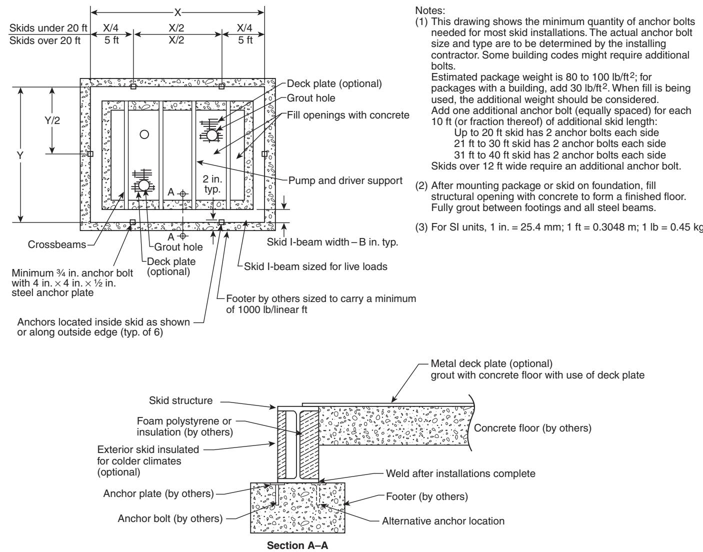  
FIGURE A.4.31.9 Typical Foundation Detail for Packaged Fire Pump Assembly.

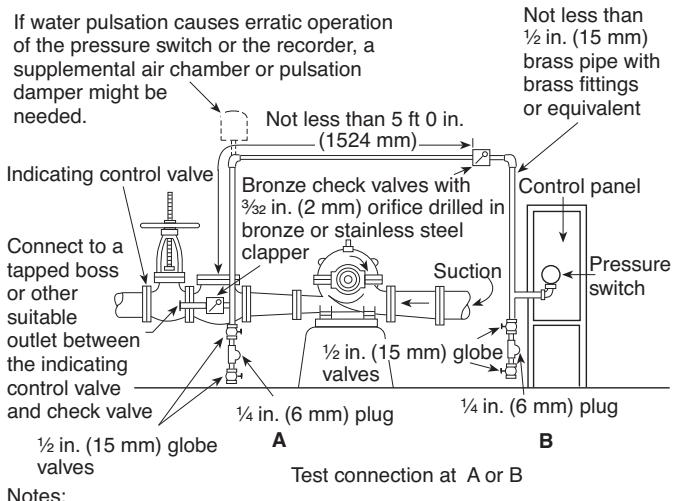  
(1) Solenoid drain valve used for engine-driven fire pumps can be at A, B, or inside controller enclosure.  
(2) If water is clean, ground-face unions with noncorrosive diaphragms drilled for ³⁄₃₂ in. orifices can be used in place of the check valves.

FIGURE A.4.32(a) Piping Connection for Each Automatic Pressure Switch (for Electric-Driven and Diesel Fire Pump and Jockey Pumps).  
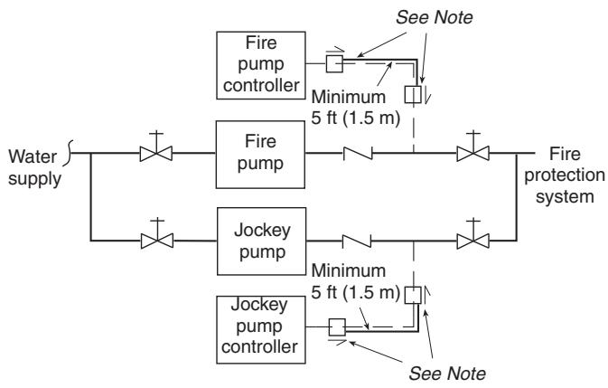  
Note: Check valves or ground-face unions complying with 4.32.4.

Δ FIGURE A.4.32(b) Piping Connection for Pressure Sensing Line (Diesel Fire Pump).

For the circumstance where the pump room is not at grade level, this standard requires protected passageways of a fire resistance rating that meets the minimum requirements for exit stairwells at the level of the pump room from the exit stairwell to the pump room. Many codes do not allow the pump room to open directly onto an exit stairwell, but the distance between an exit stairwell and the pump room on upper or lower floors needs to be as short as possible with as few openings to other building areas as possible to afford as much protection as possible to the people going to the pump room and staying in the pump room during a fire in the building.

In addition to the need for access, pump rooms need to be located such that discharge from pump equipment including packing discharge and relief valves is adequately handled.

A.5.6 When trying to determine the pumping capability of the fire department, the concern is for the height of the building. There are some buildings that are so tall that it is impossible for the fire department apparatus to pump into the fire department connection at the street and overcome the elevation loss and friction loss in order to achieve 100 psi at the hose outlets up in the building. In these cases, the fire protection system in the building needs to have additional protection, including sufficient water supplies within the building to fight a fire and sufficient redundancy to be safe. Since fire departments all purchase different apparatus with different pumping capabilities, this standard has chosen to address this concern with performance-based criteria rather than a specified building height. Most urban fire departments have the capability of getting sufficient water at sufficient pressure up to the top of 200 ft (61 m) tall buildings. Some have the ability to get water as high as 350 ft (107 m). The design professional will need to check with the local fire department to determine its capability.

N A.5.6.1.1 Multiple zones can be supplied by a single set of tanks.

N A.5.6.1.1.2 It is the intent to require the full fire protection demand to be stored without the need for automatic refill. The automatic refill provides additional redundancy.

N A.5.6.1.4 The refill rate requirement is based on a single automatic refill operating (i.e., each refill is sized to meet the required refill rate when operating alone). When multiple automatic refills are operating, each individual refill does not have to meet the required fill rate. However, the total flow from all refills operating simultaneously meets the refill rate.

N A.5.6.1.6 The refill valves can be connected to different risers on the same zone provided the standpipe is arranged so that no single failure will impair both standpipe risers. In a pumped standpipe zone this requires redundant pumps and the supply arranged with isolation valves so that at least one of the standpipe risers can remain in service with any single section isolated. For a gravity feed system this requires connections to two tanks (or tank compartments) and at least two express risers with interconnections arranged with isolation valves so that at least one of the standpipe risers can remain in service with any single section isolated.

A.5.6.1.6.1 The different connections should be arranged so that the tank refill rate required in 5.6.1.4 can be maintained even with the failure of any single valve, pipe, or pump.

N A.5.6.1.6.4.1 When one refill valve is supplied from a pump located below the refill valve and another refill valve is supplied from a gravity fed riser, the gravity fed riser is likely to have higher pressure and will be the first refill source to operate unless a closed valve in the interconnection isolates the gravity pressure from one of the refill valves.

N A.5.6.1.6.5 An overflow designed with a large intake close to the top of the tank that tapers to the overflow pipe size will minimize the overflow depth that must be maintained at the top of the tank. The overflow can be designed using formulas for weirs.

A.6.1.1 See Figure A.6.1.1(a) through Figure A.6.1.1(h).

A.6.1.2 The centrifugal pump is particularly suited to boost the pressure from a public or private supply or to pump from a storage tank where there is a positive static head.

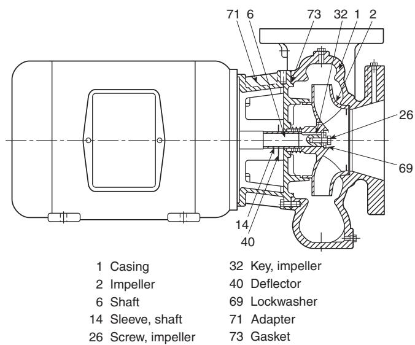  
FIGURE A.6.1.1(a) Overhung Impeller — Close Coupled Single Stage — End Suction.

A.6.2 Listed pumps can have different head capacity curve shapes for a given rating. Figure A.6.2 illustrates the extremes of probable curve shapes. Shutoff head will range from a minimum of 101 percent to a maximum of 140 percent of rated head. At 150 percent of rated capacity, head will range from a minimum of 65 percent to a maximum of just below rated head. Pump manufacturers can supply expected curves for their listed pumps.

**A.6.3.1 See Figure A.6.3.1(a) and Figure A.6.3.1(b).**

A.6.4.1 Flexible couplings are used to compensate for temperature changes and to permit end movement of the connected shafts without interfering with each other.

A.6.4.4 A substantial foundation is important in maintaining alignment. The foundation preferably should be made of reinforced concrete.

A.6.5 A pump and driver shipped from the factory with both machines mounted on a common base plate are accurately aligned before shipment. All base plates are flexible to some extent and, therefore, should not be relied upon to maintain the factory alignment. Realignment is necessary after the complete unit has been leveled on the foundation and again after the grout has set and foundation bolts have been tightened. The alignment should be checked after the unit is piped and rechecked periodically. To facilitate accurate field alignment, most manufacturers either do not dowel the pumps or

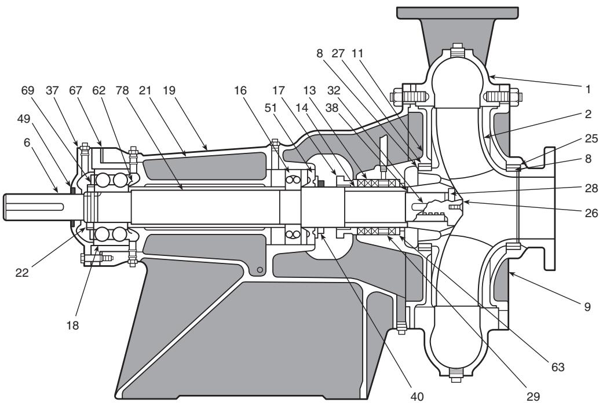

1 Casing   
2 Impeller   
6 Shaft, pump   
8 Ring, impeller   
9 Cover, suction   
11 Cover, stuffing-box   
13 Packing   
14 Sleeve, shaft   
16 Bearing, inboard   
17 Gland   
18 Bearing, outboard   
19 Frame   
21 Liner, frame   
22 Locknut, bearing   
25 Ring, suction cover   
26 Screw, impeller   
27 Ring, stuffing-box   
cover   
28 Gasket   
29 Ring, lantern   
32 Key, impeller   
37 Cover, bearing, outboard   
38 Gasket, shaft sleeve   
40 Deflector

FIGURE A.6.1.1(b) Overhung Impeller — Separately Coupled Single Stage — Frame Mounted.

49 Seal, bearing cover,   
outboard   
51 Retainer, grease   
62 Thrower (oil or grease)   
63 Busing, stuffing-box   
67 Shim, frame liner   
69 Lockwasher   
78 Spacer, bearing

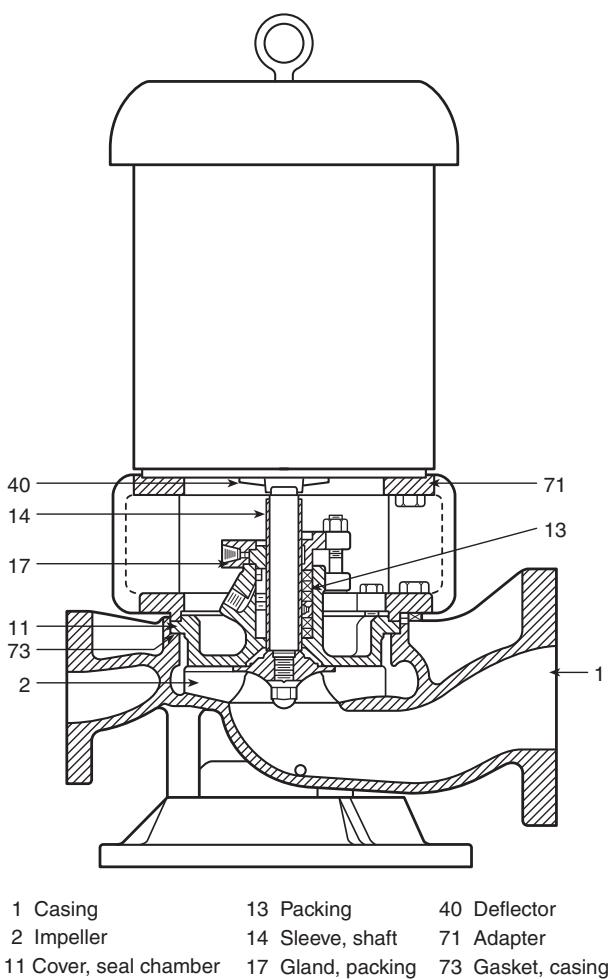  
FIGURE A.6.1.1(c) Overhung Impeller — Close Coupled Single Stage — In-Line (Showing Seal and Packaging).

drivers on the base plates before shipment or, at most, dowel the pump only.

After the pump and driver unit has been placed on the foundation, the coupling halves should be disconnected. The coupling should not be reconnected until the alignment operations have been completed.

The purpose of the flexible coupling is to compensate for temperature changes and to permit end movement of the shafts without interference with each other while transmitting power from the driver to the pump.

The two forms of misalignment between the pump shaft and the driver shaft are as follows:

(1) Angular misalignment — shafts with axes concentric but not parallel

(2) Parallel misalignment — shafts with axes parallel but not concentric

The faces of the coupling halves should be spaced within the manufacturer's recommendations and far enough apart so that they cannot strike each other when the driver rotor is moved hard over toward the pump. Due allowance should be made for wear of the thrust bearings. The necessary tools for an approximate check of the alignment of a flexible coupling are a straight edge and a taper gauge or a set of feeler gauges.

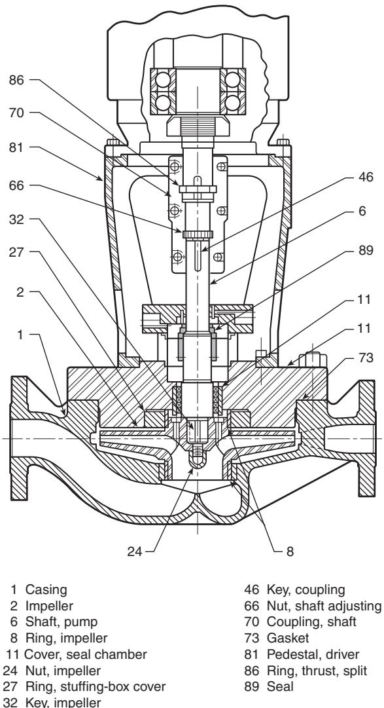  
FIGURE A.6.1.1(d) Overhung Impeller — Separately Coupled Single Stage — In-Line — Rigid Coupling.

A check for angular alignment is made by inserting the taper gauge or feelers at four points between the coupling faces and comparing the distance between the faces at four points spaced at 90-degree intervals around the coupling. [See Figure A.6.5(a).] The unit will be in angular alignment when the measurements show that the coupling faces are the same distance apart at all points.

A check for parallel alignment is made by placing a straight edge across both coupling rims at the top, bottom, and both sides. [See Figure A.6.5(b).] The unit will be in parallel alignment when the straight edge rests evenly on the coupling rim at all positions.

Allowance might be necessary for temperature changes and for coupling halves that are not of the same outside diameter. Care should be taken to have the straight edge parallel to the axes of the shafts.

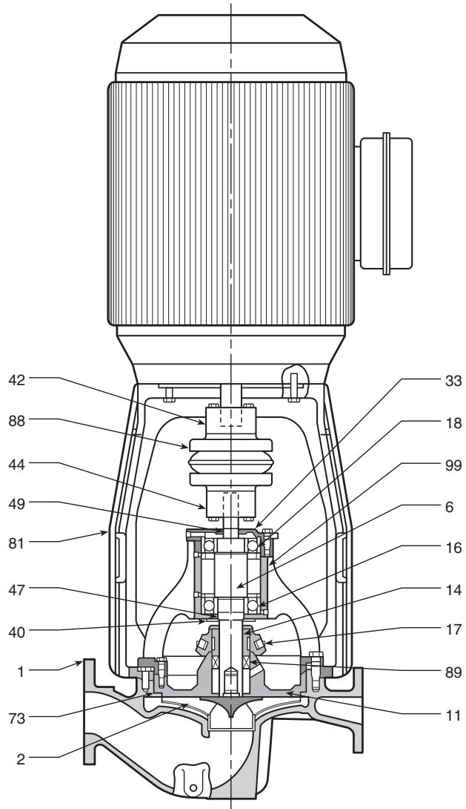  
FIGURE A.6.1.1(e) Overhung Impeller — Separately Coupled Single Stage — In-Line — Flexible Coupling.

Angular and parallel misalignment are corrected by means of shims under the motor mounting feet. After each change, it is necessary to recheck the alignment of the coupling halves. Adjustment in one direction can disturb adjustments already made in another direction. It should not be necessary to adjust the shims under the pump.

The permissible amount of misalignment will vary with the type of pump, driver, and coupling manufacturer, model, and size.

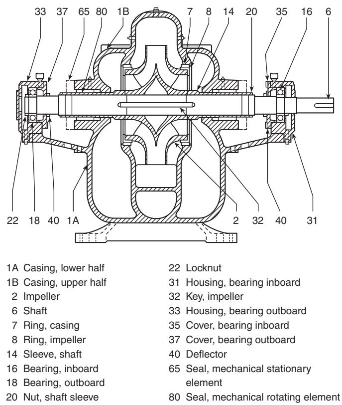  
FIGURE A.6.1.1(f) Impeller Between Bearings — Separately Coupled — Single Stage — Axial (Horizontal) Split Case.

The best method for putting the coupling halves in final accurate alignment is by the use of a dial indicator.

When the alignment is correct, the foundation bolts should be tightened evenly but not too firmly. The unit can then be grouted to the foundation. The base plate should be completely filled with grout, and it is desirable to grout the leveling pieces, shims, or wedges in place. Foundation bolts should not be fully tightened until the grout has hardened, usually about 48 hours after pouring.

After the grout has set and the foundation bolts have been properly tightened, the unit should be checked for parallel and angular alignment, and, if necessary, corrective measures taken. After the piping of the unit has been connected, the alignment should be checked again.

The direction of driver rotation should be checked to make certain that it matches that of the pump. The corresponding direction of rotation of the pump is indicated by a direction arrow on the pump casing.

The coupling halves can then be reconnected. With the pump properly primed, the unit should be operated under normal operating conditions until temperatures have stabilized. It then should be shut down and immediately checked again for alignment of the coupling. All alignment checks should be made with the coupling halves disconnected and again after they are reconnected.

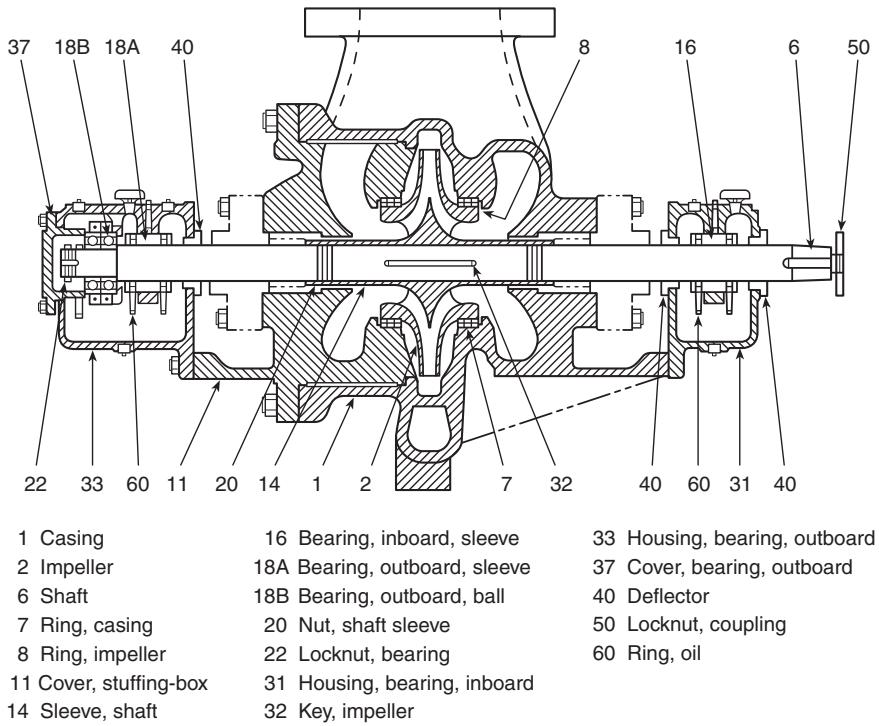  
FIGURE A.6.1.1(g) Impeller Between Bearings — Separately Coupled — Single Stage — Radial (Vertical) Split Case.

After the unit has been in operation for about 10 hours, the coupling halves should be given a final check for misalignment caused by pipe or temperature strains. This check should be repeated after the unit has been in operation for about 3 months. If the alignment is correct, both pump and driver should be dowelled to the base plate. Dowel location is very important, and the manufacturer's instructions should be followed, especially if the unit is subject to temperature changes.

The unit should be checked periodically for alignment. If the unit does not stay in line after being properly installed, the following are possible causes:

(1) Settling, seasoning, or springing of the foundation and pipe strains distorting or shifting the machine

(2) Wearing of the bearings

(3) Springing of the base plate by heat from an adjacent steam pipe or from a steam turbine

(4) Shifting of the building structure due to variable loading or other causes

(5) If the unit and foundation are new, need for the alignment to be slightly readjusted from time to time

A.6.5.1.2 The listing information contains critical requirements for proper use and installation, including whether the coupling or connecting shaft is listed for use with either an electric motor or diesel engine drivers, or listed for both an electric motor and diesel engine drivers.

A.7.1 Satisfactory operation of vertical turbine–type pumps is dependent to a large extent upon careful and correct installation of the unit; therefore, it is recommended that this work be done under the direction of a representative of the pump manufacturer.

A.7.1.1 The vertical shaft turbine–-type pump is particularly suitable for fire pump service where the water source is located below ground and where it would be difficult to install any other type of pump below the minimum water level. It was originally designed for installation in drilled wells but is permitted to be used to lift water from lakes, streams, open swamps, and other subsurface sources. Both oil-lubricated enclosed-lineshaft and water-lubricated open-lineshaft pumps are used. (See Figure A.7.1.1.) Some health departments object to the use of oillubricated pumps; such authorities should be consulted before proceeding with oil-lubricated design.

A.7.2.1.1 Stored water supplies from reservoirs or tanks supplying wet pits are preferable. Lakes, streams, and groundwater supplies are acceptable where investigation shows that they can be expected to provide a suitable and reliable supply.

A.7.2.1.2 The authority having jurisdiction can require an aquifer performance analysis. The history of the water table should be carefully investigated. The number of wells already in use in the area and the probable number that can be in use should be considered in relation to the total amount of water available for fire protection purposes.

**A.7.2.2.1 See Figure A.7.2.2.1.**

A.7.2.2.1.3 The acceptability of a well is determined by a 24- hour test that flows the well at 150 percent of the pump flow rating. This test should be reviewed by qualified personnel (usually a well drilling contractor or a person having experience in hydrology and geology). The adequacy and reliability of the water supply are critical to the successful operation of the fire pump and fire protection system.

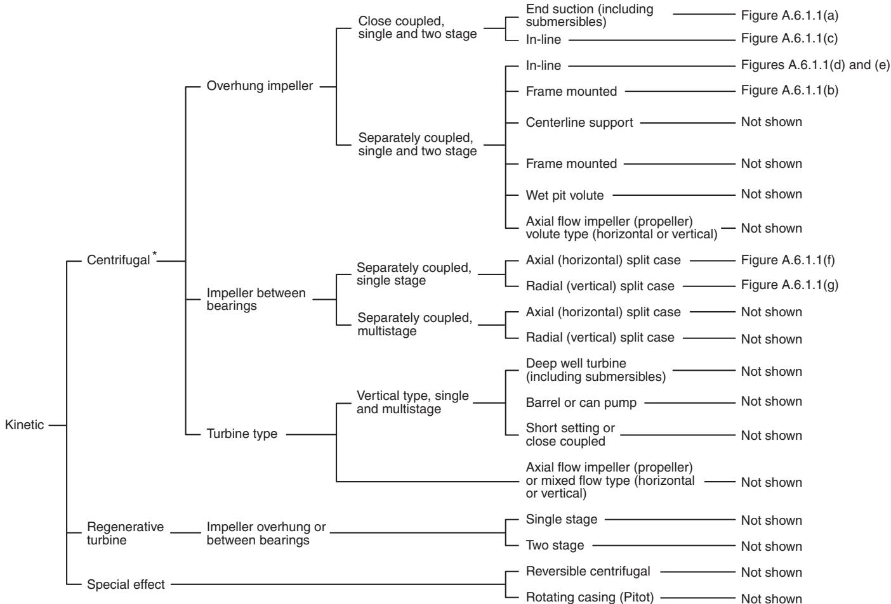  
Note: Kinetic pumps can be classified by such methods as impeller or casing configuration, end application of the pump, specific speed, or mechanical configuration. The method used in this chart is based primarily on mechanical configuration.  
\*Includes radial, mixed flow, and axial flow designs.

FIGURE A.6.1.1(h) Types of Stationary Pumps.

A 10 ft (3.05 m) submergence is considered the minimum acceptable level to provide proper pump operation in well applications. The increase of 1 ft (0.30 m) for each 1000 ft (305 m) increase in elevation is due to loss of atmospheric pressure that accompanies elevation. Therefore, the net positive suction head (NPSH) available must be considered in selection of the pump. For example, to obtain the equivalent of 10 ft (3.05 m) of NPSH available at an elevation of 1000 ft (305 m), approximately 11 ft (3.35 m) of water is required.

Several other design parameters need to be considered in the selection of a vertical turbine pump, including the following:

(1) Lineshaft lubrication when the pump is installed in a well. Bearings are required to have lubrication and are installed along the lineshaft to maintain alignment. Lubrication fluid is usually provided by a fluid reservoir located aboveground, and the fluid is supplied to each bearing by a copper tube or small pipe. This lubrication fluid should use a vegetable-based material that is approved by the

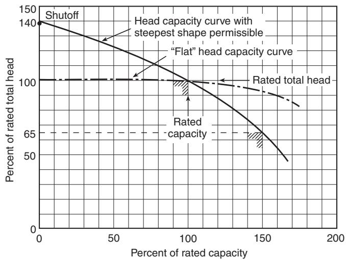  
FIGURE A.6.2 Pump Characteristics Curves.

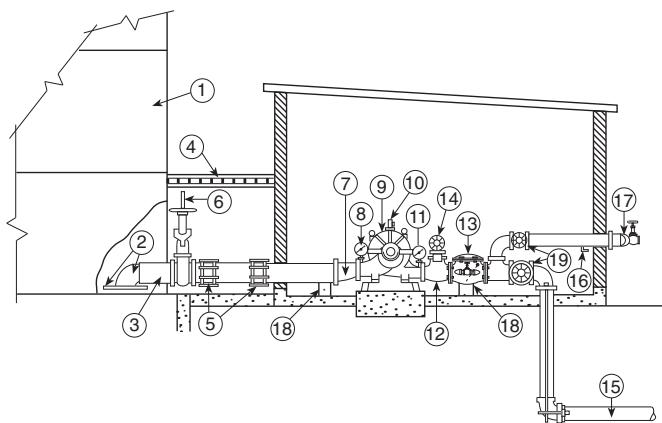

1 Aboveground suction tank

2 Entrance elbow and square steel vortex plate with dimensions at least twice the diameter of the suction pipe. Distance above the bottom of tank is one-half the diameter of the suction pipe with minimum of 6 in. (152 mm).

3 Suction pipe

4 Frostproof casing

5 Flexible couplings for strain relief 6 OS&Y gate valve (see 4. 16.5 and A 4 16 5)

7 Eccentric reducer

8 Suction gauge

9 Horizontal split-case fire pump   
10 Automatic air release   
11 Discharge gauge   
12 Reducing discharge tee   
13 Discharge check valve   
14 Relief valve (if required)   
15 Supply pipe for fire protection system   
16 Drain valve or ball drip   
17 Hose valve manifold with hose valves   
18 Pipe supports   
19 Indicating gate or indicating butterfly valve

federal Clean Water Act to minimize water contamination.

(2) Determination of the water level in the well. When a vertical turbine pump is tested, the water level in the well needs to be known so that the suction pressure can be determined. Often the air line for determining the depth is omitted, so testing of the pump for performance is not possible. The arrangement of this device is shown in Figure A.7.3.5.3, and its installation should be included in the system design.

Δ FIGURE A.6.3.1(a) Horizontal Split-Case Fire Pump Installation with Water Supply Under a Positive Head.  
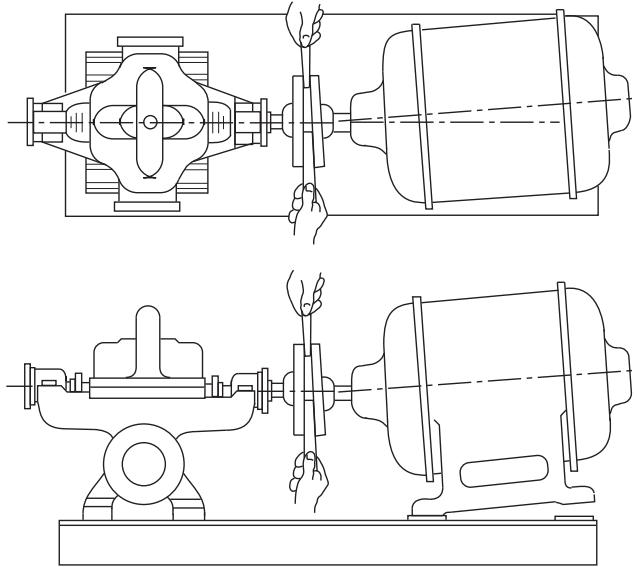  
FIGURE A.6.5(a) Checking Angular Alignment. (Courtesy of Hydraulic Institute, www.pumps.org.)

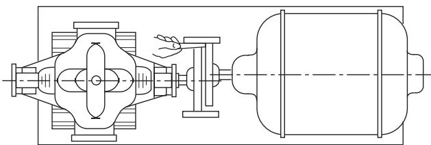

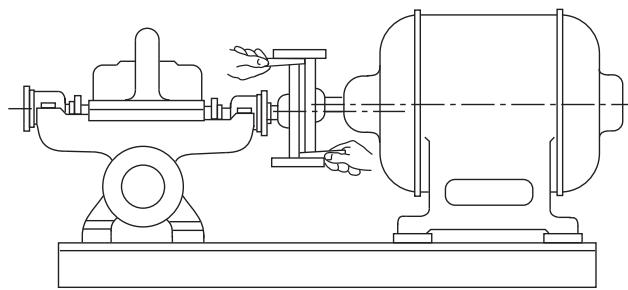  
FIGURE A.6.5(b) Checking Parallel Alignment. (Courtesy of Hydraulic Institute, www.pumps.org.)

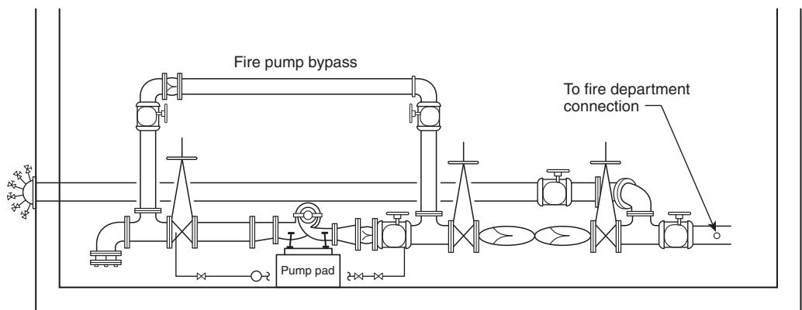  
FIGURE A.6.3.1(b) Backflow Preventer Installation.

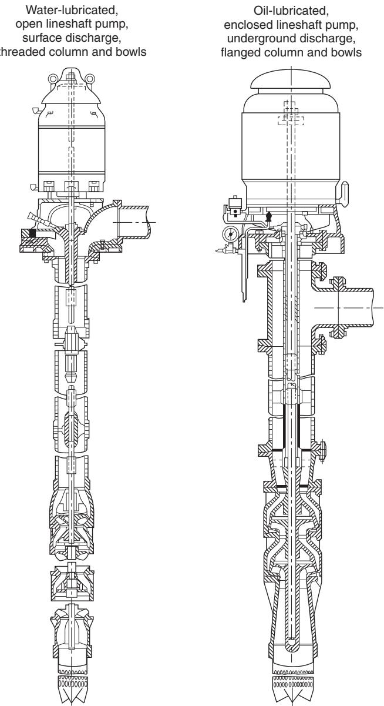  
FIGURE A.7.1.1 Water-Lubricated and Oil-Lubricated Shaft Pumps.

A.7.2.2.2 The velocities in the approach channel or intake pipe should not exceed approximately 2 ft/sec (0.7 m/sec), and the velocity in the wet pit should not exceed approximately 1 ft/sec (0.3 m/sec). (See Figure A.7.2.2.2.)

The ideal approach is a straight channel coming directly to the pump. Turns and obstructions are detrimental because they can cause eddy currents and tend to initiate deep-cored vortices. The amount of submergence for successful operation will depend greatly on the approaches of the intake and the size of the pump.

ANSI/HI 9.8, Rotodynamic Pumps for Pump Intake Design, recommends sump dimensions for flows 3000 gpm (11,355 L min) and larger. The design of sumps for pumps with discharge capacities less than 3000 gpm (11,355 L/min) should be guided by the same general principles shown in ANSI/HI 9.8.

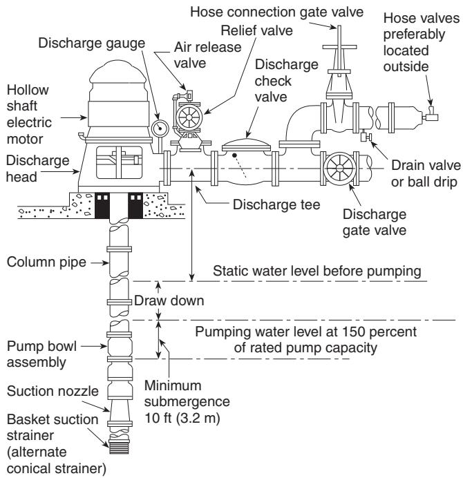  
Note: The distance between the bottom of the strainer and the bottom of the wet pit should be one-half of the pump bowl diameter but not less than 12 in. (305 mm).

FIGURE A.7.2.2.1 Vertical Shaft Turbine–Type Pump Installation in a Well.  
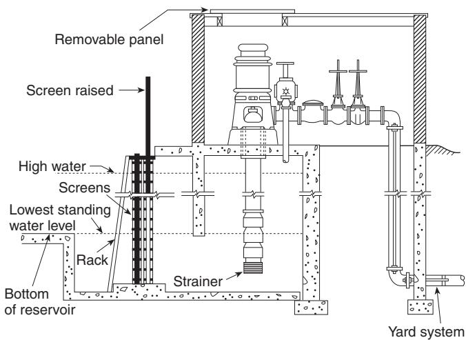  
FIGURE A.7.2.2.2 Vertical Shaft Turbine–Type Pump Installation in a Wet Pit.

A.7.2.5 Where wells take their supply from consolidated formations such as rock, the specifications for the well should be decided upon by the authority having jurisdiction after consultation with a recognized groundwater consultant in the area.

A.7.2.7 Before the permanent pump is ordered, the water from the well should be analyzed for corrosiveness, including such items as pH, salts such as chlorides, and harmful gases such as carbon dioxide (CO2) or hydrogen sulfide (H2S). If the water is corrosive, the pumps should be constructed of a suitable corrosion-resistant material or covered with special protective coatings in accordance with the manufacturers recommendations.

**A.7.3.1 See Figure A.7.3.1.**

A.7.3.2.1 In countries that utilize the metric system, there do not appear to be standardized flow ratings for pump capacities; therefore, a soft metric conversion is utilized.

Δ A.7.3.5.3 Water level detection using the air line method is as follows:

(1) A satisfactory method of determining the water level involves the use of an air line of small pipe or tubing of known vertical length, a pressure or depth gauge, and an ordinary bicycle or automobile pump installed as shown in Figure A.7.3.5.3. The air line pipe should be of known length and extend beyond the lowest anticipated water level in the well, to ensure more reliable gauge readings, and should be properly installed. An air pressure gauge is used to indicate the pressure in the air line. (See Figure A.7.3.5.3.)

(2) The air line pipe is lowered into the well, a tee is placed in the line above the ground, and a pressure gauge is screwed into one connection. The other connection is fitted with an ordinary bicycle valve to which a bicycle pump is attached. All joints should be made carefully and should be airtight to obtain correct information. When air is forced into the line by means of the bicycle pump, the gauge pressure increases until all of the water has been expelled. When this point is reached, the gauge reading becomes constant. The maximum maintained air pressure recorded by the gauge is equivalent to that necessary to support a column of water of the same height as that forced out of the air line. The length of this water column is equal to the amount of air line submerged.

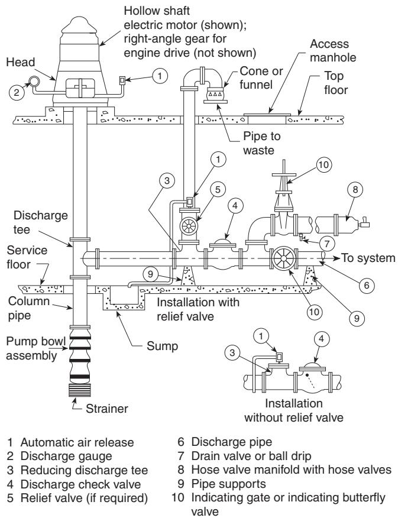  
FIGURE A.7.3.1 Belowground Discharge Arrangement.

(3) Deducting this pressure converted to feet (meters) (pressure in psi × 2.31 = pressure in feet, and pressure in bar × 10.3 = pressure in meters) from the known length of the air line will give the amount of submergence.

Example: The following calculation will serve to clarify Figure A.7.3.5.3.

Assume a length (L) of 50 ft (15.2 m).

The pressure gauge reading before starting the fire pump (p1) = 10 psi (0.68 bar). Then A = 10 × 2.31 = 23.1 ft (0.68 × 10.3 = 7.0 m). Therefore, the water level in the well before starting the pump would be B = L − A = 50 ft - 23.1 ft = 26.9 ft (B = L − A = 15.2 m − 7 m = 8.2 m).

The pressure gauge reading when the pump is running (p2) = 8 psi (0.55 bar). Then C = 8 × 2.31 = 18.5 ft (0.55 × 10.3 = 5.6 m). Therefore, the water level in the well when the pump is running would be D = L − C = 50 ft − 18.5 ft = 31.5 ft (D = L − C = 15.2 m − 5.6 m = 9.6 m).

The draw down can be determined by any of the following methods:

(1) D − B = 31.5 ft − 26.9 ft = 4.6 ft (9.6 m − 8.2 m = 1.4 m)

(2) A − C = 23.1 ft − 18.5 ft = 4.6 ft (7.0 m − 5.6 m = 1.4 m)

$$
{ \begin{array} { r l } { ( 3 ) \ } & { \ p _ { 1 } - \ p _ { 2 } = 1 0 - 8 = 2 \ p s { \mathrm { i } } = 2 \times 2 . 3 1 = 4 . 6 \ \mathrm { f t } \ ( 0 . 6 8 - 0 . 5 5 = 0 . 1 3 \ \mathrm { ~ } } \\ & { \ b { \mathrm { a r } } = 0 . 1 3 \times 1 0 . 3 = 1 . 4 \ \mathrm { m } ) } \end{array} }
$$

A.7.4 Several methods of installing a vertical pump can be followed, depending upon the location of the well and facilities available. Since most of the unit is underground, extreme care should be used in assembly and installation, thoroughly checking the work as it progresses. The following simple method is the most common:

(1) Construct a tripod or portable derrick and use two sets of installing clamps over the open well or pump house. After the derrick is in place, the alignment should be checked carefully with the well or wet pit to avoid any trouble when setting the pump.

(2) Attach the set of clamps to the suction pipe on which the strainer has already been placed and lower the pipe into the well until the clamps rest on a block beside the well casing or on the pump foundation.

(3) Attach the clamps to the pump stage assembly, bring the assembly over the well, and install pump stages to the suction pipe, until each piece has been installed in accordance with the manufacturer's instructions.

N A.7.5.1.6.1 Torsional couplings are very useful at moving harmful stresses out of the operating speed ranges of these pump systems. However, if the stiffness or damping characteristic of the coupling is not selected correctly, it can actually make the system torsional activity worse at operating speed.

N A.7.5.1.6.1.2 The system should be considered as three lumped inertias $( \mathbf { M } _ { 1 } , \ \mathbf { M } _ { 2 } , \ \mathbf { M } _ { 3 } )$ connected by two springs $( \mathrm { K } _ { \mathrm { H } } ,$ $\mathrm { K } _ { \mathrm { V } } )$ as shown in Figure A.7.5.1.6.1.2.

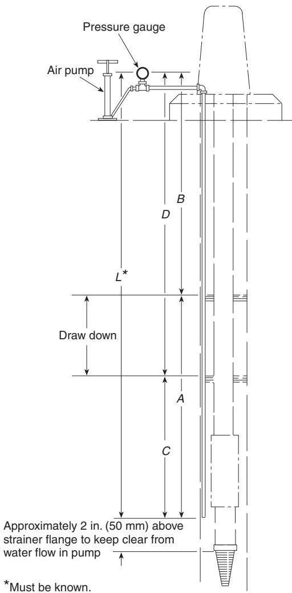  
FIGURE A.7.3.5.3 Air Line Method of Determining Depth of Water Level.

N A.7.5.1.6.1.3 The calculated forced response results should be compared against manufacturers’ recommended limits for each component. For torsional couplings, this comparison should include vibratory torque and heat dissipation if the spring element is a viscoelastic material.

N A.7.5.1.6.1.4 As a result of the influence of emission laws, engine combustion processes have changed considerably over the years. The cylinder and injection pressures of modern diesel engines are very different from older engines. Therefore, when performing the calculations of 7.5.1.6.1.3, it is desirable to have specific engine manufacturer and rating excitation data. Older handbooks that provide diesel engine excitation data are typically inadequate for these calculations. This is often referred to as a multi-mass analysis.

A.7.6.1.1 The setting of the impellers should be undertaken only by a representative of the pump manufacturer. Improper setting will cause excessive friction loss due to the rubbing of impellers on pump seals, which results in an increase in power demand. If the impellers are adjusted too high, there will be a loss in capacity, and full capacity is vital for fire pump service. The top shaft nut should be locked or pinned after proper setting.

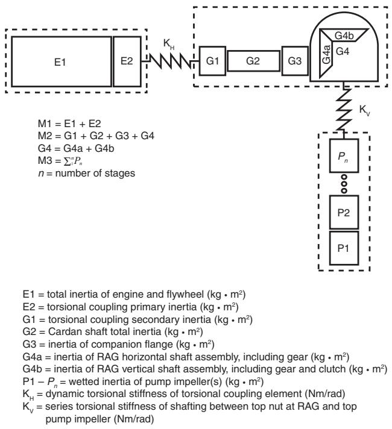  
Note: G4b, K , and all pump impeller inertia to be corrected by the RAG ratio  
FIGURE A.7.5.1.6.1.2 Lumped Inertia Definition.

A.7.6.1.4 Pumping units are checked at the factory for smoothness of performance and should operate satisfactorily on the job. If excessive vibration is present, the following conditions could be causing the trouble:

(1) Bent pump or column shaft

(2) Impellers not properly set within the pump bowls

(3) Pump not hanging freely in the well

(4) Strain transmitted through the discharge piping

Excessive motor temperature is generally caused either by a maintained low voltage of the electric service or by improper setting of impellers within the pump bowls.

A.8.1 All the requirements in Chapter 4 might not apply to positive displacement pumps.

A.8.1.2 Special attention to the pump inlet piping size and length should be noted.

A.8.1.2.2 This material describes a sample pump characteristic curve and gives an example of pump selection methods. Characteristic performance curves should be in accordance with ANSI/HI 3.6, Rotary Pump Tests.

Example: An engineer is designing a foam-water fire protection system. It has been determined, after application of appropriate safety factors, that the system needs a foam concentrate pump capable of 45 gpm at the maximum system pressure of 230 psi. Using the performance curve (see Figure A.8.1.2.2) for pump model “XYZ-987,” this pump is selected for the application. First, find 230 psi on the horizontal axis labeled “differential pressure,” then proceed vertically to the flow curve to 45 gpm. It is noted that this particular pump produces 46 gpm at a standard motor speed designated “rpm-2.” This pump is an excellent fit for the application. Next, proceed to the power curve for the same speed of rpm-2 at 230 psi and find that it requires 13.1 hp to drive the pump. An electric motor will be used for this application, so a 15 hp motor at rpm-2 is the first available motor rating above this minimum requirement.

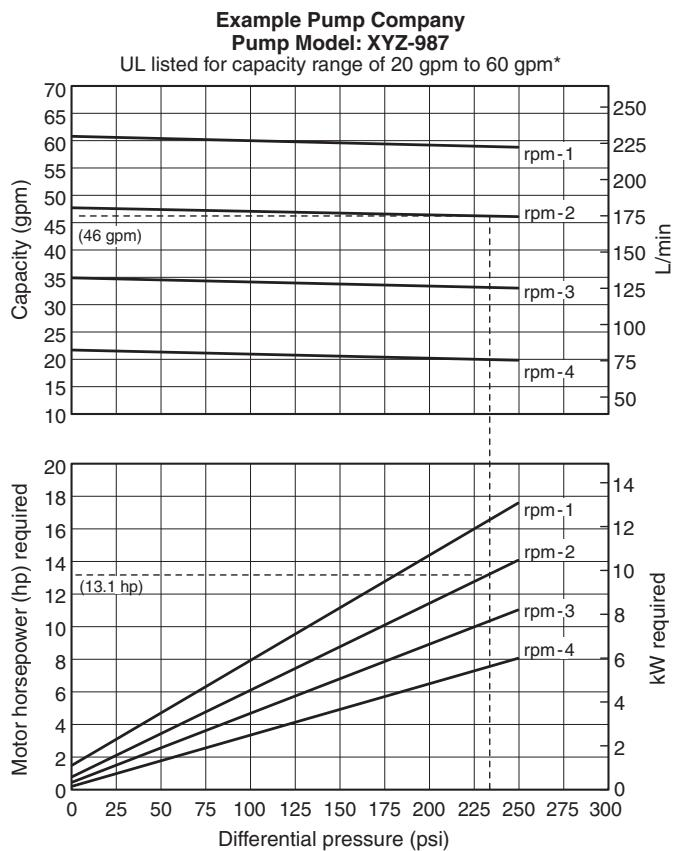  
\*Conforms to requirements of Chapter 8 on positive displacement foam concentrate and additive pumps.  
FIGURE A.8.1.2.2 Example of Positive Displacement Pump Selection.

A.8.1.5 Positive displacement pumps are tolerance dependent. Corrosion can affect pump performance and function. (See ANSI/HI 1.4, Rotodynamic Centrifugal Pumps for Manuals Describing Installation, Operation and Maintenance.)

A.8.2.2 Specific flow rates should be determined by the applicable NFPA standard. Viscose concentrates and additives have significant pipe friction loss from the supply tank to the pump suction.

A.8.2.4 This requirement does not apply to water mist pumps.

A.8.2.5 Generally, pump capacity is calculated by multiplying the maximum water flow by the percentage of concentration desired. To that product is added a 10 percent “over demand” to ensure that adequate pump capacity is available under all conditions.

A.8.2.6 Generally, concentrate pump discharge pressure is required to be added to the maximum water pressure at the injection point plus 25 psi (2 bar).

A.8.3.1 It is not the intent of this standard to prohibit the use of stationary pumps for water mist systems.

Δ A.8.5.2 Positive displacement pumps are capable of quickly exceeding their maximum design discharge pressure if operated against a closed discharge system. Other forms of protective devices (e.g., automatic shutdowns, rupture discs) are considered a part of the pumping system and are generally beyond the scope of the pump manufacturer's supply. These components should be safely designed into and supplied by the system designer or by the user, or both. [See Figure A.8.5.2(a) and Figure A.8.5.2(b) for proposed schematic layout of pump requirements.]

A.8.5.3 Only the tank return line and external valves should be used when the outlet line can be closed for more than a few minutes. Operation of a pump with an integral relief valve and a closed outlet line will cause overheating of the pump and a foamy discharge of fluid after the outlet line is reopened. Means of thermal relief should be considered when discharge is piped back to pump suction. Overheating of the pump and subsequent damage to the pump can occur quickly if the pump is operated against a closed outlet line and the relief valve discharge is piped back to suction.

A.8.5.4 Backpressure on the discharge side of the pressure relief valve should be considered. (See Figure A.8.5.4 for proposed schematic layout of pump requirement.)

A.8.5.5 Strainer recommended mesh size is based on the internal pump tolerances. (See Figure A.8.5.5 for standard mesh sizes.)

A.8.6.1 Positive displacement pumps are typically driven by electric motors, internal combustion engines, or water motors.

A.8.7 These controllers can incorporate means to permit automatic unloading or pressure relief when starting the pump driver.

A.9.1.4 Where the power supply involves an on-site power production facility, the protection is required for the facility in addition to the wiring and equipment.

A.9.1.7 Phase converters that take single-phase power and convert it to three-phase power for the use of fire pump motors are not recommended because of the imbalance in the voltage between the phases when there is no load on the equipment. If the power utility installs phase converters in its own power transmission lines, such phase converters are outside the scope of this standard and need to be evaluated by the authority having jurisdiction to determine the reliability of the electric supply.

A.9.1.8 Ground fault alarm provisions are not prohibited.

A.9.2 See Figure A.9.2 for typical power supply arrangements from source to the fire pump motor.

A.9.2.3.1(3) The disconnecting means should be located such that inadvertent simultaneous operation is not likely.

A.9.2.3.1(4) The disconnecting means should be located such that inadvertent simultaneous operation is not likely.

Δ A.9.3.2 A reliable power source possesses the following characteristics:

(1) The source power plant has not experienced any shutdowns longer than 10 continuous hours in the year prior to plan submittal. NFPA 25 requires special undertakings (i.e., fire watches) when a water-based fire protection system is taken out of service for longer than 10 hours. If the normal source power plant has been intentionally shut down for longer than 10 hours in the past, it is reasonable to require a backup source of power.

(2) Power outages have not routinely been experienced in the area of the protected facility caused by failures in generation or transmission. This standard is not intended to require that the normal source of power be infallible to deem the power reliable. NFPA 20 does not intend to require a backup source of power for every installation using an electric motor–driven fire pump.

(3) The normal source of power is not supplied by overhead conductors outside the protected facility. Fire departments responding to an incident at the protected facility will not operate aerial apparatus near live overhead power lines, without exception. A backup source of power is required in case this scenario occurs and the normal source of power must be shut off. Additionally, many utility providers will remove power to the protected facility by physically cutting the overhead conductors. If the normal source of power is provided by overhead conductors, which will not be identified, the utility provider could mistakenly cut the overhead conductor supplying the fire pump.

(4) Only the disconnect switches and overcurrent protection devices permitted by 9.2.3 are installed in the normal source of power. Power disconnection and activated overcurrent protection should occur only in the fire pump controller. The provisions of 9.2.2 for the disconnect switch and overcurrent protection essentially require disconnection and overcurrent protection to occur in the fire pump controller. If unanticipated disconnect switches or overcurrent protection devices are installed in the normal source of power that do not meet the requirements of 9.2.2, the normal source of power must be considered not reliable and a backup source of power is necessary.

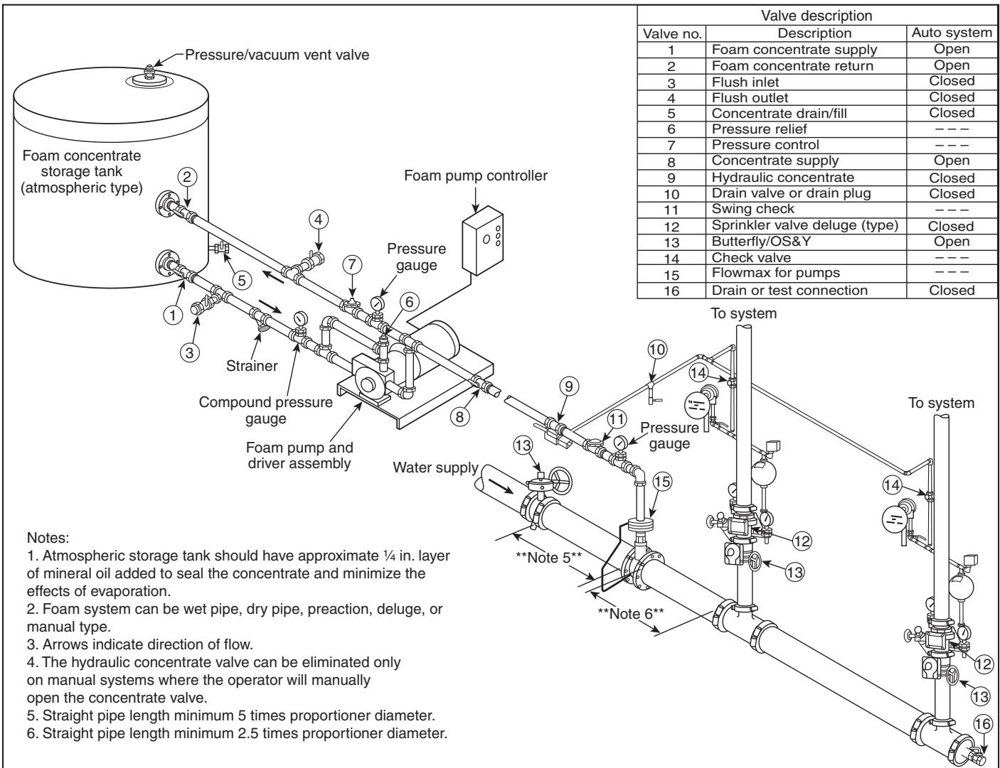  
Δ FIGURE A.8.5.2(a) Typical Foam Pump Piping and Fittings with Relief Back to Suction.

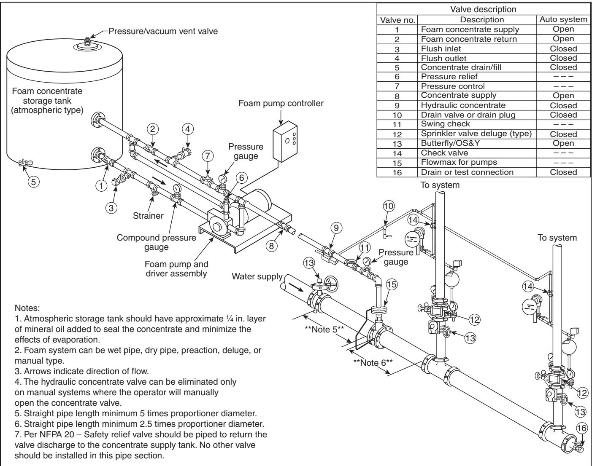  
Δ FIGURE A.8.5.2(b) Typical Foam Pump Piping and Fittings with Relief to Tank Return.

Typical methods of routing power from the source to the motor are shown in Figure A.9.2. Other configurations are also acceptable. The determination of the reliability of a service is left up to the discretion of the authority having jurisdiction.

For more information on the determination of reliability, see the following publications:

(1) IEEE 493, Recommended Practice for the Design of Reliable Industrial and Commercial Power Systems

(2) “Reliability engineering applied to Critical Operations Power Systems (COPS),” a paper presented at the 2011 IEEE Industrial and Commercial Power Systems Conference (I&CPS)

(3) “Reliability analysis for power to fire pump using Fault Tree and RBD,” in IEEE Transactions on Industry Applica tions

(4) “Risk analysis for NEC Article 708 Critical Operations Power Systems,” paper presented at the 2009 Industry Applications Society Annual Meeting and published by IEEE

(5) “NEC Article 708,” in IEEE Industry Application Magazine, Jan.-Feb. 2011

A.9.4 Normally, conductor sizing is based on appropriate sections of NFPA 70, Article 430, except larger sizes could be required to meet the requirements of NFPA 70, Section 695.7 (NFPA 20, Section 9.4). Transformer sizing is to be in accordance with NFPA 70, Section 695.5(A), except larger minimum sizes could be required to meet the requirements of NFPA 70, Section 695.7.

N A.9.4.2.1 Operating the emergency-run mechanical control on the self-regulating variable speed fire pump unit can cause the voltage to drop below 85 percent on the fire pump controller and inhibit its operation.

A.9.5.1.4 Variable fire pump motors must be of the inverter duty type for the installation to be reliable. Inverter duty motors have higher insulation voltage rating, suitable temperature rise rating, and protection from bearing damage.

A.9.5.1.5 The locked rotor currents for 460 V motors are approximately six times the full-load current.

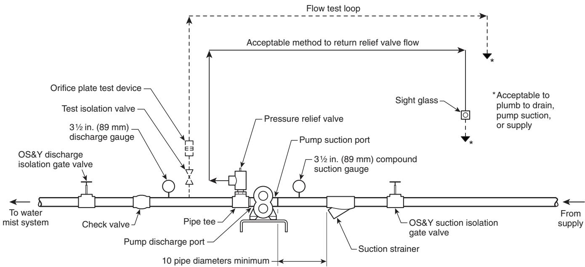  
FIGURE A.8.5.4 Typical Water Mist System Pump Piping and Fittings.

A.9.6.2 Where a generator is installed to supply power to loads in addition to one or more fire pump drivers, the fuel supply should be sized to provide adequate fuel for all connected loads for the desired duration. The connected loads can include such loads as emergency lighting, exit signage, and elevators.

A.9.6.5 Generator protective devices are to be sized to permit the generator to allow instantaneous pickup of the full pump room load. This includes starting any and all connected fire pumps in the across-the-line (direct on line) full voltage starting mode. This is always the case when the fire pump(s) is started by use of the emergency-run mechanical control in 10.5.3.2.

A.9.7(2) See also 10.3.3.

A.9.7(3) See 10.1.2.1, controller short circuit (withstand) rating.

A.9.8.1 Cutting slots or rectangular cutouts in a fire pump controller will violate the enclosure type rating and the controller’s short circuit (withstand) rating and will void the manufacturer’s warranty. See also NFPA 70, Articles 300.20 and 322, for example, for further information.

A.9.8.2 When so required, this seal is to prevent flammable gases from entering the fire pump controller.

A.10.1.2.2 The phrase suitable for use means that the controller and the transfer switch have been prototype tested and have demonstrated by those tests their short-circuit withstandability and interrupting capacity at the stated magnitude of shortcircuit current and voltage available at their line terminals. (See ANSI/UL 508, Standard for Industrial Control Equipment, and ANSI/UL 1008, Standard for Transfer Switch Equipment.)

A short-circuit study should be made to establish the available short-circuit current at the controller in accordance with IEEE 141, Electric Power Distribution for Industrial Plants, IEEE

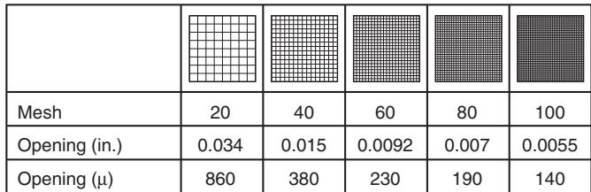  
FIGURE A.8.5.5 Standard Mesh Sizes.

241, Electric Systems for Commercial Buildings, or other acceptable methods.

After the controller and transfer switch have been subjected to a high fault current, they might not be suitable for further use without inspection or repair.

A.10.1.3 All electrical control equipment design should also follow the guidelines within NEMA ICS 14, Application Guide for Electric Fire Pump Controllers.

A.10.2.1 If the controller must be located outside the pump room, a glazed opening should be provided in the pump room wall for observation of the motor and pump during starting. The pressure control pipe line should be protected against freezing and mechanical injury.

A.10.3.3.1 For more information, see NEMA 250, Enclosures for Electrical Equipment.

A.10.3.6 For more information, see NFPA 70.

A.10.3.7.3 Pump operators should be familiar with instructions provided for controllers and should observe in detail all their recommendations.

A.10.4.1 Operation of the surge arrester should not cause either the isolating switch or the circuit breaker to open. Arresters in ANSI/IEEE C62.11, IEEE Standard for Metal-Oxide

Arrangements  
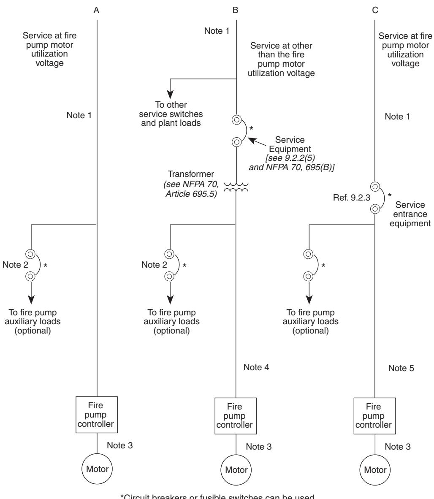  
\*Circuit breakers or fusible switches can be used.

Note 1: Service conductors (see NFPA 70 Article 230)

Note 2: Overcurrent protection (SUSE rated) per NFPA 70, Article 240 or 430

Note 3: Branch circuit conductors [see NFPA 70 695. 6(B)(2)]

Note 4: Feeder conductors [see NFPA 70 695. 6(B)(2)]

Note 5: Dedicated feeder connection [see 9 2 2(3)]

**Δ FIGURE A.9.2 Typical Power Supply Arrangements from Source to Motor.**

Surge Arresters for Alternating Current Power Circuits (>1 kV), are normally zinc-oxide without gaps.

A.10.4.2.1.2 For more information, see NFPA 70.

A.10.4.2.3 For more information, see NFPA 70.

A.10.4.3.1 For more information, see NFPA 70, Article 100.

A.10.4.3.3 Attention should be given to the type of service grounding to establish circuit breaker interrupting rating based on grounding type employed.

A.10.4.3.3.1(4) The interrupting rating can be less than the suitability rating where other devices within the controller assist in the current-interrupting process.

A.10.4.3.3.1.1 The isolating switch is not allowed to trip either.   
See also 10.4.2.1.3.

A.10.4.3.3.1.2 See also A.10.4.3.3.1.1.

A.10.4.3.3.2 Current limiters are melting link-type devices that, where used as an integral part of a circuit breaker, limit the current during a short circuit to within the interrupting capacity of the circuit breaker.

A.10.4.4(4) It is recommended that the locked rotor overcurrent device not be reset more than two consecutive times if tripped due to a locked rotor condition without the motor first being inspected for excessive heating and to alleviate or eliminate the cause preventing the motor from attaining proper speed.

A.10.4.5.7 The signal should incorporate local visible indication and contacts for remote indication. The signal can be incorporated as part of the power available indication and loss of phase signal. (See 10.4.6.1 and 10.4.7.2.2.)

A.10.4.6 The pilot lamp for signal service should have operating voltage less than the rated voltage of the lamp to ensure long operating life. When necessary, a suitable resistor or potential transformer should be used to reduce the voltage for operating the lamp.

A.10.4.7 Where unusual conditions exist whereby pump operation is not certain, a “failed-to-operate” fire pump alarm is recommended. In order to supervise the power source for the fire pump alarm circuit, the controller can be arranged to start upon failure of the supervised alarm circuit power.

A.10.5.1 The following definitions are derived from NFPA 70:

(1) Automatic. Self-acting, operating by its own mechanism when actuated by some impersonal influence, as, for example, a change in current strength, pressure, temperature, or mechanical configuration.

(2) Nonautomatic. Action requiring intervention for its control. As applied to an electric controller, nonautomatic control does not necessarily imply a manual controller, but only that personal intervention is necessary.

A.10.5.2.1 Installation of the pressure sensing line between the discharge check valve and the control valve is necessary to facilitate isolation of the jockey pump controller (and sensing line) for maintenance without having to drain the entire system. [See Figure A.4.32(a) and Figure A.4.32(b).]

N A.10.5.2.1.1.2 Water piping and associated devices could be attached to the outside of the controller.

A.10.5.2.1.3 The purpose of monitoring the pressure transducer is to detect if a transducer has drifted upwardly from zero over time. A transducer that drifts downwardly will automatically cause the fire pump to start when it drifts below the start set point.

A.10.5.2.1.3.1 When the solenoid valve drain opens, the restricting orifice in the pressure sensing line will keep the pressure at the transducer near zero while the solenoid valve is open. This is the time when the transducer can be verified to be less than 10 psi.

A.10.5.2.1.3.2 The purpose of monitoring the pressure reading from a pressure transducer is to detect and correct a transducer that is operating outside of the expected pressure range.

A.10.5.2.1.8.2 The pressure recorder should be able to record a pressure at least 150 percent of the pump discharge pressure under no-flow conditions. In a high-rise building, this requirement can exceed 400 psi (27.6 bar). This pressure recorder should be readable without opening the fire pump controller enclosure. This requirement does not mandate a separate recording device for each controller. A single multichannel recording device can serve multiple sensors. If the pressure recording device is integrated into the pressure controller, the pressure sensing element should be used to record system pressure.

A.10.5.3.2 The emergency-run mechanical control provides means for externally and manually closing the motor contactor across-the-line to start and run the fire pump motor. It is intended for emergency use when normal electric/magnetic operation of the contactor is not possible.

When so used on controllers designed for reduced-voltage starting, the 15 percent voltage drop limitation in Section 9.4 is not applicable.

Δ A.10.5.4.2.1(1) Although the pump is allowed to start and stop automatically during churn testing, 4.3.1 requires qualified person(s) to be in the pump room to monitor conditions while the pump is running.

A.10.8 Typical fire pump controller and transfer switch arrangements are shown in Figure A.10.8. Other configurations can also be acceptable.

A.10.8.2 The compartmentalization or separation is to prevent propagation of a fault in one compartment to the source in the other compartment.

A.10.8.3.11 Internal protection refers to any tripping elements contained within the switching mechanism of the transfer switch. This is to prevent a switching mechanism from inhibiting transfer of power.

A.10.10 See Figure A.10.10.

A.10.10.3 The bypass path constitutes all of the characteristics of a non-variable speed fire pump controller.

A.10.10.3.1 The bypass contactor should be energized only when there is a pump demand to run and the variable speed pressure limiting control or variable speed suction limiting control is in the fault condition.

A.10.10.3.1.2 Variable speed drive units (VSDs) should have a positive means of indicating that the drive is operational within a few seconds after power application. If the VSD fails, there is no need to wait for the low pressure bypass time of 10.10.3.1.1.

A.10.10.3.1.3 A motor running at a reduced frequency cannot be connected immediately to a source at line frequency without creating high transient currents that can cause tripping of the fire pump circuit breaker. It is also important to take extra care not to connect (back feed) line frequency power to the VSD since this will damage the VSD and, more important, can cause the fire pump circuit breaker to trip, which takes the pump out of service.

A.10.10.5 The intent is to prevent tripping of the fire pump controller circuit breaker due to a variable speed drive failure and thus maintain the integrity of the bypass circuit.

A.10.10.6.2 As the motor cable length between the controller and motor increases, the VSD high frequency switching voltage transients at the motor will increase. To prevent the transients from exceeding the motor insulation ratings, the motor manufacturer's recommended cable lengths must be followed.

A.10.10.10.1 This allows for field adjustments to reduce hunting, excessive overshooting, or oscillating.

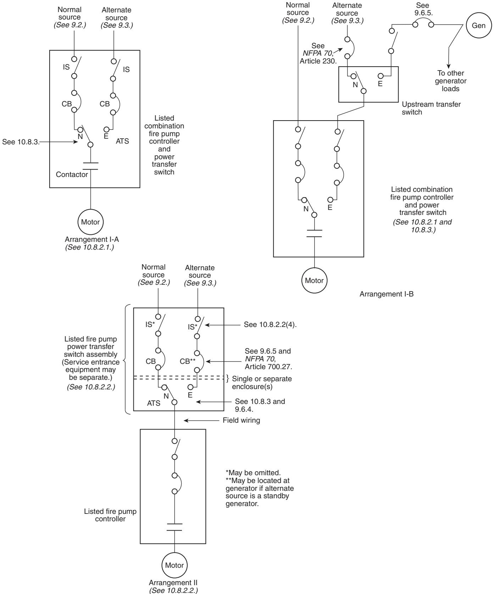  
Δ FIGURE A.10.8 Typical Fire Pump Controller and Transfer Switch Arrangements.

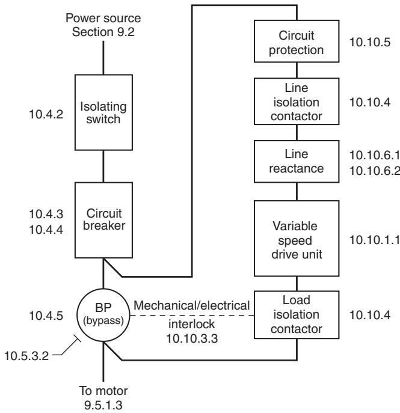  
Δ FIGURE A.10.10 Variable Speed Pressure Limiting Control.

A.11.1.3 The compression ignition diesel engine has proved to be the most dependable of the internal combustion engines for driving fire pumps.

A.11.2.2.2 For more information, see SAE J-1349, Engine Power Test Code — Spark Ignition and Compression Engine. The 4-hour minimum power requirement in NFPA 20 has been tested and witnessed during the engine listing process.

A.11.2.2.4 See Figure A.11.2.2.4.

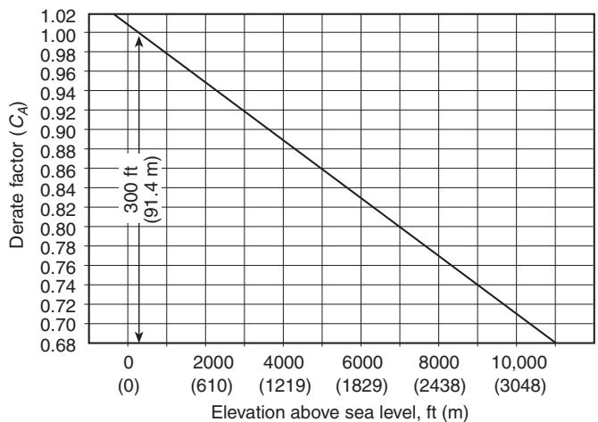  
Note: The correction equation is as follows:

Corrected engine horsepower = $\left( C _ { A } + C _ { T } - 1 \right)$ ¥ listed engine horsepower where:

CA = derate factor for elevation

CT = derate factor for temperature

FIGURE A.11.2.2.4 Elevation Derate Curve.

A.11.2.2.5 Pump room temperature rise should be considered when determining the maximum ambient temperature specified. (See Figure A.11.2.2.5.)

A.11.2.4.2 Traditionally, engines have been built with mechanical devices to control the injection of fuel into the combustion chamber. To comply with requirements for reduced exhaust emissions, many engine manufacturers have incorporated electronics to control the fuel injection process, thus eliminating levers and linkages. Many of the mechanically controlled engines are no longer manufactured.

A.11.2.4.2.4 ECMs can be designed by engine manufacturers to monitor various aspects of engine performance. A stressed engine condition (such as high cooling water temperature) is usually monitored by the ECM and is built into the ECM control logic to reduce the horsepower output of the engine, thus providing a safeguard for the engine. Such engine safeguards are not permitted for ECMs in fire pump engine applications.

A.11.2.4.2.7.1 When engines are in standby and the battery chargers have the batteries in float, it is actually the chargers that are providing the current to support the engine, controller, and pump room as defined in 11.2.7.2.3.2.

A.11.2.4.3.4.3 Some variable speed pressure limiting control systems require a small flow of water through the sensing line. The design of the sensing line connection to the fire water pipe should consider the prevention of contamination. Connecting the sensing line in a horizontal plane to the side of the fire water pipe is a desirable location.

A.11.2.6.1.1 A harness on the enclosure will ensure ready wiring in the field between the two sets of terminals.

A.11.2.6.2 Terminations should be made using insulated ringtype compression connectors for post-type terminal blocks. Saddle-type terminal blocks should have the wire stripped with about 1∕16 in. (1.6 mm) of bare wire showing after insertion in the saddle, to ensure that no insulation is below the saddle. Wires should be tugged to ensure adequate tightness of the termination.

N A.11.2.7.2.1.2 There are two different types of lead-acid batteries: vented (flooded) cells and valve-regulated lead-acid (VRLA) cells. The flooded cell has electrodes immersed in liquid electrolyte and allows the products of electrolysis and evaporation to escape freely into the atmosphere as they are generated. The VRLA cell, which is lower maintenance than the flooded type, is sealed, with the exception of a valve that opens to the atmosphere when the internal pressure in the cell exceeds atmospheric pressure by a pre-selected amount. The VRLA cell provides a means for recombination of internally generated oxygen and the suppression of hydrogen gas evolution to limit water consumption.

If batteries are going to be on-site for an extended period of time before being put into service, they should be of the flooded type in a dry charge condition. These batteries can then be wet down with electrolyte and charged just prior to use. VRLA batteries should only be brought to the site in a charged condition just prior to use.

N A.11.2.7.2.1.4 The combination of battery unit A and battery unit B provides sufficient capacity for a total of 12 consecutive cycles of 15 seconds of cranking and 15 seconds of rest. The controller will complete six of these cycles before stopping the

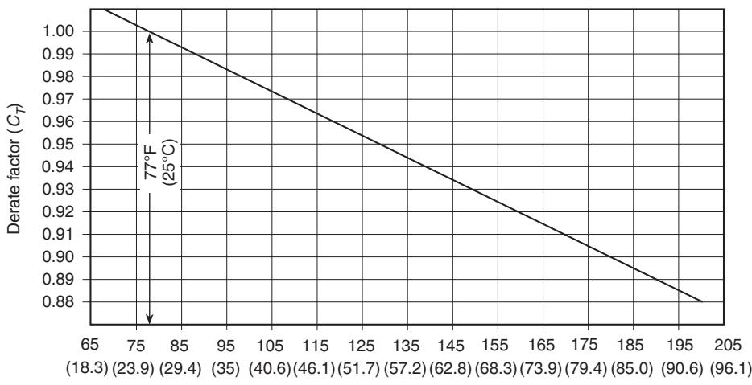  
Ambient air temperature at engine inlet, °F (°C)

Note: The correction equation is as follows:   
Corrected engine horsepower = $( C _ { A } + C _ { T } - 1 )$ × listed engine horsepower   
where:   
CA = derate factor for elevation   
C = derate factor for temperature

**FIGURE A.11.2.2.5 Temperature Derate Curve.**

attempt to start and sending the failure-to-start alarm. Battery units A and B are sized to have sufficient capacity to provide another full cranking cycle in an attempt to get the engine started after the operator has taken corrective action.

A.11.2.7.2.1.6 The 72-hour requirement is intended to apply when batteries are new. Some degradation is expected as batteries age.

A.11.2.7.2.2 Manual mechanical operation of the main battery contactor will bypass all of the control circuit wiring within the controller.

A.11.2.7.2.4 Location at the side of and level with the engine is recommended to minimize lead length from battery to starter.

A.11.2.7.2.5 A single charger that automatically alternates from one battery to another can be used on two battery installations.

N A.11.2.7.3.2 The enclosed hydraulic accumulator system should be installed as close to the engine as practical so as to prevent significant pressure loss between the engine and the hydraulic accumulator system.

A.11.2.7.4.4 Automatic maintenance of air pressure is preferable.

A.11.2.8.5 See Figure A.11.2.8.5. Water supplied for cooling the heat exchanger is sometimes circulated directly through water-jacketed exhaust manifolds or engine aftercoolers, or both, in addition to the heat exchangers.

A.11.2.8.5.3.8(A) See Figure A.11.2.8.5.3.8(A).

A.11.2.8.5.3.8(B) See Figure A.11.2.8.5.3.8(B).

A.11.2.8.6 Where the water supply can be expected to contain foreign materials, such as wood chips, leaves, lint, and so forth, the strainers required in 11.2.8.5 should be of the duplex filter type. Each filter (clean) element should be of sufficient filtering capacity to permit full water flow for a 3-hour period. In addition, a duplex filter of the same size should be installed in the bypass line. (See Figure A.11.2.8.5.)

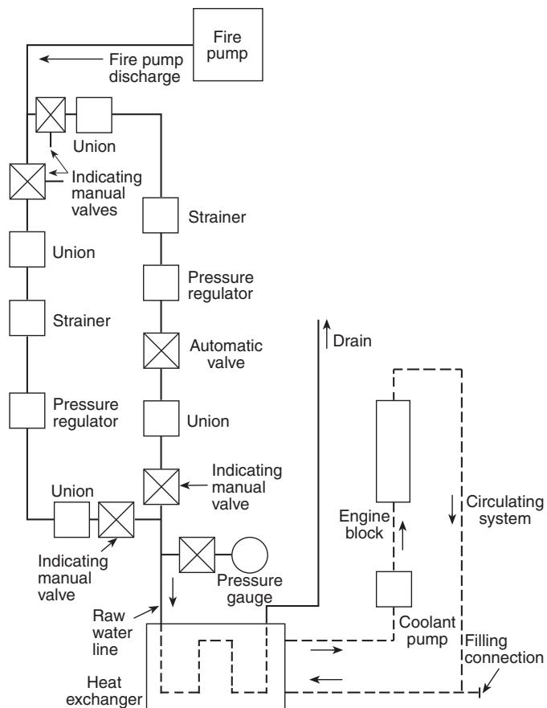  
FIGURE A.11.2.8.5 Cooling Water Line with Bypass.

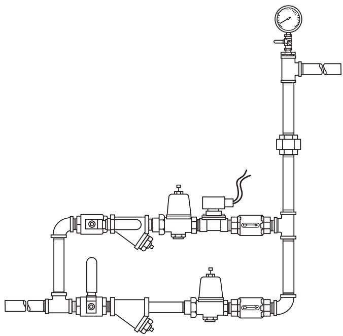  
FIGURE A.11.2.8.5.3.8(A) Spring-Loaded Check Valve Arrangement.

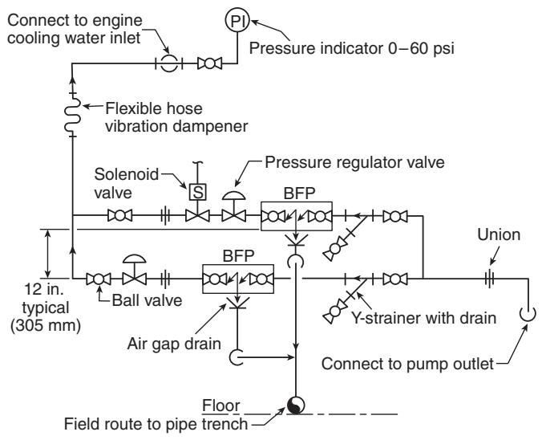  
FIGURE A.11.2.8.5.3.8(B) Backflow Preventer Arrangement.

A.11.3 The engine-driven pump can be located with an electric-driven fire pump(s) in a pump house or pump room that should be entirely cut off from the main structure by noncombustible construction. The fire pump house or pump room can contain facility pumps and/or equipment as determined by the authority having jurisdiction.

A.11.3.2 For optimum room ventilation, the air supply ventilator and air discharge should be located on opposite walls.

When calculating the maximum temperature of the pump room, the radiated heat from the engine, the radiated heat from the exhaust piping, and all other heat-contributing sources should be considered.

If the pump room is to be ventilated by a power ventilator, reliability of the power source during a fire should be considered. If the power source is unreliable, the temperature rise calculation should assume the ventilator is not operable.

Air consumed by the engine for combustion should be considered as part of the air changes in the room.

Pump rooms with heat exchanger–cooled engines typically require more air changes than engine air consumption can provide. To control the temperature rise of the room, additional air flow through the room is normally required. [See Figure A.11.3.2(a).]

Pump rooms with radiator-cooled engines could have sufficient air changes due to the radiator discharge and engine consumption. [See Figure A.11.3.2(b).]

A.11.3.2.3 When motor-operated dampers are used in the air supply path, they should be spring operated to the open position and motored closed. Motor-operated dampers should be signaled to open when or before the engine begins cranking to start.

It is necessary that the maximum air flow restriction limit for the air supply ventilator be compatible with listed engines to ensure adequate air flow for cooling and combustion. This restriction typically includes louvers, bird screens, dampers, ducts, and anything else in the air supply path between the pump room and the outdoors.

Motor-operated dampers are recommended for the heat exchanger–cooled engines to enhance convection circulation.

Gravity-operated dampers are recommended for use with radiator-cooled engines to simplify their coordination with the air flow of the fan.

Another method of designing the air supply ventilator in lieu of dampers is to use a vent duct (with rain cap), the top of which extends through the roof or outside wall of a pump house and the bottom of which is approximately 6 in. (152.4 mm) off the floor of the pump house. This passive method reduces heat loss in the winter. Sizing of this duct must meet the requirements of 11.3.2.1.

A.11.3.2.4 When motor-operated dampers are used in the air discharge path, they should be spring operated to the open position, motored closed, and signaled to open when or before the engine begins cranking to start.

  
FIGURE A.11.3.2(a) Typical Ventilation System for a Heat Exchanger–Cooled Diesel-Driven Pump.

  
If a bend in the ducting cannot be avoided, it should be radiused and should include turning vanes to prevent turbulence and flow restriction.

  
This configuration should not be used; turbulence will not allow adequate air flow.

  
FIGURE A.11.3.2(b) Typical Ventilation System for a Radiator-Cooled Diesel-Driven Pump.

Prevailing winds can work against the air discharge ventilator. Therefore, the winds should be considered in determining the location for the air discharge ventilator. (See Figure A.11.3.2.4 for the recommended wind wall design.)

For heat exchanger–cooled engines, an air discharge ventilator with motor-driven dampers designed for convection circulation is preferred in lieu of a power ventilator. This arrangement requires the size of the ventilator to be larger, but it is not dependent on a power source that might not be available during the pump operation.

For radiator-cooled engines, gravity-operated dampers are recommended. Louvers and motor-operated dampers are not recommended due to the restriction to air flow they create and the air pressure against which they must operate.

The maximum air flow restriction limit for the air discharge ventilator is necessary to be compatible with listed engines to ensure adequate air flow cooling.

A.11.3.2.4.3.4 If not properly installed, the bypass duct can draw air rather than supply it, due to venturi effect.

A.11.4.1.2 The quantity 1 gal per hp (5.07 L per kW) is equivalent to 1 pint per hp (0.634 L per kW) per hour for 8 hours. Where prompt replenishment of fuel supply is unlikely, a reserve supply should be provided along with facilities for transfer to the main tanks.

A.11.4.1.3.1 Where the authority having jurisdiction approves the start of the fire pump on loss of ac power supply, provisions should be made to accommodate the additional fuel needed for this purpose.

A.11.4.3 Diesel fuel storage tanks preferably should be located inside the pump room or pump house, if permitted by local regulations. Fill and vent lines in such case should be extended to outdoors. The fill pipe can be used for a gauging well where practical.

  
yyyyFIGURE A.11.3.2.4 Typical Wind Wall.

  
Δ FIGURE A.11.4.4 Fuel System for Diesel Engine–Driven Fire Pump.

A.11.4.4 NFPA 31 can be used as a guide for diesel fuel piping. Figure A.11.4.4 shows a suggested diesel engine fuel system.

A.11.4.4.6 A means, such as covered floor trough, angle, channel steel, or other adequate protection cover(s) (mechanical or nonmechanical), should be used on all fuel line piping “exposed to traffic,” to prevent damage to the fuel supply and return lines between the fuel tank and diesel driver.

N A.11.4.4.7 Paragraph 11.4.4.7 addresses a fuel shut-off solenoid that is a part of the engine fuel supply plumbing that would be installed for the purpose of normal stopping of the engine by starving it for fuel. The manual mechanical operation or bypass that is required is to provide the ability to allow fuel to be delivered to the engine in the event of failure of the solenoid valve itself or the control circuitry to it. The solenoid valve in this paragraph would be a part of the third-party listing of the engine and supplied by the engine supplier. Emergency stop is not the purpose for the solenoid valve in 11.4.4.7.

A.11.4.5 The pour point and cloud point should be at least 10°F (5.6°C) below the lowest expected fuel temperature. (See 4.14.2 and 11.4.3.)

A.11.4.5.1 Biodiesel and other alternative fuels are not recommended for diesel engines used for fire protection because of the unknown storage life issues. It is recommended that these engines use only petroleum fuels.

A.11.4.6 The prevention of electrostatic ignition in equipment is a complex subject. Refer to NFPA 77 for more guidance.

A.11.5.2 A conservative guideline is that, if the exhaust system exceeds 15 ft (4.5 m) in length, the pipe size should be increased one pipe size larger than the engine exhaust outlet size for each 5 ft (1.5 m) in added length.

A.11.5.2.9 Exhaust emission after treatment devices are typically dependent upon high exhaust temperature to burn away collected materials to prevent clogging. Due to the lower exhaust temperatures produced by the engine when operating at pump shutoff during weekly operation, there is a high possibility the after treatment device will accumulate collected material and will not be capable of flowing the volume of exhaust in the event the engine is required to produce full rated power for an emergency.

A.11.6 Internal combustion engines necessarily embody moving parts of such design and in such number that the engines cannot give reliable service unless given diligent care. The manufacturer's instruction book covering care and operation should be readily available, and pump operators should be familiar with its contents. All of its provisions should be observed in detail.

A.11.6.2 See NFPA 25 for proper maintenance of engine(s), batteries, fuel supply, and environmental conditions.

A.11.6.4 Commercial distillate fuel oils used in modern diesel engines are subject to numerous detrimental effects during storage. The origin of the crude oil, refinement processing techniques, time of year, and geographical consumption location all influence the determination of fuel blend formulas. Naturally occurring gums, waxes, soluble metallic soaps, water, dirt, blends, and temperature all contribute to the degradation of the fuel as it is handled and stored. These effects begin at the time of fuel refinement and continue until consumption. Proper maintenance of stored distillate fuel is critical for engine operation, efficiency, and longevity.

Storage tanks should be kept waterfree. Water contributes to steel tank corrosion and the development of microbiological growth where fuel and water interface. These problems together with the metals of the system provide elements that react with fuel to form certain gels or organic acids, resulting in clogging of filters and system corrosion. Scheduled fuel maintenance helps to reduce fuel degradation. Fuel maintenance filtration can remove contaminants and water and maintain fuel conditions to provide reliability and efficiency for standby fire pump engines. Fuel maintenance and testing should begin the day of installation and first fill.

A.11.6.4.3 NFPA 25 requires periodic testing of the fuel and maintenance of the fuel supply tank to ensure quality fuel is always available to the engine for fire protection operation.

A.11.6.4.4 When environmental or fuel quality conditions result in degradation of the fuel while stored in the supply tank from such contaminants as water, micro-organisms, and particulates, or by destabilization, it has been found that active fuel maintenance systems permanently installed on the fuel storage tanks have proven to be successful at maintaining fuel quality. An active fuel maintenance system will maintain the fuel quality in the tank, therefore preventing the fuel from going through possible cycles of degradation, risking engine reliability, and later requiring reconditioning.

A.11.6.5 Proper engine temperature, in accordance with 11.2.8.2 and 11.6.5.1, maintained through the use of a supplemental heater has many benefits, as follows:

(1) Quick starting (a fire pump engine might have to carry a full load as soon as it is started)

(2) Reduced engine wear

(3) Reduced drain on batteries

(4) Reduced oil dilution

(5) Reduced carbon deposits, so that the engine is far more likely to start every time

A.12.2.1 If the controller must be located outside the pump room, a glazed opening should be provided in the pump room wall for observation of the motor and pump during starting. The pressure control pipeline should be protected against freezing and mechanical injury.

A.12.3.1.1 In areas affected by excessive moisture, heat can be useful in reducing the dampness.

A.12.3.3.1 For more information, see NEMA 250, Enclosures for Electrical Equipment.

A.12.3.8 Pump operators should be familiar with instructions provided for controllers and should observe in detail all their recommendations.

A.12.4.1.2 It is recommended that the pilot lamp for signal service have operating voltage less than the rated voltage of the lamp to ensure long operating life. When necessary, a suitable resistor should be used to reduce the voltage for operating the lamp.

A.12.4.1.4(1) The controller can set the signal trip point above the two-thirds level. But, higher than 3∕ of nominal is not recommended to avoid false signals during normal battery aging.

A.12.4.1.4(6) The signal provided is from a common alarm and the indication of the type of trouble happening should be indicated on the engine.

A.12.4.1.6 This automatic reset function can be accomplished by the use of a silence switch of the automatic reset type or of the self-supervising type.

Δ A.12.4.2.3(3) The following signals should be monitored remotely from the controller:

(1) A common signal can be used for the following trouble indications: the items in 12.4.1.4(1) through 12.4.1.4(7) and loss of output of battery charger on the load side of the dc overcurrent protective device.

(2) The arrangement specified in A.12.4.2.3(3)(2) is permitted only where approved by the authority having jurisdiction in accordance with Section 1.5 and allows, upon loss of the ac power supply, the batteries to maintain their charge, activates ventilation in case conditions require cooling the engine, and/or maintains engine temperature in case conditions require heating the engine. (See also A.4.6.4 and A.11.4.1.3.1.)

A.12.4.4 The pressure recorder should be able to record a pressure at least 150 percent of the pump discharge pressure under no-flow conditions. In a high-rise building, this requirement can exceed 400 psi (27.6 bar). This requirement does not mandate a separate recording device for each controller. A single multichannel recording device can serve multiple sensors.

A.12.7 The following definitions are derived from NFPA 70:

(1) Automatic. Self-acting, operating by its own mechanism when actuated by some impersonal influence (e.g., a change in current strength, pressure, temperature, or mechanical configuration).

(2) Nonautomatic. The implied action requires personal intervention for its control. As applied to an electric controller, nonautomatic control does not necessarily imply a manual controller, but only that personal intervention is necessary.

N A.12.7.2.1.1.2 Water piping and associated devices could be attached to the outside of the controller.

A.12.7.2.1.3 The purpose of monitoring pressure readings from a pressure transducer is to detect and correct a transducer that is operating outside of the expected pressure range.

A.12.7.2.1.3.1 The purpose of monitoring the pressure transducer is to detect whether a transducer has drifted upwardly over time from zero. A transducer that drifts downwardly will automatically cause the fire pump to start when it drifts below the start set point.

A.12.7.2.1.3.2 When the solenoid valve drain opens, the restricting orifice in the pressure sensing line will keep the pressure at the transducer near zero while the solenoid valve is open. This is the time when the transducer can be verified to be less than 10 psi.

A.12.7.5.2 Manual shutdown of fire pumps is preferred. Automatic fire pump shutdown can occur during an actual fire condition when relatively low-flow conditions signal the controller that pressure requirements have been satisfied.

A.12.7.5.2.1(1) Although the pump is allowed to start and stop automatically during churn testing, 4.3.1 requires qualified person(s) to be in the pump room to monitor conditions while the pump is running.

A.12.7.5.2.2 A run time of 30 to 45 minutes is usually long enough to dry out the exhaust system and bring the engine and oil up to normal operating temperatures to dry them out. Longer times could require larger fuel tanks.

A.13.1.3 Single-stage turbines of maximum reliability and simplicity are recommended where the available steam supply will permit.

**A.13.2.1.1 The casing can be of cast iron.**

Some applications can require a turbine-driven fire pump to start automatically but not require the turbine to be on pressure control after starting. In such cases, a satisfactory quickopening manual reset valve installed in a bypass of the steam feeder line around a manual control valve can be used.

Where the application requires the pump unit to start automatically and after starting continue to operate by means of a pressure signal, the use of a satisfactory pilot-type pressure control valve is recommended. This valve should be located in the bypass around the manual control valve in the steam feeder line. The turbine governor control valve, when set at approximately 5 percent above the normal full-load speed of the pump under automatic control, would act as a pre-emergency control.

In the arrangements set forth in the two preceding paragraphs, the automatic valve should be located in the bypass around the manual control valve, which would normally be kept in the closed position. In the event of failure of the automatic valve, this manual valve could be opened, allowing the turbine to come to speed and be controlled by the turbine governor control valve(s).

The use of a direct acting pressure regulator operating on the control valve(s) of a steam turbine is not recommended.

A.13.3 The following information should be taken into consideration when planning a steam supply, exhaust, and boiler feed for a steam turbine–driven fire pump.

The steam supply for the fire pump should preferably be an independent line from the boilers. It should be run so as not to be liable to damage in case of fire in any part of the property. The other steam lines from the boilers should be controlled by valves located in the boiler room. In an emergency, steam can be promptly shut off from these lines, leaving the steam supply entirely available for the fire pump. Strainers in steam lines to turbines are recommended.

The steam throttle at the pump should close against the steam pressure. It should preferably be of the globe pattern with a solid disc. If, however, the valve used has a removable composition ring, the disc should be of bronze and the ring made of sufficiently hard and durable material, and so held in place in the disc as to satisfactorily meet severe service conditions. Gate valves are undesirable for this service because they cannot readily be made leaktight, as is possible with the globe type of valve. The steam piping should be so arranged and trapped that the pipes can be kept free of condensed steam.

In general, a pressure-reducing valve should not be placed in the steam pipe supplying the fire pump. There is no difficulty in designing turbines for modern high-pressure steam, and this gives the simplest and most dependable unit. A pressurereducing valve introduces a possible obstruction in the steam line in case it becomes deranged. In most cases, the turbines can be protected by making the safety valve required by 13.2.1.2 of such size that the pressure in the casing will not exceed 25 psi (1.7 bar). This valve should be piped outside of the pump room and, if possible, to some point where the discharge could be seen by the pump attendant. Where a pressure-reducing valve is used, the following points should be carefully considered:

**(1) Pressure-Reducing Valve.**

(a) The pressure-reducing valve should not contain a stuffing box or a piston working in a cylinder.

(b) The pressure-reducing valve should be provided with a bypass containing a globe valve to be opened in case of an emergency. The bypass and stop valves should be one pipe size smaller than the reducing valve, and they should be located so as to be readily accessible. This bypass should be arranged to prevent the accumulation of condensate above the reducing valve.

(c) The pressure-reducing valve should be smaller than the steam pipe required by the specifications for the turbine.

(2) Exhaust Pipe. The exhaust pipe should run directly to the atmosphere and should not contain valves of any type. It should not be connected with any condenser, heater, or other system of exhaust piping.

(3) Emergency Boiler Feed. A convenient method of ensuring a supply of steam for the fire pump unit, in case the usual boiler feed fails, is to provide an emergency connection from the discharge of the fire pump. This connection should have a controlling valve at the fire pump and also, if desired, an additional valve located in the boiler room. A check valve also should be located in this connection, preferably in the boiler room. This emergency connection should be about 2 in. (50 mm) in diameter.

This method should not be used when there is any danger of contaminating a potable water supply. In situations where the fire pump is handling salt or brackish water, it might also be undesirable to make this emergency boiler feed connection. In such situations, an effort should be made to secure some other secondary boiler feed supply that will always be available.

A.14.1.1 The suction piping to a fire pump needs to be adequately flushed to make sure stones, silt, and other debris will not enter the pump or the fire protection system. The flow rates in Table 14.1.1.1 are the minimum recommended, which will produce a velocity of approximately 15 ft/sec (4.6 m/sec). If the flow rate cannot be achieved with the existing water supply, a supplemental source such as a fire department pumper could be necessary. The procedure is to be performed, witnessed, and signed off before connection to the suction piping is completed.

A.14.1.3 See Figure A.14.1.3(a) for a sample of a contractor's material and test certificate for fire pumps and Figure A.14.1.3(b) for a sample certificate for private fire service mains.

<table><tr><td colspan="4">Contractor&#x27;s Material and Test Certificate for Fire Pump Systems</td></tr><tr><td colspan="4">PRoCEDuRE Upon completion of work, inspection and tests shall be made by the contractor&#x27;s representative and witnessed by an owner&#x27;s representative. All defects shall be corrected and system left in service before contractor&#x27;s personnel finally leave the job. A certificate shall be filled out and signed by both representatives. Copies shall be prepared for approving authorities, owners, and contractor. It is understood the owner&#x27;s representative&#x27;s signature in no way prejudices any claim against contractor for faulty material, poor workmanship, or failure to comply with approving authority&#x27;s requirements or local ordinances.</td></tr><tr><td colspan="2">PROPERTY NAME</td><td colspan="2">DATE</td></tr><tr><td colspan="4">PROPERTY ADDRESS</td></tr><tr><td rowspan="4">ADDRESS PLANS</td><td colspan="3">ACCEPTED BY APPROVING AUTHORITIES (NAMES)</td></tr><tr><td colspan="2"></td><td>NO</td></tr><tr><td colspan="3">INSTALLATION CONFORMS TO ACCEPTED PLANS YES ALL EQUIPMENT USED IS APPROVED FOR FIRE SYSTEM SERVICE</td></tr><tr><td>IF NO, STATE DEVIATIONS HAS PERSON IN CHARGE OF FIRE PUMP EQUIPMENT BEEN INSTRUCTED AS TO LOCATION OF SYSTEM CONTROL VALVES AND CARE AND MAINTENANCE OF THIS NEW EQUIPMENT?</td><td></td><td>YES YES</td><td>NO NO</td></tr><tr><td rowspan="2">INSTRUCTIONS IF NO, EXPLAIN</td><td colspan="3">IF NO, EXPLAIN HAVE COPIES OF APPROPRIATE INSTRUCTIONS AND CARE AND YES</td></tr><tr><td colspan="2">□ MAINTENANCE CHARTS BEEN LEFT ON PREMISES?</td><td>NO</td></tr><tr><td>LOCATION EXPLAIN</td><td colspan="3">SUPPLIES BUILDING(S) (CAMPUS, WAREHOUSE, HIGH RISE)</td></tr><tr><td rowspan="5">PUMP ROOM EQUIPMENT</td><td>IS THE PUMP ROOM EQUIPMENT PER THE PLANS AND SPECS? IS THE FIRE PUMP PROPERLY MOUNTED AND ANCHORED TO THE FOUNDATION?</td><td></td><td>YES YES</td><td>NO NO</td></tr><tr><td>IF NO, EXPLAIN</td><td>YES</td><td></td><td>NO</td></tr><tr><td>IS THE FIRE PUMP BASE PROPERLY GROUTED? IF NO, EXPLAIN</td><td></td><td></td><td></td></tr><tr><td>DOES THE PUMP ROOM HAVE THE PROPER FLOOR DRAINS? IF NO, EXPLAIN</td><td>YES YES</td><td></td><td>NO NO</td></tr><tr><td colspan="3">IS THE SUCTION AND DISCHARGE PIPING PROPERLY SUPPORTED? IS THE PUMP ROOM HEATED AND VENTILATED PER NFPA 20?</td><td>NO</td></tr><tr><td rowspan="6">PIPES AND FITTINGS PRE- PACKAGED PUMP HOUSE</td><td>PIPE TYPES AND CLASS PIPE CONFORMS TO STANDARD</td><td></td><td>YES</td><td>NO</td></tr><tr><td>FITTINGS CONFORM TO STANDARD IF NO, EXPLAIN</td><td>YES</td><td></td><td>NO</td></tr><tr><td>SUCTION AND DISCHARGE PIPING ANCHORED OR RESTRAINED?:</td><td>YES</td><td></td><td>NO</td></tr><tr><td>IS THIS A PACKAGE OR SKID MOUNTED PUMP?</td><td>YES</td><td></td><td>NO</td></tr><tr><td>IS THE PACKAGE/SKID PROPERLY ANCHORED TO A CONCRETE FOUNDATION? IF NO, EXPLAIN</td><td>YES</td><td></td><td>NO</td></tr><tr><td colspan="4">IS THE STRUCTURAL FOUNDATION FRAME FILLED WITH CONCRETE TO FORM A YES NO FINISHED FLOOR?</td></tr><tr><td>TEST HYDROSTATIC TEST: DESCRIPTION</td><td colspan="3">IS THERE A FLOOR DRAIN INSTALLED? YES HYDROSTATIC: Hydrostatic tests shall be made at not less than 200 psi (13.8 bar) for 2 hours or 50 psi (3.4 bar) above static pressure in excess of 200 psi (13.8 bar) for 2 hours.</td><td>NO</td></tr><tr><td>ALL NEW PIPING HYDROSTATICALLY TESTED AT: PSI/BAR FOR</td><td colspan="3">HOURS FLUSHING: Flow the required rate until water is clear as indicated by no collection of foreign material in burlap bags at</td><td>NO LEAKAGE ALLOWED</td></tr><tr><td>FLUSHING TESTS maximum available.</td><td colspan="3">outlets such as hydrants and blowoffs. Flush at flows not less than 390 gpm (1476 L/min) for 4 in. pipe, 610 gpm (2309 L/min) for 5 in. pipe, 880 gpm (3331 L/min) for 6 in. pipe, 1560 gpm (5905 L/min) for 8 in. pipe, 2440 gpm (9235 L/min) for 10 in. pipe, and 3520 gpm (13,323 L/min) for 12 in. pipe. When supply cannot produce stipulated flow rates, obtain © 2018 National Fire Protection Association (NFPA 20, 1 of 2)</td><td></td></tr></table>

Δ FIGURE A.14.1.3(a) Sample of Contractor's Material Test Certificate for Fire Pump Systems.

<table><tr><td rowspan="2">FLUSHING TESTS</td><td colspan="2">NEW PIPING FLUSHED ACCORDING TO BY (COMPANY) IF NO, EXPLAIN</td><td colspan="2">STANDARD</td><td colspan="2">YES</td><td colspan="2">NO</td></tr><tr><td colspan="2">HOW FLUSHING FLOW WAS OBTAINED PUBLIC WATER TANK OR RESERVOIR OTHER (EXPLAIN) LEAD-INS FLUSHED ACCORDING TO</td><td colspan="2">THROUGH WHAT TYPE OPENING TEST HEADER</td><td colspan="3">OPEN PIPE</td></tr><tr><td>(continued) BY (COMPANY) IF NO, EXPLAIN</td><td colspan="2"></td><td colspan="2">STANDARD</td><td>YES</td><td colspan="3">NO</td></tr><tr><td rowspan="10">FIELD ACCEPTANCE TEST</td><td colspan="5">HOW FLUSHING FLOW WAS OBTAINED PUBLIC WATERTANK OR RESERVOIR OTHER (EXPLAIN)</td><td>THROUGH WHAT TYPE OPENING Y CONNECTION TO</td><td colspan="2">OPEN PIPE</td></tr><tr><td colspan="2">ALL EQUIPMENT APPROVED?</td><td>FLANGE &amp; SPIGOT</td><td>YES</td><td></td><td colspan="2"></td><td>NO</td></tr><tr><td colspan="5">ALL REQUIRED REPRESENTATIVES PRESENT FOR TEST</td><td>YES</td><td colspan="2"></td><td>NO</td></tr><tr><td colspan="5">AHJ AND OWNER&#x27;S REPRESENTATIVE PRESENT FOR TEST IF NO. EXPLAIN</td><td>YES</td><td colspan="2"></td><td>NO</td></tr><tr><td colspan="5">ALL ELECTRICAL WIRING COMPLETE AND PER NFPA 70 AND NFPA 20 IF NO, EXPLAIN</td><td>YES</td><td></td><td colspan="2">NO</td></tr><tr><td colspan="5">CALIBRATE TEST EQUIPMENT USED CALIBRATION DATE FLOW TESTS</td><td>YES</td><td colspan="2"></td><td>NO</td></tr><tr><td colspan="5">PUMP DESIGN GPM PSI DOES THE PUMP MEET OR EXCEED THE CERTIFIED CURVE? PUMP TYPE HORIZONTAL VERTICAL TURBINE</td><td>YES</td><td colspan="2">OTHER</td><td>NO</td></tr><tr><td colspan="5">PUMP MAKE MODEL # COMMENTS ELECTRIC DRIVER OPERATIONAL TEST SATISFACTORY ELEC. DRIVER MODEL #</td><td>SERIAL #</td><td colspan="2">YES</td><td>NO</td></tr><tr><td colspan="5">VOLTAGE VAC @ HP RPM ENGINE DRIVEN</td><td>SERIAL # YES</td><td colspan="2">FLA</td><td></td></tr><tr><td colspan="5">ENGINE MAKE MODEL # HP RPM SPEED</td><td>SERIAL #</td><td colspan="2"></td><td>NO</td></tr><tr><td colspan="5">DIESEL DRIVER OPERATIONAL TEST SATISFACTORY? OTHER EXPLAIN</td><td>YES</td><td colspan="2"></td><td>NO</td></tr><tr><td colspan="5">CONTROLLER MAKE MODEL # VARIABLE SPEED PRESSURE LIMITING CONTROL TESTED AT MINIMUM, RATED, AND PEAK FLOW</td><td>SERIAL #</td><td colspan="2">YES</td><td></td></tr><tr><td colspan="5">CONTROLLER TEST: SIX AUTO STARTS SIX MANUAL STARTS</td><td></td><td>YES</td><td>NO</td><td colspan="2">NO</td></tr><tr><td colspan="8">PHASE REVERSAL TEST PERFORMED (ELECTRIC ONLY)</td><td></td><td>NO</td><td>NO</td></tr><tr><td colspan="2"></td><td colspan="5"></td><td>YES</td><td>YES</td><td>NO</td><td></td></tr><tr><td colspan="2">IF NO, STATE REASON</td><td colspan="5">ALTERNATE POWER SOURCE TESTED (ELECTRIC ONLY) ELECTRONIC FUEL MANAGEMENT (ECM) FUNCTION TEST PERFORMED (DIESEL ONLY)</td><td></td><td>YES</td><td>NO</td><td></td></tr><tr><td colspan="5">SYSTEM CONTROL VALVES LEFT WIDE OPEN</td><td></td><td>YES</td><td></td><td>NO</td><td></td></tr><tr><td colspan="2">CONTROL VALVES</td><td colspan="5"></td><td>YES</td><td></td><td>NO</td></tr><tr><td colspan="5">HOSE THREADS OF FIRE DEPARTMENT CONNECTIONS AND HYDRANTS INTERCHANGEABLE WITH THOSE OF FIRE DEPARTMENT ANSWERING ALARM</td><td></td><td>YES</td><td></td><td>NO</td><td></td></tr><tr><td colspan="2">DATE LEFT IN SERVICE REMARKS ADDITIONAL COMMENTS:</td><td colspan="5"></td><td></td><td></td><td></td></tr><tr><td colspan="5">NAME OF INSTALLING CONTRACTOR</td><td></td><td></td><td></td><td></td><td></td></tr><tr><td colspan="2">TESTS WITNESSED BY SIGNATURES FOR PROPERTY OWNER (SIGNED)</td><td colspan="5"></td><td></td><td></td><td></td></tr></table>

Δ FIGURE A.14.1.3(a) Continued

<table><tr><td rowspan=1 colspan=3>Contractor&#x27;s Material and Test Certificate for PrivateFire Service Mains Feeding Fire Pump(s)</td></tr><tr><td rowspan=1 colspan=3>PRoCEDuRE Upon completion of work, inspection and tests shall be made by the contractor&#x27;s representative and witnessed by an owner&#x27;srepresentative. All defects shall be corrected and system left in service before contractor&#x27;s personnel finally leave the job.A certificate shall be filled out and signed by both representatives. Copies shall be prepared for approving authorities, owners, andcontractor. It is understood the owner&#x27;s representative&#x27;s signature in no way prejudices any claim against contractor for faulty material, poorworkmanship, or failure to comply with approving authority&#x27;s requirements or local ordinances.</td></tr><tr><td rowspan=1 colspan=2>PROPERTY NAME</td><td rowspan=1 colspan=1>DATE</td></tr><tr><td rowspan=1 colspan=3>PROPERTY ADDRESS</td></tr><tr><td rowspan=3 colspan=1>PLANS</td><td rowspan=1 colspan=2>ACCEPTED BY APPROVING AUTHORITIES (NAMES)</td></tr><tr><td rowspan=1 colspan=2>ADDRESS</td></tr><tr><td rowspan=1 colspan=2>INSTALLATION CONFORMS TO ACCEPTED PLANS                                    YES       NOEQUIPMENT USED IS APPROVED                                                □ YES       NOIF NO, STATE DEVIATIONS</td></tr><tr><td rowspan=2 colspan=1>INSTRUCTIONS</td><td rowspan=1 colspan=2>HAS PERSON IN CHARGE OF FIRE EQUIPMENT BEEN INSTRUCTED AS             □ YES    □ NOTO LOCATION OF CONTROL VALVES AND CARE AND MAINTENANCEOF THIS NEW EQUIPMENT?IF NO, EXPLAIN</td></tr><tr><td rowspan=1 colspan=2>HAVE COPIES OF APPROPRIATE INSTRUCTIONS AND CARE AND                   □ YES    □ NOMAINTENANCE CHARTS BEEN LEFT ON PREMISES?IF NO, EXPLAIN</td></tr><tr><td rowspan=1 colspan=1>LOCATION</td><td rowspan=1 colspan=2>SUPPLIES BUILDINGS</td></tr><tr><td rowspan=3 colspan=1>PIPES ANDJOINTS</td><td rowspan=1 colspan=1>PIPE TYPES AND CLASS</td><td rowspan=1 colspan=1>TYPE JOINT</td></tr><tr><td rowspan=1 colspan=2>PIPE CONFORMS TO                            STANDARD         YES        NOFITTINGS CONFORM TOSTANDARD         YES        NOIF NO, EXPLAIN</td></tr><tr><td rowspan=1 colspan=2>BURIED JOINTS NEEDING ANCHORAGE CLAMPED,                                    YES       NOSTRAPPED, OR BLOCKED IN ACCORDANCE WITH                STANDARDIF NO, EXPLAIN</td></tr><tr><td rowspan=1 colspan=1>TESTDESCRIPTION</td><td rowspan=1 colspan=2>FLUSHING: Flow the required rate until water is clear as indicated by no collection of foreign material in burlap bagsat outlets such as hydrants and blowoffs. Flush at flow not less than 37 gpm for 1 in. pipe (140 L/min for 25 mm pipe)85 gpm for 11½2 in. pipe (330 L/min for 38 mm pipe), 150 gpm for 2 in. pipe (570 L/min for 50 mm pipe), 229 gpm for21½ in. pipe (870 L/min for 65 mm pipe), 330 gpm for 3 in. pipe (1250 L/min for 75 mm pipe), 450 gpm for 3½ in. pipe(1710 L/min for 85 mm pipe), 590 gpm for 4 in. pipe (2240 L/min for 100 mm pipe), 920 gpm for 5 in. pipe (3490 L/minfor 125 mm pipe), 1360 gpm for 6 in. pipe (5150 L/min for 150 mm pipe), 2350 gpm for 8 in. pipe (8900 L/min for200 mm pipe), 3670 gpm for 10 in. pipe (13,900 L/min for 250 mm pipe), 5290 gpm for 12 in. pipe (20,100 L/min for300 mm pipe), 7200 gpm for 14 in. pipe (27,300 L/min for 350 mm pipe), and 9400 gpm for 16 in. pipe (35,600 L/minfor 400 mm pipe). When supply cannot produce stipulated flow rates, comply with 14.1.1.3.HYDROSTATIC: Hydrostatic tests shall be made at not less than 200 psi (13.8 bar) for 2 hours or 50 psi (3.4 bar)above static pressure in excess of 150 psi (10.3 bar) for 2 hours.LEAKAGE: New pipe laid with rubber gasketed joints shall, if the workmanship is satisfactory, have little or no leakageat the joints. The amount of leakage at the joints shall not exceed 2 qt/hr (1.89 L/hr) per 100 joints irrespective of pipediameter. The amount of allowable leakage specified above can be increased by 1 fl oz per inch valve diameter per hour(30 mL/25 mm/hr) for each metal seated valve isolating the test section. If dry barrel hydrants are tested with the mainvalve open, so the hydrants are under pressure, an additional 5 oz per minute (150 mL/min) leakage is permitted foreach hydrant.</td></tr><tr><td rowspan=1 colspan=3></td></tr></table>

© 2018 National Fire Protection Association  
(NFPA 20, 1 of 2)

Δ FIGURE A.14.1.3(b) Sample of Contractor's Material and Test Certificate for Private Fire Service Mains Feeding Fire Pump(s).

<table><tr><td rowspan="4">FLUSHING TESTS</td><td colspan="2">NEW PIPING FLUSHED ACCORDING TO BY (COMPANY) IF NO, EXPLAIN</td><td rowspan="2">STANDARD</td><td colspan="2">YES NO</td></tr><tr><td rowspan="2">HOW FLUSHING FLOW WAS OBTAINED PUBLIC WATER TANK OR RESERVOIR FIRE PUMP</td><td colspan="2">THROUGH WHAT TYPE OPENING HYDRANT BUTT</td><td rowspan="2">OPEN PIPE</td></tr><tr><td>LEAD-INS FLUSHED ACCORDING TO BY (COMPANY)</td><td>STANDARD YES</td></tr><tr><td colspan="2">IF NO, EXPLAIN HOW FLUSHING FLOW WAS OBTAINED PUBLIC WATER TANK OR RESERVOIR FIRE PUMP</td><td colspan="3">THROUGH WHAT TYPE OPENING Y CONNECTION TO OPEN PIPE</td></tr><tr><td>HYDROSTATIC TEST</td><td colspan="3">ALL NEW PIPING HYDROSTATICALLY TESTED AT PSI FOR HOURS</td><td colspan="2">FLANGE &amp; SPIGOT BURIED JOINTS COVERED YES NO</td></tr><tr><td>LEAKAGE TEST</td><td colspan="2">TOTAL AMOUNT OF LEAKAGE MEASURED GALLONS HOURS</td><td colspan="3">NO LEAKAGE ALLOWED FOR VISIBLE JOINTS</td></tr><tr><td>HYDRANTS</td><td>ALLOWABLE LEAKAGE (BURIED) GALLONS NUMBER INSTALLED</td><td colspan="2">NO LEAKAGE ALLOWED FOR VISIBLE JOINTS HOURS TYPE AND MAKE</td><td colspan="2">ALL OPERATE SATISFACTORILY</td></tr><tr><td>CONTROL</td><td colspan="4">YES NO WATER CONTROL VALVES LEFT WIDE OPEN YES NO IF NO, STATE REASON</td></tr><tr><td>VALVES</td><td colspan="5">HOSE THREADS OF FIRE DEPARTMENT CONNECTIONS AND HYDRANTS YES NO INTERCHANGEABLE WITH THOSE OF FIRE DEPARTMENT ANSWERING ALARM DATE LEFT IN SERVICE</td></tr><tr><td rowspan="4">REMARKS</td><td colspan="5">ADDITIONAL COMMENTS:</td></tr><tr><td colspan="5">NAME OF INSTALLING CONTRACTOR</td></tr><tr><td colspan="5">TESTS WITNESSED BY</td></tr><tr><td colspan="5">FOR PROPERTY OWNER (SIGNED) TITLE DATE</td></tr><tr><td colspan="2">FOR INSTALLING CONTRACTOR (SIGNED)</td><td colspan="2">TITLE</td><td colspan="2">DATE</td></tr><tr><td colspan="5">ADDITIONAL EXPLANATION AND NOTES</td><td colspan="2"></td></tr><tr><td colspan="8">© 2018 National Fire Protection Association (NFPA 20, 2 of 2)</td></tr></table>

Δ FIGURE A.14.1.3(b) Continued

A.14.2.1 In addition, representatives of the installing contractor, insurance company, and owner should be present.

A.14.2.4 If a complete fire pump submittal package is available, it should provide for comparison of the equipment specified. Such a package should include an approved copy of the fire pump room general arrangement drawings, including the electrical layout, the layout of the pump and water source, the layout of the pump room drainage details, the pump foundation layout, and the mechanical layout for heat and ventilation.

N A.14.2.4.2.3 This requires comparing the discharge pressure and power draw for the flow against the curve provided by the pump supplier.

A.14.2.6 The fire pump operation is as follows:

(1) Motor-Driven Pump. To start a motor-driven pump, the following steps should be taken in the following order:

(a) See that pump is completely primed.

(b) Close isolating switch and then close circuit breaker.

(c) Automatic controller will start pump if system demand is not satisfied (e.g., pressure low, deluge tripped).

(d) For manual operation, activate switch, pushbutton, or manual start handle. Circuit breaker tripping mechanism should be set so that it will not operate when current in circuit is excessively large.

(2) Steam-Driven Pump. A steam turbine driving a fire pump should always be kept warmed up to permit instant operation at full-rated speed. The automatic starting of the turbine should not be dependent on any manual valve operation or period of low-speed operation. If the pop safety valve on the casing blows, steam should be shut off and the exhaust piping examined for a possible closed valve or an obstructed portion of piping. Steam turbines are provided with governors to maintain speed at a predetermined point, with some adjustment for higher or lower speeds. Desired speeds below this range can be obtained by throttling the main throttle valve.

(3) Diesel Engine–Driven Pump. To start a diesel engine–driven pump, the operator should be familiar beforehand with the operation of this type of equipment. The instruction books issued by the engine and control manufacturer should be studied to this end. The storage batteries should always be maintained in good order to ensure prompt, satisfactory operation of this equipment (i.e., check electrolyte level and specific gravity, inspect cable conditions, corrosion, etc.).

(4) Fire Pump Settings. The fire pump system, when started by pressure drop, should be arranged as follows:

(a) The jockey pump stop point should equal the pump churn pressure plus the minimum static supply pressure.

(b) The jockey pump start point should be at least 10 psi (0.68 bar) less than the jockey pump stop point.

(c) The fire pump start point should be 5 psi (0.34 bar) less than the jockey pump start point. Use 10 psi (0.68 bar) increments for each additional pump.

(d) Where minimum run times are provided, the pump will continue to operate after attaining these pressures. The final pressures should not exceed the pressure rating of the system.

(e) Where the operating differential of pressure switches does not permit these settings, the settings should be as close as equipment will permit. The settings should be established by pressures observed on test gauges.

(f) Examples of fire pump settings follow (for SI units, 1 psi = 0.0689 bar):

i. Pump: 1000 gpm, 100 psi pump with churn pressure of 115 psi

ii. Suction supply: 50 psi from city — minimum static; 60 psi from city — maximum static

iii. Jockey pump stop = 115 psi + 50 psi = 165 psi

iv. Jockey pump start = 165 psi - 10 psi = 155 psi

Fire pump stop = 115 psi + 50 psi = 165 psi

vi. Fire pump start = 155 psi - 5 psi = 150 psi

vii. Fire pump maximum churn = 115 psi + 60 psi = 175 psi

(g) Where minimum-run timers are provided, the pumps will continue to operate at churn pressure beyond the stop setting. The final pressures should not exceed the pressure rating of the system components.

(5) Automatic Recorder. The performance of all fire pumps should be automatically indicated on a pressure recorder to provide a record of pump operation and assistance in fire loss investigation.

A.14.2.6.1 The test equipment should be furnished by either the authority having jurisdiction, the installing contractor, or the pump manufacturer, depending upon the prevailing arrangements made between the aforementioned parties. The equipment should include, but not necessarily be limited to, the following:

(1) Equipment for Use with Test Valve Header. 50 ft (15 m) lengths of 21∕2 in. (65 mm) lined hose should be provided including Underwriters Laboratories' play pipe nozzles as needed to flow required volume of water. Where test meter is provided, however, these might not be needed.

(2) Instrumentation. The following test instruments should be of high quality, accurate, and in good repair:

(a) Clamp-on volt/ammeter

(b) Test gauges

(c) Tachometer

(d) Pitot tube with gauge (for use with hose and nozzle) (3) Instrumentation Calibration. All test instrumentation should be calibrated by an approved testing and calibration facility within the 12 months prior to the test. Calibration documentation should be available for review by the authority having jurisdiction.

A majority of the test equipment used for acceptance and annual testing has never been calibrated. This equipment can have errors of 15 to 30 percent in readings. The use of uncalibrated test equipment can lead to inaccurately reported test results.

While it is desirable to achieve a true churn condition (no flow) during the test for comparison to the manufacturer's certified pump test characteristic curve, it might not be possible in all circumstances. Pumps with circulation relief valves will discharge a small amount of water, even when no water is flowing into the fire protection system. The small discharge through the circulation relief valve should not be shut off during the test since it is necessary to keep the pump from overheating. For pumps with circulation relief valves, the minimum flow condition in the test is expected to be the situation where no water is flowing to the fire protection system but a small flow is present through the circulation relief valve. During a test on a pump with a pressure relief valve, the pressure relief valve should not open because these valves are installed purely as a safety precaution to prevent overpressurization during overspeed conditions.

Overspeed conditions should not be present during the test, so the pressure relief valve should not open. When pressure relief valves are installed on systems to relieve pressure under normal operating conditions, and if a true churn condition is desired during the acceptance test, the system discharge valve can be closed and the pressure relief valve can be adjusted to eliminate the flow. The pressure readings can be quickly noted and the pressure relief valve adjusted again to allow flow and relief of pressure. After this one-time test, a reference net pressure can be noted with the relief valve open so that the relief valve can remain open during subsequent annual tests with the comparison back to the reference residual net pressure rather than the manufacturer's curve.

Δ A.14.2.6.3.2 Vibration in excess of limits in ANSI/HI 9.6.4, Rotodynamic (Centrifugal and Vertical) Pumps for Vibration Measurement and Allowable Values, could pose potential damage to the fire pump. Some of the areas of vibration concern can usually be attributed to a number of items.

Examples of causes of vibration concerns are as follows:

(1) Bearing, due to lack of lubrication (2) Impeller vibrations due to debris in impeller, due to poor flushing

(3) Foundation concerns due to poorly designed and installed foundations

(4) Lack of proper grouting of the pump base and foundation

(5) Main drive couplings require the proper alignment of the driver and the pump shaft

N A.14.2.6.4.1 All seven points are required to verify the stability of the variable speed pump.

**Δ A.14.2.6.6 A sample procedure is as follows:**

(1) Make a visual check of the unit. If hose and nozzles are used, see that they are securely tied down. See that the hose valves are closed. If a test meter is used, the valve on the discharge side of the meter should be closed.

(2) Start the pump.

(3) Partially open one or two hose valves, or slightly open the meter discharge valve.

(4) Check the general operation of the unit. Watch for vibration, leaks (oil or water), unusual noises, and general operation. Adjust packing glands.

(5) Measure water discharge. The steps to do so are as follows:

(a) Where a test valve header is used, regulate the discharge by means of the hose valves and a selection of the nozzle tips. It will be noticed that the play pipe has a removable tip. This tip has a 11∕8 in. (28.6 mm) nozzle, and when the tip is removed, the play pipe has a 13∕4 in. (44.4 mm) nozzle. Hose valves should be shut off before removing or putting on the 11∕8 in. (28.6 mm) tip.

(b) Where a test meter is used, regulate the discharge valve to achieve various flow readings.

(c) Important test points are at 150 percent rated capacity, rated capacity, and shutoff. Intermediate points can be taken if desired to help develop the performance curve.

(6) Record the following data at each test point [see the sample form shown in Figure A.14.2.6.6(a)]:

(a) Pump rpm

(b) Suction pressure

(c) Discharge pressure

(d) Number and size of hose nozzles, pitot pressure for each nozzle, and total gpm (L/min); for test meter, simply a record of gpm (L/min)

(e) Amperes (each phase for electric motor–driven pump)

(f) Volts (phase to phase for electric motor–driven pump)

(g) Engine back pressure (for diesel engine drive pump)

(h) Oil pressure (for diesel engine drive pump)

(i) Cooling loop water pressure (for diesel engine drive pump)

(j) Engine temperature (for diesel engine drive pump)

(k) Steam pressure (for steam drive pump)

Evaluate test results as follows:

(a) Discharge Flow and Pressure. Verify that the discharge flow and pressure is adequate to supply the fire protection demand.

(b) Rated Speed. Verify whether the pump is operating at or close to rated rpm. Pump speeds that vary significantly from the original pump design speed(s) should be investigated and corrected.

(c) Capacity. For the hose valve header, using appropriate formulas or a fire stream table that matches the orifice characteristics, determine the gpm (L/min) for each nozzle at each pitot reading. For example, 16 psi (1.1 bar) pitot pressure with 13∕4 in. (44.4 mm) nozzle with a coefficient of 0.975 indicates 356 gpm (1348 L/min). Add the gpm for each hose line to determine total volume. For the test meter, the total gpm (L/min) is read directly. The formula for calculating a flow from a pitot pressure is:

Flow:

[A.14.2.6.6a]

$$
Q = 2 9 . 8 3 C D ^ { 2 } P ^ { 0 . 5 }
$$

where:

Q = flow through the orifice in gpm

C = orifice discharge coefficient

D = orifice diameter in inches

P = pitot pressure in inches

(d) Total Head for Horizontal Pump. Total head is the sum of the following:

i. Pressure measured by the discharge gauge at pump discharge flange

ii. Velocity head difference, pump discharge, and pump suction

iii. Gauge elevation corrections to pump centerline (plus or minus)

iv. Pressure measured by suction gauge at pump suction flange — negative value when pressure is above 0

Total Head for Vertical Pump. Total head is the sum of the following:

i. Pressure measured by the discharge gauge at pump discharge flange

ii. Velocity head at the discharge flange iii. Distance to the supply water level iv. Discharge gauge elevation correction to centerline of discharge

(f) Electrical Input. Voltage and amperes are read directly from the volt/ammeter. This reading is compared to the motor nameplate full-load amperes. The only general calculation is to determine the maximum amperes allowed due to the motor service factor. In the case of 1.15 service factor, the maximum amperes are approximately 1.15 times motor amperes, because changes in power factor and efficiency are not considered. If the maximum amperes recorded on the test do not exceed this figure, the motor and pump will be judged satisfactory. It is most important to measure voltage and amperes accurately on each phase should the maximum amperes logged on the test exceed the calculated maximum amperes. This measurement is important because a poor power supply with low voltage will cause a high ampere reading. This condition can be corrected only by improvement in the power supply. There is nothing that can be done to the motor or the pump.

(g)

Correction to Rated Speed. For purposes of evaluation and plotting, the capacity, head, and power should be corrected from the test values at test speed to the rated speed of the pump. The corrections are made as follows.

Capacity:

$$
Q _ { 2 } = \left( { \frac { N _ { 2 } } { N _ { 1 } } } \right) Q _ { 1 }\tag{[A.14.2.6.6b]}
$$

where:

$\mathcal { Q }$ = capacity at test speed in gpm (L/min)

$\mathcal { Q }$ = capacity at rated speed in gpm (L/min)

$N _ { 1 }$ = test speed in rpm

$N _ { 2 }$ = rated speed in rpm

Head:

$$
H _ { \mathrm { { 2 } } } = \left( { \frac { N _ { \mathrm { { 2 } } } } { N _ { \mathrm { { 1 } } } } } \right) ^ { 2 } H _ { \mathrm { { 1 } } }\tag{[A.14.2.6.6c]}
$$

where:

$H _ { 1 } =$ head at test speed in ft (m)

$H _ { 2 } =$ head at rated speed in ft (m)

Horsepower:

$$
h \dot { p } _ { 2 } = \left( \frac { N _ { 2 } } { N _ { 1 } } \right) ^ { 3 } h { p } _ { 1 }\tag{[A.14.2.6.6d]}
$$

where:

$h \phi _ { 1 } = \mathrm { k W }$ (horsepower) at test speed

$h p _ { 2 } = \mathrm { k W }$ (horsepower) at rated speed

(h)

In general, a head-capacity curve [see Figure A.14.2.6.6(b) and Figure A.14.2.6.6(c)] and an ampere-capacity curve [see Figure A.14.2.6.6(d)] should be plotted. A study of these curves will show the performance picture of the pump as it was tested.

(i) The final step of the evaluation is to document and notify the appropriate authorities of the fire pump status, which includes whether the fire pump passed or failed, if the fire pump was left in service, and any issues that were identified. Any outstanding issues should be addressed and a retest scheduled if necessary.

A.14.2.6.6.5 The phrase “varying voltage” applies when the measurement of motor current is at a voltage above or below the motor rated voltage. This is because the motor running current varies inversely with the voltage applied to the motor, but the product is fairly constant (except for the secondary effect of the out-of-phase magnetizing currents and minor core loss current.) For example, a 460 Vac motor running at rated horsepower and rated at 100 FLA will draw 79.7 kW electrical power (ignoring losses), that is, 460 × 100 × 1.732. The product of (average of the three phases) voltage and current will be a constant with moderate changes in the line voltage. In the previous example, the rated volts × amps (VA) product equals 46,000. At 480 V, the current drawn will be 95.6 amps (46,000/480). The current draw at 437 V (460 − 5%) would be 105.3 amps.

Another method is to adjust the rated current by the inverse ratio of rated voltage to actual running voltage. For example, $1 0 0 \times 4 6 0 / 4 8 0 = 9 5 . 8$ and 100 × $4 6 0 / 4 3 7 = 1 0 5 . 3 .$ Also, the motor service factor (1.15) applies to fixed speed installations, but not variable speed applications (1.0). Hence, for a fixed speed installation, the example shown here is allowed to have a maximum current on any phase of 115 amps at 460 Vac or 110.2 amps at 480 V or 121 amps at 437 Vac.

A.14.2.6.8 A simulated test of the phase reversal device is an acceptable test method.

A.14.2.7.1 All controller starts required for tests described in 14.2.6 through 14.2.9 should accrue respectively to this number of tests.

A.14.2.11 It is not the intent to discharge water for the full 1-hour test duration, provided all flow tests can be conducted in less time and efforts are taken to prevent the pump from overheating.

A.14.2.12 To verify the operation of the alternate ECM, with the motor stopped, move the ECM selector switch to the alternate ECM position. Repositioning of the selector switch should cause a signal on the fire pump controller. Start the engine; it should operate normally with all functions. Shut engine down, switch back to the primary ECM, and restart the engine briefly to verify that correct switchback has been accomplished.

To verify the operation of the redundant sensor, with the engine running, disconnect the wires from the primary sensor. There should be no change in the engine operation. Reconnect the wires to the sensor. Next, disconnect the wires from the redundant sensor. There should be no change in the engine operation. Reconnect the wires to the sensor. Repeat this process for all primary and redundant sensors on the engines. Note: If desired, the disconnecting and reconnecting of wires to the sensors can be done while the engine is not running, then starting the engine after each disconnection and reconnection of the wires to verify engine operation.

A.14.3 It is the intent to retain the record drawing, equipment manual, and completed test report for the life of the fire pump system.

A.14.3.3 Consideration should be given to stocking spare parts for critical items not readily available.

**Sample Centrifugal Fire Pump Acceptance Test Form**

Information on this form covers the minimum requirements of NFPA 20 for performing acceptance tests on centrifugal fire pumps with electric motor or diesel engine drivers. A separate form is required for each pump operating simultaneously. This form does not cover periodic inspection, testing, and maintenance required by NFPA 25.

Owner’s address:

Pump location:

Property address:

Date of test:

Pump type: Horizontal ❏ Vertical ❏ Inline ❏ Other (specify)

Manufacturer: Model or type: Shop/Serial number

Pump rated for gpm at psi at RPM, net discharge pressure psi at 150% psi at churn

Pump suction size in., discharge size in., suction from

If suction from tank, tank diameter ft, height ft, net capacity gpm

Driver: Electric motor Diesel engine Steam turbine

Manufacturer: Shop/Serial number: Model or type:

Rated horsepower: Rated speed: If electric motor, rated voltage Operating voltage

Rated amps Phase cycles Service factor

Controller manufacturer:

Controller rated HP VAC

Does controller rated HP & VAC match motor? ... ...... ❏ Yes ❏ No

Transfer switch? . .. ❏ Yes ❏ No

Does controller rate HP & VAC match motor? ..................................................................... ❏ Yes ❏ No ❏ N/A

Pressure maintenance (jockey) pump on system? ❏ Yes ❏ No ❏ Manual ❏ Automatic

Manufacturer: Shop/Serial number:

Model or type: ❏ Centrifugal or ❏ Positive displacement?

Pressure relief valve provided on jockey pump discharge? ❏ Yes ❏ No ❏ N/A

Jockey pump rated for gpm at psi at RPM HP

Jockey pump suction size in., discharge size in.

Jockey pump controller manufacturer:

Jockey pump controller rated HP VAC

Does jockey pump controller rated HP & VAC match motor? ............................................ ❏ Yes ❏ No

Note: All blanks are to be filled in. All questions are to be answered Yes, No, or Not Applicable. All “No” answers are to be explained in the comments portion of this form.

**I. Flush Test (Table 14.1.1.1 — Conduct before hydrostatic test)**

A. Suction supply from ground level storage tank or reservoir .................................. ❏ Yes ❏ N/A

B. Suction piping was flushed at gpm? (See Table 14.1.1.1) ...................... ❏ Yes ❏ No ❏ N/A

C. Was pipe from tank discharge to pump suction visually inspected? ...................... ❏ Yes ❏ No ❏ N/A

D. Copy of Contractor’s Material and Test Certificate for

II. Hydrostatic Test (14.1.2) A. Maximum pump discharge pressure at rated speed and nonflow (churn) condition psi B. Piping tested at psi for 2 hours? . ❏ Yes ❏ No ❏ N/A C. Piping passed test? . . ❏ Yes ❏ No ❏ N/A D. Copy of Contractor’s Material and Test Certificate for Fire Pump Systems attached? [See Figures A.14.1.3(a) and A.14.1.3(b)] ............. ❏ Yes ❏ No ❏ N/A

**III. People Present (14.2.1)**

A. Pump manufacturer/representative? .... ...... ❏ Yes ❏ No

B. Engine manufacturer/representative? ... ..... ❏ Yes ❏ No ❏ N/A

C. Controller manufacturer/representative? ... ...... ❏ Yes ❏ No

D. Transfer switch manufacturer/representative? .......................................................❏ Yes ❏ No ❏ N/A

E. Authority having jurisdiction/representative? ... .... ❏ Yes ❏ No

F. Owner or owner’s representative? .... ...... ❏ Yes ❏ No

© 2018 National Fire Protection Association (NFPA 20, p. 1 of 4)

Δ FIGURE A.14.2.6.6(a) Centrifugal Fire Pump Acceptance Test Form.

<table><tr><td rowspan=3 colspan=1>Test</td><td rowspan=3 colspan=1>(u ppd dm</td><td rowspan=3 colspan=1>(en ressuimn uess</td><td rowspan=3 colspan=1>Disecsssre Drease(ps)</td><td rowspan=1 colspan=7>Nozzle size (in.)Nozzle coef.</td><td rowspan=3 colspan=2> )</td><td rowspan=3 colspan=1>Nets r ps)</td><td rowspan=3 colspan=1>pm d aetpresure</td><td rowspan=3 colspan=2>Rp  ow(s)</td><td rowspan=3 colspan=2>Suetlcn vcityPprese (s())</td><td rowspan=3 colspan=1>Disl vecitypr(es (es())</td><td rowspan=3 colspan=1>Vel acstedPrese (s())</td><td rowspan=3 colspan=1>ors (erss(s sa</td><td rowspan=3 colspan=1>xhs ack(  t (m)d)</td><td rowspan=3 colspan=1>Dieetl terrtemre2</td><td rowspan=3 colspan=1>Cooos op)prse (s))</td></tr><tr><td rowspan=1 colspan=4>Pitot read</td><td rowspan=1 colspan=3>ings (psi)</td></tr><tr><td rowspan=1 colspan=1>1</td><td rowspan=1 colspan=2>2</td><td rowspan=1 colspan=1>3</td><td rowspan=1 colspan=1>4</td><td rowspan=1 colspan=1>5</td><td rowspan=1 colspan=1>6</td></tr><tr><td rowspan=1 colspan=1>0%</td><td rowspan=1 colspan=1></td><td rowspan=1 colspan=1></td><td rowspan=1 colspan=1></td><td rowspan=1 colspan=1></td><td rowspan=1 colspan=2></td><td rowspan=1 colspan=1></td><td rowspan=1 colspan=1></td><td rowspan=1 colspan=1></td><td rowspan=1 colspan=1></td><td rowspan=1 colspan=2></td><td rowspan=1 colspan=1></td><td rowspan=1 colspan=1></td><td rowspan=1 colspan=2></td><td rowspan=1 colspan=2></td><td rowspan=1 colspan=1></td><td rowspan=1 colspan=1></td><td rowspan=1 colspan=1></td><td rowspan=1 colspan=1></td><td rowspan=1 colspan=1></td><td rowspan=1 colspan=1></td></tr><tr><td rowspan=1 colspan=1>25%</td><td rowspan=1 colspan=1></td><td rowspan=1 colspan=1></td><td rowspan=1 colspan=1></td><td rowspan=1 colspan=1></td><td rowspan=1 colspan=2></td><td rowspan=1 colspan=1></td><td rowspan=1 colspan=1></td><td rowspan=1 colspan=1></td><td rowspan=1 colspan=1></td><td rowspan=1 colspan=2></td><td rowspan=1 colspan=1></td><td rowspan=1 colspan=1></td><td rowspan=1 colspan=2></td><td rowspan=1 colspan=2></td><td rowspan=1 colspan=1></td><td rowspan=1 colspan=1></td><td rowspan=1 colspan=1></td><td rowspan=1 colspan=1></td><td rowspan=1 colspan=1></td><td rowspan=1 colspan=1></td></tr><tr><td rowspan=1 colspan=1>50%</td><td rowspan=1 colspan=1></td><td rowspan=1 colspan=1></td><td rowspan=1 colspan=1></td><td rowspan=1 colspan=1></td><td rowspan=1 colspan=2></td><td rowspan=1 colspan=1></td><td rowspan=1 colspan=1></td><td rowspan=1 colspan=1></td><td rowspan=1 colspan=1></td><td rowspan=1 colspan=2></td><td rowspan=1 colspan=1></td><td rowspan=1 colspan=1></td><td rowspan=1 colspan=2></td><td rowspan=1 colspan=2></td><td rowspan=1 colspan=1></td><td rowspan=1 colspan=1></td><td rowspan=1 colspan=1></td><td rowspan=1 colspan=1></td><td rowspan=1 colspan=1></td><td rowspan=1 colspan=1></td></tr><tr><td rowspan=1 colspan=1>75%</td><td rowspan=1 colspan=1></td><td rowspan=1 colspan=1></td><td rowspan=1 colspan=1></td><td rowspan=1 colspan=1></td><td rowspan=1 colspan=2></td><td rowspan=1 colspan=1></td><td rowspan=1 colspan=1></td><td rowspan=1 colspan=1></td><td rowspan=1 colspan=1></td><td rowspan=1 colspan=2></td><td rowspan=1 colspan=1></td><td rowspan=1 colspan=1></td><td rowspan=1 colspan=2></td><td rowspan=1 colspan=2></td><td rowspan=1 colspan=1></td><td rowspan=1 colspan=1></td><td rowspan=1 colspan=1></td><td rowspan=1 colspan=1></td><td rowspan=1 colspan=1></td><td rowspan=1 colspan=1></td></tr><tr><td rowspan=1 colspan=1>100%</td><td rowspan=1 colspan=1></td><td rowspan=1 colspan=1></td><td rowspan=1 colspan=1></td><td rowspan=1 colspan=1></td><td rowspan=1 colspan=2></td><td rowspan=1 colspan=1></td><td rowspan=1 colspan=1></td><td rowspan=1 colspan=1></td><td rowspan=1 colspan=1></td><td rowspan=1 colspan=2></td><td rowspan=1 colspan=1></td><td rowspan=1 colspan=1></td><td rowspan=1 colspan=2></td><td rowspan=1 colspan=2></td><td rowspan=1 colspan=1></td><td rowspan=1 colspan=1></td><td rowspan=1 colspan=1></td><td rowspan=1 colspan=1></td><td rowspan=1 colspan=1></td><td rowspan=1 colspan=1></td></tr><tr><td rowspan=1 colspan=1>125%</td><td rowspan=1 colspan=1></td><td rowspan=1 colspan=1></td><td rowspan=1 colspan=1></td><td rowspan=1 colspan=1></td><td rowspan=1 colspan=2></td><td rowspan=1 colspan=1></td><td rowspan=1 colspan=1></td><td rowspan=1 colspan=1></td><td rowspan=1 colspan=1></td><td rowspan=1 colspan=2></td><td rowspan=1 colspan=1></td><td rowspan=1 colspan=1></td><td rowspan=1 colspan=2></td><td rowspan=1 colspan=2></td><td rowspan=1 colspan=1></td><td rowspan=1 colspan=1></td><td rowspan=1 colspan=1></td><td rowspan=1 colspan=1></td><td rowspan=1 colspan=1></td><td rowspan=1 colspan=1></td></tr><tr><td rowspan=1 colspan=1>150%</td><td rowspan=1 colspan=1></td><td rowspan=1 colspan=1></td><td rowspan=1 colspan=1></td><td rowspan=1 colspan=1></td><td rowspan=1 colspan=2></td><td rowspan=1 colspan=1></td><td rowspan=1 colspan=1></td><td rowspan=1 colspan=1></td><td rowspan=1 colspan=1></td><td rowspan=1 colspan=2></td><td rowspan=1 colspan=1></td><td rowspan=1 colspan=1></td><td rowspan=1 colspan=2></td><td rowspan=1 colspan=2></td><td rowspan=1 colspan=1></td><td rowspan=1 colspan=1></td><td rowspan=1 colspan=1></td><td rowspan=1 colspan=1></td><td rowspan=1 colspan=1></td><td rowspan=1 colspan=1></td></tr><tr><td rowspan=1 colspan=1>0%</td><td rowspan=1 colspan=1></td><td rowspan=1 colspan=1></td><td rowspan=1 colspan=1></td><td rowspan=1 colspan=1></td><td rowspan=1 colspan=2></td><td rowspan=1 colspan=1></td><td rowspan=1 colspan=1></td><td rowspan=1 colspan=1></td><td rowspan=1 colspan=1></td><td rowspan=1 colspan=2></td><td rowspan=1 colspan=1></td><td rowspan=1 colspan=1></td><td rowspan=1 colspan=2></td><td rowspan=1 colspan=2></td><td rowspan=1 colspan=1></td><td rowspan=1 colspan=1></td><td rowspan=1 colspan=1></td><td rowspan=1 colspan=1></td><td rowspan=1 colspan=1></td><td rowspan=1 colspan=1></td></tr><tr><td rowspan=1 colspan=1></td><td rowspan=1 colspan=1></td><td rowspan=1 colspan=1></td><td rowspan=1 colspan=1></td><td rowspan=1 colspan=1></td><td rowspan=1 colspan=2></td><td rowspan=1 colspan=1></td><td rowspan=1 colspan=1></td><td rowspan=1 colspan=1></td><td rowspan=1 colspan=1></td><td rowspan=1 colspan=2></td><td rowspan=1 colspan=1></td><td rowspan=1 colspan=1></td><td rowspan=1 colspan=2></td><td rowspan=1 colspan=2></td><td rowspan=1 colspan=1></td><td rowspan=1 colspan=1></td><td rowspan=1 colspan=1></td><td rowspan=1 colspan=1></td><td rowspan=1 colspan=1></td><td rowspan=1 colspan=1></td></tr><tr><td rowspan=1 colspan=1>100%</td><td rowspan=1 colspan=1></td><td rowspan=1 colspan=1></td><td rowspan=1 colspan=1></td><td rowspan=1 colspan=1></td><td rowspan=1 colspan=2></td><td rowspan=1 colspan=1></td><td rowspan=1 colspan=1></td><td rowspan=1 colspan=1></td><td rowspan=1 colspan=1></td><td rowspan=1 colspan=2></td><td rowspan=1 colspan=1></td><td rowspan=1 colspan=1></td><td rowspan=1 colspan=2></td><td rowspan=1 colspan=2></td><td rowspan=1 colspan=1></td><td rowspan=1 colspan=1></td><td rowspan=1 colspan=1></td><td rowspan=1 colspan=1></td><td rowspan=1 colspan=1></td><td rowspan=1 colspan=1></td></tr><tr><td rowspan=1 colspan=1></td><td rowspan=1 colspan=1></td><td rowspan=1 colspan=1></td><td rowspan=1 colspan=1></td><td rowspan=1 colspan=1></td><td rowspan=1 colspan=2></td><td rowspan=1 colspan=1></td><td rowspan=1 colspan=1></td><td rowspan=1 colspan=1></td><td rowspan=1 colspan=1></td><td rowspan=1 colspan=2></td><td rowspan=1 colspan=1></td><td rowspan=1 colspan=1></td><td rowspan=1 colspan=2></td><td rowspan=1 colspan=2></td><td rowspan=1 colspan=1></td><td rowspan=1 colspan=1></td><td rowspan=1 colspan=1></td><td rowspan=1 colspan=1></td><td rowspan=1 colspan=1></td><td rowspan=1 colspan=1></td></tr><tr><td rowspan=1 colspan=1>150%</td><td rowspan=1 colspan=1></td><td rowspan=1 colspan=1></td><td rowspan=1 colspan=1></td><td rowspan=1 colspan=1></td><td rowspan=1 colspan=2></td><td rowspan=1 colspan=1></td><td rowspan=1 colspan=1></td><td rowspan=1 colspan=1></td><td rowspan=1 colspan=1></td><td rowspan=1 colspan=2></td><td rowspan=1 colspan=1></td><td rowspan=1 colspan=1></td><td rowspan=1 colspan=2></td><td rowspan=1 colspan=2></td><td rowspan=1 colspan=1></td><td rowspan=1 colspan=1></td><td rowspan=1 colspan=1></td><td rowspan=1 colspan=1></td><td rowspan=1 colspan=1></td><td rowspan=1 colspan=1></td></tr><tr><td rowspan=1 colspan=8>Pump isConstant speedVariable</td><td rowspan=1 colspan=17>speed</td></tr><tr><td rowspan=1 colspan=25>Notes:lVelocity pressure adjustments provide a more accurate analysis in most cases and as a minimum should be includedwhenever the pump suction and discharge diameters are different and the pump fails by a narrow margin. The actualinternal diameter of the pump suction and discharge should be obtained from the manufacturer.2These readings are applicable to diesel engine pumps onl. Recording these readings is not specifically required in Chapter 14.</td></tr><tr><td></td><td></td><td></td><td></td><td rowspan=1 colspan=2>Test</td><td rowspan=1 colspan=6>Voltage</td><td rowspan=1 colspan=2></td><td rowspan=1 colspan=4>Amperes</td><td></td><td></td><td></td><td></td><td></td><td></td><td></td></tr><tr><td></td><td></td><td></td><td></td><td rowspan=1 colspan=2></td><td rowspan=1 colspan=2>L1-L2</td><td rowspan=1 colspan=2>L2-L3</td><td rowspan=1 colspan=2>L1-L3</td><td rowspan=1 colspan=2>L1</td><td rowspan=1 colspan=2>L2</td><td rowspan=1 colspan=2>L3</td><td></td><td></td><td></td><td></td><td></td><td></td><td></td></tr><tr><td></td><td></td><td></td><td></td><td rowspan=1 colspan=2>0%</td><td rowspan=1 colspan=2></td><td rowspan=1 colspan=2></td><td rowspan=1 colspan=2></td><td rowspan=1 colspan=2></td><td rowspan=1 colspan=2></td><td rowspan=1 colspan=2></td><td></td><td></td><td></td><td></td><td></td><td></td><td></td></tr><tr><td></td><td></td><td></td><td></td><td rowspan=1 colspan=2>25%</td><td rowspan=1 colspan=2></td><td rowspan=1 colspan=2></td><td rowspan=1 colspan=2></td><td rowspan=1 colspan=2></td><td rowspan=1 colspan=2></td><td rowspan=1 colspan=2></td><td></td><td></td><td></td><td></td><td></td><td></td><td></td></tr><tr><td></td><td></td><td></td><td></td><td rowspan=1 colspan=2>50%</td><td rowspan=1 colspan=2></td><td rowspan=1 colspan=2></td><td rowspan=1 colspan=2></td><td rowspan=1 colspan=2></td><td rowspan=1 colspan=2></td><td rowspan=1 colspan=2></td><td></td><td></td><td></td><td></td><td></td><td></td><td></td></tr><tr><td></td><td></td><td></td><td></td><td rowspan=1 colspan=2>75%</td><td rowspan=1 colspan=2></td><td rowspan=1 colspan=2></td><td rowspan=1 colspan=2></td><td rowspan=1 colspan=2></td><td rowspan=1 colspan=2></td><td rowspan=1 colspan=2></td><td></td><td></td><td></td><td></td><td></td><td></td><td></td></tr><tr><td></td><td></td><td></td><td></td><td rowspan=1 colspan=2>100%</td><td rowspan=1 colspan=2></td><td rowspan=1 colspan=2></td><td rowspan=1 colspan=2></td><td rowspan=1 colspan=2></td><td rowspan=1 colspan=2></td><td rowspan=1 colspan=2></td><td></td><td></td><td></td><td></td><td></td><td></td><td></td></tr><tr><td></td><td></td><td></td><td></td><td rowspan=1 colspan=2>125%</td><td rowspan=1 colspan=2></td><td rowspan=1 colspan=2></td><td rowspan=1 colspan=2></td><td rowspan=1 colspan=2></td><td rowspan=1 colspan=2></td><td rowspan=1 colspan=2></td><td></td><td></td><td></td><td></td><td></td><td></td><td></td></tr><tr><td></td><td></td><td></td><td></td><td rowspan=1 colspan=2>150%</td><td rowspan=1 colspan=2></td><td rowspan=1 colspan=2></td><td rowspan=1 colspan=2></td><td rowspan=1 colspan=2></td><td rowspan=1 colspan=2></td><td rowspan=1 colspan=2></td><td></td><td></td><td></td><td></td><td></td><td></td><td></td></tr><tr><td></td><td></td><td></td><td></td><td rowspan=1 colspan=2>0%</td><td rowspan=1 colspan=2></td><td rowspan=1 colspan=2></td><td rowspan=1 colspan=2></td><td rowspan=1 colspan=2></td><td rowspan=1 colspan=2></td><td rowspan=1 colspan=2></td><td></td><td></td><td></td><td></td><td></td><td></td><td></td></tr><tr><td></td><td></td><td></td><td></td><td rowspan=1 colspan=2></td><td rowspan=1 colspan=2></td><td rowspan=1 colspan=2></td><td rowspan=1 colspan=2></td><td rowspan=1 colspan=2></td><td rowspan=1 colspan=2></td><td rowspan=1 colspan=2></td><td></td><td></td><td></td><td></td><td></td><td></td><td></td></tr><tr><td></td><td></td><td></td><td></td><td rowspan=1 colspan=2>100%</td><td rowspan=1 colspan=2></td><td rowspan=1 colspan=2></td><td rowspan=1 colspan=2></td><td rowspan=1 colspan=2></td><td rowspan=1 colspan=2></td><td rowspan=1 colspan=2></td><td></td><td></td><td></td><td></td><td></td><td></td><td></td></tr><tr><td></td><td></td><td></td><td></td><td rowspan=1 colspan=2></td><td rowspan=1 colspan=2></td><td rowspan=1 colspan=2></td><td rowspan=1 colspan=2></td><td rowspan=1 colspan=2></td><td rowspan=1 colspan=2></td><td rowspan=1 colspan=2></td><td></td><td></td><td></td><td></td><td></td><td></td><td></td></tr><tr><td></td><td></td><td></td><td></td><td rowspan=1 colspan=2>150%</td><td rowspan=1 colspan=2></td><td rowspan=1 colspan=2></td><td rowspan=1 colspan=2></td><td rowspan=1 colspan=2></td><td rowspan=1 colspan=2></td><td rowspan=1 colspan=2></td><td></td><td></td><td></td><td></td><td></td><td></td><td></td></tr></table>

<table><tr><td>H. For electric motors operating under varying voltage: 1. Was the product of the actual voltage and current demand less than or equal to the product of the rated full load current times the rated voltage times the allowable service factor? YesNoN/A 2. Was the voltage always less than 5% above the rated voltage during the test? Yes No  N/A 3. Was the voltage always less than 10% above the rated voltage during the test? Yes No  N/A I. Did engine-driven units operate without any signs of overload or stress?. Yes No N/A J. Was the engine overspeed emergency shutdown tested? Yes No N/A K. Was the governor set to properly regulate the engine speed at rated pump speed? Yes No  N/A L. Did the gear drive assembly operate without excessive objectionable noise, vibration, or heating? YesNoN/A M. Was the fire pump unit started and brought up to rated speed without interruption under the conditions of a discharge</td></tr><tr><td colspan="8">equal to peak load? Yes No  N/A N. Did the re pump performance equal the manufacturer&#x27;s factory curve within the accuracy limits of the test equipment? YesNo N/A O. Did the electric motor pumps pass phase reversal test on normal and alternate (if provided) power? Yes No  N/A VI. Multiple Pump Operation A.</td></tr><tr><td colspan="2"></td><td colspan="2">B. Record the following information for each of the Discsre Drrse (ps)</td><td colspan="8">fire pumps are required to operate  in series  in parallel N/A to meet the maximum fire protection demand. pumps operating simultaneously.</td></tr><tr><td>Test</td><td>u pd m</td><td>S(et ressrn essi</td><td colspan="2"></td><td colspan="8">Nozzle size (in.) Nozzle coef.</td></tr><tr><td>0%</td><td></td><td></td><td colspan="2">1 2 3 4</td><td colspan="7">Pitot readings (psi) 5 6 7 8 9 10 11</td><td>Nete (rsrs psi ot  pmm) 12</td><td>Rlow h this pm sd aet (ud) dund pressure</td><td>R d ow (sd)</td><td>Suelen vveeity (re (rsi)</td><td>Vloo t ndt Suelcen vcity pPres (rssi)</td></tr><tr><td>25%</td><td></td><td colspan="2"></td><td colspan="2"></td><td colspan="7"></td><td></td><td></td><td></td><td></td></tr><tr><td></td><td></td><td></td><td></td><td></td><td></td><td></td><td></td><td></td><td></td><td></td><td></td><td></td><td></td><td></td><td></td><td></td></tr><tr><td></td><td>50%</td><td></td><td></td><td></td><td></td><td></td><td></td><td></td><td></td><td></td><td></td><td></td><td></td><td></td><td></td><td></td></tr><tr><td></td><td>75%</td><td></td><td></td><td></td><td></td><td></td><td></td><td></td><td></td><td></td><td></td><td></td><td></td><td></td><td></td><td></td></tr><tr><td></td><td>100%</td><td></td><td></td><td></td><td></td><td></td><td></td><td></td><td></td><td></td><td></td><td></td><td></td><td></td><td></td><td></td></tr><tr><td></td><td>125%</td><td></td><td></td><td></td><td></td><td></td><td></td><td></td><td></td><td></td><td></td><td></td><td></td><td></td><td></td><td></td></tr><tr><td></td><td>150%</td><td></td><td></td><td></td><td></td><td></td><td></td><td></td><td></td><td></td><td></td><td></td><td></td><td></td><td></td><td></td></tr><tr><td></td><td>0%</td><td></td><td></td><td></td><td></td><td></td><td></td><td></td><td></td><td></td><td></td><td></td><td></td><td></td><td></td><td></td></tr><tr><td></td><td></td><td></td><td></td><td></td><td></td><td></td><td></td><td></td><td></td><td></td><td></td><td></td><td></td><td></td><td></td><td></td></tr><tr><td></td><td></td><td></td><td></td><td></td><td></td><td></td><td></td><td></td><td></td><td></td><td></td><td></td><td></td><td></td><td></td><td></td></tr><tr><td colspan="11">100%</td><td></td><td></td><td></td><td></td><td></td></tr><tr><td colspan="11">Pump isConstant speed Variable speed C. Did the fire pump performance equal the manufacturer&#x27;s factory curve within the accuracy limits of the test equipment during the multiple test? VII. Main Pressure Relief Valve A. Is a main pressure relief valve installed on the fire pump discharge? Yes  No</td><td colspan="4" rowspan="3"> Yes No N/A</td></tr><tr><td colspan="16">B. During variable speed performance testing, what was the flow rate through the main pressure relief valve at churn? No flow Weeping flow More than weeping flow Substantial flowN/A C. During variable speed performance testing, what was the flow rate through the main pressure relief valve at rated flow? No flow Weeping flow More than weeping flow  Substantial flowN/A D. During constant speed performance testing, what was the flow rate through the main pressure relief valve at churn?</td></tr><tr><td colspan="11">No flowWeeping flowMore than weeping flow Substantial flowN/A E. During constant speed performance testing, what was the flow rate through the main pressure relief valve at rated flow? No flowWeeping flow More than weeping flow Substantial flowN/A F. After resetting the pressure relief valve after performance testing, under variable speed operation, what was the flow rate through the main pressure relief valve at churn? No flowWeeping flow More than weeping flow Substantial flowN/A G. After resetting the pressure relief valve after performance testing, under constant speed operation, what was the flow rate through the main pressure relief valve at churn?No flow Weeping flow  More than weeping flow  Substantial flow N/A What was the fire pump discharge pressure? H. After resetting the pressure relief valve after performance testing, under constant speed operation, at what flow rate did the pressure relief valve substantially close? I. Is the maximum discharge pressure adjusted for elevation, and with the pressure relief operational, less than the pressure rating of the system components for elevation? VIII. Controller Test A. Did the pump start at least 6 times from automatic sources? B. Was each automatic starting feature tested at least once? C. Did the pump start at least 6 times manually? ..</td></tr></table>

<table><tr><td></td><td>F. Were both ECMs tested if supported?</td><td>Yes No N/A</td></tr><tr><td></td><td>G. Was the engine tested and rpm set on both ECMs at rated flow and full load?</td><td> Yes No N/A</td></tr><tr><td></td><td>H. Were all alarm functions including ECM alarms for fuel injection failure, low fuel pressure, and any primary sensor failure tested at the engine?</td><td>YesNo N/A</td></tr><tr><td></td><td>I. Electric Driven Pump Controllers 1. Were all overcurrent protective devices (including the controller circuit breaker) selected, sized, and set in accordance</td><td></td></tr><tr><td>with NFPA 20?..</td><td>2. Was the fire pump started at least once from each power service and run for at least 5 minutes?</td><td>Yes No N/A YesNoN/A</td></tr><tr><td></td><td>3. Upon simulation of a power failure, while the pump is operating at peak load, did the transfer switch transfer from the</td><td></td></tr><tr><td></td><td>normal to the emergency source without opening overcurrent protection devices on either line? 4. When normal power was restored, did retransfer from emergency to normal power occur without overcurrent protection</td><td>Yes No N/A</td></tr><tr><td>devices opening on either line?</td><td></td><td>Yes No N/A</td></tr><tr><td>the alternate source?.....</td><td>5. Were at least half of the automatic and manual starts required by Parts A and C performed with the pump connected to</td><td> Yes No  N/A</td></tr><tr><td></td><td>J. Were all signal conditions simulated demonstrating satisfactory operation?</td><td> Yes No N/A</td></tr><tr><td>K. Did the pump run for at least 1 hour during the tests?.</td><td></td><td>YesNoN/A</td></tr><tr><td>NOTE: Run time includes all time the driver was turning the impeller — i.e., no-flow and flow conditions.</td><td></td><td></td></tr></table>

<table><tr><td colspan="3">IX. Water Storage Tank  Yes No</td></tr><tr><td colspan="2">A. Tank capacity</td></tr><tr><td></td><td>B. Break tankYesNo N/A Required break tank fill rate gpm  N/A</td></tr><tr><td></td><td>C. Did refill rate maintain tank level when flowing 150% of rated capacity? Yes No N/A</td></tr><tr><td>D. A water refill rate of</td><td>gpm was:  field verified by flowing gpm through the fire pump with a starting water level of ft in.</td></tr><tr><td>and an ending water level of ft to ft in. in</td><td>in. after flowing for minutes,  field verified by raising the water level from ft in.</td></tr><tr><td>minutes,  field verified by other means (specify) E. Was the automatic refill assembly operated a minimum of 5 times?</td><td></td></tr><tr><td></td><td>.YesNoN/A</td></tr><tr><td>X. Test Evaluation</td><td></td></tr><tr><td></td><td>A. Did the pump performance equal that indicated on the manufacturer&#x27;s certified shop test under all load conditions? .. ....YesNo</td></tr><tr><td>B. Did the pump discharge equal or exceed the maximum fire protection system demand? C. Did the pump installation and performance meet the requirements of NFPA 20?.</td><td>YesNo</td></tr></table>

Fire Pump Acceptance Test NFPA Sample  
  
© 2018 National Fire Protection Association

  
FIGURE A.14.2.6.6(b) 1000 gpm at 100 psi Fire Pump Acceptance Test — Constant Speed Operation.

  
FIGURE A.14.2.6.6(c) Variable Speed Fire Pump Acceptance Test — Variable Speed Operation 1000 gpm at 100 psi Fire Pump.

  
FIGURE A.14.2.6.6(d) Horsepower and Amperage Sample Curve — Underperforming 1500 gpm at 105 psi Fire Pump.

A.14.3.4(6) Recommended spare parts and lubricants should be stored on-site to minimize system impairment.

A.14.5.2.3 Fire pump engines have unique features compared to standard industrial engines. The standard industrial ECM programming can result in the reduction of power to selfprotect the engine during a fire or the inability to accelerate the pump to rated speed in rated flow condition.

**Annex B Possible Causes of Pump Troubles**

This annex is not a part of the requirements of this NFPA document but is included for informational purposes only.

B.1 Causes of Pump Troubles. This annex contains a partial guide for locating pump troubles and their possible causes (see Figure B.1). It also contains a partial list of suggested remedies. (For other information on this subject, see ANSI/HI 1.4, Rotodynamic Centrifugal Pumps for Manuals Describing Installation, Operation and Maintenance.)

The causes listed here are in addition to possible mechanical breakage that would be obvious on visual inspection. In case of trouble, it is suggested that those troubles that can be checked easily should be corrected first or eliminated as possibilities.

B.1.1 Air Drawn into Suction Connection Through Leak(s). Air drawn into suction line through leaks causes a pump to lose suction or fail to maintain its discharge pressure. Uncover suction pipe and locate and repair leak(s).

B.1.2 Suction Connection Obstructed. Examine suction intake, screen, and suction pipe and remove obstruction. Repair or provide screens to prevent recurrence. (See 4.16.8.)

B.1.3 Air Pocket in Suction Pipe. Air pockets cause a reduction in delivery and pressure similar to an obstructed pipe.

Uncover suction pipe and rearrange to eliminate pocket. (See 4.16.6.)

B.1.4 Well Collapsed or Serious Misalignment. Consult a reliable well drilling company and the pump manufacturer regarding recommended repairs.

B.1.5 Stuffing Box Too Tight or Packing Improperly Installed, Worn, Defective, Too Tight, or of Incorrect Type. Loosen gland swing bolts and remove stuffing box gland halves. Replace packing.

B.1.6 Water Seal or Pipe to Seal Obstructed. Loosen gland swing bolt and remove stuffing box gland halves along with the water seal ring and packing. Clean the water passage to and in the water seal ring. Replace water seal ring, packing gland, and packing in accordance with manufacturer's instructions.

B.1.7 Air Leak into Pump Through Stuffing Boxes. Same as the possible cause in B.1.6.

B.1.8 Impeller Obstructed. Does not show on any one instrument, but pressures fall off rapidly when an attempt is made to draw a large amount of water.

For horizontal split-case pumps, remove upper case of pump and remove obstruction from impeller. Repair or provide screens on suction intake to prevent recurrence.

For vertical shaft turbine–type pumps, lift out column pipe (see Figure A.7.2.2.1 and Figure A.7.2.2.2) and pump bowls from wet pit or well and disassemble pump bowl to remove obstruction from impeller.

For close-coupled, vertical in-line pumps, lift motor on top pull-out design and remove obstruction from impeller.

B.1.9 Wearing Rings Worn. Remove upper case and insert feeler gauge between case wearing ring and impeller wearing ring. Clearance when new is 0.0075 in. (0.19 mm). Clearances of more than 0.015 in. (0.38 mm) are excessive.

<table><tr><td rowspan=3 colspan=1>Fire pumpTroubles</td><td rowspan=1 colspan=4>Suction</td><td rowspan=1 colspan=16>Pump</td><td rowspan=1 colspan=5>Driver and/orPump</td><td rowspan=1 colspan=7>Driver</td></tr><tr><td rowspan=1 colspan=1>Air  on on n  ks</td><td rowspan=1 colspan=1>Suetto cocten coted</td><td rowspan=1 colspan=1>Aird sotn n to die</td><td rowspan=1 colspan=1>wWwels   os cment</td><td rowspan=1 colspan=1>Stufig g n o  g g ledwoet   t t   pe</td><td rowspan=1 colspan=1>watll l l d l l oted</td><td rowspan=1 colspan=1>Air ufg ug un  t oe</td><td rowspan=1 colspan=1>Impo oelccted</td><td rowspan=1 colspan=1>Weag rg rworn</td><td rowspan=1 colspan=1>mp daged</td><td rowspan=1 colspan=1>Wro  eler</td><td rowspan=1 colspan=1>CaAcetut    t ted</td><td rowspan=1 colspan=1>si e, a   kage(ine tsie e te-pps)</td><td rowspan=1 colspan=1>Prese ud o  e s a assngIn</td><td rowspan=1 colspan=1>ceorl e t  haiture une p-ily)</td><td rowspan=1 colspan=1>Ile oked</td><td rowspan=1 colspan=1>Pum s oen</td><td rowspan=1 colspan=1>Pumt t  et secet et ot seet dorn</td><td rowspan=1 colspan=1>Ppum  med</td><td rowspan=1 colspan=1>Seal g un  g gg u tingwa    s s al</td><td rowspan=1 colspan=1>Exce      g  eardirt agr t  tion</td><td rowspan=1 colspan=1>Rota ras snn si  ament</td><td rowspan=1 colspan=1>Pumsr  r gned</td><td rowspan=1 colspan=1>Fount trin ntrigid</td><td rowspan=1 colspan=1>Engio t -te</td><td rowspan=1 colspan=1>Faut diver</td><td rowspan=1 colspan=1>Lact o tion</td><td rowspan=1 colspan=1>Speoo low</td><td rowspan=1 colspan=1>wretn o rrei rtion</td><td rowspan=1 colspan=1>Spe ho igh</td><td rowspan=1 colspan=1>Ratt  o et ot ot tage</td><td rowspan=1 colspan=1>Fautts et t yiit te tem,obt   dd t tery</td></tr><tr><td rowspan=1 colspan=1>1</td><td rowspan=1 colspan=1>2</td><td rowspan=1 colspan=1>3</td><td rowspan=1 colspan=1>4</td><td rowspan=1 colspan=1>5</td><td rowspan=1 colspan=1>6</td><td rowspan=1 colspan=1>7</td><td rowspan=1 colspan=1>8</td><td rowspan=1 colspan=1>9</td><td rowspan=1 colspan=1>10</td><td rowspan=1 colspan=1>11</td><td rowspan=1 colspan=1>12</td><td rowspan=1 colspan=1>13</td><td rowspan=1 colspan=1>14</td><td rowspan=1 colspan=1>15</td><td rowspan=1 colspan=1>16</td><td rowspan=1 colspan=1>17</td><td rowspan=1 colspan=1>18</td><td rowspan=1 colspan=1>19</td><td rowspan=1 colspan=1>20</td><td rowspan=1 colspan=1>21</td><td rowspan=1 colspan=1>22</td><td rowspan=1 colspan=1>23</td><td rowspan=1 colspan=1>24</td><td rowspan=1 colspan=1>25</td><td rowspan=1 colspan=1>26</td><td rowspan=1 colspan=1>27</td><td rowspan=1 colspan=1>28</td><td rowspan=1 colspan=1>29</td><td rowspan=1 colspan=1>30</td><td rowspan=1 colspan=1>31</td><td rowspan=1 colspan=1>32</td></tr><tr><td rowspan=1 colspan=1>Excessiveleakageatstuffingbox</td><td rowspan=1 colspan=1></td><td rowspan=1 colspan=1></td><td rowspan=1 colspan=1></td><td rowspan=1 colspan=1></td><td rowspan=1 colspan=1>X</td><td rowspan=1 colspan=1></td><td rowspan=1 colspan=1></td><td rowspan=1 colspan=1></td><td rowspan=1 colspan=1></td><td rowspan=1 colspan=1></td><td rowspan=1 colspan=1></td><td rowspan=1 colspan=1></td><td rowspan=1 colspan=1></td><td rowspan=1 colspan=1></td><td rowspan=1 colspan=1></td><td rowspan=1 colspan=1></td><td rowspan=1 colspan=1></td><td rowspan=1 colspan=1>x</td><td rowspan=1 colspan=1></td><td rowspan=1 colspan=1></td><td rowspan=1 colspan=1></td><td rowspan=1 colspan=1></td><td rowspan=1 colspan=1>X</td><td rowspan=1 colspan=1></td><td rowspan=1 colspan=1></td><td rowspan=1 colspan=1></td><td rowspan=1 colspan=1></td><td rowspan=1 colspan=1></td><td rowspan=1 colspan=1></td><td rowspan=1 colspan=1></td><td rowspan=1 colspan=1></td><td rowspan=1 colspan=1></td></tr><tr><td rowspan=1 colspan=1>Pump or driveroverheats</td><td rowspan=1 colspan=1></td><td rowspan=1 colspan=1></td><td rowspan=1 colspan=1></td><td rowspan=1 colspan=1>X</td><td rowspan=1 colspan=1>X</td><td rowspan=1 colspan=1>X</td><td rowspan=1 colspan=1></td><td rowspan=1 colspan=1>X</td><td rowspan=1 colspan=1></td><td rowspan=1 colspan=1></td><td rowspan=1 colspan=1>X</td><td rowspan=1 colspan=1></td><td rowspan=1 colspan=1></td><td rowspan=1 colspan=1></td><td rowspan=1 colspan=1>X</td><td rowspan=1 colspan=1></td><td rowspan=1 colspan=1></td><td rowspan=1 colspan=1>X</td><td rowspan=1 colspan=1>X</td><td rowspan=1 colspan=1>X</td><td rowspan=1 colspan=1>X</td><td rowspan=1 colspan=1>X</td><td rowspan=1 colspan=1>X</td><td rowspan=1 colspan=1>X</td><td rowspan=1 colspan=1>X</td><td rowspan=1 colspan=1></td><td rowspan=1 colspan=1>X</td><td rowspan=1 colspan=1></td><td rowspan=1 colspan=1>X</td><td rowspan=1 colspan=1>X</td><td rowspan=1 colspan=1>X</td><td rowspan=1 colspan=1></td></tr><tr><td rowspan=1 colspan=1>Pump unitwill not start</td><td rowspan=1 colspan=1></td><td rowspan=1 colspan=1></td><td rowspan=1 colspan=1></td><td rowspan=1 colspan=1>X</td><td rowspan=1 colspan=1>X</td><td rowspan=1 colspan=1></td><td rowspan=1 colspan=1></td><td rowspan=1 colspan=1></td><td rowspan=1 colspan=1></td><td rowspan=1 colspan=1></td><td rowspan=1 colspan=1></td><td rowspan=1 colspan=1></td><td rowspan=1 colspan=1></td><td rowspan=1 colspan=1></td><td rowspan=1 colspan=1>X</td><td rowspan=1 colspan=1>X</td><td rowspan=1 colspan=1>X</td><td rowspan=1 colspan=1></td><td rowspan=1 colspan=1></td><td rowspan=1 colspan=1></td><td rowspan=1 colspan=1>X</td><td rowspan=1 colspan=1></td><td rowspan=1 colspan=1></td><td rowspan=1 colspan=1></td><td rowspan=1 colspan=1></td><td rowspan=1 colspan=1>X</td><td rowspan=1 colspan=1>X</td><td rowspan=1 colspan=1></td><td rowspan=1 colspan=1></td><td rowspan=1 colspan=1></td><td rowspan=1 colspan=1></td><td rowspan=1 colspan=1>X</td></tr><tr><td rowspan=1 colspan=1>No waterdischarge</td><td rowspan=1 colspan=1>X</td><td rowspan=1 colspan=1>X</td><td rowspan=1 colspan=1>X</td><td rowspan=1 colspan=1></td><td rowspan=1 colspan=1></td><td rowspan=1 colspan=1></td><td rowspan=1 colspan=1></td><td rowspan=1 colspan=1>X</td><td rowspan=1 colspan=1></td><td rowspan=1 colspan=1></td><td rowspan=1 colspan=1></td><td rowspan=1 colspan=1></td><td rowspan=1 colspan=1></td><td rowspan=1 colspan=1></td><td rowspan=1 colspan=1></td><td rowspan=1 colspan=1></td><td rowspan=1 colspan=1></td><td rowspan=1 colspan=1></td><td rowspan=1 colspan=1>X</td><td rowspan=1 colspan=1></td><td rowspan=1 colspan=1></td><td rowspan=1 colspan=1></td><td rowspan=1 colspan=1></td><td rowspan=1 colspan=1></td><td rowspan=1 colspan=1></td><td rowspan=1 colspan=1></td><td rowspan=1 colspan=1></td><td rowspan=1 colspan=1></td><td rowspan=1 colspan=1></td><td rowspan=1 colspan=1></td><td rowspan=1 colspan=1></td><td rowspan=1 colspan=1></td></tr><tr><td rowspan=1 colspan=1>Pump is noisyor vibrates</td><td rowspan=1 colspan=1></td><td rowspan=1 colspan=1></td><td rowspan=1 colspan=1></td><td rowspan=1 colspan=1>X</td><td rowspan=1 colspan=1>X</td><td rowspan=1 colspan=1></td><td rowspan=1 colspan=1></td><td rowspan=1 colspan=1>X</td><td rowspan=1 colspan=1></td><td rowspan=1 colspan=1>X</td><td rowspan=1 colspan=1></td><td rowspan=1 colspan=1></td><td rowspan=1 colspan=1></td><td rowspan=1 colspan=1></td><td rowspan=1 colspan=1></td><td rowspan=1 colspan=1></td><td rowspan=1 colspan=1></td><td rowspan=1 colspan=1>X</td><td rowspan=1 colspan=1></td><td rowspan=1 colspan=1></td><td rowspan=1 colspan=1>X</td><td rowspan=1 colspan=1>X</td><td rowspan=1 colspan=1>X</td><td rowspan=1 colspan=1>X</td><td rowspan=1 colspan=1></td><td rowspan=1 colspan=1></td><td rowspan=1 colspan=1>X</td><td rowspan=1 colspan=1></td><td rowspan=1 colspan=1></td><td rowspan=1 colspan=1></td><td rowspan=1 colspan=1></td><td rowspan=1 colspan=1></td></tr><tr><td rowspan=1 colspan=1>Too muchpower required</td><td rowspan=1 colspan=1></td><td rowspan=1 colspan=1></td><td rowspan=1 colspan=1></td><td rowspan=1 colspan=1>X</td><td rowspan=1 colspan=1>X</td><td rowspan=1 colspan=1></td><td rowspan=1 colspan=1></td><td rowspan=1 colspan=1>X</td><td rowspan=1 colspan=1>X</td><td rowspan=1 colspan=1></td><td rowspan=1 colspan=1>X</td><td rowspan=1 colspan=1></td><td rowspan=1 colspan=1>X</td><td rowspan=1 colspan=1></td><td rowspan=1 colspan=1>X</td><td rowspan=1 colspan=1></td><td rowspan=1 colspan=1></td><td rowspan=1 colspan=1>X</td><td rowspan=1 colspan=1></td><td rowspan=1 colspan=1></td><td rowspan=1 colspan=1>X</td><td rowspan=1 colspan=1>X</td><td rowspan=1 colspan=1>X</td><td rowspan=1 colspan=1>X</td><td rowspan=1 colspan=1></td><td rowspan=1 colspan=1></td><td rowspan=1 colspan=1>X</td><td rowspan=1 colspan=1></td><td rowspan=1 colspan=1>X</td><td rowspan=1 colspan=1>X</td><td rowspan=1 colspan=1>X</td><td rowspan=1 colspan=1></td></tr><tr><td rowspan=1 colspan=1>Dischargepressurenot constantfor same gpm</td><td rowspan=1 colspan=1>X</td><td rowspan=1 colspan=1></td><td rowspan=1 colspan=1></td><td rowspan=1 colspan=1></td><td rowspan=1 colspan=1>X</td><td rowspan=1 colspan=1>X</td><td rowspan=1 colspan=1>X</td><td rowspan=1 colspan=1></td><td rowspan=1 colspan=1></td><td rowspan=1 colspan=1></td><td rowspan=1 colspan=1></td><td rowspan=1 colspan=1></td><td rowspan=1 colspan=1></td><td rowspan=1 colspan=1></td><td rowspan=1 colspan=1></td><td rowspan=1 colspan=1></td><td rowspan=1 colspan=1></td><td rowspan=1 colspan=1></td><td rowspan=1 colspan=1></td><td rowspan=1 colspan=1></td><td rowspan=1 colspan=1></td><td rowspan=1 colspan=1></td><td rowspan=1 colspan=1></td><td rowspan=1 colspan=1></td><td rowspan=1 colspan=1></td><td rowspan=1 colspan=1></td><td rowspan=1 colspan=1></td><td rowspan=1 colspan=1></td><td rowspan=1 colspan=1></td><td rowspan=1 colspan=1></td><td rowspan=1 colspan=1></td><td rowspan=1 colspan=1></td></tr><tr><td rowspan=1 colspan=1>Pump losessuction afterstarting</td><td rowspan=1 colspan=1>X</td><td rowspan=1 colspan=1>X</td><td rowspan=1 colspan=1>X</td><td rowspan=1 colspan=1></td><td rowspan=1 colspan=1></td><td rowspan=1 colspan=1>X</td><td rowspan=1 colspan=1>X</td><td rowspan=1 colspan=1></td><td rowspan=1 colspan=1></td><td rowspan=1 colspan=1></td><td rowspan=1 colspan=1></td><td rowspan=1 colspan=1></td><td rowspan=1 colspan=1></td><td rowspan=1 colspan=1></td><td rowspan=1 colspan=1></td><td rowspan=1 colspan=1></td><td rowspan=1 colspan=1></td><td rowspan=1 colspan=1></td><td rowspan=1 colspan=1></td><td rowspan=1 colspan=1>X</td><td rowspan=1 colspan=1></td><td rowspan=1 colspan=1></td><td rowspan=1 colspan=1></td><td rowspan=1 colspan=1></td><td rowspan=1 colspan=1></td><td rowspan=1 colspan=1></td><td rowspan=1 colspan=1></td><td rowspan=1 colspan=1></td><td rowspan=1 colspan=1></td><td rowspan=1 colspan=1></td><td rowspan=1 colspan=1></td><td rowspan=1 colspan=1></td></tr><tr><td rowspan=1 colspan=1>Insufficientwater discharge</td><td rowspan=1 colspan=1>X</td><td rowspan=1 colspan=1>X</td><td rowspan=1 colspan=1>X</td><td rowspan=1 colspan=1></td><td rowspan=1 colspan=1></td><td rowspan=1 colspan=1>X</td><td rowspan=1 colspan=1>X</td><td rowspan=1 colspan=1>X</td><td rowspan=1 colspan=1>X</td><td rowspan=1 colspan=1>X</td><td rowspan=1 colspan=1>X</td><td rowspan=1 colspan=1>X</td><td rowspan=1 colspan=1>X</td><td rowspan=1 colspan=1></td><td rowspan=1 colspan=1>X</td><td rowspan=1 colspan=1></td><td rowspan=1 colspan=1></td><td rowspan=1 colspan=1></td><td rowspan=1 colspan=1></td><td rowspan=1 colspan=1></td><td rowspan=1 colspan=1></td><td rowspan=1 colspan=1></td><td rowspan=1 colspan=1></td><td rowspan=1 colspan=1></td><td rowspan=1 colspan=1></td><td rowspan=1 colspan=1></td><td rowspan=1 colspan=1></td><td rowspan=1 colspan=1>X</td><td rowspan=1 colspan=1>X</td><td rowspan=1 colspan=1></td><td rowspan=1 colspan=1>X</td><td rowspan=1 colspan=1></td></tr><tr><td rowspan=1 colspan=1>Dischargepressuretoo low forgpmdischarge</td><td rowspan=1 colspan=1>X</td><td rowspan=1 colspan=1>X</td><td rowspan=1 colspan=1>X</td><td rowspan=1 colspan=1></td><td rowspan=1 colspan=1>X</td><td rowspan=1 colspan=1>X</td><td rowspan=1 colspan=1>X</td><td rowspan=1 colspan=1>X</td><td rowspan=1 colspan=1>X</td><td rowspan=1 colspan=1>X</td><td rowspan=1 colspan=1>X</td><td rowspan=1 colspan=1>X</td><td rowspan=1 colspan=1>X</td><td rowspan=1 colspan=1>X</td><td rowspan=1 colspan=1></td><td rowspan=1 colspan=1></td><td rowspan=1 colspan=1></td><td rowspan=1 colspan=1></td><td rowspan=1 colspan=1></td><td rowspan=1 colspan=1></td><td rowspan=1 colspan=1></td><td rowspan=1 colspan=1></td><td rowspan=1 colspan=1></td><td rowspan=1 colspan=1></td><td rowspan=1 colspan=1></td><td rowspan=1 colspan=1></td><td rowspan=1 colspan=1></td><td rowspan=1 colspan=1>X</td><td rowspan=1 colspan=1>X</td><td rowspan=1 colspan=1></td><td rowspan=1 colspan=1>X</td><td rowspan=1 colspan=1></td></tr></table>

FIGURE B.1 Possible Causes of Fire Pump Troubles.

B.1.10 Impeller Damaged. Make minor repairs or return to manufacturer for replacement. If defect is not too serious, order new impeller and use damaged one until replacement arrives.

B.1.11 Wrong Diameter Impeller. Replace with impeller of proper diameter.

B.1.12 Actual Net Head Lower than Rated. Check impeller diameter and number and pump model number to make sure correct head curve is being used.

B.1.13 Casing Gasket Defective, Permitting Internal Leakage (Single-Stage and Multistage Pumps). Replace defective gasket. Check manufacturer's drawing to see whether gasket is required.

B.1.14 Pressure Gauge Is on Top of Pump Casing. Place gauges in correct location. [See Figure A.6.3.1(a).]

B.1.15 Incorrect Impeller Adjustment (Vertical Shaft Turbine– Type Pump Only). Adjust impellers according to manufacturer's instructions.

B.1.16 Impellers Locked. For vertical shaft turbine–type pumps, raise and lower impellers by the top shaft adjusting nut.

If this adjustment is not successful, follow the manufacturer's instructions.

For horizontal split-case pumps, remove upper case and locate and eliminate obstruction.

B.1.17 Pump Is Frozen. Provide heat in the pump room. Disassemble pump and remove ice as necessary. Examine parts carefully for damage.

B.1.18 Pump Shaft or Shaft Sleeve Scored, Bent, or Worn.   
Replace shaft or shaft sleeve.

B.1.19 Pump Not Primed. If a pump is operated without water in its casing, the wearing rings are likely to seize. The first warning is a change in pitch of the sound of the driver. Shut down the pump.

For vertical shaft turbine–type pumps, check water level to determine whether pump bowls have proper submergence.

B.1.20 Seal Ring Improperly Located in Stuffing Box, Preventing Water from Entering Space to Form Seal. Loosen gland swing bolt and remove stuffing box gland halves along with the water-seal ring and packing. Replace, putting seal ring in proper location.

B.1.21 Excess Bearing Friction Due to Lack of Lubrication, Wear, Dirt, Rusting, Failure, or Improper Installation. Remove bearings and clean, lubricate, or replace as necessary.

B.1.22 Rotating Element Binding Against Stationary Element. Check clearances and lubrication and replace or repair the defective part.

B.1.23 Pump and Driver Misaligned. Shaft running off center because of worn bearings or misalignment. Align pump and driver according to manufacturer's instructions. Replace bearings according to manufacturer's instructions. (See Section 6.5.)

B.1.24 Foundation Not Rigid. Tighten foundation bolts or replace foundation if necessary. (See Section 6.4.)

B.1.25 Engine Cooling System Obstructed. Heat exchanger or cooling water systems too small or cooling pump faulty. Remove thermostats. Open bypass around regulator valve and strainer. Check regulator valve operation. Check strainer. Clean and repair if necessary. Disconnect sections of cooling system to locate and remove possible obstruction. Adjust engine cooling water circulating pump belt to obtain proper speed without binding. Lubricate bearings of this pump.

If overheating still occurs at loads up to 150 percent of rated capacity, contact pump or engine manufacturer so that necessary steps can be taken to eliminate overheating.

B.1.26 Faulty Driver. Check electric motor, internal combustion engine, or steam turbine, in accordance with manufacturer's instructions, to locate reason for failure to start.

B.1.27 Lack of Lubrication. If parts have seized, replace damaged parts and provide proper lubrication. If not, stop pump and provide proper lubrication.

B.1.28 Speed Too Low. For electric motor drive, check that rated motor speed corresponds to rated speed of pump, voltage is correct, and starting equipment is operating properly.

Low frequency and low voltage in the electric power supply prevent a motor from running at rated speed. Low voltage can be due to excessive loads and inadequate feeder capacity or (with private generating plants) low generator voltage. The generator voltage of private generating plants can be corrected by changing the field excitation. When low voltage is from the other causes mentioned, it might be necessary to change transformer taps or increase feeder capacity.

Low frequency usually occurs with a private generating plant and should be corrected at the source. Low speed can result in older type squirrel-cage-type motors if fastenings of copper bars to end rings become loose. The remedy is to weld or braze these joints.

For steam turbine drive, check that valves in steam supply pipe are wide open; boiler steam pressure is adequate; steam pressure is adequate at the turbine; strainer in the steam supply pipe is not plugged; steam supply pipe is of adequate size; condensate is removed from steam supply pipe, trap, and turbine; turbine nozzles are not plugged; and setting of speed and emergency governor is correct.

For internal combustion engine drive, check that setting of speed governor is correct; hand throttle is opened wide; and there are no mechanical defects such as sticking valves, timing off, or spark plugs fouled, and so forth. These problems might require the services of a trained mechanic.

B.1.29 Wrong Direction of Rotation. Instances of an impeller turning backward are rare but are clearly recognizable by the extreme deficiency of pump delivery. Wrong direction of rotation can be determined by comparing the direction in which the flexible coupling is turning with the directional arrow on the pump casing.

With a polyphase electric motor drive, two wires must be reversed; with a dc driver, the armature connections must be reversed with respect to the field connections. Where two sources of electrical current are available, the direction of rotation produced by each should be checked.

B.1.30 Speed Too High. See that pump- and driver-rated speed correspond. Replace electric motor with one of correct rated speed. Set governors of drivers for correct speed. Frequency at private generating stations might be too high.

B.1.31 Rated Motor Voltage Different from Line Voltage. For example, a 220 V or 440 V motor on 208 V or 416 V line. Obtain motor of correct rated voltage or larger size motor. (See Section 9.4.)

B.1.32 Faulty Electric Circuit, Obstructed Fuel System, Obstructed Steam Pipe, or Dead Battery. Check for break in wiring open switch, open circuit breaker, or dead battery. If circuit breaker in controller trips for no apparent reason, make sure oil is in dash pots in accordance with manufacturer's specifications. Make sure fuel pipe is clear, strainers are clean, and control valves are open in fuel system to internal combustion engine. Make sure all valves are open and strainer is clean in steam line to turbine.

B.2 Warning. Chapters 9 and 10 include electrical requirements that discourage the installation of disconnect means in the power supply to electric motor–driven fire pumps. This requirement is intended to ensure the availability of power to the fire pumps. When equipment connected to those circuits is serviced or maintained, the employee can have unusual exposure to electrical and other hazards. It can be necessary to require special safe work practices and special safeguards, personal protective clothing, or both.

B.3 Maintenance of Fire Pump Controllers After a Fault Condition.

B.3.1 Introduction. In a fire pump motor circuit that has been properly installed, coordinated, and in service prior to the fault, tripping of the circuit breaker or the isolating switch indicates a fault condition in excess of operating overload.

It is recommended that the following general procedures be observed by qualified personnel in the inspection and repair of the controller involved in the fault. These procedures are not intended to cover other elements of the circuit, such as wiring and motor, which can also require attention.

B.3.2 Caution. All inspections and tests are to be made on controllers that are de-energized at the line terminal, disconnected, locked out, and tagged so that accidental contact cannot be made with live parts and so that all plant safety procedures will be observed.

B.3.2.1 Enclosure. Where substantial damage to the enclosure, such as deformation, displacement of parts, or burning has occurred, replace the entire controller.

B.3.2.2 Circuit Breaker and Isolating Switch. Examine the enclosure interior, circuit breaker, and isolating switch for evidence of possible damage. If evidence of damage is not apparent, the circuit breaker and isolating switch can continue to be used after closing the door.

If there is any indication that the circuit breaker has opened several short-circuit faults, or if signs of possible deterioration appear within either the enclosure, circuit breaker, or isolating switch (e.g., deposits on surface, surface discoloration, insulation cracking, or unusual toggle operation), replace the components. Verify that the external operating handle is capable of opening and closing the circuit breaker and isolating switch. If the handle fails to operate the device, this would also indicate the need for adjustment or replacement.

B.3.2.3 Terminals and Internal Conductors. Where there are indications of arcing damage, overheating, or both, such as discoloration and melting of insulation, replace the damaged parts.

B.3.2.4 Contactor. Replace contacts showing heat damage, displacement of metal, or loss of adequate wear allowance of the contacts. Replace the contact springs where applicable. If deterioration extends beyond the contacts, such as binding in the guides or evidence of insulation damage, replace the damaged parts or the entire contactor.

B.3.2.5 Return to Service. Before returning the controller to service, check for the tightness of electrical connections and for the absence of short circuits, ground faults, and leakage current.

Close and secure the enclosure before the controller circuit breaker and isolating switch are energized. Follow operating procedures on the controller to bring it into standby condition.

**Annex C Fire Pump Room Connectivity**

This annex is not a part of the requirements of this NFPA document but is included for informational purposes only.

**C.1 Scope.**

Δ C.1.1 This annex covers considerations related to data storage and data access of information related to fire pump operation beyond the minimum controller data storage requirements. This storage can be managed by a stand-alone device (computer, tablet, or a device designed specifically for this application). Considerations in this annex include access methods, security considerations, accessible information, potential use of accessible information, long-term improvement in reliability, and standardization that allows the full potential of connectivity to be met.

Δ C.1.2 Potential use of accessible information includes remote supervision, remote monitoring that could include specific components for failure forecasting/component replacement, and reliability analysis for owner, manufacturer, and NFPA or similar group for obtaining information only. No remote operation or remote changing of any controller settings are to be permitted.

Δ C.1.3 Connectivity is for remote monitoring and data gathering. It does not replace any of the alarm and signaling requirements of this standard.

Δ C.1.4 The access can be local, such as a port (USB, RS-232, RS-485), or by remote access over any communication channel, such as phone line, Ethernet, Internet, local area network (LAN), or other.

Δ C.1.5 This annex includes the following:

(1) Possible controller access configurations (see Section C.3)

(2) Security considerations (see Section C.4)

(3) Some protection methods (see Section C.5)

(4) Standardization issues (see Section C.6)

Standardization means standardization per se — that is, defining common data formats, and so forth, to allow access to a defined common set of data in any compliant controller. Controllers might also have proprietary data beyond the defined common set.

Δ C.1.6 Remote or local access to fire pump controller stored data has been in existence for over 20 years; however, each manufacturer has used proprietary means for accessing (reading, downloading, or transferring) this data. There is a perceived need to extend these means to fire pump controllers in general, using some amount of commonality.

C.2 General Definitions.

Δ C.2.1 Access. The ability to interrogate a controller in order to be able to read or download data. This can also include means of sending data or commands to a controller. Annex C addresses both local access and remote access.

Δ C.2.2 Circuitry. Electrical/electronic circuitry that includes microcontrollers and associated firmware.

Δ C.2.3 Cloud. The system of Internet-connected devices and services.

Δ C.2.4 Connectivity. The issues involved with communicating with (connecting to) fire pump controllers.

Δ C.2.5 Encode. Encrypt. This can be used to hide data, passwords, access information, and so forth.

Δ C.2.6 Ethernet. High-speed serial connection. Each Ethernet device has (should have) a unique Ethernet MAC (media access control) address. These are 4-8 bit (12 hexadecimal digit) addresses such as: 00:A0:C9:14:C8:29.

Δ C.2.7 Firmware. A permanently stored processor program code (software); also called embedded program code.

Δ C.2.8 Global System for Mobile Communication (GMS). Cell phone technology.

N C.2.9 HyperText Markup Language (HTML). The standard markup language for handling text files over the World Wide Web.

Δ C.2.10 Internet. The global system of devices with routable IP addresses.

Δ C.2.11 IP. Internet protocol.

Δ C.2.12 IP-4 (IPV4). Internet version 4. Most of the extant Internet is IP-4. LAN addresses are specific to IP-4. IP-4 uses 32- bit addresses (4 × 8) and has around 4.3 billion addresses.

Δ C.2.13 IP-6 (IPV6). The latest (next) Internet version. Most of the current Internet is IP-V. All IP-6 addresses are routable. IP-6 uses 128-bit addresses and provides many times more addresses than IP-4.

Δ C.2.14 IT Department. The company’s information technology (computer) department.

Δ C.2.15 Local Area Network (LAN). A computer network that consists of either routable or nonroutable IP addresses.

Δ C.2.16 Nonroutable. An IP address reserved for LAN use. These are not visible outside the local network. Typical LAN addresses are: 10.x.y.z, 19D.2.168.x.y, and 17D.2.16/3D.2.x.y.

Δ C.2.17 Private Area Network (PAN). Short-range wireless networks such as: Bluetooth, ZigBee, infrared, and RFID.

Δ C.2.18 Routable. An IP address that is part of a routing table in a network (Internet) router (or switch). These are visible to the outside world.

Δ C.2.19 Routing. The process of translating a device’s IP address (usually a LAN address) into another IP address (usually a WAN or a routable address).

Δ C.2.20 RS-232 (EIA-32). A serial transmission electrical specification for two pieces of equipment.

Δ C.2.21 RS-485 (EIA-45). A serial transmission electrical specification that is more advanced than RS-232 It allows connection to multiple pieces of equipment. Many serial protocols, such as Modbus, and so forth, run over RS-485 electrical networks.

Δ C.2.22 Serial Port. The electrical connection (electrical connector) to circuitry that provides and complies with a serial protocol.

Δ C.2.23 Serial Protocol. Data format used in various commercial data and/or control schemes involving multiple pieces of equipment, such as Modbus, LonWorks, BacNet, and CAN bus.

Δ C.2.24 Transmission Control Protocol/Internet Protocol (TCP/IP). The protocol used for most of the Internet including Web pages.

Δ C.2.25 USB Port. The connection (connector) to circuitry that provides and complies with the Universal Serial Bus (USB) protocol. This is the same as the USB connection on personal devices (computers and so forth).

Δ C.2.26 User. The person or entity who accesses or desires to access a fire pump controller(s) [FPC(s)]

Δ C.2.27 Wide Area Network (WAN). A network consisting of two or more locations under the control of a single entity (corporation or other entity). IP addresses must be routable in order to be visible from other locations.

C.3 Possible Configurations. C.3.1 Stand-alone Controllers (FPCs) — Controllers Not Connected to a Network.

Δ C.3.1.1 These controllers have no permanent physical (wired) or wireless connection.

Δ C.3.1.2 Modern fire pump controllers are almost all universally stand-alone controllers. Manual (user) intervention is required to access (read or download).

Δ C.3.1.3 User connection can be any of several means, such as a serial port or a USB port.

Δ C.3.1.4 There are potential dangers (security hazards) to these access means. The dangers might be accidental (inadvertent) or malicious (willful) occurrences.

Δ C.3.1.5 Potential damage could include corrupting the stored data or the access circuitry or firmware, either the data access means and/or the fire protection related firmware.

C.3.2 Controllers (FPCs) Permanently Connected to a Network.

Δ C.3.2.1 Private (Premise) Permanently Wired Methods. These might include: phone modem, serial port or USB port, or Ethernet (see IEEE 802.3, Standard for Ethernet). The preferred protocol is Modbus. Other protocols can be used but no guidance is provided to standardize the register definitions for other protocols.

Δ C.3.2.2 Public Accessible Connections (Wired or Wireless). These might have a factory pre-assigned (default) LAN IP address or addresses, which is usually assigned by the premise owner’s IT department.

Δ C.3.2.3 Permanent Wireless Connections. These can be WiFi (see IEEE 802.11, Standard for Information Technology — Telecommunications and information exchange between systems Local and metropolitan area networks — Specific requirements Part 11: Wireless LAN Medium Access Control (MAC) and Physical Layer (PHY) Speci fications) (LAN or routable) or cellular (any of various services) (LAN).

C.4 Security Concerns.

Δ C.4.1 General. Fire pump controllers (FPCs) are critical to life safety and property protection. Modern FPCs make use of internal embedded processors (microprocessors or microcontrollers). These are subject to damage or derangement if the program (program code) or data is damaged or compromised.

Δ C.4.2 Accessing Data. Plugging into the data access port (USB or other) via a computer (laptop, tablet, and so forth), smartphone, or thumb drive (memory stick) could cause electrical damage or damage to data or software. Provisions should be

made to prevent any such damage from preventing the fire pump from starting.

Δ C.4.2.1 The device used to access the data might be damaged or have an infection (virus) that could infect the fire pump controller. Inadvertent damage threats could include the following:

(1) Accidental altering controller while connected to a laptop, cell phone, and so forth (remotely or locally)

(2) Lightning hits (mainly induced surges from nearby hits)

(3) Local (building) network (LANs) problems

(4) Wide area (corporate) network (WAN) problems

(5) Internet or "Cloud" problems

Δ C.4.3 Malicious Intent. All devices with a routable IP address are discovered within minutes of being connected to the Internet. Furthermore, connected (routable) devices are constantly being scanned.

C.4.4 Infections.

Δ C.4.4.1 Computers (laptops, tablets, and so forth) are frequently infected with viruses, key-loggers, Trojan horses, and so forth, despite installed antivirus software. Many of these allow the infected machine to be used for malicious intents.

Δ C.4.4.2 Web pages are often infected. Web pages can be shut down, masquerade as another Web page (“spoofing”), or used to gather data.

Δ C.4.4.3 Web servers can also become infected and be forced to use hosted Web page for malicious purposes.

C.4.5 Remote Control Hazards.

Δ C.4.5.1 Allowing remote starting and/or stopping a fire pump implies outside world access to the basic control software. This limits or negates the effectiveness of any firewalls.

Δ C.4.5.2 Single installations: Disable PUMP starting, false starting (cause a fire alarm), false or reset weekly test time (cause a fire alarm), of a disabled controller.

Δ C.4.5.3 Multiple installations: Simultaneous instances of any or all of C.4.5.1 and C.4.5.2 in order to hamper municipal services such as the local fire departments or the 911 centers.

Δ C.4.6 External Threats to Fire Protection. Corrupting a fire pump controller’s data or software (firmware) is made easier if the attacker knows the controller software. Malicious access to controller firmware is often done by one or more of the following techniques:

(1) Corruption of controller manufacturer's network via numerous attack schemes

(2) Compromised employees or service personnel

(3) Faux service personnel, vendors, and so forth

(4) Access by employees' smartphones, laptops, or tablets

(5) Direct or indirect via home connection

(6) Key-loggers or other infections of manufacturers’ computers

Δ C.5 Risk Mitigation Methods. Any single method can be, and are, compromised. The use of multiple methods of protection reduce the likelihood of successful attacks.

Δ C.5.1 Risk Assessment. This includes, at a minimum, both the likelihood and the frequency of an identified risk or hazard. See the risk assessment method of NFPA 70, Article 708, for an example.

Δ C.5.2 Motivations for Attackers. Some motivations include simple mischief or curiosity (hackers); desire to commit arson; business disruption; corporate blackmail; masking criminal activity; disrupting a COPS site or sites; reprisal (disgruntled employees or former ones); foreign enemies, including terrorists; disrupting critical services; and damaging a competitor’s reputation.

Δ C.5.3 Protection Against Threats. Some means of protection include password protection (needs minimum requirements), encryption, software firewall, and hardware firewall (separate processors for data access versus fire pump controlling).

Δ C.5.4 Passwords. Passwords are easily compromised; however, more comprehensive ones take longer.

Δ C.5.5 Encryption. Various methods include HTTPS (SSL), RC5, and public-private key encryption. Anything less than 128- bit encryption methods are easily cracked in minutes by a determined attacker.

Δ C.5.6 Alternate Access. GMS can be more secure than wired or wireless TCP/IP connections.

Δ C.5.7 Risk Mitigation. Other methods of risk mitigation include the following:

(1) Use of nonstandard ports (only limited help since encryption is vital)

(2) Use of call-back for dial-up links

(3) Limiting IP access to specific IP addresses(s) (white list)

(4) Limiting access to specific MAC address(s)

(5) Protecting controller software (source code)

(6) Limiting the number of copies

(7) Limiting access to software (source or object code)

(8) Effective encryption of code

C.6 Standardization of Parameters.

Δ C.6.1 Message Format. Allowed local network types are RS-232, RS-485, and Ethernet (TCP/IP). The preferred protocol for the fire pump controller is Modbus. Other protocols can be used, but no guidance is provided to standardize the register definitions for other protocols.

Δ C.6.2 Modbus Register Definitions. See Table C.9.2.10.1(a) through Table C.9.2.10.1(m) for register definitions.

Δ C.7 Remote Control. Remote starting and/or stopping is prohibited.

N C.8 Data Recording/Reporting System(s) Configuration.

N C.8.1 Data in the Fire Pump Controller.

N C.8.1.1 Modbus registers have been designated in Table C.9.2.10.1(a) through Table C.9.2.10.1(m) for electric and diesel fire pump controllers and jockey pump controller information. The information includes pump room device ID, controller manufacturer ID, time and date stamp of latest update, dynamic real-time data, controller settings, alarms, historical data, optional data for controller manufacturer configurable, and event log.

N C.8.1.2 The fire pump controller may be provided with a readonly connection to the Internet or other network and information downloaded from the FPC.

N C.8.1.3 Data registers may be provided in both electric and diesel FPCs for performance data in accordance with Table C.9.2.10.1(k) and Table C.9.2.10.1(l).

N C.8.1.3.1 The controller may be arranged to record and store the performance data with a time stamp for a given flow point when so initiated by the operator.

N C.8.1.4 The data in Table C.9.2.10.1(b) through Table C.9.2.10.1(d) may be continuously monitored by the controller and time stamped and recorded in an event log using Modbus protocol in Table C.9.2.10.1(e), Table C.9.2.10.1(f), and Table C.9.2.10.1(g). An event record should be triggered on the following:

(1) Events listed in Table C.9.2.10.1(h), Table C.9.2.10.1(i), and Table C.9.2.10.1(j)

(2) Voltage and currents exceeding Δ percent change during pump run with Δ adjustable up to 5 percent

(3) Pressure every hour

(4) Pressure value exceeding Δ percent change with Δ adjustable up to 5 percent

N C.8.1.4.1 An Ethernet serial communications network using a standard Web-based, text file format (HTML) may be used in lieu of the Modbus protocol in Table C.9.2.10.1(e), Table C.9.2.10.1(f), and Table C.9.2.10.1(g). The data in the text files should be delimited.

N C.8.1.5 Data registers may be provided for diesel engines and other pump room devices in accordance with Table C.9.2.10.1(m).

**N C.8.2 Data Outside of Fire Pump Controller.**

N C.8.2.1 This annex provides guidelines for monitoring additional test and maintenance for the fire pump, fire pump controller, jockey pump, jockey pump controller, and for associated fire pump equipment (backflow preventers, check valves, pressure control valves, and so forth).

N C.8.2.2 This annex anticipates that the additional monitoring and reporting will occur outside of the fire pump controller on a data recording/reporting device.

N C.8.2.3 Any control functions in the data recording/reporting device should not have the potential for preventing the fire pump from operating.

**C.9 Recommended Requirements.**

Δ C.9.1 Separate access protocols should be used for the following access levels:

(1) Read-only access to performance information — Level 1

(2) Access for statistical analysis by independent body — Level 2a

(3) Access for manufacturer analysis — fire pump — Level 2b

(4) Access for manufacturer analysis — controller — Level 2c

(5) Access for remote testing — Level 2d with alarm to be triggered if the pump is not restored to automatic mode within 8 hours

**C.9.2 Information Recorded on Controller.**

Δ C.9.2.1 All recorded information should be protected in accordance with C.9.1 and/or other appropriate security to limit access to appropriate entities.

Δ C.9.2.2 The equipment information shown in Table C.9.2.2 should be recorded on the controller at the time of installation and made accessible in accordance with Table C.9.2.2.

Δ C.9.2.3 The information shown in Table C.9.2.3 should be continuously monitored by the controller and timestamp recorded every 24 hours and whenever the value changes more than 5 percent from the previously recorded value.

Δ C.9.2.4 The test information shown in Table C.9.2.4 should be recorded with a time stamp, test identifier stamp, and data set identifier stamp on the controller at the time by pushing a test record button on the controller.

Δ C.9.2.5 The test information shown in Table C.9.2.5 should be recorded with a time stamp and maintenance/repair identifier on the controller at the time of maintenance.

N C.9.2.6 Stand-alone pump room data recording devices should be limited to one-way (download only) communication with the fire pump controller.

N C.9.2.7 Stand-alone pump room data recording devices should not be directly collected to sensing devices that report to the controller (i.e., the same transducer should not report to both the controller and a data recording device).

Δ C.9.2.8 As a recommended minimum, failure modes should be encoded (selectable on a pop-up menu) on the controller. The following failure modes are provided to improve standardization and help provide consistency in reporting:

(1) Water supply inadequate

(2) Electric power supply failure

(3) Pipe, fitting, and/or valve failure

(4) Controller failure

(5) Pump running condition failure

(6) Pump running operation failure

(7) Relief valve failure

(8) Diesel engine failure

(9) Diesel engine system failure

(10) Component failure (identify component)

(11) Other (provide comment)

**Δ C.9.2.9 As a recommended minimum, the components should be encoded (selectable on a pop-up menu) on the controller. The following components list is provided to improve standardization and help provide consistency in reporting:**

(1) Impeller

(2) Shaft

(3) Bearings

(4) Electric motor

(5) Diesel engine

(6) Batteries

(7) Controller

(8) Circuit board

(9) Relief valve

(10) Check valve

(11) Control valve

**C.9.2.10 Modbus Register Addresses.**

Δ C.9.2.10.1 Table C.9.2.10.1(a) through Table C.9.2.10.1(m) are recommended Modbus register usage for controllers.

Figure C.9.2.10.1 is an example of a pump room device identification.

Δ C.9.2.10.2 Table C.9.2.10.1(c) includes information that is beyond the current functionality of fire pump controllers but is important for evaluating the reliability of fire pump systems and components. The proposed Modbus register usage in this table is preliminary and can be modified by NEMA and input

Δ Table C.9.2.2 Recommended Equipment Data
<table><tr><td></td><td colspan="9">Data Accessible to</td></tr><tr><td>Data</td><td>Information Source</td><td>Supervision Monitoring</td><td>Performance Monitoring</td><td>Fire Pump Manufacturer Manufacturer Manufacturer</td><td>Controller</td><td>Diesel Engine</td><td>Independent Third-Party Statistical Analysis</td><td>Government</td><td>Remote Operations</td></tr><tr><td>Fire pump manufacturer</td><td>M</td><td></td><td>X</td><td>X</td><td>X</td><td>X</td><td>X</td><td></td><td></td></tr><tr><td>Fire pump type</td><td>M</td><td></td><td>X</td><td>X</td><td>X</td><td>X</td><td>X</td><td></td><td></td></tr><tr><td>Rated flow</td><td>M</td><td></td><td>X</td><td>X</td><td>X</td><td>X</td><td>X</td><td>X</td><td></td></tr><tr><td>Rated pressure</td><td>M</td><td></td><td>X</td><td>X</td><td>X</td><td>X</td><td>X</td><td></td><td></td></tr><tr><td>Rated speed</td><td>M</td><td></td><td>X</td><td>X</td><td>X</td><td>X</td><td>X</td><td>X</td><td></td></tr><tr><td>Horsepower</td><td>M</td><td></td><td>X</td><td>X</td><td>X</td><td>X</td><td>X</td><td></td><td></td></tr><tr><td>Factory test pressure</td><td>M</td><td></td><td>X</td><td>X</td><td>X</td><td>X</td><td>X</td><td></td><td></td></tr><tr><td>Net churn pressure</td><td>M</td><td></td><td>X</td><td>X</td><td>X</td><td>X</td><td>X</td><td></td><td></td></tr><tr><td>Net 150 percent pressure</td><td>M</td><td></td><td>X</td><td>X</td><td>X</td><td>X</td><td>X</td><td></td><td></td></tr><tr><td>Pump start pressure</td><td>M</td><td></td><td>X</td><td>X</td><td>X</td><td>X</td><td>X</td><td></td><td></td></tr><tr><td>Pump shutoff pressure</td><td>M</td><td></td><td>X</td><td>X</td><td>X</td><td>X</td><td>X</td><td></td><td></td></tr><tr><td>Design suction pressure</td><td>M</td><td>X</td><td>X</td><td>X</td><td>X</td><td>X</td><td>X</td><td></td><td></td></tr><tr><td>Design discharge pressure</td><td>M</td><td>X</td><td>X</td><td>X</td><td>X</td><td>X</td><td>X</td><td></td><td></td></tr><tr><td>Electric motor manufacturer</td><td>M</td><td></td><td>X</td><td>X</td><td>X</td><td>X</td><td>X</td><td></td><td></td></tr><tr><td>Electric motor type</td><td>M</td><td></td><td>X</td><td>X</td><td>X</td><td>X</td><td>X</td><td></td><td></td></tr><tr><td>Electric motor serial number</td><td>M</td><td></td><td>X</td><td>X</td><td>X</td><td>X</td><td>X</td><td></td><td></td></tr><tr><td>Electric motor model number</td><td>M</td><td></td><td>X</td><td>X</td><td>X</td><td>X</td><td>X</td><td></td><td></td></tr><tr><td>Electric motor date in service</td><td>M</td><td></td><td>X</td><td>X</td><td>X</td><td>X</td><td>X</td><td></td><td></td></tr><tr><td>Nominal system voltage</td><td>M</td><td></td><td>X</td><td>X</td><td>X</td><td>X</td><td></td><td></td><td></td></tr><tr><td>Electric motor horsepower</td><td>M</td><td></td><td>X</td><td>X</td><td>X</td><td>X</td><td></td><td></td><td></td></tr><tr><td>Electric motor rated speed</td><td>M</td><td></td><td>X</td><td>X</td><td>X</td><td>X</td><td></td><td></td><td></td></tr><tr><td>Motor rated FLA at the system nominal</td><td>M</td><td></td><td>X</td><td>X</td><td></td><td></td><td></td><td></td><td></td></tr><tr><td>voltage Motor service factor</td><td>M</td><td></td><td>X</td><td>X</td><td>X X</td><td>X X</td><td></td><td></td><td></td></tr><tr><td>Motor starting code</td><td>M</td><td></td><td>X</td><td>X</td><td>X</td><td>X</td><td></td><td></td><td></td></tr><tr><td>Diesel engine manufacturer</td><td>M</td><td></td><td>X</td><td>X</td><td>X</td><td>X</td><td></td><td></td><td></td></tr><tr><td>Diesel engine serial number</td><td></td><td></td><td>X</td><td>X</td><td>X</td><td>X</td><td></td><td></td><td></td></tr><tr><td>Diesel engine model number</td><td>M</td><td></td><td>X</td><td>X</td><td>X</td><td>X</td><td></td><td></td><td></td></tr><tr><td>Diesel engine date in service</td><td>M</td><td></td><td></td><td></td><td></td><td></td><td></td><td></td><td></td></tr><tr><td>Diesel engine</td><td>M</td><td></td><td>X</td><td>X</td><td>X</td><td>X</td><td></td><td></td><td></td></tr><tr><td>horsepower Diesel engine rated</td><td>M</td><td></td><td>X</td><td>X</td><td>X</td><td>X</td><td></td><td></td><td></td></tr><tr><td>speed</td><td>M</td><td></td><td>X</td><td>X</td><td>X</td><td>X</td><td></td><td></td><td></td></tr><tr><td>Controller manufacturer</td><td>M M</td><td></td><td>X X</td><td>X X</td><td>X X</td><td>X</td><td></td><td></td><td></td></tr><tr><td></td><td></td><td colspan="8">Data Accessible to</td></tr><tr><td>Data</td><td>Information Supervision Source Monitoring</td><td></td><td>Performance Monitoring</td><td>Fire Pump</td><td>Controller Manufacturer Manufacturer</td><td>Diesel Engine Manufacturer</td><td>Independent Third-Party Statistical Analysis</td><td>Government</td><td>Remote Operations</td></tr><tr><td>Controller serial number</td><td>M</td><td></td><td>X</td><td>X</td><td>X</td><td>X</td><td>X</td><td></td><td></td></tr><tr><td>Controller model number</td><td>M</td><td></td><td>X</td><td>X</td><td>X</td><td>X</td><td>X</td><td></td><td></td></tr><tr><td>Controller date in service</td><td>M</td><td></td><td>X</td><td>X</td><td>X</td><td>X</td><td>X</td><td></td><td></td></tr><tr><td>Jockey pump manufacturer</td><td>M</td><td></td><td>X</td><td>X</td><td>X</td><td>X</td><td>X</td><td></td><td></td></tr><tr><td>Jockey pump type</td><td>M</td><td></td><td>X</td><td>X</td><td>X</td><td>X</td><td>X</td><td></td><td></td></tr><tr><td>Jockey pump serial number</td><td>M</td><td></td><td>X</td><td>X</td><td>X</td><td>X</td><td>X</td><td></td><td></td></tr><tr><td>Jockey pump model number</td><td>M</td><td></td><td>X</td><td>X</td><td>X</td><td>X</td><td>X</td><td></td><td></td></tr><tr><td>Jockey pump date in service</td><td></td><td></td><td>X</td><td>X</td><td>X</td><td>X</td><td></td><td></td><td></td></tr><tr><td>Jockey pump horsepower</td><td>M M</td><td></td><td>X</td><td>X</td><td>X</td><td>X</td><td>X X</td><td></td><td></td></tr><tr><td>Jockey pump start pressure</td><td>M</td><td></td><td>X</td><td>X</td><td>X</td><td>X</td><td>X</td><td></td><td></td></tr><tr><td>Jockey pump shutoff pressure</td><td>M</td><td></td><td>X</td><td>X</td><td>X</td><td>X</td><td>X</td><td></td><td></td></tr><tr><td>Jockey pump controller manufacturer</td><td>M</td><td></td><td>X</td><td>X</td><td>X</td><td>X</td><td>X</td><td></td><td></td></tr><tr><td>Jockey pump controller manufacturer</td><td>M</td><td></td><td>X</td><td>X</td><td>X</td><td>X</td><td>X</td><td></td><td></td></tr><tr><td>Jockey pump controller type</td><td>M</td><td></td><td>X</td><td>X</td><td>X</td><td>X</td><td>X</td><td></td><td></td></tr><tr><td>Jockey pump controller serial number</td><td>M</td><td></td><td>X</td><td>X</td><td>X</td><td>X</td><td>X</td><td></td><td></td></tr><tr><td>Jockey pump controller model number</td><td>M</td><td></td><td>X</td><td>X</td><td>X</td><td>X</td><td>X</td><td></td><td></td></tr><tr><td>Jockey pump controller date in service</td><td>M</td><td></td><td>X</td><td>X</td><td>X</td><td>X</td><td>X</td><td></td><td></td></tr><tr><td>Maximum system flow demand (at pump discharge flange)</td><td>M</td><td></td><td></td><td>X</td><td>X</td><td>X</td><td></td><td></td><td></td></tr><tr><td>Maximum system pressure demand (at pump discharge</td><td></td><td></td><td>X</td><td></td><td></td><td></td><td></td><td></td><td></td></tr></table>

M: Requires manual input at time of installation or test.

Δ Table C.9.2.3 Recommended Continuously Monitored Data
<table><tr><td></td><td colspan="9">Data Accessible to</td></tr><tr><td>Data</td><td>Information Source</td><td>Supervision Monitoring</td><td>Performance Monitoring</td><td>Fire Pump Manufacturer</td><td>Diesel Engine Manufacturer</td><td>Controller Manufacturer</td><td>Third-Party Statistical Analysis</td><td>Government</td><td>Remote Operations</td></tr><tr><td>Fire pump power status</td><td>M</td><td>X</td><td>X</td><td>X</td><td>X</td><td>X</td><td>X</td><td>X</td><td></td></tr><tr><td>Fire pump running status</td><td>M</td><td>X</td><td>X</td><td>X</td><td>X</td><td>X</td><td>X</td><td>X</td><td></td></tr><tr><td>Fire pump test running</td><td>M</td><td>X</td><td>X</td><td>X</td><td>X</td><td>X</td><td>X</td><td>X</td><td></td></tr><tr><td>Suction pressure</td><td>A</td><td>X</td><td>X</td><td>X</td><td>X</td><td>X</td><td>X</td><td>X</td><td></td></tr><tr><td>System pressure</td><td>A</td><td>X</td><td>X</td><td>X</td><td>X</td><td>X</td><td>X</td><td>X</td><td></td></tr><tr><td>Water temperature in pump casing</td><td>A</td><td>X</td><td>X</td><td>X</td><td>X</td><td>X</td><td>X</td><td>X</td><td></td></tr><tr><td>Room temperature</td><td>A</td><td>X</td><td>X</td><td>X</td><td>X</td><td>X</td><td>X</td><td>X</td><td></td></tr><tr><td>Pump started</td><td>A</td><td>X</td><td>X</td><td>X</td><td>X</td><td>X</td><td>X</td><td>X</td><td></td></tr><tr><td>Pressure at pump start</td><td>A</td><td>X</td><td>X</td><td>X</td><td>X</td><td>X</td><td>X</td><td>X</td><td></td></tr><tr><td>Type of start (automatic demand, automatic</td><td></td><td></td><td></td><td></td><td></td><td></td><td></td><td></td><td></td></tr><tr><td>test, manual)</td><td>A</td><td>X</td><td>X</td><td>X</td><td>X</td><td>X</td><td>X</td><td>X</td><td></td></tr><tr><td>Pump shutdown System pressure at</td><td>A</td><td>X</td><td>X</td><td>X</td><td>X</td><td>X</td><td>X</td><td>X</td><td></td></tr><tr><td>pump shutdown Type of shutdown</td><td>A</td><td>X</td><td>X</td><td>X</td><td>X</td><td>X</td><td>X</td><td>X</td><td></td></tr><tr><td>(automatic demand, automatic test,</td><td></td><td></td><td></td><td></td><td></td><td></td><td></td><td></td><td></td></tr><tr><td>manual)</td><td>A</td><td>X</td><td>X</td><td>X</td><td>X</td><td>X</td><td>X</td><td>X</td><td></td></tr><tr><td>Loss of power</td><td>A</td><td>X</td><td>X</td><td>X</td><td>X</td><td>X</td><td>X</td><td>X</td><td></td></tr><tr><td>Transfer of power</td><td>A</td><td>X</td><td>X</td><td>X</td><td>X</td><td>X</td><td>X</td><td>X</td><td></td></tr><tr><td>Fuel tank level (low) Fuel tank level</td><td>A</td><td>X</td><td>X</td><td></td><td>X</td><td></td><td>X</td><td>X</td><td></td></tr><tr><td>percentage filled</td><td>A</td><td>X</td><td>X</td><td></td><td>X</td><td></td><td>X</td><td>X</td><td></td></tr><tr><td>Fuel maintenance system status</td><td>A</td><td>X</td><td>X</td><td></td><td>X</td><td></td><td>X</td><td></td><td></td></tr></table>

A: Controller should access and record data automatically.

M: Requires manual input at time of installation or test.

Δ Table C.9.2.4 Recommended Test Performance Data
<table><tr><td colspan="13" rowspan="2">Data Accessible toIndependentThird-PartyTime-Stamped Data Multiple  InformationSupervision  Performance Fire Pump   Controller Diesel Engine  Statistical                 RemoteData Sets             Source   Monitoring    Monitoring ManufacturerManufacturerManufacturer   Analysis   Government  Operations</td></tr><tr><td colspan="2" rowspan="1"></td></tr><tr><td colspan="2" rowspan="1">Test date</td><td colspan="9" rowspan="1">A                       X          X          X          X</td><td colspan="2" rowspan="1">X          X</td></tr><tr><td colspan="2" rowspan="1">Test reference identifier</td><td colspan="9" rowspan="1">A                       X          X          X          X</td><td colspan="2" rowspan="1">X</td></tr><tr><td colspan="2" rowspan="1">Data set reference identifier</td><td colspan="9" rowspan="1">A                       X          X          X           X</td><td colspan="2" rowspan="1">X</td></tr><tr><td colspan="2" rowspan="1">Suction pressure</td><td colspan="9" rowspan="1">A                       X          X          X          X</td><td colspan="2" rowspan="1">X</td></tr><tr><td colspan="2" rowspan="1">System pressure</td><td colspan="9" rowspan="1">A                       X          X          X          X</td><td colspan="2" rowspan="1">X</td></tr><tr><td colspan="2" rowspan="1">Water temperature in pumpcasing</td><td colspan="9" rowspan="1">A                       X          X          X          X</td><td colspan="2" rowspan="1">X</td></tr><tr><td colspan="2" rowspan="1">Room temperature</td><td colspan="7" rowspan="1">A                       X          X          X</td><td colspan="2" rowspan="1">X</td><td colspan="2" rowspan="1">X</td></tr><tr><td colspan="2" rowspan="1">Pump started</td><td colspan="7" rowspan="1">A                       X          X          X</td><td colspan="2" rowspan="1">X</td><td colspan="2" rowspan="1">X</td></tr><tr><td colspan="2" rowspan="1">Pressure at pump start</td><td colspan="3" rowspan="1">A                       X</td><td colspan="4" rowspan="1">X          X</td><td colspan="2" rowspan="1">X</td><td colspan="2" rowspan="1">X</td></tr><tr><td colspan="2" rowspan="1">Type of start (automatic</td><td colspan="9" rowspan="2">A                       X          X          X          X</td><td colspan="2" rowspan="2">X</td></tr><tr><td colspan="2" rowspan="1">demand, automatic test,manual)</td></tr><tr><td colspan="2" rowspan="1">Pump shutdown</td><td colspan="7" rowspan="1">A                       X          X          X</td><td colspan="2" rowspan="1">X</td><td colspan="2" rowspan="1">X</td></tr><tr><td colspan="2" rowspan="1">System pressure at pumpshutdown</td><td colspan="5" rowspan="1">A                       X          X</td><td colspan="2" rowspan="2">X</td><td colspan="2" rowspan="1">X</td><td colspan="2" rowspan="3">XX</td></tr><tr><td colspan="2" rowspan="1">Type of shutdown (automatic</td><td colspan="3" rowspan="1"></td><td colspan="2" rowspan="1"></td><td colspan="2" rowspan="1"></td><td></td><td></td></tr><tr><td colspan="2" rowspan="1">demand, automatic test,manual)</td><td colspan="3" rowspan="1">A                       X</td><td colspan="2" rowspan="1">X</td><td colspan="2" rowspan="1">X</td><td colspan="2" rowspan="1">X</td></tr><tr><td colspan="2" rowspan="1">Loss of power</td><td colspan="3" rowspan="1">A                       X</td><td colspan="2" rowspan="1">X</td><td colspan="2" rowspan="1">X</td><td colspan="2" rowspan="1">X</td><td colspan="2" rowspan="1">X</td></tr><tr><td colspan="2" rowspan="1">Transfer of power</td><td colspan="3" rowspan="1">A                       X</td><td colspan="2" rowspan="1">X</td><td colspan="2" rowspan="1">X</td><td colspan="2" rowspan="1">X</td><td colspan="2" rowspan="1">X</td></tr><tr><td colspan="2" rowspan="1">Test date</td><td colspan="1" rowspan="1"></td><td colspan="1" rowspan="1">A</td><td colspan="1" rowspan="1">X</td><td colspan="1" rowspan="1"></td><td colspan="1" rowspan="1">X</td><td colspan="2" rowspan="1">X</td><td colspan="2" rowspan="1">X</td><td colspan="2" rowspan="1">X</td></tr><tr><td colspan="2" rowspan="1">RPM</td><td colspan="1" rowspan="1"></td><td colspan="1" rowspan="1">A</td><td colspan="1" rowspan="1">X</td><td colspan="1" rowspan="1"></td><td colspan="1" rowspan="1">X</td><td colspan="2" rowspan="1">X</td><td colspan="2" rowspan="1">X</td><td colspan="2" rowspan="1">X</td></tr><tr><td colspan="3" rowspan="1">Voltage phase A – B</td><td colspan="1" rowspan="1">A</td><td colspan="1" rowspan="1">X</td><td colspan="2" rowspan="1">X</td><td colspan="2" rowspan="1">X</td><td colspan="2" rowspan="1">X</td><td colspan="2" rowspan="1">X</td></tr><tr><td colspan="4" rowspan="1">Voltage phase B – C                A</td><td colspan="1" rowspan="1">X</td><td colspan="1" rowspan="1"></td><td colspan="1" rowspan="1">X</td><td colspan="2" rowspan="1">X</td><td colspan="2" rowspan="1">X</td><td colspan="2" rowspan="1">X</td></tr><tr><td colspan="4" rowspan="1">Voltage phase C – C                A</td><td colspan="1" rowspan="1">X</td><td colspan="1" rowspan="1"></td><td colspan="1" rowspan="1">X</td><td colspan="2" rowspan="1">X</td><td colspan="2" rowspan="1">X</td><td colspan="2" rowspan="1">X</td></tr><tr><td colspan="4" rowspan="1">Amperage phase 1                  A</td><td colspan="1" rowspan="1">X</td><td colspan="2" rowspan="1">X</td><td colspan="2" rowspan="1">X</td><td colspan="2" rowspan="1">X</td><td colspan="2" rowspan="1">X</td></tr><tr><td colspan="4" rowspan="1">Amperage phase 2                  A</td><td colspan="1" rowspan="1">X</td><td colspan="2" rowspan="1">X</td><td colspan="2" rowspan="1">X</td><td colspan="2" rowspan="1">X</td><td colspan="2" rowspan="1">X</td></tr><tr><td colspan="4" rowspan="1">Amperage phase 3                  A</td><td colspan="1" rowspan="1">X</td><td colspan="2" rowspan="1">X</td><td colspan="2" rowspan="1">X</td><td colspan="2" rowspan="1">X</td><td colspan="2" rowspan="1">X</td></tr><tr><td colspan="4" rowspan="1">Suction pressure                   A</td><td colspan="1" rowspan="1">X</td><td colspan="2" rowspan="1">X</td><td colspan="2" rowspan="1">X</td><td colspan="2" rowspan="1">X</td><td colspan="2" rowspan="1">X</td></tr><tr><td colspan="4" rowspan="1">Discharge pressure                  A</td><td colspan="1" rowspan="1">X</td><td colspan="2" rowspan="1">X</td><td colspan="2" rowspan="1">X</td><td colspan="2" rowspan="1">X</td><td colspan="2" rowspan="1">X</td></tr><tr><td colspan="4" rowspan="1">Net pressure                       A</td><td colspan="1" rowspan="1">X</td><td colspan="2" rowspan="1">X</td><td colspan="2" rowspan="1">X</td><td colspan="2" rowspan="1">X</td><td colspan="2" rowspan="1">X</td></tr><tr><td colspan="4" rowspan="1">Minimum transducer pressure       A</td><td colspan="1" rowspan="1">X</td><td colspan="2" rowspan="1">X</td><td colspan="2" rowspan="1">X</td><td colspan="2" rowspan="1">X</td><td colspan="2" rowspan="1">X</td></tr><tr><td colspan="1" rowspan="1">Nozzle 1 coefficient</td><td colspan="3" rowspan="1">M</td><td colspan="1" rowspan="1">X</td><td colspan="2" rowspan="1">X</td><td colspan="2" rowspan="1">X</td><td colspan="1" rowspan="1"></td><td colspan="1" rowspan="1">X</td><td colspan="2" rowspan="1">X</td></tr><tr><td colspan="1" rowspan="1">Nozzle 1 size</td><td colspan="2" rowspan="1"></td><td colspan="1" rowspan="1">M</td><td colspan="1" rowspan="1">X</td><td colspan="2" rowspan="1">X</td><td colspan="2" rowspan="1">X</td><td colspan="1" rowspan="1"></td><td colspan="1" rowspan="1">X</td><td colspan="2" rowspan="1">X</td></tr><tr><td colspan="1" rowspan="1">Nozzle 1 pitot</td><td colspan="2" rowspan="1"></td><td colspan="1" rowspan="1">M/A</td><td colspan="1" rowspan="1">X</td><td colspan="1" rowspan="1"></td><td colspan="1" rowspan="1">X</td><td colspan="2" rowspan="1">X</td><td colspan="1" rowspan="1"></td><td colspan="1" rowspan="1">X</td><td colspan="1" rowspan="1"></td><td colspan="1" rowspan="1">X</td></tr><tr><td colspan="1" rowspan="1">Nozzle 2 coefficient</td><td colspan="2" rowspan="1"></td><td colspan="1" rowspan="1">M</td><td colspan="1" rowspan="1">X</td><td colspan="1" rowspan="1"></td><td colspan="1" rowspan="1">X</td><td colspan="1" rowspan="1"></td><td colspan="1" rowspan="1">X</td><td colspan="1" rowspan="1"></td><td colspan="1" rowspan="1">X</td><td colspan="1" rowspan="1"></td><td colspan="1" rowspan="1">X</td></tr><tr><td colspan="1" rowspan="1">Nozzle 2 size</td><td colspan="2" rowspan="1"></td><td colspan="1" rowspan="1">M</td><td colspan="1" rowspan="1">X</td><td colspan="1" rowspan="1"></td><td colspan="1" rowspan="1">X</td><td colspan="1" rowspan="1"></td><td colspan="1" rowspan="1">X</td><td colspan="1" rowspan="1"></td><td colspan="1" rowspan="1">X</td><td colspan="1" rowspan="1"></td><td colspan="1" rowspan="1">X</td></tr><tr><td colspan="1" rowspan="1">Nozzle 2 pitot</td><td colspan="2" rowspan="1"></td><td colspan="1" rowspan="1">M/A</td><td colspan="1" rowspan="1">X</td><td colspan="1" rowspan="1"></td><td colspan="1" rowspan="1">X</td><td colspan="1" rowspan="1"></td><td colspan="2" rowspan="1">X</td><td colspan="1" rowspan="1">X</td><td colspan="1" rowspan="1"></td><td colspan="1" rowspan="1">X</td></tr><tr><td colspan="1" rowspan="1">Nozzle 3 coefficient</td><td colspan="2" rowspan="1"></td><td colspan="1" rowspan="1">M</td><td colspan="1" rowspan="1">X</td><td colspan="1" rowspan="1"></td><td colspan="1" rowspan="1">X</td><td colspan="1" rowspan="1"></td><td colspan="2" rowspan="1">X</td><td colspan="1" rowspan="1">X</td><td colspan="1" rowspan="1"></td><td colspan="1" rowspan="1">X</td></tr><tr><td colspan="1" rowspan="1">Nozzle 3 size</td><td colspan="2" rowspan="1"></td><td colspan="1" rowspan="1">M</td><td colspan="1" rowspan="1">X</td><td colspan="1" rowspan="1"></td><td colspan="1" rowspan="1">X</td><td colspan="1" rowspan="1"></td><td colspan="2" rowspan="1">X</td><td colspan="1" rowspan="1">X</td><td colspan="1" rowspan="1"></td><td colspan="1" rowspan="1">X</td></tr><tr><td colspan="1" rowspan="1">Nozzle 3 pitot</td><td colspan="2" rowspan="1"></td><td colspan="1" rowspan="1">M/A</td><td colspan="3" rowspan="1">X          X</td><td colspan="1" rowspan="1"></td><td colspan="2" rowspan="1">X</td><td colspan="1" rowspan="1">X</td><td colspan="2" rowspan="1">X</td></tr><tr><td colspan="1" rowspan="1">Nozzle 4 coefficient</td><td colspan="2" rowspan="1"></td><td colspan="1" rowspan="1">M</td><td colspan="7" rowspan="1">X          X          X          X</td><td colspan="2" rowspan="1">X</td></tr><tr><td colspan="1" rowspan="1">Nozzle 4 size</td><td colspan="3" rowspan="1">M</td><td colspan="9" rowspan="1">X          X          X          X          X</td></tr><tr><td rowspan="2"></td><td colspan="3" rowspan="2"></td><td colspan="9">Data Accessible to</td></tr><tr><td>Supervision</td><td>Performance Monitoring</td><td>Fire Pump Manufacturer</td><td>Controller Manufacturer</td><td>Diesel Engine Manufacturer</td><td>Independent Third-Party Statistical Analysis</td><td>Government</td><td colspan="6">Remote Operations</td></tr><tr><td>Data Sets1 Nozzle 4 pitot</td><td>Source M/A</td><td>Monitoring</td><td>X</td><td>X</td><td>X</td><td>X</td><td>X</td><td></td><td colspan="6"></td></tr><tr><td>Nozzle 5 coefficient</td><td>M</td><td></td><td>X</td><td>X</td><td>X</td><td>X</td><td>X</td><td></td><td colspan="6"></td></tr><tr><td>Nozzle 5 size</td><td>M</td><td></td><td>X</td><td>X</td><td>X</td><td>X</td><td>X</td><td></td><td colspan="6"></td></tr><tr><td>Nozzle 5 pitot</td><td>M/A</td><td></td><td>X</td><td>X</td><td>X</td><td>X</td><td>X</td><td></td><td colspan="6"></td></tr><tr><td>Nozzle 6 coefficient</td><td>M</td><td></td><td>X</td><td>X</td><td>X</td><td>X</td><td>X</td><td></td><td colspan="6"></td></tr><tr><td>Nozzle 6 size</td><td>M</td><td></td><td>X</td><td>X</td><td>X</td><td>X</td><td>X</td><td></td><td colspan="6"></td></tr><tr><td>Nozzle 6 pitot</td><td>M/A</td><td></td><td>X</td><td>X</td><td>X</td><td>X</td><td>X</td><td></td><td colspan="6"></td></tr><tr><td>Fuel tank level</td><td>A</td><td></td><td></td><td></td><td></td><td>X</td><td>X</td><td></td><td colspan="6"></td></tr><tr><td>RPM</td><td>A</td><td></td><td>X X</td><td>X</td><td>X</td><td>X</td><td>X</td><td></td><td colspan="6"></td></tr><tr><td>Analysis Data</td><td></td><td></td><td></td><td></td><td></td><td></td><td></td><td></td><td colspan="6">X</td></tr><tr><td>Flow through pump</td><td>C</td><td></td><td>X</td><td>X</td><td>X</td><td>X</td><td>X</td><td></td><td colspan="6"></td></tr><tr><td>RPM adjusted net pressure</td><td>C</td><td></td><td>X</td><td>X</td><td>X</td><td>X</td><td>X</td><td></td><td colspan="6"></td></tr><tr><td>RPM adjusted flow</td><td>C</td><td></td><td>X</td><td>X</td><td>X</td><td>X</td><td>X</td><td></td><td colspan="6"></td></tr><tr><td>Percentage of factory certified curve</td><td>C</td><td></td><td>X</td><td>X</td><td>X</td><td>X</td><td>X</td><td></td><td colspan="6"></td></tr><tr><td>Hours on diesel engine or electric motor</td><td>A</td><td></td><td>X</td><td>X</td><td>X</td><td>X</td><td>X</td><td></td><td colspan="6"></td></tr><tr><td>Maximum system flow demand (at pump discharge flange)</td><td>M</td><td></td><td></td><td>X</td><td>X</td><td>X</td><td>X</td><td></td><td colspan="6"></td></tr><tr><td>Maximum system pressure demand (at pump discharge</td><td></td><td></td><td></td><td>X</td><td></td><td></td><td></td><td></td><td colspan="6"></td></tr><tr><td>flange) Pump passed initial test</td><td>M M</td><td></td><td></td><td>X</td><td>X X</td><td>X X</td><td>X X</td><td></td><td colspan="6"></td></tr><tr><td>Pump could supply maximum system demand</td><td>M</td><td></td><td></td><td>X</td><td>X</td><td>X</td><td>X</td><td></td><td colspan="6"></td></tr><tr><td>Pump was significantly impaired</td><td></td><td></td><td></td><td></td><td></td><td></td><td></td><td></td><td colspan="6"></td></tr><tr><td>Pump was partially impaired</td><td>M</td><td></td><td></td><td>X X</td><td>X X</td><td>X</td><td>X</td><td>X</td><td colspan="6"></td></tr><tr><td>Pump passed after adjustments</td><td>M M</td><td></td><td></td><td>X</td><td>X</td><td>X X</td><td>X X</td><td>X X</td><td colspan="6"></td></tr><tr><td>Failure mode</td><td>M</td><td></td><td></td><td>X2</td><td>X3</td><td>X⁴</td><td>X</td><td>X</td><td colspan="6"></td></tr><tr><td>Explanation of failure</td><td></td><td></td><td></td><td>X2</td><td>X3</td><td>x⁴</td><td></td><td></td><td colspan="6"></td></tr><tr><td>Part replaced (1)</td><td>M M</td><td></td><td></td><td>X2</td><td>X3</td><td>x⁴</td><td>X</td><td></td><td colspan="6"></td></tr><tr><td>Part replaced (2)</td><td></td><td></td><td></td><td>X2</td><td>X3</td><td></td><td>X X</td><td></td><td colspan="6"></td></tr><tr><td>Part replaced (3)</td><td>M</td><td></td><td></td><td>X2</td><td>X3</td><td>X⁴</td><td></td><td></td><td colspan="6"></td></tr><tr><td>Part replaced (4)</td><td>M M</td><td></td><td></td><td>X2</td><td>X3</td><td>X⁴ x⁴</td><td>X X</td><td></td><td colspan="6"></td></tr><tr><td>Description of maintenance,</td><td></td><td></td><td></td><td></td><td></td><td></td><td></td><td></td><td colspan="6"></td></tr><tr><td>repair, and/or part replacement</td><td>M</td><td></td><td>X</td><td>X2</td><td>X3</td><td>x⁴</td><td>X</td><td></td><td colspan="6"></td></tr><tr><td>Routine maintenance or repair</td><td>M</td><td></td><td>X</td><td>x2</td><td>X3</td><td>x⁴</td><td>X</td><td></td><td colspan="6"></td></tr><tr><td>Date and time repair completed</td><td>M</td><td></td><td>X</td><td>X2</td><td>X3</td><td>X4</td><td></td><td></td><td colspan="6"></td></tr></table>

A: Recording device should access and record data automatically.  
C: Calculated result.  
M: Requires manual input at time of installation or test.  
M/A: Probably requires manual input at time of installation or test but can be able to record automatically  
1 A “record data now” button or input from a tablet or computer is needed to record each set and/or subset of performance data along with the test and data set identifier. It is recommended to provide a minimum of 5 data sets for constant speed pumps and 7 data sets for variable speed pumps.  
2For failure modes and parts replacement that involve the fire pump or motor.  
3For failure modes and parts replacement that involve the fire pump controller.  
4For failure modes and parts replacement that involve the diesel engine driver.

2For failure modes and parts replacement that involve the fire pump controller.

Δ Table C.9.2.5 Recommended Maintenance Data
<table><tr><td></td><td></td><td colspan="8">Data Accessible to</td></tr><tr><td>Data</td><td>Information Source</td><td>Supervision Monitoring</td><td>Performance Monitoring</td><td>Fire Pump Manufacturer</td><td>Controller Manufacturer</td><td>Diesel Engine Manufacturer</td><td>Third-Party Statistical Analysis</td><td>Civil Defense</td><td>Remote</td></tr><tr><td>Date of maintenance/repair</td><td>M</td><td></td><td>X</td><td>X</td><td>X</td><td>X</td><td>X</td><td></td><td>Operations</td></tr><tr><td>Maintenance/repair identifier</td><td>M</td><td></td><td>X</td><td>X</td><td>X</td><td>X</td><td>X</td><td></td><td></td></tr><tr><td>Pump could supply maximum system demand before</td><td></td><td></td><td></td><td></td><td></td><td></td><td></td><td></td><td></td></tr><tr><td>maintenance/repair. Pump was significantly</td><td>M</td><td></td><td>X</td><td>X</td><td>X</td><td>X</td><td>X</td><td>X</td><td></td></tr><tr><td>impaired.</td><td>M</td><td></td><td>X</td><td>X</td><td>X</td><td>X</td><td>X</td><td>X</td><td></td></tr><tr><td>Pump was partially impaired.</td><td>M</td><td></td><td>X</td><td>X</td><td>X</td><td>X</td><td>X</td><td>X</td><td></td></tr><tr><td>Failure mode</td><td>M</td><td></td><td>X</td><td>x1</td><td>X2</td><td>X3</td><td>X</td><td>X</td><td></td></tr><tr><td>Explanation of failure</td><td>M</td><td></td><td>X</td><td>x1</td><td>x2</td><td>X3</td><td>X</td><td></td><td></td></tr><tr><td>Part replaced (1)</td><td>M</td><td></td><td>X</td><td>X1</td><td>X2</td><td>X3</td><td>X</td><td></td><td></td></tr><tr><td>Part replaced (2)</td><td>M</td><td></td><td>X</td><td>x1</td><td>X2</td><td>X3</td><td>X</td><td></td><td></td></tr><tr><td>Part replaced (3)</td><td>M</td><td></td><td>X</td><td>x1</td><td>x2</td><td>X3</td><td>X</td><td></td><td></td></tr><tr><td>Part replaced (4)</td><td>M</td><td></td><td>X</td><td>x1</td><td>x2</td><td>X3</td><td>X</td><td></td><td></td></tr><tr><td>Description of maintenance/ repair</td><td>M</td><td></td><td>X</td><td>x1</td><td>X2</td><td>X3</td><td>X</td><td></td><td></td></tr><tr><td>Routine maintenance or repair</td><td>M</td><td></td><td>X</td><td>x1</td><td>X2</td><td>X3</td><td>X</td><td></td><td></td></tr><tr><td>Date and time repair completed</td><td>M</td><td></td><td>X</td><td>X</td><td>X</td><td>X</td><td>X</td><td></td><td></td></tr><tr><td>Fuel tank level</td><td>A</td><td></td><td>X</td><td></td><td></td><td>X</td><td>X</td><td></td><td></td></tr><tr><td>Fuel maintenance system status</td><td>A</td><td></td><td>X</td><td></td><td></td><td>X</td><td>X</td><td></td><td></td></tr></table>

A: Recording device should access and record data automatically.  
M: Requires manual input at time of installation or test.  
Note: A “record data now” button or input from a tablet or computer is needed to record each set and/or subset of performance data.

N Table C.9.2.10.1(a) Pump Room Data Storage Structure
<table><tr><td rowspan=1 colspan=1>Device</td><td rowspan=1 colspan=1>Modbus Registers</td><td rowspan=1 colspan=1>Number of Registers</td><td rowspan=1 colspan=1>NFPA 20-2019 Table</td></tr><tr><td rowspan=1 colspan=1></td><td rowspan=1 colspan=3>Pump room data register assignments (42001–42999)</td></tr><tr><td rowspan=1 colspan=1>Electric controller</td><td rowspan=1 colspan=1>42001-42280</td><td rowspan=1 colspan=1>280</td><td rowspan=1 colspan=1>Table C.9.2.10.1 (b)</td></tr><tr><td rowspan=1 colspan=1>Diesel controller</td><td rowspan=1 colspan=1>42001-42280</td><td rowspan=1 colspan=1>280</td><td rowspan=1 colspan=1>Table C.9.2.10.1(c)</td></tr><tr><td rowspan=1 colspan=1>Undefined</td><td rowspan=1 colspan=1>42281-42290</td><td rowspan=1 colspan=1>10</td><td rowspan=1 colspan=1></td></tr><tr><td rowspan=1 colspan=1>Jockey controller</td><td rowspan=1 colspan=1>42291-42420</td><td rowspan=1 colspan=1>130</td><td rowspan=1 colspan=1>Table C.9.2.10.1(d)</td></tr><tr><td rowspan=1 colspan=1>Undefined</td><td rowspan=1 colspan=1>42421-42430</td><td rowspan=1 colspan=1>10</td><td rowspan=1 colspan=1></td></tr><tr><td rowspan=1 colspan=1>Electric event log</td><td rowspan=1 colspan=1>42431-42460</td><td rowspan=1 colspan=1>30</td><td rowspan=1 colspan=1>Table C.9.2.10.1(e)</td></tr><tr><td rowspan=1 colspan=1>Diesel event log</td><td rowspan=1 colspan=1>42431-42460</td><td rowspan=1 colspan=1>30</td><td rowspan=1 colspan=1>Table C.9.2.10.1 (f)</td></tr><tr><td rowspan=1 colspan=1>Jockey event log</td><td rowspan=1 colspan=1>42461-42490</td><td rowspan=1 colspan=1>30</td><td rowspan=1 colspan=1>Table C.9.2.10.1(g)</td></tr><tr><td rowspan=1 colspan=1>Event log IDs</td><td rowspan=1 colspan=1></td><td rowspan=1 colspan=1></td><td rowspan=1 colspan=1>Tables C.9.2.10.1 (h), (i), (j)</td></tr><tr><td rowspan=1 colspan=1>Undefined</td><td rowspan=1 colspan=1>42491-42500</td><td rowspan=1 colspan=1>10</td><td rowspan=1 colspan=1></td></tr><tr><td rowspan=1 colspan=1>Pump performance curves</td><td rowspan=1 colspan=1>42501-42920</td><td rowspan=1 colspan=1>420</td><td rowspan=1 colspan=1>Table C.9.2.10.1 (k)</td></tr><tr><td rowspan=1 colspan=1>Pump performance parameters</td><td rowspan=1 colspan=1></td><td rowspan=1 colspan=1></td><td rowspan=1 colspan=1>Table C.9.2.10.1(1)</td></tr><tr><td rowspan=1 colspan=1>Undefined</td><td rowspan=1 colspan=1>42921-42999</td><td rowspan=1 colspan=1>80</td><td rowspan=1 colspan=1></td></tr><tr><td rowspan=1 colspan=1></td><td rowspan=1 colspan=2>Pump room data register assignments (43001–43999)</td><td rowspan=1 colspan=1></td></tr><tr><td rowspan=1 colspan=1>Diesel engine</td><td rowspan=1 colspan=1>43001-43200</td><td rowspan=1 colspan=1>200</td><td rowspan=1 colspan=1>Table C.9.2.10.1 (m)</td></tr><tr><td rowspan=1 colspan=1>Undefined</td><td rowspan=1 colspan=1>43201-43999</td><td rowspan=1 colspan=1>800</td><td rowspan=1 colspan=1></td></tr></table>

Note: Electric and diesel controller data and event logs share the same registers.

N Table C.9.2.10.1(b) Electric Fire Pump Controller
<table><tr><td colspan="1" rowspan="1">ModbusRegister(42001-42290)</td><td colspan="1" rowspan="1">Bit</td><td colspan="1" rowspan="1">Description</td><td colspan="1" rowspan="1">Units</td><td colspan="1" rowspan="1">Optional(x)</td><td colspan="1" rowspan="1">Write</td><td colspan="1" rowspan="1">Range(See Note 1)</td><td colspan="1" rowspan="1">Scaling andNotes</td></tr><tr><td colspan="1" rowspan="1"></td><td colspan="1" rowspan="1"></td><td colspan="1" rowspan="1">Pump Room Device</td><td colspan="1" rowspan="1"></td><td colspan="1" rowspan="1"></td><td colspan="1" rowspan="1"></td><td colspan="1" rowspan="1"></td><td colspan="1" rowspan="1"></td></tr><tr><td colspan="1" rowspan="1">42001</td><td colspan="1" rowspan="1"></td><td colspan="1" rowspan="1">Pump room device ID</td><td colspan="1" rowspan="1"></td><td colspan="1" rowspan="1"></td><td colspan="1" rowspan="1">RO</td><td colspan="1" rowspan="1"></td><td colspan="1" rowspan="1">See Note 2</td></tr><tr><td colspan="1" rowspan="1">42002-42010</td><td colspan="1" rowspan="1"></td><td colspan="1" rowspan="1">Undefined</td><td colspan="1" rowspan="1"></td><td colspan="1" rowspan="1"></td><td colspan="1" rowspan="1">RO</td><td colspan="1" rowspan="1"></td><td colspan="1" rowspan="1"></td></tr><tr><td colspan="1" rowspan="1">42011-42020</td><td colspan="1" rowspan="1"></td><td colspan="1" rowspan="1">Manufacturer name</td><td colspan="1" rowspan="1"></td><td colspan="1" rowspan="1"></td><td colspan="1" rowspan="1">RO</td><td colspan="1" rowspan="1">ASCII Text</td><td colspan="1" rowspan="1">20 characters</td></tr><tr><td colspan="1" rowspan="1">42021-42030</td><td colspan="1" rowspan="1"></td><td colspan="1" rowspan="1">Basic model</td><td colspan="1" rowspan="1"></td><td colspan="1" rowspan="1"></td><td colspan="1" rowspan="1">RO</td><td colspan="1" rowspan="1">ASCII Text</td><td colspan="1" rowspan="1">20 characters</td></tr><tr><td colspan="1" rowspan="1">42031-42040</td><td colspan="1" rowspan="1"></td><td colspan="1" rowspan="1">Controller type</td><td colspan="1" rowspan="1"></td><td colspan="1" rowspan="1"></td><td colspan="1" rowspan="1">RO</td><td colspan="1" rowspan="1">ASCII Text</td><td colspan="1" rowspan="1">20 characters</td></tr><tr><td colspan="1" rowspan="1">42041-42050</td><td colspan="1" rowspan="1"></td><td colspan="1" rowspan="1">Serial number</td><td colspan="1" rowspan="1"></td><td colspan="1" rowspan="1"></td><td colspan="1" rowspan="1">RO</td><td colspan="1" rowspan="1">ASCII Text</td><td colspan="1" rowspan="1">20 characters</td></tr><tr><td colspan="1" rowspan="1">42051-42060</td><td colspan="1" rowspan="1"></td><td colspan="1" rowspan="1">Software version</td><td colspan="1" rowspan="1"></td><td colspan="1" rowspan="1"></td><td colspan="1" rowspan="1">RO</td><td colspan="1" rowspan="1">ASCII Text</td><td colspan="1" rowspan="1">20 characters</td></tr><tr><td colspan="1" rowspan="1"></td><td colspan="1" rowspan="1"></td><td colspan="1" rowspan="1">Time and Date Stamp</td><td colspan="1" rowspan="1"></td><td colspan="1" rowspan="1"></td><td colspan="1" rowspan="1"></td><td colspan="1" rowspan="1"></td><td colspan="1" rowspan="1"></td></tr><tr><td colspan="1" rowspan="1">42061-42064</td><td colspan="1" rowspan="1"></td><td colspan="1" rowspan="1">Date and time</td><td colspan="1" rowspan="1">milliseconds</td><td colspan="1" rowspan="1"></td><td colspan="1" rowspan="1">RO</td><td colspan="1" rowspan="1">64-bit binary number</td><td colspan="1" rowspan="1">See Note 3</td></tr><tr><td colspan="1" rowspan="1">42065-42070</td><td colspan="1" rowspan="1"></td><td colspan="1" rowspan="1">Undefined</td><td colspan="1" rowspan="1"></td><td colspan="1" rowspan="1"></td><td colspan="1" rowspan="1">RO</td><td colspan="1" rowspan="1"></td><td colspan="1" rowspan="1"></td></tr><tr><td colspan="1" rowspan="1"></td><td colspan="1" rowspan="1"></td><td colspan="1" rowspan="1">Alarms</td><td colspan="1" rowspan="1"></td><td colspan="1" rowspan="1"></td><td colspan="1" rowspan="1"></td><td colspan="1" rowspan="1"></td><td colspan="1" rowspan="1"></td></tr><tr><td colspan="1" rowspan="1">42071</td><td colspan="1" rowspan="1">D0</td><td colspan="1" rowspan="1">AC power available</td><td colspan="1" rowspan="1"></td><td colspan="1" rowspan="1"></td><td colspan="1" rowspan="1">RO</td><td colspan="1" rowspan="1">Boolean</td><td colspan="1" rowspan="1">See Note 4</td></tr><tr><td colspan="1" rowspan="1"></td><td colspan="1" rowspan="1">D1</td><td colspan="1" rowspan="1">Audible alarm (common alarm)</td><td colspan="1" rowspan="1"></td><td colspan="1" rowspan="1"></td><td colspan="1" rowspan="1">RO</td><td colspan="1" rowspan="1">Bool</td><td colspan="1" rowspan="1"></td></tr><tr><td colspan="1" rowspan="1"></td><td colspan="1" rowspan="1">D2</td><td colspan="1" rowspan="1">Phase failure alarm</td><td colspan="1" rowspan="1"></td><td colspan="1" rowspan="1"></td><td colspan="1" rowspan="1">RO</td><td colspan="1" rowspan="1">Bool</td><td colspan="1" rowspan="1"></td></tr><tr><td colspan="1" rowspan="1"></td><td colspan="1" rowspan="1">D3</td><td colspan="1" rowspan="1">Phase reversal alarm</td><td colspan="1" rowspan="1"></td><td colspan="1" rowspan="1"></td><td colspan="1" rowspan="1">RO</td><td colspan="1" rowspan="1">Bool</td><td colspan="1" rowspan="1"></td></tr><tr><td colspan="1" rowspan="1"></td><td colspan="1" rowspan="1">D4</td><td colspan="1" rowspan="1">Motor running alarm</td><td colspan="1" rowspan="1"></td><td colspan="1" rowspan="1"></td><td colspan="1" rowspan="1">RO</td><td colspan="1" rowspan="1">Bool</td><td colspan="1" rowspan="1"></td></tr><tr><td colspan="1" rowspan="1"></td><td colspan="1" rowspan="1">D5</td><td colspan="1" rowspan="1">Motor single phasing alarm</td><td colspan="1" rowspan="1"></td><td colspan="1" rowspan="1"></td><td colspan="1" rowspan="1">RO</td><td colspan="1" rowspan="1">Bool</td><td colspan="1" rowspan="1"></td></tr><tr><td colspan="1" rowspan="1"></td><td colspan="1" rowspan="1">D6</td><td colspan="1" rowspan="1">Motor overload alarm</td><td colspan="1" rowspan="1"></td><td colspan="1" rowspan="1"></td><td colspan="1" rowspan="1">RO</td><td colspan="1" rowspan="1">Bool</td><td colspan="1" rowspan="1"></td></tr><tr><td colspan="1" rowspan="1"></td><td colspan="1" rowspan="1">D7</td><td colspan="1" rowspan="1">Failure to start alarm</td><td colspan="1" rowspan="1"></td><td colspan="1" rowspan="1"></td><td colspan="1" rowspan="1">RO</td><td colspan="1" rowspan="1">Bool</td><td colspan="1" rowspan="1"></td></tr><tr><td colspan="1" rowspan="1"></td><td colspan="1" rowspan="1">D8</td><td colspan="1" rowspan="1">Circuit breaker tripped alarm</td><td colspan="1" rowspan="1"></td><td colspan="1" rowspan="1"></td><td colspan="1" rowspan="1">RO</td><td colspan="1" rowspan="1">Bool</td><td colspan="1" rowspan="1"></td></tr><tr><td colspan="1" rowspan="1"></td><td colspan="1" rowspan="1">D9</td><td colspan="1" rowspan="1">AC line under voltage alarm</td><td colspan="1" rowspan="1"></td><td colspan="1" rowspan="1"></td><td colspan="1" rowspan="1">RO</td><td colspan="1" rowspan="1">Bool</td><td colspan="1" rowspan="1"></td></tr><tr><td colspan="1" rowspan="1"></td><td colspan="1" rowspan="1">D10</td><td colspan="1" rowspan="1">AC line over voltage alarm</td><td colspan="1" rowspan="1"></td><td colspan="1" rowspan="1"></td><td colspan="1" rowspan="1">RO</td><td colspan="1" rowspan="1">Bool</td><td colspan="1" rowspan="1"></td></tr><tr><td colspan="1" rowspan="1"></td><td colspan="1" rowspan="1">D11</td><td colspan="1" rowspan="1">AC line under frequency alarm</td><td colspan="1" rowspan="1"></td><td colspan="1" rowspan="1"></td><td colspan="1" rowspan="1">RO</td><td colspan="1" rowspan="1">Bool</td><td colspan="1" rowspan="1"></td></tr><tr><td colspan="1" rowspan="1"></td><td colspan="1" rowspan="1">D12</td><td colspan="1" rowspan="1">AC line over frequency alarm</td><td colspan="1" rowspan="1"></td><td colspan="1" rowspan="1"></td><td colspan="1" rowspan="1">RO</td><td colspan="1" rowspan="1">Bool</td><td colspan="1" rowspan="1"></td></tr><tr><td colspan="1" rowspan="1"></td><td colspan="1" rowspan="1">D13</td><td colspan="1" rowspan="1">Low pump room temperature alarm</td><td colspan="1" rowspan="1"></td><td colspan="1" rowspan="1">X</td><td colspan="1" rowspan="1">RO</td><td colspan="1" rowspan="1">Bool</td><td colspan="1" rowspan="1"></td></tr><tr><td colspan="1" rowspan="1"></td><td colspan="1" rowspan="1">D14</td><td colspan="1" rowspan="1">Undefined</td><td colspan="1" rowspan="1"></td><td colspan="1" rowspan="1"></td><td colspan="1" rowspan="1">RO</td><td colspan="1" rowspan="1">Bool</td><td colspan="1" rowspan="1"></td></tr><tr><td colspan="1" rowspan="1"></td><td colspan="1" rowspan="1">D15</td><td colspan="1" rowspan="1">Undefined</td><td colspan="1" rowspan="1"></td><td colspan="1" rowspan="1"></td><td colspan="1" rowspan="1">RO</td><td colspan="1" rowspan="1">Bool</td><td colspan="1" rowspan="1"></td></tr><tr><td colspan="1" rowspan="1">42072</td><td colspan="1" rowspan="1">D0</td><td colspan="1" rowspan="1">Pressure start demand (low pressure)</td><td colspan="1" rowspan="1"></td><td colspan="1" rowspan="1"></td><td colspan="1" rowspan="1">RO</td><td colspan="1" rowspan="1">Bool</td><td colspan="1" rowspan="1"></td></tr><tr><td colspan="1" rowspan="1"></td><td colspan="1" rowspan="1">D1</td><td colspan="1" rowspan="1">Remote start demand</td><td colspan="1" rowspan="1"></td><td colspan="1" rowspan="1"></td><td colspan="1" rowspan="1">RO</td><td colspan="1" rowspan="1">Bool</td><td colspan="1" rowspan="1"></td></tr><tr><td colspan="1" rowspan="1"></td><td colspan="1" rowspan="1">D2</td><td colspan="1" rowspan="1">Deluge start demand</td><td colspan="1" rowspan="1"></td><td colspan="1" rowspan="1"></td><td colspan="1" rowspan="1">RO</td><td colspan="1" rowspan="1">Bool</td><td colspan="1" rowspan="1"></td></tr><tr><td colspan="1" rowspan="1"></td><td colspan="1" rowspan="1">D3</td><td colspan="1" rowspan="1">Weekly test start demand</td><td colspan="1" rowspan="1"></td><td colspan="1" rowspan="1"></td><td colspan="1" rowspan="1">RO</td><td colspan="1" rowspan="1">Bool</td><td colspan="1" rowspan="1"></td></tr><tr><td colspan="1" rowspan="1"></td><td colspan="1" rowspan="1">D4</td><td colspan="1" rowspan="1">Local start pushbutton demand</td><td colspan="1" rowspan="1"></td><td colspan="1" rowspan="1"></td><td colspan="1" rowspan="1">RO</td><td colspan="1" rowspan="1">Bool</td><td colspan="1" rowspan="1"></td></tr><tr><td colspan="1" rowspan="1"></td><td colspan="1" rowspan="1">D5</td><td colspan="1" rowspan="1">Mechanical operator start demand (emergency run)</td><td colspan="1" rowspan="1"></td><td colspan="1" rowspan="1"></td><td colspan="1" rowspan="1">RO</td><td colspan="1" rowspan="1">Bool</td><td colspan="1" rowspan="1"></td></tr><tr><td colspan="1" rowspan="1"></td><td colspan="1" rowspan="1">D6</td><td colspan="1" rowspan="1">Lockout active (interlock)</td><td colspan="1" rowspan="1"></td><td colspan="1" rowspan="1"></td><td colspan="1" rowspan="1">RO</td><td colspan="1" rowspan="1">Bool</td><td colspan="1" rowspan="1"></td></tr><tr><td colspan="1" rowspan="1"></td><td colspan="1" rowspan="1">D7</td><td colspan="1" rowspan="1">Low discharge pressure alarm</td><td colspan="1" rowspan="1"></td><td colspan="1" rowspan="1">X</td><td colspan="1" rowspan="1">RO</td><td colspan="1" rowspan="1">Bool</td><td colspan="1" rowspan="1"></td></tr><tr><td colspan="1" rowspan="1"></td><td colspan="1" rowspan="1">D8</td><td colspan="1" rowspan="1">Low suction pressure alarm</td><td colspan="1" rowspan="1"></td><td colspan="1" rowspan="1">X</td><td colspan="1" rowspan="1">RO</td><td colspan="1" rowspan="1">Bool</td><td colspan="1" rowspan="1"></td></tr><tr><td colspan="1" rowspan="1"></td><td colspan="1" rowspan="1">D9</td><td colspan="1" rowspan="1">Low suction pressure shutdown active</td><td colspan="1" rowspan="1"></td><td colspan="1" rowspan="1">X</td><td colspan="1" rowspan="1">RO</td><td colspan="1" rowspan="1">Bool</td><td colspan="1" rowspan="1"></td></tr><tr><td colspan="1" rowspan="1"></td><td colspan="1" rowspan="1">D10</td><td colspan="1" rowspan="1">System overpressure alarm</td><td colspan="1" rowspan="1"></td><td colspan="1" rowspan="1"></td><td colspan="1" rowspan="1">RO</td><td colspan="1" rowspan="1">Bool</td><td colspan="1" rowspan="1"></td></tr><tr><td colspan="1" rowspan="1"></td><td colspan="1" rowspan="1">D11</td><td colspan="1" rowspan="1">Pressure transducer fault</td><td colspan="1" rowspan="1"></td><td colspan="1" rowspan="1"></td><td colspan="1" rowspan="1">RO</td><td colspan="1" rowspan="1">Bool</td><td colspan="1" rowspan="1"></td></tr><tr><td colspan="1" rowspan="1"></td><td colspan="1" rowspan="1">D12</td><td colspan="1" rowspan="1">Pressure transducer test ok</td><td colspan="1" rowspan="1"></td><td colspan="1" rowspan="1"></td><td colspan="1" rowspan="1">RO</td><td colspan="1" rowspan="1">Bool</td><td colspan="1" rowspan="1"></td></tr><tr><td colspan="1" rowspan="1">ModbusRegister(42001-42290)</td><td colspan="1" rowspan="1">Bit</td><td colspan="1" rowspan="1">Description</td><td colspan="1" rowspan="1">Units</td><td colspan="1" rowspan="1">Optional(X)</td><td colspan="1" rowspan="1">Write</td><td colspan="1" rowspan="1">Range(See Note 1)</td><td colspan="1" rowspan="1">Scaling andNotes</td></tr><tr><td colspan="1" rowspan="1"></td><td colspan="1" rowspan="1">D13</td><td colspan="1" rowspan="1">Weekly/monthly test setup error</td><td colspan="1" rowspan="1"></td><td colspan="1" rowspan="1"></td><td colspan="1" rowspan="1">RO</td><td colspan="1" rowspan="1">Bool</td><td colspan="1" rowspan="1"></td></tr><tr><td colspan="1" rowspan="1"></td><td colspan="1" rowspan="1">D14</td><td colspan="1" rowspan="1">Weekly test demand active</td><td colspan="1" rowspan="1"></td><td colspan="1" rowspan="1"></td><td colspan="1" rowspan="1">RO</td><td colspan="1" rowspan="1">Bool</td><td colspan="1" rowspan="1"></td></tr><tr><td colspan="1" rowspan="1"></td><td colspan="1" rowspan="1">D15</td><td colspan="1" rowspan="1">Undefined</td><td colspan="1" rowspan="1"></td><td colspan="1" rowspan="1"></td><td colspan="1" rowspan="1">RO</td><td colspan="1" rowspan="1">Bool</td><td colspan="1" rowspan="1"></td></tr><tr><td colspan="1" rowspan="1">42073</td><td colspan="1" rowspan="1">D0</td><td colspan="1" rowspan="1">Transfer switch in normal position</td><td colspan="1" rowspan="1"></td><td colspan="1" rowspan="1"></td><td colspan="1" rowspan="1">RO</td><td colspan="1" rowspan="1">Bool</td><td colspan="1" rowspan="1"></td></tr><tr><td colspan="1" rowspan="1"></td><td colspan="1" rowspan="1">D1</td><td colspan="1" rowspan="1">Transfer switch in emergency position</td><td colspan="1" rowspan="1"></td><td colspan="1" rowspan="1"></td><td colspan="1" rowspan="1">RO</td><td colspan="1" rowspan="1">Bool</td><td colspan="1" rowspan="1"></td></tr><tr><td colspan="1" rowspan="1"></td><td colspan="1" rowspan="1">D2</td><td colspan="1" rowspan="1">Transfer switch normal power available</td><td colspan="1" rowspan="1"></td><td colspan="1" rowspan="1">X</td><td colspan="1" rowspan="1">RO</td><td colspan="1" rowspan="1">Bool</td><td colspan="1" rowspan="1"></td></tr><tr><td colspan="1" rowspan="1"></td><td colspan="1" rowspan="1">D3</td><td colspan="1" rowspan="1">Transfer switch emergency power available</td><td colspan="1" rowspan="1"></td><td colspan="1" rowspan="1">X</td><td colspan="1" rowspan="1">RO</td><td colspan="1" rowspan="1">Bool</td><td colspan="1" rowspan="1"></td></tr><tr><td colspan="1" rowspan="1"></td><td colspan="1" rowspan="1">D4</td><td colspan="1" rowspan="1">Emergency isolation switch open alarm</td><td colspan="1" rowspan="1"></td><td colspan="1" rowspan="1"></td><td colspan="1" rowspan="1">RO</td><td colspan="1" rowspan="1">Bool</td><td colspan="1" rowspan="1"></td></tr><tr><td colspan="1" rowspan="1"></td><td colspan="1" rowspan="1">D5</td><td colspan="1" rowspan="1">Generator engine start signal</td><td colspan="1" rowspan="1"></td><td colspan="1" rowspan="1"></td><td colspan="1" rowspan="1">RO</td><td colspan="1" rowspan="1">Bool</td><td colspan="1" rowspan="1"></td></tr><tr><td colspan="1" rowspan="1"></td><td colspan="1" rowspan="1">D6</td><td colspan="1" rowspan="1">Load shed active</td><td colspan="1" rowspan="1"></td><td colspan="1" rowspan="1">X</td><td colspan="1" rowspan="1">RO</td><td colspan="1" rowspan="1">Bool</td><td colspan="1" rowspan="1"></td></tr><tr><td colspan="1" rowspan="1"></td><td colspan="1" rowspan="1">D7</td><td colspan="1" rowspan="1">Undefined</td><td colspan="1" rowspan="1"></td><td colspan="1" rowspan="1"></td><td colspan="1" rowspan="1">RO</td><td colspan="1" rowspan="1">Bool</td><td colspan="1" rowspan="1"></td></tr><tr><td colspan="1" rowspan="1"></td><td colspan="1" rowspan="1">D8</td><td colspan="1" rowspan="1">VFD ready</td><td colspan="1" rowspan="1"></td><td colspan="1" rowspan="1"></td><td colspan="1" rowspan="1">RO</td><td colspan="1" rowspan="1">Bool</td><td colspan="1" rowspan="1"></td></tr><tr><td colspan="1" rowspan="1"></td><td colspan="1" rowspan="1">D9</td><td colspan="1" rowspan="1">VFD failure alarm</td><td colspan="1" rowspan="1"></td><td colspan="1" rowspan="1"></td><td colspan="1" rowspan="1">RO</td><td colspan="1" rowspan="1">Bool</td><td colspan="1" rowspan="1"></td></tr><tr><td colspan="1" rowspan="1"></td><td colspan="1" rowspan="1">D10</td><td colspan="1" rowspan="1">VFD forward command active</td><td colspan="1" rowspan="1"></td><td colspan="1" rowspan="1">X</td><td colspan="1" rowspan="1">RO</td><td colspan="1" rowspan="1">Bool</td><td colspan="1" rowspan="1"></td></tr><tr><td colspan="1" rowspan="1"></td><td colspan="1" rowspan="1">D11</td><td colspan="1" rowspan="1">VFD reverse command active</td><td colspan="1" rowspan="1"></td><td colspan="1" rowspan="1">X</td><td colspan="1" rowspan="1">RO</td><td colspan="1" rowspan="1">Bool</td><td colspan="1" rowspan="1"></td></tr><tr><td colspan="1" rowspan="1"></td><td colspan="1" rowspan="1">D12</td><td colspan="1" rowspan="1">Controller in bypass, soft start/VFD only</td><td colspan="1" rowspan="1"></td><td colspan="1" rowspan="1"></td><td colspan="1" rowspan="1">RO</td><td colspan="1" rowspan="1">Bool</td><td colspan="1" rowspan="1"></td></tr><tr><td colspan="1" rowspan="1"></td><td colspan="1" rowspan="1">D13</td><td colspan="1" rowspan="1">Undefined</td><td colspan="1" rowspan="1"></td><td colspan="1" rowspan="1"></td><td colspan="1" rowspan="1">RO</td><td colspan="1" rowspan="1">Bool</td><td colspan="1" rowspan="1"></td></tr><tr><td colspan="1" rowspan="1"></td><td colspan="1" rowspan="1">D14</td><td colspan="1" rowspan="1">Undefined</td><td colspan="1" rowspan="1"></td><td colspan="1" rowspan="1"></td><td colspan="1" rowspan="1">RO</td><td colspan="1" rowspan="1">Bool</td><td colspan="1" rowspan="1"></td></tr><tr><td colspan="1" rowspan="1"></td><td colspan="1" rowspan="1">D15</td><td colspan="1" rowspan="1">Undefined</td><td colspan="1" rowspan="1"></td><td colspan="1" rowspan="1"></td><td colspan="1" rowspan="1">RO</td><td colspan="1" rowspan="1">Bool</td><td colspan="1" rowspan="1"></td></tr><tr><td colspan="1" rowspan="1">42074</td><td colspan="1" rowspan="1">D0</td><td colspan="1" rowspan="1">Minimum run timing active</td><td colspan="1" rowspan="1"></td><td colspan="1" rowspan="1"></td><td colspan="1" rowspan="1">RO</td><td colspan="1" rowspan="1">Bool</td><td colspan="1" rowspan="1"></td></tr><tr><td colspan="1" rowspan="1"></td><td colspan="1" rowspan="1">D1</td><td colspan="1" rowspan="1">Minimum run timer timed out</td><td colspan="1" rowspan="1"></td><td colspan="1" rowspan="1"></td><td colspan="1" rowspan="1">RO</td><td colspan="1" rowspan="1">Bool</td><td colspan="1" rowspan="1"></td></tr><tr><td colspan="1" rowspan="1"></td><td colspan="1" rowspan="1">D2</td><td colspan="1" rowspan="1">Sequential delay timing active</td><td colspan="1" rowspan="1"></td><td colspan="1" rowspan="1"></td><td colspan="1" rowspan="1">RO</td><td colspan="1" rowspan="1">Bool</td><td colspan="1" rowspan="1"></td></tr><tr><td colspan="1" rowspan="1"></td><td colspan="1" rowspan="1">D3</td><td colspan="1" rowspan="1">Acceleration delay timing active</td><td colspan="1" rowspan="1"></td><td colspan="1" rowspan="1">X</td><td colspan="1" rowspan="1">RO</td><td colspan="1" rowspan="1">Bool</td><td colspan="1" rowspan="1"></td></tr><tr><td colspan="1" rowspan="1"></td><td colspan="1" rowspan="1">D4</td><td colspan="1" rowspan="1">High zone delay timing active</td><td colspan="1" rowspan="1"></td><td colspan="1" rowspan="1">X</td><td colspan="1" rowspan="1">RO</td><td colspan="1" rowspan="1">Bool</td><td colspan="1" rowspan="1"></td></tr><tr><td colspan="1" rowspan="1"></td><td colspan="1" rowspan="1">D5</td><td colspan="1" rowspan="1">Restart delay timing active</td><td colspan="1" rowspan="1"></td><td colspan="1" rowspan="1">X</td><td colspan="1" rowspan="1">RO</td><td colspan="1" rowspan="1">Bool</td><td colspan="1" rowspan="1"></td></tr><tr><td colspan="1" rowspan="1"></td><td colspan="1" rowspan="1">D6</td><td colspan="1" rowspan="1">Locked-rotor trip timing active</td><td colspan="1" rowspan="1"></td><td colspan="1" rowspan="1">X</td><td colspan="1" rowspan="1">RO</td><td colspan="1" rowspan="1">Bool</td><td colspan="1" rowspan="1"></td></tr><tr><td colspan="1" rowspan="1"></td><td colspan="1" rowspan="1">D7</td><td colspan="1" rowspan="1">Load shed delay timing active</td><td colspan="1" rowspan="1"></td><td colspan="1" rowspan="1">X</td><td colspan="1" rowspan="1">RO</td><td colspan="1" rowspan="1">Bool</td><td colspan="1" rowspan="1"></td></tr><tr><td colspan="1" rowspan="1"></td><td colspan="1" rowspan="1">D8</td><td colspan="1" rowspan="1">Undefined</td><td colspan="1" rowspan="1"></td><td colspan="1" rowspan="1"></td><td colspan="1" rowspan="1">RO</td><td colspan="1" rowspan="1">Bool</td><td colspan="1" rowspan="1"></td></tr><tr><td colspan="1" rowspan="1"></td><td colspan="1" rowspan="1">D9</td><td colspan="1" rowspan="1">Undefined</td><td colspan="1" rowspan="1"></td><td colspan="1" rowspan="1"></td><td colspan="1" rowspan="1">RO</td><td colspan="1" rowspan="1">Bool</td><td colspan="1" rowspan="1"></td></tr><tr><td colspan="1" rowspan="1"></td><td colspan="1" rowspan="1">D10</td><td colspan="1" rowspan="1">Undefined</td><td colspan="1" rowspan="1"></td><td colspan="1" rowspan="1"></td><td colspan="1" rowspan="1">RO</td><td colspan="1" rowspan="1">Bool</td><td colspan="1" rowspan="1"></td></tr><tr><td colspan="1" rowspan="1"></td><td colspan="1" rowspan="1">D11</td><td colspan="1" rowspan="1">Undefined</td><td colspan="1" rowspan="1"></td><td colspan="1" rowspan="1"></td><td colspan="1" rowspan="1">RO</td><td colspan="1" rowspan="1">Bool</td><td colspan="1" rowspan="1"></td></tr><tr><td colspan="1" rowspan="1"></td><td colspan="1" rowspan="1">D12</td><td colspan="1" rowspan="1">Undefined</td><td colspan="1" rowspan="1"></td><td colspan="1" rowspan="1"></td><td colspan="1" rowspan="1">RO</td><td colspan="1" rowspan="1">Bool</td><td colspan="1" rowspan="1"></td></tr><tr><td colspan="1" rowspan="1"></td><td colspan="1" rowspan="1">D13</td><td colspan="1" rowspan="1">Undefined</td><td colspan="1" rowspan="1"></td><td colspan="1" rowspan="1"></td><td colspan="1" rowspan="1">RO</td><td colspan="1" rowspan="1">Bool</td><td colspan="1" rowspan="1"></td></tr><tr><td colspan="1" rowspan="1"></td><td colspan="1" rowspan="1">D14</td><td colspan="1" rowspan="1">Undefined</td><td colspan="1" rowspan="1"></td><td colspan="1" rowspan="1"></td><td colspan="1" rowspan="1">RO</td><td colspan="1" rowspan="1">Bool</td><td colspan="1" rowspan="1"></td></tr><tr><td colspan="1" rowspan="1"></td><td colspan="1" rowspan="1">D15</td><td colspan="1" rowspan="1">Undefined</td><td colspan="1" rowspan="1"></td><td colspan="1" rowspan="1"></td><td colspan="1" rowspan="1">RO</td><td colspan="1" rowspan="1">Bool</td><td colspan="1" rowspan="1"></td></tr><tr><td colspan="1" rowspan="1">42075-42090</td><td colspan="1" rowspan="1"></td><td colspan="1" rowspan="1">Undefined</td><td colspan="1" rowspan="1"></td><td colspan="1" rowspan="1"></td><td colspan="1" rowspan="1">RO</td><td colspan="1" rowspan="1"></td><td colspan="1" rowspan="1"></td></tr><tr><td colspan="1" rowspan="1"></td><td colspan="1" rowspan="1"></td><td colspan="1" rowspan="1">Dynamic Real-time Data</td><td colspan="1" rowspan="1"></td><td colspan="1" rowspan="1"></td><td colspan="1" rowspan="1"></td><td colspan="1" rowspan="1"></td><td colspan="1" rowspan="1"></td></tr><tr><td colspan="1" rowspan="1">42091</td><td colspan="1" rowspan="1"></td><td colspan="1" rowspan="1">AC volts lines 1–2</td><td colspan="1" rowspan="1">V</td><td colspan="1" rowspan="1"></td><td colspan="1" rowspan="1">RO</td><td colspan="1" rowspan="1">0-60000</td><td colspan="1" rowspan="1">0.1·Raw</td></tr><tr><td colspan="1" rowspan="1">42092</td><td colspan="1" rowspan="1"></td><td colspan="1" rowspan="1">AC volts lines 2–3</td><td colspan="1" rowspan="1">V</td><td colspan="1" rowspan="1"></td><td colspan="1" rowspan="1">RO</td><td colspan="1" rowspan="1">0-60000</td><td colspan="1" rowspan="1">0.1·Raw</td></tr><tr><td colspan="1" rowspan="1">42093</td><td colspan="1" rowspan="1"></td><td colspan="1" rowspan="1">AC volts lines 3–1</td><td colspan="1" rowspan="1">V</td><td colspan="1" rowspan="1"></td><td colspan="1" rowspan="1">RO</td><td colspan="1" rowspan="1">0-60000</td><td colspan="1" rowspan="1">0.1·Raw</td></tr><tr><td colspan="1" rowspan="1">42094</td><td colspan="1" rowspan="1"></td><td colspan="1" rowspan="1">AC amps line 1</td><td colspan="1" rowspan="1">A</td><td colspan="1" rowspan="1"></td><td colspan="1" rowspan="1">RO</td><td colspan="1" rowspan="1">0-50000</td><td colspan="1" rowspan="1">0.1·Raw</td></tr><tr><td colspan="1" rowspan="1">42095</td><td colspan="1" rowspan="1"></td><td colspan="1" rowspan="1">AC amps line 2</td><td colspan="1" rowspan="1">A</td><td colspan="1" rowspan="1"></td><td colspan="1" rowspan="1">RO</td><td colspan="1" rowspan="1">0-50000</td><td colspan="1" rowspan="1">0.1·Raw</td></tr><tr><td colspan="1" rowspan="1">42096</td><td colspan="1" rowspan="1"></td><td colspan="1" rowspan="1">AC amps line 3</td><td colspan="1" rowspan="1">A</td><td colspan="1" rowspan="1"></td><td colspan="1" rowspan="1">RO</td><td colspan="1" rowspan="1">0-50000</td><td colspan="1" rowspan="1">0.1·Raw</td></tr><tr><td colspan="1" rowspan="1">42097</td><td colspan="1" rowspan="1"></td><td colspan="1" rowspan="1">Line frequency</td><td colspan="1" rowspan="1">Hz</td><td colspan="1" rowspan="1"></td><td colspan="1" rowspan="1">RO</td><td colspan="1" rowspan="1">0-1000</td><td colspan="1" rowspan="1">0.1·Raw</td></tr><tr><td colspan="1" rowspan="1">42098-42100</td><td colspan="1" rowspan="1"></td><td colspan="1" rowspan="1">Undefined</td><td colspan="1" rowspan="1"></td><td colspan="1" rowspan="1"></td><td colspan="1" rowspan="1"></td><td colspan="1" rowspan="1"></td><td colspan="1" rowspan="1"></td></tr><tr><td colspan="1" rowspan="1">42101</td><td colspan="1" rowspan="1"></td><td colspan="1" rowspan="1">Pump discharge pressure (system pressure)</td><td colspan="1" rowspan="1">psi/bar/kPa</td><td colspan="1" rowspan="1"></td><td colspan="1" rowspan="1">RO</td><td colspan="1" rowspan="1">0-6000</td><td colspan="1" rowspan="1">0.1·Raw</td></tr><tr><td colspan="1" rowspan="1">42102</td><td colspan="1" rowspan="1"></td><td colspan="1" rowspan="1">Suction pressure</td><td colspan="1" rowspan="1">psi/bar/kPa</td><td colspan="1" rowspan="1">X</td><td colspan="1" rowspan="1">RO</td><td colspan="1" rowspan="1">0-6000</td><td colspan="1" rowspan="1">0.1·Raw</td></tr><tr><td colspan="1" rowspan="1">42103</td><td colspan="1" rowspan="1"></td><td colspan="1" rowspan="1">Net pressure = system – suction</td><td colspan="1" rowspan="1">psi/bar/kPa</td><td colspan="1" rowspan="1">X</td><td colspan="1" rowspan="1">RO</td><td colspan="1" rowspan="1">0-6000</td><td colspan="1" rowspan="1">0.1·Raw</td></tr><tr><td colspan="1" rowspan="1">42104</td><td colspan="1" rowspan="1"></td><td colspan="1" rowspan="1">System pressure at pump shutdown</td><td colspan="1" rowspan="1">psi/bar/kPa</td><td colspan="1" rowspan="1"></td><td colspan="1" rowspan="1">RO</td><td colspan="1" rowspan="1">0-10000</td><td colspan="1" rowspan="1">0.1·Raw</td></tr><tr><td colspan="1" rowspan="1">42105</td><td colspan="1" rowspan="1"></td><td colspan="1" rowspan="1">Flow</td><td colspan="1" rowspan="1">gpm/L/min</td><td colspan="1" rowspan="1">X</td><td colspan="1" rowspan="1">RO</td><td colspan="1" rowspan="1">0-50000</td><td colspan="1" rowspan="1"></td></tr><tr><td colspan="1" rowspan="1">42106</td><td colspan="1" rowspan="1"></td><td colspan="1" rowspan="1">Motor speed</td><td colspan="1" rowspan="1">rpm</td><td colspan="1" rowspan="1">X</td><td colspan="1" rowspan="1">RO</td><td colspan="1" rowspan="1">0-4000</td><td colspan="1" rowspan="1"></td></tr><tr><td colspan="1" rowspan="1">42107</td><td colspan="1" rowspan="1"></td><td colspan="1" rowspan="1">VFD motor speed</td><td colspan="1" rowspan="1">Hz</td><td colspan="1" rowspan="1">X</td><td colspan="1" rowspan="1">RO</td><td colspan="1" rowspan="1">0-1000</td><td colspan="1" rowspan="1">0.1·Raw</td></tr><tr><td colspan="1" rowspan="1">42108-42110</td><td colspan="1" rowspan="1"></td><td colspan="1" rowspan="1">Undefined</td><td colspan="1" rowspan="1"></td><td colspan="1" rowspan="1"></td><td colspan="1" rowspan="1"></td><td colspan="1" rowspan="1"></td><td colspan="1" rowspan="1"></td></tr><tr><td colspan="1" rowspan="1">42111</td><td colspan="1" rowspan="1"></td><td colspan="1" rowspan="1">Water temperature, pump casing</td><td colspan="1" rowspan="1">℉/℃</td><td colspan="1" rowspan="1">X</td><td colspan="1" rowspan="1">RO</td><td colspan="1" rowspan="1">0-1000</td><td colspan="1" rowspan="1">0.1·Raw</td></tr><tr><td colspan="1" rowspan="1">42112</td><td colspan="1" rowspan="1"></td><td colspan="1" rowspan="1">Pump room temperature</td><td colspan="1" rowspan="1">℉/℃</td><td colspan="1" rowspan="1">X</td><td colspan="1" rowspan="1">RO</td><td colspan="1" rowspan="1">0-1000</td><td colspan="1" rowspan="1">0.1·Raw</td></tr><tr><td colspan="1" rowspan="1">42113-42114</td><td colspan="1" rowspan="1"></td><td colspan="1" rowspan="1">Storage tank level</td><td colspan="1" rowspan="1">gal</td><td colspan="1" rowspan="1">X</td><td colspan="1" rowspan="1">RO</td><td colspan="1" rowspan="1">0-10,000,0000</td><td colspan="1" rowspan="1"></td></tr><tr><td colspan="1" rowspan="1">42115-42130</td><td colspan="1" rowspan="1"></td><td colspan="1" rowspan="1">Undefined</td><td colspan="1" rowspan="1"></td><td colspan="1" rowspan="1"></td><td colspan="1" rowspan="1"></td><td colspan="1" rowspan="1"></td><td colspan="1" rowspan="1"></td></tr><tr><td colspan="1" rowspan="1"></td><td colspan="1" rowspan="1"></td><td colspan="1" rowspan="1">Controller Settings</td><td colspan="1" rowspan="1"></td><td colspan="1" rowspan="1"></td><td colspan="1" rowspan="1"></td><td colspan="1" rowspan="1"></td><td colspan="1" rowspan="1"></td></tr><tr><td colspan="1" rowspan="1">42131</td><td colspan="1" rowspan="1"></td><td colspan="1" rowspan="1">Pressure start</td><td colspan="1" rowspan="1">psi/bar/kPa</td><td colspan="1" rowspan="1"></td><td colspan="1" rowspan="1">RO</td><td colspan="1" rowspan="1">0-600</td><td colspan="1" rowspan="1"></td></tr><tr><td colspan="1" rowspan="1">42132</td><td colspan="1" rowspan="1"></td><td colspan="1" rowspan="1">Pressure stop</td><td colspan="1" rowspan="1">psi/bar/kPa</td><td colspan="1" rowspan="1"></td><td colspan="1" rowspan="1">RO</td><td colspan="1" rowspan="1">0-600</td><td colspan="1" rowspan="1"></td></tr><tr><td colspan="1" rowspan="1">42133</td><td colspan="1" rowspan="1"></td><td colspan="1" rowspan="1">Manual stop only</td><td colspan="1" rowspan="1"></td><td colspan="1" rowspan="1"></td><td colspan="1" rowspan="1">RO</td><td colspan="1" rowspan="1">0 = Automatic, 1 =Manual stop only</td><td colspan="1" rowspan="1"></td></tr><tr><td colspan="1" rowspan="1">42134</td><td colspan="1" rowspan="1"></td><td colspan="1" rowspan="1">Minimum run timer (running period timer)</td><td colspan="1" rowspan="1">sec</td><td colspan="1" rowspan="1"></td><td colspan="1" rowspan="1">RO</td><td colspan="1" rowspan="1">0-6000</td><td colspan="1" rowspan="1"></td></tr><tr><td colspan="1" rowspan="1">42135</td><td colspan="1" rowspan="1"></td><td colspan="1" rowspan="1">Sequential timer</td><td colspan="1" rowspan="1">sec</td><td colspan="1" rowspan="1"></td><td colspan="1" rowspan="1">RO</td><td colspan="1" rowspan="1">0-6000</td><td colspan="1" rowspan="1"></td></tr><tr><td colspan="1" rowspan="1">42136</td><td colspan="1" rowspan="1"></td><td colspan="1" rowspan="1">Weekly test timer, day</td><td colspan="1" rowspan="1">day</td><td colspan="1" rowspan="1"></td><td colspan="1" rowspan="1">RO</td><td colspan="1" rowspan="1">0–6, Sunday = 0</td><td colspan="1" rowspan="1"></td></tr><tr><td colspan="1" rowspan="1">42137</td><td colspan="1" rowspan="1"></td><td colspan="1" rowspan="1">Weekly test timer, hr</td><td colspan="1" rowspan="1">hr</td><td colspan="1" rowspan="1"></td><td colspan="1" rowspan="1"></td><td colspan="1" rowspan="1">0-23</td><td colspan="1" rowspan="1"></td></tr><tr><td colspan="1" rowspan="1">42138</td><td colspan="1" rowspan="1"></td><td colspan="1" rowspan="1">Weekly test timer, min</td><td colspan="1" rowspan="1">min</td><td colspan="1" rowspan="1"></td><td colspan="1" rowspan="1"></td><td colspan="1" rowspan="1">0-59</td><td colspan="1" rowspan="1"></td></tr><tr><td colspan="1" rowspan="1">42139</td><td colspan="1" rowspan="1"></td><td colspan="1" rowspan="1">Pressure units</td><td colspan="1" rowspan="1"></td><td colspan="1" rowspan="1"></td><td colspan="1" rowspan="1">RO</td><td colspan="1" rowspan="1">0 = psi, 1 = bar, 2 = kPa</td><td colspan="1" rowspan="1"></td></tr><tr><td colspan="1" rowspan="1">42140</td><td colspan="1" rowspan="1"></td><td colspan="1" rowspan="1">Flow units</td><td colspan="1" rowspan="1"></td><td colspan="1" rowspan="1">X</td><td colspan="1" rowspan="1">RO</td><td colspan="1" rowspan="1">0 = gpm, 1 = L/min</td><td colspan="1" rowspan="1"></td></tr><tr><td colspan="1" rowspan="1">42141</td><td colspan="1" rowspan="1"></td><td colspan="1" rowspan="1">Temperature units</td><td colspan="1" rowspan="1"></td><td colspan="1" rowspan="1">X</td><td colspan="1" rowspan="1">RO</td><td colspan="1" rowspan="1">0 = ℉, 1 = °℃</td><td colspan="1" rowspan="1"></td></tr><tr><td colspan="1" rowspan="1">42142-42150</td><td colspan="1" rowspan="1"></td><td colspan="1" rowspan="1">Undefined</td><td colspan="1" rowspan="1"></td><td colspan="1" rowspan="1"></td><td colspan="1" rowspan="1"></td><td colspan="1" rowspan="1"></td><td colspan="1" rowspan="1"></td></tr><tr><td colspan="1" rowspan="1"></td><td colspan="1" rowspan="1"></td><td colspan="1" rowspan="1">Historical Data</td><td colspan="1" rowspan="1"></td><td colspan="1" rowspan="1"></td><td colspan="1" rowspan="1"></td><td colspan="1" rowspan="1"></td><td colspan="1" rowspan="1"></td></tr><tr><td colspan="1" rowspan="1">42151</td><td colspan="1" rowspan="1"></td><td colspan="1" rowspan="1">Maximum starting current line A</td><td colspan="1" rowspan="1">A</td><td colspan="1" rowspan="1">X</td><td colspan="1" rowspan="1">RO</td><td colspan="1" rowspan="1">0-30000</td><td colspan="1" rowspan="1">0.1·Raw</td></tr><tr><td colspan="1" rowspan="1">42152</td><td colspan="1" rowspan="1"></td><td colspan="1" rowspan="1">Maximum starting current line B</td><td colspan="1" rowspan="1">A</td><td colspan="1" rowspan="1">X</td><td colspan="1" rowspan="1">RO</td><td colspan="1" rowspan="1">0-30000</td><td colspan="1" rowspan="1">0.1·Raw</td></tr><tr><td colspan="1" rowspan="1">42153</td><td colspan="1" rowspan="1"></td><td colspan="1" rowspan="1">Maximum starting current line C</td><td colspan="1" rowspan="1">A</td><td colspan="1" rowspan="1">X</td><td colspan="1" rowspan="1">RO</td><td colspan="1" rowspan="1">0-30000</td><td colspan="1" rowspan="1">0.1·Raw</td></tr><tr><td colspan="1" rowspan="1">42154</td><td colspan="1" rowspan="1"></td><td colspan="1" rowspan="1">Maximum run current line A</td><td colspan="1" rowspan="1">A</td><td colspan="1" rowspan="1">X</td><td colspan="1" rowspan="1">RO</td><td colspan="1" rowspan="1">0-50000</td><td colspan="1" rowspan="1">0.1·Raw</td></tr><tr><td colspan="1" rowspan="1">42155</td><td colspan="1" rowspan="1"></td><td colspan="1" rowspan="1">Maximum run current line B</td><td colspan="1" rowspan="1">A</td><td colspan="1" rowspan="1">X</td><td colspan="1" rowspan="1">RO</td><td colspan="1" rowspan="1">0-50000</td><td colspan="1" rowspan="1">0.1·Raw</td></tr><tr><td colspan="1" rowspan="1">42156</td><td colspan="1" rowspan="1"></td><td colspan="1" rowspan="1">Maximum run current line C</td><td colspan="1" rowspan="1">A</td><td colspan="1" rowspan="1">X</td><td colspan="1" rowspan="1">RO</td><td colspan="1" rowspan="1">0-50000</td><td colspan="1" rowspan="1">0.1·Raw</td></tr><tr><td colspan="1" rowspan="1">42157</td><td colspan="1" rowspan="1"></td><td colspan="1" rowspan="1">Minimum ac volts idle lines 1–2</td><td colspan="1" rowspan="1">V</td><td colspan="1" rowspan="1">X</td><td colspan="1" rowspan="1">RO</td><td colspan="1" rowspan="1">0-1000</td><td colspan="1" rowspan="1"></td></tr><tr><td colspan="1" rowspan="1">42158</td><td colspan="1" rowspan="1"></td><td colspan="1" rowspan="1">Minimum ac volts idle lines 2–3</td><td colspan="1" rowspan="1">V</td><td colspan="1" rowspan="1">X</td><td colspan="1" rowspan="1">RO</td><td colspan="1" rowspan="1">0-1000</td><td colspan="1" rowspan="1"></td></tr><tr><td colspan="1" rowspan="1">42159</td><td colspan="1" rowspan="1"></td><td colspan="1" rowspan="1">Minimum ac volts idle lines 3–1</td><td colspan="1" rowspan="1">V</td><td colspan="1" rowspan="1">X</td><td colspan="1" rowspan="1">RO</td><td colspan="1" rowspan="1">0-1000</td><td colspan="1" rowspan="1"></td></tr><tr><td colspan="1" rowspan="1">42160</td><td colspan="1" rowspan="1"></td><td colspan="1" rowspan="1">Maximum ac volts idle lines 1–2</td><td colspan="1" rowspan="1">V</td><td colspan="1" rowspan="1">X</td><td colspan="1" rowspan="1">RO</td><td colspan="1" rowspan="1">0-1000</td><td colspan="1" rowspan="1"></td></tr><tr><td colspan="1" rowspan="1">42161</td><td colspan="1" rowspan="1"></td><td colspan="1" rowspan="1">Maximum ac volts idle lines 2–3</td><td colspan="1" rowspan="1">V</td><td colspan="1" rowspan="1">X</td><td colspan="1" rowspan="1">RO</td><td colspan="1" rowspan="1">0-1000</td><td colspan="1" rowspan="1"></td></tr><tr><td colspan="1" rowspan="1">42162</td><td colspan="1" rowspan="1"></td><td colspan="1" rowspan="1">Maximum ac volts idle lines 3–1</td><td colspan="1" rowspan="1">V</td><td colspan="1" rowspan="1">X</td><td colspan="1" rowspan="1">RO</td><td colspan="1" rowspan="1">0-1000</td><td colspan="1" rowspan="1"></td></tr><tr><td colspan="1" rowspan="1">42163</td><td colspan="1" rowspan="1"></td><td colspan="1" rowspan="1">Minimum ac volts starting lines 1–2</td><td colspan="1" rowspan="1">V</td><td colspan="1" rowspan="1">X</td><td colspan="1" rowspan="1">RO</td><td colspan="1" rowspan="1">0-60000</td><td colspan="1" rowspan="1">0.1·Raw</td></tr><tr><td colspan="1" rowspan="1">42164</td><td colspan="1" rowspan="1"></td><td colspan="1" rowspan="1">Minimum ac volts starting lines 2–3</td><td colspan="1" rowspan="1">V</td><td colspan="1" rowspan="1">X</td><td colspan="1" rowspan="1">RO</td><td colspan="1" rowspan="1">0-60000</td><td colspan="1" rowspan="1">0.1·Raw</td></tr><tr><td colspan="1" rowspan="1">42165</td><td colspan="1" rowspan="1"></td><td colspan="1" rowspan="1">Minimum ac volts starting lines 3–1</td><td colspan="1" rowspan="1">V</td><td colspan="1" rowspan="1">X</td><td colspan="1" rowspan="1">RO</td><td colspan="1" rowspan="1">0-60000</td><td colspan="1" rowspan="1">0.1·Raw</td></tr><tr><td colspan="1" rowspan="1">42166</td><td colspan="1" rowspan="1"></td><td colspan="1" rowspan="1">Minimum ac volts running lines 1–2</td><td colspan="1" rowspan="1">V</td><td colspan="1" rowspan="1">X</td><td colspan="1" rowspan="1">RO</td><td colspan="1" rowspan="1">0-60000</td><td colspan="1" rowspan="1">0.1·Raw</td></tr><tr><td colspan="1" rowspan="1">42167</td><td colspan="1" rowspan="1"></td><td colspan="1" rowspan="1">Minimum ac volts running lines 2–3</td><td colspan="1" rowspan="1">V</td><td colspan="1" rowspan="1">X</td><td colspan="1" rowspan="1">RO</td><td colspan="1" rowspan="1">0-60000</td><td colspan="1" rowspan="1">0.1·Raw</td></tr><tr><td colspan="1" rowspan="1">42168</td><td colspan="1" rowspan="1"></td><td colspan="1" rowspan="1">Minimum ac volts running lines 3–1</td><td colspan="1" rowspan="1">V</td><td colspan="1" rowspan="1">X</td><td colspan="1" rowspan="1">RO</td><td colspan="1" rowspan="1">0-60000</td><td colspan="1" rowspan="1">0.1·Raw</td></tr><tr><td colspan="1" rowspan="1">42169</td><td colspan="1" rowspan="1"></td><td colspan="1" rowspan="1">Maximum ac volts running lines 1–2</td><td colspan="1" rowspan="1">V</td><td colspan="1" rowspan="1">X</td><td colspan="1" rowspan="1">RO</td><td colspan="1" rowspan="1">0-60000</td><td colspan="1" rowspan="1">0.1·Raw</td></tr><tr><td colspan="1" rowspan="1">42170</td><td colspan="1" rowspan="1"></td><td colspan="1" rowspan="1">Maximum ac volts running lines 2–3</td><td colspan="1" rowspan="1">V</td><td colspan="1" rowspan="1">X</td><td colspan="1" rowspan="1">RO</td><td colspan="1" rowspan="1">0-60000</td><td colspan="1" rowspan="1">0.1·Raw</td></tr><tr><td colspan="1" rowspan="1">42171</td><td colspan="1" rowspan="1"></td><td colspan="1" rowspan="1">Maximum ac volts running lines 3–1</td><td colspan="1" rowspan="1">V</td><td colspan="1" rowspan="1">X</td><td colspan="1" rowspan="1">RO</td><td colspan="1" rowspan="1">0-60000</td><td colspan="1" rowspan="1">0.1·Raw</td></tr><tr><td colspan="1" rowspan="1">42172</td><td colspan="1" rowspan="1"></td><td colspan="1" rowspan="1">Minimum frequency</td><td colspan="1" rowspan="1">Hz</td><td colspan="1" rowspan="1">X</td><td colspan="1" rowspan="1">RO</td><td colspan="1" rowspan="1">0-1000</td><td colspan="1" rowspan="1">0.1·Raw</td></tr><tr><td colspan="1" rowspan="1">42173</td><td colspan="1" rowspan="1"></td><td colspan="1" rowspan="1">Maximum frequency</td><td colspan="1" rowspan="1">Hz</td><td colspan="1" rowspan="1">X</td><td colspan="1" rowspan="1">RO</td><td colspan="1" rowspan="1">0-1000</td><td colspan="1" rowspan="1">0.1·Raw</td></tr><tr><td colspan="1" rowspan="1">42174</td><td colspan="1" rowspan="1"></td><td colspan="1" rowspan="1">Last locked rotor ac amps line 1</td><td colspan="1" rowspan="1">A</td><td colspan="1" rowspan="1">X</td><td colspan="1" rowspan="1">RO</td><td colspan="1" rowspan="1">0-50000</td><td colspan="1" rowspan="1"></td></tr><tr><td colspan="1" rowspan="1">42175</td><td colspan="1" rowspan="1"></td><td colspan="1" rowspan="1">Last locked rotor ac amps line 2</td><td colspan="1" rowspan="1">A</td><td colspan="1" rowspan="1">X</td><td colspan="1" rowspan="1">RO</td><td colspan="1" rowspan="1">0-50000</td><td colspan="1" rowspan="1"></td></tr><tr><td colspan="1" rowspan="1">42176</td><td colspan="1" rowspan="1"></td><td colspan="1" rowspan="1">Last locked rotor ac amps line 3</td><td colspan="1" rowspan="1">A</td><td colspan="1" rowspan="1">X</td><td colspan="1" rowspan="1">RO</td><td colspan="1" rowspan="1">0-50000</td><td colspan="1" rowspan="1"></td></tr><tr><td colspan="1" rowspan="1">42177-42178</td><td colspan="1" rowspan="1"></td><td colspan="1" rowspan="1">Undefined</td><td colspan="1" rowspan="1"></td><td colspan="1" rowspan="1"></td><td colspan="1" rowspan="1"></td><td colspan="1" rowspan="1"></td><td colspan="1" rowspan="1"></td></tr><tr><td colspan="1" rowspan="1">42179</td><td colspan="1" rowspan="1"></td><td colspan="1" rowspan="1">Minimum system pressure</td><td colspan="1" rowspan="1">psi/bar/kPa</td><td colspan="1" rowspan="1">X</td><td colspan="1" rowspan="1">RO</td><td colspan="1" rowspan="1">0-6000</td><td colspan="1" rowspan="1">0.1·Raw</td></tr><tr><td colspan="1" rowspan="1">42180</td><td colspan="1" rowspan="1"></td><td colspan="1" rowspan="1">Maximum system pressure</td><td colspan="1" rowspan="1">psi/bar/kPa</td><td colspan="1" rowspan="1">X</td><td colspan="1" rowspan="1">RO</td><td colspan="1" rowspan="1">0-6000</td><td colspan="1" rowspan="1">0.1·Raw</td></tr><tr><td colspan="1" rowspan="1">42181</td><td colspan="1" rowspan="1"></td><td colspan="1" rowspan="1">Counter, number of starts</td><td colspan="1" rowspan="1"></td><td colspan="1" rowspan="1"></td><td colspan="1" rowspan="1">RO</td><td colspan="1" rowspan="1">0-10000</td><td colspan="1" rowspan="1"></td></tr><tr><td colspan="1" rowspan="1">42182</td><td colspan="1" rowspan="1"></td><td colspan="1" rowspan="1">Counter, number of calls to start</td><td colspan="1" rowspan="1"></td><td colspan="1" rowspan="1"></td><td colspan="1" rowspan="1">RO</td><td colspan="1" rowspan="1">0-10000</td><td colspan="1" rowspan="1"></td></tr><tr><td colspan="1" rowspan="1">42183</td><td colspan="1" rowspan="1"></td><td colspan="1" rowspan="1">Total run time, hours</td><td colspan="1" rowspan="1">hr</td><td colspan="1" rowspan="1"></td><td colspan="1" rowspan="1">RO</td><td colspan="1" rowspan="1">0-59999</td><td colspan="1" rowspan="1"></td></tr><tr><td colspan="1" rowspan="1">42184</td><td colspan="1" rowspan="1"></td><td colspan="1" rowspan="1">Total run time, minutes</td><td colspan="1" rowspan="1">min</td><td colspan="1" rowspan="1"></td><td colspan="1" rowspan="1">RO</td><td colspan="1" rowspan="1">0-59</td><td colspan="1" rowspan="1"></td></tr><tr><td colspan="1" rowspan="1">42185</td><td colspan="1" rowspan="1"></td><td colspan="1" rowspan="1">Total run time, seconds</td><td colspan="1" rowspan="1">sec</td><td colspan="1" rowspan="1"></td><td colspan="1" rowspan="1">RO</td><td colspan="1" rowspan="1">0-59</td><td colspan="1" rowspan="1"></td></tr><tr><td colspan="1" rowspan="1">42186</td><td colspan="1" rowspan="1"></td><td colspan="1" rowspan="1">Pump last run time, minutes</td><td colspan="1" rowspan="1">min</td><td colspan="1" rowspan="1"></td><td colspan="1" rowspan="1">RO</td><td colspan="1" rowspan="1">0-59</td><td colspan="1" rowspan="1"></td></tr><tr><td colspan="1" rowspan="1">42187</td><td colspan="1" rowspan="1"></td><td colspan="1" rowspan="1">Pump last run time, seconds</td><td colspan="1" rowspan="1">sec</td><td colspan="1" rowspan="1"></td><td colspan="1" rowspan="1">RO</td><td colspan="1" rowspan="1">0-59</td><td colspan="1" rowspan="1"></td></tr><tr><td colspan="1" rowspan="1">42188</td><td colspan="1" rowspan="1"></td><td colspan="1" rowspan="1">Total controller power on time, hours</td><td colspan="1" rowspan="1">hr</td><td colspan="1" rowspan="1"></td><td colspan="1" rowspan="1">RO</td><td colspan="1" rowspan="1">0-59999</td><td colspan="1" rowspan="1"></td></tr><tr><td colspan="1" rowspan="1">42189</td><td colspan="1" rowspan="1"></td><td colspan="1" rowspan="1">Total controller power on time, minutes</td><td colspan="1" rowspan="1">min</td><td colspan="1" rowspan="1"></td><td colspan="1" rowspan="1">RO</td><td colspan="1" rowspan="1">0-59</td><td colspan="1" rowspan="1"></td></tr><tr><td colspan="1" rowspan="1">42190</td><td colspan="1" rowspan="1"></td><td colspan="1" rowspan="1">Total controller power on time, seconds</td><td colspan="1" rowspan="1">sec</td><td colspan="1" rowspan="1"></td><td colspan="1" rowspan="1">RO</td><td colspan="1" rowspan="1">0-59</td><td colspan="1" rowspan="1"></td></tr><tr><td colspan="1" rowspan="1">42191</td><td colspan="1" rowspan="1"></td><td colspan="1" rowspan="1">Hours since last run</td><td colspan="1" rowspan="1">hr</td><td colspan="1" rowspan="1"></td><td colspan="1" rowspan="1">RO</td><td colspan="1" rowspan="1">0-59999</td><td colspan="1" rowspan="1"></td></tr><tr><td colspan="1" rowspan="1">42192</td><td colspan="1" rowspan="1"></td><td colspan="1" rowspan="1">Hours since last solenoid drain valve test</td><td colspan="1" rowspan="1">hr</td><td colspan="1" rowspan="1"></td><td colspan="1" rowspan="1">RO</td><td colspan="1" rowspan="1">0-59999</td><td colspan="1" rowspan="1"></td></tr><tr><td colspan="1" rowspan="1">42193-42196</td><td colspan="1" rowspan="1"></td><td colspan="1" rowspan="1">Last pump start, date and time</td><td colspan="1" rowspan="1">milliseconds</td><td colspan="1" rowspan="1"></td><td colspan="1" rowspan="1">RO</td><td colspan="1" rowspan="1">64-bit binary number</td><td colspan="1" rowspan="1">See Note 3</td></tr><tr><td colspan="1" rowspan="1">42197-42202</td><td colspan="1" rowspan="1"></td><td colspan="1" rowspan="1">Last phase failure, date and time</td><td colspan="1" rowspan="1">milliseconds</td><td colspan="1" rowspan="1"></td><td colspan="1" rowspan="1">RO</td><td colspan="1" rowspan="1">64-bit binary number</td><td colspan="1" rowspan="1">See Note 3</td></tr><tr><td colspan="1" rowspan="1">42203-42206</td><td colspan="1" rowspan="1"></td><td colspan="1" rowspan="1">Last phase reversal, date and time</td><td colspan="1" rowspan="1">milliseconds</td><td colspan="1" rowspan="1"></td><td colspan="1" rowspan="1">RO</td><td colspan="1" rowspan="1">64-bit binary number</td><td colspan="1" rowspan="1">See Note 3</td></tr><tr><td colspan="1" rowspan="1">42207-42210</td><td colspan="1" rowspan="1"></td><td colspan="1" rowspan="1">Last locked rotor trip, date and time</td><td colspan="1" rowspan="1">milliseconds</td><td colspan="1" rowspan="1"></td><td colspan="1" rowspan="1">RO</td><td colspan="1" rowspan="1">64-bit binary number</td><td colspan="1" rowspan="1">See Note 3</td></tr><tr><td colspan="1" rowspan="1">42211-42230</td><td colspan="1" rowspan="1"></td><td colspan="1" rowspan="1">Undefined</td><td colspan="1" rowspan="1"></td><td colspan="1" rowspan="1"></td><td colspan="1" rowspan="1"></td><td colspan="1" rowspan="1"></td><td colspan="1" rowspan="1"></td></tr><tr><td colspan="1" rowspan="1">42231-42280</td><td colspan="1" rowspan="1"></td><td colspan="1" rowspan="1">Manufacturer specific</td><td colspan="1" rowspan="1"></td><td colspan="1" rowspan="1"></td><td colspan="1" rowspan="1"></td><td colspan="1" rowspan="1">50 registers</td><td colspan="1" rowspan="1"></td></tr><tr><td colspan="1" rowspan="1">42281-42290</td><td colspan="1" rowspan="1"></td><td colspan="1" rowspan="1">Undefined</td><td colspan="1" rowspan="1"></td><td colspan="1" rowspan="1"></td><td colspan="1" rowspan="1"></td><td colspan="1" rowspan="1"></td><td colspan="1" rowspan="1"></td></tr></table>

Notes:  
(1) A register value of FFFFH indicates data are not available.  
(2) See Figure C.9.2.10.1 for an example of pump room device identification.  
(3) Date and time stamp uses 64-bit Unix time stamp (Epoch) per ISO 8601, Data Elements and Interchange Formats — Information Interchange — Representation of Dates and Times. For example, 2017-09-12T14:00:00.0001 is a date and time stamp.

N Table C.9.2.10.1(c) Diesel Fire Pump Controller
<table><tr><td colspan="1" rowspan="1">ModbusRegister(42001–42280)</td><td colspan="1" rowspan="1">Bit</td><td colspan="1" rowspan="1">Description</td><td colspan="1" rowspan="1">Units</td><td colspan="1" rowspan="1">Optional(x)</td><td colspan="1" rowspan="1">Write</td><td colspan="1" rowspan="1">Range(See Note 1)</td><td colspan="1" rowspan="1">Scaling andNotes</td></tr><tr><td colspan="1" rowspan="1"></td><td colspan="1" rowspan="1"></td><td colspan="1" rowspan="1">Pump Room Device</td><td colspan="1" rowspan="1"></td><td colspan="1" rowspan="1"></td><td colspan="1" rowspan="1"></td><td colspan="1" rowspan="1"></td><td colspan="1" rowspan="1"></td></tr><tr><td colspan="1" rowspan="1">42001</td><td colspan="1" rowspan="1"></td><td colspan="1" rowspan="1">Pump room device ID</td><td colspan="1" rowspan="1"></td><td colspan="1" rowspan="1"></td><td colspan="1" rowspan="1">RO</td><td colspan="1" rowspan="1"></td><td colspan="1" rowspan="1">See Note 2</td></tr><tr><td colspan="1" rowspan="1">42002-42010</td><td colspan="1" rowspan="1"></td><td colspan="1" rowspan="1">Undefined</td><td colspan="1" rowspan="1"></td><td colspan="1" rowspan="1"></td><td colspan="1" rowspan="1">RO</td><td colspan="1" rowspan="1"></td><td colspan="1" rowspan="1"></td></tr><tr><td colspan="1" rowspan="1">42011-42020</td><td colspan="1" rowspan="1"></td><td colspan="1" rowspan="1">Manufacturer name</td><td colspan="1" rowspan="1"></td><td colspan="1" rowspan="1"></td><td colspan="1" rowspan="1">RO</td><td colspan="1" rowspan="1">ASCII Text</td><td colspan="1" rowspan="1">20 characters</td></tr><tr><td colspan="1" rowspan="1">42021-42030</td><td colspan="1" rowspan="1"></td><td colspan="1" rowspan="1">Basic model</td><td colspan="1" rowspan="1"></td><td colspan="1" rowspan="1"></td><td colspan="1" rowspan="1">RO</td><td colspan="1" rowspan="1">ASCII Text</td><td colspan="1" rowspan="1">20 characters</td></tr><tr><td colspan="1" rowspan="1">42031-42040</td><td colspan="1" rowspan="1"></td><td colspan="1" rowspan="1">Controller type</td><td colspan="1" rowspan="1"></td><td colspan="1" rowspan="1"></td><td colspan="1" rowspan="1">RO</td><td colspan="1" rowspan="1">ASCII Text</td><td colspan="1" rowspan="1">20 characters</td></tr><tr><td colspan="1" rowspan="1">42041-42050</td><td colspan="1" rowspan="1"></td><td colspan="1" rowspan="1">Serial number</td><td colspan="1" rowspan="1"></td><td colspan="1" rowspan="1"></td><td colspan="1" rowspan="1">RO</td><td colspan="1" rowspan="1">ASCII Text</td><td colspan="1" rowspan="1">20 characters</td></tr><tr><td colspan="1" rowspan="1">42051-42060</td><td colspan="1" rowspan="1"></td><td colspan="1" rowspan="1">Software version</td><td colspan="1" rowspan="1"></td><td colspan="1" rowspan="1"></td><td colspan="1" rowspan="1">RO</td><td colspan="1" rowspan="1">ASCII Text</td><td colspan="1" rowspan="1">20 characters</td></tr><tr><td colspan="1" rowspan="1"></td><td colspan="1" rowspan="1"></td><td colspan="1" rowspan="1">Time and Date Stamp</td><td colspan="1" rowspan="1"></td><td colspan="1" rowspan="1"></td><td colspan="1" rowspan="1"></td><td colspan="1" rowspan="1"></td><td colspan="1" rowspan="1"></td></tr><tr><td colspan="1" rowspan="1">42061-42064</td><td colspan="1" rowspan="1"></td><td colspan="1" rowspan="1">Date and time</td><td colspan="1" rowspan="1">milliseconds</td><td colspan="1" rowspan="1"></td><td colspan="1" rowspan="1">RO</td><td colspan="1" rowspan="1">64-bit binary number</td><td colspan="1" rowspan="1">See Note 3</td></tr><tr><td colspan="1" rowspan="1">42065-42070</td><td colspan="1" rowspan="1"></td><td colspan="1" rowspan="1">Undefined</td><td colspan="1" rowspan="1"></td><td colspan="1" rowspan="1"></td><td colspan="1" rowspan="1">RO</td><td colspan="1" rowspan="1"></td><td colspan="1" rowspan="1"></td></tr><tr><td colspan="1" rowspan="1"></td><td colspan="1" rowspan="1"></td><td colspan="1" rowspan="1">Alarms</td><td colspan="1" rowspan="1"></td><td colspan="1" rowspan="1"></td><td colspan="1" rowspan="1"></td><td colspan="1" rowspan="1"></td><td colspan="1" rowspan="1"></td></tr><tr><td colspan="1" rowspan="1">42071</td><td colspan="1" rowspan="1">D0</td><td colspan="1" rowspan="1">AC power fail alarm</td><td colspan="1" rowspan="1"></td><td colspan="1" rowspan="1"></td><td colspan="1" rowspan="1">RO</td><td colspan="1" rowspan="1">Boolean</td><td colspan="1" rowspan="1"></td></tr><tr><td colspan="1" rowspan="1"></td><td colspan="1" rowspan="1">D1</td><td colspan="1" rowspan="1">Audible alarm (common)</td><td colspan="1" rowspan="1"></td><td colspan="1" rowspan="1"></td><td colspan="1" rowspan="1">RO</td><td colspan="1" rowspan="1">Bool</td><td colspan="1" rowspan="1"></td></tr><tr><td colspan="1" rowspan="1"></td><td colspan="1" rowspan="1">D2</td><td colspan="1" rowspan="1">Control switch in auto</td><td colspan="1" rowspan="1"></td><td colspan="1" rowspan="1"></td><td colspan="1" rowspan="1">RO</td><td colspan="1" rowspan="1">Bool</td><td colspan="1" rowspan="1"></td></tr><tr><td colspan="1" rowspan="1"></td><td colspan="1" rowspan="1">D3</td><td colspan="1" rowspan="1">Control switch in manual</td><td colspan="1" rowspan="1"></td><td colspan="1" rowspan="1"></td><td colspan="1" rowspan="1">RO</td><td colspan="1" rowspan="1">Bool</td><td colspan="1" rowspan="1"></td></tr><tr><td colspan="1" rowspan="1"></td><td colspan="1" rowspan="1">D4</td><td colspan="1" rowspan="1">Engine running</td><td colspan="1" rowspan="1"></td><td colspan="1" rowspan="1"></td><td colspan="1" rowspan="1">RO</td><td colspan="1" rowspan="1">Bool</td><td colspan="1" rowspan="1"></td></tr><tr><td colspan="1" rowspan="1"></td><td colspan="1" rowspan="1">D5</td><td colspan="1" rowspan="1">Crank on battery #1 active</td><td colspan="1" rowspan="1"></td><td colspan="1" rowspan="1"></td><td colspan="1" rowspan="1">RO</td><td colspan="1" rowspan="1">Bool</td><td colspan="1" rowspan="1"></td></tr><tr><td colspan="1" rowspan="1"></td><td colspan="1" rowspan="1">D6</td><td colspan="1" rowspan="1">Crank on battery #2 active</td><td colspan="1" rowspan="1"></td><td colspan="1" rowspan="1"></td><td colspan="1" rowspan="1">RO</td><td colspan="1" rowspan="1">Bool</td><td colspan="1" rowspan="1"></td></tr><tr><td colspan="1" rowspan="1"></td><td colspan="1" rowspan="1">D7</td><td colspan="1" rowspan="1">Crank resting active</td><td colspan="1" rowspan="1"></td><td colspan="1" rowspan="1"></td><td colspan="1" rowspan="1">RO</td><td colspan="1" rowspan="1">Bool</td><td colspan="1" rowspan="1"></td></tr><tr><td colspan="1" rowspan="1"></td><td colspan="1" rowspan="1">D8</td><td colspan="1" rowspan="1">Failure-to-start alarm</td><td colspan="1" rowspan="1"></td><td colspan="1" rowspan="1"></td><td colspan="1" rowspan="1">RO</td><td colspan="1" rowspan="1">Bool</td><td colspan="1" rowspan="1"></td></tr><tr><td colspan="1" rowspan="1"></td><td colspan="1" rowspan="1">D9</td><td colspan="1" rowspan="1">System trouble #1 alarm</td><td colspan="1" rowspan="1"></td><td colspan="1" rowspan="1"></td><td colspan="1" rowspan="1">RO</td><td colspan="1" rowspan="1">Bool</td><td colspan="1" rowspan="1"></td></tr><tr><td colspan="1" rowspan="1"></td><td colspan="1" rowspan="1">D10</td><td colspan="1" rowspan="1">System trouble #2 alarm</td><td colspan="1" rowspan="1"></td><td colspan="1" rowspan="1"></td><td colspan="1" rowspan="1">RO</td><td colspan="1" rowspan="1">Bool</td><td colspan="1" rowspan="1"></td></tr><tr><td colspan="1" rowspan="1"></td><td colspan="1" rowspan="1">D11</td><td colspan="1" rowspan="1">AC power fail start alarm</td><td colspan="1" rowspan="1"></td><td colspan="1" rowspan="1"></td><td colspan="1" rowspan="1">RO</td><td colspan="1" rowspan="1">Bool</td><td colspan="1" rowspan="1"></td></tr><tr><td colspan="1" rowspan="1"></td><td colspan="1" rowspan="1">D12</td><td colspan="1" rowspan="1">Start contactor #1 fail alarm</td><td colspan="1" rowspan="1"></td><td colspan="1" rowspan="1"></td><td colspan="1" rowspan="1">RO</td><td colspan="1" rowspan="1">Bool</td><td colspan="1" rowspan="1"></td></tr><tr><td colspan="1" rowspan="1"></td><td colspan="1" rowspan="1">D13</td><td colspan="1" rowspan="1">Start contactor #2 fail alarm</td><td colspan="1" rowspan="1"></td><td colspan="1" rowspan="1"></td><td colspan="1" rowspan="1">RO</td><td colspan="1" rowspan="1">Bool</td><td colspan="1" rowspan="1"></td></tr><tr><td colspan="1" rowspan="1"></td><td colspan="1" rowspan="1">D14</td><td colspan="1" rowspan="1">Pump trouble group alarm</td><td colspan="1" rowspan="1"></td><td colspan="1" rowspan="1"></td><td colspan="1" rowspan="1">RO</td><td colspan="1" rowspan="1">Bool</td><td colspan="1" rowspan="1"></td></tr><tr><td colspan="1" rowspan="1"></td><td colspan="1" rowspan="1">D15</td><td colspan="1" rowspan="1">Undefined</td><td colspan="1" rowspan="1"></td><td colspan="1" rowspan="1"></td><td colspan="1" rowspan="1">RO</td><td colspan="1" rowspan="1">Bool</td><td colspan="1" rowspan="1"></td></tr><tr><td colspan="1" rowspan="1">42072</td><td colspan="1" rowspan="1">D0</td><td colspan="1" rowspan="1">Pressure start demand (low pressure)</td><td colspan="1" rowspan="1"></td><td colspan="1" rowspan="1"></td><td colspan="1" rowspan="1">RO</td><td colspan="1" rowspan="1">Bool</td><td colspan="1" rowspan="1"></td></tr><tr><td colspan="1" rowspan="1"></td><td colspan="1" rowspan="1">D1</td><td colspan="1" rowspan="1">Remote start demand</td><td colspan="1" rowspan="1"></td><td colspan="1" rowspan="1"></td><td colspan="1" rowspan="1">RO</td><td colspan="1" rowspan="1">Bool</td><td colspan="1" rowspan="1"></td></tr><tr><td colspan="1" rowspan="1"></td><td colspan="1" rowspan="1">D2</td><td colspan="1" rowspan="1">Deluge start demand</td><td colspan="1" rowspan="1"></td><td colspan="1" rowspan="1"></td><td colspan="1" rowspan="1">RO</td><td colspan="1" rowspan="1">Bool</td><td colspan="1" rowspan="1"></td></tr><tr><td colspan="1" rowspan="1"></td><td colspan="1" rowspan="1">D3</td><td colspan="1" rowspan="1">Weekly test start demand</td><td colspan="1" rowspan="1"></td><td colspan="1" rowspan="1"></td><td colspan="1" rowspan="1">RO</td><td colspan="1" rowspan="1">Bool</td><td colspan="1" rowspan="1"></td></tr><tr><td colspan="1" rowspan="1"></td><td colspan="1" rowspan="1">D4</td><td colspan="1" rowspan="1">Lockout active (interlock)</td><td colspan="1" rowspan="1"></td><td colspan="1" rowspan="1"></td><td colspan="1" rowspan="1">RO</td><td colspan="1" rowspan="1">Bool</td><td colspan="1" rowspan="1"></td></tr><tr><td colspan="1" rowspan="1"></td><td colspan="1" rowspan="1">D5</td><td colspan="1" rowspan="1">Low discharge pressure alarm</td><td colspan="1" rowspan="1"></td><td colspan="1" rowspan="1"></td><td colspan="1" rowspan="1">RO</td><td colspan="1" rowspan="1">Bool</td><td colspan="1" rowspan="1"></td></tr><tr><td colspan="1" rowspan="1"></td><td colspan="1" rowspan="1">D6</td><td colspan="1" rowspan="1">Low suction pressure alarm</td><td colspan="1" rowspan="1"></td><td colspan="1" rowspan="1"></td><td colspan="1" rowspan="1">RO</td><td colspan="1" rowspan="1">Bool</td><td colspan="1" rowspan="1"></td></tr><tr><td colspan="1" rowspan="1"></td><td colspan="1" rowspan="1">D7</td><td colspan="1" rowspan="1">Low suction pressure shutdown active</td><td colspan="1" rowspan="1"></td><td colspan="1" rowspan="1"></td><td colspan="1" rowspan="1">RO</td><td colspan="1" rowspan="1">Bool</td><td colspan="1" rowspan="1"></td></tr><tr><td colspan="1" rowspan="1"></td><td colspan="1" rowspan="1">D8</td><td colspan="1" rowspan="1">System overpressure alarm</td><td colspan="1" rowspan="1"></td><td colspan="1" rowspan="1"></td><td colspan="1" rowspan="1">RO</td><td colspan="1" rowspan="1">Bool</td><td colspan="1" rowspan="1"></td></tr><tr><td colspan="1" rowspan="1"></td><td colspan="1" rowspan="1">D9</td><td colspan="1" rowspan="1">Pressure transducer fault</td><td colspan="1" rowspan="1"></td><td colspan="1" rowspan="1"></td><td colspan="1" rowspan="1">RO</td><td colspan="1" rowspan="1">Bool</td><td colspan="1" rowspan="1"></td></tr><tr><td colspan="1" rowspan="1"></td><td colspan="1" rowspan="1">D10</td><td colspan="1" rowspan="1">Pressure transducer test OK</td><td colspan="1" rowspan="1"></td><td colspan="1" rowspan="1"></td><td colspan="1" rowspan="1">RO</td><td colspan="1" rowspan="1">Bool</td><td colspan="1" rowspan="1"></td></tr><tr><td colspan="1" rowspan="1"></td><td colspan="1" rowspan="1">D11</td><td colspan="1" rowspan="1">Weekly/monthly test setup error</td><td colspan="1" rowspan="1"></td><td colspan="1" rowspan="1"></td><td colspan="1" rowspan="1">RO</td><td colspan="1" rowspan="1">Bool</td><td colspan="1" rowspan="1"></td></tr><tr><td colspan="1" rowspan="1"></td><td colspan="1" rowspan="1">D12</td><td colspan="1" rowspan="1">Weekly test demand active</td><td colspan="1" rowspan="1"></td><td colspan="1" rowspan="1"></td><td colspan="1" rowspan="1">RO</td><td colspan="1" rowspan="1">Bool</td><td colspan="1" rowspan="1"></td></tr><tr><td colspan="1" rowspan="1"></td><td colspan="1" rowspan="1">D13</td><td colspan="1" rowspan="1">Undefined</td><td colspan="1" rowspan="1"></td><td colspan="1" rowspan="1"></td><td colspan="1" rowspan="1">RO</td><td colspan="1" rowspan="1">Bool</td><td colspan="1" rowspan="1"></td></tr><tr><td colspan="1" rowspan="1">ModbusRegister(42001–42280)</td><td colspan="1" rowspan="1">Bit</td><td colspan="1" rowspan="1">Description</td><td colspan="1" rowspan="1">Units</td><td colspan="1" rowspan="1">Optional(X)</td><td colspan="1" rowspan="1">Write</td><td colspan="1" rowspan="1">Range(See Note 1)</td><td colspan="1" rowspan="1">Scaling andNotes</td></tr><tr><td colspan="1" rowspan="1"></td><td colspan="1" rowspan="1">D14</td><td colspan="1" rowspan="1">Undefined</td><td colspan="1" rowspan="1"></td><td colspan="1" rowspan="1"></td><td colspan="1" rowspan="1">RO</td><td colspan="1" rowspan="1">Bool</td><td colspan="1" rowspan="1"></td></tr><tr><td colspan="1" rowspan="1"></td><td colspan="1" rowspan="1">D15</td><td colspan="1" rowspan="1">Undefined</td><td colspan="1" rowspan="1"></td><td colspan="1" rowspan="1"></td><td colspan="1" rowspan="1">RO</td><td colspan="1" rowspan="1">Bool</td><td colspan="1" rowspan="1"></td></tr><tr><td colspan="1" rowspan="1">42073</td><td colspan="1" rowspan="1">D0</td><td colspan="1" rowspan="1">Battery #1 OK</td><td colspan="1" rowspan="1"></td><td colspan="1" rowspan="1"></td><td colspan="1" rowspan="1">RO</td><td colspan="1" rowspan="1">Bool</td><td colspan="1" rowspan="1"></td></tr><tr><td colspan="1" rowspan="1"></td><td colspan="1" rowspan="1">D1</td><td colspan="1" rowspan="1">Battery #2 OK</td><td colspan="1" rowspan="1"></td><td colspan="1" rowspan="1"></td><td colspan="1" rowspan="1">RO</td><td colspan="1" rowspan="1">Bool</td><td colspan="1" rowspan="1"></td></tr><tr><td colspan="1" rowspan="1"></td><td colspan="1" rowspan="1">D2</td><td colspan="1" rowspan="1">Battery #1 failure alarm</td><td colspan="1" rowspan="1"></td><td colspan="1" rowspan="1"></td><td colspan="1" rowspan="1">RO</td><td colspan="1" rowspan="1">Bool</td><td colspan="1" rowspan="1"></td></tr><tr><td colspan="1" rowspan="1"></td><td colspan="1" rowspan="1">D3</td><td colspan="1" rowspan="1">Battery #2 failure alarm</td><td colspan="1" rowspan="1"></td><td colspan="1" rowspan="1"></td><td colspan="1" rowspan="1">RO</td><td colspan="1" rowspan="1">Bool</td><td colspan="1" rowspan="1"></td></tr><tr><td colspan="1" rowspan="1"></td><td colspan="1" rowspan="1">D4</td><td colspan="1" rowspan="1">Charger #1 fail alarm</td><td colspan="1" rowspan="1"></td><td colspan="1" rowspan="1"></td><td colspan="1" rowspan="1">RO</td><td colspan="1" rowspan="1">Bool</td><td colspan="1" rowspan="1"></td></tr><tr><td colspan="1" rowspan="1"></td><td colspan="1" rowspan="1">D5</td><td colspan="1" rowspan="1">Charger #2 fail alarm</td><td colspan="1" rowspan="1"></td><td colspan="1" rowspan="1"></td><td colspan="1" rowspan="1">RO</td><td colspan="1" rowspan="1">Bool</td><td colspan="1" rowspan="1"></td></tr><tr><td colspan="1" rowspan="1"></td><td colspan="1" rowspan="1">D6</td><td colspan="1" rowspan="1">Battery #1 in equalize</td><td colspan="1" rowspan="1"></td><td colspan="1" rowspan="1">X</td><td colspan="1" rowspan="1">RO</td><td colspan="1" rowspan="1">Bool</td><td colspan="1" rowspan="1"></td></tr><tr><td colspan="1" rowspan="1"></td><td colspan="1" rowspan="1">D7</td><td colspan="1" rowspan="1">Battery #2 in equalize</td><td colspan="1" rowspan="1"></td><td colspan="1" rowspan="1">X</td><td colspan="1" rowspan="1">RO</td><td colspan="1" rowspan="1">Bool</td><td colspan="1" rowspan="1"></td></tr><tr><td colspan="1" rowspan="1"></td><td colspan="1" rowspan="1">D8</td><td colspan="1" rowspan="1">Battery #1 over voltage alarm</td><td colspan="1" rowspan="1"></td><td colspan="1" rowspan="1"></td><td colspan="1" rowspan="1">RO</td><td colspan="1" rowspan="1">Bool</td><td colspan="1" rowspan="1"></td></tr><tr><td colspan="1" rowspan="1"></td><td colspan="1" rowspan="1">D9</td><td colspan="1" rowspan="1">Battery #2 over voltage alarm</td><td colspan="1" rowspan="1"></td><td colspan="1" rowspan="1"></td><td colspan="1" rowspan="1">RO</td><td colspan="1" rowspan="1">Bool</td><td colspan="1" rowspan="1"></td></tr><tr><td colspan="1" rowspan="1"></td><td colspan="1" rowspan="1">D10</td><td colspan="1" rowspan="1">Undefined</td><td colspan="1" rowspan="1"></td><td colspan="1" rowspan="1"></td><td colspan="1" rowspan="1">RO</td><td colspan="1" rowspan="1">Bool</td><td colspan="1" rowspan="1"></td></tr><tr><td colspan="1" rowspan="1"></td><td colspan="1" rowspan="1">D11</td><td colspan="1" rowspan="1">Undefined</td><td colspan="1" rowspan="1"></td><td colspan="1" rowspan="1"></td><td colspan="1" rowspan="1">RO</td><td colspan="1" rowspan="1">Bool</td><td colspan="1" rowspan="1"></td></tr><tr><td colspan="1" rowspan="1"></td><td colspan="1" rowspan="1">D12</td><td colspan="1" rowspan="1">Undefined</td><td colspan="1" rowspan="1"></td><td colspan="1" rowspan="1"></td><td colspan="1" rowspan="1">RO</td><td colspan="1" rowspan="1">Bool</td><td colspan="1" rowspan="1"></td></tr><tr><td colspan="1" rowspan="1"></td><td colspan="1" rowspan="1">D13</td><td colspan="1" rowspan="1">Undefined</td><td colspan="1" rowspan="1"></td><td colspan="1" rowspan="1"></td><td colspan="1" rowspan="1">RO</td><td colspan="1" rowspan="1">Bool</td><td colspan="1" rowspan="1"></td></tr><tr><td colspan="1" rowspan="1"></td><td colspan="1" rowspan="1">D14</td><td colspan="1" rowspan="1">Undefined</td><td colspan="1" rowspan="1"></td><td colspan="1" rowspan="1"></td><td colspan="1" rowspan="1">RO</td><td colspan="1" rowspan="1">Bool</td><td colspan="1" rowspan="1"></td></tr><tr><td colspan="1" rowspan="1"></td><td colspan="1" rowspan="1">D15</td><td colspan="1" rowspan="1">Undefined</td><td colspan="1" rowspan="1"></td><td colspan="1" rowspan="1"></td><td colspan="1" rowspan="1">RO</td><td colspan="1" rowspan="1">Bool</td><td colspan="1" rowspan="1"></td></tr><tr><td colspan="1" rowspan="1">42074</td><td colspan="1" rowspan="1">D0</td><td colspan="1" rowspan="1">Overspeed alarm</td><td colspan="1" rowspan="1"></td><td colspan="1" rowspan="1"></td><td colspan="1" rowspan="1">RO</td><td colspan="1" rowspan="1">Bool</td><td colspan="1" rowspan="1"></td></tr><tr><td colspan="1" rowspan="1"></td><td colspan="1" rowspan="1">D1</td><td colspan="1" rowspan="1">High engine coolant water temp alarm</td><td colspan="1" rowspan="1"></td><td colspan="1" rowspan="1"></td><td colspan="1" rowspan="1">RO</td><td colspan="1" rowspan="1">Bool</td><td colspan="1" rowspan="1"></td></tr><tr><td colspan="1" rowspan="1"></td><td colspan="1" rowspan="1">D2</td><td colspan="1" rowspan="1">Low oil pressure alarm</td><td colspan="1" rowspan="1"></td><td colspan="1" rowspan="1"></td><td colspan="1" rowspan="1">RO</td><td colspan="1" rowspan="1">Bool</td><td colspan="1" rowspan="1"></td></tr><tr><td colspan="1" rowspan="1"></td><td colspan="1" rowspan="1">D3</td><td colspan="1" rowspan="1">Low pump room temperature alarm</td><td colspan="1" rowspan="1"></td><td colspan="1" rowspan="1">X</td><td colspan="1" rowspan="1">RO</td><td colspan="1" rowspan="1">Bool</td><td colspan="1" rowspan="1"></td></tr><tr><td colspan="1" rowspan="1"></td><td colspan="1" rowspan="1">D4</td><td colspan="1" rowspan="1">High reservoir level alarm</td><td colspan="1" rowspan="1"></td><td colspan="1" rowspan="1">X</td><td colspan="1" rowspan="1">RO</td><td colspan="1" rowspan="1">Bool</td><td colspan="1" rowspan="1"></td></tr><tr><td colspan="1" rowspan="1"></td><td colspan="1" rowspan="1">D5</td><td colspan="1" rowspan="1">Low reservoir level alarm</td><td colspan="1" rowspan="1"></td><td colspan="1" rowspan="1">X</td><td colspan="1" rowspan="1">RO</td><td colspan="1" rowspan="1">Bool</td><td colspan="1" rowspan="1"></td></tr><tr><td colspan="1" rowspan="1"></td><td colspan="1" rowspan="1">D6</td><td colspan="1" rowspan="1">Fuel tank level low alarm</td><td colspan="1" rowspan="1"></td><td colspan="1" rowspan="1"></td><td colspan="1" rowspan="1">RO</td><td colspan="1" rowspan="1">Bool</td><td colspan="1" rowspan="1"></td></tr><tr><td colspan="1" rowspan="1"></td><td colspan="1" rowspan="1">D7</td><td colspan="1" rowspan="1">Fuel tank level high alarm</td><td colspan="1" rowspan="1"></td><td colspan="1" rowspan="1">X</td><td colspan="1" rowspan="1">RO</td><td colspan="1" rowspan="1">Bool</td><td colspan="1" rowspan="1"></td></tr><tr><td colspan="1" rowspan="1"></td><td colspan="1" rowspan="1">D8</td><td colspan="1" rowspan="1">Fuel tank spill alarm</td><td colspan="1" rowspan="1"></td><td colspan="1" rowspan="1"></td><td colspan="1" rowspan="1">RO</td><td colspan="1" rowspan="1">Bool</td><td colspan="1" rowspan="1"></td></tr><tr><td colspan="1" rowspan="1"></td><td colspan="1" rowspan="1">D9</td><td colspan="1" rowspan="1">Fuel maintenance needed</td><td colspan="1" rowspan="1"></td><td colspan="1" rowspan="1"></td><td colspan="1" rowspan="1">RO</td><td colspan="1" rowspan="1">Bool</td><td colspan="1" rowspan="1"></td></tr><tr><td colspan="1" rowspan="1"></td><td colspan="1" rowspan="1">D10</td><td colspan="1" rowspan="1">Relief valve open</td><td colspan="1" rowspan="1"></td><td colspan="1" rowspan="1"></td><td colspan="1" rowspan="1">RO</td><td colspan="1" rowspan="1">Bool</td><td colspan="1" rowspan="1"></td></tr><tr><td colspan="1" rowspan="1"></td><td colspan="1" rowspan="1">D11</td><td colspan="1" rowspan="1">Low air pressure alarm (air-starting engines)</td><td colspan="1" rowspan="1"></td><td colspan="1" rowspan="1"></td><td colspan="1" rowspan="1">RO</td><td colspan="1" rowspan="1">Bool</td><td colspan="1" rowspan="1"></td></tr><tr><td colspan="1" rowspan="1"></td><td colspan="1" rowspan="1">D12</td><td colspan="1" rowspan="1">Undefined</td><td colspan="1" rowspan="1"></td><td colspan="1" rowspan="1"></td><td colspan="1" rowspan="1">RO</td><td colspan="1" rowspan="1">Bool</td><td colspan="1" rowspan="1"></td></tr><tr><td colspan="1" rowspan="1"></td><td colspan="1" rowspan="1">D13</td><td colspan="1" rowspan="1">Undefined</td><td colspan="1" rowspan="1"></td><td colspan="1" rowspan="1"></td><td colspan="1" rowspan="1">RO</td><td colspan="1" rowspan="1">Bool</td><td colspan="1" rowspan="1"></td></tr><tr><td colspan="1" rowspan="1"></td><td colspan="1" rowspan="1">D14</td><td colspan="1" rowspan="1">Undefined</td><td colspan="1" rowspan="1"></td><td colspan="1" rowspan="1"></td><td colspan="1" rowspan="1">RO</td><td colspan="1" rowspan="1">Bool</td><td colspan="1" rowspan="1"></td></tr><tr><td colspan="1" rowspan="1"></td><td colspan="1" rowspan="1">D15</td><td colspan="1" rowspan="1">Undefined</td><td colspan="1" rowspan="1"></td><td colspan="1" rowspan="1"></td><td colspan="1" rowspan="1">RO</td><td colspan="1" rowspan="1">Bool</td><td colspan="1" rowspan="1"></td></tr><tr><td colspan="1" rowspan="1">42075</td><td colspan="1" rowspan="1">D0</td><td colspan="1" rowspan="1">Electronic control module switch (ECMS) engineterminal 301</td><td colspan="1" rowspan="1"></td><td colspan="1" rowspan="1"></td><td colspan="1" rowspan="1">RO</td><td colspan="1" rowspan="1">Bool</td><td colspan="1" rowspan="1"></td></tr><tr><td colspan="1" rowspan="1"></td><td colspan="1" rowspan="1">D1</td><td colspan="1" rowspan="1">Fuel injection malfunction (FIM) engine terminal 302</td><td colspan="1" rowspan="1"></td><td colspan="1" rowspan="1"></td><td colspan="1" rowspan="1">RO</td><td colspan="1" rowspan="1">Bool</td><td colspan="1" rowspan="1"></td></tr><tr><td colspan="1" rowspan="1"></td><td colspan="1" rowspan="1">D2</td><td colspan="1" rowspan="1">Electronic control module warning (ECMW) engineterminal 303</td><td colspan="1" rowspan="1"></td><td colspan="1" rowspan="1"></td><td colspan="1" rowspan="1">RO</td><td colspan="1" rowspan="1">Bool</td><td colspan="1" rowspan="1"></td></tr><tr><td colspan="1" rowspan="1"></td><td colspan="1" rowspan="1">D3</td><td colspan="1" rowspan="1">Electronic control module failure (ECMF) engineterminal 304</td><td colspan="1" rowspan="1"></td><td colspan="1" rowspan="1"></td><td colspan="1" rowspan="1">RO</td><td colspan="1" rowspan="1">Bool</td><td colspan="1" rowspan="1"></td></tr><tr><td colspan="1" rowspan="1"></td><td colspan="1" rowspan="1">D4</td><td colspan="1" rowspan="1">Low suction pressure engine option (LSP) engineterminal 305</td><td colspan="1" rowspan="1"></td><td colspan="1" rowspan="1"></td><td colspan="1" rowspan="1">RO</td><td colspan="1" rowspan="1">Bool</td><td colspan="1" rowspan="1"></td></tr><tr><td colspan="1" rowspan="1"></td><td colspan="1" rowspan="1">D5</td><td colspan="1" rowspan="1">High raw water temperature (HRT) engine terminal 310</td><td colspan="1" rowspan="1"></td><td colspan="1" rowspan="1"></td><td colspan="1" rowspan="1">RO</td><td colspan="1" rowspan="1">Bool</td><td colspan="1" rowspan="1"></td></tr><tr><td colspan="1" rowspan="1"></td><td colspan="1" rowspan="1">D6</td><td colspan="1" rowspan="1">Low raw water flow (LRF) engine terminal 311</td><td colspan="1" rowspan="1"></td><td colspan="1" rowspan="1"></td><td colspan="1" rowspan="1">RO</td><td colspan="1" rowspan="1">Bool</td><td colspan="1" rowspan="1"></td></tr><tr><td colspan="1" rowspan="1"></td><td colspan="1" rowspan="1">D7</td><td colspan="1" rowspan="1">Low engine temperature (LET) engine terminal 312</td><td colspan="1" rowspan="1"></td><td colspan="1" rowspan="1"></td><td colspan="1" rowspan="1">RO</td><td colspan="1" rowspan="1">Bool</td><td colspan="1" rowspan="1"></td></tr><tr><td colspan="1" rowspan="1"></td><td colspan="1" rowspan="1">D8</td><td colspan="1" rowspan="1">Undefined</td><td colspan="1" rowspan="1"></td><td colspan="1" rowspan="1"></td><td colspan="1" rowspan="1">RO</td><td colspan="1" rowspan="1">Bool</td><td colspan="1" rowspan="1"></td></tr><tr><td colspan="1" rowspan="1"></td><td colspan="1" rowspan="1">D9</td><td colspan="1" rowspan="1">Undefined</td><td colspan="1" rowspan="1"></td><td colspan="1" rowspan="1"></td><td colspan="1" rowspan="1">RO</td><td colspan="1" rowspan="1">Bool</td><td colspan="1" rowspan="1"></td></tr><tr><td colspan="1" rowspan="1"></td><td colspan="1" rowspan="1">D10</td><td colspan="1" rowspan="1">Undefined</td><td colspan="1" rowspan="1"></td><td colspan="1" rowspan="1"></td><td colspan="1" rowspan="1">RO</td><td colspan="1" rowspan="1">Bool</td><td colspan="1" rowspan="1"></td></tr><tr><td colspan="1" rowspan="1"></td><td colspan="1" rowspan="1">D11</td><td colspan="1" rowspan="1">Undefined</td><td colspan="1" rowspan="1"></td><td colspan="1" rowspan="1"></td><td colspan="1" rowspan="1">RO</td><td colspan="1" rowspan="1">Bool</td><td colspan="1" rowspan="1"></td></tr><tr><td colspan="1" rowspan="1"></td><td colspan="1" rowspan="1">D12</td><td colspan="1" rowspan="1">Undefined</td><td colspan="1" rowspan="1"></td><td colspan="1" rowspan="1"></td><td colspan="1" rowspan="1">RO</td><td colspan="1" rowspan="1">Bool</td><td colspan="1" rowspan="1"></td></tr><tr><td colspan="1" rowspan="1"></td><td colspan="1" rowspan="1">D13</td><td colspan="1" rowspan="1">Undefined</td><td colspan="1" rowspan="1"></td><td colspan="1" rowspan="1"></td><td colspan="1" rowspan="1">RO</td><td colspan="1" rowspan="1">Bool</td><td colspan="1" rowspan="1"></td></tr><tr><td colspan="1" rowspan="1"></td><td colspan="1" rowspan="1">D14</td><td colspan="1" rowspan="1">Undefined</td><td colspan="1" rowspan="1"></td><td colspan="1" rowspan="1"></td><td colspan="1" rowspan="1">RO</td><td colspan="1" rowspan="1">Bool</td><td colspan="1" rowspan="1"></td></tr><tr><td colspan="1" rowspan="1"></td><td colspan="1" rowspan="1">D15</td><td colspan="1" rowspan="1">Undefined</td><td colspan="1" rowspan="1"></td><td colspan="1" rowspan="1"></td><td colspan="1" rowspan="1">RO</td><td colspan="1" rowspan="1">Bool</td><td colspan="1" rowspan="1"></td></tr><tr><td colspan="1" rowspan="1">42076</td><td colspan="1" rowspan="1">D0</td><td colspan="1" rowspan="1">Minimum run timing active</td><td colspan="1" rowspan="1"></td><td colspan="1" rowspan="1"></td><td colspan="1" rowspan="1">RO</td><td colspan="1" rowspan="1">Bool</td><td colspan="1" rowspan="1"></td></tr><tr><td colspan="1" rowspan="1"></td><td colspan="1" rowspan="1">D1</td><td colspan="1" rowspan="1">Minimum run timed out</td><td colspan="1" rowspan="1"></td><td colspan="1" rowspan="1"></td><td colspan="1" rowspan="1">RO</td><td colspan="1" rowspan="1">Bool</td><td colspan="1" rowspan="1"></td></tr><tr><td colspan="1" rowspan="1"></td><td colspan="1" rowspan="1">D2</td><td colspan="1" rowspan="1">Sequence delay timing active</td><td colspan="1" rowspan="1"></td><td colspan="1" rowspan="1"></td><td colspan="1" rowspan="1">RO</td><td colspan="1" rowspan="1">Bool</td><td colspan="1" rowspan="1"></td></tr><tr><td colspan="1" rowspan="1"></td><td colspan="1" rowspan="1">D3</td><td colspan="1" rowspan="1">High zone delay timing active</td><td colspan="1" rowspan="1"></td><td colspan="1" rowspan="1">X</td><td colspan="1" rowspan="1">RO</td><td colspan="1" rowspan="1">Bool</td><td colspan="1" rowspan="1"></td></tr><tr><td colspan="1" rowspan="1"></td><td colspan="1" rowspan="1">D4</td><td colspan="1" rowspan="1">Power fail start delay timing active</td><td colspan="1" rowspan="1"></td><td colspan="1" rowspan="1">X</td><td colspan="1" rowspan="1">RO</td><td colspan="1" rowspan="1">Bool</td><td colspan="1" rowspan="1"></td></tr><tr><td colspan="1" rowspan="1"></td><td colspan="1" rowspan="1">D5</td><td colspan="1" rowspan="1">Undefined</td><td colspan="1" rowspan="1"></td><td colspan="1" rowspan="1"></td><td colspan="1" rowspan="1">RO</td><td colspan="1" rowspan="1">Bool</td><td colspan="1" rowspan="1"></td></tr><tr><td colspan="1" rowspan="1"></td><td colspan="1" rowspan="1">D6</td><td colspan="1" rowspan="1">Undefined</td><td colspan="1" rowspan="1"></td><td colspan="1" rowspan="1"></td><td colspan="1" rowspan="1">RO</td><td colspan="1" rowspan="1">Bool</td><td colspan="1" rowspan="1"></td></tr><tr><td colspan="1" rowspan="1"></td><td colspan="1" rowspan="1">D7</td><td colspan="1" rowspan="1">Undefined</td><td colspan="1" rowspan="1"></td><td colspan="1" rowspan="1"></td><td colspan="1" rowspan="1">RO</td><td colspan="1" rowspan="1">Bool</td><td colspan="1" rowspan="1"></td></tr><tr><td colspan="1" rowspan="1"></td><td colspan="1" rowspan="1">D8</td><td colspan="1" rowspan="1">Undefined</td><td colspan="1" rowspan="1"></td><td colspan="1" rowspan="1"></td><td colspan="1" rowspan="1">RO</td><td colspan="1" rowspan="1">Bool</td><td colspan="1" rowspan="1"></td></tr><tr><td colspan="1" rowspan="1"></td><td colspan="1" rowspan="1">D9</td><td colspan="1" rowspan="1">Undefined</td><td colspan="1" rowspan="1"></td><td colspan="1" rowspan="1"></td><td colspan="1" rowspan="1">RO</td><td colspan="1" rowspan="1">Bool</td><td colspan="1" rowspan="1"></td></tr><tr><td colspan="1" rowspan="1"></td><td colspan="1" rowspan="1">D10</td><td colspan="1" rowspan="1">Undefined</td><td colspan="1" rowspan="1"></td><td colspan="1" rowspan="1"></td><td colspan="1" rowspan="1">RO</td><td colspan="1" rowspan="1">Bool</td><td colspan="1" rowspan="1"></td></tr><tr><td colspan="1" rowspan="1"></td><td colspan="1" rowspan="1">D11</td><td colspan="1" rowspan="1">Undefined</td><td colspan="1" rowspan="1"></td><td colspan="1" rowspan="1"></td><td colspan="1" rowspan="1">RO</td><td colspan="1" rowspan="1">Bool</td><td colspan="1" rowspan="1"></td></tr><tr><td colspan="1" rowspan="1"></td><td colspan="1" rowspan="1">D12</td><td colspan="1" rowspan="1">Undefined</td><td colspan="1" rowspan="1"></td><td colspan="1" rowspan="1"></td><td colspan="1" rowspan="1">RO</td><td colspan="1" rowspan="1">Bool</td><td colspan="1" rowspan="1"></td></tr><tr><td colspan="1" rowspan="1"></td><td colspan="1" rowspan="1">D13</td><td colspan="1" rowspan="1">Undefined</td><td colspan="1" rowspan="1"></td><td colspan="1" rowspan="1"></td><td colspan="1" rowspan="1">RO</td><td colspan="1" rowspan="1">Bool</td><td colspan="1" rowspan="1"></td></tr><tr><td colspan="1" rowspan="1"></td><td colspan="1" rowspan="1">D14</td><td colspan="1" rowspan="1">Undefined</td><td colspan="1" rowspan="1"></td><td colspan="1" rowspan="1"></td><td colspan="1" rowspan="1">RO</td><td colspan="1" rowspan="1">Bool</td><td colspan="1" rowspan="1"></td></tr><tr><td colspan="1" rowspan="1"></td><td colspan="1" rowspan="1">D15</td><td colspan="1" rowspan="1">Undefined</td><td colspan="1" rowspan="1"></td><td colspan="1" rowspan="1"></td><td colspan="1" rowspan="1">RO</td><td colspan="1" rowspan="1">Bool</td><td colspan="1" rowspan="1"></td></tr><tr><td colspan="1" rowspan="1">42077-42090</td><td colspan="1" rowspan="1"></td><td colspan="1" rowspan="1">Undefined</td><td colspan="1" rowspan="1"></td><td colspan="1" rowspan="1"></td><td colspan="1" rowspan="1"></td><td colspan="1" rowspan="1"></td><td colspan="1" rowspan="1"></td></tr><tr><td colspan="1" rowspan="1"></td><td colspan="1" rowspan="1"></td><td colspan="1" rowspan="1">Dynamic Real-Time Data</td><td colspan="1" rowspan="1"></td><td colspan="1" rowspan="1"></td><td colspan="1" rowspan="1"></td><td colspan="1" rowspan="1"></td><td colspan="1" rowspan="1"></td></tr><tr><td colspan="1" rowspan="1">42091</td><td colspan="1" rowspan="1"></td><td colspan="1" rowspan="1">Battery #1 volts</td><td colspan="1" rowspan="1">V</td><td colspan="1" rowspan="1"></td><td colspan="1" rowspan="1">RO</td><td colspan="1" rowspan="1">0-5000</td><td colspan="1" rowspan="1">0.01·Raw</td></tr><tr><td colspan="1" rowspan="1">42092</td><td colspan="1" rowspan="1"></td><td colspan="1" rowspan="1">Battery #2 volts</td><td colspan="1" rowspan="1">V</td><td colspan="1" rowspan="1"></td><td colspan="1" rowspan="1">RO</td><td colspan="1" rowspan="1">0-5000</td><td colspan="1" rowspan="1">0.01·Raw</td></tr><tr><td colspan="1" rowspan="1">42093</td><td colspan="1" rowspan="1"></td><td colspan="1" rowspan="1">Charger 1 ac power input</td><td colspan="1" rowspan="1">V</td><td colspan="1" rowspan="1"></td><td colspan="1" rowspan="1">RO</td><td colspan="1" rowspan="1">0-3000</td><td colspan="1" rowspan="1"></td></tr><tr><td colspan="1" rowspan="1">42094</td><td colspan="1" rowspan="1"></td><td colspan="1" rowspan="1">Battery #1 amps</td><td colspan="1" rowspan="1">A</td><td colspan="1" rowspan="1"></td><td colspan="1" rowspan="1">RO</td><td colspan="1" rowspan="1">0-5000</td><td colspan="1" rowspan="1">0.01·Raw</td></tr><tr><td colspan="1" rowspan="1">42095</td><td colspan="1" rowspan="1"></td><td colspan="1" rowspan="1">Battery #2 amps</td><td colspan="1" rowspan="1">A</td><td colspan="1" rowspan="1"></td><td colspan="1" rowspan="1">RO</td><td colspan="1" rowspan="1">0-5000</td><td colspan="1" rowspan="1">0.01·Raw</td></tr><tr><td colspan="1" rowspan="1">42096</td><td colspan="1" rowspan="1"></td><td colspan="1" rowspan="1">Charger 2 ac power input</td><td colspan="1" rowspan="1">V</td><td colspan="1" rowspan="1"></td><td colspan="1" rowspan="1">RO</td><td colspan="1" rowspan="1">0-3000</td><td colspan="1" rowspan="1"></td></tr><tr><td colspan="1" rowspan="1">40097-42100</td><td colspan="1" rowspan="1"></td><td colspan="1" rowspan="1">Undefined</td><td colspan="1" rowspan="1"></td><td colspan="1" rowspan="1"></td><td colspan="1" rowspan="1"></td><td colspan="1" rowspan="1"></td><td colspan="1" rowspan="1"></td></tr><tr><td colspan="1" rowspan="1">42101</td><td colspan="1" rowspan="1"></td><td colspan="1" rowspan="1">Pump discharge pressure (system pressure)</td><td colspan="1" rowspan="1">psi/bar/kPa</td><td colspan="1" rowspan="1"></td><td colspan="1" rowspan="1">RO</td><td colspan="1" rowspan="1">0-6000</td><td colspan="1" rowspan="1">0.1·Raw</td></tr><tr><td colspan="1" rowspan="1">42102</td><td colspan="1" rowspan="1"></td><td colspan="1" rowspan="1">Suction pressure</td><td colspan="1" rowspan="1">psi/bar/kPa</td><td colspan="1" rowspan="1">X</td><td colspan="1" rowspan="1">RO</td><td colspan="1" rowspan="1">0-6000</td><td colspan="1" rowspan="1">0.1·Raw</td></tr><tr><td colspan="1" rowspan="1">42103</td><td colspan="1" rowspan="1"></td><td colspan="1" rowspan="1">Net pressure = system – suction</td><td colspan="1" rowspan="1">psi/bar/kPa</td><td colspan="1" rowspan="1">X</td><td colspan="1" rowspan="1">RO</td><td colspan="1" rowspan="1">0-6000</td><td colspan="1" rowspan="1">0.1·Raw</td></tr><tr><td colspan="1" rowspan="1">42104</td><td colspan="1" rowspan="1"></td><td colspan="1" rowspan="1">System pressure at pump shutdown</td><td colspan="1" rowspan="1">psi/bar/kPa</td><td colspan="1" rowspan="1"></td><td colspan="1" rowspan="1">RO</td><td colspan="1" rowspan="1">0-1000</td><td colspan="1" rowspan="1">0.1·Raw</td></tr><tr><td colspan="1" rowspan="1">42105</td><td colspan="1" rowspan="1"></td><td colspan="1" rowspan="1">Flow</td><td colspan="1" rowspan="1">gpm/L/min</td><td colspan="1" rowspan="1">X</td><td colspan="1" rowspan="1"></td><td colspan="1" rowspan="1">0-50000</td><td colspan="1" rowspan="1"></td></tr><tr><td colspan="1" rowspan="1">42106</td><td colspan="1" rowspan="1"></td><td colspan="1" rowspan="1">Engine speed</td><td colspan="1" rowspan="1">rpm</td><td colspan="1" rowspan="1">X</td><td colspan="1" rowspan="1"></td><td colspan="1" rowspan="1">0-4000</td><td colspan="1" rowspan="1"></td></tr><tr><td colspan="1" rowspan="1">42107-42110</td><td colspan="1" rowspan="1"></td><td colspan="1" rowspan="1">Undefined</td><td colspan="1" rowspan="1"></td><td colspan="1" rowspan="1"></td><td colspan="1" rowspan="1"></td><td colspan="1" rowspan="1"></td><td colspan="1" rowspan="1"></td></tr><tr><td colspan="1" rowspan="1">42111</td><td colspan="1" rowspan="1"></td><td colspan="1" rowspan="1">Water temperature, pump casing</td><td colspan="1" rowspan="1">℉/℃</td><td colspan="1" rowspan="1">X</td><td colspan="1" rowspan="1">RO</td><td colspan="1" rowspan="1">0-1000</td><td colspan="1" rowspan="1">0.1·Raw</td></tr><tr><td colspan="1" rowspan="1">42112</td><td colspan="1" rowspan="1"></td><td colspan="1" rowspan="1">Pump room temperature</td><td colspan="1" rowspan="1">℉/℃</td><td colspan="1" rowspan="1">X</td><td colspan="1" rowspan="1">RO</td><td colspan="1" rowspan="1">0-1000</td><td colspan="1" rowspan="1">0.1·Raw</td></tr><tr><td colspan="1" rowspan="1">42113-42114</td><td colspan="1" rowspan="1"></td><td colspan="1" rowspan="1">Storage tank level</td><td colspan="1" rowspan="1">gal</td><td colspan="1" rowspan="1">X</td><td colspan="1" rowspan="1">RO</td><td colspan="1" rowspan="1">0-10,000,000</td><td colspan="1" rowspan="1"></td></tr><tr><td colspan="1" rowspan="1">42115</td><td colspan="1" rowspan="1"></td><td colspan="1" rowspan="1">Fuel tank level</td><td colspan="1" rowspan="1">gal</td><td colspan="1" rowspan="1">X</td><td colspan="1" rowspan="1">RO</td><td colspan="1" rowspan="1">0-2000</td><td colspan="1" rowspan="1"></td></tr><tr><td colspan="1" rowspan="1">42116-42130</td><td colspan="1" rowspan="1"></td><td colspan="1" rowspan="1">Undefined</td><td colspan="1" rowspan="1"></td><td colspan="1" rowspan="1"></td><td colspan="1" rowspan="1"></td><td colspan="1" rowspan="1"></td><td colspan="1" rowspan="1"></td></tr><tr><td colspan="1" rowspan="1"></td><td colspan="1" rowspan="1"></td><td colspan="1" rowspan="1">Controller Settings</td><td colspan="1" rowspan="1"></td><td colspan="1" rowspan="1"></td><td colspan="1" rowspan="1"></td><td colspan="1" rowspan="1"></td><td colspan="1" rowspan="1"></td></tr><tr><td colspan="1" rowspan="1">42131</td><td colspan="1" rowspan="1"></td><td colspan="1" rowspan="1">Pressure start</td><td colspan="1" rowspan="1">psi/bar/kPa</td><td colspan="1" rowspan="1"></td><td colspan="1" rowspan="1">RO</td><td colspan="1" rowspan="1">0-600</td><td colspan="1" rowspan="1"></td></tr><tr><td colspan="1" rowspan="1">42132</td><td colspan="1" rowspan="1"></td><td colspan="1" rowspan="1">Pressure stop</td><td colspan="1" rowspan="1">psi/bar/kPa</td><td colspan="1" rowspan="1"></td><td colspan="1" rowspan="1">RO</td><td colspan="1" rowspan="1">0-600</td><td colspan="1" rowspan="1"></td></tr><tr><td colspan="1" rowspan="1">42133</td><td colspan="1" rowspan="1"></td><td colspan="1" rowspan="1">Manual stop only</td><td colspan="1" rowspan="1"></td><td colspan="1" rowspan="1"></td><td colspan="1" rowspan="1">RO</td><td colspan="1" rowspan="1">0 = Automatic, 1 =Manual stop only</td><td colspan="1" rowspan="1"></td></tr><tr><td colspan="1" rowspan="1">42134</td><td colspan="1" rowspan="1"></td><td colspan="1" rowspan="1">Minimum run timer (running period timer)</td><td colspan="1" rowspan="1">sec</td><td colspan="1" rowspan="1"></td><td colspan="1" rowspan="1">RO</td><td colspan="1" rowspan="1">0-6000</td><td colspan="1" rowspan="1"></td></tr><tr><td colspan="1" rowspan="1">42135</td><td colspan="1" rowspan="1"></td><td colspan="1" rowspan="1">Sequential timer</td><td colspan="1" rowspan="1">sec</td><td colspan="1" rowspan="1"></td><td colspan="1" rowspan="1">RO</td><td colspan="1" rowspan="1">0-6000</td><td colspan="1" rowspan="1"></td></tr><tr><td colspan="1" rowspan="1">42136</td><td colspan="1" rowspan="1"></td><td colspan="1" rowspan="1">Weekly test timer, day</td><td colspan="1" rowspan="1">day</td><td colspan="1" rowspan="1"></td><td colspan="1" rowspan="1">RO</td><td colspan="1" rowspan="1">0–6, Sunday = 0</td><td colspan="1" rowspan="1"></td></tr><tr><td colspan="1" rowspan="1">42137</td><td colspan="1" rowspan="1"></td><td colspan="1" rowspan="1">Weekly test timer, hr</td><td colspan="1" rowspan="1">hr</td><td colspan="1" rowspan="1"></td><td colspan="1" rowspan="1"></td><td colspan="1" rowspan="1">0-23</td><td colspan="1" rowspan="1"></td></tr><tr><td colspan="1" rowspan="1">42138</td><td colspan="1" rowspan="1"></td><td colspan="1" rowspan="1">Weekly test timer, min</td><td colspan="1" rowspan="1">min</td><td colspan="1" rowspan="1"></td><td colspan="1" rowspan="1"></td><td colspan="1" rowspan="1">0-59</td><td colspan="1" rowspan="1"></td></tr><tr><td colspan="1" rowspan="1">42139</td><td colspan="1" rowspan="1"></td><td colspan="1" rowspan="1">Pressure units</td><td colspan="1" rowspan="1"></td><td colspan="1" rowspan="1"></td><td colspan="1" rowspan="1">RO</td><td colspan="1" rowspan="1">0 = psi, 1 = bar, 2 = kPa</td><td colspan="1" rowspan="1"></td></tr><tr><td colspan="1" rowspan="1">42140</td><td colspan="1" rowspan="1"></td><td colspan="1" rowspan="1">Flow units</td><td colspan="1" rowspan="1"></td><td colspan="1" rowspan="1">X</td><td colspan="1" rowspan="1">RO</td><td colspan="1" rowspan="1">0 = gpm, 1 = L/min</td><td colspan="1" rowspan="1"></td></tr><tr><td colspan="1" rowspan="1">42141</td><td colspan="1" rowspan="1"></td><td colspan="1" rowspan="1">Temperature units</td><td colspan="1" rowspan="1"></td><td colspan="1" rowspan="1">X</td><td colspan="1" rowspan="1">RO</td><td colspan="1" rowspan="1">0 = ℉, 1 = °℃</td><td colspan="1" rowspan="1"></td></tr><tr><td colspan="1" rowspan="1">42142-42150</td><td colspan="1" rowspan="1"></td><td colspan="1" rowspan="1">Undefined</td><td colspan="1" rowspan="1"></td><td colspan="1" rowspan="1"></td><td colspan="1" rowspan="1"></td><td colspan="1" rowspan="1"></td><td colspan="1" rowspan="1"></td></tr><tr><td colspan="1" rowspan="1"></td><td colspan="1" rowspan="1"></td><td colspan="1" rowspan="1">Historical Data</td><td colspan="1" rowspan="1"></td><td colspan="1" rowspan="1"></td><td colspan="1" rowspan="1"></td><td colspan="1" rowspan="1"></td><td colspan="1" rowspan="1"></td></tr><tr><td colspan="1" rowspan="1">42151</td><td colspan="1" rowspan="1"></td><td colspan="1" rowspan="1">Minimum battery #1 voltage</td><td colspan="1" rowspan="1">V</td><td colspan="1" rowspan="1"></td><td colspan="1" rowspan="1">RO</td><td colspan="1" rowspan="1">0-5000</td><td colspan="1" rowspan="1">0.01·Raw</td></tr><tr><td colspan="1" rowspan="1">42152</td><td colspan="1" rowspan="1"></td><td colspan="1" rowspan="1">Minimum battery #2 voltage</td><td colspan="1" rowspan="1">V</td><td colspan="1" rowspan="1"></td><td colspan="1" rowspan="1">RO</td><td colspan="1" rowspan="1">0-5000</td><td colspan="1" rowspan="1">0.01·Raw</td></tr><tr><td colspan="1" rowspan="1">42153</td><td colspan="1" rowspan="1"></td><td colspan="1" rowspan="1">Maximum battery #1 voltage</td><td colspan="1" rowspan="1">V</td><td colspan="1" rowspan="1"></td><td colspan="1" rowspan="1">RO</td><td colspan="1" rowspan="1">0-5000</td><td colspan="1" rowspan="1">0.01·Raw</td></tr><tr><td colspan="1" rowspan="1">42154</td><td colspan="1" rowspan="1"></td><td colspan="1" rowspan="1">Maximum battery #2 voltage</td><td colspan="1" rowspan="1">V</td><td colspan="1" rowspan="1"></td><td colspan="1" rowspan="1">RO</td><td colspan="1" rowspan="1">0-5000</td><td colspan="1" rowspan="1">0.01·Raw</td></tr><tr><td colspan="1" rowspan="1">42155</td><td colspan="1" rowspan="1"></td><td colspan="1" rowspan="1">Minimum battery #1 amps</td><td colspan="1" rowspan="1">A</td><td colspan="1" rowspan="1"></td><td colspan="1" rowspan="1">RO</td><td colspan="1" rowspan="1">0-1500</td><td colspan="1" rowspan="1">0.1·Raw</td></tr><tr><td colspan="1" rowspan="1">42156</td><td colspan="1" rowspan="1"></td><td colspan="1" rowspan="1">Minimum battery #2 amps</td><td colspan="1" rowspan="1">A</td><td colspan="1" rowspan="1"></td><td colspan="1" rowspan="1">RO</td><td colspan="1" rowspan="1">0-1500</td><td colspan="1" rowspan="1">0.1·Raw</td></tr><tr><td colspan="1" rowspan="1">42157</td><td colspan="1" rowspan="1"></td><td colspan="1" rowspan="1">Maximum battery #1 amps</td><td colspan="1" rowspan="1">A</td><td colspan="1" rowspan="1"></td><td colspan="1" rowspan="1">RO</td><td colspan="1" rowspan="1">0-1500</td><td colspan="1" rowspan="1">0.1·Raw</td></tr><tr><td colspan="1" rowspan="1">42158</td><td colspan="1" rowspan="1"></td><td colspan="1" rowspan="1">Maximum battery #2 amps</td><td colspan="1" rowspan="1">A</td><td colspan="1" rowspan="1"></td><td colspan="1" rowspan="1">RO</td><td colspan="1" rowspan="1">0-1500</td><td colspan="1" rowspan="1">0.1·Raw</td></tr><tr><td colspan="1" rowspan="1">42159-42178</td><td colspan="1" rowspan="1"></td><td colspan="1" rowspan="1">Undefined</td><td colspan="1" rowspan="1"></td><td colspan="1" rowspan="1"></td><td colspan="1" rowspan="1"></td><td colspan="1" rowspan="1"></td><td colspan="1" rowspan="1"></td></tr><tr><td colspan="1" rowspan="1">42179</td><td colspan="1" rowspan="1"></td><td colspan="1" rowspan="1">Minimum system pressure</td><td colspan="1" rowspan="1">psi/bar/kPa</td><td colspan="1" rowspan="1"></td><td colspan="1" rowspan="1">RO</td><td colspan="1" rowspan="1">0-6000</td><td colspan="1" rowspan="1">0.1·Raw</td></tr><tr><td colspan="1" rowspan="1">42180</td><td colspan="1" rowspan="1"></td><td colspan="1" rowspan="1">Maximum system pressure</td><td colspan="1" rowspan="1">psi/bar/kPa</td><td colspan="1" rowspan="1"></td><td colspan="1" rowspan="1">RO</td><td colspan="1" rowspan="1">0-6000</td><td colspan="1" rowspan="1">0.1·Raw</td></tr><tr><td colspan="1" rowspan="1">42181</td><td colspan="1" rowspan="1"></td><td colspan="1" rowspan="1">Counter, number of starts</td><td colspan="1" rowspan="1"></td><td colspan="1" rowspan="1"></td><td colspan="1" rowspan="1">RO</td><td colspan="1" rowspan="1">0-10000</td><td colspan="1" rowspan="1"></td></tr><tr><td colspan="1" rowspan="1">42182</td><td colspan="1" rowspan="1"></td><td colspan="1" rowspan="1">Counter, number of calls to start</td><td colspan="1" rowspan="1"></td><td colspan="1" rowspan="1"></td><td colspan="1" rowspan="1">RO</td><td colspan="1" rowspan="1">0-10000</td><td colspan="1" rowspan="1"></td></tr><tr><td colspan="1" rowspan="1">42183</td><td colspan="1" rowspan="1"></td><td colspan="1" rowspan="1">Total run time, hr</td><td colspan="1" rowspan="1">hr</td><td colspan="1" rowspan="1"></td><td colspan="1" rowspan="1">RO</td><td colspan="1" rowspan="1">0-59999</td><td colspan="1" rowspan="1"></td></tr><tr><td colspan="1" rowspan="1">42184</td><td colspan="1" rowspan="1"></td><td colspan="1" rowspan="1">Total run time, min</td><td colspan="1" rowspan="1">min</td><td colspan="1" rowspan="1"></td><td colspan="1" rowspan="1">RO</td><td colspan="1" rowspan="1">0-59</td><td colspan="1" rowspan="1"></td></tr><tr><td colspan="1" rowspan="1">42185</td><td colspan="1" rowspan="1"></td><td colspan="1" rowspan="1">Total run time, sec</td><td colspan="1" rowspan="1">sec</td><td colspan="1" rowspan="1"></td><td colspan="1" rowspan="1">RO</td><td colspan="1" rowspan="1">0-59</td><td colspan="1" rowspan="1"></td></tr><tr><td colspan="1" rowspan="1">42186</td><td colspan="1" rowspan="1"></td><td colspan="1" rowspan="1">Pump last run time, min</td><td colspan="1" rowspan="1">min</td><td colspan="1" rowspan="1"></td><td colspan="1" rowspan="1">RO</td><td colspan="1" rowspan="1">0-59</td><td colspan="1" rowspan="1"></td></tr><tr><td colspan="1" rowspan="1">42187</td><td colspan="1" rowspan="1"></td><td colspan="1" rowspan="1">Pump last run time, sec</td><td colspan="1" rowspan="1">sec</td><td colspan="1" rowspan="1"></td><td colspan="1" rowspan="1">RO</td><td colspan="1" rowspan="1">0-59</td><td colspan="1" rowspan="1"></td></tr><tr><td colspan="1" rowspan="1">42188</td><td colspan="1" rowspan="1"></td><td colspan="1" rowspan="1">Total controller power on time, hr</td><td colspan="1" rowspan="1">hr</td><td colspan="1" rowspan="1"></td><td colspan="1" rowspan="1">RO</td><td colspan="1" rowspan="1">0-59999</td><td colspan="1" rowspan="1"></td></tr><tr><td colspan="1" rowspan="1">42189</td><td colspan="1" rowspan="1"></td><td colspan="1" rowspan="1">Total controller power on time, min</td><td colspan="1" rowspan="1">min</td><td colspan="1" rowspan="1"></td><td colspan="1" rowspan="1">RO</td><td colspan="1" rowspan="1">0-59</td><td colspan="1" rowspan="1"></td></tr><tr><td colspan="1" rowspan="1">42190</td><td colspan="1" rowspan="1"></td><td colspan="1" rowspan="1">Total controller power on time, sec</td><td colspan="1" rowspan="1">sec</td><td colspan="1" rowspan="1"></td><td colspan="1" rowspan="1">RO</td><td colspan="1" rowspan="1">0-59</td><td colspan="1" rowspan="1"></td></tr><tr><td colspan="1" rowspan="1">42191</td><td colspan="1" rowspan="1"></td><td colspan="1" rowspan="1">Hours since last run</td><td colspan="1" rowspan="1">hr</td><td colspan="1" rowspan="1"></td><td colspan="1" rowspan="1">RO</td><td colspan="1" rowspan="1">0-59999</td><td colspan="1" rowspan="1"></td></tr><tr><td colspan="1" rowspan="1">42192</td><td colspan="1" rowspan="1"></td><td colspan="1" rowspan="1">Hours since last solenoid drain valve test</td><td colspan="1" rowspan="1">hr</td><td colspan="1" rowspan="1"></td><td colspan="1" rowspan="1">RO</td><td colspan="1" rowspan="1">0-59999</td><td colspan="1" rowspan="1"></td></tr><tr><td colspan="1" rowspan="1">42193-42196</td><td colspan="1" rowspan="1"></td><td colspan="1" rowspan="1">Last engine start, date and time</td><td colspan="1" rowspan="1">milliseconds</td><td colspan="1" rowspan="1"></td><td colspan="1" rowspan="1">RO</td><td colspan="1" rowspan="1">64-bit binary number</td><td colspan="1" rowspan="1">See Note 3</td></tr><tr><td colspan="1" rowspan="1">42197-42200</td><td colspan="1" rowspan="1"></td><td colspan="1" rowspan="1">Last engine overspeed, date and time</td><td colspan="1" rowspan="1">milliseconds</td><td colspan="1" rowspan="1"></td><td colspan="1" rowspan="1">RO</td><td colspan="1" rowspan="1">64-bit binary number</td><td colspan="1" rowspan="1">See Note 3</td></tr><tr><td colspan="1" rowspan="1">42201-42204</td><td colspan="1" rowspan="1"></td><td colspan="1" rowspan="1">Last charger failure, date and time</td><td colspan="1" rowspan="1">milliseconds</td><td colspan="1" rowspan="1"></td><td colspan="1" rowspan="1">RO</td><td colspan="1" rowspan="1">64-bit binary number</td><td colspan="1" rowspan="1">See Note 3</td></tr><tr><td colspan="1" rowspan="1">42205-42208</td><td colspan="1" rowspan="1"></td><td colspan="1" rowspan="1">Last battery trouble, date and time</td><td colspan="1" rowspan="1">milliseconds</td><td colspan="1" rowspan="1"></td><td colspan="1" rowspan="1">RO</td><td colspan="1" rowspan="1">64-bit binary number</td><td colspan="1" rowspan="1">See Note 3</td></tr><tr><td colspan="1" rowspan="1">42209-42212</td><td colspan="1" rowspan="1"></td><td colspan="1" rowspan="1">Last low fuel level, date and time</td><td colspan="1" rowspan="1">milliseconds</td><td colspan="1" rowspan="1"></td><td colspan="1" rowspan="1">RO</td><td colspan="1" rowspan="1">64-bit binary number</td><td colspan="1" rowspan="1">See Note 3</td></tr><tr><td colspan="1" rowspan="1">42213-42216</td><td colspan="1" rowspan="1"></td><td colspan="1" rowspan="1">Last engine high temperature, date and time</td><td colspan="1" rowspan="1">milliseconds</td><td colspan="1" rowspan="1"></td><td colspan="1" rowspan="1">RO</td><td colspan="1" rowspan="1">64-bit binary number</td><td colspan="1" rowspan="1">See Note 3</td></tr><tr><td colspan="1" rowspan="1">42217-42220</td><td colspan="1" rowspan="1"></td><td colspan="1" rowspan="1">Last engine low pressure, date and time</td><td colspan="1" rowspan="1">milliseconds</td><td colspan="1" rowspan="1"></td><td colspan="1" rowspan="1">RO</td><td colspan="1" rowspan="1">64-bit binary number</td><td colspan="1" rowspan="1">See Note 3</td></tr><tr><td colspan="1" rowspan="1">42221-42230</td><td colspan="1" rowspan="1"></td><td colspan="1" rowspan="1">Undefined</td><td colspan="1" rowspan="1"></td><td colspan="1" rowspan="1"></td><td colspan="1" rowspan="1"></td><td colspan="1" rowspan="1"></td><td colspan="1" rowspan="1"></td></tr><tr><td colspan="1" rowspan="1">42231-42280</td><td colspan="1" rowspan="1"></td><td colspan="1" rowspan="1">Manufacturer specific</td><td colspan="1" rowspan="1"></td><td colspan="1" rowspan="1"></td><td colspan="1" rowspan="1"></td><td colspan="1" rowspan="1">50 registers</td><td colspan="1" rowspan="1"></td></tr><tr><td colspan="1" rowspan="1">42281-42290</td><td colspan="1" rowspan="1"></td><td colspan="1" rowspan="1">Undefined</td><td colspan="1" rowspan="1"></td><td colspan="1" rowspan="1"></td><td colspan="1" rowspan="1"></td><td colspan="1" rowspan="1"></td><td colspan="1" rowspan="1"></td></tr></table>

(1) A register value of FFFFH indicates data are not available.  
Notes:  
(2) See Figure C.9.2.10.1 for an example of pump room device identification.  
(3) Date and time stamp uses 64-bit Unix time stamp (Epoch) per ISO 8601, Data Elements and Interchange Formats — Information Interchange — Representation of Dates and Times. For example, 2017-09-12T14:00:00.0001 is a date and time stamp.

N Table C.9.2.10.1(d) Jockey Pump Controller
<table><tr><td colspan="1" rowspan="1">ModbusRegister(42291–42430)</td><td colspan="1" rowspan="1">Bit</td><td colspan="1" rowspan="1">Description</td><td colspan="1" rowspan="1">Units</td><td colspan="1" rowspan="1">Optional(X)</td><td colspan="1" rowspan="1">Write</td><td colspan="1" rowspan="1">Range(See Note 1)</td><td colspan="1" rowspan="1">Scaling andNotes</td></tr><tr><td colspan="1" rowspan="1"></td><td colspan="1" rowspan="1"></td><td colspan="1" rowspan="1">Pump Room Device</td><td colspan="1" rowspan="1"></td><td colspan="1" rowspan="1"></td><td colspan="1" rowspan="1"></td><td colspan="1" rowspan="1"></td><td colspan="1" rowspan="1"></td></tr><tr><td colspan="1" rowspan="1">42291</td><td colspan="1" rowspan="1"></td><td colspan="1" rowspan="1">Pump room device ID</td><td colspan="1" rowspan="1"></td><td colspan="1" rowspan="1"></td><td colspan="1" rowspan="1">RO</td><td colspan="1" rowspan="1"></td><td colspan="1" rowspan="1">See Note 2</td></tr><tr><td colspan="1" rowspan="1">42292-42300</td><td colspan="1" rowspan="1"></td><td colspan="1" rowspan="1">Undefined</td><td colspan="1" rowspan="1"></td><td colspan="1" rowspan="1"></td><td colspan="1" rowspan="1">RO</td><td colspan="1" rowspan="1"></td><td colspan="1" rowspan="1"></td></tr><tr><td colspan="1" rowspan="1">42301-42310</td><td colspan="1" rowspan="1"></td><td colspan="1" rowspan="1">Manufacturer name</td><td colspan="1" rowspan="1"></td><td colspan="1" rowspan="1"></td><td colspan="1" rowspan="1">RO</td><td colspan="1" rowspan="1">ASCII Text</td><td colspan="1" rowspan="1">20 characters</td></tr><tr><td colspan="1" rowspan="1">42351-42320</td><td colspan="1" rowspan="1"></td><td colspan="1" rowspan="1">Basic model</td><td colspan="1" rowspan="1"></td><td colspan="1" rowspan="1"></td><td colspan="1" rowspan="1">RO</td><td colspan="1" rowspan="1">ASCII Text</td><td colspan="1" rowspan="1">20 characters</td></tr><tr><td colspan="1" rowspan="1">42361-42330</td><td colspan="1" rowspan="1"></td><td colspan="1" rowspan="1">Controller type</td><td colspan="1" rowspan="1"></td><td colspan="1" rowspan="1"></td><td colspan="1" rowspan="1">RO</td><td colspan="1" rowspan="1">ASCII Text</td><td colspan="1" rowspan="1">20 characters</td></tr><tr><td colspan="1" rowspan="1">42371-42340</td><td colspan="1" rowspan="1"></td><td colspan="1" rowspan="1">Serial number</td><td colspan="1" rowspan="1"></td><td colspan="1" rowspan="1"></td><td colspan="1" rowspan="1">RO</td><td colspan="1" rowspan="1">ASCII Text</td><td colspan="1" rowspan="1">20 characters</td></tr><tr><td colspan="1" rowspan="1">42381-42350</td><td colspan="1" rowspan="1"></td><td colspan="1" rowspan="1">Software version</td><td colspan="1" rowspan="1"></td><td colspan="1" rowspan="1"></td><td colspan="1" rowspan="1">RO</td><td colspan="1" rowspan="1">ASCII Text</td><td colspan="1" rowspan="1">20 characters</td></tr><tr><td colspan="1" rowspan="1"></td><td colspan="1" rowspan="1"></td><td colspan="1" rowspan="1">Time and Date Stamp</td><td colspan="1" rowspan="1"></td><td colspan="1" rowspan="1"></td><td colspan="1" rowspan="1"></td><td colspan="1" rowspan="1"></td><td colspan="1" rowspan="1"></td></tr><tr><td colspan="1" rowspan="1">42351-42354</td><td colspan="1" rowspan="1"></td><td colspan="1" rowspan="1">Date and time</td><td colspan="1" rowspan="1">milliseconds</td><td colspan="1" rowspan="1"></td><td colspan="1" rowspan="1">RO</td><td colspan="1" rowspan="1">64-bit binary number</td><td colspan="1" rowspan="1">See Note 3</td></tr><tr><td colspan="1" rowspan="1">42355-42360</td><td colspan="1" rowspan="1"></td><td colspan="1" rowspan="1">Undefined</td><td colspan="1" rowspan="1"></td><td colspan="1" rowspan="1"></td><td colspan="1" rowspan="1"></td><td colspan="1" rowspan="1"></td><td colspan="1" rowspan="1"></td></tr><tr><td colspan="1" rowspan="1"></td><td colspan="1" rowspan="1"></td><td colspan="1" rowspan="1">Alarms</td><td colspan="1" rowspan="1"></td><td colspan="1" rowspan="1"></td><td colspan="1" rowspan="1"></td><td colspan="1" rowspan="1"></td><td colspan="1" rowspan="1"></td></tr><tr><td colspan="1" rowspan="1">42361</td><td colspan="1" rowspan="1">D0</td><td colspan="1" rowspan="1">Power available</td><td colspan="1" rowspan="1"></td><td colspan="1" rowspan="1"></td><td colspan="1" rowspan="1">RO</td><td colspan="1" rowspan="1">Boolean</td><td colspan="1" rowspan="1"></td></tr><tr><td colspan="1" rowspan="1"></td><td colspan="1" rowspan="1">D1</td><td colspan="1" rowspan="1">Pump running</td><td colspan="1" rowspan="1"></td><td colspan="1" rowspan="1"></td><td colspan="1" rowspan="1">RO</td><td colspan="1" rowspan="1">Bool</td><td colspan="1" rowspan="1"></td></tr><tr><td colspan="1" rowspan="1"></td><td colspan="1" rowspan="1">D2</td><td colspan="1" rowspan="1">Failure-to-start alarm</td><td colspan="1" rowspan="1"></td><td colspan="1" rowspan="1"></td><td colspan="1" rowspan="1">RO</td><td colspan="1" rowspan="1">Bool</td><td colspan="1" rowspan="1"></td></tr><tr><td colspan="1" rowspan="1"></td><td colspan="1" rowspan="1">D3</td><td colspan="1" rowspan="1">Common alarm</td><td colspan="1" rowspan="1"></td><td colspan="1" rowspan="1"></td><td colspan="1" rowspan="1">RO</td><td colspan="1" rowspan="1">Bool</td><td colspan="1" rowspan="1"></td></tr><tr><td colspan="1" rowspan="1"></td><td colspan="1" rowspan="1">D4</td><td colspan="1" rowspan="1">Undefined</td><td colspan="1" rowspan="1"></td><td colspan="1" rowspan="1"></td><td colspan="1" rowspan="1">RO</td><td colspan="1" rowspan="1">Bool</td><td colspan="1" rowspan="1"></td></tr><tr><td colspan="1" rowspan="1"></td><td colspan="1" rowspan="1">D5</td><td colspan="1" rowspan="1">Undefined</td><td colspan="1" rowspan="1"></td><td colspan="1" rowspan="1"></td><td colspan="1" rowspan="1">RO</td><td colspan="1" rowspan="1">Bool</td><td colspan="1" rowspan="1"></td></tr><tr><td colspan="1" rowspan="1"></td><td colspan="1" rowspan="1">D6</td><td colspan="1" rowspan="1">Undefined</td><td colspan="1" rowspan="1"></td><td colspan="1" rowspan="1"></td><td colspan="1" rowspan="1">RO</td><td colspan="1" rowspan="1">Bool</td><td colspan="1" rowspan="1"></td></tr><tr><td colspan="1" rowspan="1"></td><td colspan="1" rowspan="1">D7</td><td colspan="1" rowspan="1">Undefined</td><td colspan="1" rowspan="1"></td><td colspan="1" rowspan="1"></td><td colspan="1" rowspan="1">RO</td><td colspan="1" rowspan="1">Bool</td><td colspan="1" rowspan="1"></td></tr><tr><td colspan="1" rowspan="1"></td><td colspan="1" rowspan="1">D8</td><td colspan="1" rowspan="1">Undefined</td><td colspan="1" rowspan="1"></td><td colspan="1" rowspan="1"></td><td colspan="1" rowspan="1">RO</td><td colspan="1" rowspan="1">Bool</td><td colspan="1" rowspan="1"></td></tr><tr><td colspan="1" rowspan="1"></td><td colspan="1" rowspan="1">D9</td><td colspan="1" rowspan="1">Undefined</td><td colspan="1" rowspan="1"></td><td colspan="1" rowspan="1"></td><td colspan="1" rowspan="1">RO</td><td colspan="1" rowspan="1">Bool</td><td colspan="1" rowspan="1"></td></tr><tr><td colspan="1" rowspan="1"></td><td colspan="1" rowspan="1">D10</td><td colspan="1" rowspan="1">Undefined</td><td colspan="1" rowspan="1"></td><td colspan="1" rowspan="1"></td><td colspan="1" rowspan="1">RO</td><td colspan="1" rowspan="1">Bool</td><td colspan="1" rowspan="1"></td></tr><tr><td colspan="1" rowspan="1"></td><td colspan="1" rowspan="1">D11</td><td colspan="1" rowspan="1">Undefined</td><td colspan="1" rowspan="1"></td><td colspan="1" rowspan="1"></td><td colspan="1" rowspan="1">RO</td><td colspan="1" rowspan="1">Bool</td><td colspan="1" rowspan="1"></td></tr><tr><td colspan="1" rowspan="1"></td><td colspan="1" rowspan="1">D12</td><td colspan="1" rowspan="1">Undefined</td><td colspan="1" rowspan="1"></td><td colspan="1" rowspan="1"></td><td colspan="1" rowspan="1">RO</td><td colspan="1" rowspan="1">Bool</td><td colspan="1" rowspan="1"></td></tr><tr><td colspan="1" rowspan="1"></td><td colspan="1" rowspan="1">D13</td><td colspan="1" rowspan="1">Undefined</td><td colspan="1" rowspan="1"></td><td colspan="1" rowspan="1"></td><td colspan="1" rowspan="1">RO</td><td colspan="1" rowspan="1">Bool</td><td colspan="1" rowspan="1"></td></tr><tr><td colspan="1" rowspan="1"></td><td colspan="1" rowspan="1">D14</td><td colspan="1" rowspan="1">Undefined</td><td colspan="1" rowspan="1"></td><td colspan="1" rowspan="1"></td><td colspan="1" rowspan="1">RO</td><td colspan="1" rowspan="1">Bool</td><td colspan="1" rowspan="1"></td></tr><tr><td colspan="1" rowspan="1"></td><td colspan="1" rowspan="1">D15</td><td colspan="1" rowspan="1">Undefined</td><td colspan="1" rowspan="1"></td><td colspan="1" rowspan="1"></td><td colspan="1" rowspan="1">RO</td><td colspan="1" rowspan="1">Bool</td><td colspan="1" rowspan="1"></td></tr><tr><td colspan="1" rowspan="1">42362-42370</td><td colspan="1" rowspan="1"></td><td colspan="1" rowspan="1">Undefined</td><td colspan="1" rowspan="1"></td><td colspan="1" rowspan="1"></td><td colspan="1" rowspan="1"></td><td colspan="1" rowspan="1"></td><td colspan="1" rowspan="1"></td></tr><tr><td colspan="1" rowspan="1"></td><td colspan="1" rowspan="1"></td><td colspan="1" rowspan="1">Dynamic Real-Time Data</td><td colspan="1" rowspan="1"></td><td colspan="1" rowspan="1"></td><td colspan="1" rowspan="1"></td><td colspan="1" rowspan="1"></td><td colspan="1" rowspan="1"></td></tr><tr><td colspan="1" rowspan="1">42371</td><td colspan="1" rowspan="1"></td><td colspan="1" rowspan="1">Pump discharge pressure (system pressure)</td><td colspan="1" rowspan="1">psi/bar/kPa</td><td colspan="1" rowspan="1"></td><td colspan="1" rowspan="1">RO</td><td colspan="1" rowspan="1">0-6000</td><td colspan="1" rowspan="1">0.1·Raw</td></tr><tr><td colspan="1" rowspan="1">42372-42380</td><td colspan="1" rowspan="1"></td><td colspan="1" rowspan="1">Undefined</td><td colspan="1" rowspan="1"></td><td colspan="1" rowspan="1"></td><td colspan="1" rowspan="1"></td><td colspan="1" rowspan="1"></td><td colspan="1" rowspan="1"></td></tr><tr><td colspan="1" rowspan="1"></td><td colspan="1" rowspan="1"></td><td colspan="1" rowspan="1">Controller Settings</td><td colspan="1" rowspan="1"></td><td colspan="1" rowspan="1"></td><td colspan="1" rowspan="1"></td><td colspan="1" rowspan="1"></td><td colspan="1" rowspan="1"></td></tr><tr><td colspan="1" rowspan="1">42381</td><td colspan="1" rowspan="1"></td><td colspan="1" rowspan="1">Pressure start</td><td colspan="1" rowspan="1">psi/bar/kPa</td><td colspan="1" rowspan="1"></td><td colspan="1" rowspan="1">RO</td><td colspan="1" rowspan="1">0-600</td><td colspan="1" rowspan="1"></td></tr><tr><td colspan="1" rowspan="1">42382</td><td colspan="1" rowspan="1"></td><td colspan="1" rowspan="1">Pressure stop</td><td colspan="1" rowspan="1">psi/bar/kPa</td><td colspan="1" rowspan="1"></td><td colspan="1" rowspan="1">RO</td><td colspan="1" rowspan="1">0-600</td><td colspan="1" rowspan="1"></td></tr><tr><td colspan="1" rowspan="1">42383</td><td colspan="1" rowspan="1"></td><td colspan="1" rowspan="1">Main switch in auto</td><td colspan="1" rowspan="1"></td><td colspan="1" rowspan="1"></td><td colspan="1" rowspan="1">RO</td><td colspan="1" rowspan="1">1 = Switch in AUTO</td><td colspan="1" rowspan="1"></td></tr><tr><td colspan="1" rowspan="1">42384</td><td colspan="1" rowspan="1"></td><td colspan="1" rowspan="1">Main switch in manual</td><td colspan="1" rowspan="1"></td><td colspan="1" rowspan="1"></td><td colspan="1" rowspan="1">RO</td><td colspan="1" rowspan="1">1 = Switch in MANUAL</td><td colspan="1" rowspan="1"></td></tr><tr><td colspan="1" rowspan="1">42385</td><td colspan="1" rowspan="1"></td><td colspan="1" rowspan="1">Main switch in off</td><td colspan="1" rowspan="1"></td><td colspan="1" rowspan="1"></td><td colspan="1" rowspan="1">RO</td><td colspan="1" rowspan="1">1 = Switch in OFF</td><td colspan="1" rowspan="1"></td></tr><tr><td colspan="1" rowspan="1">42386</td><td colspan="1" rowspan="1"></td><td colspan="1" rowspan="1">Pressure units</td><td colspan="1" rowspan="1"></td><td colspan="1" rowspan="1"></td><td colspan="1" rowspan="1">RO</td><td colspan="1" rowspan="1">0 = psi, 1 = bar, 2 = kPa</td><td colspan="1" rowspan="1"></td></tr><tr><td colspan="1" rowspan="1">42387-42390</td><td colspan="1" rowspan="1"></td><td colspan="1" rowspan="1">Undefined</td><td colspan="1" rowspan="1"></td><td colspan="1" rowspan="1"></td><td colspan="1" rowspan="1"></td><td colspan="1" rowspan="1"></td><td colspan="1" rowspan="1"></td></tr><tr><td colspan="1" rowspan="1"></td><td colspan="1" rowspan="1"></td><td colspan="1" rowspan="1">Historical Data</td><td colspan="1" rowspan="1"></td><td colspan="1" rowspan="1"></td><td colspan="1" rowspan="1"></td><td colspan="1" rowspan="1"></td><td colspan="1" rowspan="1"></td></tr><tr><td colspan="1" rowspan="1">42391</td><td colspan="1" rowspan="1"></td><td colspan="1" rowspan="1">Counter, number of starts</td><td colspan="1" rowspan="1"></td><td colspan="1" rowspan="1"></td><td colspan="1" rowspan="1">RO</td><td colspan="1" rowspan="1">0-10000</td><td colspan="1" rowspan="1"></td></tr><tr><td colspan="1" rowspan="1">42392</td><td colspan="1" rowspan="1"></td><td colspan="1" rowspan="1">Total jockey run time, hr</td><td colspan="1" rowspan="1">hr</td><td colspan="1" rowspan="1"></td><td colspan="1" rowspan="1">RO</td><td colspan="1" rowspan="1">0-59999</td><td colspan="1" rowspan="1"></td></tr><tr><td colspan="1" rowspan="1">42393</td><td colspan="1" rowspan="1"></td><td colspan="1" rowspan="1">Total jockey run time, min</td><td colspan="1" rowspan="1">min</td><td colspan="1" rowspan="1"></td><td colspan="1" rowspan="1">RO</td><td colspan="1" rowspan="1">0-59</td><td colspan="1" rowspan="1"></td></tr><tr><td colspan="1" rowspan="1">42394-42400</td><td colspan="1" rowspan="1"></td><td colspan="1" rowspan="1">Undefined</td><td colspan="1" rowspan="1"></td><td colspan="1" rowspan="1"></td><td colspan="1" rowspan="1"></td><td colspan="1" rowspan="1"></td><td colspan="1" rowspan="1"></td></tr><tr><td colspan="1" rowspan="1">42401-42420</td><td colspan="1" rowspan="1"></td><td colspan="1" rowspan="1">Manufacturer specific</td><td colspan="1" rowspan="1"></td><td colspan="1" rowspan="1"></td><td colspan="1" rowspan="1"></td><td colspan="1" rowspan="1">20 registers</td><td colspan="1" rowspan="1"></td></tr><tr><td colspan="1" rowspan="1">42421-42430</td><td colspan="1" rowspan="1"></td><td colspan="1" rowspan="1">Undefined</td><td colspan="1" rowspan="1"></td><td colspan="1" rowspan="1"></td><td colspan="1" rowspan="1"></td><td colspan="1" rowspan="1"></td><td colspan="1" rowspan="1"></td></tr></table>

Notes:  
(1) A register value of FFFFH indicates data are not available.  
(2) See Figure C.9.2.10.1 for an example of pump room device identification.  
(3) Date and time stamp uses 64-bit Unix time stamp (Epoch) per ISO 8601, Data Elements and Interchange Formats — Information Interchange — Representation of Dates and Times. For example, 2017-09-12T14:00:00.0001 is a date and time stamp.

N Table C.9.2.10.1(e) Event Log Data Access — Electric Controller
<table><tr><td rowspan=1 colspan=1>Modbus Register(42431–42460)</td><td rowspan=1 colspan=1>Description</td><td rowspan=1 colspan=1>Units</td><td rowspan=1 colspan=1>Write</td><td rowspan=1 colspan=1>Range</td><td rowspan=1 colspan=1>Scaling and Notes</td></tr><tr><td rowspan=1 colspan=1>42431</td><td rowspan=1 colspan=1>Rewind event log oldest</td><td rowspan=1 colspan=1></td><td rowspan=1 colspan=1>RO</td><td rowspan=1 colspan=1></td><td rowspan=1 colspan=1>Read register to rewind</td></tr><tr><td rowspan=1 colspan=1>42432</td><td rowspan=1 colspan=1>Rewind event log 1 day ago</td><td rowspan=1 colspan=1></td><td rowspan=1 colspan=1>RO</td><td rowspan=1 colspan=1></td><td rowspan=1 colspan=1>Read register to rewind</td></tr><tr><td rowspan=1 colspan=1>42433</td><td rowspan=1 colspan=1>Rewind event log 7 days ago</td><td rowspan=1 colspan=1></td><td rowspan=1 colspan=1>RO</td><td rowspan=1 colspan=1></td><td rowspan=1 colspan=1>Read register to rewind</td></tr><tr><td rowspan=1 colspan=1>42434</td><td rowspan=1 colspan=1>Rewind event log 30 days ago</td><td rowspan=1 colspan=1></td><td rowspan=1 colspan=1>RO</td><td rowspan=1 colspan=1></td><td rowspan=1 colspan=1>Read register to rewind</td></tr><tr><td rowspan=1 colspan=1>42435</td><td rowspan=1 colspan=1>Rewind event log 60 days ago</td><td rowspan=1 colspan=1></td><td rowspan=1 colspan=1>RO</td><td rowspan=1 colspan=1></td><td rowspan=1 colspan=1>Read register to rewind</td></tr><tr><td rowspan=1 colspan=1>42436</td><td rowspan=1 colspan=1>Rewind event log 90 days ago</td><td rowspan=1 colspan=1></td><td rowspan=1 colspan=1>RO</td><td rowspan=1 colspan=1></td><td rowspan=1 colspan=1>Read register to rewind</td></tr><tr><td rowspan=1 colspan=1>42437-42440</td><td rowspan=1 colspan=1>Undefined</td><td rowspan=1 colspan=1></td><td rowspan=1 colspan=1></td><td rowspan=1 colspan=1></td><td rowspan=1 colspan=1></td></tr><tr><td rowspan=1 colspan=1>42441-42443</td><td rowspan=1 colspan=1>Date and time stamp</td><td rowspan=1 colspan=1>milliseconds</td><td rowspan=1 colspan=1>RO</td><td rowspan=1 colspan=1>64-bit binary number</td><td rowspan=1 colspan=1>See Note 2</td></tr><tr><td rowspan=1 colspan=1>42444</td><td rowspan=1 colspan=1>Event ID</td><td rowspan=1 colspan=1></td><td rowspan=1 colspan=1>RO</td><td rowspan=1 colspan=1>1-250</td><td rowspan=1 colspan=1>See ID Table C.9.2.10.1 (h)Event ID = 0 is EOF</td></tr><tr><td rowspan=1 colspan=1>42445</td><td rowspan=1 colspan=1>Event valuel</td><td rowspan=1 colspan=1>psi/bar/kPa</td><td rowspan=1 colspan=1>RO</td><td rowspan=1 colspan=1>0-6000</td><td rowspan=1 colspan=1>0.1·Raw</td></tr><tr><td rowspan=1 colspan=1>42446</td><td rowspan=1 colspan=1>Flags, event value1</td><td rowspan=1 colspan=1></td><td rowspan=1 colspan=1></td><td rowspan=1 colspan=1></td><td rowspan=1 colspan=1></td></tr><tr><td rowspan=1 colspan=1>42447-42450</td><td rowspan=1 colspan=1>Undefined</td><td rowspan=1 colspan=1></td><td rowspan=1 colspan=1></td><td rowspan=1 colspan=1></td><td rowspan=1 colspan=1></td></tr><tr><td rowspan=1 colspan=1>42451-42460</td><td rowspan=1 colspan=1>Manufacturer configurable</td><td rowspan=1 colspan=1></td><td rowspan=1 colspan=1></td><td rowspan=1 colspan=1>10 registers</td><td rowspan=1 colspan=1></td></tr></table>

Notes:  
(1) A register value of FFFFH indicates data are not available.  
(2) See Figure C.9.2.10.1 for an example of pump room device identification.  
(3) Date and time stamp uses 64-bit Unix time stamp (Epoch) per ISO 8601, Data Elements and Interchange Formats — Information Interchange — Representation of Dates and Times. For example, 2017-09-12T14:00:00.0001 is a date and time stamp.

N Table C.9.2.10.1(f) Event Log Data Access — Diesel Controller
<table><tr><td rowspan=1 colspan=1>Modbus Register(42431–42460)</td><td rowspan=1 colspan=1>Description</td><td rowspan=1 colspan=1>Units</td><td rowspan=1 colspan=1>Write</td><td rowspan=1 colspan=1>Range</td><td rowspan=1 colspan=1>Scaling and Notes</td></tr><tr><td rowspan=1 colspan=1>42431</td><td rowspan=1 colspan=1>Rewind event log oldest</td><td rowspan=1 colspan=1></td><td rowspan=1 colspan=1>RO</td><td rowspan=1 colspan=1></td><td rowspan=1 colspan=1>Read register to rewind</td></tr><tr><td rowspan=1 colspan=1>42432</td><td rowspan=1 colspan=1>Rewind event log 1 day ago</td><td rowspan=1 colspan=1></td><td rowspan=1 colspan=1>RO</td><td rowspan=1 colspan=1></td><td rowspan=1 colspan=1>Read register to rewind</td></tr><tr><td rowspan=1 colspan=1>42433</td><td rowspan=1 colspan=1>Rewind event log 7 days ago</td><td rowspan=1 colspan=1></td><td rowspan=1 colspan=1>RO</td><td rowspan=1 colspan=1></td><td rowspan=1 colspan=1>Read register to rewind</td></tr><tr><td rowspan=1 colspan=1>42434</td><td rowspan=1 colspan=1>Rewind event log 30 days ago</td><td rowspan=1 colspan=1></td><td rowspan=1 colspan=1>RO</td><td rowspan=1 colspan=1></td><td rowspan=1 colspan=1>Read register to rewind</td></tr><tr><td rowspan=1 colspan=1>42435</td><td rowspan=1 colspan=1>Rewind event log 60 days ago</td><td rowspan=1 colspan=1></td><td rowspan=1 colspan=1>RO</td><td rowspan=1 colspan=1></td><td rowspan=1 colspan=1>Read register to rewind</td></tr><tr><td rowspan=1 colspan=1>42436</td><td rowspan=1 colspan=1>Rewind event log 90 days ago</td><td rowspan=1 colspan=1></td><td rowspan=1 colspan=1>RO</td><td rowspan=1 colspan=1></td><td rowspan=1 colspan=1>Read register to rewind</td></tr><tr><td rowspan=1 colspan=1>42437-42440</td><td rowspan=1 colspan=1>Undefined</td><td rowspan=1 colspan=1></td><td rowspan=1 colspan=1></td><td rowspan=1 colspan=1></td><td rowspan=1 colspan=1></td></tr><tr><td rowspan=1 colspan=1>42441-42443</td><td rowspan=1 colspan=1>Date and time stamp</td><td rowspan=1 colspan=1>milliseconds</td><td rowspan=1 colspan=1>RO</td><td rowspan=1 colspan=1>64-bit binary number</td><td rowspan=1 colspan=1>See Note 2</td></tr><tr><td rowspan=1 colspan=1>42444</td><td rowspan=1 colspan=1>Event ID</td><td rowspan=1 colspan=1></td><td rowspan=1 colspan=1>RO</td><td rowspan=1 colspan=1>1-250</td><td rowspan=1 colspan=1>See ID Table C.9.2.10.1 (i)Event ID = 0 is EOF</td></tr><tr><td rowspan=1 colspan=1>42445</td><td rowspan=1 colspan=1>Event valuel</td><td rowspan=1 colspan=1>psi/bar/kPa</td><td rowspan=1 colspan=1>RO</td><td rowspan=1 colspan=1>0-6000</td><td rowspan=1 colspan=1>0.1·Raw</td></tr><tr><td rowspan=1 colspan=1>42446</td><td rowspan=1 colspan=1>Flags, event value1</td><td rowspan=1 colspan=1></td><td rowspan=1 colspan=1></td><td rowspan=1 colspan=1></td><td rowspan=1 colspan=1></td></tr><tr><td rowspan=1 colspan=1>42447-42450</td><td rowspan=1 colspan=1>Undefined</td><td rowspan=1 colspan=1></td><td rowspan=1 colspan=1></td><td rowspan=1 colspan=1></td><td rowspan=1 colspan=1></td></tr><tr><td rowspan=1 colspan=1>42451-42460</td><td rowspan=1 colspan=1>Manufacturer configurable</td><td rowspan=1 colspan=1></td><td rowspan=1 colspan=1></td><td rowspan=1 colspan=1>10 registers</td><td rowspan=1 colspan=1></td></tr></table>

Notes:  
(1) A register value of FFFFH indicates data are not available.  
(2) See Figure C.9.2.10.1 for an example of pump room device identification.  
(3) Date and time stamp uses 64-bit Unix time stamp (Epoch) per ISO 8601, Data Elements and Interchange Formats — Information Interchange — Representation of Dates and Times. For example, 2017-09-12T14:00:00.0001 is a date and time stamp.

N Table C.9.2.10.1(g) Event Log Data Access — Jockey Controller
<table><tr><td rowspan=1 colspan=1>Modbus Register(42461–42490)</td><td rowspan=1 colspan=1>Description</td><td rowspan=1 colspan=1>Units</td><td rowspan=1 colspan=1>Write</td><td rowspan=1 colspan=1>Range</td><td rowspan=1 colspan=1>Scaling and Notes</td></tr><tr><td rowspan=1 colspan=1>42461</td><td rowspan=1 colspan=1>Rewind event log oldest</td><td rowspan=1 colspan=1></td><td rowspan=1 colspan=1>RO</td><td rowspan=1 colspan=1></td><td rowspan=1 colspan=1>Read register to rewind</td></tr><tr><td rowspan=1 colspan=1>42462</td><td rowspan=1 colspan=1>Rewind event log 1 day ago</td><td rowspan=1 colspan=1></td><td rowspan=1 colspan=1>RO</td><td rowspan=1 colspan=1></td><td rowspan=1 colspan=1>Read register to rewind</td></tr><tr><td rowspan=1 colspan=1>42463</td><td rowspan=1 colspan=1>Rewind event log 7 days ago</td><td rowspan=1 colspan=1></td><td rowspan=1 colspan=1>RO</td><td rowspan=1 colspan=1></td><td rowspan=1 colspan=1>Read register to rewind</td></tr><tr><td rowspan=1 colspan=1>42464</td><td rowspan=1 colspan=1>Rewind event log 30 days ago</td><td rowspan=1 colspan=1></td><td rowspan=1 colspan=1>RO</td><td rowspan=1 colspan=1></td><td rowspan=1 colspan=1>Read register to rewind</td></tr><tr><td rowspan=1 colspan=1>42465</td><td rowspan=1 colspan=1>Rewind event log 60 days ago</td><td rowspan=1 colspan=1></td><td rowspan=1 colspan=1>RO</td><td rowspan=1 colspan=1></td><td rowspan=1 colspan=1>Read register to rewind</td></tr><tr><td rowspan=1 colspan=1>42466</td><td rowspan=1 colspan=1>Rewind event log 90 days ago</td><td rowspan=1 colspan=1></td><td rowspan=1 colspan=1>RO</td><td rowspan=1 colspan=1></td><td rowspan=1 colspan=1>Read register to rewind</td></tr><tr><td rowspan=1 colspan=1>42467-42470</td><td rowspan=1 colspan=1>Undefined</td><td rowspan=1 colspan=1></td><td rowspan=1 colspan=1></td><td rowspan=1 colspan=1></td><td rowspan=1 colspan=1></td></tr><tr><td rowspan=1 colspan=1>42471-42473</td><td rowspan=1 colspan=1>Date and time stamp</td><td rowspan=1 colspan=1>milliseconds</td><td rowspan=1 colspan=1>RO</td><td rowspan=1 colspan=1>64-bit binary number</td><td rowspan=1 colspan=1>See Note 2</td></tr><tr><td rowspan=1 colspan=1>42474</td><td rowspan=1 colspan=1>Event ID</td><td rowspan=1 colspan=1></td><td rowspan=1 colspan=1>RO</td><td rowspan=1 colspan=1>1-250</td><td rowspan=1 colspan=1>See ID Table C.9.2.10.1 (j)Event ID = 0 is EOF</td></tr><tr><td rowspan=1 colspan=1>42475</td><td rowspan=1 colspan=1>Event valuel</td><td rowspan=1 colspan=1>psi/bar/kPa</td><td rowspan=1 colspan=1>RO</td><td rowspan=1 colspan=1>0-6000</td><td rowspan=1 colspan=1>0.1·Raw</td></tr><tr><td rowspan=1 colspan=1>42476</td><td rowspan=1 colspan=1>Flags, event value1</td><td rowspan=1 colspan=1></td><td rowspan=1 colspan=1></td><td rowspan=1 colspan=1></td><td rowspan=1 colspan=1></td></tr><tr><td rowspan=1 colspan=1>42477-42480</td><td rowspan=1 colspan=1>Undefined</td><td rowspan=1 colspan=1></td><td rowspan=1 colspan=1></td><td rowspan=1 colspan=1></td><td rowspan=1 colspan=1></td></tr><tr><td rowspan=1 colspan=1>42481-42490</td><td rowspan=1 colspan=1>Manufacturer configurable</td><td rowspan=1 colspan=1></td><td rowspan=1 colspan=1></td><td rowspan=1 colspan=1>10 registers</td><td rowspan=1 colspan=1></td></tr><tr><td rowspan=1 colspan=1>42491-42500</td><td rowspan=1 colspan=1>Undefined</td><td rowspan=1 colspan=1></td><td rowspan=1 colspan=1></td><td rowspan=1 colspan=1></td><td rowspan=1 colspan=1></td></tr></table>

Notes:  
(1) A register value of FFFFH indicates data are not available.  
(2) See Figure C.9.2.10.1 for an example of pump room device identification.  
(3) Date and time stamp uses 64-bit Unix time stamp (Epoch) per ISO 8601, Data Elements and Interchange Formats — Information Interchange — Representation of Dates and Times. For example, 2017-09-12T14:00:00.0001 is a date and time stamp.

N Table C.9.2.10.1(h) Electric Event Messages  
N Table C.9.2.10.1(h) Continued
<table><tr><td>ID</td><td>Event Message</td><td>ID</td><td>Event Message</td></tr><tr><td>1</td><td>Pump Running</td><td>63</td><td>Pump Room Normal</td></tr><tr><td>2</td><td>Pump Stopped</td><td>64</td><td>Min Start Volts</td></tr><tr><td>3</td><td>Fail to Start</td><td>65</td><td>Max Start Current</td></tr><tr><td>4</td><td>Fail to Start Noted</td><td>66</td><td>Load Shed</td></tr><tr><td>5</td><td>Call to Start</td><td>67</td><td>Load Restored</td></tr><tr><td>6</td><td>Locked Rotor Trip</td><td>68</td><td>Weekly Test Running</td></tr><tr><td>7</td><td>Rotor Trip Clear</td><td>69</td><td>Weekly Test Done</td></tr><tr><td>8</td><td>Over Voltage</td><td>70</td><td>Parameters Reset</td></tr><tr><td>9</td><td>Over Frequency</td><td>71</td><td>Passwords Reset</td></tr><tr><td>10</td><td>Under Voltage</td><td>72</td><td>Low Suction Level</td></tr><tr><td>11</td><td>Under Frequency</td><td>73</td><td>Suction Level OK</td></tr><tr><td>12</td><td>Voltage Imbalance</td><td>74</td><td>Automatic Start</td></tr><tr><td>13</td><td>Phase Failure</td><td>75</td><td>Automatic Start Clear</td></tr><tr><td>14</td><td>Phase Reversal</td><td>76</td><td>Calibration Error</td></tr><tr><td>15</td><td>Current &gt;320% FLA</td><td>77</td><td>Calibration Error Cleared</td></tr><tr><td>16</td><td>Motor Overload</td><td>78</td><td>Test In Progress</td></tr><tr><td>17</td><td>Nominal Voltage</td><td>79</td><td>Test Completed</td></tr><tr><td>18</td><td>Voltage Balanced</td><td>80</td><td>Jockey Pump Running</td></tr><tr><td>19</td><td>Nominal Frequency</td><td>81</td><td>Jockey Pump Off</td></tr><tr><td>20</td><td>Phase Nominal</td><td>82</td><td>Jockey Pump Trouble</td></tr><tr><td>21</td><td>Phase Sequence</td><td>83</td><td>Jockey Pump OK</td></tr><tr><td>22</td><td>Nominal Current</td><td>84</td><td>Emergency Stop</td></tr><tr><td>23</td><td>Motor Normal</td><td>85</td><td>Emergency Stop Released</td></tr><tr><td>24</td><td>Interlock On</td><td>86</td><td></td></tr><tr><td>25</td><td>Interlock Off</td><td>87</td><td>VFD Bypass VFD Active</td></tr><tr><td>26</td><td>Deluge Open</td><td>88</td><td>VFD Failure</td></tr><tr><td>27</td><td>Deluge Closed</td><td>89</td><td></td></tr><tr><td>28</td><td>Low Pressure</td><td>90</td><td>VFD Failure Clear</td></tr><tr><td>29</td><td>Normal Pressure</td><td>91</td><td>System Overpressure</td></tr><tr><td>30</td><td>Manual Stop Button</td><td>92</td><td>System Pressure OK</td></tr><tr><td>31</td><td>Manual Stop Released</td><td>93</td><td>Weekly Test Due</td></tr><tr><td>32</td><td>Power Transferred</td><td></td><td>Weekly Test Due Clear</td></tr><tr><td>33</td><td>Power Re-Transferred</td><td>94 95</td><td>Softstarter Fault</td></tr><tr><td>34</td><td>Control Voltage OK</td><td>96</td><td>Softstarter Ok VFD Ready</td></tr><tr><td>35</td><td>No Control Voltage</td><td>97</td><td></td></tr><tr><td>36</td><td>Load Disconnect</td><td>98</td><td>VFD Not Ready</td></tr><tr><td>37</td><td>Load Reconnect</td><td>99</td><td>Shunt Trip Normal</td></tr><tr><td>38</td><td>Local Start Input</td><td>100</td><td>Shunt Trip Emergency Flow Meter On</td></tr><tr><td>39</td><td>Local Start Clear</td><td>101</td><td>Flow Meter Off</td></tr><tr><td>40</td><td>Remote Start Input</td><td>102</td><td>Auto Start Input</td></tr><tr><td>41</td><td>Remote Start Clear</td><td>103</td><td>Auto Start Input Off</td></tr><tr><td>42</td><td>Emergency Run On</td><td>104</td><td>Pressure Delta</td></tr><tr><td>43</td><td>Emergency Run Off</td><td>105</td><td>Test Pushbutton Start</td></tr><tr><td>44</td><td>Emergency Isolation Switch On</td><td>106</td><td>Test Failed</td></tr><tr><td>45</td><td></td><td></td><td></td></tr><tr><td>46</td><td>Emergency Isolation Switch Off Soft Start Over Temp Bypass</td><td>107</td><td>Test Override</td></tr><tr><td>47</td><td>Soft Start Over Temp Normal</td><td>108</td><td>Manual Stop Enabled</td></tr><tr><td>48</td><td></td><td>109</td><td>Manual Stop Disabled</td></tr><tr><td>49</td><td>Motor Start Checked</td><td>110</td><td>Manual Pushbutton Start</td></tr><tr><td></td><td>Pressure Fail</td><td>111</td><td>Duty Pump</td></tr><tr><td>50</td><td>Pressure in Range</td><td>112</td><td>Standby Pump</td></tr><tr><td>51</td><td>Pressure Log</td><td>113</td><td>Unit Available</td></tr><tr><td>52</td><td>Pressure Log Run</td><td>114</td><td>Unit Not Available</td></tr><tr><td>53</td><td>Database Clear</td><td>115</td><td>Shutdown Activated</td></tr><tr><td>54</td><td>System Reset</td><td>116</td><td>Shutdown Released</td></tr><tr><td>55</td><td>Data Log Cleared</td><td>117</td><td>Relief Valve Open</td></tr><tr><td>56</td><td>Low Suction Pressure</td><td>118</td><td>Relief Valve Closed</td></tr><tr><td>57</td><td>Suction Pressure OK</td><td>119</td><td>Manual Test Input</td></tr><tr><td>58</td><td>Reservoir Low</td><td>120</td><td>Manual Test Clear</td></tr><tr><td>59 60</td><td>Reservoir OK Low Pump Room Temp</td><td>121 122</td><td>VFD Sleep (Power Off) VFD Wakeup (Power On)</td></tr><tr><td>61</td><td></td><td></td><td></td></tr><tr><td>69</td><td>Pump Room Temp OK</td><td>123-250</td><td>Undefined</td></tr><tr><td>1</td><td>Engine Running</td><td>62</td><td>Crank 2 Button Clear</td></tr><tr><td>2</td><td>Engine Stopped</td><td>63</td><td>Calibration Error</td></tr><tr><td>3</td><td>Fail to Start</td><td>64</td><td>Calibration Error Cleared</td></tr><tr><td>4</td><td>Fail to Start Noted</td><td>65</td><td>No Control Voltage</td></tr><tr><td>5</td><td>Call to Start</td><td>66</td><td>Control Voltage OK</td></tr><tr><td>6</td><td>Interlock On</td><td>67</td><td>Missing Battery</td></tr><tr><td>7</td><td>Interlock Off</td><td>68</td><td>Missing Battery OK</td></tr><tr><td>8</td><td>Deluge Open</td><td>69</td><td>AC Power Lost</td></tr><tr><td>9</td><td>Deluge Closed</td><td>70</td><td>AC Power Restored</td></tr><tr><td>10</td><td>Low Pressure</td><td>71</td><td>Test In Progress</td></tr><tr><td>11</td><td>Normal Pressure</td><td>72</td><td>Test Completed</td></tr><tr><td>12</td><td>Manual Stop Button</td><td>73</td><td>Automatic Start</td></tr><tr><td>13</td><td>Manual Stop Released</td><td>74</td><td>Automatic Start Clear</td></tr><tr><td>14</td><td>Remote Start Run</td><td>75</td><td>Low Suction Level</td></tr><tr><td>15</td><td>Remote Start Term</td><td>76</td><td>Suction Level OK</td></tr><tr><td>16</td><td>Pressure Fail</td><td>77</td><td>Main Switch Off</td></tr><tr><td>17</td><td>Pressure in Range</td><td>78</td><td>Main Switch Auto</td></tr><tr><td>18</td><td>Pressure Log</td><td>79</td><td>Main Switch Manual</td></tr><tr><td>19</td><td>Pressure Log Run</td><td>80</td><td>Jockey Pump Running</td></tr><tr><td>20</td><td>System Reset</td><td>81</td><td>Jockey Pump Off</td></tr><tr><td>21</td><td>Low Suction Pressure</td><td>82</td><td>Jockey Pump Trouble</td></tr><tr><td>22</td><td>Suction Pressure Clear</td><td>83</td><td>Jockey Pump OK</td></tr><tr><td>23</td><td>Pump Room Trouble</td><td>84</td><td>Battery 1 Out</td></tr><tr><td>24</td><td>Pump Room Normal</td><td>85</td><td>Battery 1 Out Off</td></tr><tr><td>25</td><td>Weekly Test Running</td><td>86</td><td>Battery 2 Out</td></tr><tr><td>26</td><td>Weekly Test Done</td><td>87</td><td>Battery 2 Out Off</td></tr><tr><td>27</td><td>Parameters Reset</td><td>88</td><td>Charger 1 Out</td></tr><tr><td>28</td><td>Passwords Reset</td><td>89</td><td>Charger 1 Out Off</td></tr><tr><td>29</td><td>Flow Meter On</td><td>90</td><td>Charger 2 Out</td></tr><tr><td>30</td><td>Flow Meter Clear</td><td>91</td><td>Charger 2 Out Off</td></tr><tr><td>31</td><td>Fuel Spill Input</td><td>92</td><td>Weekly Test Due</td></tr><tr><td>32</td><td>Fuel Spill Clear</td><td>93</td><td>Weekly Test Due Clear</td></tr><tr><td>33</td><td>Engine Over Speed</td><td>94</td><td>System Overpressure</td></tr><tr><td>34</td><td>Engine Over Speed Clear</td><td>95</td><td>System Pressure OK</td></tr><tr><td>35</td><td>Engine Temp High</td><td>96</td><td>Fuel Injector Fail</td></tr><tr><td>36</td><td>Engine Temp High OK</td><td>97</td><td>Fuel Injector OK</td></tr><tr><td>37</td><td>Oil Pressure Low</td><td>98</td><td>Coil Continuity 1 Fail</td></tr><tr><td>38</td><td>Oil Pressure Low OK</td><td>99</td><td>Coil Continuity 2 Fail</td></tr><tr><td>39</td><td>Fuel Level Low</td><td>100</td><td>AC Power Loss Start</td></tr><tr><td>40</td><td>Fuel Level Low OK</td><td>101</td><td>AC Voltage High</td></tr><tr><td>41</td><td>Fuel Level High</td><td>102</td><td>AC Voltage Normal</td></tr><tr><td>42</td><td>Fuel Level High OK</td><td>103</td><td>AC Voltage Low</td></tr><tr><td>43</td><td>Low Pump Room Temp</td><td>104</td><td>AC Power Loss Delay</td></tr><tr><td>44</td><td>Pump Room Temp OK</td><td>105</td><td>Fuel Valve Relay Status</td></tr><tr><td>45</td><td>Reservoir High</td><td>106</td><td>Low Pressure Sensor</td></tr><tr><td>46</td><td>Reservoir High Clear</td><td>107</td><td>Auto Start Input</td></tr><tr><td>47</td><td>Reservoir Low</td><td>108</td><td>Auto Start Input Off</td></tr><tr><td>48</td><td>Reservoir Low Clear</td><td>109</td><td>Pressure Delta</td></tr><tr><td>49</td><td>Relief Valve Open</td><td>110</td><td>Cranking 1</td></tr><tr><td>50</td><td>Relief Valve Closed</td><td>111</td><td>Cranking 2</td></tr><tr><td>51</td><td>Charger 1 Fail</td><td>112</td><td>Mode Off Off</td></tr><tr><td>52</td><td>Charger 1 Recovered</td><td>113</td><td>Mode Auto Off</td></tr><tr><td>53</td><td>Charger 2 Fail</td><td>114</td><td>Mode Manual Off</td></tr><tr><td>54</td><td>Charger 2 Recovered</td><td>115</td><td>Jockey Pump Running</td></tr><tr><td>55</td><td>Battery 1 Trouble</td><td>116</td><td>Jockey Pump Off</td></tr><tr><td>56</td><td>Battery 1 Clear</td><td></td><td></td></tr><tr><td>57</td><td>Battery 2 Trouble</td><td>117</td><td>Jockey Pump Trouble</td></tr><tr><td>58</td><td>Battery 2 Clear</td><td>118 119</td><td>Jockey Pump OK</td></tr><tr><td>59</td><td>Crank 1 Button</td><td>120</td><td>Battery 1 Out Battery 1 Out Off</td></tr><tr><td>60</td><td>Crank 1 Button Clear</td><td>121</td><td></td></tr><tr><td>61</td><td>Crank 2 Button</td><td>122</td><td>Battery 2 Out Battery 2 Out Off</td></tr></table>

(continues)  
(continues)

N Table C.9.2.10.1(i) Continued  
N Table C.9.2.10.1(j) Jockey Event Messages
<table><tr><td>ID</td><td>Event Message</td><td>ID</td><td>Event Message</td></tr><tr><td>123</td><td>Charger 1 Out</td><td>1</td><td>Pump Running</td></tr><tr><td>124</td><td>Charger 1 Out Off</td><td>2</td><td>Pump Stopped</td></tr><tr><td>125</td><td>Charger 2 Out</td><td>3</td><td>Fail to Start</td></tr><tr><td>126</td><td>Charger 2 Out Off</td><td>4</td><td>Fail to Start Noted</td></tr><tr><td>127</td><td>Weekly Test Due</td><td>5</td><td>Call to Start</td></tr><tr><td>128</td><td>Weekly Test Due Clear</td><td></td><td></td></tr><tr><td>129</td><td>System Overpressure</td><td>6</td><td>Phase Failure Phase Reversal</td></tr><tr><td>130</td><td>System Pressure OK</td><td>7</td><td></td></tr><tr><td>131</td><td>Fuel Injector Fail</td><td>8</td><td>Motor Overload</td></tr><tr><td>132</td><td>Fuel Injector OK</td><td>9</td><td>Motor Normal</td></tr><tr><td>133</td><td>Primary Fail Start</td><td>10</td><td>Low Pressure</td></tr><tr><td>134</td><td>Primary Fail Clear</td><td>11</td><td>Normal Pressure</td></tr><tr><td>135</td><td>Primary Interrupt</td><td>12</td><td>Pressure Fail</td></tr><tr><td>136</td><td>Primary Interrupt Cleared</td><td>13</td><td>Pressure in Range</td></tr><tr><td>137</td><td>Coil Continuity 1 Fail</td><td>14</td><td>Pressure Log</td></tr><tr><td>138</td><td>Coil Continuity 2 Fail</td><td>15</td><td>Pressure Log Run</td></tr><tr><td>139</td><td>AC Power Loss Start</td><td>16</td><td>System Reset</td></tr><tr><td>140</td><td>AC Voltage High</td><td>17</td><td>Parameters Reset</td></tr><tr><td>141</td><td>AC Voltage Normal</td><td>18</td><td>Passwords Reset</td></tr><tr><td>142</td><td>AC Voltage Low</td><td>19</td><td>Automatic Start</td></tr><tr><td>143</td><td>Secondary Crank</td><td>20</td><td>Automatic Start Clear</td></tr><tr><td>144</td><td>Secondary Crank Off</td><td>21</td><td>Main Switch Off</td></tr><tr><td>145</td><td>AC Power Loss Delay</td><td>22</td><td>Main Switch Auto</td></tr><tr><td>146</td><td>Fuel Valve Relay Status</td><td>23</td><td>Main Switch Manual</td></tr><tr><td>147</td><td>Low Pressure Sensor</td><td>24</td><td></td></tr><tr><td>148</td><td>Auto Start Input</td><td></td><td>System Overpressure</td></tr><tr><td>149</td><td>Auto Start Input Off</td><td>25</td><td>System Pressure OK</td></tr><tr><td>150</td><td>Pressure Delta</td><td>26</td><td>Auto Start Input Off</td></tr><tr><td>151</td><td>Cranking 1</td><td>27</td><td>Pressure Delta</td></tr><tr><td>152</td><td>Cranking 2</td><td>28</td><td>Mode Off Off</td></tr><tr><td>153</td><td>Test Button</td><td>29</td><td>Mode Auto Off</td></tr><tr><td>154</td><td>Test Failed</td><td>30</td><td>Mode Manual Off</td></tr><tr><td>155 156</td><td>Test Override</td><td>31-250</td><td>Undefined</td></tr><tr><td>157</td><td>Auto Shutdown Disabled</td><td></td><td></td></tr><tr><td>158</td><td>Auto Shutdown Enabled</td><td></td><td></td></tr><tr><td>159</td><td>Duty Pump</td><td></td><td></td></tr><tr><td>160</td><td>Standby Pump Unit Available</td><td></td><td></td></tr><tr><td>161</td><td>Unit Not Available</td><td></td><td></td></tr><tr><td>162</td><td></td><td></td><td></td></tr><tr><td>163</td><td>Dump Valve On</td><td></td><td></td></tr><tr><td>164</td><td>Dump Valve Off Shutdown Activated</td><td></td><td></td></tr><tr><td>165</td><td>Shutdown Released</td><td></td><td></td></tr><tr><td>166</td><td>Manual Test Input</td><td></td><td></td></tr><tr><td>167</td><td>Manual Test Clear</td><td></td><td></td></tr><tr><td>168</td><td>Term 301, ECMS</td><td></td><td></td></tr><tr><td>169</td><td>Term 301, ECMS Clear</td><td></td><td></td></tr><tr><td>170</td><td>Term 302, FIM</td><td></td><td></td></tr><tr><td>171</td><td>Term 302, FIM Clear</td><td></td><td></td></tr><tr><td>172</td><td>Term 303, ECMW</td><td></td><td></td></tr><tr><td>173</td><td>Term 303, ECMW Clear</td><td></td><td></td></tr><tr><td>174</td><td>Term 304, ECMF</td><td></td><td></td></tr><tr><td>175</td><td>Term 304, ECMF Clear</td><td></td><td></td></tr><tr><td>176</td><td>Term 305, LSP</td><td></td><td></td></tr><tr><td>177</td><td>Term 305, LSP Clear</td><td></td><td></td></tr><tr><td>178</td><td>Term 310, HRT</td><td></td><td></td></tr><tr><td>179</td><td>Term 310, HRT Clear</td><td></td><td></td></tr><tr><td>180</td><td>Term 311, LRF</td><td></td><td></td></tr><tr><td>181</td><td>Term 311, LRF Clear</td><td></td><td></td></tr><tr><td>182</td><td>Term 312, LET</td><td></td><td></td></tr><tr><td>183</td><td>Term 312, LET Clear</td><td></td><td></td></tr><tr><td>184-250</td><td>Undefined</td><td></td><td></td></tr></table>

N Table C.9.2.10.1(k) Performance Data (Modbus Registers 42501–42920)
<table><tr><td rowspan=3 colspan=1></td><td rowspan=1 colspan=1>AddressOffset</td><td rowspan=1 colspan=1>+0</td><td rowspan=1 colspan=1>+1</td><td rowspan=1 colspan=1>+2</td><td rowspan=1 colspan=1>+3</td><td rowspan=1 colspan=1>+4</td><td rowspan=1 colspan=1>+5</td><td rowspan=1 colspan=1>+6</td><td rowspan=1 colspan=1>+7</td><td rowspan=1 colspan=1>+8</td><td rowspan=1 colspan=1>+9</td><td rowspan=1 colspan=1>+10</td><td rowspan=1 colspan=1>+11</td><td rowspan=1 colspan=1>+12</td><td rowspan=1 colspan=1>+13</td><td rowspan=1 colspan=1>+14</td><td rowspan=1 colspan=1>+15</td><td rowspan=1 colspan=1>+16</td><td rowspan=1 colspan=1>+17</td><td rowspan=1 colspan=1>+18</td><td rowspan=1 colspan=1>+19</td></tr><tr><td rowspan=1 colspan=1>DataDescription</td><td rowspan=1 colspan=1>Year</td><td rowspan=1 colspan=1>Mo</td><td rowspan=1 colspan=1>Day</td><td rowspan=1 colspan=1>Hr</td><td rowspan=1 colspan=1>Min</td><td rowspan=1 colspan=1>Sec</td><td rowspan=1 colspan=1>FlowPoint</td><td rowspan=1 colspan=1>MeasuredFlow</td><td rowspan=1 colspan=1>SystemPressure</td><td rowspan=1 colspan=1>SuctionPressure</td><td rowspan=1 colspan=1>Sys-SucPressure</td><td rowspan=1 colspan=1>RPM</td><td rowspan=1 colspan=1>AmpsLi</td><td rowspan=1 colspan=1>AmpsL2</td><td rowspan=1 colspan=1>AmpsL3</td><td rowspan=1 colspan=1>VoltsLl-L2</td><td rowspan=1 colspan=1>VoltsL2-L3</td><td rowspan=1 colspan=1>VoltsL3-L1</td><td rowspan=1 colspan=1>TableUnits</td><td rowspan=1 colspan=1>Unused</td></tr><tr><td rowspan=1 colspan=1>StartingAddress</td><td rowspan=1 colspan=1></td><td rowspan=1 colspan=4></td><td rowspan=1 colspan=1></td><td rowspan=1 colspan=3></td><td rowspan=1 colspan=8></td><td rowspan=1 colspan=1></td><td rowspan=1 colspan=1></td><td rowspan=1 colspan=1></td></tr><tr><td rowspan=7 colspan=1>PresentDataTable</td><td rowspan=1 colspan=1>42501</td><td rowspan=1 colspan=1>42501</td><td rowspan=1 colspan=1></td><td rowspan=1 colspan=1></td><td rowspan=1 colspan=1></td><td rowspan=1 colspan=1></td><td rowspan=1 colspan=1></td><td rowspan=1 colspan=1>0</td><td rowspan=1 colspan=1></td><td rowspan=1 colspan=1></td><td rowspan=1 colspan=1></td><td rowspan=1 colspan=1></td><td rowspan=1 colspan=1></td><td rowspan=1 colspan=1></td><td rowspan=1 colspan=1></td><td rowspan=1 colspan=1></td><td rowspan=1 colspan=1></td><td rowspan=1 colspan=1></td><td rowspan=1 colspan=1></td><td rowspan=1 colspan=1></td><td rowspan=1 colspan=1></td></tr><tr><td rowspan=1 colspan=1>42521</td><td rowspan=1 colspan=1>42521</td><td rowspan=1 colspan=1></td><td rowspan=1 colspan=1></td><td rowspan=1 colspan=1></td><td rowspan=1 colspan=1></td><td rowspan=1 colspan=1></td><td rowspan=1 colspan=1>25</td><td rowspan=1 colspan=1></td><td rowspan=1 colspan=1></td><td rowspan=1 colspan=1></td><td rowspan=1 colspan=1></td><td rowspan=1 colspan=1></td><td rowspan=1 colspan=1></td><td rowspan=1 colspan=1></td><td rowspan=1 colspan=1></td><td rowspan=1 colspan=1></td><td rowspan=1 colspan=1></td><td rowspan=1 colspan=1></td><td rowspan=1 colspan=1></td><td rowspan=1 colspan=1></td></tr><tr><td rowspan=1 colspan=1>42541</td><td rowspan=1 colspan=1>42541</td><td rowspan=1 colspan=1></td><td rowspan=1 colspan=1></td><td rowspan=1 colspan=1></td><td rowspan=1 colspan=1></td><td rowspan=1 colspan=1></td><td rowspan=1 colspan=1>50</td><td rowspan=1 colspan=1></td><td rowspan=1 colspan=1></td><td rowspan=1 colspan=1></td><td rowspan=1 colspan=1></td><td rowspan=1 colspan=1></td><td rowspan=1 colspan=1></td><td rowspan=1 colspan=1></td><td rowspan=1 colspan=1></td><td rowspan=1 colspan=1></td><td rowspan=1 colspan=1></td><td rowspan=1 colspan=1></td><td rowspan=1 colspan=1></td><td rowspan=1 colspan=1></td></tr><tr><td rowspan=1 colspan=1>42561</td><td rowspan=1 colspan=1>42561</td><td rowspan=1 colspan=1></td><td rowspan=1 colspan=1></td><td rowspan=1 colspan=1></td><td rowspan=1 colspan=1></td><td rowspan=1 colspan=1></td><td rowspan=1 colspan=1>75</td><td rowspan=1 colspan=1></td><td rowspan=1 colspan=1></td><td rowspan=1 colspan=1></td><td rowspan=1 colspan=1></td><td rowspan=1 colspan=1></td><td rowspan=1 colspan=1></td><td rowspan=1 colspan=1></td><td rowspan=1 colspan=1></td><td rowspan=1 colspan=1></td><td rowspan=1 colspan=1></td><td rowspan=1 colspan=1></td><td rowspan=1 colspan=1></td><td rowspan=1 colspan=1></td></tr><tr><td rowspan=1 colspan=1>42581</td><td rowspan=1 colspan=1>42581</td><td rowspan=1 colspan=1></td><td rowspan=1 colspan=1></td><td rowspan=1 colspan=1></td><td rowspan=1 colspan=1></td><td rowspan=1 colspan=1></td><td rowspan=1 colspan=1>100</td><td rowspan=1 colspan=1></td><td rowspan=1 colspan=1></td><td rowspan=1 colspan=1></td><td rowspan=1 colspan=1></td><td rowspan=1 colspan=1></td><td rowspan=1 colspan=1></td><td rowspan=1 colspan=1></td><td rowspan=1 colspan=1></td><td rowspan=1 colspan=1></td><td rowspan=1 colspan=1></td><td rowspan=1 colspan=1></td><td rowspan=1 colspan=1></td><td rowspan=1 colspan=1></td></tr><tr><td rowspan=1 colspan=1>42601</td><td rowspan=1 colspan=1>42601</td><td rowspan=1 colspan=1></td><td rowspan=1 colspan=1></td><td rowspan=1 colspan=1></td><td rowspan=1 colspan=1></td><td rowspan=1 colspan=1></td><td rowspan=1 colspan=1>125</td><td rowspan=1 colspan=1></td><td rowspan=1 colspan=1></td><td rowspan=1 colspan=1></td><td rowspan=1 colspan=1></td><td rowspan=1 colspan=1></td><td rowspan=1 colspan=1></td><td rowspan=1 colspan=1></td><td rowspan=1 colspan=1></td><td rowspan=1 colspan=1></td><td rowspan=1 colspan=1></td><td rowspan=1 colspan=1></td><td rowspan=1 colspan=1></td><td rowspan=1 colspan=1></td></tr><tr><td rowspan=1 colspan=1>42621</td><td rowspan=1 colspan=1>42621</td><td rowspan=1 colspan=1></td><td rowspan=1 colspan=1></td><td rowspan=1 colspan=1></td><td rowspan=1 colspan=1></td><td rowspan=1 colspan=1></td><td rowspan=1 colspan=1>150</td><td rowspan=1 colspan=1></td><td rowspan=1 colspan=1></td><td rowspan=1 colspan=1></td><td rowspan=1 colspan=1></td><td rowspan=1 colspan=1></td><td rowspan=1 colspan=1></td><td rowspan=1 colspan=1></td><td rowspan=1 colspan=1></td><td rowspan=1 colspan=1></td><td rowspan=1 colspan=1></td><td rowspan=1 colspan=1></td><td rowspan=1 colspan=1></td><td rowspan=1 colspan=1></td></tr><tr><td rowspan=7 colspan=1>PreviousDataTable</td><td rowspan=1 colspan=1>42641</td><td rowspan=1 colspan=1>42641</td><td rowspan=1 colspan=1></td><td rowspan=1 colspan=1></td><td rowspan=1 colspan=1></td><td rowspan=1 colspan=1></td><td rowspan=1 colspan=1></td><td rowspan=1 colspan=1>0</td><td rowspan=1 colspan=1></td><td rowspan=1 colspan=1></td><td rowspan=1 colspan=1></td><td rowspan=1 colspan=1></td><td rowspan=1 colspan=1></td><td rowspan=1 colspan=1></td><td rowspan=1 colspan=1></td><td rowspan=1 colspan=1></td><td rowspan=1 colspan=1></td><td rowspan=1 colspan=1></td><td rowspan=1 colspan=1></td><td rowspan=1 colspan=1></td><td rowspan=1 colspan=1></td></tr><tr><td rowspan=1 colspan=1>42661</td><td rowspan=1 colspan=1>42661</td><td rowspan=1 colspan=1></td><td rowspan=1 colspan=1></td><td rowspan=1 colspan=1></td><td rowspan=1 colspan=1></td><td rowspan=1 colspan=1></td><td rowspan=1 colspan=1>25</td><td rowspan=1 colspan=1></td><td rowspan=1 colspan=1></td><td rowspan=1 colspan=1></td><td rowspan=1 colspan=1></td><td rowspan=1 colspan=1></td><td rowspan=1 colspan=1></td><td rowspan=1 colspan=1></td><td rowspan=1 colspan=1></td><td rowspan=1 colspan=1></td><td rowspan=1 colspan=1></td><td rowspan=1 colspan=1></td><td rowspan=1 colspan=1></td><td rowspan=1 colspan=1></td></tr><tr><td rowspan=1 colspan=1>42681</td><td rowspan=1 colspan=1>42681</td><td rowspan=1 colspan=1></td><td rowspan=1 colspan=1></td><td rowspan=1 colspan=1></td><td rowspan=1 colspan=1></td><td rowspan=1 colspan=1></td><td rowspan=1 colspan=1>50</td><td rowspan=1 colspan=1></td><td rowspan=1 colspan=1></td><td rowspan=1 colspan=1></td><td rowspan=1 colspan=1></td><td rowspan=1 colspan=1></td><td rowspan=1 colspan=1></td><td rowspan=1 colspan=1></td><td rowspan=1 colspan=1></td><td rowspan=1 colspan=1></td><td rowspan=1 colspan=1></td><td rowspan=1 colspan=1></td><td rowspan=1 colspan=1></td><td rowspan=1 colspan=1></td></tr><tr><td rowspan=1 colspan=1>42701</td><td rowspan=1 colspan=1>42701</td><td rowspan=1 colspan=1></td><td rowspan=1 colspan=1></td><td rowspan=1 colspan=1></td><td rowspan=1 colspan=1></td><td rowspan=1 colspan=1></td><td rowspan=1 colspan=1>75</td><td rowspan=1 colspan=1></td><td rowspan=1 colspan=1></td><td rowspan=1 colspan=1></td><td rowspan=1 colspan=1></td><td rowspan=1 colspan=1></td><td rowspan=1 colspan=1></td><td rowspan=1 colspan=1></td><td rowspan=1 colspan=1></td><td rowspan=1 colspan=1></td><td rowspan=1 colspan=1></td><td rowspan=1 colspan=1></td><td rowspan=1 colspan=1></td><td rowspan=1 colspan=1></td></tr><tr><td rowspan=1 colspan=1>42721</td><td rowspan=1 colspan=1>42721</td><td rowspan=1 colspan=1></td><td rowspan=1 colspan=1></td><td rowspan=1 colspan=1></td><td rowspan=1 colspan=1></td><td rowspan=1 colspan=1></td><td rowspan=1 colspan=1>100</td><td rowspan=1 colspan=1></td><td rowspan=1 colspan=1></td><td rowspan=1 colspan=1></td><td rowspan=1 colspan=1></td><td rowspan=1 colspan=1></td><td rowspan=1 colspan=1></td><td rowspan=1 colspan=1></td><td rowspan=1 colspan=1></td><td rowspan=1 colspan=1></td><td rowspan=1 colspan=1></td><td rowspan=1 colspan=1></td><td rowspan=1 colspan=1></td><td rowspan=1 colspan=1></td></tr><tr><td rowspan=1 colspan=1>42741</td><td rowspan=1 colspan=1>42741</td><td rowspan=1 colspan=1></td><td rowspan=1 colspan=1></td><td rowspan=1 colspan=1></td><td rowspan=1 colspan=1></td><td rowspan=1 colspan=1></td><td rowspan=1 colspan=1>125</td><td rowspan=1 colspan=1></td><td rowspan=1 colspan=1></td><td rowspan=1 colspan=1></td><td rowspan=1 colspan=1></td><td rowspan=1 colspan=1></td><td rowspan=1 colspan=1></td><td rowspan=1 colspan=1></td><td rowspan=1 colspan=1></td><td rowspan=1 colspan=1></td><td rowspan=1 colspan=1></td><td rowspan=1 colspan=1></td><td rowspan=1 colspan=1></td><td rowspan=1 colspan=1></td></tr><tr><td rowspan=1 colspan=1>42761</td><td rowspan=1 colspan=1>42761</td><td rowspan=1 colspan=1></td><td rowspan=1 colspan=1></td><td rowspan=1 colspan=1></td><td rowspan=1 colspan=1></td><td rowspan=1 colspan=1></td><td rowspan=1 colspan=1>150</td><td rowspan=1 colspan=1></td><td rowspan=1 colspan=1></td><td rowspan=1 colspan=1></td><td rowspan=1 colspan=1></td><td rowspan=1 colspan=1></td><td rowspan=1 colspan=1></td><td rowspan=1 colspan=1></td><td rowspan=1 colspan=1></td><td rowspan=1 colspan=1></td><td rowspan=1 colspan=1></td><td rowspan=1 colspan=1></td><td rowspan=1 colspan=1></td><td rowspan=1 colspan=1></td></tr><tr><td rowspan=7 colspan=1>AcceptanceDataTable</td><td rowspan=1 colspan=1>42781</td><td rowspan=1 colspan=1>42781</td><td rowspan=1 colspan=1></td><td rowspan=1 colspan=1></td><td rowspan=1 colspan=1></td><td rowspan=1 colspan=1></td><td rowspan=1 colspan=1></td><td rowspan=1 colspan=1>0</td><td rowspan=1 colspan=1></td><td rowspan=1 colspan=1></td><td rowspan=1 colspan=1></td><td rowspan=1 colspan=1></td><td rowspan=1 colspan=1></td><td rowspan=1 colspan=1></td><td rowspan=1 colspan=1></td><td rowspan=1 colspan=1></td><td rowspan=1 colspan=1></td><td rowspan=1 colspan=1></td><td rowspan=1 colspan=1></td><td rowspan=1 colspan=1></td><td rowspan=1 colspan=1></td></tr><tr><td rowspan=1 colspan=1>42801</td><td rowspan=1 colspan=1>42801</td><td rowspan=1 colspan=1></td><td rowspan=1 colspan=1></td><td rowspan=1 colspan=1></td><td rowspan=1 colspan=1></td><td rowspan=1 colspan=1></td><td rowspan=1 colspan=1>25</td><td rowspan=1 colspan=1></td><td rowspan=1 colspan=1></td><td rowspan=1 colspan=1></td><td rowspan=1 colspan=1></td><td rowspan=1 colspan=1></td><td rowspan=1 colspan=1></td><td rowspan=1 colspan=1></td><td rowspan=1 colspan=1></td><td rowspan=1 colspan=1></td><td rowspan=1 colspan=1></td><td rowspan=1 colspan=1></td><td rowspan=1 colspan=1></td><td rowspan=1 colspan=1></td></tr><tr><td rowspan=1 colspan=1>42821</td><td rowspan=1 colspan=1>42821</td><td rowspan=1 colspan=1></td><td rowspan=1 colspan=1></td><td rowspan=1 colspan=1></td><td rowspan=1 colspan=1></td><td rowspan=1 colspan=1></td><td rowspan=1 colspan=1>50</td><td rowspan=1 colspan=1></td><td rowspan=1 colspan=1></td><td rowspan=1 colspan=1></td><td rowspan=1 colspan=1></td><td rowspan=1 colspan=1></td><td rowspan=1 colspan=1></td><td rowspan=1 colspan=1></td><td rowspan=1 colspan=1></td><td rowspan=1 colspan=1></td><td rowspan=1 colspan=1></td><td rowspan=1 colspan=1></td><td rowspan=1 colspan=1></td><td rowspan=1 colspan=1></td></tr><tr><td rowspan=1 colspan=1>42841</td><td rowspan=1 colspan=1>42841</td><td rowspan=1 colspan=1></td><td rowspan=1 colspan=1></td><td rowspan=1 colspan=1></td><td rowspan=1 colspan=1></td><td rowspan=1 colspan=1></td><td rowspan=1 colspan=1>75</td><td rowspan=1 colspan=1></td><td rowspan=1 colspan=1></td><td rowspan=1 colspan=1></td><td rowspan=1 colspan=1></td><td rowspan=1 colspan=1></td><td rowspan=1 colspan=1></td><td rowspan=1 colspan=1></td><td rowspan=1 colspan=1></td><td rowspan=1 colspan=1></td><td rowspan=1 colspan=1></td><td rowspan=1 colspan=1></td><td rowspan=1 colspan=1></td><td rowspan=1 colspan=1></td></tr><tr><td rowspan=1 colspan=1>42861</td><td rowspan=1 colspan=1>42861</td><td rowspan=1 colspan=1></td><td rowspan=1 colspan=1></td><td rowspan=1 colspan=1></td><td rowspan=1 colspan=1></td><td rowspan=1 colspan=1></td><td rowspan=1 colspan=1>100</td><td rowspan=1 colspan=1></td><td rowspan=1 colspan=1></td><td rowspan=1 colspan=1></td><td rowspan=1 colspan=1></td><td rowspan=1 colspan=1></td><td rowspan=1 colspan=1></td><td rowspan=1 colspan=1></td><td rowspan=1 colspan=1></td><td rowspan=1 colspan=1></td><td rowspan=1 colspan=1></td><td rowspan=1 colspan=1></td><td rowspan=1 colspan=1></td><td rowspan=1 colspan=1></td></tr><tr><td rowspan=1 colspan=1>42881</td><td rowspan=1 colspan=1>42881</td><td rowspan=1 colspan=1></td><td rowspan=1 colspan=1></td><td rowspan=1 colspan=1></td><td rowspan=1 colspan=1></td><td rowspan=1 colspan=1></td><td rowspan=1 colspan=1>125</td><td rowspan=1 colspan=1></td><td rowspan=1 colspan=1></td><td rowspan=1 colspan=1></td><td rowspan=1 colspan=1></td><td rowspan=1 colspan=1></td><td rowspan=1 colspan=1></td><td rowspan=1 colspan=1></td><td rowspan=1 colspan=1></td><td rowspan=1 colspan=1></td><td rowspan=1 colspan=1></td><td rowspan=1 colspan=1></td><td rowspan=1 colspan=1></td><td rowspan=1 colspan=1></td></tr><tr><td rowspan=1 colspan=1>42901</td><td rowspan=1 colspan=1>42901</td><td rowspan=1 colspan=1></td><td rowspan=1 colspan=1></td><td rowspan=1 colspan=1></td><td rowspan=1 colspan=1></td><td rowspan=1 colspan=1></td><td rowspan=1 colspan=1>150</td><td rowspan=1 colspan=1></td><td rowspan=1 colspan=1></td><td rowspan=1 colspan=1></td><td rowspan=1 colspan=1></td><td rowspan=1 colspan=1></td><td rowspan=1 colspan=1></td><td rowspan=1 colspan=1></td><td rowspan=1 colspan=1></td><td rowspan=1 colspan=1></td><td rowspan=1 colspan=1></td><td rowspan=1 colspan=1></td><td rowspan=1 colspan=1></td><td rowspan=1 colspan=1>42920</td></tr></table>

(2) Data are organized into tables of 7 records containing 18 fields with date and time as the key field. Date and time fields are organized per ISO.  
(1) The controller should be arranged to record and store the data for a given flow point when so initiated by the operator.  
Notes:

N Table C.9.2.10.1(l) Pump Curve Parameters
<table><tr><td rowspan=1 colspan=1>Offset</td><td rowspan=1 colspan=1>Data Description</td><td rowspan=1 colspan=1>Range</td><td rowspan=1 colspan=1>Units</td><td rowspan=1 colspan=1>Write</td><td rowspan=1 colspan=1>Scale</td></tr><tr><td rowspan=1 colspan=1>+0</td><td rowspan=1 colspan=1>Year</td><td rowspan=1 colspan=1>1700-3000</td><td rowspan=1 colspan=1>yr</td><td rowspan=1 colspan=1>RO</td><td rowspan=1 colspan=1></td></tr><tr><td rowspan=1 colspan=1>+1</td><td rowspan=1 colspan=1>Month</td><td rowspan=1 colspan=1>1-12</td><td rowspan=1 colspan=1>mo</td><td rowspan=1 colspan=1>RO</td><td rowspan=1 colspan=1></td></tr><tr><td rowspan=1 colspan=1>+2</td><td rowspan=1 colspan=1>Day</td><td rowspan=1 colspan=1>1-31</td><td rowspan=1 colspan=1>day</td><td rowspan=1 colspan=1>RO</td><td rowspan=1 colspan=1></td></tr><tr><td rowspan=1 colspan=1>+3</td><td rowspan=1 colspan=1>Hour</td><td rowspan=1 colspan=1>0-23</td><td rowspan=1 colspan=1>hr</td><td rowspan=1 colspan=1>RO</td><td rowspan=1 colspan=1></td></tr><tr><td rowspan=1 colspan=1>+4</td><td rowspan=1 colspan=1>Minute</td><td rowspan=1 colspan=1>0-59</td><td rowspan=1 colspan=1>min</td><td rowspan=1 colspan=1>RO</td><td rowspan=1 colspan=1></td></tr><tr><td rowspan=1 colspan=1>+5</td><td rowspan=1 colspan=1>Second</td><td rowspan=1 colspan=1>0-59</td><td rowspan=1 colspan=1>sec</td><td rowspan=1 colspan=1>RO</td><td rowspan=1 colspan=1></td></tr><tr><td rowspan=1 colspan=1>+6</td><td rowspan=1 colspan=1>Percent flow point</td><td rowspan=1 colspan=1>0-150</td><td rowspan=1 colspan=1>%</td><td rowspan=1 colspan=1>RO</td><td rowspan=1 colspan=1></td></tr><tr><td rowspan=1 colspan=1>+7</td><td rowspan=1 colspan=1>Measured flow</td><td rowspan=1 colspan=1>0-50,000</td><td rowspan=1 colspan=1>gpm/L/min</td><td rowspan=1 colspan=1>RO</td><td rowspan=1 colspan=1></td></tr><tr><td rowspan=1 colspan=1>+8</td><td rowspan=1 colspan=1>Suction pressure</td><td rowspan=1 colspan=1>0-6000</td><td rowspan=1 colspan=1>psi/bar/kPa</td><td rowspan=1 colspan=1>RO</td><td rowspan=1 colspan=1>0.1·Raw</td></tr><tr><td rowspan=1 colspan=1>+9</td><td rowspan=1 colspan=1>Sys-suc pressure*</td><td rowspan=1 colspan=1>0-6000</td><td rowspan=1 colspan=1>psi/bar/kPa</td><td rowspan=1 colspan=1>RO</td><td rowspan=1 colspan=1>0.1·Raw</td></tr><tr><td rowspan=1 colspan=1>+10</td><td rowspan=1 colspan=1>System pressure</td><td rowspan=1 colspan=1>0-6000</td><td rowspan=1 colspan=1>psi/bar/kPa</td><td rowspan=1 colspan=1>RO</td><td rowspan=1 colspan=1>0.1·Raw</td></tr><tr><td rowspan=1 colspan=1>+11</td><td rowspan=1 colspan=1>RPM</td><td rowspan=1 colspan=1>0-5000</td><td rowspan=1 colspan=1>rpm</td><td rowspan=1 colspan=1>RO</td><td rowspan=1 colspan=1></td></tr><tr><td rowspan=1 colspan=1>+12</td><td rowspan=1 colspan=1>Amps L1</td><td rowspan=1 colspan=1>0-60,000</td><td rowspan=1 colspan=1>A</td><td rowspan=1 colspan=1>RO</td><td rowspan=1 colspan=1>0.1·Raw</td></tr><tr><td rowspan=1 colspan=1>+13</td><td rowspan=1 colspan=1>Amps L2</td><td rowspan=1 colspan=1>0-60,000</td><td rowspan=1 colspan=1>A</td><td rowspan=1 colspan=1>RO</td><td rowspan=1 colspan=1>0.1·Raw</td></tr><tr><td rowspan=1 colspan=1>+14</td><td rowspan=1 colspan=1>Amps L3</td><td rowspan=1 colspan=1>0-60,000</td><td rowspan=1 colspan=1>A</td><td rowspan=1 colspan=1>RO</td><td rowspan=1 colspan=1>0.1·Raw</td></tr><tr><td rowspan=1 colspan=1>+15</td><td rowspan=1 colspan=1>Volts L1-L2</td><td rowspan=1 colspan=1>0-50,000</td><td rowspan=1 colspan=1>V</td><td rowspan=1 colspan=1>RO</td><td rowspan=1 colspan=1>0.1·Raw</td></tr><tr><td rowspan=1 colspan=1>+16</td><td rowspan=1 colspan=1>Volts L2-L3</td><td rowspan=1 colspan=1>0-50,000</td><td rowspan=1 colspan=1>V</td><td rowspan=1 colspan=1>RO</td><td rowspan=1 colspan=1>0.1·Raw</td></tr><tr><td rowspan=1 colspan=1>+17</td><td rowspan=1 colspan=1>Volts L3-L1</td><td rowspan=1 colspan=1>0-50,000</td><td rowspan=1 colspan=1>V</td><td rowspan=1 colspan=1>RO</td><td rowspan=1 colspan=1>0.1·Raw</td></tr><tr><td rowspan=1 colspan=1>+18</td><td rowspan=1 colspan=1>Table units</td><td rowspan=1 colspan=1></td><td rowspan=1 colspan=1>0 = psi, 1 = bar, 2 = kPa</td><td rowspan=1 colspan=1>RO</td><td rowspan=1 colspan=1></td></tr><tr><td rowspan=1 colspan=1>+19</td><td rowspan=1 colspan=1>Table units</td><td rowspan=1 colspan=1></td><td rowspan=1 colspan=1>0 = gpm, 1 = L/min</td><td rowspan=1 colspan=1>RO</td><td rowspan=1 colspan=1></td></tr></table>

\*Net pressure calculation.

N Table C.9.2.10.1(m) Diesel Engines and Other Pump Room Devices
<table><tr><td rowspan=1 colspan=1>ModbusRegister(43001–43999)</td><td rowspan=1 colspan=1>Bit</td><td rowspan=1 colspan=1>Description</td><td rowspan=1 colspan=1>Units</td><td rowspan=1 colspan=1>Optional(X)</td><td rowspan=1 colspan=1>Write</td><td rowspan=1 colspan=1>Range (See Note 1)</td><td rowspan=1 colspan=1>Scaling andNotes</td></tr><tr><td rowspan=1 colspan=1></td><td rowspan=1 colspan=1></td><td rowspan=1 colspan=1>Pump Room Device</td><td rowspan=1 colspan=1></td><td rowspan=1 colspan=1></td><td rowspan=1 colspan=1></td><td rowspan=1 colspan=1></td><td rowspan=1 colspan=1></td></tr><tr><td rowspan=1 colspan=1>43001</td><td rowspan=1 colspan=1></td><td rowspan=1 colspan=1>Pump room device ID</td><td rowspan=1 colspan=1></td><td rowspan=1 colspan=1></td><td rowspan=1 colspan=1>RO</td><td rowspan=1 colspan=1></td><td rowspan=1 colspan=1>See Note 2</td></tr><tr><td rowspan=1 colspan=1>43002-43010</td><td rowspan=1 colspan=1></td><td rowspan=1 colspan=1>Undefined</td><td rowspan=1 colspan=1></td><td rowspan=1 colspan=1></td><td rowspan=1 colspan=1>RO</td><td rowspan=1 colspan=1></td><td rowspan=1 colspan=1></td></tr><tr><td rowspan=1 colspan=1>43011-43020</td><td rowspan=1 colspan=1></td><td rowspan=1 colspan=1>Manufacturer name</td><td rowspan=1 colspan=1></td><td rowspan=1 colspan=1></td><td rowspan=1 colspan=1>RO</td><td rowspan=1 colspan=1>ASCII Text</td><td rowspan=1 colspan=1>20 characters</td></tr><tr><td rowspan=1 colspan=1>43021-43030</td><td rowspan=1 colspan=1></td><td rowspan=1 colspan=1>Basic model</td><td rowspan=1 colspan=1></td><td rowspan=1 colspan=1></td><td rowspan=1 colspan=1>RO</td><td rowspan=1 colspan=1>ASCII Text</td><td rowspan=1 colspan=1>20 characters</td></tr><tr><td rowspan=1 colspan=1>43031-43040</td><td rowspan=1 colspan=1></td><td rowspan=1 colspan=1>Equipment type</td><td rowspan=1 colspan=1></td><td rowspan=1 colspan=1></td><td rowspan=1 colspan=1>RO</td><td rowspan=1 colspan=1>ASCII Text</td><td rowspan=1 colspan=1>20 characters</td></tr><tr><td rowspan=1 colspan=1>43041-43050</td><td rowspan=1 colspan=1></td><td rowspan=1 colspan=1>Serial number</td><td rowspan=1 colspan=1></td><td rowspan=1 colspan=1></td><td rowspan=1 colspan=1>RO</td><td rowspan=1 colspan=1>ASCII Text</td><td rowspan=1 colspan=1>20 characters</td></tr><tr><td rowspan=1 colspan=1>43051-43060</td><td rowspan=1 colspan=1></td><td rowspan=1 colspan=1>Software version</td><td rowspan=1 colspan=1></td><td rowspan=1 colspan=1></td><td rowspan=1 colspan=1>RO</td><td rowspan=1 colspan=1>ASCII Text</td><td rowspan=1 colspan=1>20 characters</td></tr><tr><td rowspan=1 colspan=1></td><td rowspan=1 colspan=1></td><td rowspan=1 colspan=1>Time and Date Stamp</td><td rowspan=1 colspan=1></td><td rowspan=1 colspan=1></td><td rowspan=1 colspan=1></td><td rowspan=1 colspan=1></td><td rowspan=1 colspan=1></td></tr><tr><td rowspan=1 colspan=1>43061-43064</td><td rowspan=1 colspan=1></td><td rowspan=1 colspan=1>Date and time</td><td rowspan=1 colspan=1>milliseconds</td><td rowspan=1 colspan=1></td><td rowspan=1 colspan=1>RO</td><td rowspan=1 colspan=1>64-bit binary number</td><td rowspan=1 colspan=1>See Note 3</td></tr><tr><td rowspan=1 colspan=1>43065-43070</td><td rowspan=1 colspan=1></td><td rowspan=1 colspan=1>Undefined</td><td rowspan=1 colspan=1></td><td rowspan=1 colspan=1></td><td rowspan=1 colspan=1>RO</td><td rowspan=1 colspan=1></td><td rowspan=1 colspan=1></td></tr><tr><td rowspan=1 colspan=1></td><td rowspan=1 colspan=1></td><td rowspan=1 colspan=1>Diesel Engine Data</td><td rowspan=1 colspan=1></td><td rowspan=1 colspan=1></td><td rowspan=1 colspan=1></td><td rowspan=1 colspan=1></td><td rowspan=1 colspan=1></td></tr><tr><td rowspan=1 colspan=1>43071</td><td rowspan=1 colspan=1></td><td rowspan=1 colspan=1>Pressure units</td><td rowspan=1 colspan=1></td><td rowspan=1 colspan=1></td><td rowspan=1 colspan=1>RO</td><td rowspan=1 colspan=1>0 = psi, 1 = bar, 2 = kPa</td><td rowspan=1 colspan=1></td></tr><tr><td rowspan=1 colspan=1>43072</td><td rowspan=1 colspan=1></td><td rowspan=1 colspan=1>Temperature units</td><td rowspan=1 colspan=1></td><td rowspan=1 colspan=1></td><td rowspan=1 colspan=1>RO</td><td rowspan=1 colspan=1>0 = ℉, 1 = °℃</td><td rowspan=1 colspan=1></td></tr><tr><td rowspan=1 colspan=1>43073-43080</td><td rowspan=1 colspan=1></td><td rowspan=1 colspan=1>Undefined</td><td rowspan=1 colspan=1></td><td rowspan=1 colspan=1></td><td rowspan=1 colspan=1></td><td rowspan=1 colspan=1></td><td rowspan=1 colspan=1></td></tr><tr><td rowspan=1 colspan=1>43081</td><td rowspan=1 colspan=1></td><td rowspan=1 colspan=1>Engine coolant temperature</td><td rowspan=1 colspan=1>℉/℃</td><td rowspan=1 colspan=1></td><td rowspan=1 colspan=1>RO</td><td rowspan=1 colspan=1>0-300</td><td rowspan=1 colspan=1></td></tr><tr><td rowspan=1 colspan=1>43082</td><td rowspan=1 colspan=1></td><td rowspan=1 colspan=1>Engine oil pressure</td><td rowspan=1 colspan=1>psi/bar/kPa</td><td rowspan=1 colspan=1></td><td rowspan=1 colspan=1>RO</td><td rowspan=1 colspan=1>0-150</td><td rowspan=1 colspan=1></td></tr><tr><td rowspan=1 colspan=1>43083</td><td rowspan=1 colspan=1></td><td rowspan=1 colspan=1>Engine speed</td><td rowspan=1 colspan=1>rpm</td><td rowspan=1 colspan=1></td><td rowspan=1 colspan=1>RO</td><td rowspan=1 colspan=1>0-4000</td><td rowspan=1 colspan=1></td></tr><tr><td rowspan=1 colspan=1>43084</td><td rowspan=1 colspan=1></td><td rowspan=1 colspan=1>Total engine hours</td><td rowspan=1 colspan=1>hr</td><td rowspan=1 colspan=1></td><td rowspan=1 colspan=1>RO</td><td rowspan=1 colspan=1>0-59999</td><td rowspan=1 colspan=1></td></tr><tr><td rowspan=1 colspan=1>43085-43100</td><td rowspan=1 colspan=1></td><td rowspan=1 colspan=1>Undefined</td><td rowspan=1 colspan=1></td><td rowspan=1 colspan=1></td><td rowspan=1 colspan=1></td><td rowspan=1 colspan=1></td><td rowspan=1 colspan=1></td></tr><tr><td rowspan=1 colspan=1>43101-43199</td><td rowspan=1 colspan=1></td><td rowspan=1 colspan=1>Manufacturer specific</td><td rowspan=1 colspan=1></td><td rowspan=1 colspan=1></td><td rowspan=1 colspan=1></td><td rowspan=1 colspan=1>100 registers</td><td rowspan=1 colspan=1></td></tr><tr><td rowspan=1 colspan=1>43200-43999</td><td rowspan=1 colspan=1></td><td rowspan=1 colspan=1>Undefined</td><td rowspan=1 colspan=1></td><td rowspan=1 colspan=1></td><td rowspan=1 colspan=1></td><td rowspan=1 colspan=1></td><td rowspan=1 colspan=1></td></tr></table>

(2) See Figure C.9.2.10.1 for an example of pump room device identification.  
(1) A register value of FFFFH indicates data are not available.  
Notes:  
(3) Date and time stamp uses 64-bit Unix time stamp (Epoch) per ISO 8601, Data Elements and Interchange Formats — Information Interchange — Representation of Dates and Times. For example, 2017-09-12T14:00:00.0001 is a date and time stamp.

  
N FIGURE C.9.2.10.1 Example of a Pump Room Device Identification.

from fire pump controller manufacturers. If it is determined that the information in Table C.9.2.10.1(c) is beyond what should be included in a fire pump controller, a stand-alone device could be developed to handle the information in this table. The data in Table C.9.2.10.1(c) can be stored locally, remotely, or both.

**N C.9.2.11 Data Recording Formats.**

N C.9.2.11.1 The data formats shown in Table C.9.2.11.1 are used in Table C.9.2.11.2, Table C.9.2.11.3, and Table C.9.2.11.4.

N C.9.2.11.2 Table C.9.2.11.2 provides a record format that is common for most equipment and is referenced in the tables that provide formatting for associated fire pump equipment.

N C.9.2.11.3 Table C.9.2.11.3 provides a format for basic information for electric fire pumps, controllers, and jockey pumps.

Table C.9.2.11.2 Common Equipment Data
<table><tr><td rowspan=1 colspan=1>Category</td><td rowspan=1 colspan=1>Item</td><td rowspan=1 colspan=1>Format</td><td rowspan=1 colspan=1>Possible Values</td></tr><tr><td rowspan=6 colspan=1></td><td rowspan=1 colspan=1>Manufacturer(develop list)</td><td rowspan=1 colspan=1>String(48)</td><td rowspan=1 colspan=1>Alphanumeric</td></tr><tr><td rowspan=1 colspan=1>Model number</td><td rowspan=1 colspan=1>String(48)</td><td rowspan=1 colspan=1>Alphanumeric</td></tr><tr><td rowspan=1 colspan=1>Size</td><td rowspan=1 colspan=1>String(48)</td><td rowspan=1 colspan=1>Alphanumeric</td></tr><tr><td rowspan=1 colspan=1>Serial number</td><td rowspan=1 colspan=1>String(48)</td><td rowspan=1 colspan=1>Alphanumeric</td></tr><tr><td rowspan=1 colspan=1>Year manufactured</td><td rowspan=1 colspan=1>4 Character</td><td rowspan=1 colspan=1>xxxx (year)</td></tr><tr><td rowspan=1 colspan=1>Device/componentidentifier tag</td><td rowspan=1 colspan=1>String(48)</td><td rowspan=1 colspan=1>Alphanumeric</td></tr></table>

N C.9.2.11.4 Table C.9.2.11.4 provides a format for the repair of associated fire pump equipment.

N C.9.2.11.5 Table C.9.2.11.5 provides a format for the inspection, test, and maintenance of associated fire pump equipment. Where the format conflicts with NFPA 25, the format in NFPA 25 takes precedence.

N C.9.2.11.6 Table C.9.2.11.6 contains what information should be recorded for each piece of associated equipment.

N C.9.2.11.7 All recorded information should be protected in accordance with appropriate security to limit access to appropriate entities.

Table C.9.2.11.1 Data Formats
<table><tr><td rowspan=1 colspan=1>Reference Name</td><td rowspan=1 colspan=1>Format</td><td rowspan=1 colspan=4>Possible Values</td></tr><tr><td rowspan=1 colspan=1>Bit</td><td rowspan=1 colspan=1></td><td rowspan=1 colspan=4>0 or 1</td></tr><tr><td rowspan=1 colspan=1>Byte</td><td rowspan=1 colspan=1>8 bits</td><td rowspan=1 colspan=4>0-256</td></tr><tr><td rowspan=1 colspan=1>Character (char)</td><td rowspan=1 colspan=1>1 byte</td><td rowspan=1 colspan=4>0-256 interpreted as letters, numbers, or symbols using ASCII convention</td></tr><tr><td rowspan=2 colspan=1>Integer (int)</td><td rowspan=2 colspan=1>2 bytes</td><td rowspan=1 colspan=4>0–65,534 (A decimal place can be assumed in interpreting.)</td></tr><tr><td rowspan=1 colspan=4>When using an assumed decimal place for a number where the first digit can exceed 5, thenumber is limited to 4 digits.</td></tr><tr><td rowspan=7 colspan=1>Number (num)</td><td rowspan=7 colspan=1>5 bytes</td><td rowspan=1 colspan=1>Byte</td><td rowspan=1 colspan=1>Value</td><td rowspan=1 colspan=1>Number</td><td rowspan=1 colspan=1>Power of 10</td></tr><tr><td rowspan=4 colspan=1>1st byte</td><td rowspan=1 colspan=1>0</td><td rowspan=1 colspan=1>Positive</td><td rowspan=1 colspan=1>Positive</td></tr><tr><td rowspan=1 colspan=1>1</td><td rowspan=1 colspan=1>Positive</td><td rowspan=1 colspan=1>Negative</td></tr><tr><td rowspan=1 colspan=1>2</td><td rowspan=1 colspan=1>Negative</td><td rowspan=1 colspan=1>Positive</td></tr><tr><td rowspan=1 colspan=1>3</td><td rowspan=1 colspan=1>Negative</td><td rowspan=1 colspan=1>Negative</td></tr><tr><td rowspan=1 colspan=1>2nd–4th bytes</td><td rowspan=1 colspan=1>0–16,777,216</td><td rowspan=1 colspan=1>一</td><td rowspan=1 colspan=1>一</td></tr><tr><td rowspan=1 colspan=1>5th byte</td><td rowspan=1 colspan=1>0–255 (10ⁿ)</td><td rowspan=1 colspan=1></td><td rowspan=1 colspan=1></td></tr><tr><td rowspan=1 colspan=1>String</td><td rowspan=1 colspan=1>Multi bytes asspecified, e.g.,string(80) is 80bytes</td><td rowspan=1 colspan=4>Any letters, numbers, or symbols represented in the ASCII convention</td></tr><tr><td rowspan=1 colspan=1>Date</td><td rowspan=1 colspan=1>8 characters</td><td rowspan=1 colspan=4>xxxx (year), xx (month), xx (day)</td></tr><tr><td rowspan=1 colspan=1>Time</td><td rowspan=1 colspan=1>3 bytes</td><td rowspan=1 colspan=4>n hours (0–24), n minutes (0–60), n seconds (0–60)</td></tr></table>

Table C.9.2.11.3 Recommended Standardized Format for Basic Fire Pump Information and Operation
<table><tr><td colspan="1" rowspan="1">Data</td><td colspan="1" rowspan="1">Format</td><td colspan="1" rowspan="1">Possible Values</td><td colspan="1" rowspan="1">Permanent, Static,Dynamic</td></tr><tr><td colspan="1" rowspan="1">Type of record</td><td colspan="1" rowspan="1">String(48)</td><td colspan="1" rowspan="1">FIRE PUMP (FP) RECORD</td><td colspan="1" rowspan="1"></td></tr><tr><td colspan="1" rowspan="1">Facility name</td><td colspan="1" rowspan="1">String(96)</td><td colspan="1" rowspan="1">Alphanumeric</td><td colspan="1" rowspan="1"></td></tr><tr><td colspan="1" rowspan="1">Location — GPS coordinates (longitude)</td><td colspan="1" rowspan="1">Number</td><td colspan="1" rowspan="1">-180° to +180°</td><td colspan="1" rowspan="1"></td></tr><tr><td colspan="1" rowspan="1">Location — GPS coordinates (latitude)</td><td colspan="1" rowspan="1">Number</td><td colspan="1" rowspan="1">-90° to +90°</td><td colspan="1" rowspan="1"></td></tr><tr><td colspan="1" rowspan="1">Location — GPS coordinates (elevation)</td><td colspan="1" rowspan="1">Number</td><td colspan="1" rowspan="1">ft or m</td><td colspan="1" rowspan="1"></td></tr><tr><td colspan="1" rowspan="1">Location adjusted for privacy — GPS coordinates (longitude)</td><td colspan="1" rowspan="1">Number</td><td colspan="1" rowspan="1">-180° to +180°</td><td colspan="1" rowspan="1"></td></tr><tr><td colspan="1" rowspan="1">Location adjusted for privacy — GPS coordinates (latitude)</td><td colspan="1" rowspan="1">Number</td><td colspan="1" rowspan="1">-900° to +90°</td><td colspan="1" rowspan="1"></td></tr><tr><td colspan="1" rowspan="1">Location adjusted for privacy — GPS coordinates (elevation)</td><td colspan="1" rowspan="1">Number</td><td colspan="1" rowspan="1">ft or m</td><td colspan="1" rowspan="1"></td></tr><tr><td colspan="1" rowspan="1">Reporting units pressure</td><td colspan="1" rowspan="1">Character</td><td colspan="1" rowspan="1">(1) psi(2) bar(3) pascals(4) other</td><td colspan="1" rowspan="1"></td></tr><tr><td colspan="1" rowspan="1">Reporting units flow</td><td colspan="1" rowspan="1">Character</td><td colspan="1" rowspan="1">(1) gpm(2) L/min(3) L/sec(4) m³/min(5) ft3/min(6) other</td><td colspan="1" rowspan="1"></td></tr><tr><td colspan="1" rowspan="1">Type of inspection or test</td><td colspan="1" rowspan="1">Character</td><td colspan="1" rowspan="1">(I) Inspection(T) Test(M) Maintenance(R) Repair</td><td colspan="1" rowspan="1"></td></tr><tr><td colspan="1" rowspan="1">Start of item record marker for item</td><td colspan="1" rowspan="1">String(16)</td><td colspan="1" rowspan="1">RECORD START</td><td colspan="1" rowspan="1"></td></tr><tr><td colspan="1" rowspan="1">Unit type identifier (develop list)</td><td colspan="1" rowspan="1">String(48)</td><td colspan="1" rowspan="1">Alphanumeric</td><td colspan="1" rowspan="1"></td></tr><tr><td colspan="1" rowspan="1">Passed, failed, or passed but needs attention</td><td colspan="1" rowspan="1">Character</td><td colspan="1" rowspan="1">(P) Passed(F) Failed(A) Passed but needs attention</td><td colspan="1" rowspan="1"></td></tr><tr><td colspan="1" rowspan="1">Passed visual inspection</td><td colspan="1" rowspan="1">Character</td><td colspan="1" rowspan="1">(Y) Yes(N) No(A) Not applicable</td><td colspan="1" rowspan="1"></td></tr><tr><td colspan="1" rowspan="1">Maintenance required</td><td colspan="1" rowspan="1">Number</td><td colspan="1" rowspan="1">Number ≥0</td><td colspan="1" rowspan="1"></td></tr><tr><td colspan="1" rowspan="1">Maintenance done</td><td colspan="1" rowspan="1">Character</td><td colspan="1" rowspan="1">(1) Not applicable(2) Completed(3) Ordered but not completed(4) Not ordered</td><td colspan="1" rowspan="1"></td></tr><tr><td colspan="1" rowspan="1">End of item record marker</td><td colspan="1" rowspan="1">String(16)</td><td colspan="1" rowspan="1">RECORD END</td><td colspan="1" rowspan="1"></td></tr><tr><td colspan="1" rowspan="1">End of ITM (all components reported)</td><td colspan="1" rowspan="1">String(48)</td><td colspan="1" rowspan="1">END OF INSPECTION, TEST,AND MAINTENANCEREPORT</td><td colspan="1" rowspan="1"></td></tr><tr><td colspan="1" rowspan="1">Basic information (should be supplied by the fire pump packageintegrator)</td><td colspan="1" rowspan="1"></td><td colspan="1" rowspan="1"></td><td colspan="1" rowspan="1"></td></tr><tr><td colspan="1" rowspan="1">Start fire pump info</td><td colspan="1" rowspan="1">String(16)</td><td colspan="1" rowspan="1">START BASIC FP</td><td colspan="1" rowspan="1"></td></tr><tr><td colspan="1" rowspan="1">Fire pump type</td><td colspan="1" rowspan="1">String(40)</td><td colspan="1" rowspan="1">一</td><td colspan="1" rowspan="1">P</td></tr><tr><td colspan="1" rowspan="1">Rated flow</td><td colspan="1" rowspan="1">Number</td><td colspan="1" rowspan="1">≥0</td><td colspan="1" rowspan="1">P</td></tr><tr><td colspan="1" rowspan="1">Rated pressure</td><td colspan="1" rowspan="1">Number</td><td colspan="1" rowspan="1">≥0</td><td colspan="1" rowspan="1">P</td></tr><tr><td colspan="1" rowspan="1">Rated speed</td><td colspan="1" rowspan="1">Number</td><td colspan="1" rowspan="1">≥0</td><td colspan="1" rowspan="1">P</td></tr><tr><td colspan="1" rowspan="1">Rated horsepower</td><td colspan="1" rowspan="1">Number</td><td colspan="1" rowspan="1">≥0</td><td colspan="1" rowspan="1">P</td></tr><tr><td colspan="1" rowspan="1">Factory test pressure</td><td colspan="1" rowspan="1">Number</td><td colspan="1" rowspan="1">≥0</td><td colspan="1" rowspan="1">P</td></tr><tr><td colspan="1" rowspan="1">Design net churn pressure</td><td colspan="1" rowspan="1">Number</td><td colspan="1" rowspan="1">≥0</td><td colspan="1" rowspan="1">P</td></tr><tr><td colspan="1" rowspan="1">Design net 150% pressure</td><td colspan="1" rowspan="1">Number</td><td colspan="1" rowspan="1">≥0</td><td colspan="1" rowspan="1">P</td></tr><tr><td colspan="1" rowspan="1">Pump start pressure</td><td colspan="1" rowspan="1">Number</td><td colspan="1" rowspan="1">≥0</td><td colspan="1" rowspan="1">S</td></tr><tr><td colspan="1" rowspan="1">Pump reset pressure</td><td colspan="1" rowspan="1">Number</td><td colspan="1" rowspan="1">≥0</td><td colspan="1" rowspan="1">S</td></tr><tr><td colspan="1" rowspan="1">Design suction pressure</td><td colspan="1" rowspan="1">Number</td><td colspan="1" rowspan="1">≥0</td><td colspan="1" rowspan="1">S</td></tr><tr><td colspan="1" rowspan="1">Design discharge pressure</td><td colspan="1" rowspan="1">Number</td><td colspan="1" rowspan="1">≥0</td><td colspan="1" rowspan="1">S</td></tr><tr><td colspan="1" rowspan="1">Maximum system flow demand (at pump discharge flange)</td><td colspan="1" rowspan="1">Number</td><td colspan="1" rowspan="1">≥0</td><td colspan="1" rowspan="1">P</td></tr><tr><td colspan="1" rowspan="1">Maximum system pressure demand (at pump discharge flange)</td><td colspan="1" rowspan="1">Number</td><td colspan="1" rowspan="1">≥0</td><td colspan="1" rowspan="1">P</td></tr><tr><td colspan="1" rowspan="1">End fire pump info</td><td colspan="1" rowspan="1">一</td><td colspan="1" rowspan="1">END BASIC FP</td><td colspan="1" rowspan="1">一</td></tr><tr><td colspan="1" rowspan="1">Start fire pump motor</td><td colspan="1" rowspan="1">一</td><td colspan="1" rowspan="1">START FP MOTOR</td><td colspan="1" rowspan="1">一</td></tr><tr><td colspan="1" rowspan="1">Electric motor manufacturer</td><td colspan="1" rowspan="1">String(40)</td><td colspan="1" rowspan="1">Alphanumeric</td><td colspan="1" rowspan="1">P</td></tr><tr><td colspan="1" rowspan="1">Electric motor type</td><td colspan="1" rowspan="1">String(40)</td><td colspan="1" rowspan="1">Alphanumeric</td><td colspan="1" rowspan="1">P</td></tr><tr><td colspan="1" rowspan="1">Electric motor serial number</td><td colspan="1" rowspan="1">String(40)</td><td colspan="1" rowspan="1">Alphanumeric</td><td colspan="1" rowspan="1">P</td></tr><tr><td colspan="1" rowspan="1">Electric motor model number</td><td colspan="1" rowspan="1">String(40)</td><td colspan="1" rowspan="1">Alphanumeric</td><td colspan="1" rowspan="1">P</td></tr><tr><td colspan="1" rowspan="1">Electric motor date in service</td><td colspan="1" rowspan="1">Date</td><td colspan="1" rowspan="1">Date</td><td colspan="1" rowspan="1">P</td></tr><tr><td colspan="1" rowspan="1">Nominal system voltage</td><td colspan="1" rowspan="1">Number</td><td colspan="1" rowspan="1">≥0</td><td colspan="1" rowspan="1">P</td></tr><tr><td colspan="1" rowspan="1">Electric motor rated horsepower</td><td colspan="1" rowspan="1">Number</td><td colspan="1" rowspan="1">≥0</td><td colspan="1" rowspan="1">P</td></tr><tr><td colspan="1" rowspan="1">Electric motor rated speed</td><td colspan="1" rowspan="1">Number</td><td colspan="1" rowspan="1">≥0</td><td colspan="1" rowspan="1">P</td></tr><tr><td colspan="1" rowspan="1">Motor rated FLA at the system nominal voltage</td><td colspan="1" rowspan="1">Number</td><td colspan="1" rowspan="1">≥0</td><td colspan="1" rowspan="1">P</td></tr><tr><td colspan="1" rowspan="1">Motor service factor</td><td colspan="1" rowspan="1">Number</td><td colspan="1" rowspan="1">≥0</td><td colspan="1" rowspan="1">P</td></tr><tr><td colspan="1" rowspan="1">Motor starting code</td><td colspan="1" rowspan="1">Character</td><td colspan="1" rowspan="1">一</td><td colspan="1" rowspan="1">P</td></tr><tr><td colspan="1" rowspan="1">Nameplate full load amps</td><td colspan="1" rowspan="1">Number</td><td colspan="1" rowspan="1">≥0</td><td colspan="1" rowspan="1">P</td></tr><tr><td colspan="1" rowspan="1">End fire pump motor</td><td colspan="1" rowspan="1">一</td><td colspan="1" rowspan="1">END FP MOTOR</td><td colspan="1" rowspan="1">一</td></tr><tr><td colspan="1" rowspan="1">Start diesel engine</td><td colspan="1" rowspan="1">一</td><td colspan="1" rowspan="1">START DIESEL ENG</td><td colspan="1" rowspan="1">一</td></tr><tr><td colspan="1" rowspan="1">Diesel engine manufacturer</td><td colspan="1" rowspan="1">String(40)</td><td colspan="1" rowspan="1">Alphanumeric</td><td colspan="1" rowspan="1">P</td></tr><tr><td colspan="1" rowspan="1">Diesel engine serial number</td><td colspan="1" rowspan="1">String(40)</td><td colspan="1" rowspan="1">Alphanumeric</td><td colspan="1" rowspan="1">P</td></tr><tr><td colspan="1" rowspan="1">Diesel engine model number</td><td colspan="1" rowspan="1">String(40)</td><td colspan="1" rowspan="1">Alphanumeric</td><td colspan="1" rowspan="1">P</td></tr><tr><td colspan="1" rowspan="1">Diesel engine date in service</td><td colspan="1" rowspan="1">Date</td><td colspan="1" rowspan="1">Date</td><td colspan="1" rowspan="1">P</td></tr><tr><td colspan="1" rowspan="1">Diesel engine rated horsepower</td><td colspan="1" rowspan="1">Number</td><td colspan="1" rowspan="1">≥0</td><td colspan="1" rowspan="1">P</td></tr><tr><td colspan="1" rowspan="1">Diesel engine rated speed</td><td colspan="1" rowspan="1">Number</td><td colspan="1" rowspan="1">≥0</td><td colspan="1" rowspan="1">P</td></tr><tr><td colspan="1" rowspan="1">End diesel engine</td><td colspan="1" rowspan="1">一</td><td colspan="1" rowspan="1">END DIESEL ENG</td><td colspan="1" rowspan="1">一</td></tr><tr><td colspan="1" rowspan="1">Start FP controller</td><td colspan="1" rowspan="1">一</td><td colspan="1" rowspan="1">START FP CONTROL</td><td colspan="1" rowspan="1">一</td></tr><tr><td colspan="1" rowspan="1">Controller manufacturer</td><td colspan="1" rowspan="1">String(40)</td><td colspan="1" rowspan="1">Alphanumeric</td><td colspan="1" rowspan="1">P</td></tr><tr><td colspan="1" rowspan="1">Controller type</td><td colspan="1" rowspan="1">String(40)</td><td colspan="1" rowspan="1">Alphanumeric</td><td colspan="1" rowspan="1">P</td></tr><tr><td colspan="1" rowspan="1">Controller serial number</td><td colspan="1" rowspan="1">String(40)</td><td colspan="1" rowspan="1">Alphanumeric</td><td colspan="1" rowspan="1">P</td></tr><tr><td colspan="1" rowspan="1">Controller model number</td><td colspan="1" rowspan="1">String(40)</td><td colspan="1" rowspan="1">Alphanumeric</td><td colspan="1" rowspan="1">P</td></tr><tr><td colspan="1" rowspan="1">Controller date in service</td><td colspan="1" rowspan="1">Date</td><td colspan="1" rowspan="1">Date</td><td colspan="1" rowspan="1">P</td></tr><tr><td colspan="1" rowspan="1">End FP controller</td><td colspan="1" rowspan="1">一</td><td colspan="1" rowspan="1">END FP CONTROL</td><td colspan="1" rowspan="1">一</td></tr><tr><td colspan="1" rowspan="1">Start jockey pump</td><td colspan="1" rowspan="1"></td><td colspan="1" rowspan="1">START JOCKEY</td><td colspan="1" rowspan="1">一</td></tr><tr><td colspan="1" rowspan="1">Jockey pump manufacturer</td><td colspan="1" rowspan="1">String(40)</td><td colspan="1" rowspan="1">Alphanumeric</td><td colspan="1" rowspan="1">P</td></tr><tr><td colspan="1" rowspan="1">Jockey pump type</td><td colspan="1" rowspan="1">String(40)</td><td colspan="1" rowspan="1">Alphanumeric</td><td colspan="1" rowspan="1">P</td></tr><tr><td colspan="1" rowspan="1">Jockey pump serial number</td><td colspan="1" rowspan="1">String(40)</td><td colspan="1" rowspan="1">Alphanumeric</td><td colspan="1" rowspan="1">P</td></tr><tr><td colspan="1" rowspan="1">Jockey pump model number</td><td colspan="1" rowspan="1">String(40)</td><td colspan="1" rowspan="1">Alphanumeric</td><td colspan="1" rowspan="1">P</td></tr><tr><td colspan="1" rowspan="1">Jockey pump date in service</td><td colspan="1" rowspan="1">Date</td><td colspan="1" rowspan="1">Date</td><td colspan="1" rowspan="1">S</td></tr><tr><td colspan="1" rowspan="1">Jockey pump horsepower</td><td colspan="1" rowspan="1">Number</td><td colspan="1" rowspan="1">≥0</td><td colspan="1" rowspan="1">P</td></tr><tr><td colspan="1" rowspan="1">Jockey pump start pressure</td><td colspan="1" rowspan="1">Number</td><td colspan="1" rowspan="1">≥0</td><td colspan="1" rowspan="1">S</td></tr><tr><td colspan="1" rowspan="1">Jockey pump reset pressure</td><td colspan="1" rowspan="1">Number</td><td colspan="1" rowspan="1">≥0</td><td colspan="1" rowspan="1">S</td></tr><tr><td colspan="1" rowspan="1">Jockey pump controller manufacturer</td><td colspan="1" rowspan="1">String(40)</td><td colspan="1" rowspan="1">Alphanumeric</td><td colspan="1" rowspan="1">P</td></tr><tr><td colspan="1" rowspan="1">Start jockey pump</td><td colspan="1" rowspan="1">一</td><td colspan="1" rowspan="1">END JOCKEY</td><td colspan="1" rowspan="1">一</td></tr><tr><td colspan="1" rowspan="1">Start jockey pump controller</td><td colspan="1" rowspan="1"></td><td colspan="1" rowspan="1">START JP CONTROL</td><td colspan="1" rowspan="1"></td></tr><tr><td colspan="1" rowspan="1">Jockey pump controller type</td><td colspan="1" rowspan="1">String(40)</td><td colspan="1" rowspan="1">Alphanumeric</td><td colspan="1" rowspan="1">P</td></tr><tr><td colspan="1" rowspan="1">Jockey pump controller serial number</td><td colspan="1" rowspan="1">String(40)</td><td colspan="1" rowspan="1">Alphanumeric</td><td colspan="1" rowspan="1">P</td></tr><tr><td colspan="1" rowspan="1">Jockey pump controller model number</td><td colspan="1" rowspan="1">String(40)</td><td colspan="1" rowspan="1">Alphanumeric</td><td colspan="1" rowspan="1">P</td></tr><tr><td colspan="1" rowspan="1">Jockey pump controller date in service</td><td colspan="1" rowspan="1">Date</td><td colspan="1" rowspan="1">Date</td><td colspan="1" rowspan="1">P</td></tr><tr><td colspan="1" rowspan="1">End jockey pump</td><td colspan="1" rowspan="1">一</td><td colspan="1" rowspan="1">END JP CONTROL</td><td colspan="1" rowspan="1">一</td></tr><tr><td colspan="1" rowspan="1">Start fire pump status</td><td colspan="1" rowspan="1"></td><td colspan="1" rowspan="1">START FP STATUS</td><td colspan="1" rowspan="1"></td></tr><tr><td colspan="1" rowspan="1">From controller</td><td colspan="1" rowspan="1"></td><td colspan="1" rowspan="1"></td><td colspan="1" rowspan="1">一</td></tr><tr><td colspan="1" rowspan="1">AC volts lines 1–2</td><td colspan="1" rowspan="1">Number</td><td colspan="1" rowspan="1">Number ≥0</td><td colspan="1" rowspan="1">D</td></tr><tr><td colspan="1" rowspan="1">AC volts lines 2–3</td><td colspan="1" rowspan="1">Number</td><td colspan="1" rowspan="1">Number ≥0</td><td colspan="1" rowspan="1">D</td></tr><tr><td colspan="1" rowspan="1">AC volts lines 3–1</td><td colspan="1" rowspan="1">Number</td><td colspan="1" rowspan="1">Number ≥0</td><td colspan="1" rowspan="1">D</td></tr><tr><td colspan="1" rowspan="1">AC amps line 1</td><td colspan="1" rowspan="1">Number</td><td colspan="1" rowspan="1">Number ≥0</td><td colspan="1" rowspan="1">D</td></tr><tr><td colspan="1" rowspan="1">AC amps line 2</td><td colspan="1" rowspan="1">Number</td><td colspan="1" rowspan="1">Number ≥0</td><td colspan="1" rowspan="1">D</td></tr><tr><td colspan="1" rowspan="1">AC amps line 3</td><td colspan="1" rowspan="1">Number</td><td colspan="1" rowspan="1">Number ≥0</td><td colspan="1" rowspan="1">D</td></tr><tr><td colspan="1" rowspan="1">Battery #1 volts</td><td colspan="1" rowspan="1">Number</td><td colspan="1" rowspan="1">≥0</td><td colspan="1" rowspan="1">D</td></tr><tr><td colspan="1" rowspan="1">Battery #2 volts</td><td colspan="1" rowspan="1">Number</td><td colspan="1" rowspan="1">≥0</td><td colspan="1" rowspan="1">D</td></tr><tr><td colspan="1" rowspan="1">UNUSED</td><td colspan="1" rowspan="1">Number</td><td colspan="1" rowspan="1">≥0</td><td colspan="1" rowspan="1">D</td></tr><tr><td colspan="1" rowspan="1">Battery #1 amps</td><td colspan="1" rowspan="1">Number</td><td colspan="1" rowspan="1">≥0</td><td colspan="1" rowspan="1">D</td></tr><tr><td colspan="1" rowspan="1">Battery #2 amps</td><td colspan="1" rowspan="1">Number</td><td colspan="1" rowspan="1">≥0</td><td colspan="1" rowspan="1">D</td></tr><tr><td colspan="1" rowspan="1">UNUSED</td><td colspan="1" rowspan="1">Number</td><td colspan="1" rowspan="1">≥0</td><td colspan="1" rowspan="1">D</td></tr><tr><td colspan="1" rowspan="1">System pressure (psi or bar)</td><td colspan="1" rowspan="1">Number</td><td colspan="1" rowspan="1">Number ≥0</td><td colspan="1" rowspan="1">D</td></tr><tr><td colspan="1" rowspan="1">Suction pressure (psi or bar)</td><td colspan="1" rowspan="1">Number</td><td colspan="1" rowspan="1">Number ≥0</td><td colspan="1" rowspan="1">D</td></tr><tr><td colspan="1" rowspan="1">VFD speed (Hz)</td><td colspan="1" rowspan="1">Number</td><td colspan="1" rowspan="1">Number ≥0</td><td colspan="1" rowspan="1">D</td></tr><tr><td colspan="1" rowspan="1">Aux input #1, 0–100%</td><td colspan="1" rowspan="1">Number</td><td colspan="1" rowspan="1">Number ≥0</td><td colspan="1" rowspan="1">D</td></tr><tr><td colspan="1" rowspan="1">Aux input #2, 0–100%</td><td colspan="1" rowspan="1">Number</td><td colspan="1" rowspan="1">Number ≥0</td><td colspan="1" rowspan="1">D</td></tr><tr><td colspan="1" rowspan="1">DESCRIPTION ALARM ON STATE</td><td colspan="1" rowspan="1"></td><td colspan="1" rowspan="1"></td><td colspan="1" rowspan="1"></td></tr><tr><td colspan="1" rowspan="1">From controller alarm register #1</td><td colspan="1" rowspan="1"></td><td colspan="1" rowspan="1"></td><td colspan="1" rowspan="1">一</td></tr><tr><td colspan="1" rowspan="1">Minimum run delay timing high</td><td colspan="1" rowspan="1">Character</td><td colspan="1" rowspan="1">Y or N</td><td colspan="1" rowspan="1">D</td></tr><tr><td colspan="1" rowspan="1">Accelerate delay timing high</td><td colspan="1" rowspan="1">Character</td><td colspan="1" rowspan="1">Yor N</td><td colspan="1" rowspan="1">D</td></tr><tr><td colspan="1" rowspan="1">High zone delay timing high</td><td colspan="1" rowspan="1">Character</td><td colspan="1" rowspan="1">Yor N</td><td colspan="1" rowspan="1">D</td></tr><tr><td colspan="1" rowspan="1">Sequence delay timing high</td><td colspan="1" rowspan="1">Character</td><td colspan="1" rowspan="1">Y or N</td><td colspan="1" rowspan="1">D</td></tr><tr><td colspan="1" rowspan="1">Load shed active high</td><td colspan="1" rowspan="1">Character</td><td colspan="1" rowspan="1">Yor N</td><td colspan="1" rowspan="1">D</td></tr><tr><td colspan="1" rowspan="1">Power fail start delay timing high</td><td colspan="1" rowspan="1">Character</td><td colspan="1" rowspan="1">Y or N</td><td colspan="1" rowspan="1">P</td></tr><tr><td colspan="1" rowspan="1">High zone delay timing high</td><td colspan="1" rowspan="1">Character</td><td colspan="1" rowspan="1">Y or N</td><td colspan="1" rowspan="1">P</td></tr><tr><td colspan="1" rowspan="1">Sequence delay timing high</td><td colspan="1" rowspan="1">Character</td><td colspan="1" rowspan="1">Yor N</td><td colspan="1" rowspan="1">P</td></tr><tr><td colspan="1" rowspan="1">Engine running high</td><td colspan="1" rowspan="1">Character</td><td colspan="1" rowspan="1">Y or N</td><td colspan="1" rowspan="1">P</td></tr><tr><td colspan="1" rowspan="1">High water temp alarm high</td><td colspan="1" rowspan="1">Character</td><td colspan="1" rowspan="1">Y or N</td><td colspan="1" rowspan="1">P</td></tr><tr><td colspan="1" rowspan="1">Low discharge pressure alarm high</td><td colspan="1" rowspan="1">Character</td><td colspan="1" rowspan="1">Yor N</td><td colspan="1" rowspan="1">D</td></tr><tr><td colspan="1" rowspan="1">Low suction alarm high</td><td colspan="1" rowspan="1">Character</td><td colspan="1" rowspan="1">Y or N</td><td colspan="1" rowspan="1">D</td></tr><tr><td colspan="1" rowspan="1">Low suction shutdown active high</td><td colspan="1" rowspan="1">Character</td><td colspan="1" rowspan="1">Yor N</td><td colspan="1" rowspan="1">D</td></tr><tr><td colspan="1" rowspan="1">System overpressure alarm high</td><td colspan="1" rowspan="1">Character</td><td colspan="1" rowspan="1">Yor N</td><td colspan="1" rowspan="1">D</td></tr><tr><td colspan="1" rowspan="1">Restart delay timing high</td><td colspan="1" rowspan="1">Character</td><td colspan="1" rowspan="1">Y or N</td><td colspan="1" rowspan="1">D</td></tr><tr><td colspan="1" rowspan="1">Weekly test demand active high</td><td colspan="1" rowspan="1">Character</td><td colspan="1" rowspan="1">Y or N</td><td colspan="1" rowspan="1">D</td></tr><tr><td colspan="1" rowspan="1">Failure-to-start alarm high</td><td colspan="1" rowspan="1">Character</td><td colspan="1" rowspan="1">Yor N</td><td colspan="1" rowspan="1">D</td></tr><tr><td colspan="1" rowspan="1">Lockout active high</td><td colspan="1" rowspan="1">Character</td><td colspan="1" rowspan="1">Y or N</td><td colspan="1" rowspan="1">D</td></tr><tr><td colspan="1" rowspan="1">Crank on battery #1 high</td><td colspan="1" rowspan="1">Character</td><td colspan="1" rowspan="1">Y or N</td><td colspan="1" rowspan="1">P</td></tr><tr><td colspan="1" rowspan="1">Crank on battery #2 high</td><td colspan="1" rowspan="1">Character</td><td colspan="1" rowspan="1">Yor N</td><td colspan="1" rowspan="1">P</td></tr><tr><td colspan="1" rowspan="1">Resting high</td><td colspan="1" rowspan="1">Character</td><td colspan="1" rowspan="1">Y or N</td><td colspan="1" rowspan="1">P</td></tr><tr><td colspan="1" rowspan="1">Alarm register #2</td><td colspan="1" rowspan="1">Character</td><td colspan="1" rowspan="1">Yor N</td><td colspan="1" rowspan="1">一</td></tr><tr><td colspan="1" rowspan="1">VFD ready high</td><td colspan="1" rowspan="1">Character</td><td colspan="1" rowspan="1">Yor N</td><td colspan="1" rowspan="1">D</td></tr><tr><td colspan="1" rowspan="1">VFD forward command active high</td><td colspan="1" rowspan="1">Character</td><td colspan="1" rowspan="1">YorN</td><td colspan="1" rowspan="1">D</td></tr><tr><td colspan="1" rowspan="1">VFD reverse command active high</td><td colspan="1" rowspan="1">Character</td><td colspan="1" rowspan="1">Y or N</td><td colspan="1" rowspan="1">D</td></tr><tr><td colspan="1" rowspan="1">Alarm register #2</td><td colspan="1" rowspan="1">Character</td><td colspan="1" rowspan="1">Y or N</td><td colspan="1" rowspan="1">D</td></tr><tr><td colspan="1" rowspan="1">Pressure start demand high</td><td colspan="1" rowspan="1">Character</td><td colspan="1" rowspan="1">Yor N</td><td colspan="1" rowspan="1">D</td></tr><tr><td colspan="1" rowspan="1">Remote start demand high</td><td colspan="1" rowspan="1">Character</td><td colspan="1" rowspan="1">Y or N</td><td colspan="1" rowspan="1">D</td></tr><tr><td colspan="1" rowspan="1">Deluge start demand high</td><td colspan="1" rowspan="1">Character</td><td colspan="1" rowspan="1">YorN</td><td colspan="1" rowspan="1">D</td></tr><tr><td colspan="1" rowspan="1">Weekly test start demand high</td><td colspan="1" rowspan="1">Character</td><td colspan="1" rowspan="1">Y or N</td><td colspan="1" rowspan="1">D</td></tr><tr><td colspan="1" rowspan="1">Local start PB demand high</td><td colspan="1" rowspan="1">Character</td><td colspan="1" rowspan="1">Y or N</td><td colspan="1" rowspan="1">D</td></tr><tr><td colspan="1" rowspan="1">Manual operator start demand high</td><td colspan="1" rowspan="1">Character</td><td colspan="1" rowspan="1">Yor N</td><td colspan="1" rowspan="1">D</td></tr><tr><td colspan="1" rowspan="1">Audible alarm high</td><td colspan="1" rowspan="1">Character</td><td colspan="1" rowspan="1">Yor N</td><td colspan="1" rowspan="1">D</td></tr><tr><td colspan="1" rowspan="1">Weekly/monthly test setup error high</td><td colspan="1" rowspan="1">Character</td><td colspan="1" rowspan="1">Y or N</td><td colspan="1" rowspan="1">D</td></tr><tr><td colspan="1" rowspan="1">Minimum run timed out high</td><td colspan="1" rowspan="1">Character</td><td colspan="1" rowspan="1">Y or N</td><td colspan="1" rowspan="1">D</td></tr><tr><td colspan="1" rowspan="1">Load shed delay timing high</td><td colspan="1" rowspan="1">Character</td><td colspan="1" rowspan="1">Y or N</td><td colspan="1" rowspan="1">D</td></tr><tr><td colspan="1" rowspan="1">Mod SP½ power OK high</td><td colspan="1" rowspan="1">Character</td><td colspan="1" rowspan="1">Y or N</td><td colspan="1" rowspan="1">D</td></tr><tr><td colspan="1" rowspan="1">Mod SP½ power loss start high</td><td colspan="1" rowspan="1">Character</td><td colspan="1" rowspan="1">YorN</td><td colspan="1" rowspan="1">D</td></tr><tr><td colspan="1" rowspan="1">Start contactor #1 fail high</td><td colspan="1" rowspan="1">Character</td><td colspan="1" rowspan="1">Yor N</td><td colspan="1" rowspan="1">P</td></tr><tr><td colspan="1" rowspan="1">Start contactor #2 fail high</td><td colspan="1" rowspan="1">Character</td><td colspan="1" rowspan="1">Y or N</td><td colspan="1" rowspan="1">P</td></tr><tr><td colspan="1" rowspan="1">Audible alarm high</td><td colspan="1" rowspan="1">Character</td><td colspan="1" rowspan="1">Y or N</td><td colspan="1" rowspan="1">P</td></tr><tr><td colspan="1" rowspan="1">Weekly/monthly test setup error high</td><td colspan="1" rowspan="1">Character</td><td colspan="1" rowspan="1">Y or N</td><td colspan="1" rowspan="1">P</td></tr><tr><td colspan="1" rowspan="1">Minimum run timed out high</td><td colspan="1" rowspan="1">Character</td><td colspan="1" rowspan="1">Y or N</td><td colspan="1" rowspan="1">P</td></tr><tr><td colspan="1" rowspan="1">Pump demand high</td><td colspan="1" rowspan="1">Character</td><td colspan="1" rowspan="1">Yor N</td><td colspan="1" rowspan="1">P</td></tr><tr><td colspan="1" rowspan="1">Control switch in auto high</td><td colspan="1" rowspan="1">Character</td><td colspan="1" rowspan="1">Yor N</td><td colspan="1" rowspan="1">P</td></tr><tr><td colspan="1" rowspan="1">Control switch in manual high</td><td colspan="1" rowspan="1">Character</td><td colspan="1" rowspan="1">Yor N</td><td colspan="1" rowspan="1">P</td></tr><tr><td colspan="1" rowspan="1">Pressure transducer fault high</td><td colspan="1" rowspan="1">Character</td><td colspan="1" rowspan="1">Y or N</td><td colspan="1" rowspan="1">D</td></tr><tr><td colspan="1" rowspan="1">Pressure transducer test OK high</td><td colspan="1" rowspan="1">Character</td><td colspan="1" rowspan="1">Y or N</td><td colspan="1" rowspan="1">D</td></tr><tr><td colspan="1" rowspan="1">VFD failure high</td><td colspan="1" rowspan="1">Character</td><td colspan="1" rowspan="1">Yor N</td><td colspan="1" rowspan="1">D</td></tr><tr><td colspan="1" rowspan="1">Controller in bypass mode, soft start/VFD only high</td><td colspan="1" rowspan="1">Character</td><td colspan="1" rowspan="1">Y or N</td><td colspan="1" rowspan="1">D</td></tr><tr><td colspan="1" rowspan="1">Alarm register #3</td><td colspan="1" rowspan="1">Character</td><td colspan="1" rowspan="1">Yor N</td><td colspan="1" rowspan="1">D</td></tr><tr><td colspan="1" rowspan="1">Timed trip timing high</td><td colspan="1" rowspan="1">Character</td><td colspan="1" rowspan="1">Yor N</td><td colspan="1" rowspan="1">D</td></tr><tr><td colspan="1" rowspan="1">Motor running high</td><td colspan="1" rowspan="1">Character</td><td colspan="1" rowspan="1">YorN</td><td colspan="1" rowspan="1">D</td></tr><tr><td colspan="1" rowspan="1">Motor overload alarm high</td><td colspan="1" rowspan="1">Character</td><td colspan="1" rowspan="1">Yor N</td><td colspan="1" rowspan="1">D</td></tr><tr><td colspan="1" rowspan="1">Motor single phasing alarm high</td><td colspan="1" rowspan="1">Character</td><td colspan="1" rowspan="1">Y or N</td><td colspan="1" rowspan="1">D</td></tr><tr><td colspan="1" rowspan="1">Phase reversal alarm high</td><td colspan="1" rowspan="1">Character</td><td colspan="1" rowspan="1">Yor N</td><td colspan="1" rowspan="1">D</td></tr><tr><td colspan="1" rowspan="1">AC voltage low alarm high</td><td colspan="1" rowspan="1">Character</td><td colspan="1" rowspan="1">Y or N</td><td colspan="1" rowspan="1">D</td></tr><tr><td colspan="1" rowspan="1">Phase smart protection lockout high</td><td colspan="1" rowspan="1">Character</td><td colspan="1" rowspan="1">Y or N</td><td colspan="1" rowspan="1">D</td></tr><tr><td colspan="1" rowspan="1">Transfer switch in normal position high</td><td colspan="1" rowspan="1">Character</td><td colspan="1" rowspan="1">Yor N</td><td colspan="1" rowspan="1">D</td></tr><tr><td colspan="1" rowspan="1">Transfer switch in emergency position high</td><td colspan="1" rowspan="1">Character</td><td colspan="1" rowspan="1">Yor N</td><td colspan="1" rowspan="1">D</td></tr><tr><td colspan="1" rowspan="1">AC power available high</td><td colspan="1" rowspan="1">Character</td><td colspan="1" rowspan="1">Yor N</td><td colspan="1" rowspan="1">D</td></tr><tr><td colspan="1" rowspan="1">AC power fail start high</td><td colspan="1" rowspan="1">Character</td><td colspan="1" rowspan="1">Y or N</td><td colspan="1" rowspan="1">D</td></tr><tr><td colspan="1" rowspan="1">Low discharge pressure alarm high</td><td colspan="1" rowspan="1">Character</td><td colspan="1" rowspan="1">Yor N</td><td colspan="1" rowspan="1">D</td></tr><tr><td colspan="1" rowspan="1">Alarm register #3</td><td colspan="1" rowspan="1">Character</td><td colspan="1" rowspan="1">Y or N</td><td colspan="1" rowspan="1">D</td></tr><tr><td colspan="1" rowspan="1">Battery #1 failure alarm high</td><td colspan="1" rowspan="1">Character</td><td colspan="1" rowspan="1">Y or N</td><td colspan="1" rowspan="1">D</td></tr><tr><td colspan="1" rowspan="1">Battery #2 failure alarm high</td><td colspan="1" rowspan="1">Character</td><td colspan="1" rowspan="1">Y or N</td><td colspan="1" rowspan="1">D</td></tr><tr><td colspan="1" rowspan="1">Pump trouble group alarm high</td><td colspan="1" rowspan="1">Character</td><td colspan="1" rowspan="1">Yor N</td><td colspan="1" rowspan="1">D</td></tr><tr><td colspan="1" rowspan="1">System trouble #1 alarm high</td><td colspan="1" rowspan="1">Character</td><td colspan="1" rowspan="1">YorN</td><td colspan="1" rowspan="1">D</td></tr><tr><td colspan="1" rowspan="1">AC power fail alarm high</td><td colspan="1" rowspan="1">Character</td><td colspan="1" rowspan="1">Yor N</td><td colspan="1" rowspan="1">D</td></tr><tr><td colspan="1" rowspan="1">Battery #1 overvoltage alarm high</td><td colspan="1" rowspan="1">Character</td><td colspan="1" rowspan="1">Y or N</td><td colspan="1" rowspan="1">D</td></tr><tr><td colspan="1" rowspan="1">Battery #2 overvoltage alarm high</td><td colspan="1" rowspan="1">Character</td><td colspan="1" rowspan="1">Y or N</td><td colspan="1" rowspan="1">D</td></tr><tr><td colspan="1" rowspan="1">Term 301, ECMS high</td><td colspan="1" rowspan="1">Character</td><td colspan="1" rowspan="1">Y or N</td><td colspan="1" rowspan="1">D</td></tr><tr><td colspan="1" rowspan="1">Term 302, FIM high</td><td colspan="1" rowspan="1">Character</td><td colspan="1" rowspan="1">Y or N</td><td colspan="1" rowspan="1">D</td></tr><tr><td colspan="1" rowspan="1">Term 303, ECMW high</td><td colspan="1" rowspan="1">Character</td><td colspan="1" rowspan="1">Yor N</td><td colspan="1" rowspan="1">D</td></tr><tr><td colspan="1" rowspan="1">Term 304, ECMF high</td><td colspan="1" rowspan="1">Character</td><td colspan="1" rowspan="1">Yor N</td><td colspan="1" rowspan="1">D</td></tr><tr><td colspan="1" rowspan="1">Term 310, RWHIT high</td><td colspan="1" rowspan="1">Character</td><td colspan="1" rowspan="1">Y or N</td><td colspan="1" rowspan="1">D</td></tr><tr><td colspan="1" rowspan="1">Term 311, CRWCLS high</td><td colspan="1" rowspan="1">Character</td><td colspan="1" rowspan="1">Yor N</td><td colspan="1" rowspan="1">D</td></tr><tr><td colspan="1" rowspan="1">Term 312, LET high</td><td colspan="1" rowspan="1">Character</td><td colspan="1" rowspan="1">Y or N</td><td colspan="1" rowspan="1">D</td></tr><tr><td colspan="1" rowspan="1">Low oil pressure alarm high</td><td colspan="1" rowspan="1">Character</td><td colspan="1" rowspan="1">Y or N</td><td colspan="1" rowspan="1">D</td></tr><tr><td colspan="1" rowspan="1">Transfer switch normal power available high</td><td colspan="1" rowspan="1">Character</td><td colspan="1" rowspan="1">Y or N</td><td colspan="1" rowspan="1">D</td></tr><tr><td colspan="1" rowspan="1">Transfer switch emergency power available high</td><td colspan="1" rowspan="1">Character</td><td colspan="1" rowspan="1">Y or N</td><td colspan="1" rowspan="1">D</td></tr><tr><td colspan="1" rowspan="1">Emergency CB open high</td><td colspan="1" rowspan="1">Character</td><td colspan="1" rowspan="1">Y or N</td><td colspan="1" rowspan="1">D</td></tr><tr><td colspan="1" rowspan="1">CB tripped high</td><td colspan="1" rowspan="1">Character</td><td colspan="1" rowspan="1">Y or N</td><td colspan="1" rowspan="1">D</td></tr><tr><td colspan="1" rowspan="1">Engine start signal low</td><td colspan="1" rowspan="1">Character</td><td colspan="1" rowspan="1">Yor N</td><td colspan="1" rowspan="1">D</td></tr><tr><td colspan="1" rowspan="1">UNUSED</td><td colspan="1" rowspan="1">Character</td><td colspan="1" rowspan="1">Yor N</td><td colspan="1" rowspan="1">D</td></tr><tr><td colspan="1" rowspan="1">Alarm register #4</td><td colspan="1" rowspan="1">Character</td><td colspan="1" rowspan="1">Y or N</td><td colspan="1" rowspan="1">D</td></tr><tr><td colspan="1" rowspan="1">Pump trouble #1 input high</td><td colspan="1" rowspan="1">Character</td><td colspan="1" rowspan="1">YorN</td><td colspan="1" rowspan="1">D</td></tr><tr><td colspan="1" rowspan="1">Pump trouble #2 input high</td><td colspan="1" rowspan="1">Character</td><td colspan="1" rowspan="1">Y or N</td><td colspan="1" rowspan="1">D</td></tr><tr><td colspan="1" rowspan="1">Pump trouble #3 input high</td><td colspan="1" rowspan="1">Character</td><td colspan="1" rowspan="1">Y or N</td><td colspan="1" rowspan="1">D</td></tr><tr><td colspan="1" rowspan="1">Pump trouble #4 input high</td><td colspan="1" rowspan="1">Character</td><td colspan="1" rowspan="1">Yor N</td><td colspan="1" rowspan="1">D</td></tr><tr><td colspan="1" rowspan="1">Pump trouble #5 input high</td><td colspan="1" rowspan="1">Character</td><td colspan="1" rowspan="1">Yor N</td><td colspan="1" rowspan="1">D</td></tr><tr><td colspan="1" rowspan="1">Pump trouble #6 input high</td><td colspan="1" rowspan="1">Character</td><td colspan="1" rowspan="1">Y or N</td><td colspan="1" rowspan="1">D</td></tr><tr><td colspan="1" rowspan="1">Pump trouble #7 input high</td><td colspan="1" rowspan="1">Character</td><td colspan="1" rowspan="1">Yor N</td><td colspan="1" rowspan="1">D</td></tr><tr><td colspan="1" rowspan="1">Pump trouble #8 input high</td><td colspan="1" rowspan="1">Character</td><td colspan="1" rowspan="1">Yor N</td><td colspan="1" rowspan="1">D</td></tr><tr><td colspan="1" rowspan="1">Pump trouble group alarm high</td><td colspan="1" rowspan="1">Character</td><td colspan="1" rowspan="1">Yor N</td><td colspan="1" rowspan="1">D</td></tr><tr><td colspan="1" rowspan="1">Thru bit-15 UNUSED</td><td colspan="1" rowspan="1">Character</td><td colspan="1" rowspan="1">YorN</td><td colspan="1" rowspan="1">D</td></tr><tr><td colspan="1" rowspan="1">Battery #1 in equalize high</td><td colspan="1" rowspan="1">Character</td><td colspan="1" rowspan="1">Y or N</td><td colspan="1" rowspan="1">D</td></tr><tr><td colspan="1" rowspan="1">Battery #2 in equalize high</td><td colspan="1" rowspan="1">Character</td><td colspan="1" rowspan="1">Y or N</td><td colspan="1" rowspan="1">D</td></tr><tr><td colspan="1" rowspan="1">Battery #1 OK high</td><td colspan="1" rowspan="1">Character</td><td colspan="1" rowspan="1">Y or N</td><td colspan="1" rowspan="1">D</td></tr><tr><td colspan="1" rowspan="1">Battery #2 OK high</td><td colspan="1" rowspan="1">Character</td><td colspan="1" rowspan="1">YorN</td><td colspan="1" rowspan="1">D</td></tr><tr><td colspan="1" rowspan="1">Charger #1 fail alarm high</td><td colspan="1" rowspan="1">Character</td><td colspan="1" rowspan="1">Y or N</td><td colspan="1" rowspan="1">D</td></tr><tr><td colspan="1" rowspan="1">Charger #2 fail alarm high</td><td colspan="1" rowspan="1">Character</td><td colspan="1" rowspan="1">Yor N</td><td colspan="1" rowspan="1">D</td></tr><tr><td colspan="1" rowspan="1">System trouble #2 alarm high</td><td colspan="1" rowspan="1">Character</td><td colspan="1" rowspan="1">YorN</td><td colspan="1" rowspan="1">D</td></tr><tr><td colspan="1" rowspan="1">UNUSED</td><td colspan="1" rowspan="1">Character</td><td colspan="1" rowspan="1">YorN</td><td colspan="1" rowspan="1">D</td></tr><tr><td colspan="1" rowspan="1">OTHER INFO</td><td colspan="1" rowspan="1"></td><td colspan="1" rowspan="1">一</td><td colspan="1" rowspan="1">一</td></tr><tr><td colspan="1" rowspan="1">Start count</td><td colspan="1" rowspan="1">Number</td><td colspan="1" rowspan="1">≥0</td><td colspan="1" rowspan="1">D</td></tr><tr><td colspan="1" rowspan="1">Run time hours</td><td colspan="1" rowspan="1">Number</td><td colspan="1" rowspan="1">≥0</td><td colspan="1" rowspan="1">D</td></tr><tr><td colspan="1" rowspan="1">Hours since last run</td><td colspan="1" rowspan="1">Number</td><td colspan="1" rowspan="1">≥0</td><td colspan="1" rowspan="1">D</td></tr><tr><td colspan="1" rowspan="1">Hours since last DVS test</td><td colspan="1" rowspan="1">Number</td><td colspan="1" rowspan="1">≥0</td><td colspan="1" rowspan="1">D</td></tr><tr><td colspan="1" rowspan="1">Fire pump power status</td><td colspan="1" rowspan="1">Number</td><td colspan="1" rowspan="1">≥0</td><td colspan="1" rowspan="1">D</td></tr><tr><td colspan="1" rowspan="1">Fire pump running status</td><td colspan="1" rowspan="1">Number</td><td colspan="1" rowspan="1">≥0</td><td colspan="1" rowspan="1">D</td></tr><tr><td colspan="1" rowspan="1">Fire pump test running</td><td colspan="1" rowspan="1">Number</td><td colspan="1" rowspan="1">≥0</td><td colspan="1" rowspan="1">D</td></tr><tr><td colspan="1" rowspan="1">Suction pressure (psi or bar)</td><td colspan="1" rowspan="1">Number</td><td colspan="1" rowspan="1">≥0</td><td colspan="1" rowspan="1">D</td></tr><tr><td colspan="1" rowspan="1">System pressure (psi or bar)</td><td colspan="1" rowspan="1">Number</td><td colspan="1" rowspan="1">≥0</td><td colspan="1" rowspan="1">D</td></tr><tr><td colspan="1" rowspan="1">Pump discharge pressure (psi or bar)</td><td colspan="1" rowspan="1">Number</td><td colspan="1" rowspan="1">≥0</td><td colspan="1" rowspan="1">D</td></tr><tr><td colspan="1" rowspan="1">Water temperature in pump casing</td><td colspan="1" rowspan="1">Number</td><td colspan="1" rowspan="1">≥0</td><td colspan="1" rowspan="1">D</td></tr><tr><td colspan="1" rowspan="1">Room temperature</td><td colspan="1" rowspan="1">Number</td><td colspan="1" rowspan="1">≥0</td><td colspan="1" rowspan="1">D</td></tr><tr><td colspan="1" rowspan="1">Last pump start date</td><td colspan="1" rowspan="1">Date</td><td colspan="1" rowspan="1">Date</td><td colspan="1" rowspan="1">S</td></tr><tr><td colspan="1" rowspan="1">Last pump start time</td><td colspan="1" rowspan="1">Time</td><td colspan="1" rowspan="1">Time</td><td colspan="1" rowspan="1">S</td></tr><tr><td colspan="1" rowspan="1">Pressure at pump start</td><td colspan="1" rowspan="1">Number</td><td colspan="1" rowspan="1">≥0</td><td colspan="1" rowspan="1">S</td></tr><tr><td colspan="1" rowspan="1">Type of start (1-automatic demand, 2-automatic test, 3-manual)</td><td colspan="1" rowspan="1">Integer</td><td colspan="1" rowspan="1">(1) Automatic demand(2) Automatic test(3) Manual</td><td colspan="1" rowspan="1">S</td></tr><tr><td colspan="1" rowspan="1">Last pump shutdown date</td><td colspan="1" rowspan="1">Date</td><td colspan="1" rowspan="1">Date</td><td colspan="1" rowspan="1">S</td></tr><tr><td colspan="1" rowspan="1">Last pump shutdown time</td><td colspan="1" rowspan="1">Time</td><td colspan="1" rowspan="1">Time</td><td colspan="1" rowspan="1"></td></tr><tr><td colspan="1" rowspan="1">System pressure at pump shutdown</td><td colspan="1" rowspan="1">Number</td><td colspan="1" rowspan="1">≥0</td><td colspan="1" rowspan="1">S</td></tr><tr><td colspan="1" rowspan="1">Type of shutdown (1-automatic demand, 2-automatic test, 3-manual,4-overspeed, 5-other trouble)</td><td colspan="1" rowspan="1">Integer</td><td colspan="1" rowspan="1">(1) Automatic demand(2) Automatic test(3) Manual(4) Overspeed(5) Other</td><td colspan="1" rowspan="1">S</td></tr><tr><td colspan="1" rowspan="1">Loss of power</td><td colspan="1" rowspan="1"></td><td colspan="1" rowspan="1">一</td><td colspan="1" rowspan="1">S</td></tr><tr><td colspan="1" rowspan="1">Transfer of power</td><td colspan="1" rowspan="1"></td><td colspan="1" rowspan="1"></td><td colspan="1" rowspan="1">S</td></tr><tr><td colspan="1" rowspan="1">Fuel tank level</td><td colspan="1" rowspan="1">Integer</td><td colspan="1" rowspan="1">(0) Above %(1) Below %</td><td colspan="1" rowspan="1">S</td></tr><tr><td colspan="1" rowspan="1">Fuel tank level (% full)</td><td colspan="1" rowspan="1">Number</td><td colspan="1" rowspan="1">≥0</td><td colspan="1" rowspan="1"></td></tr><tr><td colspan="1" rowspan="1">Fuel maintenance system status</td><td colspan="1" rowspan="1">Character</td><td colspan="1" rowspan="1">(A) Active(O) Turned off(N) Not functioning properly</td><td colspan="1" rowspan="1">S</td></tr><tr><td colspan="1" rowspan="1">End pump status</td><td colspan="1" rowspan="1">一</td><td colspan="1" rowspan="1">END PUMP STATUS</td><td colspan="1" rowspan="1">S</td></tr><tr><td colspan="1" rowspan="1">Start non-flow (NF) test</td><td colspan="1" rowspan="1">一</td><td colspan="1" rowspan="1">START NF TEST</td><td colspan="1" rowspan="1">S</td></tr><tr><td colspan="1" rowspan="1">Non-Flow Test Data Sets – 10 sets</td><td colspan="1" rowspan="1"></td><td colspan="1" rowspan="1">一</td><td colspan="1" rowspan="1">一</td></tr><tr><td colspan="1" rowspan="1">Last non-flow monitoring reset date</td><td colspan="1" rowspan="1">Date</td><td colspan="1" rowspan="1">Date</td><td colspan="1" rowspan="1">S</td></tr><tr><td colspan="1" rowspan="1">Last non-flow monitoring reset time</td><td colspan="1" rowspan="1">Time</td><td colspan="1" rowspan="1">Time</td><td colspan="1" rowspan="1">一</td></tr><tr><td colspan="1" rowspan="1">Total number of non-flow test during monitored period</td><td colspan="1" rowspan="1">Number</td><td colspan="1" rowspan="1">≥0</td><td colspan="1" rowspan="1">S</td></tr><tr><td colspan="1" rowspan="1">Total pump test run time during monitored period (minutes)</td><td colspan="1" rowspan="1">Number</td><td colspan="1" rowspan="1">≥0</td><td colspan="1" rowspan="1">S</td></tr><tr><td colspan="1" rowspan="1">Non-flow test start date</td><td colspan="1" rowspan="1">Date</td><td colspan="1" rowspan="1">Date</td><td colspan="1" rowspan="1">S</td></tr><tr><td colspan="1" rowspan="1">Non-flow test start time</td><td colspan="1" rowspan="1">Time</td><td colspan="1" rowspan="1">Time</td><td colspan="1" rowspan="1">S</td></tr><tr><td colspan="1" rowspan="1">Non-flow test end date</td><td colspan="1" rowspan="1">Date</td><td colspan="1" rowspan="1">Date</td><td colspan="1" rowspan="1">S</td></tr><tr><td colspan="1" rowspan="1">Non-flow test end time</td><td colspan="1" rowspan="1">Time</td><td colspan="1" rowspan="1">Time</td><td colspan="1" rowspan="1">S</td></tr><tr><td colspan="1" rowspan="1">Non-flow test reference identifier</td><td colspan="1" rowspan="1">Number</td><td colspan="1" rowspan="1">≥0</td><td colspan="1" rowspan="1">S</td></tr><tr><td colspan="1" rowspan="1">Non-flow test data set reference identifier</td><td colspan="1" rowspan="1">Number</td><td colspan="1" rowspan="1">≥0</td><td colspan="1" rowspan="1">S</td></tr><tr><td colspan="1" rowspan="1">Non-flow test suction pressure (psi or bar)</td><td colspan="1" rowspan="1">Number</td><td colspan="1" rowspan="1">≥0</td><td colspan="1" rowspan="1">S</td></tr><tr><td colspan="1" rowspan="1">Non-flow test system pressure (psi or bar)</td><td colspan="1" rowspan="1">Number</td><td colspan="1" rowspan="1">≥0</td><td colspan="1" rowspan="1">S</td></tr><tr><td colspan="1" rowspan="1">Non-flow test pump discharge pressure (psi or bar)</td><td colspan="1" rowspan="1">Number</td><td colspan="1" rowspan="1">≥0</td><td colspan="1" rowspan="1">S</td></tr><tr><td colspan="1" rowspan="1">Non-flow test net pressure (psi or bar)</td><td colspan="1" rowspan="1">Number</td><td colspan="1" rowspan="1">≥0</td><td colspan="1" rowspan="1">S</td></tr><tr><td colspan="1" rowspan="1">Non-flow test water temperature in pump casing</td><td colspan="1" rowspan="1">Number</td><td colspan="1" rowspan="1">≥0</td><td colspan="1" rowspan="1">S</td></tr><tr><td colspan="1" rowspan="1">Non-flow test room temperature</td><td colspan="1" rowspan="1">Number</td><td colspan="1" rowspan="1">≥0</td><td colspan="1" rowspan="1">S</td></tr><tr><td colspan="1" rowspan="1">Non-flow test pump start date</td><td colspan="1" rowspan="1">Date</td><td colspan="1" rowspan="1">Date</td><td colspan="1" rowspan="1">S</td></tr><tr><td colspan="1" rowspan="1">Non-flow test pump start time</td><td colspan="1" rowspan="1">Time</td><td colspan="1" rowspan="1">Time</td><td colspan="1" rowspan="1">一</td></tr><tr><td colspan="1" rowspan="1">Non-flow test pressure at pump start</td><td colspan="1" rowspan="1">Number</td><td colspan="1" rowspan="1">≥0</td><td colspan="1" rowspan="1">S</td></tr><tr><td colspan="1" rowspan="1">Non-flow test minimum transducer pressure</td><td colspan="1" rowspan="1">Number</td><td colspan="1" rowspan="1">≥0</td><td colspan="1" rowspan="1">S</td></tr><tr><td colspan="1" rowspan="1">Non-flow test type of start</td><td colspan="1" rowspan="1">Integer</td><td colspan="1" rowspan="1">(1) Automatic demand(2) Automatic test(3) Manual</td><td colspan="1" rowspan="1">S</td></tr><tr><td colspan="1" rowspan="1">Non-flow test pump shutdown</td><td colspan="1" rowspan="1">Date</td><td colspan="1" rowspan="1">Date</td><td colspan="1" rowspan="1"></td></tr><tr><td colspan="1" rowspan="1">Non-flow test pump shutdown time</td><td colspan="1" rowspan="1">Time</td><td colspan="1" rowspan="1">Time</td><td colspan="1" rowspan="1">S</td></tr><tr><td colspan="1" rowspan="1">Non-flow test system pressure at pump shutdown</td><td colspan="1" rowspan="1">Number</td><td colspan="1" rowspan="1">≥0</td><td colspan="1" rowspan="1">S</td></tr><tr><td colspan="1" rowspan="1">Non-flow test type of shutdown</td><td colspan="1" rowspan="1">Integer</td><td colspan="1" rowspan="1">(1) Automatic demand(2) Automatic test(3) Manual(4) Overspeed(5) Other trouble</td><td colspan="1" rowspan="1">S</td></tr><tr><td colspan="1" rowspan="1">Non-flow test rpm</td><td colspan="1" rowspan="1">Number</td><td colspan="1" rowspan="1">≥0</td><td colspan="1" rowspan="1">S</td></tr><tr><td colspan="1" rowspan="1">Non-flow test voltage phase A-B</td><td colspan="1" rowspan="1">Number</td><td colspan="1" rowspan="1">≥0</td><td colspan="1" rowspan="1">S</td></tr><tr><td colspan="1" rowspan="1">Non-flow test voltage phase B-C</td><td colspan="1" rowspan="1">Number</td><td colspan="1" rowspan="1">≥0</td><td colspan="1" rowspan="1">S</td></tr><tr><td colspan="1" rowspan="1">Non-flow test voltage phase C-A</td><td colspan="1" rowspan="1">Number</td><td colspan="1" rowspan="1">≥0</td><td colspan="1" rowspan="1">S</td></tr><tr><td colspan="1" rowspan="1">Non-flow test amperage phase 1</td><td colspan="1" rowspan="1">Number</td><td colspan="1" rowspan="1">≥0</td><td colspan="1" rowspan="1">S</td></tr><tr><td colspan="1" rowspan="1">Non-flow test amperage phase 2</td><td colspan="1" rowspan="1">Number</td><td colspan="1" rowspan="1">≥0</td><td colspan="1" rowspan="1">S</td></tr><tr><td colspan="1" rowspan="1">Non-flow test amperage phase 3</td><td colspan="1" rowspan="1">Number</td><td colspan="1" rowspan="1">≥0</td><td colspan="1" rowspan="1">S</td></tr><tr><td colspan="1" rowspan="1">End non-flow test</td><td colspan="1" rowspan="1">一</td><td colspan="1" rowspan="1">END NF TEST</td><td colspan="1" rowspan="1">一</td></tr><tr><td colspan="1" rowspan="1">Start acceptance test</td><td colspan="1" rowspan="1">YI</td><td colspan="1" rowspan="1">START ACCPT TEST</td><td colspan="1" rowspan="1"></td></tr><tr><td colspan="1" rowspan="1">Acceptance Test Data Set – Permanent – 0%, 25%, 50%, 75%, 100%,125%, and 150%</td><td colspan="1" rowspan="1"></td><td colspan="1" rowspan="1">一</td><td colspan="1" rowspan="1"></td></tr><tr><td colspan="1" rowspan="1">Test date acceptance test (day month year)</td><td colspan="1" rowspan="1">Date</td><td colspan="1" rowspan="1">Date</td><td colspan="1" rowspan="1">P</td></tr><tr><td colspan="1" rowspan="1">Test reference identifier acceptance test</td><td colspan="1" rowspan="1">Number</td><td colspan="1" rowspan="1">≥0</td><td colspan="1" rowspan="1">P</td></tr><tr><td colspan="1" rowspan="1">Data set reference identifier acceptance test</td><td colspan="1" rowspan="1">Number</td><td colspan="1" rowspan="1">≥0</td><td colspan="1" rowspan="1">P</td></tr><tr><td colspan="1" rowspan="1">Suction pressure acceptance test</td><td colspan="1" rowspan="1">Number</td><td colspan="1" rowspan="1">≥0</td><td colspan="1" rowspan="1">P</td></tr><tr><td colspan="1" rowspan="1">System pressure acceptance test</td><td colspan="1" rowspan="1">Number</td><td colspan="1" rowspan="1">≥0</td><td colspan="1" rowspan="1">P</td></tr><tr><td colspan="1" rowspan="1">Discharge pressure acceptance test</td><td colspan="1" rowspan="1">Number</td><td colspan="1" rowspan="1">≥0</td><td colspan="1" rowspan="1">P</td></tr><tr><td colspan="1" rowspan="1">Net pressure</td><td colspan="1" rowspan="1">Number</td><td colspan="1" rowspan="1">≥0</td><td colspan="1" rowspan="1">P</td></tr><tr><td colspan="1" rowspan="1">Water temperature in pump casing acceptance test</td><td colspan="1" rowspan="1">Number</td><td colspan="1" rowspan="1">≥0</td><td colspan="1" rowspan="1">P</td></tr><tr><td colspan="1" rowspan="1">Room temperature acceptance test</td><td colspan="1" rowspan="1">Number</td><td colspan="1" rowspan="1">≥0</td><td colspan="1" rowspan="1">P</td></tr><tr><td colspan="1" rowspan="1">Initial pump start date acceptance test</td><td colspan="1" rowspan="1">Date</td><td colspan="1" rowspan="1">Date</td><td colspan="1" rowspan="1">P</td></tr><tr><td colspan="1" rowspan="1">Initial pump start time acceptance test</td><td colspan="1" rowspan="1">Time</td><td colspan="1" rowspan="1">Time</td><td colspan="1" rowspan="1">P</td></tr><tr><td colspan="1" rowspan="1">Final pump stop date acceptance test</td><td colspan="1" rowspan="1">Date</td><td colspan="1" rowspan="1">Date</td><td colspan="1" rowspan="1">P</td></tr><tr><td colspan="1" rowspan="1">Final pump stop time acceptance test</td><td colspan="1" rowspan="1">Time</td><td colspan="1" rowspan="1">Time</td><td colspan="1" rowspan="1">P</td></tr><tr><td colspan="1" rowspan="1">Pump start dates acceptance test (record up to 10)</td><td colspan="1" rowspan="1">Date</td><td colspan="1" rowspan="1">Date</td><td colspan="1" rowspan="1">P</td></tr><tr><td colspan="1" rowspan="1">Pump start times acceptance test (record up to 10)</td><td colspan="1" rowspan="1">Time</td><td colspan="1" rowspan="1">Time</td><td colspan="1" rowspan="1">P</td></tr><tr><td colspan="1" rowspan="1">Pump stop dates acceptance test (record up to 10)</td><td colspan="1" rowspan="1">Date</td><td colspan="1" rowspan="1">Date</td><td colspan="1" rowspan="1">P</td></tr><tr><td colspan="1" rowspan="1">Pump stop times acceptance test (record up to 10)</td><td colspan="1" rowspan="1">Time</td><td colspan="1" rowspan="1">Time</td><td colspan="1" rowspan="1">P</td></tr><tr><td colspan="1" rowspan="1">Pressure at pump start acceptance test</td><td colspan="1" rowspan="1">Number</td><td colspan="1" rowspan="1">≥0</td><td colspan="1" rowspan="1">P</td></tr><tr><td colspan="1" rowspan="1">Type of start acceptance test</td><td colspan="1" rowspan="1">Integer</td><td colspan="1" rowspan="1">(1) Automatic demand(2) Automatic test(3) Manual</td><td colspan="1" rowspan="1">P</td></tr><tr><td colspan="1" rowspan="1">Minimum transducer pressure at startup acceptance test</td><td colspan="1" rowspan="1">Number</td><td colspan="1" rowspan="1">≥0</td><td colspan="1" rowspan="1">P</td></tr><tr><td colspan="1" rowspan="1">Number of start and stops during acceptance test</td><td colspan="1" rowspan="1">Number</td><td colspan="1" rowspan="1">≥0</td><td colspan="1" rowspan="1">P</td></tr><tr><td colspan="1" rowspan="1">Final pump shutdown time acceptance test</td><td colspan="1" rowspan="1">Time</td><td colspan="1" rowspan="1">Time</td><td colspan="1" rowspan="1">P</td></tr><tr><td colspan="1" rowspan="1">System pressure at final pump shutdown</td><td colspan="1" rowspan="1">Number</td><td colspan="1" rowspan="1">≥0</td><td colspan="1" rowspan="1">P</td></tr><tr><td colspan="1" rowspan="1">Type of shutdown</td><td colspan="1" rowspan="1">Integer</td><td colspan="1" rowspan="1">(1) Automatic demand(2) Automatic test(3) Manual(4) Overspeed(5) Other trouble</td><td colspan="1" rowspan="1">P</td></tr><tr><td colspan="1" rowspan="1">Loss of power (for transfer) date</td><td colspan="1" rowspan="1">Date</td><td colspan="1" rowspan="1">Date</td><td colspan="1" rowspan="1">P</td></tr><tr><td colspan="1" rowspan="1">Loss of power (for transfer) time</td><td colspan="1" rowspan="1">Time</td><td colspan="1" rowspan="1">Time</td><td colspan="1" rowspan="1">P</td></tr><tr><td colspan="1" rowspan="1">Transfer of power date</td><td colspan="1" rowspan="1">Date</td><td colspan="1" rowspan="1">Date</td><td colspan="1" rowspan="1">P</td></tr><tr><td colspan="1" rowspan="1">Transfer of power time</td><td colspan="1" rowspan="1">Time</td><td colspan="1" rowspan="1">Time</td><td colspan="1" rowspan="1">P</td></tr><tr><td colspan="1" rowspan="1">Date power restored to normal</td><td colspan="1" rowspan="1">Date</td><td colspan="1" rowspan="1">Date</td><td colspan="1" rowspan="1">P</td></tr><tr><td colspan="1" rowspan="1">Time power restored to normal (hr min sec)</td><td colspan="1" rowspan="1">Time</td><td colspan="1" rowspan="1">Time</td><td colspan="1" rowspan="1">P</td></tr><tr><td colspan="1" rowspan="1">Date readings recorded</td><td colspan="1" rowspan="1">Date</td><td colspan="1" rowspan="1">Date</td><td colspan="1" rowspan="1">P</td></tr><tr><td colspan="1" rowspan="1">Time readings recorded</td><td colspan="1" rowspan="1">Time</td><td colspan="1" rowspan="1">Time</td><td colspan="1" rowspan="1">P</td></tr><tr><td colspan="1" rowspan="1">RPM</td><td colspan="1" rowspan="1">Number</td><td colspan="1" rowspan="1">≥0</td><td colspan="1" rowspan="1">P</td></tr><tr><td colspan="1" rowspan="1">Voltage phase A-B acceptance test</td><td colspan="1" rowspan="1">Number</td><td colspan="1" rowspan="1">≥0</td><td colspan="1" rowspan="1">P</td></tr><tr><td colspan="1" rowspan="1">Voltage phase B-C acceptance test</td><td colspan="1" rowspan="1">Number</td><td colspan="1" rowspan="1">≥0</td><td colspan="1" rowspan="1">P</td></tr><tr><td colspan="1" rowspan="1">Voltage phase C-A acceptance test</td><td colspan="1" rowspan="1">Number</td><td colspan="1" rowspan="1">≥0</td><td colspan="1" rowspan="1">P</td></tr><tr><td colspan="1" rowspan="1">Amperage phase 1 acceptance test</td><td colspan="1" rowspan="1">Number</td><td colspan="1" rowspan="1">≥0</td><td colspan="1" rowspan="1">P</td></tr><tr><td colspan="1" rowspan="1">Amperage phase 2 acceptance test</td><td colspan="1" rowspan="1">Number</td><td colspan="1" rowspan="1">≥0</td><td colspan="1" rowspan="1">P</td></tr><tr><td colspan="1" rowspan="1">Amperage phase 3 acceptance test</td><td colspan="1" rowspan="1">Number</td><td colspan="1" rowspan="1">≥0</td><td colspan="1" rowspan="1">P</td></tr><tr><td colspan="1" rowspan="1">Battery 1 amperage</td><td colspan="1" rowspan="1">一</td><td colspan="1" rowspan="1">一</td><td colspan="1" rowspan="1">一</td></tr><tr><td colspan="1" rowspan="1">Battery 2 amperage</td><td colspan="1" rowspan="1">1</td><td colspan="1" rowspan="1">一</td><td colspan="1" rowspan="1">一</td></tr><tr><td colspan="1" rowspan="1">Nozzle coefficient acceptance test, up to 20 per test</td><td colspan="1" rowspan="1">Number</td><td colspan="1" rowspan="1">≥0</td><td colspan="1" rowspan="1">P</td></tr><tr><td colspan="1" rowspan="1">Nozzle size acceptance test, up to 20 per test (in. or cm)</td><td colspan="1" rowspan="1">Number</td><td colspan="1" rowspan="1">≥0</td><td colspan="1" rowspan="1">P</td></tr><tr><td colspan="1" rowspan="1">Nozzle pitot pressure acceptance test, up to 20 per test</td><td colspan="1" rowspan="1">Number</td><td colspan="1" rowspan="1">≥0</td><td colspan="1" rowspan="1">P</td></tr><tr><td colspan="1" rowspan="1">Fuel tank level acceptance test (0-above %, 1-below %)</td><td colspan="1" rowspan="1">Number</td><td colspan="1" rowspan="1">≥0</td><td colspan="1" rowspan="1">P</td></tr><tr><td colspan="1" rowspan="1">Fuel tank level acceptance test (% full)</td><td colspan="1" rowspan="1">Number</td><td colspan="1" rowspan="1">≥0</td><td colspan="1" rowspan="1">P</td></tr><tr><td colspan="1" rowspan="1">Flow through pump acceptance test</td><td colspan="1" rowspan="1">Number</td><td colspan="1" rowspan="1">≥0</td><td colspan="1" rowspan="1">P</td></tr><tr><td colspan="1" rowspan="1">RPM adjusted net pressure acceptance test</td><td colspan="1" rowspan="1">Number</td><td colspan="1" rowspan="1">≥0</td><td colspan="1" rowspan="1">P</td></tr><tr><td colspan="1" rowspan="1">RPM adjusted flow acceptance test (gpm or L/min)</td><td colspan="1" rowspan="1">Number</td><td colspan="1" rowspan="1">≥0</td><td colspan="1" rowspan="1">P</td></tr><tr><td colspan="1" rowspan="1">% of factory certified curve acceptance test</td><td colspan="1" rowspan="1">Number</td><td colspan="1" rowspan="1">≥0</td><td colspan="1" rowspan="1">P</td></tr><tr><td colspan="1" rowspan="1">Hours on diesel engine or electric motor at start of acceptance test</td><td colspan="1" rowspan="1">Number</td><td colspan="1" rowspan="1">≥0</td><td colspan="1" rowspan="1">P</td></tr><tr><td colspan="1" rowspan="1">Hours on diesel engine or electric motor at conclusion of acceptance test</td><td colspan="1" rowspan="1">Number</td><td colspan="1" rowspan="1">≥0</td><td colspan="1" rowspan="1">P</td></tr><tr><td colspan="1" rowspan="1">Pump passed initial acceptance test</td><td colspan="1" rowspan="1">Character</td><td colspan="1" rowspan="1">Y or N</td><td colspan="1" rowspan="1">P</td></tr><tr><td colspan="1" rowspan="1">Pump could supply maximum system demand acceptance test</td><td colspan="1" rowspan="1">Integer</td><td colspan="1" rowspan="1">(1) Yes(2) No(3) Demand not known</td><td colspan="1" rowspan="1">P</td></tr><tr><td colspan="1" rowspan="1">Pump was significantly impaired acceptance test</td><td colspan="1" rowspan="1">Character</td><td colspan="1" rowspan="1">Y or N</td><td colspan="1" rowspan="1">P</td></tr><tr><td colspan="1" rowspan="1">Pump was partially impaired acceptance test</td><td colspan="1" rowspan="1">Character</td><td colspan="1" rowspan="1">Yor N</td><td colspan="1" rowspan="1">P</td></tr><tr><td colspan="1" rowspan="1">Pump passed after adjustments acceptance test</td><td colspan="1" rowspan="1">Character</td><td colspan="1" rowspan="1">YorN</td><td colspan="1" rowspan="1">P</td></tr><tr><td colspan="1" rowspan="1">Failure mode acceptance test (see standardized list)</td><td colspan="1" rowspan="1">Number</td><td colspan="1" rowspan="1">Integer ≥0</td><td colspan="1" rowspan="1">P</td></tr><tr><td colspan="1" rowspan="1">Explanation of failure acceptance test</td><td colspan="1" rowspan="1">String(80)</td><td colspan="1" rowspan="1">Alphanumeric</td><td colspan="1" rowspan="1">P</td></tr><tr><td colspan="1" rowspan="1">End acceptance test</td><td colspan="1" rowspan="1"></td><td colspan="1" rowspan="1">END ACCPT TEST</td><td colspan="1" rowspan="1"></td></tr><tr><td colspan="1" rowspan="1">Start performance test</td><td colspan="1" rowspan="1"></td><td colspan="1" rowspan="1">START PERF TEST</td><td colspan="1" rowspan="1"></td></tr><tr><td colspan="1" rowspan="1">Current Performance Test Data Set – Permanent – 0%, 25%, 50%, 75%,100%, 125%, and 150%</td><td colspan="1" rowspan="1"></td><td colspan="1" rowspan="1"></td><td colspan="1" rowspan="1"></td></tr><tr><td colspan="1" rowspan="1">Start data set</td><td colspan="1" rowspan="1"></td><td colspan="1" rowspan="1">START TEST DS</td><td colspan="1" rowspan="1"></td></tr><tr><td colspan="1" rowspan="1">Test subset number</td><td colspan="1" rowspan="1"></td><td colspan="1" rowspan="1"></td><td colspan="1" rowspan="1"></td></tr><tr><td colspan="1" rowspan="1">Test date current performance test</td><td colspan="1" rowspan="1">Date</td><td colspan="1" rowspan="1">Date</td><td colspan="1" rowspan="1">S</td></tr><tr><td colspan="1" rowspan="1">Test reference identifier current performance test</td><td colspan="1" rowspan="1">Number</td><td colspan="1" rowspan="1">≥0</td><td colspan="1" rowspan="1">S</td></tr><tr><td colspan="1" rowspan="1">Data set reference identifier current performance test</td><td colspan="1" rowspan="1">Number</td><td colspan="1" rowspan="1">≥0</td><td colspan="1" rowspan="1">S</td></tr><tr><td colspan="1" rowspan="1">Suction pressure current performance test</td><td colspan="1" rowspan="1">Number</td><td colspan="1" rowspan="1">≥0</td><td colspan="1" rowspan="1">S</td></tr><tr><td colspan="1" rowspan="1">System pressure current performance test</td><td colspan="1" rowspan="1">Number</td><td colspan="1" rowspan="1">≥0</td><td colspan="1" rowspan="1">S</td></tr><tr><td colspan="1" rowspan="1">Discharge pressure current performance test</td><td colspan="1" rowspan="1">Number</td><td colspan="1" rowspan="1">≥0</td><td colspan="1" rowspan="1">S</td></tr><tr><td colspan="1" rowspan="1">Net pressure</td><td colspan="1" rowspan="1">Number</td><td colspan="1" rowspan="1">≥0</td><td colspan="1" rowspan="1">S</td></tr><tr><td colspan="1" rowspan="1">Water temperature in pump casing current performance test</td><td colspan="1" rowspan="1">Number</td><td colspan="1" rowspan="1">≥0</td><td colspan="1" rowspan="1">S</td></tr><tr><td colspan="1" rowspan="1">Room temperature current performance test</td><td colspan="1" rowspan="1">Number</td><td colspan="1" rowspan="1">≥0</td><td colspan="1" rowspan="1">S</td></tr><tr><td colspan="1" rowspan="1">Initial pump start date current performance test</td><td colspan="1" rowspan="1">Date</td><td colspan="1" rowspan="1">Date</td><td colspan="1" rowspan="1">S</td></tr><tr><td colspan="1" rowspan="1">Initial pump start time current performance test</td><td colspan="1" rowspan="1">Time</td><td colspan="1" rowspan="1">Time</td><td colspan="1" rowspan="1">S</td></tr><tr><td colspan="1" rowspan="1">Final pump stop date current performance test</td><td colspan="1" rowspan="1">Date</td><td colspan="1" rowspan="1">Date</td><td colspan="1" rowspan="1">S</td></tr><tr><td colspan="1" rowspan="1">Final pump stop time current performance test</td><td colspan="1" rowspan="1">Time</td><td colspan="1" rowspan="1">Time</td><td colspan="1" rowspan="1">S</td></tr><tr><td colspan="1" rowspan="1">Pump start dates current performance test (record up to 10)</td><td colspan="1" rowspan="1">Date</td><td colspan="1" rowspan="1">Date</td><td colspan="1" rowspan="1">S</td></tr><tr><td colspan="1" rowspan="1">Pump start times current performance test (record up to 10)</td><td colspan="1" rowspan="1">Time</td><td colspan="1" rowspan="1">Time</td><td colspan="1" rowspan="1">S</td></tr><tr><td colspan="1" rowspan="1">Pump stop dates current performance test (record up to 10)</td><td colspan="1" rowspan="1">Date</td><td colspan="1" rowspan="1">Date</td><td colspan="1" rowspan="1">S</td></tr><tr><td colspan="1" rowspan="1">Pump stop times current performance test (record up to 10)</td><td colspan="1" rowspan="1">Time</td><td colspan="1" rowspan="1">Time</td><td colspan="1" rowspan="1">S</td></tr><tr><td colspan="1" rowspan="1">Pressure at pump start current performance test</td><td colspan="1" rowspan="1">xxxx.x orXXX.xx6</td><td colspan="1" rowspan="1"></td><td colspan="1" rowspan="1">S</td></tr><tr><td colspan="1" rowspan="1">Type of start current performance test</td><td colspan="1" rowspan="1">Integer</td><td colspan="1" rowspan="1">(1) Automatic demand(2) Automatic test(3) Manual</td><td colspan="1" rowspan="1">S</td></tr><tr><td colspan="1" rowspan="1">Minimum transducer pressure at startup current performance test</td><td colspan="1" rowspan="1">Number</td><td colspan="1" rowspan="1">≥0</td><td colspan="1" rowspan="1">S</td></tr><tr><td colspan="1" rowspan="1">Number of start and stops during current performance test</td><td colspan="1" rowspan="1">Number</td><td colspan="1" rowspan="1">Integer ≥0</td><td colspan="1" rowspan="1">S</td></tr><tr><td colspan="1" rowspan="1">Final pump shutdown time current performance test</td><td colspan="1" rowspan="1">Time</td><td colspan="1" rowspan="1">Time</td><td colspan="1" rowspan="1">S</td></tr><tr><td colspan="1" rowspan="1">System pressure at final pump shutdown</td><td colspan="1" rowspan="1">Number</td><td colspan="1" rowspan="1">≥0</td><td colspan="1" rowspan="1">S</td></tr><tr><td colspan="1" rowspan="1">Type of shutdown</td><td colspan="1" rowspan="1">Integer</td><td colspan="1" rowspan="1">(1) Automatic demand(2) Automatic test(3) Manual(4) Overspeed(5) Other trouble</td><td colspan="1" rowspan="1">S</td></tr><tr><td colspan="1" rowspan="1">Loss of power (for transfer) date</td><td colspan="1" rowspan="1">Date</td><td colspan="1" rowspan="1">Date</td><td colspan="1" rowspan="1"></td></tr><tr><td colspan="1" rowspan="1">Loss of power (for transfer) time</td><td colspan="1" rowspan="1">Time</td><td colspan="1" rowspan="1">Time</td><td colspan="1" rowspan="1">S</td></tr><tr><td colspan="1" rowspan="1">Transfer of power date</td><td colspan="1" rowspan="1">Date</td><td colspan="1" rowspan="1">Date</td><td colspan="1" rowspan="1">1</td></tr><tr><td colspan="1" rowspan="1">Transfer of power time</td><td colspan="1" rowspan="1">Time</td><td colspan="1" rowspan="1">Time</td><td colspan="1" rowspan="1">S</td></tr><tr><td colspan="1" rowspan="1">Day power restored to normal</td><td colspan="1" rowspan="1">Date</td><td colspan="1" rowspan="1">Date</td><td colspan="1" rowspan="1"></td></tr><tr><td colspan="1" rowspan="1">Time power restored to normal</td><td colspan="1" rowspan="1">Time</td><td colspan="1" rowspan="1">Time</td><td colspan="1" rowspan="1">一</td></tr><tr><td colspan="1" rowspan="1">Date readings recorded</td><td colspan="1" rowspan="1">Date</td><td colspan="1" rowspan="1">Date</td><td colspan="1" rowspan="1">S</td></tr><tr><td colspan="1" rowspan="1">Time readings recorded</td><td colspan="1" rowspan="1">Time</td><td colspan="1" rowspan="1">Time</td><td colspan="1" rowspan="1">S</td></tr><tr><td colspan="1" rowspan="1">RPM</td><td colspan="1" rowspan="1">Number</td><td colspan="1" rowspan="1">≥0</td><td colspan="1" rowspan="1">S</td></tr><tr><td colspan="1" rowspan="1">Voltage phase A-B current performance test</td><td colspan="1" rowspan="1">Number</td><td colspan="1" rowspan="1">≥0</td><td colspan="1" rowspan="1">S</td></tr><tr><td colspan="1" rowspan="1">Voltage phase B-C current performance test</td><td colspan="1" rowspan="1">Number</td><td colspan="1" rowspan="1">≥0</td><td colspan="1" rowspan="1">S</td></tr><tr><td colspan="1" rowspan="1">Voltage phase C-A current performance test</td><td colspan="1" rowspan="1">Number</td><td colspan="1" rowspan="1">≥0</td><td colspan="1" rowspan="1">S</td></tr><tr><td colspan="1" rowspan="1">Amperage phase 1 current performance test</td><td colspan="1" rowspan="1">Number</td><td colspan="1" rowspan="1">≥0</td><td colspan="1" rowspan="1">S</td></tr><tr><td colspan="1" rowspan="1">Amperage phase 2 current performance test</td><td colspan="1" rowspan="1">Number</td><td colspan="1" rowspan="1">≥0</td><td colspan="1" rowspan="1">S</td></tr><tr><td colspan="1" rowspan="1">Amperage phase 3 current performance test</td><td colspan="1" rowspan="1">Number</td><td colspan="1" rowspan="1">≥0</td><td colspan="1" rowspan="1">S</td></tr><tr><td colspan="1" rowspan="1">Battery 1 amperage</td><td colspan="1" rowspan="1"></td><td colspan="1" rowspan="1">1</td><td colspan="1" rowspan="1"></td></tr><tr><td colspan="1" rowspan="1">Battery 2 amperage</td><td colspan="1" rowspan="1"></td><td colspan="1" rowspan="1">一</td><td colspan="1" rowspan="1"></td></tr><tr><td colspan="1" rowspan="1">Nozzle coefficient current performance test, up to 20 per test</td><td colspan="1" rowspan="1">Number</td><td colspan="1" rowspan="1">≥0</td><td colspan="1" rowspan="1">S</td></tr><tr><td colspan="1" rowspan="1">Nozzle size current performance test, up to 20 per test (in. or cm)</td><td colspan="1" rowspan="1">Number</td><td colspan="1" rowspan="1">≥0</td><td colspan="1" rowspan="1">S</td></tr><tr><td colspan="1" rowspan="1">Nozzle pitot pressure current performance test, up to 20 per test</td><td colspan="1" rowspan="1">Number</td><td colspan="1" rowspan="1">≥0</td><td colspan="1" rowspan="1">S</td></tr><tr><td colspan="1" rowspan="1">Fuel tank level current performance test (0-above %, 1-below %)</td><td colspan="1" rowspan="1">Number</td><td colspan="1" rowspan="1">≥0</td><td colspan="1" rowspan="1">S</td></tr><tr><td colspan="1" rowspan="1">Fuel tank level current performance test (% full)</td><td colspan="1" rowspan="1">Number</td><td colspan="1" rowspan="1">≥0</td><td colspan="1" rowspan="1">S</td></tr><tr><td colspan="1" rowspan="1">Flow through pump current performance test</td><td colspan="1" rowspan="1">Number</td><td colspan="1" rowspan="1">≥0</td><td colspan="1" rowspan="1">S</td></tr><tr><td colspan="1" rowspan="1">Rpm adjusted net pressure current performance test</td><td colspan="1" rowspan="1">Number</td><td colspan="1" rowspan="1">≥0</td><td colspan="1" rowspan="1">S</td></tr><tr><td colspan="1" rowspan="1">Rpm adjusted flow current performance test (gpm or L/min)</td><td colspan="1" rowspan="1">Number</td><td colspan="1" rowspan="1">≥0</td><td colspan="1" rowspan="1">S</td></tr><tr><td colspan="1" rowspan="1">% of factory certified curve current performance test</td><td colspan="1" rowspan="1">Number</td><td colspan="1" rowspan="1">≥0</td><td colspan="1" rowspan="1">S</td></tr><tr><td colspan="1" rowspan="1">Hours on diesel engine or electric motor at start of current performancetest</td><td colspan="1" rowspan="1">Number</td><td colspan="1" rowspan="1">≥0</td><td colspan="1" rowspan="1">S</td></tr><tr><td colspan="1" rowspan="1">Hours on diesel engine or electric motor at conclusion of currentperformance test</td><td colspan="1" rowspan="1">Number</td><td colspan="1" rowspan="1">≥0</td><td colspan="1" rowspan="1">S</td></tr><tr><td colspan="1" rowspan="1">Pump passed initial current performance test</td><td colspan="1" rowspan="1">Character</td><td colspan="1" rowspan="1">Yor N</td><td colspan="1" rowspan="1">S</td></tr><tr><td colspan="1" rowspan="1">Pump could supply maximum system demand current performance test</td><td colspan="1" rowspan="1">XXXXX</td><td colspan="1" rowspan="1">(1) Yes(2) No(3) Demand not known</td><td colspan="1" rowspan="1">S</td></tr><tr><td colspan="1" rowspan="1">Pump was significantly impaired current performance test</td><td colspan="1" rowspan="1">Character</td><td colspan="1" rowspan="1">Yor N</td><td colspan="1" rowspan="1">S</td></tr><tr><td colspan="1" rowspan="1">Pump was partially impaired current performance test</td><td colspan="1" rowspan="1">Character</td><td colspan="1" rowspan="1">YorN</td><td colspan="1" rowspan="1">S</td></tr><tr><td colspan="1" rowspan="1">Pump passed after adjustments current performance test</td><td colspan="1" rowspan="1">Character</td><td colspan="1" rowspan="1">YorN</td><td colspan="1" rowspan="1">S</td></tr><tr><td colspan="1" rowspan="1">Failure mode current performance test (see standardize list)</td><td colspan="1" rowspan="1">Number</td><td colspan="1" rowspan="1">Integer ≥0</td><td colspan="1" rowspan="1">S</td></tr><tr><td colspan="1" rowspan="1">Explanation of failure current performance test</td><td colspan="1" rowspan="1">String(80)</td><td colspan="1" rowspan="1">Alphanumeric</td><td colspan="1" rowspan="1">S</td></tr><tr><td colspan="1" rowspan="1">End performance test data set</td><td colspan="1" rowspan="1"></td><td colspan="1" rowspan="1">END TEST DS</td><td colspan="1" rowspan="1"></td></tr><tr><td colspan="1" rowspan="1">End performance test</td><td colspan="1" rowspan="1"></td><td colspan="1" rowspan="1">END FP PERF</td><td colspan="1" rowspan="1"></td></tr><tr><td colspan="1" rowspan="1">Start previous performance</td><td colspan="1" rowspan="1"></td><td colspan="1" rowspan="1">START PREV PERF</td><td colspan="1" rowspan="1"></td></tr><tr><td colspan="1" rowspan="1">Start previous performance data set</td><td colspan="1" rowspan="1"></td><td colspan="1" rowspan="1">Start PP DS</td><td colspan="1" rowspan="1"></td></tr><tr><td colspan="1" rowspan="1">Previous Performance Test Data Set – Static – 0%, 25%, 50%, 75%,100%, 125%, and 150%</td><td colspan="1" rowspan="1"></td><td colspan="1" rowspan="1"></td><td colspan="1" rowspan="1"></td></tr><tr><td colspan="1" rowspan="1">Test date previous performance test</td><td colspan="1" rowspan="1">Date</td><td colspan="1" rowspan="1">Time</td><td colspan="1" rowspan="1">S</td></tr><tr><td colspan="1" rowspan="1">Test reference identifier previous performance test</td><td colspan="1" rowspan="1">Number</td><td colspan="1" rowspan="1">≥0</td><td colspan="1" rowspan="1">S</td></tr><tr><td colspan="1" rowspan="1">Data set reference identifier previous performance test</td><td colspan="1" rowspan="1">Number</td><td colspan="1" rowspan="1">≥0</td><td colspan="1" rowspan="1">S</td></tr><tr><td colspan="1" rowspan="1">Suction pressure previous performance test</td><td colspan="1" rowspan="1">Number</td><td colspan="1" rowspan="1">≥0</td><td colspan="1" rowspan="1">S</td></tr><tr><td colspan="1" rowspan="1">System pressure previous performance test</td><td colspan="1" rowspan="1">Number</td><td colspan="1" rowspan="1">≥0</td><td colspan="1" rowspan="1">S</td></tr><tr><td colspan="1" rowspan="1">Discharge pressure previous performance test</td><td colspan="1" rowspan="1">Number</td><td colspan="1" rowspan="1">≥0</td><td colspan="1" rowspan="1">S</td></tr><tr><td colspan="1" rowspan="1">Net pressure</td><td colspan="1" rowspan="1">Number</td><td colspan="1" rowspan="1">≥0</td><td colspan="1" rowspan="1">S</td></tr><tr><td colspan="1" rowspan="1">Water temperature in pump casing previous performance test</td><td colspan="1" rowspan="1">Number</td><td colspan="1" rowspan="1">≥0</td><td colspan="1" rowspan="1">S</td></tr><tr><td colspan="1" rowspan="1">Room temperature previous performance test</td><td colspan="1" rowspan="1">Number</td><td colspan="1" rowspan="1">≥0</td><td colspan="1" rowspan="1">S</td></tr><tr><td colspan="1" rowspan="1">Initial pump start date previous performance test</td><td colspan="1" rowspan="1">Date</td><td colspan="1" rowspan="1">Date</td><td colspan="1" rowspan="1">S</td></tr><tr><td colspan="1" rowspan="1">Initial pump start time previous performance test</td><td colspan="1" rowspan="1">Time</td><td colspan="1" rowspan="1">Time</td><td colspan="1" rowspan="1">S</td></tr><tr><td colspan="1" rowspan="1">Final pump stop date previous performance test</td><td colspan="1" rowspan="1">Date</td><td colspan="1" rowspan="1">Date</td><td colspan="1" rowspan="1">S</td></tr><tr><td colspan="1" rowspan="1">Final pump stop time previous performance test</td><td colspan="1" rowspan="1">Time</td><td colspan="1" rowspan="1">Time</td><td colspan="1" rowspan="1">S</td></tr><tr><td colspan="1" rowspan="1">Pump start dates previous performance test (record up to 10)</td><td colspan="1" rowspan="1">Date</td><td colspan="1" rowspan="1">Date</td><td colspan="1" rowspan="1">S</td></tr><tr><td colspan="1" rowspan="1">Pump start times previous performance test (record up to 10)</td><td colspan="1" rowspan="1">Time</td><td colspan="1" rowspan="1">Time</td><td colspan="1" rowspan="1">S</td></tr><tr><td colspan="1" rowspan="1">Pump stop dates previous performance test (record up to 10)</td><td colspan="1" rowspan="1">Date</td><td colspan="1" rowspan="1">Date</td><td colspan="1" rowspan="1">S</td></tr><tr><td colspan="1" rowspan="1">Pump stop times previous performance test (record up to 10)</td><td colspan="1" rowspan="1">Time</td><td colspan="1" rowspan="1">Time</td><td colspan="1" rowspan="1">S</td></tr><tr><td colspan="1" rowspan="1">Pressure at pump start previous performance test</td><td colspan="1" rowspan="1">Number</td><td colspan="1" rowspan="1">≥0</td><td colspan="1" rowspan="1">S</td></tr><tr><td colspan="1" rowspan="1">Type of start previous performance test</td><td colspan="1" rowspan="1">Integer</td><td colspan="1" rowspan="1">(1) Automatic demand(2) Automatic test(3) Manual</td><td colspan="1" rowspan="1">S</td></tr><tr><td colspan="1" rowspan="1">Minimum transducer pressure at startup previous performance test</td><td colspan="1" rowspan="1">Number</td><td colspan="1" rowspan="1">≥0</td><td colspan="1" rowspan="1">S</td></tr><tr><td colspan="1" rowspan="1">Number of start and stops during previous performance test</td><td colspan="1" rowspan="1">Number</td><td colspan="1" rowspan="1">Integer ≥0</td><td colspan="1" rowspan="1">S</td></tr><tr><td colspan="1" rowspan="1">Final pump shutdown time previous performance test</td><td colspan="1" rowspan="1">Time</td><td colspan="1" rowspan="1">Time</td><td colspan="1" rowspan="1">S</td></tr><tr><td colspan="1" rowspan="1">System pressure at final pump shutdown</td><td colspan="1" rowspan="1">Number</td><td colspan="1" rowspan="1">≥0</td><td colspan="1" rowspan="1">S</td></tr><tr><td colspan="1" rowspan="1">Type of shutdown</td><td colspan="1" rowspan="1">Integer</td><td colspan="1" rowspan="1">(1) Automatic demand(2) Automatic test(3) Manual(4) Overspeed(5) Other trouble</td><td colspan="1" rowspan="1">S</td></tr><tr><td colspan="1" rowspan="1">Loss of power (for transfer) date</td><td colspan="1" rowspan="1">Date</td><td colspan="1" rowspan="1">Date</td><td colspan="1" rowspan="1"></td></tr><tr><td colspan="1" rowspan="1">Loss of power (for transfer) time</td><td colspan="1" rowspan="1">Time</td><td colspan="1" rowspan="1">Time</td><td colspan="1" rowspan="1">S</td></tr><tr><td colspan="1" rowspan="1">Transfer of power date</td><td colspan="1" rowspan="1">Date</td><td colspan="1" rowspan="1">Date</td><td colspan="1" rowspan="1">一</td></tr><tr><td colspan="1" rowspan="1">Transfer of power time</td><td colspan="1" rowspan="1">Time</td><td colspan="1" rowspan="1">Time</td><td colspan="1" rowspan="1">S</td></tr><tr><td colspan="1" rowspan="1">Day power restored to normal</td><td colspan="1" rowspan="1">Date</td><td colspan="1" rowspan="1">Date</td><td colspan="1" rowspan="1">一</td></tr><tr><td colspan="1" rowspan="1">Time power restored to normal</td><td colspan="1" rowspan="1">Time</td><td colspan="1" rowspan="1">Time</td><td colspan="1" rowspan="1"></td></tr><tr><td colspan="1" rowspan="1">Date readings recorded</td><td colspan="1" rowspan="1">Date</td><td colspan="1" rowspan="1">Date</td><td colspan="1" rowspan="1">S</td></tr><tr><td colspan="1" rowspan="1">Time readings recorded</td><td colspan="1" rowspan="1">Time</td><td colspan="1" rowspan="1">Time</td><td colspan="1" rowspan="1">S</td></tr><tr><td colspan="1" rowspan="1">RPM</td><td colspan="1" rowspan="1">Number</td><td colspan="1" rowspan="1">≥0</td><td colspan="1" rowspan="1">S</td></tr><tr><td colspan="1" rowspan="1">Voltage phase A-B previous performance test</td><td colspan="1" rowspan="1">Number</td><td colspan="1" rowspan="1">≥0</td><td colspan="1" rowspan="1">S</td></tr><tr><td colspan="1" rowspan="1">Voltage phase B-C previous performance test</td><td colspan="1" rowspan="1">Number</td><td colspan="1" rowspan="1">≥0</td><td colspan="1" rowspan="1">S</td></tr><tr><td colspan="1" rowspan="1">Voltage phase C-A previous performance test</td><td colspan="1" rowspan="1">Number</td><td colspan="1" rowspan="1">≥0</td><td colspan="1" rowspan="1">S</td></tr><tr><td colspan="1" rowspan="1">Amperage phase 1 previous performance test</td><td colspan="1" rowspan="1">Number</td><td colspan="1" rowspan="1">≥0</td><td colspan="1" rowspan="1">S</td></tr><tr><td colspan="1" rowspan="1">Amperage phase 2 previous performance test</td><td colspan="1" rowspan="1">Number</td><td colspan="1" rowspan="1">≥0</td><td colspan="1" rowspan="1">S</td></tr><tr><td colspan="1" rowspan="1">Amperage phase 3 previous performance test</td><td colspan="1" rowspan="1">Number</td><td colspan="1" rowspan="1">≥0</td><td colspan="1" rowspan="1">S</td></tr><tr><td colspan="1" rowspan="1">Battery 1 amperage</td><td colspan="1" rowspan="1"></td><td colspan="1" rowspan="1">一</td><td colspan="1" rowspan="1"></td></tr><tr><td colspan="1" rowspan="1">Battery 2 amperage</td><td colspan="1" rowspan="1"></td><td colspan="1" rowspan="1">一</td><td colspan="1" rowspan="1">1</td></tr><tr><td colspan="1" rowspan="1">Nozzle coefficient previous performance test, up to 20 per test</td><td colspan="1" rowspan="1">Number</td><td colspan="1" rowspan="1">≥0</td><td colspan="1" rowspan="1">S</td></tr><tr><td colspan="1" rowspan="1">Nozzle size previous performance test, up to 20 per test (in. or cm)</td><td colspan="1" rowspan="1">Number</td><td colspan="1" rowspan="1">≥0</td><td colspan="1" rowspan="1">S</td></tr><tr><td colspan="1" rowspan="1">Nozzle pitot pressure previous performance test, up to 20 per test</td><td colspan="1" rowspan="1">Number</td><td colspan="1" rowspan="1">≥0</td><td colspan="1" rowspan="1">S</td></tr><tr><td colspan="1" rowspan="1">Fuel tank level previous performance test</td><td colspan="1" rowspan="1">Integer</td><td colspan="1" rowspan="1">(0) Above %(1) Below </td><td colspan="1" rowspan="1">S</td></tr><tr><td colspan="1" rowspan="1">Fuel tank level previous performance test (% full)</td><td colspan="1" rowspan="1">Number</td><td colspan="1" rowspan="1">≥0</td><td colspan="1" rowspan="1">S</td></tr><tr><td colspan="1" rowspan="1">Flow through pump previous performance test</td><td colspan="1" rowspan="1">Number</td><td colspan="1" rowspan="1">≥0</td><td colspan="1" rowspan="1">S</td></tr><tr><td colspan="1" rowspan="1">Rpm adjusted net pressure previous performance test</td><td colspan="1" rowspan="1">Number</td><td colspan="1" rowspan="1">≥0</td><td colspan="1" rowspan="1">S</td></tr><tr><td colspan="1" rowspan="1">Rpm adjusted flow previous performance test (gpm or L/min)</td><td colspan="1" rowspan="1">Number</td><td colspan="1" rowspan="1">≥0</td><td colspan="1" rowspan="1">S</td></tr><tr><td colspan="1" rowspan="1">% of factory certified curve previous performance test</td><td colspan="1" rowspan="1">Number</td><td colspan="1" rowspan="1">≥0</td><td colspan="1" rowspan="1">S</td></tr><tr><td colspan="1" rowspan="1">Hours on diesel engine or electric motor at start of previousperformance test</td><td colspan="1" rowspan="1">Number</td><td colspan="1" rowspan="1">≥0</td><td colspan="1" rowspan="1">S</td></tr><tr><td colspan="1" rowspan="1">Hours on diesel engine or electric motor at conclusion of previousperformance test</td><td colspan="1" rowspan="1">Number</td><td colspan="1" rowspan="1">≥0</td><td colspan="1" rowspan="1">S</td></tr><tr><td colspan="1" rowspan="1">Pump passed initial previous performance test</td><td colspan="1" rowspan="1">Character</td><td colspan="1" rowspan="1">YorN</td><td colspan="1" rowspan="1">S</td></tr><tr><td colspan="1" rowspan="1">Pump could supply maximum system demand previous performance test</td><td colspan="1" rowspan="1">XXXXX</td><td colspan="1" rowspan="1">(1) Yes(2) No(3) Demand not known</td><td colspan="1" rowspan="1">S</td></tr><tr><td colspan="1" rowspan="1">Pump was significantly impaired previous performance test</td><td colspan="1" rowspan="1">Character</td><td colspan="1" rowspan="1">Yor N</td><td colspan="1" rowspan="1">S</td></tr><tr><td colspan="1" rowspan="1">Pump was partially impaired previous performance test</td><td colspan="1" rowspan="1">Character</td><td colspan="1" rowspan="1">YorN</td><td colspan="1" rowspan="1">S</td></tr><tr><td colspan="1" rowspan="1">Pump passed after adjustments previous performance test</td><td colspan="1" rowspan="1">Character</td><td colspan="1" rowspan="1">Yor N</td><td colspan="1" rowspan="1">S</td></tr><tr><td colspan="1" rowspan="1">Failure mode previous performance test (see standardized list</td><td colspan="1" rowspan="1">Number</td><td colspan="1" rowspan="1">Integer ≥0</td><td colspan="1" rowspan="1">S</td></tr><tr><td colspan="1" rowspan="1">Explanation of failure previous performance test</td><td colspan="1" rowspan="1">String(80)</td><td colspan="1" rowspan="1">Alphanumeric</td><td colspan="1" rowspan="1">S</td></tr><tr><td colspan="1" rowspan="1">End test data subset</td><td colspan="1" rowspan="1"></td><td colspan="1" rowspan="1">END PP DS</td><td colspan="1" rowspan="1"></td></tr><tr><td colspan="1" rowspan="1">End performance test</td><td colspan="1" rowspan="1"></td><td colspan="1" rowspan="1">END PREV TEST</td><td colspan="1" rowspan="1"></td></tr><tr><td colspan="1" rowspan="1">Start repair record</td><td colspan="1" rowspan="1"></td><td colspan="1" rowspan="1">START REPAIR</td><td colspan="1" rowspan="1"></td></tr><tr><td colspan="1" rowspan="1">Repair Maintenance Data (20 sets)</td><td colspan="1" rowspan="1"></td><td colspan="1" rowspan="1"></td><td colspan="1" rowspan="1">S</td></tr><tr><td colspan="1" rowspan="1">Start repair data subset</td><td colspan="1" rowspan="1"></td><td colspan="1" rowspan="1">START REPAIR DS</td><td colspan="1" rowspan="1">一</td></tr><tr><td colspan="1" rowspan="1">Date of maintenance/repair</td><td colspan="1" rowspan="1">Date</td><td colspan="1" rowspan="1">Date</td><td colspan="1" rowspan="1">S</td></tr><tr><td colspan="1" rowspan="1">Maintenance/repair identifier</td><td colspan="1" rowspan="1">Number</td><td colspan="1" rowspan="1">≥0</td><td colspan="1" rowspan="1">S</td></tr><tr><td colspan="1" rowspan="1">Repair preventative or result of failure</td><td colspan="1" rowspan="1">Character</td><td colspan="1" rowspan="1">(P) Preventative(F) Failure</td><td colspan="1" rowspan="1">S</td></tr><tr><td colspan="1" rowspan="1">Failure mode</td><td colspan="1" rowspan="1">Integer</td><td colspan="1" rowspan="1">Develop List</td><td colspan="1" rowspan="1"></td></tr><tr><td colspan="1" rowspan="1">Pump out of service during maintenance/repair</td><td colspan="1" rowspan="1">Character</td><td colspan="1" rowspan="1">Yor N</td><td colspan="1" rowspan="1">S</td></tr><tr><td colspan="1" rowspan="1">Date pump out of service (day month year)</td><td colspan="1" rowspan="1">Date</td><td colspan="1" rowspan="1">Date</td><td colspan="1" rowspan="1">S</td></tr><tr><td colspan="1" rowspan="1">Time pump out of service (hour min sec)</td><td colspan="1" rowspan="1">Time</td><td colspan="1" rowspan="1">Time</td><td colspan="1" rowspan="1">S</td></tr><tr><td colspan="1" rowspan="1">Date pump restored to service (day month year)</td><td colspan="1" rowspan="1">Date</td><td colspan="1" rowspan="1">Date</td><td colspan="1" rowspan="1">S</td></tr><tr><td colspan="1" rowspan="1">Time pump restored to service (hour min sec)</td><td colspan="1" rowspan="1">Time</td><td colspan="1" rowspan="1">Time</td><td colspan="1" rowspan="1">S</td></tr><tr><td colspan="1" rowspan="1">Date pump maintenance/repair completed</td><td colspan="1" rowspan="1">Date</td><td colspan="1" rowspan="1">Date</td><td colspan="1" rowspan="1">S</td></tr><tr><td colspan="1" rowspan="1">Part replaced (1)</td><td colspan="1" rowspan="1">String(40)</td><td colspan="1" rowspan="1">Alphanumeric</td><td colspan="1" rowspan="1">S</td></tr><tr><td colspan="1" rowspan="1">Description of maintenance, repair, and/or part 1 replacement</td><td colspan="1" rowspan="1">String(80)</td><td colspan="1" rowspan="1">Alphanumeric</td><td colspan="1" rowspan="1">S</td></tr><tr><td colspan="1" rowspan="1">Part replaced (2)</td><td colspan="1" rowspan="1">String(40)</td><td colspan="1" rowspan="1">Alphanumeric</td><td colspan="1" rowspan="1">S</td></tr><tr><td colspan="1" rowspan="1">Description of maintenance, repair, and/or part 2 replacement</td><td colspan="1" rowspan="1">String(80)</td><td colspan="1" rowspan="1">Alphanumeric</td><td colspan="1" rowspan="1">S</td></tr><tr><td colspan="1" rowspan="1">Part replaced (3)</td><td colspan="1" rowspan="1">String(40)</td><td colspan="1" rowspan="1">Alphanumeric</td><td colspan="1" rowspan="1">S</td></tr><tr><td colspan="1" rowspan="1">Description of maintenance, repair, and/or part 3 replacement</td><td colspan="1" rowspan="1">String(80)</td><td colspan="1" rowspan="1">Alphanumeric</td><td colspan="1" rowspan="1">S</td></tr><tr><td colspan="1" rowspan="1">Part replaced (4)</td><td colspan="1" rowspan="1">String(40)</td><td colspan="1" rowspan="1">Alphanumeric</td><td colspan="1" rowspan="1">S</td></tr><tr><td colspan="1" rowspan="1">Description of maintenance, repair, and/or part 4 replacement</td><td colspan="1" rowspan="1">String(80)</td><td colspan="1" rowspan="1">Alphanumeric</td><td colspan="1" rowspan="1">S</td></tr><tr><td colspan="1" rowspan="1">Routine maintenance or repair</td><td colspan="1" rowspan="1">String(40)</td><td colspan="1" rowspan="1">Alphanumeric</td><td colspan="1" rowspan="1">S</td></tr><tr><td colspan="1" rowspan="1">Date repair completed</td><td colspan="1" rowspan="1">Date</td><td colspan="1" rowspan="1">Date</td><td colspan="1" rowspan="1">S</td></tr><tr><td colspan="1" rowspan="1">Fuel tank level current performance test</td><td colspan="1" rowspan="1">Integer</td><td colspan="1" rowspan="1">(0) Above %(1) Below %</td><td colspan="1" rowspan="1">S</td></tr><tr><td colspan="1" rowspan="1">Fuel tank level current performance test (% full)</td><td colspan="1" rowspan="1">Number</td><td colspan="1" rowspan="1">&gt;0</td><td colspan="1" rowspan="1">S</td></tr><tr><td colspan="1" rowspan="1">Fuel maintenance system status</td><td colspan="1" rowspan="1">String(3)</td><td colspan="1" rowspan="1">ON, OFF, IMP (impaired)</td><td colspan="1" rowspan="1">S</td></tr><tr><td colspan="1" rowspan="1">Unused</td><td colspan="1" rowspan="1"></td><td colspan="1" rowspan="1"></td><td colspan="1" rowspan="1">S</td></tr><tr><td colspan="1" rowspan="1">19 additional repair maintenance data sets</td><td colspan="1" rowspan="1"></td><td colspan="1" rowspan="1"></td><td colspan="1" rowspan="1">S</td></tr><tr><td colspan="1" rowspan="1">End repair data subset</td><td colspan="1" rowspan="1"></td><td colspan="1" rowspan="1">END REPAIR DS</td><td colspan="1" rowspan="1"></td></tr><tr><td colspan="1" rowspan="1">End repair record</td><td colspan="1" rowspan="1"></td><td colspan="1" rowspan="1">END REPAIR</td><td colspan="1" rowspan="1"></td></tr><tr><td colspan="1" rowspan="1">Start jockey operation</td><td colspan="1" rowspan="1"></td><td colspan="1" rowspan="1">START JP OPER</td><td colspan="1" rowspan="1"></td></tr><tr><td colspan="1" rowspan="1">Jockey Pump Operation</td><td colspan="1" rowspan="1"></td><td colspan="1" rowspan="1">一</td><td colspan="1" rowspan="1">S</td></tr><tr><td colspan="1" rowspan="1">Last jockey pump monitoring reset date</td><td colspan="1" rowspan="1">Date</td><td colspan="1" rowspan="1">Date</td><td colspan="1" rowspan="1">S</td></tr><tr><td colspan="1" rowspan="1">Last jockey pump monitoring reset time</td><td colspan="1" rowspan="1">Time</td><td colspan="1" rowspan="1">Time</td><td colspan="1" rowspan="1">一</td></tr><tr><td colspan="1" rowspan="1">Total number of starts (since reset)</td><td colspan="1" rowspan="1">Number</td><td colspan="1" rowspan="1">≥0</td><td colspan="1" rowspan="1">S</td></tr><tr><td colspan="1" rowspan="1">Total jockey pump run time (minutes since last reset)</td><td colspan="1" rowspan="1">Number</td><td colspan="1" rowspan="1">≥0</td><td colspan="1" rowspan="1">S</td></tr><tr><td colspan="1" rowspan="1">Jockey pump start pressure (most recent)</td><td colspan="1" rowspan="1">Number</td><td colspan="1" rowspan="1">≥0</td><td colspan="1" rowspan="1">S</td></tr><tr><td colspan="1" rowspan="1">Jockey pump stop pressure</td><td colspan="1" rowspan="1">Number</td><td colspan="1" rowspan="1">≥0</td><td colspan="1" rowspan="1">S</td></tr><tr><td colspan="1" rowspan="1">Most recent run time (seconds)</td><td colspan="1" rowspan="1">Number</td><td colspan="1" rowspan="1">≥0</td><td colspan="1" rowspan="1">S</td></tr><tr><td colspan="1" rowspan="1">End jockey operation</td><td colspan="1" rowspan="1"></td><td colspan="1" rowspan="1">END JP OPER</td><td colspan="1" rowspan="1"></td></tr><tr><td colspan="1" rowspan="1">Start FP operation</td><td colspan="1" rowspan="1"></td><td colspan="1" rowspan="1">START FP OPER</td><td colspan="1" rowspan="1"></td></tr><tr><td colspan="1" rowspan="1">Fire Pump Operation</td><td colspan="1" rowspan="1">XXXXX</td><td colspan="1" rowspan="1"></td><td colspan="1" rowspan="1">S</td></tr><tr><td colspan="1" rowspan="1">Last fire pump monitoring reset date</td><td colspan="1" rowspan="1">Date</td><td colspan="1" rowspan="1">Date</td><td colspan="1" rowspan="1">S</td></tr><tr><td colspan="1" rowspan="1">Last fire pump monitoring reset time</td><td colspan="1" rowspan="1">Time</td><td colspan="1" rowspan="1">Time</td><td colspan="1" rowspan="1">一</td></tr><tr><td colspan="1" rowspan="1">Fire pump start date and time (last 10 times)</td><td colspan="1" rowspan="1">Date</td><td colspan="1" rowspan="1">Date</td><td colspan="1" rowspan="1">S</td></tr><tr><td colspan="1" rowspan="1">Fire pump stop date and time (last 10 times)</td><td colspan="1" rowspan="1">Time</td><td colspan="1" rowspan="1">Time</td><td colspan="1" rowspan="1">S</td></tr><tr><td colspan="1" rowspan="1">Fire pump start pressure (most recent)</td><td colspan="1" rowspan="1">Number</td><td colspan="1" rowspan="1">≥0</td><td colspan="1" rowspan="1">S</td></tr><tr><td colspan="1" rowspan="1">Fire pump stop pressure (most recent)</td><td colspan="1" rowspan="1">Number</td><td colspan="1" rowspan="1">≥0</td><td colspan="1" rowspan="1">S</td></tr><tr><td colspan="1" rowspan="1">Stop automatic or manual (most recent)</td><td colspan="1" rowspan="1">Character</td><td colspan="1" rowspan="1">(A) Automatic(M) Manual</td><td colspan="1" rowspan="1">S</td></tr><tr><td colspan="1" rowspan="1">Total number of starts since reset</td><td colspan="1" rowspan="1">Number</td><td colspan="1" rowspan="1">Integer ≥0</td><td colspan="1" rowspan="1">S</td></tr><tr><td colspan="1" rowspan="1">Total run time since reset (minutes)</td><td colspan="1" rowspan="1">Number</td><td colspan="1" rowspan="1">≥0</td><td colspan="1" rowspan="1">S</td></tr><tr><td colspan="1" rowspan="1">Date loss of electrical power with switch in on position since last reset(50 sets)</td><td colspan="1" rowspan="1">Date</td><td colspan="1" rowspan="1">Date</td><td colspan="1" rowspan="1">S</td></tr><tr><td colspan="1" rowspan="1">Time loss of electrical power with switch in on position since last reset(50 sets)</td><td colspan="1" rowspan="1">Time</td><td colspan="1" rowspan="1">Time</td><td colspan="1" rowspan="1">S</td></tr><tr><td colspan="1" rowspan="1">Date power restored after loss of power with switch in on position sincelast reset (50 sets)</td><td colspan="1" rowspan="1">Date</td><td colspan="1" rowspan="1">Date</td><td colspan="1" rowspan="1">S</td></tr><tr><td colspan="1" rowspan="1">Time power restored after loss of power with switch in on position sincelast reset (50 sets)</td><td colspan="1" rowspan="1">Time</td><td colspan="1" rowspan="1">Time</td><td colspan="1" rowspan="1">S</td></tr><tr><td colspan="1" rowspan="1">Date power switch turned off (50 sets)</td><td colspan="1" rowspan="1">Date</td><td colspan="1" rowspan="1">Date</td><td colspan="1" rowspan="1">S</td></tr><tr><td colspan="1" rowspan="1">Time power switch turned off (50 sets)</td><td colspan="1" rowspan="1">Time</td><td colspan="1" rowspan="1">Time</td><td colspan="1" rowspan="1">S</td></tr><tr><td colspan="1" rowspan="1">Date power switch turned back on (50 sets)</td><td colspan="1" rowspan="1">Date</td><td colspan="1" rowspan="1">Date</td><td colspan="1" rowspan="1">S</td></tr><tr><td colspan="1" rowspan="1">Time power switch turned back on (50 sets)</td><td colspan="1" rowspan="1">Time</td><td colspan="1" rowspan="1">Time</td><td colspan="1" rowspan="1">S</td></tr><tr><td colspan="1" rowspan="1">End Fire Pump Operation</td><td colspan="1" rowspan="1"></td><td colspan="1" rowspan="1">END FP OPER</td><td colspan="1" rowspan="1"></td></tr></table>

Table C.9.2.11.4 Equipment Repair Data Record Layout for Associated Equipment
<table><tr><td rowspan=1 colspan=1>Category</td><td rowspan=1 colspan=1>Item</td><td rowspan=1 colspan=1>Format</td><td rowspan=1 colspan=1>Possible Values</td></tr><tr><td rowspan=18 colspan=1>Equipment repair data</td><td rowspan=1 colspan=1>Type of record</td><td rowspan=1 colspan=1>String(48)</td><td rowspan=1 colspan=1>REPAIR</td></tr><tr><td rowspan=1 colspan=1>Facility name</td><td rowspan=1 colspan=1>String(96)</td><td rowspan=1 colspan=1>Alphanumeric</td></tr><tr><td rowspan=1 colspan=1>Location — GPS coordinates (longitude)</td><td rowspan=1 colspan=1>Number</td><td rowspan=1 colspan=1>-180° to +180°</td></tr><tr><td rowspan=1 colspan=1>Location — GPS coordinates (latitude)</td><td rowspan=1 colspan=1>Number</td><td rowspan=1 colspan=1>-90° to +90°</td></tr><tr><td rowspan=1 colspan=1>Location — GPS coordinates (elevation)</td><td rowspan=1 colspan=1>Number</td><td rowspan=1 colspan=1>ft or m</td></tr><tr><td rowspan=1 colspan=1>Location adjusted for privacy — GPS coordinates (longitude)</td><td rowspan=1 colspan=1>Number</td><td rowspan=1 colspan=1>-180° to +180°</td></tr><tr><td rowspan=1 colspan=1>Location adjusted for privacy — GPS coordinates (latitude)</td><td rowspan=1 colspan=1>Number</td><td rowspan=1 colspan=1>–90° to +90°</td></tr><tr><td rowspan=1 colspan=1>Location adjusted for privacy — GPS coordinates (elevation</td><td rowspan=1 colspan=1>Number</td><td rowspan=1 colspan=1>ft or m</td></tr><tr><td rowspan=1 colspan=1>Repair date</td><td rowspan=1 colspan=1>Date</td><td rowspan=1 colspan=1>Year/month/date</td></tr><tr><td rowspan=1 colspan=1>Common data</td><td rowspan=1 colspan=1>See Table C.9.2.11.2 Commo</td><td rowspan=1 colspan=1>n Equipment Data</td></tr><tr><td rowspan=1 colspan=1>Repair preventative or result of failure</td><td rowspan=1 colspan=1>Character</td><td rowspan=1 colspan=1>(P) Preventative(F) Failure</td></tr><tr><td rowspan=1 colspan=1>Failure mode (develop list)</td><td rowspan=1 colspan=1>5 character</td><td rowspan=1 colspan=1>Correspond to list</td></tr><tr><td rowspan=1 colspan=1>Failure impaired fire protection system</td><td rowspan=1 colspan=1>Character</td><td rowspan=1 colspan=1>(I) Impaired(P) Partially functional(N) Not impaired</td></tr><tr><td rowspan=1 colspan=1>Repair code (develop list)</td><td rowspan=1 colspan=1>5 character</td><td rowspan=1 colspan=1>Correspond to list</td></tr><tr><td rowspan=1 colspan=1>Component replaced (develop list)</td><td rowspan=1 colspan=1>5 character</td><td rowspan=1 colspan=1>Correspond to list</td></tr><tr><td rowspan=1 colspan=1>Repair description</td><td rowspan=1 colspan=1>String(96)</td><td rowspan=1 colspan=1>Alphanumeric</td></tr><tr><td rowspan=1 colspan=1>Component replacement date</td><td rowspan=1 colspan=1>Date</td><td rowspan=1 colspan=1>Year/month/date</td></tr><tr><td rowspan=1 colspan=1>End of repair record</td><td rowspan=1 colspan=1>String(48)</td><td rowspan=1 colspan=1>END OF REPAIR</td></tr></table>

Table C.9.2.11.5 Inspection, Test, and Maintenance Record Layout for Associated Equipment
<table><tr><td rowspan=1 colspan=1>Category</td><td rowspan=1 colspan=1>Item Format</td><td rowspan=1 colspan=1>Format</td><td rowspan=1 colspan=1>Possible Values</td></tr><tr><td rowspan=1 colspan=1></td><td rowspan=1 colspan=1>Type of Record</td><td rowspan=1 colspan=1>String(48)</td><td rowspan=1 colspan=1>INSPECTION, TEST,AND MAINTENANCE</td></tr><tr><td rowspan=10 colspan=1>Basic information</td><td rowspan=1 colspan=1>Facility Name</td><td rowspan=1 colspan=1>String(96)</td><td rowspan=1 colspan=1>Alphanumeric</td></tr><tr><td rowspan=1 colspan=1>Location — GPS coordinates (longitude)</td><td rowspan=1 colspan=1>Number</td><td rowspan=1 colspan=1>-180° to +180°</td></tr><tr><td rowspan=1 colspan=1>Location — GPS coordinates (latitude)</td><td rowspan=1 colspan=1>Number</td><td rowspan=1 colspan=1>-90° to +90°</td></tr><tr><td rowspan=1 colspan=1>Location — GPS coordinates (elevation)</td><td rowspan=1 colspan=1>Number</td><td rowspan=1 colspan=1>ft or m</td></tr><tr><td rowspan=1 colspan=1>Location adjusted for privacy — GPS coordinates (longitude)</td><td rowspan=1 colspan=1>Number</td><td rowspan=1 colspan=1>-180° to +180°</td></tr><tr><td rowspan=1 colspan=1>Location adjusted for privacy — GPS coordinates (latitude)</td><td rowspan=1 colspan=1>Number</td><td rowspan=1 colspan=1>–90° to +90°</td></tr><tr><td rowspan=1 colspan=1>Location adjusted for privacy — GPS coordinates (elevation)</td><td rowspan=1 colspan=1>Number</td><td rowspan=1 colspan=1>ft or m</td></tr><tr><td rowspan=1 colspan=1>Reporting units pressure</td><td rowspan=1 colspan=1>Character</td><td rowspan=1 colspan=1>(1) psi(2) bar(3) pascals(4) other</td></tr><tr><td rowspan=1 colspan=1>Reporting units flow</td><td rowspan=1 colspan=1>Character</td><td rowspan=1 colspan=1>(1) gpm(2) L/min(3) L/sec(4) m³/min(5) ft3/min(6) other</td></tr><tr><td rowspan=1 colspan=1>Type of inspection or test</td><td rowspan=1 colspan=1>Character</td><td rowspan=1 colspan=1>(I) Inspection(T) Test(M) Maintenance(R) Repair</td></tr><tr><td rowspan=8 colspan=1>Item inspected, tested,maintained orrepaired — repeatfor each iteminspected, tested,maintained, orrepaired</td><td rowspan=1 colspan=1>Start of item record marker for item</td><td rowspan=1 colspan=1>String(16)</td><td rowspan=1 colspan=1>RECORD START</td></tr><tr><td rowspan=1 colspan=1>Unit type identifier (develop list</td><td rowspan=1 colspan=1>String(48)</td><td rowspan=1 colspan=1>Alphanumeric</td></tr><tr><td rowspan=1 colspan=1>Passed, failed, passed but needs attention</td><td rowspan=1 colspan=1>Character</td><td rowspan=1 colspan=1>(P) Passed(F) Failed(A) Passed but needsattention</td></tr><tr><td rowspan=1 colspan=1>Item and sub-items from Table C.9.2.11.6 Item Information</td><td rowspan=1 colspan=1>See Table C.9.2.11.6 Item In</td><td rowspan=1 colspan=1>formation</td></tr><tr><td rowspan=1 colspan=1>Passed visual inspection</td><td rowspan=1 colspan=1>Character</td><td rowspan=1 colspan=1>(Y) Yes(N) No(A) Not applicable</td></tr><tr><td rowspan=1 colspan=1>Maintenance required</td><td rowspan=1 colspan=1>Number</td><td rowspan=1 colspan=1>Number ≥0</td></tr><tr><td rowspan=1 colspan=1>Maintenance done</td><td rowspan=1 colspan=1>Character</td><td rowspan=1 colspan=1>(1) Not applicable(2) Completed(3) Ordered but notcompleted(4) Not ordered</td></tr><tr><td rowspan=1 colspan=1>End of item record marker</td><td rowspan=1 colspan=1>String(16)</td><td rowspan=1 colspan=1>RECORD END</td></tr><tr><td rowspan=1 colspan=1>End of ITM record</td><td rowspan=1 colspan=1>End of ITM (all components reported)</td><td rowspan=1 colspan=1>String(48)</td><td rowspan=1 colspan=1>END OF INSPECTION,TEST, ANDMAINTENANCEREPORT</td></tr></table>

Table C.9.2.11.6 Item Information
<table><tr><td colspan="1" rowspan="1">Item</td><td colspan="1" rowspan="1">Item Component</td><td colspan="1" rowspan="1">Format</td><td colspan="1" rowspan="1">Possible Values</td></tr><tr><td colspan="1" rowspan="2">Alarm device</td><td colspan="1" rowspan="1">Common data</td><td colspan="2" rowspan="1">See Table C.9.2.11.2 Common Equipment Data</td></tr><tr><td colspan="1" rowspan="1">Operated satisfactorily</td><td colspan="1" rowspan="1">Character</td><td colspan="1" rowspan="1">(Y) Yes(N) No(3) N.A.</td></tr><tr><td colspan="1" rowspan="12">Backflow preventer</td><td colspan="1" rowspan="1">Common data</td><td colspan="2" rowspan="1">See Table C.9.2.11.2 Common Equipment Data</td></tr><tr><td colspan="1" rowspan="1">Type</td><td colspan="1" rowspan="1"></td><td colspan="1" rowspan="1">(1) DC(2) DDC(3) RPZ(4) RPZDC(5) Air gap(6) Check valve(7) Single check DC(8) Other</td></tr><tr><td colspan="1" rowspan="1">Non-flow upstream pressure</td><td colspan="1" rowspan="1">Number</td><td colspan="1" rowspan="1">2 decimal places</td></tr><tr><td colspan="1" rowspan="1">Non-flow intermediate chamber pressure</td><td colspan="1" rowspan="1">Number</td><td colspan="1" rowspan="1">2 decimal places</td></tr><tr><td colspan="1" rowspan="1">Non-flow downstream pressure</td><td colspan="1" rowspan="1">Number</td><td colspan="1" rowspan="1">2 decimal places</td></tr><tr><td colspan="1" rowspan="1">ITC flow upstream pressure</td><td colspan="1" rowspan="1">Number</td><td colspan="1" rowspan="1">2 decimal places</td></tr><tr><td colspan="1" rowspan="1">ITC flow intermediate chamber pressure</td><td colspan="1" rowspan="1">Number</td><td colspan="1" rowspan="1">2 decimal places</td></tr><tr><td colspan="1" rowspan="1">ITC flow downstream pressure</td><td colspan="1" rowspan="1">Number</td><td colspan="1" rowspan="1">2 decimal places</td></tr><tr><td colspan="1" rowspan="1">Demand test flow rate</td><td colspan="1" rowspan="1">Number</td><td colspan="1" rowspan="1">2 decimal places</td></tr><tr><td colspan="1" rowspan="1">Demand flow upstream pressure</td><td colspan="1" rowspan="1">Number</td><td colspan="1" rowspan="1">2 decimal places</td></tr><tr><td colspan="1" rowspan="1">Demand flow intermediate chamberpressure</td><td colspan="1" rowspan="1">Number</td><td colspan="1" rowspan="1">2 decimal places</td></tr><tr><td colspan="1" rowspan="1">Demand flow downstream pressure</td><td colspan="1" rowspan="1">Number</td><td colspan="1" rowspan="1">2 decimal places</td></tr><tr><td colspan="1" rowspan="2">Balancing valve diaphragm</td><td colspan="1" rowspan="1">Common data</td><td colspan="2" rowspan="1">See Table C.9.2.11.2 Common Equipment Data</td></tr><tr><td colspan="1" rowspan="1">Operated satisfactorily</td><td colspan="1" rowspan="1">Character</td><td colspan="1" rowspan="1">(Y) Yes(N) No(3) N.A</td></tr><tr><td colspan="1" rowspan="2">Ball drip (automatic-type) drain valves</td><td colspan="1" rowspan="1">Common data</td><td colspan="2" rowspan="1">See Table C.9.2.10.2 Common Equipment Data</td></tr><tr><td colspan="1" rowspan="1">Operated satisfactorily</td><td colspan="1" rowspan="1">Character</td><td colspan="1" rowspan="1">(Y) Yes(N) No(3) N.A.</td></tr><tr><td colspan="1" rowspan="4">Bladder tank</td><td colspan="1" rowspan="1">Common data</td><td colspan="2" rowspan="1">See Table C.9.2.11.2 Common Equipment Data</td></tr><tr><td colspan="1" rowspan="1">Fill level OK</td><td colspan="1" rowspan="1">Character</td><td colspan="1" rowspan="1">(Y) Yes(N) No(3) N.A.</td></tr><tr><td colspan="1" rowspan="1">Operated satisfactorily (Y-Yes, N-No, 3-N.A.)</td><td colspan="1" rowspan="1">Character</td><td colspan="1" rowspan="1">(Y) Yes(N) No(3) N.A.</td></tr><tr><td colspan="1" rowspan="1">Comment if needed</td><td colspan="1" rowspan="1">String(80)</td><td colspan="1" rowspan="1">Alphanumeric</td></tr><tr><td colspan="1" rowspan="11">Check valve(s)</td><td colspan="1" rowspan="1">Common data</td><td colspan="1" rowspan="1">See Table C.9.2.1</td><td colspan="1" rowspan="1">1.2 Common Equipment Data</td></tr><tr><td colspan="1" rowspan="1">Type</td><td colspan="1" rowspan="1">Character</td><td colspan="1" rowspan="1">(1) Flanged swing(2) Grooved swing(3) Spring-loaded flanged swing(4) Spring-loaded grooved swing(5) Spring-loaded duo-wafer(6) Spring-loaded duo-grooved(7) Spring-loaded duo-flanged(8) Other</td></tr><tr><td colspan="1" rowspan="1">Prevents backflow</td><td colspan="1" rowspan="1">Character</td><td colspan="1" rowspan="1">(Y) Yes(N) No(3) Not verified</td></tr><tr><td colspan="1" rowspan="1">Non-flow upstream pressure</td><td colspan="1" rowspan="1">Number</td><td colspan="1" rowspan="1">Number ≥0</td></tr><tr><td colspan="1" rowspan="1">Non-flow downstream pressure</td><td colspan="1" rowspan="1">Number</td><td colspan="1" rowspan="1">Number ≥0</td></tr><tr><td colspan="1" rowspan="1">Demand test flow rate</td><td colspan="1" rowspan="1">Number</td><td colspan="1" rowspan="1">Number ≥0</td></tr><tr><td colspan="1" rowspan="1">Demand flow upstream pressure</td><td colspan="1" rowspan="1">Number</td><td colspan="1" rowspan="1">Number ≥0</td></tr><tr><td colspan="1" rowspan="1">Demand flow downstream pressure</td><td colspan="1" rowspan="1">Number</td><td colspan="1" rowspan="1">Number ≥0</td></tr><tr><td colspan="1" rowspan="1">Unit type identifier</td><td colspan="1" rowspan="1">String(48)</td><td colspan="1" rowspan="1">Alphanumeric</td></tr><tr><td colspan="1" rowspan="1">Where installed</td><td colspan="1" rowspan="1">Character</td><td colspan="1" rowspan="1">(1) On fire pump discharge(2) Loop piped back to suction</td></tr><tr><td colspan="1" rowspan="1">Operated satisfactorily</td><td colspan="1" rowspan="1">Character</td><td colspan="1" rowspan="1">(Y) Yes(N) No(3) N.A.</td></tr></table>

(continues)

Table C.9.2.11.6 Continued
<table><tr><td colspan="1" rowspan="1">Item</td><td colspan="1" rowspan="1">Item Component</td><td colspan="1" rowspan="1">Format</td><td colspan="1" rowspan="1">Possible Values</td></tr><tr><td colspan="1" rowspan="7">Control valve(s)</td><td colspan="1" rowspan="1">Common data</td><td colspan="1" rowspan="1">See Table C.9.2.1</td><td colspan="1" rowspan="1">1.2 Common Equipment Data</td></tr><tr><td colspan="1" rowspan="1">Type of valve</td><td colspan="1" rowspan="1">Character</td><td colspan="1" rowspan="1">(1) OS&amp;Y(2) Butterfly(3) Ball(4) NRS gate(5) Post indicator gate(6) Post indicator butterfly(7) Wall indicator gate(8) Wall indicator butterfly(9) Other</td></tr><tr><td colspan="1" rowspan="1">Nominal valve size (in. or cm)</td><td colspan="1" rowspan="1">Number</td><td colspan="1" rowspan="1">Number ≥0</td></tr><tr><td colspan="1" rowspan="1">Original position of valve</td><td colspan="1" rowspan="1">Character</td><td colspan="1" rowspan="1">(1) Normally open valve open(2) Normally open closed(3) Normally closed valve closed(4) Normally closed valve open(5) Valve partially closed</td></tr><tr><td colspan="1" rowspan="1">Stops flow of water when closed</td><td colspan="1" rowspan="1">Character</td><td colspan="1" rowspan="1">(1) Yes(2) Minor leakage(3) No(4) Not tested for flow</td></tr><tr><td colspan="1" rowspan="1">Obstructs flow of water when open</td><td colspan="1" rowspan="1">Character</td><td colspan="1" rowspan="1">(Y) Yes(N) No(3) Not tested for flow</td></tr><tr><td colspan="1" rowspan="1">Operated satisfactorily</td><td colspan="1" rowspan="1">Character</td><td colspan="1" rowspan="1">(Y) Yes(N) No(3) N.A.</td></tr><tr><td colspan="1" rowspan="1">Detector check valve</td><td colspan="1" rowspan="1">See backflow prevention devices</td><td colspan="1" rowspan="1">一</td><td colspan="1" rowspan="1">一</td></tr><tr><td colspan="1" rowspan="1">Enclosure (during cold weather)</td><td colspan="1" rowspan="1">Adequate heat</td><td colspan="1" rowspan="1">Character</td><td colspan="1" rowspan="1">(Y) Yes(N) No</td></tr><tr><td colspan="1" rowspan="4">Fire department connection</td><td colspan="1" rowspan="1">Connection supplies</td><td colspan="1" rowspan="1">Character</td><td colspan="1" rowspan="1">(1) Sprinkler(2) Standpipe(3) Standpipe and sprinkler(4) Other</td></tr><tr><td colspan="1" rowspan="1">Connection flushed</td><td colspan="1" rowspan="1">Character</td><td colspan="1" rowspan="1">(Y) Yes(N) No</td></tr><tr><td colspan="1" rowspan="1">Connection tested</td><td colspan="1" rowspan="1">Character</td><td colspan="1" rowspan="1">(Y) Yes(N) No</td></tr><tr><td colspan="1" rowspan="1">System passed</td><td colspan="1" rowspan="1">Character</td><td colspan="1" rowspan="1">(Y) Yes(N) No</td></tr><tr><td colspan="1" rowspan="1">Fire pumps</td><td colspan="1" rowspan="1">Common data</td><td colspan="1" rowspan="1"></td><td colspan="1" rowspan="1">See Table C.9.2.11.2 Common EquipmentData</td></tr><tr><td colspan="1" rowspan="1">Fittings — except rubber gasketed</td><td colspan="1" rowspan="1">Indication of leakage present</td><td colspan="1" rowspan="1">Character</td><td colspan="1" rowspan="1">(1) No(2) Minor(3) Significant</td></tr><tr><td colspan="1" rowspan="1">Fittings (rubber-gasketed)</td><td colspan="1" rowspan="1">Indication of leakage present</td><td colspan="1" rowspan="1">Character</td><td colspan="1" rowspan="1">(1) No(2) Minor(3) Significant</td></tr><tr><td colspan="1" rowspan="5">Foam concentrate</td><td colspan="1" rowspan="1">Manufacturer</td><td colspan="1" rowspan="1">String(48)</td><td colspan="1" rowspan="1">Alphanumeric</td></tr><tr><td colspan="1" rowspan="1">Type</td><td colspan="1" rowspan="1">String(48)</td><td colspan="1" rowspan="1">Alphanumeric</td></tr><tr><td colspan="1" rowspan="1">Adequate quantity</td><td colspan="1" rowspan="1">Character</td><td colspan="1" rowspan="1">(Y) Yes(N) No</td></tr><tr><td colspan="1" rowspan="1">Samples submitted for testing</td><td colspan="1" rowspan="1">Character</td><td colspan="1" rowspan="1">(Y) Yes(N) No</td></tr><tr><td colspan="1" rowspan="1">Samples tested satisfactory</td><td colspan="1" rowspan="1">Character</td><td colspan="1" rowspan="1">(Y) Yes(N) No</td></tr><tr><td colspan="1" rowspan="1">Foam concentrate strainer(s)</td><td colspan="1" rowspan="1">Strainer clear initial</td><td colspan="1" rowspan="1">Character</td><td colspan="1" rowspan="1">(Y) Yes(N) No</td></tr><tr><td colspan="1" rowspan="2">Foam concentrate tank</td><td colspan="1" rowspan="1">Tank full</td><td colspan="1" rowspan="1">Character</td><td colspan="1" rowspan="1">(Y) Yes(N) No</td></tr><tr><td colspan="1" rowspan="1">Protective coating (mineral oil) on top offoam concentrate OK</td><td colspan="1" rowspan="1">Character</td><td colspan="1" rowspan="1">Y-YesN-No</td></tr><tr><td colspan="1" rowspan="2">Foam-water solution</td><td colspan="1" rowspan="1">Foam percentage</td><td colspan="1" rowspan="1">Number</td><td colspan="1" rowspan="1">Number ≥0</td></tr><tr><td colspan="1" rowspan="1">Solution passed</td><td colspan="1" rowspan="1">Character</td><td colspan="1" rowspan="1">(Y) Yes(N) No</td></tr><tr><td colspan="1" rowspan="2">Gauges</td><td colspan="1" rowspan="1">Gauge on</td><td colspan="1" rowspan="1">Character</td><td colspan="1" rowspan="1">(1) System side wet pipe system(2) Supply side wet pipe system(3) Air side dry pipe system(4) Supply side dry pipe system(5) Air side preaction system(6) Supply side preaction system(7) Fire pump suction(8) Fire pump discharge(9) Water mist system(10) Pressure tank(11) Water storage tank(12) Other</td></tr><tr><td colspan="1" rowspan="1">Gauges reading correctly</td><td colspan="1" rowspan="1">Character</td><td colspan="1" rowspan="1">(Y) Yes(N) No</td></tr><tr><td colspan="1" rowspan="2">General information sign</td><td colspan="1" rowspan="1">Required signs provided</td><td colspan="1" rowspan="1">Character</td><td colspan="1" rowspan="1">(Y) Yes(N) No</td></tr><tr><td colspan="1" rowspan="1">Signs readable &amp; correct</td><td colspan="1" rowspan="1">Character</td><td colspan="1" rowspan="1">(Y) Yes(N) No</td></tr><tr><td colspan="1" rowspan="2">Gravity tanks</td><td colspan="1" rowspan="1">Water level OK</td><td colspan="1" rowspan="1">Character</td><td colspan="1" rowspan="1">(Y) Yes(N) No</td></tr><tr><td colspan="1" rowspan="1">Adequate heat provided</td><td colspan="1" rowspan="1">Character</td><td colspan="1" rowspan="1">(Y) Yes(N) No</td></tr><tr><td rowspan="2">Hangers/pipe supports</td><td rowspan="2">Passed visual inspection</td><td rowspan="2">Character</td><td>(Y) Yes</td></tr><tr><td>(N) No</td></tr><tr><td rowspan="4">Hydraulic design information sign/ hydraulic placards</td><td rowspan="2">Required signs/placards provided</td><td rowspan="2">Character</td><td>(Y) Yes</td></tr><tr><td>(N) No</td></tr><tr><td rowspan="2">Signs readable &amp; correct</td><td rowspan="2">Character</td><td>(Y) Yes</td></tr><tr><td>(N) No</td></tr><tr><td rowspan="4">Identification signs</td><td rowspan="2">Required signs/placards provided</td><td rowspan="2">Character</td><td>(Y) Yes</td></tr><tr><td>(N) No</td></tr><tr><td rowspan="2">Signs readable &amp; correct</td><td rowspan="2">Character</td><td>(Y) Yes</td></tr><tr><td>(N) No</td></tr><tr><td rowspan="4">Information sign</td><td rowspan="2">Required signs/placards provided</td><td rowspan="2">Character</td><td>(Y) Yes</td></tr><tr><td>(N) No</td></tr><tr><td rowspan="2">Signs readable &amp; correct</td><td rowspan="2">Character</td><td>(Y) Yes</td></tr><tr><td>(N) No</td></tr><tr><td rowspan="4">Inspector's test connection</td><td rowspan="2">Flowed without obstruction</td><td rowspan="2">Character</td><td>(Y) Yes</td></tr><tr><td>(N) No</td></tr><tr><td rowspan="2">Activated alarm</td><td rowspan="2">Character</td><td>(Y) Yes</td></tr><tr><td>(N) No</td></tr><tr><td rowspan="2">Mainline strainers</td><td rowspan="2">Strainer without excessive debris and damage</td><td rowspan="2">Character</td><td>(Y) Yes</td></tr><tr><td>(N) No</td></tr><tr><td rowspan="2">Manual actuation device(s)</td><td rowspan="2">Passed test</td><td rowspan="2">Character</td><td>(Y) Yes</td></tr><tr><td>(N) No</td></tr><tr><td rowspan="2">Mist system compressed gas cylinder</td><td rowspan="2">Cylinders full</td><td rowspan="2">Character</td><td>(Y) Yes</td></tr><tr><td>(N) No</td></tr><tr><td rowspan="2">Mist system control equipment</td><td rowspan="2">Passed test</td><td rowspan="2">Character</td><td>(Y) Yes</td></tr><tr><td>(N) No</td></tr><tr><td rowspan="2">Mist system plant air, compressors, and receivers</td><td rowspan="2">Operated satisfactorily</td><td rowspan="2">Character</td><td>(Y) Yes</td></tr><tr><td>(N) No</td></tr><tr><td rowspan="2">Mist system pneumatic valves, cylinder valves, and master release valves</td><td rowspan="2">Passed test</td><td rowspan="2">Character</td><td>(Y) Yes</td></tr><tr><td>(N) No</td></tr><tr><td rowspan="2">Mist system standby pump</td><td rowspan="2">Passed test</td><td rowspan="2">Character</td><td>(Y) Yes</td></tr><tr><td>(N) No</td></tr><tr><td rowspan="2">Mist system water storage cylinder (additive storage cylinder)</td><td rowspan="2">Passed test</td><td rowspan="2">Character</td><td>(Y) Yes</td></tr><tr><td>(N) No</td></tr><tr><td rowspan="2">Mist system water storage cylinder (high pressure)</td><td rowspan="2">Passed test</td><td rowspan="2">Character</td><td>(Y) Yes</td></tr><tr><td>(N) No</td></tr><tr><td rowspan="2">Mist system water storage cylinder (high pressure) filters on refill connection</td><td rowspan="2">Passed test</td><td rowspan="2">Character</td><td>(Y) Yes</td></tr><tr><td>(N) No</td></tr><tr><td rowspan="2">Mist system water storage cylinder (high pressure) support frame/restraints</td><td rowspan="2">Passed visual inspection</td><td rowspan="2">Character</td><td>(Y) Yes</td></tr><tr><td>(N) No</td></tr><tr><td rowspan="2">Mist system water storage cylinder (high</td><td rowspan="2">Operated satisfactorily</td><td rowspan="2">Character</td><td>(Y) Yes</td></tr><tr><td>(N) No</td></tr><tr><td rowspan="2">Mist system water storage cylinder (high pressure) water level (load cells)</td><td rowspan="2">Passed test</td><td rowspan="2">Character</td><td>(Y) Yes</td></tr><tr><td>(N) No</td></tr><tr><td rowspan="2">Mist system water storage tank</td><td rowspan="2">Tank full without leaks</td><td rowspan="2">Character</td><td>(Y) Yes</td></tr><tr><td>(N) No</td></tr><tr><td>Mist system water storage tank all valves,</td><td>Passed test</td><td>Character</td><td>(Y) Yes</td></tr><tr><td rowspan="2">appurtenances Mist system water storage tank sight glass</td><td rowspan="2"></td><td rowspan="2"></td><td>(N) No</td></tr><tr><td>(Y) Yes</td></tr><tr><td rowspan="2">valves (confirm open) Mist system water storage tank water level (supervised)</td><td rowspan="2">Operated satisfactorily Passed test</td><td rowspan="2">Character</td><td>(N) No</td></tr><tr><td>(Y) Yes (N) No</td></tr><tr><td rowspan="6"></td><td rowspan="6"></td><td rowspan="6"></td><td>(1) Wet pipe sprinkler</td></tr><tr><td>(2) Dry pipe sprinkler</td></tr><tr><td>(3) Preaction</td></tr><tr><td>(4) Deluge</td></tr><tr><td>(5) Water mist</td></tr><tr><td>(6) Other</td></tr><tr><td rowspan="9">Pipe (above ground)</td><td rowspan="9"></td><td rowspan="9"></td><td>(1) Indoors heated</td></tr><tr><td>(2) Indoors unheated (3) Covered exposed to exterior</td></tr><tr><td>atmosphere</td></tr><tr><td>(4) Covered exposed to exterior salt air</td></tr><tr><td>(5) Exposed exterior</td></tr><tr><td>(6) Exposed exterior salt air</td></tr><tr><td>(7) Hostile chemical</td></tr><tr><td>(8) Other</td></tr><tr><td>(Y) Yes</td></tr><tr><td rowspan="9"></td><td rowspan="9"></td><td rowspan="9"></td><td>(N) No</td></tr><tr><td>(1) Wet pipe sprinkler</td></tr><tr><td>(2) Dry pipe sprinkler</td></tr><tr><td>(3) Preaction</td></tr><tr><td>(4) Deluge</td></tr><tr><td></td></tr><tr><td>(5) Water mist</td></tr><tr><td>(6) Other</td></tr><tr><td>(1) Indoors heated (2) Indoors unheated</td></tr><tr><td rowspan="7">Fittings (above ground)</td><td rowspan="7">Character</td><td></td></tr><tr><td>(3) Covered exposed to exterior atmosphere</td></tr><tr><td>(4) Covered exposed to exterior salt air</td></tr><tr><td>(5) Exposed exterior</td></tr><tr><td>(6) Exposed exterior salt air</td></tr><tr><td></td></tr><tr><td>(7) Hostile chemical (8) Other</td></tr><tr><td>Free of leaks and excessive corrosion</td><td>Character</td><td></td></tr><tr><td></td><td></td><td>(Y) Yes (N) No</td></tr></table>

(continues)

Table C.9.2.11.6 Continued
<table><tr><td colspan="1" rowspan="1">Item</td><td colspan="1" rowspan="1">Item Component</td><td colspan="1" rowspan="1">Format</td><td colspan="1" rowspan="1">Possible Values</td></tr><tr><td colspan="1" rowspan="7">Pipe and fittings (underground)</td><td colspan="1" rowspan="1">Environment</td><td colspan="1" rowspan="1">Character</td><td colspan="1" rowspan="1">(1) Sandy soil(2) Clay soil(3) Corrosive soil(4) Other</td></tr><tr><td colspan="1" rowspan="1">Unit type identifier</td><td colspan="1" rowspan="1">String(48)</td><td colspan="1" rowspan="1">Alphanumeric</td></tr><tr><td colspan="1" rowspan="1">Type of pipe</td><td colspan="1" rowspan="1">Character</td><td colspan="1" rowspan="1">(1) Ductile iron(2) Steel(3) CPVC(4) Polyethylene(5) Other</td></tr><tr><td colspan="1" rowspan="1">Pipe encasement</td><td colspan="1" rowspan="1">Character</td><td colspan="1" rowspan="1">(1) Polyethylene wrap(2) Culvert(3) None</td></tr><tr><td colspan="1" rowspan="1">Water supply source</td><td colspan="1" rowspan="1">Character</td><td colspan="1" rowspan="1">(1) From municipal system(2) From water storage tank(3) From pond, lake, river, etc.(4) Other</td></tr><tr><td colspan="1" rowspan="1">Free of excessive leakage</td><td colspan="1" rowspan="1">Character</td><td colspan="1" rowspan="1">(Y) Yes(N) No</td></tr><tr><td colspan="1" rowspan="1">Excessive friction loss</td><td colspan="1" rowspan="1">Character</td><td colspan="1" rowspan="1">(Y) Yes(N) No</td></tr><tr><td colspan="1" rowspan="1">Pipe stands</td><td colspan="1" rowspan="1">Passed visual inspection</td><td colspan="1" rowspan="1">Character</td><td colspan="1" rowspan="1">(Y) Yes(N) No</td></tr><tr><td colspan="1" rowspan="2">Post indicator and wall indicator valves</td><td colspan="1" rowspan="1">Opened and closed</td><td colspan="1" rowspan="1">Character</td><td colspan="1" rowspan="1">(Y) Yes(N) No</td></tr><tr><td colspan="1" rowspan="1">Stopped flow of water when closed</td><td colspan="1" rowspan="1">Character</td><td colspan="1" rowspan="1">(Y) Yes(N) No(3) Not verified</td></tr><tr><td colspan="1" rowspan="6">High flow pressure relief valve (fire pump,etc)</td><td colspan="1" rowspan="1">Common data</td><td colspan="1" rowspan="1">See Table C.9.2.1</td><td colspan="1" rowspan="1">1.2 Common Equipment Data</td></tr><tr><td colspan="1" rowspan="1">Type</td><td colspan="1" rowspan="1">Character</td><td colspan="1" rowspan="1">(1) Pilot operated(2) Spring loaded(3) Other</td></tr><tr><td colspan="1" rowspan="1">Discharge to</td><td colspan="1" rowspan="1">Character</td><td colspan="1" rowspan="1">(1) Atmosphere(2) Tank(3) Fire pump suction(4) Other</td></tr><tr><td colspan="1" rowspan="1">Relief pressure</td><td colspan="1" rowspan="1">Number</td><td colspan="1" rowspan="1">Number ≥0</td></tr><tr><td colspan="1" rowspan="1">Shut off pressure</td><td colspan="1" rowspan="1">Number</td><td colspan="1" rowspan="1">Number ≥0</td></tr><tr><td colspan="1" rowspan="1">Functioning properly</td><td colspan="1" rowspan="1">Character</td><td colspan="1" rowspan="1">(Y) Yes(N) No</td></tr><tr><td colspan="1" rowspan="10">Pressure-reducing valve</td><td colspan="1" rowspan="1">Common data</td><td colspan="1" rowspan="1">See Table C.9.2.1</td><td colspan="1" rowspan="1">1.2 Common Equipment Data</td></tr><tr><td colspan="1" rowspan="1">Type</td><td colspan="1" rowspan="1">Character</td><td colspan="1" rowspan="1">(1) Pilot operated(2) Spring loaded(3) Other</td></tr><tr><td colspan="1" rowspan="1">Installation with other pressure-reducingvalves</td><td colspan="1" rowspan="1">Character</td><td colspan="1" rowspan="1">(1) Stand alone(2) Series upstream(3) Series downstream(4) Parallel with smaller(5) Parallel with larger(6) Parallel same size(7) Combination series and parallel(8) Other</td></tr><tr><td colspan="1" rowspan="1">Static inlet pressure</td><td colspan="1" rowspan="1">Number</td><td colspan="1" rowspan="1">Number ≥0</td></tr><tr><td colspan="1" rowspan="1">Static outlet pressure</td><td colspan="1" rowspan="1">Number</td><td colspan="1" rowspan="1">Number ≥0</td></tr><tr><td colspan="1" rowspan="1">Residual low flow inlet pressure</td><td colspan="1" rowspan="1">Number</td><td colspan="1" rowspan="1">Number ≥0</td></tr><tr><td colspan="1" rowspan="1">Residual low flow outlet pressure</td><td colspan="1" rowspan="1">Number</td><td colspan="1" rowspan="1">Number ≥0</td></tr><tr><td colspan="1" rowspan="1">Residual low flow inlet pressure</td><td colspan="1" rowspan="1">Number</td><td colspan="1" rowspan="1">Number ≥0</td></tr><tr><td colspan="1" rowspan="1">Residual low flow outlet pressure</td><td colspan="1" rowspan="1">Number</td><td colspan="1" rowspan="1">Number ≥0</td></tr><tr><td colspan="1" rowspan="1">Functioning properly</td><td colspan="1" rowspan="1">Character</td><td colspan="1" rowspan="1">(Y) Yes(N) No</td></tr><tr><td colspan="1" rowspan="10">Pump suction control valve</td><td colspan="1" rowspan="1">Common data</td><td colspan="2" rowspan="1">See Table C.9.2.11.2 Common Equipment Data</td></tr><tr><td colspan="1" rowspan="1">Type</td><td colspan="1" rowspan="1">Character</td><td colspan="1" rowspan="1">(1) Pilot operated(2) Spring loaded(3) Other</td></tr><tr><td colspan="1" rowspan="1">Set suction pressure</td><td colspan="1" rowspan="1">Number</td><td colspan="1" rowspan="1">Number ≥0</td></tr><tr><td colspan="1" rowspan="1">Static inlet pressure</td><td colspan="1" rowspan="1">Number</td><td colspan="1" rowspan="1">Number ≥0</td></tr><tr><td colspan="1" rowspan="1">Static outlet pressure</td><td colspan="1" rowspan="1">Number</td><td colspan="1" rowspan="1">Number ≥0</td></tr><tr><td colspan="1" rowspan="1">Inlet pressure @ 100% rated pump capacity</td><td colspan="1" rowspan="1">Number</td><td colspan="1" rowspan="1">Number ≥0</td></tr><tr><td colspan="1" rowspan="1">Outlet pressure @ 100% rated pumpcapacity</td><td colspan="1" rowspan="1">Number</td><td colspan="1" rowspan="1">Number ≥0</td></tr><tr><td colspan="1" rowspan="1">Inlet pressure @ 150% rated pump capacity</td><td colspan="1" rowspan="1">Number</td><td colspan="1" rowspan="1">Number ≥0</td></tr><tr><td colspan="1" rowspan="1">Outlet pressure @ 150% rated pumpcapacity</td><td colspan="1" rowspan="1">Number</td><td colspan="1" rowspan="1">Number ≥0</td></tr><tr><td colspan="1" rowspan="1">Functioning properly</td><td colspan="1" rowspan="1">Character</td><td colspan="1" rowspan="1">(Y) Yes(N) No</td></tr><tr><td colspan="1" rowspan="2">Reduced-pressure detectors</td><td colspan="1" rowspan="1">Common data</td><td colspan="1" rowspan="1">See Table C.9.2.1</td><td colspan="1" rowspan="1">1.2 Common Equipment Data</td></tr><tr><td colspan="1" rowspan="1">Functioning properly</td><td colspan="1" rowspan="1">Character</td><td colspan="1" rowspan="1">(Y) Yes(N) No</td></tr><tr><td colspan="1" rowspan="1">Retainer glands</td><td colspan="1" rowspan="1">No visible leakage or damage</td><td colspan="1" rowspan="1">Character</td><td colspan="1" rowspan="1">(Y) Yes(N) No</td></tr><tr><td colspan="1" rowspan="1">Sight glass</td><td colspan="1" rowspan="1">No visible leakage or damage</td><td colspan="1" rowspan="1">Character</td><td colspan="1" rowspan="1">(Y) Yes(N) No</td></tr><tr><td colspan="1" rowspan="1">Suction tanks</td><td colspan="1" rowspan="1">Tank full</td><td colspan="1" rowspan="1">Character</td><td colspan="1" rowspan="1">(Y) Yes(N) No</td></tr><tr><td colspan="1" rowspan="1">Supervisory device</td><td colspan="1" rowspan="1">Functioned correctly</td><td colspan="1" rowspan="1">Character</td><td colspan="1" rowspan="1">(Y) Yes(N) No</td></tr><tr><td colspan="1" rowspan="1">Supports</td><td colspan="1" rowspan="1">Correctly installed</td><td colspan="1" rowspan="1">Character</td><td colspan="1" rowspan="1">(Y) Yes(N) No</td></tr><tr><td colspan="1" rowspan="1">System pressure-regulating devices</td><td colspan="1" rowspan="1">Functioned correctly</td><td colspan="1" rowspan="1">Character</td><td colspan="1" rowspan="1">(Y) Yes(N) No</td></tr><tr><td colspan="1" rowspan="2">Tank alarm and supervisory component,enclosure temperature</td><td colspan="1" rowspan="1">Connected to constantly monitoredlocation</td><td colspan="1" rowspan="1">Character</td><td colspan="1" rowspan="1">(Y) Yes(N) No</td></tr><tr><td colspan="1" rowspan="1">Functioned correctly</td><td colspan="1" rowspan="1">Character</td><td colspan="1" rowspan="1">(Y) Yes(N) No</td></tr><tr><td colspan="1" rowspan="2">Tank alarm and supervisory component,high and low water level</td><td colspan="1" rowspan="1">Connected to constantly monitoredlocation</td><td colspan="1" rowspan="1">Character</td><td colspan="1" rowspan="1">(Y) Yes(N) No</td></tr><tr><td colspan="1" rowspan="1">Functioned correctly</td><td colspan="1" rowspan="1">Character</td><td colspan="1" rowspan="1">(Y) Yes(N) No</td></tr><tr><td colspan="1" rowspan="2">Tank alarm and supervisory component, lowwater temperature alarms</td><td colspan="1" rowspan="1">Connected to constantly monitoredlocation</td><td colspan="1" rowspan="1">Character</td><td colspan="1" rowspan="1">(Y) Yes(N) No</td></tr><tr><td colspan="1" rowspan="1">Functioned correctly</td><td colspan="1" rowspan="1">Character</td><td colspan="1" rowspan="1">(Y) Yes(N) No</td></tr><tr><td colspan="1" rowspan="2">Tank alarm and supervisory component,temperature alarms</td><td colspan="1" rowspan="1">Connected to constantly monitoredlocation</td><td colspan="1" rowspan="1">Character</td><td colspan="1" rowspan="1">(Y) Yes(N) No</td></tr><tr><td colspan="1" rowspan="1">Functioned correctly</td><td colspan="1" rowspan="1">Character</td><td colspan="1" rowspan="1">(Y) Yes(N) No</td></tr><tr><td colspan="1" rowspan="2">Tank alarm and supervisory component,valve supervision</td><td colspan="1" rowspan="1">Connected to constantly monitoredlocation</td><td colspan="1" rowspan="1">Character</td><td colspan="1" rowspan="1">(Y) Yes(N) No</td></tr><tr><td colspan="1" rowspan="1">Functioned correctly</td><td colspan="1" rowspan="1">Character</td><td colspan="1" rowspan="1">(Y) Yes(N) No</td></tr><tr><td colspan="1" rowspan="1">Tank alarm and supervisory component,</td><td colspan="1" rowspan="1">Connected to constantly monitoredlocation</td><td colspan="1" rowspan="1">Character</td><td colspan="1" rowspan="1">(Y) Yes(N) No</td></tr><tr><td colspan="1" rowspan="1">water level alarms</td><td colspan="1" rowspan="1">Functioned correctly</td><td colspan="1" rowspan="1">Character</td><td colspan="1" rowspan="1">(Y) Yes(N) No</td></tr><tr><td colspan="1" rowspan="2">Tank alarm and supervisory component,water temperature</td><td colspan="1" rowspan="1">Connected to constantly monitoredlocation</td><td colspan="1" rowspan="1">Character</td><td colspan="1" rowspan="1">(Y) Yes(N) No</td></tr><tr><td colspan="1" rowspan="1">Functioned correctly</td><td colspan="1" rowspan="1">Character</td><td colspan="1" rowspan="1">(Y) Yes(N) No</td></tr><tr><td colspan="1" rowspan="1">Tank catwalks and ladders</td><td colspan="1" rowspan="1">Passed visual inspection</td><td colspan="1" rowspan="1">Character</td><td colspan="1" rowspan="1">(Y) Yes(N) No</td></tr><tr><td colspan="1" rowspan="1">Tank check valves</td><td colspan="1" rowspan="1">Functioned correctly</td><td colspan="1" rowspan="1">Character</td><td colspan="1" rowspan="1">(Y) Yes(N) No(3) Not verified</td></tr></table>

**Annex D Material Extracted by NFPA 70, Article 695**

This annex is not a part of the requirements of this NFPA document but is included for informational purposes only.

Δ D.1 General. Table D.1 indicates corresponding sections of NFPA 70, Article 695.

Δ Table D.1 NFPA 70, National Electrical Code, Extracted Material
<table><tr><td colspan="2">NFPA 20</td><td colspan="2">NFPA 70 Section 695</td><td>Section 695</td></tr><tr><td>2010 Edition</td><td>2013 Edition</td><td>2008 Edition</td><td>2011 Edition</td><td>Titles or Text</td></tr><tr><td>(Reference Only)</td><td></td><td>695.3</td><td>Same</td><td>Definitions</td></tr><tr><td>3.3.7.2</td><td>Same</td><td>695.2</td><td>Same</td><td>Fault Tolerant External Control Circuits</td></tr><tr><td>3.3.34</td><td>3.3.35</td><td>695.2</td><td>Same</td><td>On-Site Power Production Facility</td></tr><tr><td>3.3.35</td><td>3.3.36</td><td>695.2</td><td>Same</td><td>On-Site Standby Generator</td></tr><tr><td>9.2.1</td><td>Same</td><td>695.3</td><td>Same</td><td>Power Source (s) for Electric Motor-Driven Fire</td></tr><tr><td>9.2</td><td>Same</td><td>695.3(A)</td><td>Same</td><td>Pumps Individual Sources</td></tr><tr><td>9.2.2</td><td>Same</td><td>695.3(A) (1)</td><td>Same</td><td>Electric Utility Service Connection (2nd</td></tr><tr><td>9.2.2</td><td>Same</td><td>695.3(A) (2)</td><td>Same</td><td>Sentence)</td></tr><tr><td>9.2.2(3)</td><td>Same</td><td>N/A</td><td>695.3(A)(3)</td><td>On-Site Power Production Facility</td></tr><tr><td>9.2.2</td><td>Same</td><td>695.3(B)</td><td>Same</td><td>Dedicated Feeder Multiple Sources</td></tr><tr><td>9.2.2</td><td>Same</td><td>695.3(B)</td><td>695.3(B) (1)</td><td>Individual Sources</td></tr><tr><td>9.2.2</td><td>same</td><td>695.3(B)</td><td>695.3(B)(2)</td><td>Individual Source and On-Site Standby Generator</td></tr><tr><td>9.3.4(1)</td><td>Same</td><td>695.3(B)(2)</td><td>695.3(C)</td><td>Multibuilding Campus-Style Complexes</td></tr><tr><td>9.3.4(1)</td><td>Same</td><td>695.3(B) (2)</td><td>695.3(C) (1)</td><td>Feeder Sources</td></tr><tr><td>9.3.4(1)</td><td>Same</td><td>695.3(B)(2)</td><td>695.3(C)(2)</td><td>Feeder and Alternate Sources</td></tr><tr><td>N/A</td><td>N/A</td><td>N/A</td><td>695.3(C) (3)</td><td>Selective Coordination</td></tr><tr><td>9.6.1</td><td>Same</td><td>695.3(B)(1)</td><td>695.3(D)</td><td>On-Site Standby Generator as Alternate Source</td></tr><tr><td>9.6.1</td><td>Same</td><td>695.3(B)(1)</td><td>695.3(D)(1)</td><td>Capacity</td></tr><tr><td>9.6.1</td><td>Same</td><td>695.3(B) (1)</td><td>695.3(D)(2)</td><td>Connection</td></tr><tr><td>9.6.1</td><td>Same</td><td>695.3(B) (1)</td><td>695.3(D)(3)</td><td>Adjacent Disconnections</td></tr><tr><td>9.3.2</td><td>Same</td><td>695.3(B)(3)</td><td>695.3(E)</td><td>Arrangement</td></tr><tr><td>N/A</td><td>N/A</td><td>N/A</td><td>695.3(F)</td><td>Phase Converters</td></tr><tr><td>9.2.1</td><td>Same</td><td>695.4</td><td>Same</td><td>Continuity of Power</td></tr><tr><td>9.2.2</td><td>Same</td><td>695.4(A)</td><td>Same</td><td>Direct Connection</td></tr><tr><td>9.2</td><td>Same</td><td>695.4(B)</td><td>Same</td><td>Connection Through Disconnecting Means and</td></tr><tr><td>9.2</td><td>Same</td><td>695.4(B)</td><td>695.4(B)(1)</td><td>Overcurrent Device Number of Disconnecting Means</td></tr><tr><td>9.2</td><td>Same</td><td>695.4(B)</td><td>695.4(B) (1) (a)</td><td>General</td></tr><tr><td>9.2</td><td>Same</td><td>695.4(B)-(1)</td><td>695.4(B) (1) (a) (1)</td><td>(listed fire pump controller)</td></tr><tr><td>9.2</td><td>Same</td><td>695.4(B)-(2)</td><td>695.4(B) (1) (a) (2)</td><td>(listed fire pump power transfer switch)</td></tr><tr><td>9.2</td><td>Same</td><td>695.4(B)-(3)</td><td>695.4(B) (1) (a) (3)</td><td>(listed combo, fire pump controller/transfer</td></tr><tr><td>9.2</td><td>Same</td><td>695.4(B)</td><td>695.4(B) (1) (b)</td><td>switch) Feeder Sources</td></tr><tr><td>9.2</td><td>Same</td><td>695.4(B)</td><td>695.4(B) (1) (c)</td><td>On-Site Standby Generator</td></tr><tr><td>9.2.3.4</td><td>Same</td><td>695.4(B) (1)</td><td>695.4(B)(2)</td><td>Overcurrent Device Selection</td></tr><tr><td>9.2.3.4</td><td>Same</td><td>695.4(B)(1)</td><td>695.4(B) (2) (a)</td><td>Individual Sources</td></tr><tr><td>9.2</td><td>Same</td><td>695.4(B)</td><td>695.4(B) (2) (b)</td><td>On-Site Standby Generators</td></tr><tr><td>9.2.3.2</td><td>Same</td><td>695.4(B)(2)</td><td>695.4(B)(3)</td><td>Disconnecting Means</td></tr><tr><td>9.2.3.2</td><td>Same</td><td>695.4(B) (2)</td><td>695.4(B) (3) (a)</td><td>Features and Location – Normal Power Source</td></tr><tr><td>9.2.3.1</td><td>Same</td><td>695.4(B)(2)-(1)</td><td>695.4(B) (3) (a) (1)</td><td>Be identifiable as suitable for use as service</td></tr><tr><td>9.2.3.1(2)</td><td>Same</td><td>695.4(B)(2)-(2)</td><td>695.1 (B) (3) (a) (2)</td><td>equipment... Be lockable in the closed position...</td></tr><tr><td>9.2.3.1(3)</td><td>Same</td><td>695.4(B) (2)-(3)</td><td>695.1 (B) (3) (a) (3)</td><td>Not be located within equipment that feeds loads other than...</td></tr><tr><td>9.2.3.1(4)</td><td>Same</td><td>695.4(B)(2)-(4)</td><td>695.1 (B) (3) (a) (4)</td><td>Be located sufficiently remote from...</td></tr><tr><td>N/A</td><td>N/A</td><td>N/A</td><td>695.4(B) (3) (b)</td><td>Features and Location – On – Site Standby Generator</td></tr><tr><td>9.2.3.1(5)</td><td>Same</td><td>695.4(B) (3)</td><td>695.4.(B) (3) (c)</td><td>Disconnect Marking</td></tr><tr><td>10.1.2.2</td><td>Same</td><td>695.4(B)(4)</td><td>695.4.(B) (3) (d)</td><td>Controller Marking</td></tr><tr><td>9.2.3.3</td><td>Same</td><td>695.4(B) (5)</td><td>695.4.(B) (3) (e)</td><td>Supervision</td></tr><tr><td>9.2.3.3(1)</td><td>Same</td><td>695.4(B) (5)-(1)</td><td>695.4.(B)(3)(e)(1)</td><td>Central station, proprietary, or remote station...</td></tr><tr><td>9.2.3.3(2)</td><td>Same</td><td>695.4(B) (5)-(2)</td><td>695.4.(B) (3) (e) (2)</td><td>Local signaling service...</td></tr><tr><td>9.2.3.3(3)</td><td>Same</td><td>695.4(B) (5)-(3)</td><td>695.4.(B) (3) (e) (3)</td><td>Locking the disconnecting means...</td></tr><tr><td>9.2.3.3(4)</td><td>Same</td><td>695.4(B)(5)-(4)</td><td>695.4.(B)(3)(e)(4)</td><td>Sealing of disconnecting means...</td></tr><tr><td></td><td></td><td></td><td></td><td></td></tr><tr><td>9.2.2(5) Reference Only</td><td>Same</td><td>695.5 695.6</td><td>Same Same</td><td>Transformers Power Wiring</td></tr></table>

(continues)

Δ Table D.1 Continued
<table><tr><td colspan="2">NFPA 20</td><td colspan="2">NFPA 70 Section 695</td><td>Section 695</td></tr><tr><td>2010 Edition</td><td>2013 Edition</td><td>2008 Edition</td><td>2011 Edition</td><td>Titles or Text</td></tr><tr><td>N/A</td><td>N/A</td><td>695.6(F)</td><td>695.6(E)</td><td>Loads Supplied by Controllers and Transfer</td></tr><tr><td>9.8</td><td>Same</td><td>N/A</td><td>695.6(H)</td><td>Switches Listed Electrical Circuit Protective System to</td></tr><tr><td>9.8.1</td><td>Same</td><td>N/A</td><td>695.6(H) (1)</td><td>Controller Wiring A junction box shall be installed ahead of the fire</td></tr><tr><td>9.8.2</td><td>Same</td><td>N/A</td><td>695.6(H) (2)</td><td>pump controller... ...the raceway between the controller and</td></tr><tr><td>9.8.3</td><td>Same</td><td>N/A</td><td>695.6(H) (3)</td><td>junction box shall be sealed Standard wiring between the junction box and</td></tr><tr><td>9.7</td><td>Same</td><td>695.6(F)</td><td>695.6(I)</td><td>controller is permitted Junction boxes</td></tr><tr><td>9.7(1)</td><td>Same</td><td>N/A</td><td>695.6(I) (1)</td><td>The junction box shall be securely mounted</td></tr><tr><td>9.7(2)</td><td>Same</td><td>N/A</td><td>695.6(I) (2)</td><td>Mounting and Installing... shall not violate the</td></tr><tr><td>9.7(3)</td><td>Same</td><td>N/A</td><td>695.6(I) (3)</td><td>enclosure type rating... Mounting and Installing... shall not affect the</td></tr><tr><td>9.7(4)</td><td>Same</td><td>N/A</td><td>695.6(I) (4)</td><td>short circuit rating... ...a Type 2... enclosure shall be used...</td></tr><tr><td>9.7(5)</td><td>Same</td><td>695.6(F)</td><td>695.6(I) (5)</td><td>Terminals, junction blocks, wire connectors, and</td></tr><tr><td>10.3.4.5.1, 10.3.4.6</td><td>Same</td><td>695.6(F)</td><td>695.6(I) (6)</td><td>splices shall be listed A fire pump controller or...transfer switch shall</td></tr><tr><td>9.9</td><td>Same</td><td>N/A</td><td>695.6(J)</td><td>not be used as a junction box...</td></tr><tr><td>9.9.1</td><td>Same</td><td>N/A</td><td>695.6(J)(1)</td><td>Raceway Terminations</td></tr><tr><td>9.9.2</td><td>Same</td><td>N/A</td><td>695.6(J) (2)</td><td>Listed Conduit Hubs</td></tr><tr><td>9.9.3</td><td>Same</td><td>N/A</td><td>695.6(J) (3)</td><td>The type rating of conduit hubs</td></tr><tr><td>9.9.4</td><td>Same</td><td>N/A</td><td>695.6(J) (4)</td><td>Installation instructions Alterations to the controller</td></tr><tr><td>9.4</td><td>Same</td><td>695.7</td><td>Same</td><td>Voltage Drop</td></tr><tr><td>9.5.1.1</td><td>Same</td><td>695.10</td><td>Same</td><td>Listed Equipment</td></tr><tr><td>10.1.2.1</td><td>Same</td><td>695.10</td><td>Same</td><td>Listed Equipment</td></tr><tr><td>10.8.3.1</td><td>10.7.3.1</td><td>695.10</td><td>Same</td><td>Listed Equipment</td></tr><tr><td>12.1.3.1</td><td>Same</td><td>695.10</td><td>Same</td><td>Listed Equipment</td></tr><tr><td>(Reference Only)</td><td></td><td>695.12</td><td>Same</td><td>Equipment Location</td></tr><tr><td>10.2.1</td><td>Same</td><td>695.12(A)</td><td>Same</td><td>Controllers and Transfer Switches</td></tr><tr><td>12.2.1</td><td>Same</td><td>695.12(B)</td><td>Same</td><td>Engine-Drive Controllers</td></tr><tr><td>11.2.7.2.4</td><td>11.2.7.2.5</td><td>695.12(C)</td><td>Same</td><td>Storage Batteries</td></tr><tr><td>11.2.7.2.4.2</td><td>11.2.7.2.5.2</td><td>695.12(D)</td><td>Same</td><td>Energized Equipment</td></tr><tr><td>10.2.2</td><td>Same</td><td>695.12(E)</td><td>Same</td><td>Protection Against Pump Water</td></tr><tr><td>12.2.2</td><td>Same</td><td>695.12(E)</td><td>Same</td><td>Protection Against Pump Water</td></tr><tr><td>10.3.2</td><td>Same</td><td>695.12(F)</td><td>Same</td><td>Mounting</td></tr><tr><td>12.3.2</td><td>Same</td><td>695.12(F)</td><td>Same</td><td>Mounting</td></tr><tr><td>12.5.2.6</td><td>Same</td><td>695.14(A)</td><td>Same</td><td>Control Circuit Failures</td></tr><tr><td>12.7.2.5</td><td>Same</td><td>695.14(A)</td><td>Same</td><td>Control Circuit Failures</td></tr><tr><td>10.4.5.7</td><td>Same</td><td>695.14(B)</td><td>Same</td><td>Sensor Functioning</td></tr><tr><td>10.8.1.3</td><td>10.7.1.3</td><td>695.14(C)</td><td>Same</td><td>Remote Device(s)</td></tr><tr><td>12.3.5.1</td><td>Same</td><td>695.14(D)</td><td>Same</td><td>Engine-Drive Control Wiring</td></tr><tr><td>(Reference Only)</td><td>Same</td><td>695.14(E)</td><td>Same</td><td>Electric Fire Pump Control Wiring Methods</td></tr><tr><td colspan="5">Additional References – Informational Only</td></tr><tr><td>A.9.3.2(3)</td><td>Same</td><td>695.6(A)</td><td>Same</td><td>Supply Conductors</td></tr><tr><td>9.6.4</td><td>Same</td><td>695.12(A)</td><td>Same</td><td>Controllers and Transfer Switches</td></tr><tr><td>A.9.3.2(3)</td><td>Same</td><td>695.14(F)</td><td>Same</td><td>Generator Control Wiring Methods</td></tr></table>

Δ E.1.2.3 HI Publications. Hydraulic Institute, 6 Campus Drive, First Floor North, Parsippany, NJ 07054-4406.

**Annex E Informational References**

E.1 Referenced Publications. The documents or portions thereof listed in this annex are referenced within the informational sections of this standard and are not part of the requirements of this document unless also listed in Chapter 2 for other reasons.

E.1.1 NFPA Publications. National Fire Protection Association, 1 Batterymarch Park, Quincy, MA 02169-7471.

NFPA 1, Fire Code, 2018 edition.

NFPA 13, Standard for the Installation of Sprinkler Systems, 2019 edition.

NFPA 14, Standard for the Installation of Standpipe and Hose Systems, 2016 edition.

NFPA 15, Standard for Water Spray Fixed Systems for Fire Protection, 2017 edition.

NFPA 16, Standard for the Installation of Foam-Water Sprinkler and Foam-Water Spray Systems, 2015 edition.

NFPA 24, Standard for the Installation of Private Fire Service Mains and Their Appurtenances, 2019 edition.

NFPA 25, Standard for the Inspection, Testing, and Maintenance of Water-Based Fire Protection Systems, 2017 edition.

NFPA 31, Standard for the Installation of Oil-Burning Equipment, 2016 edition.

NFPA 70®, National Electrical Code®, 2017 edition.

NFPA 77, Recommended Practice on Static Electricity, 2019 edition.

E.1.2 Other Publications.

NFPA 750, Standard on Water Mist Fire Protection Systems, 2019 edition.

E.1.2.1 ASCE Publications. American Society of Civil Engineers, 1801 Alexander Bell Drive, Reston, VA 20191-4400.

ASCE/SEI 7, Minimum Design Loads for Buildings and Other Structures, 2010.

Δ E.1.2.2 AWWA Publications. American Water Works Association, 6666 West Quincy Avenue, Denver, CO 80235.

AWWA C104, Cement-Mortar Lining for Ductile-Iron Pipe and Fittings, 2013.

ANSI/HI 1.4, Rotodynamic Centrifugal Pumps for Manuals Describing Installation, Operation and Maintenance, 2014.

ANSI/HI 3.6, Rotary Pump Tests, 2016.

ANSI/HI 9.6.4, Rotodynamic (Centrifugal and Vertical) Pumps for Vibration Measurement and Allowable Values, 2009.

ANSI/HI 9.6.6, Rotodynamic Pumps for Pump Piping, 2016. ANSI/HI 9.8, Rotodynamic Pumps for Pump Intake Design, 2012.

E.1.2.4 IEEE Publications. IEEE, Three Park Avenue, 17th Floor, New York, NY 10016-5997.

ANSI/IEEE C62.11, IEEE Standard for Metal-Oxide Surge Arresters for Alternating Current Power Circuits (>1 kV), 2012.

IEEE 141, Electric Power Distribution for Industrial Plants, 1986.

IEEE 241, Electric Systems for Commercial Buildings, 1990.

IEEE 493, Recommended Practice for the Design of Reliable Industrial and Commercial Power Systems, 2007.

IEEE 802.3, Standard for Ethernet, 2012.

IEEE 802.11, Standard for Information Technology — Telecommunications and information exchange between systems Local and metropolitan area networks — Specific requirements Part 11: Wireless LAN Medium Access Control (MAC) and Physical Layer (PHY) Specifications, 2012.

Anthony, M., et al, “Reliability Analysis for Power to Fire Pump Using Fault Tree and RBD,” IEEE Transactions on Industry Applications, Vol. 49, No. 2, March-April 2013, pp. 997–1003.

Anthony, M., et al, “Reliability engineering applied to Critical Operations Power Systems (COPS),” Proc. 2011 Industrial and Commercial Power Systems Technical Conference (I&CPS), 1-5 May 2011, pp. 1–8.

Arno, R.G., E. Stoyas, and R. Schuerger, “NEC Article 708,” Industry Application Magazine, IEEE, Vol. 17, No. 1, Jan.-Feb. 2011, pp. 20–25.

Arno, R.G., E. Stoyas, and R. Schuerger, “Risk Analysis for NEC Article 708 Critical Operations Power Systems,” Industry Applications Society Annual Meeting, IEEE, 4-8 Oct. 2009, pp. 1–7.

E.1.2.5 NEMA Publications. National Electrical Manufacturers Association, 1300 North 17th Street, Suite 900, Arlington, VA 22209.

NEMA ICS 14, Application Guide for Electric Fire Pump Controllers, 2015.

NEMA 250, Enclosures for Electrical Equipment, 2014.

E.1.2.6 SAE Publications. Society of Automotive Engineers, 400 Commonwealth Drive, Warrendale, PA 15096.

SAE J-1349, Engine Power Test Code — Spark Ignition and Compression Engine, 2011.

E.1.2.7 UL Publications. Underwriters Laboratories Inc., 333 Pfingsten Road, Northbrook, IL 60062-2096.

ANSI/UL 508, Standard for Industrial Control Equipment, 2013. ANSI/UL 1008, Standard for Transfer Switch Equipment, 2011, revised 2015.

E.2 Informational References. The following documents or portions thereof are listed here as informational resources only. They are not a part of the requirements of this document.

N E.2.1 HI Publications. Hydraulic Institute, 6 Campus Drive, First Floor North, Parsippany, NJ 07054-4406.

ANSI/HI 1.1–1.2, Rotodynamic Centrifugal Pumps for Nomenclature and Definitions, 2014.

ANSI/HI 1.3, Rotodynamic Centrifugal Pumps for Design and Application, 2013.

ANSI/HI 2.1–2.2, Rotodynamic Vertical Pumps for Radial, Mixed, and Axial Flow Types for Nomenclature and Definitions, 2014.

ANSI/HI 2.3, Rotodynamic Vertical Pumps for Radial, Mixed, and Axial Flow Types for Design and Application, 2013.

ANSI/HI 3.1–3.5, Rotary Pumps for Nomenclature, Definitions, Application, and Operation, 2015.

ANSI/HI 14.6, Rotodynamic Pumps for Hydraulic Performance Acceptance Tests, 2011.

E.2.2 UL Publications. Underwriters Laboratories Inc., 333 Pfingsten Road, Northbrook, IL 60062-2096.

ANSI/UL 80, Standard for Steel Tanks for Oil Burner Fuels and Other Combustible Liquids, 2007, revised 2014.

UL 2080, Standard for Fire Resistant Tanks for Flammable and Combustible Liquids, 2000.

ANSI/UL 2085, Standard for Protected Aboveground Tanks for Flammable and Combustible Liquids, 1997, revised 2010.

E.3 References for Extracts in Informational Sections. (Reserved)

**Index**

Copyright © 2018 National Fire Protection Association. All Rights Reserved.

The copyright in this index is separate and distinct from the copyright in the document that it indexes. The licensing provisions set forth for the document are not applicable to this index. This index may not be reproduced in whole or in part by any means without the express written permission of NFPA.

**-A-**

Access (controller), C.1, C.3.1.2 to C.3.1.5 Alternate, C.5.6 Data, accessing, C.4.2 Definition, C.2.1 Malicious, C.4.6 Recommended requirements, C.9.1, C.9.2 Remote starting/stopping and, C.4.5.1 Risk mitigation, C.5.3, C.5.6, C.5.7   
Additive Definition, 3.3.1 Piping, 4.15.4   
Additive pumps, 8.2, 8.10.2, A.8.2.2 to A.8.2.6; see also Foam concentrate pumps Definition, 3.3.49.1 Motors, controllers for, 10.9   
Air leaks/pockets, B.1.1, B.1.3, B.1.7   
Air release fittings, automatic, 6.3.1, 6.3.3, 7.3.5.1(1), 7.3.5.2, A.6.3.1   
Air starting, 11.2.7.4, 12.4.1.4(3), 12.8, A.11.2.7.4.4   
Alarms, fire pump, see Fire pump alarms   
Alternate power, see Power   
Anti-vortex plate, 4.16.10, A.4.16.10   
Application of standard, 1.3   
Approved/approval Definition, 3.2.1, A.3.2.1 Requirements, 4.2, A.4.2   
Appurtenances, seismic protection of, 4.30.3.4, A.4.30.3.4.1   
Aquifer (definition), 3.3.3   
Aquifer performance analysis, A.7.2.1.2 Definition, 3.3.4   
Arc fault interruption, 9.1.8.2   
Authority having jurisdiction Definition, 3.2.2, A.3.2.2 Fuel system plan review, 11.4.1.1   
Automated inspection and testing, 4.35, 14.2.6.2, A.4.35.1, A.4.35.2 Definition, 3.3.5   
Automated valves, 4.16.5.2.2, 4.16.5.3   
Automatic air release fittings, see Air release fittings, automatic   
Automatic transfer switches, 10.8.1.3 Definition, 3.3.67.2.1

**-B-**

Backflow preventers, 4.16.9.2(1), 4.17.7, 4.18.1, 4.29, 11.2.8.5.3.8, A.4.17.7, A.4.17.8, Fig. A.6.3.1(b), A.11.2.8.5.3.8(A), A.11.2.8.5.3.8(B)   
Backup fire pump, high-rise buildings, 5.6.2   
Batteries, storage, 11.2.7.2, 12.7.4, 14.2.6.6.7.1, 14.2.7.7, A.11.2.7.2.1.2 to A.11.2.7.2.5 Failure indicators, 12.4.1.4(1), 12.4.1.4(2), A.12.4.1.4(1) Isolation, 11.2.7.2.2, A.11.2.7.2.2

Load, 11.2.7.2.3 Location, 11.2.7.2.4, A.11.2.7.2.4 Maintenance, 11.6.3, B.1.32 Recharging, 12.5 Voltmeter, 12.4.5 Battery cables, 11.2.6.3 Battery chargers, 12.4.1.4(2), 12.6 Bonding, diesel engines, 11.4.6.2 to 11.4.6.4 Bowl assembly, vertical shaft turbine pumps, 7.3.3 Branch circuit (definition), 3.3.10.1 Break tanks, 4.33 Definition, 3.3.8 Refill rate test, 14.2.6.3.5 Butterfly valves, 4.17.8, 4.17.9, 4.29.3.1, A.4.17.8, Fig. A.4.22.1.3(b) Bypass line, 4.16.4, 11.2.8.6, A.4.16.4, A.11.2.8.6, A.13.2.1.1, B.1.25 Bypass operation, variable speed pressure limiting control, 10.10.3, A.10.10.3 Bypass valves, 4.18.1

**-C-**

Can pump (definition), 3.3.49.2   
Capacity, pump, 4.10, 6.2.1, A.4.10, A.14.2.6.6   
Centrifugal pumps, Chap. 6 Capacity, 4.10, 6.2.1, A.4.10, A.14.2.6.6 Component replacement, 14.5.2, A.14.5.2.3 Connection to driver and alignment, 6.5, A.6.5, B.1.23 Definition, 3.3.49.3 End suction, 6.1.1.2 Factory and field performance, 6.2, A.6.2 In-line, 6.1.1.2 Maximum pressure for, 4.7.7, A.4.7.7 Pressure maintenance pumps, 4.27.5.1 Relief valves, 4.20, A.4.20.1 to A.4.20.8 Summary of data, Table 4.28(a), Table 4.28(b) Types, 6.1.1, A.6.1.1   
Check valves, 4.15.2.3, 4.16.9.2(1), 4.17.7, 4.27.6.4, 4.29, 4.32.2, 4.32.4, 5.6.1.6.2.1, 11.2.8.5.3.3, 11.2.8.5.3.8, A.4.17.7, Fig. A.4.22.1.3(b), A.11.2.8.5.3.8(A), A.11.2.8.5.3.8(B)   
Churn, see No flow (churn, shutoff)   
Circuit breakers, see Disconnecting means   
Circuitry Controller, 9.6 to 9.9, A.9.6.2 to A.9.8.2, C.3.1.5 Definition, C.2.2 Motor starting, 10.4.5, A.10.4.5.7 Overspeed, 11.2.4.4.4 Starting, 11.2.6.1.2   
Circuits, see also Fault tolerant external control circuits Branch circuit (definition), 3.3.10.1 Control, 10.3.5, 10.6.5.3 Internal conductors, B.3.2.3

Protection of, see Protective devices Circulation relief valves, see Relief valves Cloud, C.4.2.1(5) Definition, C.2.3 Columns, vertical shaft turbine pumps, 7.3.2, A.7.3.2.1 Connectivity, Annex C Configurations, possible, C.3 Data recording/reporting system(s) configuration, C.8 Definitions, C.2 Parameters, standardization, C.6 Recommended requirements, C.9 Remote control, C.7 Risk mitigation methods, C.5 Scope, C.1 Security concerns, C.4 Contractor's material and test certificate, 14.1.3, A.14.1.3 Controllers, fire pump, see Fire pump controllers Control valves, 4.16.5.3, 4.18.2, 4.22.3.4, A.4.22.3.4(2), A.13.2.1.1; see also Butterfly valves; Gate valves; Pressure control valves Discharge, 10.5.2.1.8.6 Manual, A.13.2.1.1 Turbine governor, A.13.2.1.1 Coolant, engine, 11.2.4.4, 11.2.8.3, 11.2.8.4 Copper pipe or tubing, see Pipe Corrosion-resistant material, 4.11.2, 4.16.8.6, 4.16.8.10 Definition, 3.3.12 Positive displacement pumps, 8.1.5, A.8.1.5 Vertical shaft turbine pumps Suction strainer, 7.3.4.1 Well screen, 7.2.4.8 Couplings, see Flexible couplings; Torsional coupling Cutting, torch, 4.15.7, A.4.15.7

**-D-**

Data registers, C.8   
Definitions, Chap. 3, C.2   
Designer, system, 4.3.2, A.4.3.2.3(2)   
Detectors, liquid level, see Liquid level   
Diesel engines, 4.7.2, 4.7.6, Chap. 11, A.4.7.6, C.8.1.5; see also Engine drive controllers Backup, 9.3.3 Connection to pump, 11.2.3 Cooling, 11.2.8, A.11.2.8.5, A.11.2.8.6, B.1.25 Critical path components, 14.5.2.5(3) Data recording, C.9.2.10.1(m) Definition, 3.3.18.1, A.3.3.18.1 Emergency starting and stopping, 11.6.6 Exhaust, 11.5, A.11.5.2 Fire pump buildings or rooms with, 4.14.1.3 Fuel supply and arrangement, 11.4, A.11.4.1.2 to A.11.4.6 Instrumentation and control, 11.2.4, A.11.2.4.2 to A.11.2.4.3.4.3 Listing, 11.2.1 Lubrication, 11.2.9 Operation and maintenance, 11.6, A.11.6, A.14.2.6 Pump connection and alignment, 6.5.1.1 Pump room, 11.3, A.11.3 Ratings, 11.2.2, A.11.2.2.2 to A.11.2.2.5 Relief valves, 4.20.1.2, 4.20.1.3 Starting methods, 11.2.7, 11.6.6, A.11.2.7.2.1.2 to A.11.2.7.2.1.6, A.14.2.6 Tests, 14.2.6 to 14.2.8, A.14.2.6 to A.14.2.7.1 Type, 11.1.3, A.11.1.3 Vertical lineshaft turbine pumps, 7.5.1.3, 7.5.1.4, 7.5.1.6.1, 7.5.1.6.4, 7.5.2, A.7.5.1.6.1   
Discharge, exhaust, 11.5.3   
Discharge cones, 4.20.5.1, 4.20.5.4, 6.3.2(4), 7.3.5.1(4)   
Discharge control valves, see Control valves   
Discharge pipe and fittings, 4.2.3, 4.17, A.4.17.4 to A.4.17.11; see also Drainage From dump valves, 8.1.6.5 Pressure maintenance pumps, 4.27.6.1 Valves, 4.17.7 to 4.17.10, 4.18.1, 4.20.5 to 4.20.7, 4.20.9, 4.27.5.1, 4.32.2, A.4.17.7, A.4.17.8, A.4.20.5, A.4.20.7   
Discharge pressure, 4.20.2.1, 4.20.6.2, 4.21.1.2, 4.21.2.2(2), 4.27.4, 4.27.5.1, 4.29.4.1.7, A.4.20.2.1, B.1.1 Centrifugal pumps, 6.2.2.2 Definition, 3.3.47.1 Diesel engine drive, 11.2.4.3.5 Electric-drive controllers, 10.10.10.4 Engine drive controllers, A.12.4.4 Field acceptance tests, 14.2.6.3.6.1, 14.2.6.6.3.3, 14.2.6.6.3.4, A.14.2.6.5(6) Positive displacement pumps, 8.2.6, 8.4.4, A.8.2.6 Self-regulating variable speed fire pump units, 4.8.8 Vertical shaft turbine-type pumps, 7.3.5.1(3)   
Discharge pressure gauges, 4.12.1, 8.5.1   
Disconnecting means Definition, 3.3.15 Electric-drive controllers, 10.4.3, 10.4.7.2.5, 10.6.3, 10.6.8, 10.8.2.1.3, A.10.4.3.1, B.2, B.3.1, B.3.2.2 Variable speed drives, 10.10.5, A.10.10.5 Electric drivers, 9.2.3, 9.3.6, A.9.2.3.1(3), A.9.2.3.1(4), B.2   
Distance monitoring, 4.35, A.4.35.1, A.4.35.2 Definition, 3.3.16   
Domestic water supply, 4.14.1.1.6, A.4.14.1.1.6   
Drainage Pump room/house, 4.14.7, 11.3.1, A.4.14.7 Relief valve, 4.29.2 Water mist system pumps, 8.5.4.1   
Drain piping, 4.15.5   
Drawdown (definition), 3.3.17   
Dripproof motors, 9.5.1.9.1, 9.5.2.4 Definition, 3.3.39.2 Guarded (definition), 3.3.39.1   
Drivers, 4.2.3, 4.2.4, 4.4.1, 4.4.3, 4.7, 4.14.1, A.4.4.3, A.4.7.1 to A.4.7.7.3.2, A.4.14.1, B.1.26; see also Diesel engines; Electric motors (drivers); Steam turbines Critical path components, 14.5.2, A.14.5.2.3 Earthquake protection, 4.14.1, 4.30.3.1, A.4.14.1 Positive displacement pumps, 8.4.3, 8.6, 8.9, A.8.6.1 Pump connection and alignment, 6.5, A.6.5, B.1.23 Speed, B.1.28, B.1.30 Vertical lineshaft turbine pumps, 7.5, 7.6.1.6, A.7.5.1.6.1   
Dump valves, 8.1.6 Control, 8.1.6.3 Definition, 3.3.75.1

Dust-ignition-proof motor (definition), 3.3.39.3

-E-  
Earthquake protection, 4.14.1, 4.15.6, 4.30, A.4.14.1, A.4.15.6, A.4.30.2 to A.4.30.3.4.1   
Eccentric tapered reducer or increaser, 4.16.6.4, 6.3.2(1)   
Electric-drive controllers, 9.1.2, Chap. 10; see also Electric motors (drivers) Additive pump motors, 10.9 Automatic, 10.5.1, 10.5.2, 10.9.2, A.10.5.1, A.10.5.2.1 Components, 10.4, A.10.4.1 to A.10.4.7 Connections and wiring, 10.3.4 Continuous-duty basis, 10.3.4.4 Control circuits, protection of, 10.3.5 Construction, 10.3, A.10.3.3.1 to A.10.3.7.3 Data recording, C.8.1.1, C.8.1.3, Table C.9.2.10.1(b), Table C.9.2.10.1(e), Table C.9.2.10.1(h) Design, 10.1.3, A.10.1.3 Electrical diagrams and instructions, 10.3.7, A.10.3.7.3 Electrical power supply connection, 9.6.4 Emergency-run control, 10.5.3.2, 10.6.10, A.10.5.3.2 External operations, 10.3.6, 10.5.2.6, A.10.3.6 Indicating devices Available power, 10.6.6 Power source, 10.8.3.8 Remote indication, 10.4.8, 10.8.3.14, 10.10.9 Variable speed drive operations, 10.10.8, 10.10.9 Junction boxes, 9.7, A.9.7(2), A.9.7(3) Listing, 10.1.2.1, 10.1.2.4 Location, 10.2, A.10.2.1 Low-voltage control circuit, 10.6.5 Marking, see Marking Nonautomatic, 10.5.1, 10.5.2.4, 10.5.3, A.10.5.1, A.10.5.3.2 Power transfer for alternate power supply, 10.8, A.10.8 Rated in excess of 600 V, 10.6 Service arrangements, 10.1.2.6 Starting and control, 10.5, A.10.5.1 to A.10.5.4.2.1(1) Motor starting circuitry, 10.4.5, A.10.4.5.7 Operating coils, 10.4.5.6 Single-phase sensors in controller, 10.4.5.7, A.10.4.5.7 Soft start units, 10.4.5.5 Starting reactors and autotransformers, 10.4.5.4 Starting resistors, 10.4.5.3 Timed acceleration, 10.4.5.2 State of readiness, 10.1.2.7 Stopping methods, 10.5.4, 10.9.3, A.10.5.4.2.1(1) Variable speed pressure limiting control, 10.5.2.1.8.6, 10.10, A.10.10 Voltage drop, 9.1.6, 9.4, A.9.4   
Electric motors (drivers), 4.7.2, 4.7.6, 6.5.1.1, Chap. 9, A.4.7.6; see also Electric-drive controllers Backup, 9.3.3 Critical path components, 14.5.2.5(3) Current limits, 9.5.2 Data recording, C.9.2.11.3 Definition, 3.3.39.4 Interruption, 9.1.8, A.9.1.8 Operation, A.14.2.6 Phase reversal test, 14.2.6.8, A.14.2.6.8 Power sources and supply, see Power supply Problems of, B.1.26, B.1.28 to B.1.31 Pump rooms/houses, 4.14.1.4 Raceway terminations, 9.9 Relief valves, 4.20.1.3 Speed, B.1.28, B.1.30 Starting methods, A.14.2.6 Tests, 14.2.6 to 14.2.8, A.14.2.6 to A.14.2.7.1 Vertical lineshaft turbine pumps, 7.5.1.3, 7.5.1.5, 7.5.1.6.2, 7.5.1.6.3, 7.5.2 Voltage drop, 9.1.6, 9.4, A.9.4   
Electric starting, diesel engine, 11.2.7.2, A.11.2.7.2.1.2 to A.11.2.7.2.5   
Electric supply, see Power supply   
Electronic fuel management control, 11.2.4.2, 12.4.1.4(5), 12.4.1.4(6), 14.2.12, 14.5.2.3, A.11.2.4.2, A.12.4.1.4(6), A.14.2.12, A.14.5.2.3   
Electrostatic ignitions, preventing, 11.4.6, A.11.4.6; see also Grounding   
Emergency boiler feed, steam turbine, A.13.3   
Emergency control for engine drive controllers, 12.7.6   
Emergency governors, 13.2.2.4, 13.2.2.5, 14.2.9   
Emergency lighting, 4.14.5   
Emergency-run mechanical control, 10.5.3.2, 10.6.10, A.10.5.3.2   
Enclosures Controllers, 9.7(2), 10.3.3, 12.3.3, A.9.7(2), A.10.3.3.1, A.12.3.3.1, B.3.2.1 Pump, see Pump rooms/houses   
Encode Definition, C.2.5 Failure mode, C.9.2.8   
End suction pumps, 6.1.1.2, Fig. A.6.1.1(a) Definition, 3.3.49.4   
Engine batteries, 11.2.4.2.7, 11.2.7.2.1, 11.2.7.2.2, A.11.2.4.2.7.1, A.11.2.7.2.1.2, A.11.2.7.2.1.4, A.11.2.7.2.2, A.11.27.2.1.6; see also Batteries, storage Definition, 3.3.19   
Engine drive controllers, Chap. 12 Air starting, 11.2.7.4, 12.8, A.11.2.7.4.4 Automatic, 12.7.1, 12.7.2, A.12.7.2.1.1.2 to A.12.7.2.1.3.2 In-factory wiring, 11.2.6.1, 11.2.7.4.2, A.11.2.6.1.1 In-field wiring, 11.2.6.2, A.11.2.6.2 Battery charging and recharging, 12.5, 12.6 Components, 12.4, A.12.4.1.2 to A.12.4.4 Connections and wiring, 11.2.6, 11.2.7.4.2, 12.3.5, A.11.2.6.1.1, A.11.2.6.2 Construction, 12.3, A.12.3.1.1 to A.12.3.8 Contacts, 12.4.3 Data recording, C.8.1.1, C.8.1.3, Table C.9.2.10.1(c), Table C.9.2.10.1(f), Table C.9.2.10.1(i) Electrical diagrams and instructions, 12.3.6, 12.3.7.1, 12.3.8, A.12.3.8 External operations, 12.3.6.3, 12.7.2.6 Indicators, 12.4.1, A.12.4.1.2 to A.12.4.1.6 Remote, 12.4.2, 12.4.3, 14.2.7.6, A.12.4.2.3(3) Location, 12.2, A.12.2.1 Locked cabinet for switches, 12.3.4 Nonautomatic, 12.7.1, 12.7.2.3, 12.7.3

Starting and control, 12.4.1.3(3), 12.7, 12.8.2, A.12.7 Stopping methods, 12.7.5, 12.8.3, A.12.7.5.2 Automatic shutdown, 12.7.5.2, A.12.7.5.2 Manual shutdown, 12.7.5.1, 12.8.3, A.12.7.5.2 Tests, 12.7.2.7, 12.7.3.2, 14.2.7.7 Engines Diesel, see Diesel engines Internal combustion, see Internal combustion engines Equivalency to standard, 1.5 Ethernet, C.1.4, C.3.2.1, C.6.1, C.8.1.4.1 Definition, C.2.6 Exhaust system Diesel engine, 11.5, A.11.5.2 Steam turbines, A.13.3 Explosionproof motor (definition), 3.3.39.5

**-F-**

Fan-cooled motor, totally enclosed, 9.5.2.4 Definition, 3.3.39.8   
Fault tolerant external control circuits, 10.5.2.6, 12.7.2.6 Definition, 3.3.10.2   
Feeder, 9.2.2, 9.3.6.1 Definition, 3.3.21 Inadequate capacity, B.1.28   
Field acceptance tests, 4.4.2, 4.34, 14.2, 14.3.5, A.14.2.1 to A.14.2.12 Centrifugal fire pump acceptance test form, A.14.2.6.6(6), Fig. A.14.2.6.6(a) Component replacement, 14.5, A.14.5.2.3 Head-capacity and ampere-capacity curves, A.14.2.6.6(7), Figs. A.14.2.6.6(b) to A.14.2.6.6(d) Retests, 14.5.2.7   
Fill/refill valves, water tank, 5.6.1.2 to 5.6.1.6, A.5.6.1.4, A.5.6.1.6   
Fire protection equipment control, 10.5.2.3, 12.7.2.2   
Fire pump alarms Definition, 3.3.22 Electric-drive controllers, 10.1.1.2, 10.4.7, A.10.4.7 Electric drive pumps, 9.6.2.2 Engine drive controllers, 12.1.2, 12.4.1.3 to 12.4.1.8, 12.4.2, 12.4.3, 12.7.4(4), 12.7.5.2.1(2), 12.8.2(2), A.12.4.1.4(1) to A.12.4.1.6, A.12.4.2.3(3) Self-regulating variable speed fire pump units, 4.8.9, A.4.8.9(8) Tests, 14.2.10   
Fire pump controllers, 4.2.3, 4.2.4, 4.4.1, 4.4.3, 8.7, A.4.4.3, A.8.7; see also Electric-drive controllers; Engine drive controllers Additive pump motors, 10.9 Connectivity, see Connectivity Critical path components, 14.5.2, A.14.5.2.3 Data in, C.8.1 Dedicated controller for each driver, 4.7.5 Definition, 3.3.23 Earthquake protection, 4.30.3.1 Maintenance, after fault condition, B.3 Network, permanently connected to, C.3.2 Positive displacement pump, 8.1.6.3, 8.4.3, 8.4.4 Pressure actuated controller pressure sensing lines, 4.32, A.4.32 Pressure maintenance pump, 4.27.8 Protection of, 4.14.1, A.4.14.1 Self-regulating variable speed fire pump units, 4.8.3, 4.8.4 Stand-alone, C.3.1 Tests, See Tests Vertical lineshaft turbine pumps, 7.5.2, 10.10.12   
Fire pumps, see also Pumps Backup, 9.3.3 Critical path components, 14.5.2, A.14.5.2.3 Data in, C.8.2 Definition, 3.3.49.5 In high-rise buildings, see High-rise buildings Operations, see Operations Packaged fire pump assemblies, 4.31, A.4.31.9 Redundant, 14.2.6.6.3.9, 14.2.6.6.3.10 Standby, 4.27.7   
Fire pump units Definition, 3.3.24 Field acceptance tests, 4.34 Location and protection Indoor units, 4.14.1.1, A.4.14.1.1 Outdoor units, 4.14.1.2 Performance, 4.4, 14.2.6.7, A.4.4.3 Series, 4.21, A.4.21.2.1, A.4.21.2.8.1 Definition, 3.3.55, A.3.3.55   
Firmware, C.3.1.5, C.4.6 Definition, C.2.7   
Fittings, 4.2.3, 4.15, 6.3, A.4.15.1 to A.4.15.7, A.6.3.1 Discharge, 4.17, A.4.17.4 to A.4.17.11 Earthquake protection, 4.30.3.3, A.4.30.3.3 Joining method, 4.15.2, A.4.15.2 Maintenance, B.1.13 Positive displacement pumps, 8.5, A.8.5.2 to A.8.5.5 Suction, 4.16, A.4.16.1 to A.4.16.10 Vertical lineshaft turbine pumps, 7.3.5, A.7.3.5.3   
Flexible connecting shafts, 6.5.1.1, 6.5.1.2, 11.2.3.1, A.6.5.1.2 Definition, 3.3.25 Guards for, 4.14.8 Vertical lineshaft turbine pumps, 7.5.1.7.1, 7.5.1.8   
Flexible couplings, 6.5.1.1, 6.5.1.2, Fig. A.6.1.1(e), A.6.5.1.2 Definition, 3.3.26 Diesel engine pump connection, 11.2.3.1 Guards, 4.14.8 Positive displacement pumps, 8.9   
Flooded suction (definition), 3.3.27   
Flow-measuring devices, 5.4, 6.3.2(3), 8.10.2, 8.10.3, 14.2.6.6.3.2, 14.2.6.6.3.3   
Flow tests, see Tests   
Foam concentrate piping, 4.15.4   
Foam concentrate pumps, 8.2, 8.5.3, 14.2.11, A.8.2.2 to A.8.2.6, A.8.5.3, A.14.2.11; see Additive pumps   
Foundations, 6.4, A.6.4.1, A.6.4.4, B.1.24 Positive displacement pumps, 8.8 Vertical lineshaft turbine pumps, 7.4.3   
Frequency-sensing devices, 10.8.3.7   
Fuel solenoid valves Diesel engines, 11.2.7.2.2.2, 11.4.4.7, A.11.4.4.7 Electric-drive controllers, 10.5.2.1.3.1, 10.5.2.7.3, 10.5.2.7.4, 10.5.3.3, A.10.5.2.1.3.1 Engine drive controllers, 12.7.2.1.3.1, 12.7.2.7.3, 12.7.2.7.6, 12.7.3.2, A.12.7.2.1.3.1, A.12.7.2.1.3.2

Fuel supply, 11.4, A.11.4.1.2 to A.11.4.6; see also Electronic fuel management control Fuel types, 11.4.5, A.11.4.5 Location, 11.4.3, A.11.4.3 Maintenance, 11.6.4, A.11.6.4 Obstructed system, B.1.32 On-site standby generators, 9.6.2.3

**-G-**

Gate valves, 4.16.5, 4.17.8, A.4.16.5, A.4.17.8, Fig. A.4.22.1.3(b), A.13.3   
Gear drives, 7.5.1.7, 14.2.6.6.9   
Gear pumps (definition), 3.3.49.7   
Generator, see On-site standby generator   
Global system for mobile communication (GMS) (definition), C.2.8   
Governors, B.1.30 Diesel engine, 11.2.4.1, 14.2.6.6.7.3, 14.2.6.6.7.4 Emergency, 13.2.2.4, 13.2.2.5, 14.2.9 Speed, steam turbine, 13.2.2   
Ground-face unions, 4.32.4   
Ground fault interruption, 9.1.8.1   
Grounding Diesel engines, 11.4.6.2 to 11.4.6.4 Electric drive controller enclosures, 10.3.3.3 Engine drive controllers, 12.3.3.2   
Groundwater (definition), 3.3.28   
Guarded motors Definition, 3.3.39.6 Dripproof (definition), 3.3.39.1

**-H-**

Hangers, 4.15.6, A.4.15.6   
Head, 4.5.1, 6.2.2, A.4.5.1.5; see also Net positive suction head (NPSH) (h v); Total head (H); Total rated head Available from water supply, 4.6.5 Capacity curve, plotting of, A.14.2.6.6(7), Fig. A.14.2.6.6(b), Fig. A.14.2.6.6(c) Definition, 3.3.29, A.3.3.29 Net head lower than rated, B.1.12 Total discharge head (hd) (definition), 3.3.29.2 Total suction head, 4.24.2.2 Definition, 3.3.29.5 Velocity head (hv) (definition), 3.3.29.6, A.3.3.29.6 Vertical turbine pump head component, 7.3.1, A.7.3.1   
Heat exchangers, 11.2.8.1(1), 11.2.8.5, 11.2.8.6, A.11.2.8.5, A.11.2.8.6, B.1.25   
Heat source, pump room/house, 4.14.3   
High-rise buildings Definition, 3.3.30 Fire pumps for, 4.14.1.1.1, Chap. 5, 9.3.1   
Horizontal pumps, 4.1 Definition, 3.3.49.8 Diesel engine drive connection, 11.2.3.1 Installation, Fig. A.6.3.1(a) Split-case, 6.1.1.3, Fig. A.6.1.1(f), Fig. A.6.3.1(a) Definition, 3.3.49.9 Suction pipe and fittings, 4.16.6.3.1 to 4.16.6.3.3 Total head, A.14.2.6.6 Definition, 3.3.29.3.1, A.3.3.29.3.1   
Hose valves, 4.22.3, 6.3.2(2), 7.3.5.1(5), A.4.22.3.1 to A.4.22.3.4(2), A.14.2.6.6   
Hydraulic starting, 11.2.7.3, 12.4.1.4(3), A.11.2.7.3.2   
HyperText Markup Language (HTML), C.8.1.4.1 Definition, C.2.9

**-I-**

Impellers Impeller between bearings design, 6.1.1.1, 6.1.1.3, 6.4.1, Fig. A.6.1.1(f), A.6.4.1 Overhung impeller design, 6.1.1.1, 6.1.1.2, 6.4.1, 6.4.2, A.6.4.1 Problems, B.1.8, B.1.10 to B.1.12, B.1.15, B.1.16, B.1.29 Vertical lineshaft turbine pumps, 7.3.3.2, 7.5.1.1, 7.5.1.2, 7.5.1.6.1.2, 7.5.1.7.2, 7.6.1.3, A.7.5.1.6.1.2   
Indicating valves, 4.16.5.2.1, 4.16.5.3.1, 4.17.8, 4.27.6.5, A.4.17.8, A.4.27.6.5   
In-line pumps, 6.1.1.2, Figs. A.6.1.1(c) to (e) Definition, 3.3.49.10   
In-rush currents, 10.8.3.10   
In sight from (within sight from, within sight) Definition, 3.3.31   
Inspections Automated, see Automated inspection and testing Periodic, 14.4 Well, 7.2.7, A.7.2.7   
Installer, system, 4.3.3, A.4.3.3.3(2)   
Instrument panel, 11.2.5.1   
Internal combustion engines, B.1.26; see also Diesel engines Definition, 3.3.18.1.1 Pump room or house, heat for, 4.14.3.2 Spark-ignited, 11.1.3.2 Speed, B.1.28   
Internet, C.1.4, C.4.2.1(5), C.4.3, C.8.1.2 Definition, C.2.10   
IP, C.4.3, C.5.7 Definition, C.2.11 LAN IP addresses, C.3.2.2   
IP-4 (definition), C.2.12   
IP-6 (IPV6) (definition), C.2.13   
Isolating switches, 10.4.2, 10.4.7.2.5, 10.8.2.1.2, 10.8.2.2, 10.8.3.12.1, 10.8.3.12(3), A.10.4.2.1.2, A.10.4.2.3, B.3.1, B.3.2.2 Definition, 3.3.67.1   
Isolation valves, 4.18.1, 4.27.6.3, 4.27.6.4, 4.27.6.7, 4.32.2, 5.6.1.6.2.2, 5.6.1.6.3, 5.6.1.6.4.1, A.5.6.1.6.4.1   
IT Department, C.3.2.2 Definition, C.2.14

-J-Jockey pumps, see Pressure maintenance (jockey or make-up) pumps Junction boxes, 9.7, 10.3.4.5.1, A.9.7(2), A.9.7(3)

**-L-**

Lighting Emergency, 4.14.5 Normal artificial, 4.14.4   
Limited service controllers, 10.7   
Liquid (definition), 3.3.34   
Liquid level Detectors, 7.3.5.1(2), 7.3.5.3, 14.2.6.3.6, A.7.3.5.3 Pumping, 4.6.3, B.1.19 Definition, 3.3.35.1 Static, 6.1.2, A.6.1.2 Definition, 3.3.35.2 Well or wet pit, 4.6.3   
Liquid supplies, 4.2.3, 4.2.4, 4.6, A.4.6.1 to A.4.6.4 Domestic water supply, 4.14.1.1.6, 5.3.2, 5.6.1.6(4), A.4.14.1.1.6 Head, 4.6.5 Heat exchanger, 11.2.8.5, 11.2.8.6, A.11.2.8.5, A.11.2.8.6 Potable water, 8.5.6, 11.2.8.5.3.8, A.11.2.8.5.3.8(A), A.11.2.8.5.3.8(B), A.13.3 Protection of, 4.14.1, A.4.14.1 Pumps, priming of, B.1.19 Reliability, 4.6.1, A.4.6.1 Sources, 4.6.2, 7.2.1, A.4.6.2, A.7.2.1.1, A.7.2.1.2 Discharge to, 4.20.7, A.4.20.7 Stored supply, 4.6.4, 5.3, 5.4, 5.6.1, A.4.6.4, A.5.6.1.1 to A.5.6.1.6.5 Vertical lineshaft turbine pumps, 7.1.1, 7.2, A.7.1.1, A.7.2.1.1 to A.7.2.7, B.1.19   
Listed Component replacement parts, 14.5.2.4.1, 14.5.2.4.2 Controllers and transfer switches, 4.27.8, 10.1.2.1, 10.1.2.4, 10.10.1.2, 12.1.3.1 Definition, 3.2.3, A.3.2.3 Dump valves, 8.1.6.4 Electrical circuit protective system to controller wiring, 9.8, A.9.8.1, A.9.8.2 Engines, 11.2.1 Pumps, 4.7.1, 6.5.1.2, A.4.7.1, A.6.5.1.2   
Loads start test, 14.2.6.7   
Local area network (LAN), C.3.2.2, C.3.2.3, C.4.2.1(3) Definition, C.2.15   
Locked rotor overcurrent protection, 10.4.4, 10.6.9, A.10.4.4(4)   
Lockout, additive pump motors, 10.9.4   
Loss of phase, 10.4.7.2.2 Definition, 3.3.36   
Lowest permissible suction pressure, 4.6.2.3.1, 4.6.2.3.2, 4.6.5.2, 4.16.3.1, 4.22.3.4.1, 4.29.4.1.2, 6.2.2.3, A.4.6.2.3.1 Definition, 3.3.47.2, A.3.3.47.2   
Low suction pressure control, see Suction pressure regulating valves   
Lubrication, pump, B.1.21, B.1.27

**-M-**

**Maintenance Maintenance**

Batteries, storage, 11.6.3, B.1.32 Controllers, B.3, C.9.2.5 Data recording, C.9.2.11.4, C.9.2.11.5 Diesel engines, 11.6.2 to 11.6.5, A.11.6.2 to A.11.6.5 Fittings, B.1.13 Fuel supply, 11.6.4, A.11.6.4 Pumps, 7.6.2, 14.3.4(2), 14.3.5, 14.4 Water seals, B.1.6 Main throttle valve, steam turbine, 13.2.1.3

Make-up pumps, see Pressure maintenance (jockey or make-up) pumps   
Manuals, instruction, 14.3.3, 14.3.4, A.14.3.3, A.14.3.4(6)   
Manual transfer switches, 10.8.1.2, 10.8.3.5 Definition, 3.3.67.2.2   
Marking Additive pump motor controllers, 10.9.5 Disconnecting means, 9.2.3.1(5), 9.2.3.2 Electric-drive controllers, 10.1.2.2, 10.1.2.5, 10.3.8, 10.8.2.2(4), 10.9.5, 10.10.2, 10.10.11, A.10.1.2.2 Electric drivers, 9.5.3 Engine drive controllers, 12.1.3.3, 12.3.7 Transfer switches, 10.1.2.2, A.10.1.2.2   
Mass elastic system, 7.5.1.6, A.7.5.1.6.1   
Maximum pump brake horsepower, 4.5.1, 11.2.2.7, 11.2.8.5.3.5, A.4.5.1.5 Definition, 3.3.38   
Measurement, units of, 1.6   
Meters, 4.22.2, 4.35, 8.10.2, 8.10.3, A.4.22.2.1, A.4.22.2.10, A.4.35.1, A.4.35.2   
Motor contactors, 10.4.5.1, B.3.2.4   
Motors Dripproof, see Dripproof motors Dust-ignition-proof (definition), 3.3.39.3 Electric, see Electric motors (drivers) Explosionproof (definition), 3.3.39.5 Guarded (definition), 3.3.39.6 Open, 9.5.2.4 Definition, 3.3.39.7 Speed, see Speed Totally enclosed, see Totally enclosed motors   
Multistage multiport pumps, 4.9, 4.17.2 Centrifugal pumps, 6.2.1.1, 6.2.2.1 Definition, 3.3.49.11, A.3.3.49.11 Engine drive controllers, 12.7.2.1.1.3 to 12.7.2.1.1.5 Pressure-actuated switch, dedicated, 12.7.2.1.1.3, 12.7.2.1.1.5 Pressure recorder, dedicated, 12.7.2.1.1.4 Pressure-sensing device, dedicated, 10.5.2.1.1.3 Tests, 14.2.4.1.2, 14.2.6.5   
Multistage pumps, 4.1, 6.1.1.2, 6.1.1.3

**-N-**

Nameplates, on pumps, 4.11   
Net positive suction head (NPSH) (h ), 7.2.2.2.2, 8.2.2, 8.3.2, A.8.2.2 Definition, 3.3.29.1   
Net pressure (differential pressure), 4.10.2, A.4.10.2, A.14.2.6.1 Definition, 3.3.47.3, A.3.3.47.3   
NFPA 70, Article 695, extracted material, Annex D   
No flow (churn, shutoff), A.14.2.6.1 Definition, 3.3.42, A.3.3.42   
Nonreverse mechanisms, 7.5.1.4, 7.5.1.7.3, 9.5.1.9.2   
Nonroutable (definition), C.2.16   
Nonventilated motor, totally enclosed, 9.5.2.4 Definition, 3.3.39.10

**-O-**

Oil pressure, signal of low, 11.2.4.4, 12.4.1.3(1)

Oil pressure gauge, 11.2.5.3   
On-site power production facility, 9.2.2(2) Definition, 3.3.46.2   
On-site standby generator, see Power   
Open motors, 9.5.2.4 Definition, 3.3.39.7   
Operations Controllers, external operations, 10.3.6, 10.5.2.6, 12.3.6.3, 12.7.2.6, A.10.3.6 Diesel engines, 11.6, A.11.6 Pumps, 4.3, 7.6.1, A.4.3.1 to A.4.3.4.2(2), A.7.6.1.1, A.7.6.1.4, A.14.2.6 Vertical lineshaft turbine pumps, 7.6.1, A.7.6.1.1, A.7.6.1.4   
Outdoor setting Fire pump units, 4.14.1.2 Vertical lineshaft turbine pumps, 7.4.2   
Outside screw and yoke gate valves, see Gate valves   
Overcurrent protection, 9.2.2(4), 9.2.3, 9.3.6, 10.3.5.1, 10.8.2.2, 10.8.3.11, 14.2.7.8, A.9.2.3.1(3), A.9.2.3.1(4), A.10.8.3.11; see also Disconnecting means Isolating switch, 10.4.2.1.3 Locked rotor, 10.4.4, 10.6.9, A.10.4.4(4)   
Overspeed shutdown devices, 9.6.2.2, 11.2.4.4, 12.4.1.3(4), 12.7.5.2.1, A.12.7.5.2.1(1)

**-P-**

Packaged fire pump assemblies, 4.31, A.4.31.9 Definition, 3.3.49.12   
Peak load, 14.2.6.3.1, 14.2.6.3.3, 14.2.6.4.1.1, 14.2.6.7 Alternate power supply, 14.2.8.1 Definition, 3.3.45, A.3.3.45   
Phase converters, 9.1.7, A.9.1.7   
Phase reversal, 10.4.6.2, 10.4.7.2.3, 14.2.6.8, A.14.2.6.8   
Pipe, 4.15, A.4.15.1 to A.4.15.7; see also Discharge pipe and fittings; Suction pipe and fittings Copper pipe or tubing, 4.32.3, 11.4.4.2, A.4.32.3 Earthquake protection, 4.30.3.3, A.4.30.3.3 Exhaust, 11.5.2, A.11.5.2 Fire pump controller, automatic operation of, 12.7.2.1.1.2, A.12.7.2.1.1.2 Flushing, 14.1.1, A.14.1.1 Fuel, 11.4.4, A.11.4.4 Joining method, 4.15.2, A.4.15.2 Problems, causes of, B.1.1 to B.1.3, B.1.6 Protection Against damage due to movement, 4.19, A.4.19 For fuel line, 11.4.4.6, A.11.4.4.6 Seismic bracing, 4.15.6, A.4.15.6 Size Minimum pipe size data, Table 4.28(a), Table 4.28(b) Suction pipe, 4.16.3, A.4.16.3.2 Steel, 4.15.1, 4.15.2.1, 4.27.6.1, 4.32.3, 11.4.4.2, A.4.15.1, A.4.32.3   
Pipeline strainers, 6.3.2(5)   
Piston plunger pump (definition), 3.3.49.13   
Positive displacement pumps, 4.1, Chap. 8 Application, 8.1.3 Component replacement, 14.5.1 Connection to driver and alignment, 8.9 Controllers, 8.7, A.8.7 Definition, 3.3.49.14 Drivers, 8.6, 8.9, A.8.6.1 Fittings, 8.5, A.8.5.2 to A.8.5.5 Flow tests, 8.10, 14.2.6.6.3 Foam concentrate and additive pumps, 8.2, 8.5.3, 8.10.2, A.8.2.2 to A.8.2.6, A.8.5.3 Foundation and setting, 8.8 Materials, 8.1.5, A.8.1.5 Seals, 8.1.4, 8.2.3 Suitability, 8.1.2, A.8.1.2 Types, 8.1.1 Water mist system pumps, 8.3, A.8.3.1   
Power, 4.2.3, 4.2.4 Alternate power, 4.27.9, 9.2.2(4), 9.3, 9.6.4, 10.4.7.2.4; see also On-site standby generator Definition, 3.3.46.1 High-rise buildings, 5.5 Momentary test switch, 10.8.3.13 Overcurrent protection, 10.8.3.11, A.10.8.3.11 Tests, 14.2.3, 14.2.8 Transfer of power, 4.8.4, 9.6.4, 10.8, A.10.8 Electric drive for pumps, 9.1.4 to 9.1.7, 9.2, A.9.1.4, A.9.1.7, A.9.2, B.1.28, B.1.30 Alternate power for, see Alternate power High-rise buildings, auxiliary power for, 5.5 Normal power, 9.2, A.9.2 On-site power production facility, 9.2.2(2) Definition, 3.3.46.2 Service-supplied, 9.2.2 Variable speed drives, 10.10.6, A.10.10.6.2 On-site standby generator, 9.3.4, 9.6, 10.8.3.6.2, 10.8.3.12, A.9.6.2, A.9.6.5 Definition, 3.3.46.3, A.3.3.44 Protection of, 4.14.1, A.4.14.1 Standby power, 4.27.9, 11.2.7.2.1.6, A.11.2.7.2.1.6 Definition, 3.3.46.4 Steam supply, see Steam supply Tests, 10.8.3.13, 14.2.7.9, 14.2.8, A.14.2.6.6   
Pressure, see Discharge pressure; Net pressure (differential pressure); Rated pressure; Suction pressure   
Pressure control valves, 12.7.2.3, A.13.2.1.1 Definition, 3.3.75.2   
Pressure gauges, 4.12, 5.4, 6.3.1, A.4.12.2, A.6.3.1, B.1.14 Oil, 11.2.5.3 Positive displacement pumps, 8.5.1 Steam, 13.2.3 Vertical lineshaft turbine pumps, 7.3.5.1(3)   
Pressure maintenance (jockey or make-up) pumps, 4.27, 10.3.4.6, 14.2.3, A.4.27, A.14.2.6(4) Data recording, C.8.1.1, C.8.2, Table C.9.2.10.1(d), Table C.9.2.10.1(g), C.9.2.11.3 Definition, 3.3.49.15 Overcurrent protection, 9.2.3.4 Pressure sensing lines, 4.32.1, 4.32.2 Valves, 4.27.6.2 to 4.27.6.5, 4.27.6.7, A.4.27.6.5   
Pressure recorders Electric-drive controllers, 10.5.2.1.8.2 to 10.5.2.1.8.7, 10.5.2.7.2, A.10.5.2.1.8.2 Engine drive controllers, 12.4.4, 12.7.2.1.1.4, 12.7.2.7.2, A.12.4.4 Field acceptance tests, A.14.2.6   
Pressure-reducing valves, 4.21.2.6, A.13.3 Definition, 3.3.75.3   
Pressure-regulating devices, 4.17.11, 4.21.2.6, A.4.17.11, A.13.2.1.1 Definition, 3.3.48   
Pressure relief valves, see Relief valves   
Pressure-sensing devices, 10.4.7.2.6, 10.5.2.1, A.10.5.2.1   
Pressure sensing lines, 4.32, 11.2.4.3.4, Fig. A.4.31(b), A.4.32, A.11.2.4.3.4.3   
Private area network (PAN) (definition), C.2.17   
Protection Equipment, 4.14, A.4.14 Personnel, 10.6.7, B.2 Piping Fuel line, 11.4.4.6, A.11.4.4.6 Movement, damage due, 4.19, A.4.19 Seismic bracing, 4.15.6, A.4.15.6   
Protective devices, see also Overcurrent protection Control circuits, 10.3.5 Controller, 10.4.1 to 10.4.4, 10.6.9, A.10.4.1 to A.10.4.7 Listed electrical circuit protective system to controller wiring, 9.8, A.9.8.1, A.9.8.2 On-site power source circuits, 9.6.5, A.9.6.5 Overspeed shutdown device, 11.2.4.4 Variable speed drive circuit protection, 10.10.5, A.10.10.5   
Pump brake horsepower, maximum, see Maximum pump brake horsepower   
Pumping liquid level, 4.6.3 Definition, 3.3.35.1   
Pump rooms/houses, 4.14, A.4.14 Access to, 4.14.2, 5.2, A.5.2 Connectivity, Annex C Diesel engine drive, 11.3, 11.6.5, A.11.3, A.11.6.5 Drainage, 4.14.7, 11.3.1, A.4.14.7 Electrical wiring, field testing of, 14.2.3 Electric-drive controllers, 9.6.4, 10.4.7.1, 10.5.2.6.3 Engine drive controllers, 12.3.5.3.4, 12.4.2.1, 12.7.2.6.3 Lighting, 4.14.4, 4.14.5 Temperature of, 4.14.3, 11.6.5, A.11.6.5, B.1.17 Torch cutting or welding in, 4.15.7, A.4.15.7 Ventilation, 4.14.6, 11.3.2, A.11.3.2 Vertical lineshaft turbine pumps, 7.4.1   
Pumps Additive, see Additive pumps Bypass, with, 4.16.4, 11.2.8.6, A.4.16.4, A.11.2.8.6 Can (definition), 3.3.49.2 Centrifugal, see Centrifugal pumps End suction, see End suction pumps Fire, see Fire pumps Foam concentrate, see Foam concentrate pumps Gear (definition), 3.3.49.7 Horizontal, see Horizontal pumps In-line, see In-line pumps Listed, 4.7.1, A.4.7.1

Lubrication, B.1.21, B.1.27 Multiple, 4.16.3.1, 4.16.7, 12.1.3.3.2, 14.2.3, 14.2.6.3.3.1 Sequence starting of, 9.6.3, 10.5.2.5, 12.7.2.5 Multistage, 4.1, 6.1.1.2, 6.1.1.3; see also Multistage multiport pumps Piston plunger (definition), 3.3.49.13 Positive displacement, see Positive displacement pumps Pressure maintenance (jockey or make-up), see Pressure maintenance (jockey or make-up) pumps Priming, B.1.19 Problems, causes of, Annex B Rotary lobe (definition), 3.3.49.16 Rotary vane (definition), 3.3.49.17 Single-stage, 4.1, 6.1.1.2, 6.1.1.3 Speed, 4.7.6, A.4.7.6, B.1.30 Vertical lineshaft turbine, see Vertical lineshaft turbine pumps Pump shaft rotation, 4.25, A.4.25, B.1.18 Purpose of standard, 1.2

**-Q-**

Qualified person, 4.3.4, A.4.3.4 Definition, 3.3.51 Responsibilities of Component replacement, 14.5.1.3, 14.5.2.2, 14.5.2.6 Pump installation, 4.3.3.3, A.4.3.3.3(2) Pump operation, 4.3.1, 4.3.2.3, A.4.3.1, A.4.3.2.3(2)

**-R-**

Radiators, 11.2.8.8, 11.3.2.1(4), 11.3.2.4.3, A.11.3.2.4.3.4   
Rated flow, 4.6.2.3.1, 4.6.2.3.2, 4.6.5.2, 4.17.10.5, 4.29.4.1.7, 14.1.1.3, 14.2.6.3.4, A.4.6.2.3.1, A.14.5.2.3 Definition, 3.3.52   
Rated pressure, 8.4.4, 8.5.2.2, 11.2.8.5.3.2 Definition, 3.3.47.4   
Rated speed, see Speed   
Record drawings (as-built), 14.3.1, A.14.3 Definition, 3.3.54   
References, Chap. 2, Annex E   
Relief valves, 4.7.7.2, 4.20, 4.27.5.1, 6.3.2(4), A.4.7.7.2, A.4.20.1 to A.4.20.8 Circulation relief valves, 4.13, 6.3.1, A.4.13.1.1, A.6.3.1, A.14.2.6.1 Definition, 3.3.75.4.1 Definition, 3.3.75.4 Discharge pipe and fittings, 4.20.5 to 4.20.7, 4.20.9, A.4.20.5, A.4.20.7 Drainage, backflow prevention device, 4.29.2 Field acceptance tests, 14.2.6.4.2, 14.2.6.4.3, A.14.2.6.1 Positive displacement pumps, 8.5.2 to 8.5.4, A.8.5.2 to A.8.5.4 Vertical lineshaft turbine pumps, 7.3.5.1(4)   
Remote control, C.7   
Remote station, manual control at, 10.5.2.4, 12.7.2.3   
Repairs, see Maintenance; Spare parts   
Restricting orifices Identification, 4.15.3 Inspections, 4.15.2.3   
Retroactivity of standard, 1.4   
Rotary lobe pump (definition), 3.3.49.16   
Rotary vane pump (definition), 3.3.49.17   
Routable, C.3.2.3, C.4.3 Definition, C.2.18   
Routing (definition), C.2.19   
RS-232 (EIA-32), C.1.4, C.6.1 Definition, C.2.20   
RS-485 (EIA-45), C.1.4, C.6.1 Definition, C.2.21

**-S-**

Scope of standard, 1.1, A.1.1   
Screens Suction pipe, 4.16.8, 7.3.4.3, A.4.16.8 Well, 7.2.4.5 to 7.2.4.11   
Seals Positive displacement pumps, 8.1.4, 8.2.3 Rings improperly located in stuffing box, B.1.20 Water seals, maintenance of, B.1.6   
Seismic bracing, 4.15.6, A.4.15.6   
Self-regulating control, 4.8.1, 4.8.13 Definition, 3.3.76.1   
Self-regulating variable speed fire pump unit, 4.8, A.4.8.9(8), A.4.8.16 Definition, 3.3.76.2, A.3.3.76.2 Factory and field performance, 6.2.2.2 Field acceptance test, 14.2.4.1.3, 14.2.4.2.3 Meters, use of, 10.3.4.3.1 Tests, 4.5.1.5, 14.2.4.1.3, A.4.5.1.5 Voltage drop, 9.4.2.1, A.9.4.2.1   
Sequence starting of pumps, 9.6.3, 10.5.2.5, 12.7.2.5   
Serial port, C.3.1.3, C.3.2.1 Definition, C.2.22   
Serial protocol (definition), C.2.23   
Series fire pump units, 4.21, A.4.21.2.1, A.4.21.2.8.1 Definition, 3.3.55, A.3.3.55   
Service (power source), 9.2.2 Definition, 3.3.56, A.3.3.56   
Service equipment, 9.2.3.1(1) Definition, 3.3.57, A.3.3.57   
Service factor (definition), 3.3.58   
Service personnel, 4.3.4, A.4.3.4   
Set pressure, 4.7.7.3.2, A.4.7.7.3.2 Definition, 3.3.59, A.3.3.59 Variable speed pressure limiting control, 10.10.3.1, 10.10.8.3, A.10.10.3.1   
Shaft rotation, see Pump shaft rotation   
Shafts, flexible connecting, see Flexible connecting shafts   
Shall (definition), 3.2.4   
Shop tests, see Tests   
Should (definition), 3.2.5   
Shutoff, see No flow (churn, shutoff)   
Shutoff valves, 4.20.9, 4.32.5, 11.2.8.5.3.3, 11.2.8.5.3.4, 11.2.8.6.2, 11.2.8.6.3, 11.4.4.4, 11.4.4.5   
Signal devices Electric-drive controllers, 10.1.1.2, 10.4.6, 10.4.7, A.10.4.6, A.10.4.7 Engine drive controllers, 12.1.2, 12.4.2, 12.4.3, A.12.4.2.3(3) Phase reversal indicators, 10.4.6.2, 10.4.7.2.3   
Signals, 4.26, A.4.26 Definition, 3.3.61, A.3.3.6 Diesel engines, 11.2.4.4 Electric-drive controllers, 10.4.5.7.3, 10.4.7.1, 10.8.3.12.2 Engine drive controllers, 12.4.1.3 to 12.4.1.8, 14.2.7.6, A.12.4.1.4(1) to A.12.4.1.6 Engine running and crank termination, 11.2.7.4.3 Self-regulating variable speed fire pump units, 4.8.9, A.4.8.9(8) Tests, 14.2.10 Visible, 10.4.7.1; see also Visible indicators   
Single-stage pumps, 4.1, 6.1.1.2, 6.1.1.3   
Spare parts, 7.6.2.2, 7.6.2.3, 10.4.3.3.2(4), 10.6.8(4), 14.3.4(6), 14.5.2.3, 14.5.2.4.1, 14.5.2.4.2, A.14.3.3, A.14.3.4(6), A.14.5.2.3   
Speed, see also Variable speed pressure limiting control Engine Definition, 3.3.62.1 Internal combustion engine, B.1.28 Overspeed shutdown device, 11.2.4.4, 12.4.1.3(4), 12.7.5.2.1, A.12.7.5.2.1(1) Motor, B.1.28, B.1.30 Definition, 3.3.62.2 Overspeed shutdown device, 9.6.2.2 Rated, 4.7.6, A.4.7.6, A.14.2.6.6 Definition, 3.3.62.3 Steam turbine, B.1.28   
Speed governor, steam turbine, 13.2.2, A.13.2.1.1   
Split-case pumps, see Horizontal pumps   
Sprinkler systems, 4.14.1.3   
Standard (definition), 3.2.6   
Standby power, see Power   
Static liquid level, 6.1.2, A.6.1.2 Definition, 3.3.35.2   
Steam supply, 4.23, 13.1.3.1, 13.3, A.13.3   
Steam turbines, 4.7.2, 4.7.6, Chap. 13, A.4.7.6, B.1.26 Acceptability, 13.1.1 Backup, 9.3.3 Bearings, 13.2.6 Capacity, 13.1.2 Casing and other parts, 13.2.1, A.13.2.1.1 Critical path components, 14.5.2.5(3) Gauge and gauge connections, 13.2.3 Installation, 13.3, A.13.3 Obstructed pipe, B.1.32 Rotor, 13.2.4 Shaft, 13.2.5 Speed, B.1.28 Speed governor, 13.2.2 Starting methods, A.14.2.6 Steam consumption, 13.1.3, A.13.1.3 Tests, 14.2.6.6.8, 14.2.9, A.14.2.6 Vertical lineshaft turbine pumps, 7.5.1.3, 7.5.1.4, 7.5.1.6.4, 7.5.2   
Steel pipe, see Pipe   
Storage batteries, see Batteries, storage   
Strainers, see also Suction strainers Engine cooling system, B.1.25 Pipeline, 6.3.2(5) Suction, vertical shaft turbine pumps, 7.3.4   
Stuffing boxes, B.1.5, B.1.7, B.1.20   
Suction, see also Net positive suction head Backflow preventers, evaluation of, 4.29.4.1.2, 4.29.4.1.6 Static suction lift, 6.1.2, A.6.1.2 Total suction head, 4.24.2.2 Definition, 3.3.29.5 Total suction lift (h ) (definition), 3.3.74   
Suction diffuser, 4.16.9.2 Definition, 3.3.65   
Suction pipe and fittings, 4.2.3, 4.16, A.4.16.1 to A.4.16.10 Devices in, 4.16.5.4, 4.16.9, 4.29.3, 4.29.4.1.2, 4.29.4.1.6, A.4.16.9 Elbows and tees, 4.16.6.3 Freeze protection, 4.16.6.2 Pressure maintenance pumps, 4.27.6.1 Problems, causes of, B.1.1 to B.1.3 Strain relief, 4.16.6.5 Valves, 4.18.1   
Suction pressure, 4.7.7.1, 4.12.2.1.1, 4.12.2.3, 4.13.1.2, 4.16.9.2, 4.20.1.2, 4.21.2.9.1.1(6), 4.21.2.9.1.2(4), 4.29.4.1.2, 4.29.4.1.6, A.14.2.6.6(6); see also Lowest permissible suction pressure Centrifugal pumps, 6.2.2.3 Definition, 3.3.47.5 Diesel engine drive, 11.2.4.3.1 Electric-drive controllers, 10.5.2.5.2 Engine drive controllers, 12.7.2.5.2 Self-regulating variable speed fire pump units, 4.6.2.3.1, 4.6.2.3.2, 4.8.8, A.4.6.2.3.1 Vertical lineshaft turbine pumps, 7.3.5.3, A.7.3.5.3   
Suction pressure controls, see Suction pressure regulating valves   
Suction pressure gauges, 4.12.2, 8.5.1, A.4.12.2   
Suction pressure regulating valves, 4.17.10 Definition, 3.3.75.5   
Suction reservoir, discharge to, 4.20.8, A.4.20.8   
Suction screening, 4.16.8, A.4.16.8   
Suction strainers, 4.16.9.2(4) Positive displacement pumps, 8.5.5, A.8.5.5 Vertical shaft turbine pumps, 7.3.4   
Sump, vertical shaft turbine-type pumps, 7.4.3.7   
Switches, see also Isolating switches; Transfer switches Electronic control module (ECM) selector switch, 11.2.4.2.3 Locked cabinets for, 12.3.4 Nonpressure-actuated, 10.5.1.2, 10.5.2.2 Overspeed, 11.2.4.4.4 Pressure-actuated, 10.5.1.2, 10.5.2.1.1, 10.6.4, 12.7.2.1.1, 12.7.2.3, 14.2.7.6, A.10.5.2.1.1.2, A.12.7.2.1.1.2 Pressure switch, pressure sensing line, 4.32.6, Fig. A.4.32(a) Signal silencing, 12.4.1.5   
System designer, 4.3.2, A.4.3.2.3(2)   
System installer, 4.3.3, A.4.3.3.3(2)

**-T-**

Tachometer, 11.2.5.2   
Tanks Break, see Break tanks Fuel supply, 11.4.1.2 to 11.4.1.6, 11.4.2, 11.4.3, A.11.4.1.2, A.11.4.1.3.1, A.11.4.3 Water supply, high-rise buildings, 5.3, 5.4, 5.6.1, A.5.6.1.1 to A.5.6.1.6.5   
Temperature, indicators for high/low Coolant, 11.2.4.4 Engine, 12.4.1.3(2), 12.4.1.4(9) Water, 12.4.1.3(5), 12.4.1.4(11)   
Temperature gauge, 11.2.5.4   
Test gauges, 14.2.6.1.2   
Tests, see also Automated inspection and testing; Field acceptance tests; Water flow test devices Aquifer performance analysis, A.7.2.1.2 Definition, 3.3.4 Automated, 4.35, A.4.35.1, A.4.35.2 Component replacement, 14.5, A.14.5.2.3 Controllers, 10.1.2.3, 10.1.2.6 Acceptance tests, 14.2.6.1.2.3, 14.2.7, A.14.2.7.1 Automatic testing, 10.5.2.7, 12.7.2.7, 12.7.5.2.1(1), A.12.7.5.2.1(1) Information, access to, C.9.2.4 Manual, 12.7.3.2 Pressure-sensing device, 10.5.2.1.7 Rated in excess of 600 V, 10.6 Data recording, C.9.2.11.5 Duration, 14.2.11, A.14.2.11 Flow, 5.4, 8.10, 14.2.6.3, 14.2.6.6.3, A.14.2.6.3.2, A.14.2.6.6 High-rise buildings, fire pumps for, 5.4 Hydrostatic, 4.24.2, 14.1.2 Loads start test, 14.2.6.7 Metering devices or fixed nozzles for, 4.22.2.1, 8.10.2, 8.10.3, A.4.22.2.1 Momentary test switch, alternate power source, 10.8.3.13 Periodic, 14.4 Reports, 14.3.2, A.14.3 Shop (preshipment), 4.5, 4.24, 10.1.2.3, 14.2.4.2, A.4.5.1.5, A.14.2.4.2.3 Suction pipe, 4.16.2 Vertical lineshaft turbine pump wells, 7.2.7, A.7.2.7   
Tools, special, 14.3.5   
Torsional coupling, 7.5.1.6, 11.2.3.1, A.7.5.1.6.1 Definition, 3.3.68   
Total discharge head (hd) (definition), 3.3.29.2   
Total head (H) Centrifugal pumps, 6.2.1, 6.2.2 Horizontal pumps, A.14.2.6.6 Definition, 3.3.29.3.1, A.3.3.29.3.1 Vertical turbine pumps, 7.1.2.1, 7.1.2.2, A.14.2.6.5 Definition, 3.3.29.3.2, A.3.3.29.3.2   
Total rated head, 6.2, 7.1.2.1, 7.1.2.2, A.6.2 Definition, 3.3.29.4   
Total suction head, 4.24.2.2 Definition, 3.3.29.5   
Total suction lift (hl) (definition), 3.3.74   
Totally enclosed motors Definition, 3.3.39.9 Fan-cooled, 9.5.2.4 Definition, 3.3.39.8 Nonventilated, 9.5.2.4 Definition, 3.3.39.10   
Trade sizes, 1.6.5   
Transfer switches, 4.4.3, 4.8.4, 9.1.2, 9.3.6.2, 9.7, 10.1.1.1, 10.4.8, 10.8, A.4.4.3, A.9.7(2), A.9.7(3), A.10.8 Automatic, see Automatic transfer switches Listing, 10.1.2.1, 10.1.2.4 Manual, see Manual transfer switches Marking, 10.1.2.2, A.10.1.2.2 Service arrangements, 10.1.2.6   
Transformers, 9.2.2(5)   
Transmission control protocol/Internet protocol (TCP/IP), C.5.6, C.6.1 Definition, C.2.24   
Troubleshooting, Annex B   
Turbine pumps, vertical lineshaft, see Vertical lineshaft turbine pumps   
Turbines, steam, see Steam turbines

-U-Undervoltage-sensing devices, 10.8.3.6 Units, pump, see Fire pump units Units of measurement, 1.6 Unloader valves, 8.3.4, 8.3.5 Definition, 3.3.75.6 USB protocol (definition), C.2.25 User (definition), C.2.26

**-V-**

Valves, see also Butterfly valves; Check valves; Control valves; Dump valves; Fuel solenoid valves; Gate valves; Hose valves; Pressure-reducing valves; Relief valves; Shutoff valves Automated, 4.16.5.2.2, 4.16.5.3 Bypass, 4.18.1 Closure time, 4.16.5.2 Discharge pipe, 4.17.7 to 4.17.10, A.4.17.7, A.4.17.8 Fill/refill, water tank, 5.6.1.2 to 5.6.1.6, A.5.6.1.4, A.5.6.1.6 Governor, 14.2.9, A.13.2.1.1 Isolation, 4.18.1, 4.32.2; see Isolation valves Main throttle, steam turbine, 13.2.1.3 Manual reset, A.13.2.1.1 Signal silencing, 12.4.1.5 Suction pressure regulating, 4.17.10 Definition, 3.3.75.5 Supervision of, 4.18, A.4.18 Unloader, 8.3.4, 8.3.5 Definition, 3.3.75.6   
Variable speed controllers, see also Variable speed pressure limiting control; Variable speed suction limiting control Motors used with, 9.5.1.4, A.9.5.1.4 Positive displacement pumps, 8.4.6   
Variable speed pressure limiting control, 4.7.7.3, 4.20.1.3, A.4.7.7.3.2 Definition, 3.3.76.3 Diesel engines, 11.2.4.3, A.11.2.4.3.4.3 Electric drive controllers, 10.5.2.1.8.6, 10.10, A.10.10 Engine drive controllers, 12.4.1.4(4) Positive displacement pumps, 8.5.7.2 Tests, 14.2.6.4, 14.2.6.6.7.4, A.14.2.6.4.1   
Variable speed pump, 4.7.7.3, A.4.7.7.3.2; see also Self-regulating variable speed fire pump unit; Variable speed pressure limiting control Centrifugal pumps, relief valves for, 4.20.1.3 Circulation relief valves, 4.13, A.4.13.1.1 Definition, 3.3.76.4 Factory and field performance, 6.2.2.3 Field acceptance test procedure, flow test, 14.2.6.4, A.14.2.6.4.1 Series fire pump units, 4.21.2.4   
Variable speed suction limiting control Definition, 3.3.76.5 Diesel engines, 11.2.4.3, A.11.2.4.3.4.3 Electric drive controllers, 10.10, A.10.10   
Variable speed vertical pumps, 7.5.3, 10.10.12   
Velocity head (h, 3.3.29.6, A.3.3.29.6   
Ventilation of pump room/house, 4.14.6, 11.3.2, A.11.3.2   
Vertical fire protection zone, 5.6.1.1, A.5.6.1.1 Definition, 3.3.78   
Vertical hollow shaft motors, 7.5.1.5, 7.5.1.6.3, 7.5.1.7.2   
Vertical in-line pumps, 4.30.3.2, A.4.30.3.2   
Vertical lineshaft turbine pumps, 4.1, Chap. 7; see also Wells, vertical shaft turbine pumps Bowl assembly, 7.3.3 Column, 7.3.2, A.7.3.2.1 Consolidated formations, 7.2.5, A.7.2.5 Controllers, 7.5.2 Definition, 3.3.49.18 Drivers, 7.5, 7.6.1.6, 9.5.1.9, A.7.5.1.6.1 Factory and field performance, 7.1.2 Fittings, 7.3.5, A.7.3.5.3 Head, 7.3.1, A.7.3.1 Total head, 7.1.2.1, 7.1.2.2, A.14.2.6.6 Definition, 3.3.29.3.2, A.3.3.29.3.2 Installation, 7.4, A.7.4 Maintenance, 7.6.2 Oil-lubricated type, 7.3.2.4 to 7.3.2.6 Operation, 7.6.1, A.7.6.1.1, A.7.6.1.4 Shop test, 4.24.2.5 Submergence, 7.2.2, A.7.2.2.1 to A.7.2.2.2 Suction strainer, 7.3.4 Unconsolidated formations, 7.2.4 Water supply, 7.1.1, 7.2, A.7.1.1, A.7.2.1.1 to A.7.2.7, B.1.19   
Very tall building, 5.6, A.5.6 Definition, 3.3.79   
Vibration, pump, 7.6.1.5   
Visible indicators Electric-drive controllers, 10.4.5.7.3, 10.4.6.1, 10.6.6.2 to 10.6.6.4, 10.8.3.8, 10.8.3.12.2 Engine drive controllers, 12.4.1.1 to 12.4.1.4, 12.4.2.1, A.12.4.1.2 to A.12.4.1.6   
Voltage Low, B.1.28 Rated motor voltage different from line voltage, B.1.31 Tests, 14.2.6.6.4 to 14.2.6.6.6, A.14.2.6.6, A.14.2.6.6.5   
Voltage drop, 9.1.6, 9.4, A.9.4   
Voltage-sensing devices, 10.8.3.7   
Voltage surge arresters, 10.4.1, A.10.4.1   
Voltmeter, 12.4.5, A.14.2.6.6

-W-

Water mist positive displacement pumping units, 8.4 Definition, 3.3.49.19, A.3.3.49.19 Pressure maintenance, 8.5.7.2 to 8.5.7.4 Tests, 14.2.4.1.1, 14.2.4.2.1, 14.2.4.2.2, 14.2.6.6.3.7, 14.2.6.6.3.8, 14.5.1.3.1

Water mist positive displacement pumps, 8.3, 8.5.4, A.8.3.1, A.8.5.4 Water pressure control, 10.5.2.1, 12.7.2.1, A.10.5.2.1, A.12.7.2.1.1.2 to A.12.7.2.1.3.2

Water supplies, see Liquid supplies

Wearing rings, B.1.9, B.1.19

Welding, 4.15.7, A.4.15.7

Wells, vertical shaft turbine pumps Construction, 7.2.3 Developing, 7.2.6 Installations, 7.2.2.1, A.7.2.2.1 Problems, causes of, B.1.4

Screens, 7.2.4.5 to 7.2.4.11   
Test and inspection, 7.2.7, A.7.2.7   
Tubular wells, 7.2.4.16   
In unconsolidated formations, 7.2.4   
Water level, 4.6.3

Wet pits Definition, 3.3.80 Installation of vertical shaft turbine pumps, 7.2.2.2, 7.4.3.7, A.7.2.2.2 Suction strainer requirement, 7.3.4.3 Water level, 4.6.3

Wide area network (WAN), C.4.2.1(4) Definition, C.2.27

Wiring, see also Disconnecting means Electric-drive controllers, 10.3.4 Engine drive controllers, 11.2.6, 12.3.5, A.11.2.6.1.1, A.11.2.6.2 Field acceptance tests, 14.2.3 Packaged fire pump assemblies, 4.31.2 Problems of, B.1.32

**Sequence of Events for the Standards Development Process**

Once the current edition is published, a Standard is opened for Public Input.

**Step 1 – Input Stage**

• Input accepted from the public or other committees for consideration to develop the First Draft

• Technical Committee holds First Draft Meeting to revise Standard (23 weeks); Technical Committee(s) with Correlating Committee (10 weeks)

• Technical Committee ballots on First Draft (12 weeks); Technical Committee(s) with Correlating Committee (11 weeks)

• Correlating Committee First Draft Meeting (9 weeks)

• Correlating Committee ballots on First Draft (5 weeks)

• First Draft Report posted on the document information page

**Step 2 – Comment Stage**

• Public Comments accepted on First Draft (10 weeks) following posting of First Draft Report

• If Standard does not receive Public Comments and the Technical Committee chooses not to hold a Second Draft meeting, the Standard becomes a Consent Standard and is sent directly to the Standards Council for issuance (see Step 4) or

• Technical Committee holds Second Draft Meeting (21 weeks); Technical Committee(s) with Correlating Committee (7 weeks)

• Technical Committee ballots on Second Draft (11 weeks); Technical Committee(s) with Correlating Committee (10 weeks)

• Correlating Committee Second Draft Meeting (9 weeks)

• Correlating Committee ballots on Second Draft (8 weeks)

• Second Draft Report posted on the document information page

**Step 3 – NFPA Technical Meeting**

• Notice of Intent to Make a Motion (NITMAM) accepted (5 weeks) following the posting of Second Draft Report

• NITMAMs are reviewed and valid motions are certified by the Motions Committee for presentation at the NFPA Technical Meeting

• NFPA membership meets each June at the NFPA Technical Meeting to act on Standards with “Certified Amending Motions” (certified NITMAMs)

• Committee(s) vote on any successful amendments to the Technical Committee Reports made by the NFPA membership at the NFPA Technical Meeting

**Step 4 – Council Appeals and Issuance of Standard**

• Notification of intent to file an appeal to the Standards Council on Technical Meeting action must be filed within 20 days of the NFPA Technical Meeting

• Standards Council decides, based on all evidence, whether to issue the standard or to take other action

**Notes:**

1. Time periods are approximate; refer to published schedules for actual dates.

2. Annual revision cycle documents with certified amending motions take approximately 101 weeks to complete.

3. Fall revision cycle documents receiving certified amending motions take approximately 141 weeks to complete.

**Committee Membership Classifications1,2,3,4**

The following classifications apply to Committee members and represent their principal interest in the activity of the Committee.

1. M Manufacturer: A representative of a maker or marketer of a product, assembly, or system, or portion thereof, that is affected by the standard.

2. U User: A representative of an entity that is subject to the provisions of the standard or that voluntarily uses the standard.

3. IM Installer/Maintainer: A representative of an entity that is in the business of installing or maintaining a product, assembly, or system affected by the standard.

4. L Labor: A labor representative or employee concerned with safety in the workplace.

5. RT Applied Research/Testing Laboratory: A representative of an independent testing laboratory or independent applied research organization that promulgates and/or enforces standards.

6. E Enforcing Authority: A representative of an agency or an organization that promulgates and/or enforces standards.

7. I Insurance: A representative of an insurance company, broker, agent, bureau, or inspection agency.

8. C Consumer: A person who is or represents the ultimate purchaser of a product, system, or service affected by the standard, but who is not included in (2).

9. SE Special Expert: A person not representing (1) through (8) and who has special expertise in the scope of the standard or portion thereof.

NOTE 1: “Standard” connotes code, standard, recommended practice, or guide.

NOTE 2: A representative includes an employee.

NOTE 3: While these classifications will be used by the Standards Council to achieve a balance for Technical Committees, the Standards Council may determine that new classifications of member or unique interests need representation in order to foster the best possible Committee deliberations on any project. In this connection, the Standards Council may make such appointments as it deems appropriate in the public interest, such as the classification of “Utilities” in the National Electrical Code Committee.

NOTE 4: Representatives of subsidiaries of any group are generally considered to have the same classification as the parent organization.

**Submitting Public Input / Public Comment Through the Online Submission System**

Soon after the current edition is published, a Standard is open for Public Input.

Before accessing the Online Submission System, you must first sign in at www.nfpa.org. Note: You will be asked to sign-in or create a free online account with NFPA before using this system:

a. Click on Sign In at the upper right side of the page.

b. Under the Codes and Standards heading, click on the “List of NFPA Codes & Standards,” and then select your document from the list or use one of the search features.

**OR**

a. Go directly to your specific document information page by typing the convenient shortcut link of www.nfpa.org/document# (Example: NFPA 921 would be www.nfpa.org/921). Sign in at the upper right side of the page.

To begin your Public Input, select the link “The next edition of this standard is now open for Public Input” located on the About tab, Current & Prior Editions tab, and the Next Edition tab. Alternatively, the Next Edition tab includes a link to Submit Public Input online.

At this point, the NFPA Standards Development Site will open showing details for the document you have selected. This “Document Home” page site includes an explanatory introduction, information on the current document phase and closing date, a left-hand navigation panel that includes useful links, a document Table of Contents, and icons at the top you can click for Help when using the site. The Help icons and navigation panel will be visible except when you are actually in the process of creating a Public Input.

Once the First Draft Report becomes available there is a Public Comment period during which anyone may submit a Public Comment on the First Draft. Any objections or further related changes to the content of the First Draft must be submitted at the Comment stage.

To submit a Public Comment you may access the online submission system utilizing the same steps as previously explained for the submission of Public Input.

For further information on submitting public input and public comments, go to: http://www.nfpa.org/ publicinput.

**Other Resources Available on the Document Information Pages**

About tab: View general document and subject-related information.

Current & Prior Editions tab: Research current and previous edition information on a Standard.

Next Edition tab: Follow the committee’s progress in the processing of a Standard in its next revision cycle.

Technical Committee tab: View current committee member rosters or apply to a committee.

Technical Questions tab: For members and Public Sector Officials/AHJs to submit questions about codes and standards to NFPA staff. Our Technical Questions Service provides a convenient way to receive timely and consistent technical assistance when you need to know more about NFPA codes and standards relevant to your work. Responses are provided by NFPA staff on an informal basis.

Products & Training tab: List of NFPA’s publications and training available for purchase.

**Information on the NFPA Standards Development Process**

I. Applicable Regulations. The primary rules governing the processing of NFPA standards (codes, standards, recommended practices, and guides) are the NFPA Regulations Governing the Development of NFPA Standards (Regs). Other applicable rules include NFPA Bylaws, NFPA Technical Meeting Convention Rules, NFPA Guide for the Conduct of Participants in the NFPA Standards Development Process, and the NFPA Regulations Governing Petitions to the Board of Directors from Decisions of the Standards Council. Most of these rules and regulations are contained in the NFPA Standards Directory. For copies of the Directory, contact Codes and Standards Administration at NFPA Headquarters; all these documents are also available on the NFPA website at “www.nfpa.org.”

The following is general information on the NFPA process. All participants, however, should refer to the actual rules and regulations for a full understanding of this process and for the criteria that govern participation.

II. Technical Committee Report. The Technical Committee Report is defined as “the Report of the responsible Committee(s), in accordance with the Regulations, in preparation of a new or revised NFPA Standard.” The Technical Committee Report is in two parts and consists of the First Draft Report and the Second Draft Report. (See Regs at Section 1.4.)

III. Step 1: First Draft Report. The First Draft Report is defined as “Part one of the Technical Committee Report, which documents the Input Stage.” The First Draft Report consists of the First Draft, Public Input, Committee Input, Committee and Correlating Committee Statements, Correlating Notes, and Ballot Statements. (See Regs at 4.2.5.2 and Section 4.3.) Any objection to an action in the First Draft Report must be raised through the filing of an appropriate Comment for consideration in the Second Draft Report or the objection will be considered resolved. [See Regs at 4.3.1(b).]

IV. Step 2: Second Draft Report. The Second Draft Report is defined as “Part two of the Technical Committee Report, which documents the Comment Stage.” The Second Draft Report consists of the Second Draft, Public Comments with corresponding Committee Actions and Committee Statements, Correlating Notes and their respective Committee Statements, Committee Comments, Correlating Revisions, and Ballot Statements. (See Regs at 4.2.5.2 and Section 4.4.) The First Draft Report and the Second Draft Report together constitute the Technical Committee Report. Any outstanding objection following the Second Draft Report must be raised through an appropriate Amending Motion at the NFPA Technical Meeting or the objection will be considered resolved. [See Regs at 4.4.1(b).]

V. Step 3a: Action at NFPA Technical Meeting. Following the publication of the Second Draft Report, there is a period during which those wishing to make proper Amending Motions on the Technical Committee Reports must signal their intention by submitting a Notice of Intent to Make a Motion (NITMAM). (See Regs at 4.5.2.) Standards that receive notice of proper Amending Motions (Certified Amending Motions) will be presented for action at the annual June NFPA Technical Meeting. At the meeting, the NFPA membership can consider and act on these Certified Amending Motions as well as Follow-up Amending Motions, that is, motions that become necessary as a result of a previous successful Amending Motion. (See 4.5.3.2 through 4.5.3.6 and Table 1, Columns 1-3 of Regs for a summary of the available Amending Motions and who may make them.) Any outstanding objection following action at an NFPA Technical Meeting (and any further Technical Committee consideration following successful Amending Motions, see Regs at 4.5.3.7 through 4.6.5.3) must be raised through an appeal to the Standards Council or it will be considered to be resolved.

VI. Step 3b: Documents Forwarded Directly to the Council. Where no NITMAM is received and certified in accordance with the Technical Meeting Convention Rules, the standard is forwarded directly to the Standards Council for action on issuance. Objections are deemed to be resolved for these documents. (See Regs at 4.5.2.5.)

VII. Step 4a: Council Appeals. Anyone can appeal to the Standards Council concerning procedural or substantive matters related to the development, content, or issuance of any document of the NFPA or on matters within the purview of the authority of the Council, as established by the Bylaws and as determined by the Board of Directors. Such appeals must be in written form and filed with the Secretary of the Standards Council (see Regs at Section 1.6). Time constraints for filing an appeal must be in accordance with 1.6.2 of the Regs. Objections are deemed to be resolved if not pursued at this level.

VIII. Step 4b: Document Issuance. The Standards Council is the issuer of all documents (see Article 8 of Bylaws). The Council acts on the issuance of a document presented for action at an NFPA Technical Meeting within 75 days from the date of the recommendation from the NFPA Technical Meeting, unless this period is extended by the Council (see Regs at 4.7.2). For documents forwarded directly to the Standards Council, the Council acts on the issuance of the document at its next scheduled meeting, or at such other meeting as the Council may determine (see Regs at 4.5.2.5 and 4.7.4).

IX. Petitions to the Board of Directors. The Standards Council has been delegated the responsibility for the administration of the codes and standards development process and the issuance of documents. However, where extraordinary circumstances requiring the intervention of the Board of Directors exist, the Board of Directors may take any action necessary to fulfill its obligations to preserve the integrity of the codes and standards development process and to protect the interests of the NFPA. The rules for petitioning the Board of Directors can be found in the Regulations Governing Petitions to the Board of Directors from Decisions of the Standards Council and in Section 1.7 of the Regs.

X. For More Information. The program for the NFPA Technical Meeting (as well as the NFPA website as information becomes available) should be consulted for the date on which each report scheduled for consideration at the meeting wil be presented. To view the First Draft Report and Second Draft Report as well as information on NFPA rules and for up-todate information on schedules and deadlines for processing NFPA documents, check the NFPA website (www.nfpa.org/ docinfo) or contact NFPA Codes & Standards Administration at (617) 984-7246.

The place to connect online with your fire, electrical, and life safety peers

**Have a question about the code or standard you’re reading now? NFPA Xchange™ can help!**

NFPA Xchange™ brings together over 30,000 professionals worldwide, asking and answering each other’s questions, sharing ideas, and discussing the issues impacting your industry today.

NFPA Xchange™ is free to join and ofers:

Ü A robust collection of previously asked and answered questions to search

Ü Access to thousands of peers for problem-solving and on-the-job advice

Ü NFPA blogs, white papers, and webinars in one convenient place

NFPA members also enjoy Xchange™ Members Only, the online space for technical questions\* answered by NFPA staf, exclusive NFPA live events, and premier access to curated content.

Join NFPA Xchange™ TODAY!

www.nfpa.org/xchange

Xchange Today. Safer Tomorrow.

\*For the full terms of use, please visit nfpa.org/standard\_items/terms-of-use#xchange. NFPA® is a registered trademark of the National Fire Protection Association, Quincy, MA 02169.

Errata

NFPA 20

**Standard for the Installation of Stationary Pumps for Fire Protection**

**2019 Edition**

Reference: 4.15.6.1 and 4.15.6.2

Errata No: 20-19-1

The Technical Committee on Fire Pumps notes the following error in the 2019 edition of NFPA 20, Standard for the Installation of Stationary Pumps for Fire Protection.

Note: Prior to the printing of NFPA 20, this error was noted and incorporated into the standard at the time of issuance.

1. In 4.15.6.1 and 4.15.6.2, revise the cross references to read as follows:

4.15.6.1 The support of pipe and fittings shall comply with the requirements of Sections 9.1 and 9.2Chapter 17 of NFPA 13.

4.15.6.2 The seismic protection, where applicable, of pipe and fittings shall comply with the requirements of Section 9.3Chapter 18 of NFPA 13.

Issue Date: May 8, 2018

(Note: Electronic products and pamphlet reprints may have this errata incorporated. For current information about the NFPA Codes and Standards, including this errata, please see www.nfpa.org/docinfo)