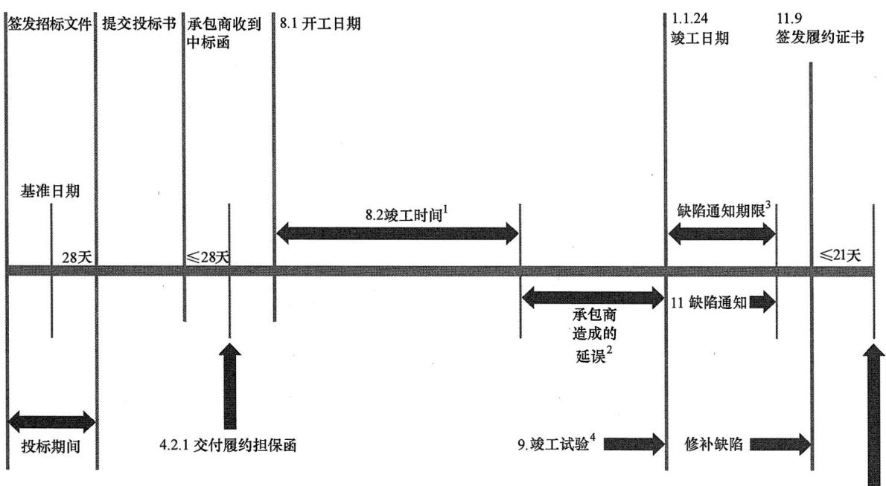
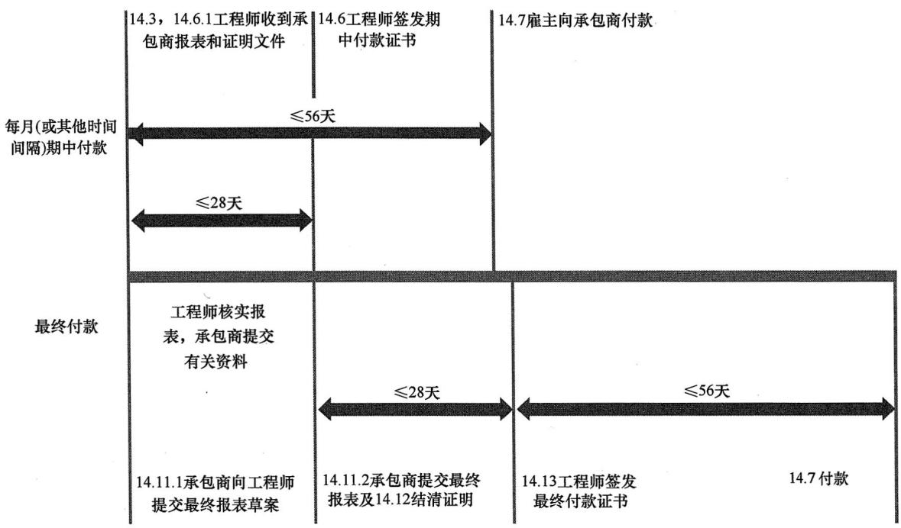
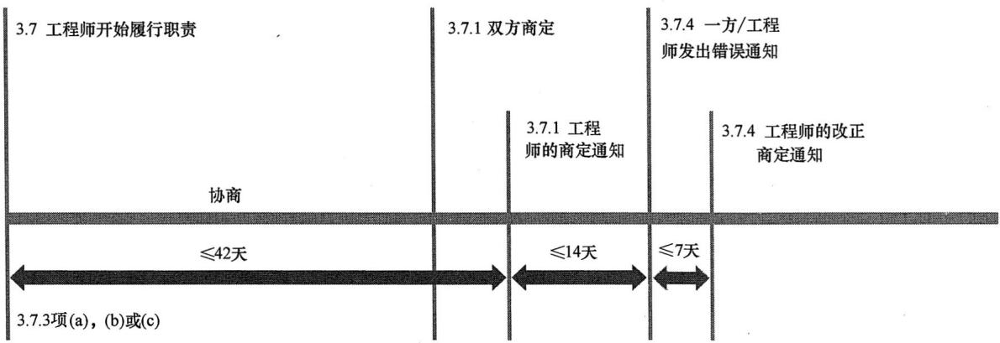
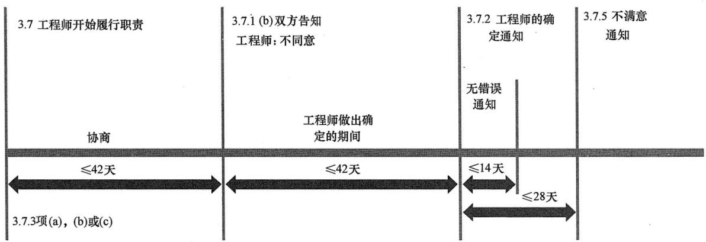
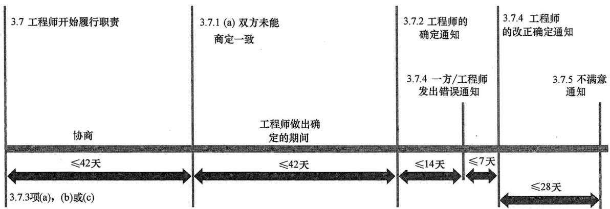
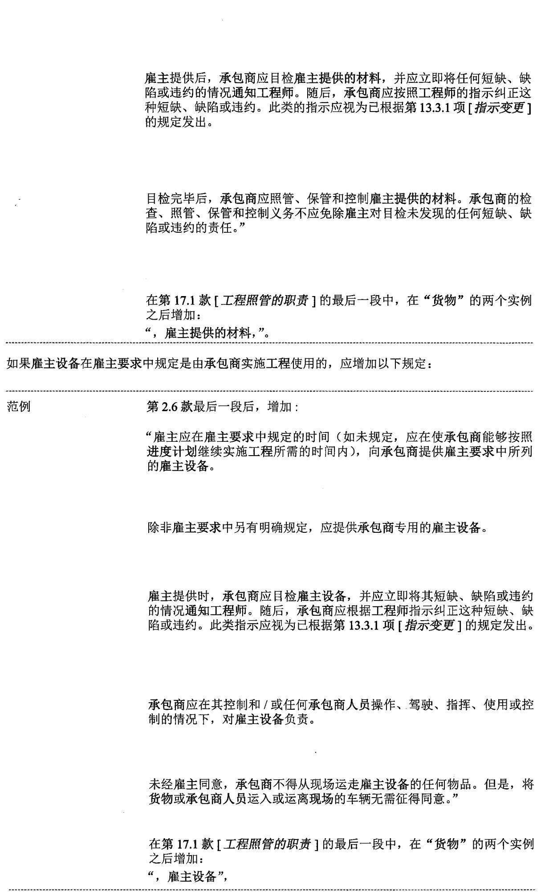
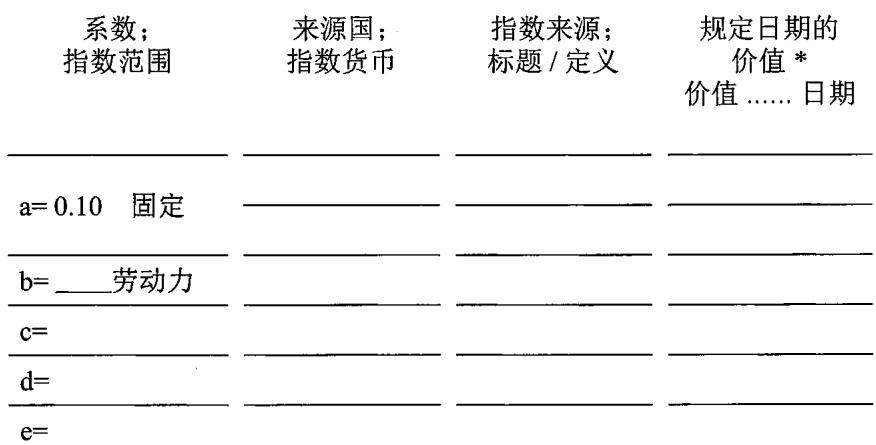

# OCR原书2017年版生产设备和设计-黄皮书 - 副本_页

菲迪克（FIDIC）文献译丛

**生产设备和设计-施工合同条件(原书2017年版)**

**Conditions of Contract for Plant & Design-Build**

国际咨询工程师联合会 编

唐 萍 张瑞杰 等译

(正式使用发生争执时，以英文原版为准)

**译者的话**

本书是由国际咨询工程师联合会（FIDIC，菲迪克）编写，于2017年出版的第2版《生产设备和设计-施工合同条件》。2017年版《生产设备和设计-施工合同条件》继承了1999年第1版菲迪克《生产设备和设计-施工合同条件》的优点，根据多年来在实践中取得的经验以及专家、学者和相关各方的意见和建议，针对1999年版在应用过程中产生的问题进行了修订。2017年版《生产设备和设计-施工合同条件》的格式与1999年版大体保持一致，但文本篇幅增加了83%，1999年版保留下来的内容未做重大修改或修订。2017年版《生产设备和设计-施工合同条件》的条款更加清晰、透明和明确，以减少合同双方争端的发生，使项目更加成功。2017年版《生产设备和设计-施工合同条件》中，通知和其他通信交流的要求更加具体和明确，处理雇主和承包商索赔的规定更加公平，增加了避免争端的机制，详细规定了有关质量管理以及承包商合同合规验证的内容。

希望此译本的出版，对我国广大从事工程咨询（设计）、投资、金融和项目管理的部门和组织，各类项目业主，建筑施工监理企业，工程承包企业，环保企业，会计/律师事务所，保险公司以及有关高等院校等人员在学习和运用菲迪克合同条件，有效地解决在国际、国内工程咨询和工程承包活动中的合同管理问题，更好地开拓国内外工程咨询和工程承包市场，提高工程建设的投资效益和社会效益，建立和完善工程项目总承包制度，促进我国工程建设管理体制与国际惯例接轨，推动我国工程咨询事业和工程建设管理模式和体制的全面深化改革会有所帮助。

翻译过程中，我们虽然尽力想使译文准确通顺、能完整地传达原文的内容，汉语表达规范易懂，但限于专业知识与语言水平，译文中可能出现不妥乃至错误之处，敬请读者指正。本书以中英文对照方式编排，以便用户核对中译文，从而更准确地理解本书。

本书由唐萍、张瑞杰、贾志成、史骏、邓冰茹、张辰旭、郭文涛、李莉萍、莫伟平、郑海燕、秦春燕、曾家平、张荣芹等翻译，唐萍、张瑞杰、贾志成校译，唐萍、张瑞杰、邓冰茹、张辰旭审校。

译者

菲迪克（FIDIC）是咨询工程师国家（地区）成员协会国际联合会。

菲迪克（FIDIC）是由欧洲三个国家的咨询工程师协会于1913年成立的。组建联合会的目的是共同促进成员协会的职业利益，以及向其会员传播有益信息。今天，菲迪克（FIDIC）已有来自于全球各地90个国家（地区）的会员，包括大多数私人执业的咨询工程师。

菲迪克（FIDIC）代表成员协会负责促进和实施咨询工程师行业的战略目标。其战略目标是：代表全世界为建设和自然环境提供以技术为基础的智力服务的大多数公司；协助会员处理与业务实践相关的问题；制定并积极促进遵守职业道德规范；提升咨询工程师作为社会领导者和财富创造者的形象；促进对环境可持续性的承诺；支持和促进青年咨询工程师成为未来的领导者。

菲迪克（FIDIC）举办各类研讨会、会议及其他活动，以促进其目标：维护高水平的道德和职业标准；交流观点和信息；讨论成员协会和国际金融机构代表共同关心的问题；以及发展中国家工程咨询业的发展。

菲迪克（FIDIC）会员认可菲迪克（FIDIC）章程和政策声明，并遵守其职业道德规范要求的专业技能、公正的建议和公开公平的竞争。

菲迪克（FIDIC）为了实现其目标，发布了国际标准格式的工程合同（简明格式、施工、生产设备和设计-施工、EPC/交钥匙、设计、施工和运营）和协议书（针对客户、咨询工程师、分包咨询工程师、联营体和代表)，以及资格预审标准格式等相关资料。

菲迪克（FIDIC）还出版比如政策声明、行动报告、指南、指导方针、培训手册和管理体系领域的培训资料包（质量管理、风险管理、廉洁管理、可持续管理）以及业务流程咨询工程师/单位的选择、根据质量选择（咨询服务）、招标、采购程序、保险、责任、技术转让、实力建设、服务定义]的业务实践文件。

菲迪克（FIDIC）组织研讨会、会议、实力建设研讨会和培训课程等各类活动。

菲迪克（FIDIC）致力于通过交换观点和信息，在成员协会和多边开发银行及其他国际金融机构代表之间讨论共同关心的问题，在整个工程咨询行业维护高水平的道德和职业标准。

菲迪克（FIDIC）出版物以及培训课程和会议的详细信息，可以从设在瑞士日内瓦的菲迪克（FIDIC）秘书处得到。具体活动详见年度业务计划和菲迪克（FIDIC）网站，www.FIDIC.org，该网站提供了大量的背景信息。

**版权**

©FIDIC 2021 版权所有。

本文件的版权所有人为国际咨询工程师联合会——菲迪克（FIDIC）。

经菲迪克（FIDIC）许可，中国机械工业出版社完成了英文版的中文翻译。

本文件的合法购买者有权将正式购买的文件制作副本，供其个人和私人目的使用。未经菲迪克(FIDIC)事先书面许可，不得将本出版物的任何部分分享复制、分发、翻译、改编、存储在检索系统中，或以任何格式或通过任何方式以机械、电子、磁性、影印、记录或其他方式传送。如有意获得此类许可，请联系菲迪克（FIDIC)，地址：Case 311, CH-1215 Geneva 15, Switzerland；传真：+412279949 01，电子邮件：fidic@fidic.org。电子版本可从菲迪克（FIDIC）获取，网址为www.fidic.org/bookshop。

菲迪克（FIDIC）认为正式的和权威性的文本为英语版本，并对本文件的任何用途的中文翻译文本的完整性、正确性、充分性或其他方面不承担任何责任。

**免责声明**

尽管菲迪克（FIDIC）的目标是确保其出版物代表最佳业务实践，但对于使用其出版物及其翻译文本而引起的任何事件或后果，联合会（菲迪克，FIDIC）不承担任何责任或义务。菲迪克（FIDIC）出版物按“原样”提供，没有任何明示或暗示的保证，包括对可销售性、特定用途的适用性和非侵权性的无限保证。菲迪克（FIDIC）出版物并非详尽无遗，仅提供一般性指导。在特定的情况或问题上不应依赖它们。除此之外，适当时，尤其在签订或终止合同前，应获得专家法律建议。

**目录**

目录  
条款1至21 条……………………………………………………………15  
附录 争端避免/裁决委员会协议书一般条件………………………233  
附件 争端避免/裁决委员会程序规则……………………………………………253  
条款索引…267  
目录…… ………281  
专用条件 A 部分合同数据…………………………………………………………………………… 283  
介绍性指南说明……… 83  
专用条件 B 部分特规定…………………………………………………………………… 295  
编写招标文件注意事项………………………………299  
编写特别规定注意事项………………………………305  
条款………………  
项目使用建筑信息模型系统的FIDIC 合同用户的建议说明………………391  
附件担保函格式… • 397  
投标函、中标函、合同协议书和争端避免/裁决委员会协议书格式  
投标函…419  
中标函…421  
合同协议书…………423  
争端避免/裁决委员会协议书…………………………………………………425

**致谢**

国际咨询工程师联合会（FIDIC，菲迪克）向编写、协助和参与编写其三本标准合同格式（施工合同条件、生产设备和设计-施工合同条件、设计采购施工（EPC）/交钥匙工程合同条件）第2版的以下成员特致谢意：

**菲迪克（FIDIC）合同委员会新版特别工作组：**

匈牙利 Z&Partners咨询工程师公司的 Zoltán Záhonyi；爱尔兰咨询工程师 SiobhanFahey(主要起草人）；德国 GKW Consult GmbH 公司的 Christoph Theune;以及美国CDM Smith 公司的 William Howard(执行委员会联系人)。

**初始阶段修订工作组：**

丹麦 Atkins/COWI 公司的 Svend Poulsen(组长)；瑞典 Advokatfirman Runeland AB 公司的 Aisha Nadar(工作组主要起草人）；澳大利亚 SMEC 公司的 Robin Schonfeld（工作组主要起草人)；塞尔维亚咨询工程师 Darko Plamenac; 德国咨询工程师 Jan Ziepke;以及匈牙利 Z&Partners咨询工程师公司的 Zoltán Záhonyi(合同委员会联系人)。

**第二阶段修订工作组：**

英国 EIA 有限公司的 Simon Worley（组长)；英国 Greenhalgh Associates 公司的 JohnGreenhalgh; 德国 C2S Global 公司的 Leo Grutters;爱尔兰咨询工程师 Siobhan Fahey(合同委员会联系人)；瑞典 Advokatfirman Runeland AB 公司的 Aisha Nadar;英国 MatrixSeminars公司的 William Godwin;以及英国EIA有限公司的 Shelley Adams(工作组秘书)。

本书是在FIDIC合同委员会指导下编写的：

英国 Atkins 公司的 Philip Jenkinson(前董事长)；匈牙利 Z&Partners 咨询工程师公司的 Zoltán Záhonyi(董事长)；法国 Exequatur 公司的 Vincent Leloup;瑞典 SWECO 公司的 Kaj Möller; 爱尔兰咨询工程师 Siobhan Fahey;英国 Mott MacDonald 公司的 MikeRoberts;爱尔兰咨询工程师 Des Barry;德国 GKW Consult GmbH 公司的 ChristophTheune; FIDIC 秘书长 Enrico Vink 以及 FIDIC 设计和编辑经理 Christophe Sisto。

还有与FIDIC合同委员会联络的联系人：

英国 Scott Wilson 公司的 Geoff French（执行委员会前联系人）；瑞典 SWECO 公司的 Kaj Möller(执行委员会前联系人)；葡萄牙 SOPSEC 公司的 José Amorim Faria(EFCA前联系人);美国 CDM Smith 公司的 William Howard(执行委员会主要联系人);瑞典 Advokatfirman Runeland AB 公司的 Aisha Nadar(执行委员会第二联系人)；以及波兰 AECOM 公司的 Pawel Zejer(EFCA 联系人)。

**项目使用建筑信息模型系统的FIDIC合同用户的建议说明由以下人员提供：**

澳大利亚 Aurecon 公司的 Anthony Barry(FIDIC 执行委员会），新西兰 Pedersen ReadConsulting 公司的 Andrew Read(FIDIC 业务实践委员会主席)；以及新西兰 Aurecon公司的 Stephen Jenkins（FIDIC 风险、责任和质量委员会主席)。

下列合同委员会特别顾问在各个起草和修订阶段提供了宝贵和持续的支持：

法国 White & Case LLP 公司的 Christopher Seppälä(法律顾问，并由其公司的 DimitarKondev 协助)；爱尔兰的 Nael G Bunni(风险和保险顾问)；德国的 Axel-V. Jaeger; 英国 / 瑞典的 Michael Mortimer-Hawkins;英国的 Christopher Wade;英国 Fenwick Elliott公司的 Nicholas Gould 和 Jeremy Glover。

书稿曾经下列许多人员和组织审阅，他们的意见已由菲迪克（FIDIC）合同委员会新版特别工作组和修订工作组充分研究，认为适宜的意见已反映在条款措辞中。这些人员和组织包括：

阿拉伯联合酋长国 Dolphin Energy 公司的Mahmoud Abu Hussein；埃及 CRC HassanDorra 公司的Ihab Abu-Zahra；迪拜的 Kamal Adnan Malas；意大利工程师 RichardAppuhn； 丹麦 Bang-Olsen & Partners Law Firm P/S 公司的 Ulrik Bang-Olsen；马来西亚 RBI Consultants 公司的 Rusli Bin Idrus；德国工程师 Hartmut Bruehl；新加坡律师Gerlando Butera；澳大利亚 MTECC 公司的Donald Charrett；英国 Corbett & Co Inter-national Construction Lawyers 公司的 Edward Corbett；墨西哥 Systec 公司的 Jorge Di-az-Padilla；英国 UWP Consulting Pty 公司的Mark Etheridge；德国柏林的欧洲国际承包商组织；英国 Fenwick Elliott LLP 公司的 Jatinder Garcha；丹麦 UNOPS 的 NicholasGardner；英国 Fenwick Elliott LLP 公司的 Jeremy Glover；英国 Fenwick Elliott LLP 公司的 Nicholas Gould；印度尼西亚公共工程部长特别顾问 Sarwono Hardjomuljadi；英国 ECV Consultancy有限公司的 David Heslett；德国柏林 Kanzlei Dr.Hök Stieglmeier& Kollegen 公司的 Sebastian Hoek；伊朗德黑兰伯克利公司集团的 Reza Ikani；土耳其 MC2 Modern 公司的 Levent Irmak；英国律师 Gordon Jaynes；英国 Driver 集团的Nabeel Khokar；南非 The Maisels 集团的 Patrick Lane;西班牙 Lambal Formacion 公司的 Pablo Laorden；约旦 Shura 施工管理公司的 Husni Madi；英国 Holman FenwickWillan LLP 公司的 Benjamin Mellors; 英国 Probyn Miers 的 Christopher Miers；巴基斯坦的 Smore Mushtaq Ahmad;赞比亚 Kiran & Musonda Associate 的 Henry Musonda;丹麦 Sweco 公司的 Kjeld B Nielsen；比利时的 Orgalime；博茨瓦纳 Ginder PalmitessaPty有限公司的 Patrizia Palmitessa-Savric；法国 PS Consulting 公司的 James Perry；芬兰Wärtsilä Corporation 公司的 Mikko Pulkkinen；加拿大的 John Ritchie；澳大利亚中央昆士兰大学的 Samer Skaik；英国 Ashurts 公司的 Michael J.Smith；丹麦 Holst 公司的Jakob Sorensen；法国的 Syntec；罗马尼亚 SCPA Tecuci-Paltineanu 公司的 GiorgianaTecuci-Paltineanu；法国 Syntec Ingenierie 公司的 Benjamin Valloire；埃及 WALY仲裁委员会的 Ahmed Faty Waly。

对上述审稿人的致谢，并不表示审稿人和审稿组织对所有条款措辞的赞同。

菲迪克（FIDIC)对所有上述人员付出的时间和精力表示非常感谢。

本文件格式和内容的最终确定由菲迪克（FIDIC）负责。

**说明**

第2版《生产设备和设计-施工合同条件》已由国际咨询工程师联合会（菲迪克（FIDIC)）出版，是菲迪克（FIDIC）1999年第一版《生产设备和设计-施工合同条件》（黄皮书）的修订版。

菲迪克（FIDIC）1999年版红皮书《施工合同条件》连同菲迪克（FIDIC）1999年版黄皮书《生产设备和设计-施工合同条件》和菲迪克（FIDIC）1999年版银皮书《设计采购施工（EPC)/交钥匙工程合同条件》已经广泛使用了近20年。特别是，其中承包商按照雇主提供的设计在其工程施工的项目中，雇主和承包商平衡风险分担的原则已得到认可。然而，该工程可能包括由承包商设计的土木、机械、电气和/或构筑物的任意组合。

第2版菲迪克（FIDIC）黄皮书延续了菲迪克（FIDIC）平衡风险分担的基本原则，同时寻求在多年使用中获得的丰富经验的基础上编写。例如，本版本提供：

1） 通知和其他通信交流的要求更加详细和明确；

2）平等对待雇主和承包商的索赔，并将其与争端分别处理的规定；

3）争端避免的机制；(以及)

4）质量管理和承包商合同合规验证的详细规定。

这些生产设备和设计-施工合同条件包含了可能适用于大多数此类合同的条件。每份单独合同所特有的基本信息项应包含在专用条件A部分合同数据中。

此外，人们认识到许多雇主，特别是政府机构，可能需要特别的合同条件或特定程序，这些条件或程序与通用条件中所含的不同。这些不同的条件或程序应包括在B部分—特别规定中。

应注意的是，通用条件和专用条件（A部分———合同数据和B部分——特别规定）全都是合同条件的一部分。

为协助雇主编写投标文件和起草特定合同的合同专用条件，本出版物包括编写投标文件注意事项和编写特别规定注意事项，为合同文件的起草者，尤其是起草雇主要求和特别规定时，提供了重要的建议。在起草特别规定时，如果要替换或补充通用条件中的条款，在采用任何范例措辞之前，应敦促雇主寻求法律和工程方面的建议，以避免含糊不清，并确保与合同其他规定保持完整和一致。

本出版物以一系列综合流程图开始，这些流程图以可视化形式展示了菲迪克（FID-IC）生产设备和设计-施工合同条件形式的活动顺序。然而，这些图只是说明性的，不应作为合同条件的解释。

本出版物还包括一些样本格式，以帮助双方就第三方如担保和保函的提供方的要求达成共识。

合同文件起草者应注意，所有菲迪克（FIDIC）合同的通用条件受版权和商标保护，未经菲迪克（FIDIC）通常以修改许可证的形式授予的特别书面同意，不得修改。如果起草者希望修改通用条件中的规定，则应在专用条件B部分—特别规定（如上所述）中修改，而不是修改已发布的通用条件。

菲迪克（FIDIC）认为，正式的、权威性的文本应为英文版本。

**生产设备和设计-施工合同中主要事项的典型顺序**

1.竣工时间（在合同数据中)用天数表示，加上根据第8.5款规定的任何延长期。

2.为了表示事项的顺序，图中以承包商未能遵守第8.2款的规定为例。

3.缺陷通知期限（在合同数据中）用天数表示，加上根据第11.3款规定的任何延长期。

4.根据工程的类型，可能还需要竣工后试验。

第14条中设想的付款事项的典型顺序  

第21条中设想的争端事项的典型顺序
<table><tr><td>承包商收到 中标函</td><td>21.1双方发任命 DAAB</td><td>21.4.1一方将争端提交 DAAB 双方向DAAB提</td><td>21.4.4一方 可发出“不 满意通知”</td><td>21.6一 方可启 动仲裁</td></tr><tr><td rowspan="3">≤28天*</td><td rowspan="3"></td><td>交资料</td><td></td><td>21.5友好解决</td></tr><tr><td>≤84天 </td><td>≤28天 25817534522</td><td>&gt;28天 674022952023</td></tr><tr><td></td><td>DAAB做 出其决定</td><td>任命仲裁员</td></tr></table>

第3.7款中商定或确定事项的典型顺序  
情景11  

情景22  
  
情景33

  
1.42天内达成商定，在工程师的商定通知中发现错误并改正。  
2. 双方早期的建议通过商定未能达成，所以工程师的确定是必要的，工程师的确定没有错误。  
3.42天内未达成商定，工程师在42天内做出确定，并在其确定中发现错误并改正。

生产设备和设计-施工合同条件

**Conditions of Contract for PLANT and DESIGN-BUILD**

用于由承包商设计的电气和机械以及

建筑和工程

FOR ELECTRICAL AND MECHANICAL

PLANT, AND FOR BUILDING AND ENGI-

NEERING WORKS, DESIGNED BY THE

CONTRACTOR

通用条件

General Conditions 通用条件 GENERAL CONDITIONS

专用条件编写指南和附件：   
担保函格式   
GUIDANCE FOR   
THE PREPARATION OF   
PARTICULAR CONDITIONS   
AND ANNEXES:   
FORMS OF SECURITIES   
投标函、中标函、合同协议书和争端避   
免/裁决委员会协议书格式   
FORMS OF LETTER OF   
TENDER,LETTER OF   
ACCEPTANCE, CONTRACT   
AGREEMENT AND DAAB   
AGREEMENT

**通用条件**

**目 录**

1 一般规定 … 15  
1.1 定义  
1.2 解释  
1.3 通知和其他通信交流  
1.4 法律和语言  
1.5 文件优先次序  
1.6 合同协议书  
1.7 权益转让  
1.8 文件的照管和提供  
1.9 雇主要求中的错误  
1.10 雇主使用承包商文件  
1.11 承包商使用雇主文件  
1.12 保密  
1.13 遵守法律  
1.14 共同的和各自的责任  
1.15 责任限度  
1.16 终止合同  
2 雇主 … 43  
2.1 现场进入权  
2.2 协助  
2.3 雇主人员和其他承包商  
2.4 雇主的资金安排  
2.5 现场数据和参考事项  
2.6 雇主提供的材料和雇主设备  
3 工程师 … 47  
3.1 工程师  
3.2 工程师的任务和权利  
3.3 工程师代表  
3.4 由工程师付托  
3.5 工程师的指示  
3.6 工程师的替代  
3.7 商定或确定  
3.8 会议  
4 承包商 … 59  
4.1 承包商的一般义务  
4.2 履约担保  
4.3 承包商代表  
4.4 分包商  
4.5 指定分包商  
4.6 合作  
4.7 放线  
4.8 健康和安全义务  
4.9 质量管理和合规验证体系  
4.10 现场数据的使用  
4.11 中标合同金额的充分性  
4.12 不可预见的物质条件  
4.13 道路通行权和设施  
4.14 避免干扰  
4.15 进场通路  
4.16 货物运输  
4.17 承包商设备  
4.18 环境保护  
4.19 临时公用设施  
4.20 进度报告  
4.21 现场安保  
4.22 承包商的现场作业  
4.23 考古和地质发现  
5 设计 …87  
5.1 一般设计义务  
5.2 承包商文件  
5.3 承包商的承诺  
5.4 技术标准和法规  
5.5 培训  
5.6 竣工记录  
5.7 操作和维护手册  
5.8 设计错误  
6 员工 … 97  
6.1 员工的雇用  
6.2 工资标准和劳动条件  
6.3 招聘人员  
6.4 劳动法  
6.5 工作时间  
6.6 为员工提供设施  
6.7 人员的健康和安全  
6.8 承包商的监督  
6.9 承包商人员  
6.10 承包商的记录  
6.11 无序行为  
6.12 关键人员  
7 生产设备、材料和工艺 103  
7.1 实施方法  
7.2 样品  
7.3 检验  
7.4 由承包商试验  
7.5 缺陷和拒收  
7.6 修补工作  
7.7 生产设备和材料的所有权  
7.8 土地(矿区)使用费  
8 开工、延误和暂停 111  
8.1 工程的开工  
8.2 竣工时间  
8.3 进度计划  
8.4 预先警示  
8.5 竣工时间的延长  
8.6 部门造成的延误  
8.7 工程进度  
8.8 误期损害赔偿费  
8.9 雇主暂停  
8.10 雇主暂停的后果  
8.11 雇主暂停后对生产设备和材料的付款  
8.12 拖长的暂停  
8.13 复工  
9 竣工试验 121  
9.1 承包商的义务  
9.2 延误的试验  
9.3 重新试验  
9.4 未能通过竣工试验  
10 雇主的接收 127  
10.1 工程和分项工程的接收  
10.2 部分工程的接收  
10.3 对竣工试验的干扰  
10.4 需要复原的地面  
11 接收后的缺陷 131  
11.1 完成扫尾工作和修补缺陷  
11.2 修补缺陷的费用  
11.3 缺陷通知期限的延长  
11.4 未能修补缺陷  
11.5 现场外缺陷工程的修补  
11.6 修补缺陷后进一步试验  
11.7 接收后的进入权  
11.8 承包商调查  
11.9 履约证书  
11.10 未履行的义务  
11.11 现场清理  
12 竣工后试验 141  
12.1 竣工后试验程序  
12.2 延误的试验  
12.3 重新试验  
12.4 未能通过竣工后试验  
13 变更和调整 145  
13.1 变更权  
13.2 价值工程  
13.3 变更程序  
13.4 暂列金额  
13.5 计日工作  
13.6 因法律改变的调整  
13.7 因成本改变的调整  
14 合同价格和付款 157  
14.1 合同价格  
14.2 预付款  
14.3 期中付款的申请  
14.4 付款计划表  
14.5 拟用于工程的生产设备和材料  
14.6 期中付款证书的签发  
14.7 付款  
14.8 延误的付款  
14.9 保留金的发放  
14.10 竣工报表  
14.11 最终报表  
14.12 结清证明  
14.13 最终付款证书的签发  
14.14 雇主责任的中止  
14.15 支付的货币  
15 由雇主终止 179  
15.1 通知改正  
15.2 由承包商违约的终止  
15.3 由承包商违约终止后的估价  
15.4 由承包商违约终止后的付款  
15.5 为雇主便利的终止  
15.6 为雇主便利终止后的估价  
15.7 为雇主便利终止后的付款  
16 由承包商暂停和终止 187  
16.1 由承包商暂停  
16.2 由承包商终止  
16.3 终止后承包商的义务  
16.4 由承包商终止后的付款  
17 工程照管和保障 193  
17.1 工程照管的职责  
17.2 工程照管的责任  
17.3 知识产权和工业产权  
17.4 由承包商保障  
17.5 由雇主保障  
17.6 保障分担  
18 例外事件 199  
18.1 例外事件  
18.2 例外事件的通知  
18.3 将延误减至最小的义务  
18.4 例外事件的后果  
18.5 自主选择终止  
18.6 依法解除履约  
19 保险 203  
19.1 一般要求  
19.2 由承包商提供的保险  
20 雇主和承包商的索赔 211  
20.1 索赔  
20.2 付款和/或竣工时间延长的索赔  
21 争端和仲裁 219  
21.1 争端避免/裁决委员会的组成  
21.2 未能任命争端避免/裁决委员会成员  
21.3 争端避免  
21.4 取得争端避免/裁决委员会的决定  
21.5 友好解决  
21.6 仲裁  
21.7 未能遵守争端避免/裁决委员会的决定  
21.8 未设立争端避免/裁决委员会

**附录**

争端避免/裁决委员会协议书一般条件…………… 233  
条款索引……

**通用条件**

**1 一般规定**

除上下文另有要求外，下列词语和措辞应具有以下所述的含义。  
1.1.1 “中标合同金额”系指在中标函中按照合同规定所认可的工程施工所  
需的费用。  
1.1.2 “预付款证书”系指工程师根据第14.2.2项「预付款证书1的规定签发  
的证书。  
1.1.3 “预付款保函”系指根据第14.2.1项「预付款保函1所规定的担保。  
1.1.4“基准日期”系指递交投标书截止日期前28天的日期。  
1.1.5 “索赔”系指一方向另一方提出的要求或主张，要求根据本条件的任  
何条款或与合同或工程施工有关的由其引起的权利或救济。  
1.1.6 “开工日期”系指根据第8.1款[工程的开工]发出的工程师通知中规  
定的日期。  
1.1.7 “合规验证体系”系指承包商根据第4.9.2项[合规验证体系]的规定，  
为工程编写和实施的合规验证体系。  
1.1.8 “合同条件”或“本条件”系指由专用条件修订的通用条件。  
1.1.9 “合同”系指合同协议书、中标函、投标函、合同协议书中提到的任  
何附录、本条件、雇主要求、图纸、资料表、联营体承诺书（如适  
用）以及合同协议书或中标函中列出的添加文件（如果有)。  
1.1.10“合同协议书”系指双方根据第1.6款[合同协议书]所述签订的合同  
协议书。  
1.1.11“合同数据”系指构成专用条件A部分名为合同数据的文本。  
1.1.12“合同价格”系指第14.1款「合同价格1规定的价格。  
1.1.13“承包商”系指在雇主接受的投标函中称为承包商的当事人，及其财  
产所有权的合法继承人。  
1.1.14“承包商文件”系指第5.2款承包商文件]中所述的，由承包商根据  
合同编写的文件，包括所有计算、数字文件、计算机程序和其他软  
件、图纸、手册、模型、规范、要求和其他技术性文件。  
1.1.15“承包商设备”系指承包商为实施工程所需的所有仪器、设备、机械、  
施工设备、车辆和其他物品。承包商设备不包括临时工程、生产设  
备、材料以及拟构成或正构成永久工程一部分的任何其他物品。  
1.1.16“承包商人员”系指承包商代表和承包商在现场或其他工程正在进行  
的地方聘用的所有人员，包括承包商和每个分包商的职员、工人和其  
他雇员：以及所有其他帮助承包商实施工程的人员。  
1.1.17“承包商建议书”系指合同中所述或隐含的投标书一部分的承包商实  
施工程的建议书。此类文件可包括承包商的初步设计。  
1.1.18“承包商代表”系指由承包商在合同中指定的自然人，或根据第4.3款  
[承包商代表]的规定，由承包商任命为其代表的人员。  
1.1.19“成本（费用)”系指承包商在履行合同中在现场内外发生的（或将要  
发生的）所有合理开支，包括税费、管理费和类似支出，但不包括利  
润。如果承包商根据本条件的任一条款有权获得成本（费用），应将  
其加到合同价格中。  
1.1.20“成本加利润”系指合同数据中规定的成本加上适当百分比的利润  
(如没有规定，应加5%)。只有在承包商根据本条件中的条款有权获得  
成本加利润时，该百分比才能加到成本中，成本加利润才能加进合同  
价格。  
1.1.21“工程所在国”系指实施永久工程的现场（或其大部分)所在的国家。  
1.1.22“DAAB”或“争端避免/裁决委员会”系指合同中唯一的一名或三名  
人员（视情况而定），或根据第21.1款争端避免/裁决委员会的组  
成]或第21.2款[未能任命争端避免/裁决委员会成员]的规定任命  
的人员。  
1.1.23“DAAB协议书”系指由双方和DAAB的唯一成员或三名成员（视情况  
而定）中的每位成员，根据第21.1款「争端避免/裁决委员会的组成]  
或第21.2款[未能任命争端避免/裁决委员会成员]的规定签署或视  
为已签署的协议书，包括本通用条件的附件的争端避免/裁决委员会  
协议书一般条件及其商定的修改。  
1.1.24“竣工日期”系指工程师签发的接收证书中规定的日期；或如第10.1  
款工程和分项工程的接收1的最后一段适用，工程和分项工程按照  
合同被视为已完成的日期；

或如根据第10.2款[部分工程的接收]或10.3款[对竣工试验的干扰]适用，竣工日期视为雇主已接收工程、分项工程或部分工程的日期。

**1.1.25“日（天)”系指一个日历日。**

1.1.26“计日工作计划表”系指合同中题为计日工作计划的文件（如果有），根据第13.5款「计日工作1的规定，向承包商支付计日工作使用的人工、材料和设备的金额和付款方式。

1.1.27“缺陷通知期限”或“DNP”系指根据第11.1款[完成扫尾工作和修补缺陷]的规定，通知工程或某分项工程或某部分工程（视情况而定）存在缺陷和/或损害的期限，如合同数据中所述（如没有规定，则为一年），也可根据第11.3款[缺陷通知期限的延长]的规定提出延长期。该期限从工程、分项工程或部分工程的竣工日开始计算。

1.1.28“误期损害赔偿费”系指承包商应根据第8.8款[误期损害赔偿费]的规定，对其未能遵守第8.2款「竣工时间1的要求而承担的损害赔偿。

**1.1.29“争端”系指下列情况：**

(a）一方向另一方提出索赔（可能是本条件所定义的索赔，或是工程师根据本条件确定的事项，或其他事项)；

（b）另一方（或工程师根据第3.7.2项[工程师的确定]的规定）拒绝全部或部分索赔；(以及)

(c） 第一方不认可（根据第3.7.5项[对工程师的确定不满意]发出不满意通知或其他方式)，

但另一方（或工程师）未能全部或部分反对或回复索赔，在这种情况下，如果争端避免/裁决委员会或仲裁员视情况认为拒绝是合理的，则可以构成拒绝。

1.1.30“雇主”系指在合同数据中称为雇主的当事人，及其财产所有权的合法继承人。

1.1.31“雇主设备”系指雇主根据第2.6款[雇主提供的材料和雇主设备1的规定，由雇主向承包商提供使用的仪器、设备、机械、施工设备和/或车辆(如果有)；但不包括根据第10条[雇主的接收1的规定，尚未经雇主接收的生产设备。

1.1.32“雇主人员”系指工程师、工程师代表（如任命）、第3.4款由工程师付托]中规定的助手，以及工程师和雇主根据合同履行雇主义务的所有其他职员、工人和其他雇员；以及由雇主或工程师通知承包商作为雇主人员的任何其他人员。

1.1.33“雇主要求”系指合同中包含的名为“雇主要求”的文件，以及根据合同对该文件的任何补充和修改。此类文件说明了工程的预期目的，并规定了工程的关键人员（如果有）、范围和/或设计和/或其他性能、技术和评估标准。

1.1.34“雇主提供的材料”系指雇主根据第2.6款「雇主提供的材料和雇主设  
备1的规定，向承包商提供的材料（如果有）。  
1.1.35“工程师”系指由雇主任命并在合同数据中指名，为实施合同担任工  
程师的人员，或根据第3.6款[工程师的替代]的规定，由雇主任命  
的任何其他人员。  
1.1.36“工程师代表”系指根据第3.3款[工程师代表]的规定，可由工程师  
任命的自然人。  
1.1.37“例外事件”系指第18.1款「例外事件1中定义的事件或情况。  
1.1.38“延长时间”或“EOT”系根据第8.5款[竣工时间的延长]的规定延  
长竣工时间。  
1.1.39“菲迪克”(FIDIC)系指国际咨询工程师联合会。  
1.1.40“最终付款证书”或“FPC”系指工程师根据第14.13款[最终付款证  
书的签发1的规定签发的付款证书。  
1.1.41“最终报表”系指第14.11.2项[商定的最终报表1中规定的报表。  
1.1.42“外币”系指可用于支付合同价格中部分（或全部）款项的当地货币以  
外的某种货币。  
1.1.43“通用条件”系指由菲迪克（FIDIC）出版的，名为“承包商设计的建  
筑和工程施工合同条件”的文件。  
1.1.44“货物”系指承包商设备、材料、生产设备和临时工程，或视情况指  
其中任何一种。  
1.1.45“期中付款证书”或“IPC”系指工程师根据第14.6款[期中付款证书  
的签发]的规定，为期中付款签发的付款证书。  
1.1.46“联营体”或“JV”系指由两人或两人以上组成的联营企业、联盟、  
财团或其他非法人团体，其形式是合伙或其他形式。  
1.1.47“联营体承诺书”系指作为投标书的一部分提供给雇主的信函，说明  
承包商组建联营体的两个或多个人员之间的法律承诺。该信函应由联  
营体所有成员签字，并应寄给雇主，内容应包括：  
(a） 各成员就履行合同规定的承包商义务，承诺对雇主承担所有共同  
的和各自的责任；  
(b）联营体负责人的确定及授权；以及  
(c）确定联营体每个成员分别从事的工作范围或部分工作（如果有）。  
1.1.48“关键人员”系指雇主要求中规定的除承包商代表外的承包商人员的  
职位（如果有）。  
1.1.49“法律”系指所有全国性（或州或省)的法律、条例、法令、法案、规  
则、条令、命令、条约、国际法和其他法律，以及任何合法成立的公  
共部门制定的规则和细则等。  
1.1.50“中标函”系指雇主签署的正式接受投标函的信函，包括其所附的由  
双方间签署的协议的任何备忘录。如无此类中标函，则“中标函”  
系指合同协议书，签发或收到中标函的日期系指签署合同协议书的  
日期。  
1.1.51“投标函”系指由承包商签署的投标函，说明承包商向雇主提出的实  
施工程的报价。  
1.1.52“当地货币”系指工程所在国的货币。  
1.1.53“材料”系指拟构成或正构成永久工程一部分的各类物品（生产设备除  
外)，无论在现场或以其他方式按合同分配，包括根据合同要由承包  
商供应的只供材料(如果有)。  
1.1.54“月”系指一个日历月（按公历）。  
1.1.55“不反对”系指工程师不反对承包商文件或承包商根据本条件提交的  
其他文件，而此类承包商文件或其他文件可用于工程。  
1.1.56“通知”系指按照第1.3款「通知和其他通信交流1发出的书面通知。  
1.1.57“不满意通知”或“NOD”系指一方对工程师根据第3.7款[商定或确  
定1的规定做出的确定，或争端避免/裁决委员会根据第21.4款[取  
得争端避免/裁决委员会的决定]的规定做出的确定不满意时，可向  
另一方发出的通知。  
1.1.58“部分工程”系指雇主使用并根据第10.2款[部分工程的接收]的规定，  
被视为已接收的部分工程或部分分项工程（视情况而定）。  
1.1.59“专用条件”系指包含在合同中标题为专用合同条件的文件，由A部  
分——合同数据和B部分——特殊规定组成。  
1.1.60“当事方（一方)”根据上下文的需要，系指雇主或承包商。“双方  
(所有当事方)”系指雇主和承包商。  
1.1.61“付款证书”系指工程师根据第14条[合同价格和付款]的规定签发  
的付款证书。

1.1.62“履约证书”系指工程师根据第11.9款[履约证书]的规定签发的（或视为已签发的）证书。  
1.1.63“履约损害赔偿费”系指承包商因未能实现履约保函的资料表中规定的生产设备和/或工程或工程任何部分（视情况而定）的保证性能而向业主支付的损害赔偿费。  
1.1.64“履约担保”系指根据第4.2款[履约担保]规定的担保。  
1.1.65“永久工程”系指按照合同规定要由承包商实施的永久性工程。  
1.1.66“生产设备”系指在现场或以其他方式按合同分配，并构成或拟构成永久工程一部分的装备、设备、机械和车辆（包括任何部件）。  
1.1.67“进度计划”系指由承包商编制和提交的详细时间进度计划，工程师已根据第8.3款进度计划1的规定，向承包商发出（或视为已发出）不反对通知。  
1.1.68“暂列金额”系指雇主在合同中规定为暂列金额的一笔款项（如果有)，根据第13.4款「暂列金额1的规定，用于实施工程的任何部分，或用于提供生产设备、材料或服务。  
1.1.69“质量管理体系”系指承包商根据第4.9.1项「质量管理体系1的规定，制定的质量管理体系（可不时更新和/或修订）。  
1.1.70“保留金”系指雇主根据第14.3款[期中付款的申请]的规定扣留的累计保留金，根据第14.9款[保留金的发放]的规定进行支付。  
1.1.71“审核”系指工程师对承包商提交的材料进行审查和审议，以评估其是否（以及在多大程度上）符合本合同和（或）本合同规定的或与本合同有关的承包商义务。  
1.1.72“资料表”系指合同中名为各种表的文件，由雇主编制、由承包商填写并随投标函一起提交。此类文件可包括数据、表册、付款计划表、费率和(或)价格表。  
1.1.73“付款计划表”系指资料表中名为付款计划表的文件（如果有），其中说明了应向承包商付款的金额和方式。  
1.1.74“履约保函资料表”系指资料表中标题为“履约保函资料表”（如果有）的文件，其中显示了雇主为实施工程和/或生产设备或工程任何部分（视情况而定）所需的担保，并说明未能达到任何保证性能时应支付的适用损害赔偿费。  
1.1.75“费率和价格资料表”系指资料表中标题为“费率和价格资料表（如有)”的文件。

1.1.76“分项工程”系指在合同数据中确定为分项工程（如果有）的工程组成  
部分。  
1.1.77“现场”系指将实施永久工程和运送生产设备与材料到达的地点，以  
及合同中指定为现场组成部分的任何其他场所。  
1.1.78“特别规定”系指名为特别规定的文件（如果有），其构成专用条件B  
部分。  
1.1.79“报表”系指承包商根据第14.2.1项[预付款保函]（如果适用）、第  
14.3款[期中付款的申请]、第14.10款[竣工报表]或第14.11款[最  
终报表1的规定，提交的作为付款证书申请组成部分的报表。  
1.1.80“分包商”系指在合同中为分包商的任何人，或承包商为部分工程任  
命为分包商或设计师的任何人员；以及这些人员各自财产所有权的合  
法继承人。  
1.1.81“接收证书”系指工程师根据第10条[雇主的接收]的规定签发（或  
视为签发）的证书。  
1.1.82“临时工程”系指施工现场所需的所有各类临时工程(承包商设备  
除外)。  
1.1.83“投标书”系指投标函、承包商建议书，联营体承诺书（如果适用）  
以及合同中包括的由承包商随投标函一起提交的所有其他文件。  
1.1.84“竣工后试验”系指在雇主要求中规定的，在工程或某分项工程（视  
情况而定)，按照第10条[雇主的接收]的规定接收后，根据特别规  
定的要求进行的试验(如果有)。  
1.1.85“竣工试验”系指在合同中规定的，或双方商定的，或按指示作为一  
项变更的，在工程或某分项工程(视情况而定)，根据第10条[雇主的  
接收1的规定接收前，按照第9条[竣工试验]的要求进行的试验。  
1.1.86“竣工时间”系指自开工日期算起至完成工程或某分项工程（视情况而  
定）的时间，根据第8.2款竣工时间]规定，连同如同合同数据所  
述，可以根据第8.5款[竣工时间的延长]的规定延长竣工时间。  
1.1.87 “不可预见的”系指一个有经验的承包商在提交基准日期前不能合理  
预见。  
1.1.88 “变更”系指根据第13条[变更和调整]的规定，经指示作为变更的，  
对雇主要求或工程所作的任何更改。  
1.1.89“工程”系指永久工程和临时工程，或其中任何一项（视情况而定）。  
1.1.90“年”系指365天。

**通知和其他通信交流**

（a）表示一种性别的词，包括所有性别；“他”“他的”和“他自己”应分别理解为“他/她”和“他/她自己”；

（b）单数形式的词也包括复数含义，反之亦然；

(c）包括“同意（商定)”“达成（取得）一致”，或“协议”等词的各项规定都要求用书面记载；

(d)“书面”或“以书面形式”系指手写、打字、印刷或电子制作，并形成永久性记录；

(e）“可以”系指一方（当事人）或个人有权选择是否就所述事项采取行动；

（f）“应当”系指一方（当事人）或个人根据合同规定有义务履行规定的职责；

(g）“同意”系指雇主、承包商或工程师（视情况而定）同意或准许所要求的事项；

(h）“包括……在内”“包括”和“包含”应解释为不限于或不受后述事项的限制；

(i） 表示人或当事方的词语，应解释为自然人和法人（包括公司和其他法律实体)；(以及)

（j）“实施工程”或“工程实施”系指工程的设计、施工和竣工以及任何缺陷的修补。

在本条件的任何排列中，如果倒数第2项后为“和/以及”，或“或”，或“和/或”，则该项之前的所有列项也应理解为“和/以及”，或“或”或“和/或”（视情况而定）。

旁注和其他标题在本条件的解释中不应考虑。

本条件不论在何种场合规定发出通知（包括不满意通知）或签发、提供、发送、提交或另一种通信方式传送（包括接受、确认、通知、建议、协议、批准书、索赔、同意、决定、裁定、解除、指示、不反对、会议记录、许可、提议、记录、答复、报告、请求、审核、报表、说明，提交或任何其他类似的通信交流)，通知或其他通信交流都应以书面形式，并且：

(a) 应为：

（i）由承包商代表、工程师或雇主授权代表（视情况而定）签署的纸质原件；（或)

（ii）由合同数据规定的任何电子传输方式生成的电子原件（如未规定，由工程师可接受的方式)，电子原件通过唯一分配给每个此类授权代表的电子邮箱发送，

<table><tr><td></td><td>或按照本条件所述的两种方式发送；(以及) (b）如果是通知，则应注明为通知。如果是另一种通信方式，则应同 样注明，并包括在适当情况下按照合同规定签发的参考条款。 (c）由人面交(取得对方收据)，或通过邮寄或信差传送（取得对方</td></tr><tr><td></td><td>收据），或用上述（a）（ii）段中提出的任何的电子传输方式发 送；(以及) （d）交付、传送或传输至合同数据中规定的接收人的地址。但，如接 收人通知了另外地址，寄件人收到通知后，所有通知和其他通信 交流均应按新地址发送。</td></tr><tr><td></td><td>本条件规定通知或不满意通知或其他通信交流要交付、发出、签发、 提供、发送、提交或传送的，在接收人根据上述(d)段规定的现时地 址收到（或视为已收到）时生效。如果寄件人没有收到未送达通知， 电子发送的通知或其他通信交流在发送后的第二天视为已收到。</td></tr><tr><td></td><td>上述所有通知和其他种类的通信交流，不得无故被扣压或拖延。 当一方或工程师签发通知、不满意通知或证书时，纸质和/或电子原</td></tr><tr><td></td><td>件应发送给预定接收人，并且亦应根据情况抄送工程师或另一方。所 有其他通信交流均应按本条件或合同其他规定抄送给双方和/或工 程师。</td></tr><tr><td>1.4 法律和语言</td><td>合同应受合同数据中所述国家（或其他司法管辖区）的法律管辖（如 未规定，则由工程所在国的法律管辖)，不包括任何法律规则的冲突。</td></tr><tr><td></td><td>合同的主导语言应为合同数据中规定的语言（如未规定，则为本条件 的语言)。如果合同任何部分的文本采用一种以上语言编写，则应以 合同数据规定的主导语言文本为准。</td></tr><tr><td></td><td>通信交流应使用合同数据中规定的语言。如未规定，应使用合同的主 导语言。</td></tr><tr><td>1.5 文件优先次序 次序如下：</td><td>构成合同的文件应能够相互说明。如有任何冲突、歧义或不一致，文件的优先</td></tr><tr><td>(a) 合同协议书； (b) 中标函； (c) 投标函； (e) 专用条件 B部分</td><td>（d）专用条件A部分 合同数据； 特别规定；</td></tr></table>

<table><tr><td>(g）雇主要求； (h) 资料表； (i) 承包商建议书； (j)联营体承诺书（如果承包商是联营体)；(以及) (k）构成合同组成部分的任何其他文件。 如一方发现文件有歧义或不一致，应立即向工程师发出通知，说明歧 义或不一致之处。收到此类通知后，如工程师发现文件中的歧义或不 一致之处，工程师应发出必要的澄清或指示。</td></tr><tr><td>1.6 合同协议书 除非另有协议，双方应在承包商收到中标函后35天内签订合同协议 书。合同协议书应以专用条件所附格式为依据。与签订合同协议书有 关的，依法征收的印花税和类似费用（如果有）应由雇主承担。</td></tr><tr><td>如果承包商由联营体组成，联营体各成员的授权代表应签署合同协 议书。</td></tr><tr><td>权益转让 任一方都不应将合同的全部或任何部分，或合同中或合同规定的任何 利益或权益转让他人。但任一方：</td></tr><tr><td>(a)在另一方完全自主决定的情况下，事先征得其同意后，可以将合 同的全部或部分转让；(以及) (b）可作为有利于银行或金融机构的担保，在未经另一方事先同意的 情况下，转让其根据合同规定的任何到期或将到期应得款项的 权利。</td></tr><tr><td>1.8 文件的照管和提供 每份承包商文件都应由承包商保存和照管，除非并直到提交工程师为 止，承包商应向工程师提供一份纸质原件、一份电子文件（按雇主要 求规定的格式，如未规定，按工程师接受的格式）以及按合同数据规 定的承包商文件的附加纸质副本（如果有）。</td></tr><tr><td></td></tr><tr><td>承包商应随时在现场保存一份下列文件副本： (a) 合同； (b）第6.10款[承包商的记录]和第20.2.3项[同期记录]规定的记录； (c）雇主要求中指名的出版物（如果有）； (d)承包商文件；（以及) (e）合同规定的变更、通知和其他通信交流。</td></tr></table>

雇主要求中的错误

1.10

雇主使用承包商文件

如果一方（或工程师）发现承包商（或代表承包商）为实施工程准备的文件中有错误或缺陷（无论是技术性的或是其他的），该方（或工程师）应迅速将该错误或缺陷通知另一方（或双方）。承包商应立即纠正这些错误或缺陷，风险和费用由承包商承担。

如果承包商根据第5.1款一般设计义务1的规定，通过审核，发现雇主要求中存在错误、过失或缺陷，承包商应在合同数据中规定的期限内（如未规定，则为42天）向工程师发出通知，自开工日期算起。

如果在此期限届满后，承包商发现雇主要求中存在错误、过失或缺陷，承包商也应向工程师发出通知，说明错误、过失或缺陷。

然后，工程师应按照第3.7款商定或确定1的规定，商定或确定：

（a）雇主要求中是否存在错误、过失或缺陷；

（b）履行照管责任的有经验的承包商是否（考虑成本和时间）会已发现错误、过失或其他缺陷：

• 在提交投标书前检查现场和雇主要求时；(或)

· 如果承包商通知是在本款第一段规定的期限届满后发出的，则在审核第5.1款[一般设计义务1规定的雇主要求时；（以及）

（c）要求承包商采取什么措施（如果有）纠正错误、过失或缺陷

（以及，就第3.7.3项时限1而言，工程师收到承包商根据本款发出的通知的日期应为第3.7.3项规定的商定的时限开始日期)。

如果根据上述（b）段，有经验的承包商不会发现错误、过失或其他缺陷：

（i） 第13.3.1项[指示变更]应适用于要求承包商采取的措施（如果有)；(以及)

（ii）如果承包商因错误、过失或缺陷而遭受延误和/或招致费用，承包商应有权根据第20.2款[付款和/或竣工时间延长的索赔]的规定，获得竣工时间的延长和/或此类成本加利润的支付。

就双方而言，由承包商（或其代表）编写的承包商文件以及其他设计文件，其版权和其他知识产权应归承包商所有。

承包商(通过签署合同协议书)应被认为已给予雇主无限期的、可转让的、不排他的、免版税的复制、使用和传送承包商文件以及此类其他设计文件的许可，包括对其作出的修改和使用。这项许可应：

（a）适用于工程相关部分的实际或预期运行寿命期（取较长的）；

（b）允许具有工程相关部分正当占有权的任何人，为了完成、运行、维护、更改、调整、修复和拆除工程的目的，复制、使用和传送承包商文件以及此类其他设计文件；

（c）如果承包商文件以及此类设计文件是电子或数字文件、计算机程序和其他软件形式，允许它们在现场和/或合同规定的和/或雇主、工程师的地点的其他场所的任何计算机上使用；（以及）

1）在合同终止时：（i） 根据第15.2款「由承包商违约的终止1的规定，雇主有权复制、使用和传送承包商文件和此类由承包商或为承包商编写的其他设计文件；(或)

（ii）根据第15.5款「为雇主便利的终止]、第16.2款由承包商终止]或第18.5款[自主选择终止]的规定，雇主有权复制、使用和传送承包商已收到付款的承包商文件，

为完成工程和/或安排其他实体同样使用这些文件。

未经承包商事先同意，雇主（或其代表）不得在本款允许以外，为其他目的使用、复制承包商文件和由承包商（或其代表）编写的其他设计文件，或将其传送给第三方。

**1.11承包商使用雇主文件**

就双方而言，由雇主（或其代表）编写的雇主要求和其他文件，其版权和其他知识产权应归雇主所有。承包商因合同的目的，可自费复制、使用和传送上述文件。

除合同需要外，未经雇主事先同意，承包商不得复制、使用这些文件(全部或部分)，或将其传送给第三方。

对工程师为了证实承包商遵守合同的情况，合理需要的所有秘密和其他信息，承包商应当透露。

承包商应将构成合同的所有文件视为保密文件，但履行合同规定的承包商义务所必需的文件除外。未经雇主事先同意，承包商不应在任何行业或技术文件或其他地方发布、允许发布或透露合同的任何细节。

遵守法律

雇主和工程师应将承包商提供的所有标明“保密”的信息视为保密资料。雇主不应向第三方透露或允许透露任何此类信息，除根据第15.2款[由承包商违约的终止]的规定，雇主在履行其必要的权力时。

本款规定的一方保密义务不适用于以下情况：

（a）该方从另一方收到该方事先已拥有的，没有保密义务的；

（b）在不违反本条件的情况下，普遍向公众提供的（或）

（c）由该方从不受保密义务约束的第三方合法取得的。

承包商和雇主在履行合同期间，应遵守所有适用法律。除非雇主要求中另有规定：

（a）雇主应已（或将）为永久工程取得规划、区域划定，或施工许可证，或类似的许可证、准许、执照和/或批准以及雇主要求中所述的雇主已（或将）取得的任何其他许可、许可证、执照和/或批准。雇主应保障和保持承包商免受未能完成上述工作带来的延误或损害；除非该延误或损害是由于承包商不能遵守下述（c）段的规定造成的：

（b）承包商应发出所有通知，缴纳各项税费、关税和费用，按照法律关于工程设计、实施和竣工等方面的要求，办理并领取工程所需要的所有其他许可、准许、执照和/或批准。承包商应保障和保持雇主免受因未能完成上述工作带来的损害；除非该损害是由于雇主未能遵守第2.2款「协助1的规定造成的；

（c）在雇主要求规定的时间内，承包商应按照雇主要求中的规定，或雇主的合理要求提供此类协助和所有文件，以便雇主获得上述（a）段所述的任何许可证、准许、执照或批准；（以及）

（d）承包商应遵守雇主根据上述（a）段获得的所有许可证、准许、执照和/或批准。

如果承包商遵守了上述（c）段的规定，由于雇主的延误或未能根据上述（a）段的规定获得任何许可证、准许、执照和/或批准，使承包商遭受延误和/或招致增加费用，承包商应根据第20.2款「付款和/或竣工时间延长的索赔1的规定，有权获得竣工时间的延长和/或此类成本加利润的支付。

如果雇主因承包商未能遵守下述规定而招致产生了额外费用：

（i）按照上述（c）段；（或）

（ii）按照上述（b）或（d）段，雇主已遵守第2.2款[协助]的规定，

共同的和各自的责任

责任限度

雇主应有权根据第20.2款[付款和/或竣工时间延长的索赔]的规定，由承包商支付这些费用。

**如果承包商是联营体：**

（a）联营体成员应对雇主负有履行合同规定的承包商义务的共同的和各自的责任；

（b）联营体负责人有权约束承包商及其联营体的每个成员；（以及)

（c）未经雇主事先同意，任何成员或（已知的）每个成员将要实施的工程的范围和部分，以及联营体的法律地位均不得改变（但此类同意不应免除变更后的联营体在上述（a）段规定的任何责任）。

任一方均不对另一方根据本合同可能遭受的任何工程的使用损失、利润损失、任何合同的损失，或任何间接的或引起严重后果的损失或损害承担责任，除以下规定外：

（a）第8.8款[误期损害赔偿费];

（b）第13.3.1项[指示变更]（c）段；

（c） 第15.7 款[为雇主便利终止后的付款];

（d）第16.4款[由承包商终止后的付款];

(e）第17.3款[知识产权和工业产权]；

(f)第17.4款[由承包商保障]第一段；（以及)

（g）第17.5款[由雇主保障]。

以下规定以外的，承包商根据本合同或与本合同有关的规定对雇主的全部责任，包括：

（i） 第2.6款[雇主提供的材料和雇主设备]规定的；

（ii）第4.19款[临时公用设施]规定的；

（iii）第17.3款知识产权和工业产权]规定的；（以及）

（iv)第17.4款[由承包商保障]第一段规定的，

均不应超过合同数据中规定的金额或（如果没有规定的金额）中标合同金额。

本款不应限制违约方在任何欺骗、重大过失、故意违约或轻率不当行为情况下的责任。

终止合同

根据本合同适用法律的任何强制性要求，按照本条件的任何条款终止合同，除按照本条款的规定外，不要求任何一方采取任何形式的行动。

**2 雇主**

2.1  
现场进入权 雇主应在合同数据中规定的时间（或几个时间）内，给予承包商进入  
和占用现场各部分的权利。此项进入和占用权可不为承包商独享。如  
果根据合同，要求雇主（向承包商）提供任何基础、结构、生产设备  
的占用权或进场方法，雇主应按雇主要求规定的时间和方式提供。但  
是，雇主在收到履约担保前，可保留上述任何进入或占用权，暂不  
给予。  
如果合同数据中没有规定上述时间，雇主应在要求的时间内，给予承  
包商进入和占用部分现场的权利，使承包商能够按照进度计划进行施  
工，或如果当时没有进度计划，按第8.3款[进度计划]的规定提交  
的初步进度计划进行。  
如果雇主未能及时给予承包商上述进入和占用的权利，使承包商遭受  
延误和/或招致增加费用，承包商应有权根据第20.2款[付款和/或  
竣工时间延长的索赔]的规定，获得竣工时间的延长和/或此类成本  
加利润的支付。  
但是，如果雇主的违约是由于承包商的任何错误或延误，包括在任何  
可适用的承包商文件中的错误或提交延误造成的情况，承包商应无权  
获得此类竣工时间的延长和/或成本加利润。  
如果根据合同规定，雇主必须按照承包商文件向承包商提供任何基  
础、结构、生产设备的占用权或进入方式，承包商应按雇主要求所规  
定的时间和方式向工程师提交承包商文件。  
2.2  
协助 如果承包商提出请求，雇主应迅速对其提供合理的协助，以便承包商  
可获得：  
(a）与合同有关，但不易得到的工程所在国的法律文本；（以及）  
(b）工程所在国法律要求的任何许可证、准许、执照或批准（包括为  
取得此类许可证、准许、执照或批准，承包商需要提交的信息)：  
（i） 根据第1.13款[遵守法律]的规定，承包商需要得到的；  
(ii）为运送货物，包括清关需要的；（以及)  
（iii）承包商设备运离现场时出口需要的。  
2.3  
雇主人员和其他承包商 雇主应负责保证在现场或附近的雇主人员和雇主其他承包商（如果  
有）作到：

（a）根据第4.6款[合作]的规定，与承包商努力合作；以及

（b）要求承包商遵守与第4.8款[健康和安全义务]（a）至（e）段和第4.18款[环境保护]规定的相同义务。

承包商可要求雇主撤换（或安排撤换）根据合理的证据，发现参与腐败，欺诈、串通或胁迫行为的任何雇主人员或雇主的其他承包商人员(如果有)。

**2.4**

**雇主的资金安排**

合同数据中应详细说明雇主为履行合同义务所提供的资金安排。

如果雇主拟对这些资金安排作任何重要变更（影响雇主支付工程师当时估算还需支付的部分合同价格的能力)，或由于雇主的资金状况发生变化而必须这样做，雇主应立刻向承包商发出通知，并提供详细的证明资料。

**如果承包商：**

（a）接到指示，执行价格超过中标合同金额10%的变更，或累计变更总额超过中标合同金额30%的变更；

（b）未收到按照第14.7款[付款]规定的付款；（或）

（c）知道雇主的资金安排发生重大变化，而承包商还未收到本款规定的通知，

承包商可提出要求，雇主应在收到承包商的要求后28天内，提供其已作并将维持的资金安排的合理证据，说明雇主能够支付当时还需支付的（工程师估算的）部分合同价格。

**2.5**

**现场数据和参考事项**

雇主应在基准日期前，向承包商提供其拥有的现场地形和地下、水文、气候及环境条件方面的所有相关数据，供承包商参考。雇主应立即向承包商提供在基准日期后其拥有的所有此类数据。

原始测量控制点、基准线和基准标高（本条件中的“参考事项”）应在雇主要求中规定，或由工程师向承包商发出通知。

如果雇主要求中列出了雇主提供的材料和/或雇主设备，供承包商在工程实施中使用，雇主应按照雇主要求中规定的细节、时间、安排、费率和价格向承包商提供此类材料和/或可用设备。

当任何承包商人员操作、驾驶、指挥、使用或控制每项雇主设备时，承包商应对其负责。

**3 工程师**

工程师的任务和权利

雇主应任命工程师，工程师应履行合同中指派给他的任务。

工程师应享有合同规定中作为工程师所必需的一切权利。

如果工程师是法人实体，工程师雇用的自然人应根据合同规定任命和授权其代表工程师执行。

工程师（或，如果是法人实体，则为其任命、代表其行事的自然人），应该是：

（a）具有适当资格、经验和能力，根据合同规定担任专业工程师；（以及）

（b）应能流利地使用第1.4款「法律和语言1所规定的主导语言。

如果工程师是法人实体，工程师应向双方的自然人（或任何替代人员）发出通知，任命和授权代表其执行。该授权应在双方收到通知后生效。同样，撤销任何此类授权，工程师也应发出通知。

除本条件中另有说明外，每当工程师履行或行使合同规定或隐含的任务或权利时，应作为熟练的专业人员和视为代表雇主执行；

除本条件中另有说明外，工程师无权修改合同，或解除合同规定的或与合同有关的任一方的任何任务、义务或职责。

工程师可行使合同中规定或必然隐含的应属于工程师的权利。如果要求工程师在行使规定权利前须取得雇主同意，这些要求应在专用条件中写明。在工程师根据第3.7款「商定或确定1的规定行使权利前，不要求取得雇主的同意。雇主将不对工程师的权利作进一步的限制。

<table><tr><td>明、评论、同意、不批准、检查、检验、指示、通知、不满意、会议</td><td>但是，每当工程师行使需由雇主同意的规定权利时，则（就本合同而 言）应视为雇主已予同意。 工程师、工程师代表或任何助手的任何接收、协议、批准、校核、证</td></tr><tr><td>3.3</td><td>记录、许可、建议、记录、答复、报告、要求、审核、试验、评估或 类似行动（包括无任何此类行动），不应解除承包商根据合同有关规 定应承担的任何任务、义务或职责。</td></tr><tr><td rowspan="2">工程师代表</td><td>工程师可根据第3.4款「由工程师付托1的规定，任命工程师代表， 并授权其在现场代表工程师行使所需的权利，但替代工程师代表的情 况除外。</td></tr><tr><td>工程师代表（如有任命）应遵守第3.1款[工程师1（a）和（b）段的 规定，在整个工程施工期间常驻现场。如果工程师代表在工程施工期 间临时离开现场，工程师应指定一名同等资格、经验丰富和胜任的替 代人员，并应向承包商发出此类替代通知。</td></tr><tr><td>3.4 由工程师付托 付托来：</td><td>工程师有时可向其助手指派任务和付托权利，也可撤销这种指派或付 托，可通过向双方发出通知，说明分配给每个助手的任务和授权。指 派、付托或撤销应在双方收到通知后生效。但是，工程师不应将权利</td></tr><tr><td rowspan="4"></td><td>（a）根据第3.7款【商定或确定1的规定行事；（和/或）</td></tr><tr><td>（b）根据第15.1款通知改正1的规定发出改正通知。 助手应为具有适当资质的自然人，具备履行这些任务，行使此项权</td></tr><tr><td>利，并能流利地使用第1.4款「法律和语言]规定的交流语言。 应只授权被指派任务或付托权利的每个助手，在工程师按照本款发出</td></tr><tr><td>的付托通知规定的范围内向承包商发出指示。助手按照工程师的付托 通知作出的任何行动，应与工程师作出的行动具有同等的效力。但 是，如果承包商对助手的指示或通知提出质疑，承包商可通过发出通 知将此事项提交工程师，如果工程师在收到承包商的通知后7天内， 不能对该助手的指示或通知进行答复、取消或变更（视情况而定）， 工程师应被视为确认了该助手的指示或通知。</td></tr><tr><td>3.5 工程师的指示</td><td>工程师可（在任何时候）按照合同规定向承包商发出实施工程可能需 要的指示。承包商仅应接受工程师或工程师代表（如有指定），或根 据第3.4款[由工程师付托]的规定被付托适当权利的助手的指示。</td></tr><tr><td></td><td>在符合本款下列规定的情况下，承包商应遵守工程师或工程师代表</td></tr><tr><td></td><td>（如有指定）或付托助手对合同有关的任何事项发出的指示。 如指示说明构成一项变更，则第13.3.1项[指示变更]应适用。</td></tr><tr><td></td><td>如未说明，承包商则认为该指示：</td></tr><tr><td></td><td>(a）构成一项变更（或已成为现有变更一部分的工作)；（或）</td></tr><tr><td></td><td>(b)不符合适用的法律或将降低工程的安全性或技术上不可行</td></tr><tr><td></td><td>承包商应在开始与本指示有关的任何工作之前，立即向工程师发出说 明原因的通知。如工程师在收到通知后7天内未能作出答复，发出确 认、取消或变更该指示的通知，工程师应被视为取消了该项指示。否 则，承包商应遵守工程师的答复条件并受其约束。</td></tr><tr><td>3.6 工程师的替代</td><td></td></tr><tr><td></td><td>如果雇主拟替代工程师，雇主应在拟替代日期42天前通知承包商， 告知拟替代工程师的姓名、地址和相关经验。</td></tr><tr><td></td><td>如果承包商在收到通知后14天内，不能对该通知进行答复，并在通 知中说明对替代工程师的反对意见和理由，承包商应被视为已接受该 替代。</td></tr><tr><td></td><td>雇主不得用根据本款发出的通知，对承包商提出合理反对的人（无论 是法人还是自然人）替代工程师。</td></tr><tr><td></td><td>如果工程师因死亡、疾病、残疾或辞职而不能工作（或，如为实体， 工程师不能或不愿意履行其任何职责，而非雇主的原因)，雇主应有 权立即任命一名替代人员，向承包商发出通知说明替代人员的原因、 姓名、地址和相关经验。此项任命应视为临时任命，直到承包商接受 该替代人员，或根据本款的规定任命另一名替代人员。</td></tr><tr><td></td><td></td></tr><tr><td>3.7 商定或确定 为代表雇主行事。</td><td>在履行本款规定的职责时，工程师应在双方之间保持中立，不应被视</td></tr></table>

本条件规定工程师应按照本款对任何事项或索赔进行商定或确定时，以下程序应适用：

**3.7.1 协商达成协议**

工程师应与双方共同和/或单独协商，并鼓励双方进行讨论，尽量达成协议。工程师应立即开始此类协商，以便有足够时间遵守根据第3.7.3项「时限1商定的时限。除非工程师另有提议并经双方商定，工程师应向双方提供协商会议记录。

如果在第3.7.3项时限1规定的商定期限内达成协议，工程师应将协议通知双方，由双方签署该协议。应说明该通知是一份“双方商定的通知”，并应包括一份副本。

如果：

（a）在第3.7.3项[时限]规定的商定时限内未能达成协议；（或）

(b）双方告知工程师未能在此时限内达成协议

以较早的时限为准，工程师应相应地通知双方，并应立即按照第3.7.2项[工程师的确定]的规定执行。

**3.7.2工程师的确定**

工程师应根据合同，在适当考虑所有相关情况下，对此事项或索赔作出公正的确定。

在第3.7.3项时限1规定的确定时限内，工程师应将其确定通知双方，该通知应说明是“工程师确定的通知”，详细说明确定的理由并附详细证明资料。

**3.7.3 时限**

如果达成协议，工程师应在42天内或由工程师提议并经双方商定的其他时限（本条件中的“商定时限”）内，在下列时间之后发出商定通知：

（a）如为待商定或确定的事项（不是索赔)，本条件适用条款中规定的商定时限的开始日期；

(b）如为第20.1款「索赔1（c）段规定的某项索赔，工程师收到第20.1款规定的索赔方通知的日期；（或)

（c）如为第20.1款[索赔]（a）或（b）段规定的某项索赔，工程师收到（下述索赔）的日期：

(i) 第20.2.4项[充分详细的索赔]规定的充分详细的索赔；（或)

（ii）第20.2.6项[具有持续影响的索赔]规定的索赔，临时或最终充分详细的索赔（视情况而定）。

工程师应在42天内或由工程师提议并经双方商定的其他时限（本条件中的“确定时限”）内发出其确定通知，在其根据第3.7.1项[协商达成协议1最后一段规定的履行其义务的相应日期之后。

如果工程师不能在相关时限内发出商定或确定通知，则：

（i）在索赔的情况下，工程师应被视为已作出拒绝该项索赔的确定；(或)

(ii）在待商定或确定的事项的情况下，该事项应视为是一项争端，任一方均可根据第21.4款「取得争端避免/裁决委员会的决定1的规定，将该争端提交争端避免/裁决委员会作出决定，而不必发出不满意通知（第3.7.5项对工程师的确定不满意]和第21.4.1项[将争端提交争端避免/裁决委员会]（a）段将不适用）。

**3.7.4 商定和确定的效力**

每项商定或确定对双方均具有约束力（工程师应遵守），除非并直到根据本款进行了改正，或在某项确定的情况下，根据第21条[争端和仲裁1的规定作出了修改。

如果某项商定或确定涉及一方向另一方支付一笔金额，承包商应将此金额列入下一份报表，工程师应随该报表将此项金额列入付款证书。

在发出或收到工程师商定或确定的通知后14天内，如发现有任何印刷，或文书，或算数性的错误：

（a）如由工程师发现：则由其立即通知双方；（或）

（b）如由某一方发现：则该方应根据第3.7.4项的规定向工程师发出通知，并明确指出错误之处。如果工程师不同意有错误，其应视情立即通知双方。

工程师应在发现错误7天内，或收到上述（b）段（视情况而定）规定的通知后，向双方发出改正后的商定或确定通知。此后，此改正后的商定或确定应视为本条件的商定或确定。

**3.7.5 对工程师的确定不满意**

如果任一方对工程师的确定不满意：

（a）不满意的一方可向另一方发出不满意通知，并抄送工程师；

（b）此份不满意通知应说明是“对工程师的确定不满意的通知”，并应阐述不满意的理由；

（c）此份不满意通知，应在收到工程师根据第3.7.2项「工程师的确定1的规定作出的确定通知后28天内发出，或如适用，在工程师根据第3.7.4项商定或确定的效力]的规定发出的改正通知（或，如被视为拒绝索赔的确定，在根据第3.7.3项「时限1的规定作出确定的时限期满后28天内)；(以及)

（d）此后，任一方均可根据第21.4款[取得争端避免/裁决委员会的决定]的规定执行。

如果任一方在上述（c）段所规定的28天内未能发出不满意通知，工程师的确定应被视为已由双方接受的最终确定，并对双方均具有约束力。

如果不满意的一方仅对工程师的部分确定不满意：

（i） 该部分应在不满意通知中明确说明；

（ii）该部分以及受该部分影响或依赖其完整性的确定的任何其他部分，应视为与确定的剩余部分可分割；(以及)

（iii）确定的剩余部分应成为双方最终的并具有约束力的确定，如同未发出不满意通知。

如果一方未能遵守双方根据第3.7款达成的商定，或工程师作出的最终和具有约束力的确定，另一方可在不损害其可能拥有的任何其他权利的情况下，根据第21.6款仲裁1的规定将不遵守的事项直接提交仲裁。在这种情况下，第21.7款未能遵守争端避免/裁决委员会的决定1的第1段和第3段应适用于此类提交，提交方式与这些段落适用于争端避免/裁决委员会的最终和具有约束力的决定相同。

会议 工程师或承包商代表可要求其他人员参加管理会议，讨论进一步工作的安排和/或工程实施相关的其他事项。

应工程师或承包商代表的要求，雇主的其他承包商、合法成立的公共部门和/或私营公用事业公司的人员和/或分包商可以参加任何此类会议。

工程师应保存每次管理会议的记录，并将记录副本提供给与会人员和雇主。在任何此类会议和记录中，拟采取任何措施的责任应符合合同规定。

**4 承包商**

承包商的一般义务

承包商应按照合同实施工程。竣工后，工程（或分项工程或部分工程或生产设备的主要部件，如果有）应达到雇主要求中规定和阐明的预期目的（或在未规定和阐明的情况下，则应达到一般目的）。

承包商应提供雇主要求中规定的生产设备（以及备件，如果有）和承包商文件，以及履行合同规定的承包商义务所需的所有临时性或永久性的承包商人员、货物、消耗品及其他物品和服务。

工程应包括满足雇主要求、承包商建议书和资料表所需的任何工作，或合同隐含的工作，以及（尽管合同中未提及）为工程的稳定或竣工或安全、和有效运行所需的所有工作。

承包商应对所有承包商作业和活动、所有施工方法和所有工程的完备性、稳定性和安全性承担责任。

当工程师提出要求时，承包商应提交其拟采用的详细工程施工安排和方法。事先未向工程师提交此类改变之前，不得对这些安排和方法进行重要改变。

**4.2 履约担保**

承包商应（承包商承担费用）取得履约担保以确保承包商恰当履行合同，保证金额和币种应符合合同数据中的规定。如合同数据中未明确保证金额，本款应不适用。

**4.2.1 承包商的义务**

承包商应在收到中标函后28天内向雇主提交履约担保，并向工程师送一份副本。履约担保应由雇主同意的国家（或其他司法管辖区）内的实体提供，并采用专用条件所附格式或雇主同意的其他格式（但这种同意和/或商定不应解除承包商根据本款承担的任何义务)。

承包商应在其履约证书签发和承包商履行了第11.11款「现场清理1规定前，确保履约担保保持有效和可执行。如果在履约担保的条款中规定了其期满日期，而承包商在该期满日期前28天尚无权拿到履约证书，承包商应将履约担保的有效期延长至履约证书签发和承包商按照第11.11款现场清理1的规定完成清理时为止。

根据第13条「变更和调整1的规定，当变更和/或调整导致合同价格累计增加或减少超过中标合同金额的20%时：

（a）在此类增加的情况下，应雇主的要求，承包商应立即按累计增加额的百分比，增加该货币的履约担保金额。如果承包商因雇主的要求而招致增加费用，则第13.3.1项[指示变更]应适用，如同增加费用是工程师指示的；（或）

(b）在此类减少的情况下，经雇主事先同意，承包商可按累计减少额的百分比，减少该货币的履约担保金额。

**4.2.2 根据履约担保的索赔**

除以下雇主根据合同规定有权获得的金额情况外，雇主不应根据履约担保提出索赔：

（a）承包商未能按本款所述的要求延长履约担保的有效期，这时雇主可以索赔履约担保的全部金额（或，在先前减少的情况下，全部余额)；

（b）承包商未能在商定（或确定），或决定或仲裁裁决后（视情况而定）42天内，按照第3.7款「商定或确定或第21条[争端和仲裁]规定的商定或确定，向雇主支付应付金额；

（c）承包商未能在收到根据第15.1款通知改正1的规定发出的通知后42天内，或通知中规定的其他时间（如果有）内纠正违约；

（d）雇主有权根据第15.2款[由承包商违约的终止]的规定，无论是否已发出终止通知都应终止合同的情况；(或)

（e）如果根据第11.5款「现场外缺陷工程的修补1的规定，承包商将任何有缺陷或损害的生产设备移出现场，如承包商未能修复此项设备，则将其退回现场重新安装，并在承包商通知中规定的相关期满日期（或雇主同意的其他日期）前重新试验。

雇主应保障和保持使承包商免受因雇主无权提出索赔的履约担保规定的索赔，而产生的所有损害赔偿费、损失和开支（包括法律费用和开支）的损害。

根据履约担保的规定，雇主收到的任何款项，应考虑：

（i） 第14.13款[最终付款证书的签发]规定的最终付款证书；（或）

（ii）如果合同终止，则第15.4款[由承包商违约终止后的付款]、第15.7款[为雇主便利终止后的付款]、第16.4款[由承包商终止后的付款]、第18.5款[自主选择终止]或第18.6款[依法解除除以下情况外，承包商代表可将付托任何职权、任务和权利：

<table><tr><td colspan="2">履约1（视情况而定）规定的，应向承包商支付的应付款项。</td></tr><tr><td rowspan="3"></td><td>4.2.3 履约担保的退还</td></tr><tr><td>雇主应（译注：在下述时间）将履约担保退还承包商：</td></tr><tr><td>（a） 履约证书签发后21天内，及承包商已遵守第11.11款[现场清理] 的规定；（或）</td></tr><tr><td>4.3 承包商代表</td><td>止1、第18.5款[自主选择终止1或第18.6款依法解除履约] 的规定终止合同，则在合同终止日期后。 承包商应任命承包商代表，并授予其代表承包商根据合同采取行动所</td></tr><tr><td></td><td>需的全部权力，但替代承包商代表除外。</td></tr><tr><td></td><td>承包商代表应具备适用于本工程的主要工程专业的资格、经验和能 力，并能流利使用第1.4款「法律和语言1规定的交流语言。</td></tr><tr><td></td><td>除非合同中已写明了承包商代表的姓名，承包商应在开工日期前，将 其拟任命为承包商代表的人员姓名和详细资料提交工程师取得同意。 如未获得同意，或随后撤销了同意，或任命的人员不能担任承包商代 表，承包商应同样提交另外适合人选的姓名、详细资料，以取得该项 任命。如果工程师在收到此项提交后28天内，未能向承包商发出对拟 推荐人选和替代人员的反对通知，工程师应被视为已同意。</td></tr><tr><td></td><td>未经工程师事先同意，承包商不应撤销承包商代表的任命，或任命替 代人员（除非承包商代表因死亡、疾病、残疾或辞职无法行事，在这 种情况下，其任命应视为已被立即撤销，以及该替代人员的任命应视 为临时任命，直到工程师同意或根据本款的规定任命另一名替代人 员)。</td></tr><tr><td></td><td>承包商代表应将其全部时间用于指导承包商履行合同。承包商代表应 在履行合同期间始终代表承包商行事，包括根据第1.3款「通知和其 他通信交流1的规定签发和接收所有通知和其他通信交流，并根据第 3.5款[工程师的指示1的规定接收指示。</td></tr><tr><td></td><td>承包商代表应在整个工程施工期间常驻现场。如果承包商代表在工程 施工期间临时离开现场，应事先征得工程师的同意，临时指定一名合 适替代人员。 63</td></tr></table>

（a）根据第1.3款「通知和其他通信交流1的规定签发和接收通知和其他通信交流的权利；（以及)

（b）根据第3.5款「工程师的指示1接收指示的权利，

给有适当能力和经验的人员，并可随时撤销付托。任何付托或撤销应在工程师收到承包商代表发出的通知后生效，指明人员，并明确付托或撤销的职权、职能和权利。

所有这些人员应能流利地使用第1.4款[法律和语言]规定的交流语言。

分包商 承包商不得分包：

（a）累计总价值大于合同数据中规定的中标合同金额百分比的工作(如未规定，则为全部工程)；(或)

（b）合同数据中规定不允许分包的任何工程部分。

承包商应负责所有分包商的工作，管理和协调所有分包商的工程，并对任何分包商、任何分包商代理人或雇员的行为或违约负责，如同其是承包商自己的行为或违约一样。

承包商应事先获得工程师对所有拟定的分包商的同意，但下列情况除外：

(i) 材料供应商；（或)

（ii）合同中指定分包商的分包合同。

如果要求承包商获得工程师对拟定的分包商的同意，承包商应向工程师提交该分包商的姓名、地址、详细资料和相关经验，和拟分包的工作，以及工程师可能合理要求的更多信息。如果工程师在收到这份提交（或如果要求提供更多信息）后14天内未作出答复，未对拟定的分包商发出不同意通知，应视为工程师已同意。

承包商应在每个分包商工作拟定开工日期前不少于28天，向工程师发出通知并在现场开始此类工作。

在本款中，“指定分包商”系指在雇主要求中指定的分包商，或工程师根据第13.4款[暂列金额]的规定指示承包商雇用的分包商。

**4.5.1 反对指定**

承包商不应有任何义务雇用工程师指示的指定分包商，承包商应在收到工程师指示后14天内，向工程师发出附有详细证明资料的通知，提出合理的反对意见。（其中）任何以下事项引起的反对，应被认为是合理的，除非雇主同意保障承包商免受这些事项的影响：

(a)有理由相信，指定分包商没有足够的能力、资源或财力；

(b）分包合同未明确规定，指定分包商应保障承包商不承担指定分包商及其代理和雇员的任何疏忽而误用货物的责任；(或)

(c）对分包的工作（包括设计，如果有)，分包合同未明确规定指定分包商应：

(i) 为承包商承担此项义务和责任，使承包商能履行其合同规定的相应义务和责任；（以及)

(ii) 保障承包商免除其合同规定的或与合同有关的所有义务和责任，以及因分包商未能履行这些义务或责任的影响而产生的义务和责任。

**4.5.2 给指定分包商付款**

承包商应按照分包合同规定的应付金额给指定分包商付款。除了第4.5.3项[付款证据]中所述的情况外，这些金额连同其他费用，应按照第13.4款[暂列金额]的规定，计入合同价格。

**4.5.3 付款证据**

在签发包含应付给指定分包商金额的付款证书前，工程师可要求承包商提供合理的证据，证明指定分包商已收到按照此前付款证书应付的、减去合理的保留金或其他扣除后的所有金额。除非承包商：

(a) 向工程师提交此项合理证据；(或)

（b）（i）提出使工程师满意的，承包商合理有权暂扣或拒付该金额的书面说明；（以及)

（ii）向工程师提交合理证据，证明指定分包商已被告知承包商的授权。

然后，雇主可（雇主自行决定）直接向指定分包商支付部分或全部以前已证明应付的金额（减去合理的扣减额），以及承包商未能提交上述（a）或（b）段所述证据的部分或全部金额。

此后，工程师应向承包商发出通知，说明雇主直接支付指定分包商的金额，并在该通知后的下一次期中付款证书中包含第14.6.1项期中付款证书]（b）段规定的扣减额。

**4.7放线**

承包商应按照雇主要求的规定或工程师的指示，与下列人员合作并为其提供适当的机会进行工作：

(a) 雇主人员；

(b)雇主雇用的任何其他承包商；（以及)

(c）任何合法成立的公共部门和私营公用事业公司的人员。

他们可能被雇用在现场或现场附近从事本合同中未计划进行的任何工作。此类适当的机会可包括使用承包商设备、临时工程、由承包商负责的进出安排和/或现场的其他承包商设施或服务。

承包商应负责其在现场的施工活动，并应在雇主要求或工程师指示中的规定范围内（如果有），尽一切合理的努力与其他承包商协调这些活动。

如果承包商因本款规定的指示而遭受延误和/或增加费用，在考虑到雇主要求中规定的合作、提供的机会和协调的范围（如果有）是不可预见的情况下，承包商应根据第20.2款「付款和/或竣工时间延长的索赔1的规定，有权获得竣工时间的延长和/或此类成本加利润的支付。

承包商应按照第2.5款[现场数据和参考事项]的规定对与参考事项有关的工程放线。

**4.7.1 准确性**

承包商应当：

（a）在工程使用前，核实所有这些参考事项的准确性；

(b）及时将核实的每项结果送交工程师；

(c）纠正在工程的位置、标高、尺寸或定线中的任何错误；(以及)

（d）负责对工程的所有部分正确定位。

**4.7.2 错误**

如果承包商在任何参考事项中发现错误，承包商应向工程师发出通知，按以下要求对错误进行说明：

(a）如果在雇主要求中规定了参考事项，从开工日期算起的、合同数据中规定的期限内（如未规定，则为28天）；（或）

（b）如果参考事项是由工程师根据第2.5款现场数据和参考事项]的规定签发的，在可行的范围内收到参考事项后。

**4.7.3对整改措施、延误和/或成本的商定或确定**

在收到承包商根据第4.7.2项「错误1规定发出的通知后，工程师应根此处中文按照勘误表改正后的英文翻译。——译者注

据第3.7款[商定或确定]的规定就以下事项作出商定或确定：

(a) 参考事项中是否有错误；

（b）谨慎行事、经验丰富的承包商是否会（考虑到成本和时间）发现这样的错误

• 在提交投标书前，对现场和雇主要求进行审核时；（或)

• 根据第5.1款「一般设计义务1审查雇主要求时，如果雇主要求中规定了参考事项，且承包商的通知是在第4.7.2项（a）段规定的期限届满后发出的；(以及)

（c）承包商需要采取什么措施（如果有）改正错误。

（以及，就第3.7.3项[时限]而言，工程师根据第4.7.2项[错误]的规定，收到承包商通知的日期应是第3.7.3项规定的商定时限的开始日期)。

根据以上（b）段所述，如果经验丰富的承包商不能发现错误：

（i） 第13.3.1项[指示变更]的规定应适用于要求承包商采取的措施(如果有)；(以及)

（ii）如果承包商因错误而遭受延误和/或招致增加费用，承包商应根据第20.2款[付款和/或竣工时间延长的索赔1的规定，有权获得竣工时间的延长和/或此类成本加利润的支付。

**4.8**

**健康和安全义务**

**承包商应：**

（a）遵守所有适用的健康和安全的规则和法律；

(b）遵守合同中规定的所有适用的健康和安全义务；

（c）遵守承包商健康和安全官员（根据第6.7款[人员的健康和安全]的规定任命）发布的所有指令；

（d）保护所有有权在施工现场和其他地方（如果有）工作人员的健康和安全；

（e）保持现场、工程（以及正在实施工程的其他地方（如果有））清洁，清除不需要的障碍物，以避免对这些人员造成危险；

（f）提供围栏、照明、安全通道、保卫和看守：

（i） 在工程按照第10条雇主的接收1的规定移交前；（和）

（ii）承包商在缺陷通知期限正在执行扫尾工作或修补任何缺陷的任何工程部分；

(g）因实施工程，为公众和邻近土地和财产的所有人、占用人使用和对其保护，提供可能需要的任何临时工程（包括道路、人行道、防护物和围栏等)。

在开工日期后21天内，现场开始任何施工前，承包商应向工程师提交一份专门为工程和承包商拟实施工程的现场和其他地方（如果有）编写的健康和安全手册，以供参考。该手册应是对适用的健康和安全规则和法律所要求的任何其他类似文件的补充。

健康和安全手册应规定所有健康和安全要求：

（i)雇主要求中规定的；

（ii）符合合同规定的所有承包商健康和安全义务的；（以及)

（iii）对所有有权在现场和正在实施工程的其他地方（如果有）的所有人员创造和保持健康和安全的工作环境所需的。

该手册应在必要时由承包商或承包商的健康和安全专员进行修订，或根据工程师的合理要求进行修订。手册的每次修订都应及时提交给工程师。

除根据第4.20款[进度报告]（g）段规定的报告要求外，承包商应在事故发生后尽快向工程师提交事故的详细情况，如果事故造成人员重伤或死亡，应立即通知工程师。

承包商应按照雇主要求中的规定和工程师的合理要求，保存有关人员的健康和安全以及财产损失的记录和报告（符合适用的健康和安全规则和法律)。

**4.9质量管理和合规验证体系**

**4.9.1 质量管理体系**

承包商应制定和实施质量管理体系，以证明其符合合同要求。质量管理体系应为工程量身定制，并应在工程开工之日起28天内提交给工程师。此后，无论何时更新或修订质量管理体系，应立即向工程师提交一份副本。

质量管理体系应符合雇主要求（如果有）的详细规定，并应包括承包商的程序：

（a）确保根据第1.3款通知和其他通信交流1规定发出的所有通知和通信交流、承包商文件、竣工记录、质量管理体系手册和同期记录均能完全确定地追溯到与其相关的工程、货物、工作、工艺或试验；

（b）确保工程实施阶段之间以及分包商之间衔接的适当协调和管理；(以及)

（c）将承包商文件提交给工程师审核。

工程师可审核质量管理体系并可向承包商发出通知，说明其不符合合同规定的程度。承包商应在收到通知后14天内，修改质量管理体系，以纠正此类不合规情况。如果工程师未在质量管理体系提交之日起21天内发出此类通知，工程师应被视为已发出不反对通知。

工程师可随时向承包商发出通知，说明承包商未能按照合同的规定在承包商的活动中正确实施质量管理体系的程度。收到该通知后，承包商应立即改正此类问题。

承包商应定期进行质量管理体系的内部审计，至少每6个月进行一次。承包商应在审计结束后7天内向工程师提交一份审计报告，列出每次内部审计的结果。适当时，每份报告均应包括在改进和/或纠正质量管理体系和/或其实施方面拟采取的措施。

如果承包商质量保证证书要求承包商接受外部审计，承包商应立即向工程师发出通知，说明在任何外部审计中发现的任何问题。如果承包商是联营体，则该义务应适用于联营体的每个成员。

**4.9.2 合规验证体系**

承包商应制定并实施合规验证体系，以证明设计、材料、雇主提供的材料（如果有）、生产设备、工作和工艺在所有方面均符合合同要求。

合规验证体系应符合雇主要求（如果有）的详细规定，并应包括承包商进行的所有检测和试验结果的报告方法。如果任何检测或试验发现合同要求的不符合项，则第7.5款缺陷和拒收应适用。

承包商应编写并向工程师提交一套完整的工程或分项工程（视情况而定）的合规验证文件，并按雇主要求规定的方式进行充分汇总和整理，如未规定，则按工程师可接受的方式进行。

**4.9.3 一般规定**

遵守质量管理体系和/或合规验证体系，不应免除合同规定的或与合同有关的承包商的任何任务、义务或职责。

现场数据的使用 承包商应负责解释根据第2.5款现场数据和参考事项1提供的所有数据。

在实际可行（考虑费用和时间）的范围内，承包商应被认为已取得可能对投标书或工程产生影响或作用的有关风险、偶发事件和其他情况的所有必要资料。同样，承包商应被认为在提交投标书前，已视察和检查了现场、进入现场的通道、周围环境、上述数据和其他得到的资料，并认为与实施工程相关的所有事项满足要求，包括：

（a）现场的状况和性质，包括地下条件；

**不可预见的物质条件**

（b）水文和气候条件，以及现场气候条件的影响；

**4.12**

（c）实施工程所需的工作和货物的范围和性质；

（d）工程所在国的法律、程序和劳务惯例；（以及）

**4.11**

**中标合同金额的充分性**

（e）承包商对进入、食宿、设施、人员、电力、运输、水和其他公共设施或服务的要求。

**承包商应被认为：**

（a）已确信中标合同金额的正确性和充分性；(以及)

（b）已将中标合同金额建立在根据第4.10款[现场数据的使用中提到的所有相关事项的数据、解释、必要的资料、视察、检查和满意，以及与承包商设计相关的任何进一步数据的基础上。

除非合同另有规定，中标合同金额应被视为包括承包商根据合同规定应承担的全部义务，以及按照合同规定为正确地实施工程所需的全部有关事项的费用。

本款中的“物质条件”系指承包商在现场施工期间遇到的自然物质条件及物质障碍（自然的或人为的）和污染物，包括地下和水文条件，但不包括现场的气候条件以及这些气候条件的影响。

如果承包商遇到其认为不可预见的，并将对工程进度有不利影响和或增加工程实施费用的物质条件，以下程序应适用：

**4.12.1 承包商通知**

发现此类物质条件后，承包商应通知工程师，工程师应：

（a）在实际可行的情况下，适时给工程师机会在物质条件被于扰前，进行适当检查和调查；

（b）描述物质条件，以便工程师及时进行检查和/或调查：

（c）提出承包商认为物质条件是不可预见的理由；（以及）

（d）说明物质条件对工程施工进度的不利影响和/或增加成本的方式。

<table><tr><td></td><td>4.12.2 工程师检查和调查 工程师应在收到承包商通知后7日内，或与承包商商定的更长时间内， 对物质条件进行检查和调查。</td></tr><tr><td></td><td>承包商应采取与物质条件相适应的适当、合理的措施继续施工，并使 工程师能够检查和调查。</td></tr><tr><td></td><td>4.12.3 工程师的指示</td></tr><tr><td></td><td>承包商应遵守工程师为应对物质条件而发出的任何指示，如果这种指 示构成变更，第13.3.1项指示变更1应适用。</td></tr><tr><td></td><td>4.12.4 延误和/或费用</td></tr><tr><td></td><td>如果承包商在遵守上述第4.12.1项至第4.12.3项的规定后，因这些物 质条件而遭受延误和/或招致增加费用，承包商应有权根据第20.2款 [付款和/或竣工时间延长的索赔]的规定，获得竣工时间的延长和/ 或此类费用的支付。</td></tr><tr><td></td><td>4.12.5 延误和/或费用的商定或确定</td></tr><tr><td></td><td>根据第20.2.5项「索赔的商定或确定1和第4.12.4项「延误和/或费用1 的规定，对任何索赔的商定或确定，应包括考虑物质条件是否不可预 见，以及（如果是）此类物质条件不可预见的程度。</td></tr><tr><td></td><td>工程师还可审核工程的类似部分中（如果有）其他物质条件是否比基 准日期前能合理预见的更为有利。如果并在一定程度上遇到这些更为 有利的条件，工程师在计算根据本第4.12.5项商定或确定额外费用时， 可考虑由于这些条件而引起的费用减少额。但是，根据本第4.12.5 项规定的所有增加和减少额的净作用，不应造成合同价格净减少的 结果。</td></tr><tr><td></td><td>工程师可以考虑承包商在基准日期前所预见的任何物质条件的证据， 承包商根据第20.2.4项「充分详细的索赔1的规定，可以在索赔的证 明资料中包括这些证据，但不应受任何此类证据的约束。</td></tr><tr><td>4.13 道路通行权和设施</td><td>承包商应为工程目的所需的专用和/或临时道路，包括进场道路的通 行权，承担全部费用和开支。</td></tr><tr><td></td><td>承包商还应自担风险和费用，取得为工程目的可能需要的现场以外的 任何附加设施。</td></tr><tr><td>4.14</td><td></td></tr><tr><td>避免干扰</td><td>承包商应避免对以下事项产生不必要或不当的干扰：</td></tr><tr><td></td><td>(a) 公众的便利；（或) (b）所有道路和人行道的进入、使用和占用，不论它们是公共的，或 是雇主或其他人所有的。</td></tr></table>

**4.15进场通路**

承包商应保障和保持使雇主免受因任何此类不必要或不当的干扰造成的任何损害赔偿费、损失和开支（包括法律费用和开支）。

承包商应被认为已对在基准日期现场的进入通路的适宜性和可用性感到满意。承包商应采取一切必要的措施，防止任何道路或桥梁因承包商的通行或承包商人员受到损坏。这些措施应包括正确使用适宜的车辆（符合法定的负载和宽度限制（如果有）以及任何其他限制）和通路。

**除本条件另有规定外：**

（a）承包商应（就双方而言）负责维修对进场通路造成的损害，并维护承包商使用的进场通路；

（b）承包商应提供进场通路所有必需的标识或方向指示，还应为其使用这些通路、标识和方向指示，取得必要的有关部门的任何许可或许可证；

(c）雇主不应对因承包商使用或以其他方式使用进场通路而引起的任何第三方索赔负责；

(d)雇主不保证特定进场通路的适宜性和可用性；（以及)

(e）因承包商需要使用进场通路而产生的不适宜性和不可用性的所有费用均应由承包商承担。

如果因雇主或第三方在基准日期后更改通路而导致进场通路不适宜或不可用，而承包商因此遭受延误和/或招致增加费用，承包商应有权根据第20.2款「付款和/或竣工时间延长的索赔]的规定，获得竣工时间的延长和/或此类费用的支付。

**4.16 货物运输**

**承包商应：**

（a）在不少于21天前，将任何生产设备或每项其他主要货物（如雇主要求所述）将运到现场的日期，通知工程师；

（b）负责工程需要的所有货物和其他物品的包装、装货、运输、接收、卸货、存储和保护；

（c）负责所有货物的进口、运输和办理有关的通关、许可证、费用和杂费，并承担将货物交付到现场所需的所有义务；（以及)

（d）保障并保持雇主免受因进口、运输和装卸所有货物引起的所有损害赔偿费、损失和开支（包括法律费用和开支），并应协商和支付由于货物进口、运输和装卸而引起的所有第三方索赔。

**4.17承包商设备**

承包商应负责所有承包商设备。承包商设备运到现场后，应被视作准备为工程施工专用。未经工程师同意，承包商不得从现场运走任何主要承包商设备。但运送货物或承包商人员离开现场的车辆，无需经过同意。

<table><tr><td>4.18</td><td>除了根据第4.16款「货物运输1的规定发出的任何通知外，承包商还 应向工程师发出通知，说明承包商设备的任何主要部件已交付到现场 的日期。本通知应在交货日期后7天内发出，应确定承包商设备部件 是否归承包商或分包商或其他人所有，如果是租用或租赁的，应明确 租用或租赁实体。</td></tr><tr><td>环境保护</td><td>承包商应采取一切必要措施： （a）保护（现场内外）环境； (b）遵守工程的环境影响说明（如果有)；(以及）</td></tr><tr><td></td><td>(c)限制由承包商施工作业和/或活动引起的污染、噪声和其他后果 对公众和财产造成的损害和妨害。</td></tr><tr><td>的数值。 4.19 临时公用设施</td><td>承包商应确保因其活动产生的气体排放、地面排水、排污及任何其他 污染物等，不得超过雇主要求规定的数值，也不得超过适用法律规定</td></tr><tr><td></td><td>除下述情况外，承包商应负责提供所有临时公用设施，包括所有电、 天然气、电信、水和承包商施工可能需要的其他服务。</td></tr><tr><td></td><td>本款的下列规定仅适用于雇主要求中规定的雇主提供承包商使用的公 用设施的情况。承包商应有权因工程的需要使用现场公用设施，其详 细规定和价格见雇主要求。承包商应自担风险和费用，提供其使用这 些服务及计量所需要的任何仪器。用于测量消耗数量的设备应征得工</td></tr><tr><td></td><td>程师的同意。在合同数据中规定的每个付款期间（如未规定，按每个 月）的消耗数量（如果有）应由承包商测量，承包商为此类数量支付 的金额（按雇主要求中规定的价格）应包含在相关报表中。</td></tr><tr><td>(如果有)。第一次报告所包含的时间段，应自开工日期起至当月月 底止。此后，应每月提交一次报告，在每次报告月最后一天后7日内</td><td></td></tr><tr><td>4.20 进度报告 报出。</td><td>承包商应按照雇主要求中规定的格式（如未规定，按照工程师可接受 的格式）编制月度进度报告，并提交给工程师。每份进度报告应按照 合同数据的规定，提交一份纸质原件、一份电子副本和附加纸质副本</td></tr></table>

报告应持续到工程竣工的日期，或如果工程接收证书中列出了未完成扫尾工作，报告应持续到此类扫尾工作完成为止。除非雇主要求中另有规定，每份进度报告应包括：

（a）图表、示意图和详细进度说明，包括（承包商设计，如果有）承包商文件、采购、制造、货物送达现场、施工、安装、试验的每个阶段；

（b）反映制造和现场内外进展情况的照片和/或录像；

（c）关于每项主要生产设备和材料的制造、制造商的名称、制造地点、进度百分比，以及下列事项的实际或预计日期：

(i) 开始制造，

（ii)承包商检验，

（iii）试验，（以及）

（iv）发货和运抵现场；

（d）第6.10款[承包商的记录]中所述的细节；

（e）质量管理文件、检测报告、试验结果及合规验证文件（包括材料证书）的副本；

（f）变更清单，以及（由任一方）根据第20.2.1项[索赔通知的规定发出的任何通知；

(g）健康和安全统计，包括对环境方面和公共关系有危害的任何事件和活动的详细情况；（以及)

（h）实际进度与计划进度的对比，包括可能影响按照计划和竣工时间完成工程的任何不利事件或情况的详情，以及为消除延误正在（或准备）采取的措施。

但是，任何进度报告中的任何内容都不应构成本条件条款的通知。

**4.21 现场安保**

**承包商应负责现场的安全，和**

（a）阻止未经授权的人员进入现场；（以及）

（b）由雇主或工程师向承包商发出通知，授权人员应仅限于承包商人员、雇主人员和被确定为授权人员的任何其他人员（包括雇主在现场的其他承包商)。

**4.22**

**承包商的现场作业**

承包商应将其作业范围限制在现场、以及承包商可得到并经工程师认可作为工作场地的任何其他区域内。承包商应采取一切必要的预防措施，以保持承包商设备和承包商人员处在现场和此类其他区域内，避免其进入邻近区域。

在任何时间，承包商应保持现场没有一切不必要的障碍物，并应妥善存放和移除承包商设备（按照第4.17款「承包商设备1）和/或剩余的材料。承包商应立即从现场清除并运走任何残物、垃圾、危险废物和不再需要的临时工程。

**4.23考古和地质发现**

在签发一项接收证书后，承包商应立即从接收证书涉及的现场和工程部分，清除并运走所有承包商设备、剩余材料、残物、垃圾、危险废物和临时工程。承包商应使该部分现场和工程处于清洁和安全的状态。但是，在缺陷通知期限内，承包商可在与工程师商定的现场位置保留其按照合同完成规定义务所需要的此类货物。

在现场发现的所有化石、硬币、有价值的物品或古物，以及具有地质或考古价值的构造物和其他遗迹或物品，应置于雇主的照管和权限下。承包商应采取一切合理的预防措施，防止承包商人员或其他人员移动或损坏任何此类发现物。

发现任何此类物品后，承包商应在可行的范围内尽快向工程师提交通知，以便工程师在发现任何此类物品受到干扰前，有机会及时进行检查和/或调查。该通知应说明这一发现，工程师应就如何处理发现的物品发出指示。

如承包商因执行工程师指示遭受延误和/或招致费用增加，承包商应根据第20.2款[付款和/或竣工时间延长的索赔]的规定，有权获得竣工时间的延长和/或此类费用的支付。

**5 设计**

承包商应进行工程的设计并对其负责。设计应由以下设计人员编制：

（a）是工程师或其他专业人员，在其负责的设计专业方面具有资格、经验和能力；

（b）符合雇主要求中规定的标准（如果有）；（以及）

（c）根据适用法律有资格和有权利设计工程。

除非雇主要求中另有规定，承包商应将拟雇用的每位设计人员和设计分包商的名称、地址及详细情况，提交工程师，取得其同意。

承包商应保证其自身、其设计人员和设计分包商具备从事设计所必需的经验、能力和技能。承包商承诺其设计人员和设计分包商在一切合理时间内（现场或场外），能参加与工程师和/或雇主的讨论，直到签发履约证书为止。

在收到根据第8.1款[工程的开工]的规定发出的通知后，承包商应仔细检查雇主要求（包括设计标准和计算书，如果有）。如果承包商发现雇主要求中的任何错误、失误或其他缺陷，第1.9款雇主要求中的错误1的规定应适用（除非是雇主要求中规定的参考事项中的错误，在这种情况下，第4.7款[放线]应适用）。

承包商文件应包括：

（a）雇主要求中规定的；

(b)第1.13款[遵守法律]规定的，承包商应负责的为满足所有许可证、准许、执照和其他监管批准所需要的；（以及）

（c）第5.6款[竣工记录]和第5.7款[操作和维护手册]中所述的。

**5.2.1 由承包商编制**

除非雇主要求中另有说明，承包商文件应使用第1.4款[法律和语言]中规定的交流语言编制。

承包商应编制所有承包商文件以及实施工程期间完成和实施设计以及指导承包商人员所需要的任何其他文件。无论在哪里编制，雇主人员均应有权对所有此类文件的编制工作进行检查（包括任何调查、建模和测试)。

**5.2.2 由工程师审核**

在第5.2.2项中：

“审核期”系指不超过21天的期限，或雇主要求中另有规定的期限，从雇主收到承包商文件和承包商通知的日期起计算；

“承包商文件”不包括雇主要求或本条件中未规定要求提交审核的任何承包商文件，但包括规定的承包商文件的完整性所依赖的所有文件；(以及)

“承包商通知”系指应说明承包商认为相关承包商文件已可按照第5.2.2项的规定进行审核和使用，且符合雇主要求和本条件的规定，或在哪些方面不符合的通知。

如果雇主要求或本条件规定承包商文件需提交工程师审核，则应将其连同承包商通知一并提交。

工程师应在审核期内向承包商发出通知：

（a）不反对（可能包括不会对工程造成实际性影响的小事项的意见）；(或)

（b）承包商文件未能（在规定的范围内）符合雇主要求和/或合同要求，并附理由。

如果工程师在审核期内未发出通知，工程师应被视为已发出对承包商文件的不反对通知（如果承包商文件完整性所依赖的所有其他承包商文件（如果有）已发出或被视为已发出不反对通知）。

如果工程师指示，合理要求更多承包商文件以证明承包商的设计符合合同要求，承包商应立即编制并提交给雇主，费用由承包商承担。

如果工程师根据上述（b）段的规定发出通知，承包商应：

(i) 修订承包商文件；

(ii）根据第5.2.2项的规定重新提交供工程师审核，审核期应从工程师收到文件的日期起计算；（以及)

（iii)无权因任何此类修订和重新提交和/或工程师随后的审核而导致的任何延误获得工程时间的延长。

如果雇主因重新提交和随后的审核招致增加额外费用，雇主应有权根据第20.2款[付款和（或）竣工时间延长的索赔]的规定，要求承包商支付合理增加的费用。

**5.2.3 施工**

除根据第5.6款[竣工记录]和第5.7款[操作和维护手册]规定的承包商文件外，对于要求提交承包商文件供审核的工程的每一部分来说：

（a）在工程师对与设计和实施相关的所有承包商文件发出（或被认为已发出）不反对通知之前，该部分的施工不得开始；

(b）该部分的施工应按照这些承包商文件的要求进行；(以及)

(c）承包商可向工程师发出附有理由的通知，对已提交审核的设计或承包商文件进行修改。如果承包商已开始与此类设计或承包商文件相关的工程部分的施工，则：

(i) 该部分的工作应暂停；

（ii）第5.2.2项[由工程师审核]的规定应适用，如同工程师已根据第5.2.2项（b）段的规定就承包商文件发出通知；（以及）

（iii）在工程师对修改后的文件发出（或被视为已发出）不反对通知之前，不得恢复该部分工程的工作。

<table><tr><td colspan="2">5.3 承包商的承诺</td></tr><tr><td></td><td>(a) 工程所在国的法律；(以及) (b）经过变更作出更改或修正的，构成合同的各项文件。</td></tr><tr><td>5.4 技术标准和法规</td><td>承包商文件、施工和竣工的工程（包括承包商修补的缺陷），均应符 合工程所在国的技术标准，以及建筑、施工和环境方面的法律、适用 于工程将生产的产品的法律、以及雇主要求中规定的适用于工程，或 适用法律规定的其他标准。</td></tr><tr><td></td><td>所有这些工程、各分项工程和部分工程方面的技术或其他标准和法 律，应是在根据第10条雇主的接收]的规定接收工程或分项工程或 部分工程时有效的。</td></tr><tr><td></td><td>除非另有规定，否则合同中对已发布标准的引用应理解为对基准日期 适用版本的引用。基准日期后，如果在工程所在国有修订的或新的适 用标准生效，承包商应立即向工程师发出通知，并（如适宜或应工程 师要求）提交合规建议书。如果：</td></tr><tr><td></td><td>(a)工程师认为需要合规，以及此类合规要求对工程实施进行改变； (以及) (b）承包商的合规建议书构成一项变更。</td></tr><tr><td>5.5 培训</td><td>承包商应按照雇主要求中规定的范围，对雇主的雇员（和/或雇主要 求中确定的其他人员）进行工程操作和维护以及工程任何其他方面的</td></tr><tr><td></td><td>培训。 如果雇主要求规定了工程接收前要进行培训，在按照雇主要求的规定 完成培训之前，就按照第10.1款[工程和分项工程的接收]规定的接</td></tr><tr><td></td><td>收而言，工程不应被认为已竣工。 培训时间应如雇主要求中的规定（如未规定，按雇主可接受的）。承</td></tr><tr><td></td><td>包商应提供合格和有经验的培训人员、培训设施和/或雇主要求中规 定的所有必要的培训教材。</td></tr><tr><td>5.6 竣工记录 载竣工的准确位置、尺寸和承包商已实施工作的详细说明。竣工记录</td><td>承包商应编制并随时更新一套完整的工程施工“竣工”记录，如实记</td></tr></table>

的格式、参考系统、电子存储系统和其他相关细节应按雇主要求中的规定（如未规定，按雇主所接受的）。这些记录应保存在现场，并仅限用于本款需要。

承包商应根据第5.2.2项[由工程师审核1的规定，向工程师提交：

（a）竣工试验开始前工程或分项工程（视情况而定）的竣工记录；（以及）

（b）更新由承包商实施的任何工作的竣工记录：

（i）竣工试验期间和/或之后，在根据第10.1款工程和分项工程的接收]的规定签发任何接收证书之前；（以及)

（ii）根据第10.1款[工程和分项工程的接收1的规定接收后，在签发履约证书之前。

承包商根据本款规定提交竣工记录副本的数量应符合第1.8款[文件的照管和提供]的要求。

承包商应为工程编制并保持一套最新的完整的操作和维护手册（本条件中的“质量管理手册”)。

质量管理手册的格式和其他相关细节应如雇主要求所规定的，在任何情况下，这些手册应：

(a)足够详细，以便雇主：

(i）操作、维护和调整工程，以确保工程、分项工程和/或生产设备（视情况而定）的性能持续符合雇主要求和性能保证资料表中规定的性能标准；（和)

（ii）操作、维修、拆卸、重新组装、调整和修复生产设备；（以及）

(b）包括雇主未来操作和维护生产设备所需的备件清单。

在竣工试验开始前，承包商应根据第5.2.2项[由工程师审核]的规定，向工程师提供暂行的质量管理手册。

如果在竣工试验期间，发现暂行的质量管理手册中有任何错误或缺陷，承包商应立即纠正错误或缺陷，风险和费用由承包商承担。

在根据第10.1款[工程和分项工程的接收]的规定签发任何接收证书之前，应根据第5.2.2项[由工程师审核]的规定，向工程师提供最终质量管理手册。

<table><tr><td colspan="2">5.8</td></tr><tr><td rowspan="3">设计错误 6 员工</td><td>如果在承包商设计和/或承包商文件中发现有错误、遗漏、含糊、不 一致、不适当或其他缺陷，应根据第7.5款[缺陷和拒收]的规定对其 带来的工程问题进行改正。如果此类承包商文件先前是工程师根据第 5.2.2项[由工程师审核]的规定发出（或视为已发出）不反对通知的 主题，第5.2.2项[由工程师审核]的规定应适用，如同工程师已根据 第5.2.2项（b）段就承包商文件发出通知。</td></tr><tr><td>根据本款进行的所有改正和重新提交应由承包商承担风险和费用。</td></tr><tr><td>除雇主要求中另有说明外，承包商应安排从当地或其他地方雇用所</td></tr><tr><td rowspan="3">员工的雇用 6.2 工资标准和劳动条件</td><td>有的承包商人员，并负责他们的报酬、住宿、膳食、交通和福利。</td></tr><tr><td>承包商应支付薪酬并遵守所有适用法律的劳动条件，应不低于工作所 在地该工种或行业制定的标准和条件。</td></tr><tr><td>如果没有现成的适用标准和条件，承包商所付的工资标准和遵守的劳 动条件，应不低于当地与承包商类似的工种或行业雇主所付的一般工 资标准和遵守的劳动条件。</td></tr><tr><td>6.3 招聘人员</td><td>承包商不应从雇主人员中招聘或试图招聘员工。 雇主或工程师均不得从承包商人员中招聘或试图招聘员工。</td></tr><tr><td rowspan="2">6.4 劳动法</td><td></td></tr><tr><td>承包商应遵守所有适用于承包商人员的相关劳动法，包括有关他们的 雇用（包括薪酬和工作时间）、健康、安全、福利、入境和出境等法 律，并应允许他们享有所有合法权利。</td></tr><tr><td>6.5</td><td>承包商应要求承包商人员遵守所有适用的法律，包括有关工作健康和 安全的法律。</td></tr><tr><td>工作时间</td><td>除非出现下列情况，在当地公认的休息日，或合同数据中规定的正常 工作时间以外，不应在现场进行工作：</td></tr><tr><td>比处中文控照勘误表改正后的英文翻通</td><td>(a) 合同中另有规定； (b）工程师同意；（或)</td></tr></table>

此处中文按照勘误表改正后的英文翻译。译者注

<table><tr><td colspan="2">(c)因保护生命或财产，或因工程安全而不可避免或必需的工作，在 此情况下，承包商应立即向工程师发出通知，说明原因和所需的 工作。</td></tr><tr><td>6.6 为员工提供设施</td><td>除雇主要求中另有说明外，承包商应为承包商人员提供和保持一切必 要的食宿和福利设施。</td></tr><tr><td></td><td>如果此类住宿和设施将位于现场，除非雇主事先许可，否则应位于合 同规定的区域内。如果在现场其他地方发现任何此类住宿和设施，承 包商应立即将其移除，风险和费用由承包商承担。承包商还应按照雇 主要求中的规定为雇主人员提供设施。</td></tr><tr><td>6.7 人员的健康和安全 部门合作，确保：</td><td>除第4.8款「健康和安全义务1的要求外，承包商应始终采取一切必 要的预防措施，维护承包商人员的健康和安全。承包商应与当地卫生</td></tr><tr><td></td><td>(a）随时在现场，以及承包商人员和雇主人员的任何住地，配备医务 人员、急救设施、病房、救护车服务及雇主要求中规定的任何其</td></tr><tr><td></td><td>他医疗服务；（以及) (b）对所有必要的福利和卫生要求，以及预防传染病作出适当安排。</td></tr><tr><td></td><td>承包商应指派一名驻现场的健康和安全官员，负责人身健康和安全及 安全事故预防工作。该人员应：</td></tr><tr><td></td><td>(i)具备资格、经验丰富并胜任此项工作；(以及)</td></tr><tr><td></td><td>（ii）有权发布指示，维护被授权进入和/或在现场工作的所有人员的 健康和安全，及采取防止事故的保护措施。 在整个工程实施过程中，承包商应提供该人员为履行其职责和权力所</td></tr><tr><td>6.8 承包商的监督</td><td>需的任何事项。</td></tr><tr><td></td><td>从开工日期到履约证书的签发，承包商应对工程实施的规划、安排、 指导、管理、检测、试验和监测，提供一切必要的监督。</td></tr><tr><td></td><td>此类监督应由足够数量的人员执行：</td></tr><tr><td></td><td>(a）其应能流利使用或熟练掌握（第1.4款[法律和语言]所规定的） 交流语言；(以及)</td></tr><tr><td></td><td>（b）具有对要进行的各项作业所需的足够知识（包括所需的方法和技 术、可能遇到的危险和预防事故的方法)。</td></tr><tr><td></td><td></td></tr><tr><td></td><td>以便工程能够满意和安全地实施。 99</td></tr></table>

承包商的记录

承包商人员（包括关键人员，如果有）都应是在他们各自工种或职业内，具有相应资质、技能、经验和能力的人员。

工程师可要求承包商撤换（或敦促撤换）受雇于现场或工程的、有下列行为的任何人员，也包括承包商代表和关键人员（如果有）：

（a）经常行为不当，或工作漫不经心；

(b)无能力履行义务或玩忽职守；

(c) 不遵守合同的任何规定；

（d)坚持任何有损安全、健康，或有损环境保护的行为；

(e）根据合理证据被认定从事腐败、欺诈、串通或胁迫行为；（或）

（f) 违反第6.3款[招聘人员]的规定从雇主人员中招聘员工。

如果适宜，承包商随后应立即指派（或敦促指派）合适的替代人员。如果替代承包商代表，第4.3款「承包商代表]应适用。如果替代关键人员（如果有），第6.12款[关键人员]应适用。

除非承包商另有提议并经工程师同意，否则在根据第4.20款进度报告规定的每份进度报告中，承包商应包括以下记录：

（a）各类承包商人员的职业和实际工作时间；

（b）各项承包商设备的类型和实际工作时间；

（c）所使用的临时工程的类型；

(d)永久工程中安装生产设备的类型；（以及)

(e)所用材料的数量和类型。

对进度计划中所示的每项工作活动、在每个工作地点和每天的工作。

承包商应始终采取各种必要的预防措施，防止承包商人员或其内部发生任何非法的、骚动的，或无序的行为，以保持安定，保护现场及邻近人员和财产的安全。

如果雇主要求中未规定关键人员，本款应不适用。

承包商应任命投标书中提名的自然人担任关键人员。如未提名，或如果任命的人员未能担任关键人员的相关职位，承包商应向工程师提交其拟任命担任该职位的另一人员的姓名和详细资料，以征得其同意。如果拒绝同意或随后撤销同意，承包商应同样地提交该职位的合适替代人员的姓名和详细资料。

如果工程师在收到任何此类提交后14天内未作出答复，发出通知说明  
其对该人员（或替代人员）的反对意见，并附说明理由，则应视为工  
程师已同意。  
未经工程师事先同意，承包商不得撤销任何关键人员的任命，或任命  
替代人员（除非该人员因死亡、疾病、残疾或辞职无法工作，在这  
种情况下，该任命应被视为立即撤销并无效，在工程师同意或根据  
本款的规定任命另一名替代人员之前，该替代人员的任命应视为临时  
任命)。  
所有关键人员应在整个工程施工期间常驻现场（或，在施工现场以外  
的地方，驻扎在工程所在地)。如果任何关键人员在工程施工期间临  
时离开现场，应事先征得工程师的同意，临时指定一名合适的替代人  
员。  
所有关键人员应能流利地使用第1.4款[法律和语言]规定的交流  
语言。  
7 生产设备、材料和工艺  
7.1  
实施方法 承包商应按以下方法进行制造、供应、安装、试验和调试，和/或维  
修生产设备、生产、制造、供应和检测材料，以及工程的所有其他实  
施作业和活动：  
（a）按照合同规定的方法（如果有）；  
(b）按照公认的良好惯例，使用适当的工艺和谨慎的方法；（以及）  
（c）除合同另有规定外，使用适当配备的设施和无危险的材料。  
7.2  
样品 承包商应在工程中或为工程使用材料前，向工程师提交以下材料样品  
和有关资料，以取得其同意：  
(a)制造商的材料标准样品和合同规定的样品，均由承包商自费提  
供；(以及)  
(b）工程师指示的作为变更的附加样品。  
每种样品均应标明其原产地和在工程中的拟定用途。  
7.3  
检验 雇主人员应在合同数据中规定的所有正常工作时间和所有其他合理的  
时间内：

<table><tr><td>(a）有充分机会进入现场的所有部分，以及获得天然材料的所有地点； （b）有权在生产、加工和施工期间（在现场和其他地方）：</td></tr><tr><td>（i）检查、检验、测量和试验（在雇主要求中规定的范围内）所 用材料、生产设备和工艺；</td></tr><tr><td>（ii）检查生产设备的制造和材料的生产加工的进度；(和)</td></tr><tr><td>(iii）作好记录（包括拍照和/或录像)；(以及）</td></tr><tr><td>（c）执行本条件和雇主要求中规定的其他任务和检查。</td></tr><tr><td>承包商应为雇主人员进行上述活动提供一切机会，包括提供安全进入 条件、设施、许可和安全装备。</td></tr><tr><td>每当任何材料、生产设备或工作已经准备好接受检查，在覆盖、掩 蔽、包装以便储存或运输前，承包商应通知工程师。这时，雇主人员 应及时进行检查、检验、测量或试验，不得无故拖延，否则工程师应 立即通知承包商，雇主人员无需进行这些工作。如果工程师没有发出</td></tr><tr><td>此类通知和/或雇主人员没有在承包商通知中规定的时间（或与承包 商商定的时间内）参加此类活动，承包商可继续覆盖、掩蔽、包装以 便储存或运输。</td></tr><tr><td>如果承包商没有按照本款的规定发出此类通知，而当工程师提出要求 时，承包商应除去物件上的覆盖，并在随后恢复完好，所有风险和费 用由承包商承担。</td></tr><tr><td>7.4 由承包商试验 本款适用于竣工后试验（如果有）以外的合同规定的所有试验。 为有效和适当地进行规定的试验，承包商应提供所需的所有仪器、协 助、文件和其他资料、临时供应电力和水、装备、燃料、消耗品、工</td></tr><tr><td>具、劳力、材料，以及具有适当资质、经验和胜任的工作人员。所有 仪器、设备和仪表应按照雇主要求中规定或适用法律规定的标准进行 校准。如果工程师要求，承包商应在进行试验前提交校准证书。</td></tr><tr><td>承包商应向工程师发出通知，说明对任何生产设备、材料和工程其他 部分进行规定的试验，其时间和地点。该通知应在考虑试验地点的合 理时间内发出，以便雇主人员参加。 根据第13条[变更和调整]的规定，工程师可以改变进行规定试验的</td></tr><tr><td>位置、时间或细节，或指示承包商进行附加试验。如果这些改变的或 附加试验证明，经过试验的生产设备、材料或工艺不符合合同要求，</td></tr><tr><td>承包商应承担进行本项变更和任何延误产生的费用。 105</td></tr></table>

<table><tr><td></td><td>工程师应至少提前72小时将参加试验的意图通知承包商。如果工程师 没有在承包商根据本款发出的通知中规定的时间和地点参加试验，除 非工程师另有指示，承包商可自行进行试验，这些试验应被视为是在 工程师在场情况下进行的。如果由于遵守这些指示或因雇主应负责的 延误，使承包商遭受延误和/或招致增加费用，承包商应有权根据第 20.2款[付款和/或竣工时间延长的索赔]的规定，获得竣工时间的 延长和/或成本加利润的支付。</td></tr><tr><td></td><td>如果承包商对规定的试验（包括变更或附加试验）造成任何延误，且 此类延误导致雇主产生费用，雇主应有权根据第20.2款[付款和/或 竣工时间延长的索赔1的规定，要求承包商支付这些费用。</td></tr><tr><td></td><td>承包商应迅速向工程师提交充分证实的试验报告。当规定的试验通过 时，工程师应在承包商的试验证书上签字，或向承包商签发等效的 证书。如果工程师未参加试验，其应被视为已经认可试验读数是准 确的。</td></tr><tr><td>7.5 缺陷和拒收</td><td>如果任何生产设备、材料和工程其他部分未能通过规定的试验，第7.5 款「缺陷和拒收1应适用。</td></tr><tr><td></td><td>如果从检查、检验、测量或试验的结果中，发现任何生产设备、材 料、设计（如果有）或工艺有缺陷，或不符合合同要求，工程师可向 承包商发出通知，并说明被发现有缺陷的生产设备、材料、设计或工 艺项目。承包商应迅速准备并提交必要补救工作的建议书。</td></tr><tr><td></td><td>工程师可审核该建议书，并可向承包商发出通知，说明拟定的工作如 果实施，会在多大程度上导致生产设备、材料、设计（如果有）或工 艺不符合合同规定。收到该通知后，承包商应立即向工程师提交修订 的建议书。如果工程师在收到承包商的建议书（或修订的建议书）后 14天内未发出此类通知，工程师应被视为已发出不反对通知。</td></tr><tr><td></td><td>如果承包商未能及时提交补救工作的建议书（或修订的建议书)，或 未能执行工程师已发出（或被视为已发出）的不反对通知中建议的补 救工作，工程师可：</td></tr><tr><td></td><td>（a）根据第7.6款[修补工作]（a）和/或（b）段指示承包商；（或） （b）向承包商发出通知并说明理由，拒收生产设备、材料、设计（如 果有）或工艺，在这种情况下，第11.4款「未能修补缺陷1（a） 段应适用。</td></tr><tr><td></td><td>在修补任何生产设备、材料、设计（如果有）或工艺的缺陷后，如果 工程师要求对任何此类项目再次进行试验，这些试验应按照第7.4款 [承包商的试验]的规定重新进行，风险和费用由承包商承担。如果 此项拒收和重新试验使雇主增加了额外费用，雇主应有权按照第20.2 款[付款和/或竣工时间延长的索赔]的规定，要求承包商支付这笔</td></tr><tr><td>费用。</td><td></td></tr><tr><td>7.6 修补工作</td><td>除工程师先前的任何检查、检验、测量或试验，或试验证书或不反对 通知外，在签发工程接收证书之前的任何时候，工程师可指示承包商 进行以下工作：</td></tr><tr><td></td><td>（a）修理或修补（如有必要，在现场外）或从现场移除并更换不符合 合同要求的任何生产设备或材料；</td></tr><tr><td></td><td>(b）修理或修补，或移除并重新实施不符合合同规定的任何其他工 作；(以及) (c)实施因意外、不可预见的事件或其他原因引起的、工程安全迫切 需要的任何修补工作。</td></tr><tr><td></td><td>承包商应尽快在切实可行的情况下尽快且不迟于指示中规定的时间（如 果有）内执行该指示，或在上述（c）段规定的紧急情况下立即实施。</td></tr><tr><td></td><td>承包商应承担本款规定的所有修补工作的费用，上述（c）段规定的任 何工作由以下原因造成的除外：</td></tr><tr><td></td><td>(i)雇主或雇主人员的任何行为。如果承包商在进行此类工作中遭受延 误和/或招致增加费用，承包商应有权按照第20.2款付款和/或 竣工时间延长的索赔的规定，要求获得竣工时间的延长和/或 成本加利润的支付；（或）</td></tr><tr><td></td><td>（ii）例外事件，在这种情况下，第18.4款[例外事件的后果]应适用。</td></tr><tr><td></td><td>如果承包商未能遵从指示，雇主可（由雇主自行决定）雇用并付款给 他人从事该工作。除承包商原有权根据本款规定从该工作所得付款 外，要求雇主应有权按照第20.2款[付款和/或竣工时间延长的索赔] 的规定，由承包商支付因其未履行指示招致的所有费用。该权利不应 损害雇主根据合同或其他规定可能享有的任何其他权利。</td></tr><tr><td>7.7 生产设备和材料的 所有权 财产：</td><td>从下列较早者的时间起，在符合工程所在国法律的强制性要求规定的 范围内，每项生产设备和材料都应无抵押权和其他阻碍地成为雇主的</td></tr><tr><td></td><td>(a) 当上述生产设备和材料运至现场时；</td></tr><tr><td></td><td>（b）当根据第8.11款雇主暂停后对生产设备和材料的付款]的规</td></tr><tr><td></td><td>定，承包商得到按生产设备和材料价值的付款时；（或） (c) 当根据第14.5款[拟用于工程的生产设备和材料]的规定，承包 商得到生产设备和材料的确定金额的付款时。</td></tr><tr><td>7.8</td><td></td></tr><tr><td>土地（矿区）使用费</td><td>除非雇主要求中另有说明，承包商应为以下事项支付所有的土地（矿 区）使用费、租金和其他款项： （a）从现场以外地区得到的天然材料；（以及） (b）在雇主要求规定的现场范围内的弃置地区以外，弃置拆除、开挖 的材料和其他剩余材料（不论是天然的或人工的）。</td></tr><tr><td>8 开工、延误和暂停</td><td></td></tr><tr><td>8.1 工程的开工</td><td>工程师应在不少于14天前向承包商发出开工日期的通知。除非专用</td></tr><tr><td></td><td>条件中另有说明，开工日期应在承包商收到中标函后42天内。</td></tr><tr><td>8.2 竣工时间</td><td>承包商应在开工日期或开工日期后，在合理可能的情况下尽早开始工 程的实施，随后应以适当速度，不拖延地进行工程。</td></tr><tr><td>8.3</td><td>承包商应在工程或分项工程（如果有）的竣工时间内，完成整个工程 和每个分项工程（视情况而定），包括完成合同规定的，工程或分项 工程按照第10.1款[工程和分项工程的接收]的规定接收要求的竣工 所需的全部工作。</td></tr><tr><td>进度计划</td><td>承包商应在收到根据第8.1款[工程的开工]规定发出的通知后28天 内，向工程师提交一份实施工程的初步进度计划。该进度计划应使用 雇主要求中规定的编程软件编制（如未规定，使用工程师可接受的编 程软件)。如果进度计划不能反映实际进度，或与承包商义务不相符， 承包商还应提交一份准确反映工程实际进度的修订计划。</td></tr><tr><td></td><td>初步进度计划和每份修订的进度计划，应按合同数据中规定的一份纸 质副本、一份电子副本和附加纸质副本（如果有），提交工程师，并 应包括：</td></tr><tr><td></td><td>（a）工程和各竣工时间的延长（如果有）的开工日期和竣工日期； (b）根据合同数据规定的时间（或时间段），给予承包商现场（各部 分）进入和占有权的日期。如果没有这样的规定，则为承包商要 求雇主给予进入和占有现场（各部分）权的日期；</td></tr><tr><td>调试和试运行等每个阶段的预期时间安排；</td><td>（c）承包商计划实施工程的工作顺序，包括设计、承包商文件的编制 和提交、采购、制造、检测、交付到现场、施工、安装、由（第 4.5款[指定分包商]规定的）任何指定分包商承担的工作、试验、</td></tr></table>

（d）第5.2.2项由工程师审核1规定的审核期，以及雇主要求中规定的或本条件要求的任何其他提交文件的审核期；

（e）合同中规定或要求的各项检验和试验的顺序和时间安排；

(f) 对修订的进度计划：工程师根据第7.5款缺陷和拒收1的规定，发出不反对通知的修补工作（如果有），和/或第7.6款修补工作1指示的修补工作（如果有）的顺序和时间安排；

(g）所有活动（达到雇主要求中规定的详细程度)，在逻辑上衔接并显示每项活动的最早和最晚开始和结束日期、浮动时间（如果有）和关键路径；

（h）所有当地公认的休息日和假期的日期（如果有）；

(i)生产设备和材料的所有关键交货日期；

(j)对修订的进度计划和每项活动：迄今为止的实际进度情况、此类进度的任何延误以及延误对其他活动（如果有）的影响；（以及）

（k)一份支持报告，内容包括：

(i) 对工程实施所有主要阶段的描述；

（ii）承包商在工程施工中拟采用的方法的一般描述；

（iii）承包商对工程实施各主要阶段现场所需各级承包商人员和各类承包商设备合理估计数量的详细情况；

（iv）如果是修订的进度计划，说明与承包商以前提交的进度计划相比所做的任何重大变化；(以及)

（v）承包商关于克服任何延误对工程进度影响的建议。

工程师应审核承包商提交的初步进度计划和每个修订的进度计划，并可向承包商发出通知，指出其中不符合合同要求或不能反映实际进度或与承包商义务不一致的部分。如果工程师没有发出此类通知：

在收到初步进度计划后21天内；（或）

-在收到修订的进度计划后14天内。

工程师应被视为已发出不反对通知，初步进度计划或修订的进度计划（视情况而定）应为进度计划。

承包商应按照进度计划进行工作，并应遵守合同规定的承包商其他义务。雇主人员应有权依照进度计划安排他们的活动。

任何进度计划的内容、进度计划或任何支持报告均不得视为合同规定的通知，或免除承包商履行根据合同的规定发出通知的任何义务。

如果任何时候工程师向承包商发出通知，指出进度计划（在规定的范围内）不符合合同要求，或不能反映实际进度或与承包商的义务不一致时，承包商应在收到该通知后14天内，按照本款的规定向工程师提

预先警示

竣工时间的延长

**8.5**

在任何已知的或可能将要发生的未来事件或情况之前，一方应告知另一方和工程师，工程师应告知双方以下事项：

（a）对承包商人员的工作产生不利影响的；

(b)竣工后对工程的性能产生不利影响的；

（c）提高合同价格的；（和/或）

（d）延误工程和分项工程（如果有）施工的。

工程师可要求承包商根据第13.3.2项[建议书要求的变更]的规定提交建议书，以避免或尽量减少此类事件或情况的影响。

如果由于下列任何原因，致使第10.1款[工程和分项工程的接收]要求的竣工受到或将受到延误，承包商应有权按照第20.2款[付款和/或竣工时间延长的索赔]的规定获得竣工时间的延长：

(a）变更（但不要求遵守第20.2款[付款和/或竣工时间延长的索赔]的规定);

（b）根据本条件某款，有权获得竣工时间的延长的原因；

(c）异常不利的气候条件，就本条件而言，应指雇主根据第2.5款现场数据和参考事项1提供的气候数据和/或现场地理位置所在国公布的气候数据、不可预见的现场不利气候条件；

（d）由于流行病或政府行为造成可用的人员或货物（或雇主提供的材料，如果有）的不可预见的短缺；（或）

（e）由雇主、雇主人员，或在现场的雇主的其他承包商造成或引起的任何延误、妨碍或阻碍。

工程师每次按照第20.2款[付款和/或竣工时间延长的索赔]的规定确定竣工时间的延长时，应对以前根据第3.7款[商定或确定]所作的确定进行审核，可以增加，但不得减少总的竣工时间的延长。

如果由雇主责任引起的延误和由承包商责任引起的延误同时发生，应按照特别规定中规定的规则和程序，评估承包商获得竣工时间的延长的权利（如未规定，应适当考虑所有相关情况）。

<table><tr><td>8.6 部门造成的延误</td><td>如果：</td></tr><tr><td></td><td>(a) 承包商已努力遵守了工程所在国依法成立的有关公共部门或私有 公用事业实体制定的程序；</td></tr><tr><td></td><td>(b）这些部门或实体延误或扰乱了承包商的工作；（以及)</td></tr><tr><td></td><td>(c)延误或中断是不可预见的。</td></tr><tr><td>定的延误或中断的原因。</td><td>则上述延误或中断可视为根据第8.5款[竣工时间的延长]（b）段规</td></tr><tr><td>8.7 工程进度 如果在任何时候：</td><td>(a）实际工程进度过慢，未能在竣工时间内完成工程或分项工程（如</td></tr><tr><td>(b)</td><td>果有)；(和/或) 进度已（或将）落后于根据第8.3款[进度计划]的规定制订的 进度计划（或还未成为进度计划的初步进度计划）。</td></tr><tr><td></td><td>除由于第8.5款[竣工时间的延长]中列举的某项原因造成的结果外， 工程师可指示承包商根据第8.3款[进度计划]的规定提交一份修订 的进度计划，说明承包商为加快进度在相关竣工时间内完成工程或某 分项工程（如果有），而建议采用的修订方法。</td></tr><tr><td></td><td>除非工程师给承包商的通知中另有说明，否则承包商应采用这些修订 方法，对可能需要增加工时、和/或承包商人员和/或货物的数量， 承包商应自行承担风险和费用。如果这些修订方法使雇主招致额外费 用，雇主应有权根据第20.2款[付款和/或竣工时间延长的索赔]的 规定，要求承包商支付这些费用，以及误期损害赔偿费（如果有）。</td></tr><tr><td></td><td>第13.3.1项指示变更1应适用于工程师为减少因第8.5款竣工时间 的延长1中所列原因造成的延误，而指示的修订方法，包括加速措施。</td></tr><tr><td>8.8 误期损害赔偿费</td><td>如果承包商未能遵守第8.2款[竣工时间]的要求，雇主应有权按照 第20.2款[付款和/或竣工时间延长的索赔]的规定，获得因承包商</td></tr><tr><td></td><td>违约而产生的误期损害赔偿费。误期损害赔偿费应按合同数据中规定 的每天应付的金额，以工程或分项工程竣工日期超过相应竣工时间的 天数计算。但按本款计算的赔偿总额不得超过合同数据中规定的误期 损害赔偿费的最高限额（如果有）。</td></tr><tr><td></td><td>除在工程竣工前根据第15.2款[由承包商违约的终止]的规定终止的 情况外，这些误期损害赔偿费应是承包商未能遵守第8.2款「竣工时 间]的规定，为此类违约应付的唯一损害赔偿费。这些误期损害赔偿</td></tr><tr><td></td><td>费不应免除承包商完成工程的义务，或合同规定的或与合同有关的其 可能承担的任何其他任务、义务或职责。 本款不应限制承包商在任何欺诈、重大过失、故意违约或轻率不当行 为情况下，对误期损害赔偿费的责任。</td></tr><tr><td>8.9 雇主暂停</td><td>工程师可以随时指示承包商暂停工程某一部分或全部的施工进度，该 项指示应说明暂停的日期和原因。</td></tr><tr><td></td><td>在暂停期间，承包商应保护、保管并保证该部分或全部工程（视情况 而定）不致产生任何变质、损失或损坏。</td></tr><tr><td></td><td>如果暂停的原因是由于承包商的责任造成的，则第8.10款[雇主暂停 的后果]、第8.11款[雇主暂停后对生产设备和材料的付款]和第8.12 款[拖长的暂停]应不适用。</td></tr><tr><td>8.10 雇主暂停的后果</td><td>如果承包商因执行工程师根据第8.9款[雇主暂停]的规定发出的指 示，和/或因根据第8.13款[复工]的规定复工而遭受延误和/或招致 增加费用，承包商应有权根据第20.2款付款和/或竣工时间延长的 索赔]的规定，获得竣工时间的延长和/或成本加利润的支付。</td></tr><tr><td>付：</td><td>以下情况，承包商无权得到竣工时间的延长或所招致增加费用的支</td></tr><tr><td></td><td>(a)因承包商有不合格或有缺陷的设计、工艺、生产设备或材料而带 来的后果；(和/或) （b）因承包商未能按照第8.9款雇主暂停]的规定进行保护、保管 或保证安全而带来的任何变质、损失或损坏的后果。</td></tr><tr><td>8.11 雇主暂停后对生产设备 和材料的付款</td><td>下列情况下，承包商应有权获得尚未交付现场的生产设备和/或材 料（按照第8.9款雇主暂停1指示的暂停开始的日期时）的价值的</td></tr><tr><td></td><td>付款： (a）生产设备的生产或生产设备和/或材料的交付被暂停达28天以上； (以及) (i) 按照进度计划，生产设备和/或材料已按计划完成，并准备 在暂停期间交付到现场；（以及）</td></tr><tr><td></td><td>（ii）承包商向工程师提供合理的证据，证明生产设备和/或材料 符合合同要求；</td></tr><tr><td>的财产。 8.12 拖长的暂停</td><td>(b）承包商已按工程师的指示，标明上述生产设备和/或材料为雇主 如果第8.9款[雇主暂停]所述的暂停已持续84天以上，承包商可以 向工程师发出通知，要求工程师允许继续施工。</td></tr><tr><td colspan="2">如果工程师在收到承包商根据本款发出的通知后28天内，未能按照第 8.13款复工1的规定发出通知，承包商可以：</td></tr><tr><td colspan="2">(a)同意继续暂停，在这种情况下，双方可就整个暂停期限内产生的 竣工时间的延长和/或成本加利润（如果承包商产生了费用），和 /或生产设备和/或材料暂停的支付达成商定一致；</td></tr><tr><td colspan="2">或（双方未能根据本款（a）段规定达成商定一致） （b）在向工程师发出（第二次）通知后，将暂停视为受影响工程部分</td></tr><tr><td colspan="2">的删减（如同根据第13.3.1项[指示变更]的规定指示的），并 立即生效，包括免除第8.9款[雇主暂停]规定的保护、保管或 保证安全的任何进一步义务。如果暂停影响到整个工程，承包商 可根据第16.2款[由承包商终止]的规定发出终止通知。</td></tr><tr><td colspan="2">8.13 复工 收到工程师发出的继续实施暂停工作的通知后，承包商应在切实可行 的范围内尽快恢复工作。 在本通知规定的时间内（如未规定，则在承包商收到该通知后），承</td></tr><tr><td colspan="2">包商和工程师应共同对受暂停影响的工程、生产设备和材料进行检 查。工程师应记录在暂停期间发生的工程、生产设备或材料中的任何 变质、损失、损害或缺陷，并应将此记录提供给承包商。承包商应负 责立即修复所有此类变质、损失、损害或缺陷，以便工程竣工时符合 合同要求。</td></tr><tr><td colspan="2">9 竣工试验 承包商的义务 承包商应在按照第5.6款竣工记录]（如适用）和第5.7款[操作和 维护手册1（如适用）的规定提供各种文件后，按照本条和第7.4款由</td></tr><tr><td colspan="2">承包商试验]的要求进行竣工试验。 承包商应在其计划开始进行每项竣工试验的日期前至少42天，向工程 师提交一份详细的试验进度计划，说明这些试验的预期时间和所需的</td></tr><tr><td colspan="2">资源。 工程师可审核拟定的试验进度计划，并可向承包商发出通知，说明其 与合同不符的程度。在收到此通知后14天内，承包商应修改试验进 度计划，以纠正此类不合格的情况。如果工程师在收到试验进度计划</td></tr><tr><td colspan="2">（或修订的试验进度计划）后14天内没有发出此类通知，工程师应被 视为已发出不反对通知。在工程师发出（或视为已发出）不反对通知 之前，承包商不得开始进行竣工试验。 除试验进度计划中所示的任何日期外，承包商应提前21天向工程师发 出通知，</td></tr></table>

说明承包商将可以进行每项竣工试验的日期。承包商应在该日期后14天内，或在工程师指示的某日或某几日内进行，并应按照工程师已（或被视为已）发出不反对通知的承包商试验进度计划进行。

除非雇主要求中另有规定，竣工试验应按以下顺序分阶段进行：

(a）预调试试验（在现场内外，视情况而定)，应包括适当的检验和(“干”或“冷”)性能试验，以证明每项工程或分项工程都能安全地承受下一阶段（b）段试验；

(b）调试试验，应包括雇主要求中规定的运行试验，以证明工程或分项工程在所有可利用的运行条件下，可以按照雇主要求的规定安全运行；(以及)

(c）试运行（在可利用运行条件下尽可能），应证明工程或单项工程根据合同可靠运行。

在工程或分项工程通过前述阶段前，不得开始上述（b）和（c）段所述各阶段的试验。

在试运行期间，当工程或分项工程（视情况而定）在稳定条件下运行时，承包商应向工程师发出通知，告知其已可以作任何其他竣工试验，包括性能试验。应进行性能试验，以证明工程或分项工程是否符合雇主要求中规定的性能标准和性能保证资料表。

试运行，包括性能试验，不应构成第10条[雇主的接收]规定的接收。

由本款规定的试运行产生的任何产品和任何收入或其他利益应为雇主的财产。

一旦承包商认为工程或分项工程通过了上述（a）至（c）段所述的每一阶段的竣工试验，承包商应向工程师提交这些试验结果的认证报告。工程师应审核此类报告，并可向承包商发出通知，说明试验结果与合同不符的程度。如果工程师在收到试验结果后14天内没有发出此类通知，工程师应视为已发出不反对通知。

工程师在考虑竣工试验结果时，应考虑到雇主对工程（任何部分）的任何使用，对工程的性能或其他特性的影响。

如果承包商不当地推迟了竣工试验，工程师可向承包商发出通知，要求承包商在接到通知后21天内进行竣工试验。承包商应在规定的21天内其能确定的某日或某几日内进行竣工试验，并应提前不少于7天将该日期通知工程师。

如果承包商未在规定的21天内进行竣工试验：

(a)工程师向承包商发出第二次通知后，雇主人员可以继续进行试验；

(b) 承包商可参加并见证这些试验；

(c)在试验完成后28天内，工程师应将试验结果的副本发送给承包商；(以及).

(d)如果雇主因此类试验而招致增加额外费用，雇主应有权根据第20.2款[付款和/或竣工时间延长的索赔]的规定，要求承包商支付合理增加的费用。

无论承包商是否参加，这些竣工试验应被视为是承包商在场时进行的，试验结果应认为准确，予以认可。

如果工程或某分项工程未能通过竣工试验，第7.5款「缺陷和拒收]应适用。工程师或承包商可要求按相同的条款和条件，重新进行此项未通过的试验和相关工程的竣工试验。就本条而言，此类重复试验应视为竣工试验。

如果工程或某分项工程未能通过根据第9.3款「重新试验]的规定重新进行的竣工试验，工程师应有权：

（a）下令根据第9.3款[重新试验]再次重复竣工试验；

（b）如果此项试验未通过，使雇主实质上丧失了工程的整个利益时，拒收工程，在此情况下，雇主应采取与第11.4款[未能修补缺陷]（d）段规定的相同的补救措施；

(c）如果此项试验未通过，该分项工程不能用于合同规定的预期目的，拒收分项工程，在此情况下，雇主应采取与第11.4款【未能修补缺陷]（c）段规定的相同的补救措施；（或）

（d）如果雇主要求，签发接收证书。

在采用上述（d）段办法的情况下，承包商应继续履行合同规定的所有其他义务，雇主应有权分别根据第20.2款付款和/或竣工时间延长的索赔]的规定，要求承包商付款或按照第11.4款[未能修补缺陷]（b）（i）或（b）（ii）段的规定，降低合同价格。该权利不应损害雇主根据本合同或其他规定可能享有的任何其他权利。

**10 雇主的接收**

10.1

工程和分项工程的接收

除第9.4款[未能通过竣工试验]、第10.2款[部分工程的接收]和第10.3款对竣工试验的于扰]中所述情况外，在下列情况下，工程应由雇主接收：

（a）工程已按合同规定完成，包括通过竣工试验，但以下（i）段允许的情况除外；

(b） 工程师已根据第5.6款[竣工记录]（a）段的规定，对提交的竣工记录发出（或视为已发出）不反对通知；

(c) 工程师已根据第5.7款[操作和维护手册]的规定，对工程临时质量管理手册发出（或视为已发出）不反对通知；

(d）承包商已按照第5.5款[培训]的规定进行了培训（如果有)；（以及）

（e）已按照本款规定签发工程接收证书，或被视为已签发时。

承包商可在其认为工程将竣工并作好接收准备的日期前不少于14天，向工程师发出申请接收证书的通知。如工程分成若干分项工程，承包商可类似地为每个分项工程申请接收证书。

如果根据第10.2款「部分工程的接收1的规定接收工程的任何部分，则在满足上述（a）至（e）段所述的条件之前，不得接收剩余的工程或分项工程。

工程师在收到承包商的通知后28天内，或者：

(i） 向承包商签发接收证书，注明工程或分项工程按照合同要求竣工的日期，任何对工程或竣工时间的延长预期安全使用目的没有实质影响（如接收证书中所列）的少量扫尾工作和缺陷（直到或当扫尾工作和缺陷修补完成时）除外；（或）

（ii）拒绝申请，向承包商发出通知并说明理由。该通知应说明在能签发接收证书前承包商需作的工作，需修补的缺陷和/或需提交的文件。承包商应在再次根据本款发出申请通知前，完成此项工作，修补此类缺陷和/或提交此类文件。

如果工程师在28天期限内没有签发接收证书，或拒绝承包商的申请，以及上述（a）至（d）段所述的条件（如适用）已得到满足，在工程师收到承包商申请的通知后的14天内，工程或竣工时间的延长应视为已按照合同规定完成，接收证书应视为已签发。

部分工程的接收

在雇主完全自主决定情况下，工程师可签发永久工程任何部分的接收证书。

除非并直到工程师已签发该部分的接收证书，雇主不得使用该工程的任何部分（雇主要求规定或承包商事先同意的临时措施除外）。但是，如果雇主在签发接收证书前确实使用了任何部分工程，承包商应向工程师发出通知，明确该部分工程并描述其用途，以及：

（a）使用的部分工程应视为从开始使用的日期起已被雇主接收；

（b）承包商应从此日起不再承担该部分工程的照管责任，应转由雇主负责；(以及)

(c）工程师应立即签发该部分的接收证书。任何尚未完成的扫尾工作（包括竣工试验）和/或需修补的缺陷均应在证书中列出。

工程师签发部分工程的接收证书后，应尽早给予承包商机会采取可能必要的步骤，进行证书中列出的任何尚未完成的扫尾工作（包括竣工试验）和/或任何缺陷的修补工作。承包商应在切实可行的范围内，尽快开展这些工作。在任何情况下，均应在有关缺陷通知期限期满日期前进行。

如果承包商因雇主接收和/或使用部分工程，导致承包商增加费用，承包商应有权根据第20.2款[付款和/或竣工时间延长的索赔]的规定，获得此类成本加利润的支付。

如果工程师签发部分工程的接收证书，或如果雇主被视为已根据上述（a）段规定接收了部分工程，对上述（a）段规定日期后的任何延误期，工程剩余部分的竣工误期损害赔偿费应予减少。与此类似，包括该部分的分项工程（如果有）的剩余部分的误期损害赔偿费也应减少。这些误期损害赔偿费的减少额，应按该部分工程的价值（但任何尚未完成的扫尾工作和/或需修补缺陷的价值除外)，与整个工程或竣工时间的延长（视情况而定）价值的比例计算。工程师应按照第3.7款[商定或确定]的规定，对这些减少额（就第3.7.3项时限]而言，工程师根据本款规定收到承包商通知的日期，应为根据第3.7.3项规定的商定时限的开始日期）进行商定或确定。本段的规定仅适用于误期损害赔偿费的每日费率，不应影响该损害赔偿费的最高限额。

**10.3**

如果由于雇主人员或雇主应负责的原因妨碍承包商进行竣工试验达14天以上（连续一段时间，或总时间超过14天的多段时间）/（包括由于试运行期间可利用的运行条件而不能进行的性能试验)：

（a）承包商应向工程师发出通知，描述此类预防措施；

(b）雇主应被视为已在竣工试验原应完成的日期接收了工程或竣工时间的延长（视情况而定）；（以及）

（c）工程师应立即签发工程或竣工时间的延长接收证书（视情况而定)。

工程师签发接收证书后，承包商应在切实可行的范围内，尽快进行竣工试验，在任何情况下，均应在有关缺陷通知期限期满日期前进行。工程师应在14天内向承包商发出通知，说明承包商可在该日期后进行的每项竣工试验。此后，第9.1款[承包商的义务]应适用。

如果承包商因无法进行竣工试验而遭受延误和/或增加费用，承包商应有权根据第20.2款付款和/或竣工时间延长的索赔1的规定，获得竣工时间的延长和/或成本加利润的支付。

**10.4需要复原的地面**

除接收证书中另有说明外，竣工时间的延长或部分工程的接收证书，不应视为任何需要复原的场地或其他地面已经完成的证明。

**11 接收后的缺陷**

完成扫尾工作和修补缺陷

为了使工程、承包商文件和每个竣工时间的延长和/或部分工程在相应缺陷通知期限期满日期或其后，尽快达到合同要求（合理的损耗除外)，承包商应：

（a）在接收证书规定的时间内或工程师指示的其他合理时间内，完成在相关竣工日期时尚未完成的扫尾工作；(以及)

（b）在工程或竣工时间的延长或部分工程（视情况而定）的缺陷通知期限期满日期前，按照雇主（或其代表）向承包商发出通知的要求，完成修补缺陷或损害所需的所有工作。

如果在相关的缺陷通知期限出现缺陷或发生损害，雇主（或其代表）应相应地向承包商发出通知。此后立即：

（i）承包商和雇主人员应共同检查缺陷或损害；

（ii）随后，承包商应准备并提交必要修补工作的建议书；（以及）

（iii）第7.5款缺陷和拒收1第2段、第3段和第4段应适用。

修补缺陷的费用

缺陷通知期限的延长

未能修补缺陷

第11.1款[完成扫尾工作和修补缺陷]（b）段中提出的所有工作，在下列情况下，其实施中的风险和费用应由承包商承担：

（a）工程设计，而不是雇主负责的部分设计（如果有）；

（b）生产设备、材料或工艺不符合合同要求；

（c）由于承包商负责的事项（根据第5.5款[培训]，第5.6款[竣工记录1和/或第5.7款操作和维护手册]或其他规定）而引起的不当操作或维护；（或)

（d）承包商未能履行合同规定的任何其他义务。

如果承包商认为此类工作由其他原因引起，承包商应立即向工程师发出通知，而工程师应根据第3.7款「商定或确定1的规定，商定或确定原因（以及，就第3.7.3项时限1而言，该通知的日期应为第3.7.3项规定的商定时限的开始日期)。如果商定或确定工作是由上述以外的原因引起的，则第13.3.1项[指示变更]应适用，如同该工作是由工程师指示的。

雇主有权对工程或某一分项工程或某部分工程的缺陷通知期限提出延长：

（a）如果由于第11.2款修补缺陷的费用1（a）至（d）段所述的任何事项造成的某项缺陷或损害达到使工程、分项工程、部分工程或某项主要生产设备（视情况而定，并在接收以后）不能按预期目的使用的程度；（以及）

（b）按照第20.2款[付款和/或竣工时间延长的索赔]的规定办理。

但是，根据合同数据中的规定，缺陷通知期限期满后的延长不得超过两年。

当生产设备和/或材料的交付和/或安装，已根据第8.9款「雇主的暂停]（承包商负责暂停的情况除外）或第16.1款「由承包商暂停]的规定暂停进行时，对于生产设备和/或材料构成的部分工程的缺陷通知期限原期满日期两年后发生的任何缺陷或损害，本条规定的承包商各项义务应不适用。

如果承包商不适当地延误了根据第11.1款「完成收尾工作和修补缺陷]中所述的修补任何缺陷或损害，雇主（或其代表）可确定一个日期，要求在该日期或不迟于该日期修补好缺陷和损害。雇主（或其代表）应将该固定日期向承包商发出通知，该通知应允许承包商有合理的时间（适当考虑所有相关情况）修补缺陷和损害。

如果承包商未能在该通知中规定的日期修补好缺陷或损害，并且根据第11.2款[修补缺陷的费用]的规定，此项修补工作应由承包商承担费用，雇主可以（自行决定）：

（a）按合同要求的方式或由他人进行此项工作（包括任何重新试验），由承包商承担费用，但承包商对此项工作将不再负责任。雇主应有权按照第20.2款[付款和/或竣工时间延长的索赔]的规定，要求承包商支付由雇主修补缺陷或损害而合理发生的费用：

(b）接受损害或有缺陷的工作，在这种情况下，雇主有权根据第20.2款[付款和/或竣工时间延长的索赔]的规定，有权获得：

（i）承包商因完全弥补此项违约而支付的履约损害赔偿费：（或）

（ii）如果合同未规定履约保证资料表，或没有适用的履约损害赔偿费，则合同价格减少。扣减额应完全弥补此项违约，并以适当金额弥补因此项违约给雇主造成的扣减价值；

(c）要求工程师将因该疏忽而不能用于合同规定的预期目的的工程任何部分视为删减项目，如同此类删减是根据第13.3.1项[指示变更]指示的；（或)

(d）如果缺陷或损害使雇主实质上丧失了工程的整个利益，则立即终止整个合同（第15.2款由承包商违约的终止1不适用）。按照第20.2款「付款和/或竣工时间延长的索赔的规定，雇主还应有权向承包商收回对工程的全部支出总额，加上融资费用和拆除工程、清理现场、以及将生产设备和材料退还给承包商所支付的任何费用。

雇主根据上述（c）或（d）段的规定行使酌处权，不得损害雇主根据合同或其他规定可能享有的任何其他权利。

**11.5**

**现场外缺陷工程的修补**

如果在缺陷通知期限期间，承包商认为任何生产设备的任何缺陷或损害在现场无法迅速修复，承包商应向雇主发出通知，说明理由，要求雇主同意将此类有缺陷或损害的生产设备移出现场进行修复。该通知应明确指出每项有缺陷或损害的生产设备，并应详细说明：

（a）需要修复的缺陷或损害；

（b）有缺陷或损害的生产设备将被送修的地点；

（c）要使用的运输方式（以及此类运输的保险范围）；

（d）建议在现场外进行的检查和试验；

(e)修复后的生产设备返回现场前所需的计划时间；(以及)

（f）修复后的生产设备重新安装和重新试验的计划时间（根据第7.4款[由承包商试验]和/或第9条[竣工试验]如适用）。

<table><tr><td>雇主同意时（该同意不应免除本条规定的承包商的任何义务和责任），</td><td>承包商还应提供雇主可能合理要求的任何进一步细节。</td></tr><tr><td>11.6</td><td>承包商可将此类有缺陷或损害的各项生产设备移出现场进行修复。作 为该同意的一个条件，雇主可要求承包商按有缺陷或损害的生产设备 的全部重置成本，增加履约担保的金额。</td></tr><tr><td>修补缺陷后进一步试验</td><td>在完成任何缺陷或损害的修补工作后7天内，承包商应向工程师发出 通知，说明修补的工程、分项工程、部分工程和/或生产设备以及建 议的重新试验（根据第9条[竣工试验1或第12条[竣工试后试验] 的规定)。</td></tr><tr><td></td><td>在收到此承包商通知7天内，工程师应向承包商发出通知：</td></tr><tr><td></td><td>(a)同意所建议的试验；(或) （b）指示进行必要的重新试验，以证明修补的工程、分项工程、部分 工程和/或生产设备符合合同要求。</td></tr><tr><td></td><td>如果承包商未能在7天内发出此类通知，工程师可在缺陷或损害修补 后14天内向承包商发出通知，指示进行必要的重新试验，以证明修补 的工程、分项工程、部分工程和/或生产设备符合合同要求。</td></tr><tr><td></td><td>本款规定的所有重复试验，应根据适用于前述试验的条款实施，除了 根据第11.2款[修补缺陷的费用]的规定，对负责修补工作费用的一 方承担风险和费用，而实施重复试验的情况除外。</td></tr><tr><td>11.7 接收后的进入权</td><td>直至签发履约证书后28天的日期，承包商应有为遵照本条要求而合 理需要的工程所有部分的进入权，以及工程的运行、维护和性能记录 的获取权，但不符合雇主的合理保安限制的情况除外。</td></tr><tr><td></td><td>当承包商想在相关缺陷通知期限期间进入工程的任何部分或获取此类</td></tr><tr><td></td><td>记录时： （a）承包商应向雇主发出通知以请求进入，并说明要进入的工程和/ 或记录部分、进入原因以及承包商的首选进入日期。该通知应在</td></tr><tr><td></td><td>首选日期之前的合理时间内发出，并适当考虑所有相关情况，包 括雇主的安全限制情况；（以及） （b）雇主在收到承包商的通知后7天内，应向承包商发出通知：</td></tr><tr><td>工时间延长的索赔的规定，获得任何此类成本加利润的支付。</td><td>(i) 说明雇主同意承包商的要求；(或) （ii）提出合理的备选日期，并说明理由。如果雇主未能在7天内 发出此通知，雇主应被视为同意承包商在通知中规定的首选 日期进入。 如果由于雇主不合理地延误对承包商进入工程或此类记录的许可，而 使承包商招致额外费用，承包商应有权根据第20.2款付款和/或竣</td></tr><tr><td>11.8 承包商调查</td><td>如果工程师指示调查任何缺陷的原因，承包商应在工程师指示中规定 的日期或与工程师商定的其他日期进行调查。</td></tr><tr><td></td><td>除非根据第11.2款[修补缺陷的费用]的规定，应由承包商承担修补 费用的情况，否则承包商应有权根据第20.2款付款和/或竣工时间 延长的索赔]的规定，要求获得调查的成本加利润的支付。</td></tr><tr><td></td><td>如果承包商未能按照本款的规定进行调查，调查可以由雇主人员进 行。应通知承包商进行这类调查的日期，承包商可自费参加。如果根 据第11.2款[修补缺陷的费用]的规定，应由承包商承担修补缺陷的 费用，雇主应有权根据第20.2款[付款和/或竣工时间延长的索赔]</td></tr><tr><td>11.9 履约证书</td><td>的规定，由承包商支付雇主合理发生的调查费用。</td></tr><tr><td></td><td>直到工程师向承包商签发履约证书，注明承包商完成合同规定的各项 义务的日期后，才应认为承包商的义务已经完成。 工程师应在最后一个缺陷通知期限期满日期后28天内，或在承包商有</td></tr><tr><td></td><td>下列情况时签发（抄送雇主和争端避免/裁决委员会）履约证书：</td></tr><tr><td></td><td>（a）提供所有承包商文件，且工程师已根据第5.6款「竣工记录1（b） 段的规定发出（或被视为已发出）对竣工记录的不反对通知；（以及）</td></tr><tr><td></td><td>(b）根据合同要求完成所有工程的施工和试验（包括修补任何缺陷）。 如果工程师未能在这28天的期限内签发履约证书，履约证书应被视为</td></tr><tr><td></td><td>已根据本款的要求，在应签发日期后的28天的日期签发。</td></tr><tr><td></td><td>只有履约证书才应被视为构成对工程的认可。</td></tr><tr><td colspan="2">11.10</td></tr><tr><td>未履行的义务</td><td>签发履约证书后，每一方仍应负责完成当时尚未履行的任何义务。为 了确定这些未履行义务的性质和范围，本合同应被视为仍然有效。</td></tr><tr><td></td><td>但是，对于生产设备，除非法律禁止，或在任何欺诈、重大过失、故 意违约或轻率不当行为情况下，承包商对生产设备缺陷通知期限期满 后两年以上发生的任何缺陷和损害不承担责任。</td></tr><tr><td>11.11 现场清理</td><td>签发履约证书后，承包商应立即：</td></tr><tr><td></td><td>(a）从现场撤走任何剩余的承包商设备、多余材料、残余物、垃圾和 临时工程等；</td></tr><tr><td></td><td>(b）恢复在施工期间受承包商活动影响和不被永久工程占用的现场所 有部分；(以及)</td></tr><tr><td></td><td>(c）让现场和工程保持在雇主要求规定的状态（如未规定，保持在整 洁和安全的状态下)。</td></tr><tr><td>由承包商承担。</td><td>如果承包商未能在履约证书签发后28天内，遵守上述（a）、（b）和/ 或（c）段的规定，雇主可（在适用法律允许的范围内）出售或另行处 理任何这些剩余物品，和/或可恢复和清理现场（视需要而定），费用</td></tr><tr><td></td><td>雇主应有权根据第20.2款付款和/或竣工时间延长的索赔]的规定， 要求承包商支付与此类有关出售、处理、恢复和/或清理现场所发生 的合理费用，减去销售所得的金额（如果有）。</td></tr><tr><td>12 竣工后试验</td><td></td></tr><tr><td>12.1 竣工后试验程序</td><td></td></tr><tr><td></td><td>如果雇主要求中规定了竣工后试验，则本条应适用。</td></tr><tr><td></td><td>雇主应： （a）提供所有必要的电、水、污水（如适用）、设备、燃料、消耗品、</td></tr><tr><td>(i) 雇主要求；</td><td>仪器、劳动力、材料，以及具有适当资格、经验丰富和胜任的员 工，以便有效和适当地进行竣工后试验；(以及） (b) 按照以下要求进行竣工后试验：</td></tr><tr><td></td><td>（ii）工程师根据第5.7款[操作和维护手册]的规定，已发出 （或被视为已发出）不反对通知的操作和维护手册；（和)</td></tr><tr><td>在任一方合理要求的承包商人员在场的情况下。</td><td>(iii)在这些试验过程中可能需要承包商提供的指导；（以及)</td></tr></table>

此处中文按照勘误表改正后的英文翻译。译者注

<table><tr><td></td><td>竣工后试验的时间应如在工程或分项工程（视情况而定）根据第10条 雇主的接收]接收后，按照雇主要求中规定的（如未规定，应在合理 可行的情况下尽快进行)。工程师应至少提前21天通知承包商进行竣</td></tr><tr><td></td><td>工后试验的日期和地点。该通知还应包括一份试验进度计划，明示每 项试验的预计时间。除非与承包商另有商定，否则这些试验应在该日 期进行。 如果承包商未在工程师通知中规定的（或与承包商另行商定的）时间</td></tr><tr><td></td><td>和地点参加，雇主可继续进行竣工后试验，该试验应视为是在承包商 在场的情况下进行的，并且承包商应被视为已接受读数的准确性。 竣工后试验的结果应由双方汇总和评估。应适当考虑雇主先前使用工</td></tr><tr><td>12.2</td><td>程的影响。</td></tr><tr><td>延误的试验</td><td>如果承包商因雇主不合理地拖延实施竣工后试验而产生费用，则承包 商有权根据第20.2款付款和/或竣工时间延长的索赔1的规定，获 得此类成本加利润的支付。</td></tr><tr><td></td><td>如果由于不是承包商原因，工程或任何分项工程的竣工后试验不能在 缺陷通知期限（或双方商定的任何其他期限）内完成，则工程或分项 工程应视为已通过竣工后试验。</td></tr><tr><td>12.3 重新试验</td><td>根据第12.4款[未能通过竣工后试验]，如果工程或某分项工程未能 通过竣工后试验：</td></tr><tr><td></td><td>（a） 第11.1款[完成扫尾工作和修补缺陷]（b）段应适用；（以及）</td></tr><tr><td></td><td>（b）在修补任何缺陷或损害后，第11.6款「修补缺陷后进一步试验1 应适用。</td></tr><tr><td></td><td>如果这种未通过和重新试验是由于第11.2款「修补缺陷的费用1（a) 至（d）段所列的任何事项造成的，并使雇主产生额外费用，雇主应 有权根据第20.2款[付款和/或竣工时间延长的索赔]的规定，获得</td></tr><tr><td>12.4</td><td>由承包商支付的此类费用。</td></tr><tr><td>未能通过竣工后试验</td><td>如果：</td></tr><tr><td></td><td>(a）工程或分项工程未能通过任何或所有竣工后试验；（以及）</td></tr><tr><td></td><td>(b）履约保函资料表中规定了适用的履约损害赔偿费</td></tr><tr><td>包商在缺陷通知期限内向雇主支付这些履约损害赔偿费，则工程或分</td><td>雇主有权根据第20.2款付款和/或竣工时间延长的索赔]，要求承包 商支付这些履约损害赔偿费，以完全弥补此项未通过的过失。如果承</td></tr></table>

如果工程或分项工程未能通过竣工后试验，并且承包商通过向雇主发出通知，建议对工程或分项工程（包括一项生产设备部件）进行调整或修改：

（i）雇主可发出通知指示承包商，在方便于雇主的合理时间前，不得给予承包商进入工程或分项工程的权利；

（ii）在收到根据上述（i）段发出的通知后的合理期限内，承包商仍有责任进行调整或修改，并满足本试验要求；（以及)

（iii）如果承包商在相关缺陷通知期限内未收到上述（i）段规定的通知，则应免除承包商进行此类调整或修改的义务，且工程或分项工程（视情况而定）应视为已通过竣工后试验。

如果由于雇主不合理地拖延允许承包商进入工程或分项工程调查未能通过竣工后试验的原因，或进行任何调整或修改，而使承包商产生额外费用，承包商应有权根据第20.2款付款和/或竣工时间延长的索赔1的规定，获得任何此类成本加利润的支付。

**13 变更和调整**

在签发工程接收证书前的任何时间，工程师可根据第13.3款[变更程序1的规定提出变更。

除第11.4款未能修补缺陷]规定的情况外，除非双方另有商定，变更不应包括雇主或其他方将要进行任何工作的删减。

承包商应遵守根据第13.3.1项[指示变更]的规定，指示每项变更，并应尽快毫不延误地执行变更，除非承包商迅速向工程师发出通知，说明（附详细证明资料）：

（a）考虑到雇主要求中所述工程的范围和性质，被变更的工作是不可预见的；

（b）承包商难以取得变更所需的货物；

(c） 这将对承包商遵守第4.8款[健康和安全义务]和/或第4.18款[环境保护]的能力产生不利影响；

（d）这将对履约保函资料表的实现产生不利影响；（或）

（e）这可能对承包商完成工程的义务产生不利影响，使其适合第4.1款[承包商的一般义务]规定的预期目的。

工程师接到该通知后，应立即向承包商发出通知，取消、确认或更改该指示。任何经这样确认或更改的指示，应视为根据第13.3.1项[指示变更]的规定作出的。

承包商可随时向工程师提交书面建议，该建议（承包商认为）采纳后将：

(a) 加快竣工；

（b）降低雇主的工程施工、维护或运行的费用；

（c）提高雇主的竣工工程的效率或价值；（或）

（d）给雇主带来其他利益的建议。

此类建议书应由承包商自费编制，并应包括第13.3.1项[指示变更]（a）至（c）段所列的详细内容。

工程师在收到此类建议书后，应在切实可行的范围内尽快作出回应，向承包商发出通知说明其同意或其他意见。工程师的同意或其他意见应由雇主自主决定。承包商在等待答复期间不得延误任何工作。

如果工程师同意该建议书，无论是否有意见，工程师应指示变更。此后：

(i）承包商应提交工程师可能合理要求的任何进一步的资料；（以及)

（ii）然后，第13.3.1项[指示变更]的第三段应适用，其中应包括工程师考虑对专用条件中规定的双方利益、费用和延误的分担（如果有)。

**13.3变更程序**

根据第13.1款[变更权]的规定，工程师应按照下列任一项程序提出变更：

**13.3.1 指示变更**

工程师可根据第3.5款[工程师的指示]的规定，向承包商发出通知（说明所需的改变和记录成本的任何要求）指示变更。

承包商应继续执行变更，并应在收到工程师指示后28天内（或承包商建议并经工程师同意的其他期限）向工程师提交详细资料，包括：

（a）对已执行或将要执行的各种工作的说明，包括承包商已采用或将要采用的资源和方法的详细资料；

（b）执行进度计划和根据第8.3款[进度计划]和竣工时间的要求，承包商对进度计划作出必要修改（如果有）的建议书；（以及）

（c）承包商对变更进行估价的合同价格调整建议书，并附详细资料。在任何工作的删减构成变更的一部分（或全部）时，如果：

承包商已经产生或将要产生费用，如果工作未被删减，将被视为包含在构成中标合同金额一部分的金额中；(以及)

●工作的删减已经或将导致该金额不构成部分合同价格；

该费用可包含在承包商的建议书中（如果有，应明确说明）。如果双方同意由他人执行的任何工作的删减，承包商建议书还可包括由于该项删减工作，使承包商遭受（或将要遭受）的任何利润损失和其他损失和损害的金额。

随后，承包商应提交工程师可能合理要求的任何进一步详细资料。

然后工程师应按照第3.7款[商定或确定]的规定，商定或确定：

（i）竣工时间的延长，如果有；（和/或）

（ii）合同价格和付款计划表的调整，如果有；

（以及，就第3.7.3项时限1而言，工程师收到承包商根据本款提交的文件（包括所要求的任何进一步资料）的日期应为根据第3.7.3项规定的商定时限的开始日期)。承包商应有权获得此类竣工时间的延长和/或合同价格的调整，不需要遵守第20.2款「付款和/或竣工时间延长的索赔1的任何要求。

如果合同中未包括费率表和价格表，则上述第（ii）段规定的调整应从执行工作的成本加利润中得出。

如果合同中包括费率表和价格表，则以下第13.3.1项的规定应适用于上述第（ii）段规定的调整。

对于构成变更一部分（或全部）的每个工作事项，该事项的适当费率或价格应为费率表和价格表中为该事项规定的费率或价格，如果没有此类事项，则为类似工作规定的费率或价格。但是，如果费率表和价格表中没有规定该事项的费率或价格，并且由于该事项与合同中的任何事项性质不同，或没有在相同条件下执行，而使规定的费率或价格都是不适当的，则新的费率或价格应适用于该事项。

每个新的费率或价格应根据费率表和价格表中的任何相关费率或价格得出，并在考虑所有相关情况后进行合理调整。如果费率或价格与计算新的费率或价格都不相关，则应从执行工作的成本加利润中得出。

在商定或确定上述第（ii）段规定的调整前，工程师应为了期中付款证书而评估临时费率或价格。

**13.3.2 建议书要求的变更**

工程师在发出变更指示前向承包商发出通知，要求承包商提出一份建议书（说明对建议的改变）。

承包商应在切实可行的范围内对通知尽快作出下述任一回应：

（a）提交一份建议书，其中应包括第13.3.1项[指示变更]（a）至（c）段中所述的事项；(或)

（b）参照第13.1款[变更权]（a）至（e）段所述事项，说明承包商不能遵守的理由（如果情况如此）。

如果承包商提交了建议书，工程师在收到建议书后应尽快作出回应，向承包商发出通知说明其同意或其他意见。承包商在等待答复期间不得延误任何工作。

如果工程师同意该建议书，无论是否有意见，工程师应指示变更。此后，承包商应提交工程师可能合理要求的任何进一步的资料，以及第13.3.1项[指示变更1的第3段应适用。

如果工程师不同意该建议书，无论是否有意见，如果承包商因提交建议书而产生费用，承包商应有权根据第20.2款[付款和/或竣工时间延长的索赔]的规定，要求获得此类费用的支付。

**13.4 暂列金额**

每笔暂列金额只应按照工程师的指示全部或部分地使用，合同价格应相应进行调整。付给承包商的总金额只应包括工程师已指示的，与暂列金额有关的工作、供货或服务的应付款项。

对于每笔暂列金额，工程师可指示用于下列支付：

（a）合同价格和付款计划表（如果有）的调整应根据第13.3.1项[指示变更]的规定进行商定或确定，要由承包商实施的工作（包括要提供的生产设备、材料或服务)；(和/或)

（b）应包括在合同价格中的，要由承包商从指定分包商（按第4.5款[指定分包商]的定义）或其他单位购买的生产设备、材料或服务，所需的下列费用：

（i）承包商已付（或应付）的实际金额；（以及）

（ii）以相应资料表规定的有关百分比（如果有）计算的，这些实际金额的一个百分比，作为管理费和利润的金额。如无此类百分比，应采用合同数据中的百分比。

如果工程师根据上述（a）和/或（b）段指示承包商，则该指示可包括要求承包商提交其供应商和/或分包商对所有（或部分）将要实施的工作事项或拟采购的生产设备、材料、工作或服务的报价。此后，

<table><tr><td></td><td>工程师可发出通知，指示承包商接受其中一个报价（但此指示不得作 为第4.5款「指定分包商1规定的指示）或撤销该指示。如果工程师在 收到报价后7天内没有作出回应，承包商有权自行决定接受任何此类 报价。</td></tr><tr><td>13.5 计日工作</td><td>暂列金额的每份报表还应包括暂列金额的所有适用发票、凭证以及账 单或收据等证明。</td></tr><tr><td></td><td>如果合同中未包括计日工作计划表，则本款不适用。 对于一些小型或附带性的工作，工程师可指示按计日工作实施变更。 这时，工作应按照计日工作计划表进行估价，并应适用下述程序。</td></tr><tr><td></td><td>在为此类工作订购货物前（在计日工作计划表中标价的任何货物除 外)，承包商应向工程师提交一份或多份承包商的供应商和/或分包 商的报价单。此后，工程师可指示承包商接受其中一个报价（但此</td></tr><tr><td></td><td>指示不得作为第4.5款「指定分包商1规定的指示）。如果工程师在收 到报价后7天内没有指示承包商，承包商有权自行决定接受任何此类 报价。 除计日工作计划表中规定不应支付的任何事项外，承包商应向工程师</td></tr><tr><td></td><td>提交每日的精确报表，一式两份（和一份电子副本），报表应包括前 一日工作中使用的各项资源的记录（如第6.10款承包商的记录1中 所述)。 如果正确并经同意，每份报表应由工程师签署并迅速退回承包商一</td></tr><tr><td></td><td>份。如果不正确或不同意，工程师应根据第3.7款[商定或确定]的规 定对资源进行商定或确定（就第3.7.3项时限1而言，承包商完成本 款规定的变更工作的日期，应为第3.7.3项规定的商定时限的开始日 期)。</td></tr><tr><td></td><td>在下一份报表中，承包商应向工程师提交商定或确定的资源的估价报 表，连同所有适用发票、凭证以及账单或收据，以证明计日工作中使 用的任何货物（在计日工作计划表中标价的货物除外）。</td></tr><tr><td></td><td>除非计日工作计划表中另有规定，否则计日工作计划表中的费率和价 格应视为包括税金、管理费和利润。</td></tr></table>

因法律改变的调整

根据本款的下列规定，合同价格应考虑因以下改变导致的任何费用增减进行调整：

（a）工程所在国的法律有改变（包括实施新的法律，废除或修改现有法律);

（b）上述（a）段所指法律的司法或政府官方解释或实施；

（c）雇主或承包商分别根据第1.13款[遵守法律1（a）或（b）段获得的任何许可证、准许、执照或批准；（或)

（d）承包商根据第1.13款遵守法律1（b）段的规定获得的任何许可证、准许、执照和/或批准的要求，

在基准日期后制定和/或正式公布的法律改变，影响了承包商履行合同规定的义务。在本款中，“法律改变”是指上述（a）、（b）、（c）和/或（d）段所述的任何改变。

如果承包商因任何法律的改变，已遭受延误和/或已招致增加费用，承包商应有权根据第20.2款[付款和/或竣工时间延长的索赔]的规定，要求获得竣工时间的延长和/或此类费用的支付。

如果由于法律的任何改变而导致费用减少，雇主有权根据第20.2款[付款和/或竣工时间延长的索赔]的规定，要求降低合同价格。

如果由于法律的任何改变而需要对工程的实施进行任何调整：

(i)承包商应立即向工程师发出通知，（或）

(ii)工程师应立即向承包商发出通知。

(附详细证明资料)

此后，工程师应根据第13.3.1项[指示变更]的规定指示变更，或根据第13.3.2项[建议书要求的变更]的规定要求提交建议书。

**13.7**

**因成本改变的调整**

如果合同中没有包括成本指数表，本款应不适用。

可付给承包商的款额，应就工程所用的劳动力、货物和其他投入的成本的涨落，按成本指数表计算的增减额进行调整。

在本条款或本条件的其他条款对成本的任何涨落不能完全补偿的情况下，中标合同金额应视为已包括其他成本涨落的应急费用。

在付款证书中确认的，付给承包商的其他应付款要作的调整，应按合同价格应付每种货币计算。对于根据成本或现行价格进行估价的工作，不予调整。

在获得每种现行成本指数前，工程师应使用一个临时指数，用以签发期中付款证书。当得到现行成本指数时，应据此重新计算调整。

如果承包商未能在竣工时间内完成工程，其后应利用下列任一方法调整价格：

（a）适用于工程竣工时间期满前第49天的各指数或价格；（或)

(b）现行指数或价格；

取两者中对雇主更有利的，对价格作出调整。

**14 合同价格和付款**

14.1合同价格

除非专用条件中另有规定：

（a）合同价格应为总价中标合同额，并可根据合同进行调整、增加(包括承包商根据本条件的规定有权获得的成本或成本加利润)和/或扣减；

（b）承包商应支付根据合同要求应由其支付的各项税金、关税和费用。除第13.6款[因法律改变的调整]说明的情况外，合同价格不应因任何这些费用进行调整；

（c）资料表中可能列出的任何数量都是估计数量，不能作为要求承包商实施的工程的实际和正确的数量；(以及)

（d）资料表中可能列出的任何数量或价格数据应用于资料表中规定的目的，可能不适用于其他目的。

但是，如果工程的任何部分将根据供应的数量或已完成的工作进行支付，则测量和估价的规定应在专用条件加以说明。合同价格应相应估价，并可根据合同进行调整。

如果合同数据中没有规定预付款金额，本款应不适用。

在收到预付款证书后，雇主应支付一笔预付款，作为用于动员和设计的无息贷款（以及设计，如果有）。预付款的金额和货币种类应按合同数据中的规定。

**14.2.1 预付款保函**

承包商应获得（由承包商承担费用）金额和货币种类与预付款一致的预付款保函，并应将其提交给雇主，并抄送给工程师。该保函应由雇主同意的国家（或其他司法管辖区）的实体，以专用条件所附的格式或雇主同意的其他格式出具（但此类同意和/或商定不得免除承包商

根据本款规定的任何义务)。

在还清预付款前，承包商应确保预付款保函一直有效并可执行，但其总额可根据付款证书规定的承包商付还的金额逐渐减少。

如果预付款保函条款中规定了期满日期，而在期满日期前28天预付款尚未还清时：

（a）承包商应将保函有效期延至预付款还清为止；

（b）承包商应立即向雇主提交延期证据，并向工程师提交一份副本；(以及)

(c）如果雇主在该保函到期日前7天没有收到证据，雇主有权根据保函要求支付尚未偿还的预付款。

承包商在提交预付款保函时，应包括一份预付款申请书（以报表的格式)。

**14.2.2 预付款证书**

工程师应在下列情况发生后14天内签发预付款证书，用于支付预付款：

（a）雇主已收到履约保函和预付款保函，其格式和签发的实体均符合第4.2.1项[承包商的义务]和第14.2.1项[预付款保函]的规定；(以及)

（b）工程师已收到第14.2.1项[预付款保函]规定的承包商的预付款申请副本。

**14.2.3 预付款付还**

预付款应通过付款证书中按百分比扣减的方式付还。除非合同数据中规定了其他百分比：

（a）扣减应从确认的与预付款相同货币的期中付款（不包括预付款、扣减额和保留金的发放）累计额超过以该货币支付的中标合同金额，减去暂列金额后余额的百分之十（10%）时的期中付款证书开始；（以及)

（b）扣减应按每次期中付款证书中金额（不包括预付款、扣减额和保留金的发放）的四分之一（25%）的摊还比率，并按预付款的货币和比例计算，直到预付款还清时为止。

如果在签发工程接收证书前，或根据第15条[由雇主终止]、第16条[由承包商暂停和终止]，或第18条[例外事件]（视情况而定）的规定终止前，预付款尚未还清，则全部余额应立即成为承包商对雇主的到期应付款。

承包商应在每个付款期结束后，按合同数据中的规定（如果未规定，按每个月结束后）向工程师提交报表。每份报表应：

（a）采用工程师可接受的格式；

(b）按合同数据中的规定，提交一份纸质原件、一份电子副本和附加纸质副本（如果有）；（以及）

（c）根据第4.20款[进度报告]的规定，详细说明承包商认为其有权得到的款额，并附上证明文件，其中应包括足够的详细资料，以便工程师调查这些款额以及相关的进度报告。

适用时，该报表应包括下列项目，以合同价格应付的各种货币表示，并按下列顺序排列：

（i）截至付款期结束已实施的工程和已提出的承包商文件的估算合同价值（包括各项变更，但不包括以下（ii）至（x）段所列事项）；

（ii）按照第13.6款[因法律改变的调整]和第13.7款[因成本改变的调整]的规定，由于法律改变和成本改变，应增减的任何款额；

（iii）至雇主提取的保留金额达到合同数据中规定的保留金限额（如果有）前，用合同数据中规定的保留金百分比乘以根据本款（i）、（ii）和（vi）段所述的款项总额计算的应扣减的任何保留金额；

（iv）按照第14.2款[预付款]的规定，因预付款的支付和付还，应增加和/或扣减的任何款额；

（v）按照第14.5款[拟用于工程的生产设备和材料]的规定，为生产设备和材料应增加和/或扣减的任何款额；

（vi)根据合同或包括第3.7款[商定或确定]规定等其他理由，应付的任何其他增加和/或扣减额；

（vii)根据第13.4款「暂列金额1的规定，为暂列金额增加的任何款额；

（viii)根据第14.9款「保留金的发放1的规定，为发放保留金增加的任何款额；

（ix）承包商使用雇主根据第4.19款临时公用设施1的规定，提供的公共设施扣除的任何款额；(以及）

（x）所有以前付款证书中确认的扣减额。

如果合同包括一份付款计划表，其中规定了合同价格的分期付款，除非该表中另有规定：

（a）该付款计划表所述的分期付款，应视为第14.3款[期中付款的申请]（i）段需要的估算合同价值；

（b）第14.5款[拟用于工程的生产设备和材料]的规定应不适用；（以及）

(c) 如果：

（i） 分期付款额不是参照工程实施达到的实际进度确定；(以及)

（ii）工程师发现实际进度与付款计划表依据的进度不同，

工程师可按照第3.7款[商定或确定]的要求进行商定或确定，修改分期付款额（就第3.7.3项[时限1而言，工程师发现上述（ii）段所述不同的日期，应为根据第3.7.3项商定的时限的开始日期)，这种修改的分期付款应考虑实际进度与该分期付款计划表所依据的进度的不同程度。

如果合同未包括付款计划表，承包商应每3个月提交其预计应付的无约束性估算付款额。第一次估算应在开工日期后42天内提交。直到签发工程接收证书前，应按每3个月提交一次修正的估算。

如果合同数据中没有列出生产设备和/或材料装运时和/或交付时的付款，本款应不适用。

承包商应根据第14.3款「期中付款的申请1（v）段的规定，包括：

已装运或交付（视情况而定）到现场用于永久工程的生产设备和材料所需增加的金额；（以及)

当此类生产设备和材料的合同价值已根据第14.3款「期中付款的申请]（i）段规定，作为永久工程一部分包含在内时的减少额。

如满足以下条件，工程师应根据第3.7款「商定或确定1的规定，商定或确定生产设备和材料的各项增加金额（就第3.7.3项时限1而言，这些条件的满足日期应为根据第3.7.3项规定的商定的时限的开始日期)：

(a) 承包商已：

（i）保存了符合要求、可供工程师检验的（包括生产设备和材料的订单、收据、费用和使用的）记录；

（ii）向工程师提交了证明生产设备和材料符合合同要求的证据（可能包括第7.4款[由承包商试验]规定的试验证书和/或第4.9.2项[合规验证体系1规定的合规审核文件)；(以及)

（iii）提交了购买生产设备和材料并将其装运或交付（视情况而定）至现场的费用报表，并附有符合要求的证据；

或：

（b）有关生产设备和材料：

（i）是合同数据中所列装运付费的物品；

（ii）按照合同已运到工程所在国，在往现场的途中；（以及）

（iii）已写入清洁装运提单或其他装运证明，此类提单或证明一并提交给工程师：

● 运费和保费的支付证据；

● 工程师合理要求的任何其他文件；(以及)

● 承包商的书面承诺书，承包商将（在提交下一份报表之前）向雇主提交由雇主同意的实体按雇主同意的格式出具、与根据本款规定应付金额和货币一致的银行保函(但此类同意不应免除承包商在本段规定的下列任何义务）。此保函可具有与第14.2.1项「预付款保函]中提到的格式相类似的格式，并应作到在生产设备和材料已在现场妥善储存并作好防止损失、损害或变质的保护以前，一直有效；

或

（c）有关生产设备和材料：

（i）是合同数据中所列运到现场时付款的物品；（以及）

（ii）已运到现场和妥善储存，并已作好防止损失、损害或变质的保护，似乎已符合合同要求。

要商定或确定的金额，应考虑本款要求的证据和各项文件及生产设备和材料的合同价值。如果上述（b）段适用，在雇主收到上述（b）（iii）段规定的银行保函之前，工程师没有义务证明本项所述的任何付款。工程师在期中付款证书中确认的金额应等于该商定或确定金额的百分之八十（80%）。该确认金额的货币，应与第14.3款[期中付款的申请]（i）段包括的合同价值应付的货币相同。此时，付款证书应计入适当地减少额，该减少额应与相关生产设备和材料的增加额相等，并采用同样的货币和比例。

期中付款证书的签发

在以下情况之前，不得向承包商确认或支付任何款项：

（a）雇主已收到由实体出具的符合第4.2.1项[承包商的义务]规定格式的履约担保；(以及)

（b）承包商已根据第4.3款[承包商代表]的规定任命了承包商代表。

**14.6.1 期中付款证书**

工程师应在收到有关报表和证明文件后28天内，向雇主签发期中付款证书，并抄送承包商：

（a）说明工程师公正地确定应付的金额；（以及）

（b）包括根据第3.7款[商定或确定]或根据合同或其他规定到期应付的任何增加和/或扣减，

并附详细的证明资料（该资料应证明经确认金额与报表中相应金额之间的任何差额，并说明差额的原因)。

**14.6.2 期中付款证书暂扣（金额)**

在签发工程接收证书前，工程师可扣留（扣除保留金和其他应扣款项后）少于合同数据中规定的期中付款证书的最低额（如果有）。在此情况下，工程师应立即通知承包商。

虽然存在以下情况，对期中付款证书不应因任何其他原因予以扣发：

（a）如果承包商供应的任何物品或完成的工作不符合合同要求，在完成修正和更换前，可以扣发该修正和更换所需的估计费用；

(b）如果承包商未能按照合同要求履行任何工作、服务或义务，在该项工作或义务完成前，可以扣留该工作或义务的价值。在这种情况下，工程师应立即向承包商发出通知，说明未履行工作等的情况，并附上扣留价值的详细证明资料；（和/或）

（c）如果工程师在报表或证明材料中发现任何重大错误或差异，期中付款证书的金额，可考虑该错误或差异妨碍或损害对报表中金额进行适当调查的程度，直到该错误或差异在随后的报表中得到改正为止。

对于每一笔如此扣留的金额，工程师应在期中付款证书的证明材料中详细说明其对该笔金额的计算，并说明扣留的原因。

**14.6.3 改正或修改**

工程师可在任一次付款证书中，对以前任何付款证书作出任何适当的改正或修改。付款证书不应被视为表明工程师的接受、批准、同意或

对任何承包商文件或工程（任何部分）的不反对通知。

如果承包商认为期中付款证书没有包括承包商有权获得的任何金额，则应在下一份报表中确认这些金额（本项中“确认的金额”)。工程师应在下一份付款证书中作出任何适当的改正或修改。此后，只要：

（a）承包商对下一份付款证书中包括确认的金额不满意；（以及）

(b) 所确认的金额不涉及工程师已根据第3.7款[商定或确定]履行其职责的事项。

承包商可发通知将此事项提交给工程师，第3.7款[商定或确定应适用（以及，就第3.7.3项时限1而言，工程师收到本通知的日期，应为第3.7.3项规定的商定时限的开始日期)。

**雇主应向承包商支付：**

（a）在雇主收到预付款证书后，在合同数据中规定的期限内（如未规定，应为21天）各预付款证书确认的金额；

（b）各期中付款证书确认的金额根据如下：(i） 在工程师收到按照第14.6款「期中付款证书的签发1和合同数据中规定提交报表和证明文件的期限内（如未规定，应为56天)；(或)

（ii）在雇主收到第14.13款[最终付款证书的签发]和合同数据中规定的最终付款证书的期限内（如未规定，应为28天）；(以及)

（c）在雇主收到合同数据中规定的最终付款证书确认的金额的期限内（如未规定，应为56天)。

每种货币的应付款额应汇入合同规定的付款国境内（针对该货币）的承包商指定的银行账户。

**14.8 延误的付款**

如果承包商没有在按照第14.7款[付款1规定的时间收到付款，承包商应有权就未付款额按月计算复利，收取延误期的融资费用。该延误期应视为从第14.7款[付款]规定的支付期限届满时算起，而不考虑（如第14.7款（b）段的情况）签发任何期中付款证书的日期。

除非合同数据中另有规定，上述融资费用应以3%的年利率进行计算：

（a）对主要借款人的平均银行短期贷款利率，以付款地点的付款货币为准；(或)

(b）如果在该地没有这样的汇率，与付款货币所在国的汇率相同；(或)

<table><tr><td></td><td>(c）如果在任何地方都没有这样的汇率，由付款货币所在国法律规定 的适当汇率。</td></tr><tr><td></td><td>承包商应有权要求雇主支付这些融资费用，而无需：</td></tr><tr><td></td><td>（i） 承包商提供一份报表或任何正式通知（包括遵守第20.2款[付款 和/或竣工时间延长的索赔规定的任何要求）或证明；（以及） (ii)损害任何其他权利或补偿。</td></tr><tr><td>14.9 保留金的发放</td><td>签发工程接收证书后：</td></tr><tr><td></td><td>(a)对工程，承包商应在报表中包含保留金的前半部分；(或) (b）对竣工时间的延长，承包商应在报表中包含保留金前半部分的相</td></tr><tr><td></td><td>关百分比。 在各缺陷通知期限的最末一个期满日期后，承包商应在最末到期日后</td></tr><tr><td></td><td>立即将保留金的后半部分包含在报表中。如对某竣工时间的延长签发 了（或被视为已签发）接收证书，承包商应在该竣工时间的延长的缺 陷通知期限期满日期后，立即在报表中包含保留金后半部分的相关百 分比。</td></tr><tr><td></td><td>在工程师收到任何此类报表后的下一次期中付款证书中，工程师应确 认相应金额的保留金已发放。但是，在根据第14.6款期中付款证书 的签发1的规定，确认任何保留金的发放时，如果根据第11条[接收 后的缺陷]或第12条「竣工后试验1的规定，还有任何工作需要作的， 工程师应有权在该项工作完成前，暂不签发该工作估算费用的证书。</td></tr><tr><td></td><td>各分项工程的相关百分比应为合同数据中规定的该分项工程的百分比 价值。如果合同数据中没有规定分项工程的百分比价值，则不得根据 本款规定，就该分项工程发放任何一半保留金的百分比。</td></tr><tr><td>14.10 竣工报表</td><td>在工程竣工后84天内，承包商应按照第14.3款[期中付款的申请] 的规定，向工程师提交竣工报表并附证明文件，列出：</td></tr><tr><td></td><td>(a)截止工程竣工的日期，根据合同要求完成的所有工作的价值；</td></tr><tr><td></td><td></td></tr><tr><td></td><td>(b）承包商认为在工程竣工之日应付的任何其他款项；(以及)</td></tr><tr><td>述（a）和（b）段相同），并应包括以下估算款额：</td><td>(c)承包商认为在根据合同或其他规定的工程竣工日期后，已到期或 将要到期任何其他款项的估算款额。估算款额应单独列出（与上</td></tr></table>

(i) 承包商已根据第20.2款[付款和/或竣工时间延长的索赔]的规定提交通知的索赔；

（ii）根据第21.4款[取得争端避免/裁决委员会的决定]的规定，提交给争端避免/裁决委员会的任何事项；(以及)

（iii）根据第21.4款[取得争端避免/裁决委员会的决定]的规定，提出不满意通知的任何事项。

然后，工程师应按照第14.6款[期中付款证书的签发]的规定，签发期中付款证书。

承包商根据本款下列规定提交的任何报表，不得因第21.4款「取得争端避免/裁决委员会的决定]规定的任何转送，或第21.6款[仲裁]规定的任何仲裁而延误。

**14.11.1 最终报表草案**

在签发履约证书后56天内，承包商应向工程师提交一份最终报表草案。

该报表应：

（a）与之前根据第14.3款[期中付款的申请]提交的报表格式相同；

（b）按合同数据中的规定，提交一份纸质原件、一份电子副本和附加纸质副本（如果有)；(以及）

（c）附证明文件，详细说明：

(i) 根据合同完成的所有工作的价值；

（ii）承包商认为根据合同或其他规定在签发履约证书日期到期的任何其他款额；(以及)

（iii）承包商认为根据合同或其他规定在签发履约证书后已到期或将要到期的任何其他款项的估算款额，包括根据第14.10款【竣工报表1（c）、（i）至（iii）段所述事项估算款额。估算款额应单独列出（与上述（i）和（ii）段相同）。

除上述（iii）段的任何款额外，如果工程师不同意或无法核实最终报表草案中的任何部分，工程师应立即向承包商发出通知。然后，承包商应在本通知规定的时间内提交工程师可能合理要求的补充资料，并应按双方可能商定的意见，对该草案进行修改。

**14.11.2 商定的最终报表**

如果第14.11.1项「最终报表草案1（iii）段没有规定款额，承包商应按商定的意见编制并向工程师提交最终报表（本条件中称为“最终报表”)。

<table><tr><td></td><td>但是如果： （a）第14.11.1项最终报表草案1（c）（iii）段规定有款额；（和/或）</td></tr><tr><td></td><td>(b）经讨论之后，工程师和承包商很明显不能就最终报表草案中的任 何款额达成商定，</td></tr><tr><td></td><td>则承包商应编制并向工程师提交一份报表，分别说明：商定的款额、 估算的款额和不同意的款额（本条件中的“部分商定的最终报表”)。</td></tr><tr><td>14.12 结清证明</td><td>承包商在提交最终报表或部分商定的最终报表（视情况而定）时，应 提交一份结清证明，确认最终报表上的总额代表了合同规定的或与合 同有关的事项，应付给承包商的所有款项的全部和最终的结算总额。 该结清证明可注明该总额是根据与争端避免/裁决委员会程序有关的 任何争端，或根据第21条「争端和仲裁]有关的正在进行仲裁的任何 到期应付款项，和/或在承包商收到下列文件后生效：</td></tr><tr><td></td><td>(a）全额支付最终付款证书确认的款额；（以及) (b) 履约担保。</td></tr><tr><td></td><td>如果承包商未能提交结清证明，则该结清证明应被视为已提交，并在 满足（a）和（b）段条件时生效。</td></tr><tr><td>14.13 最终付款证书的签发</td><td>本款规定的结清证明，不应影响任一方根据第21条「争端和仲裁1正 在进行争端避免/裁决委员会程序或仲裁的任何争端方面的责任或权利。</td></tr><tr><td></td><td>工程师在收到第14.12款[结清证明]规定的最终报表或部分商定的 最终报表和结清证明后28天内，应向雇主签发最终付款证书（抄送承 包商），说明：</td></tr><tr><td></td><td>(a） 工程师应公平地考虑最终应付款额，包括根据第3.7款商定或 确定1或根据合同或其他规定应付的任何增加和/或扣减款额； (以及)</td></tr><tr><td></td><td>(b)确认雇主先前已付的所有款额、以及雇主有权得到的全部款额 后，确认承包商先前已付的所有款额和/或雇主根据履约担保得 到的全部款额后，雇主尚需付给承包商，或承包商尚需付给雇主 的余额（如果有），视情况而定。</td></tr><tr><td>付款证书。</td><td>如果承包商末按第14.11.1项[最终报表草案]规定的时间内提交最终 报表草案，工程师应要求承包商提交。此后，如承包商在28天期限内 未能提交最终报表草案，工程师应按其公平确定的应付款额签发最终</td></tr></table>

<table><tr><td>如果： (i) 承包商根据第14.11.2项[商定的最终报表]的规定提交了 部分商定的最终报表；（或)</td></tr><tr><td>(ii）承包商未提交部分商定的最终报表，但承包商提交的最终报 表草案被工程师视为部分商定的最终报表； 工程师应按照第14.6款[期中付款证书的签发]的规定，签发期中付</td></tr><tr><td>款证书。 14.14 雇主责任的中止 除了承包商在下列文件中，因合同或工程实施造成的或与之有关的任</td></tr><tr><td>何问题或事项，明确提出款项要求以外，雇主应不再为之对承包商承 担责任： (a) 最终报表或部分商定的最终报表；（以及)</td></tr><tr><td>（b）第14.10款[竣工报表]规定的报表（签发工程接收证书后发生 的问题或事项除外)。 除非承包商在收到最终付款证书副本后56天内，根据第20.2款[付</td></tr><tr><td>款和/或竣工时间延长的索赔]的规定，提出一笔或多笔款项的索赔， 否则承包商应被视为已接受经确认的款项。除非支付最终付款证书规 定的到期款额，并将履约担保金退还给承包商，雇主不应对承包商承 担进一步的责任。</td></tr><tr><td>但是，本款不应减少雇主因其保障义务，或因其任何欺骗、重大过 失、故意违约或轻率不当行为等情况引起的责任。 14.15</td></tr><tr><td>支付的货币 合同价格应按合同数据中规定的货币或几种货币支付。如果规定了一 种以上货币，应按以下办法支付：</td></tr><tr><td>（a）如果中标合同金额只是用当地货币或外币表示的： (i) 当地货币和外币的比例或款额，以及计算付款采用的固定汇 率，除双方另有商定外，应按合同数据中的规定；</td></tr><tr><td>（ii）根据第13.4款[暂列金额]和第13.6款[因法律改变的调 整]规定的付款和扣减，应按适用的货币和比例；（以及）</td></tr><tr><td>（iii）根据第14.3款[期中付款的申请]（i）至（iv）段作出的 其他支付和扣减，应按上述（a）（i）段中规定的货币和</td></tr><tr><td>比例； （b） 当根据第13.2款[价值工程]或第13.3款[变更程序]的规定进 行商定或确定调整时，应规定以每种适用货币支付的款额。为 此，应参考各项工作费用的实际或预期货币比例，</td></tr></table>

以及上述（a）（i）段中规定的各种货币的比例；

（c）误期损害赔偿费应按合同数据中规定的货币和比例支付；

（d）履约损害赔偿费应按性能保证资料表中规定的货币和比例支付；

（e）承包商付给雇主的其他款额，应以雇主支出金额的货币，或双方商定的货币支付；

(f)如果承包商以某种特定货币应付给雇主的任何款额，超过雇主以该货币应付给承包商的款额，雇主可从以其他货币应付给承包商的款额中收回该项差额；（以及)

（g）如果合同数据中未规定汇率，则应采用基准日期和工程所在工程所在国中央银行公布的汇率。

**15 由雇主终止**

如果承包商未能根据合同履行任何义务，工程师可通过向承包商发出通知，要求其在规定时间内，纠正并补救上述未履约（本条件中的“通知改正”）。

**通知改正应：**

（a)说明承包商的未履约；

（b）说明承包商具有履约义务的条款和/或合同条款；（以及）

（c）在适当考虑未履约的性质及纠正未履约所需的工作和/或其他行动的情况下，明确承包商应纠正未履约的合理时间。

收到通知改正后，承包商应立即作出回应，向工程师发出通知，描述其将采取的纠正未履约的措施，并说明开始采取这些措施的日期，以便与通知改正中规定的时间一致。

通知改正中规定的时间并不表示竣工时间的任何延长。

**15.2由承包商违约的终止**

根据本条款终止合同不应损害合同规定的或雇主享有的任何其他权利。

**15.2.1 通知**

雇主应有权向承包商发出通知（应说明是按照15.2.1项的规定发出的)，告知承包商其打算终止合同的意向；或，如果承包商有下述（f）、（g）或（h）段的情况，雇主应有权终止合同：

(a) 未能遵守：

(i) 通知改正；

（ii）第3.7款[商定或确定]规定的具有约束力的商定或具有约束力的最终确定；(或)

（iii)争端避免/裁决委员会根据21.4款取得争端避免/裁决委员会的决定]规定作出的决定；(无论是具有约束力的还是最终并具有约束力的)

这种未履约构成对合同规定的承包商义务的严重违反：

(b）放弃工程，或以其他方式明确表现出不愿继续履行合同规定的承包商义务的意向；

（c）在无合理解释的情况下，未能按照第8条「开工、延误和暂停]的规定实施工程，或，如果合同数据中规定了误期损害赔偿费的最大金额，承包商未能遵守第8.2款竣工时间1的规定，则可使雇主有权获得高于该最大金额的误期损害赔偿费；

(d)在无合理解释的情况下，收到通知后的28天内未遵守工程师根据第7.5款[缺陷和拒收]发出的拒收通知，或工程师根据第7.6款[修补工作]发出的指示；

(e) 未能遵守第4.2款[履约担保]的规定；

(f) 违反第4.4款[分包商]的规定，将全部或部分工程分包，或未获得第1.7款[权益转让]规定同意的情况下转让合同；

（g）破产或无力偿债；进入清算、管理、重组，清理或解散等程序；委托了清算人、接管人、管理人、经理或受托人；与承包商的债权人达成和解或安排；或根据适用法律，作出了与这些行为或事件类似，或具有类似作用的任何行为或发生的任何事件；

**或，如果承包商是联营体：**

(i) 这些事项中的任何一项均适用于联营体的成员；(以及)

（ii）其他成员未按第1.14款[共同的和各自的责任]（a）段的规定立即向雇主确认，合同规定的此类成员义务应按合同规定履行；(或)

（h）根据合理证据，被发现参与了与工程或合同有关的腐败、欺诈、串通或胁迫行为。

**15.2.2 终止**

除非承包商在收到通知14天内，对按第15.2.1项通知1规定发出的通知中所述的事项进行补救，否则雇主可以向承包商再次发出通知，立即终止合同。终止日期为承包商收到该再次通知的日期。

**由承包商违约终止后的估价**

但是，在第15.2.1项[通知]的（f）、（g）或（h）段所述情况下，雇主可根据第15.2.1项的规定发出通知，立即终止合同，终止日期为承包商收到该通知的日期。

**15.2.3 终止后**

根据第15.2.2项终止1规定终止合同后，承包商应：

（a）立即遵守雇主根据本款在通知中包含的任何合理指示：

(i) 任何分包合同的转让；(以及)

（ii）保护生命或财产或工程安全；

（b）向工程师交付：

(i)雇主要求的任何货物；

（ii）所有承包商文件；（以及）

（iii）由承包商编制或为承包商编制的所有其他设计文件；（以及）

(c）离开现场，如果承包商没有离开现场，则雇主有权将承包商驱离现场。

**15.2.4 工程竣工**

根据本款终止后，雇主可以完成工程和/或安排任何其他实体完成工程。雇主和/或这些实体然后可以使用任何货物、承包商文件和承包商或代表承包商编写的其他设计文件以完成工程。

工程竣工后，雇主应再次向承包商发出通知，说明承包商设备和临时工程将在现场或现场附近交还给承包商。承包商应立即安排将其运离，风险和费用由承包商承担。但如果此时承包商还有应付雇主的款项没有付清，雇主可以出售这些物品（在适用法律允许的范围内），以收回该款项。收益的任何余款应随后支付给承包商。

在根据第15.2款「由承包商违约的终止7的规定终止合同后，工程师应按照第3.7款「商定或确定7的规定继续商定或确定永久工程、货物和承包商文件的价值，以及承包商按照合同实施的工作应得的任何其他款项（以及，就第3.7.3项时限1而言，终止日期应为根据第3.7.3项商定的时限的开始日期)。

该估价应包括任何增加和/或扣减，以及应付余额（如果有），并参照第14.13款最终付款证书的签发]（a）和（b）段所述的事项。

如果承包商文件、材料、生产设备及永久工程不符合合同规定，则该估价不包括其价值。

**15.4**

**15.5**

在本款以下规定中所述的所有成本、损失和损害（如果有）确定前，雇主可暂扣按照第15.3款[由承包商违约终止后的估价1规定的商定或确定支付承包商的金额。

**为雇主便利的终止**

按照第15.2款「由承包商违约的终止1的规定终止合同后，雇主应有权根据第20.2款[付款和/或竣工时间延长的索赔]的规定要求承包商支付以下款项：

（a）在根据第15.3款[由承包商违约终止后的估价]的规定允许付给承包商的任何款额后，实施工程的额外费用，以及雇主合理发生的所有其他费用（包括第11.11款[现场清理]规定中所述的清理、清洗和恢复现场发生的费用);

（c）还未按照第10.1款[工程和分项工程的接收1的规定接收工程或分项工程，以及第15.2款由承包商违约的终止1规定的终止日期在工程或分项工程（视情况而定）的竣工时间相对应的日期后发生，而造成的误期损害赔偿费。该误期损害赔偿费应在上述两个日期之间按日支付。

（b）在工程竣工过程中，雇主遭受的任何损失和损害；（以及）

雇主应有权在对其便利的任何时候，通过向承包商发出终止通知，终止合同（该通知应说明是根据第15.5款的规定发出的）。

根据本款发出终止通知后，雇主应立即：

（a）无权进一步使用应交还给承包商的任何承包商文件，但承包商已收到付款或付款证书规定应付款的文件除外；

（b）如果第4.6款「合作1适用，则无权继续使用（如果有）任何承包商设备、临时工程、进出安排和/或承包商的其他设施或服务：(以及)

（c）安排将履约担保退还给承包商。

本款规定的终止应在承包商收到该通知或雇主退还履约担保两者中较晚的日期后第28天生效。除非且直到承包商收到第15.6款「为雇主便利终止后的估价1规定的应付款额，否则雇主不得实施工程的（任何部分）或安排其他实体实施（任何部分）工程。

终止后，承包商应按照第16.3款[终止后承包商的义务]的规定继续进行工作。

为雇主便利终止后的 付款

按照第15.5款[为雇主便利的终止]的规定终止后，承包商应在切实可行的情况下，尽快（按照工程师的合理要求）提交以下详细的证明资料：

（a）已完成工作的价值，其中应包括：

（i） 第18.5款[自主选择终止]（a）至（e）段中所述的事项；（以及）

(ii）任何增加和/或扣减额，以及应付余额（如果有），并参照第14.13款最终付款证书的签发1（a）和（b）段中所述的事项；(以及)

(b）承包商因终止合同而遭受的任何利润损失或其他损失和损害的金额。

然后，工程师应按照第3.7款「商定或确定1的规定，商定或确定上述（a）和（b）段中所述的事项（以及，就第3.7.3项时限1而言，工程师根据本款收到承包商的详细资料的日期应为按照第3.7.3项商定的时限的开始日期)。

工程师应按商定或确定的金额签发付款证书，而承包商无需提交报表。

雇主应在工程师收到承包商按照第15.6款为雇主便利终止后的估价1规定提交的证明材料后112天内，向承包商支付付款证书中确认的金额。

**16 由承包商暂停和终止**

由承包商暂停

如果：

（a）工程师未按照第14.6款[期中付款证书的签发]的规定确认发证；

（b）雇主未能按照第2.4款[雇主的资金安排]的规定提供合理证据；

（c)雇主未遵守第14.7款[付款]的规定；（或)

(d) 雇主未遵守：

(i) 具有约束力的商定，或第3.7款[商定或确定]规定的最终确定；(或)

（ii）争端避免/裁决委员会根据第21.4款取得争端避免/裁决委员会的决定]的规定作出的决定（无论是具有约束力的还是最终并具有约束力的)；

以及此类未履约构成了对合同规定的雇主应承担义务的重大违约，

承包商可以在向雇主发出通知后不少于21天（通知应说明是根据第16.1款的规定发出的），暂停工作（或放慢工作进度），除非并直到雇主对此项违约进行了补救。

该行动不应影响承包商根据第14.8款[延误的付款]的规定获得融资费，以及按照第16.2款[由承包商终止]的规定提出终止的权利。

如果雇主在承包商根据第16.2款「由承包商终止1的规定发出终止通知前，按照上述通知中的说明纠正了违约行为，则承包商应在合理可行的范围内尽快恢复正常工作。

如果因按照本款暂停工作（或放慢工作进度），使承包商遭受延误和/或招致增加费用，承包商应有权根据第20.2款[付款和/或竣工时间延长的索赔1的规定，获得竣工时间的延长和/或此类成本加利润的支付。

根据本条终止合同不应损害承包商根据合同或有关规定的任何其他权利。

**16.2.1 通知**

承包商应有权向雇主发出通知（应说明通知是根据第16.2.1项的规定发出的），告知其终止合同的意向，或者在以下（g）（ii）、（h）（i）或（j）段的情况下，通知终止，如果：

（a）承包商在根据第16.1款[由承包商暂停]的规定，就未能遵守第2.4款[雇主的资金安排]规定的事项发出通知后42天内，仍未收到合理的证据；

（b）工程师未能在收到报表和证明文件后56天内签发有关付款证书；

（c）在第14.7款[付款]规定的付款时间到期后42天内，承包商仍未收到付款证书规定的应付款额；

(d) 雇主未能遵守：

(i) 具有约束力的商定，或第3.7款[商定或确定]规定的最终并具有约束力的确定；(或)

（ii）争端避免/裁决委员会根据第21.4款「取得争端避免/裁决委员会的决定]的规定作出的决定；(无论是具有约束力的还是最终且具有约束力的)

以及此类未履约构成了对合同规定的雇主义务的重大违约；

（e）雇主未履约，以及此类未履约构成了对合同规定的雇主义务的重大违约；

(f) 承包商在收到中标函后84 天内，未收到第8.1款[工程的开工]规定的开工日期通知；

(g） 雇主：

（i） 未遵守第1.6款[合同协议书]的规定；（或）

（ii）在未经第1.7款[权益转让]要求的商定的情况下，转让合同；

（h）第8.12款[拖长的暂停]（b）段所述的拖长的暂停影响了整个工程；

(i）雇主破产或无力偿债；进入清算、管理、重组、清理或解散等程序；委托了清算人、接管人、管理人、经理或受托人：与雇主的债权人达成和解或安排；或根据适用法律，作出了与这些行为或事件类似，或具有类似作用的任何行为或发生的任何事件；(或)

(j）根据合理的证据，发现雇主从事了与工程或合同有关的腐败、欺诈、串通或胁迫行为。

**16.2.2 终止**

除非雇主在收到通知14天内，对按第16.2.1项[通知]规定发出的通知中所述的事项予以补救，否则承包商可以通过向雇主再次发出通知，立即终止合同。终止日期应为雇主收到该通知的日期。

但是，在第16.2.1项[通知](g）（ii）、（h）、（i）或（j）段所述情况下，承包商可根据第16.2.1项的规定发出通知，立即终止合同，终止日期应为雇主收到该通知的日期。

如果承包商在上述14天内遭受延误和/或招致增加费用，则承包商应有权根据第20.2款[付款和/或竣工时间延长的索赔1的规定，获得竣工时间的延长和/或此类成本加利润的支付。

**16.3**

终止后承包商的义务 根据第15.5款[为雇主便利的终止]、第16.2款[由承包商终止]或第18.5款[自主选择终止]的规定终止合同后，承包商应立即：

（a）停止所有进一步的工作，但工程师为保护生命或财产或工程安全可能指示的工作除外。如果承包商因执行该指示的工作而产生费用，则承包商应有权根据第20.2款[付款和/或竣工时间延长的索赔1的规定，获得此类成本加利润的支付；

（b）将承包商已得到付款的所有承包商文件、生产设备、材料和其他工作交付给工程师；（以及)

（c）从现场运走除安全需要以外的所有其他货物，并撤离现场。

**16.4**

由承包商终止后的付款 根据第16.2款[由承包商终止]的规定终止后，雇主应立即：

（a）按照第18.5款[自主选择终止]的规定，向承包商付款；（以及）

（b）在承包商遵守第20.2款[付款和/或竣工时间延长的索赔]规定的前提下，付给承包商因此项终止而遭受的任何利润损失，或其他损失或损害的款额。

<table><tr><td colspan="2">17 工程照管和保障</td></tr><tr><td>工程照管的职责</td><td>除非根据本条件或其他条款终止合同，否则在遵守第17.2款「工程照 管的责任1的前提下，承包商应自工程开工日期起至签发工程接收证 书止，承担对工程、货物和承包商文件的全部照管责任，直至工程的 照管责任转移给雇主。如果对任何分项工程或部分工程签发了（或被 视为已签发）接收证书，则应将照管该分项工程或部分工程的责任转 移给雇主。</td></tr><tr><td></td><td>如果根据本条件或其他条款终止了合同，则承包商应自终止之日起不 再负责工程的照管。</td></tr><tr><td></td><td>同样，承包商将责任转移给雇主后，应负责照管竣工日期前尚未完成 的扫尾工作，直到完成尚未完成的扫尾工作。</td></tr><tr><td></td><td>承包商负责照管期间，如果工程、货物或承包商文件发生任何损失或 损害，除因第17.2款[工程照管的责任]所述的情况外，承包商应弥 补损失或损害，风险和费用由其自行承担，使工程、货物或承包商文 件（视情况而定）符合合同规定。</td></tr><tr><td>17.2 工程照管的责任</td><td>签发接收证书后，承包商应对其工程、货物或承包商文件造成的任 何损失或损害承担责任。对于签发接收证书后发生的，以及在签发接 收证书之前发生的、承包商应承担责任的事件而引起的任何损失或损 害，承包商也应承担责任。</td></tr><tr><td></td><td>对于因以下任何事件造成的工程、货物或承包商文件的损失或损害， 承包商概不承担赔偿或其他有关的责任（除非此类工程、货物或承包 商文件已经在以下任何事件发生之前，被工程师根据第7.5款「缺陷 和拒收]的规定已经拒收）：</td></tr><tr><td></td><td>（a）对任何通行权、采光、空气、水或其他地役权（承包商施工方法 所致除外）的临时或永久干预，并且是根据合同实施工程建设所 无法避免的结果；</td></tr><tr><td></td><td>(b）雇主使用或占用永久工程的任何部分，但合同另有规定的情况除 外； (c) 雇主负责工程设计的要素或可能包含在雇主要求中的过失、错</td></tr></table>

**17.3**

(d）不可预见的或有经验的承包商无法合理预期，并采取充分预防措施应对的任何自然力的作用（而不是合同数据分配给承包商的）；

（e）第18.1款[例外事件]（a）至（f）段所列的任何事件或情况；(和/或)

（f)雇主人员或雇主的其他承包商的任何作为或不作为。

按照第18.4款「例外事件的后果1的规定，如果发生以上（a）至（f）段所述的任何事件，并导致工程、货物或承包商文件的损害，承包商应立即通知工程师。然后，承包商应按照工程师的指示，纠正可能造成的任何此类损失和/或损害。该指示应视为已根据第13.3.1项[指示变更1的规定发出。

如果工程、货物或承包商文件的损失或损害是由于以下综合原因造成的：

（i）上述（a）至（f）段所述的任何事件；（以及）

（ii）承包商应承担责任的原因；

以及承包商因纠正损失和/或损害而遭受延误和/或招致增加费用，承包商应有权根据第20.2款[付款和/或竣工时间延长的索赔]的规定，有权获得竣工时间的延长和/或成本加利润的相应比例，前提是上述任何事件已导致此类延误和/或成本。

在本款中，“侵权”系指侵犯（或被指称侵犯）与工程有关的任何专利权、已注册的设计、版权、商标、商号商品名称、商业机密或其他知识产权或工业产权；“索赔”是指指控侵权的第三方索赔（或为第三方索赔进行的诉讼)。

当一方收到索赔但未能在收到后的28天内，向另一方发出关于该索赔的通知时，该方应被认为已放弃根据本款规定的任何赔偿权利。

雇主应保障并保持承包商免受因以下情况提出的指称侵权的任何索赔（包括法律费用和支出）引起的损害，该索赔是或曾经是：

（a）因承包商遵从雇主要求和/或任何变更的要求而造成的不可避免的结果；(或)

（b）因雇主为以下原因使用任何工程的结果：

(i)为了合同中指明的，或根据合同可合理推断的事项以外的目的；(或)

（ii）与非承包商提供的任何物品联合使用，除非此项使用已在基准日期前向承包商透露，或在合同中有规定。

<table><tr><td>承包商应保障并保持雇主免受由以下事项产生或与之有关的、指控侵 权的任何其他索赔（包括法律费用和支出）引起的损害：</td></tr><tr><td>(i)承包商实施工程；(或) （ii）使用承包商的设备。 如果一方有权根据本款规定获得赔偿，赔偿方可（由其承担费用）承</td></tr><tr><td>担协商解决索赔和/或由此产生的任何诉讼或仲裁的全部责任。另一 方应在赔偿方请求并承担费用的情况下，协助对索赔进行抗辩。另一 方（及承包商人员或雇主人员，视情况而定）不应作出可能损害赔偿 方的任何承认，除非在另一方提出要求后，赔偿方未能立即对任何谈 判、诉讼或仲裁事宜承担全部责任。</td></tr><tr><td>由承包商保障 承包商应保障和保持使雇主、雇主人员及其各自的代理人免受以下所</td></tr><tr><td>有第三方索赔、损害赔偿费、损失和开支（包括法律费用和开支）带 来的损害： (a）任何人员的人身伤害、患病、疾病或死亡，不论是由于承包商的 施工引起，或在其过程中，或因其原因产生的，雇主、雇主人</td></tr><tr><td>员，或他们各自的任何代理人的任何疏忽、故意行为，或违反合 同造成的情况除外；(以及) （b）由下列情况造成的对任何财产、不动产或人员（工程除外）的损 害或损失： (i)由于承包商的施工引起，或在其过程中，或因其原因产生</td></tr><tr><td>的；(以及) （ii）由承包商、承包商人员、他们各自的代理人，或由他们中任</td></tr><tr><td>何人员直接或间接雇用的任何人员的疏忽、故意行为，或违 反合同造成的。 承包商应保障和保持雇主免受承包商在履行其工程（或分项工程或部</td></tr><tr><td>分工程或生产设备的主要部件，如果有）设计义务时的所有行为、错 误或遗漏造成的伤害，竣工时，这些工程不符合第4.1款「承包商的 一般义务1规定的预期目的。</td></tr><tr><td>由雇主保障 雇主应保障和保持使承包商、承包商人员以及他们各自的代理人免受</td></tr><tr><td>17.5 以下所有第三方索赔、损害赔偿费、损失和开支（包括法律费用和开 支）带来的损害：</td></tr><tr><td>(a）由于雇主、雇主人员，或他们各自的任何代理人的任何疏忽、故 意行为，或违反合同造成的除工程以外的人身伤害、患病、疾病 或死亡；(以及) （b）第17.2款[工程照管的责任]的（a）至（f）段所述情况造成的 对任何财产、不动产或人员（工程除外）的损害或损失。</td></tr></table>

按照第17.4款[由承包商保障]和/或第17.3款[知识产权和工业产权]的规定，如果第17.2款[工程照管的责任]（a）至（f）段所述的任何事件可能是造成上述损害、损失或伤害的原因，则承包商对雇主的赔偿责任应按比例减少。

同样，按照第17.5款「由雇主保障1和/或第17.3款[知识产权和工业产权]规定，如果承包商应根据第17.1款[工程照管的职责]的规定负责的任何事件可能是造成上述损害、损失或伤害的原因，则雇主对承包商的赔偿责任应按比例减少。

**18 例外事件**

“例外事件”系指以下事件或情况：

(i) 一方无法控制的；

（ii）该方在签订合同前，不能对之进行合理预防的；

（iii）发生后，该方不能合理避免或克服的；（以及)

(iv)不能主要归责于另一方的。

如果满足上述（i）至（iv）段的条件，则例外事件可包括但不限于以下任何事件或情况：

（a）战争、敌对行动（无论宣战与否）、入侵、外敌行为；

（b）叛乱、恐怖主义、革命、暴动、军事政变或篡夺政权，或内战；

（c）承包商人员和承包商及其分包商的其他雇员以外的人员的骚动、喧闹或混乱；

（d）不仅仅涉及承包商人员和承包商及其分包商的其他雇员的罢工或停工；

（e）遭遇战争军火、爆炸物资、电离辐射或放射性污染，但可能因承包商使用此类军火、炸药、辐射或放射性引起的除外；（或)

（f)自然灾害，如地震、海啸、火山活动、飓风或台风。

如果一方（本条中“受影响方”）因例外事件已或将无法履行根据合同规定的任何义务，则受影响方应向另一方发出该例外事件的通知，并应明确说明已或将受到阻止履行的各项义务（本条中“被阻止的义务”)。

该通知应在受影响方意识到或本应意识到例外事件后14天内发出。然后，受影响方应自例外事件阻止履行义务之日起，免除其履行被阻止

<table><tr><td></td><td>的义务。如果另一方在14天的期限后收到该通知，受影响方应仅在从 另一方收到通知之日起，履行被阻止的义务。</td></tr><tr><td></td><td>此后，只要该例外事件阻止受影响方履行义务，受影响方就应被免除 履行被阻止的义务。除履行被阻止的义务外，受影响方不得免除履行 根据本合同规定的所有其他义务。</td></tr><tr><td>而免除。</td><td>但是，任一方根据合同向另一方支付款项的义务不得因任何例外事件</td></tr><tr><td>18.3 将延误减至最小的义务</td><td>各方都应在任何时间尽所有合理的努力，使例外事件对履行合同造成</td></tr><tr><td></td><td>的任何延误减至最小。 如果例外事件具有持续影响，则受影响方应在根据第18.2款[例外事 件的通知1发出第一次通知后，每28天发出进一步通知，说明受影响</td></tr><tr><td></td><td>的情况。 受影响方不再受例外事件影响时，应立即向另一方发出通知。如果其 未能发出通知，则另一方可以向受影响方发出通知，阐述理由，说明</td></tr><tr><td>18.4 例外事件的后果</td><td>另一方认为该例外事件不再阻止受影响方履行义务。</td></tr><tr><td></td><td>如果承包商是受影响方，且由于其根据第18.2款[例外事件的通知] 的规定发出通知的例外事件，而遭受延误和/或招致增加费用，承包 商应有权根据第20.2款[付款和/或竣工时间延长的索赔]的规定要求： (a) 竣工时间的延长；（和/或)</td></tr><tr><td>18.5</td><td>（b）如果该例外事件属于第18.1款[例外事件]（a）至（e）段所述 的类型，且该款（b）至（e）段所述例外事件发生在工程所在 国，获得此类费用的支付。</td></tr><tr><td>自主选择终止</td><td>如果由于已根据第18.2款[例外事件的通知]的规定发出通知的例外 事件，导致进行中的全部工程的实施连续84天受阻，或由于同一例外 事件导致多个时段累计受阻超过140天，任一方可向另一方发出通知， 终止合同。</td></tr><tr><td></td><td>在此情况下，终止日期应为另一方收到通知7天后的日期，承包商应 按照第16.3款[终止后承包商的义务]的规定继续进行。</td></tr><tr><td></td><td>终止日期后，承包商应在切实可行的范围内，尽快提交（工程师合理 要求的）有关已完成工作价值的详细证明资料，其中包括：</td></tr></table>

依法解除履约

**19 保险**

19.1一般要求

（a）已完成的、合同中有价格规定的任何工作的应付款额；

（b）为工程订购的、已交付给承包商或承包商有责任接受交付的生产设备和材料的费用：当雇主支付上述费用后，此项生产设备和材料应成为雇主的财产（风险也由其承担），承包商应将其交由雇主处理；

（c）在承包商原预期要完成工程的情况下，合理产生的任何其他费用或债务；

（d）将临时工程和承包商设备撤离现场，并运回承包商本国工作地点的费用（或运往任何其他目的地，但其费用不得超过)；(以及）

（e）将终止日期时完全为工程雇用的承包商的员工送返回国的费用。

然后，工程师应按照第3.7款[商定或确定]的规定，商定或确定已完成工作的价值（就第3.7.3项[时限]而言，工程师根据本款规定收到详细资料的日期，应为根据第3.7.3项商定的时限的开工日期)。

工程师应根据第14.6款[期中付款证书的签发1的规定，就商定或确定的金额签发付款证书，而无需承包商提交报表。

除本条的任何其他规定外，如果发生双方不能控制的任何事件（包括但不限于例外事件)：

（a）使任一方或双方完成其合同义务成为不可能的或非法的；（或）

（b）根据合同管辖法律规定，双方有权解除进一步履行合同的义务，

如果双方不能就允许继续履行合同的合同修改案达成一致，则在任一方将此类事件通知另一方后：

（i）在不损害任一方因违约后而享有的其他权利，双方应解除进一步履约的义务；(以及)

（ii）雇主应付给承包商的款额，应与第18.5款[自主选择终止]规定的应付款额相同，并且该款额应由工程师确认，如同合同已根据本款终止。

在不限制任一方的合同规定义务或责任的情况下，承包商应在保险人处按条款办理并保持其负责的所有保险项目，保险人及条款应征得雇主的同意。这些条款应与双方在中标函日期前商定的条款（如果有）一致。

此款规定的应提供的保险是雇主的最低要求，承包商可自费增加其认为必要的保险。

无论任何时候，只要雇主提出要求，承包商应投保合同要求的其应投保的保险。每一笔保费支付后，承包商应立即将每一份付款收据的复印件交给雇主（一份给工程师），或提供保险人已收到保费的确认函。

如果承包商未能按照第19.2款[由承包商提供的保险1规定的要求办理保险，并使之保持有效，则在任何情况下，雇主均可办理此类保险并使之保持有效，或支付任何有必要支付的保险费，并可以随时在给承包商的任何到期应付款中扣除上述金额，或将上述金额作为承包商的债务。第20条「雇主和承包商的索赔1的规定应不适用本款。

如果承包商或雇主中的任一方未能遵守合同规定的保险的任何条件，未遵守方应赔偿另一方因这种不当而造成的所有直接损失和索赔（包括法律费用和开支)。

承包商还应对以下事项负责：

（a）通知保险人工程实施的性质、范围或程序的任何改变；（以及)

（b）履行合同期间的任何时候，根据合同规定保证保险的充分性和有效性。

任何保单中允许的可扣减额不应超过合同数据中规定的金额（如未规定，则按与雇主商定的金额)。

如果损失未能从保险人处获得补偿，且未获得补偿不是因承包商或雇主违反此条规定造成的，对于共同责任的损失，应由各方按比例分担。如果未能从保险人处获得补偿是由于此类违约行为造成的，则违约方应承担所遭受的损失。

**19.2**

**由承包商提供的保险**

承包商应提供以下保险：

**19.2.1 工程**

承包商应从开工日期起至工程接收证书的签发日期止，以雇主和承包商的共同名义为工程投保并保持保险：

（a）工程和承包商文件，连同工程所含的材料和生产设备，保险金额为其全部重置价值。保险范围应扩大到由于设计缺陷或使用有缺陷的材料或工艺导致的部件故障而造成的工程任何部分的损失或损害；(以及)

（b）此重置价值增加15%的附加金额（或合同数据中规定的此类其他金额)，以涵盖修复损失或损害的额外费用，包括专业费用以及拆除、移除废弃物的费用。

保险范围应涵盖雇主和承包商，以防止在签发工程接收证书之前因任何原因造成的所有损失或损害。此后，对于因签发工程接收证书前发生的任何原因造成的任何损失或损害，任何未完成的工作，以及承包商为履行第11条「接收后的缺陷1规定的承包商义务，承包商作业过程中造成的任何损失或损坏，保险应持续到签发履约证书之日。

但是，承包商为工程提供的保险范围可不包括以下任何一项：

（i）修复有缺陷的（包括有缺陷的材料和工艺）或不符合合同规定的工程任何部分的费用，但前提是不排除修复由于上述缺陷或不合规导致工程其他任何部分的损失或损害的费用；

（ii）间接或结果性损失或损害，包括因延误而扣减的合同价格；

（iii）磨损、短缺和盗窃；（以及)

（iv）例外事件引起的风险，合同数据中另有说明的除外。

**19.2.2 货物**

承包商应以承包商和雇主的共同名义，对合同数据中规定的和/或注明金额的（如果未规定或未注明，包括交付至现场的整个重置价值），承包商交运到现场的货物和其他物品投保。

承包商应自货物交付至现场起一直保持该保险，直至工程不再需要。

**19.2.3 违反职业职责的责任**

如果承包商负责永久工程的设计，和/或合同规定的其他设计，并与第17条[工程照管和保障]规定的赔偿相一致，则：

（a）承包商应对其在履行承包商的设计义务时，因任何行为、错误或遗漏而产生的责任投保并保持职业责任保险，其金额不少于合同数据中规定的金额（如未说明，按与雇主商定的金额投保）；(以及)

(b）如果合同数据中规定了职业责任保险，还应赔偿承包商因其履行工程（或生产设备的分项工程、部分工程或主要事项）合同规定的承包商的设计义务中的任何行为、错误或遗漏而产生的责任，以及竣工时，未能达到第4.1款[承包商的一般义务]规定的预期目的。

承包商应在合同数据规定的期限内，保持此保险。

**19.2.4 人员伤害和财产损害**

承包商应以雇主和承包商的共同名义，对因履行合同而产生的、以及在签发履约证书之前发生的，任何人员的死亡或伤害，或任何财产（工程除外）的损失或损害等责任投保，由例外事件导致的损失或损害除外。

保单应包括交叉责任条款，以便保险应适用于作为单独被保险人的承包商和雇主。

此类保险应在承包商开始在现场进行任何工作之前投保，并直至签发履约证书为止保持有效，且保险金额不得少于合同数据中规定的金额(如未规定，则应按与雇主商定的金额计算)。

**19.2.5 雇员的人身伤害**

承包商应对其雇用的任何人员或任何其他承包商人员在实施工程过程中发生的伤害、患病、疾病或死亡而引起的索赔、损害、损失和开支（包括法律费用和开支）的责任办理并维持保险。

除该保险可不包括由雇主或雇主人员的任何行为或疏忽引起的损失和索赔的情况以外，雇主和工程师也应由该项保单得到保障。

此保险应在承包商人员参加工程实施的整个期间保持全面实施和有效。对于分包商雇用的任何人员，此类保险可以由分包商投保，但承包商应对其符合本条规定的保险负责。

**19.2.6 法律和当地惯例要求的其他保险**

承包商应提供工程（或工程的任何部分）所在国家的法律要求的所有其他保险，费用由承包商自行承担。

当地惯例要求的其他保险（如果有）应在合同数据中详细说明，承包商应根据给出的详细信息提供此类保险，费用由承包商自行承担。

**20 雇主和承包商的索赔**

以下情况下可能会产生索赔：

(a）如果雇主认为其有权从承包商处获得任何额外付款（或降低合同价格）和/或延长缺陷通知期限；

(b）如果承包商认为其有权从雇主处获得任何额外付款，和/或竣工时间的延长；（或)

(c）任一方认为自己有权获得另一方的另一种权利或责任的免除。此类其他应享权利或责任的免除可以是任何形式的（包括与工程师的任何证书、确定、指示、通知、意见或估价有关的)，但以上（a）和/或（b）段所涉及的任何应享权利除外。

对于根据上述（a）或（b）段提出的索赔，第20.2款付款和/或竣工时间延长的索赔]应适用。

对于根据上述（c）段提出的索赔，如果另一方或工程师不同意所要求的应享权利或免除的责任（或，如果其在合理时间内未作出答复，则被视为不同意)，不应认为已发生争端，但索赔方可以通过发出通知将索赔移交给工程师，且第3.7款「商定或确定1应适用。索赔方意识到不同意（或被视为不同意）后，应在切实可行的范围内尽快发出通知，并应包含提出索赔的案件以及另一方或工程师的不同意（或被视为不同意）的详细信息。

如果任一方认为其有权获得另一方的任何额外付款（或，如果是雇主，降低合同价格）和/或竣工时间的延长（如果是承包商），或在本条件的任何条款下或与合同有关的其他情况下，缺陷通知期限的延长(如果是雇主)，应适用以下索赔程序：

**20.2.1 索赔通知**

索赔方意识到或应已意识到事件或情况（本条件中的索赔通知）后的28天内，应在切实可行的范围内尽快向工程师发出通知，描述该事件或情况造成的费用增加、损失、延误或缺陷通知期限的延长等。

如果索赔方在此28天内未发出索赔通知，则索赔方无权获得任何额外付款，合同价格也不得降低（如果雇主为索赔方），竣工时间（如果承包商是索赔方）或缺陷通知期限（如果雇主是索赔方的情况下）不得延长，并且应免除另一方与造成索赔的事件或情况有关的任何责任。

**20.2.2 工程师的初步响应**

如果工程师认为索赔方未能在第20.2.1项[索赔通知]规定的28天内发出索赔通知，则工程师应在收到索赔通知后14天内通知索赔方（并说明理由)。

如果工程师在14天内未能发出此类通知，索赔通知应被视为有效通知。如果另一方不同意此类视为有效的索赔通知，则应向工程师发出通知，其中应包含不同意的详细说明。此后，根据第20.2.5项索赔的商定或确定1规定的索赔的商定或确定，应包括工程师对此类不同意的审核。

如果索赔方根据本条规定收到了工程师发出的通知，并且不同意该工程师，或认为在某些情况下有理由延迟提交索赔通知，索赔方应在第20.2.4项「充分详细的索赔1规定的充分详细索赔中包括有关此类不同意的详细信息，或说明延迟提交的合理理由（视情况而定）。

**20.2.3 同期记录**

在第20.2款中，“同期记录”系指在引起索赔的事件或情况的同时或之后立即准备或生成的记录。

索赔方应保留可能用于支持索赔所必需的同期记录。

在不承认雇主责任的情况下，工程师可以监督承包商的同期记录和/或指示承包商保留其他同期记录。承包商应准许工程师在正常工作时间内（或在承包商同意的其他时间）检查所有这些记录，并应按指示将副本提交给工程师。工程师进行的此类监督、检查或指示（如果有)，并不表示接受承包商同期记录的准确性或完整性。

**20.2.4 充分详细的索赔**

在第20.2款中，“充分详细的索赔”系指提交的文件，包括：

(a)对引起索赔的事件或情况的详细描述；

（b）有关索赔的合同和/或其他法律依据的声明；

(c）索赔方所依赖的所有同期记录；（以及)

（d）索赔的额外付款金额的详细证明资料（或如果雇主是索赔方，则为合同价格的减少额），和/或（如果是承包商）要求的竣工时间的延长或（如果是雇主）要求的缺陷通知期限的延长。

在以下任何情况下：

（i）索赔方意识到或将意识到引起索赔的事件或情况的84天后；（或)

（ii）索赔方提议并经工程师商定的其他期限（如果有）。

索赔方均应向工程师提交充分详细的索赔。

如果在此时限内索赔方未能按照上述（b）段提交声明，索赔通知应视为已失效，不再视为有效通知，工程师应在该时限到期后14天内，向索赔方发出相应通知。

如果工程师在14天内未能发出此类通知，则索赔通知应视为有效通知。如果另一方不同意该视为有效的索赔通知，其应向工程师发出通知，其中应包含不同意的详细说明。此后，根据第20.2.5项「索赔的商定或确定1的规定达成对索赔的商定或确定，应包括工程师对此类不同意的审核。

如果索赔方收到工程师根据第20.2.4项发出的通知，并且如果索赔方不同意该通知或认为在某些情况下有理由根据上述（b）段延迟提交该声明，则充分详细索赔应包括索赔方不同意的详细信息，或延迟提交的详细情况（视情况而定）。

如果引起索赔的事件或情况具有持续影响，则第20.2.6项具有持续影响的索赔]应适用。

**20.2.5 索赔的商定或确定**

在收到第20.2.4项充分详细的索赔]或第20.2.6项具有持续影响的索赔1规定的临时或最终的充分详细的索赔（视具体情况而定）后，工程师应按照第3.7款[商定或确定]的规定进行商定或确定：

（a）索赔方有权获得的额外付款（如果有）或降低合同价格（如果雇主是索赔方)；(和/或)

（b）根据第8.5款「竣工时间的延长1的规定（如果承包商是索赔方）延长（如果有）竣工时间（在到期之前或之后），或按照第11.3款「缺陷通知期限的延长1的规定（如果雇主是索赔方）延长（如果有）缺陷通知期限（到期之前）。

根据合同规定索赔方有权获得以上权力。

如果工程师已根据第20.2.2项[工程师的初步响应1和/或根据第20.2.4项充分详细的索赔1的规定发出通知，仍应根据第20.2.5项商定或确定索赔。索赔的商定或确定应包括考虑到，索赔方不同意该通知充分详细的索赔中所包含的详细信息（如果有），是否将索赔通知视为有效通知，或延迟提交的理由（视情况而定）。可考虑的情况（但不具有约束力）可能包括：

●接受延迟提交是否或在多大程度上会损害另一方；

如果是第20.2.1项索赔通知规定的时限，另一方事先对引起索赔的事件或情况了解到的任何证据，索赔方可将其包括在证明资料中；（和/或)

如果是第20.2.4项充分详细的索赔1规定的时限，应提供另一方对索赔的合同和/或其他法律依据事先了解到的任何证据，索赔方可将其包括在证明资料中。

如果已收到根据第20.2.4项「充分详细的索赔1规定的详细索赔，或出现第20.2.6项「具有持续影响的索赔1规定的索赔情况，临时或最终的充分详细的索赔（视情况而定)，工程师应要求提供其他必要的补充说明：

(i） 其应立即向索赔方发出通知，说明补充的证明资料及要求提供的原因；

（ii）尽管如此，其仍应在按照第3.7.3项时限1商定的时限内，通过向索赔方发出通知，对索赔的合同或其他法律依据作出答复；

（iii）在收到上述（i）段规定的通知后，在切实可行的范围内，索赔方应尽快提交补充的证明资料；(以及)

（iv）工程师应按照第3.7款「商定或确定1的规定进行，同意或确定上述（a）和/或（b）段规定的事项（以及，就第3.7.3项[时限]而言，工程师收到索赔方补充证明资料的日期应为按照第3.7.3项商定的时限的开始日期)。

**20.2.6 具有持续影响的索赔**

如果引起第20.2款规定的索赔的事件或情况具有持续影响，则：

（a) 根据第20.2.4项[充分详细的索赔]规定提交的充分详细的索赔，应被视为临时性的；

(b） 就第一个临时性充分详细的索赔，工程师应在按照第3.7.3项[时限]商定的时限内，向索赔方发出通知，就索赔的合同或其他法律依据作出答复；

（c）提出第一个临时性充分详细的索赔后，索赔方应每月提出进一步的临时性充分详细的索赔，给出索赔的累计额外付款数额（或，如果雇主是索赔方，合同价格的减少)，和/或索赔时间的延长（如果承包商是索赔方）或缺陷通知期限的延长（如果雇主是索赔方)；(以及)

(d)）索赔方应在事件或情况造成的影响终止后28天内，或在索赔方提议并经工程师商定的其他期限内，提交最终充分详细的索赔。该最终充分详细的索赔应提供索赔的额外付款总额（或，如果雇主是索赔方，降低合同价格），和/或索赔时间的延长（如果承包商是索赔方）或缺陷通知期限的延长（如果雇主是索赔方）。

**20.2.7一般要求**

收到索赔通知后，根据第20.2.5项[索赔的商定或确定]的规定商定或确定索赔，工程师应在每份付款证书中明确已合理证实的、根据本合同相关条款应付给索赔方的任何索赔金额。

雇主只有权要求承包商支付任何款项，并根据第20.2款的规定，和/或延长缺陷通知期限，或抵消或从应付给承包商的任何金额中扣除。

第20.2款的要求是对可能适用于索赔的其他条款的补充。如果索赔方未能遵守本款或与索赔相关的任何其他条款，任何额外的付款和/或任何竣工时间的延长（如果承包商是索赔方）或缺陷通知期限的延长（如果雇主是索赔方），应考虑未履行义务在多大程度上（如果有）阻止或妨碍了工程师对索赔的适当调查。

**21 争端和仲裁**

争端应按照第21.4款[取得争端避免/裁决委员会的决定]的规定，由争端避免/裁决委员会裁决。双方应在合同数据中规定的时间内（如未规定，则为28天）在承包商收到中标函日期后，共同任命争端避免/裁决委员会的成员。

争端避免/裁决委员会应按合同数据中的规定，由具有适当资格的一名人员（“唯一成员”）或三名人员（“成员”）组成。如果对委员会人数没有规定，且双方未另行商定，争端避免/裁决委员会应由三人组成。

唯一成员或三名成员（视情况而定）应从合同数据中列出的名单中选出，但不能够或不愿意接受争端避免/裁决委员会任命的任何人除外。

如果争端避免/裁决委员会由三名成员组成，每方均应选择一名成员供另一方同意。双方应与这些成员协商，并商定第三名成员，该成员应任命为主席。

争端避免/裁决委员会应视为在双方和争端避免/裁决委员会的唯一成员或三名成员（视情况而定）签订争端避免/裁决委员会协议书之日成立。

唯一成员或三名成员中每一名成员的报酬条款，包括争端避免/裁决委员会咨询的任何专家的报酬，应由双方在商定争端避免/裁决委员会协议书条款时共同商定。各方应负责支付该报酬的一半。

**未能任命争端避免/裁决委员会成员**

如经双方商定，可在任何时候任命一名或几名有适当资格的人员，替代争端避免/裁决委员会的任何一名或几名成员。除非双方另有商定，在某一成员拒绝履行职责，或因其死亡、疾病、无行为能力、辞职或任命期满而不能履行职责时，应任命替代争端避免/裁决委员会成员。替代成员的任命方式与本款规定的要求选择或认可被替代成员的方式一致。

任何成员的任命，可经双方商定终止，但雇主或承包商都不能单独采取行动。

除非双方另有商定，争端避免/裁决委员会（包括每名成员的任命）的任期应在以下任一情况下到期：

（a）根据第14.12款[结清证明]的规定，结清证明应已生效或视为生效之日；(或)

(b）争端避免/裁决委员会对所有争端作出决定后28天内，根据第21.4款[取得争端避免/裁决委员会的决定]的规定，此类结清证明已生效之前。

以较晚者为准。

但是，如果合同根据本条件的任何条款或其他条件终止，争端避免/裁决委员会（包括每位成员的任命）的任期应在以下任一情况28天后到期：

(i）终止日期后224天内，争端避免/裁决委员会根据第21.4款取得争端避免/裁决委员会的决定]的规定，对提交的所有争端作出决定；(或)

（ii）双方就与终止相关的所有事项（包括付款）达成最终商定的日期。

以较早者为准。

如下列任何情况适用，即：

（a）如果争端避免/裁决委员会由一名唯一成员组成，则双方未能在第21.1款[争端避免/裁决委员会的组成]第一段所述日期前就该成员的任命达成一致；(或)

（b）如果争端避免/裁决委员会由三人组成，在第21.1款「争端避免/裁决委员会的组成1第一段规定的日期之前：

(i）任一方未能选择成员（经另一方同意）；

（ii）任一方未能同意另一方选择的成员；(和/或）

（iii）双方未能就争端避免/裁决委员会第三名成员（担任主席）的任命商定一致；

(c)在唯一成员或三名成员中的一人拒绝履行职责，或因其死亡、疾病、无行为能力、辞职或任命期满而不能履行职责后42天内，双方未能就任命一位替代人员商定一致；（或)

取得争端避免/裁决委员会的决定

(d)如果，在双方同意任命成员或替代人员后，由于一方拒绝或未能在另一方要求14天内与任何此类成员或替代人员（视情况而定）签署争端避免/裁决委员会协议书，则该任命不能生效，

然后，合同数据中指定的实体或官员，应根据一方或双方的要求，在与双方进行适当协商后，任命争端避免/裁决委员会的成员（根据上述（d）段的规定，该成员应为商定的成员或替代成员）。此任命应是最终的和决定性的。

此后，双方和如此任命的成员应被视为已签署争端避免/裁决委员会协议书并受其约束，根据该协议书：

（i）服务的月费和日费应符合任命条款中的规定；（以及)

(ii）管辖争端避免/裁决委员会协议书的法律应为第1.4款[法律和语言]规定的合同的适用法律。

每一方应负责支付任命实体或官员的一半报酬。如果承包商全额支付了报酬，则承包商应在报表中包括该报酬一半的数额，然后雇主应根据合同向承包商支付。如果雇主全额支付了报酬，工程师应按照第14.6.1项「期中付款证书1（b）段的规定，将报酬的一半数额作为扣减额。

如双方同意，可共同请求（以书面形式，并抄送工程师）争端避免/裁决委员会提供协助，和/或非正式讨论并试图解决双方在履行合同期间可能出现的任何问题或分歧。如果争端避免/裁决委员会意识到问题或分歧，可以邀请双方提出共同请求。

除双方另有商定，否则可以随时提出共同请求，工程师根据第3.7款[商定或确定]规定就有争议的或有分歧的事项履行其职责的期间除外。

此类非正式协助可在任何会议、现场考察或其他期间进行。但是，除非双方另有商定，否则双方应出席此类讨论。双方没有义务按照非正式会议期间提供的任何建议采取措施，争端避免/裁决委员会在今后的任何争端解决过程或决定中，不受非正式协助过程中提供的任何意见或建议的约束，无论是口头的还是书面的。

如果双方间发生了争端，任一方可将该争端提交争端避免/裁决委员会决定（不论是否根据第21.3款争端避免1进行了任何正式讨论），且以下条款应适用。

**21.4.1 将争端提交给争端避免/裁决委员会**

将争端提交给争端避免/裁决委员会（第21.4款中的“提交”）应：

(a）如果第3.7款「商定或确定1适用于争端标的，则应在根据第3.7.5项「对工程师的确定不满意]的规定发出或收到不满意通知（视情况而定）的42天内作出。如果未在42天内将争端提交给争端避免/裁决委员会，则该不满意通知应视为已期满且不再有效；

（b）说明是根据本款发出的；

(c) 列出提交方与争端有关的案件；

（d）采用书面形式，并向另一方和工程师提供副本；（以及）

（e）对于三名成员的争端避免/裁决委员会，在争端避免/裁决委员会主席收到之日即视为争端避免/裁决委员会已收到。

除非法律禁止，否则根据本款将争端提交争端避免/裁决委员会应被视为中断任何适用的时效或时效期限。

**21.4.2 提交后双方的义务**

双方应立即向争端避免/裁决委员会提供其对争端作出决定而可能需要的所有信息、现场进入权和相应设施。

除合同已被放弃或终止外，双方应继续按照合同履行其义务。

**21.4.3 争端避免/裁决委员会的决定**

争端避免/裁决委员会应在以下时间内完成并作出决定：

(a) 收到提交后84天；（或)

(b）争端避免/裁决委员会提议并经双方商定的期限。

但是，如果在该期限结束时，任何争端避免/裁决委员会成员的发票的付款到期日已过，但仍未得到支付，则争端避免/裁决委员会没有义务在此类未付发票全额支付之前作出决定。在这种情况下，争端避免/裁决委员会应在收到付款后尽快作出决定。

该决定应以书面形式提供给双方，并抄送给工程师一份，并应说明该决定是根据本款作出的。

该决定对双方均具有约束力，无论一方根据本款作出的该决定是否发出不满意通知，双方均应立即予以遵守。雇主应对工程师遵守争端避免/裁决委员会决定负责。

如果争端避免/裁决委员会的决定要求一方向另一方支付一笔款项，

友好解决

（i）除下述第（ii）段另有规定外，该笔款项应立即到期应付，无需任何证明或通知；（以及)

（ii）在争端避免/裁决委员会有合理的理由相信，如果根据第21.6款[仲裁1的规定撤销决定，收款人将无法偿还该金额的情况下，应一方请求，争端避免/裁决委员会可以（作为决定的一部分）要求收款人就此类金额提供适当的担保（由争端避免/裁决委员会自行决定)。

争端避免/裁决委员会程序不应被视为仲裁，争端避免/裁决委员会不应担任仲裁员。

**21.4.4 对争端避免/裁决委员会的决定不满意**

如果任一方对争端避免/裁决委员会的决定不满意，则：

（a）该方可以将不满意通知发给另一方，并抄送给争端避免/裁决委员会和工程师；

（b）不满意通知应说明其为“对争端避免/裁决委员会的决定的不满意通知”，并应在争端中阐明问题及不满意的原因；(以及)

（c）不满意通知应在收到争端避免/裁决委员会的决定后28天内发出。

如果争端避免/裁决委员会未能在第21.4.3项[争端避免/裁决委员会的决定1规定的期限内作出决定，则任一方均可在该期限届满后的28天内，根据以上（a）和（b）段，向另一方发出不满意通知。

除第3.7.5项对工程师的确定不满意1最后一段、第21.7款「未能遵守争端避免/裁决委员会的决定1和第21.8款未设立争端避免/裁决委员会1规定的情况外，任一方均应无权着手争端的仲裁，按第21.4.4项规定就该争端已发出不满意通知的情况除外。

如果争端避免/裁决委员会已就争端事项提交了其决定，而任一方在收到争端避免/裁决委员会决定28天内，未根据第21.4.4项发出不满意通知，则该决定应成为最终的决定，对双方均具有约束力。

如果不满意的一方仅对争端避免/裁决委员会决定的某部分不满意：

(i) 不满意通知应对该部分加以明确；

（ii）该部分及受该部分影响或依赖该部分完整性的决定的任何其他部分，应被视为与该决定的其余部分分开；（以及)

(iii)该决定的其余部分应成为最终决定，并对双方具有约束力，如同没有发出不满意通知。

如果已按照第21.4款[取得争端避免/裁决委员会的决定1发出了不满意通知，双方应在仲裁开始前，设法友好解决争端。但是，除非双方另有商定，即使没有设法友好解决，也可在发出不满意通知第28天或其后开始仲裁。

除非友好解决，并根据第3.7.5项[对工程师的确定不满意1、第21.4.4项对争端避免/裁决委员会的决定不满意]、第21.7款「未能遵守争端避免/裁决委员会的决定1和第21.8款未设立争端避免/裁决委员会1的规定，对于争端避免/裁决委员会尚未作出最终和具有约束力的决定（如果有）的任何争端，应通过国际仲裁最终解决。除非双方另有商定：

（a）争端应根据国际商会仲裁规则最终解决；

(b）争端应由按上述规则任命的一位或三位仲裁员负责解决；（以及)

（c）仲裁应根据第1.4款[法律和语言]规定的主导语言进行。

仲裁员应有充分的权力公开、审查和修改与该争端有关的工程师的任何证书、确定（最终的并具有约束力的确定除外）、指示、意见或估价，以及争端避免/裁决委员会的任何决定（最终的并具有约束力的决定除外)。工程师被传为证人，并向仲裁员就任何与争端有关的事项提供证据的资格不受任何影响。

在涉及仲裁费用的任何裁决中，仲裁员可考虑一方未能根据第21.1款争端避免/裁决委员会的组成1和/或第21.2款「未能任命争端避免/裁决委员会成员1的规定与另一方合作组建争端避免/裁决委员会的程度（如果有）。

在仲裁员面前的程序中，任一方都不应局限于先前为取得争端避免/裁决委员会的决定而向争端避免/裁决委员会提供的证据或论据，或该方根据第21.4款「取得争端避免/裁决委员会的决定1的不满意通知中提出的不满意理由。争端避免/裁决委员会的任何决定均应在仲裁中被接受为证据。

仲裁在工程竣工前或竣工后均可开始。双方、工程师和争端避免/裁决委员会的义务，不得因在工程进行中正在执行的任何仲裁而改变。

如果裁决要求一方向另一方支付一笔金额，则该金额应立即支付，无需任何进一步的证明或通知。

在一方未能遵守争端避免/裁决委员会的决定的情况下，无论是具有约束力的或最终且具有约束力的决定，另一方可以在不损害其可能拥有的其他权利的情况下，根据第21.6款[仲裁]的规定，将上述未遵守决定的事项直接提交仲裁。在此情况下，第21.4款「取得争端避免/裁决委员会的决定]和第21.5款[友好解决]的规定应不适用。仲裁庭（根据第21.6款「仲裁1的规定成立）应有权以简易程序或其他快速程序，通过临时措施或裁决（根据适用法律或其他法律）而命令执行该决定。

在争端避免/裁决委员会作出具有约束力但不是最终决定的情况下，该临时措施或裁决应服从于明示权益保留，即保留双方对争端的是非曲直的权利，直到通过裁决解决为止。

**21.8未设立争端避免/裁决委员会**

执行未遵守争端避免/裁决委员会决定的任何过渡的或临时措施或裁决，无论其是具有约束力的还是最终且具有约束力的，也可包括损害赔偿或其他救济的命令或裁决。

如果双方之间发生与合同或工程实施有关或产生的争端，且未设立争端避免/裁决委员会（或争端避免/裁决委员会未组成），无论是由于争端避免/裁决委员会的任命到期还是其他原因，则：

（a） 第21.4款[取得争端避免/裁决委员会的决定]和第21.5款[友好解决]应不适用；（以及)

（b）任一方可根据第21.6款[仲裁]的规定直接将争端提交仲裁，但不影响该方可能拥有的任何其他权利。

**附录**

**争端避免/裁决委员会协议书一般条件**

1.1 “争端避免/裁决委员会协议书一般条件”或“GCs”系指由菲迪克（FIDIC）出版的标题为“争端避免/裁决委员会协议书一般条件”的文件。

1.2 在争端避免/裁决委员会协议书（定义见下文）和一般条件中，未另行定义的词和短语应具有合同（如争端避免/裁决委员会协议书委员会定义）中赋予它们的含义。

1.3 “争端避免/裁决委员会协议书”系指本合同定义的、由以下各方签订的三方协议书：

(a) 雇主；

(b) 承包商；(以及)

(c)争端避免/裁决委员会协议书中定义的下述两者中任一争端避免/裁决委员会成员：

（i)争端避免/裁决委员会的唯一成员；(或)

（ii）争端避免/裁决委员会的三名成员之一（或主席)。

1.4 “争端避免/裁决委员会的活动”系指争端避免/裁决委员会根据合同和一般条件进行的活动，包括所有非正式协助、会议（如为三名成员组成的争端避免/裁决委员会，则包括争端避免/裁决委员会成员之间的会议和/或讨论)、进入现场考察、意见听取会和决定。

1.5 “争端避免/裁决委员会规则”系指由菲迪克（FIDIC）发布的标题为“争端避免/裁决委员会程序规则”的文件，该文件是一般条件的附件，并成为一般条件的组成部分。

1.6 “非正式协助”系指争端避免/裁决委员会应各方根据合同条件第21.3款争端避免1提出的请求，向各方提供的非正式协助。

1.7 “争端避免/裁决委员会的任期”系指根据合同条件第21.1款「争端避免/裁决委员会的组成1的规定，从生效日期（见下文第2.1款规定），到争端避免/裁决委员会任期结束的期间。

1.8 “通知”系指根据一般条件规定发出的书面通知，应为：

（a）（i）由争端避免/裁决委员会成员或承包商或雇主的授权代表（视情况而定）签署的书面原件；（或）

（ii）由各方与争端避免/裁决委员会商定的由电子传输系统生成的电子原件，该电子原件是通过特别分配给争端避免/裁决委员会成员或每个授权代表（视情况而定）的电子邮箱发送；

<table><tr><td>（b）由专人递送（并取得收据），或者邮寄，或由信使送达（并取得 收据），或按上述（a）（ii）段通过电子传输系统传输；（以及） (c)递交、邮寄或传输到争端避免/裁决委员会协议书规定的收件人 的通讯地址。但是，如果收件人发出了更改地址的通知，则在发 件人收到该通知后，所有通知均应投送到相应的地址。</td></tr><tr><td>2 一般规定 2.1</td><td>争端避免/裁决委员会协议书应在以下情况下生效： (a)如果是唯一成员的争端避免/裁决委员会，则在雇主、承包商和 争端避免/裁决委员会成员分别签署（或根据合同规定被视为签</td></tr><tr><td></td><td>署）争端避免/裁决委员会协议书的日期；（或） （b）如果是三名成员的争端避免/裁决委员会，则在雇主、承包商、 争端避免/裁决委员会成员和其他成员分别签署（或根据合同规 定被视为签署）争端避免/裁决委员会协议书的日期。</td></tr><tr><td></td><td>(一般条件中的“生效日期”)。</td></tr><tr><td></td><td>2.2 生效日期后，任一方或双方应立即向争端避免/裁决委员会成员发出 有关争端避免/裁决委员会协议书已生效的通知。如果争端避免/裁 决委员会成员在签订争端避免/裁决委员会协议书后的182天内未 收到此类通知，则该协议书应作废和无效。</td></tr><tr><td>2.3</td><td>争端避免/裁决委员会成员的聘任属对个人的任命。争端避免/裁决 委员会协议书规定的权利和/或义务不得转让，或分包或委派。</td></tr><tr><td>3 保证 3.1</td><td>争端避免/裁决委员会成员保证并同意，其将在争端避免/裁决委员 会任期内时刻对雇主、承包商、雇主人员和承包商人员（包括下述第</td></tr><tr><td>3.2</td><td>4.1款规定的人员）保持公正和独立。 在签署争端避免/裁决委员会协议书后（或按合同规定被视为已签 署争端避免/裁决委员会协议书后)，如果争端避免/裁决委员会成</td></tr><tr><td></td><td>员意识到下述任何事实或情况： (a) 可能会质疑其独立性或公正性；(和/或)</td></tr><tr><td></td><td>（b）看来可能与其上述第3.1款的保证和同意不相符；</td></tr><tr><td></td><td>那么，争端避免/裁决委员会成员保证并同意，其应立即以书面形式 向各方和其他成员（如果有）披露此信息。</td></tr><tr><td>3.3</td><td>任命争端避免/裁决委员会成员时，各方依据成员的下列表现：</td></tr><tr><td></td><td>(a)具有承包商根据合同要进行工作类型的经验和/或知识；</td></tr><tr><td></td><td>(b）具有解释施工和/或工程合同文件的经验；（以及)</td></tr><tr><td></td><td>（c）能流利地使用合同数据规定的交流语言（或各方与争端避免/裁 决委员会商定的语言)。</td></tr></table>

独立和公正

4.1 除上述第3.1款和第3.2款外，争端避免/裁决委员会成员应：

(a)除根据争端避免/裁决委员会协议书规定的付款外，在合同中或在工程为所属部分的项目中没有任何财务利益；

(b）与雇主、承包商、雇主人员或承包商人员没有任何利益关系（无论是财务方面的还是其他方面的);

(c）签署争端避免/裁决委员会协议书之前十年内，未曾被雇主、承包商、雇主人员或承包商人员聘任为咨询顾问或其他职务；

(d)以前未曾且未来也不会以与合同有关的任何司法或仲裁身份行事；

(e）签署争端避免/裁决委员会协议书之前（或根据合同其被视为已签署争端避免/裁决委员会协议书之前)，已向雇主、承包商和其他成员（如果有）书面披露了，以及凭其知识和记忆，任何：

(i)与雇主、承包商、雇主人员或承包商人员的任何董事、高级职员或雇员的现有和/或过去的职业或个人关系（包括作为另一个项目的争端解决从业者)；

（ii）可能质疑其独立性或公正性的事实或情况；（以及）

（iii）曾参与合同所属部分的项目；

(f)任争端避免/裁决委员会成员期间且在争端避免/裁决委员会的任期内，没有：

(i) 被聘任为咨询顾问或以其他方式受聘；（和/或)

(ii) 就进一步受聘于

雇主、承包商、雇主人员或承包商人员进行讨论或达成任何协议，雇主、承包商和其他成员（如果有）同意的情况除外；(和/或)

(g)除根据争端避免/裁决委员会协议书规定的报酬外，未从雇主、承包商、雇主人员或承包商人员处索取、接受或（直接或间接）接收任何礼物、酬金、佣金或其他有价物。

**5.1 争端避免/裁决委员会成员应：**

（a）遵守与争端避免/裁决委员会活动相关的一般条件、争端避免/裁决委员会规则和合同条件；

（b）除按要求执行争端避免/裁决委员会活动外，不向雇主、承包商、雇主人员或承包商人员提供有关执行合同的建议；

（c）确保其在争端避免/裁决委员会任期内（特殊情况除外，在此情况下，争端避免/裁决委员会成员应立即通知各方和其他成员（如果有），详细说明特殊情况）能够参加上述（a）段所述的所有必要的会议、现场考察和意见听取会；

(d）争端避免/裁决委员会的任期内，保持对合同的了解和知情如下信息：

（e）应各方共同要求，提供非正式协助。

<table><tr><td>7.3</td><td>如果信息具有以下几种情况，上述第7.1款或第7.2款（视情况而定） 规定的每个人的保密义务应不适用：</td></tr><tr><td></td><td>(a)根据争端避免/裁决委员会协议书规定接收前，在没有保密义务 的前提下，该人已拥有的； (b）在不违反一般条件的情况下，普遍向公众开放的；(或)</td></tr><tr><td>7.4</td><td>(c）该人从不受保密义务约束的第三方合法获得的。 如果根据合同规定替换了争端避免/裁决委员会成员，则双方和/或 其他成员（如果有）应向替代的争端避免/裁决委员会成员透露合同</td></tr><tr><td></td><td>必要的详细信息、根据争端避免/裁决委员会程序规则第4.3款的规定 提供的文件、以及此前的争端避免/裁决委员会活动（包括决定，如 果有)，以便： （a）使替代的争端避免/裁决委员会成员遵守上述第5.1款（d）段；</td></tr><tr><td>8 双方的承诺与赔偿 8.1</td><td>(以及) (b)确保成员替代后争端避免/裁决委员会活动方式的一致性。</td></tr><tr><td></td><td>雇主和承包商相互承诺并对争端避免/裁决委员会成员保证，争端避 免/裁决委员会成员不得： （a）在合同规定的任何仲裁中被任命为仲裁员； (b)被要求作为证人就合同规定的任何仲裁中的争端提供证据；（或)</td></tr><tr><td></td><td>(c)对在履行或声称履行争端避免/裁决委员会成员职责过程中，所 作的和未作的任何索赔负责，但其任何欺诈、严重过失、故意违 约或不当行为除外。</td></tr><tr><td>8.2 9 费用与支出 9.1</td><td>雇主和承包商特此共同和各自赔偿并保护争端避免/裁决委员会成员， 使其免受根据上述第8.1款免除其责任的任何索赔而造成的所有损害、 损失和费用（包括法律费用和开支）。</td></tr><tr><td></td><td>争端避免/裁决委员会成员应以争端避免/裁决委员会协议书中规</td></tr><tr><td></td><td>定的货币，按以下方式获得报酬： （a）月费，应作为固定费用全额支付： (i) 提前28天通知的可以参加争端避免/裁决委员会规则规定 的所有会议、现场考察和意见听取会（以及，如果根据争端</td></tr><tr><td></td><td></td></tr><tr><td></td><td>避免/裁决委员会程序规则第3.6款提出要求，则应参加紧 急会议或现场考察)； （ii）根据上述第5.1款（d）段，熟悉合同内容、了解工程进展情 况，并保存当前文件的工作档案； (iii)与其职责相关的所有办公及管理费用，包括秘书服务、复印</td></tr></table>

（iv）除本条（b）和（c）段所提及的服务外，根据本协议提供的所有服务。

该费用应从生效日期的当月的最后一天起每月支付，直至争端避免/裁决委员会任期届满，或其由于死亡、疾病、残疾、辞职或其争端避免/裁决委员会协议书终止等原因，拒绝履行或无法履行其义务的当月月底为止。

如果争端避免/裁决委员会协议书中未规定月费，则上述（i）至（iv）段中所述的事项应视为由下述（b）段中的日费所涵盖；

(b）日费，应视为每天全额支付：

(i) 争端避免/裁决委员会成员的住所与现场之间的旅程，或与各方和/或其他成员（如果有）进行的会议的其他地点之间不足一天、最多两天的单程旅行的时间；

（ii）按照争端避免/裁决委员会程序规则第3条规定参加会议和现场考察，并根据争端避免/裁决委员会规则第3.10款撰写报告的时间；

（iii）提供非正式协助的时间；

（iv）出席意见听取会（如为三人争端避免/裁决委员会，则根据争端避免/裁决委员会规则程序第8.2款（a）段规定参加争端避免/裁决委员会成员之间的会议，并与其他成员进行沟通)，并起草决定的时间；(以及)

（v）准备意见听取会、研究各方根据争端避免/裁决委员会程序规则第7.1款（c）段提交的书面文件和论据；

(c）与争端避免/裁决委员会成员职责相关的所有合理支出，包括必要的差旅费用（商务舱或同等票价、酒店和生活补贴以及其他直接的差旅费用，包括签证费用），以及电话费用（和视频电话会议、如果有，及互联网连接)、快递费和传真等。争端避免/裁决委员会成员应向各方提供每项支出的收据；

（d）根据第9.1款向工程所在国争端避免/裁决委员会成员（工程所在国的国民或永久居民除外）支付后，应在该国适当征收的任何税款。

根据下述第9.3款规定，第9.1款所述的争端避免/裁决委员会成员的月费和日费数额，应与各方与争端避免/裁决委员会成员签订的争端避免/裁决委员会协议书中规定的相符（或根据合同规定，被视为已签订)。

9.3 如果各方和争端避免/裁决委员会成员已商定争端避免/裁决委员会协议书的所有其他条款，但未共同商定争端避免/裁决委员会协议书中的月费或日费金额（本款中的“未商定的费用”)，则：

(a)争端避免/裁决委员会协议书应被视为已由各方与争端避免/裁决委员会成员签署，但争端避免/裁决委员会成员建议的费用仅应临时适用；

（b）任一方或争端避免/裁决委员会成员均可向合同数据中指定的任命实体或官员申请设定未商定的费用金额；

(c)任命实体或官员应在切实可行的范围内，并在收到该申请的28天内，尽快设定未商定的费用金额。该金额应在适当考虑工程的复杂性、争端避免/裁决委员会成员的经验和素质，以及所有其他相关情况的基础上合理设定；

(d)一旦任命实体或官员设定了未商定的费用金额，此金额应为最终和决定性金额，应取代上述（a）段规定的费用，并应被视为已从生效日期开始适用；(以及)

(e）认可各方全额支付前未商定的费用后，应视情支付争端避免/裁决委员会成员应付双方或双方应付争端避免/裁决委员会成员的余额（如果有）。

9.4 争端避免/裁决委员会成员应每季度提前提交发票，以支付月酬金和机票。会议、现场考察或意见听取会结束，且在作出决定或非正式书面说明之后（根据争端避免/裁决委员会程序规则第2.1款的规定），应提交其他费用和日常支出的发票。所有发票均应附有相关时间段内争端避免/裁决委员会活动的简要说明，并应寄给承包商。

9.5 承包商应在收到每张发票后的28天内全额支付争端避免/裁决委员会成员的费用。此后，承包商应向雇主（在合同的报表中）申请付还这些发票金额的一半。雇主应根据合同向承包商支付。

9.6 如果承包商未能在上述第9.5款所述的28天内向争端避免/裁决委员会成员支付其根据争端避免/裁决委员会协议书的规定应得的款项，争端避免/裁决委员会成员应通知雇主，雇主应立即支付应付给争端避免/裁决委员会成员的款额，以及维持争端避免/裁决委员会运行所需的任何其他款项。随后，雇主应通过书面形式，有权要求承包商支付以下费用：

(a)超过已付金额一半的所有款额；

(b）从承包商处收追回这些金额的合理成本；（以及）

（c）按合同条件第14.8款延误的付款1规定的费率计算的财务费用。

雇主有权从承包商处获得这种款额，而无需遵守合同条件第20.2款[付款和/或竣工时间延长的索赔]的规定，并且不影响任何其他权利或补救。

9.7 如果争端避免/裁决委员会成员在提交有效发票后56天内未收到应付款，争端避免/裁决委员会成员可以：

（a）在向双方和其他成员（如果有）发出通知后不少于7天内，暂停其服务，直到收到付款为止；（和/或）

(b）根据下述第10.1款发出通知，辞去其任命。

<table><tr><td colspan="2">10 10.1 争端避免/裁决委员会成员可在任何时候，在不少于28天前（或双方</td></tr><tr><td>辞职与终止</td><td>可能商定的其他期限）向双方和其他成员（如果有）发出通知，以任 何理由辞职。在此期间，双方应采取必要措施，按照合同条件第21.1 款[争端避免/裁决委员会的组成]（以及，如适用，第21.2款[未能 任命争端避免/裁决委员会成员1）的规定，立即任命替代的争端避免 /裁决委员会成员。</td></tr><tr><td>10.2</td><td>上述第10.1款规定的期限届满后，辞职的争端避免/裁决委员会成员 的争端避免/裁决委员会协议应立即终止。但是（除非争端避免/裁 决委员会成员因疾病或残疾而无法采取行动)，如果争端避免/裁决委 员会成员根据上述第10.1款发出通知之日，争端避免/裁决委员会正 在根据合同条件第21.4款[取得争端避免/裁决委员会的决定]的规 定处理任何争端，争端避免/裁决委员会成员的辞职将不生效，并且 其争端避免/裁决委员会协议书将在争端避免/裁决委员会根据合同 作出所有相应决定后才终止。</td></tr><tr><td>10.3 10.4</td><td>在任何时候，双方可通过向争端避免/裁决委员会成员发出不少于42 天的通知，共同终止争端避免/裁决委员会协议书。</td></tr><tr><td></td><td>如果争端避免/裁决委员会成员在无合理理由的情况下，未能遵守上 述第5.1款的规定，则双方可在不损害其其他权利或补救措施的情况 下，通过向其（通过挂号邮寄）发出通知共同终止其争端避免/裁决 委员会协议书。该通知应自争端避免/裁决委员会成员收到后生效。</td></tr><tr><td>10.5</td><td>如果任一方在没有合理理由的情况下，未能遵守上述第6条，则争端 避免/裁决委员会成员可以在不损害其其他权利或补救措施的情况下， 通过向双方发出通知终止争端避免/裁决委员会协议书。双方收到 后，该通知即生效。</td></tr><tr><td>10.6</td><td>本条规定的任何辞职或终止都是最终决定，对双方和争端避免/裁决 委员会成员均具有约束力。但是，雇主或承包商单方，而非双方共同 地，根据上述第10.3款或第10.4款的规定发出的通知，应无效。</td></tr><tr><td>10.7</td><td>根据下述第11.5款（b）段的规定，在本条规定辞职或终止的情况下， 争端避免/裁决委员会成员仍有权获得其争端避免/裁决委员会协议 书规定的、其争端避免/裁决委员会协议书终止之日尚未支付的任 何费用和/或开支。</td></tr><tr><td>10.8</td><td>争端避免/裁决委员会成员根据本条规定辞职或终止其争端避免/裁 决委员会协议书后，争端避免/裁决委员会成员应：</td></tr><tr><td></td><td>(a) 仍受上述第7.1款规定的保密义务约束；(以及) (b）在一方书面请求并支付费用的情况下，将其持有的与争端避免/ 裁决委员会活动有关的任何文件的原件，返还给提交此类文件的</td></tr><tr><td>10.9</td><td>该方。 在遵守争端避免/裁决委员会协议书适用法律任何强制性要求的前</td></tr><tr><td></td><td>提下，根据本条终止争端避免/裁决委员会协议书，除本条另有规 定外，双方或争端避免/裁决委员会成员（视情况而定）应无需采取 任何形式的行动。</td></tr></table>

11.1 双方不得对争端避免/裁决委员会成员提出异议，除非任一方因涉嫌缺乏独立性或公正性或其他原因有权提出异议，在这种情况下，争端避免/裁决委员会程序规则第10条的反对程序和第11条的质疑程序应适用。

11.2 根据争端避免/裁决委员会程序规则第11条作出的决定（通用条件中的“质疑决定”）应为最终的且具有决定性的。

11.3 发出质疑决定前，被质疑的争端避免/裁决委员会成员可随时根据上述第10.1款辞职，在这种情况下，质疑方应通知国际商会（ICC）。但是，第10.2款不适用于此类辞职，辞职后，争端避免/裁决委员会成员的争端避免/裁决委员会协议书应立即终止。

11.4 除非被质疑的争端避免/裁决委员会成员辞职，或其争端避免/裁决委员会协议书已根据上述第10.3款规定终止，否则争端避免/裁决委员会成员和其他成员（如果有）应继续争端避免/裁决委员会活动，直到发布有关质疑决定为止。

11.5 如果质疑决定是成功的质疑：

（a）被质疑的争端避免/裁决委员会成员的任命及其争端避免/裁决委员会协议书，应被视为在国际商会发出质疑决定通知之日即刻终止；

(b）被质疑的争端避免/裁决委员会成员自国际商会发出质疑决定通知之日起，将无权根据其争端避免/裁决委员会协议书获得任何费用或开支；

（c）争端避免/裁决委员会根据合同条件第21.4.3项「争端避免/裁决委员会的决定的规定作出的任何决定：

(i) 根据争端避免/裁决委员会程序规则第11条提出质疑后；(以及）

（ii）根据上述第11.3款被质疑的争端避免/裁决委员会成员辞职前（如果有），或其争端避免/裁决委员会协议书根据上述(a)段或第10.3款的规定终止后；

应作废和无效。如果是唯一成员的争端避免/裁决委员会，在此期间所有其他争端避免/裁决委员会活动也将作废和无效。如果是三人成员的争端避免/裁决委员会，在此期间所有其他争端避免/裁决委员会活动均不受质疑决定的影响，除非对争端避免/裁决委员会的所有三名成员都提出了质疑，并且该质疑是成功的；

（d）被成功质疑的争端避免/裁决委员会成员应从争端避免/裁决委员会中除名；(以及)

（e）双方应立即根据合同条件第21.1款[争端避免/裁决委员会的组成]的规定任命争端避免/裁决委员会的替代成员。

由争端避免/裁决委员会协议书或与之有关的，或因对其违反或其终止或无效而引起的任何争端，应根据国际商会2017年的仲裁规则，由按照这些仲裁规则任命的一位仲裁员最终解决。此仲裁规则第30条以及附录6的加急程序规则应适用。

<table><tr><td>附件</td><td></td><td>争端避免/裁决委员会程序规则</td></tr><tr><td>规则1</td><td></td><td></td></tr><tr><td>目标</td><td>1.1</td><td>这些规则的目标是：</td></tr><tr><td></td><td></td><td>(a）帮助避免双方之间可能发生的争端；（以及)</td></tr><tr><td></td><td></td><td>(b）迅速、有效且具有成本效益地解决双方之间发生的任何争端。</td></tr><tr><td></td><td>1.2</td><td>这些规则应得到解释，争端避免/裁决委员会活动应得到执行，并且 争端避免/裁决委员会应以实现上述目标的必要方式，行使其合同和 这些规则规定的权利。</td></tr><tr><td>规则2 争端避免</td><td>2.1</td><td>在合同条件第21.3款[争端避免]适用的情况下，争端避免/裁决委 员会（如果是三人成员的争端避免/裁决委员会，三名争端避免/裁</td></tr><tr><td></td><td></td><td>决委员会成员共同行动）可在与双方的任何会议上的讨论中，或在任 何现场视察中，或通过给双方的非正式书面说明中，提供非正式协助 (无论是面对面还是通过电话或视频会议的)。</td></tr><tr><td>规则3 会议及现场视察</td><td>3.1</td><td>与双方会议及争端避免/裁决委员会现场视察的目的，是使争端避免</td></tr><tr><td></td><td></td><td>/裁决委员会能够：</td></tr><tr><td></td><td></td><td>（a）了解一般条件的第5.1款（d）（i）至（d）（iii）段中所述的事项；</td></tr><tr><td></td><td></td><td>(b)知晓并了解双方之间的任何实际或潜在的问题或分歧；(以及)</td></tr><tr><td></td><td></td><td>(c) 如果并当双方共同要求时，则提供非正式协助。</td></tr><tr><td></td><td>3.2</td><td>任命争端避免/裁决委员会后，争端避免/裁决委员会应在切实可行 的范围内，尽快与双方举行面对面会议。会议上，争端避免/裁决委 员会应与双方协商制定会议计划和现场视察时间表，该时间表应反映</td></tr><tr><td>3.3</td><td></td><td>下述规则3.3的要求，并应由争端避免/裁决委员会与双方协商调整。 争端避免/裁决委员会应定期和/或在任一方的书面要求下，与双方</td></tr><tr><td></td><td>率应为：</td><td>进行面对面的会议，和/或视察现场。此类会议和/或现场考察的频 （a）足以达到上述规则3.1规定的目的；</td></tr><tr><td></td><td></td><td>(b）除非双方和争端避免/裁决委员会另有商定，间隔不超过140天； (以及) (c) 除非下述规则7要求进行的意见听取会，在遵守下述规则3.5和 规则3.6的前提下，间隔不少于70天，除非双方和争端避免/裁</td></tr><tr><td></td><td>3.4 断或故障的风险)。</td><td>决委员会另有商定。 除上述规则3.2和规则3.3提及的面对面会议外，争端避免/裁决委员 会还可以按照与双方达成的商定，通过电话或视频会议方式与双方举 行会议（在这种情况下，各方承担电话或视频会议传输中断和接收中</td></tr></table>

3.5 在重大施工事件（可能包括工程暂停或合同终止）发生时，争端避免/裁决委员会应在任一方书面请求下考察现场。该请求应就重大施工事件进行说明。如果争端避免/裁决委员会意识到即将发生的重大施工事件，可以邀请双方提出此类请求。

3.6 任一方均可请求争端避免/裁决委员会召开紧急会议或进行现场视察。请求应为书面形式，并应说明会议或现场考察的紧迫性。如果争端避免/裁决委员会同意举行这样的紧急会议或现场视察，则争端避免/裁决委员会成员应尽一切合理努力：

（a）在收到请求后3天内通过电话或视频会议形式（按上述规则3.4与双方商定的）与双方举行会议；（以及）

（b）应请求，并且（在本次会议上给另一方机会回应或反对该请求）争端避免/裁决委员会认为现场考察有必要，则本次会议召开后14天内考察现场。

3.7 每次会议和现场考察的时间和议程应由争端避免/裁决委员会与双方协商确定。

3.8 每次会议和现场考察均应由雇主、承包商和工程师参加。

3.9 每次会议和现场考察均应由承包商与雇主和工程师进行协商。承包商应确保提供下列适当的准备：

（a）每次现场考察的个人安全设备、安全控制（如必要）及现场交通；

(b）每次面对面会议的会议室/会议设施以及秘书和复印服务；(以及)

（c）每次电话或视频会议的电话会议或视频会议设施。

3.10 在每次会议和现场考察结束时，以及在可能的情况下离开面对面会议或现场（视情况而定）之前，但无论如何在7天内，争端避免/裁决委员会应编写一份有关其在会议或现场考察期间的活动报告，并应将该报告的副本发送给双方和工程师。

（a）争端避免/裁决委员会和双方之间的所有通信交流中（如果是三人成员的争端避免/裁决委员会，则在两名争端避免/裁决委员会成员之间)；

(b）在争端避免/裁决委员会发布的所有报告和决定中；（以及)

（c）在与争端避免/裁决委员会活动有关的所有现场考察、会议和意见听取会期间，

应采用合同条件第1.4款[法律和语言]中规定的通信交流语言，除非双方和争端避免/裁决委员会另有共同商定。

4.2 争端避免/裁决委员会与一方之间进行的所有通信交流和/或文件应同时抄送给另一方。如果是三人成员的争端避免/裁决委员会，发送方应将所有通信交流和/或文件发送给争端避免/裁决委员会主席，同时将这些通信交流和/或文件的副本发送给其他成员。

4.3 双方应向争端避免/裁决委员会提供其可能要求的所有文件的副本，包括：

(a)构成合同的文件；

争端避免/裁决委员会 5.1的权利

（b）合同条件第4.20款进度报告1规定的进度报告；

（c）合同条件第8.3款「进度计划1规定的初始进度计划和每个修订的进度计划；

（d） 工程师发出的相关指示以及合同条件第13.3款[变更程序]中规定的变更；

（e）承包商提交的报表以及工程师按照合同签发的所有证书；

(f) 有关通知；

(g）双方之间以及任一方与工程师之间的相关通信交流

以及与履行合同有关的，和/或使争端避免/裁决委员会能够了解一般条件第5.1款（d）（i）至（d）（iii）段所述事项的必要信息的任何其他文件。

除合同条件、争端避免/裁决委员会协议书通用条件以及本规则其他部分赋予争端避免/裁决委员会的权利外，双方还授权争端避免/裁决委员会：

（a）制订应用于现场考察和/或提供非正式协助的程序；

（b）制订应用于根据合同条件作出决定的程序；

（c）决定争端避免/裁决委员会自身的管辖权，以及提交给争端避免/裁决委员会的任何争端的范围；

（d）经双方商定，任命一名或多名专家（包括法律和技术专家）；

(e）决定是否应就提交给争端避免/裁决委员会的任何争端举行意见听取会（或必要时，多场意见听取会）；

(f) 在争端避免/裁决委员会认为合适的情况下，与双方举行任何会议和/或任何意见听取会，不受除合同和本规则规定以外的规则或程序的约束；

（g）主动查明争端避免/裁决委员会决定所需的事实和事项；

（h）利用争端避免/裁决委员会成员自身的专业知识（如果有）；

（i）根据合同决定融资费用的付款；

（j）决定任何临时性救济事项，如临时性或保全性措施；

（k）开启、审核并修改与争端相关的工程师的任何证书、决定、确定、指示、意见或估价（或接受、商定、通过，同意、不同意、不反对、允许或类似行为)；(以及)

（1）收到争端避免/裁决委员会通知后，在未能遵守通用条件第6.3款规定的一方缺席的情况下，开展争端避免/裁决委员会活动。

<table><tr><td></td><td>5.2</td><td>争端避免/裁决委员会应有权酌情决定是否以及多大程度上，行使合 同条件、一般条件和本规则赋予争端避免/裁决委员会的任何权利。</td></tr><tr><td>规则6 争端</td><td>6.1</td><td>如果根据合同条件第21.4.1项[将争端提交给争端避免/裁决委员会] 的规定，将任何争端提交给争端避免/裁决委员会，则争端避免/裁 决委员会应按照合同第21.4款[取得争端避免/裁决委员会的决定]</td></tr><tr><td></td><td>6.2</td><td>的规定以及这些争端避免/裁决委员会规则进行处理，或以双方另有 书面商定的方式处理。 争端避免/裁决委员会应在双方之间公平、公正地采取行动，并在适 当考虑合同条件第21.4.3项[争端避免/裁决委员会的决定]规定的时</td></tr><tr><td></td><td></td><td>限和其他相关情况后，应： （a）给各方提供合理的机会（与争端避免/裁决委员会程序的快速性</td></tr><tr><td></td><td></td><td>相一致)，提出其案件并对另一方的案件作出回应；(以及) (b）采取适合争端的决定程序，避免不必要的延误和/或费用。</td></tr><tr><td>规则7</td><td></td><td></td></tr><tr><td>意见听取会</td><td>7.1</td><td>除上述规则5.1规定的权利外，除非双方另有书面商定，否则争端避 免/裁决委员会有权：</td></tr><tr><td></td><td></td><td>(a) 与双方商定意见听取会的日期和地点；</td></tr><tr><td></td><td></td><td>(b) 决定意见听取会的时长；</td></tr><tr><td></td><td></td><td>(c） 要求双方在意见听取会前提交书面文件和论据；</td></tr><tr><td></td><td></td><td>（d）在任何意见听取会上采取调查程序；</td></tr><tr><td></td><td></td><td>(e)在争端避免/裁决委员会认为可能有助于行使上述规则5.1(g)段 规定的权利的任何意见听取会上，要求双方出示文件和/或口头</td></tr><tr><td></td><td>(f)</td><td>陈述； 在争端避免/裁决委员会认为可能有助于行使上述规则5.1(g)段</td></tr><tr><td></td><td></td><td>规定的权利的任何意见听取会上，要求人员出席； (g）拒绝除雇主、承包商和工程师代表以外的任何人参加任何意见听</td></tr><tr><td></td><td></td><td>取会；</td></tr><tr><td></td><td>(i)</td><td>(h）在争端避免/裁决委员会认为已及时收到意见听取会通知的任一 方缺席的情况下继续进行； 在争端避免/裁决委员会认为一方或双方进行的进一步调查有利</td></tr><tr><td></td><td></td><td>于解决争端时，或在开展调查期间，延期举行意见听取会，并在 调查结束后立即复会。</td></tr><tr><td></td><td>7.2</td><td>在意见听取会上，争端避免/裁决委员会不得就任一方就争端提出的 任何论据的是非曲直发表任何意见。</td></tr><tr><td></td><td>7.3</td><td>争端避免/裁决委员会不得在意见听取会期间提供任何非正式协助，</td></tr><tr><td></td><td></td><td>但如果双方在任何意见听取会期间要求提供非正式协助，则： (a） 意见听取会应在争端避免/裁决委员会提供非正式协助的时间休 会；</td></tr></table>

（b）如果因此休会超过2天，则合同条件第21.4.3项[争端避免/裁决委员会的决定]规定的时限应暂时终止，直到意见听取会恢复的日期为止；(以及)

(c）争端避免/裁决委员会提供此类非正式协助后，应立即恢复意见听取会。

争端避免/裁决委员会 8.1 争端避免/裁决委员会应在合同条件第21.4款取得争端避免/裁决的决定 委员会的决定1规定允许的时间内，或争端避免/裁决委员会提议并经双方书面商定的其他时间内作出决定。

**8.2 如果是三人成员的争端避免/裁决委员会：**

（a）为了进行讨论并开始起草其决定，该委员会应举行非公开会议(意见听取会之后，如果有)；

(b)争端避免/裁决委员会成员应尽一切合理努力达成一致决定；

（c）如果争端避免/裁决委员会成员不可能达成一致决定，则适用的决定应由大多数争端避免/裁决委员会成员作出，他们可能会要求少数争端避免/裁决委员会成员起草单独的书面报告（并附有理由和详细证明资料)，该报告应发给双方；（以及）

（d)如果争端避免/裁决委员会成员未能：

（i）参加意见听取会（如果有）或争端避免/裁决委员会成员会议；(或)

（ii）履行任何必要的职能（达成一致的决定除外）；

其他成员仍应继续作出决定，除非：

此类未履职是由特殊情况引起的，其他成员和双方已收到争端避免/裁决委员会成员的通知；

争端避免/裁决委员会成员已根据一般条件第9.7款（a）段规定暂停服务；（或)

● 双方另有书面商定。

8.3 如果作出决定后，争端避免/裁决委员会发现（如果是三人成员的争端避免/裁决委员会，他们一致或多数同意）决定中有任何错误：

(a)印刷或文书性质的；(或)

(b) 算术性质的

争端避免/裁决委员会主席或唯一争端避免/裁决委员会成员（视情况而定）应在作出此决定后14天内将错误告知双方，并以书面形式将原始决定的附录发送给双方。

8.4 如果任一方在收到争端避免/裁决委员会的决定后14天内发现该决定中存在印刷、文书或算术错误，则该方可要求争端避免/裁决委员会纠正该错误。应为书面要求，并应明确指出错误。

8.5 如果任一方在收到争端避免/裁决委员会的决定后14天内认为该决定含糊不清，则该方可要求争端避免/裁决委员作出澄清。应为书面要求，并应明确指出含糊不清之处。

<table><tr><td>8.6</td><td>争端避免/裁决委员会应在收到请求后14天内，根据上述规则84或 规则8.5的规定作出回应。争端避免/裁决委员会可根据规则8.5拒绝 （自行决定，且不要求提供理由）任何澄清要求。如果争端避免/裁决</td></tr><tr><td>8.7</td><td>委员会同意（如果是三人成员的争端避免/裁决委员会，他们一致或 多数同意)，该决定确实包含了请求中所述的错误或含糊不清，则可 以通过以书面形式向双方发布原始决定的附录更正其决定。在这种情 况下，该附录应与争端避免/裁决委员会根据本规则作出的答复一起 发布。 如果争端避免/裁决委员会根据上述规则8.3或规则8.6发布了其原始</td></tr><tr><td>规则9</td><td>决定的附录，则该附录应构成该决定的一部分，合同条件第21.4.4项 对争端避免/裁决委员会决定不满意1（c）段所述的时限，应从双方 收到该附录之日起计算。</td></tr><tr><td>争端避免/裁决委员会 9.1 协议书终止的情况</td><td>如果因一般条件第10条规定的辞职或终止，导致在争端避免/裁决委 员会成员的争端避免/裁决委员会协议书终止之日，争端避免/裁决 委员会正在根据合同条件第21.4款「取得争端避免/裁决委员会的决 定]的规定处理任何争端，则： （a)合同条件第21.4.3项[争端避免/裁决委员会的决定1规定的期</td></tr><tr><td></td><td>限应临时暂停；（以及） （b）根据合同条件第21.1款[争端避免/裁决委员会的组成]的规定 任命争端避免/裁决委员会替代成员时，合同条件第21.4.3项「争 端避免/裁决委员会的决定1规定的完整期限应从该争端避免/裁 决委员会替代成员任命之日起生效。</td></tr><tr><td>9.2</td><td>在三人成员的争端避免/裁决委员会的情况下，且如果一名争端避免/ 裁决委员会成员的争端避免/裁决委员会协议书，由于一般条件第10 条规定的辞职或终止而被终止，则其他成员应继续履行争端避免/裁决 委员会成员职责，但在替代争端避免/裁决委员会成员之前不得召开意 见听取会或作出任何决定，除非双方和其他成员另有共同商定的。</td></tr><tr><td>规则 10 反对程序 10.1</td><td>以下程序应适用于对争端避免/裁决委员会成员的任何反对</td></tr><tr><td></td><td>(a）反对方应在获悉引起反对的事实和/或事件之日起7天内，通知 其反对的争端避免/裁决委员会成员。该通知应： (i) 说明是根据本规则提出的； (ii)说明反对的理由；</td></tr><tr><td></td><td></td></tr><tr><td></td><td>(iii)通过陈述事实、用详细证明资料阐述反对的事件，证实反</td></tr><tr><td></td><td>对；(以及) (iv)同时抄送给另一方和其他成员； （b）在收到根据上述（a）段发出的通知后7天内，被反对的争端避 免/裁决委员会成员应回复反对方。该回复同时抄送给另一方和</td></tr></table>

（c）在收到根据上述（b）段被反对的争端避免/裁决委员会成员答复后的7天内（或，如未此类回复，则在上述（b）段所述的7天期限届满后)，反对方可根据下述规则11对争端避免/裁决委员会成员提出正式质疑；

（d）如果在上述（c）段所述的7天内未提出质疑，则反对方应被视为已同意该争端避免/裁决委员会成员留任在争端避免/裁决委员会，并且以后无权基于上述（a）段发出的通知中陈述的任何事实和/或证据对其进行反对和/或质疑。

11.1 如果反对方在获知基于质疑的事实后21天内，质疑争端避免/裁决委员会成员，本规则的规定应适用。任何质疑均由国际商会决定，并由国际商会国际中心负责管理，应用替代性纠纷解决方法（ADR）。

11.2 有关此类质疑程序和应付费用的相关信息，请登录http://fidic.org和http://iccwbo.org。

<table><tr><td></td><td>条款</td><td>页</td></tr><tr><td>中标合同金额的充分性</td><td>4.11</td><td>77</td></tr><tr><td>接收后的进入权</td><td>11.7</td><td>137</td></tr><tr><td>进场通路</td><td>4.15</td><td>81</td></tr><tr><td>现场进入权</td><td>2.1</td><td>43</td></tr><tr><td>因成本改变的调整</td><td>13.7</td><td>155</td></tr><tr><td>因法律改变的调整</td><td>13.6</td><td>155</td></tr><tr><td>预付款</td><td>14.2</td><td>157</td></tr><tr><td>预先警示</td><td>8.4</td><td>115</td></tr><tr><td>合同协议书</td><td>1.6</td><td>33</td></tr><tr><td>商定或确定</td><td>3.7</td><td>51</td></tr><tr><td>友好解决</td><td>21.5</td><td>227</td></tr><tr><td>仲裁</td><td>21.6</td><td>229</td></tr><tr><td>考古和地质发现</td><td>4.23</td><td>87</td></tr><tr><td>竣工记录</td><td>5.6</td><td>93</td></tr><tr><td>权益转让</td><td></td><td>33</td></tr><tr><td>协助</td><td>1.7 2.2</td><td>43</td></tr><tr><td>部门造成的延误</td><td>8.6</td><td>117</td></tr><tr><td>避免干扰</td><td>4.14</td><td>79</td></tr><tr><td>工程照管的职责</td><td>17.1</td><td>193</td></tr><tr><td>工程照管的职责</td><td>17.2</td><td>193</td></tr><tr><td>履约证书</td><td>11.9</td><td>139</td></tr><tr><td>索赔</td><td>20.1</td><td>211</td></tr><tr><td>付款和/或竣工时间延长的索赔</td><td></td><td>211</td></tr><tr><td>现场清理</td><td>20.2</td><td>141</td></tr><tr><td>工程的开工</td><td>11.11</td><td></td></tr><tr><td>完成扫尾工作和修补缺陷</td><td>8.1</td><td>111</td></tr><tr><td>竣工报表</td><td>11.1</td><td>131</td></tr><tr><td>竣工时间</td><td>14.10</td><td>171</td></tr><tr><td>不可预见的物质条件</td><td>8.2</td><td>111</td></tr><tr><td>保密</td><td>4.12</td><td>77</td></tr><tr><td>终止合同</td><td>1.12</td><td>37</td></tr><tr><td>合同价格</td><td>1.16</td><td>41</td></tr><tr><td>承包商调查</td><td>14.1</td><td>157</td></tr><tr><td>承包商的索赔</td><td>11.8</td><td>139</td></tr><tr><td>承包商文件</td><td>20.1</td><td>211</td></tr><tr><td>雇主使用承包商文件</td><td>5.2</td><td>89</td></tr><tr><td>承包商设备</td><td>1.10</td><td>35</td></tr><tr><td>承包商的一般义务</td><td>4.17</td><td>81</td></tr><tr><td>终止后承包商的义务</td><td>4.1</td><td>59</td></tr><tr><td>承包商的义务：竣工试验</td><td>16.3</td><td>191</td></tr><tr><td>承包商的现场作业</td><td>9.1</td><td>121</td></tr><tr><td>承包商人员</td><td>4.22</td><td>85</td></tr><tr><td>承包商的记录</td><td>6.9</td><td>101</td></tr><tr><td>承包商代表</td><td>6.10</td><td>101</td></tr><tr><td>承包商的监督</td><td>4.3 6.8</td><td>63</td></tr><tr><td></td><td></td><td>99</td></tr><tr><td>承包商的承诺</td><td>5.3</td><td>93</td></tr></table>

合作 4.6 69  
因成本改变的调整 13.7 155  
支付的货币 14.15 177  
争端避免/裁决委员会-参见争端避免/裁决委员会  
计日工作 13.5 153  
现场外缺陷工程的修补 11.5 135  
未能修补缺陷 11.4 133  
缺陷和拒收 7.5 107  
缺陷通知期限的延长 11.3 133  
修补缺陷 11.1 131  
定义 1.1 15  
误期损害赔偿费 8.8 117  
部门造成的延误 8.6 117  
设计错误 5.8 97  
一般设计义务 5.1 87  
结清证明 14.12 175  
无序行为 6.11 101  
争端避免/裁决委员会的组成 21.1 219  
未能遵守争端避免/裁决委员会的决定 21.7 229  
取得争端避免/裁决委员会的决定 21.4 223  
未设立争端避免/裁决委员会 21.8 231  
未能任命争端避免/裁决委员会成员 21.2 221  
争端避免 21.3 223  
文件的照管和提供 1.8 33  
承包商文件 5.2 89  
承包商使用雇主文件 1.11 37  
雇主使用承包商文件 1.10 35  
文件优先次序 1.5 31  
将延误减至最小的义务 18.3 201  
雇主提供的材料和雇主设备 2.6 47  
雇主索赔：支付的货币 14.15 177  
承包商使用雇主文件 1.11 37  
雇主的资金安排 2.4 45  
雇主责任的中止 14.14 177  
雇主人员和其他承包商 2.3 43  
雇主要求中的错误 1.9 35  
工程师 3.1 47  
由工程师付托 3.4 49  
工程师的替代 3.6 51  
工程师的任务和权利 3.2 47  
工程师的指示 3.5 51  
工程师代表 3.3 49  
环境保护 4.18 83  
例外事件 18.1 199  
例外事件通知 18.2 199  
例外事件的后果 18.4 201  
缺陷通知期限的延长 11.3 133  
竣工时间的延长 8.5 115  
未能通过竣工后试验 12.4 143  
未能通过竣工试验 9.4 125  
最终付款证书的签发 14.13 175  
货物运输 4.16 81  
健康和安全义务 4.8 71  
人员的健康和安全 6.7 99  
由承包商保障 17.4 97  
由雇主保障 17.5 197  
保障的分担 17.6 199  
检验 7.3 103  
工程师的指示 3.5 51  
由承包商应提供的保险 19.2 205  
保险：一般要求 19.1 203  
知识产权和工业产权 17.3 195  
避免干扰 4.14 79  
对竣工试验的干扰 10.3 129  
期中付款的申请 14.3 161  
解释 1.2 29  
最终付款证书的签发 14.13 175  
期中付款证书的签发 14.6 167  
共同的和各自的责任 1.14 41  
员工的雇用 6.1 97  
为员工提供设施 6.6 99  
法律和语言 1.4 31  
因法律改变的调整 13.6 155  
遵守法律 1.13 39  
劳动法 6.4 97  
雇主责任的中止 14.14 177  
共同的和各自的责任 1.14 41  
责任限度 1.15 41  
实施方法 7.1 103  
操作与维护手册 5.7 95  
会议 3.8 57  
指定分包商 4.5 65  
通知改正 15.1 179  
通知和其他通信交流 1.3 29  
未履行的义务 11.10 141  
承包商的一般义务 4.1 59  
操作与维护手册 5.7 95  
付款 14.7 169  
由承包商终止后的付款 16.4 191  
支付的货币 14.15 177  
延误的付款 14.8 169  
付款计划表 14.4 163  
履约证书 11.9 139  
履约担保 4.2 59  
关键人员 6.12 101  
承包商人员 6.9 101  
雇主人员和其他承包商 2.3 43  
招聘人员 6.3 97  
拟用于工程的生产设备和材料 14.5 163  
生产设备和材料的所有权 7.7 109  
文件优先次序 1.5 31  
进度计划 8.3 111  
工程进度 8.7 117  
进度报告 4.20 83  
暂列金额 13.4 151  
质量管理和合规验证体系 4.9 73  
承包商的记录 6.10 101  
技术标准和法规 5.4 93  
依法解除履约 18.6 203  
修补工作 7.6 109  
未能修补缺陷 11.4 133  
修补缺陷 11.1 131  
修补缺陷的费用 11.2 133  
工程师的替代 3.6 51  
承包商代表 4.3 63  
工程师代表 3.3 49  
工程照管的职责 17.1 193  
复工 8.13 121  
保留金的发放 14.9 171  
未能通过竣工后试验的重新试验 12.3 143  
未能通过竣工试验的重新试验 9.3 125  
变更权 13.1 145  
道路通行权和设施 4.13 79  
土地（矿区）使用费 7.8 111  
样品 7.2 103  
付款计划表 14.4 163  
承包商调查 11.8 139  
现场安保 4.21 85  
履约担保 4.2 59  
放线 4.7 69  
现场清理 11.11 141  
承包商的现场作业 4.22 85  
使用现场数据的使用 4.10 75  
现场数据和参考事项 2.5 45  
现场进入权 2.1 43  
现场安保 4.21 85  
员工的雇用 6.1 97  
为员工提供设施 6.6 99  
技术标准和法规 5.4 93  
竣工报表 14.10 171  
最终报表 14.11 173  
分包商 4.4 65  
指定分包商 4.5 65  
承包商的监督 6.8 99  
需要复原的地面 10.4 131  
雇主暂停的后果 8.10 119  
由承包商暂停 16.1 187  
雇主暂停 8.9 119  
雇主暂停后对生产设备和材料的付款 8.11 119  
拖长的暂停 8.12 119  
部分工程的接收 10.2 129  
工程和分项工程的接收 10.1 127  
需要复原的地面 10.4 131  
技术标准和法规 5.4 93  
临时公用设施 4.19 83  
自主选择终止 18.5 201  
由承包商终止 16.2 189  
由承包商终止后的付款 16.4 191  
由承包商违约的终止 15.2 179  
由承包商违约终止后的估价 15.3 183  
由承包商违约终止后的付款 15.4 185  
为雇主便利的终止 15.5 185  
为雇主便利终止后的估价 15.6 187  
为雇主便利终止后的付款 15.7 187  
终止后承包商的义务 16.3 191  
由承包商试验 7.4 105  
竣工后试验程序 12.1 141  
延误的试验 12.2 143  
未能通过竣工后试验 12.4 143  
重新试验 12.3 143  
修补缺陷后进一步试验 11.6 137  
承包商的义务 9.1 121  
延误的试验 9.2 123  
未能通过竣工试验 9.4 125  
对竣工试验的干扰 10.3 129  
竣工时间 8.2 111  
竣工时间的延长 8.5 115  
培训 5.5 93  
货物运输 4.16 81  
不可预见的物质条件 4.12 77  
未履行的义务 11.10 141  
价值工程 13.2 147  
变更程序 13.3 147

**生产设备和设计-施工合同条件**

Conditions of Contract for

PLANT and DESIGN-BUILD

用于由承包商设计的电气和机械设备

以及建筑和工程

FOR ELECTRICAL AND MECHANICAL

PLANT, AND FOR BUILDING AND ENGI-

NEERING WORKS, DESIGNED BY THE

CONTRACTOR

专用条件编写指南

Guidance for Preparation of

Particular Conditions

The official and authentic text of this publication is the version in the English language. Further to the Guidance for Preparation of Particular Conditions included in this publication, no alteration has been made to the General Conditions to take account of the bilingual nature of that document. Consequently, for the second paragraph of Sub-Clause 1.4 [Law and Language] to operate, it is essential that the ruling language is stated in the Contract Data.

本出版物正式的和权威性的文本为英文版本。除本出版物中包含的专用条件编写指南外，考虑到该文件的双语性质，未对通用条件进行任何修改。因此，为使第1.4款「法律和语言1的第2段易于操作，必须在合同数据中规定主导语言。

通用条件

GENERAL CONDITIONS

专用条件编写指南和附件：

担保函格式

GUIDANCE FOR THE

PREPARATION OF

PARTICULAR CONDITIONS

AND ANNEXES:

FORMS OF SECURITIES

投标函、中标函、合同协议书

和争端避免/裁决委员会协议书格式

FORMS OF LETTER OF

TENDER, LETTER OF

ACCEPTANCE, CONTRACT

AGREEMENT AND DAAB

AGREEMENT

**专用条件编写指南**

**目 录**

介绍性指南说明………………………………………………………………………………………………………………283  
合同数据……………………………285  
引言………………………………………295  
编写招标文件注意事项…………299  
编写特別规定注意事项…………………………305  
第1条 般规定………………………307  
第2条 雇主………………………………315  
第3条 工程师……319  
第4条 承包商…321  
第5条 设计…337  
第6条 员工339  
第7条 生产设备、材料和工艺……………………………………………………………………345  
第8条 开工、延误和暂停………………………………347  
第9条 竣工试验……………………351  
第10条 雇主的接收………351  
第11条 接收后的缺陷……………………………………351  
第12条 竣工后试验…353  
第13条 变更和调整…………………………………………………………………………………355  
第14条 合同价格和付款………………………………………………………359  
第15条 由雇主终止………………………………………………………………………………………373  
第16条 由承包商暂停和终止………………………………………………………………………375  
第17条 工程照管和保障………………………………………………………………375  
第18条 例外事件…377  
第19条 保险…377  
第20条 雇主和承包商的索赔……………………………………………………379  
第21条 争端和仲裁…………………………379  
项目使用建筑信息模型系统的FIDIC 合同用户的建议说明…………391  
附件 担保函格式………………………………………………………………………………………………397

**专用条件A部分——合同数据**

介绍性指南说明

这些介绍性指南说明仅用于填写合同数据，并不构成合同数据的一部分。

通用条件中的某些条款要求在合同数据中提供特定信息。

雇主应适当修改并填写所有数据，并在雇主不希望使用的任何条款旁边的空白处插入“不适用”。

雇主应在雇主希望由投标人填写合同数据的任何条款旁边的空白处插入“由投标人填写”。除注明“由投标人填写”外，投标人不得修改雇主提供的合同数据。

所有斜体文字及任何所附方括号均用于编写合同数据，应从合同数据的最终版本中删除。

雇主未提供合同数据中要求的信息和细节，可能意味着构成合同的文件不完整，缺少重要信息，或者意味着通用条件的某些条款中的兜底条款将自动生效。

**合同数据**

条款 需提供的数据 数据  
1.1.20... 如果合同允许成本加利润，  
百分比的利润应加到成本中： %  
1.1.27..…… 缺陷通知期限 (DNP): .天  
1.1.30.……雇主的姓名和地址：..  
1.1.35..…….工程师的姓名和地址：..  
1.1.86.…… 竣工时间：… 天  
1.3(a)(ii).……商定的电子传输方式：  
1.3(d)……雇主的通信地址：  
1.3(d)……工程师的通信地址：.  
1.3(d)……承包商的通信地址：..  
1.4.……… 合同应由……法律管辖：  
1.4.…… 主导语言：.  
1.4……………… 交流语言：..  
1.8.………承包商文件的附加纸质副本的数量.  
1.9……………… 雇主要求中的错误、误差或其他缺陷的通知期限.... 天  
1.15 … 合同规定的或与合同相关的承包商对雇主的全部  
责任：... 金额）  
条款 需提供的数据 数据  
2.1. 收到中标函后，承包商应在...….天内有权进入全部或部  
分现场：.. 天  
2.4………… 雇主的资金安排：.  
履约保函（占货币中标合同金额的百分比）：  
百分比：.. %  
货币：..  
百分比： %  
货币：  
4.4(a) … 所允许的分包工作的最大累积价值（占中标合同金额的  
百分比)..... %  
4.4(b) ……不准分包工程的部分.  
4.7.2 ……参考事项中的错误通知期限.. 天  
4.19 ... 临时公用设施的付款期限... ..天  
4.20 .…. 进度报告附加纸质副本的数量.  
6.5 .... 在现场的正常工作时间....  
8.3 .... 进度计划附加纸质副本的数量..  
8.8..... 每日延误应支付的误期损害赔偿费.  
8.8 ..... 误期损害赔偿费的最高金额....  
13.4(b)(ii)....管理费和利润的暂列金额使用的百分比.. %  
14.2 …… 预付款总额（占中标合同金额的百分比)….. %  
14.2 …… 预付款的币种..  
条款 需提供的数据 数据  
14.2.3.... 预付款再支付的扣减比例. %  
14.3 .... 付款期限.  
14.3(b)……报表附加纸质副本的数量..  
14.3(iii).…保留金比例.  
14.3(ii).……保留金限额（占中标合同金额的百分比).. %  
14.5(b)(i)...运输时应支付的生产设备和材料  
14.5(c)(i)...发运到现场时应支付的生产设备和材料.  
14.6.2..……期中付款证书（IPC）的最小金额.  
14.7(a)………给承包商预付款的支付期限 天  
14.7(b)(i)..…按照第14.6款[期中付款证书的签发]的规定，雇主给  
承包商期中付款的期限. 天  
14.7(b)(ii).... 按照第14.13款[最终付款证书的签发]的规定，雇主  
给承包商期中付款的期限... 天  
14.7(c).………雇主给承包商最终付款的期限. 天  
14.8 ..... 延误付款的融资费用（高于（a）段所指的平均银行短  
期贷款利率的百分点).. %  
14.11.1(b)….…. 最终报表草案附加纸质副本的数量..  
14.15……合同价格支付的币种：  
14.15(a)(i)....当地货币和外国货币的比例或金额是：  
当地....  
外国...  
条款 需提供的数据 数据  
14.15(c).……误期损害赔偿费的支付货币和比例..  
14.15(g) ……… 汇率..  
17.2(d)………自然力的风险分配给承包商  
19.1 …………允许的免赔额度：  
工程要求的保险...  
货物要求的保险  
违反职业职责的责任要求的保险.  
满足使用功能（如有任何需要）的责任要求的  
保险....  
人身伤害和财产损害要求的保险.  
雇员的人身伤害要求的保险...  
法律和当地惯例要求的其他保险：  
19.2.1(b)....投保的附加金额（如果低于或超过15%，按重置价值的  
比例)... %  
19.2.1(iv)..….不应排除在工程保险范围以外的例外风险清单....  
19.2.2..…. 货物要求的保险范围  
货物要求的保险金额.  
19.2.3(a)...违反职业职责的责任要求的保险金额.  
19.2.3(b)………满足使用功能责任要求的保险 是/否  
(适用的情况下可删除)  
19.2.3..………违反职业职责的责任要求的保险期限.  
条款 需提供的数据 数据  
19.2.4...………人员伤害和财产损害要求的保险金额..  
19.2.6... 法律和当地惯例要求的其他保险（详细情况）..  
21.1 .... 任命争端避免/裁决委员会的时间.  
21.1.. 争端避免/裁决委员会应由…..组成 成员  
21.1 ... 拟任争端避免/裁决委员会成员名单  
- 由雇主提议.. 1.  
2..  
3...  
- 由承包商提议.. 1.  
2.  
3..  
21.2 .. 争端避免/裁决委员会成员的任命实体（官方)………  
(除非在此另有规定，  
否则这将是菲迪克主  
席或其任命的人员)

分项工程的定义(如果有):
<table><tr><td rowspan=1 colspan=1>为满足合同目的，应指定为某区段的工程部分的说明(第1.1.76项)</td><td rowspan=1 colspan=1>价值：中标合同金额的比例*(第14.9款)</td><td rowspan=1 colspan=1>竣工时间(第1.1.86项)</td><td rowspan=1 colspan=1>误期损害赔偿费(第8.8款)</td></tr><tr><td rowspan=1 colspan=1></td><td rowspan=1 colspan=1></td><td rowspan=1 colspan=1></td><td rowspan=1 colspan=1></td></tr><tr><td rowspan=1 colspan=1></td><td rowspan=1 colspan=1></td><td rowspan=1 colspan=1></td><td rowspan=1 colspan=1></td></tr><tr><td rowspan=1 colspan=1></td><td rowspan=1 colspan=1></td><td rowspan=1 colspan=1></td><td rowspan=1 colspan=1></td></tr><tr><td rowspan=1 colspan=1></td><td rowspan=1 colspan=1></td><td rowspan=1 colspan=1></td><td rowspan=1 colspan=1></td></tr></table>

\*这些比例也应适用于第14.9款规定的每一半的保留金。

**专用条件B 部分——特别规定**

**引言**

国际咨询工程师联合会（FIDIC，菲迪克）已编制了《生产设备和设计-施工合同条件》的条款，推荐用于进行国际招标的生产设备采购（包括设计、制造、交付和安装)，以及建筑或工程的设计和实施。

为考虑当地法律要求，特别是用于国内合同时，可能需要对通用条件作些修改。

根据此类合同的通常安排，承包商应负责按照雇主要求设计和提供生产设备，和/或建筑和/或工程的设计和实施。这些条件允许雇主可以（在雇主要求中）包括工程的框架设计，但不适用于承包商按照雇主提供的详细设计施工工程的情况。在后一种情况下，建议雇主考虑使用菲迪克（FIDIC）2017年第2版《施工合同条件》。

下述指南旨在通过适当给出各类备选条款，为特别规定（专用条件—B部分）的编写人提供帮助。在某些情况下，包括一些文字间的范例措辞，但在其他情况下只给出备忘要点。

菲迪克（FIDIC）强烈建议雇主、承包商和特别规定的所有编写人都要充分考虑菲迪克（FIDIC）的五项黄金原则：

黄金原则1.合同各方的职责、权利、义务、角色和责任必须在通用条件中予以明确，并符合项目的要求。

黄金原则2.专用条件必须清楚明确。

黄金原则3.专用条件不得改变通用条件中规定的风险/报酬分配平衡。

黄金原则4.合同中规定的合同参与方履行其义务的所有时间期限必须合理。

黄金原则5.除非与合同的管辖法律有冲突，所有的正式争端都必须提交给争端避免/裁决委员会（或争端裁决委员会，加适用）进行有约束力的临时裁决，作为仲裁的先决条件。

这些黄金原则在出版物菲迪克（FIDIC）的黄金原则（http：∥http：//fidic.org/bookshop†）中进行了说明和解释，是修改通用条件的必要保证：

-仅限于现场和项目的特定功能所必需的，并符合适用法律的；

\- 不得改变菲迪克（FIDIC）合同的基本公平和平衡特性；（以及）

\- 合同仍被认为是菲迪克（FIDIC）合同。

在使用任何新的或修改的条款前，必须认真核实，以确保其完全适用于特定的情况。除非认为是合适的，使用范例措辞前应进行修改

对通用条件进行任何修改或补充时，必须注意确保其措辞不会无意改变合同条件其他条款的含义，不会无意改变分配给双方的义务或其间风险的平衡分担，和/或不会与合同文件的其他部分产生任何歧义或误解。

通用条件中规定的每个时间期限，都是菲迪克（FIDIC）认为在其所指义务的范围内是合理、现实和可实现的，并能反映履行该义务所需的一方利益之间的适当平衡，另一方权利和义务的履行依赖于另一方的利益。如果考虑修改特别规定（专用条件—B部分）中规定的任何时间期限，应注意确保修改后的时间期限在特定情况下仍然合理、现实和可实现。

很多通用条件的条款要求雇主和/或承包商提供数据，并将数据插入合同数据中（专用条件——A部分）。但是，通用条件中没有条款要求将数据或信息包括在特别规定（专用条件—B部分）中。

特别规定（专用条件—B部分）合同文件的规定表明，通用条件已修改或补充。

在说明招标文件中的合同条件时，可以使用以下文本：

“包含通用条件’的‘合同条件’，构成国际咨询工程师联合会（FIDIC，菲迪克）出版的2017年第2版《生产设备和设计-施工合同条件》的一部分、合同数据（专用条件—A部分)，以及包括对此类通用条件进行的修改和补充的下述“特别规定”(专用条件—B部分)。”

特别规定（专用条件—B部分）的规定，将始终优先于并取代通用条件的同等条款。重要的是，通过使用通用条件中出现的相同条款编号和标题，可以很容易识别出修改之处。此外，有必要在合同的招标文件中增加以下说明：

“在特别规定（专用条件—B部分）中的规定优先于通用条件中相同条款编号的同等条款的情况下，合同数据（专用条件——A部分）优先于特别规定（专用条件——B部分)。”

注意：这些指南说明中提到的所有网络链接自出版之日起均为最新的，建议指南说明的用户在希望参考相关文件时，进行在线检索，以获取最新版本的文本。

**编写招标文件注意事项**

编写招标文件并设计招标程序时，雇主应阅读2011年第1版《FIDIC采购程序指南》（http://fidic.org/books/fidic-procurement-procedures-guide-1st-ed-2011)。该指南为各种规模和复杂性的项目进行工程和建筑的采购提供了一种系统方法，并就招标文件的内容以及接受和评估投标的程序提供了有价值的帮助和建议。该出版物提供了国际上可接受的、综合的良好实践程序，旨在提高采用FIDIC合同格式接收响应性、明确性和竞争性投标的可能性。菲迪克（FIDIC）计划参照2017年第2版《生产设备和设计一施工合同条件》，更新《FIDIC采购程序指南》（计划以后出版）。

招标文件应由具备适当资质、熟悉要建工程技术情况、特别要求以及施工项目合同条款的工程师编写。此外，建议由具有适当资质的律师进行审核。  
发给投标人的招标文件通常应包括以下内容：

\- 招标书；

\- 投标人须知包括雇主希望投标人将任何事项纳入标书，而又不构成雇主要求和/或图纸一部分的建议);

\- 标书格式及规定的附录（如有）；

-合同条件：通用条件和专用条件；

\- 一般信息和数据；

\- 技术信息和数据（包括通用条件第2.5款「现场数据和参考事项1中提到的数据）；

\- 雇主要求；

\- 雇主的资料表（可能是框架设计图纸）；

-招标人要求的详细资料表、图纸和其他信息；

\- 所需的协议书、担保和保函格式。

上述《FIDIC采购程序指南》为以上有关内容和格式的指南。

对于此类合同，如果工程通常是在总价基础上进行估价的，则资料表可包括一份付款计划表（如通用条件第14.4款「付款计划表1所述）。计日工作表也可能是必须的，以便包括需要估价的次要工作。此外，每位投标人都应收到在第2.5款「现场数据和参考事项1中提到的资料，且投标人须知应告诉他们雇主希望其在给工程定价时要考虑的任何特定事项，但这些事项不构成合同的一部分。

当雇主接受投标函时，合同（此时全面实施和生效）包括中标承包商建议书和填写好的资料表。

雇主要求应规定竣工工程的特别要求，包括功能要求、质量和范围。如果要求承包商提供某些物品，如消耗品，则应将这些物品列在资料表中。雇主要求的起草人必须记住，如果没有提及或涵盖任何事项，则承包商完全可以免除与此类事项相关的任何责任。

下列条款明确提到雇主要求中规定的事项。但是，雇主也有必要根据其他条款，在雇主要求中提供具体信息（如，在第7.2款[样品]中）。

1.8 文件的照管和提供  
1.13 遵守法律  
2.1 现场进入权  
2.5 现场数据和参考事项  
2.6 雇主提供的材料和雇主设备  
4.1 承包商的一般义务  
4.5 指定分包商  
4.6 合作  
4.8 健康和安全义务  
4.9 质量管理和合规验证体系  
4.16 货物运输  
4.18 环境保护  
4.19 临时公用设施  
4.20 进度报告  
5.1 一般设计义务  
5.2 承包商文件  
5.4 技术标准和法规  
5.5 培训  
5.6 竣工记录  
5.7 操作和维护手册  
6.1 员工的雇用  
6.6 为员工提供设施  
6.7 人员的健康和安全  
6.12 关键人员  
7.3 检验  
7.4 由承包商试验  
7.8 土地（矿区）使用费  
8.3 进度计划  
9.1 承包商的义务  
10.2 部分工程的接收  
11.11 现场清理  
12.1 竣工后试验程序

很多通用条件中的条款都引用合同数据（专用条件—A部分）中的数据。招标文件必须提供该数据，并且合同条件认为所有此类数据将由雇主提供，本出版物中包含的合同数据范例格式中明确说明的除外。如果雇主要求投标人提供合同数据需要的任何其他信息，则投标文件必须对此予以明确。

如果雇主要求投标人提供其他数据或信息，一种简便的方法是在提供招标文件时，也同时提供适当措辞的问卷。

投标人须知可能需要规定对填写合同数据和/或资料表的任何限制条件，和/或规定每个投标人应在标书中包含的其他信息。如果每个投标人要提供投标保证金和/或母公司担保，则这些要求应包含在“投标人须知”中：本出版物最后附有范例格式。

投标人须知可能会要求投标人提供下述某些或所有条款规定事项的信息：

**4.3 承包商代表**

6.12 关键人员

19 保险

对双方而言，重要的是要了解招标文件中包含哪些文件，以及招标人提交的哪些文件将构成合同的一部分，并因此而持续有效。例如，根据定义，投标人须知不构成合同的一部分。它们只是有关投标准备和提交的须知和信息，不应包含任何具有约束力或合同性质的内容。

如果设计-施工合同包括固定装置、配件、设备和其他类似项目，则必须在雇主要求中确定此类工作的范围。应充分考虑这些项目的详细要求，如工程应装备齐全，作好运行准备，并提供运行（在规定期限内）需要的备件和消耗品，通常由雇主提供。如果要求承包商根据第9.1款「承包商的义务1（c）段的规定负责工程几个月的试运行或几年的运行，则必须在雇主要求中予以规定和详细说明。

如果要求投标人对其建议书进行任何初步设计或研究，雇主应记住，投标人通常不愿意在编制投标设计时产生高额费用，这是可以理解的。因此，在编制投标人须知时，应考虑投标人实际需要编制并包含在其投标书中的详细程度。要求的详细程度应在投标人须知中明确说明（应注意的是，在随后构成合同的文件中不能有任何说明，只有在投标人的投标书被接受时才完全生效)。如果为了提供响应性投标书，雇主还应考虑支付给投标人报酬的问题，其必须承担研究或实施初步设计工作。

最后，在设计项目的总体进度计划时，雇主必须记住留出实际时间用于：

投标人应编写并提交响应性投标书（避免时间太短，这可能会降低竞争，导致提交文件不足，或时间过长会对所有相关方造成浪费)；(以及)

对投标书进行评审，并将合同授予中标人。这将是要求投标人保持其投标书有效并接受的最短时间。

**编写特别规定注意事项**

雇主（以及特别规定的所有起草人）与其专业顾问一起审核通用条件中的专用术语，以确保与其业务所在地区的法律管辖所公认的惯例保持符合性和一致性，这一点非常重要。

例如：

● 在很多法律体系中（特别是在一些英美法系国家)，“严重过失”这一术语没有明确的定义，因此在法律文件中经常避免使用；（以及)

● 根据英国法律，“赔偿”或“补偿”一词具有特定含义，使受害方有权追偿某些本来无法追回的损失。例如，承包商赔偿可解释为，允许雇主追偿可能被认为是间接的或后果性的损失或损害，而对于某些可能引起双方损失或损害的事件，仅限于第1.15款[责任限度]规定的直接损害赔偿。

以下引用和示例展示了通用条件中一些需要修改的条款，以满足项目需要或雇主要求。选定的条款和范例措辞仅作为示例提供。作为辅助备忘录，它们还包括对其他文件如雇主要求和合同数据的引用，其中可能需要解决特定问题。

选定的条款不一定需要修改，并且范例措辞可能不适合特定项目或雇主的需求。特别规定的起草人有责任保证，条款的选定和措辞的选择适合于相关项目。

此外，可能还有下列未提到的其他条款需要修改。在修改通用条件中的条款措辞或增加新的规定时，必须格外谨慎，以确保双方的义务和权利的平衡不会被无意损害。

**第1条 一般规定**

第1.1 款 定义

第1.1款的开场词表示该定义不仅适用于合同条件，而且适用于合同的所有文件。因此，雇主（特别是在编写雇主要求时）和承包商（尤其是在起草承包商建议书时）均应注意根据定义中的界定使用术语。

关于第1.1.4项中“基准日期”的定义，如果在递交投标书的截止日期前28天或更短时间内，雇主向投标人提供了重要的数据/信息，则建议雇主考虑延长这一日期，以便为满足合同条件（包括第2.5款[现场数据和参考事项]和第4.12款[不可预见的物质条件]）规定的基准日期前，提供此类的信息。

第1.1.77项定义的“现场”一词，在通用条件下用于多种不同目的（例如，保险和担保），因此，如果预计有设备、生产设备、材料和临时工程等任何物品放置或存放在要执行永久工程的场地以外的地方，建议考虑在合同中（由雇主要求中的雇主和/或由承包商建议书中的承包商）明确这些地方。

通常情况下，不应修改定义，因为这可能对合同文件，尤其是合同条件的解释产生严重影响。

但是，在少数情况下，可能需要修改某些定义。例如：

1.1.4 基准日期可规定为某一特定日历日期

1.1.42 可能要求某种特定外国货币

1.1.52 合同当地货币可能要求另一种货币

同样，通用条件中某些定义的术语可能不适用，可能需要修改或延展。

例如，如果现场范围跨越两国边界，建议考虑作以下修改：

范例 1.1.21

“工程所在国’即可以指X国又可以指Y国，取决于引用适用的处所。”

范例 1.1.52

“当地货币’指（插入工程所在国名称)或(插入工程所在国名称)的货币。”

如果有必要把新术语引入特别规定的文本，应使用明确的条款编号系统对新的/附加的术语进行仔细、适当的定义。建议新定义的编号不能扰乱原通用条件使用的编号。例如：

范例 新定义 B 1.1.x

“安全守则’系指承包商必须遵守的雇主制订的现场安全规程。”

在某些法律辖区，建议增加附加定义，以澄清通用条件中出现但又未定义的某些术语/短语。典型范例如下：

范例 新定义B 1.1. ‘n’

“重大过失’系指任一方的作为或不作为，有悖于勤勉认真的雇主或承包商在类似情况下应遵守的最基本的尽职规则，和/或完全无视对这种作为或不作为造成的后果。它涉及的不仅仅是纯粹的疏忽或简单的过失，更多的是缺乏照管。”

第1.2款 解释

关于（g）段中“同意”的含义，应当注意，这并非指“同意”或“批准”，在某些法律管辖区，这可以解释为接受或认可所请求的事项完全令人满意一此后，请求方可能对此不再承担任何责任。

第1.3 款 通知和其他通信交流

如果仅通过邮寄方式发出纸质通知，则可以考虑增加合同条件中通知的特定期限，以增加通知送达收件人的额外天数。

第1.5条 文件优先次序

如果随后发现合同文件之间存在冲突，通常需要优先顺序。

如果雇主要求包括多个文件，可以在本雇主要求的文件之间增加优先顺序，修改第1.5款的(g)段。

如未规定合同文件的优先顺序，则本款可修改为：

范例 删除第1.5款，代之以：

“构成合同的各项文件将被认为是互作说明的。如出现含糊或歧义时，应按管辖的法律确定先后顺序。工程师有权发出其认为必要的任何指示，解决此模糊或歧义。”

第1.6 款 合同协议书

合同协议书的格式应作为特别规定的附件，包含在招标文件中：在本文本的后面有其范例格式(在“格式”一节)。

如投标谈判需要较长时间，建议考虑在合同协议书中写入：中标合同金额、基准日期和/或开工日期。

根据适用法律，签订正式合同协议书可能是强制性的。在这种情况下，“除非另有商定”的词句应该从文本中删除。

第1.10款 雇主使用承包商文件

如果要将计算机软件（比如说）的特定项目的所有权利都分配给雇主，可能需要附加规定。这些规定应考虑适用法律。

**第1.13 款 遵守法律**

对于生产设备合同，可选择以下安排：

范例 在 1.13款(d)段后插入：

“承包商应在合适的时间向雇主提交货物的详细资料，雇主随后应立即获得货物所需的所有进口许可证或执照。

雇主还应获得或赋予同意，包括工作许可、路权和工程需要的许可。”

关于本款第（b）和（c）段，如果（除第4.18款环境保护1的规定外）适用法律要求承包商申请和/或遵守特定的环境许可证，这些许可证应在雇主要求中加以明确，并规定承包商与每种许可证有关的义务。

**第1.14款 共同的和各自的责任**

如果一个或多个投标人可能是一家联营体，则除第1.1.47项“联营体承诺书”的定义中列出的要求外，可能还需要对联营体规定一些具体要求。如可能希望联营体每个成员提交一份母公司保函：本文本最后附有范例格式（见“格式”部分）。

这些要求应包含在投标人须知中。一般情况下，雇主将希望早期指定联营体的负责方，以便此后有一个单独的联系方，避免卷入联营体成员间的争端。

雇主应仔细审核联营体承诺书，并在相关情况下检查项目的融资机构是否必须同意。

第1.15 款 责任限度

如果要求一方对另一方的责任限度包括某些“间接或重大损失或损害”，并考虑到第19条[保险]规定的将投保的责任，则合同数据和本款可以修改：

范例 在合同数据中增加下述内容：

“第1.15款金额A:金额B:金额C: ”

删除第1.15款，并代之以：

“除非本款另有规定，任一方均不对另一方因使用任何工程造成的损失、利润损失、任何合同损失，或另一方遭受的与合同相关的任何间接或重大损失或损害承担责任。

合同规定的或与合同相关的承包商对雇主的责任应限定在以下方面：

(a) 对于未能遵守第8.2款「竣工时间1的规定，限额应为合同数据中规定的最高延误损失赔偿费；

(b)对于以下原因造成的利润损失、任何合同损失或永久工程的任何部分的使用损失（根据合同接收后）：

(i)由承包商造成的缺陷，限额应为合同数据中规定的金额A;

(ii)由承包商对工程造成的损害，限额应为合同数据中规定的金额B;

（iii）由承包商对工程以外的雇主财产造成的损害，限额应为合同数据中规定的金额B的百分之五十（50%)；（以及）

(iv）由承包商造成的任何其他事项，限额应为合同数据中规定的金额A的百分之五十（50%）；

(c) 由承包商对工程造成的损害，限额应为第19.2.1项[工程]规定投保的保额；

(d) 由承包商对工程以外的雇主财产造成的损害，限额应为第19.2.4项[人员伤害和财产损害]规定投保的保额；

(e) 由承包商造成雇主人员或工程师人员的死亡或伤害，限额应为第19.2.5项[雇员的人身伤害]规定投保的保额；

(f) 对于第17.4款[由承包商保障1第1段规定的承包商对雇主的第三方赔偿要求，应无限额；(以及)

(g) 对于第17.4款[由承包商保障]第2段规定的承包商对雇主的赔偿，限额应为第19.2.3项[违反职业职责的责任]规定投保的保额；

(h） 对于除上述（b）至（g）段所述的，以及第17.3款[知识产权和工业产权]所述外的所有事项，限额应为合同数据中规定的金额C。

合同规定的或与合同相关的雇主对承包商的责任应限定在以下情况：

(i) 对于因第15.5款[为雇主便利的终止]和第16.2款[由承包商终止1导致的合同终止而造成的利润损失、任何合同损失或任何其他直接损失，限额应为中标合同金额的百分比之二十（20%）；

(ii) 对于雇主或雇主人员对永久工程以外的临时工程或生产设备和材料造成的损害，限额应为第19.2.1项[工程]规定的保额价值的百分之三十（30%）；

（iii）对于雇主或雇主人员对承包商的设备、材料、生产设备和/或临时工程造成的损害，限额应为第19.2.2项[货物]规定的保额价值；

(iv） 对于雇主对承包商人员造成的死亡或伤害，限额应为第19.2.5项[雇员的人身伤害]规定的保额；

(v) 对于第17.5款[由雇主保障]规定的雇主对承包商第三方索赔的赔偿，应没有限额；（以及)

（vi） 除上述第（i）至（v）段所述的事项以及第17.3款「知识产权和工业产权1规定以外的所有事项，限额应符合第14.14款[雇主责任的中止]的规定，可以根据第21.4款[取得争端避免/裁决委员会的决定]、第21.5款[友好解决1或第21.6款仲裁1的规定进行修改。

如果违约方有任何欺诈、严重过失、故意违约或轻率不当行为的任何情况，本款均不限制责任。”

**第2条 雇主**

第 2.1 款 现场进入权

承包商可能需要早期进入现场进行勘测和地下调查。如果是这样，应在雇主要求中规定早期进入现场的详情，包括对此类进入现场的任何限制，以及是否对承包商无限制等。

如果雇主不能以正常方式赋予现场进入权和占有权，应在雇主要求中列出详情，并对本款第一段，以及（如有必要）第二段进行适当修改。

第2.3 款 雇主人员和其他承包商

承包商之间合作的有关规定，应反映在雇主与在现场或附近工作的其他承包商的合同中。

第2.6条 雇主提供的材料和雇主设备

如果雇主要求中列出的雇主提供的材料供承包商在工程实施中使用，则可以增加以下规定：

范例 在第2.6款最后一段，增加：

“雇主应在雇主要求中规定的时间（如未规定，应在使承包商能够按照进度计划继续实施工程所需的时间内)，向承包商提供雇主要求所列的雇主提供的材料。

**第3条 工程师**

第3.1 款 工程师

在任命工程师时，建议雇主和工程师使用2017年第5版菲迪克客户/咨询工程师（咨询单位）服务协议范本的协议格式。请参见 http://fidic.org/books/clientconsultant-model-services-agreement -5th-ed-2017-white-book。

第3.2 款 工程师的任务和权利

在履行工程师的任务和行使其合同规定的权利时，工程师应适当考虑：

a）菲迪克（FIDIC）咨询工程师职业道德规范：请参见 http：//fidic.org/about-fidic/fidic-policies/ fidic-code-ethics†;

(和)

b）文本规定的防止腐败和贿赂的职责：

2011年第1版《菲迪克（FIDIC）工程咨询业廉洁管理指南（FIM）第一部分——政策和原则》，请参见 http://fidic.org/books/integrity-manage-ment-system-fims-guidelines-1st-ed-2011-part1†，(以及)

2015年第1版《菲迪克（FIIDC）工程咨询业廉洁管理体系指南》，第二部分 FIMS程序》，请参见 http://fidic.org/books/guidelines-integri-ty-management-system-consulting-industry-1st-ed-2015-part-2†。

如有需要雇主同意的任何要求，本款规定这些要求应在特别规定中列出，因此应在本款增加以下规定：

范例 “工程师在根据本条件的以下各款采取措施前，应征得雇主的同意：

(a) 第款. \*

(b) 第款. \*“

\*[插入各款款号(不含第3.7款[商定或确定]-请见下述说明)并在适用情况下，说明工程师应遵守的特别程序]

该列表应根据需要进行扩展或缩减。如果取得雇主同意的义务只适用于超出某些限制的范围，无论是财务上的还是其他方面的，则应相应地改变范例措辞。

应当指出，任何此类要求均不适用于工程师根据第3.2款[工程师的任务和权力]，以及第3.7款[商定或确定]的规定采取的任何行动。

第3.4款 由工程师付托

工程师的助手可以包括：设计工程师、其他施工专业人员、技术人员、检验人员和/或指定的监督和评估工程实施的独立工程师和/或监理人员（包括生产设备和/或材料的检验和/或试验）。如果预料工程师的助手可能不会熟练使用第1.4款[法律和语言]规定的交流语言，应考虑修改此款：

范例 在第3.4款第二段，“第1.4款[法律和语言]”之后，增加以下内容：

“如果任何助手不能流利使用本语言交流，工程师应派足够数量胜任的翻译在所有工作时间随时在场，为助手们完成分配的任务和/或行使授予他们的权利而提供帮助。”

第3.5款 工程师的指示

如果适用法律使承包商不能执行可能对承包商人员的健康和安全具有不良影响的指示，本款（b）段则可修改为：

范例 在第3.5款（b）段之后，增加下述内容：

“或将影响承包商人员的健康和安全”。

如果合同条件允许工程师发出口头指示，该款可修改为：

范例 在第3.5款后，增加下述内容：“如果工程师或其授权的助手：(a) 发出口头指示；(b) 在发出口头指示两个工作日内收到承包商的书面确认；(以及)(c) 收到确认后的两个工作日内没有签发书面反对和/或指示；那么，承包商的确认将构成工程师或其授权代表（视情况而定）的书面指示。”

第3.7款 商定或确定

根据第3.4款[由工程师付托]的规定，工程师不得将本款规定的其任务付托给工程师代表或任何助手。

本款的开头语规定，工程师在履行本款规定的任务时“应在双方之间保持中立”，并且“不应被视为代雇主行事”。这些表述意思是说，尽管工程师是由雇主任命的，并按合同规定在大多数情况下代表雇主，但根据本款规定，工程师应以公正的态度公平地对待双方。

第3.8款 会议

雇主要求中提供会议时间计划表，如管理会议、现场会议、技术会议和进度会议等可能会很有益处。

**第4条 承包商**

第4.1 款 承包商的一般义务

菲迪克（FIDIC）强烈建议雇主要确保雇主要求中包含明确确定、定义和描述的特定目的以及竣工后设施的使用目的，以便使承包商能够遵守提供本款所述“符合预期目的”的工程的义务。

**第4.2 款 履约担保**

招标文件中应包括可接受的履约担保格式。范例格式包括在本文本末尾（在“范例格式”一节)。它们体现国际商会(“ICC”，which is based at 33-43 Avenue du Président Wilson, 75116 ParisFrance)出版的两套统一规则，国际商会还出版了这些统一规则的指南。

这些范例格式及条款的措辞可能需要进行修改，以符合适用法律。

范例 在第4.2.1项[承包商的义务]第一段末尾插入：

“如果履约担保是银行保函的形式，它应(i)由工程所在国的银行，或(ii)直接由雇主同意的外国银行出具。如履约担保不是银行保函的形式，应由在工程所在国注册或取得营业执照的金融实体提供。”

本文本末尾（在“范例格式”一节）包括的履约担保的范例格式，提供了一种选项，可以按第10条规定签发整个工程的接收证书后，减少履约担保的数额。如果都不使用范例格式，应考虑在第4.2.1项中增加对此选项的规定。

**第4.3 款 承包商代表**

如果在递交投标书时已确定承包商代表，投标人可在投标书中提出人选建议。投标人可能希望提出替代人选，特别是看来要推迟授予合同时。

要求承包商代表有资格、有经验和有能力的“适用于工程的主要工程学科”，应是占工程价值最高比例工程的工程学科。如果有必要规定承包商代表应具有与工程有关的特定工程学科的资格、经验和能力，则需要对本款作以下修改：

范例 在第4.3款的第二段删除“适用于工程的主要工程学科”，并代之以：

如果需要承包商代表能流利使用第1.4款「法律和语言]中规定的通信交流语言以外的某种语言，可以进行以下修改：

范例 在第4.3款第二段末尾增加：

“承包商代表还应能流利使用 (填入语言名称)”

如果允许承包商代表可不用第1.4款「法律和语言1规定的语言流利交流，则应考虑修改此款：

范例

在第4.3款第二段末尾插入：

“如果承包商代表不能流利使用本语言交流，承包商应派胜任的翻译在所有工作时间随时在场，以便使承包商代表能够适当履行其合同规定的义务，行使其权利。”

如果允许承包商代表的代表可不流利使用第1.4款[法律和语言1规定的语言，则应考虑修改此款：

范例

在第4.3款最后一段末尾，插入：

“如果这些人中没有人可以流利使用本语言，承包商应派足够数量胜任的翻译在所有工作时间随时在场，以便使这些人能够适当行使委托给他们的权利、职能和/或授权。”

**第4.4款 分包商**

考虑到项目的情况和地点，鼓励承包商雇用当地承包商来执行工程，可能是适当和/或可取的：

范例

在第4.4款的第二段末尾，增加：

“承包商应给工程所在国的承包商提供投标分包工程的合理机会，并应用合理方式雇用此类承包商为分包商。”

如果无需工程师同意分包商，则可以删除本款的最后三段。如果工程师不太同意分包商，则本款可修改为：

范例

在第4.4款第（ii）段后，增加：

“或

(iii)分包价值低于中标合同金额的1%的分包商。”

如果要求工程师同意某些材料的供应商，该款可修改为：

范例

在第4.4款的第三段末尾，加上：

“但是，工程师应事先同意以下材料的供应商：

（插入详细说明：如，特别制造或预制的材料细项）

在第15.2款[由承包商违约的终止]适用的情况下，如果雇主要求所有承包商的分包合同都应规定将分包合同转让给雇主，则需要对此款作出以下修改：

范例 在第4.4款最后一段的末尾，插入：

“与工程相关的所有分包合同都应包括授权雇主要求把分包合同根据第15.2.3项终止后1（a）段转让给雇主的条款。”

在与分包商工作相关的缺陷通知期限到期后分包商的义务续存的情况下，如果雇主要求承包商转让相关分包商的收益，则需对该款作出以下修改：

范例 在第4.4款最后一段的末尾，插入：

“如果分包商对承包商的责任超过适用于分包商工作的缺陷通知期限的有效期，且如果承包商收到工程师在到期前7天内发出的这样作的指示，承包商应把这些义务的收益转让给雇主。除非在转让中另有规定，承包商应在转让生效后对分包商执行的工作不再对雇主负责。”

第4.5款 指定分包商

一般情况下，承包商将选择和雇用分包商（受合同规定的任何限制），但本款规定了雇主可能希望选择承包商在工程实施中雇用的一个特定分包商或多个分包商的情况。

如果是这种情况，建议雇主在雇主要求中指定特定分包商，以便投标人在提交其投标书之前了解此要求-尽管该款还规定工程师应指示承包商在授予合同后雇用由雇主选择的一个或多个分包商。

应注意的是：

a）一旦承包商雇用了由雇主提名的分包商，则第4.4款「分包商1的第二段适用；（以及）

b）第13.4款「暂列金额1（b）段应规定，承包商向从指定分包商购买的工作或服务付款。

如果雇主希望分包商，但其不是指定分包商，根据第13.3款[变更程序]的规定得到指示，则应对该款进行修改，说明此特殊情况。

第4.8款 健康和安全义务

如果承包商与他人共同占用场地，其可能不合适提供所列的一些事项。在这些情况下：

-应当修改本款，以确切说明合同规定的承包商的健康和安全义务，（以及）

\- 雇主要求中应说明雇主和/或其他人应履行的健康和安全义务

以便明确各方应履行的现场和工程的健康和安全义务。

**第 4.9.1 项 质量管理体系**

在根据本款规定履行承包商义务时，建议承包商和工程师充分考虑FIDIC2004年出版的《提高施工质量-行动指南》（http://fidic.org/books/improving-quality-construction-2004†)。

如果雇主要求承包商聘用现场质量经理，则该职位应在雇主要求中规定为关键人员职位之一。

如果雇主要求承包商与他人和/或雇主衔接，则雇主要求应明确说明所有此类衔接，并应规定承包商应在质量管理体系中允许此类衔接的范围。

第4.12款 不可预见的物质条件

对于涉及重大地下工程的设计-施工项目，建议雇主在编写招标文件时考虑对遇到的不利地下条件的风险进行分配。

如果双方分担这种风险，则该款需修改为：

范例 删除第4.12.4项[延误和/或费用]中的“这一费用的支付”并代之以

“支付这一成本的百分之\_（%)（剩余的百分之\_（%)应由承包商承担)。”

承包商遇到不可预见的物质条件时，为帮助工程师履行第4.12.5项[延误和/或费用的商定或确定]规定的职责，雇主可考虑将在合同基准日期已知的物质/地质条件-包括在“基线报告”格式中。

**第4.16 款 货物运输**

某些情况下，承包商把货物运到现场之前可能需要事先获得许可。在这种情况下，应在雇主要求中说明需要许可的那些货物，并可以在此款中增加以下措辞：

范例 在第4.16款末尾插入：

“雇主要求中需要获得许可的任何货物在运到现场之前，承包商均应获得工程师的事先许可。没有这样的许可，不得发运货物，这些均不应减轻合同规定的或与合同相关的承包商的职责、义务或责任。”

第4.17 款 承包商设备

如果承包商不提供实施工程所需的所有承包商设备，应规定雇主义务：请参阅第2.6款雇主提供的材料和雇主设备]以及上述第2.6款的指南说明。

如果需要将承包商设备归属雇主，并且这种归属符合工程所在国的法律，则可以在此款中增加以下段落：

**范例**

在第4.17款末尾，增加以下段落：

“每件承包商设备到达现场后，均应归雇主所有（无留置权和其他产权负担)。

从承包商到雇主的这种财产归属不得：

(a) 影响合同规定的雇主职责或责任；

(b）损害承包商使用工程所需的承包商设备所有事项的专有权利；(和/或)

(c）免除承包商操作和维护承包商设备所有事项的任何任务、义务或职责。

承包商有权将承包商设备运离现场，或收到工程接收证书时（以较早者为准），应将每项承包商设备中的财产视为重新归属承包商（无留置权和其他产权负担)。”

第4.18款 保护环境

如果适用环境法律要求承包商编写具体项目的环境管理计划，供工程师和/或雇主审核并获得监管机构的批准，则这些计划应在雇主要求中加以详细说明，并附有每个计划相关的审核/批准程序。

**第4.19款 临时公用设施**

如果现场提供可供承包商使用的服务，则应在雇主要求中明确此类服务的详细信息，包括对每个公用设施的说明、每个可供承包商使用的设施的容量、位置以及单位消费价格。

第4.21 款 现场安保

如果承包商与他人共同占用现场，其安保工作应不宜由承包商负责。在这种情况下，建议：

a）应修改本款，明确规定承包商所应承担的合同规定的安保义务，

(以及)

b）雇主要求应规定雇主和/或其他人应履行的安保义务

以明确各方现场安保的责任。

**第4.22 款 承包商的现场作业**

如果承包商与他人共同占用现场，则建议对本款进行修改，明确并分配从现场清理和清除残骸、垃圾、危险废弃物、临时工程和剩余的材料的责任。

**附加条款里程碑**

如果雇主希望在特定时间内完成工程的某些部分，但又希望在竣工时接收这些部分（与雇主希望在竣工后接收的工程部分不同，应规定为合同数据中的分项工程)，雇主要求应将此类部分工程明确规定为“里程碑（译注：重要阶段）”，建议在合同数据和合同条件中增加以下规定：

里程碑的范例条款

在合同数据中增加以下内容：

“第4.24款……里程碑’的定义：
<table><tr><td rowspan=1 colspan=1>对应设定合同里程碑（译注：重要阶段）的生产设备或工程的某部分的说明</td><td rowspan=1 colspan=1>竣工时间</td><td rowspan=1 colspan=1>误期损害赔偿费(按每天延误最终合同价格的百分比计算）</td></tr><tr><td rowspan=1 colspan=1></td><td rowspan=1 colspan=1></td><td rowspan=1 colspan=1>...%</td></tr><tr><td rowspan=1 colspan=1></td><td rowspan=1 colspan=1>天</td><td rowspan=1 colspan=1>..%</td></tr><tr><td rowspan=1 colspan=1></td><td rowspan=1 colspan=1></td><td rowspan=1 colspan=1> %</td></tr><tr><td rowspan=1 colspan=1></td><td rowspan=1 colspan=1>.天</td><td rowspan=1 colspan=1>_. %</td></tr></table>

里程碑的误期损害赔偿费的最大数额(最终合同价格的百分比）….%.“  
在第1.1款中插入两个新定义：

“里程碑”系指合同数据（如果有）中规定的生产设备的某部分和/或工程的某部分，并在雇主要求中被详细描述为里程碑（译注：重要阶段），该里程碑应在第4.24款「里程碑（译注：重要阶段）1规定的竣工时间之前完成，但该生产设备或工程竣工后雇主不接收。

“里程碑证书”是指工程师根据第4.24款[里程碑]规定签发的证书。

增加第4.24款[里程碑]

“如果合同数据未规定里程碑，此款将不适用。”

承包商应按照合同数据规定的、从开工日期开始的里程碑完成时间内，完成每个里程碑的工作（包括雇主要求中规定的视为完成里程碑所需的所有工作)。

承包商应按照第8.3款[进度计划]（a）段的规定，在初步进度计划和每项修改的进度计划中，包含每个里程碑的完成时间。

第8.4款[预先警示1（d）段和第8.5款竣工时间的延长1应适用于每个里程碑，因此，第8.5款中的“竣工时间”应解读为该款规定的里程碑（译注：重要阶段）的完成时间。

承包商可在其认为里程碑工程完成前14天内，向工程师发出通知，申请里程碑证书。工程师应在收到承包商通知后28天内：

(a) 给承包商签发里程碑证书，注明里程碑（译注：重要阶段）的工程已按照合同要求完成的日期，除了任何少量扫尾工作和缺陷(应在里程碑证书中列出)；(或)

(b) 拒绝申请，说明原因并指出承包商取得里程碑证书所需完成的工作和需要修补的缺陷。

承包商随后应在本款规定发出进一步申请通知前，完成本款（b）项规定的工作。

如果工程师在上述28天内未能签发里程碑证书或拒绝承包商的申请，并且里程碑的工作已按合同要求完成，则里程碑证书将被视为已在承包商申请通知所述日期后14天的日期签发。

如果合同数据规定了里程碑（译注：重要阶段）的误期损害赔偿费，且承包商未能在完成里程碑竣工时间内完成里程碑工作（根据本款规定的任何延长)，则：

(i) 承包商应根据第20.1款[索赔]的规定，就此违约向雇主支付误期损害赔偿费；

(ii)此类误期损害赔偿费应为合同数据中规定的金额，应在里程碑完成时间（根据本款规定的任何延长）至里程碑证书规定的日期之间按天计算；

（iii）这些误期损害赔偿费应是承包商违约而应承担的唯一损害赔偿费；(以及)

(iv） 所有里程碑的误期损害赔偿费总额不得超过合同数据中规定的最高金额（不应减少承包商在任何欺诈、重大过失、故意违约或轻率不当行为的情况下对延误损害赔偿的责任)。”

如果在每个里程碑完成后要向承包商支付某些款项，则应在合同的付款计划表中规定这些款项，并应考虑修改第14.4款「付款计划表1，以明确说明里程碑的付款。

**第5条 设计**

第 5.1 款 一般设计义务

建议投标人须知要求投标人提供每位拟定设计师/设计分包商的名称、地址、详细证明资料和相关经验，以便雇主能够评估各投标人的拟定设计师/设计分包商是否以及在多大程度上符合本款（a）至（c）段中规定的三个条件。

承包商应首先审查雇主要求，其中可能包括框架设计。这种设计对于确定项目的可行性可能是必要的。

如果雇主要求包括框架设计，投标人应明确雇主的框架设计是建议还是要求。

**第 5.2 款 承包商文件**

重要的是，雇主要求应明确规定雇主要求承包商编制哪些承包商文件，其中可能不一定包括（例如）承包商人员实施工程所需的所有技术文件。

例如，在对生产设备合同的雇主要求中，规定承包商文件应包括说明生产设备安装方法的图纸，以及要求的以下任何其他信息：

• 准备合适的基础或其他支撑方式，

●在现场为生产设备和任何必要的设备提供通往生产设备安装位置的合适通道，（和/或）

●进行必要的生产设备连接。

第 5.2.2 项 由工程师审核

第5.2.2项规定的“承包商文件”系指承包商按照雇主要求或合同条件必须提交给工程师审核的文件（即，第5.6款[竣工记录]规定的竣工记录以及第5.7款[操作和维护手册]规定的操作和维护手册。因此，重要的是，雇主要求明确规定了雇主要求承包商提交哪些承包商文件给工程师审核。

考虑到审核不同类型的承包商文件所需的时间和/或设计-施工过程中特定阶段的实质性提交的可能性，如果认为有必要在第5.2.2项规定以外设定不同的审核期，或认为有必要对不同（类型）的承包商文件设定不同的审核期，此类不同的审核期应在雇主要求中明确说明。

在某些司法管辖区，适用法律可能要求在工程中实施此类设计之前，强制审核/检查某些设计元素（由授权专业人员或法律认可的其他个人）和/或验证此类设计是否符合适用法律。如果是这种情况，则必须在投标人须知中提请投标人注意，并且需要对本款进行必要的修改，并适当注意保证以下内容明确无误：

a）适用法律要求的强制性审核/检查和/或验证过程，以及与此类过程相关的提交程序的详细信息；

b）设计的哪些要素，以及与哪些此类要素相关的承包商文件的类型，应接受强制性审核/检查和/或验证过程；

c） 设计要素（以及与该要素相关的承包商文件）的强制性审核/检查和/或验证过程是否以及在多大程度上应取代本款规定的工程师审核；

d）工程师就任何承包商文件发出的任何不反对通知（或视为不反对通知）的声明，不应取代对设计（或修改的设计）的强制性审核/检查和/或验证。

在编制本款修订措辞时，强烈建议雇主由在适用法律要求的强制性审核/检查和/或验证方面具有丰富经验的法律和工程专业人员提供咨询意见。

第5.5 款 培训

如果工程包括构成工程所在国或雇主所在地（全部或部分）新技术或创新技术的生产设备，建议双方考虑在合同中包括（由雇主在雇主要求中和/或由承包商在承包商建议书中）在该地点或与工程性质类似的另外或更多生产设备设施地点，对雇主人员进行培训的规定。

**第5.7 款 操作和维护手册**

如果合同要求承包商提供零备件，应在雇主要求中详细说明，并应规定这些零备件所需的保证期。

**第6条 员工**

**第 6.3 款 招聘人员**

如果适用于承包商人员和/或雇主人员的相关劳动法律不允许对任何工人寻求其他职位的权利进行限制，可能有必要审核并修改本款（或全部删除）。

**第 6.6 款 为员工提供设施**

如果雇主计划向承包商提供可占有和/或使用的任何设施和/或住所（例如，办公室住所），雇主要求应明确雇主这样作的义务，以及此类设施和/或住所的详细信息。有关此类设施和/或住所照管责任建议的附加条款，请参见下文第17条[工程照管和保障]中的指南。

第6.8款 承包商的监督

如果允许承包商的监督人员可以不全部流利使用第1.4款「法律和语言1规定的交流语言，则应考虑修改此款：

范例 在第6.8款（a）段的末尾，插入：

“或，如果不是这样，承包商应派足够数量胜任的翻译在所有工作时间随时在场，以便那些人能够适当履行其监督职责。”

<table><tr><td colspan="2">如果有必要规定承包商的监督人员应流利使用某种特定语言，则应增加以下词句。</td></tr><tr><td>范例 在第6.8款末尾，插入：</td><td></td></tr><tr><td></td><td>“合理比例的承包商的监督人员应具备下列工作知识</td></tr><tr><td>[插入语言名称]，</td><td></td></tr><tr><td></td><td>或，承包商应派工程师认为数量足够的翻译在所有工作时间在现场。”</td></tr><tr><td>第 6.12 款 关键人员</td><td></td></tr><tr><td>款为：</td><td>如果允许所有关键人员可不流利使用第1.4款[法律和语言]规定的交流语言，则应考虑修改此</td></tr><tr><td>范例</td><td>在第6.12款最后一段的末尾，插入： “如果任何关键人员不能流利使用该语言，承包商应派足够数量胜任的</td></tr><tr><td></td><td>翻译在所有工作时间随时在场，以便其能够适当履行合同规定的任务。”</td></tr><tr><td>附加条款</td><td></td></tr><tr><td></td><td>考虑到现场的情况和位置，设定一些附加条款可能是有必要、适当和/或希望的：</td></tr><tr><td>范例条款</td><td>外国人员 “承包商可以在适用法律允许的范围内，将实施工程所需的任何外国人</td></tr><tr><td></td><td>员带入工程所在国。承包商应确保向这些人员提供所需的居住签证和工 作许可证。应承包商要求，雇主应及时、迅速地采取一切合理的措施， 协助承包商获得引进承包商人员所需的任何地方、州、国家或政府的 许可。</td></tr><tr><td></td><td>承包商应负责这些人员返回到他们被招聘的地方或定居地。如果这些人 员或其家庭成员在工程所在国死亡，承包商应同样负责适当安排其回国</td></tr><tr><td>范例条款</td><td>食物供应</td></tr><tr><td></td><td>“承包商应为履行合同或与合同相关的人员，以合理的价格提供雇主要 求中规定的充足食物。”</td></tr><tr><td></td><td></td></tr><tr><td>范例条款</td><td></td></tr><tr><td></td><td></td></tr><tr><td></td><td></td></tr><tr><td></td><td></td></tr><tr><td></td><td>供水</td></tr><tr><td></td><td></td></tr><tr><td></td><td></td></tr><tr><td></td><td></td></tr><tr><td></td><td></td></tr><tr><td></td><td></td></tr><tr><td></td><td>“承包商应根据当地情况，在现场提供足够的饮用水和其他水，以供承</td></tr><tr><td></td><td></td></tr><tr><td></td><td>包商的人员使用。”</td></tr><tr><td>范例条款</td><td>防虫害措施</td></tr><tr><td></td><td>酒类或毒品</td></tr><tr><td>范例条款</td><td>“承包商应遵守工程所在国的法律，不得进口、出售、赠送、易货或以 其他方式处置任何酒类或毒品，或由承包商人员进口、出售、赠送，易 货或处置。”</td></tr><tr><td>范例条款</td><td>武器和弹药</td></tr><tr><td></td><td>“承包商不得将任何种类的任何武器或弹药交给任何人，以物易物或以 其他方式处置，或允许承包商人员这样作。”</td></tr><tr><td>范例条款</td><td>节日和宗教习俗</td></tr><tr><td></td><td>“承包商应尊重工程所在国公认的节日、休息日和宗教及其他习俗。”</td></tr><tr><td>范例条款</td><td>葬礼安排</td></tr><tr><td></td><td>“承包商应在当地法规要求的范围内，负责为从事该工程时可能死亡的 承包商的当地雇员的丧葬安排。”</td></tr><tr><td>范例条款</td><td>强迫劳动</td></tr><tr><td></td><td>“承包商不得雇用强迫劳动，其中包括非自愿执行的任何工作或服务， 是从个人受到武力或罚款威胁的情况下进行的，包括任何形式的非自愿</td></tr><tr><td></td><td>或强制性劳动，例如包身工、债役劳动或类似的劳动合同安排。”</td></tr><tr><td>范例条款</td><td>童工 “承包商不得以经济上剥削，或可能有害的、干扰儿童的教育或有害于</td></tr><tr><td></td><td>儿童健康或身体、智力、精神、道德或社会发展的方式雇用儿童（未满 18岁的自然人)。如果工程所在国有关劳动法中有未成年人雇用的规定， 承包商应遵循这些适用于承包商的法律。”</td></tr><tr><td></td><td></td></tr><tr><td>范例条款</td><td>雇用劳工记录</td></tr><tr><td></td><td>“承包商应保留完整和准确的现场劳工雇用记录。记录应包括姓名、年 龄、性别、工作时间和支付给所有工人的工资等。这些记录应每月汇 总，并提交给工程师。这些记录应包括在承包商根据第6.10款[承包商</td></tr><tr><td colspan="2"></td></tr><tr><td rowspan="3">范例条款</td><td>劳工组织 “在相关劳动法承认工人有权自由选择成立和参加其选择的劳工组织并</td></tr><tr><td>集体谈判的国家，承包商应遵守这些法律。如果相关劳动法律在很大 程度上限制了劳工组织，承包商应为承包商人员提供替代手段，以表达 他们的不满，并保护他们在工作条件和雇用条件方面的权利。在上述两 种情况下，以及在有关劳动法律未作规定的情况下，承包商均不得劝阻 承包商人员组成或加入其选择的劳工组织，或进行集体谈判，也不得歧 视或报复参与或寻求参与此类组织并进行集体谈判的承包商人员。承包 商应与此类工人的代表进行接触，期望劳工组织在劳动力中公平地代表 劳工。”</td></tr><tr><td>非歧视和平等机会</td></tr><tr><td rowspan="3"></td><td>“承包商不得根据与固有工作要求无关的个人特征作出雇用决定。承包 商应基于平等机会和公平待遇的原则建立雇佣关系，并且不得在雇佣 关系的各个方面进行歧视，包括招聘和雇用、薪酬（包括工资和福利）、 工作条件和雇佣条件、获得培训、升职、终止雇佣关系或退休，以及纪 律的途径。在有关劳动法律规定就业不受歧视的国家，承包商应遵守这 些法律。当相关劳动法律对雇用方面的非歧视没有规定时，承包商应遵</td></tr><tr><td>守本款要求。为补救过去的歧视或根据工作的固有要求，对某一特定工 作进行选择而采取的特别保护或协助措施，不应视为歧视。”</td></tr><tr><td></td></tr><tr><td colspan="2">7条 生产设备、材料和工艺</td></tr><tr><td colspan="2">第7.7款 生产设备和材料的所有权</td></tr><tr><td colspan="2">如果承包商需根据合同提供高价值的生产设备和/或材料，则可以考虑把此款修改为： 范例</td></tr><tr><td colspan="2">“不得从现场移走属于雇主财产的生产设备和/或材料。如果下述情况 有必要： (i) 为修理目的而从现场移除该生产设备的任何部件，承包商应通知</td></tr></table>

(ii) 更换此类生产设备和/或材料的任何部件时，承包商应向工程师发出通知，并说明理由明确说明要更换的生产设备和/或材料部件，并提供把更换部件运到现场的预计日期的详细情况。  
如果生产设备和/或材料部件在运到现场前已成为本款规定的雇主财产，  
承包商应确保该部件除了运到现场外，不得移动。  
对于本款规定的、已成为雇主财产的任何生产设备和/或材料部件，承  
包商应保障并使雇主免受任何所有权缺陷，或产权负担，或费用（制造  
商或生产商的知识产权引起的任何合理限制除外）造成的后果。”

**附加条款**

如果合同由规则或政策要求限制其资金使用的机构提供资金，可以增加以下条款：  
范例条款 来自合格来源国的货物“所有货物应来源于[插入已发布的采购指南名称]规定的合格国家。除雇主基于潜在的超额费用或延误而书面豁免外，货物应由合格来源国的承运人运输。保证金、保险和银行服务应由合格来源国的保险公司和银行提供。”

**第8条 开工、延误和暂停**

**第8.2 款 竣工时间**

如果工程要分阶段完成和接收，则有必要把每一阶段规定为一项分项工程，并在合同数据中注明每一分项工程的竣工时间（请参见下述第10.1款[工程和分项工程的接收]的指南）。

第8.3款 进度计划

强烈建议在雇主要求中明确规定有利于工程师的编程软件（在其监督承包商实施工程进度时），并在投标须知中提请投标人注意此类软件。

对于不太复杂的项目，雇主可以考虑简化本款（a）至（k）段所述的承包商进度计划的要求（例如，通过用1999年第1版《菲迪克(FIDIC)生产设备和设计-施工合同条件》第8.3款[进度计划]中的（a）至（d）段替换本款的（a）至（k）段）。

本款（c）段规定，承包商有权因“特别不利的气候条件”而延长竣工时间。最好在雇主要求中列出构成“特别不利”事件的要素—例如，通过参考可得的天气统计数据和返回周期。对曾经发生的不利气候条件和以前在该现场或附近发生的类似不利情况的频率进行比较，可能也是恰当的。例如，特别不利的程度可能被认为是工程竣工时间4到5倍的发生概率（例如，两年期合同每8至10年发生一次)。

本款的最后一段规定，如果双方都有延误，特别规定应规定评估承包商应享有的竣工时间的延长的规则和程序。菲迪克（FIDIC）之所以以这种方式起草该规定，因为国际上没有一套可用的标准的规则/程序（尽管英国建筑法学会发布的《误期与中断协议》

(http://www.scl.org.uk/sites/default/files/SCL\_Delay\_Protocol\_2nd\_Edition\_Final.pdf†) 规定的方法，在国际上越来越多地被采用，并且不同的规则/程序可能适用于不同的法律辖区。)

因此，在编写特别规定时，强烈建议在合同管辖法律的范围内，由在施工规划、延误分析以及时间延长评估方面具有丰富经验的专业人员为雇主提供建议。

**第8.8款 误期损害赔偿费**

根据许多国家或其他司法管辖区的法律，这些事先规定的损害赔偿费的数额必须是对延误给雇主造成的预期或实际损失的合理估算。因此，如果将误期损害赔偿费定得过高，其在普通法管辖区可能无法执行，或在民法管辖区可能会向下调整。

如果“中标合同金额”的报价为多种货币的数字总和，最好将这些损害赔偿费（按天计）确定为适用于每个货币数字的百分比。如果中标合同金额以当地货币表示，每天的损害赔偿费既可确定为百分比，也可确定为当地货币中的数字：请参阅第14.15款（c）段。

**附加条款**

可包括提前竣工的激励措施（除了第13.2款价值工程1（a）段提到的加速竣工的奖励）：

范例条款

提前竣工的激励措施

“如果工程和/或每项分项工程早于工程或分项工程的竣工时间（视情况而定）完成，承包商有权获得奖金。雇主要求中规定了工程和/或分项工程提前竣工的奖金数额。

为计算任何奖金的支付，合同数据规定的适用竣工时间是固定的，并且由于授予竣工时间延长而不允许对此时间进行任何调整。”

**第9条 竣工试验**

**第 9.1 款 承包商的义务**

雇主要求应规定承包商在有权取得接收证书之前应进行的试验。投标书还应包括详细安排、仪器仪表等。

如果工程按分项工程进行试验和接收，强烈建议考虑雇主要求中的试验要求，并适当考虑工程其他部分不完整的影响。(对于不太复杂的项目，雇主可以考虑简化本款中的试验要求)

雇主可能希望雇主的永久操作和维护人员见证操作试验和/或试运行（包括根据第5.5款[培训]对雇主人员进行培训期间)，在这种情况下，应在雇主要求中明确说明。

本款(a)到(c)段中的措辞包括了一般适用生产设备合同条件，在另外情况下可能需要修改。特别是，(c)段谈到试运行期间，工程生产出的任何产品均属于雇主的财产。因而由雇主负责处理，并有权得到产品销售后的收益。如果产品归承包商所得，本款应作相应修改。

对于不太复杂的项目，雇主可能考虑简化本款规定的试验要求。

**第10条 雇主的接收**

**第 10.1 款 工程和分项工程的接收**

如果工程要分阶段完成和接收，把每个阶段规定为合同数据中的一项分项工程非常重要。精确的地理定义是可取的，并且合同数据应包括一个图表，明确每项分项工程：

• 保留金发放的相关百分比，

• 竣工时间，（以及）

•适用的误期损害赔偿费。

此图表的范例格式，请见本文件合同数据的范例格式。

**第11条 接收后的缺陷**

**第11.3款 缺陷通知期限的延长**

根据项目的复杂性和工程的性质，雇主可以考虑将本款第一段末尾所述的“2年”期限修改为更长或更短的期限。

**第11.10款 未履行的义务**

可能有必要审核本款对适用法律规定的责任期限的影响。

特别是，本款第二段可能需要在考虑适用法律的基础上进行修改。

**附加条款**

如果工程包括（全部或部分）构成工程所在国或雇主所在地的新型创新技术的生产设备，可考虑在雇主要求中包括要求承包商向雇主的永久操作人员，提供在工程缺陷通知期限内生产设备操作与维护的监理协助。

**范例条款 缺陷通知期限的监理协助**

“承包商应在缺陷通知期限为雇主提供监理协助。此类监理协助应按照雇主要求规定提供，以在竣工日期后的插入月数]内支持雇主对生产设备的操作和维护。”

**第12条 竣工后试验**

**第 12.1 款 竣工后试验程序**

雇主要求中应说明，为证实工程是否达到雇主的性能要求，雇主在接收后要进行的各项试验。对于某些类型的工程，尽管这些试验对于最后结果的成功至关重要，但可能很难作出完善的规定。投标人须知要求承包商建议书包括一些详细安排，和/或规定并允许提供除生产设备中包含的仪器或其他物品外的任何仪器或其他物品，以证明符合雇主的性能要求，可能是适宜的。

对于多种类型的工程，有必要在性能保证资料表中规定生产设备需要达到的性能标准。在这种情况下，投标人须知应包括有关基本物理输入条件（如水处理厂的原水质量）的信息，承包商可依据这些信息设计和建造设施，以达到此类性能标准。

通用条件中的规定基于雇主和雇主操作人员在承包商员工的指导下进行的竣工后试验。如果设想了其他安排，则应在雇主要求中予以规定，并应相应修改本款。例如，如果雇主希望承包商进行竣工后试验（雇主提供试验所需的所有电力、水、污水（如适用）、燃料、消耗品、材料，并提供人员和生产设备)，建议考虑2017年第2版菲迪克《(FIDIC)EPC/交钥匙工程合同条件》的第1.12款中的规定。

如果根据本款对某分项工程进行试验，则强烈建议考虑雇主要求中的试验要求，并考虑工程其他部分还未完成的影响。

**竣工后试验可包括：**

（a）性能试验-在接收后不久进行（此类试验的确切时间应在雇主要求中规定，或在本款（b）（ii）段规定的操作和维护手册中另行规定），以根据合同规定的性能标准测量工程或分项工程的性能；（以及）

（b）可用性试验-在缺陷通知期限的初始阶段（雇主要求中应规定该时间段）进行，以测量此期间工程或分项工程的可用性。

在某些司法管辖区，适用法律可能要求在接收后和运行前对工程进行强制性试验。如果是这种情况，则必须在投标人须知中提请投标人注意，并提供此类强制性试验的详细信息。

第 12.4 款 未能通过竣工后试验

如果本款第一段适用，在性能保证资料表中，应规定履约损害赔偿费（根据未履约的程度）的计算方法，并应明确规定可接受的最低性能标准。

**第13条 变更和调整**

可以通过以下三种方式之一实施变更：

a） 承包商可根据第13.2款[价值工程]的规定提出对双方有利的建议书；

b） 工程师可根据第13.3.1项[指示变更]的规定指示变更；（或）

c）工程师可根据第13.3.2项「建议书要求的变更1的规定要求承包商提交建议书。

第 13.4 款 暂列金额

工程的某些部分可能需要暂列金额，暂列金额需承包商承担定价风险。例如，暂列金额对涵盖授予合同后雇主希望选择的货物或服务，或应对地下条件的重大不确定性，可能是必要的。规定每项暂列金额的范围是非常重要的（建议将其包括在由雇主编制的资料表中），因为与规定范围相关的每项暂列金额的数额，将从中标合同金额的其他要素中排除。

第 13.7 款 因成本改变的调整

如果承包商不承担因通货膨胀而导致的成本上升的风险，可能需要按照本款规定而设立调整条款。

如果因本款适用的劳务、货物和工程的投入成本的上升或下降而需要调整应付给承包商的金额，则有必要在本合同中设立一个（或多个）成本指数资料表，并且这些资料表应包括一个（或多个）公式，用于计算本款规定的适用调整。

对于生产设备合同，最好采用与制造商产生的成本时间更直接相关的一个（或多个）公式。

建议雇主在编写成本指数表的资料表时，由具有施工成本和通货膨胀影响经验的专业人员提供咨询意见。

  
\*这些值和日期确认了每个指数的定义，但未规定基准日期指数。

成本指数表：费用变化调整范例公式

$$
\mathrm { P n = a + b \frac { L n } { L o } + c \frac { E n } { E o } + d \frac { M n } { M o } + \cdots } .
$$

其中：

“Pn”是应用于估算的合同价值的调整乘数，以在“n”期（为一个月）内执行工作的相关货币表示；

“a”是固定系数，代表合同付款中不可调整的部分；

“b”，“c”，“d”，……是代表与实施工程有关的每个成本要素的估计比例的系数，这种表列的成本要素可能表示劳动力、设备和材料等资源；

(在计算权重/系数(“a”，“b”，“c”，……）时应特别注意，其总和不得超过1）

“Ln”，“En”，“Mn”，…是“n”期内（成本指数数据表中规定的）当前成本指数或参考价格，以相关的支付货币表示，每个均适用于（与特别付款证书相关的）期限的最后一天前第49天表列的相关费用表；（以及）

“Lo”，“Eo”，“Mo”，……是基本成本指数或参考价格，以相关支付货币表示，每个均适用于基准日期的相关表列成本要素。

下列调整数据表中列出的每个成本要素的权重（系数），仅应在因变动而导致不合理、不平衡或不适用的情况下进行调整。

每月/年1（酌情删除）的支付调整数据表，以.………………（货币）表示

**第14条 合同价格和付款**

应检查第14条规定的付款程序和时间安排，以确保雇主和雇主可能用于资助项目的任何融资机构都可以接受。

第 14.1 款 合同价格

在编写特别规定时，应考虑向承包商付款的金额和时间。积极的现金流显然对承包商有利。投标人在编写投标书时将考虑期中付款程序。

通常此生产设备和/或设计一施工合同是按一个总额价格支付的，很少或没有测量。承包商需承担由于承包商设计引起的成本改变的风险。总额价格可以包括，用支付货币（但不一定必须包括当地货币）表示的两笔或多笔款额的报价。

为了对变更进行估价，可要求投标人在投标书中随附详细的价格细目表，包括工程量、单价和其他估价资料。此类资料也可用于期中付款的估价，但可能不是竞争性报价。因此，雇主在编制招标文件时，应决定是否接受投标人报价细目的约束。如不是，雇主应确保工程师具有对可能要求的任何变更进行估价的必要专业知识。

可能需要附加条款涵盖第14.1款中规定的任何例外情况，以及与付款有关的任何其他事项。

如果第14.1款(a)段不适用，如第14.1款最后一句设想的，确定合同价格的方法应在附加条款中作出规定。如果工程某部分是根据测量进行支付的，则必须在合同中对该部分作出规定，以下措辞作为附加条款中的一条适用：

范例条款 测量

“要测量的工程的任何部分均应在合同中加以规定。

工程师应对需要测量的工程部分的价值按照第3.7款「商定或确定1的规定进行商定或确定。无论当地有何惯例，应测量该部分的实际净工程量。

当工程师要求在现场测量工程的任何部分时，其应在不少于7天内向承包商发出通知，告知其要测量的部分以及进行测量的日期和现场地点。除非与承包商另有商定，否则现场测量应在该日期进行，承包商代表应：

(a)亲自参加或派另一位合格代表协助工程师进行测量并努力达成测量商定，（以及）

(b)提供工程师要求的任何具体资料。

如果承包商未能按工程师通知规定的（或与承包商另行商定的）时间和地点亲自或派一位代表参加，由工程师（或代表工程师）进行的测量应视为承包商在场已进行，承包商应被视为已接受测量，认为准确。

<table><tr><td></td></tr><tr><td>从记录中测量的永久工程的任何部分应在雇主要求中予以明确，除非合 同另有规定，这样的记录应由工程师准备。工程师已对该部分准备了记 录时，他应在不少于7天内向承包商发出通知，说明承包商代表将参加 检查并与工程师商定记录的时间和地点。如果承包商未能在工程师通知 中规定的（或与承包商另行商定的）时间和地点亲自或派代表参加，承 包商应被视为已接受测量，认为准确。</td></tr><tr><td>对工程的任何部分，如果承包商参加了现场测量或者检查了测量记录 (视情况而定)，但工程师和承包商未能对测量达成商定，则承包商应向 工程师发出通知，阐明承包商认为现场测量或记录不准确的原因。如果 承包商在参加现场测量或检查测量记录后14天内没有向工程师发出此 类通知，承包商应被视为已接受测量，认为准确。</td></tr><tr><td>在收到本款规定的承包商通知后，除非此时测量已符合第13.3.1项指 示变更1第三段的规定，否则，工程师应：</td></tr><tr><td>根据第3.7款[商定或确定]的规定，继续商定或确定测量；（以 及） 就第3.7.3项时限1而言，工程师收到承包商通知的日期，应为 第3.7.3项规定的商定时限的开始日期。</td></tr><tr><td>在商定或确定的测量时间之前，工程师应为了期中付款证书的目的而评 估一项临时测量。</td></tr><tr><td>如果不要求承包商对承包商进口到工程所在国的货物支付进口关税，则应增加一条附加条款，并 且通用条件的第14.1款合同价格1（b）段应相应修改为：</td></tr><tr><td>范例条款 关税豁免 “如果事先获得雇主的书面批准，承包商进口到工程所在国的所有货物 均应免除关税及其他进口税。雇主应在承包商编写的必要的免税文件上 背书，以便货物清关时提供，还应提供以下免税文件：</td></tr></table>

所有未纳入工程或与工程有关的进口货物，均应在合同完成后出口。

如果货物未出口，则将根据工程所在国法律对货物进行相应关税评估。

**但是，豁免可能不适用于：**

(a)与当地生产类似的货物，没有达到工程所需的数量或标准不同的情况除外；（以及)

(b)在工程所在国采购的货物或服务的价格中固有的任何税款或关税，应视为已包含在中标合同金额中。

港口费、码头费以及除上述规定外的货物或服务价格中固有的任何税款或关税，应视为已包含在中标合同金额中。”

如果外籍员工免交当地所得税，则应增加适当条款，并应相应修改通用条件的第14.1款[合同价格]（b）段。但是，在编写任何此类附加条款前，应咨询合格的税务专家。

**范例条款**

**税务免除**

“外籍（外国）人员不应对在工程所在国以任何外币支付的收入缴纳所得税，也不应对承包商直接向承包商人员提供的生活、租金和类似服务，以及补贴缴纳所得税。如果承包商人员在工程所在国的收入中有一部分是以外币支付的，则他们可以（在其服务期限结束后）输出以外币支付的任何余额。

就本款而言，雇主应寻求豁免。如果不予批准，则相关税款应由雇主报销。”

**第14.2款 预付款**

编写专用条件时，应考虑雇主向承包商支付预付款的利益。除非该款不适用，否则必须在合同数据中规定预付款和支付货币。应检查还款的折算率，以确保在承包商完成工程前付还。通用条件第14.2.3项「预付款付还1（a）和（b）段中的典型数字是基于预付款低于中标合同金额22%的假设。

可接受的预付款担保格式，应包含在专用条件所附的招标文件中：本文件末尾包含范例格式（在“格式”部分)。

如果雇主希望分期提供预付款，则需要修改合同数据和此款。

合同数据：

\- 删除“第14.2款……预付款金额（中标合同金额的百分比）：……。”并代之以：

“第14.2款……预付款总额中标合同金额的%

第14.2款……分期付款的次数和时间： ”。

-删除“第14.2款……支付货币，如果不同于合同中规定的货币……”并代之以：

“第14.2款……货币和比例……%， %”

删除第14.2款第二段的第二句，并代之以：

“预付款总额、分期付款的次数和时间以及适用货币和比例，应在合同数据中予以规定。”

第 14.2.1 项[预付款保函]：

-从第一句中删除“等于预付款”，并代之以：“等于预付款总额”。

-在“已偿还预付款”的第二段中，增加：“…的总额”。

-在“尚未还清预付款”的第三段中，增加：“…的总额”。

-在“已付还预付款”前的（a）段中，增加：“…的总额”。

-在“预付款”前的最后一句中，增加：“…的第一期付款”

第 14.2.2 项[预付款证书]：

-在“预付款”前的第一句中，增加：“…的第一期付款”。

-删除（b）段，并代之以：“(b）工程师已收到承包商申请支付第一笔预付款的副本”。

-在本款的末尾增加以下措辞：“而后，工程师应在收到承包商关于支付第一期预付款的申请（以报表的形式）14天内，向承包商签发其合同规定的每期预付款的预付款证书。”

第14.2.3项[预付款付还]:

-在“尚未付还的预付款”的最后一句中，增加“…的总额”。

第14.4款 付款计划表

通用条件包含可能基于付款计划表向承包商支付期中付款的规定。如使用其他依据确定期中估价，则应在“特别规定”中增加详细信息。

<table><tr><td>如在付款计划表中规定付款期数，合同数据可省略“最低期中付款证书”，并可考虑采用以下形式 的付款计划表：</td></tr><tr><td>a）竣工时间期间每个月（或其他期间）估算的最终合同价格的金额或比例（但是，如果承 包商的进度与资料表预期的相差很大，这可能是不合理的)；(或)</td></tr><tr><td>b）根据承包商实施工程中所取得的实际进度的金额，需要详细规定付款里程碑（但是，当 付款里程碑所需的工作近乎完成，但剩余工作，尽管很小，在几个月后才能完成的情况 下，可能会产生分歧)。</td></tr><tr><td>投标人在付款计划表中插入的数字可与其投标方案（如果有）进行比较，以评估其相互之间是否 保持合理一致。</td></tr><tr><td>或者，如果工程仅包含少数不同类型的作业，则可采用一种简单的临时估价计量方法。</td></tr><tr><td>范例条款 临时估价程序 在永久工程的施工开始前，承包商应提交永久工程的主要工程量清单 (“BPOPW”)，以及工程师合理要求的任何证明资料和计算表。主要工 程量清单应包括永久工程主要项目预期的最终工程量，这些工程量应采</td></tr><tr><td>用综合费率定价，以使总金额等于预计的最终合同价格。主要工程量清 单不得包含设计或临时工程的定价项目。本工程各部分的价值以及主要 工程量清单中未阐明的任何其他工作部分的价值，应分别包含在各部分 实施后要施工的永久工程的费率中。</td></tr><tr><td>主要工程量清单应由工程师审核并发出不反对通知，且不得影响合同规 定的最终应付金额。如果在接收前的任何时候，在竣工时主要工程量清 单不能完全代表永久工程，则应由承包商修订并重新发布。</td></tr><tr><td>在竣工时间内，第14.3款「期中付款的申请1（i）段规定的合同价值不 应超过根据合同已施工的永久工程的工程量，从现行主要工程量清单中 计算出的金额。每份报表应：</td></tr><tr><td></td></tr><tr><td>(a) 与现行主要工程量清单的格式相同， (b) 包括由承包商代表签署的声明，说明现行主要工程量清单（包括 预期的最终工程量）和竣工工程量都是正确的，（以及） (c) 随附承包商代表签署的证书，证明迄今为止施工的永久工程的部</td></tr></table>

<table><tr><td>第14.7款</td><td>付款</td></tr><tr><td colspan="2">如需规定付款国家，则在资料表中应详细说明。</td></tr><tr><td colspan="2"></td></tr><tr><td>第14.8款</td><td>延误的付款 作为本款第二段的替代项，可在当地资金安排的基础上，考虑支付承包商的实际融资成本。</td></tr><tr><td colspan="2"></td></tr><tr><td colspan="2">第14.9款 保留金的发放 如需发放部分保留金并代之以适当的担保，则可增加一项附加条款。专用条件所附的招标文件应</td></tr><tr><td colspan="2">包括可接受的担保格式：本出版物末尾包括范例格式（在“格式”部分)。另外，应在合同数据 中规定保留金的限额。</td></tr><tr><td>范例条款</td><td>保留金的发放 当保留金达到合同数据规定的限额五分之三（60%）时，工程师应在雇 主收到下述保函后，进行确认，并且雇主应向承包商支付保留金限额的</td></tr><tr><td colspan="2">一半（50%）。 承包商应获得（由承包商承担费用）合同数据中规定的保留金限额的一</td></tr><tr><td></td><td>半（50%）的金额和货币的保函，并提交雇主、抄送工程师。该担保应 由雇主认可的国家（或其他司法管辖区）的实体出具，并应以招标文件 中包含的范例格式或雇主同意的其他格式为基础（但这样的同意和/或 商定不得减少本款规定的承包商的任何义务)。</td></tr><tr><td></td><td>承包商应保证保函是有效且可执行的，直到承包商实施了第4.2.1项中 履约担保规定的工程。如果保函条款中规定了有效期，而承包商在到期 前28天内仍未实施工程，则承包商应延长保函的有效期。</td></tr><tr><td colspan="2">本款规定的保留金发放应代替第14.9款[保留金的发放]第二段规定的 另外一半保留金的发放。</td></tr><tr><td>第 14.15款</td><td>支付的货币</td></tr></table>

**范例条款**

**单一货币合同**

根据合同规定支付的所有款项均应以当地货币支付。当地货币付款应完全可兑换，当地费用的支付除外。合同数据中应规定当地成本的支付比例。

**资金安排**

对于某些国家的主合同，可能需要从援助机构、开发银行、出口信贷机构或其他国际融资机构等实体获得融资。如从这些渠道获得融资，则特别规定可能需包含融资机构的特殊要求。确切措辞将取决于相关机构，因此，需咨询该机构以明确其要求，并寻求对招标文件草案的批准。

这些要求可能包括需要采用的招标程序，使最终合同有资格获得融资，和/或可能需要在特别规定中纳入附加条款。以下范例列出了机构要求可能包括的一些议题：

• 禁止歧视任何一个国家的运输公司；

•确保合同遵守公认的中立法律；

·根据公认的国际规则在中立地点进行仲裁的规定；

•授予承包商违反资金安排时暂停/终止的权利；

•对拒收生产设备的权利予以限制；

•终止时明确应付款项；

规定在满足某些先决条件（包括资金安排的预付款条件）之前，合同不能生效；（以及）

无论出于何种原因，如果资金安排中的资金不足以支付应付承包商的款项，无论是由于违反资金安排还是其他原因，雇主有义务用自己的资源付款。

融资机构可能希望在合同中提及资金安排，尤其在安排多渠道资金资助不同供应要素的情况下。特别规定经常包括专用条件，明确不同类型的工程，规定为获取付款而提交给相关融资机构的文件。如果未满足融资机构的要求，则可能难以（甚至不可能）获得项目合适的融资，和/或融资机构可能拒绝为部分或全部合同提供融资。

如果融资不与任何特定国家的货物和服务的出口挂钩，而只是由商业银行向雇主提供贷款，这些银行可能需要对承包商的权利加以严格限制。这些银行可能希望合同以菲迪克（FIDIC）2017年第2版《EPC/交钥匙工程合同条件》为基础（尽管这可能导致工程投标价格上涨）。

另外，承包商可能会起草合同的资金安排并对其承担责任，尽管承包商可能无法或不愿使用承包商自己的资源提供资金。承包商的融资银行的要求可能会在合同谈判期间影响承包商。例如，尽管在工程竣工之前可能会扣留大部分合同价格，但融资银行可能会要求雇主支付期中付款。由于要求承包商必须安排资金弥补付款与承包商支出之间的差额，承包商（和融资银行）可能需要雇主提供某种形式的担保，以保证到期时付款。

编写招标文件时，雇主可以通过承诺为承包商在工程完工时收到的付款要素来预期后一项要求。可接受的保函格式应包含在专用条件所附的招标文件中：本出版物末尾包含范例格式（在“格式”部分)。可增加以下条款。

**范例条款 承包商融资**

“雇主应（由雇主承担费用）按照合同数据规定，获得由实体提供的金额和货币的付款保函。雇主应在双方签订合同协议书之日起28天内将保函提交给承包商。保函应采用该特别规定所附的格式，或采用承包商可以接受的另一种格式。除非并直到承包商收到保函，否则工程师不得按照第8.1款「工程的开工1的规定发出通知。

保函应在以下最早日期退还给雇主：

（a）已向承包商支付中标合同金额；

（b）保函规定的义务到期或已解除；（或）

（c）雇主已履行了合同规定的所有义务。”

**第15条 由雇主终止**

第 15.2款 由承包商违约的终止

邀标前，雇主应保证，本款的措辞以及终止的预期理由均符合管辖合同的法律。

**第15.2.1项 通知**

本项（h）段旨在包括以下情况：承包商或承包商的任何雇员、代理人、分包商或承包商人员向任何人（直接或间接）行贿、送礼、送酬金、送佣金或其他有价物，以此作为激励或奖励或向与合同有关的任何人表示赞成或不赞成。但是，这并不包括承包商对承包商人员的合法激励和奖励。

**第15.2.3项 终止后**

如果雇主根据第2.6款规定提供了任何雇主提供的材料和/或雇主设备，则应考虑在本款中增加一段：

范例 在第15.2.3项（b）段之后，插入以下这段：

“(iv) 按照第2.6款[雇主提供的材料和雇主设备1的规定向承包商提供所有雇主提供的材料和/或雇主设备，（以及)”

第 15.5 款 为雇主便利的终止

在很多适用法律的司法管辖区，不允许雇主为了自身便利而终止合同（只有在承包商违约的情况下才允许终止合同，此后，安排公平的、非歧视性的和透明的采购流程以选择替代承包商)。

因此，在招标之前，雇主应核实本款的措辞是否符合管辖合同的法律。

**第16条 由承包商暂停和终止**

第 16.2 款 由承包商终止

招标前，雇主应保证，本款的措辞以及终止的预期理由均符合管辖合同的法律。

第 16.2.1 项 通知

本项（j）段旨在包括以下情况：雇主或雇主的任何雇员、代理人或雇主人员向任何人（直接或间接）行贿、送礼、送酬金、送佣金或其他有价物，以此作为激励或奖励或不向与合同有关的任何人表示赞成或不赞成。但是，这并不包括雇主对雇主人员的合法激励和奖励。

第 16.3 款 终止后承包商的义务

如果雇主按照第2.6款提供了任何雇主提供的材料和/或雇主设备，则应考虑修改此款：

范例 删除第16.3款（c）段，并代之以：

“(c) 将所有雇主提供的材料和/或雇主设备交付给工程师，并按照第2.6款[雇主提供的材料和雇主设备1的规定提供给承包商；（以及）

(d)从现场移除除安全需要以外的所有其他货物，并离开现场。”

**第17条 工程照管和保障**

第17.4款 由承包商保障

关于本款第二段规定的承包商的赔偿义务，应注意：

a） 由于第1.15款「责任限度1第一段并未排除此项责任，承包商对因设计适合其用途的工程时的任何疏忽，而导致雇主遭受的任何间接或衍生性损失或损害不承担任何责任；

b） 由于未在第1.15款[责任限度1的第二段中排除，该责任属于第1.15款规定的承包商的责任范围；(以及)

c） 该责任可由承包商按照第19.2.3项违反职业职责的责任1的规定所购买的保险承保，在这种情况下，应在合同数据中包含对此的说明。

**附加条款**

如果在合同期间允许承包商临时使用和/或占用雇主的任何设施和/或住所，建议在第17条中增加一项附加条款，以包括照管此类设施和/或住所的责任：

范例条款 承包商使用雇主设施/住所

“从承包商使用和/或占有之日起至雇主收回使用和/或占有权为止，承包商应对下列雇主设施和/或住所的物品负全责。

[项目清单和详细信息]

承包商负责照管期间，如因雇主负责以外的原因而使上述任何物品发生任何损失或损害，承包商应立即纠正损失或损害，风险和费用由承包商承担。”

**第18条 例外事件**

第 18.1 款 例外事件

关于本款（f）段，应注意，“特别不利的气候条件”的任何事件均不包括在“例外事件”的定义内。虽然这意味着在发生“特别不利的气候条件”事件时，任一方均无权暂停工程，但如果此类事件造成了工程或分项工程竣工和接收的延误，承包商应有权按照第8.5款竣工时间的延长(c)段的规定获得竣工时间的延长。

**第19条 保险**

如果雇主希望修改本款的保险条款（例如，通过提供雇主自身保单中的某些保险），则有必要审核和修订第19条的相关条款。

在此情况下，强烈建议：

a）招标文件包括此类保险的详细信息，并作为特别规定的附件，以便投标人可以评估为保护自身而需购买的其他保险。详细信息应包括保险条件、限额、例外情况和免赔额；最好以每份保单副本的形式；(以及)

b）编制修订条款时，建议雇主咨询在施工保险和责任方面具有丰富经验的专业人员的意见。如果在没有适当注意和关注的情况下修改保险条款，雇主有可能会无意间承担未提

**第20 条 雇主和承包商的索赔**

**第 20.1 款 索赔**

关于本款（c）段规定的任何索赔，应当注意，“另一种权利或救济…或工程的实施”可包括以下事项：

对合同条款的解释，

\- 纠正合同文件中的歧义或差异，

-有利于索赔方的声明，

现场进入权或进入正在实施（或将要实施）工程的地方，（和/或）

合同条件规定的，或与合同有关或由合同引起的、不涉及一方向另一方付款的，和/或竣工时间的延长和/或缺陷通知期限延长的任何其他权利事项。

可以考虑将本款最后一段的“在合理时间内”代替为特定时间段。

**第21条 争端和仲裁**

**第 21.1 款 争端避免/裁决委员会的组成**

普遍认为，施工项目的成功与否取决于避免雇主与承包商之间的争端，如果确实发生争端，需及时解决。

因此，合同应包括第21条中的规定，该规定在不妨碍双方在工程进行过程中就争端达成协议的同时，允许其将争端事项提交给独立和公正的争端避免/裁决委员会进行解决。

本款的规定旨在争端避免/裁决委员会的任命，菲迪克（FIDIC）强烈建议任命争端避免/裁决委员会，作为“常设争端避免/裁决委员会

-即在合同开始时就任命争端避免/裁决委员会，争端避免/裁决委员会定期视察现场，并在合同期间一直存在，以协助双方：

a）避免争端；

(以及)

b）如果并在出现争端时，予以“实时”解决；

以保证项目成功。

因此，按照本款第一段规定，如果合同数据中未规定其他时间，双方有共同义务在承包商收到中标函后28天内任命争端避免/裁决委员会成员。也就是说，最好在签发中标函前任命争端避免/裁决委员会成员。

在雇主进行项目规划的早期阶段，根据特定项目的规模、持续时间和涉及的专业领域，应考虑唯一成员的争端避免/裁决委员会还是三人成员的争端避免/裁决委员会更合适。

本款提供了两种争端避免/裁决委员会的替代安排：

由与双方达成三方协议的一个自然人组成的唯一成员争端避免/裁决委员会；

(或)

由三个自然人组成的三人成员争端避免/裁决委员会，每个人均与双方达成了三方协议。

按照合同条件，上述三方协议称为争端避免/裁决委员会协议书。建议本协议书的格式为本文本末尾（见“格式”一节）中的两种备选范例格式之一，视所采用的安排而定。

应当指出的是，争端避免/裁决委员会协议书的两种格式将（通过引用）争端避免/裁决委员会协议书的通用条件与附件争端避免/裁决委员会程序规则合并在一起，作为附录包含在本文件的通用条件中。

根据争端避免/裁决委员会协议书的两种备选范例格式任意一种，争端避免/裁决委员会的每个自然人均称为争端避免/裁决委员会成员。

争端避免/裁决程序成功的一个重要因素，是双方对商定的、将在争端避免/裁决委员会任职的个人的信心。因此，至关重要的是，任一方都不得将这一职位的候选人强加给另一方。争端避免/裁决委员会的任命是由合同数据中每方提名的潜在的争端避免/裁决委员会成员支持的。雇主和承包商应在合同的招标阶段利用各自机会在合同数据中提名潜在的争端避免/裁决委员会成员，这一点很重要。

合同数据包括两个要提名的潜在争端避免/裁决委员会成员表格：一个由雇主列出三个姓名，另一个由承包商列出三个姓名。这确保双方都有平等机会提名（相同数量的）潜在的争端避免/裁决委员会成员，从而可以避免一方将争端避免/裁决委员会成员强加给另一方的任何问题。

这样一共提供了6名潜在的争端避免/裁决委员会成员，双方可从中选择唯一成员或三名成员（视情况而定)。如果认为有必要选择更多的争端避免/裁决委员会成员，则可以在合同数据中规定更长的名单，以便承包商和雇主提名（相同数量的）额外争端避免/裁决委员会成员。

如果双方不能就任何争端避免/裁决委员会成员商定，则第21.2款「未能任命争端避免/裁决委员会成员1的规定适用，并且争端避免/裁决委员会成员的选择和任命应由了解争端避免/裁决委员会性质和目的、完全公正的实体进行。如果已根据合同数据中的范例措辞进行了授权，菲迪克（FIDIC）主席可履行这一职责。菲迪克（FIDIC）为此特别目的保留有一份经批准的且经验丰富的裁决员名单：菲迪克（FIDIC）主席批准的争端裁决员名单（http://fidic.org/president-list†）。

如果合同数据中未提供潜在的争端避免/裁决委员会成员的姓名，则应考虑在合同数据中规定一个时间段，该时间段大于本款第一段规定的28天的默认时间期限。

本款（i）段所述224天的期限是通过考虑某些时间宽限后得出的，具体如下：

终止日期+28天根据第20.2.1项索赔通知1规定发出索赔通知

+84天根据第20.2.4项[充分详细的索赔1规定提交索赔的详细说明材料

+84天工程师根据第3.7款商定或确定1规定对索赔作出商定/确定

+28天按照第3.7款[商定或确定]规定发出不满意通知

=终止日期后224天。

如上所述，菲迪克（FIDIC）强烈建议在合同开始时任命争端避免/裁决委员会，并在合同有效期内保持持续存在。但是，作为本款预期的“常设争端避免/裁决委员会”的替代方案，双方可能更愿意以“临时”方式任命争端委员会。在这种情况下，争端委员会将在发生争端时任命，其任命仅限于争端的解决，在避免双方发生争端方面没有任何作用，而在作出争端决定时其任命即终止。如果出现新的争端，将任命新的临时争端避免/裁决委员会。鉴于此类争端委员会在避免争端中没有作用，称为“争端裁决委员会”或“DAB”更为恰当。如果双方希望提供“临时争端裁决委员会”而非建议的“常设争端避免/裁决委员会”，则需要进行以下修改：

**范例**

删除第1.1.22项和第1.1.23项中的定义，并代之以：

“争议裁决委员会’或‘DAB’系指合同中提名或根据第21条任命的一人或三人（视情况而定）。”

并用“争端裁决委员会”替换合同条件中对“争端避免/裁决委员会”的所有引用。

第21.1款，加上附录及附件争端避免/裁决委员会程序规则，避免争端/裁决委员会协议书一般条件，应加以修改，以符合菲迪克（FIDIC）1999年第1版《生产设备和设计-施工合同条件》中相应条款的规定。

删除第21.3款[避免争端];

在第21.4款[取得争端避免/裁决委员会的决定]的第一段中：

在“如果双方之间发生争端，”之后增加：

“任命争端裁决委员会后”；

删除“(不论是否根据第21.3款[避免争端]进行了任何非正式讨论)”；(以及)

删除第21.4.1项[将争端提交争端避免/裁决委员会]（a）段。

为便于“临时争端裁决委员会”成员的任命，雇主和承包商应在合同招标阶段利用各自的机会在合同数据中提名三个潜在成员。

第21.5款 友好解决

在争端避免/裁决委员会作出决定但一方或双方对该决定不满意的情况下，本款的规定旨在鼓励双方友好解决争端，而无需仲裁。

菲迪克（FIDIC）建议双方不要认为本款规定的28天是“冷静期”，而应利用这一机会相互积极接触，友好解决争端。

这种积极接触可以是，例如：

• 双方高级主管直接谈判；

• 调解（请参见下文）;

• 专家确定（例如，使用国际商会(“ICC”，33-43 Avenue du Président Wilson, 75116 Paris,France，发布的专家规则，https：//iccwbo.org/publication/icc-expert-rules-english-version /);

· 或其他替代形式解决争端，不像仲裁那样正式、耗时且成本高昂。

建议双方就此考虑商定比本款规定的28天更长的期限，以期达成双方选择的友好解决程序。

友好解决程序的成功通常取决于双方的自愿参与、保密性以及双方对特定程序的接受程度。因此，尽管建议双方通过积极接触友好解决争端，但任一方均不应寻求将程序强加于另一方。

如果双方希望采用调解程序友好解决争端，则可以考虑使用国际商会（“ICC”，33-43 Avenue duPrésident Wilson, 75116 Paris, France)于 2017 年发布的《调解规则》，https://iccwbo.org/dispute-res-olution-services/mediation/mediation-rules/†

**或，遵循以下调解规则：**

**范例**

**调解员的任命**

如果双方无法就选择独立公正的调解员商定一致，或所选调解员不能或不愿行事，则任一方都可以立即向合同数据中指定的任命实体或官员申请任命调解员。

调解员一旦任命，双方或任一方应立即将争端移交给调解员。

**双方的义务**

除以下条款中规定的双方义务外，双方在调解过程中应及时、真诚地与调解员和彼此合作。

**调解时间表的商定**

调解员应在其任命的7天内，或在调解员提议的并经双方商定的其他期限内，与双方协商，商定交换任何有关信息的时间表、调解会议的日期/时间/地点，以及采用的谈判程序等。商定的时间表应考虑合同条件

第21.5款友好解决1规定的期限，或经双方商定而修改的期限。

**保密**

由调解员推动的双方谈判，应严格在私密和保密的基础上进行。任一方均不得向任何第三方透露调解程序的任何细节，包括但不限于：调解的事实、调解员的身份、在调解过程中讨论的任何事项、与调解员交换的任何信息或文件、调解会议期间的任何谈判和/或调解的结果等。

双方不得在任何同时进行或随后的程序中提及调解，以及/或者调解会议期间发生的任何谈判，该谈判以书面具有法律约束力的形势结束的情况除外。

**具有约束力的书面商定**

如果双方接受调解员的建议，或以其他方式就解决争端达成一致，则该协议应以书面形式记录，并由双方指定的代表签字后，对双方均具有约束力。

**调解员的意见**

如果在调解员促成谈判之后双方未商定一致，则任一方均可邀请调解员以书面形式向双方提供无约束力的意见。此类意见不得在任何并行或后续程序中用做证据。

**调解费用**

双方将自行承担参加调解的费用，包括但不限于准备和向调解员提交证据以及参加调解会议的费用。

双方应负责各支付调解员酬金的一半（如果调解员是由合同数据中指定的任命实体或官员任命的，则也应承担该任命实体或官员的酬金)。

但是，如果调解员发现某方以轻率或无理的方式发起了调解或参与了调解，则调解员应有权命令该方支付另一方准备并参加调解会议的合理费用。如果无法商定这些费用，则由调解员估价，其估价对双方均具有约束力。

**第 21.6 款 仲裁**

合同应包括通过国际仲裁解决双方未能友好解决的任何争端的条款。在国际合同中，与国家法院的诉讼相比，国际商事仲裁具有很多优势，并更可能被双方接受。

应仔细考虑确保选择的国际仲裁规则与第21条的规定以及合同数据中列出的其他要素相一致。国际商会发布的仲裁规则 https://iccwbo.org/dispute-resolution-services/arbitration/rules-of-arbitration/通常会被国际合同引用。

双方必须就仲裁员人数和仲裁语言达成一致，这一点很重要。在合同未具体规定仲裁员人数和仲裁地点的情况下，国际商会的国际仲裁法院将决定这些事项。

如果采用联合国国际贸易法委员会(“UNCITRAL”，the Vienna International Centre, A-1400 Vienna,Austria）发布的仲裁规则（http://www.uncitral.org/pdf/english/texts/arbitration/arb-rules-revised/arb-rules-revised-2010-e.pdf)，或其他非国际商会仲裁规则，可能有必要在合同数据中指定一家机构任命仲裁员或管理仲裁，仲裁规则已提名该机构（并规定其职能）的情况除外。在合同数据中如此指定一家机构前，可能还需确保该机构已就任命或管理准备就绪。

对于国际招标的重大项目，仲裁地最好位于雇主或承包商以外的国家。该国应有一部现代自由的仲裁法，并应已经批准了一项双边或多边公约（例如1958年《承认和执行外国仲裁裁决的纽约公约》)，或者同时批准了这两项公约，这将有利于在双方所处国家执行仲裁裁决。

某些情况下，其他方可能更希望参加双方之间的任何仲裁，或者合并两个或多个待决的仲裁，从而形成多方仲裁。尽管《国际商会仲裁规则》涉及多方仲裁，但某些情况下，仅在当事方在其合同中包含多方仲裁条款时，这种仲裁才可行。此类条款的起草需要技巧，通常需要根据具体情况进行起草。

一般情况下，复杂争端的仲裁是在承包商履行其合同规定的义务后的某个时间完成的，在这种情况下，对于一方要求另一方按照第14.15款Ⅰ支付的货币1规定的支付货币和比例，支付赔偿金的仲裁裁决可能是不公平合理的。例如，工程竣工后，承包商可能不再需要当地货币；或当地货币可能在此期间已贬值，或成为“封闭货币”，因此无法从相关国家/地区转出。

**项目使用建筑信息模型系统的FIDIC 合同用户的建议说明**

<table><tr><td>建筑信息模型（BIM）是一个改变设计行业、建筑行业，甚至可能改变设施运营和维护的许多要 素的过程。</td></tr><tr><td>BIM是项目规划、勘察、设计、施工和运营等各个方面使用的数字数据技术之一。数字数据技术 包括用于以下方面的系统：数据采集；文档管理；设计和过程管理；估算、规划和进度安排；合 同管理：绩效管理，以及建筑信息建模。</td></tr><tr><td>BIM具有不同程度的复杂性，从相当孤立地使用计算机辅助设计工具到整个项目团队充分共享模 型和信息。当前，BIM在发达国家得到更广泛的使用和更好的理解，其中许多国家正在鼓励甚至 强制要求使用BIM，以提高项目质量、准确性和交付时间并节省成本。BIM有潜力显著提高建筑 业的生产力并降低设施的运营成本。</td></tr><tr><td>BIM不是一套合同条件；它是一种机制，提供一种环境，使所有各方都可以获得与其在项目设计 和施工中的角色相关的信息。在一切可能的情况下，开发一种组合的模型（有时称为联合模型或 协作模型）供各方共享，即使在通常情况下，各种设计人员已使用不同的计算机辅助设计程序来 开发各自的设计。图纸和规范保存在每个人都可以访问的通用数据库中。这些数据可用于碰撞检 测、设计协调、变更沟通和施工排序。</td></tr><tr><td>目标和努力间的协调是必不可少的，通常通过BIM协议和BIM执行计划实现，这两个文件都是访 问和理解这种环境下工作的关键文件。设计人员需要理解并遵循这些文件中规定的设计（或细节） 级别（LOD)，以确保每个级别都有足够的细节，使所有设计高效进行，并避免不必要的变更。</td></tr><tr><td>方公平，并被认为适合与使用BIM的项目一起使用——前提是各方应认识到方法上的差异，并恰 当使用合同。首先要进行适当规划，除非雇主自身具有适当的专业知识，否则最好建议其聘请一 名具有适当资格的工程师，以协助其与选定的项目团队开展兴趣书、建议书的征集、选聘及合同 谈判等工作。当然，法律咨询也是必要的，尤其是在后续步骤中。征集建议书（RFP）必须明确 概述客户（雇主）对咨询工程师的预期。预期应集中在特定的BIM目标以及期望的收益上。适当 编写的征集建议书，将有助于建议书提交者作出响应，以及雇主选择最有资格提供期望的BIM成 果的咨询工程师（对于设计-施工项目，则为项目团队）。此过程继而将帮助双方制定适当的合同 条款和条件。理想情况下，选聘过程应使用《菲迪克（FIDIC）根据质量选择咨询工程师/咨询单 位（QBS）指南》。</td></tr><tr><td>应注意的是，BIM项目的信息质量的提升能够显著减少变更。值得思考的是，承包商和雇主的传 统角色如何适应这种结构。通常，BIM非常适合集成项目交付，包括设计-施工，尤其是设计- 施工-运营项目，在这些项目中，设计工程师、承包商和雇主必须尽早积极参与。如果该项目的 BIM预计达到更高水平，则可考虑增加已建设施的运营和维护要素的可能性。</td></tr></table>

对于需要完全公开共享信息的高级BIM，需要指派一名合格的人员来管理组合模型。这应与项目经理的角色分开，以确保明确划分项目责任。如果雇主或工程师不具备此类技能，则可能需要特别外包。管理项目的BIM要素还可能涉及职业责任（PI）保险保单以外的正常承保范围的风险。如果对此角色的承保范围有任何疑问，应咨询职业责任（PI）保险公司的专家意见。需要了解该职位的能力和职责，并应包括数据备份和完整性、连续性规划以及网络安全方面的经验。

参与使用BIM项目的各方应特别注意检查其分配的范围和合同，以确保其了解与BIM相关的职责。菲迪克（FIDIC）已确定在BIM环境中工作中的风险，来自以下主要特征：

• 对服务范围的误解

•将数据用于不适当的目的并依赖不适当的数据

•无效的信息、文件或数据管理

•网络安全和“持有”模型或数据的责任

•交付成果、同意和交付的定义

为管理与这些及其他与数字技术相关的风险，建议咨询工程师明确定义其建议的服务，并解决以下问题：

•咨询工程师建议的系统和版本或发行，以及其将采用的管理程序

•客户、其他咨询工程师和承包商的访问权和限制

•项目其他方对数字环境中的数据的可能依赖

• 正常运行时间和访问限制以及可能的停机责任排除

• 发生网络攻击时可能的责任排除

•他方行为方面职业责任的可能排除或限制

•访问当前和先前组合模型的版本，以及对模型更改的完整审核

项目完成时，可能需要将模型恢复为已建状态。这不仅涉及绘图元素，还涉及嵌入的数据。经验表明，这需付出巨大努力，因此应明确完成此任务的责任，并提供适当的津贴。

应检查合同通知的发送过程，以确定这是通过普通数据环境还是更传统的方式进行的。

如果使用分包商，则应受BIM协议和执行计划的约束。

考虑到BIM过程的协作性质，协议中的争端解决流程应恰当。在这方面，应咨询具有工程、施工和法律专业知识的专业人员。

法律顾问应审核合同，以确保没有组建意外的合资公司，这在某些法律辖区可能会有风险。

如果有适合目的的条款，一定明确由谁负责确保其合规性，以及如何给参与各方分配纠正措施。

确保用于修改组合模型或联合模型的审计轨迹由一个过程控制，该过程可以生成完成期间和完成然后保留的审计轨迹。在项目完成期间和之后，相关方应能获得审计轨迹。

鉴于参与设计和施工的各方众多，确保每个参与者和整个项目都有适当的责任限度。

对于涉及BIM的生产设备和设计-施工项目，除了考虑上述基本原则外，起草专用条件时还应仔细阅读以下《施工合同通用条件》[©FIDIC2017年第2版]（非详尽的）条款清单：

<table><tr><td>条款序号</td><td>条款标题</td></tr><tr><td>1.1</td><td>定义</td></tr><tr><td>1.3</td><td>通知和其他通信交流</td></tr><tr><td>1.5</td><td>文件优先次序</td></tr><tr><td>1.10</td><td>雇主使用承包商文件</td></tr><tr><td>1.11</td><td>承包商使用雇主文件</td></tr><tr><td>1.15</td><td>责任限度</td></tr><tr><td>2.3</td><td>雇主人员和其他承包商</td></tr><tr><td>2.5</td><td>现场数据和参考事项</td></tr><tr><td>3.2</td><td>工程师的任务和权利</td></tr><tr><td>4.1</td><td>承包商的一般义务</td></tr><tr><td>4.4</td><td>承包商</td></tr><tr><td>4.6</td><td>合作</td></tr><tr><td>4.7</td><td>放线</td></tr><tr><td>4.9</td><td>质量管理和合规验证体系</td></tr><tr><td>4.20</td><td>进度报告</td></tr><tr><td>5.1</td><td>一般设计义务</td></tr><tr><td>5.2</td><td>承包商文件</td></tr><tr><td>5.6</td><td>竣工记录</td></tr><tr><td>5.7</td><td>操作和维护手册</td></tr><tr><td>5.8</td><td>设计错误</td></tr><tr><td>6.8</td><td>承包商的监督</td></tr><tr><td>6.10</td><td>承包商的记录</td></tr><tr><td>8.3</td><td>进度计划</td></tr><tr><td>9.1</td><td>承包商的义务(竣工试验)</td></tr><tr><td>13.3</td><td>变更程序</td></tr><tr><td>17.3</td><td>知识产权和工业产权</td></tr><tr><td>17.4</td><td>由承包商保障</td></tr><tr><td>17.5</td><td>由雇主保障</td></tr><tr><td>17.6</td><td>保障分担</td></tr><tr><td>19.2.6</td><td>法律和当地惯例要求的其他保险</td></tr></table>

菲迪克（FIDIC）计划出版“技术指南”和“BIM专用范围指南定义”，目的是提供进一步详细资料。这些文件正在编写中，预计将在1999版委员会（FIDIC）系列合同格式更新出版后不久发布。

招标文件中应包括认可的担保函格式：附件A和/或B附于投标人须知；附件C至G附于专用条件。下列范例格式(附件A除外)体现了国际商会(“ICC”，其总部位于法国巴黎75116巴黎威尔逊大街33-43号）公布的统一规则，应用时可能需要修改，以符合适用法律。虽然国际商会出版了对这些统一规则的指南，在起草担保函前还应听取法律咨询建议。还应注意，保证金额应按合同中规定的，担保人向受益人支付的所有币种分别列出。

**附件A 母公司保函范例格式**

<table><tr><td>合同名称/合同编号：</td></tr><tr><td>雇主名称和地址：</td></tr><tr><td>.(连同继承人和受让人)。</td></tr><tr><td>我方已获知 (以下称“承包商”）正响应你方邀请对上 述合同提交报价，你方邀请条件要求报价要有一份母公司保函支持。</td></tr><tr><td>考虑到你方，雇主，将向承包商授予合同，我方（母公司名称）不可撤销和无条件地，作为一项 首要义务向你方保证，承包商根据合同规定的所有应履行的义务和责任，包括承包商按照其真实 意图和含义遵守所有合同条款和条件。</td></tr><tr><td>如果承包商未能如上履行其义务和责任，未能遵守合同，我方将保障雇主免受因承包商根据合同 应对雇主负责的任何该类违约造成的所有损害赔偿费、损失和开支（包括法律费用和开支）。</td></tr><tr><td>本保函将在合同全面实施和生效时，全面实施和生效。如果在本保函日期后一年内，合同没有全 面实施和生效，或如果你方表明不想与承包商签订合同，本保函将作废和无效。本保函将持续全 面实施和有效直到承包商根据合同规定的义务和责任全部解除为止，届时本保函将期满，应退还 我方，我方在其下的责任应完全解除。</td></tr><tr><td>雇主和承包商有时对合同进行修改或变更时，本保函仍适用并作为合同的补充。我方在此授权他 们商定任何此类修改或变更，对承包商应履行和应遵守的修改或变更在此同样予以保证。我方根 据本保函应负的义务和责任，不应因雇主对承包商作出的任何时限允许或其他宽让，或根据合同 要实施的工程的任何变更或暂停，或对合同、承包商或雇主的组成的任何修改，或任何其他事项 而解除，不论这些事项是否经我方知晓或同意。</td></tr><tr><td>本保函应由管辖合同的同一国家（或其他司法管辖区）的法律管辖，关于本保函的任何争端，应 根据国际商会仲裁规则，由按该规则任命的一位或几位仲裁员最终解决。我方确认，本保函的权 益仅可按照合同转让的条款进行转让。</td></tr><tr><td>签字人： 签字人(1)： (签字) (签字)</td></tr><tr><td>(姓名) (姓名)</td></tr><tr><td>(在公司的职位) (在公司的职位) 日期：</td></tr></table>

(1)需要母公司的一人或多人签字将取决于母公司和/或适用法律。

**附件B 投标保函范例格式**

保函编号： [插入保函标号]  
担保人：  
[插入姓名和签署地地址，纸头显示地址的情况除外]  
合同名称/合同编号： .插入编号或其他能够说明已投标的合同的信息]  
受益人(“雇主”)： [插入受益人名称和地址]  
我方已获知. -[插入  
投标人名称和地址]（以下称“申请人”）正响应你方邀请对上述合同提交一份报价，你方邀请条  
件（在题为投标人须知的文件中规定的“邀请条件”）要求其报价要有一份投标保函支持。  
应申请人请求，我方 插入担保人  
名称]在此不可撤销地承诺，在我方收到你方的书面要求和关于（在要求中的）下列情况的书面  
说明后，向你方，受益人/雇主，支付总额不超过 [插入数字和文字，  
表明可付最高金额和货币1的任何一笔或几笔款额：  
(a) 申请人未经你方同意，在规定的提交报价的最终时间后和其有效期限期满前，已  
撤回其报价；(或)  
(b)申请人已拒绝接受对其按照上述邀请条件所作报价中的错误的改正；（或)  
(c) 你方将合同授予了申请人，但申请人未能遵守合同条件第1.6款；（或)  
(d) 你方将合同授予了申请人，但申请人未能遵守合同条件第4.2.1项。  
任何付款的要求，都必须有经你方银行或公证人确证的你方签字。经确证的要求和说明必须在  
插入招标函有效期期满后35天的日期1或其以前，由我方在本办公地点  
[插入办公地点]收到。  
负责支付任何费用的一方 ...[插入该方名称]。  
本保函应由. 插入管辖保函的法律1法律管辖，并应遵守国际商会以2010年修订版  
758号文公布的即付保函统一规则（URDG）的规定。  
签字人： 签字人(1)：  
(签字) (签字)  
(姓名) (姓名)  
日期  
保函编号： [插入保函标号]  
担保人：  
[插入姓名和签署地地址，纸头显示地址的情况除外]  
合同名称/合同编号： [插入  
编号或其他能够说明保函所依据的申请人与受益人之间合同的信息]  
受益人（“雇主”)：  
插入受益人名称和地址]  
我方已获知 插入  
承包商的姓名和地址]（以下称“申请人”）是此类合同的承包商，合同要求其取得一份履约担  
保函。  
应申请人请求，我方 [插入  
担保人名称]在此不可撤销地承诺，在我方收到你方的书面要求以及申请人在哪些方面违反了合  
同规定义务的书面说明后，向你方，受益人/雇主，支付全部总额不超过 -[插入  
最高可付金额的数字和文字以及可付货币1(“保证金额”)。  
在我方收到经确证的根据合同条件第10条规定签发的整个工程接收证书的副本后，此项保证  
金额应减少 %，我方将立即通知你方，我方已收到该证书并已相应减少了保证金  
额。](1)  
在我方收到由  
插入合同规定的工程师的姓名和地址1根据合同条件第4.2.1项签发的经确证的副本，说明按照  
合同条件第13条规定所作的变更或调整导致合同价格累计增加或减少超过中标合同金额的百分之  
二十（20%），并且因此使保证金额应按说明中规定的分别与增额或减额相同的比例调整后，我方  
将立即通知你方，我们已收到该说明并已相应调整了保证金额。如果要求减少履约担保函金额，  
则上述说明应附上你方对减额的书面同意。  
任何付款的要求，都必须有经你方银行或公证人确证的你方的签字。经确证的要求和说明必须在  
「插入预定工程缺陷通知期限期满后70天的日期](“期满日期”）或其以前，  
由我方在以下办公地点 插入办公地点]收到，届时本保函应期满。  
负责支付任何费用的一方： -[插入该方的名称]  
本保函应由 插入管辖保函的法律1法律管辖，并应遵守2010年修订的国际商会  
758号文公布的即付保函统一规则的规定。

**附件C 履约担保函——即付保函范例格式**

签字人： 签字人②：  
(签字) (签字)  
(姓名) (姓名)  
日期：

1起草人在起草招标文件时，应确定是否要包括方括号[]中的备选文字。

(2)需要银行一人还是多人签字将取决于银行和/或适用的法律。

**附件D 履约担保函——担保保证范例格式**

合同名称/合同编号：  
受益人（“雇主”）名称和地址：  
我方已获知 插入  
承包商的姓名和地址]（以下称“委托人”）是此类合同的承包商，合同要求其取得一份履约担  
保函。  
根据本保证书，  
[插入承包商名称和地址1（此类合同规定的承包商）作为委托人与： (插入  
担保人名称和地址）作为担保人，对该委托人根据上述合同应履行的全部义务和责任，以总金额  
「插入  
可付最高金额的数字和文字以及可付货币(“保证金额”)，向委托人不可撤销地保持和坚定地  
担保。  
「上述保证金额在根据合同条件第10条签发整个工程接收证书后，应减少 %] (1)  
本保证书自合同中规定的开工日期起生效。  
在委托人履行任何合同义务中发生违约，或出现任何合同条件第15.2.1项所列举的事件或情况时，  
担保人应满足并偿清受益人因该项违约、事件或情况遭受的损害赔偿费(2)，但担保人的全部责任  
不应超过保证金额。  
担保人的义务和责任不因受益人对委托人作出的任何时限允许或其他宽让，或对根据合同应实施  
工程的任何变更或暂停，或对合同或对委托人或受益人的组成的任何修改，或任何其他事项而解  
除，不论是否经担保人知晓或同意。  
根据本保证书提出的任何索赔必须由担保人在 [插入  
预定工程缺陷通知期限期满后6个月的日期(“期满日期”）或其以前收到，届时本保证书应期满，  
应退回担保人。  
本保证书的权益可以依照合同转让的条款，以及担保人收到完全符合该项条款的证据，进行转让。  
本保证书应由管辖合同的同一国家（或其他司法管辖区）的 [插入  
管辖本保证书的法律1法律管辖。本保证书体现并应遵守国际商会以524号文公布的合同保证书  
统一规则的规定，本保证书使用的词语应具有该规则规定的含义。  
本保证书于 日期]由委托人和担保人签署。  
委托人(3）代表签字：  
(签字) (签字)  
(姓名) (姓名)

(签字)

(签字)

(姓名)

(姓名)

(1)起草人起草招标文件时，应确定是否要包括方括号[]中的备选文字。

(2)此处插入：[并不得履行委托人合同规定的义务。]

或：「或由担保人选择（要在收到提出该项违约索赔42天内以书面形式提出）履行委托人合同规定的义务。]

(3)需要一个或更多委托人签字将取决于委托人和/或适用法律。

(4)需要一个或更多担保人签字将取决于担保人和/或适用法律。

插入保函编号：

[插入签发地的名称和地址，纸头有显示的除外]

插入说明保函依据的申请人和受益人之间合同编号和

插入受益人名称和地址

插入承包商名称和地址1（以下称为“申请人”）是你方上述合同规定的承包商，希望得到一笔预付款，为此，合同要求其取得一份保函。

应申请人请求，我方 插入担保人名称1在此不可撤销地承诺，在我方收到你方书面要求和关于以下情况的书面说明后，向你方，受益人/雇主，支付全部总额不超过插入最高可付金额的数字和文字以及可付货币1（“保证金额”）的任何一笔或几笔款额：

(a)申请人未能按照合同条件付还预付款；(以及)

(b)申请人未能付还的预付款额。

本保函在申请人收到预付款的[首次分期付款]时开始生效。该保证金额应按你方根据合同条件第14.6款规定发出期中付款证书中证明已向你方付还的款额，逐步减少。我方每次收到期中付款的副本后，将立即将相应修改的保证金额通知你方。

任何关于付款的要求都必须有经你方银行或公证人确证的你方签字。经确证的要求和说明必须在「插入预定竣工时间期满后70天的日期1（“期满日期”）或其以前：由我方在下述办公地点[插入办公地点地址]收到，届时本保函将期满。

负责支付任何费用的一方： .[插入该方名称]。

本保函应受.插入管辖担保人的法律名称]法律管辖，并应遵守国际商会2010年修订版第758号公布的即付保函统一规则（URDG）的规定。

保函编号： [插入保编号]  
担保人：  
插入签发地的名称和地址，纸头有显示的  
除外]  
合同名称/合同编号：  
插入说明保函依据的申请人和受益人之间的合同编号和其他  
信息]  
受益人(“雇主”)：  
「插入受益人名称和地址]  
我方已获知「插入承包商名称和地址1（以下称为“申请人”）是你方上述合同规定的承包商，希  
望收到提前付给的[部分]保留金，为此，合同要求其取得一份保函。  
应申请人请求，我方 「插入担保人名称1在此不可撤销地承诺，在我方收到  
你方书面要求和关于申请人未能履行合同规定「说明缺陷性质1的其应负责的改正某些缺陷的义  
务的书面说明后，向你方，受益人/雇主，支付全部总额不超过 「插入最高  
可付金额的数字和文字以及可付货币1（“保证金额”）的任何一笔或几笔款额。  
本保函规定的我方的责任任何时候都不应超过，经你方按照合同条件第14.6款规定发出的期中付  
款证书，并给我方一份副本证明的，你方付还给申请人的保留金的总额。  
任何关于付款的要求都必须有经你方银行或公证人确证的你方签字。经确证的要求和说明必须在  
插入预定工程缺陷通知期限期满后70天的日期）（“期满日期”）或其以前，  
由我方在下述办公地点 「插入办公地址1收到，届时本保函将期满。  
我方已获知，如果到该期满日期28天前还没有签发合同规定的履约证书，受益人可以要求申请人  
延长本保函。我方承诺，根据我方在该28天期限内收到你方的书面要求和关于履约证书因申请人  
应负责的原因尚未签发，以及本保函尚未延长的书面说明，向你方支付该保证金额。  
负责支付任何费用的一方： [插入该方名称]。  
本保函应受 [插入管辖担保人的法律名称]法律管辖，  
并应遵守国际商会2010年修订版第758号公布的即付保函统一规则（URDG）的规定。  
签字人： 签字人(1)：  
(签字) (签字)  
(姓名) (姓名)  
日期

(1)需要银行一人签字还是多人签字将取决于银行和/或适用法律。

**附件G 雇主支付保函范例格式**

保函编号： 插入保函编号1  
担保人： 「插入签发地的名称和地址，纸头有显示的除外]  
合同名称/合同编号：  
插入说明保函依据的申请人和受益人之间合同编号和其他信息  
受益人(“承包商”): [插入受益人名称和地址]  
我方已获知  
[插入雇主名称和地址]（以下称为“申请人”）被要求取得银行保函。  
应申请人请求，我方 [插入担保人名称]  
在此不可撤销地承诺，在我方收到你方书面要求和关于以下情况的书面说明后，向你方，受益人  
/承包商，支付全部总额不超过 插入最高可付金额的数字和  
文字以及可付货币1的任何一笔或几笔款额：  
(a）申请人对于合同规定的应付的某笔款项，未能在合同规定的该笔款项应付清的期  
限期满后14天内，全部付清；（以及)  
(b) 申请人未能支付的款额。  
任何关于付款的要求，都必须附一份关于委托人未能付清款项的 插入有权收款的  
证明文件和这些提交的文件所用语言清单]的副本。  
任何关于付款的要求，都必须有经你方银行或公证人确证的你方签字。经确证的要求和说明必须  
在 [插入预定工程缺陷通知期限期满后6个月的日期]或其以前，由我方在下  
述办公地点 「插入办公地点]收到，届时本保函将期满。  
负责支付任何费用的一方： [插入该方名称]。  
本保函应受[插入管辖担保人的法律名称]法律管辖，并应遵守国际商会2010年修订出版第758  
号公布的即付保函统一规则（URDG）的规定。  
签字人： 签字人(1)：  
(签字) (签字)  
(姓名) (姓名)  
日期

**生产设备和设计-施工合同条件**

Conditions of Contract for

PLANT and DESIGN-BUILD

用于由承包商设计的电气和机械设备

以及建筑和工程

FORELECTRICAL & MECHANICAL PLANT

AND FOR BULDINGS AND ENGINEERING

WORKS, DESIGED BY THE CONTRACTOR

投标函、中标函、合同协议书

和争端避免/裁决委员会协议书格式

Forms of Letter of Tender, Letter of Acceptance,

Contract Agreement and DAAB Agreement

通用条件

GENERAL CONDITIONS

专用条件编写指南和附件：

担保函格式

GUIDANCE FOR THE

PREPARATION OF

PARTICULAR CONDITIONS

AND ANNEXES:

FORMS OF SECURITIES

投标函、中标函、合同协议书

和争端避免/裁决委员会协议书格式

FORMS OF LETTER OF

TENDER, LETTER OF

ACCEPTANCE, CONTRACT

AGREEMENT AND DAAB

AGREEMENT

合同名称：

致：

我方已研究了上述合同的合同条件、雇主要求、资料表、合同数据及第 号补充文件，在此使用的词语和措辞具有合同条件赋予的含义。我们已研究、理解和检查了这些文件，并确定它们没有错误或其他缺陷。我方因此提议按照本投标书，包括所有这些文件和随附建议书，设计、实施和完成工程并修补其中的任何缺陷，总价头

[货币和用数字表示的金额]

[货币和用文字表示的金额]

或按照合同条件可能确定的另外金额。

我方同意遵守本投标书直至 「日期]，在该日期前，本投标书对我方一直具有约束力，随时可接受中标。

如果我方中标，我方将提供规定的履约担保，将在开工日期后，尽早开工，并在竣工时间内，按照上述文件完成工程。我方保证工程将符合性能保证资料表。

除非并直到制定和实施合同协议书，本投标函以及你方书面中标通知，应构成你我双方间具有约束力的合同。

我方理解你方没有必须接受你方可能收到的最低标或任何投标的义务。

签字职务

正式授权签署投标书代表

地址：

日期：

**中标函**

合同名称：

合同编号：

致：

日期：

贵方函件编号：

我方函件编号：

我方感谢贵方于. （日期）提交的投标书，

该投标书旨在设计、实施和完成上述合同所组成的工程，对其中的缺陷进行修补，以使其满足合同规定，并符合合同中的条款和条件。

我方高兴地接受贵方的投标书，中标合同金额为：

[货币及用数字表示的金额]

[货币及用文字表示的金额]

考虑到贵方正确而真实地履行合同，我方同意按合同规定的时间和次数向贵方支付中标合同金额，以及合同条件规定的贵方可能有权获得的其他此类金额。

我方承认，本中标函在你我双方之间建立了具有约束力的合同，并且我方承诺根据本合同的条款履行我方的所有义务和责任。

签字人： (签字)

授权代表：

日期：

**合同协议书**

本协议书于.. 年 月 日由 的 以下简称“雇主”）为一方，和 的 （以下简称“承包商”）为另一方协商签订。

鉴于雇主愿将名称为 名称和合同编号1的工程交由承包商实施，并已接受了承包商提交的关于实施和完成这些工程及修补其中任何缺陷的投标书，

雇主和承包商达成协议如下：

1. 本协议书中的词语和措辞的含义应与下文提到的合同条件中分别赋予它们的含义相同。

2. 下列文件应被视为本协议书的组成部分，并应作为其一部分阅读和解释：

(a) 中标函日期

(b) 投标函日期

(c) 补充文件编号

(d) 合同条件

(e) 雇主要求

(f) 填写好的资料表

(g)承包商建议书，（以及）

(h) 联营体承诺书。\*[如果承包商组成非法人联营体，否则删除本条]

3. 鉴于雇主将按下文所述付给承包商各项款项，承包商特此与雇主签约，保证遵守合同的各项规定，设计、实施和完成本工程及修补其任何缺陷。

4. 鉴于承包商将承担上述工程的设计、实施、完成及修补其任何缺陷，雇主特此立约，保证按合同规定的时间和方式，向承包商支付合同价格。

本协议书由双方根据各自法律签字之日起生效，特立此据。

签字人：

在下列证人在场下，代表雇主签字

签字人：

在下列证人在场下，代表承包商签字

见证人：

见证人：

姓名：

姓名：

地址：

地址：

日期： 日期：

**争端避免/裁决委员会协议书**

[此协议书格式中的所有斜体文本和方括号内的任何文本（条款的标题除外）均用于编写格式，应  
从最终文本中删除]。  
合同名称和内容  
本协议书于 日 月 年由雇主、承包商和争端避免/裁决委员会成员订立。  
雇主名称和联系方式 (名称)  
(地址)  
(电话)  
(邮箱/其他联系方式);  
承包商名称和联系方式 (名称)  
(地址)  
(电话)  
(邮箱/其他联系方式);  
(以及)  
争端避免/裁决委员会成员名称和联系方式 .(名称)  
(地址)  
(电话)  
(邮箱/其他联系方式);  
(“DAAB争端避免/裁决委员会协议书”)  
鉴于：  
A. 雇主和承包商已经（或打算）签订合同：  
B. 按照合同规定，“争端避免/裁决委员会”或“DAAB”系指合同中这样命名的，或按照合  
同条件第21.1款「争端避免/裁决委员会的组成1或第21.2款「未能任命争端避免/裁决  
委员会成员1的规定任命的（如合同的合同数据中所述的）唯一成员或三名成员；  
C. 雇主和承包商希望共同任命上述争端避免/裁决委员会成员作为争端避免/裁决委员会代  
表其行事：  
(a)争端避免/裁决委员会的唯一成员，在这种情况下，对“其他成员”的所有引用均不  
适用；(或)  
（b）争端避免/裁决委员会三名成员/主席中的一位「删除不适用的成员]，在这种情况  
下，另外两名成员是：  
(名称) (名称)  
(地址) (地址)  
\_(电话） .(电话)  
（邮箱/ （邮箱/  
其他联系方式） 其他联系方式）

“其他成员”；(以及)D. 争端避免/裁决委员会成员接受该任命。

雇主、承包商和争端避免/裁决委员会成员共同达成协议如下：

1. 本争端避免/裁决委员会协议书的条件包括：

（a) 合同条件第21条[争端和仲裁]，以及适用于争端避免/裁决委员会活动的任何其他合同条款；(以及)

（b）菲迪克（FIDIC）发布的2017年第2版《施工合同条件》通用条件（GCs）所附的“争端避免/裁决委员会协议书一般条件”(“一般条件”)，以及对下列条款的修订和/或增补。

2. 「对通用条件的修订的细节如果有。例如：从附在通用条件后的程序规则中，删去规则..，并代之以：“.”]

3. 争端避免/裁决委员会成员应根据通用条件第9条的规定获得付款。支付货币为根据通用条件第9.1款和第9.2款，争端避免/裁决委员会成员的月酬金和日酬金应为：月酬金 每月，（以及）日酬金. 每天（或根据通用条件第9.3款设定)。

4. 基于上述酬金，并根据通用条件应向争端避免/裁决委员会成员支付的其他款项，争端避免/裁决委员会成员承诺，根据本争端避免/裁决委员会协议书的条款担任争端避免/裁决委员会成员职务。

5. 雇主和承包商应根据通用条件的规定，共同并各自负责向争端避免/裁决委员会成员支付争端避免/裁决委员会成员酬金和其他款项。

6. 本争端避免/裁决委员会协议书应受 法律管辖（如未规定，则为合同条件第1.4 款规定的管辖合同的法律)。

签字人： 签字人：... 签字人：打印名称： 打印名称： 争端避免/裁决委员会成员职务： 职务： 职务：.代表雇主签字 代表承包商签字

在场人员 在场人员 在场人员见证人： 见证人：. 见证人：姓名： 姓名： 姓名：地址： 地址： 地址：日期： 日期： 日期：

**《生产设备和设计-施工合同条件》2017年第2版勘误表**

第2版《生产设备和设计-施工合同条件》的内容中不包括以下重要修改。还发现了一些细微的排版错误和不规范版式，但由于其内容不重要，因此未列入本清单。

**通用条件**

第22页第1.1.48项： 在第二行，以“Employer’s Requirements”替换“Specification”。

第26页第1.1.79项： 在第二行的“Payment Certificate under”后，添加“Sub-Clause 14.2.1 [AdvancePayment Guarantee] (if applicable),"。

第26页第1.1.84项： 在第二行，以“Employer’s Requirements”替换“Specification”。

第26页第1.1.88项： 在第一行，以“any change to the Employer’s Requirements or the Works”替换“ any change to the Works”.

第66页第4.5.1项： 在（a）段第一行“Subcontractor”前，添加“nominated”。

第68页第4.6款： 在第一段倒数第二行的“Contractor’s”前，添加“ofthe”。

第84页第4.22款： 在第二段第三行的“4.17”前，添加“Sub-Clause”。

第96页第6.1款： 在第一行，以“Employer’s Requirements”替换“Specification”。

第140页第12.1款： 在(b)(ii)段的第二行，删除“been”。

第154页第13.6款： 在第四段：

第156页第14.2.1款： 在第一段第五行和第六行，以“in the form annexed to the Particular Conditions”替换“based on the sample form included in the Tender documents”。

第174页第14.12款： 在第一段第七行，以“Clause 21 [Disputes and Arbitration]”替换“Sub-Clause21.6 [Arbitration]".

第192页第17.1款： 在第一段第四行和第五行，以“issue of the Taking-Over Certificate for theWorks”替换“Date of Completion of the Works"。

第194页第17.3款： 在第二段第一行，以“aNotice”替换“notice”。

第206页第19.2.3款： 在第一段第一行，以“the Permanent Works”替换“the part of the PermanentWorks under Sub-Clause 4.1 [Contractor's General Obligations], and/or any otherdesign under the Contract”。

附录-争端避免/裁决协议书一般条件

第 232 页 标题 以“General Conditions of DAAB Agreement”替换“General Conditions of Dis-pute Avoidance/Adjudication Agreement"。

第232页第1.2款： 在第一行和第三行，以“DAAB Agreement”替换“DAAAgreement”。

第232页第1.3款： 在第一行，以“DAAB Agreement’is as defined under the Contract and is”替换 “Dispute Avoidance/Adjudication Agreement’orDAA Agreement’ means”;

第 232页 第 1.7款 以“DAAB Agreement”替换所有情况的“DAA Agreement”。

第 248 页 第 11.1款 在第二行，删除： “, or in the case of a three-member DAAB the Other Members jointly,".

**附件-争端避免/裁决委员会程序规则**

第 254 页 规则 4.2 在第四行，以“chairperson”替换“chairman”。

第 260 页 规则 8.3 在第六行，以“chairperson”替换“chairman”。

专用条件编写指南

第 294 页 引言 在 GP5 开头插入: “Unless there is a conflict with the governing law of the Contract,…”，将 GP5 改为： “GP5: Unless there is a conflict with the governing law of the Contract, all formal disputes must be referred to a Dispute Avoidance/Adjudication Board (or a Dispute Adjudication Board, if applicable) for a provisionally binding decision as a condition precedent to arbitration."

第 308至第1.6款、第1.14款、以“Forms”替换所有情况的“Sample Forms”。

第378页 第4.2款、第14.2款、第14.9款、第14.15款和第 21.1 款指南

中标函 格式

第 420 页 脚注 以“1.1.50”替换“1.1.51”。

**争端避免/裁决协议书 格式**

第424页和第426页 以“DAAB Agreement”替换所有情况的“DAA Agreement”

第 424 页 序言 C 在第（b）段的第一行，以“chairperson”替换“chairman”。