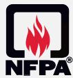

# Stationary Fire Pumps and Standpipe Systems Handbook

Sixth Edition

Edited by

Chad R.W. Dufy, P.E. Senior Fire Protection Engineer, NFPA

Janna E. Shapiro{7d1cf25 Fire Protection Engineer, NFPA

With the complete text of the following:   
2019 edition of NFPA® 20, Standard for the Installation of Stationary Pumps for Fire Protection   
2016 edition of NFPA® 14, Standard for the Installation of Standpipe and Hose Systems   
2019 edition of NFPA® 291, Recommended Practice for Fire Flow Testing and Marking of Hydrants   
2019 edition of NFPA® 24, Standard for the Installation of Private Fire Service Mains and Their Appurtenances

NATIONAL FIRE PROTECTION ASSOCIATION The leading information and knowledge resource on fire, electrical and related hazards