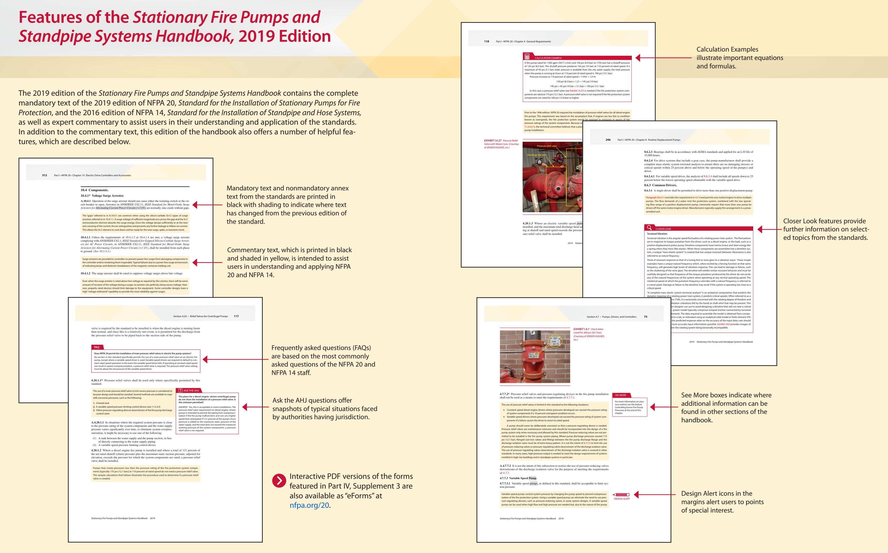
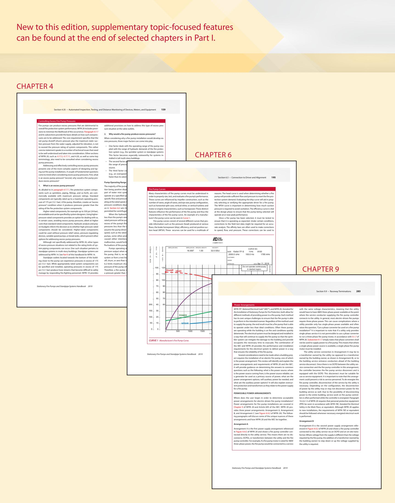
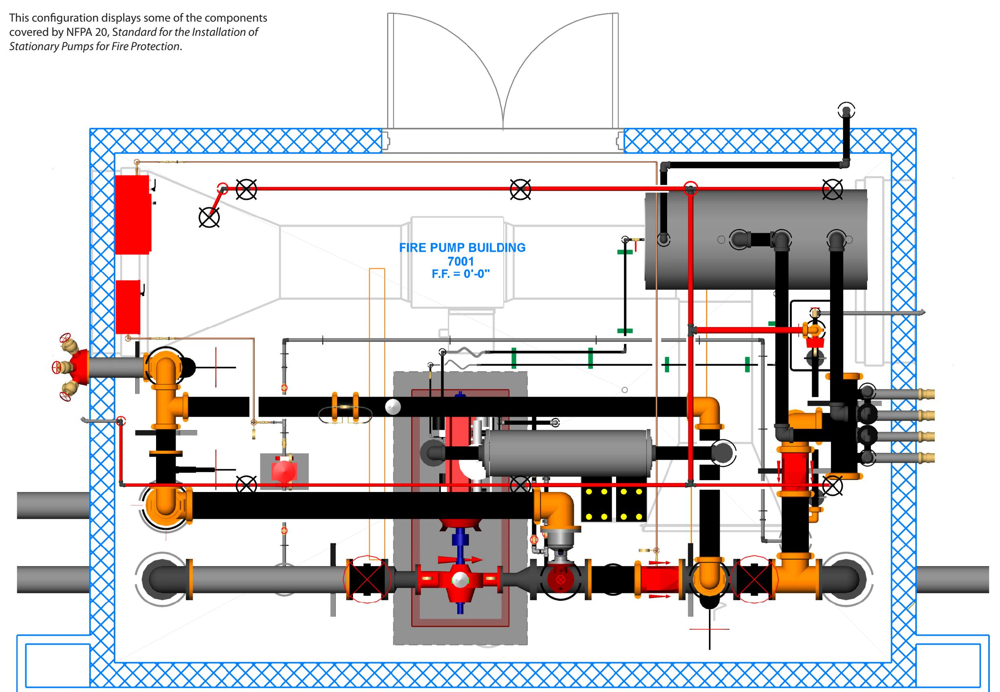
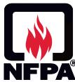

# PDF Navigation Tips

**Find**

To find a word or term in the PDF:

1. Select Find under the Edit menu or use the keyboard shortcut: CTRL + F for PC; COMMAND + F for Mac.

2. Type a word or term in the Find box. To specify Whole words only or Case-sensitive, use the drop-down arrow to the right of the Find box and toggle these criteria on or of.

The found term will be highlighted in the text. To go to other occurrences of the term, use the previous and next buttons that appear beside the Find box.

**Advanced Search**

Use the drop-down arrow to the right of the Find box and select Open Full Search. Additional search options are available by selecting Show More Options at the bottom of the pane. Options in the advanced search window include matching the exact word or phrase, matching only some of the words, and stemming (see below).

Stemming finds words that contain part (the stem) of a specified search word. For example, a search for the word opening would find instances of open, opened, opens, and openly. Wildcard characters (\* or ?) are not permitted in stemming searches. Stemming isn’t available if either Whole words only or Case-sensitive is selected.

**Links**

Links to other sections of the document are colored red. When you click on a link and are directed to another page, use the following keyboard shortcut to return to the original page: ALT + <left arrow> for PC; COMMAND + <left arrow> for Mac.

Product Management: Debra Rose Development and Production: Melanie Muto Copyediting: Barbara Ingalls Permissions: Irene Herlihy and Tracy Gaudet Art Direction and Interior Design: Cheryl Langway

Cover Design: Twist Creative Group Composition: Cenveo Publisher Services Printing/Binding: Webcrafters, Inc.

Copyright © 2018   
National Fire Protection Association® One Batterymarch Park   
Quincy, Massachusetts 02169-7471

All rights reserved.

Important Notices and Disclaimers: Publication of this handbook is for the purpose of circulating information and opinion among those concerned for fire and electrical safety and related subjects. While every effort has been made to achieve a work of high quality, neither the NFPA® nor the contributors to this handbook guarantee the accuracy or completeness of or assume any liability in connection with the information and opinions contained in this handbook. The NFPA and the contributors shall in no event be liable for any personal injury, property, or other damages of any nature whatsoever, whether special, indirect, consequential, or compensatory, directly or indirectly resulting from the publication, use of, or reliance upon this handbook.

This handbook is published with the understanding that the NFPA and the contributors to this handbook are supplying information and opinion but are not attempting to render engineering or other professional services. If such services are required, the assistance of an appropriate professional should be sought.

NFPA 20, Standard for the Installation of Stationary Pumps for Fire Protection (“NFPA 20”); NFPA 14, Standard for the Installation of Standpipe and Hose Systems (“NFPA 14”); NFPA 291, Recommended Practice for Fire Flow Testing and Marking of Hydrants (“NFPA 291”); and NFPA 24, Standard for the Installation of Private Fire Service Mains and Their Appurtenances (“NFPA 24”), are, like all NFPA codes, standards, recommended practices, and guides (“NFPA Standards”), made available for use subject to Important Notices and Legal Disclaimers, which appear at the end of this handbook and can also be viewed at www.nfpa.org/disclaimers.

Notice Concerning Code Interpretations: This sixth edition of the Stationary Fire Pumps and Standpipe Systems Handbook is based on the 2019 edition of NFPA 20 and the 2016 edition of NFPA 14. All NFPA codes, standards, recommended practices, and guides (“NFPA Standards”) are developed in accordance with the published procedures of the NFPA by technical committees comprised of volunteers drawn from a broad array of relevant interests. The handbook contains the complete text of NFPA 20, NFPA 14, NFPA 291, and NFPA 24; relevant extracts from the text of NFPA 1, NFPA 22, and NFPA 70®; and any applicable Formal Interpretations issued by the NFPA at the time of publication. These NFPA Standards are accompanied by explanatory commentary and other supplementary materials.

The commentary and supplementary materials in this handbook are not a part of the NFPA Standards and do not constitute Formal Interpretations of the NFPA (which can be obtained only through requests processed by the responsible technical committees in accordance with the published procedures of the NFPA). The commentary and supplementary materials, therefore, solely reflect the personal opinions of the editor or other contributors and do not necessarily represent the official position of the NFPA or its technical committees.{7d1cf25d-f130-43e0-8b7f-041dc4ddd

**REMINDER: UPDATING OF NFPA STANDARDS**

NFPA 20, Standard for the Installation of Stationary Pumps for Fire Protection; NFPA 14, Standard for the Installation of Standpipe and Hose Systems; NFPA 291, Recommended Practice for Fire Flow Testing and Marking of Hydrants; and NFPA 24, Standard for the Instal lation of Private Fire Service Mains and Their Appurtenances, like all NFPA codes, standards, recommended practices, and guides (“NFPA Standards”), may be amended from time to time through the issuance of Tentative Interim Amendments or corrected by Errata. An official NFPA Standard at any point in time consists of the current edition of the document together with any Tentative Interim Amendment and any Errata then in effect. In order to determine whether an NFPA Standard has been amended through the issuance of Tentative Interim Amendments or corrected by Errata, visit the “Codes & Standards” section on NFPA’s website. There, the document information pages located at the “List of NFPA Codes & Standards” provide up-to-date, document-specific information, including any issued Tentative Interim Amendments and Errata. To view the document information page for a specific NFPA Standard, go to http://www.nfpa.org/docinfo to choose from the list of NFPA Standards, or use the search feature to select the NFPA Standard number (e.g., NFPA 20). The document information page includes postings of all existing Tentative Interim Amendments and Errata. It also includes the option to register for an “Alert” feature to receive an automatic email notification when new updates and other information are posted regarding the document.

The following are registered trademarks of the National Fire Protection Association:

National Fire Protection Association®   
NFPA®   
NFPA 70®, National Electrical Code®   
NFPA 70E®, Standard for Electrical Safety in the Workplace®   
NFPA 72®, National Fire Alarm and Signaling Code®   
NFPA 101®, Life Safety Code®

NFPA No.: 20HB19

ISBN (PDF): 978-1-4559-1-9772   
ISBN (e-book): 978-1-4559-1-9765

Library of Congress Control No.: 2018948818

Printed in the United States of America 18 19 20 21 22 5 4 3 2 1

Preface ii   
Acknowledgments xiv   
Dedication xvi   
About the Contributors viii   
About the Editors xiv   
NFPA 20 and NFPA 14 Summary of Technical   
Changes T-1   
An Overview of Fire Pump Configurations 1   
PART I   
NFPA® 20, Standard for the Installation of Stationary   
Pumps for Fire Protection, with Commentary 17   
Administration 19   
1.1 Scope 19   
1.2 Purpose 20   
1.3 Application 21   
1.4 Retroactivity 21   
1.5 Equivalency 21   
1.6 Units 22   
2 Referenced Publications 25   
2.1 General 25   
2.2 NFPA Publications 25   
2.3 Other Publications 25   
2.4 References for Extracts in   
Mandatory Sections 27   
3 Definitions 29   
3.1 General 29   
3.2 NFPA Official Definitions 29   
3.3 General Definitions 31   
General Requirements 59   
4.1 Pumps 59   
4.2 Approval Required 60   
4.3 Pump Operation 63   
4.4 Fire Pump Unit Performance 65   
4.5 Certified Shop Test 66   
4.6 Liquid Supplies 68   
4.7 Pumps, Drivers, and Controllers 72   
4.8 Self-Regulating Variable Speed Fire Pump   
Units 78   
4.9 Multistage Multiport Pump 79   
4.10 Centrifugal Fire Pump Capacities 79   
4.11 Nameplate 81   
4.12 Pressure Gauges 82   
4.13 Circulation Relief Valve 84   
4.14 Equipment Protection 86   
4.15 Pipe and Fittings 91   
4.16 Suction Pipe and Fittings 94   
4.17 Discharge Pipe and Fittings 110   
4.18 Valve Supervision 115   
4.19 Protection of Piping Against Damage Due to   
Movement 116   
4.20 Relief Valves for Centrifugal Pumps 116   
4.21 Pumps Arranged in Series 124   
4.22 Water Flow Test Devices 127   
4.23 Steam Power Supply Dependability 138   
4.24 Shop Tests 138   
4.25 Pump Shaft Rotation 138   
4.26 Other Signals 139   
4.27 Pressure Maintenance (Jockey or Make-Up)   
Pumps 140   
4.28 Summary of Centrifugal Fire Pump   
Data 144   
4.29 Backflow Preventers and Check   
Valves 148   
4.30 Earthquake Protection 150   
4.31 Packaged Fire Pump Assemblies 151   
4.32 Pressure Actuated Controller Pressure Sensing   
Lines 154   
4.33 Break Tanks 156   
4.34 Field Acceptance Test of Pump Units 156   
4.35 Automated Inspection, Testing, and Distance   
Monitoring of Devices, Meters, and   
Equipment 157   
5 Fire Pumps for High-Rise Buildings 163   
5.1 General 163   
5.2 Equipment Access 164   
5.3 Water Supply Tanks 164   
5.4 Fire Pump Test Arrangement 165   
5.5 Alternate Power 166   
5.6 Very Tall Buildings 166   
6 Centrifugal Pumps 173   
6.1 General 173   
6.2 Factory and Field Performance 181   
6.3 Fittings 185   
6.4 Foundation and Setting 190   
6.5 Connection to Driver and Alignment 190   
7 Vertical Shaft Turbine–Type Pumps 203   
7.1 General 203   
7.2 Water Supply 205   
7.3 Pump 213   
7.4 Installation 219   
7.5 Driver 221   
7.6 Operation and Maintenance 226   
8 Positive Displacement Pumps 229   
8.1 General 229   
8.2 Foam Concentrate and Additive   
Pumps 235   
8.3 Water Mist System Pumps 237   
8.4 Water Mist Positive Displacement Pumping   
Units 237   
8.5 Fittings 240   
8.6 Pump Drivers 245   
8.7 Controllers 247   
8.8 Foundation and Setting 248   
8.9 Driver Connection and Alignment 248   
8.10 Flow Test Devices 249   
9 Electric Drive for Pumps 251   
9.1 General 252   
9.2 Normal Power 254   
9.3 Alternate Power 262   
9.4 Voltage Drop 264   
9.5 Motors 267   
9.6 On-Site Standby Generator Systems 276   
9.7 Junction Boxes 279   
9.8 Listed Electrical Circuit Protective System to   
Controller Wiring 280   
9.9 Raceway Terminations 281   
10 Electric-Drive Controllers and   
Accessories 289   
10.1 General 289   
10.2 Location 297   
10.3 Construction 305   
10.4 Components 312   
10.5 Starting and Control 328   
10.6 Controllers Rated in Excess of 600 V 345   
10.7 Limited Service Controllers   350   
10.8 Power Transfer for Alternate Power   
Supply 351   
10.9 Controllers for Additive Pump Motors 362   
10.10 Controllers with Variable Speed Pressure   
Limiting Control or Variable Speed Suction   
Limiting Control 363   
11 Diesel Engine Drive 377   
11.1 General 377   
11.2 Engines 378   
11.3 Pump Room 403   
11.4 Fuel Supply and Arrangement 406   
11.5 Engine Exhaust 413   
11.6 Diesel Engine Driver System   
Operation 415   
12 Engine Drive Controllers 419   
12.1 Application 419   
12.2 Location 423   
12.3 Construction 424   
12.4 Components 430   
12.5 Battery Recharging 445   
12.6 Battery Chargers 446   
12.7 Starting and Control 450   
12.8 Air-Starting Engine Controllers 465   
13 Steam Turbine Drive 467   
13.1 General 467   
13.2 Turbine 470   
13.3 Installation 472

2019 Stationary Fire Pumps and Standpipe Systems Handbook

**14 Acceptance Testing, Performance, and Maintenance 475**

14.1 Hydrostatic Tests and Flushing 475   
14.2 Field Acceptance Tests   484   
14.3 Record Drawings, Test Reports, Manuals, Special Tools, and Spare Parts 520   
14.4 Periodic Inspection, Testing, and Maintenance 521   
14.5 Component Replacement 522

**Annex A Explanatory Material 525**

Annex B Possible Causes of Pump Troubles 527

Annex C  Fire Pump Room Connectivity   533

Annex D Material Extracted by NFPA 70, Article 695 603

Annex E Informational References 607

**PART II**

NFPA® 14, Standard for the Installation of Standpipe and Hose Systems, with Commentary 611

**1 Administration 613**

1.1 Scope 613   
1.2 Purpose 613   
1.3 Retroactivity 614   
1.4 Equivalency 614   
1.5 Units 615

2 Referenced Publications 617 2.1 General 617 2.2 NFPA Publications 617 2.3 Other Publications 618 2.4 References for Extracts in Mandatory Sections 619

**3 Definitions 621**

3.1 General 621   
3.2 NFPA Official Definitions 621   
3.3 General Definitions 623

**4 System Components and Hardware**

**633**

4.1 General 633   
4.2 Pipe and Tube 634   
4.3 Fittings 636   
4.4 Joining of Pipe and Fittings 637   
4.5 Valves 646   
4.6 Hose Stations 646   
4.7 Hose Connections 650   
4.8 Fire Department Connections 651   
4.9 Pressure-Regulating Devices 652   
4.10 Signs 653

**5 System Requirements 655**

5.1 General 655   
5.2 Automatic and Semiautomatic Dry   
Systems 655   
5.3 Classes of Standpipe Systems 663   
5.4 Required Type of System 665   
5.5 Gauges 667   
5.6 Waterflow and Supervisory Alarms 669

**6 Installation Requirements 671**

6.1 Location and Protection of Piping 671   
6.2 Underground Piping 674   
6.3 Gate Valves and Check Valves 674   
6.4 Fire Department Connections 681   
6.5 Support of Piping 683   
6.6 Installation of Signsf-041dc4 683dd   
6.7 Signs for Water Supply Pumps 683   
6.8 Hydraulic Design Information Sign 683

**7 Design 685**

7.1 General 685 7.2 Pressure Limitation 688 7.3 Locations of Hose Connections 693 7.4 Number of Standpipes 700 7.5 Interconnection of Standpipes 700 7.6 Minimum Sizes for Standpipes and Branch Lines, Class I and Class III Standpipes 700 7.7 System Design and Sizing of Pipe for Delivery of System Demand 701 7.8 Minimum and Maximum Pressure Limits 701 7.9 Standpipe System Zones 703 7.10 Flow Rates 705 7.11 Drains and Test Riser 712 7.12 Fire Department Connections 713

**8 Plans and Calculations 715**

8.1 Plans and Specifications 715   
8.2 Hydraulic Calculations 719   
8.3 Hydraulic Calculation Procedures 724

**9 Water Supply 729**

9.1 Required Water Supply 729 9.2 Minimum Supply for Class I, Class II, and Class III Systems 730

**10 Water Supply Testing   731**

10.1 Water Supply Evaluation 731   
10.2 Procedure 732

**11 System Acceptance 733**

11.1 General 733   
11.2 Flushing of Piping 739   
11.3 Hose Threads 740   
11.4 Hydrostatic Tests 740   
11.5 Flow Tests 742   
11.6 Manual Valve Test 748   
11.7 Alarm and Supervision Tests 748   
11.8 Record Drawings, Test Reports, and   
Manuals 748   
11.9 Signs 749

**12 Buildings Under Construction{7d1cf25d-f13 7514**

12.1 General 751   
12.2 Fire Department Connections 752   
12.3 Other System Features 752   
12.4 Support of Piping 752   
12.5 Hose Connections 753   
12.6 Extension of System Piping 753   
12.7 Temporary Installations 753   
12.8 Timing of Water Supply Installation 753   
12.9 Protection of Hose Connections and Fire   
Department Connections 754

**13 System Testing, Inspection, and Maintenance 755 13.1 General 755**

**Annex A Explanatory Material 759**

Annex B Informational References 761

**PART III**

**Water Supply Requirements, Water Demand,**

Hydrants, Tanks, and Piping 763

Section 1 Complete Text of NFPA® 291, Recommended Practice for Fire Flow Testing and Marking of Hydrants, 2019 Edition, with Commentary 765

Section 2 Complete Text of NFPA® 24, Standard for the Installation of Private Fire Service Mains and Their Appurtenances, 2019 Edition, with Commentary 791

Section 3 Sections 18.4 and 18.5 from NFPA® 1, Fire Code Handbook, 2018 Edition, with Commentary 877

Section 4 Extracts with Commentary from NFPA® 22, Standard for Water Tanks for Private Fire Protection, 2018 Edition 895

**PART IV**

Supplements 933

Supplement 1 Considerations When Designing and Selecting a Fire Pump 935

Supplement 2 Interrelationship of NFPA Standards Pertaining to a Fire Pump Installation 947

Supplement 3 Commissioning and Inspection, Testing, and Maintenance Forms for Fire Pumps 957

Supplement 4 Article 695 of NFPA 70®, National Electrical Code® Handbook, 2017 Edition, Fire Pumps 979

NFPA 20 Index 993

NFPA 14 Index 1003

Important Notices and Legal Disclaimers 1008

TIA 20-19-1 1009

TIA 20-19-2 1010

2019   Stationary Fire Pumps and Standpipe Systems Handbook