# About the Contributors

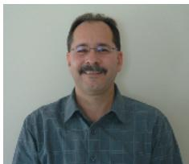

**Kerry Bell (NFPA 20, Chapters 6 and 7)**

Kerry Bell is a corporate fellow and principal engineer at UL specializing in fire sprinkler and pump equipment. Kerry obtained his BS degree in fire protection and safety engineering from Illinois Institute of Technology and an MBA degree from Northern Illinois University. He has been a registered professional engineer in the state of Illinois since 1981. Kerry is a life member of NFPA and a Fellow member of

the Society of Fire Protection Engineers. He is currently a member of more than ten NFPA committees, including the Technical Committees on Residential Sprinkler Systems; Sprinkler System Discharge Criteria; Water Spray Fixed Systems; Inspection, Testing and Maintenance of Water-Based Systems and Fire Pumps; and the Correlating Committee on Automatic Sprinkler Systems. He has also served as a member of the NFPA Standards Council since 2005 and as Chair since 2014.

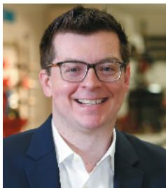

**Brian Buscher (NFPA 20, Chapter 6 Feature on Fire Pump Curves)**

Brian Buscher is the Global Product Marketing Manager for Fire Protection for Xylem Inc. He has been working in the stationary fire pump industry for 20 years and is a member of the NFPA 20 Technical Committee on Fire Pumps and the UL 448 Standard Technical25d-f130-43e0-8b7f-041dc Panel.

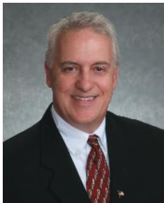

**David R. Hague (NFPA 22, NFPA 24, and NFPA 291)**

David Hague is staff liaison for the NFPA sprinkler standards, which include NFPA 13, NFPA 13D, NFPA 13R, NFPA 24, and NFPA 291, and the NFPA foam system documents, which include NFPA 11 and NFPA 16. He began his career designing fire protection systems, including sprinkler, standpipe, water spray, fire pump, and foam systems, for the Automatic Sprinkler Corporation of America and has a total of 17 years of experience in contracting. Dave has spent 16 years with NFPA and 7 years in the insurance business as manager of the Engineering Technical Unit of Liberty Mutual Property.

He has served as technical editor and contributing author of several books, including Fire Protection Systems for Special Hazards, the NFPA 20 and NFPA 25 handbooks, the Fire Protection Handbook, the Handbook on Commissioning of Fire Protection Systems, and the Automatic Sprinkler Systems Handbook. Dave is a registered professional engineer in the state of Massachusetts, a certified fire protection specialist (CFPS), and NICET (National Institute for Certification in Engineering Technologies) certified in sprinkler and special hazards systems.

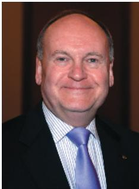

**John Kovacik (NFPA 20, Chapters 9 and 12)**

John Kovacik is UL’s Primary Designated Engineer (PDE) for industrial control equipment, components, and assemblies including control panels and industrial machinery. His primary responsibility is driving consistency, integrity, and engineering quality in the establishment and application of UL product certification requirements. Mr. Kovacik’s 44-year career with UL includes many years of experience with codes and standards. He represents UL on a number of technical committees covering a broad range of subjects for NFPA, NEMA, and IEC. This includes membership as UL’s principal representative on the NFPA 20 Technical Committee on Fire Pumps

and the NFPA 79 Technical Committee on Electrical Equipment of Industrial Machinery. He serves as the technical advisor for the U.S. National Committee Technical Advisory Group for IEC/SC 121A. Mr. Kovacik is UL’s principal member on the Correlating Committee on the National Electrical Code®. As UL’s representative on this committee, he is responsible for coordinating UL’s participation in NEC® activities. He is also a member of NEC Code Panels 12 and 13. Mr. Kovacik is a Corporate Fellow of UL’s William Henry Merrill Society, has received the IEC 1906 Award, the NFPA Committee Service Award, and the NFPA Richard G. Biermann Award, and is an NFPA Life Member.

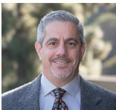

**Stephen Leyton (NFPA 14, Chapter 7)**

Steve Leyton is president of Protection Design & Consulting in San Diego, California. His career began in 1981 on the contracting side of the fire sprinkler industry, and he founded PD&C in 1995. Professional affiliations include NFPA, ICC, the American Fire Sprinkler Association, National Fire Sprinkler Association, California Fire Prevention Officers Northern and Southern Sections, and San Diego Fire Protection Association. He currently serves as chairman of NFPA 14

and was a principal member of the NFPA 13D/13R Residential Sprinkler Systems Technical-f130-43e0-8b7f-041dc4ddd530} Committee for three cycles. Steve was chair of the Installation Committee for the California State Fire Marshal’s 2009 Residential Sprinkler Code Adoption Task Group and co-chair of the ICC Ad-Hoc Committee on Residential Fire Sprinklers. Over the course of his career, Steve has worked on all manner of residential, commercial/ industrial, institutional, and highrise projects in the United States, the Middle East, and Mexico.

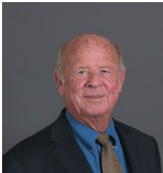

**Terrence Manning (NFPA 14, Chapters 4, 5, and 6)**

Mr. Manning is the associate director for the Phoenix office of JEN-SEN HUGHES where he is responsible for project management, business development, and office operations. His experience spans over 50 years as owner/president of an electrical contracting company that specialized in the design, installation, and maintenance of fire/life safety systems. During that time he personally designed and has overseen the installation of fire and life safety systems in some of Chicago’s most prominent structures, including hospitals,

universities, and businesses. Mr. Manning served as a member of the NFPA 20 Technical Committee on Fire Pumps for eighteen years and is currently a principal member of the NFPA 14 Technical Committee on Standpipes (26 years). He has also been actively involved in the fire service as an officer, a hazardous materials team chief, and a search and rescue coordinator. Mr. Manning currently serves as a chairman of the City of Phoenix Fire Safety Advisory Board.

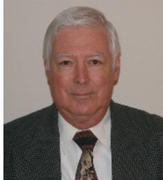

**T. Gayle Pennel, PE (NFPA 20, Chapter 14 and Annex C)**

Gayle Pennel is a project manager at JENSEN HUGHES, specializing in all aspects of water supplies and fire protection systems. His experience includes designing fire protection for exhibition halls, high-rise and ultra-high buildings, large box retail stores, malls, refineries, distribution centers, and factories. Mr. Pennel has provided investigative and expert testimony for fire protection failures. He has also designed and supervised large-scale fire tests for exposed expanded plastics, water miscible flammable liquids in plastic containers, and other haz-

ards where existing standards did not provide protection criteria. Mr. Pennel has been active in code development, including incorporating large-scale fire test results into existing standards. He is currently chair of the NFPA 20 Technical Committee on Fire Pumps and a member of the NFPA 25 Technical Committee on Inspection, Testing, and Maintenance of Water-Based Systems.

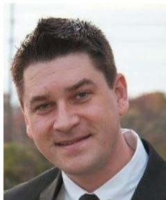

**Damon Pietraz (NFPA 20, Chapter 6 Feature on Fire Pump Curves)**

Damon Pietraz is president of Underwood Fire Equipment in Wixom, Michigan. A graduate of the University of Michigan, he is a member of the NFPA 20 Technical Committee on Fire Pumps and an alternate for the NFPA 25 Technical Committee on Inspection, Testing, and Maintenance of Water-Based Systems. He is a member of the SE Michigan chapter of Society of Fire Protection Engineers, the American Society of Plumbing Engineers, and the Metropolitan Detroit Fire Inspectors Society. He is also associated with the American Fire Sprinkler Association and the National Fire Sprinkler Association.

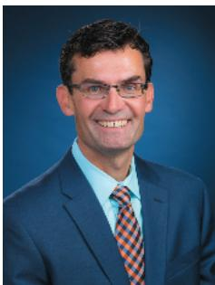

**Milosh Puchovsky (Supplement 2 and NFPA 20, Chapter 4 Feature on Controlling Excess Fire Pump Pressures)**

Milosh Puchovsky is professor of practice and associate department head in the Department of Fire Protection Engineering and the director of the Center for Global Public Safety at Worcester Polytechnic Institute. He teaches, collaborates with industry, and leads research projects on active and passive fire protection systems, including automatic sprinklers and fire pumps; fire hazard analysis; occupant egress; building and fire regulations; and the application of computer fire models.

Milosh chairs NFPA’s Technical Committee on Fire Pumps and is a member of numerous other NFPA technical committees. He is past

president of the Society of Fire Protection Engineers and serves on the UL Fire Council and Standards Technical Panel on Fire Sprinkler Equipment. Milosh holds degrees in mechanical and fire protection engineering, is a registered professional engineer, and previously worked for NFPA, consulting engineering firms, and as a loss control engineer for the insurance industry.

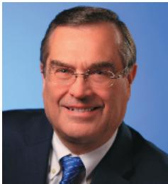

**William Stelter (NFPA 20, Chapter 10)**

William Stelter has been the president of Master Control Systems, Inc., a manufacturer of diesel, electric, transfer switch, and variable speed fire pump controllers as well as battery chargers for emergency power systems, since 1993. He is a member of the American Society of Plumbing Engineers, a member and vice chairman of subcommittee 10 on Fire Pump Controllers, an NFPA 20 committee member representing NEMA, and a member and past president of the Chicago chapter of the Society of Fire Protection Engineers.

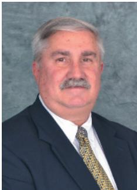

**Terry Victor (NFPA 14, Chapters 8, 9, 10, 11, 12, and 13)**

Terry Victor, Senior Manager of Industry Relations at JCI/Grinnell Fire Protection Solutions, has over 45 years of technical experience in the fire sprinkler industry. He is NICET-certified Level IV in waterbased systems layout and special hazards systems layout.

He serves on various industry boards and committees and is a member of the CFSI National Advisory Committee and the AFAA Codes and Standards Committee. He is JCI/Grinnell’s representative on the NFSA Board of Directors, is the past chairman of the NFSA Engineering and Standards Committee, and is the current chairman of the NFSA ITM Committee. He is the JCI Regional Coordinator for

Codes and Standards in the United States, is the current chairman of the Capital Region Fire Sprinkler Association, and is a member of numerous NFPA technical committees, including those for NFPA 3, 4, 13, 13D, 13R, 14, 15, 16, 20, 25, 72®, 101®, 214, 303, 5000®, and the Correlating Committee on Building Codes. He received the NFPA Committee Service Award in 2015 and the NFSA Russell P. Fleming Technical Service Award in 2017.

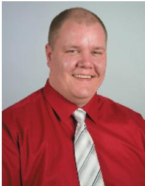

**Derek Vigstol (NFPA 20, Chapter 9 Feature on Power Arrangements)**

Derek Vigstol is the electrical technical lead for NFPA, where he serves as a technical resource for the development and implementation of new products in support of NFPA electrical codes and standards. Derek joined NFPA in 2015 as a senior electrical specialist where he assisted in the code and standard development process for multiple NFPA documents along with providing answers to technical questions from NFPA members. Prior to joining NFPA, he was an instructor at the Minneapolis Electrical JATC and a licensed Minnesota master and journeyman electrician. He has taught apprentice

electrician students as well as provided continuing education classes for electrical license renewal in Minnesota. In 2014, Derek became the inaugural NEC Challenge Champion by-f130-43e0-8b7f-041dc4ddd530} proving his knowledge of the NEC against competitors from across the country. He is a contributor to the National Electrical Code® Handbook and a member of the International Association of Electrical Inspectors (IAEI).

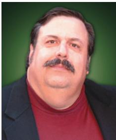

**Kenneth Wagoner (NFPA 24)**

A 1977 graduate of Bethany College (Kansas) and owner of Parsley Consulting, located in Escondido, California, Ken joined the sprinkler industry in 1981 in Denver, Colorado, and in subsequent years gained experience in automatic sprinkler system and fire alarm system design, plan review, and construction management. He has NICET certification in the subfields of automatic sprinkler system layout (IV), fire alarm systems (III), and water-based fire protection systems inspection and testing (III). Ken is also certified as a Fire

Protection Specialist (CFPS) and Fire Plan Examiner (CFPE) through NFPA. He is a principal member of the Hanging and Bracing Committee of NFPA 13, Standard for the Installation of Sprinkler Systems; a principal member and the past chairman of the NFPA Technical Committee on Private Water Supply Piping Systems, responsible for NFPA 24, Standard for the Installation of Private Fire Service Mains and Their Appurtenances, and NFPA 291, Recommended Practice for Fire Flow Testing and Marking of Hydrants; and an alternate member of the technical committee responsible for NFPA 1031, Standard for Professional Qualifications for Fire Inspector and Plan Examiner. Ken has published numerous articles on seismic bracing, hydraulic calculations, system design, and the plan review process and has presented online virtual seminars and classes sponsored by the various groups. He is an active member of the NFPA, the AFSA, and the SCFSCA. Ken is married and has three daughters and five grandchildren.

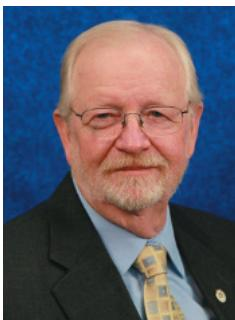

**John Whitney (NFPA 20, Chapter 11)**

John Whitney is senior vice president of Clarke Fire Protection Products, Inc., a producer of listed diesel engines and power transmission components for fire pumps with production facilities in the United States and Europe. Mr. Whitney has over 52 years of experience in the diesel engine industry with 37 years directly related to fire protection. In 2002, he developed and brought variable speed pressure limiting technology to fire pumps and later minimum suction pressure limiting control. He has served on many regulatory committees for the continued betterment of fire protection and currently serves as a principal

member of NFPA 20 and NFPA 25. Previously, he served as a member of UL’s STP 448 committee for the construction and testing of pumps and diesel engines for fire pump application, Factory Mutual Approvals Advisory Council, NEMA subcommittee SC10 for the design and construction of fire pump controllers, and the Loss Prevention Council Board (LPCB) in the United Kingdom, responsible for the standard LPS 1239, Requirements and Testing Procedures for the LPCB Approval and Listing of Diesel Engines for Sprinkler Pump Sets.