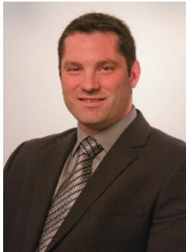

# About the Editors

**Chad R.W. Duffy, P.E.**

Chad Duffy is a senior fire protection engineer at the National Fire Protection Association, where he is a team member of the Building Fire Protection and Life Safety group. Chad is responsible for NFPA documents addressing automatic sprinkler systems and inspection, testing, and maintenance of water-based suppression systems. He is a graduate of Seneca College with a degree in fire protection engineering technology and a registered professional engineer in the state of Massachusetts. He is also NICET-certified in water-based layout (CET) and a certified fire protection specialist (CFPS). Chad has extensive experience in water-based suppression systems as a project

manager, designer, and estimator for projects throughout the United States and Macau. His project work includes the use of various design software programs for the layout of sprinkler, fire pump, and standpipes systems of high-rise buildings, storage facilities, shopping malls, rail stations, and casinos. Prior to joining NFPA in 2011, Chad owned and operated a sprinkler design and consulting firm as well a sprinkler installation-contracting company.

**Janna E. Shapiro**

Janna Shapiro is a fire protection engineer for the NFPA. She has a BS25d-f130-43e0-8b7f-041dc in chemistry from the University of Virginia and an MS in fire protection engineering from Worcester Polytechnic Institute. She began her career with NFPA in 2015 as an associate engineer in the Industrial and Chemical Division, where she was one of the staff liaisons responsible for overseeing NFPA 30, Flammable and Combustible Liquids Code. She also worked with codes and standards involving the fire protection of motor fuel dispensing facilities and repair garages, the manufacture and storage of aerosol products, and the production, storage, and handling of liquefied natural gas. Janna currently

works in the Building Fire Protection and Life Safety Division, where she is responsible for NFPA 20, Standard for the Installation of Stationary Pumps for Fire Protection, as well as NFPA 14, Standard for the Installation of Standpipe and Hose Systems. She also oversees codes and standards related to water tanks for private fire protection, fire protection for fixed guideway transit and passenger rail systems, and fire protection for road tunnels.