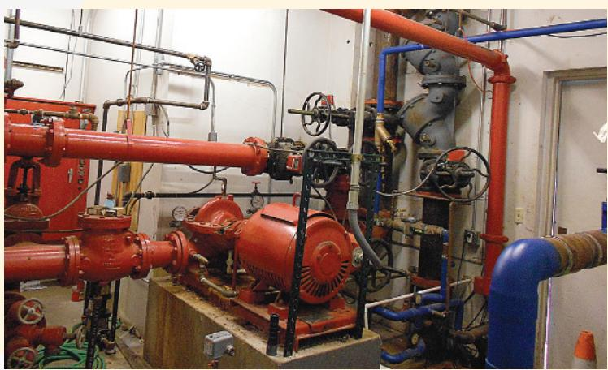
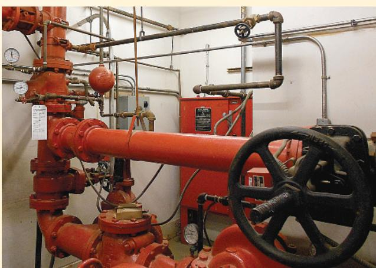
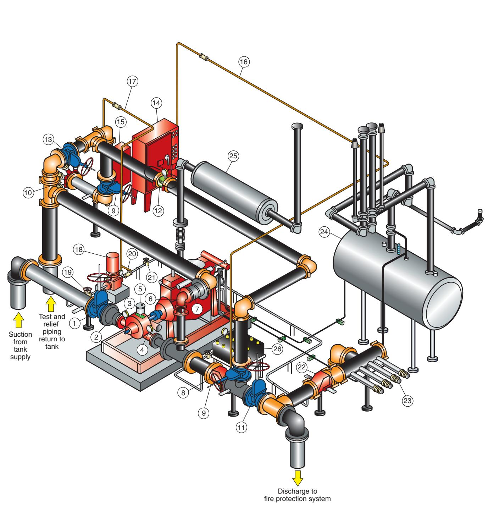
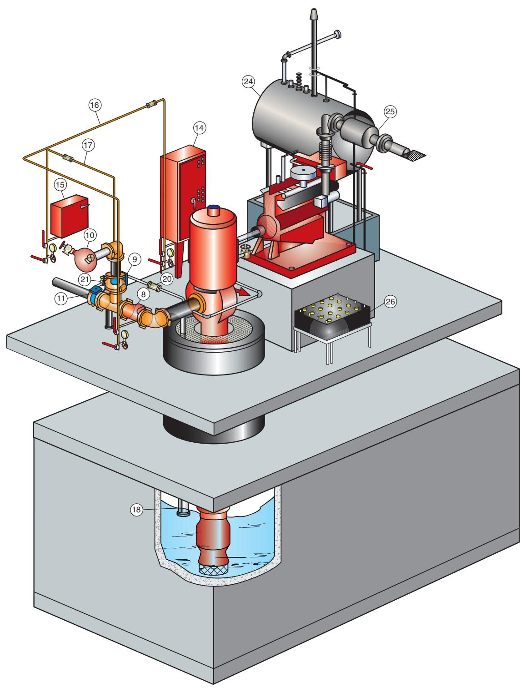
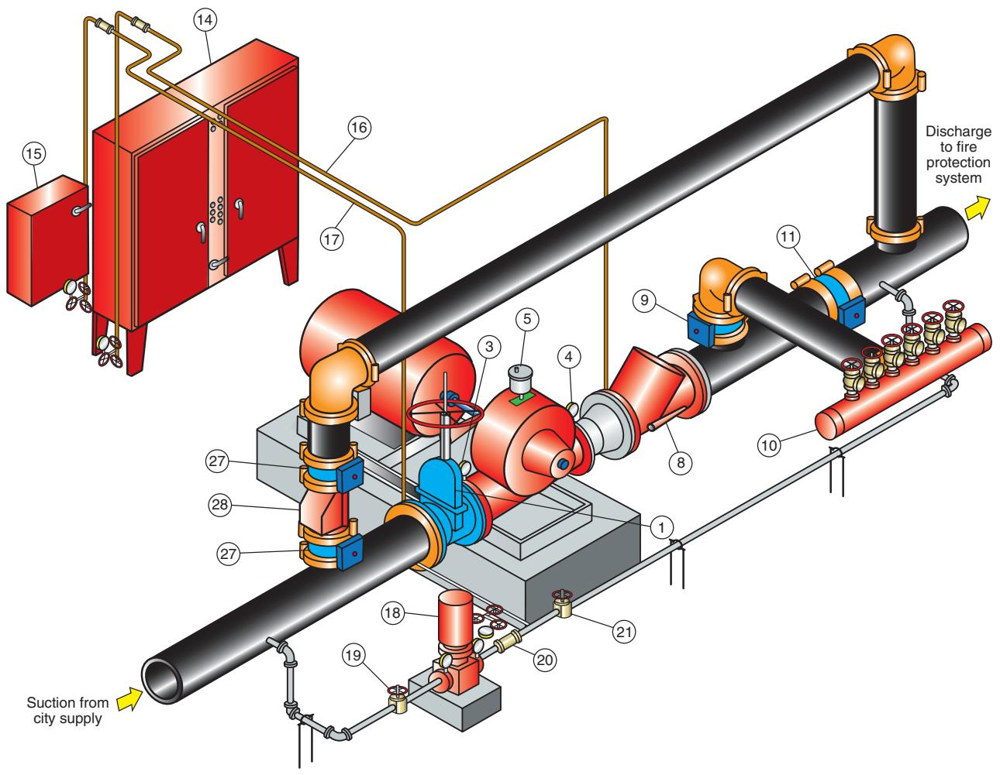
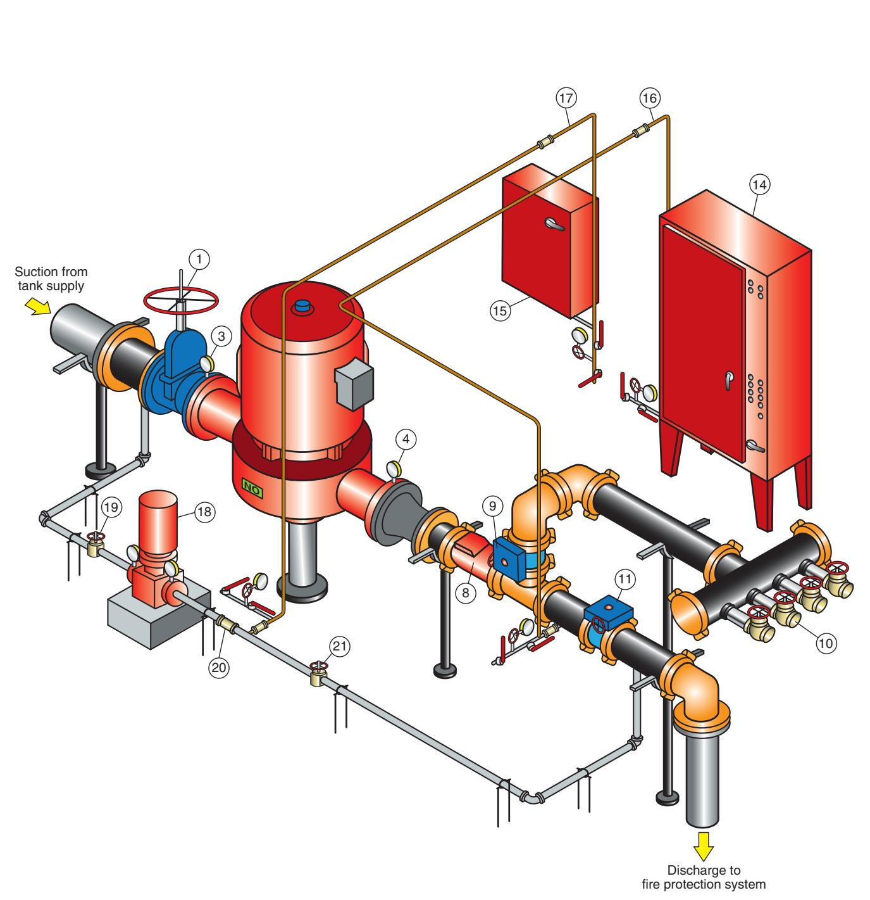
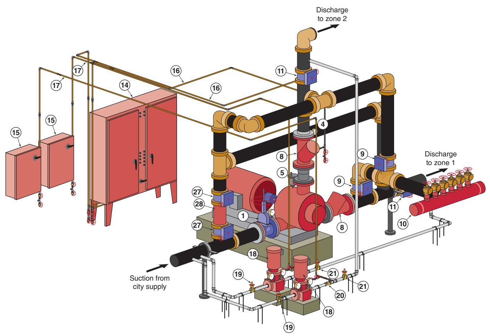

# An Overview of Fire Pump Configurations

The Overview of this handbook provides examples of various fire pump configurations and explains the purpose of the components of those pumps. Each component and its location in a fire pump assembly affects the fire pump’s performance and its ability to meet the demands of the fire suppression system. When designing a fire pump assembly, the fire pump room must be evaluated to determine the best orientation of the pump and its components, and all the installation requirements of this standard must be met. If the pump and components are not arranged with adequate space and clearances allowing for proper operation, maintenance, and mobility — if the controllers were located at the back of the pump room, for instance — the pump operator could be at risk of injury. Locating the controllers close to the pump room exit and providing the required clearances allows the operator to quickly engage the emergency shutoff and evacuate the room. Exhibit 1 depicts a fire pump controller installed in the back corner of a fire pump room, a location that could put an operator at risk of injury. Note that the access and egress are obstructed by piping and components, making it difficult to escape during an emergency.

  
EXHIBIT 1 Pump Room That Could Put the Pump Operator at Risk of Injury.

On the following pages is a list of components that corresponds with the pump illustrations in this section. For each component, the list provides the component’s designation, where the requirement for that component is located in Part I, and a brief description of its purpose, all to provide an explanation of why each component is required.

The pump configurations illustrated in this section are for educational purposes only and by no means constitute a preferred layout for the fire pump types shown. It is the responsibility of the system designer to ensure that all pump designs comply with the requirements of this standard.

**Explanation of the Components of the Pumps Shown in an Overview of Fire Pump Configurations**

**1. Outside Screw and Yoke (OS&Y) Gate Valve (Pump Suction) — 4.16.5.1**

The OS&Y gate valve in the suction piping of a fire pump serves two purposes. As liquid flows into a fire pump, it needs to be as free of turbulence as possible to avoid introducing air pockets into the impeller and to avoid unbalanced loads on the impeller. When a gate valve is in the fully open position, the wedge is retracted into the body of the valve, leaving the liquid passageway clear of any obstruction and effectively enabling laminar flow. The OS&Y valve also provides a way to isolate the fire pump from the liquid supply so repairs can be made to the fire pump.

**2. Eccentric Tapered Reducer (Pump Suction) — 4.16.6.4**

An eccentric reducer is used on the suction side of a fire pump assembly to reduce the likelihood of air pockets entering the pump impeller. In most pump installations, the suction pipe is larger than the pump suction flange; an eccentric reducer installed with the flat side on the top is used to reduce the suction size pipe to match the pump suction opening. If the suction pipe is the same size as the pump suction flange, a reducer is not required.

**3. Suction Pressure Gauge — 4.12.2**

When there is a possibility of a suction pressure below 20 psi (1.3 bar), the suction pressure gauge is required to be a compound gauge capable of registering negative pressures. This gauge provides the pump operator the ability to monitor the suction pressure to ensure that operating pressures comply with 4.16.3.1, which — except when taking suction from a tank — does not permit the suction pressure to drop below 0 psi (0 bar) while the pump is operating at 150 percent of its rated capacity. If a fire pump starts to draw a negative suction pressure, there is a possibility that both the fire pump and the suction piping could cavitate. Negative suction pressures in underground pipes can also cause infiltration of groundwater.

**4. Discharge Pressure Gauge — 4.12.1**

The discharge pressure gauge provides the pump operator the ability to observe the discharge pressure exerted from the fire pump. It is beneficial to use liquid-filled gauges on both the suction and discharge side of the fire pump, because they dampen pressure fluctuations, making the gauges easier to read.

**5. Automatic Air Release — 6.3.3**

The air release, when required, is typically part of the fire pump material distributed from the pump supplier. Air in the impeller can cause damage, so it is prudent to have a method of releasing that air, should it develop.

**6. Relief Valve — Section 4.20**

The relief valve is not intended to control pressure when a fire pump has been overdesigned; it is intended to relieve pressure when a diesel engine is turning faster than normal, or when failure of the variable speed controls causes a pump to operate at rated speed. Subsection 4.20.1 provides guidance on determining if a relief valve is required.

**7. Relief Cone — 4.20.5**

A method of detecting flow is required when a pressure relief valve is installed in a closed loop system. A sight glass in a cone downstream of the fire pump provides a way to observe water discharge. In practice, the sight glass becomes dirty or foggy, and it becomes difficult to observe flow through the cone. Should the sight glass become distorted to the point at which the flow can no longer be observed, it can be replaced without having to remove the waste cone.

**8. Check Valve (Discharge) — 4.17.7**

The check valve in the discharge piping restricts the pressure downstream of the fire pump and keeps the pressurized liquid from going back through the fire pump. Backflow through a fire pump can spin the fire pump in reverse, causing damage. Pressure surges can develop and oscillate when the pump starts or stops or when a significant change in the flow rate occurs. The discharge check valve is necessary for a jockey pump to maintain pressure on the system.

**9. Indicating Gate or Butterfly Valve (Test Header) — 4.18.2**

This valve is typically supervised in the closed position and is only opened to deliver water to the test outlets or flowmeter during pump testing procedures. When this valve supplies a test header located on the exterior of the pump room, the valve becomes critically important in order to keep the test connections and supply piping from freezing. When this valve supplies a flowmeter, it should be installed per the manufacturer’s recommendations.

**10. Test Header — 4.22.1.1**

Though a test header is not specifically required by NFPA 20, a means of testing the pump is. One of the most commonly used means for testing is a test header. The test header provides the pump operator the ability to measure actual performance by flowing water through the fire pump, to take readings at appropriate flow rates, and to develop a test curve to verify that the pump is still producing and performing in accordance with the original manufacturer’s pump curve.

**11. Indicating Gate or Butterfly Valve (Fire Pump Discharge Control Valve) — 4.17.8**

The fire pump discharge control valve is for isolation purposes. This valve, combined with the pump suction control valve, provides the ability to isolate the fire pump, fire pump discharge check valve, and pump test header piping and components for repair, replacement, and testing, while keeping the pump suction and bypass piping in service.

**12. Flowmeter — 4.22.2**

A flowmeter provides one method of measuring the flow rate from the fire pump. If the flowmeter is arranged in a loop piped back to the pump suction, the pump performance (but not the water supply performance) can be tested without discharging water. NFPA 25, Standard for the Inspection, Testing, and Maintenance of Water-Based Fire Protection Systems, allows “non-discharge” performance testing of fire pumps 2 out of every 3 years. Every third year, a “discharge” performance test is required. A discharge performance test also tests the water supply to the fire pump.

**13. Indicating Gate or Butterfly Valve (Flowmeter) — A.4.22.1.3(1)**

This valve should be installed per the manufacturer’s recommendations. This valve is utilized as an isolation valve if the flowmeter needs to be repaired or replaced. It is also used as a throttling valve to control the flow rate during the performance test procedure, to achieve the 100 percent rated flow and 150 percent rated flow conditions.

**14. Fire Pump Controller — 4.7.5**

Fire pump controllers are used to monitor and to start and stop fire pumps. Electric-drive controllers monitor power availability and pump status and control the power to the electric motor. Engine drive controllers monitor power availability and engine status and send electronic signals to the engine driver. When a controller is set for automatic operation, a Mercoid® switch or pressure transducer is used to tell the controller to start the fire pump when the system pressure drops to a preset level. Criteria for electric-drive controllers can be found in Part I, Chapter 10, and for engine drive controllers in Part I, Chapter 12.

**15. Pressure Maintenance Pump (Jockey Pump) Controller — Used with a pressure maintenance pump installation — 4.27.8**

Though a pressure maintenance pump is not specifically required by NFPA 20, a means of maintaining system pressure other than the fire pump is. If a pressure maintenance pump is used, it must have its own controller (the exception to this is water mist positive displacement pumping units). The jockey pump controller is used to start the jockey pump when the pressure in the fire protection system decreases to a preset level and to stop the jockey pump when the pressure in the fire protection system increases to a preset level. In order for the jockey pump to work correctly, the start pressure of the jockey pump must be higher than the start pressure of the fire pump.

**16. Sensing Line (Fire Pump Controller) — 4.32.1**

One end of the fire pump sensing line is connected to a pressure sensor (Mercoid® switch or pressure transducer) within the controller. The other end of the sensing line is connected to the fire pump piping between the discharge check valve and discharge control valve of the fire pump assembly. This provides the controller the ability to sense pressure change in the fire protection system when the fire pump is fully in service, but also allows testing of the pressure settings even if the pump discharge control valve is closed.

**17. Sensing Line (Pressure Maintenance Pump) — 4.32.1**

This sensing line performs the same function as the fire pump sensing line, but for the pressure maintenance pump.

**18. Pressure Maintenance Pump — Section 4.27**

Though NFPA 20 does not require the use of a pressure maintenance pump, it does require a means of maintaining system pressure, and a pressure maintenance pump is most commonly used to accomplish this requirement. The pressure maintenance pump maintains the pressure in the fire suppression system and prevents the fire pump from operating unless there is a significant flow of water. The pressure settings for the pressure maintenance pump and fire pump should be such that the starting of the fire pump will not create water hammer.

**19. Isolation Valve (Pressure Maintenance Pump — Suction) — 4.27.6.3**

This valve is not required to be listed. Its primary function is to provide isolation from upstream water and pressures so that the pressure maintenance pump or pressure maintenance discharge check valve can be repaired or replaced.

**20. Check Valve (Pressure Maintenance Pump — Discharge) — 4.27.6.4**

This valve is required to hold pressure on the fire protection system so that when the fire pump is running, the pressure that it exerts does not flow back through the pressure maintenance pump, causing it to spin in reverse damaging the pump. It might be necessary to use two check valves when dealing with high-pressure fire pumps. This is not a requirement, but these valves are typically brass and could fail under the repetitive starting and running pressures from high-pressure fire pump(s), so a backup is suggested.

**21. Isolation Valve (Pressure Maintenance Pump — Discharge) — 4.27.6.4**

This valve is not required to be listed. It is used in conjunction with the pressure maintenance pump suction control valve to isolate the pressure maintenance pump or discharge check valve when necessary for servicing.

**22. Check Valve (Fire Department Connection) — See NFPA 13 and NFPA 14**

In a fire pump configuration, the fire department connection (FDC) should be installed downstream of the fire pump discharge control valve. This check valve is utilized to prevent the FDC from experiencing pressures exerted from the fire pump and to reduce the possibility of freezing pipe.

23. Fire Department Connection — See NFPA 13 and NFPA 14 The FDC provides a point of connection where pressures and flows can be supplemented by the fire department engine pumper during fire-fighting operations.

**24. Diesel Fuel Tank — Section 11.4**

The diesel fuel tank is required to provide the appropriate amount of fuel to ensure the proper running duration time of the diesel engine–driven fire pump. A designer should consult the manufacturer’s data sheets to determine the outlet designation to ensure that proper piping is installed from the diesel fuel tank.

**25. Engine Exhaust — Section 11.5**

The engine exhaust is used to disperse the hot combustion gases produced from the diesel engine to a safe location outside the pump room. It is important to verify with the pump supplier or manufacturer that the exhaust pipe is the appropriate size for the distance and number of changes in direction to avoid engine back pressure that exceeds manufacturer’s recommendations.

**26. Batteries — 11.2.7.2.1 Engine Batteries**

In a diesel engine–drive configuration, the batteries provide the cranking power to the starter on receiving notification from the fire pump controller. In addition, the batteries provide backup power for the controller if the primary (or secondary) power supply fails.

**27. Indicating Gate or Butterfly Valve (Bypass) — 4.18.1**

Indicating valves located before and after the bypass check valve on a bypass are normally open valves; they provide isolation of the bypass check valve should it require repair or replacement. An indicating valve in the bypass can be used in conjunction with the pump suction control valve to isolate the fire suppression system from the water supply.{7d1cf25d-f130-43e0-

**28. Check Valve (Bypass) — 4.17.7**

The bypass check valve allows the water supply to provide some pressure to the fire suppression system should the fire pump fail to function. It also prevents the discharge from a pressure maintenance pump or a fire pump from entering the water supply.

**Description**

The diagram opposite illustrates a possible configuration for a diesel-driven horizontal split-case fire pump assembly, based on the requirements set forth in this standard. The water supply is an aboveground suction tank; see NFPA 22, Standard for Water Tanks for Private Fire Protection, in Part III, Section 4, for tank requirements. For this example, a diesel drive has been used due to the lack of reliable power in the project area. Guidance on reliable power is found in Part I, Chapter 9, of this standard.

The discharge arrangement consists of a pressure relief valve, check valve, test header, discharge control valve, and a fire department connection (FDC). Isolation valves on the discharge side of the fire pump assembly can be of the indicating gate valve type or the butterfly valve type. Project specifications should be reviewed prior to designing the fire pump assembly. In this fire pump arrangement, a flowmeter was used to conserve water from the tank during testing procedures. There is also a test header attached downstream of the meter. This test header serves two purposes: It will be used every three years for the annual test per the requirements of NFPA 25, Standard for the Inspection, Testing, and Maintenance of Water-Based Fire Protection Systems; and, per the requirements of NFPA 20, the header will be used to verify that the readings from the flowmeter are accurate (which will help determine whether the unit needs to be calibrated). Requirements specific to centrifugal fire pumps can be found in Part I, Chapter 6.

<table><tr><td rowspan=1 colspan=9>Legend</td></tr><tr><td></td><td></td><td></td><td rowspan=1 colspan=1>①</td><td rowspan=1 colspan=3>OS&amp;Y Gate Valve (Suction Control Valve)</td><td rowspan=1 colspan=1>14</td><td rowspan=1 colspan=1>Fire Pump Controller</td></tr><tr><td rowspan=1 colspan=1>②</td><td></td><td></td><td></td><td rowspan=1 colspan=3>Eccentric Reducer</td><td rowspan=2 colspan=1>15</td><td rowspan=2 colspan=1>Pressure Maintenance Pump Controller(Jockey Pump)</td></tr><tr><td></td><td></td><td></td><td rowspan=1 colspan=1>③</td><td rowspan=1 colspan=3>Suction Pressure Gauge</td></tr><tr><td></td><td></td><td></td><td rowspan=2 colspan=1>④</td><td rowspan=2 colspan=2>Discharge Pressure Gauge</td><td></td><td></td><td></td></tr><tr><td></td><td></td><td></td><td></td><td rowspan=1 colspan=1>16</td><td rowspan=1 colspan=1>Pressure-Sensing Line (Fire Pump)</td></tr><tr><td></td><td></td><td rowspan=1 colspan=5></td><td rowspan=2 colspan=3>⑤</td><td rowspan=2 colspan=1>Automatic Air Release</td></tr><tr><td></td><td></td><td rowspan=1 colspan=5></td></tr><tr><td></td><td></td><td rowspan=1 colspan=5></td><td rowspan=2 colspan=3>⑥</td><td rowspan=2 colspan=1>Relief Valve</td></tr><tr><td></td><td></td><td></td><td rowspan=1 colspan=1></td><td rowspan=1 colspan=1></td></tr><tr><td rowspan=2 colspan=1>⑦</td><td></td><td></td><td></td><td></td><td></td></tr><tr><td></td><td></td><td></td><td rowspan=1 colspan=1>19</td><td rowspan=1 colspan=1>Isolation Valve (Jockey Pump Suction)</td></tr><tr><td></td><td></td><td></td><td rowspan=2 colspan=1>⑧</td><td></td><td></td></tr><tr><td></td><td></td><td></td><td rowspan=1 colspan=1>20</td><td rowspan=1 colspan=1>Check Valve (Jockey Pump Discharge)</td></tr><tr><td rowspan=3 colspan=1>⑨</td><td></td><td></td><td></td><td rowspan=3 colspan=3>Indicating Gate Valve or Butterfly Valve(Test Header)</td><td></td><td></td></tr><tr><td></td><td></td><td></td><td rowspan=1 colspan=1>②1</td><td rowspan=1 colspan=1>Isolation Valve (Jockey Pump Discharge)</td></tr><tr><td></td><td></td><td></td><td rowspan=1 colspan=1>22</td><td rowspan=1 colspan=1>Check Valve (FDC)</td></tr><tr><td></td><td></td><td></td><td rowspan=1 colspan=1>10</td><td rowspan=1 colspan=3>Test Header</td><td rowspan=1 colspan=1>23</td><td rowspan=1 colspan=1>Fire Department Connection</td></tr><tr><td rowspan=2 colspan=1>11</td><td></td><td></td><td></td><td rowspan=2 colspan=3>Indicating Gate Valve or Butterfly Valve(Discharge Control Valve)</td><td rowspan=1 colspan=1>24</td><td rowspan=1 colspan=1>Diesel Fuel Tank</td></tr><tr><td></td><td></td><td></td><td rowspan=3 colspan=3>Flowmeter</td><td rowspan=2 colspan=1>25</td><td rowspan=2 colspan=1>Diesel Drive Exhaust</td></tr><tr><td></td><td></td><td></td><td rowspan=2 colspan=1>12</td></tr><tr><td></td><td></td><td></td><td rowspan=1 colspan=2></td><td rowspan=2 colspan=1>26</td><td rowspan=2 colspan=1>Batteries</td></tr><tr><td rowspan=2 colspan=1>13</td><td></td><td></td><td></td><td rowspan=2 colspan=3>Indicating Gate Valve or ButterflyValve (Flowmeter)</td></tr><tr><td></td><td></td><td></td><td rowspan=1 colspan=1></td><td rowspan=1 colspan=1></td></tr></table>

2019 Stationary Fire Pumps and Standpipe Systems Handbook

Diesel-Driven Horizontal Split-Case Fire Pump Assembly

(Courtesy of Stephan Laforest, Summit Sprinkler Design Services, Inc.)

**Description**

The diagram opposite illustrates a possible configuration for a diesel-driven vertical turbine fire pump assembly, based on the requirements set forth in this standard. The water supply is an underground poured-in-place concrete tank; see NFPA 22, Standard for Water Tanks for Private Fire Protection in Part III, Section 4, for tank requirements. Vertical turbine fire pumps differ from other fire pumps in that they have a shaft that is submersed in a static water supply, rather than a connection point for suction piping. This shaft contains impellers that create lift, so positive head from a water supply is not required. Vertical turbine fire pumps are used to take suction from wells and ground-level storage reservoirs such as tanks, lakes, ponds, and rivers. Raw water sources require special considerations to prevent sediment and corrosion agents from entering the fire protection system.

The discharge arrangement consists of a check valve, test header, and a discharge control valve. Although this is a diesel-driven fire pump and as such often requires a relief valve, one was not needed in this example because 121 percent of the fire pump net-rated shutoff (churn) pressure did not exceed the rating of the system components (this complies with the requirements of 4.20.1.2). Due to the lack of an available water supply, a submersible jockey pump was required; this pump can be seen in the diagram next to the vertical turbine fire pump shaft. Requirements specific to vertical turbine fire pumps can be found in Part I, Chapter 7.

<table><tr><td rowspan=2 colspan=4>LegendPressure-Sensing Line (Jockey Pump)</td></tr><tr><td rowspan=1 colspan=1>⑧</td><td rowspan=1 colspan=1>Check Valve (Pump Discharge)</td><td rowspan=1 colspan=1>17</td></tr><tr><td rowspan=1 colspan=1>⑨</td><td rowspan=1 colspan=1>Indicating Gate Valve or Butterfly Valve(Test Header)</td><td rowspan=1 colspan=1>18</td><td rowspan=1 colspan=1>Submersible Pressure Maintenance Pump(Jockey Pump)</td></tr><tr><td rowspan=1 colspan=1>10</td><td rowspan=1 colspan=1>Test Header</td><td rowspan=1 colspan=1>20</td><td rowspan=1 colspan=1>Check Valve (Jockey Pump Discharge)</td></tr><tr><td rowspan=2 colspan=1>①1</td><td rowspan=5 colspan=1>Indicating Gate Valve or Butterfly Valve(Discharge Control Valve)Fire Pump Controller</td><td rowspan=1 colspan=1>②1</td><td rowspan=1 colspan=1>Isolation Valve (Jockey Pump Discharge)</td></tr><tr><td rowspan=2 colspan=1>24</td><td rowspan=2 colspan=1>Diesel Fuel Tank</td></tr><tr><td rowspan=2 colspan=1>14</td></tr><tr><td rowspan=2 colspan=1>25</td><td rowspan=2 colspan=1>Diesel Drive Exhaust</td></tr><tr><td rowspan=2 colspan=1>15</td><td rowspan=2 colspan=1>Pressure Maintenance Pump Controller(Jockey Pump)</td></tr><tr><td rowspan=1 colspan=1>26</td><td rowspan=1 colspan=1>Batteries</td></tr><tr><td rowspan=1 colspan=1>16</td><td rowspan=1 colspan=1>Pressure-Sensing Line (Fire Pump)</td><td rowspan=1 colspan=1></td><td rowspan=1 colspan=1></td></tr></table>

(Courtesy of Stephan Laforest, Summit Sprinkler Design Services, Inc.)  

Stationary Fire Pumps and Standpipe Systems Handbook 2019

**Description**

The diagram opposite illustrates a possible configuration for an electric motor–driven horizontal split-case fire pump assembly, based on the requirements set forth in this standard. The fire pump is supplied from a municipal water supply having insufficient pressure but adequate flow; see NFPA 24, Standard for the Installation of Private Fire Service Mains and Their Appurtenances, in Part III, Section 2, for on-site underground supply piping requirements.

The discharge arrangement consists of a check valve, test header, discharge control valve, and a bypass. A bypass is provided here, unlike in the other examples in this section, because the supply pressure is of material value to the fire suppression system even without the pump (see 4.16.4.1). In this example the suction pipe size is the same as the pump suction opening, so an eccentric reducer is not needed. Requirements specific to centrifugal fire pumps can be found in Part I, Chapter 6.

<table><tr><td rowspan=1 colspan=8>Legend</td></tr><tr><td></td><td></td><td></td><td rowspan=1 colspan=1>①</td><td rowspan=1 colspan=2>OS&amp;Y Gate Valve (Suction Control)</td><td rowspan=2 colspan=1>15</td><td rowspan=2 colspan=1>Pressure Maintenance Pump Controller(Jockey Pump)</td></tr><tr><td rowspan=1 colspan=1>③</td><td></td><td></td><td></td><td rowspan=3 colspan=2>Suction Pressure GaugeDischarge Pressure Gauge</td></tr><tr><td rowspan=2 colspan=1>④</td><td></td><td></td><td></td><td></td><td></td></tr><tr><td></td><td></td><td></td><td rowspan=1 colspan=1>16</td><td rowspan=1 colspan=1>Pressure-Sensing Line (Fire Pump)</td></tr><tr><td></td><td></td><td rowspan=1 colspan=4></td><td rowspan=2 colspan=1>⑤</td><td rowspan=2 colspan=3>Automatic Air Release</td></tr><tr><td></td><td></td><td rowspan=1 colspan=4></td></tr><tr><td></td><td></td><td></td><td rowspan=2 colspan=1>8</td><td rowspan=2 colspan=2>Check Valve (Pump Discharge)</td><td></td><td></td></tr><tr><td></td><td></td><td rowspan=1 colspan=4></td><td rowspan=1 colspan=1>18</td><td rowspan=1 colspan=1>Pressure Maintenance Pump (Jockey Pump)</td></tr><tr><td rowspan=3 colspan=1>⑨</td><td></td><td></td><td></td><td rowspan=3 colspan=2>Indicating Gate Valve or Butterfly Valve(Test Header)</td><td></td><td></td></tr><tr><td></td><td rowspan=1 colspan=4></td><td rowspan=1 colspan=1>19</td><td rowspan=1 colspan=1>Isolation Valve (Jockey Pump Suction)</td></tr><tr><td></td><td></td><td></td><td rowspan=1 colspan=1>20</td><td rowspan=1 colspan=1>Check Valve (Jockey Pump Discharge)</td></tr><tr><td></td><td></td><td></td><td rowspan=1 colspan=1>10</td><td rowspan=1 colspan=2>Test Header</td><td rowspan=1 colspan=1>②1</td><td rowspan=1 colspan=1>Isolation Valve (Jockey Pump Discharge)</td></tr><tr><td rowspan=2 colspan=1>11</td><td></td><td></td><td></td><td rowspan=2 colspan=2>Indicating Gate Valve or Butterfly Valve(Discharge Control Valve)</td><td rowspan=1 colspan=1>27</td><td rowspan=1 colspan=1>Indicating Gate Valve or Butterfly Valve (Bypass)</td></tr><tr><td></td><td></td><td></td><td rowspan=2 colspan=1>28</td><td rowspan=2 colspan=1>Check Valve (Bypass)</td></tr><tr><td></td><td></td><td></td><td rowspan=2 colspan=1>14</td><td rowspan=2 colspan=2>Fire Pump Controller</td></tr><tr><td></td><td></td><td></td><td rowspan=1 colspan=1></td><td rowspan=1 colspan=1></td></tr></table>

t Electric Motor–Driven Horizontal Split-Case Fire Pump Assembly

(Courtesy of Stephan Laforest, Summit Sprinkler Design Services, Inc.)

Stationary Fire Pumps and Standpipe Systems Handbook 2019

**Description**

The diagram opposite illustrates a possible configuration for an electric-driven vertical in-line fire pump assembly, based on the requirements set forth in this standard. The water supply is an aboveground suction tank; see NFPA 22, Standard for Water Tanks for Private Fire Protection, in Part III, Section 4, for tank requirements. Vertical in-line fire pumps can be used in a variety of building types. However, they are limited in capacity (approximately 1500 gpm [5677 L/min]) and not as commonly used as horizontal split-case fire pumps. Where space is limited, a vertical in-line fire pump assembly might be preferred because it is relatively compact and does not require a lot of space.

The discharge arrangement consists of a check valve, test header, and a discharge control valve. In this example, the pump suction pipe is the same size as the fire pump suction opening, so an eccentric reducer is not required. Requirements specific to centrifugal fire pumps can be found in Part I, Chapter 6.

<table><tr><td rowspan=3 colspan=5>LegendPressure Maintenance Pump Controller(Jockey Pump)</td></tr><tr><td rowspan=1 colspan=1></td><td rowspan=1 colspan=2>OS&Y Gate Valve (Suction Control Valve)</td><td rowspan=2 colspan=1></td></tr><tr><td rowspan=2 colspan=1>③</td><td rowspan=2 colspan=2>Suction Pressure Gauge</td></tr><tr><td rowspan=2 colspan=1>16</td><td rowspan=2 colspan=1>Pressure-Sensing Line (Fire Pump)</td></tr><tr><td rowspan=1 colspan=1>④</td><td rowspan=1 colspan=2>Discharge Pressure Gauge</td></tr><tr><td rowspan=2 colspan=1>⑧</td><td rowspan=5 colspan=2>Check Valve (Pump Discharge)Indicating Gate Valve or Butterfly Valve(Test Header)</td><td></td><td></td></tr><tr><td rowspan=1 colspan=1></td><td rowspan=1 colspan=1>17</td><td rowspan=1 colspan=1>Pressure-Sensing Line (Jockey Pump)</td></tr><tr><td rowspan=3 colspan=1>9</td><td></td><td></td></tr><tr><td rowspan=1 colspan=1>18</td><td rowspan=1 colspan=1>Pressure Maintenance Pump (Jockey Pump)</td></tr><tr><td rowspan=1 colspan=1>19</td><td rowspan=1 colspan=1>Isolation Valve (Jockey Pump Suction)</td></tr><tr><td rowspan=1 colspan=1>10</td><td rowspan=1 colspan=2>Test Header</td><td rowspan=1 colspan=1>20</td><td rowspan=1 colspan=1>Check Valve (Jockey Pump Discharge)</td></tr><tr><td rowspan=2 colspan=1>11</td><td rowspan=2 colspan=2>Indicating Gate Valve or Butterfly Valve(Discharge Control Valve)</td><td rowspan=1 colspan=1>②1</td><td rowspan=1 colspan=1>Isolation Valve (Jockey Pump Discharge)</td></tr><tr><td rowspan=2 colspan=1></td><td rowspan=2 colspan=1></td></tr><tr><td rowspan=1 colspan=1>14</td><td rowspan=1 colspan=2>Fire Pump Controller</td></tr></table>

2019 Stationary Fire Pumps and Standpipe Systems Handbook

(Courtesy of Stephan Laforest, Summit Sprinkler Design Services, Inc.)

**Description**

The diagram opposite illustrates a possible configuration for an electric motor–driven multistage multiport fire pump assembly, based on the requirements set forth in this standard. These requirements were added to the standard in the 2016 edition. The fire pump is supplied from a municipal water supply having insufficient pressure but adequate flow; see NFPA 24, Standard for the Installation of Private Fire Service Mains and Their Appurtenances, in Part III, Section 2, for on-site underground supply piping requirements.

There are multiple discharge ports with discharge arrangements consisting of a check valve, test header, discharge control valve, and a bypass (only on the discharge to zone 1). A multistage multiport pump may be used to supply structures such as high-rise buildings that require multiple zones. In this example, a bypass is provided on only zone 1 because the supply pressure will be of material value only to the fire suppression system, even without the pump in that zone (see 4.16.4.2). A single fire pump controller equipped with multiple pressure-sensing devices is provided so that each discharge port may be equipped with its own sensing line (see 4.32.1.1). Requirements specific to centrifugal fire pumps can be found in Part I, Chapter 6.

**t Legend**

<table><tr><td rowspan=1 colspan=1>①</td><td rowspan=1 colspan=1>OS&amp;Y Gate Valve (Suction Control)</td><td rowspan=1 colspan=1>16</td><td rowspan=1 colspan=1>Pressure-Sensing Line (Fire Pump)</td></tr><tr><td rowspan=1 colspan=1>⑤</td><td rowspan=1 colspan=1>Automatic Air Release</td><td rowspan=1 colspan=1>17</td><td rowspan=1 colspan=1>Pressure-Sensing Line (Jockey Pump)</td></tr><tr><td rowspan=1 colspan=1>⑧</td><td rowspan=1 colspan=1>Check Valve (Pump Discharge)</td><td rowspan=1 colspan=1>18</td><td rowspan=1 colspan=1>Pressure Maintenance Pump (Jockey Pump)</td></tr><tr><td rowspan=2 colspan=1>⑨</td><td rowspan=2 colspan=1>Indicating Gate Valve or Butterfly Valve(Test Header)</td><td rowspan=1 colspan=1>19</td><td rowspan=1 colspan=1>Isolation Valve (Jockey Pump Suction)</td></tr><tr><td rowspan=5 colspan=1>Test HeaderIndicating Gate Valve or Butterfly Valve(Discharge Control Valve)</td><td rowspan=2 colspan=1>20</td><td rowspan=2 colspan=1>Check Valve (Jockey Pump Discharge)</td></tr><tr><td rowspan=2 colspan=1>10</td></tr><tr><td rowspan=2 colspan=1>②1</td><td rowspan=2 colspan=1>Isolation Valve (Jockey Pump Discharge)</td></tr><tr><td rowspan=2 colspan=1>11</td></tr><tr><td rowspan=1 colspan=1>27</td><td rowspan=1 colspan=1>Indicating Gate Valve or Butterfly Valve (Bypass)</td></tr><tr><td rowspan=1 colspan=1>14</td><td rowspan=1 colspan=1>Fire Pump Controller</td><td rowspan=1 colspan=1>28</td><td rowspan=1 colspan=1>Check Valve (Bypass)</td></tr><tr><td rowspan=2 colspan=1>15</td><td rowspan=2 colspan=1>Pressure Maintenance Pump Controller(Jockey Pump)</td><td></td><td></td></tr><tr><td rowspan=1 colspan=1></td><td rowspan=1 colspan=1></td></tr></table>

t Electric Motor–Driven Multistage Multiport Fire Pump Assembly

(Courtesy of Stephan Laforest, Summit Sprinkler Design Services, Inc.)

Stationary Fire Pumps and Standpipe Systems Handbook 2019