# NFPA® 20, Standard for the Installation of Stationary Pumps for Fire Protection, with Commentary

Part I of this handbook includes the complete text of the 2019 edition of NFPA 20, Standard for the Installation of Stationary Pumps for Fire Protection. The standard consists of mandatory core chapters (Chapters 1 through 14) and nonmandatory annex material (Annex A). The mandatory provisions found in Chapters 1 through 14 were prepared by the Technical Committee on Fire Pumps within the framework of the NFPA consensus code- and standard-development process. Because these provisions are designed to be suitable for adoption into law, or for reference by other codes and standards, the text is concise, without extended explanation.

An asterisk (\*) following a paragraph number within a chapter indicates that non-mandatory material pertaining to that paragraph appears in Annex A. The material found in Annex A of the standard was also developed by the fire pump committee within the NFPA code- and standard-development process. {7d1cf25d-f130-43e0-8b7f-041d Annex A material is designed to assist users in interpreting the mandatory provisions. Annex A is not considered part of the requirements of the standard; it is advisory or informational. For the convenience of us-ers of this handbook, Annex A text appears immediately following the mandatory para-graph to which it pertains.

The explanatory commentary accompanying the standard was prepared by the handbook editors. The commentary immediately follows the text of NFPA 20 to which it is related and is easily identified by its shaded background. Designed to help users un-derstand and apply the requirements of the standard, the commentary provides detailed explanations of the reasoning behind requirements, applications of requirements, and illustrations of key fire pump components.

This edition of the handbook also includes the following features:

• Frequently asked questions (FAQ), based on the questions most commonly asked of the NFPA 20 staff

• “Ask the AHJ,” based on questions most commonly asked of the AHJ

• “Design alert” icons to indicate material of special interest

• “See More” boxes that indicate where additional information can be found in other sections of the handbook

• “Closer Look” boxes with additional commentary on various topics

• “Calculation Examples” that illustrate important equations and formulas

**REVISION SYMBOLS IDENTIFYING CHANGES FROM THE PREVIOUS EDITION**

Text revisions are shaded. A Δ before a section number indicates that words within that section were deleted and a Δ to the left of a table or figure number indicates a revision to an existing table or figure. When a chapter was heavily revised, the entire chapter is marked throughout with the Δ symbol. Where one or more sections were deleted, a • is placed between the remaining sections. Chapters, annexes, sections, figures, and tables that are new are indicated with an N.

Note that these indicators are a guide. Rearrangement of sections may not be captured in the markup, but users can view complete revision details in the First and Second Draft Reports located in the archived revision information section of each code at www.nfpa.org/docinfo. Any subsequent changes from the NFPA Technical Meeting, Tentative Interim Amendments, and Errata are also located there.

Δ = Text deletions and figure/table revisions

Chapter 1 of NFPA 20, Standard for the Installation of Stationary Pumps for Fire Protection, covers the administrative requirements for the selection and installation of fire pumps. In addition to the scope and purpose of the standard, Chapter 1 provides guidance on the ongoing use of existing fire pumps and the use of new equipment or technologies that might not be covered in the standard. Chapter 1 also provides guidance on the appropriate units and trade sizes used in the standard.

### 1.1\*  Scope.

**FAQ**

**Does NFPA 20 contain requirements mandating when a fire pump must be installed?**

NFPA 20 does not mandate when a fire pump is required to be installed; it is an installation standard for stationary fire pumps. The decision to use a fire pump is part of the fire protection system design process, as a means of meeting the fire protection system’s liquid supply demand. The purpose of NFPA 20 is to specify how to install a fire pump properly when one is needed and which components, equipment, and power supplies are acceptable for use in a fire pump installation. In other words, NFPA 20 indicates how to properly arrange and install a fire pump and its supporting equipment.

**A.1.1 For more information, see NFPA 25 and NFPA 70, Article 695.**

**FAQ**

**When is a fire pump needed?**

The need for a fire pump is usually determined through an analysis of the fire protection system being considered, the liquid supply required for the system, and the liquid supply available. Fire pumps are principally used where pressure from the attached liquid supply is insufficient (pumps used for this purpose are sometimes referred to as booster pumps). Where capacity of the water supply is also in question, means in addition to a fire pump, such as water tanks, also need to be considered.

When considering whether a fire pump is necessary, the user should refer to the other NFPA standards that address various types of water-based fire protection systems. These standards include the following documents:

NFPA 11, Standard for Low-, Medium-, and High-Expansion Foam

NFPA 13, Standard for the Installation of Sprinkler Systems

NFPA 13D, Standard for the Installation of Sprinkler Systems in One- and Two-Family Dwellings and Manufactured Homes

NFPA 13R, Standard for the Installation of Sprinkler Systems in Low-Rise Residential Occupancies

NFPA 14, Standard for the Installation of Standpipe and Hose Systems

NFPA 15, Standard for Water Spray Fixed Systems for Fire Protection

NFPA 16, Standard for the Installation of Foam-Water Sprinkler and Foam-Water Spray Systems

NFPA 750, Standard on Water Mist Fire Protection Systems

**SEE MORE**

For more information on water supply requirements, water demand, hydrants, tanks, and piping, see Part III of this handbook.

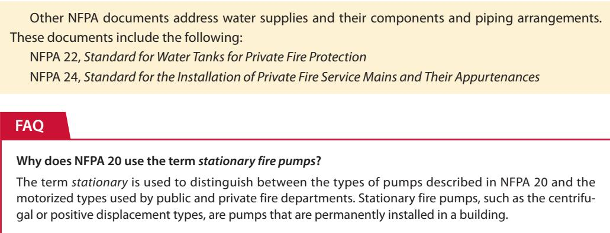

1.1.1 This standard deals with the selection and installation of pumps supplying liquid for private fire protection.

1.1.2 The scope of this document shall include liquid supplies; suction, discharge, and auxiliary equipment; power supplies, including power supply arrangements; electric drive and control; diesel engine drive and control; steam turbine drive and control; and acceptance tests and operation.

1.1.3 This standard does not cover system liquid supply capacity and pressure requirements, nor does it cover requirements for periodic inspection, testing, and maintenance of fire pump systems.

For liquid supply capacity and pressure requirements, see the appropriate system installation standard (such as NFPA 13). For inspection, testing, and maintenance requirements for existing fire pump installations, see NFPA 25, Standard for the Inspection, Testing, and Maintenance of Water-Based Fire Protection Systems.

**1.1.4 This standard does not cover the requirements for installation wiring of fire pump units.**

See NFPA 70®, National Electrical Code®, for requirements related to the installation of wiring for fire pumps.

**1.2  Purpose.**

The purpose of this standard is to provide a reasonable degree of protection for life and property from fire through installation requirements for stationary pumps for fire protection based upon sound engineering principles, test data, and field experience.

Is the purpose of a fire pump to create water or is its purpose only to boost pressure? It is important to realize that fire pumps cannot create water or increase the capacity of a liquid supply; they can only boost or supply the pressure and flow from an available liquid source. Fire pump installations are a critical and essential component of the liquid supply for a fire protection system, because they provide the necessary system flow and pressure to meet the system demand requirements. The performance of any liquid-based fire protection system is dependent on the availability, adequacy, and reliability of the water supply to which it is connected. Fire pumps installed in accordance with NFPA 20 and inspected, tested, and maintained in accordance with NFPA 25 ensure that the available liquid supply will have the necessary operating pressure and flow when needed during an emergency. NFPA 20 provides the minimum requirements needed for the operation of all types of listed fire pumps.

**1.3 Application.**

1.3.1 This standard shall apply to centrifugal single-stage and multistage pumps of the horizontal or vertical shaft design and positive displacement pumps of the horizontal or vertical shaft design.

Examples of these pump types are horizontal split-case, end suction, in-line, vertical shaft turbine, and positive displacement types (i.e., rotary lobe, rotary vane, and piston plunger).

1.3.2 Requirements are established for the design and installation of single-stage and multistage pumps, pump drivers, and associated equipment.

**1.4 Retroactivity.**

The provisions of this standard reflect a consensus of what is necessary to provide an acceptable degree of protection from the hazards addressed in this standard at the time the standard was issued.

FAQ

**Are fire pumps prescribed by older editions of NFPA 20 considered unsafe?**

The retroactivity statement in Section 1.4 appears in most NFPA documents. The section’s purpose is to reinforce the premise that any fire pump installed in accordance with the applicable edition of NFPA 20 is considered to be compliant with the standard for its lifetime, as long as the associated hazards remain unchanged and the pump is properly inspected, tested, and maintained. Therefore, an existing installation is not required to be reviewed for compliance with every new edition of the standard.

Omission of the retroactivity statement would require the never-ending task of updating and revising a fire pump installation every time a new edition of NFPA 20 was published. Although newer editions contain information that may provide a greater level of safety or a more effective means of accomplishing{7d1cf25d-f130-43e0-8b7f-041d a certain objective than that prescribed by older editions, the provisions of older editions should not necessarily be interpreted as unsafe. In those instances where a severe deficiency is discovered, Section 1.4 allows latitude for any authority having jurisdiction (AHJ) to require an upgrade.

1.4.1 Unless otherwise specified, the provisions of this standard shall not apply to facilities, equipment, structures, or installations that existed or were approved for construction or installation prior to the effective date of the standard. Where specified, the provisions of this standard shall be retroactive.

1.4.2 In those cases where the authority having jurisdiction determines that the existing situation presents an unacceptable degree of risk, the authority having jurisdiction shall be permitted to apply retroactively any portions of this standard deemed appropriate.

1.4.3 The retroactive requirements of this standard shall be permitted to be modified if their application clearly would be impractical in the judgment of the authority having jurisdiction, and only where it is clearly evident that a reasonable degree of safety is provided.

**1.5 Equivalency.**

Nothing in this standard is intended to prevent the use of systems, methods, or devices of equivalent or superior quality, strength, fire resistance, effectiveness, durability, and safety over those prescribed by this standard.

Stationary Fire Pumps and Standpipe Systems Handbook 2019

The increasing availability of specially listed materials and products, along with the continuing development of new pump-related technologies, necessitates some of the language in Section 1.5. This section allows for products or arrangements not specifically addressed by the standard to be used, provided that it can be demonstrated that the use of these products or arrangements does not lower the level of safety provided by the standard or alter the intent of the standard. This statement also alerts the user of NFPA 20 that specific requirements or limitations are often associated with specialized products and that these limitations are not addressed by the standard. Therefore, the listing information and the relevant manufacturers’ literature will need to be reviewed.

1.5.1 Technical documentation shall be submitted to the authority having jurisdiction to demonstrate equivalency.

1.5.2 The system, method, or device shall be approved for the intended purpose by the authority having jurisdiction.

**1.6 Units.**

1.6.1 Metric units of measurement in this standard are in accordance with the modernized metric system known as the International System of Units (SI).

1.6.2 Liter and bar in this standard are outside of but recognized by SI.

1.6.3 Units are listed in Table 1.6.3 with conversion factors.

TABLE 1.6.3 System of Units
<table><tr><td>Name of Unit</td><td>Unit Abbreviation</td><td>Conversion Factor</td></tr><tr><td>Meter(s)</td><td>m</td><td>1 ft = 0.3048 m</td></tr><tr><td>Foot (feet)</td><td>ft</td><td>1 m = 3.281 ft</td></tr><tr><td>Millimeter(s)</td><td>mm</td><td>1 in. = 25.4 mm</td></tr><tr><td>Inch(es)</td><td>in.</td><td>1 mm = 0.03937 in.</td></tr><tr><td>Liter(s)</td><td>L</td><td>1 gal = 3.785 L</td></tr><tr><td>Gallon(s) (U.S.)</td><td>gal</td><td>1 L = 0.2642 gal</td></tr><tr><td>Cubic decimeter(s)</td><td>dm³</td><td>1 gal = 3.785 dm³</td></tr><tr><td>Cubic meter(s)</td><td>m³</td><td>1  $\mathrm { f t } ^ { 3 } = 0 . 0 2 8 3 \mathrm { m } ^ { 3 }$ </td></tr><tr><td>Cubic foot (feet)</td><td>ft3</td><td>1 m³ = 35.31 ft3</td></tr><tr><td>Pascal(s)</td><td>Pa</td><td>1 psi = 6894.757 Pa; 1 bar = 10⁵ Pa</td></tr><tr><td>Pound(s) per square inch</td><td>psi</td><td>1 Pa = 0.000145 psi; 1 bar = 14.5 psi</td></tr><tr><td>Bar</td><td>bar</td><td>1 Pa = 10−⁵ bar; 1 psi = 0.0689 bar</td></tr></table>

Note: For additional conversions and information, see IEEE/ASTM SI10, Standard for Use of the International System of Units (SI): The Modern Metric System.

1.6.4  Conversion. The conversion procedure is to multiply the quantity by the conversion factor and then round the result to an appropriate number of significant digits.

1.6.5  Trade Sizes. Where industry utilizes nominal dimensions to represent materials, products, or performance, direct conversions have not been utilized and appropriate trade sizes have been included.

**References Cited in Commentary**

National Fire Protection Association, 1 Batterymarch Park, Quincy, MA 02169-7471.

NFPA 11, Standard for Low-, Medium-, and High-Expansion Foam, 2016 edition.

NFPA 13, Standard for the Installation of Sprinkler Systems, 2019 edition.

NFPA 13D, Standard for the Installation of Sprinkler Systems in One- and Two-Family Dwellings and Manufactured Homes, 2019 edition.

NFPA 13R, Standard for the Installation of Sprinkler Systems in Low-Rise Residential Occupancies, 2019 edition.

NFPA 14, Standard for the Installation of Standpipe and Hose Systems, 2016 edition.

NFPA 15, Standard for Water Spray Fixed Systems for Fire Protection, 2017 edition.

NFPA 16, Standard for the Installation of Foam-Water Sprinkler and Foam-Water Spray Systems, 2015 edition.

NFPA 22, Standard for Water Tanks for Private Fire Protection, 2018 edition.

NFPA 24, Standard for the Installation of Private Fire Service Mains and Their Appurtenances, 2019 edition.

NFPA 25, Standard for the Inspection, Testing, and Maintenance of Water-Based Fire Protection Systems, 2017 edition.

NFPA 70®, National Electrical Code®, 2017 edition.

NFPA 750, Standard on Water Mist Fire Protection Systems, 2019 edition.

**Referenced Publications**

This chapter lists mandatory referenced publications. Annex D lists nonmandatory referenced publications. Because the information is located immediately after Chapter 1, Administration, the user is presented with a complete list of publications needed for effective use of the standard before reading the specific requirements. The provisions of the mandatory publications referenced by NFPA 20 are also requirements. Regardless of whether a requirement actually resides in NFPA 20 or is mandatorily referenced in NFPA 20 and appears only in the referenced publication, the requirement must be met to achieve compliance with NFPA 20.

**2.1 General.**

The documents or portions thereof listed in this chapter are referenced within this standard and shall be considered part of the requirements of this document.

**2.2 NFPA Publications.**

National Fire Protection Association, 1 Batterymarch Park, Quincy, MA 02169-7471.

NFPA 13, Standard for the Installation of Sprinkler Systems, 2019 edition.

NFPA 22, Standard for Water Tanks for Private Fire Protection, 2018 edition.

NFPA 24, Standard for the Installation of Private Fire Service Mains and Their Appurtenances, 2019 edition.

NFPA 25, Standard for the Inspection, Testing, and Maintenance of Water-Based Fire Protection Systems, 2017 edition.

NFPA 37, Standard for the Installation and Use of Stationary Combustion Engines and Gas Turbines, 2018 edition.

NFPA 51B, Standard for Fire Prevention During Welding, Cutting, and Other Hot Work, 2019 edition.

NFPA 70®, National Electrical Code®, 2017 edition.

NFPA 70E®, Standard for Electrical Safety in the Workplace®, 2018 edition.

NFPA 72®, National Fire Alarm and Signaling Code®, 2019 edition.

NFPA 110, Standard for Emergency and Standby Power Systems, 2019 edition.

NFPA 1963, Standard for Fire Hose Connections, 2014 edition.

**2.3 Other Publications.**

2.3.1  AGMA Publications. American Gear Manufacturers Association, 1001 N. Fairfax Street, Suite 500, Alexandria, VA 22314-1587.

2.3.2  ANSI Publications. American National Standards Institute, Inc., 25 West 43rd Street, 4th Floor, New York, NY 10036.

ANSI B11.19, Performance Requirements for Safeguarding, 2010.

2.3.3  ASCE Publications. American Society of Civil Engineers, 1801 Alexander Bell Drive, Reston, VA 20191-4400.

ASCE/SEI 7, Minimum Design Loads for Buildings and Other Structures, 2010.

2.3.4  ASME Publications. ASME International, Two Park Avenue, New York, NY 10016-5990.

Boiler and Pressure Vessel Code, 2015.

2.3.5  AWS Publications. American Welding Society, 8669 NW 36 Street, Suite 130, Miami, FL 33166-6672.

AWS D1.1/D1.1M, Structural Welding Code — Steel, 2015.

2.3.6  HI Publications. Hydraulic Institute, 6 Campus Drive, First Floor North, Parsippany, NJ 07054-4406.

ANSI/HI 1.4, Rotodynamic Centrifugal Pumps for Manuals Describing Installation, Operation and Maintenance, 2014.

ANSI/HI 3.6, Rotary Pump Tests, 2016.

2.3.7  IEEE Publications. IEEE, Three Park Avenue, 17th Floor, New York, NY 10016-5997.

IEEE/ASTM SI10, Standard for Use of the International System of Units (SI): The Modern Metric System, 2010.

ANSI/IEEE C62.1, IEEE Standard for Gapped Silicon-Carbide Surge Arresters for AC Power Circuits, 1989.

ANSI/IEEE C62.11, IEEE Standard for Metal-Oxide Surge Arresters for Alternating Current-f130-43e0-8b7f-041dc4ddd530} Power Circuits (>1 kV), 2012.

ANSI/IEEE C62.41, IEEE Recommended Practice for Surge Voltages in Low-Voltage AC Power Circuits, 1991.

2.3.8  ISO Publications. International Organization for Standardization, ISO Central Secretariat, BIBC II, Chemin de Blandonnet 8, CP 401, 1214 Vernier, Geneva, Switzerland.

ISO 15540, Fire Resistance of Non-Metallic Hose Assemblies and Non-Metallic Compensators — Test Methods, 2nd edition, 2016.

2.3.9  NEMA Publications. National Electrical Manufacturers Association, 1300 North 17th Street, Suite 900, Arlington, VA 22209.

NEMA MG-1, Motors and Generators, 2014.

2.3.10  UL Publications. Underwriters Laboratories Inc., 333 Pfingsten Road, Northbrook, IL 60062-2096.

ANSI/UL 142, Standard for Steel Aboveground Tanks for Flammable and Combustible Liquids, 2013.

ANSI/UL 508, Standard for Industrial Control Equipment, 2013.

ANSI/UL 1449, Standard for Surge Protective Devices, 2016.

2.3.11  Other Publications. Merriam-Webster’s Collegiate Dictionary, 11th edition, Merriam-Webster, Inc., Springfield, MA, 2003.

**2.4 References for Extracts in Mandatory Sections.**

NFPA 14, Standard for the Installation of Standpipe and Hose Systems, 2016 edition.

NFPA 37, Standard for the Installation and Use of Stationary Combustion Engines and Gas Turbines, 2018 edition.

NFPA 70®, National Electrical Code®, 2017 edition.

NFPA 110, Standard for Emergency and Standby Power Systems, 2019 edition.

NFPA 1451, Standard for a Fire and Emergency Service Vehicle Operations Training Program, 2018 edition.

NFPA 5000®, Building Construction and Safety Code®, 2018 edition.

Chapter 3 contains definitions of terms that are used in NFPA 20. For the purpose of applying this standard, these definitions take precedence over definitions provided in other documents and should be used in conjunction with subjects covered throughout the standard. Where definitions are not provided, definitions in other NFPA codes and standards apply. For definitions not found in any NFPA document, the ordinary meanings of terms as defined in Merriam-Webster’s Collegiate® Dictionary apply. For definitions of fire protection–related terms that do not appear in either NFPA 20 or Merriam-Webster’s Collegiate Dictionary, see the NFPA Glossary of Terms, available at www.nfpa.org/got.

**3.1 General.**

The definitions contained in this chapter shall apply to the terms used in this standard. Where terms are not defined in this chapter or within another chapter, they shall be defined using their ordinarily accepted meanings within the context in which they are used. Merriam-Webster’s Collegiate Dictionary, 11th edition, shall be the source for the ordinarily accepted meaning.

**3.2 NFPA Official Definitions.**

3.2.1\* Approved. Acceptable to the authority having jurisdiction.

A.3.2.1 Approved. The National Fire Protection Association does not approve, inspect, or certify any installations, procedures, equipment, or materials; nor does it approve or evaluate testing laboratories. In determining the acceptability of installations, procedures, equipment, or materials, the authority having jurisdiction may base acceptance on compliance with NFPA or other appropriate standards. In the absence of such standards, said authority may require evidence of proper installation, procedure, or use. The authority having jurisdiction may also refer to the listings or labeling practices of an organization that is concerned with product evaluations and is thus in a position to determine compliance with appropriate standards for the current production of listed items.

**FAQ**

**What is the difference between the terms approved and listed?**

As used in this standard, the term approved means only that the product is acceptable to the authority having jurisdiction (AHJ); use of the term approved does not imply that the product has been evaluated by a testing laboratory. In fact, a component or equipment that is required to be approved is not necessarily also required to be listed.

The term listed indicates that a specific component or piece of equipment has been evaluated by an approved testing laboratory. In general, all components in a fire pump installation are required by NFPA 20 to be approved, but only specific components, such as the fire pump itself, are required to be listed.

3.2.2\* Authority Having Jurisdiction (AHJ). An organization, office, or individual responsible for enforcing the requirements of a code or standard, or for approving equipment, materials, an installation, or a procedure.

A.3.2.2 Authority Having Jurisdiction (AHJ). The phrase “authority having jurisdiction,” or its acronym AHJ, is used in NFPA documents in a broad manner, since jurisdictions and approval agencies vary, as do their responsibilities. Where public safety is primary, the authority having jurisdiction may be a federal, state, local, or other regional department or individual such as a fire chief; fire marshal; chief of a fire prevention bureau, labor department, or health department; building official; electrical inspector; or others having statutory authority. For insurance purposes, an insurance inspection department, rating bureau, or other insurance company representative may be the authority having jurisdiction. In many circumstances, the property owner or his or her designated agent assumes the role of the authority having jurisdiction; at government installations, the commanding officer or departmental official may be the authority having jurisdiction.

The term authority having jurisdiction (AHJ) is intended to include anyone responsible for enforcing the requirements of NFPA 20. On many construction projects, multiple AHJs — such as the building owner’s representative, a code official (e.g., a fire marshal), and an insurance representative — might be charged with this responsibility. All of the aforementioned AHJs might be involved in the plan review and acceptance process and can issue an approval or comment on plan reviews and acceptance tests. It is important for the registered design professional or project engineer to communicate with all the appropriate AHJs to determine the proper design criteria. For example, an AHJ might have a redundancy requirement where NFPA 20 does not.

3.2.3\* Listed. Equipment, materials, or services included in a list published by an organization that is acceptable to the authority having jurisdiction and concerned with evaluation of products or services, that maintains periodic inspection of production of listed equipment or materials or periodic evaluation of services, and whose listing states that either the equipment, material, or service meets appropriate designated standards or has been tested and found suit--f130-43e0-8b7f-041dc4ddd530} able for a specified purpose.

Components critical to proper system operation are required to be listed. For example, a fire pump is required to be listed (see 4.7.1), because it is the critical component that delivers a liquid supply to a fire suppression system; a jockey pump, however, is not required to be listed (see 4.27.2), because it is not viewed as a critical component. If the jockey pump fails to operate, its failure will not impede the fire pump’s ability to supply the system(s).

One testing laboratory designates products that meet its evaluation criteria as classified. Materials with this designation meet the intent of the term listed.

A.3.2.3 Listed. The means for identifying listed equipment may vary for each organization concerned with product evaluation; some organizations do not recognize equipment as listed unless it is also labeled. The authority having jurisdiction should utilize the system employed by the listing organization to identify a listed product.

**3.2.4 Shall. Indicates a mandatory requirement.**

The term shall indicates a requirement of this standard and mandates that a specific provision of NFPA 20 be followed. Any allowances to modify a base requirement of this standard are specifically stated in subsequent paragraphs to that requirement. Mandatory requirements of NFPA 20 are found in the main body of the standard (see Chapters 1 through 14).

**3.2.5 Should. Indicates a recommendation or that which is advised but not required.**

The word should — found only in the annexes of NFPA 20 — indicates a recommendation that is not mandatory. The annexes provide informational material and further explanation of the requirements in the standard and include recommendations based on best practices. If the recommendations are not followed, the fire pump is still expected to perform satisfactorily.

3.2.6 Standard. An NFPA Standard, the main text of which contains only mandatory provisions using the word “shall” to indicate requirements and that is in a form generally suitable for mandatory reference by another standard or code or for adoption into law. Nonmandatory provisions are not to be considered a part of the requirements of a standard and shall be located in an appendix, annex, footnote, informational note, or other means as permitted in the NFPA Manuals of Style. When used in a generic sense, such as in the phrase “standards development process” or “standards development activities,” the term “standards” includes all NFPA Standards, including Codes, Standards, Recommended Practices, and Guides.

**3.3 General Definitions.**

3.3.1 Additive. A liquid such as foam concentrates, emulsifiers, and hazardous vapor suppression liquids and foaming agents intended to be injected into the water stream at or above the water pressure.

Additives are primarily distributed in the concentrated form with positive displacement pumps but may be injected into fire protection systems downstream of a centrifugal fire pump. A pump used to distribute additives is referred to as an additive pump or a foam concentrate pump (see 3.3.49.1 for the definition of additive pump). Examples of applications are found in the following standards:

NFPA 11, Standard for Low-, Medium-, and High-Expansion Foam

NFPA 16, Standard for the Installation of Foam-Water Sprinkler and Foam-Water Spray Systems{7d1cf25d-f130-43e0-8b7f-041

**3.3.2 Alternate Power. See 3.3.46.1.N**

3.3.3 Aquifer. An underground formation that contains sufficient saturated permeable material to yield significant quantities of water.

3.3.4 Aquifer Performance Analysis. A test designed to determine the amount of underground water available in a given field and proper well spacing to avoid interference in that field. Basically, test results provide information concerning transmissibility and storage coefficient (available volume of water) of the aquifer.

A thorough analysis of the water supply for a fire protection system is critical to determine the supply’s adequacy and reliability.

3.3.5 Automated Inspection and Testing. The performance of inspections and tests at aN distance from the system or component being inspected or tested through the use of electronic devices or equipment installed for the purpose.

Automated inspection and testing equipment allows for inspections and tests to be performed from a remote location in accordance with the inspection and testing frequencies of NFPA 25, Standard for the Inspection, Testing, and Maintenance of Water-Based Fire Protection Systems. One such test might be the control valve operation test, which requires that the valve be operated through its full range and

**SEE MORE**

See the extracts from and commentary for NFPA 291, Recommended Practice for Fire Flow Testing and Marking of Hydrants, in Part III, Section 1, of this handbook for water supply testing requirements.

returned to its normal position. This term and associated installation requirements are new to the 2019 edition of NFPA 20.

**3.3.6 Automatic Transfer Switch. See 3.3.67.2.1.**

**3.3.7 Branch Circuit. See 3.3.10.1.**

3.3.8 Break Tank. A tank providing suction to a fire pump whose capacity is less than the fire protection demand (flow rate times flow duration).

**FAQ**

A break tank, as its name suggests, provides a break or separation between a fire pump and a city water supply. Traditionally, a break tank is a small tank intended to isolate the fire pump from the water supply. However, as defined and used in fire protection applications, a break tank is any tank that does not contain the full water demand and may be quite large.

**SEE MORE**

**What is the purpose of a break tank?**

For more information on break tank requirements, see Part III, Section 4, of the handbook.

If the discharge from an automatic tank fill valve is located a sufficient distance above the highest tank liquid level, the air gap offers backflow protection to avoid contamination of the city water supply. The minimum air gap acceptable to qualify for backflow prevention is typically specified in plumbing codes. An air gap provides the highest level of protection against backflow contamination. A break tank may also be used to eliminate pressure fluctuations at the pump suction. Severe fluctuations in suction pressure make it difficult to properly size a fire pump without overpressurization of the fire protection system.

A break tank may also be used when the water source is reliable but lacks sufficient volume to supply the full fire protection demand. The combination of the water source and stored water can meet the full fire protection demand. A break tank (or full-size tank) is required in some municipalities where direct connection of a fire pump to a water main is not permitted.

Although the term break tank is still defined in NFPA 20, break tank requirements were moved to NFPA 22, Standard for Water Tanks for Private Fire Protection.

**3.3.9 Churn. See 3.3.42, No Flow (Churn, Shutoff).-f130-43e0-8b7f-041**

**3.3.10 Circuit.**

3.3.10.1 Branch Circuit. The circuit conductors between the final overcurrent device protecting the circuit and the outlet(s). [70: Art. 100]

In a fire pump installation, the connection between the fire pump controller and the fire pump motor is referred to as a branch circuit. See Figure A.9.2.

3.3.10.2 Fault Tolerant External Control Circuit. Those control circuits either entering or leaving the fire pump controller enclosure, which if broken, disconnected, or shorted will not prevent the controller from starting the fire pump from all other internal or external means and can cause the controller to start the pump under these conditions.

**3.3.11 Circulation Relief Valve. See 3.3.75.4.1.**

3.3.12 Corrosion-Resistant Material. Materials such as brass, copper, Monel®, stainless steel, or other equivalent corrosion-resistant materials.

The list of corrosion-resistant materials in this definition is not intended to be comprehensive. The causes of corrosion vary, and the examples given in this definition are effective against certain types

of liquid conditions that can cause corrosion. However, in the context of this standard, a corrosionresistant material must resist the type of corrosion anticipated. [Monel is a type of nickel alloy used in the manufacturing of pipe and certain metal components used within a pump (e.g., pump shaft).]

**3.3.13 Diesel Engine. See 3.3.18.1.**

**3.3.14 Discharge Pressure. See 3.3.47.1.**

3.3.15 Disconnecting Means. A device, or group of devices, or other means by which the conductors of a circuit can be disconnected from their source of supply. [70: Art. 100]

Disconnecting means are devices used within fire pump controllers for electrically driven fire pumps to isolate power to the fire pump. In addition to the disconnecting means that is part of the fire pump controller, NFPA 20 permits one additional disconnecting means between the power supply and the fire pump controller. Means of disconnecting are usually accomplished through a circuit breaker or a locked-rotor overcurrent protection device. See 10.4.3, 10.6.3, and 10.6.8.

**SEE MORE**

For more information on disconnecting means, see Chapter 9.

3.3.16 Distance Monitoring. The monitoring of various conditions of a system or com-N ponent from a location distant from the system or component through the use of electronic devices, meters, or equipment installed for the purpose.

3.3.17 Drawdown. The vertical difference between the pumping water level and the static water level.

The term drawdown is usually associated with vertical shaft turbine–type pumps that take water from a supply below the discharge flange of the pump, such as a well, river, or pond. When these pumps operate at peak capacity, the level of the water supply will usually drop a certain distance. The level may drop substantially in a well. The water level before the fire pump starts is referred to as the static liquid level. The level to which the water drops when the pump is operating at 150 percent of its rated capacity is referred to as the pumping liquid level. The difference between these two levels is referred to as the {7d1cf25d-f130-43e0-8b7f-041d drawdown. See Figure A.7.2.2.1.

**3.3.18 Engine.**

3.3.18.1\* Diesel Engine. An internal combustion engine in which the fuel is ignited entirely by the heat resulting from the compression of the air supplied for combustion.

FAQ

Are diesel engines the only type of internal combustion engine permitted by NFPA 20? Diesel engines have proven to be very reliable and effective, and they are currently the only type of internal combustion engine permitted by NFPA 20 for driving fire pumps (see Chapter 11). Diesel engines used to power fire pumps must be listed for such use, and therefore only specific engines are permitted. Sparkignited internal combustion engines have not been permitted as a means of driving fire pumps since 1974. Exhibit I.3.1 illustrates a diesel engine–driven fire pump.

A.3.3.18.1 Diesel Engine. The oil-diesel engine operates on fuel oil injected near top dead center of the compression stroke. The combustion is effected within the working cylinder and not in external chambers.

EXHIBIT I.3.1 Diesel Engine–Driven Fire Pump. (Courtesy of Liberty Mutual Property)

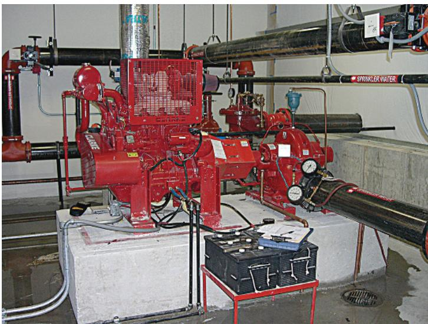

3.3.18.1.1 Internal Combustion Engine. Any engine in which the working medium consists of the products of combustion of the air and fuel supplied.

3.3.19 Engine Battery. A battery used to provide sufficient electrical energy to crank theN engine to achieve engine start and the necessary energy for system controls.

For information on the different types of engine batteries and the requirements for each, see 11.2.7.2.1 and the associated annex material.

**3.3.20 Fault Tolerant External Control Circuit. See 3.3.10.2.**

3.3.21 Feeder. All circuit conductors between the service equipment, the source of a separately derived system, or other power supply source and the final branch-circuit overcurrent device. [70: Art. 100]

In a fire pump installation, the connection between the disconnecting means permitted by 9.2.3 and the fire pump controller is referred to as a feeder. See Figure A.9.2.

3.3.22 Fire Pump Alarm. A supervisory signal indicating an abnormal condition requiring immediate attention.

3.3.23 Fire Pump Controller. A group of devices that serve to govern, in some predetermined manner, the starting and stopping of the fire pump driver and to monitor and signal the status and condition of the fire pump unit.

Different types of controllers are available for electric motor–driven and diesel engine–driven fire pumps. Controllers must be listed for fire pump service and incorporate both automatic and manual features for pump operation. Controllers for electrically driven fire pumps are available for full voltage and reduced voltage starting. Limited-service controllers for electrically driven fire pumps are also qualified for certain applications but are not required by NFPA 20 to meet the same requirements as full-service controllers.

Chapter 10 addresses controllers for electric motor–driven pumps, and Chapter 12 addresses controllers for diesel engine–driven pumps. Exhibit I.3.2 illustrates an electric fire pump controller, and Exhibit I.3.3 illustrates the internal components of a diesel engine fire pump controller.

2019 Stationary Fire Pumps and Standpipe Systems Handbook

EXHIBIT I.3.2 Electric Fire Pump Controller.

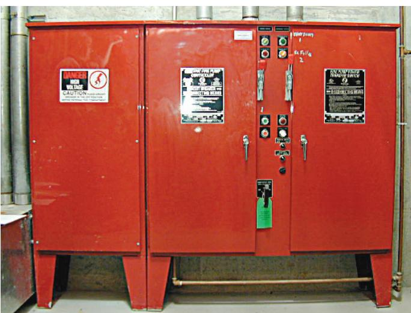

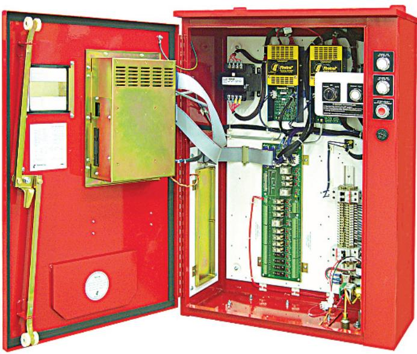  
EXHIBIT I.3.3 Diesel Engine Fire Pump Controller. (Courtesy of Firetrol Products, ASCO Power Technologies)

**CLOSER LOOK**

**Starting Options for Electric Fire Pumps**

When starting an electric fire pump, the amount of in-rush current has to be considered for the size of the motor. Full voltage or across-the-line starters apply the full system voltage to the motor terminals, accelerating the fire pump to its normal operating speed. The motor will draw its locked-rotor current, which is approximately six times its full-load current, and transfer the stress from starting to the load of the motor. The torque created by the sudden starting and stopping of the motor is transferred to the gears, shafts, belts, and other parts, leading to wear on the system. This also affects other parts of the system due to the rapid change in water flow.

**CLOSER LOOK Continued**

Reduced voltage starters or soft start units are used in applications with large electric motors to bring the motor up to its full operating speed in increments. By starting the motor at a lower speed, the in-rush current is reduced along with the torque applied to the load of the motor. The actual reduction of in-rush current will be based on the specific characteristics of the motor. Once the full system voltage is applied, the motor will run at its normal operating speed and current. The ability to reduce the in-rush current at startup can be essential when designing and installing a reliable system.

3.3.24 Fire Pump Unit. An assembled unit consisting of a fire pump, driver, controller, and accessories.

Exhibit I.3.4 illustrates an example of a fire pump unit.

3.3.25 Flexible Connecting Shaft. A device that incorporates two flexible joints and a telescoping element.

Subsections 6.5.1 and 11.2.3 indicate where a flexible connecting shaft is required.

3.3.26 Flexible Coupling. A device used to connect the shafts or other torque-transmitting components from a driver to the pump, and that permits minor angular and parallel misalignment as restricted by both the pump and coupling manufacturers.

Subsections 6.5.1 and 11.2.3 indicate where a flexible coupling is needed.

3.3.27 Flooded Suction. The condition where water flows from an atmospheric vented-f130-43e0-8b7f-041dc4ddd530} source to the pump without the average pressure at the pump inlet flange dropping below atmospheric pressure with the pump operating at 150 percent of its rated capacity.

3.3.28 Groundwater. That water that is available from a well, driven into water-bearing subsurface strata (aquifer).

EXHIBIT I.3.4 Fire Pump Unit. (Courtesy of Xylem - AC Fire Pump)

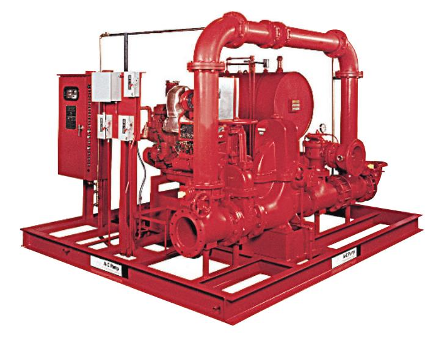  
2019 Stationary Fire Pumps and Standpipe Systems Handbook

3.3.29\* Head. A quantity used to express a form (or combination of forms) of the energy content of water per unit weight of the water referred to any arbitrary datum.

In the context of fire pumps, the pressure component is usually expressed in terms of feet (ft) or meters (m) of head rather than in pounds per square inch (psi) or bar.

A.3.3.29 Head. The unit for measuring head is the foot (meter). The relation between pressure expressed in pounds per square inch (bar) and pressure expressed in feet (meters) of head is expressed by the following formulas:

$$
\mathrm { { H e a d i n f e e t } = \frac { \mathrm { { P r e s s u r e ~ i n } \ p s i } } { 0 . 4 3 3 \ s p e c i f i c \ g r a v i t y } }\tag{[A.3.3.29]}
$$

$$
{ \mathrm { H e a d i n ~ m e t e r s } } = { \frac { \mathrm { P r e s s u r e ~ i n ~ b a r } } { 0 . 0 9 8 ~ { \mathrm { s p e c i f i c ~ g r a v i t y } } } }
$$

In terms of foot-pounds (meter-kilograms) of energy per pound (kilogram) of water, all head quantities have the dimensions of feet (meters) of water. All pressure readings are converted into feet (meters) of the water being pumped. (See Figure A.3.3.29.)

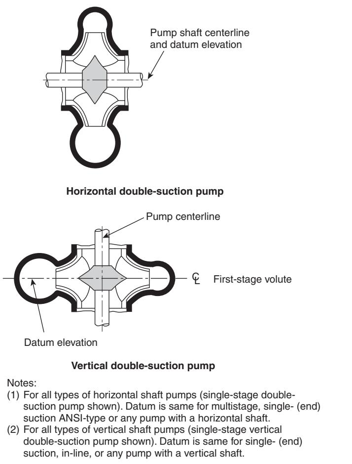  
FIGURE A.3.3.29 Datum Elevation of Two Stationary Pump Designs.

Stationary Fire Pumps and Standpipe Systems Handbook 2019

3.3.29.1 Net Positive Suction Head (NPSH) $( \pmb { h } _ { s \nu } )$ . The total suction head in feet (meters) of liquid absolute, determined at the suction nozzle, and referred to datum, less the vapor pressure of the liquid in feet (meters) absolute.

In NFPA 20, the two types of net positive suction head (NPSH) that need to be considered are termed the NPSH required and the NPSH supplied. The NPSH required by the pump is determined by the pump manufacturer and is a function of both the speed and capacity of the pump. Curves indicating the NPSH versus flow can be obtained from the manufacturer. The NPSH supplied is the pressure head at the pump inlet that causes water to flow through the pump into the eye of the impeller. The NPSH supplied is a function of the water supply.

For any pump installation, the NPSH supplied must be at least equal to the NPSH required for the operating conditions specified. If the NPSH supplied is less than the NPSH required, some of the incoming water vaporizes and forms bubbles. These bubbles can collapse within the pump, producing noise and vibration and causing significant damage to the pump. This phenomenon is referred to as cavitation.

3.3.29.2 Total Discharge Head $( h _ { d } ) .$ The reading of a pressure gauge at the discharge of the pump, converted to feet (meters) of liquid, and referred to datum, plus the velocity head at the point of gauge attachment.

Figure A.3.3.29.3.1 and Figure A.3.3.29.3.2 illustrate the components of total discharge head.

**3.3.29.3 Total Head.**

3.3.29.3.1\* Total Head $( H ) ,$ , Horizontal Pumps. The measure of the work increase, per pound (kilogram) of liquid, imparted to the liquid by the pump, and therefore the algebraic difference between the total discharge head and the total suction head. Total head, as determined on test where suction lift exists, is the sum of the total discharge head and total suction lift. Where positive suction head exists, the total head is the total discharge head minus the total suction head.

A.3.3.29.3.1 Total Head (H), Horizontal Pumps. See Figure A.3.3.29.3.1. (Figure A.3.3.29.3.1 does not show the various types of pumps applicable.)

Total head is the energy (pressure) added to the liquid supply by the pump. It is expressed in feet (ft) or meters (m). For horizontal pumps, where a positive suction pressure exists, the total head is usually calculated by subtracting the pressure at the suction gauge from the pressure at the discharge gauge. Where the suction and discharge flanges are not the same diameter, the velocity head for the volume of water passing through the flanges must be calculated using the formula identified in the definition of velocity head (see 3.3.29.6). Where the suction and discharge flanges have the same diameter, the incoming and outgoing velocities are the same.

3.3.29.3.2\* Total Head (H), Vertical Turbine Pumps. The distance from the pumping liquid level to the center of the discharge gauge plus the total discharge head.

As noted in the commentary following A.3.3.29.3.1, total head is the energy (pressure) added to the liquid supply by the pump and is expressed in feet (ft) or meters (m). For vertical turbine pumps, a discharge gauge is located at the top of the pump column pipe. While the discharge pressure gauge indicates the pressure available to the fire protection system, the total pressure provided by the pump is determined by adding the reading of the discharge gauge to the suction lift (from the pumping water level up to the discharge flange) and the friction loss through the pipe column.

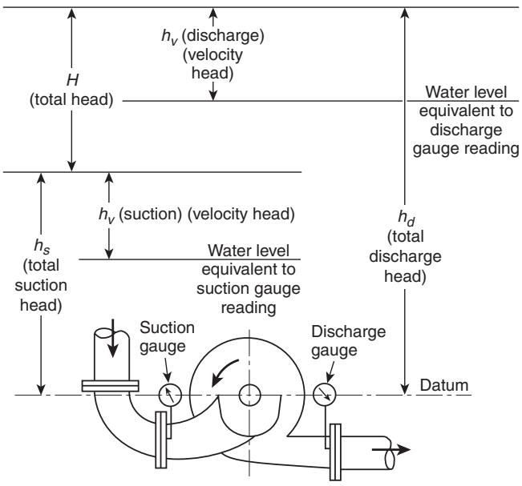  
Note: Installation with suction head above atmospheric pressure shown.  
FIGURE A.3.3.29.3.1 Total Head of All Types of Stationary (Not Vertical Turbine–Type) Fire Pumps.

A.3.3.29.3.2 Total Head (H), Vertical Turbine Pumps. See Figure A.3.3.29.3.2.

3.3.29.4 Total Rated Head. The total head developed at rated capacity and rated speed for a centrifugal pump.

The total rated head is the amount of energy given to water as it passes through a specific pump when {7d1cf25d-f130-43e0-8b7f-041d that pump is operating at its rated speed and flow.

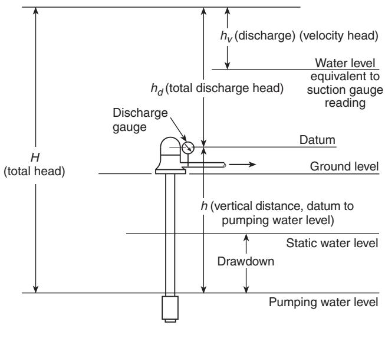  
FIGURE A.3.3.29.3.2 Total Head of Vertical Turbine– Type Fire Pumps.  
Stationary Fire Pumps and Standpipe Systems Handbook 2019

3.3.29.5 Total Suction Head. Suction head exists where the total suction head is above atmospheric pressure. Total suction head, as determined on test, is the reading of a gauge at the suction of the pump, converted to feet (meters) of liquid, and referred to datum, plus the velocity head at the point of gauge attachment.

Figure A.3.3.29.3.1 provides a graphical description of total suction head.

3.3.29.6\* Velocity Head (h ). The kinetic energy of a unit weight of fluid moving with velocity (v) determined at the point of the gauge connection.

A.3.3.29.6 Velocity Head (h ). For the purpose of this standard, the velocity head is calculated using the average velocity, which can be obtained by dividing the flow in cubic feet per second (or cubic meters per second) by the actual area of pipe cross section in square feet (or square meters). The velocity head is the vertical distance a body would have to fall to acquire the velocity (v). The velocity head $( h _ { \nu } )$ is expressed by the following formula:

$$
h _ { \nu } = \frac { \nu ^ { 2 } } { 2 g }\tag{[A.3.3.29.6]}
$$

where:

v = velocity in the pipe [ft/sec (m/sec)]

g = acceleration due to gravity: 32.17 ft/sec2 (9.807 m/sec2) at sea level and 45 degrees latitude

3.3.30 High-Rise Building. A building where the floor of an occupiable story is greater than 75 ft (23 m) above the lowest level of fire department vehicle access. [5000, 2018]

**SEE MORE**

For more information on pressure control, see the Controlling Excess Fire Pump Pressures feature at the end of Chapter 4.

High-rise buildings present challenges for the registered design professional when determining the method of providing adequate pressure to meet fire protection system demands at upper elevations. NFPA 20, in conjunction with other NFPA standards such as NFPA 14, Standard for the Installation of Standpipe and Hose Systems, provides options to meet system demands, such as fire pumps in series, -f130-43e0-8b7f-041dc4ddd530} high-pressure fire pumps utilizing express mains to the appropriate zones, and multistage multiport fire pumps. To select a method to meet a project’s needs, a registered design professional might need to perform an in-depth hydraulic analysis.

3.3.31 In Sight From (Within Sight From, Within Sight). Where this Code specifies that one equipment shall be “in sight from,” “within sight from,” or “within sight of,” and so forth, another equipment, the specified equipment is to be visible and not more than 15 m (50 ft) distant from the other. [70: Art. 100]

**3.3.32 Internal Combustion Engine. See 3.3.18.1.1.**

3.3.33 Isolating Switch. See 3.3.67.1.

3.3.34 Liquid. For the purposes of this standard, liquid refers to water, foam-water solution, foam concentrates, water additives, or other liquids for fire protection purposes.

**3.3.35 Liquid Level.**

3.3.35.1 Pumping Liquid Level. The level, with respect to the pump, of the body of liquid from which it takes suction when the pump is in operation. Measurements are made the same as with the static liquid level.

The term pumping liquid level is usually associated with vertical turbine–type pumps that take liquids from an unpressurized source below the discharge flange of the pump, such as a well, river, or pond. See the commentary following the definition of static liquid level (3.3.35.2) for more information.

3.3.35.2 Static Liquid Level. The level, with respect to the pump, of the body of liquid from which it takes suction when the pump is not in operation. For vertical shaft turbine– type pumps, the distance to the liquid level is measured vertically from the horizontal centerline of the discharge head or tee.

The term static liquid level is usually associated with vertical turbine–type pumps that take water or additives from an unpressurized source below the discharge flange of the pump, such as a well, river, or pond. When these pumps operate at peak capacity, the liquid level of the supply usually drops a certain distance. The level of the liquid before the fire pump starts is referred to as the static liquid level. The level to which the liquid drops when the pump is operating at 150 percent of its rated capacity is referred to as the pumping liquid level (see 3.3.35.1). The difference between these two levels is referred to as the drawdown (see 3.3.17). See Figure A.7.2.2.1.

**3.3.36 Loss of Phase. The loss of one or more, but not all, phases of the polyphase power source.**

Three-phase fire pump motors are commonly used in fire pump installations that also require a threephase power supply. To reduce the likelihood of damaging the motor during starting or running conditions if a loss of phase occurs, 10.4.7.2.2 requires that controllers be equipped with a loss of phase indicator. If a loss of phase occurs before the motor is started, NFPA 20 permits the use of a sensor that would prevent the motor from starting. However, this sensor is not permitted to stop the motor if it is already running when the loss of phase occurs. Loss of phase can result in overheating and damage to the motor windings.

This standard prohibits the use of a phase converter. Therefore, where only single-phase power is available, a single-phase fire pump motor must be used.

**3.3.37 Manual Transfer Switch. See 3.3.67.2.2.**

3.3.38 Maximum Pump Brake Horsepower. The maximum brake horsepower required to drive the pump at rated speed. The pump manufacturer determines this by shop test under expected suction and discharge conditions. Actual field conditions can vary from shop conditions.

When selecting a driver for a pump, the maximum brake horsepower demand of the pump when operating at its rated speed must be determined. The pump driver must be capable of supplying this horsepower. A pump’s maximum brake horsepower can be obtained from the horsepower curve supplied by the pump manufacturer. The maximum demand of most pumps usually occurs between 140 percent and 170 percent of the pump’s rated capacity.

Exhibit I.3.5 illustrates the range in brake horsepower required to operate a hypothetical 750 gpm (2839 L/min) rated horizontal split-case fire pump. Notice that, as the pump produces larger flows, the pressure produced by the pump decreases and the brake horsepower required increases to a peak where it will begin to decrease. The horsepower peak may occur before or after 150 percent of the rated capacity. Pump manufacturers provide similar curves for each of their pumps.

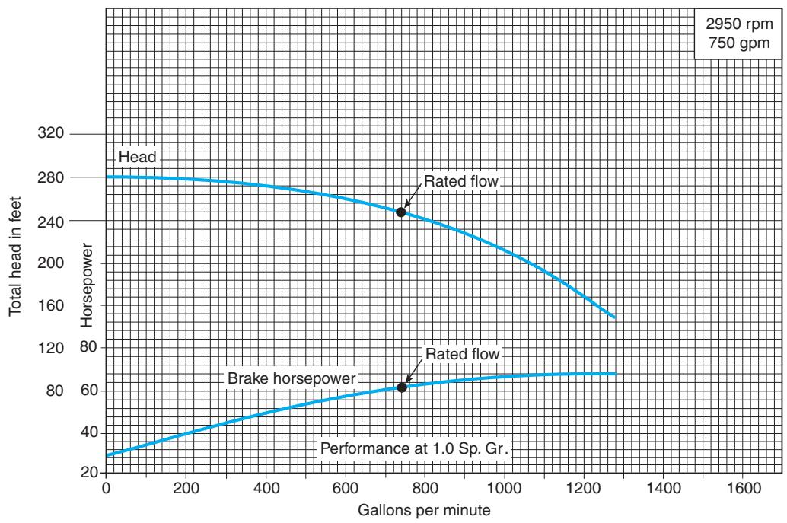  
EXHIBIT I.3.5 Brake Horsepower Curve.

**3.3.39 Motor.**

3.3.39.1 Dripproof Guarded Motor. A dripproof machine whose ventilating openings are guarded in accordance with the definition for dripproof motor.

3.3.39.2 Dripproof Motor. An open motor in which the ventilating openings are so constructed that successful operation is not interfered with when drops of liquid or solid particles strike or enter the enclosure at any angle from 0 to 15 degrees downward from the vertical.

3.3.39.3 Dust-Ignition-Proof Motor. A totally enclosed motor whose enclosure is designed and constructed in a manner that will exclude ignitible amounts of dust or amounts that might affect performance or rating and that will not permit arcs, sparks, or heat otherwise generated or liberated inside of the enclosure to cause ignition of exterior accumulations or atmospheric suspensions of a specific dust on or in the vicinity of the enclosure.

3.3.39.4 Electric Motor. A motor that is classified according to mechanical protection and methods of cooling.

Electric motors are a reliable, effective means of supplying power to fire pumps. Currently, unlisted motors are permitted for direct-current, high-voltage (over 600 V), large-horsepower [over 500 hp (373 kW)], single-phase, universal-type, or wound-rotor motors, but listed motors are required for all other motor types.

Electric motors must be of sufficient size to turn the pump at its rated speed under the required range of operating conditions. When an electric motor is considered, the power supply to the motor must be from a reliable source. Power supplies that can be compromised due to storms, fires, or other accidents can leave electric motors without power and render the fire pump useless. Where reliable sources cannot be secured, backup supplies, such as an emergency generator or diesel engine, are necessary. See Chapter 9 for more information.

Electric motors used to drive fire pumps are required to withstand severe changes in operating conditions and should be arranged to accommodate large electric loads that might cause the motor to be destroyed. This strategy is contrary to the design and arrangement of most other electric motor applications. However, the reliability of the fire pump is the primary concern. The fire pump must continue to operate during a fire emergency for as long as is necessary. Exhibit I.3.6 shows a horizontal split-case fire pump driven by an electric motor.

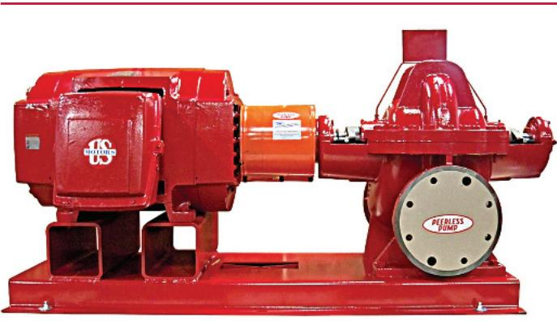  
EXHIBIT I.3.6 Electric Motor– Driven Fire Pump. (Courtesy of Peerless Pump Company)

3.3.39.5 Explosionproof Motor. A totally enclosed motor whose enclosure is designed and constructed to withstand an explosion of a specified gas or vapor that could occur within it and to prevent the ignition of the specified gas or vapor surrounding the motor by sparks, flashes, or explosions of the specified gas or vapor that could occur within the motor casing.

3.3.39.6 Guarded Motor. An open motor in which all openings giving direct access to live metal or rotating parts (except smooth rotating surfaces) are limited in size by the{7d1cf25d-f130-43e0-8b7f-041dc structural parts or by screens, baffles, grilles, expanded metal, or other means to prevent accidental contact with hazardous parts. Openings giving direct access to such live or rotating parts shall not permit the passage of a cylindrical rod 0.75 in. (19 mm) in diameter.

3.3.39.7 Open Motor. A motor having ventilating openings that permit passage of external cooling air over and around the windings of the motor. Where applied to large apparatus without qualification, the term designates a motor having no restriction to ventilation other than that necessitated by mechanical construction.

3.3.39.8 Totally Enclosed Fan-Cooled Motor. A totally enclosed motor equipped for exterior cooling by means of a fan or fans integral with the motor but external to the enclosing parts.

3.3.39.9 Totally Enclosed Motor. A motor enclosed so as to prevent the free exchange of air between the inside and the outside of the case but not sufficiently enclosed to be termed airtight.

3.3.39.10 Totally Enclosed Nonventilated Motor. A totally enclosed motor that is not equipped for cooling by means external to the enclosing parts.

3.3.40 Net Positive Suction Head (NPSH) (h ). See 3.3.29.1.

3.3.41 Net Pressure (Differential Pressure). See 3.3.47.3.

3.3.42\* No Flow (Churn, Shutoff). The condition of zero flow when the fire pump is running but the only water passing through the pump is a small flow that is discharged through the pump circulation relief valve or supplies the cooling for a diesel engine driver.

A.3.3.42 No Flow (Churn, Shutoff). A small discharge of water is required to prevent the pump from overheating when operating under no flow (churn) conditions.

3.3.43 On-Site Power Production Facility. See 3.3.46.2.

**3.3.44\* On-Site Standby Generator. See 3.3.46.3.Δ**

A.3.3.44 On-Site Standby Generator. It differs from an on-site power production facility in that it is not constantly producing power.

3.3.45\* Peak Load. As it pertains to acceptance testing in this standard, the maximum power required to drive the pump at any flow rate up to 150 percent of rated capacity (flow).

A.3.3.45 Peak Load. The maximum power requirements for a centrifugal pump typically occur when the pump is operating between 130 percent and 150 percent of the rated flow. The required power could continue to increase beyond 150 percent of rated flow, but NFPA 20 does not require testing beyond 150 percent of rated flow. The peak load can be determined by looking at the horsepower curve on the fire pump curve supplied by the pump manufacturer.

**3.3.46 Power.N**

N 3.3.46.1 Alternate Power. A power source that is independent of the primary power supply.

An alternate power source will provide power to an electric motor–driven fire pump during interruption of the normal electrical service. NFPA 20 requires, as one option, alternate power to electric motor– driven fire pumps for high-rise buildings or where the normal power source is deemed unreliable. An alternative to this option would be the installation of a backup diesel engine–driven fire pump.

**N 3.3.46.2 On-Site Power Production Facility. An on-site normal supply of electric power that is expected to be constantly producing power.**

For an on-site power production facility to be considered a reliable power source for an electric motor– driven fire pump(s), fire protection measures must be in place to protect the source and maintain a -f130-43e0-8b7f-041dc4ddd530} reliable power supply. In many cases, on-site power production sources are electric generating stations dedicated to a particular facility or to a particular facility’s campus-style distribution system.

N 3.3.46.3 On-Site Standby Generator. A facility producing electric power on site as the alternate supply of electric power. It differs from an on-site power production facility, in that it is not constantly producing power. [70:695.2]

N 3.3.46.4 Standby Power. An alternate power source that is normally inactive but becomes active whenever the primary power is lost.

Performance requirements for an alternate source of electric power can be found in NFPA 110, Standard for Emergency and Standby Power Systems.

**3.3.47 Pressure.**

3.3.47.1 Discharge Pressure. The total pressure available at the fire pump discharge flange.

N 3.3.47.2\* Lowest Permissible Suction Pressure. The lowest suction pressure permitted by this standard and the authority having jurisdiction.

Many jurisdictions have a 20 psi (1.4 bar) suction pressure limitation; however, this standard allows the pressure at the fire pump suction flange to drop as low as 0 psi (0 bar) and further to –3 psi (–0.2 bar)

where a suction tank is installed with its base at or above the same elevation as the pump. The 20 psi (1.4 bar) limitation is used as a precaution to avoid possible cavitation of the underground piping.

N A.3.3.47.2 Lowest Permissible Suction Pressure. The lowest pressure permitted by the authority having jurisdiction will likely be upstream of the backflow prevention device or at the connection to the water utility main. The permissible pressure at the pump suction could be lower than the limit stated by the authority having jurisdiction and could be determined by adding the friction loss and pressure elevation change between the cited location and the fire pump suction.

3.3.47.3\* Net Pressure (Differential Pressure). For vertical turbine fire pumps, the total pressure at the fire pump discharge flange plus the total suction lift. For other fire pumps, the total pressure at the fire pump discharge flange minus the total pressure at the fire pump suction flange.

A.3.3.47.3 Net Pressure (Differential Pressure). The net pressure (differential pressure) includes the difference in velocity head correction (pressure) from the pump discharge to the pump suction. In many cases, the difference in suction and discharge velocity head correction (pressure) is small and can be ignored without adversely affecting the evaluation of the pump performance.

NFPA 25 allows for a 5 percent degradation during annual fire pump testing. If the test reveals a degradation in excess of 5 percent of the pressure of the initial unadjusted acceptance test curve or nameplate, an investigation is required to determine the cause of the degradation. Under this circumstance the impact of velocity head should be considered as a possible cause. With horizontal fire pumps, velocity head correction is only an issue where the discharge flange opening and the suction flange opening differ in size; where these flanges have the same size opening there will be no change in velocity head.

3.3.47.4 Rated Pressure. The net pressure (differential pressure) at rated flow and rated speed as marked on the manufacturer’s nameplate.

3.3.47.5 Suction Pressure. The total pressure available at the fire pump suction flange.

3.3.48 Pressure-Regulating Device. A device designed for the purpose of reducing, regulating, controlling, or restricting water pressure. [14, 2016]

3.3.49 Pump.

3.3.49.1 Additive Pump. A pump that is used to inject additives into the water stream.

3.3.49.2 Can Pump. A vertical shaft turbine–type pump in a can (suction vessel) for installation in a pipeline to raise water pressure.

Vertical shaft turbine–type pumps are used primarily to pump water from nonpressurized sources such as wells, ponds, and rivers. Can pumps are an application of vertical turbine–type pumps that boost pressure from a pressurized water source such as a public water main. An enclosed cylinder or canister (can) is provided with a suction flange connected to a municipal or other pressurized water source. When the pump is idle, the enclosed can is pressurized by the water source. The impellers are located inside the can. When the pump is running, the impellers boost the incoming pressure and discharge through the vertical turbine pump discharge flange. A can pump is essentially a vertical turbine–type pump that is used as a booster pump. Exhibit I.3.7 illustrates a typical vertical can pump installation.

3.3.49.3 Centrifugal Pump. A pump in which the pressure is developed principally by the action of centrifugal force.

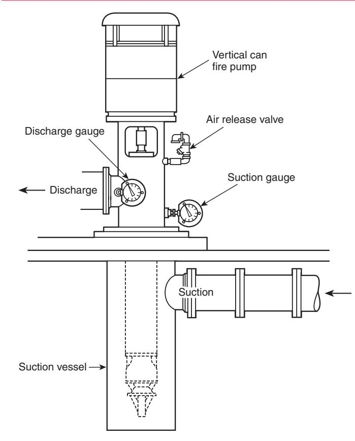

Water in centrifugal pumps enters the suction inlet and passes to the center of the impeller. Rotation of -f130-43e0-8b7f-041dc4ddd530} the impeller drives the water by centrifugal force to the rim, where it discharges.

3.3.49.4 End Suction Pump. A single suction pump having its suction nozzle on the opposite side of the casing from the stuffing box and having the face of the suction nozzle perpendicular to the longitudinal axis of the shaft.

End suction fire pumps have a wide range of pressure ratings but are typically limited in capacity to a maximum rating of approximately 750 gpm (2839 L/min), making them ideal for projects with low capacity requirements. Compared to horizontal split-case fire pumps, they are more compact and require less installation space in a fire pump room where space is a concern. Exhibit I.3.8 illustrates an end suction pump.

3.3.49.5 Fire Pump. A pump that is a provider of liquid flow and pressure dedicated to fire protection.

3.3.49.6 Foam Concentrate Pump. See 3.3.49.1, Additive Pump.

3.3.49.7 Gear Pump. A positive displacement pump characterized by the use of gear teeth and casing to displace liquid.

3.3.49.8 Horizontal Pump. A pump with the shaft normally in a horizontal position.

For more information on the installation of horizontal pumps, see Chapter 6.

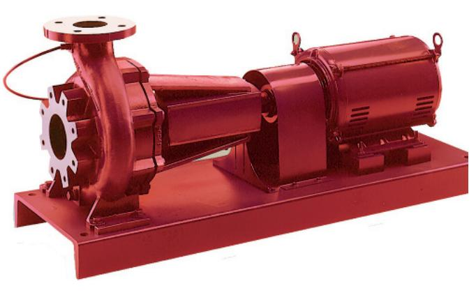  
EXHIBIT I.3.8 End Suction Pump Driven by an Electric Motor. (Courtesy of Xylem - AC Fire Pump)

3.3.49.9 Horizontal Split-Case Pump. A centrifugal pump characterized by a housing that is split parallel to the shaft.

With this type of pump, the case in which the shaft and impeller are housed is split in the middle and can be separated. This type of housing allows for easy access for repair or replacement of internal components. These pumps are not self-priming and must be supplied with water at the suction flange at some positive pressure. See Chapter 6. Exhibit I.3.9 illustrates a horizontal split-case pump.

3.3.49.10 In-Line Pump. A centrifugal pump whose drive unit is supported by the pump having its suction and discharge flanges on approximately the same centerline.

Exhibit I.3.10 shows a diagram of an in-line pump. For more information on in-line pumps, see Chapter 6.

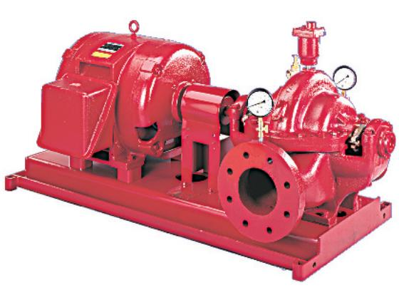  
EXHIBIT I.3.9 Horizontal Split-Case Pump. (Courtesy of Hydraulics Institute)

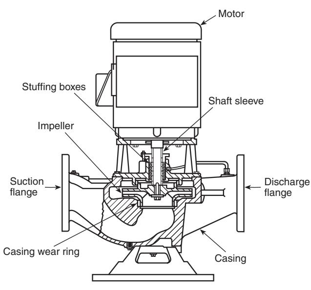  
EXHIBIT I.3.10 In-Line Pump.

3.3.49.11\* Multistage Multiport Pump. A single-driver pump with multiple impellers operating in series where the discharge from each impeller, except the last impeller, is the suction for the next impeller, and discharge ports are provided after multiple impellers.

Multistage multiport pumps provide an alternative to arranging fire pumps in series. The primary application is for multiple zone high-rise buildings. Having multiple discharge ports from one pump assembly increasing in pressure distribution after each impeller allows the pump to provide the necessary supply to hydraulically calculated system zones. The pump driver must be sized for the maximum horsepower demand.

A.3.3.49.11 Multistage Multiport Pump. A multistage multiport pump functions similarly to fire pumps arranged in series. The primary difference between a multistage multiport pump and fire pumps arranged in series is that individual drivers are required for fire pumps arranged in series, and no shutoff valve is provided between the impellers on a multistage multiport pump.

3.3.49.12 Packaged Fire Pump Assembly. Fire pump unit components assembled at a packaging facility and shipped as a unit to the installation site. The scope of listed components (where required to be listed by this standard) in a pre-assembled package includes the pump, driver, controller, and other accessories identified by the packager assembled onto a base with or without an enclosure.

See Section 4.31 for packaged fire pump assembly requirements.

3.3.49.13 Piston Plunger Pump. A positive displacement pump characterized by the use of a piston or plunger and a cylinder to displace liquid.

3.3.49.14 Positive Displacement Pump. A pump that is characterized by a method of producing flow by capturing a specific volume of fluid per pump revolution and reducing the fluid void by a mechanical means to displace the pumping fluid.f130-43e0-8b7f-041dc4d

3.3.49.15 Pressure Maintenance (Jockey or Make-Up) Pump. A pump designed to maintain the pressure on the fire protection system(s) between preset limits when the system is not flowing water.

See Section 4.27 for pressure maintenance (jockey or make-up) pump requirements and associated commentary.

3.3.49.16 Rotary Lobe Pump. A positive displacement pump characterized by the use of a rotor lobe to carry fluid between the lobe void and the pump casing from the inlet to the outlet.

3.3.49.17 Rotary Vane Pump. A positive displacement pump characterized by the use of a single rotor with vanes that move with pump rotation to create a void and displace liquid.

3.3.49.18 Vertical Lineshaft Turbine Pump. A vertical shaft centrifugal pump with rotating impeller or impellers and with discharge from the pumping element coaxial with the shaft. The pumping element is suspended by the conductor system, which encloses a system of vertical shafting used to transmit power to the impellers, the prime mover being external to the flow stream.

Vertical lineshaft turbine pumps were originally designed to pump water from wells; however, vertical lineshaft turbine pumps can be used wherever a nonpressurized water source serves as the water supply.

These pumps are most often used where horizontal fire pumps are prohibited because horizontal pumps would operate under a suction lift condition.

Although vertical lineshaft turbine pumps move water up to the discharge flange of the pump, they do not operate under a suction lift condition. The impellers are located in the water supply and force water up to the discharge flange. Because the impellers sit in the water source, these pumps do not require priming. Exhibit I.3.11 shows a typical vertical lineshaft turbine pump. See Chapter 7.

Vertical lineshaft turbine pumps are also referred to as vertical turbine pumps in this standard.

3.3.49.19\* Water Mist Positive Displacement Pumping Unit. Multiple positive displacement pumps designed to operate in parallel that discharges into a single common water mist distribution system.

Water mist positive displacement pumping units allow multiple small-volume positive displacement pumps operating in parallel to supply water mist fire protection systems. These pumps are mounted in a common rack and are listed as a unit. The concepts involved are significantly different from those used for traditional stand-alone pumps or even for traditional pumps operating in series or parallel that still must be treated as individual pumps. Because of the low volume of an individual pump, the unit is allowed to serve as its own pressure maintenance pump. One (or more) of the individual pumps may operate with a variable speed driver to control the discharge pressure. The flow rate from the pump unit is not a smooth curve but rather a “step” function that increases whenever another pump is activated or when a variable speed drive changes speed.

A.3.3.49.19 Water Mist Positive Displacement Pumping Unit. It is not the intent of this standard to apply this term to individual pumps used to supply water mist systems. This term is intended to apply to water mist systems designed with multiple pumps where a pump operates individually or multiple pumps operate in parallel based on the demand of the system downstream and the number of nozzles that discharge. These pumps work together as a single unit to provide the necessary flow and pressure of the water mist system.

**3.3.50 Pumping Liquid Level. See 3.3.35.1.**

3.3.51 Qualified Person. A person who, by possession of a recognized degree, certificate, professional standing, or skill, and who, by knowledge, training, and experience, has demonstrated the ability to deal with problems related to the subject matter, the work, or the project. [1451, 2018]

3.3.52 Rated Flow. The capacity of the pump at rated speed and rated pressure as marked on the manufacturer’s nameplate.

3.3.53 Rated Pressure. See 3.3.47.4.

3.3.54 Record Drawing (As-Built). A design, working drawing, or as-built drawing that is submitted as the final record of documentation for the project.

3.3.55\* Series Fire Pump Unit. All fire pump units located within the same building that operate in a series arrangement where the first fire pump takes suction directly from a water supply and each sequential pump takes suction under pump pressure from the preceding pump. Two pumps that operate in series through a tank(s) or break tank(s) are not considered part of a series fire pump unit.

This definition does not include pumps that may operate in series but are separated by a distribution system that supplies other uses between the pumps. An example of a series pumping arrangement that is not included in this definition is a fire pump that takes suction from a municipal supply that is supplied by a pump. The primary application for fire pumps operating in series is high-rise buildings, where the pressure required to supply fire protection systems on upper floors exceeds the pressure of the components in the fire protection systems on the lower floors. One pump supplies the lower floors, and a second pump, in series with the first pump, supplies upper floors.

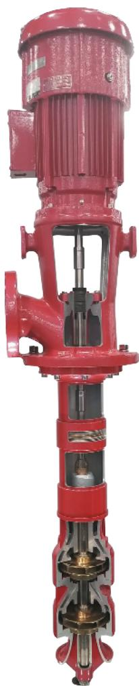  
EXHIBIT I.3.11 Vertical Lineshaft Turbine Pump. (Courtesy of Grundfos)

A.3.3.55 Series Fire Pump Unit. Pumps that fill tanks are not considered to be in series with the pumps supplied by those tanks. Water utilities and “campus type” water distribution systems that supply a fire pump within a building can have pumps that operate independently of, but are necessary to, the operation of a fire pump within the building. These pumps are not included within the definition of series fire pump unit, but the arrangement of these pumps should be reviewed as part of evaluating the water supply.

3.3.56\* Service. The conductors and equipment for delivering electric energy from the serving utility to the wiring system of the premises served. [70: Art. 100]

A.3.3.56 Service. For more information, see NFPA 70, Article 100.

3.3.57\* Service Equipment. The necessary equipment, usually consisting of a circuit breaker(s) or switch(es) and fuse(s) and their accessories, connected to the load end of service conductors to a building or other structure, or an otherwise designated area, and intended to constitute the main control and cutoff of the supply. [70: Art. 100]

A.3.3.57 Service Equipment. For more information, see NFPA 70, Article 100.

See also Chapters 9 and 10 for more information on service equipment.

3.3.58 Service Factor. A multiplier of an ac motor that, when applied to the rated horsepower, indicates a permissible horsepower loading that can be carried at the rated voltage, frequency, and temperature. For example, the multiplier 1.15 indicates that the motor is permitted to be overloaded to 1.15 times the rated horsepower.

The motor for a fire pump installation must be of sufficient capacity that it is not overloaded beyond the limit of the service factor at the pump’s maximum brake horsepower when operating at its rated speed. For example, a 75 hp (56 kW) motor with a service factor of 1.12 could safely meet a demand load of 84 hp (63 kW) [75 hp (56 kW) × 1.12]. The service factor is a function of the type of motor and is determined by the manufacturer (see 9.5.2.2).

3.3.59\* Set Pressure. As applied to variable speed pumps, the pressure that the variableN speed pressure limiting control system is set to maintain.

A.3.3.59 Set Pressure. Pressure is limited by controlling the speed of the fire pump. Once the fire pump reaches its rated speed, the discharge pressure will decrease from the set pressure as the flow rate increases and/or the power draw peaks.

3.3.60 Shutoff (No Flow, Churn). See 3.3.42, No Flow (Churn, Shutoff).

3.3.61\* Signal. An indicator of status.

A.3.3.61 Signal. A response to signals is expected within 2 hours.

3.3.62 Speed.

3.3.62.1 Engine Speed. The speed indicated on the engine nameplate.

3.3.62.2 Motor Speed. The speed indicated on the motor nameplate.

3.3.62.3 Rated Speed. The speed for which the fire pump is listed and that appears on the fire pump nameplate.

**3.3.63 Standby Power. See 3.3.46.4.N**

3.3.64 Static Liquid Level. See 3.3.35.2.

3.3.65 Suction Diffuser. A device that provides uniform flow into the suction side of aN pump, equivalent to 10 pipe-diameters of straight pipe.

To address small fire pump room constraints, a suction diffuser can be used in lieu of installing a straight pipe that is 10 pipe diameters in length to the fire pump suction, where required. Exhibit I.3.12 shows a typical suction diffuser.

**3.3.66 Suction Pressure. See 3.3.47.5.**

**3.3.67 Switch.**

3.3.67.1 Isolating Switch. A switch intended for isolating an electric circuit from its source of power. It has no interrupting rating, and it is intended to be operated only after the circuit has been opened by some other means.

Isolating switches typically are used within controllers for electric motor–driven pumps. They are used to isolate the power source from the controller and must be operable from the outside of the controller (see 10.4.2).

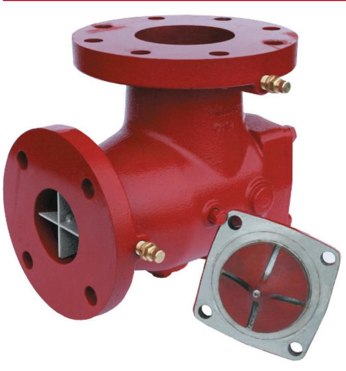  
EXHIBIT I.3.12 Suction Diffuser. (Courtesy of Xylem - AC Fire Pump)

Stationary Fire Pumps and Standpipe Systems Handbook 2019

**3.3.67.2 Transfer Switch.**

3.3.67.2.1 Automatic Transfer Switch (ATS). Self-acting equipment for transferring the connected load from one power source to another power source. [110, 2019]

Where an emergency or backup power source is supplied for electric motors driving fire pumps, an automatic transfer switch is used to transfer power spontaneously from the primary supply to the backup supply when the primary power supply fails. The transfer switch may be provided as an integral part of the fire pump controller, or it may be installed as a separate piece of equipment. Where the transfer switch is used independently from the controller, the transfer switch is required to be listed. Where the transfer switch is integrated into the controller, the entire assembly is required to be listed (see Section 10.8).

Where the backup power supply is an on-site standby generator, it must comply with the requirements of a Level 1, Type 10, Class X system, as outlined in NFPA 110 (see 9.6.2.1). This means that the on-site standby generator must provide power to the fire pump controller within 10 seconds, and on receiving the ac power, the controller must achieve a state of readiness within 10 seconds. These permissible time frames are added together, allowing 20 seconds for the controller to reach a state of readiness. It is not the intent of NFPA 20 to require a 10-second total time frame (see the commentary to 9.6.2.1 and 10.1.2.7).

3.3.67.2.2 Manual Transfer Switch. A switch operated by direct manpower for transferring one or more load conductor connections from one power source to another.

**FAQ**

Does NFPA 20 allow the use of manual transfer switches?

In some facilities, a common practice is to have multiple sources of power to improve reliability. For this reason, NFPA 20 prohibits the use of manual transfer switches (see 10.8.1.2)

3.3.68 Torsional Coupling. A driveline component capable of transmitting torque havingN a very low spring constant along the axis of rotation to detune the driveline and move any damaging resonances safely below operating speed.

3.3.69 Total Discharge Head $( h _ { d } ) _ { \cdot }$ . See 3.3.29.2.

3.3.70 Total Head $( H ) ,$ Horizontal Pumps. See 3.3.29.3.1.

3.3.71 Total Head (H), Vertical Turbine Pumps. See 3.3.29.3.2.

3.3.72 Total Rated Head. See 3.3.29.4.

3.3.73 Total Suction Head $( h _ { _ s } ) _ { \cdot }$ . See 3.3.29.5.

3.3.74 Total Suction Lift $( h _ { \iota } )$ . Suction lift that exists where the total suction head is below atmospheric pressure. Total suction lift, as determined on test, is the reading of a liquid manometer at the suction nozzle of the pump, converted to feet (meters) of liquid, and referred to datum, minus the velocity head at the point of gauge attachment.

NFPA 20 no longer permits fire pumps to operate under a suction lift condition — that is, a negative pressure is not permitted at the suction flange. Prior to the 1974 edition of the standard, however, horizontal shaft pumps were permitted to take suction lift. The difficulty in taking a suction lift with a horizontal shaft fire pump is that the pump must remain primed with water at all times. The priming mechanism was required to have sufficient capacity to remove air from the pump and suction pipe within 3 minutes. At one point, NFPA 20 contained seven methods for priming pumps and suction

2019 Stationary Fire Pumps and Standpipe Systems Handbook pipes. This provision was removed from the standard beginning with the 1974 edition, because failure of the priming mechanism results in failure of the pump to move water. Exhibit I.3.13 illustrates one priming method that was permitted in previous editions of the standard. This exhibit is included for information only, as some of these installations may still be in service.

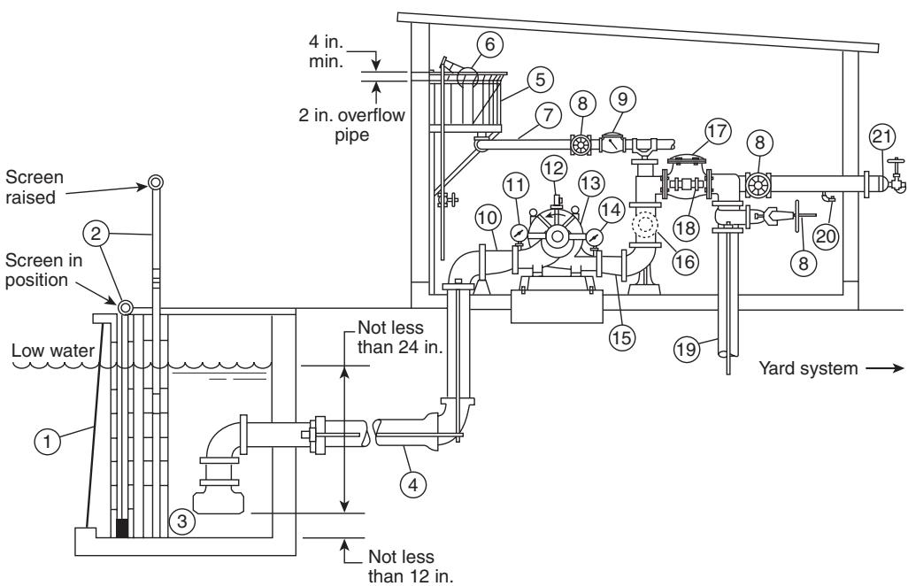  
EXHIBIT I.3.13 Centrifugal Fire Pump Installation Where Pump Has Suction Lift. (Source: NFPA 20, 1970, Figure 100b)

2. Double screens{7d

3. Approved foot valve

4. Suction pipe from water supply to pump

6. Automatic float valve

7. Priming connection

8. OS&Y gate valves

9. Priming check valve

10. Eccentric reducer

11. Suction gauge   
12. Umbrella cock   
13. Horizontal fire pump0-8b7f-  
14. Discharge gauge   
15. Concentric reducer   
16. Relief valve (if required)   
17. Discharge check valve   
18. Priming bypass   
19. Discharge pipe   
20. Drain valve or ball drip   
21. Hose valve manifold with hose valves

**3.3.75 Valve.**

3.3.75.1 Dump Valve. An automatic valve installed on the discharge side of a positive displacement pump to relieve pressure prior to the pump driver reaching operating speed.

3.3.75.2 Pressure Control Valve. A pilot-operated pressure-reducing valve designed for the purpose of reducing the downstream water pressure to a specific value under both flowing (residual) and nonflowing (static) conditions. [14, 2016]

3.3.75.3 Pressure-Reducing Valve. A valve designed for the purpose of reducing the downstream water pressure under both flowing (residual) and nonflowing (static) conditions. [14, 2016]

NFPA 20 is often misinterpreted to prohibit the use of pressure-reducing valves if a fire pump is installed. While Chapter 4 does prohibit the installation of pressure-reducing valves in the suction piping and between the discharge flange of the fire pump and the discharge isolation valve, it does not restrict the use of pressure-reducing valves downstream of the discharge isolation valve. Installations located downstream of the discharge isolation valve are under the scope of other installation standards, such as NFPA 13 and NFPA 14. See Exhibit I.3.14 for an example of a typical master pressure-reducing valve.

3.3.75.4 Relief Valve. A device that allows the diversion of liquid to limit excess pressure in a system.

See Exhibit I.3.15 for an example of a typical pressure relief valve. For requirements on pressure relief valves, see Chapter 4.

EXHIBIT I.3.14 Pressure-Reducing Valve. (Courtesy of Cla-Val Company)

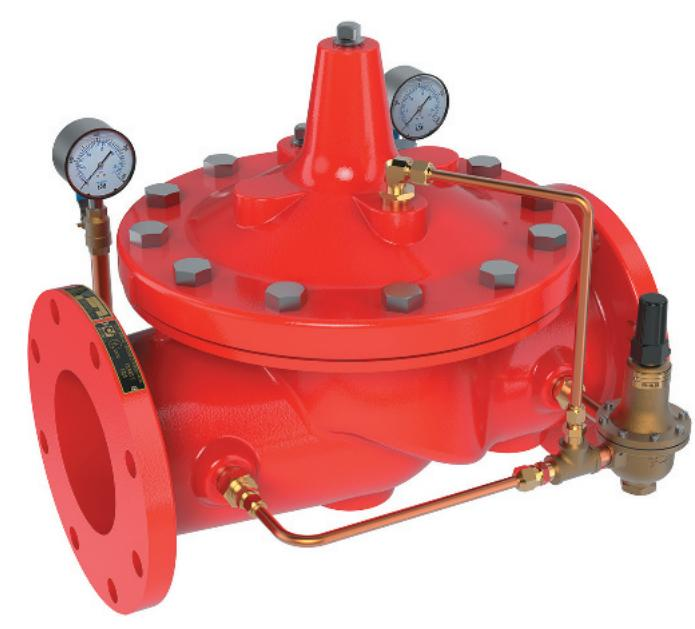  
EXHIBIT I.3.15 Pressure Relief Valve. (Courtesy of Victaulic Bermad Technologies, LLC)

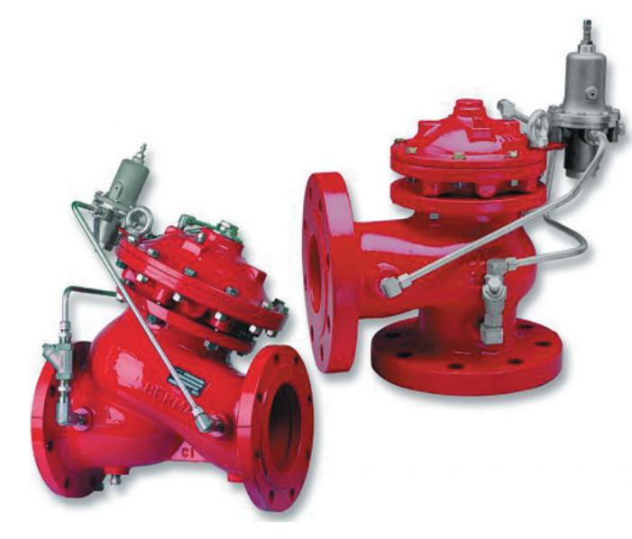  
2019 Stationary Fire Pumps and Standpipe Systems Handbook

3.3.75.4.1 Circulation Relief Valve. A valve used to cool a pump by discharging a small quantity of water. This valve is separate from and independent of the main relief valve.

When laying out a fire pump room, it is important to coordinate the location of the drain so that the circulation relief valve piping and piping from other components can be piped to the drain without creating a trip hazard and located to avoid damage to the piping. See Exhibit I.3.16 for an example of a typical circulation relief valve. For requirements on circulation relief valves, see Chapter 4.

3.3.75.5 Suction Pressure Regulating Valve. A pilot-operated valve installed in discharge piping that maintains positive pressure in the suction piping, while monitoring pressure in the suction piping through a sensing line.

A suction pressure regulating valve can be used where the liquid supply cannot provide the fire pump with the necessary flow to operate at 150 percent while maintaining the lowest permissible suction pressure at the fire pump suction gauge. If a suction pressure regulating valve is installed, the liquid supply must still be capable of meeting 100 percent of the fire pump rating or maximum system demand, whichever is greater. See Exhibit I.3.17 for an example of a typical suction pressure regulating valve. For requirements on suction pressure regulating valves, see Chapter 4.

3.3.75.6 Unloader Valve. A valve that is designed to relieve excess flow below pump capacity at set pump pressure.

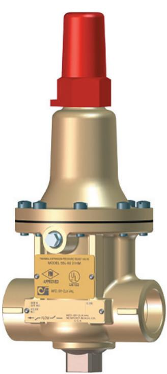

**3.3.76 Variable Speed Pumps and Controllers.**

N 3.3.76.1 Self-Regulating Control. The portion of a self-regulating variable speed fire pump unit that controls the pump speed and power.

N 3.3.76.2\* Self-Regulating Variable Speed Fire Pump Unit. A factory-built integrated fire pump unit consisting of pump, driver, and variable speed control unit, configured to maintain the set pressure until the maximum power draw is reached, while acting as a variable speed pressure limiting control and/or a variable speed suction limiting control.

EXHIBIT I.3.16 Circulation Relief Valve. (Courtesy of Cla-Val Company)

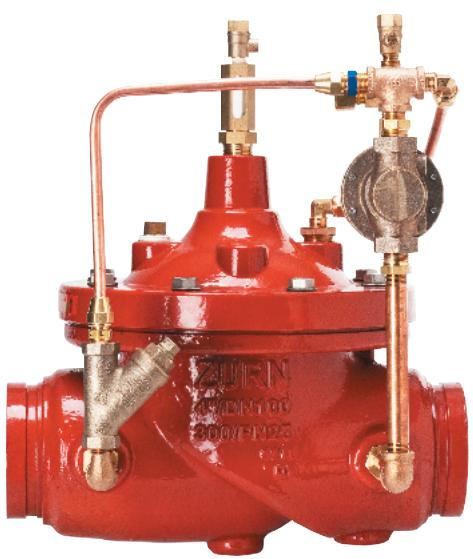  
EXHIBIT I.3.17 Suction Pressure Regulating Valve. (Courtesy of Zurn)

<table><tr><td>References Cited in Commentary</td></tr><tr><td></td></tr><tr><td>National Fire Protection Association, 1 Batterymarch Park, Quincy, MA 02169-7471.</td></tr><tr><td>NFPA 11, Standard for Low-, Medium-, and High-Expansion Foam, 2016 edition. NFPA 14, Standard for the Installation of Standpipe and Hose Systems, 2016 edition.</td></tr></table>

N A.3.3.76.2 Self-Regulating Variable Speed Fire Pump Unit. The self-regulating variable speed fire pump unit has onboard factory embedded logic that enables it to know the suction pressure, discharge pressure, and power draw, and to calculate the flow and net pressures from that information, and then communicate the information. All accessories required to perform the discharge pressure limiting and net pressure limiting functions by pump speed regulation are integrated in the pump unit.

Each self-regulating variable speed fire pump unit should include a bypass that can operate in automatic mode and via a manual mechanical operator that can be used to bypass the variable frequency drive (VFD) in order to apply power directly to the motor.

N 3.3.76.3 Variable Speed Pressure Limiting Control. A speed control system used to limit the total discharge pressure by reducing the pump driver speed from rated speed.

Variable speed pressure limiting control (VSPLC) systems are similar to conventional fire pump systems, with the addition of a pressure-sensing line that prevents the pump from overpressurizing the fire protection system. Prevention of overpressurization is accomplished by altering the speed of the driver. A VSPLC can be used in place of a break tank or a pressure-reducing or pressure relief valve when the pressure varies in the attached water supply. The VSPLC can be driven by either an electric or a diesel engine.

N 3.3.76.4 Variable Speed Pump. A fire pump with variable speed pressure limiting control or a self-regulating variable speed fire pump unit.

3.3.76.5 Variable Speed Suction Limiting Control. A speed control system used to maintain a minimum positive suction pressure at the pump inlet by reducing the pump driver speed while monitoring pressure in the suction piping through a sensing line.

3.3.77 Velocity Head (h ). See 3.3.29.6.

3.3.78 Vertical Fire Protection Zone. A vertical zone within a high-rise building that isN supplied from a fire pump(s) and/or water storage tank(s).

Where a building is classified as a high-rise or a very tall building, high pressures are often required to supply the upper levels. If a single zone were used, the pressures at the lower levels would exceed the rated working pressures of the available equipment. Due to these pressure control challenges, it is often necessary to create multiple zones in these types of structures. Various methods can be used to supply liquid to each of the zones. One such method is the use of a multistage multiport fire pump with three discharge outlets, where the first outlet supplies the low zone, the second outlet supplies the mid-zone, and the third outlet supplies the upper zone.

3.3.79 Very Tall Building. A high-rise building where the fire protection water demandN exceeds the pumping capacity of the fire department.

3.3.80 Wet Pit. A timber, concrete, or masonry enclosure having a screened inlet kept partially filled with water by an open body of water such as a pond, lake, or stream.

NFPA 16, Standard for the Installation of Foam-Water Sprinkler and Foam-Water Spray Systems, 2015 edition.

NFPA 22, Standard for Water Tanks for Private Fire Protection, 2018 edition.

NFPA 25, Standard for the Inspection, Testing, and Maintenance of Water-Based Fire Protection Systems, 2017 edition.

NFPA 110, Standard for Emergency and Standby Power Systems, 2016 edition.

NFPA 291, Recommended Practice for Fire Flow Testing and Marking of Hydrants, 2019 edition.

NFPA Glossary of Terms, 2018 (available online at www.nfpa.org).

Merriam-Webster, Inc., 47 Federal Street, P.O. Box 281, Springfield, MA 01102.

Merriam-Webster’s Collegiate® Dictionary, 11th edition, 2003.

Chapter 4 contains general requirements for fire pumps. It is important to note that NFPA 20 does not establish the requirement to install a fire pump. The need for a fire pump is based on the hydraulic demand of suppression systems and the flow and pressure provided by available water supply. Where the available water supply provides adequate flow rate but inadequate pressure, a fire pump can be used to increase the pressure. Where the available water supply cannot supply the needed flow rate, supplemental water supplies are needed. Ground-level water storage and wells require a fire pump to boost the pressure. In some cases, elevated water tanks or pressure tanks may be able to supply the flow rate and pressure. Where a fire pump(s) is part of the fire protection system, the design, installation, and acceptance testing requirements should be in accordance with this standard.

The chapter begins with design and operational requirements for fire pumps, including information related to required approvals, pump operation and performance, and water supplies. Standardized fire pump rated capacities are also established. The chapter concludes with specifications and installation requirements for all pump components and equipment, except for pump controllers and drivers.

**4.1 Pumps.**

This standard shall apply to centrifugal single-stage and multistage pumps of the horizontal or vertical shaft design and positive displacement pumps of the horizontal or vertical shaft design.

For an example of a centrifugal single-stage and a multistage horizontal split-case fire pump, see Exhibit I.4.1 and Exhibit I.4.2.

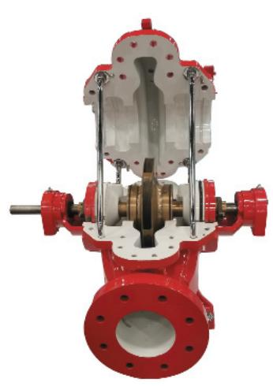  
EXHIBIT I.4.1 Centrifugal Single-Stage Horizontal Split-Case Pump. (Courtesy of Xylem – AC Fire Pump)

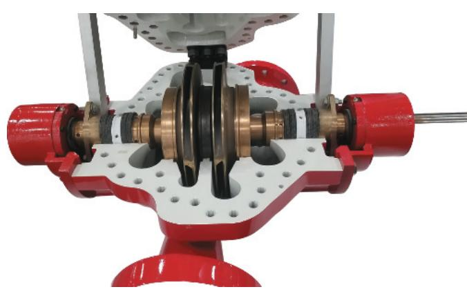  
EXHIBIT I.4.2 Centrifugal Multistage (Two-Stage) Horizontal Split-Case Pump. (Courtesy of Xylem – AC Fire Pump)

**4.2\* Approval Required.**

A.4.2 Because of the unique nature of fire pump units, the approval should be obtained prior to the assembly of any specific component.

Fire pumps are typically long-lead items. Making changes to the fire pump after the pump is ordered can lead to project delay and additional costs.

4.2.1 Stationary pumps shall be selected based on the conditions under which they are to be installed and used.

The fire protection system designer should verify the fire pump suction and discharge pressures over the operating range of the fire pump. The fire pump should provide sufficient discharge pressure to supply the fire protection system demands, but the discharge pressure should not subject the fire protection system components to pressures in excess of their listed pressure rating.

Fire pumps should be located in a suitable environment. See Section 4.14, Equipment Protection, for further guidance.

**4.2.2 The pump manufacturer or its authorized representative shall be given complete information concerning the liquid and power supply characteristics.**

Pump capacities are based on the calculated system demand. Pressure boost or output of the pump is determined by the difference between the pressures available from the attached water supply and the pressure required by the fire protection system. The characteristics of that water supply — whether positive pressure or static — must be determined in order to select the correct type of pump and its performance characteristics. Environmental conditions and location will also need to be communicated to the manufacturer or manufacturer’s representative to aid in determining the pump characteristics.

The available power supply for electric pumps must be suitable for the fire pump controller. The power supply must be analyzed for reliability, capacity, and suitability. This information must be made available to the pump manufacturer or manufacturer’s representative for analysis.

While fire pumps are traditionally associated with water, they are also used for pumping foam concentrate, foam water, water with other water additives, seawater, and other liquids. The characteristics of the liquid are part of the critical information needed by the pump manufacturer.

**4.2.3 A complete plan and detailed data describing pump, driver, controller, power supply, fittings, suction and discharge connections, and liquid supply conditions shall be prepared for approval.**

Generic pump curves can be obtained from the pump manufacturer to determine the churn pressure and the pressure available at the required flow rate. The generic pump curves provided will typically show different pressure ranges based on impeller characteristics. See Exhibit I.4.3. The certified pump curve is not available until the pump is manufactured, but it should be close to the generic curve. If system hydraulic calculations have been performed using a generic pump curve, they should be reconfirmed on receipt of the certified pump curve to ensure system demands will be met.

Ordinarily, on purchase of a fire pump, the manufacturer or supplier provides the buyer with product data for the pump, the driver, the controller, and all accessories. This data package should include the pump’s rated capacity and speed in addition to other performance characteristics. The data package should be submitted to the authority having jurisdiction (AHJ) for approval before shipment of the pump and accessories. The reviewing authority should be contacted prior to submittal to determine

CERTIFIED PUMP CURVE  
GENERIC PUMP CURVE 500 GPM FIRE PUMP  
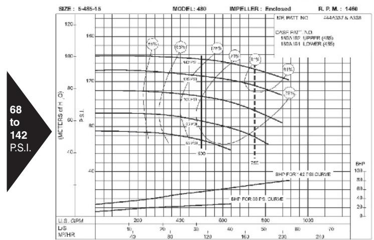

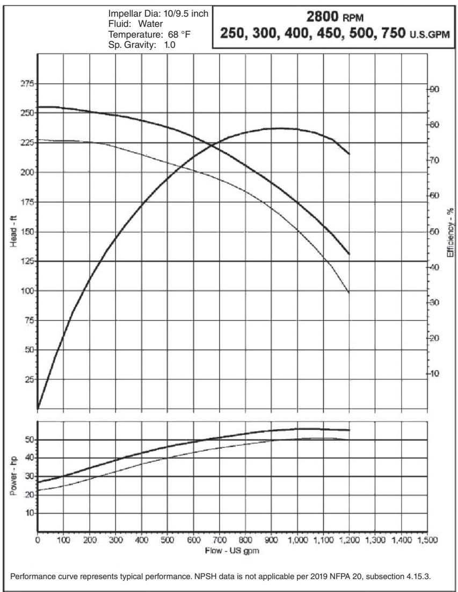  
EXHIBIT I.4.3 Sample Generic Fire Pump Curves. (Courtesy of JENSEN HUGHES, Inc.) Stationary Fire Pumps and Standpipe Systems Handbook 2019

EXHIBIT I.4.4 Checklist for Plan of Proposed Installation.

the number of plans, calculations, or product data needed for review. The submitter should include an additional number of copies of the package to be returned documenting the approval or comments from the AHJ.

In addition to this data package, a complete plan of the proposed installation, drawn to scale, should be submitted, indicating, at a minimum, the information outlined in Exhibit I.4.4.

**PUMP INSTALLATION PLAN CHECKLIST**

**General**

❏ Name of owner or occupant

❏ Location including street address

❏ Point of compass

❏ Name and address of designer and installing contractor

❏ Listed pump, make, model number, driver type, and rated capacity

❏ Type of system supplied by pump

❏ Design standard used including edition

**Water Supply Characteristics**

❏ Flow test data not more than 5 years old

❏ Underground main of adequate size

❏ Water storage tank of adequate capacity with automatic refill connection

**Suction Piping**

❏ Proper size

❏ Galvanized or painted on the inside for corrosion protection

❏ Isolation valve (OS&Y) in the proper location

❏ Backflow prevention or other device in proper location130-4

❏ Elbows in the proper orientation or more than 10 pipe diameters away from suction flange of pump

❏ Eccentric reducer (if needed) installed correctly

❏ Pump bypass

❏ Suction and discharge pressure gauges

❏ Circulation relief valve

**Discharge Piping**

❏ Proper size

❏ Check valve

❏ Discharge isolation valve

**Fire Pump Controller**

❏ Listed for type of pump served

❏ If electric, type and arrangement of power supply

**Water Flow Test Devices**

❏ Test header or flowmeter

❏ Proper number of 2¹⁄₂ in. hose valves on test header

❏ Test header piping of proper size

❏ Proper size of flowmeter (if provided)

**Jockey Pump**

❏ Jockey pump bypasses fire pump

❏ Separate and dedicated sensing line for jockey pump

❏ Sensing lines ¹⁄₂ in. diameter and of brass, copper, or stainless steel piping

❏ No shutoff valves in sensing lines

**Isolation Valves**

❏ All isolation valves supervised in the open position

❏ Test header and flowmeter valves supervised41dc4ddd530} in the closed position

**Diesel Fire Pump**

❏ Relief valve (if provided) with no isolation valves

❏ Two storage batteries provided with charger

❏ Cooling system from heat exchanger or cooling water supply from pump discharge

❏ Diesel tank located above ground

❏ Diesel tank of sufficient capacity 1 gallon per horsepower (gal/hp) plus 10 percent

**Notes:**

1. For all types of pumping equipment, a complete bill of material should be provided. This list should include the make, model, and part numbers of all components.

2. For all electrically operated pumps, provide an electrical schematic drawing that depicts which components are proposed for the power supply from the utility connection to the pump motor controller.

3. Ratings of all equipment and components and settings of breakers, fuses, switches, and transformers should be indicated. Size and length of all circuit conductors should also be noted.

4.2.3.1 Plans shall be drawn to an indicated scale, on sheets of uniform size, and shall indicate, as a minimum, the items from the following list that pertain to the design of the system:

(1) Name(s) of owner and occupant

(2) Location, including street address

(3) Point of compass

(4) Name and address of installing contractor

(5) Pump make and model number

(6) Pump rating \_\_\_\_\_\_\_ gpm @ \_\_\_\_\_ psi \_\_\_\_\_\_ rpm

(7) Suction main size, length, location, type and class/schedule of material, and point of

(8) Water storage tank, if applicable

(9) Size and type of valves, regulators, meters, and valve pits, if applicable

(10) Water supply information including the following flow test information, if applicable:

(a) Location and elevation of static and residual test gauge with relation to the elevation reference point

**SEE MORE**

(b) Flow location

(c) Static pressure, psi (bar)

See 4.6.1.1 and Part IV, Supplement 1, for a discussion of water supply evaluation.

(d) Residual pressure, psi (bar)

(e) Flow, gpm (L/min)

(f) Date

(g) Time

(h) Name of person who conducted the test or supplied the information

(i) Other sources of water supply, with pressure or elevation

(11) Other sources of water supply, with pressure or elevation

(12) Pump driver details including manufacturer and horsepower

(13) Voltage for electric motor–driven pumps

(14) Fuel system details for diesel-driven pumps

(15) Controller manufacturer, type, and rating

(16) Suction and discharge pipe, fitting, and valve types{7d1cf25d-f130-43

(17) Test connection piping and valves

(18) Flow meter details, if applicable

(19) Pressure maintenance pump and controller arrangement including sensing line details, if applicable

4.2.4 Each pump, driver, controlling equipment, power supply and arrangement, and liquid supply shall be approved by the authority having jurisdiction for the specific field conditions encountered.

**4.3 Pump Operation.**

4.3.1\* Means shall be provided for qualified personnel to determine that the fire pump is operating in a satisfactory manner during pump operation.

A qualified person is one who is familiar with the purpose and function of the fire pump and related equipment. This person does not need to be qualified to work on the pump but should be trained in the operation of the pump. At a minimum, a qualified person responding when a fire pump is running should be able to do the following:

1. Start and stop the fire pump

2. Recognize inadequate or excessive water flow through the pump packing

3. Recognize abnormal operation such as the following:

a. Excessive noise

b. Excessive vibration

c. Overheating

d. Inappropriate flow through the circulation relief valve

e. Leaking from pipe or fittings

f. Excessive cold in the fire pump room/house

4. Recognize the correct position of the control valves

5. Know whom to call in case the pump needs servicing

The regularly scheduled nonflow test required by NFPA 25, Standard for the Inspection, Testing, and Maintenance of Water-Based Fire Protection Systems, is an excellent training opportunity that can be used to demonstrate the proper operation of pumping equipment.

N A.4.3.1 Determination of satisfactory operation can be made by either having a qualified person go to the pump room and monitor conditions in person, or having video, measurement, and sensor equipment installed in the pump room so that a qualified individual can determine satisfactory operation remotely.

With advancements in technology, cameras and measurement devices can be placed throughout the fire pump room to allow remote monitoring and inspection, testing, and maintenance of some components.

**4.3.2 System Designer.**

4.3.2.1 The system designer shall be identified on the system design documents.

4.3.2.2 Acceptable minimum evidence of qualifications or certification shall be provided when requested by the authority having jurisdiction.

4.3.2.3 Qualified personnel shall include, but not be limited to, one or more of the following:-f130-43e0-8b7f-041dc4ddd530}

(1) Personnel who are factory trained and certified for fire pump system design of the specific type and brand of system being designed

(2)\* Personnel who are certified by a nationally recognized fire protection certification organization acceptable to the authority having jurisdiction

(3) Personnel who are registered, licensed, or certified by a state or local authority

A.4.3.2.3(2) Nationally recognized fire protection certification programs include, but are not limited to, those programs offered by the International Municipal Signal Association (IMSA) and the National Institute for Certification in Engineering Technologies (NICET). Note: These organizations and the products or services offered by them have not been independently verified by the NFPA, nor have the products or services been endorsed or certified by the NFPA or any of its technical committees.

4.3.2.4 Additional evidence of qualification or certification shall be permitted to be required by the authority having jurisdiction.

**4.3.3 System Installer.**

4.3.3.1 Installation personnel shall be qualified or shall be supervised by persons who are qualified in the installation, inspection, and testing of fire protection systems.

4.3.3.2 Minimum evidence of qualifications or certification shall be provided when requested by the authority having jurisdiction.

**4.3.3.3 Qualified personnel shall include, but not be limited to, one or more of the following:**

(1) Personnel who are factory trained and certified for fire pump system installation of the specific type and brand of system being designed

(2)\* Personnel who are certified by a nationally recognized fire protection certification organization acceptable to the authority having jurisdiction

(3) Personnel who are registered, licensed, or certified by a state or local authority

**A.4.3.3.3(2) See A.4.3.2.3(2).**

4.3.3.4 Additional evidence of qualification or certification shall be permitted to be required by the authority having jurisdiction

**4.3.4\* Service Personnel Qualifications and Experience.**

**A.4.3.4 Service personnel should be able to do the following:**

(1) Understand the requirements contained in this standard and in NFPA 25 and the fire pump requirements contained in NFPA 70

(2) Understand basic job site safety laws and requirements

(3) Apply troubleshooting techniques and determine the cause of fire protection system trouble conditions

(4) Understand equipment-specific requirements, such as programming, application, and compatibility

(5) Read and interpret fire protection system design documentation and manufacturers inspection, testing, and maintenance guidelines

(6) Properly use tools and equipment required for testing and maintenance of fire protection systems and their components

(7) Properly apply the test methods required by this standard and NFPA 25

4.3.4.1 Service personnel shall be qualified and experienced in the inspection, testing, and maintenance of fire protection systems.

4.3.4.2 Qualified personnel shall include, but not be limited to, one or more of the following:

(1) Personnel who are factory trained and certified for fire pump system servicing of the specific type and brand of system being designed

(2)\* Personnel who are certified by a nationally recognized fire protection certification organization acceptable to the authority having jurisdiction

(3) Personnel who are registered, licensed, or certified by a state or local authority

(4) Personnel who are employed and qualified by an organization listed by a nationally recognized testing laboratory for the servicing of fire protection systems

**A.4.3.4.2(2) See A.4.3.2.3(2).**

4.3.4.3 Additional evidence of qualification or certification shall be permitted to be required by the authority having jurisdiction.

**4.4 Fire Pump Unit Performance.**

4.4.1 The fire pump unit, consisting of a pump, driver, and controller, shall perform in compliance with this standard as an entire unit when installed or when components have been replaced.

**FAQ**

Must a fire pump, driver, and all related accessories/components be purchased from a single source? No, NFPA 20 does not require the purchase of all components of a fire pump from a single source. However, consideration should be given to the listing and compatibility of all system components.

4.4.2 The complete fire pump unit shall be field acceptance tested for proper performance in accordance with the provisions of this standard. (See Section 14.2.)

On completion of the installation and prior to final acceptance, the installation contractor should coordinate the field acceptance test, which includes participation of all interested parties, such as the pump manufacturer’s representative and the fire pump controller manufacturer’s representative, the building owner or his or her representative, the registered design professional (RDP), and the authority having jurisdiction (AHJ). The acceptance test should demonstrate to the building owner’s representative and the AHJ that the pump performs as intended and complies with the requirements of this standard and any project specification. Ordinarily, the services of both the pump manufacturer and controller manufacturer are part of the fire pump purchase order and include the necessary labor hours to complete the acceptance test.

**N 4.4.3\* A single entity shall be designated as having responsibility for acceptable unit performance of the pump, driver, controller, and transfer switch equipment as required by this standard.**

N A.4.4.3 Unit responsibility means the accountability to answer and resolve any and all problems regarding the installation, compatibility, performance, and acceptance of the equipment. Unit responsibility should not be construed to mean purchase of all components from a single supplier.

The installer should be responsible for the unit until the equipment is accepted and officially turned over to the building owner. A representative of the installing contractor (usually a designer, a project manager, or an engineer) is normally involved with the fire pump installation from purchase of the equipment to acceptance testing. On projects where a formal commissioning program is used, the responsibility for the fire pump may be given to a commissioning agent.

When individual components have been replaced, the contractor who installed the replacement components must verify that the entire unit functions as intended — see NFPA 25 for component replacement testing requirements after the initial acceptance test.

A water mist positive displacement pumping unit and a series fire pump unit should also meet the requirements for fire pump unit performance.

**4.5 Certified Shop Test.**

4.5.1 Certified shop test curves showing head capacity and brake horsepower of the pump shall be furnished by the manufacturer to the purchaser.

The certified shop test provides verification that the fire pump was tested by the manufacturer prior to shipment to the job site and that the fire pump performs properly under ideal conditions. This test report should be submitted to the registered design professional (RDP) and authority having jurisdiction (AHJ) for review and approval. The data collected during the acceptance test are compared to the certified shop test report to reveal differences in pump performance from the shop test to the acceptance test. Variations in the pump speed can cause discrepancies between the certified shop

test curve and the field results. Minor differences between these test results can be corrected by applying affinity laws as referenced in Chapter 14.

The certified shop test curve can be used to identify the peak load, which occurs at the highest point on the horsepower curve. Chapter 14 contains requirements for peak load testing.

4.5.1.1 For water mist positive displacement pumping units, certified shop test data, including flow, pressure, and horsepower, shall be provided for each independent pump.

While a water mist positive displacement pumping unit is acceptance tested as a unit, individual fire pump performance curves are useful for evaluating performance degradation and replacement of individual pumps within the unit.

4.5.1.2 For a multistage multiport pump, certified shop test data that include flow, pressure, and horsepower shall be provided for each outlet.

Each port in a multistage multiport pump has a different discharge pressure, so each port must be evaluated individually. See Exhibit I.4.5.

4.5.1.3 For water mist positive displacement pumping units, certified shop test data, including flow, pressure, and horsepower, shall also be provided for the fire pump unit with variable speed features deactivated.

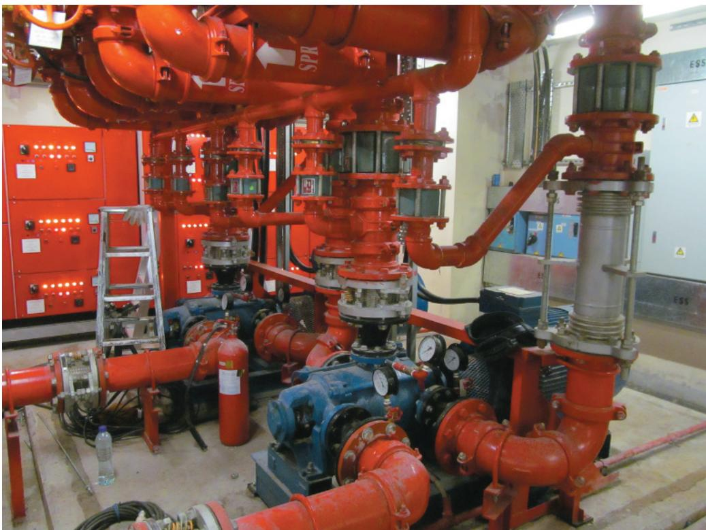  
EXHIBIT I.4.5 Multistage Multiport Fire Pump. (Courtesy of APi International LLC / Western States Fire Protection Company)

Stationary Fire Pumps and Standpipe Systems Handbook 2019

4.5.1.3.1 The certified fire pump unit shop test data shall be developed by activating the individual fire pumps in the same operating sequence that the controller will utilize.

The variable speed feature is deactivated for part of the acceptance testing for water mist positive displacement pumping units. This certified test curve is also useful for evaluating performance degradation and replacement of individual pumps within the unit.

4.5.1.4 For water mist positive displacement pumping units with variable speed features, certified shop test data, including flow, pressure, and horsepower, shall also be provided for the fire pump unit with variable speed features activated.

4.5.1.4.1 The certified fire pump unit shop test data shall be developed by activating the individual fire pumps in the same operating sequence that the controller will utilize.

A water mist positive displacement pumping unit normally operates with the variable speed features activated. Acceptance testing of the unit includes operating the unit with the variable speed features activated.

N 4.5.1.5\* For self-regulating variable speed fire pump units, two additional certified test curves showing the flow, net pressure, power, and speed shall be provided for each pump operating under the following conditions:

(1) In self-regulating variable speed mode with the pump unit operating at constant discharge pressure, as measured by the discharge pressure transducer, through the design duty, and all flow rates from churn beyond 150 percent of rated flow until the maximum power draw is reached

(2) In self-regulating variable speed mode with the pump unit operating at constant boost pressure through the design duty, and all flow rates from churn beyond 150 percent of rated flow until the maximum power draw is reached

N A.4.5.1.5 This requires two additional certified test curves for each pump unit. The selfregulating mode (variable speed) test data shows the pressure/horsepower/speed on the Y axis and the flow on the X axis.

4.5.2 The purchaser shall furnish the data required in 4.5.1 to the authority having jurisdiction.

The certified shop test is performed when the fire pump and driver are assembled at the manufacturing facility. In some cases, the commissioning agent or project engineer may request to witness the shop test. In such cases, the shop test should be coordinated with the manufacturer, purchaser, and commissioning agent. The certified shop test results should be submitted for review and approval as part of the commissioning process.

**4.6 Liquid Supplies.**

**4.6.1\* Reliability.**

Determining and verifying reliability requires a complex evaluation that should take into account life safety, economic, and environmental risks. Raw water sources can result in biological growth, clogging, and corrosion in the fire protection system. Salt water is more corrosive than treated water and requires special materials in the fire pump. When possible, the fire protection system with a salt water primary source should be filled with treated water and pressure maintained from a treated water source, allowing salt water to enter only when needed for actual firefighting. The fire protection system should be flushed and refilled with treated water when the emergency is over.

A.4.6.1 For water supply capacity and pressure requirements, see the following documents:

(1) NFPA 1   
(2) NFPA 13   
(3) NFPA 14   
(4) NFPA 15   
(5) NFPA 16   
(6) NFPA 750

4.6.1.1 The adequacy and dependability of the water source are of primary importance and shall be fully determined, with due allowance for its reliability in the future.

Water supplies should be thoroughly investigated to identify how system operation and variations in water usage might affect the water flow test. Many water utilities use a combination of elevated tanks and pumps in the distribution system, which affects the available flows and pressures. The need for increased usage in the future, especially in rapidly developing areas, should be evaluated. These variations should be taken into account to ensure that the fire pump will provide sufficient discharge pressure to supply the fire protection system demands under all reasonably anticipated suction conditions while not subjecting the fire protection system components to pressures in excess of their listed pressure rating.

Water surges that result in failure of a system component are infrequent in fire pump installations but should be considered under some circumstances. Surges occur when there is a sudden change in the momentum of the water. Rapid momentum changes occur when water flow suddenly starts or stops, such as when a hydrant valve is shut too quickly. Other situations where rapid momentum changes can occur include fire pumps taking suction from a long dead-end main, fire pumps upstream {7d1cf25d-f130-43e0-8b7f-041d of large dry-pipe valves, and pressure relief valve malfunction. If a pressure relief valve is flowing wide open when a fire pump shuts down, it might suddenly close and cause a significant surge. A surge analysis can be conducted to check the pressure surge potential and evaluate different design options for minimizing pressure surges.

For a more thorough discussion regarding water supply adequacy and reliability, see Part III of this handbook and Part IV, Supplement 1.

**SEE MORE**

4.6.1.2 Where a water flow test is used to determine the adequacy of the attached water supply, the test shall have been completed not more than 12 months prior to the submission of working plans, unless otherwise permitted by the authority having jurisdiction.

**4.6.2\* Sources.**

A.4.6.2 Where the suction supply is from a factory-use water system, pump operation at 150 percent of rated capacity should not create hazardous process upsets due to low water pressure.

4.6.2.1 Any source of water that is adequate in quality, quantity, and pressure shall be permitted to provide the supply for a fire pump.

Appropriate measures should be taken to protect the fire protection system from excessive corrosion, tuberculation, and debris when using raw water sources such as ponds, lakes, and rivers. Debris, biological life, mineral content, and other pollutants can cause rapid deterioration of the fire protection system. Salt water requires special fire pump materials. See 4.6.1 for further discussion of water issues.

**SEE MORE**

See NFPA 291, Recommended Practice for Fire Flow Testing and Marking of Hydrants, and commentary in Part III, Section 1 for more information on flow testing.

4.6.2.2 Where the water supply from a public service main is not adequate in quality, quantity, or pressure, an alternative water source shall be provided.

4.6.2.3 The adequacy of the water supply shall be determined and evaluated prior to the specification and installation of the fire pump.

Δ 4.6.2.3.1\* Where the maximum flow available from the water supply main cannot provide a flow of 150 percent of the rated flow of the pump at the lowest permissible suction pressure, but the water supply can provide the greater of 100 percent of rated flow or the maximum flow demand of the fire protection system(s) at the lowest permissible suction pressure, the water supply shall be deemed to be adequate.

Paragraph 4.6.2.3 does not apply to wells (see 7.2.7). It is the intent of this standard to size fire pumps based on the flow requirements of the attached fire protection system. The water supply, when operating under reasonable, anticipated, worst-case conditions, must be capable of maintaining a positive pump suction pressure while providing the rated pump flow rate at a residual pressure that is acceptable to the authority having jurisdiction (AHJ). It must also be capable of maintaining a positive pump suction pressure while providing the maximum fire protection system demand at a residual pressure that is acceptable to the AHJ. If the water supply meets these conditions but cannot provide sufficient flow to meet 150 percent of the rated flow of the pump, the water supply may be used to supply the fire pump and still meet the requirements of this standard.

When the water supply is from a ground-level tank, the suction pressure must be maintained above −3 psi (−0.2 bar) when the pump is flowing at 150 percent of the rated flow and the full fire protection water demand has been met (i.e., the tank is close to empty). Most pump tests are conducted with a full tank, and the water pressure from the tank must be subtracted from the suction pressure to verify if the minimum suction pressure will be −3 psi (−0.2 bar) or higher.

N A.4.6.2.3.1 In this case, the maximum flow should be considered the highest flow that the water supply can achieve at the lowest permissible suction pressure.

4.6.2.3.2 The available flow at the fire pump discharge at the lowest permissible suction pres--f130-43e0-8b7f-041dc4ddd530} sure shall be a minimum of 100 percent of rated flow.

Subsection 4.6.2.3.2 was revised in the 2019 edition to clarify that this requirement applies to systems using a water service main and not water storage tanks. When taking suction from a water service main, the available flow rate and pressure might not be capable of providing 150 percent of the pump’s rated flow without dropping pressures in the service main below those allowed by the local authority. In most jurisdictions, water service mains are not permitted to draw below 20 psi (1.4 bar). Where this circumstance arises, NFPA 20 does permit the use of a suction pressure regulating valve (see 4.17.10). However, under no circumstance can the fire pump flow less than 100 percent of its rated flow. In addition, the fire pump must meet the maximum fire protection demand.

**N 4.6.2.3.3 The available flow and pressure at the fire pump discharge shall be adequate to meet the maximum fire protection demand.**

4.6.2.4 For liquids other than water, the liquid source for the pump shall be adequate to supply the maximum required flow rate for any simultaneous demands for the required duration and the required number of discharges.

4.6.3 Level. The minimum water level of a well or wet pit shall be determined by pumping at not less than 150 percent of the fire pump rated capacity.

4.6.4\* Stored Supply.

A.4.6.4 Water sources containing salt or other materials deleterious to the fire protection systems should be avoided.

Where the authority having jurisdiction approves the start of an engine-driven fire pump on loss of ac power supply, the liquid supply should be sufficient to meet the additional cooling water demand.

Automatically starting a diesel fire pump on the loss of electrical power is not recommended. This practice uses available fuel and provides no benefit. The batteries maintain sufficient power to start the fire pump for a minimum of 72 hours after the power is lost, making the use of fuel more of an issue than the loss of battery power to start the engine. Paragraph 11.2.7.2.1.6 requires that batteries be sized to start the diesel engine after 72 hours without recharging.

**4.6.4.1 A stored supply plus reliable automatic refill shall be sufficient to meet the demand placed upon it for the design duration.**

A stored supply of water for any fire protection system should be designed and installed in accordance with NFPA 22, Standard for Water Tanks for Private Fire Protection. The required quantity of water is determined by multiplying the system demand in gallons per minute (liters per minute) [gpm (L/min)] by the discharge duration specified by the appropriate system installation standard. The stored water available for fire protection is the water between the discharge and the overflow connection(s) on the storage tank. For arrangements where the stored supply is less than the required duration (e.g., break tanks), the total water available for fire protection is the stored fire protection water plus the water automatically refilled during the discharge duration.

It is not the intent of 4.6.4.1 to require an automatic refill on every fire water storage tank. If the total water demand is stored, an automatic refill connection is preferable; however, manual means to fill the tank are permitted. The refill method must be capable of refilling the stored supply within a maximum time frame of 8 hours, in accordance with NFPA 22. This differs from the automatic refill required to meet the system duration during a fire event for tank arrangements where the stored supply is less than the required duration. The automatic refill for this arrangement will be significantly larger than that needed to fill a tank within 8 hours.

See Part III, Section 4 of this handbook for extracts from NFPA 22.

**4.6.4.2 A reliable method of replenishing the supply shall be provided.**

**SEE MORE**

**4.6.5 Head.**

Head refers to the pressure available at the fire pump suction at the maximum pump test flow. A positive head is required for a horizontal centrifugal fire pump under all suction conditions, except where a tank is the suction supply. In this case, a maximum suction lift of −3 psi (−0.2 bar) is permitted when the pump is operating at 150 percent of rated flow and the tank has supplied the full fire protection demand (i.e., the tank is close to empty). See 4.16.3.2 for allowance.

**4.6.5.1 Except as provided in 4.6.5.2, the head available from a water supply shall be figured on the basis of a flow of 150 percent of rated capacity of the fire pump.**

The capacity of a fire pump should be selected based on the anticipated system demand (see Section 4.10). Any pump that provides an adequate discharge pressure at the maximum fire protection system demand and at 100 percent of rated flow meets the sizing requirements of this standard. Oversizing a fire pump can place an undue demand on the attached water supply and on the power capacity of the fire pump, while undersizing the fire pump can cause difficulty in meeting system demand. Further, some water authorities prohibit flowing a quantity of water that causes residual pressures to drop below 20 psi (1.4 bar) at any point in the water system. Note that 4.16.3.1 limits suction pressure to not less than 0 psi (0 bar). Because of the aforementioned limitations, careful consideration of pump sizing must be exercised.

It is also important to note that failure to operate a pump at 150 percent of rated capacity during the acceptance test does not constitute an unacceptable installation, provided that the pump meets 100 percent of rated capacity and also meets the system demand (see 14.2.6.3.4). The entire system must be considered when the water utility limits minimum residual pressure [typically 20 psi (1.4 bar)]. Residual pressures at sites located at higher elevations might be less than the residual pressure at the fire pump elevation [i.e., the residual pressure might be above 20 psi (1.4 bar) at the fire pump site but less than 20 psi (1.4 bar) elsewhere in the water distribution system].

4.6.5.2 Where the water supply cannot provide a flow of 150 percent of the rated flow of the pump at the lowest permissible suction pressure, but the water supply can provide the greater of 100 percent of the rated flow or the flow demand of the fire protection system(s) at the lowest permissible suction pressure, the head available from the water supply shall be permitted to be calculated on the basis of the maximum flow available at the lowest permissible suction pressure.

See NFPA 291 and commentary in Part III, Section 1, of this handbook for more information on flow testing.

**SEE MORE**

Lowest permissible suction pressure was added to address the fact that some water authorities prohibit flowing a quantity of water that causes residual pressures to drop below 20 psi (1.4 bar) at any point in the water system. Note that 4.16.3.1 limits suction pressure to not less than 0 psi (0 bar). It is important that the registered design professional (RDP) verify what the residual pressure limitations are with the local water purveyor.

**4.6.5.3 The head described in 4.6.5.1 and 4.6.5.2 shall be as indicated by a flow test.**

When using a tank to supply a fire pump, the hydraulic calculations for the fire protection system(s) should be based on the flows and pressures available after the full fire protection demand has been met (i.e., when the tank is almost empty).

**4.7 Pumps, Drivers, and Controllers.**

**4.7.1\* Fire pumps shall be dedicated to and listed for fire protection service.**

A.4.7.1 This subsection does not preclude the use of pumps in public and private water supplies that provide water for domestic, process, and fire protection purposes. Such pumps are not fire pumps and are not expected to meet all the requirements of this standard. Such pumps are permitted for fire protection if they are considered reliable by the analysis mandated in Section 4.6. Evaluating the reliability should include at least the levels of supervision and rapid response to problems as are typical in municipal water systems.

If a private development (campus) needs a fire protection pump, this is typically accomplished by installing a dedicated fire pump (in accordance with this standard) in parallel with a domestic pump or as part of a dedicated fire branch/loop off a water supply.

Fire pumps that are installed in parallel with domestic pumps on a combined fire/domestic water distribution system require special consideration. The domestic pumps should operate at or close to the fire pump pressures. The operation of one or two fire protection devices might not lower the system pressure enough to activate the fire pump. If the domestic pumps operate at pressures significantly below the fire pump discharge pressures, they might not provide adequate pressure for the initial demand in the fire protection system.

4.7.2 Acceptable drivers for pumps at a single installation shall be electric motors, diesel engines, steam turbines, or a combination thereof.

$4 . 7 . 3 ^ { * }$ A pump shall not be equipped with more than one driver.

A.4.7.3 It is not the intent of this subsection to require replacement of dual driver installations made prior to the adoption of the 1974 edition of this standard.

4.7.4 Each fire pump shall have its own dedicated driver unless otherwise permitted in   
8.6.3.1.

Pumps in a water mist positive displacement pumping unit are allowed to share a common driver because they are listed and operating as a unit, with multiple low-volume pumps operating in parallel to supply a fire protection system.

4.7.5 Each driver or water mist positive displacement pumping unit shall have its own dedicated controller.

The concept of a water mist positive displacement pumping unit with multiple positive displacement pumps operating in parallel to serve the same fire protection system was introduced in the 2013 edition. Because these pumps work as a unit to serve the same system, a single controller is allowed for the unit. See Exhibit I.4.6.

$4 . 7 . 6 ^ { \ast }$ The driver shall be selected in accordance with 9.5.2 (electric motors), 11.2.2 (diesel engines), or 13.1.2 (steam turbines) to provide the required power to operate the pump at rated speed and maximum pump load under any flow condition.

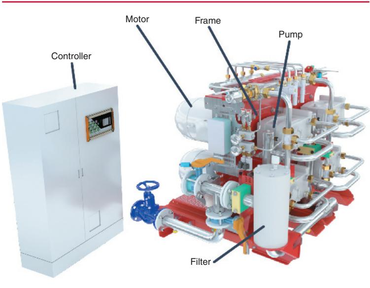  
EXHIBIT I.4.6 Water Mist Positive Displacement Pumping Unit with Single Controller.  
Stationary Fire Pumps and Standpipe Systems Handbook 2019

A.4.7.6 For centrifugal and turbine pumps, the maximum brake horsepower required to drive the pump typically occurs at a flow beyond 150 percent of the rated capacity. For positive displacement pumps, the maximum brake horsepower required to drive the pump typically occurs when the relief valve is flowing 100 percent of the rated pump capacity. Pumps connected to variable speed drivers can operate at lower speeds, but the driver needs to be selected based upon the power required to drive the pump at rated speed and maximum pump load under any flow condition.

The maximum power can be determined from a pump curve. A certified pump curve is not available until the pump is manufactured, but a generic pump curve can be obtained from the pump manufacturer to determine the maximum horsepower demand. (See Exhibit I.4.3.)

**SEE MORE**

**4.7.7\* Maximum Pressure for Centrifugal Pumps.**

For more information on pressure control, see the feature Controlling Excess Fire Pump Pressures at the end of this chapter.

A.4.7.7 A pressure relief valve is not an acceptable method of reducing system pressure under normal operating conditions. Prior to the 2003 edition, NFPA 20 did not strictly prohibit the use of pressure relief valves for management of excessive pressure at churn or low water flow conditions and only recognized it as a poor design practice as part of the 1999 edition. Existing installations designed under previous editions of NFPA 20 and containing pressure relief valves designed for such purposes might still be in service.

4.7.7.1 The net pump shutoff (churn) pressure plus the maximum static suction pressure, adjusted for elevation, shall not exceed the pressure for which the system components are rated.

When selecting the fire pump, the maximum pump discharge pressure should not subject any system component to a pressure that exceeds the component pressure rating. The maximum discharge pressure normally occurs at zero flow (churn) and is calculated by adding the suction pressure to the net pump pressure. The maximum reasonably anticipated suction pressure should be used for this calculation. The maximum pressure at any system component can be determined by subtracting the elevation pressure between the pump discharge flange and the component from the maximum pump discharge pressure. This is expressed in the following equation:

$$
P _ { _ { c o m p o n e n t m a x } } = P _ { _ { n e t m a x } } + P _ { _ { s u c t m a x } } - P _ { _ { e l e v } }
$$

where:

Pcomponentmax = maximum pressure at system component

$P _ { n e t m a x }$ = maximum net pump pressure (net churn pressure)

$P _ { s u c t m a x }$ = maximum suction pressure

$P _ { e l e v }$ = pressure due to elevation difference

{For psi = [0.43352 × (elevation of component − elevation of fire pump flange in feet)]}

As an example, with a maximum suction pressure of 70 psi (4.8 bar), a maximum net pump pressure of 110 psi (7.5 bar), and with the system component 30 ft (9 m) above the pump discharge flange, the maximum pressure at the component equals:

$$
1 1 0 \ p s \ \mathsf { i } \left( 7 . 5 \mathsf { b } \mathsf { a r } \right) + 7 0 \ p s \ \mathsf { i } \left( 4 . 8 \mathsf { b } \mathsf { a r } \right) - 0 . 4 3 3 5 2 \ p s \ \mathsf { i } \left( 0 . 0 2 9 8 9 \ \mathsf { b } \mathsf { a r } \right) \times 3 0 \ \mathsf { f t } \left( 9 \mathsf { m } \right) = 1 6 7 \ p s \ \mathsf { i } \left( 1 2 \ \mathsf { b } \mathsf { a r } \right) .
$$

All listed fire protection components have a pressure rating of 175 psi (12.1 bar) or higher. Some fire protection system components, including some sprinklers, are rated for 300 psi (20.7 bar). Pressures in excess of the component rating can damage system components. The maximum pressure permitted in a standpipe system per NFPA 14, Standard for the Installation of Standpipe and Hose Systems, currently is 350 psi (24.1 bar), although NFPA 14 does not restrict the pressure in express risers in standpipe systems. See Exhibit I.4.7 for a check valve rated for 300 psi (20.7 bar).

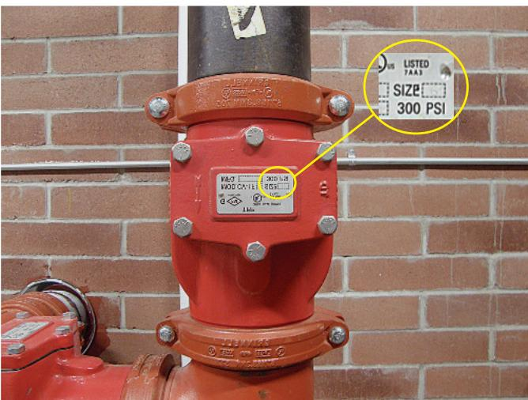  
EXHIBIT I.4.7 Check Valve Listed for 300 psi (20.7 bar). (Courtesy of JENSEN HUGHES, Inc.)

4.7.7.2\* Pressure relief valves and pressure-regulating devices in the fire pump installation shall not be used as a means to meet the requirements of 4.7.7.1.

The use of pressure relief valves is limited in this standard to the following situations:

• Constant speed diesel engine drivers where pressures developed can exceed the pressure rating of system components if a 10 percent overspeed condition occurs.

Variable speed drivers where pressures developed can exceed the pressure rating of system components if a failure causes the driver to revert to rated speed.

A pump should never be deliberately oversized so that a pressure-regulating device is needed. Pressure relief valves are maintenance intensive and should be incorporated into the design of a fire pump system only when necessary and allowed by this standard. Pressure-reducing valves are not permitted to be installed in the fire pump system piping. Where pump discharge pressures exceed 175 psi (12.1 bar), flanged cast-iron valves and fittings between the fire pump discharge flange and the discharge isolation valve must be of extra heavy pattern. It is not the intent of 4.7.7.2 to limit the use of pressure-reducing valves or pressure-regulating valves downstream of the discharge isolation valve. The use of pressure-regulating valves downstream of the discharge isolation valve is covered in other standards. In many cases, high-pressure output is needed to meet the design requirements of systems installed in high-rise buildings and in standpipe systems in particular.

**SEE MORE**

For more information on pressure control, see the feature Controlling Excess Fire Pump Pressures at the end of this chapter.

A.4.7.7.2 It is not the intent of this subsection to restrict the use of pressure-reducing valves downstream of the discharge isolation valve for the purpose of meeting the requirements of 4.7.7.

**4.7.7.3 Variable Speed Pump.**

Variable speed pumps control system pressure by changing the pump speed to prevent overpressurization of the fire protection system. Using a variable speed pump can eliminate the need to use pressure-regulating devices, such as pressure-reducing valves, in some system designs. A variable speed pump can be used when high flow and high pressure are needed but, due to the nature of fire pump

4.7.7.3.1 Variable speed pumps, as defined in this standard, shall be acceptable to limit system pressure.

performance, pressures at lower flows might be at levels in excess of the rating of system components. This can occur in systems such as early suppression fast response (ESFR) sprinkler systems and standpipe systems. For example, a standpipe system with a system demand of 1000 gpm (3785 L/min) at 150 psi (10.3 bar) would require a fire pump rated for 1000 gpm (3785 L/min) at 160 psi (11.0 bar) [assuming 0 psi (0 bar) on the suction flange of the fire pump]. A fire pump of this rated capacity can produce as much as 224 psi (15.5 bar) — well in excess of the 175 psi (12.1 bar) rating of the system component. In this case, a variable speed pump with a set pressure of 165 psi (11.4 bar) would prevent overpressurization of the system while meeting the fire protection system demand. Exhibit I.4.8 shows an electric motor variable speed pump drive controller with a transfer switch. Exhibit I.4.9 illustrates constant speed pump operation, and Exhibit I.4.10 illustrates variable speed pump operation.

The speed for electric motors is controlled by changing the frequency in the alternating current power supply. The technology is applicable for all pump speeds but adds significant costs to the controller. Diesel engines are inherently capable of variable speed operation but must be specifically listed for variable speed operation. Variable speed diesel engines are listed with a maximum and a minimum speed. The minimum operating speed of the diesel engine should be evaluated against the rated speed of the pump to verify how much the pressure can be trimmed.

**Δ 4.7.7.3.2\* The set pressure plus the maximum pressure variance during variable speed operation and adjusted for elevation shall not exceed the pressure rating of any system component.**

A.4.7.7.3.2 This requirement is intended to take into consideration the set pressure tolerance performance of the variable speed pressure limiting control as stated by the manufacturer.

  
EXHIBIT I.4.8 Electric{7d1cf2 Motor Variable Speed Pump Drive Controller with Transfer Switch. (Courtesy of Master Control Systems, Inc.)

Variable speed pressure-limiting control systems have pressure tolerances that need to be accounted for when designing. Designers will need to consult the variable speed limiting controller data sheets for direction.

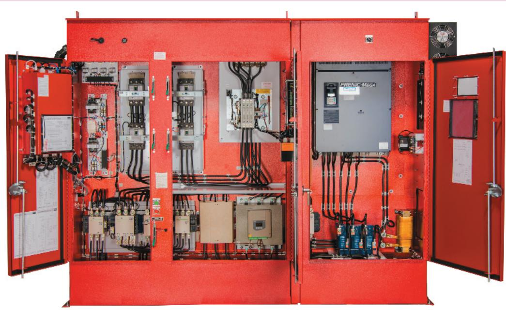  
2019 Stationary Fire Pumps and Standpipe Systems Handbook

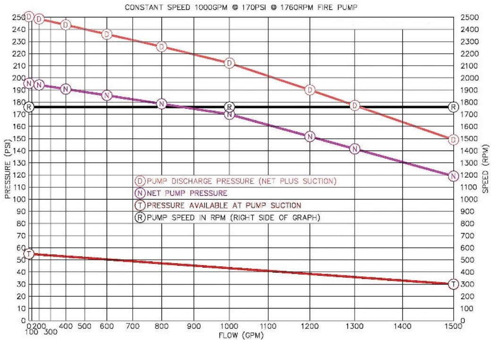  
EXHIBIT I.4.9 Constant Speed Pump Operation (pressure on left side of graph; pump speed on right side of graph). (Courtesy of JENSEN HUGHES, Inc.)

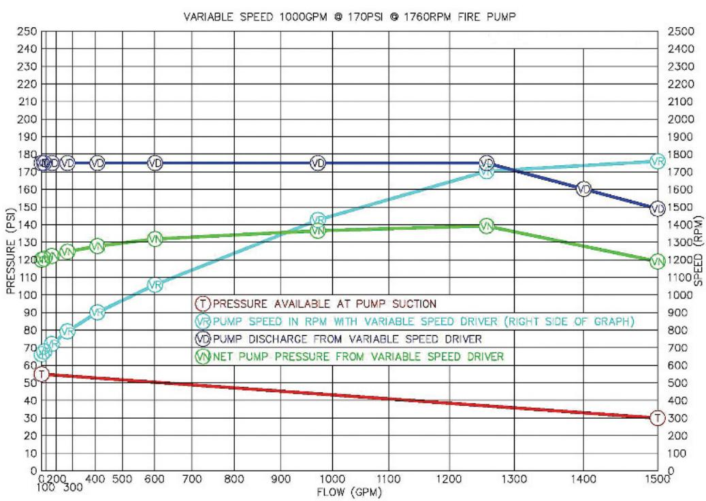  
EXHIBIT I.4.10 Variable Speed Pump Operation (pressure on left side of graph; pump speed on right side of graph). (Courtesy of JENSEN HUGHES, Inc.)  
Stationary Fire Pumps and Standpipe Systems Handbook 2019

**4.8 Self-Regulating Variable Speed Fire Pump Units.N**

N 4.8.1 Each variable speed self-regulating control unit shall maintain the factory-certified test data for variable speed operating conditions.

4.8.2 A self-regulating variable speed fire pump unit shall be factory assembled and listedN as a unit.

N 4.8.3 Each self-regulating variable speed fire pump unit shall be provided with an acrossthe-line fire pump controller in accordance with Chapter 10.

N 4.8.4 When alternate power is provided for the pump, an across-the-line combination fire pump controller/transfer switch designed and installed in accordance with Chapter 10 shall be provided.

N 4.8.5 As a minimum, each variable speed drive control unit shall be provided in a National Electrical Manufacturers Association (NEMA), Type 4, watertight enclosure with an ingress protection (IP) rating of IP66.

N 4.8.6 Each self-regulating variable speed fire pump unit shall be provided with a minimum of 5 percent line reactance on the input.

N 4.8.7 The current rating of the variable frequency drive (VFD) shall not be exceeded when operating in the motor service factor.

N 4.8.8 Self-regulating variable speed fire pump units shall monitor the suction pressure, discharge pressure, the power draw, and the calculated flow rate and provide a supervisory alarm signal to the controller whenever the results do not match the design curve of the unit.

N 4.8.9 Self-regulating variable speed fire pump units shall monitor the variable speed drive and provide a supervisory alarm signal to the controller whenever any of the following conditions occur:

(1) Pump run-f130-

(2) High temperature

(3) Overcurrent

(4) Overvoltage

(5) Undervoltage

(6) Ground fault

(7) Phase loss

(8)\* Set pressure not met

(9) Overpressure

(10) Bypass mode

A.4.8.9(8) The set pressure not met alarm signal would be sent whenever the discharge pres-N sure is below the set pressure and the power draw is below the design maximum.

4.8.9.1 Remote contacts that close to indicate an alarm shall be provided for connection to the controller.

N 4.8.10 A self-regulating variable speed fire pump unit shall have a visible display panel capable of showing, as a minimum, set pressure, maximum permissible power draw, all phase-to-phase voltages, all phase amperages, boost pressure, calculated rpm, calculated flow, alerts, and faults with an accuracy within ±2 percent.

N 4.8.11 Suction and discharge transducers for self-regulating variable speed fire pump units shall be provided and protected from mechanical damage.

4.8.12 Self-regulating variable speed fire pump units shall capture and maintain all operatingN information for a minimum of 2 years.

4.8.13 A minimum clear working space in accordance with 110.26(A)(1) of NFPA 70 shallN be provided for the pump, variable speed driver, and self-regulating control unit.

4.8.14 The unit shall have no resonant first-order harmonic critical speed below 120 percent ofN maximum operating speed in either self-regulating or manual operator mode, whichever is greater.

4.8.15 Means shall be provided on each self-regulating variable speed fire pump unit to fieldN adjust the set pressure.

4.8.15.1 The adjustment shall be secured by password protection or other equivalent means.N

4.8.16\* When operating under no-flow conditions, each self-regulating variable speed fireN pump unit shall operate at a speed that provides at least 25 percent of its rated pressure.

A.4.8.16 Under no-flow conditions, the jockey pump might maintain the pressure in the sys-N tem above the set pressure, causing the variable speed control to slow down. This limits the minimum pump speed to approximately 50 percent of the rated speed.

4.8.17 Within 20 seconds after a demand to start, pumps shall supply and maintain a stableN discharge pressure (±10 percent) throughout the entire range of operation.

4.8.18 All motor-starting contactors shall comply with 10.4.5.1.N

4.8.19 An automatic bypass shall be provided in accordance with 10.10.3 and 10.10.4.2.N

4.8.20 An emergency-run mechanical control shall be provided in accordance with 10.5.3.2.N

4.8.21 Circuit protection shall be provided in the VFD path in accordance with 10.10.5.N

4.8.22 The assembly shall be marked with the short-circuit current rating.N

4.8.23 Local control shall be in accordance with 10.10.7.1 and 10.10.7.3.N

4.8.24 The maximum operating frequency shall not exceed line frequency.N {7d1cf25d-f130-43e0-8b7f

**4.9 Multistage Multiport Pump.**

4.9.1 Multistage multiport fire pumps shall be installed in accordance with this standard.

4.9.2 A shutoff valve shall not be required between the impellers of a multistage multiport pump.

A shutoff valve is required between series fire pumps to allow isolating individual pumps. While a multistage multiport fire pump functions like series fire pumps, the impellers share a common driver and drive shaft and the outlets cannot be isolated independently.

**4.10\* Centrifugal Fire Pump Capacities.**

A.4.10 The performance of the pump when applied at capacities over 140 percent of rated capacity can be adversely affected by the suction conditions. Application of the pump at capacities less than 90 percent of the rated capacity is not recommended.

The selection and application of the fire pump should not be confused with pump operating conditions. With proper suction conditions, the pump can operate at any point on its characteristic curve from shutoff to 150 percent of its rated capacity.

**? ASK THE AHJ**

The required flow for a fire protection system is higher than the rated flow for the fire pump selected by the designer. Is this allowed?

ANSWER: Yes, a fire pump can satisfy any point along its performance curve. This includes points up to its overload point (150 percent of rated flow).

**? ASK THE AHJ**

Plans for a campus-style arrangement of buildings show a fire pump house with a single fire pump serving several buildings. Can this arrangement be approved?

ANSWER: As long as the greatest single demand of any of the fire protection systems that the fire pump serves is met by the fire pump, the plan is acceptable.

Individual fire protection systems that are designed to operate simultaneously are considered a “single demand” in the application of this paragraph.

If the greatest single demand is greater than a single listed pump can provide, it is permissible to have multiple pumps arranged in parallel to meet the system demand.

Selecting a pump so that the system demand falls between 90 percent and 140 percent of rated capacity ensures that the pump is not oversized and conversely is not operating at its maximum output. Note that while NFPA 20 recommends selecting a pump of a size such that the system demand falls between 90 percent and 140 percent, some insurance companies limit pump sizing to 120 percent of rated capacity, and some municipalities limit the maximum system demand to 100 percent of rated capacity. The intent of these limitations is to avoid operating the pump at or near the overload point, which, over time, can compromise pump performance. After years of

service, a fire pump might begin to show signs of wear and might not be capable of reaching 150 percent of rated capacity. If such a pump were selected based on performance at 150 percent capacity, a deficiency would eventually result. Selecting a fire pump of such a size that the system demand falls below 90 percent results in a fire pump that is too large for the system. The results of such a design include higher power supply demand, excessive cost, and more water usage during testing.

4.10.1 A centrifugal fire pump for fire protection shall be selected so that the greatest single demand for any fire protection system connected to the pump is less than or equal to 150 percent of the rated capacity (flow) of the pump.

4.10.2\* Centrifugal fire pumps shall have one of the rated capacities in gpm (L/min) identified in Table 4.10.2 and shall be rated at net pressures of 40 psi (2.7 bar) or more.

A.4.10.2 In countries that use the metric system, there do not appear to be standardized flow ratings for pump capacities; therefore, the metric conversions listed in Table 4.10.2 are soft conversions.

4.10.3 Centrifugal fire pumps with ratings over 5000 gpm (18,925 L/ min) shall be subject to individual review by either the authority hav-

ing jurisdiction or a listing laboratory.

TABLE 4.10.2 Centrifugal Fire Pump CapacitiesΔ
<table><tr><td>gpm</td><td>L/min</td><td>gpm</td><td>L/min</td></tr><tr><td>25</td><td>95</td><td>1,000</td><td>3,785</td></tr><tr><td>50</td><td>189</td><td>1,250</td><td>4,731</td></tr><tr><td>100</td><td>379</td><td>1,500</td><td>5,677</td></tr><tr><td>150</td><td>568</td><td>2,000</td><td>7,570</td></tr><tr><td>200</td><td>757</td><td>2,500</td><td>9,462</td></tr><tr><td>250</td><td>946</td><td>3,000</td><td>11,355</td></tr><tr><td>300</td><td>1,136</td><td>3,500</td><td>13,247</td></tr><tr><td>400</td><td>1,514</td><td>4,000</td><td>15,140</td></tr><tr><td>450</td><td>1,703</td><td>4,500</td><td>17,032</td></tr><tr><td>500</td><td>1,892</td><td>5,000</td><td>18,925</td></tr><tr><td>750</td><td>2,839</td><td></td><td></td></tr></table>

**4.11 Nameplate.**

4.11.1 Pumps shall be provided with a nameplate.

4.11.2 The name plate shall be made of and attached using corrosion resistant material.

The nameplate provides specific performance data on the fire pump. This information must be maintained for the life of the system. Without the nameplate, it might be difficult to determine the performance characteristics of the pump. See Exhibit I.4.11 for an illustration of a typical fire pump nameplate.

Nameplates that are not securely attached or made of corrosion-resistant material can become lost or illegible over time, as shown in Exhibit I.4.12.

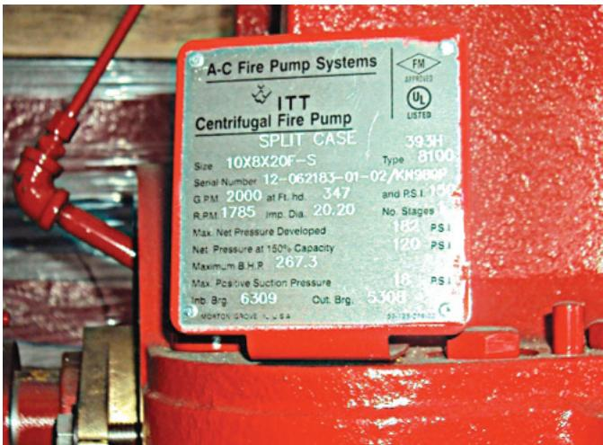  
EXHIBIT I.4.11 Fire Pump Nameplate. (Courtesy of JENSEN HUGHES, Inc.)

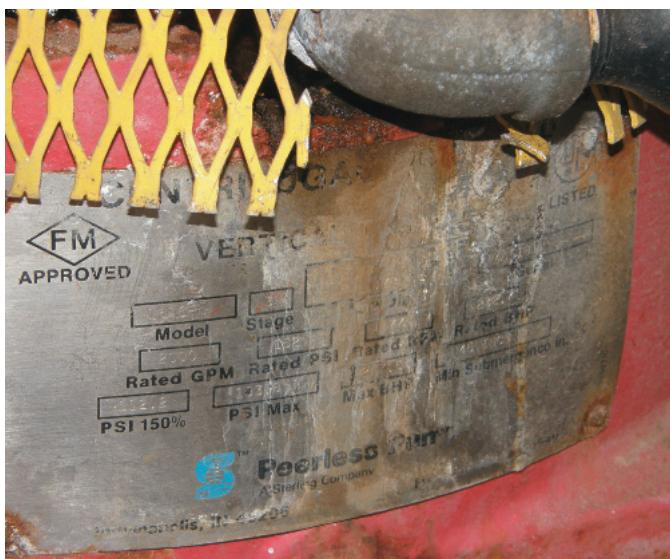  
EXHIBIT I.4.12 Fire Pump Nameplate Deteriorated to Being Partially Illegible. (Courtesy of JENSEN HUGHES, Inc.)

N 4.11.3 The nameplate shall indicate the maximum pump horsepower demand required to power the pump at any flow, including flows beyond 150 percent of the rated capacity.

**4.12 Pressure Gauges.**

Suction and discharge gauges are used to measure pressure on both sides of the fire pump when in operation and during the regularly scheduled nonflow testing required by NFPA 25. The gauges should be of sufficient quality to provide a reasonably accurate pressure reading, since they are used for testing purposes on a weekly and sometimes annual basis. These gauges should be calibrated each year to maintain accuracy.

To achieve the most accurate pressure readings, liquid-filled gauges should be used. See Exhibit I.4.13.

**4.12.1 Discharge.**

4.12.1.1 A pressure gauge having a dial not less than 3.5 in. (89 mm) in diameter shall be connected near the discharge casting with a nominal 0.25 in. (6 mm) gauge valve.

EXHIBIT I.4.13 Liquid-Filled and Air-Filled Gauges. Note bubble at top of liquid-filled gauge. (Courtesy of JENSEN HUGHES, Inc.)

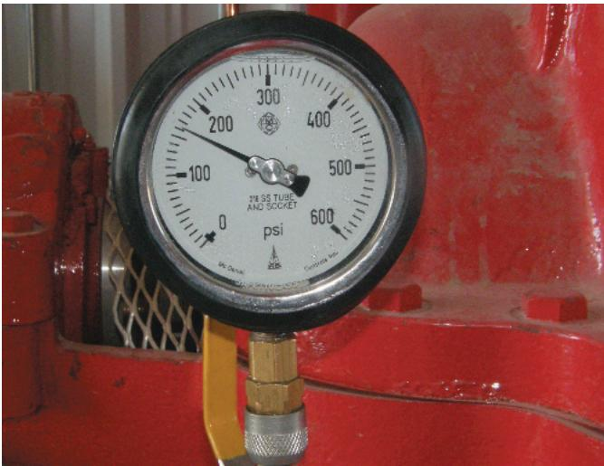

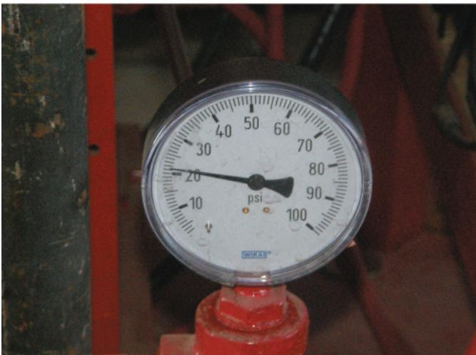  
2019 Stationary Fire Pumps and Standpipe Systems Handbook

4.12.1.2 The dial shall indicate pressure to at least twice the rated working pressure of the pump but not less than 200 psi (13.8 bar).

4.12.1.3 The face of the dial shall read in bar, pounds per square inch, or both with the manufacturer’s standard graduations.

**4.12.2\* Suction.**

A.4.12.2 For protection against damage from overpressure, where desired, a gauge protector should be installed.

4.12.2.1 Unless the requirements of 4.12.2.4 are met, a gauge having a dial not less than 3.5 in. (89 mm) in diameter shall be connected to the suction pipe near the pump with a nominal 0.25 in. (6 mm) gauge valve.

4.12.2.1.1 Where the minimum pump suction pressure is below 20 psi (1.3 bar) under any flow condition, the suction gauge shall be a compound pressure and vacuum gauge.

4.12.2.2 The face of the dial shall read in inches of mercury (millimeters of mercury) or psi (bar) for the suction range.

The units of measure on a suction gauge can differ from that of the discharge gauge due to the fact that under certain installations, negative pressures might be experienced on the suction side of the fire pump. Where this is the case a compound gauge will be required. A compound gauge will include inches of mercury (millimeters of mercury) [in.Hg (mmHg)] and psi (bar) as units of measure. For an example of a compound gauge, see Exhibit I.4.14. Where the pressure is positive, the reading will be in psi (bar) and where negative (vacuum) pressures are created, the reading will be in in.Hg (mmHg). This is because compound (vacuum) gauges measure force in units of in.Hg (mmHg). The conversion of one in.Hg (mmHg) to psi (bar) is as follows:

$$
\mathsf { O n e i n . H 9 = 0 . 4 9 1 \ p s i . }
$$

One mmHg = 0.00133322 bar.

EXHIBIT I.4.14 Compound Gauge. (Courtesy of DirectMaterial.com)

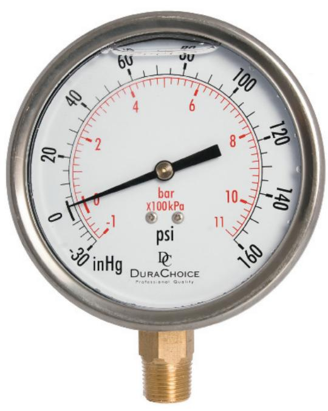  
Stationary Fire Pumps and Standpipe Systems Handbook 2019

4.12.2.3 The gauge shall have a pressure range two times the rated maximum suction pressure of the pump.

4.12.2.4 The requirements of 4.12.2 shall not apply to vertical shaft turbine–type pumps taking suction from a well or open wet pit.

The suction lift for a vertical shaft turbine pump is determined by measuring the distance from the water level to the discharge gauge.

**4.13 Circulation Relief Valve.**

**4.13.1 General Requirements.**

4.13.1.1\* Where an electric variable speed pump is installed, the automatic circulation relief valve shall open at the minimum speed.

N A.4.13.1.1 Under no-flow conditions, the jockey pump might maintain the pressure in the system above the set pressure, causing the variable speed control to slow down. However, there is still a need to discharge a small amount of water to cool the pump.

4.13.1.2 Unless the requirements of 4.13.1.8 are met, each pump(s) shall have an automatic relief valve listed for the fire pump service installed and set below the shutoff pressure at minimum expected suction pressure.

When a centrifugal fire pump is operating at churn, energy is continuously imparted to the water in the impeller, causing the water to heat. For electrical drive fire pumps and radiator-cooled engine– driven fire pumps, a listed circulation relief valve is needed to provide cooling water when the pump is operating at churn. The pipe connection for this valve must be located on the discharge side of the pump to cause flow through the pump casing and should discharge outdoors or to a floor drain where discharge can be observed by the pump operator. This valve should be installed in the vertical position, -f130-43e0-8b7f-041dc4ddd530} because installation in the horizontal position might cause the valve to fail at an accelerated rate due to obstructing material collecting in the valve seat. Failure or the omission of this valve can result in overheating and subsequent damage to the fire pump. Exhibit I.4.15 illustrates a ¾ in. (19 mm) circulation (casing) relief valve. Exhibit I.4.16 illustrates a cooling line to a diesel engine installed downstream of the pump, which eliminates the need for a circulation relief valve.

This circulation relief valve should not be confused with a second circulation relief valve that is required downstream of a pressure relief valve whenever a pressure relief valve is piped back to suction (see 4.20.7.1).

4.13.1.3 The valve shall be installed on the discharge side of the pump before the discharge check valve.

4.13.1.3.1 For multistage multiport pumps, the automatic circulation relief valve shall be installed before the discharge check valve for the last port and set below the churn pressure of the first port.

The circulation relief valve is located downstream of the last port to provide a flow through each impeller. Even when water is discharging through one port, a cooling flow is still needed through any port downstream of the flowing port.

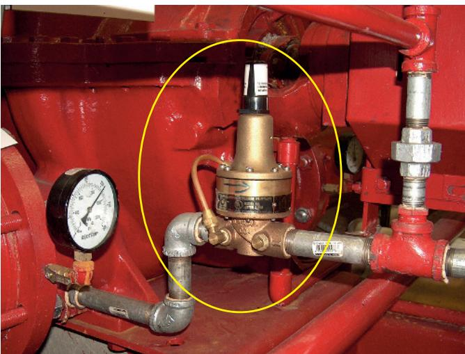  
EXHIBIT I.4.15 Circulation (Casing) Relief Valve. (Courtesy of JENSEN HUGHES, Inc.)

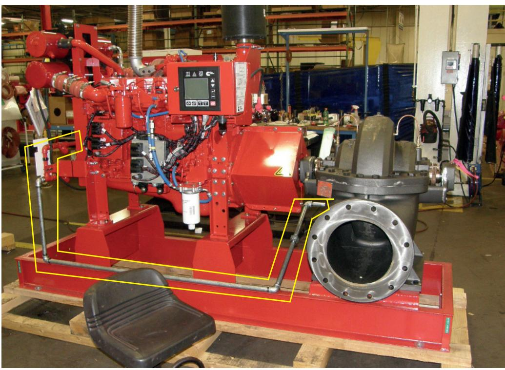  
EXHIBIT I.4.16 Cooling Line for a Diesel Engine Installed Downstream of the Pump, Eliminating the Need for a Circulation Relief Valve. (Courtesy of JENSEN HUGHES, Inc.)  
4.13.1.4 The valve shall provide sufficient water flow to prevent the pump from overheating when operating with no discharge.

**? ASK THE AHJ**

4.13.1.5 Provisions shall be made for discharge to a drain.

The plans for a centrifugal fire pump do not show an automatic circulation relief valve. Are all centrifugal pumps required to have an automatic circulation relief valve?

ANSWER: No, all centrifugal pump installations do not require a circulation relief valve. An automatic circulation relief valve on a centrifugal fire pump is provided to keep the pump from overheating at churn. If an engine-driven centrifugal fire pump takes its cooling water from the pump discharge, water will be flowing at churn and, therefore, an automatic circulation relief valve is not required.

Water taken from the discharge side of a fire pump for engine cooling provides the same cooling effect as a circulation relief valve. See Chapter 11 for more details.

4.13.1.6 Circulation relief valves shall not be tied in with the packing box or drip rim drains.

4.13.1.7 The automatic relief valve shall have a nominal size of 0.75 in. (19 mm) for pumps with a rated capacity not exceeding 2500 gpm (9462 L/min) and have a nominal size of 1 in. (25 mm) for pumps with a rated capacity of 3000 gpm to 5000 gpm (11,355 L/min to 18,925 L/min).

4.13.1.8 The requirements of 4.13.1 shall not apply to enginedriven pumps for which engine cooling water is taken from the pump discharge.

**4.14\* Equipment Protection.**

Section 4.14 provides requirements and guidance on the proper placement of a fire pump and related equipment. It is also intended to provide a relatively safe environment for the equipment operator. By locating the fire pump room near an exterior wall and enclosing the equipment in a fire-rated room, the operator is provided with a means of egress, and both the operator and the equipment are protected from fire exposure.

Although not specifically addressed in this section, damage to fire pump systems can also occur from careless installation and maintenance procedures. Exhibit I.4.17 shows the effect of one such incident.

FAQ

**Does the standard require a separate fire pump room for each fire pump installation?**

Multiple fire pumps may be located in one fire pump room. Although not required by this standard, separate rooms may be required by the insuring authority when redundant pumps are not required by this standard but are installed because of risk management considerations.

The intent of this section, by requiring fire separation, is to locate a fire pump and its related equip ment in a dedicated fire pump room. For installations with multiple pumps, a single fire pump room is needed. Fire pumps must not be located in mechanical equipment spaces, which would expose the fire pump and operator to damage and potential injury.

EXHIBIT I.4.17 Fire Pump Damage from Careless Installation and Maintenance Procedures. (Courtesy of JENSEN HUGHES, Inc.)

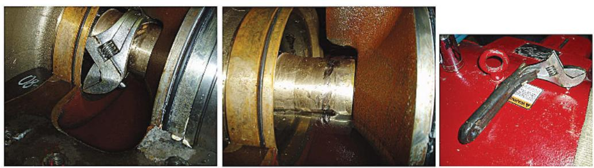

A.4.14 Special consideration needs to be given to fire pump installations installed below grade. Light, heat, drainage, ventilation, and potential flooding are several of the variables that need to be addressed. Some locations or installations might not require a pump house. Where a pump room or pump house is required, it should be of ample size and located to permit short and properly arranged piping. The suction piping should receive first consideration. The pump house should preferably be a detached building of noncombustible construction. A one-story pump room with a combustible roof, either detached or well protected from an adjoining onestory building, is acceptable if sprinklered. Where a detached building is not feasible, the pump room should be located and constructed to protect the pump unit and controls from falling floors or machinery, and from fire that could drive away the pump operator or damage the pump unit or controls. Access to the pump room should be provided from outside the building. Where the use of brick or reinforced concrete is not feasible, metal lath and plaster is recommended for the construction of the pump room. The pump room or pump house should not be used for storage purposes. Vertical shaft turbine–type pumps might necessitate a removable panel in the pump house roof to permit the pump to be removed for inspection or repair. Proper clearances to equipment should be provided as recommended by the manufacturer’s drawings.

4.14.1\* General Requirements. The fire pump, driver, controller, water supply, and power supply shall be protected against possible interruption of service through damage caused by explosion, fire, flood, earthquake, rodents, insects, windstorm, freezing, vandalism, and other adverse conditions.

Δ A.4.14.1 A fire pump that is inoperative for any reason at any time constitutes an impairment to the fire protection system. It should be returned to service without delay.

Rain, intense heat from the sun, blown freezing rain, blowing sand or dust, flood, rodents, insects, and vandals are adverse conditions to equipment not installed in an acceptable protective building or enclosure. At a minimum, equipment installed should be shielded{7d1cf25d-f130-43e0-8 by a roof or deck.

**4.14.1.1\* Indoor Fire Pump Units.**

A.4.14.1.1 Most fire departments have procedures requiring operation of a fire pump unit during an incident. Building designers should locate the fire pump room to be easily accessible during an incident.

**? ASK THE AHJ**

The plans submitted for a fire pump installation show the pump located in the middle of a storage room. Can the designer be required to alter the location?

ANSWER: Yes, there are several requirements that deal with the protection of the fire pump. The pump room needs to be separated with fire resistance–rated construction in accordance with Table 4.14.1.1.2 and cannot be used for any other purposes other than those that are essential to the operation of the fire pump. In addition, since the fire department usually responds to the pump room during an emergency, the authority having jurisdiction (AHJ) is allowed input regarding the location of, and access to, the pump room. Paragraph 4.14.2.1.1 mandates a rated enclosure to the pump room when the room is not directly accessed from the exterior of the building.

4.14.1.1.1 Except as permitted in 4.14.1.1.3, fire pump units serving high-rise buildings shall be protected from surrounding occupancies by a minimum of 2-hour fire-rated construction or physically separated from the protected building by a minimum of 50 ft (15.3 m).

A minimum of 50 ft (15.3 m) of separation, measured in accordance with the locally adopted building code, or a 2-hour fire-rated enclosure will protect the building’s fire pump and personnel from an exposure fire.

4.14.1.1.2\* Except as permitted in 4.14.1.1.3, indoor fire pump rooms in non-high-rise buildings or in separate fire pump buildings shall be physically separated or protected by fire-rated construction in accordance with Table 4.14.1.1.2.

TABLE 4.14.1.1.2 Equipment Protection
<table><tr><td></td><td colspan="2">Pump Room/House Building(s) Exposing Pump Room/House Required Separation</td></tr><tr><td>Not sprinklered</td><td>Not sprinklered</td><td>2 hour fire-rated</td></tr><tr><td>Not sprinklered</td><td>Fully sprinklered</td><td>or</td></tr><tr><td>Fully sprinklered</td><td>Not sprinklered</td><td>50 ft (15.3 m)</td></tr><tr><td>Fully sprinklered</td><td>Fully sprinklered</td><td>1 hour fire-rated or 50 ft (15.3 m)</td></tr></table>

A.4.14.1.1.2 The purpose for the “Not Sprinklered” column in Table 4.14.1.1.2 is to provide guidance for unsprinklered buildings. This does not permit sprinklers to be omitted from pump rooms in fully sprinklered buildings.  
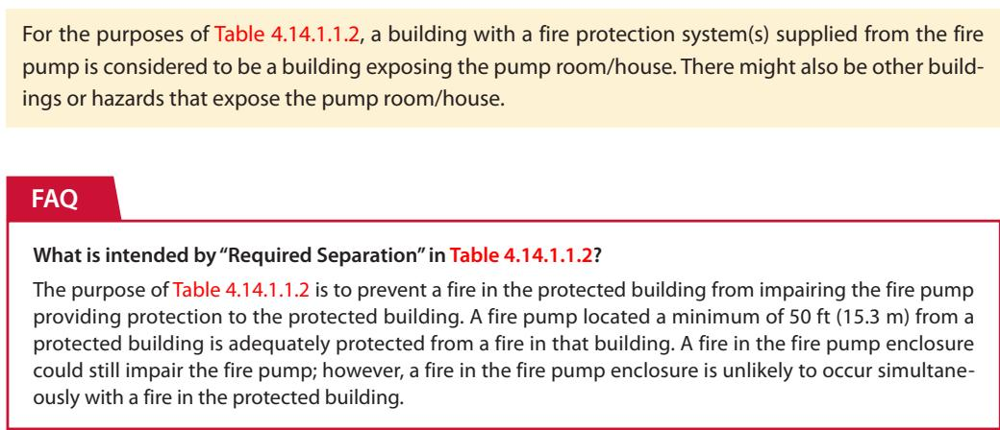

4.14.1.1.3\* Fire pump units supplying a local application fire protection system(s) shall be physically separated from the hazard being protected in a manner that will prevent a fire associated with the hazard from directly exposing the pumping unit.  
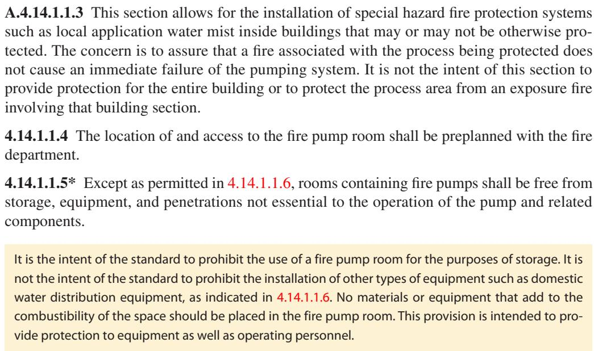  
A.4.14.1.1.5 Equipment that increases the fire hazard (such as boilers) and is not related to fire protection systems should not be in a fire pump room.  
2019 Stationary Fire Pumps and Standpipe Systems Handbook

4.14.1.1.6\* Equipment related to domestic water distribution shall be permitted to be located within the same room as the fire pump equipment.

N A.4.14.1.1.6 Items that would create an additional hazard, such as fuel-fired water heaters, should not be installed inside the pump room.

4.14.1.1.7 The pump room or pump house shall be sized to fit all of the components necessary for the operation of the fire pump and to accommodate the following:

(1) Clearance between components for installation and maintenance

(2) Clearance between a component and the wall for installation and maintenance

(3) Clearance between energized electrical equipment and other equipment in accordance with NFPA 70

(4) Orientation of the pump to the suction piping to allow compliance with 4.16.6.3

**4.14.1.2 Outdoor Fire Pump Units.**

Exhibit I.4.18 shows an outdoor fire pump unit.

4.14.1.2.1 Fire pump units that are outdoors shall be located at least 50 ft (15.3 m) away fromΔ any buildings and other fire exposures.

4.14.1.2.2 Outdoor installations shall be required to be provided with protection againstΔ possible interruption in accordance with 4.14.1.

4.14.1.3 Fire Pump Buildings or Rooms with Diesel Engines. Fire pump buildings or rooms enclosing diesel engine pump drivers and day tanks shall be protected with an automatic sprinkler system installed in accordance with NFPA 13 as an Extra Hazard Group 2 occupancy.

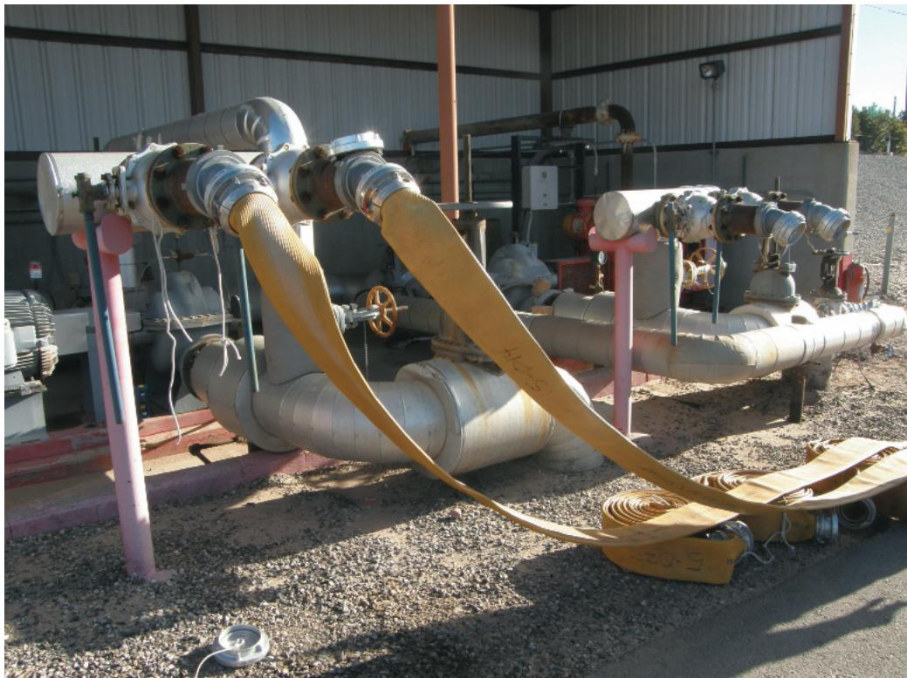  
EXHIBIT I.4.18 Outdoor Fire Pump Installation. (Courtesy of JENSEN HUGHES, Inc.)4ddd53

Stationary Fire Pumps and Standpipe Systems Handbook 2019

**? ASK THE AHJ**

Sprinkler plans show the protection criteria for the pump room with a diesel engine–driven pump based on Ordinary Hazard Group 2. Is this protection criteria acceptable?

ANSWER: No. The fire pump room that houses a diesel engine–driven fire pump will also include a diesel fuel supply. Since the presence of this fuel is considered storage of a combustible liquid, the protection criteria is required to be Extra Hazard Group 2.

The Extra Hazard Group 2 classification for sprinkler system protection applies only to the fire pump room and does not extend to the rest of the building.

4.14.1.4 Fire Pump Buildings or Rooms with Electric Drivers. For buildings that are required to be sprinklered, fire pump buildings or rooms enclosing electric fire pump drivers shall be protected with an automatic sprinkler system installed in accordance with NFPA 13 as an Ordinary Hazard Group 1 occupancy.

**4.14.2 Equipment Access.**

4.14.2.1 The location of and access to the fire pump room(s) shall be pre-planned with the fire department.

A properly operating fire pump is essential to fire department fire-fighting operations. Coordinating the location and access with the fire department is necessary to allow monitoring by the fire department.

4.14.2.1.1 Except as provided in 4.14.2.1.1.1, fire pump rooms not directly accessible from the outside shall be accessible through a fire-resistant-rated corridor from an enclosed stairway or exterior exit.

The fire-resistant-rated corridor can have openings into other spaces besides the one that accesses the fire pump room, provided that the openings are equipped with the appropriate equipment to maintain the rating of the corridor. It is not the intent of this requirement that the fire-resistant-rated corridor be classed as an exit passageway in accordance with the locally adopted building and life safety codes that would restrict openings.

4.14.2.1.1.1 Fire pump units supplying only local application fire protection systems shall be accessible by a path that is not subject to exposure from a fire in any hazard protected by the fire pump.

N 4.14.2.1.1.2 Where a fire pump is installed in a parking garage or some other portion of a building separated from the rest of the building by fire-rated construction equivalent to the pump room, and the portion of the building containing the fire pump is protected by a sprinkler system that does not rely on the fire pump, the protected access to the pump room shall not be required.

The purpose of the protected access to the pump room is to ensure that an individual traveling to and from the pump room is not exposed to fire. By putting the pump in an area that is separated from the rest of the building and protected by a sprinkler system that does not rely on the pump, this task is accomplished without needing protected access. The most common application of this arrangement is putting the pump in a parking garage, which must be separated from the rest of the building in accordance with locally adopted building codes, but there are other situations where it could be used as well.

4.14.2.1.2 The portions of the building needed for the access, as required by 4.14.2.1.1, shall have a fire resistance rating not less than the fire resistance rating of the fire pump room.

A properly operating fire pump is essential to fire department operations. Fire pump rooms should be accessible under fire conditions to allow the fire department to monitor the fire pump to provide early warning and modifications to fire-fighting operations should a fire pump not operate satisfactorily. Where a fire pump room cannot be located on grade with direct access from outside the building, a protected space with a fire rating in accordance with Table 4.14.1.1.2 must be provided. The space must be accessible through a fire-resistant-rated corridor from an exterior exit or from an enclosed stairway. This provides the fire service a direct, protected path to and from the fire pump room.

2019 Stationary Fire Pumps and Standpipe Systems Handbook

**4.14.3 Heat.**

4.14.3.1 An approved or listed source of heat shall be provided for maintaining the temperature of a pump room or pump house, where required, above 40°F (4°C).

Although maintaining the water temperature above 32°F (0°C) will prevent freezing, maintaining a minimum temperature of 40°F (4°C) provides a safety factor to account for isolated temperature variations and the accuracy of the temperature control equipment.

4.14.3.2 The requirements of 11.6.5 shall be followed for higher temperature requirements for internal combustion engines.

Temperatures above 40°F (4°C) might be necessary to ensure starting of diesel engines.

4.14.4 Normal Lighting. Artificial light shall be provided in a pump room or pump house.

**4.14.5 Emergency Lighting.**

4.14.5.1 Pump rooms shall be provided with emergency lighting.

4.14.5.2 The intensity of illumination in the pump room(s) shall be 3.0 ft-candles (32.3 lux), unless otherwise specified by a requirement recognized by the authority having jurisdiction.

4.14.5.3 Emergency lights shall not be connected to an engine-starting battery.

4.14.5.4 The emergency lighting shall be capable of maintaining the lighting level for a minimum of 2 hours.

4.14.6 Ventilation. Provision shall be made for ventilation of a pump room or pump house.

In general, fire pump rooms or houses must be conditioned spaces that are maintained between the low and high temperature ranges recommended by equipment manufacturers. For an engine drive pump, the ventilation must be adequate to provide combustion air. See 11.3.2.

**4.14.7\* Drainage.**

A.4.14.7 Pump rooms and pump houses should be dry and free of condensate. To accomplish a dry environment, heat might be necessary.

4.14.7.1 Floors shall be pitched for adequate drainage of escaping water away from critical equipment such as the pump, driver, controller, and so forth.

4.14.7.2 The pump room or pump house shall be provided with a floor drain that will discharge to a frost-free location.

4.14.8 Guards. Couplings and flexible connecting shafts shall be installed with a coupling guard in accordance with Section 7 of ANSI B11.19, Performance Requirements for Safeguarding.

**4.15 Pipe and Fittings.**

4.15.1\* Steel Pipe.

The type of steel piping used for fire pump installation should be identical to that specified for the suppression system. See Commentary Table I.4.1 for acceptable pipe types.

<table><tr><td colspan="2">COMMENTARY TABLE I.4.1 Pipe or Tube Materials and Dimensions</td></tr><tr><td>Materials and Dimensions</td><td>Standard</td></tr><tr><td>Ferrous Piping (Welded and Seamless) Standard Specification for Black and Hot-Dipped Zinc-Coated (Galvanized)</td><td>ASTM A795/A795M</td></tr><tr><td>Welded and Seamless Steel Pipe for Fire Protection Use Standard Specification for Pipe, Steel, Black and Hot-Dipped, Zinc-Coated,</td><td></td></tr><tr><td>Welded and Seamless</td><td>ASTM A53/A53M</td></tr><tr><td>Welded and Seamless Wrought Steel Pipe Standard Specification for Electric-Resistance-Welded Steel Pipe</td><td>ASME B36.10M ASTM A135/A135M</td></tr><tr><td>Stainless Steel</td><td></td></tr><tr><td>Standard Specification for Seamless, Welded, and Heavily Cold Worked Austenitic Stainless Steel Pipes</td><td>ASTM A312/A312M</td></tr></table>

Source: NFPA 13, Standard for the Installation of Sprinkler Systems, 2019, Table 7.3.1.1.

A.4.15.1 The exterior of aboveground steel piping should be kept painted.

4.15.1.1 Steel pipe shall be used aboveground except for connection to underground suction and underground discharge piping.

4.15.1.2 Where corrosive water conditions exist, steel suction pipe shall be galvanized or painted on the inside prior to installation with a paint recommended for submerged surfaces.

4.15.1.3 Thick bituminous linings shall not be used.

**4.15.2\* Joining Method.**

Flanged fittings provide rigidity and are encouraged, especially in the suction piping. Grooved fittings are acceptable but might require more restraint. Plastic (PVC, CPVC), fiberglass, and polyethylene fittings are not permitted in the suction or discharge piping. The metallic fittings used for the fire pump -f130-43e0-8b7f-041dc4ddd530} installation should be made of the same materials as those specified for the suppression system. The fittings used in sprinkler systems have been evaluated for that use and have been found to be acceptable. Using the same type of fittings for a system’s fire pump installation eliminates performance and compatibility issues. See Commentary Table I.4.2 for acceptable fitting types.

COMMENTARY TABLE I.4.2 Fittings Materials and Dimensions
<table><tr><td>Materials and Dimensions</td><td>Standard</td></tr><tr><td>Cast Iron</td><td></td></tr><tr><td>Gray Iron Threaded Fittings, Classes 125 and 250</td><td>ASME B16.4</td></tr><tr><td>Gray Iron Pipe flanges and Flanged Fittings, Classes 25, 125, and 250 Malleable Iron</td><td>ASME B16.1</td></tr><tr><td>Malleable Iron Threaded Fittings, Classes 150 and 300 Steel</td><td>ASME B16.3</td></tr><tr><td>Factory-Made Wrought Buttwelding Fittings</td><td>ASME B16.9</td></tr><tr><td>Buttwelding Ends</td><td>ASME B16.25</td></tr><tr><td>Standard Specification for Piping Fittings of Wrought Carbon Steel and Alloy</td><td>ASTM A234/</td></tr><tr><td>Steel for Moderate and High Temperature Service</td><td>A234M</td></tr><tr><td>Pipe Flanges and Flanged Fittings, NPS ½ through NPS 24 Metric/Inch Standard</td><td>ANSI/ASME B16.5</td></tr><tr><td>Forged Fittings, Socket-Welding and Threaded</td><td>ANSI/ASME B16.11</td></tr></table>

Source: NFPA 13, Standard for the Installation of Sprinkler Systems, 2019, Table 7.4.1.

2019 Stationary Fire Pumps and Standpipe Systems Handbook

A.4.15.2 Flanges welded to pipe are preferred.

4.15.2.1 Sections of steel piping shall be joined by means of screwed, flanged mechanical grooved joints or other approved fittings.

4.15.2.2 Slip-type fittings shall be permitted to be used where installed as required by 4.16.6 and where the piping is mechanically secured to prevent slippage.

N 4.15.2.3 The piping around check valves installed per 4.32.4.1, orifice unions, orifice plates, flowmeters, and other devices that have restricting orifices shall have a means to perform an internal inspection or a means to disassemble the piping to allow for the internal inspection of the restricting orifice(s).

Restricting orifices must be inspected for corrosion, potential clogging, and general condition on a periodic basis. To perform this inspection, a means must be provided as part of the system design and installation.

4.15.3 Restricting Orifice Identification. Check valves installed per 4.32.4.1, orificeN unions, orifice plates, and other devices with a restricting orifice shall have a permanent tag or other means of identification indicating that a restricting orifice is present.

Restricting orifices must be permanently identified so that those performing inspections, for the reasons stated in the commentary to 4.15.2.3, can easily locate and identify them.

**4.15.4 Concentrate and Additive Piping.**

4.15.4.1 Foam concentrate or additive piping shall be a material that will not corrode in this service.

4.15.4.2 Galvanized pipe shall not be used for foam concentrate service.

Pure foam concentrate is typically corrosive; therefore, foam concentrate piping is normally installed with either stainless steel or brass pipe. Galvanized pipe should never be used for foam concentrate piping, because the concentrate might cause the galvanizing to “flake” and detach from the pipe wall.

4.15.5 Drain Piping. Drain pipe and its fittings that discharge to atmosphere shall be permitted to be constructed of metallic or polymeric materials.

**4.15.6\* Piping, Hangers, and Seismic Bracing.**

A.4.15.6 Currently, NFPA 13 requirements do not address fire pumps, controllers, driver, fuel tanks (including the trim), test header piping, relief valve piping, or exhaust mufflers.

4.15.6.1 The support of pipe and fittings shall comply with the requirements of Chapter 17 of NFPA 13.

4.15.6.2 The seismic protection, where applicable, of pipe and fittings shall comply with the requirements of Chapter 18 of NFPA 13.

4.15.7\* Cutting and Welding. Torch cutting or welding in the pump house shall be permitted as a means of modifying or repairing pump house piping when it is performed in accordance with NFPA 51B.

A.4.15.7 When welding is performed on the pump suction or discharge piping with the pump in place, the welding ground should be on the same side of the pump as the welding.

**4.16 Suction Pipe and Fittings.**

**4.16.1\* Components.**

A.4.16.1 The exterior of steel suction piping should be kept painted.Δ

Buried iron or steel pipe should be lined and coated or protected against corrosion in conformance with AWWA C104, Cement-Mortar Lining for Ductile-Iron Pipe and Fittings, or equivalent standards.

Underground pipe is frequently coated with a material that prevents the formation of debris or tuberculation. Steel pipe should never be used for underground piping, particularly on the suction side of the pump. Encasing underground piping in a polyethylene wrap provides additional protection from exterior corrosion.

4.16.1.1 The suction components shall consist of all pipe, valves, and fittings from the pump suction flange to the connection to the public or private water service main, storage tank, or reservoir, and so forth, that feeds water to the pump.

4.16.1.2 Where pumps are installed in series, the suction pipe for the subsequent pump(s) shall begin at the system side of the discharge valve of the previous pump.

4.16.2 Installation. Suction pipe shall be installed and tested in accordance with NFPA 24.

**4.16.3 Suction Size.**

4.16.3.1 Unless the requirements of 4.16.3.2 are met, the size of the suction pipe for a single pump or of the suction header pipe for multiple pumps (designed to operate together) shall be such that, with all pumps operating at maximum flow (150 percent of rated capacity or the maximum flow available from the water supply at the lowest permissible suction pressure, as discussed in 4.6.2.3.1), the gauge pressure at the pump suction flanges shall be 0 psi (0 bar) or higher.

The suction pipe must be sized for all fire pumps that are designed to operate simultaneously to meet the fire protection system demand. Redundant pumps installed to increase system reliability are not considered when selecting the pipe size for simultaneous fire pump operation.

4.16.3.2\* The requirements of 4.16.3.1 shall not apply where the supply is a suction tank with its base at or above the same elevation as the pump, and the gauge pressure at the pump suction flange shall be permitted to drop to –3 psi (−0.2 bar) at 150 percent of rated flow with the lowest water level after the maximum system demand and duration have been supplied.

The fire protection system components must be rated for the maximum discharge pressure that occurred at churn when the tank is full. The fire protection system should be designed for the minimum operating pressure that occurs at the water level left in the tank after the full system demand and duration have been met.

A.4.16.3.2 It is permitted that the suction pressure drop to –3 psi (–0.2 bar) for a centrifugal pump that is taking suction from a grade level storage tank where the pump suction elevation is at or below the water level in the water storage tank at the end of the required water flow duration. This negative suction pressure is to allow for the friction loss in the suction piping when the pump is operating at 150 percent capacity.

It is important to note that horizontal shaft fire pumps are not permitted to draft water. The suction pipe must also be large enough so that a substantial pressure loss does not occur when the pump is supplied by a water storage tank. For such applications, the suction pressure is permitted to drop to not less than −3 psi (−0.2 bar). This negative pressure is permitted only after the tank has provided the maximum system demand (flow rate and duration); the remaining water in the tank is level with, or higher than, the pump; and the pump is operating at 150 percent of rated flow. This negative pressure allowance is intended to compensate for the friction loss through the suction pipe, fittings, and gate valve. The allowable negative pressure of −3 psi (−0.2 bar) is based on flowing 150 percent of the rated pump capacity after the tank has provided the full system demand (flow rate and duration); the initial head, or any head caused by a water level above the full system demand, is not included in the suction pressure calculation and should be subtracted from the acceptance test results when verifying the acceptability of the suction supply.

4.16.3.3 The size of that portion of the suction pipe located within 10 pipe diameters upstream of the pump suction flange shall be not less than that specified in Section 4.28.

The size of the suction pipe is based on limiting water velocity to not more than 15 ft/sec (4.6 m/sec) to limit turbulent flow in the pipe. Turbulent flow generates air bubbles in the water, which adversely affect pump efficiency. As the pump impeller is imparting energy to the water (which is relatively incompressible), the introduction of air bubbles (which are easily compressible) can create small regions of high pressure due to collapsed air bubbles that cause inefficient pump operation.

**4.16.4\* Pumps with Bypass.**

A.4.16.4 The following notes apply to Figure A.4.16.4:

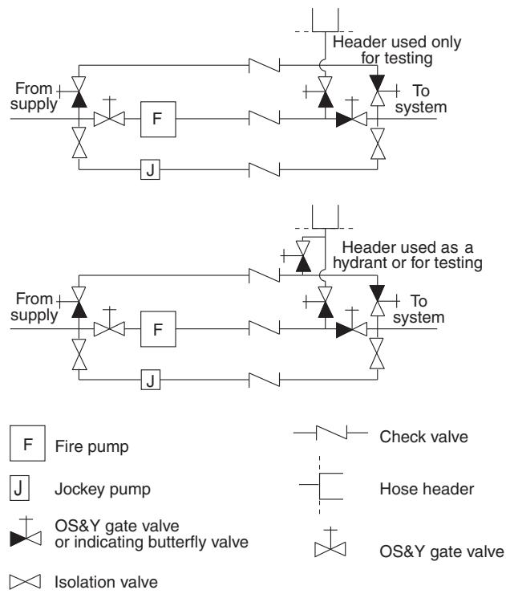  
FIGURE A.4.16.4 Schematic Diagram of Suggested Arrangements for a Fire Pump with a Bypass, Taking Suction from Public Mains.  
Stationary Fire Pumps and Standpipe Systems Handbook 2019

(1) A jockey pump is usually required with automatically controlled pumps.

(2) If testing facilities are to be provided, also see Figure A.4.22.1.3(a) and Figure A.4.22.1.3(b).

(3) Pressure-sensing lines also need to be installed in accordance with 10.5.2.1 or 12.7.2.1. See Figure A.4.32(a) and Figure A.4.32(b).

4.16.4.1 Where the suction supply is of sufficient pressure to be of material value without the pump, the pump shall be installed with a bypass. (See Figure A.4.16.4.)

The pump bypass is sometimes mistakenly thought to be used only when the fire pump is out of service. This is not the function intended by the standard, because the water from the bypass must be available automatically if the pump fails to start.

In most cases, a pump that is connected to a public or private water supply should include a bypass. Only in rare cases, where the pressure available is so low that the water supply is of no value without the pump, should a fire pump be installed without a bypass.

The valves on the bypass are required to be normally open so that the attached water supply is available automatically. In this case, “normally open” refers to the valve being in the open position at all times. A check valve, therefore, needs to be installed in the bypass line so that, when the pump is running, water does not circulate through the bypass back to the pump. The bypass valves should be closed only for system maintenance.

**? ASK THE AHJ**

A fire pump installation connected to an on-site storage tank does not have a fire pump bypass installed. Is this omission permitted?

ANSWER: Yes, the bypass may be omitted when the liquid supply is from a ground- or below ground–level water storage tank located close to or below the level of the fire protection system(s).

The purpose of a fire pump bypass is to allow water to flow into the system without passing through the impeller if the pump fails to start. It is not anticipated that the water available through this bypass will meet the demand of the fire protection system. If it could, a pump would not have to be installed. The bypass provides for a reduced flow through a few operating sprinklers or other orifice, providing some degree of protection if a pump experiences a locked rotor condition or other catastrophic failure. In the case of an on-site ground- or belowground-level storage tank located close to or below the elevation of the fire protection system(s), the pressure from the water tank will not provide a flow through a sprinkler that is of 0-8b7f-041dc4ddd530} any value in fire suppression, and, therefore, a bypass can be omitted. If the

water tank is situated significantly above the elevation of the fire protection system, a bypass would provide a reduced flow through a few operating sprinklers or other orifice and is required.

4.16.4.2 For multistage multiport pumps, a bypass shall be installed between the pump suction and the first outlet port and between sequential outlet ports wherever the bypass can provide pressure that is of material value without the impeller. (See Figure A.4.16.4.)

The requirement for a bypass on multistage multiport pumps is the same as the requirement for a bypass for series pumps.

4.16.4.3 The size of the bypass shall be at least as large as the pipe size required for discharge pipe as specified in Section 4.28.

**4.16.5\* Valves.**

A.4.16.5 Where the suction supply is from public water mains, the gate valve should be located as far as is practical from the suction flange on the pump. Where it comes from a stored water container, the gate valve should be located at the outlet of the container. A butterfly valve on the suction side of the pump can create turbulence that adversely affects the pump performance and can increase the possibility of blockage of the pipe.

The required placement of the valve in the suction line is intended to limit turbulence. While the “gate” in an outside screw and yoke (OS&Y) valve is outside the waterway when fully open and does not interfere with flow, the “butterfly” in a butterfly valve is always suspended in the pipe and causes turbulent flow. The use of a butterfly valve is permitted if the valve is located at a sufficient distance from the suction flange of the pump. By locating the butterfly valve 50 ft (15.3 m) or more away from the suction flange of the pump, the turbulence can be eliminated before the water reaches the suction flange.

**4.16.5.1 A listed outside screw and yoke (OS&Y) gate valve shall be installed in the suction pipe.**

**4.16.5.2 Valve Closure Time.N**

Technology now allows for automated valves to be used in systems. These valves must have the same restrictions on closing time to avoid water hammer and damage to the system. The valve must indicate whether it is open or closed, or a means of supervision that indicates its position must be provided just like a standard control valve. If an automated valve is provided, it still needs to be able to be opened and closed manually.

4.16.5.2.1 Listed indicating valves shall not close in less than 5 seconds when operated atN maximum possible speed from the fully open position.

4.16.5.2.2 Valves with an automatic means to operate the valve shall not close in less than 5N seconds when operated at maximum possible speed from the fully open position.

4.16.5.3 Automated Valves.N

4.16.5.3.1 A listed indicating valve with automated controls shall be permitted.N

N 4.16.5.3.2 The automated water control valve assembly shall meet the following criteria:

(1) Include a reliable position indication

(2) Include a valve supervisory switch and be connected to a remote supervisory station

(3) Operate manually as well as automatically

4.16.5.4 No control valve other than a listed OS&Y valve and the devices as permitted in 4.29.3 shall be installed in the suction pipe within 50 ft (15.3 m) of the pump suction flange.

**4.16.6\* Installation.**

A.4.16.6 See Figure A.4.16.6. (See ANSI/HI 9.6.6, Rotodynamic Pumps for Pump Piping, for additional information.)

Figure A.4.16.6 shows right and wrong pump suction arrangements. The requirements for these arrangements are covered throughout 4.16.6 and its subparagraphs.

The layout and design of the suction pipe must be carefully considered to avoid the generation of air bubbles in the suction pipe and unbalanced flow into the pump suction flange. Where a reduction in pipe diameter is necessary, an eccentric reducer must be used to prevent the development of an air pocket, as illustrated in Figure A.4.16.6. The flat portion of the reducer must be on top where supplying the fire pump from below or the horizontal plane, with the actual reduction in pipe diameter taking place on the bottom of the fitting. Where supplied from above, the hydraulic institute recommends that the flat portion of the reducer be installed on the bottom, with the actual reduction in pipe diameter taking place on the top of the fitting (see Exhibit I.6.10). Installing the reducer in this position will prevent an air pocket from forming.

Placing an elbow with the centerline in the horizontal plane within 10 pipe diameters of the suction flange creates an unbalanced flow of water into the impeller. An unbalanced flow causes an axial load to be placed on the pump shaft and bearings, causing excessive wear to the bearings and subsequent damage to the pump over time and/or severe cavitation if not corrected.

**FAQ**

Does the requirement to place an elbow a minimum of 10 pipe diameters from the suction flange apply to all fire pump types?

The requirement to place an elbow a minimum of 10 pipe diameters from the suction flange applies only to horizontal split-case fire pumps. In an in-line (vertical shaft) fire pump, gravity already creates an axial load imbalance so the imbalance from an elbow is of less concern.

The elbow shown in Exhibit I.4.19 will eventually cause damage to the pump and may result in pump shaft-bearing failure. A butterfly valve installed within 10 pipe diameters will also cause turbulent flow and cavitation in the pump and should be avoided.

EXHIBIT I.4.19 Pump Suction Elbow Installed in the Incorrect Plane.

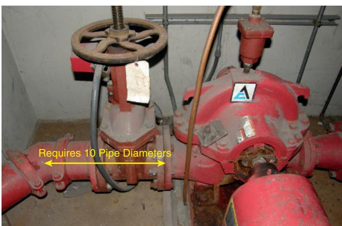

In the lower portion of Figure A.4.16.6, the correct method for designing a turn in the suction piping to a horizontal shaft fire pump is illustrated. An elbow in the vertical position (either directed upward or downward) should be used, and the elbow causing a turn in the pipe parallel with the pump shaft should be installed only when located greater than 10 pipe diameters away from the suction flange. For example, an elbow installed in the horizontal plane in a suction pipe with a diameter of 8 in. (200 mm) should be located 80 in. (2000 mm) away from the suction flange of the pump.

**FAQ**

If the suction flange of a fire pump is 6 in. (150 mm) and the suction pipe is 8 in. (200 mm), is the 10 pipe diameter requirement applied to the fire pump flange diameter or the suction pipe diameter?

The 10 pipe diameter requirement is applied to the suction pipe diameter specified in Tables 4.28(a) and 4.28(b). Therefore, if the suction pipe diameter is 8 in. (200 mm), as required by Tables 4.28(a) and 4.28(b) for a 1000 gpm (3785 L/min) fire pump, the elbow flange would be required to be located 80 in. (2000 mm) away from the suction flange.

2019 Stationary Fire Pumps and Standpipe Systems Handbook

<table><tr><td rowspan=3 colspan=2>Right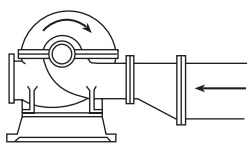</td><td></td></tr><tr><td rowspan=1 colspan=1>WrongAir pocket</td></tr><tr><td rowspan=1 colspan=1></td><td rowspan=1 colspan=1>Wrong</td></tr><tr><td></td><td rowspan=1 colspan=1></td><td rowspan=1 colspan=1>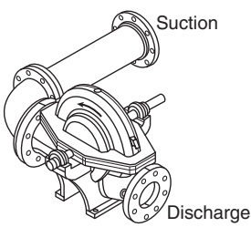</td></tr><tr><td></td><td rowspan=1 colspan=1>Right</td><td rowspan=1 colspan=1>Wrong</td></tr><tr><td></td><td rowspan=1 colspan=1>SuctionDistance betweenpump flange andelbow/tee flangeis greater than10 pipe diametersTee/elbowDischarge</td><td rowspan=1 colspan=1>SuctionDistancebetween pumpflange andelbow/tee flangeis less than10 pipe diametersTee/elbowDischarge</td></tr><tr><td></td><td rowspan=1 colspan=1>Right</td><td rowspan=1 colspan=1>Wrong</td></tr><tr><td></td><td rowspan=1 colspan=1>Suction Distance between pumpflange and elbow/teeflanğe is greater than10 pipe diametersDischarge</td><td rowspan=1 colspan=1>Distance betweenpump flangeSuction    and elbow/teeflange is less than10 pipe diametersDischarge</td></tr><tr><td></td><td rowspan=1 colspan=1>Right</td><td rowspan=1 colspan=1>Right</td></tr><tr><td></td><td rowspan=1 colspan=1>SuctionDischarge</td><td rowspan=1 colspan=1>SuctionOptional→Discharge</td></tr></table>

FIGURE A.4.16.6 Right and Wrong Pump Suctions.

Stationary Fire Pumps and Standpipe Systems Handbook 2019

4.16.6.1 General. Suction pipe shall be laid carefully to avoid air leaks and air pockets, either of which can seriously affect the operation of the pump.

Trapped pipe sections that allow the formation of air pockets should be avoided. Air pockets intensify corrosion and can interfere with the flow of water into the pump impeller. Automatic air release valves should be installed on trapped pipe sections.

**4.16.6.2 Freeze Protection.**

4.16.6.2.1 Suction pipe shall be installed below the frost line or in frostproof casings.

4.16.6.2.2 Where pipe enters streams, ponds, or reservoirs, special attention shall be given to prevent freezing either underground or underwater.

**4.16.6.3 Elbows and Tees.**

4.16.6.3.1 Unless the requirements of 4.16.6.3.2 are met, elbows and tees with a centerline plane parallel to a horizontal split-case pump shaft shall not be permitted. (See Figure A.4.16.6.)

See commentary after A.4.16.6.

4.16.6.3.2 The requirements of 4.16.6.3.1 shall not apply to elbows and tees with a centerline plane parallel to a horizontal split-case pump shaft where the distance between the flanges of the pump suction intake and the elbow and tee is greater than 10 times the suction pipe diameter.

Any fitting that causes a change in the direction of flow, including elbows, tees, and crosses, when installed in a horizontal plane, should be located a minimum of 10 pipe diameters away from the suction flange of the pump. While fittings installed in a vertical plane usually do not cause an unbalanced flow into the pump suction flange, they may cause turbulence. A long radius elbow will cause less turbulence than a short turn elbow, tee, or cross and should be used when it is necessary to install a -f130-43e0-8b7f-041dc4ddd530} suction fitting in a vertical plane. See the commentary following A.4.16.6 for additional discussion.

4.16.6.3.3 Elbows and tees with a centerline plane perpendicular to the horizontal split-case pump shaft shall be permitted at any location in the pump suction intake.

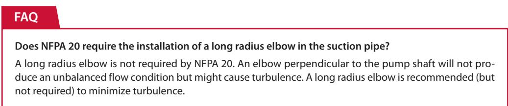

4.16.6.4 Eccentric Tapered Reducer or Increaser. Where the suction pipe and pump suction flange are not of the same size, they shall be connected with an eccentric tapered reducer or increaser installed in such a way as to avoid air pockets.

See the commentary following A.4.16.6.

4.16.6.5 Strain Relief. Where the pump and its suction supply are on separate foundations with rigid interconnecting pipe, the pipe shall be provided with strain relief. [See Figure A.6.3.1(a).]

Strain relief can be accomplished by means of a flexible joint such as that depicted in Exhibit I.4.20 or by a series of grooved couplings as shown in Exhibit I.4.21. Flanged fittings are not flexible. When using grooved couplings for strain relief, rigid grooved couplings should not be used. Deflection for most non-rigid grooved couplings is on the order of 3½ in. to 4½ in./20 ft (89 mm to 114 mm/6 m) length of pipe in sizes 6 in. to 8 in. (150 mm to 200 mm). A series of these grooved couplings in the suction pipe provides flexibility if the pump or tank foundations begin to settle and should also provide for limited movement due to expansion and contraction. Providing such strain relief prevents damage to the pump suction flange, since misalignment or stress placed on the pump suction flange can cause the flange to crack. The fire pump design should avoid the use of separate foundations for the pump and the driver, particularly in earthquake-prone areas.

Seismic design should follow the design requirements found in ASCE/SEI 7, Minimum Design Loads for Buildings and Other Structures, and NFPA 13, Standard for the Installation of Sprinkler Systems. Prior to the design of the installation, the locally adopted building code must be checked for the seismic requirements for the fire pump piping installation.

A means of joint restraint other than thrust blocks should be used where a flanged spigot passes through the floor. A thrust block might hold the pipe in place while the building settles and cause strain on the pipe and fittings inside the building that are directly connected to the flanged spigot.

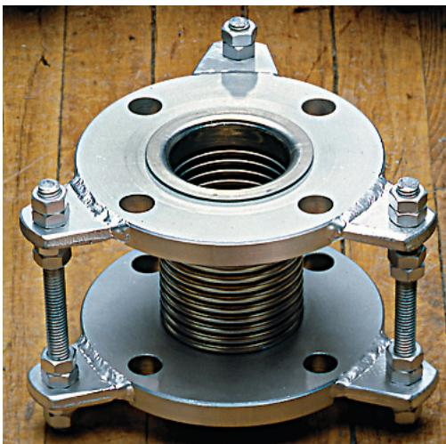  
EXHIBIT I.4.20 Flexible Joint for Use on Suction Pipe. (Courtesy of Metraflex Company)

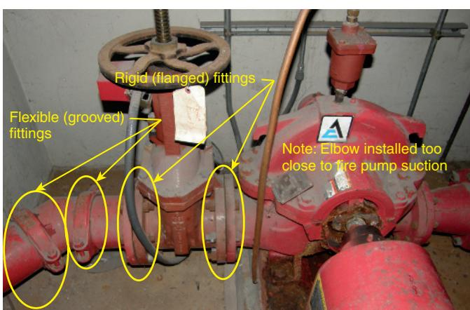  
EXHIBIT I.4.21 Grooved Fittings and Couplings and Flanged Fittings. (Courtesy of JENSEN HUGHES, Inc.)  
Stationary Fire Pumps and Standpipe Systems Handbook 2019

4.16.7 Multiple Pumps. Where a single suction pipe supplies more than one pump, the suction pipe layout at the pumps shall be arranged so that each pump will receive its proportional supply.

**CLOSER LOOK**

**Multiple Pumps**

The use of multiple pumps might be required for several reasons, such as to increase flow, increase pressure, or provide redundancy. The following are examples of multiple pumps arranged to meet these objectives.

Scenario 1. Multiple fire pumps arranged in parallel operating simultaneously without redundant (backup) pumps.

The following list identifies some applications where simultaneous operation of multiple pumps might be required to meet the fire protection system demand(s):

1. Simultaneous operation of multiple deluge systems that might be required in aircraft hangars and refineries

2. Fire fighting, including extinguishing and exposure protection in refineries and chemical plants

3. High water–demand mitigation systems

In the preceding applications, two or more pumps installed in parallel might be required to meet the water demand of the fire protection system. In this scenario, common suction piping must be sized to supply multiple pumps operating at 150 percent of rated volume. The suction pipe should be sized so that the velocity does not exceed 15 ft/sec (4.6 m/sec) in any portion of the suction piping when all the simultaneously operating pumps are operating at 150 percent of rated capacity. For example, if three 5000 gpm (18,925 L/min) fire pumps operating simultaneously are required to meet a 14,500 gpm (54,888 L/min) system demand, suction piping common to all three pumps must be sized for a flow of 3 × $1 . 5 \times 5 0 0 0 = 2 2 { , } 5 0 0$ gpm (85,172 L/min). Flow rates in Schedule 30 pipe at a velocity of 15 ft/sec (4.6 m/sec) for pipe sizes up to 24 in. (600 mm) nominal diameter are shown in Commentary Table I.4.3. A flow rate of 22,500 gpm (85,172 L/min) would require a pipe with a minimum internalf130-43e0-8b7f-041dc4ddd530} diameter of 24.76 in. (629 mm) to limit the velocity of 15 ft/sec (4.6 m/sec). A 30 in. pipe in normally available pipe sizes would be required for this example. Suction piping that is common to two pumps must be sized for 2 × 1.5 × 5000 = 15,000 gpm (56,781 L/min). Commentary Table I.4.3 indicates that a minimum 24 in. nominal pipe diameter is required. Suction piping that is common to only one pump must be sized for $1 \times 1 . 5 \times 5 0 0 0 = 7 5 0 0$ gpm (28,391 L/min). Commentary Table I.4.3 indicates that a minimum 16 in. (400 mm) nominal pipe diameter is required.

COMMENTARY TABLE I.4.3 Flow Rates in Schedule 30 Pipe at a Velocity of 15 ft/sec (4.6 m/sec)
<table><tr><td colspan="2">Nominal Pipe Diameter</td><td colspan="2">Flow at Velocity of 15 ft/sec (4.6 m/sec)</td></tr><tr><td>in.</td><td>mm</td><td>gpm</td><td>L/min</td></tr><tr><td>8</td><td>200</td><td>2392</td><td>9055</td></tr><tr><td>10</td><td>250</td><td>3773</td><td>14,281</td></tr><tr><td>12</td><td>300</td><td>5367</td><td>20,317</td></tr><tr><td>14</td><td>350</td><td>6447</td><td>24,403</td></tr><tr><td>16</td><td>400</td><td>8680</td><td>32,858</td></tr><tr><td>18</td><td>450</td><td>10,770</td><td>40,769</td></tr><tr><td>20</td><td>500</td><td>13,256</td><td>50,179</td></tr><tr><td>24</td><td>600</td><td>19,216</td><td>72,740</td></tr><tr><td>30</td><td>760</td><td>30,400</td><td>115,076</td></tr></table>

Continued

Scenario 2. Multiple fire pumps arranged in parallel operating simultaneously with redundant (backup) pumps.

In all the applications identified in Scenario 1, it is desirable and normal design to provide a redundant (backup) pump so that one pump may be out of service for maintenance without impairing the fire protection system. Using the same example from Scenario 1 with a system demand of 14,500 gpm (54,888 L/min) gpm, a total of four 5000 gpm (18,925 L/min) fire pumps would be installed and arranged so that any three fire pumps operating simultaneously could meet the fire protection system demand. In this scenario, suction piping that is common to three or four fire pumps would be sized for three fire pumps operating simultaneously — that is, 3 × 1.5 × 5000 = 22,500 gpm (85,172 L/min). This would require a pipe with a minimum internal diameter of 24.76 in. (629 mm) to limit the velocity of 15 ft/sec (4.6 m/sec). Suction pipe common to only one or two pumps should be sized as shown in Scenario 1.

Scenario 3. Two or more pumps are installed in series to meet the pressure demand of the fire protection system.

The primary application for series fire pumps is to supply multiple vertical zones in a high building. The first pump supplies the low zone. The second pump boosts the discharge pressure from the first pump and supplies the second zone. When pumping in series, the flow passes through the pumps in sequence. The maximum flow is the flow through the first pump, so the suction is sized for a single pump.

**Scenario 4. Redundant pumps.**

The primary pump can meet the fire protection system demand, but a redundant (backup) pump is provided to improve reliability. NFPA 20 requires redundant capacity in very tall buildings, although the redundant source is not required to be a fire pump. Redundant capacity is recommended (and may be required by the insurance carrier) whenever there is a potential for a large fire loss. Both the primary and the redundant pumps must be capable of individually supplying the fire protection system demand. It is not anticipated that both pumps will be needed for an emergency; therefore, the suction supply can be sized for a single pump.

**4.16.8\* Suction Screening.**

Suction screens are located in a suction pit at the pump end of a channel, reservoir, pond, or lake that allows water to flow from the source to the pump, as indicated in Figure A.7.2.2.2. The figure shows a vertical shaft turbine–type pump. It is also possible to use a horizontal pump if the pump suction flange is installed below the minimum water level after the full fire protection system demand (both flow and duration) has been met.

Any debris entering the channel can accumulate in the area in front of the suction crib. If a fire occurs, it is possible that fire pump operation will draw some of this settled material onto the first screen, reducing the flow area and restricting flow to the fire protection system. The standard requires two screens to be installed to allow removal of the first screen if it becomes obstructed. The opening size in the screens is intended to be small to provide protection to the distribution portion of the fire protection system. For example, the openings would be restricted to less than ½ in. (12.7 mm) for a sprinkler having an orifice of ½ in. (12.7 mm). Caution should be exercised when removing a debrisloaded screen because the removal can cause the obstructing material to fall off and thereby obstruct the second screen. See Exhibit I.4.22.

EXHIBIT I.4.22 Suction Screen for Vertical Turbine Fire Pump. (Courtesy of JENSEN HUGHES, Inc.)

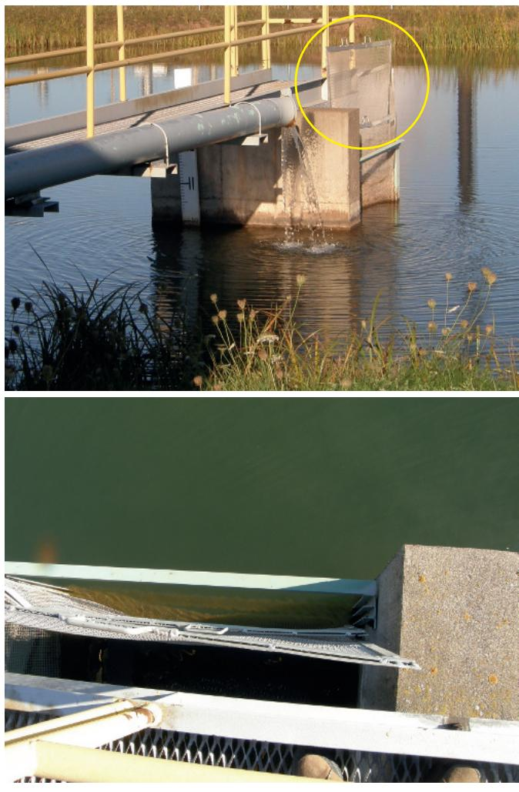

A.4.16.8 In the selection of screen material, consideration should be given to prevention of fouling from aquatic growth. Antifouling is best accomplished with brass or copper wire.

4.16.8.1 Where the water supply is obtained from an open source such as a pond or wet pit, the passage of materials that might clog the pump shall be obstructed.

Where a pipe is used between the suction pit and the water source, the end of the pipe should turn vertically downward to prevent debris from settling into the suction pipe. An anti-vortex plate and a screen should be attached to the water source end of the pipe. See commentary after 4.16.10 for discussion on anti-vortex plates.

4.16.8.2 Double intake screens shall be provided at the suction intake.

4.16.8.3 Screens shall be removable, or an in situ cleaning shall be provided.

4.16.8.4 Below minimum water level, these screens shall have an effective net area of opening of 1 in.2 for each 1 gpm (170 mm2 for each 1 L/min) at 150 percent of rated pump capacity.

4.16.8.5 Screens shall be so arranged that they can be cleaned or repaired without disturbing the suction pipe.

2019 Stationary Fire Pumps and Standpipe Systems Handbook

**CALCULATION EXAMPLE**

The following sample calculation illustrates how to correctly size a suction screen for a fire pump.

A 750 gpm (2839 L/min) vertical shaft turbine pump requires a screen to protect the wet pit that takes water from an open lake or river. What size is needed for the screen?

Solution: Since the pump is rated for 750 gpm (2839 L/min), the pump delivers 1125 gpm (4258 L/min) at overload (150 percent of 750 and 2839). Therefore, the screen must have an efective net area of opening of 1125 in.2 (0.72 m2). Since 4.16.8.6 requires a 0.50 in. (12.7 mm) mesh and a No. 10 B&S gauge wire, the total screen area must be 1800 in.2 (1.1 m2) (1.6 × 1125 in.2). This area is equivalent to a screen area of 12.5 ft2 (1.16 m2).

4.16.8.6 Mesh screens shall be brass, copper, Monel, stainless steel, or other equivalent corrosion-resistant metallic material wire screen of 0.50 in. (12.7 mm) maximum mesh and No. 10 B&S gauge.

4.16.8.7 Where flat panel mesh screens are used, the wire shall be secured to a metal frame sliding vertically at the entrance to the intake.

4.16.8.8 Where the screens are located in a sump or depression, they shall be equipped with a debris-lifting rake.

4.16.8.9 Periodically, the system shall be test pumped, the screens shall be removed for inspection, and accumulated debris shall be removed.

4.16.8.10 Continuous slot screens shall be brass, copper, Monel, stainless steel, or other equivalent corrosion-resistant metallic material of 0.125 in. (3.2 mm) maximum slot and profile wire construction.

4.16.8.11 Screens shall have at least 62.5 percent open area.

4.16.8.12 Where zebra mussel infestation is present or reasonably anticipated at the site, the screens shall be constructed of a material with demonstrated resistance to zebra mussel attachment or coated with a material with demonstrated resistance to zebra mussel attachment at low velocities.

With the appearance of zebra mussels in many U.S. waterways, extra care should be exercised with the use of suction screens. Zebra mussels were first observed in the western end of Lake Erie, and the organisms have since spread to all of the Great Lakes and the Mississippi River, Ohio River, and Illinois River, including approximately 22 major lakes and tributaries. The mussels spread rapidly once established in a water source, with each female producing 300,000 to 1,000,000 larvae annually. The larvae grow from the size of fine sand to an adult size of 6 in. (150 mm) in length in 2 to 3 years. They attach to many materials as well as to each other, forming obstructions to piping and discharge device orifices. See Exhibit I.4.23.

NFPA 20 requires screens to be constructed of brass, copper, Monel™, stainless steel, or other corrosion-resistant material. Copper-based materials have been tested and proven resistant to the attachment of zebra mussels. Pure copper is resistant to attachments until corrosion products form on its surface. Some copper alloys, Monel™, and stainless steel have been tested and found to offer no resistance to the attachment of zebra mussels. In areas where zebra mussel infestation is present, screens should be constructed with materials or coated with a corrosion-resistant material that has demonstrated long-term resistance to their attachment in low-velocity conditions. Materials that require regular maintenance to remove zebra mussels should not be used.

EXHIBIT I.4.23 Zebra Mussels Obstructing a Pipe. (Courtesy of Marrone Bio Innovations)

4.16.8.13 The overall area of the screen shall be 1.6 times the net screen opening area. (See screen details in Figure A.7.2.2.2.)

**4.16.9\* Devices in Suction Piping.**

A.4.16.9 The term device as used in this subsection is intended to include, but not be limited to, devices that sense suction pressure and then restrict or stop the fire pump discharge. Due to the pressure losses and the potential for interruption of the flow to the fire protection systems, the use of backflow prevention devices is discouraged in fire pump piping. Where required, however, the placement of such a device on the discharge side of the pump is to ensure acceptable flow characteristics to the pump suction. It is more efficient to lose the pressure after the pump has boosted it, rather than before the pump boosts it. Where the backflow preventer is on the discharge side of the pump and a jockey pump is installed, the jockey pump discharge and sensing lines need to be located so that a cross-connection is not created through the jockey pump.

4.16.9.1 No device or assembly, unless identified in 4.16.9.2, that will stop, restrict the starting of, or restrict the discharge of a fire pump or pump driver shall be installed in the suction piping.

The purpose of the requirement in 4.16.9.1 is to prohibit the use of certain devices in the suction pipe of a fire pump that would cause turbulence or excess friction loss or cut off waterflow to the pump when flowing at 150 percent of rated capacity. If the water supply to a fire pump is shut off while the pump is running, a catastrophic failure will occur. Only an outside screw and yoke (OS&Y) control valve is permitted to be installed in the suction pipe within 50 ft (15.3 m) of a fire pump to allow isolation of the fire pump for maintenance and repair. Additional valves are permitted only where a piece of equipment such as a backflow prevention device is installed at least 10 pipe diameters upstream of the pump suction flange. All control valves, which should be of the approved indicating type, are required to be supervised, preferably by a constantly attended monitoring station.

It is important to note that closed valves continue to be the leading cause of fire protection system failure. A vigorous inspection program and constant electronic surveillance of all water supply control valves are critical to the continued operation of any fire protection system, particularly water supplies such as fire pumps.

**FAQ**

**Does NFPA 20 prohibit the installation of any device in the suction pipe of a fire pump?**

The installation of devices in the suction pipe of a fire pump is restricted to the devices listed in 4.16.9.2. The installation of any device or fitting should be made at least 10 pipe diameters upstream of the pump suction flange to avoid unnecessary turbulence. It is desirable to minimize obstructions or potential obstructions in the pump suction piping, both to maintain laminar flow and to reduce friction losses in the suction piping.

**4.16.9.2 The following devices shall be permitted in the suction piping where the following requirements are met:**

(1) Check valves and backflow prevention devices and assemblies shall be permitted where required by other NFPA standards or the authority having jurisdiction and installed in accordance with Section 4.29.

Check valves and backflow prevention devices are generally prohibited in the suction pipe due to concerns over turbulence and friction loss; however, some jurisdictions require the installation of one of these devices in the suction pipe when backflow contamination is a possibility.

Backflow preventers and their isolation valves contribute to turbulence and friction loss, usually more so than check valves. Reduced pressure backflow preventers are required to maintain a 7 psi (0.5 bar) differential between the input and discharge side, but it is common for reduced pressure backflow preventers to cause more than 10 psi (0.68 bar) of friction loss at the system demand.

**CALCULATION EXAMPLE**

For example, consider a fire protection system connected to a public main where the pump is at an elevation 20 ft (6.1 m) higher than the street main and, at maximum pump flow, the residual pressure in the public main is 20 psi (1.38 bar).

Taking into account a 9 psi (0.621 bar) loss in pressure due to elevation [0.433 psi × 20 ft = 8.7 ps (0.098 bar × 6.1 m = 0.6 bar)] and 5 psi (0.345 bar) friction loss in the suction pipe, the pressure at the suction flange will be

$$
2 0 \mathsf { p s i } - 9 \mathsf { p s i } - 5 \mathsf { p s i } = 6 \mathsf { p s i }
$$

(1.38 bar – 0.621 bar – 0.345 bar = 0.414 bar).

This situation is acceptable in accordance with 4.16.3.1. However, if a backflow preventer were installed in this suction pipe with a friction loss of 10 psi (0.68 bar), the system would become inoperative:

$$
2 0 { \mathsf { p s i } } - 9 { \mathsf { p s i } } - 5 { \mathsf { p s i } } - 1 0 { \mathsf { p s i } } = - 4 { \mathsf { p s i } }
$$

$$
( 1 . 3 8 \mathrm { ~ b a r } - 0 . 6 2 1 \mathrm { ~ b a r } - 0 . 3 4 5 \mathrm { ~ b a r } - 0 . 6 8 \mathrm { ~ b a r } = - 0 . 2 6 6 \mathrm { ~ b a r } ) .
$$

The pump would not be able to obtain water at a positive pressure and would be severely damaged if operated at maximum flow.

For these reasons, the Technical Committee on Fire Pumps prefers that backflow preventers be installed on the discharge side of the pump. In the preceding example, the pump would receive water with adequate pressure at 6 psi (0.414 bar), boost the pressure, and force it through the backflow preventer, where it would then lose 10 psi (0.68 bar). Although this arrangement solves one concern, installation of backflow prevention on the discharge side of pumps can cause others. Three of the more common concerns are as follows:

1. Maximum pressure. Backflow preventers are listed for maximum pressures of 175 psi (12.07 bar). The pressure on the discharge side of the pump frequently exceeds this value.

2. Water authorities. Water authorities sometimes assume that pumps are a possible cause of contamination of the public water supply, and, therefore, they require the backflow preventer on the suction side. However, the water authorities are incorrect in this assumption. As indicated by the American Water Works Association, fire pumps do not cause contamination problems for potable water supplies. The manual, AWWA M14, Recommended Practice for Backflow Prevention and Cross-Connection Control, states that “booster pumps do not affect the potability of the system.” (See the definition of Class 2 Fire Protection Systems in AWWA M14.)

3. Jurisdiction. In some communities, the backflow preventer is the traditional point where the jurisdiction of one labor trade group ends and another begins. Typically, work from the water supply to the backflow preventer is done by mechanical contractors, and work from the backflow preventer to the fire protection devices is done by fire protection contractors.

NFPA 20 does not mandate the location of backflow preventers. If backflow preventers are installed, see Section 4.29 for requirements.

(2) Where the authority having jurisdiction requires positive pressure to be maintained on the suction piping, a pressure sensing line for a low suction pressure control, specifically listed for fire pump service, shall be permitted to be connected to the suction piping.

When required, a suction pressure control valve must be installed on the discharge side of a fire pump, with the sensing line connected to the suction piping. The sensing line is connected to the suction pipe but does not obstruct the waterway. A significant friction loss might be associated with the suction pressure control valve, and this loss must be accounted for in determining the pressure available for the fire protection system. The fire protection system demand must be less than the flow available at the pump suction at the set pressure of the pressure control valve. Some variable speed fire pumps are also listed to control the suction pressure and may be used instead of a pressure control valve.

(3) Devices shall be permitted to be installed in the suction supply piping or stored water supply and arranged to activate a signal if the pump suction pressure or water level falls below a predetermined minimum.

The purpose of the signal is to provide an indication that the suction pressure is low; however, the signal does not allow the pump to be shut off due to low suction pressure conditions. Variable speed pumps listed for and installed for suction pressure control use a transducer connected to the pump suction to control the speed of the pump.

(4) Suction strainers shall be permitted to be installed in the suction piping where required by other sections of this standard.

When installed, strainers should be of a type than can be cleaned without impairing the fire protection system.

(5) A listed suction diffuser shall be permitted in the fire pump suction.

Suction diffusers can eliminate the need to meet the 10 pipe diameter rule for horizontal split-case fire pumps, possibly reducing the size of the fire pump room and the length of the suction lines.

(6) Other devices specifically permitted or required by this standard shall be permitted.

4.16.10\* Anti-Vortex Plate. Where a tank is used as the suction source for a fire pump, the discharge outlet of the tank shall be equipped with an assembly that controls vortex flow in accordance with NFPA 22.

When water discharges at or near the bottom of an abovegrade storage tank or holding basin, a vortex forms as the water level lowers, and without an anti-vortex plate, air will be introduced into the suction pipe. A similar phenomenon occurs when a sink full of water empties through its drain. If this vortex were allowed to develop in a suction tank, it would result in turbulence (air bubbles) in the suction pipe and cause damage to the pump. To prevent this from happening, an anti-vortex plate is placed in the bottom of the tank and connected to the discharge flange of the tank.

An anti-vortex plate is a flat, square, or round sheet of steel. The length of the sides or the diameter of the plate must be at least twice the diameter of the suction pipe. It is recommended that the plate be at least 48 in. (1219 mm) along each side. A hole that is the same size as the suction pipe is located in the center of the plate.

The plate is mounted parallel to the floor of the tank at a height at least half the diameter of the suction pipe, but not less than 6 in. (152 mm) above the tank floor, and is connected to a long turn elbow that connects to the discharge flange installed in the wall of the tank. Water that flows out of the tank drops under the plate, up through the hole, up into the elbow, and out the discharge flange into the suction pipe. By forcing the water to follow this path, the creation of a vortex is prevented. See Exhibit I.4.24 for anti-vortex plate detail.

**SEE MORE**

See NFPA 22 in Part III, Section 4, of this handbook for more information on anti-vortex plates.

  
EXHIBIT I.4.24 Suction Nozzle with Anti-Vortex Plate for Suction Tanks. (Courtesy of Stephan Laforest, Summit Sprinkler Design Services, Inc.)

A.4.16.10 For more information, see ANSI/HI 9.6.6, Rotodynamic Pumps for Pump Piping. (See Figure A.4.16.10.)

  
For SI units, 1 in. = 25.4 mm.  
FIGURE A.4.16.10 Anti-Vortex Plate Assembly.

**4.17 Discharge Pipe and Fittings.**

4.17.1 The discharge components shall consist of pipe, valves, and fittings extending from the pump discharge flange to the system side of the discharge valve.

NFPA 13, NFPA 14, and other codes or standards contain requirements downstream of the discharge valve. NFPA 25 contains requirements for testing backflow prevention devices and pressure-reducing valves permitted and/or required in other standards. If the backflow prevention device is located upstream of the fire pump or fire pump discharge check valve, it can be tested through the fire pump test header. If the backflow prevention device is located downstream of the fire pump discharge check valve, it must be located before the pump test header or have test piping that is independent of the fire pump test header, to avoid a potential backflow condition.

It is permissible to connect the test piping from a pressure-reducing valve to the pump test header piping, provided adequate valving is installed. The arrangement should provide for isolation of the pressure-reducing valve test piping from the fire pump test header piping. The arrangement should also allow isolating the pump test header connection so that all flow through the fire pump also goes through the pressure-reducing valve.

4.17.2 For multistage multiport pumps, the discharge components for each port shall consist of pipe, valves, and fittings extending from the pump port discharge flange to the system side of the discharge valve for that port.

**SEE MORE**

For more information on pressure control, see the feature Controlling Excess Fire Pump Pressures at the end of this chapter.

4.17.3 The pressure rating of the discharge components shall be adequate for the maximum total discharge head with the pump operating at shutoff and rated speed but shall not be less than the rating of the fire protection system.

The maximum pressure is normally the shutoff or churn pressure developed by the pump when operating at rated speed, plus any suction head at the inlet to the pump. For the purposes of applying 4.17.3, the maximum foreseeable suction pressure should be used in determining the total discharge pressure.

4.17.4\* Steel pipe with flanges, screwed joints, or mechanical grooved joints shall be used above ground.

Subsection 4.17.4 prohibits the use of plain or beveled end-locking valves or fittings in the discharge piping.

**A.4.17.4 Flanges welded to the pipe are preferred.**

Threaded flanges are more subject to leakage and resulting corrosion over time than are welded flanges.

4.17.5 All pump discharge pipe shall be hydrostatically tested in accordance with NFPA 13. 4.17.6\* The size of pump discharge pipe and fittings shall not be less than that given in Section 4.28.

The discharge pipe is the pipe between the fire pump discharge flange and the discharge isolation valve specified in 4.17.8. Piping downstream of the discharge isolation valve is beyond the scope of NFPA 20 and should be designed and installed in accordance with the standard governing the system it supplies, such as NFPA 13 or NFPA 14.

A.4.17.6 The discharge pipe size should be such that, with the pump(s) operating at 150 percent of rated capacity, the velocity in the discharge pipe does not exceed 20 ft/sec (6.1 m/sec). 4.17.7\* A listed check valve or backflow preventer shall be installed in the pump discharge assembly.

The check valve or backflow preventer is necessary to prevent water from flowing back into the fire pump. Backflow on pump shutdown can be a source of pressure surges. Spring-loaded, anti-slam check valves reduce pressure surges by minimizing backflow.

**? ASK THE AHJ**

The plans for a fire pump installation show a backflow preventer on the discharge side of the pump but do not show a check valve. Is this an acceptable installation?

A.4.17.7 Large fire protection systems sometimes experience severe water hammer caused by backflow when the automatic control shuts down the fire pump. Where conditions can be expected to cause objectionable water hammer, a listed anti-water-hammer check valve should be installed in the discharge line of the fire pump. Automati-

ANSWER: A means to keep water in the fire protection system when the pump is maintained is the reason behind having a check valve installed. When a backflow preventer is included on the discharge side of the pump, it can serve as the check valve.

cally controlled pumps in tall buildings could give trouble from water hammer as the pump is shutting down.

Where a backflow preventer is substituted for the discharge check valve, an additional backflow preventer might be necessary in the bypass piping to prevent backflow through the bypass.

Where a backflow preventer is substituted for the discharge check valve, the connection for the sensing line is permitted to be between the last check valve and the last control valve if the pressure sensing line connection can be made without altering the backflow valve or violating its listing. This method can sometimes be done by adding a connection through the test port on the backflow valve. In this situation, the discharge control valve is not necessary, because the last control valve on the backflow preventer serves this function.

Where a backflow preventer is substituted for the discharge check valve and the connection of the sensing line cannot be made within the backflow preventer, the sensing line should be connected between the backflow preventer and the pump’s discharge control valve. In this

**SEE MORE**

For more information on pressure control, see the feature Controlling Excess Fire Pump Pressures at the end of this chapter.

situation, the backflow preventer cannot substitute for the discharge control valve because the sensing line must be able to be isolated.

4.17.8\* A listed indicating gate or butterfly valve shall be installed on the fire protection system side of the pump discharge check valve.

Isolation valves on the discharge side of the fire pump do not affect the operation of the pump, so approved indicating valves that are not outside screw and yoke (OS&Y) type are permitted. The exception to this statement is when two or more pumps are installed in series (see 4.17.9), and the discharge from one pump is part of the suction of the next pump. Therefore, OS&Y gate valves must be used as both the suction valve and the discharge valve for the lead pump(s) installed in series. See Exhibit I.4.25 for an example of an OS&Y gate valve.

  
EXHIBIT I.4.25 OS&Y Gate Valve. (Courtesy of JENSEN HUGHES, Inc.)

A.4.17.8 See A.4.17.7 for circumstances where a backflow preventer can be substituted for the discharge control valve.

4.17.9 Where pumps are installed in series, a butterfly valve shall not be installed between pumps.

**4.17.10 Low Suction Pressure Controls.**

4.17.10.1 Suction pressure regulating valves that are listed for fire pump service and that are suction pressure sensitive shall be permitted where the authority having jurisdiction requires positive pressure to be maintained on the suction piping.

Exhibit I.4.26 shows a suction pressure control valve.

4.17.10.2 Where a suction pressure regulating valve is used, it shall be installed according to manufacturers’ recommendations in the piping between the pump and the discharge check valve.

4.17.10.3 The size of the suction pressure regulating valve shall not be less than that given for discharge piping in Section 4.28.

This valve must be sized properly so that the system design is not compromised. Friction losses through the valve must be accounted for in fire protection system design.

4.17.10.4 The friction loss through a suction pressure regulating valve in the fully open position shall be taken into account in the design of the fire protection system.

**? ASK THE AHJ**

What condition does the use of low suction pressure throttling prevent?

ANSWER: Many jurisdictions restrict municipal water supplies from being drawn down below 20 psi (1.4 bar). This is in an effort to avoid sucking ground water into the municipal water supply lines. Suction pressure control valves prevent the suction pressure from falling below the set pressure by partially closing as necessary to maintain the upstream pressure. The use of suction pressure control valves is discouraged but permitted if required by an authority having jurisdiction (AHJ). A suction pressure control valve reduces the pressure available to the fire protection system and provides another potential point of failure. The friction loss through these valves (even when wide open) must be taken into account in the fire protection system design. When used, a low-pressure throttling valve is installed in the discharge piping, with the sensing line for the device connected to the suction piping.

Stationary Fire Pumps and Standpipe Systems Handbook 2019  

  
EXHIBIT I.4.26 Suction Pressure Control Valve. Top: Globe Pattern; bottom: Angle Pattern. (Courtesy of JENSEN HUGHES, Inc.)  
①PUMP SUCTION CONTROL VALVE - ANGLE PATTERN②SUCTION PRESSURESENSING LINE③FIRE PUMP BY-PASS④DOUBLE DETECTORCHECK BACKFLOW PREVENTER

Low suction throttling valves should operate in the fully open position as long as the suction pressure   
is above the valve pressure setting. Friction loss through a fully open low suction throttling valve is   
usually determined using a friction loss graph or can be calculated using the valve’s Cv value in the   
following formula:   
For U.S. customary units: F = (Q / Cv)2   
where:   
F = friction loss (psi)   
Q = flow through valve (gpm)   
Cv = valve friction loss factor [(gpm/psi)0.5]   
For metric units: F = (Q / Kv)2   
where:   
F = friction loss (bar)   
Q = flow through valve (m³/hr)   
Kv = valve friction loss factor [m³/hr]

4.17.10.5 System design shall be such that the suction pressure regulating valve is in the fully open position at the system design point and at 100 percent of rated flow.

The residual suction pressure at the system demand must be above the low suction control valve pressure setting.

**4.17.11\* Pressure-Regulating Devices. No pressure-regulating devices shall be installed in the discharge pipe except as permitted in this standard.**

**SEE MORE**

For more information on pres-{7d1cf2 sure control, see the feature Controlling Excess Fire Pump Pressures at the end of this chapter.

It is important to note that the scope of NFPA 20 stops at the discharge control valve, and nothing in NFPA 20 prohibits the use of pressure-regulating devices downstream of the discharge isolation valve. Any pipe, fitting, valve, or other device downstream of the discharge isolation valve is beyond the scope of NFPA 20, and such pipe, fittings, valves, or other devices should be installed in accordance with the appropriate listing and installation standard, such as NFPA 13 or NFPA 14.

When designing a fire pump, it should be the objective of the designer to match the pump to the system demands to avoid overpressurizing the system and then using pressure-regulating devices to compensate. Although data have not been collected to evaluate the reliability of pressure devices that operate in a primarily static condition, pressure-regulating devices operating in this environment reduce the overall system reliability and should be avoided when possible. The devices require regular maintenance, especially in a static environment, to prevent strainers in pilot-operated valves from clogging and causing the valve to fail to open. These devices can also fail in the closed position, especially if the seats are not exercised regularly.

**A.4.17.11 See 4.7.7.2.**

**4.18\* Valve Supervision.**

A.4.18 Isolation valves and control valves are considered to be identical when used in conjunction with a backflow prevention assembly.

4.18.1 Supervised Open. Where provided, the suction valve, discharge valve, bypass valves, and isolation valves on the backflow prevention device or assembly shall be supervised open by one of the following methods:

(1) Central station, proprietary, or remote station signaling service

(2) Local signaling service that will cause the sounding of an audible signal at a constantly attended point

(3) Locking valves open

(4) Sealing of valves and approved weekly recorded inspection where valves are located within fenced enclosures under the control of the owner

The four methods of supervision in 4.18.1 help to ensure that a common mode of sprinkler system failure is reduced to a minimum. Approximately one-third of system failures are attributable to closed or partially closed sprinkler system control valves. The methods listed are in descending order of preference.

Central station, proprietary, or remote station supervision methods are preferred over the other methods listed. Supervisory signals received at such alarm facilities are usually forwarded to maintenance staff who are responsible for the protected property. This method also allows for much more efficient notification of the responding fire department (the signal is not considered a fire alarm signal and, therefore, does not require an immediate response). Early notification that a control valve has been closed for any reason might alter the fire department response and fire-fighting tactics. However, central station, proprietary, or remote station supervision methods are not mandated by NFPA 20.

All bypass valves are required to be supervised open. Where a bypass is installed, water is expected to flow through the bypass into the fire protection system automatically — that is, without human intervention — in the event that the fire pump does not start. This can only be accomplished if the control valves are open.

4.18.2 Supervised Closed. Control valves located in the pipeline to the hose valve header shall be supervised closed by one of the methods allowed in 4.18.1.

For test headers that are installed outside, or where freezing is a danger, an isolation valve as required by 4.22.3.3.1 must be installed. This valve is normally closed and is only opened for testing purposes. The valve is required to be supervised in the closed position to prevent accidental freezing of the test header. Where a valve is required to be monitored in the normally closed position, the purchaser of such a valve will need to make sure to order a valve with the appropriate electrical configuration for the closed position. It is not appropriate or acceptable to use a valve that is designed for the normally open position and simply reverse the contacts. The hose header is required to have an automatic drain valve (typically a ball drip valve) where it is subject to freezing conditions.

**4.19\* Protection of Piping Against Damage Due to Movement.**

A clearance shall be provided around pipes that pass through walls, ceilings, or floors of the fire pump room enclosure.

A.4.19 Pipe breakage caused by movement can be greatly lessened and, in many cases, prevented by increasing flexibility between major parts of the piping. One part of the piping should never be held rigidly and another free to move without provisions for relieving the strain. Flexibility can be provided by the use of flexible couplings at critical points and by allowing clearances at walls and floors. Fire pump suction and discharge pipes should be treated the same as sprinkler risers for whatever portion is within a building. (See NFPA 13.)

Holes through pump room fire walls should be packed with mineral wool or other suitable material held in place by pipe collars on each side of the wall. Pipes passing through foundation walls or pit walls into the ground should have clearance from these walls, but holes should be watertight. Space around pipes passing through pump room walls or pump house floors can be filled with asphalt mastic. The movement being addressed in Section 4.19 is settling of the system and possible vibration during the operation of the fire pump. The section does not address anticipated earthquake forces.

A link-seal can be used to seal a wall or floor penetration to prevent groundwater from entering the facility. Where used, the manufacturer’s data sheet must be consulted to determine the penetration size for the pipe and seal to be used.

4.19.1 Unless the requirements of 4.19.2 through 4.19.4 are met, where pipe passes through walls, ceilings, or floors of the fire pump room enclosure, the holes shall be sized such that the diameter of the hole is nominally 2 in. (50 mm) larger than the pipe.

4.19.2 Where clearance is provided by a pipe sleeve, a nominal diameter 2 in. (50 mm) larger than the nominal diameter of the pipe shall be acceptable.-f130-43e0-8b7f-041dc4

4.19.3 No clearance is required if flexible couplings are located within 1 ft (305 mm) of each side of the wall, ceiling, or floor.

4.19.4 Where protection of piping against damage caused by earthquakes is required, the provisions of Section 4.30 shall apply.

4.19.5 Where required, the clearance shall be filled with flexible material that is compatible with the piping materials and maintains any required fire resistance rating of the enclosure.

**SEE MORE**

For more information on pressure control, see the feature Controlling Excess Fire Pump Pressures at the end of this chapter.

**4.20 Relief Valves for Centrifugal Pumps.**

**4.20.1\* General.**

A.4.20.1 The pressure is required to be evaluated at 121 percent of the net rated shutoff pressure because the pressure is proportional to the square of the speed that the pump is turned. A diesel engine governor is required to be capable of limiting the maximum engine speed to 110 percent, creating a pressure of 121 percent. Since the only time that a pressure relief

valve is required by the standard to be installed is when the diesel engine is turning faster than normal, and since this is a relatively rare event, it is permitted for the discharge from the pressure relief valve to be piped back to the suction side of the pump.

**FAQ**

**Does NFPA 20 permit the installation of main pressure relief valves in electric fire pump systems?**

No section in this standard specifically permits the use of a main pressure relief valve on an electric fire pump, except where a variable speed driver is used. Variable speed drivers are required to default to constant rated speed operation in the event the variable speed driver fails. If operating at constant rated speed can result in system overpressurization, a pressure relief valve is required. The pressure relief valve setting must be above the set pressure of the variable speed driver.

**4.20.1.1\* Pressure relief valves shall be used only where specifically permitted by this standard.**

The use of a main pressure relief valve to trim excess pressure is considered to be poor design and should be avoided. Several methods are available to cope with excessive pressures, such as the following:

1. A break tank

2. A variable speed pressure-limiting control device (see 11.2.4.3)

3.  Other pressure-regulating devices downstream of the fire pump discharge control valve

A.4.20.1.1 In situations where the required system pressure is close to the pressure rating of the system components and the water supply pressure varies significantly over time, to eliminate system overpres-{7d1cf25d-f130-43e0-8 surization, it might be necessary to use one of the following:

(1) A tank between the water supply and the pump suction, in lieu of directly connecting to the water supply piping

(2) A variable speed pressure limiting control device

**ASK THE AHJ**

The plans for a diesel engine–driven centrifugal pump do not show the installation of a pressure relief valve. Is this omission permitted?

ANSWER: Yes, this is acceptable in some installations. The pressure relief valve requirement on diesel engine–driven pumps is intended to prevent the piping from overpressurization if the fire pump malfunctions and runs at a higher speed than anticipated. If 121 percent of the pump’s churn pressure is added to the maximum static pressure of the water supply, and the total does not exceed the maximum working pressure of the system components, a pressure relief valve is not required.f-041dc4

4.20.1.2 Where a diesel engine fire pump is installed and where a total of 121 percent of the net rated shutoff (churn) pressure plus the maximum static suction pressure, adjusted for elevation, exceeds the pressure for which the system components are rated, a pressure relief valve shall be installed.

Pumps that create pressures less than the pressure rating of the fire protection system components [typically 175 psi (12.1 bar)] at 110 percent of rated speed do not need a pressure relief valve. The sample calculation that follows illustrates the procedure used to determine if a pressure relief valve is needed.

**CALCULATION EXAMPLE**

A fire pump rated for 1500 gpm (5677 L/min) and 100 psi (6.9 bar) at 1750 rpm has a shutof pressure of 120 psi (8.3 bar). The shutof pressure produces 145 psi (10 bar) at 110 percent of rated speed. If a maximum of 45 psi (3.1 bar) static pressure is available from the city water supply, the total pressure when the pump is running at churn at 110 percent of rated speed is 190 psi (13.1 bar).

Pressure increase at 110 percent of rated speed = 110%2 = 121%

$$
1 2 0 \mathsf { p s i } ( 8 . 3 \mathsf { b a r } ) \times 1 . 2 1 = 1 4 5 \mathsf { p s i } ( 1 0 \mathsf { b a r } )
$$

$$
1 4 5 \mathrm { p s i } + 4 5 \mathrm { p s i } ( 1 0 \mathrm { b a r } + 3 . 1 \mathrm { b a r } ) = 1 9 0 \mathrm { p s i } ( 1 3 . 1 \mathrm { b a r } )
$$

In this case, a pressure relief valve (see Exhibit I.4.27) is needed if the fire protection system components are rated at 175 psi (12.1 bar). A pressure relief valve is not required if the fire protection system components are rated for 200 psi (13.8 bar) or higher.

Prior to the 1996 edition, NFPA 20 required the installation of pressure relief valves for all diesel engine fire pumps. This requirement was based on the assumption that, if engines ran too fast (a condition known as overspeed), the fire protection system would be exposed to pressures in excess of the pressure ratings of the system components. Because an overspeed shutdown device is required (see 11.2.4.4.1), the technical committee believes that a pressure relief valve is not needed on all diesel fire pump installations.

EXHIBIT I.4.27 Pressure Relief Valve with Waste Cone. (Courtesy of JENSEN HUGHES, Inc.)

  
4.20.1.3 Where an electric variable speed pump or a diesel pressure limiting driver is installed, and the maximum total discharge head adjusted for elevation with the pump operating at shutoff and rated speed exceeds the pressure rating of the system components, a pressure relief valve shall be installed.

**2019 Stationary Fire Pumps and Standpipe Systems Handbook**

The maximum discharge pressure for a variable speed pump is the churn pressure at rated speed plus the maximum suction pressure. It is not expected that a diesel engine governor will fail and cause overspeed conditions at the same time that the variable speed driver fails; therefore, the maximum pressure for the diesel engine drive fire pump should be evaluated at rated speed.

A fire pump rated for 1500 gpm (5677 L/min) and 100 psi (6.9 bar) at 1750 rpm has a shutoff pressure of 120 psi (8.3 bar). If a maximum of 45 psi (3.1 bar) static pressure is available from the city water supply, the total pressure when the pump is running at churn at rated speed is 165 psi (13.1 bar).

$$
\mathsf { P r e s s u r e i n c r e a s e a t r a t e d s p e e d } = 1 2 0 \mathsf { p s i } ( 8 . 3 \mathsf { b a r } )
$$

$$
1 2 0 { \mathsf { p s i } } + 4 5 { \mathsf { p s i } } ( 8 . 3 { \mathsf { b a r } } + 3 . 1 { \mathsf { b a r } } ) = 1 6 5 { \mathsf { p s i } } ( 1 1 . 4 { \mathsf { b a r } } )
$$

In this case, a pressure relief valve is not required if the fire protection system components are rated at 175 psi (12.1 bar).

4.20.1.3.1 Where an electric variable speed pump or diesel pressure limiting driver is used, the pressure relief valve shall be set to a minimum of 10 psi (0.68 bar) above the set pressure of the variable speed pressure limiting control.

For a fire protection system with components listed for 175 psi (12.1 bar), the highest setting for the pressure relief should be 175 psi (12.1 bar) plus the elevation adjustment between the components and the fire pump discharge flange. This makes the highest setting for the variable speed driver 165 psi (13.1 bar) plus the elevation adjustment between the components and the fire pump discharge flange.

4.20.2 Size. The relief valve size shall be determined by one of the methods specified in   
4.20.2.1 or 4.20.2.2.

4.20.2.1\* The relief valve shall be permitted to be sized hydraulically to discharge sufficient water to prevent the pump discharge pressure, adjusted for elevation, from exceeding the pressure rating of the system components.

Sizing the relief valve piping hydraulically can reduce the loss of water to the fire protection system if the pressure relief valve fails to close. The intent of the technical committee is to allow a performancebased option for the sizing of the relief valve piping for this reason. The purpose of a performancebased design option is to establish a set of stated goals. In this case, the goal is conservation of water discharge from the pressure relief valve. Performance-based design options are used in place of prescriptive design options that, in the case of pressure relief valves, might not consider water conservation or short runs of piping where smaller pipe diameters can be used to advantage through hydraulic calculations.

The pressure relief valve should be designed to discharge the flow the fire pump produces when the net pressure equals the pressure rating of the system components adjusted to the fire pump discharge elevation minus the residual pump suction pressure. For a variable speed diesel engine or electric motor drive fire pump, the net pressure is at the rated speed. For a constant speed diesel the net pressure is at 110 percent of rated speed. Expressed as a formula:

$$
P _ { _ { n e t } } = P _ { _ { c o m p } } - P _ { _ { r e s } } + P _ { _ { e I e v } }
$$

where:

$P _ { n e t }$ = net pump pressure at rated speed for variable speed diesel engine and electric motor drive fire pumps and at 110 percent of rated speed for constant speed diesel engine fire pumps

$P _ { c o m p }$ = pressure rating of the system components

$P _ { r e s }$ = residual pressure at pump suction

$P _ { e i e v }$ = elevation adjustment 0.433 × (elevation of components − elevation of pump discharge flange)

<table><tr><td colspan="4">SAMPLE PRESSURE RELIEF VALVE CALCULATION DISCHARGE TO ATMOSPHERE</td></tr><tr><td colspan="4">For a 1,500 gpm at 100 psi Fire Pump 1. Pressure rating of the system components</td></tr><tr><td colspan="3">2. Maximum pump over speed</td><td>175 110%</td></tr><tr><td colspan="3">3. Pump size</td><td>1,500</td></tr><tr><td colspan="3">4. Rated pump pressure</td><td>100</td></tr><tr><td colspan="2"></td><td>Normal Static Pressure</td><td>Maximum Pressure Static (at Max Pump Over speed)</td></tr><tr><td colspan="2">5. Pump net pressure (rated pressure at 100%)</td><td>(at rated speed) 100</td><td>121.0</td></tr><tr><td colspan="2">6. Pump net churn pressure (0 flow)</td><td>120</td><td>145.2</td></tr><tr><td colspan="2">7. Pump net pressure @ 150% of rated flow</td><td>65</td><td>78.7</td></tr><tr><td colspan="2">8. Maximum static pressure at pump suction</td><td>50</td><td>50</td></tr><tr><td colspan="2">9. Available flow at pump suction</td><td>1,320</td><td>1,320</td></tr><tr><td colspan="2">10. Residual pressure at pump suction</td><td>45</td><td>45</td></tr><tr><td colspan="2">11. Maximum pump discharge pressure at churn</td><td>170</td><td>195.2</td></tr><tr><td colspan="4">12. Maximum allowable net discharge pressure</td></tr><tr><td colspan="4">13. Pump flow rate at maximum net pressure adjusted to normal speed [#12/(#2*#2)] = 103.3 psi</td></tr><tr><td colspan="4">14. Required flow rate through the pressure relief valve (pump flow rate at 125 psi and overspeed or [#13* #2])</td></tr><tr><td colspan="4">15. Set pressure for pressure relief valve</td></tr><tr><td colspan="4">16. Pressure relief valve size</td></tr><tr><td colspan="4">17. Pressure relief valve pipe size</td></tr><tr><td colspan="4">4.026 18. Nozzle (pipe) discharge coefficient</td></tr><tr><td colspan="4">19. C factor</td></tr><tr><td colspan="4">20. Pressure relief valve Cv (P=[Q/Cv]²)</td></tr><tr><td rowspan="7">21. Pressure Relief</td><td>Type Fitting</td><td>Number Equivalent Length</td><td>240 Total Equivalent</td></tr><tr><td>45°</td><td>of Fittings 1</td><td>Length</td></tr><tr><td>Ells</td><td>2</td><td>4</td></tr><tr><td></td><td></td><td>20</td></tr><tr><td>LRE</td><td>0</td><td>0</td></tr><tr><td></td><td></td><td></td></tr><tr><td colspan="3">22. Pressure relief valve pipe length</td><td>30</td></tr><tr><td colspan="3">23. Total equivalent length 24. Friction loss per foot in pipe at flow #14</td><td>54 0.594</td></tr><tr><td colspan="3">25. Total loss in pressure relief valve piping (#23 × #24)</td><td>32.1</td></tr><tr><td colspan="3">26. Friction loss in pressure relief valve at estimated flow (valve wide open) ([#14/#20]2)</td><td></td></tr><tr><td colspan="3">27. Pressure at pressure relief valve discharge (#1 – #25– #26)</td><td>38.9 104.1</td></tr><tr><td colspan="3">28. Elevation difference (0.433*Elev difference in feet)</td><td>0</td></tr><tr><td colspan="3">29. Required pressure at relief piping discharge (pitot pressure at a flow of #14)</td><td></td></tr><tr><td colspan="3">({#14/[29.83×#18×#172]}2)</td><td>11.8</td></tr><tr><td colspan="4">Conclusion: The discharge pressure at the pressure relief piping (with the pressure relief valve wide open) exceeds the pitot pressure required for the flow; therefore the pressure relief components are adequately sized.</td><td></td></tr></table>

FIGURE A.4.20.2.1 Sample Pressure Relief Valve Calculation.

2019 Stationary Fire Pumps and Standpipe Systems Handbook

4.20.2.2 If the relief valve is not sized hydraulically, the relief valve size shall not be less than that given in Section 4.28. (See also 4.20.7 and A.4.20.7 for conditions that affect size.)

4.20.3 Location. The relief valve shall be located between the pump and the pump discharge check valve and shall be so attached that it can be readily removed for repairs without disturbing the piping.

**4.20.4 Type.**

4.20.4.1 Pressure relief valves shall be either a listed spring-loaded or a pilot-operated diaphragm type.

The operating characteristics of pressure relief valves should be reviewed before selecting a valve. Listed pressure relief valves are required by the listing standard to limit the pressure upstream of the valve to 125 percent of the pressure relief valve setting. Therefore, a pressure relief valve set at 175 psi (12.1 bar) could allow pressures as high as 218 psi (15 bar) and still pass the listing requirement. Springoperated pressure relief valves do not fully open until the pressure exceeds the set pressure. Pilotoperated valves should be capable of limiting the maximum pressure closer to the set pressure.

4.20.4.2 Pilot-operated pressure relief valves, where attached to vertical shaft turbine pumps, shall be arranged to prevent relieving of water at water pressures less than the pressure relief setting of the valve.

**4.20.5\* Discharge.**

A.4.20.5 The relief valve cone should be piped to a point where water can be freely discharged, preferably outside the building. If the relief valve discharge pipe is connected to an underground drain, care should be taken that no steam drains enter near enough to work back through the cone and into the pump room.

The discharge of the relief valve should preferably be piped to a water storage tank for safe discharge or to the outside to discharge at a safe point. If discharge to a tank or a safe point outside is not possible,{7d1cf25d-f130-43e0-8b7f-041d discharge to a drain of adequate size and capacity to accept the maximum flow from any discharge should be arranged.

4.20.5.1 The relief valve shall discharge into an open pipe or into a cone or funnel secured to the outlet of the valve.

4.20.5.2 Water discharge from the relief valve shall be readily visible or easily detectable by the pump operator.

4.20.5.3 Splashing of water into the pump room shall be avoided.

4.20.5.4 If a closed-type cone is used, it shall be provided with means for detecting motion of water through the cone.

Relief valve discharge is permitted to be piped back to the suction side of a fire pump (closed loop). Where this piping arrangement is used, a method to detect flow must be provided, such as a flow switch connected to a local bell, or a closed waste cone with a sight glass. This arrangement also necessitates the installation of a circulation relief valve for cooling purposes (see 4.20.7.1 for additional details). This arrangement is shown in Exhibit I.4.28. Relief valve discharge is also permitted to be piped back to the water supply source, such as an aboveground water storage tank, as shown in Exhibit I.4.29(a). A method to detect flow is also required in this case since flow will not be readily visible, unlike cases where the relief valve discharge is piped to an open drain, as shown in Exhibit I.4.29(b).

EXHIBIT I.4.28 Pressure Relief Valve Piped to Pump Suction (Closed). (Courtesy of Stephan Laforest, Summit Sprinkler Design Services, Inc.)

  
(a)

  
(b)  
EXHIBIT I.4.29 (a) Pressure Relief Valve Piped to Water Supply Source. (Courtesy of Stephan Laforest, Summit Sprinkler Design Services, Inc.) (b) Pressure Relief Valve Piped to Drain (Open). (Courtesy of JENSEN HUGHES, Inc.)  
2019 Stationary Fire Pumps and Standpipe Systems Handbook

4.20.5.5 If the relief valve is provided with means for detecting motion (flow) of water through the valve, then cones or funnels at its outlet shall not be required.

**4.20.6 Discharge Piping.**

4.20.6.1 Except as permitted in 4.20.6.2, the relief valve discharge pipe shall be of a size not less than that given in Section 4.28.

4.20.6.2 The discharge pipe shall be permitted to be sized hydraulically to discharge sufficient water to prevent the pump discharge pressure, adjusted for elevation, from exceeding the pressure rating of the system components.

4.20.6.2.1 If the pipe employs more than one elbow, the next larger pipe size shall be used.

4.20.6.3 Relief valve discharge piping returning water back to the supply source, such as an aboveground storage tank, shall be run independently and not be combined with the discharge from other relief valves.

A shutoff valve is not permitted in the pressure relief valve discharge piping. Combining pressure relief valve discharge piping could result in backpressure on other pressure relief valves. Also, combining pressure relief valve discharge piping does not allow isolating one pump and removing its pressure relief valve for repair without risking the discharge from other pressure relief valves — that is, all fire pumps with common pressure relief valve piping must be disabled to safely work on one pressure relief valve. For these same reasons, the discharge piping of other devices, such as the circulation relief valve or flowmeter, should not be connected to the relief valve drain piping.

4.20.6.4 Relief valve discharge piping from a single fire pump returning water back to theN supply source shall be permitted to be combined with fire pump test piping downstream of any control valve in a manner that complies with 4.20.6, 4.22.2, and 4.22.3.

4.20.6.5 The discharge piping from multiple relief valves shall not be combined with fireN pump test piping.

4.20.6.6 Isolation of the test header piping from the pressure relief valve discharge shall beN possible.

4.20.7\* Discharge to Source of Supply. Where the relief valve is piped back to the source of supply, the relief valve and piping shall have sufficient capacity to prevent pressure from exceeding that for which system components are rated.

A.4.20.7 Where the relief valve discharges back to the source of supply, the back pressure capabilities and limitations of the valve to be used should be determined. It might be necessary to increase the size of the relief valve and piping above the minimum to obtain adequate relief capacity due to back pressure restriction.

4.20.7.1 Where a pressure relief valve has been piped back to suction, a circulation relief valve sized in accordance with 4.13.1.7 and 4.20.7 and discharged to atmosphere shall be provided downstream of the pressure relief valve. The circulating relief valve shall actuate below the opening set point of the pressure relief valve to ensure cooling of the pump during churn operation.

Where a pressure relief valve discharge is piped back to the suction side of a fire pump (closed loop), a circulation relief valve located downstream of the pressure relief valve must be installed. This is in addition to the circulation relief valve required by Section 4.13, which is designed to provide cooling water under churn conditions and might close when water is flowing through the pressure relief valve. The purpose of the circulation relief valve required by 4.20.7.1 is to provide cooling of the fire pump when water is flowing through the pressure relief valve back to the pump suction. The pressure setting of the circulation relief valve should be well below the pressure relief valve setting but above the maximum suction pressure.

Δ 4.20.7.2 Where pump discharge water is piped back to pump suction and the pump is driven by a diesel engine with heat exchanger cooling, the controller shall provide a visual indicator and audible alarm and stop the engine when a high cooling water temperature signal as required by 11.2.4.4.8 is received, provided there are no active emergency requirements for the pump to run.

High water temperature supply to the diesel engine should not occur with proper design and operation but might occur when improper design or pressure relief valve failure causes water to recirculate through the pressure relief valve. This requirement is intended to prevent damage to the engine under nonemergency conditions; under emergency conditions the engine should continue to run even if it results in damage to the engine.

4.20.7.2.1 The requirements of 4.20.7.2 shall not apply when pump discharge water is being piped back to a water storage reservoir.

The temperature change from energy added by the fire pump to water that is recirculated through a water storage tank should be minimal.

4.20.8\* Discharge to Suction Reservoir. Where the supply of water to the pump is taken from a suction reservoir of limited capacity, the drain pipe shall discharge into the reservoir at a point as far from the pump suction as is necessary to prevent the pump from drafting air introduced by the drain pipe discharge.-f130-43e0-8b

A.4.20.8 When discharge enters the reservoir below minimum water level, there is not likely to be an air problem. If it enters over the top of the reservoir, the air problem is reduced by extending the discharge to below the normal water level.

4.20.9 Shutoff Valve. A shutoff valve shall not be installed in the relief valve supply or discharge piping.

**4.21 Pumps Arranged in Series.**

**4.21.1 Series Fire Pump Unit Performance.**

4.21.1.1 A series fire pump unit (pumps, drivers, controllers, and accessories) shall perform in compliance with this standard as an entire unit.

4.21.1.2 Within 20 seconds after a demand to start, pumps in series shall supply and maintain a stable discharge pressure (±10 percent) throughout the entire range of operation.

When one fire pump takes suction from another, pressure and flow oscillations can occur, especially with variable speed pumps. It has been determined that 20 seconds is an achievable time for stable operation to occur. Excessive oscillations can damage the pumps and can be an issue to a fire fighter using a hose stream.

4.21.1.2.1 The discharge pressure shall be permitted to restabilize whenever the flow condition changes.

The requirement for stable discharge pressures applies while conditions affecting flow (primarily valve positions and open orifices) stay the same. When another orifice is opened or a valve position changes, the flow rate and discharge pressures will also change and are permitted to restabilize.

4.21.1.3 The complete series fire pump unit shall be field acceptance tested for proper performance in accordance with the provisions of this standard. (See Section 14.2.)

**4.21.2 Series Fire Pump Unit Arrangement.**

4.21.2.1\* Except as permitted by 4.21.2.2, all the pumps that are a part of a series fire pump unit shall be located within the same fire pump room.

Housing fire pumps that operate in series in different pump rooms can introduce operational issues, such as startup and shutdown of pumps in the proper sequence to prevent damage to other pumps.

A.4.21.2.1 Where pumps are installed in series and are located in the same pump room, the discharge pressure from the second (or third) pump is typically at a pressure that is too high for the outlets on a fire sprinkler or standpipe system on the lower floors of the building. Rather than use this high discharge pressure with pressure-reducing valves, it is a common, and accepted practice, to take the fire protection supply from the discharge of the preceding pump through a connection between that pump and subsequent pump(s) as shown in Figure A.4.22.1.3(a) and Figure A.4.22.1.3(b).

4.21.2.2 Pumps that are a part of a series fire pump unit shall be permitted to be located in separate pump rooms where all the following conditions are met:

Meeting these conditions allows vertical staging of fire pumps. Although vertical staging of fire pumps can eliminate the need for express risers, it might add a requirement for a test riser. In addition, vertical staging requires primary and standby electric power to the higher pump(s) and protected control wiring between the pumps.

(1) Each pump shall be arranged so that all pumps operating in series can be manually stopped or started from all pump rooms housing the series fire pumps.

This provision permits manual starting or stopping of series fire pumps in the proper sequence without having to access additional pump rooms.

(2) The suction and discharge pressures from all pumps operating in series shall be displayed in all pump rooms housing the series fire pumps.

This provision allows the operator to know whether appropriate flow and pressure will be available to a downstream pump before startup and whether downstream pumps have shut down before shutting down an upstream pump.

(3) The alarms and signals shall be annunciated in the other pump rooms for all pumps that are a part of the series fire pump unit in accordance with 4.21.2.8 and 4.21.2.9.

(4) The interconnect control wiring between the controllers in different pump rooms shall comply with 4.21.2.8 and 4.21.2.9.

(5) A pump room communication system that shall comply with 4.21.2.9 and 4.21.2.10.

4.21.2.3 No more than three pumps shall be allowed to operate in series as a part of a series fire pump unit.

The addition of each pump in a series results in some decrease in overall reliability, since the failure of an upstream pump causes the failure of all downstream pumps. This decrease in reliability, along with high pressures and increasing complexity, make it undesirable to have more than three pumps operating in series.

4.21.2.4 No more than two variable speed pumps shall be allowed to operate in series as a part of a series fire pump unit.

Variable speed pumps operating in series have more difficulty maintaining the set pressure, and some oscillation can occur because all the pumps in series are simultaneously adjusting speed.

4.21.2.5 No pump in a series pump unit shall be shut down automatically for any condition of suction pressure.

4.21.2.6 No pressure-reducing or pressure-regulating valves shall be installed between fire pumps arranged in series as a part of a series fire pump unit.

4.21.2.7 The pressure at any point in any pump in a series fire pump unit, with all pumps running at shutoff and rated speed at the maximum static suction supply, shall not exceed any pump suction, discharge, or case working pressure rating.

4.21.2.8 Protection of Control Wiring for Series Fire Pump Units.

4.21.2.8.1\* Interconnected control wiring of fire pumps in series that are not located in the same room and that affect the starting of the supply (lower zone) pump(s) shall be protected against fire and physical damage in the same manner as power conductors described in NFPA 70, Article 695.

The control wiring between series fire pumps in different rooms must be protected from fire or mechanical damage that could impair one or more of the fire pumps.

A.4.21.2.8.1 The following methods should be considered acceptable:

(1) Be encased in a minimum of 2 in. (50 mm) of concrete

(2) Be protected by a listed fire-rated assembly that has a minimum 2-hour fire rating and is dedicated to the fire pump circuit(s)

(3) Be a listed electrical circuit protective system that has a minimum 2-hour fire rating

(4) Be protected by a listed fire-rated assembly that has a minimum 2-hour fire rating and contains only emergency alarm and/or control wiring circuits dedicated to fire pumps, or emergency systems generators, or legally required generators, and no power wiring circuits

4.21.2.8.1.1 The motor on the supply (lower zone) pump(s) shall start on the opening of the control circuit (remote start) loop.

4.21.2.8.1.2 The installed controllers shall meet the requirements of 10.5.2.5 or 12.7.2.5 as applicable.

**4.21.2.9 Status Signals for Series Fire Pump Units.**

It is critical to know the status of all series fire pumps during testing and emergency conditions.

4.21.2.9.1 Audible and visual status signals shall be provided in each pump room indicating the status of the associated series pump(s) not located in the same pump room.

4.21.2.9.1.1 The following audible and visual signals shall be provided in each pump roomΔ for each series electric fire pump(s).

(1) Pump running in accordance with 10.4.7.2.1

(2) Phase loss in accordance with 10.4.7.2.2

(3) Phase reversal in accordance with 10.4.7.2.3

(4) Controller connected to alternative source in accordance with 10.4.7.2.4

(5) Alternate circuit breaker open or tripped in accordance with 10.8.3.12.1

(6) Low suction pressure — suction pressure more than 10 psi (0.68 bar) below the design suction pressure on any downstream series pump(s)

**4.21.2.9.1.2 The following audible and visual signals shall be provided in each pump roomΔ for each series diesel fire pump(s).**

(1) Pump running in accordance with 12.4.2.3(1)

(2) Control switch in off or manual position in accordance with 12.4.2.3(2)

(3) Trouble on controller or engine in accordance with 12.4.2.3(3)

(4) Low suction pressure — suction pressure more than 10 psi (0.68 bar) below the design suction pressure on any downstream series pump(s)

4.21.2.9.2 Series fire pump controller(s) shall be provided with additional contacts for remote indication in accordance with 4.21.2.9.1.1 or 4.21.2.9.1.2.

4.21.2.9.2.1 Where other means are used to communicate this information, additional contacts in 4.21.2.9.2 shall not be required.

**4.21.2.10 Communications for Series Fire Pump Units.**

Pump rooms have a high noise level when operating, and normal communication means are frequently unsatisfactory during testing and emergency operation.

4.21.2.10.1 A two-way, in-building emergency services communications system in accordance with NFPA 72 shall be provided in each pump room where pumps in series are not located in the same room.

4.21.2.10.1.1 The communication system shall meet the survivability requirements of NFPA 72.

**4.22 Water Flow Test Devices.**

**4.22.1 General.**

Acceptance testing includes testing at rated speed without flow through a pressure relief valve (where required). The pipe, valves, and fittings in the pump discharge piping must be rated for the maximum discharge pressure. If the discharge pressure exceeds 175 psi (12.1 bar), flanged fittings must be of extra heavy pattern.

4.22.1.1\* A fire pump installation shall be arranged to allow the test of the pump at its rated conditions as well as the suction supply at the maximum flow available from the fire pump.

Every fire pump installation needs a method for performing the acceptance test required in Chapter 14. NFPA 25 permits the following three methods for testing fire pumps:

1. Test header. This device is connected to the discharge side of the pump and has a number of hose outlets as illustrated in Exhibit I.4.30. When testing the pump, the hose is connected to the outlets with water discharged in a safe location as illustrated in Exhibit I.4.31 and Exhibit I.4.32. Flow readings are usually taken from the end of the hose with a pitot tube or other flow measuring device.

2. Flowmeter. A special pipe is run from the discharge side of the pump back to the water supply (or to some other acceptable discharge point) with a flowmeter and control valve in the line. When testing the pump, the control valve is partially opened (with the pump already running) to achieve the 100 percent flow condition. The valve is then opened more to achieve the 150 percent flow condition.

3. Closed loop metering. This method consists of a bypass line with a flowmeter and control valves (before and after the flowmeter), which leads directly from the pump discharge to the pump suction. This test is run the same way as method 2, but the water does not come from the supply. The water is recirculated in a small loop through the pump, as illustrated in Exhibit I.4.33. It should be noted that A.4.22.2.1 recommends that metering devices discharge to drain, to the water supply tank, or outside. It should also be noted that acceptance testing must include operating the pump at 100 percent and 150 percent without recirculating the water back to the pump suction (that is, the water must discharge through a test header or other safe location).

  
EXHIBIT I.4.31 Test Header with Hose Attached. (Courtesy of JENSEN HUGHES, Inc.)  
EXHIBIT I.4.30 Test Headers. (Courtesy of JENSEN HUGHES, Inc.)  
2019 Stationary Fire Pumps and Standpipe Systems Handbook

  
EXHIBIT I.4.32 Fire Hose Connected to Hose Monsters. (Courtesy of JENSEN HUGHES, Inc.)

  
EXHIBIT I.4.33 Closed Loop Metering. (Courtesy of JENSEN HUGHES, Inc.)

Because closed loop metering (method 3) does not test the water supply’s ability to get water to the pump, this method cannot be used for an acceptance test. NFPA 25 also limits the application of this method. Once every 3 years, testing must be performed in accordance with method 1 or method 2. Therefore, the designer must make sure that equipment used to perform the annual flow test in accordance with method 1 or method 2 is included in the original design. Otherwise, the acceptance test cannot be completed, and, 3 years after installation, the building owner will be unable to comply with NFPA 25.

**FAQ**

If the fire pump has no means to discharge water, must a test header or flowmeter be provided for a test that cannot be completed?

Under no circumstances can a fire pump be placed into service without an acceptance test. NFPA 25 requires an annual test of the fire pump by means of observing discharge of water at least once every 3 years. A flowmeter in a closed loop arrangement permits testing the pump without discharging water; however, water discharge is required for acceptance testing at least once every 3 years thereafter.

A.4.22.1.1 The two objectives of running a pump test are to make sure that the pump itself is still functioning properly and to make sure that the water supply can still deliver the correct amount of water to the pump at the correct pressure. Some arrangements of test equipment do not permit the water supply to be tested. Every fire pump installation needs to have at least one arrangement of test equipment where the water supply can be tested. Inspection, testing, and maintenance standards (NFPA 25) require the pump test to be run at least once every 3 years using a method that tests the water supply’s ability to provide water to the pump.

4.22.1.2 Where multiple pumps are installed, it shall be permitted to manifold the fire pumpN test discharge piping to a common flow measuring device and discharge.

Unlike the discharge piping for pressure relief valves, the discharge piping for testing multiple fire pumps is permitted to be manifolded together. The newly added requirements of 4.22.1.2 provide guidance for this type of installation. Because the test piping from other pumps will be isolated as required by 4.22.1.2.5, each fire pump can be independently tested to verify the pump’s characteristics during acceptance testing and future testing. This isolation valve also permits maintenance to be performed on a pump without requiring the removal of other pumps from service. Additionally, where multiple pumps are needed to meet the system demands, subparagraphs 4.22.1.2.2 and 4.22.1.2.3 require the piping and devices be sized for the flows and pressures that will be achieved during the testing of multiple pumps operating simultaneously.

N 4.22.1.2.1 Where a single pump can supply the maximum fire protection system demand, the common piping, flow measuring device, and discharge shall be sized for the fire pump with the highest rated flow in accordance with 4.22.2 and 4.22.3.

N 4.22.1.2.2 Where multiple pumps arranged in series are required to meet the maximum fire protection system demand, the common piping, flow measuring device, and discharge shall be sized for the fire pump with the highest rated flow in accordance with 4.22.2 and 4.22.3.

N 4.22.1.2.3 Where multiple pumps arranged in parallel are required to operate simultaneously to meet the maximum fire protection system demand, the common piping, flow measuring device, and discharge shall be sized in accordance with 4.22.2 and 4.22.3 for the combined rated flow of all fire pumps required to operate simultaneously.

N 4.22.1.2.4 The common flow measuring device shall be capable of providing accurate flow measurements when testing a single fire pump and when simultaneously testing all fire pumps required to operate simultaneously.

N 4.22.1.2.5 A control valve shall be installed on each fire pump test connection upstream of the manifold.

4.22.1.3\* Where water usage or discharge is not permitted for the duration of the test specified in Chapter 14, the outlet shall be used to test the pump and suction supply and determine that the system is operating in accordance with the design.

A.4.22.1.3 Outlets can be provided through the use of standard test headers, yard hydrants, wall hydrants, or standpipe hose valves.

The following notes apply to Figure A.4.22.1.3(a) and Figure A.4.22.1.3(b):

(1) The distance from the flowmeter to either isolation valve should be as recommended by the meter manufacturer.

(2) For horizontal split-case fire pumps, there should be a distance of not less than 10 diameters of suction pipe for side connection (not recommended) to the fire pump suction flange. (See 4.16.6.3.1.)

(3) Automatic air release should be provided if piping forms an inverted “U,” trapping air.

(4) The fire protection system should have outlets available to test the fire pump and suction supply piping. (See A.4.22.3.1.)

(5) The closed loop meter arrangement will test only net pump performance. It does not test the condition of the suction supply, valves, piping, and so forth.

(6) Return piping should be arranged so that no air can be trapped that would eventually end up in the eye of the pump impeller.

(7) Turbulence in the water entering the pump should be avoided to eliminate cavitation, which would reduce pump discharge and damage the pump impeller. For this reason, side connection is not recommended.

(8) Prolonged recirculation can cause damaging heat buildup, unless some water is wasted.

(9) The flowmeter should be installed according to manufacturer’s instructions.

(10) Pressure sensing lines also need to be installed in accordance with 10.5.2.1. [See Figure A.4.32(a) and Figure A.4.32(b).]

  
FIGURE A.4.22.1.3(a) Preferred Arrangement for Measuring Fire Pump Water Flow with Meter for Multiple Pumps and Water Supplies. Water is{7d1cf25d-f130-43e0-8b permitted to discharge to a drain or to the fire pump water source. (See the text for information on the notes.)

**4.22.1.4 The flow shall continue until the flow has stabilized. (See 14.2.6.6.)**

4.22.1.5\* Where a test header is installed, it shall be installed on an exterior wall or in another location outside the pump room that allows for water discharge during testing.

A.4.22.1.5 The hose valves of the fire pump test header should be located on the building exterior. This is because the test discharge needs to be directed to a safe outdoor location, and to protect the fire pumps, controllers, and so forth, from accidental water spray. In instances where damage from theft or vandalism is a concern, the test header hose valves can be located within the building but outside of the fire pump room if, in the judgment of the authority having jurisdiction, the test flow can be safely directed outside the building without undue risk of water spray to the fire pump equipment.

**4.22.2 Meters and Testing Devices.**

**4.22.2.1\* Metering devices or fixed nozzles for pump testing shall be listed.**

Pitotless nozzles that are designed and listed with a gauge or other pressure reading device directly connected to the nozzle eliminate the need to insert a pitot tube into the flow stream and find the right spot in the discharge stream. This should provide results that are less subject to operator variances.

  
FIGURE A.4.22.1.3(b) Typical Arrangement for Measuring Fire Pump Water Flow with Meter. Discharge from the flowmeter is recirculated to the fire pump suction line. (See the text for information on the notes.)

Fixed nozzles are nozzles that are permanently affixed to discharge piping or can be easily attached at a permanently mounted location and are intended for use without a pitot tube. Play pipes or other nozzles with known discharge characteristics that are used with a pitot tube do not have to be listed but should be free of mechanical damage.

**A.4.22.2.1 Metering devices should discharge to drain.**

In the case of a limited water supply, the discharge should be back to the water source (e.g., suction tank, small pond). If this discharge enters the source below minimum water level, it is not likely to create an air problem for the pump suction. If it enters over the top of the source, the air problem is reduced by extending the discharge to below the normal water level.

4.22.2.2 Metering devices or fixed nozzles shall be capable of water flow of not less than   
175 percent of rated pump capacity.

4.22.2.3 All of the meter system piping shall be permitted to be sized hydraulically but shall not be smaller than as specified by the meter manufacturer.

Sizing the meter piping hydraulically can reduce the cost of installation without sacrificing system performance. The intent of the technical committee is to allow a performance-based option for sizing the flowmeter piping.

When multiple fire pumps must operate simultaneously, two flowmeters should be installed in parallel. One meter should be sized for 150 percent rated flow of a single fire pump. A parallel meter should be sized for 150 percent of the rated flow for all simultaneously operating pumps. The accuracy of the higher flow rate meter will be inadequate for measuring the lower flow rate from a single fire pump.

1. In a closed loop system, the meter piping should be sized so that at 150 percent flow, the friction loss through the meter, meter piping valves (fully open), and fittings is less than the net pressure of the fire pump, and sufficient pressure is available to perform an acceptance test by discharging and measuring flow through the pump test header or other means.

2. If the meter piping discharges to atmosphere, the meter piping should be sized so that at 150 percent flow, the friction loss through the meter, meter piping valves (fully open), and fittings is less than the net pressure of the fire pump plus the residual suction pressure, and sufficient pressure is available to perform an acceptance test by discharging and measuring flow through the pump test header or other means.

4.22.2.4 If the meter system piping is not sized hydraulically, then all of the meter system piping shall be sized as specified by the meter manufacturer but not less than the meter device sizes shown in Section 4.28.

4.22.2.5 For nonhydraulically sized piping, the minimum size meter for a given pump capacity shall be permitted to be used where the meter system piping does not exceed 100 ft (30.5 m) equivalent length.

4.22.2.6 For nonhydraulically sized piping, where meter system piping exceeds 100 ft (30.5 m), including length of straight pipe plus equivalent length in fittings, elevation, and loss through meter, the next larger size of piping shall be used to minimize friction loss.

4.22.2.7 The primary element shall be suitable for that pipe size and pump rating.

4.22.2.8 The readout instrument shall be sized for the pump-rated capacity. (See Section 4.28.)

4.22.2.9 When discharging back into a tank, the discharge nozzle(s) or pipe shall be located at a point as far from the pump suction as is necessary to prevent the pump from drafting air introduced by the discharge of test water into the tank.

4.22.2.10\* Where a metering device is installed in a loop arrangement for fire pump flow testing, an alternate means of measuring flow shall be provided.

Performance testing in NFPA 25 is permitted to recirculate water back to the pump suction 2 out of every 3 years. This does not test the water supply. At a minimum of every third year, water must be discharged so that the water supply is tested.

A.4.22.2.10 The testing arrangement should be designed to minimize the length of fire hose needed to discharge water safely [approximately 100 ft (30 m)]. Where a flow test meter is installed, an alternate means of testing, such as hydrants, hose valves, test header(s), and so forth is needed as an alternate means of testing the performance of the fire pump, and to verify the accuracy of the metering device.

4.22.2.10.1 The alternate means of measuring flow shall be located downstream of and in series with the flow meter.

The alternate means of measuring flow allows verification of the accuracy of a flow test meter, acceptance testing, and verification of the suction supply every 3 years as required by NFPA 25.

4.22.2.10.2 The alternate means of measuring flow shall function for the range of flows necessary to conduct a full flow test.

4.22.2.10.3 An appropriately sized test header shall be an acceptable alternate means of measuring flow.

Locating a test header downstream of the flowmeter allows verification of the accuracy of a flow test meter, acceptance testing, and verification of the suction supply every 3 years as required by NFPA 25.

**4.22.3 Hose Valves.**

**4.22.3.1\* General.**

A.4.22.3.1 The hose valves should be attached to a header or manifold and connected by suitable piping to the pump discharge piping. The connection point should be between the discharge check valve and the discharge gate valve. Hose valves should be located to avoid any possible water damage to the pump driver or controller. If there are other adequate pump testing facilities, the hose valve header can be omitted when its main function is to provide a method of pump and suction supply testing. Where the hose header also serves as the equivalent of a yard hydrant, this omission should not reduce the number of hose valves to less than two.

4.22.3.1.1 Hose valves shall be listed.

4.22.3.1.2 The number and size of hose valves used for pump testing shall be as specified in Section 4.28.

4.22.3.1.3 Where outlets are being utilized as a means to test the fire pump in accordance with 4.22.1.1, one of the following methods shall be used:

(1)\* Hose valves mounted on a hose valve header with supply pipe sized in accordance with 4.22.3.4 and Section 4.28

A.4.22.3.1.3(1) Outlets are typically provided through a standard test header. The test header is usually connected to the pump system between the discharge check valve and the discharge control valve for the pump so that the fire protection system can be isolated from the pump during testing if desired. However, the objective of testing the pump can be achieved with other arrangements as well.

(2) Wall hydrants, yard hydrants, or standpipe outlets of sufficient number and size to allow testing of the pump

Some industrial fire water distribution systems have multiple sources and also provide process water. When using hydrants to test a fire pump on such a system, it is possible that the fire pump is supplying process water as well as the hydrant flow. It is also possible that part of the flow out of a hydrant is not from the fire pump being tested. In such cases, the fire pump test will provide inaccurate results. A pump test header should be provided for these situations.

**4.22.3.2 Thread Type. Thread types shall be in compliance with one of the following:**

(1) Hose valve(s) shall have the NH standard external thread for the valve size specified, as stipulated in NFPA 1963.

(2) Where local fire department connections do not conform to NFPA 1963 and the connection is to be utilized as a wall hydrant, the authority having jurisdiction shall designate the threads to be used.

**4.22.3.3 Location.**

4.22.3.3.1 A listed indicating butterfly or gate valve shall be located in the pipeline to the hose valve header.

4.22.3.3.2 A drain valve or automatic ball drip shall be located in the pipeline at a low pointΔ between the valve and the header. [See Figure A.6.3.1(a) and Figure A.7.2.2.1.]

A pump test header that is not completely drained after a fire pump test could freeze and damage the test header and/or hose valves.

4.22.3.3.3 The valve required in 4.22.3.3.1 shall be at a point in the line close to the pump. [See Figure A.6.3.1(a).]

4.22.3.4 Pipe Size. The pipe size shall be in accordance with one of the following methods:Δ

(1) Where the pipe between the hose valve header and the connection to the pump discharge pipe is over 15 ft (4.5 m) in length, the next larger pipe size than that required by 4.22.3.1.3 shall be used.

(2)\* This pipe shall be permitted to be sized by hydraulic calculations that match the actual test configuration and that include the required pitot pressure and friction loss for the total length of pipe and fire hose plus equivalent lengths of fittings, control valve, and hose valves, plus elevation loss, from the pump discharge flange to the discharge outlets.

A pump test header can be sized by knowing the necessary pitot pressure and calculating the friction loss from the nozzle tip all the way back to the fire pump discharge. The necessary pitot pressure can be determined by dividing 1.5 times the rated flow by the number of discharge nozzles and using a table or the following formula:{7d1cf

For U.S. customary units: P = [Q/(29.83CD2)]0.5   
where:   
P = pitot pressure in psi   
Q = flow rate in gpm   
C = nozzle discharge coefficient (0.975 for play pipes)   
D = nozzle diameter in inches   
For metric units: Qm = 0.0666cd² Pm   
where:   
Qm= flow (L/min)   
Pm = pressure (kPa or bar)

One formula for approximating the friction loss in fire hose is as follows:

FL = C × (Q/100)2 × L/100   
where:   
FL = friction loss in psi   
C = friction loss coefficient (see following table)   
Q = flow rate in gpm   
L = hose length

<table><tr><td>Diameter</td><td>Coefficient</td></tr><tr><td>3/ in. hose</td><td>1100</td></tr><tr><td>1 in. hose</td><td>150</td></tr><tr><td>11/4 in. hose</td><td>80</td></tr><tr><td>1½ in. hose</td><td>24</td></tr><tr><td>1¾ in. hose</td><td>15.5</td></tr><tr><td>2 in. hose</td><td>8</td></tr><tr><td>2½ in. hose</td><td>2</td></tr><tr><td>3 in. hose</td><td>0.677</td></tr><tr><td>3½ in. hose</td><td>0.34</td></tr><tr><td>4 in. hose</td><td>0.2</td></tr><tr><td>4½ in. hose</td><td>0.1</td></tr><tr><td>5 in. hose</td><td>0.08</td></tr><tr><td>6 in. hose</td><td>0.05</td></tr></table>

Note: For SI units, 1 in. = 25.4 mm

Commentary Table I.4.4 shows the required pitot pressure and friction loss in 2½ in. (65 mm) fire hose for each pump size flowing at 150 percent of rated capacity with the flow divided equally through the number of hose valves required by this standard.

COMMENTARY TABLE I.4.4 Pitot Pressure and Friction Loss
<table><tr><td>Pump Size (gpm)</td><td>Pump Suction of 2½ in. Hose Size (in.)</td><td>Number Valves</td><td>Maximum Flow Through Each Hose Valve (gpm)</td><td>Pressure Required at Each 11/g in. Play Pipe Tip C=0.975 (psi)</td><td>Pressure Required at Each 1¾ in. Play Pipe Tip C=0.975 (psi)</td><td>Approximate Friction Loss in 50 ft of 2½ in. Fire Hose</td></tr><tr><td>25</td><td>1</td><td>1</td><td>38</td><td>1.1</td><td>0.2</td><td>0.1</td></tr><tr><td>50</td><td>11½2</td><td>1</td><td>75</td><td>4.2</td><td>0.7</td><td>0.6</td></tr><tr><td>100</td><td>2</td><td>1</td><td>150</td><td>16.6</td><td>2.8</td><td>2.3</td></tr><tr><td>150</td><td>21½</td><td>1</td><td>225</td><td>37.4</td><td>6.4</td><td>5.1</td></tr><tr><td>200</td><td>3</td><td>1</td><td>300</td><td>66.4</td><td>11.3</td><td>9</td></tr><tr><td>250</td><td>3½</td><td>1</td><td>375</td><td>103.8</td><td>17.7</td><td>14.1</td></tr><tr><td>300</td><td>4</td><td>1</td><td>450</td><td>149.5</td><td>25.5</td><td>20.3</td></tr><tr><td>400</td><td>4</td><td>2</td><td>300</td><td>66.4</td><td>11.3</td><td>9</td></tr><tr><td>450</td><td>5</td><td>2</td><td>338</td><td>84.3</td><td>14.4</td><td>11.4</td></tr><tr><td>500</td><td>5</td><td>2</td><td>375</td><td>103.8</td><td>17.7</td><td>14.1</td></tr><tr><td>750</td><td>6</td><td>3</td><td>375</td><td>103.8</td><td>17.7</td><td>14.1</td></tr><tr><td>1000</td><td>8</td><td>4</td><td>375</td><td>103.8</td><td>17.7</td><td>14.1</td></tr><tr><td>1250</td><td>8</td><td>6</td><td>313</td><td>72.3</td><td>12.3</td><td>9.8</td></tr><tr><td>1500</td><td>8</td><td>6</td><td>375</td><td>103.8</td><td>17.7</td><td>14.1</td></tr><tr><td>2000</td><td>10</td><td>6</td><td>500</td><td>184.5</td><td>31.5</td><td>25</td></tr><tr><td>2500</td><td>10</td><td>8</td><td>469</td><td>162.3</td><td>27.7</td><td>22</td></tr><tr><td>3000</td><td>12</td><td>12</td><td>375</td><td>103.8</td><td>17.7</td><td>14.1</td></tr><tr><td>3500</td><td>12</td><td>12</td><td>438</td><td>141.6</td><td>24.2</td><td>19.2</td></tr><tr><td>4000</td><td>14</td><td>12</td><td>500</td><td>184.5</td><td>31.5</td><td>25</td></tr><tr><td>4500</td><td>16</td><td>12</td><td>563</td><td>233.9</td><td>40</td><td>31.7</td></tr><tr><td>5000</td><td>16</td><td>12</td><td>625</td><td>288.3</td><td>49.2</td><td>39.1</td></tr></table>

Note: For SI units, 1 gpm = 3.8 L/min; 1 in. = 25.4 mm; 1 psi = 0.068 bar

<table><tr><td rowspan=1 colspan=3>Pump size</td><td rowspan=1 colspan=1>1500</td><td rowspan=1 colspan=1></td><td rowspan=1 colspan=1></td></tr><tr><td rowspan=1 colspan=3>Number of test hose streams</td><td rowspan=1 colspan=1>6</td><td rowspan=1 colspan=1></td><td rowspan=1 colspan=1></td></tr><tr><td rowspan=1 colspan=3>Size of hose</td><td rowspan=1 colspan=1>21/2</td><td rowspan=1 colspan=1></td><td rowspan=1 colspan=1></td></tr><tr><td rowspan=1 colspan=3>Feet of hose per test hose</td><td rowspan=1 colspan=1>50</td><td rowspan=1 colspan=1></td><td rowspan=1 colspan=1></td></tr><tr><td rowspan=1 colspan=3>Nozzle size</td><td rowspan=1 colspan=1>1.75</td><td rowspan=1 colspan=1></td><td rowspan=1 colspan=1></td></tr><tr><td rowspan=1 colspan=3>Nozzle coefficient</td><td rowspan=1 colspan=1>0.97</td><td rowspan=1 colspan=1></td><td rowspan=1 colspan=1></td></tr><tr><td rowspan=1 colspan=3>Pump test header pipe size</td><td rowspan=1 colspan=1>8.071</td><td rowspan=1 colspan=1></td><td rowspan=1 colspan=1></td></tr><tr><td rowspan=1 colspan=3>C factor</td><td rowspan=1 colspan=1>120</td><td rowspan=1 colspan=1></td><td rowspan=1 colspan=1></td></tr><tr><td rowspan=8 colspan=1>Pump Test HeaderPipe Fittings</td><td rowspan=1 colspan=1>TypeFitting</td><td rowspan=1 colspan=1>Number</td><td rowspan=1 colspan=1>Equiv.Length</td><td rowspan=1 colspan=1>TotalEquiv.Length</td><td rowspan=1 colspan=1></td></tr><tr><td rowspan=1 colspan=1>45∞</td><td rowspan=1 colspan=1>1</td><td rowspan=1 colspan=1>9</td><td rowspan=1 colspan=1>9</td><td rowspan=1 colspan=1></td></tr><tr><td rowspan=1 colspan=1>E</td><td rowspan=1 colspan=1>1</td><td rowspan=1 colspan=1>18</td><td rowspan=1 colspan=1>18</td><td rowspan=1 colspan=1></td></tr><tr><td rowspan=1 colspan=1>LRE</td><td rowspan=1 colspan=1>0</td><td rowspan=1 colspan=1>13</td><td rowspan=1 colspan=1>0</td><td rowspan=1 colspan=1></td></tr><tr><td rowspan=1 colspan=1>T</td><td rowspan=1 colspan=1>1</td><td rowspan=1 colspan=1>35</td><td rowspan=1 colspan=1>35</td><td rowspan=1 colspan=1></td></tr><tr><td rowspan=1 colspan=1>BV</td><td rowspan=1 colspan=1>0</td><td rowspan=1 colspan=1>12</td><td rowspan=1 colspan=1>0</td><td rowspan=1 colspan=1></td></tr><tr><td rowspan=1 colspan=1>GV</td><td rowspan=1 colspan=1>1</td><td rowspan=1 colspan=1>4</td><td rowspan=1 colspan=1>4</td><td rowspan=1 colspan=1></td></tr><tr><td rowspan=1 colspan=1>SW</td><td rowspan=1 colspan=1>1</td><td rowspan=1 colspan=1>45</td><td rowspan=1 colspan=1>45</td><td rowspan=1 colspan=1></td></tr><tr><td rowspan=1 colspan=4>Pump test header pipe length</td><td rowspan=1 colspan=1>30</td><td rowspan=1 colspan=1></td></tr><tr><td rowspan=1 colspan=4>Total equivalent length</td><td rowspan=1 colspan=1>141</td><td rowspan=1 colspan=1></td></tr><tr><td rowspan=1 colspan=4>Maximum test flow</td><td rowspan=1 colspan=1>2250</td><td rowspan=1 colspan=1></td></tr><tr><td rowspan=1 colspan=4>Friction loss per ft in pipe</td><td rowspan=1 colspan=1>0.0392</td><td rowspan=1 colspan=1></td></tr><tr><td rowspan=1 colspan=4>Total loss in pump test header pipe</td><td rowspan=1 colspan=1></td><td rowspan=1 colspan=1>5.5</td></tr><tr><td rowspan=1 colspan=4>Flow in each hose</td><td rowspan=1 colspan=1>375</td><td rowspan=1 colspan=1></td></tr><tr><td rowspan=1 colspan=4>Friction loss in 100 ft of hose</td><td rowspan=1 colspan=1>28.125</td><td rowspan=1 colspan=1></td></tr><tr><td rowspan=1 colspan=4>Total friction loss in hose</td><td rowspan=1 colspan=1></td><td rowspan=1 colspan=1>14.1</td></tr><tr><td rowspan=1 colspan=4>Equivalent pipe length 2½ in. valve</td><td rowspan=1 colspan=1>7</td><td rowspan=1 colspan=1></td></tr><tr><td rowspan=1 colspan=4>Friction loss in 2½ in. pipe</td><td rowspan=1 colspan=1>0.4561</td><td rowspan=1 colspan=1></td></tr><tr><td rowspan=1 colspan=5>Friction loss through 2½/ in. valve</td><td rowspan=1 colspan=1>3.2</td></tr><tr><td rowspan=1 colspan=5>Required pitot pressure</td><td rowspan=1 colspan=1>18</td></tr><tr><td rowspan=1 colspan=5>Elevation difference</td><td rowspan=1 colspan=1>0</td></tr><tr><td rowspan=1 colspan=5>Required pump discharge</td><td rowspan=1 colspan=1>40.8</td></tr><tr><td rowspan=1 colspan=6></td></tr></table>

FIGURE A.4.22.3.4(2) Sample Pump Test Header Calculation.

4.22.3.4.1 In accordance with 4.22.3.4(2), the installation shall be proven by a test flowingN the lessor of 150 percent of rated flow or the maximum flow available at the lowest permissible suction pressure to achieve the required pitot pressure or higher.

**4.23 Steam Power Supply Dependability.**

Existing steam-driven fire pump installations are rare, and new installations of steam-driven fire pumps are very rare. However, NFPA 20 still recognizes steam turbine drivers with a reliable source of steam as acceptable fire pump drivers.

**4.23.1 Steam Supply.**

4.23.1.1 Careful consideration shall be given in each case to the dependability of the steam supply and the steam supply system.

4.23.1.2 Consideration shall include the possible effect of interruption of transmission piping either on the property or in adjoining buildings that could threaten the property.

**4.24 Shop Tests.**

Shop test results are used for comparison to acceptance testing results during the field acceptance test (for annual testing requirements, see NFPA 25). See Chapter 14 for more information regarding shop and acceptance tests.

4.24.1 General. Each individual pump shall be tested at the factory to provide detailed performance data and to demonstrate its compliance with specifications.

**4.24.2 Preshipment Tests.**

4.24.2.1 Before shipment from the factory, each pump shall be hydrostatically tested by the manufacturer for a period of not less than 5 minutes.

4.24.2.2 The test pressure shall not be less than one and one-half times the sum of the pump’s-f130-43e0-8b7f-041dc4ddd530} shutoff head plus its maximum allowable suction head, but in no case shall it be less than 250 psi (17.24 bar).

4.24.2.3 Pump casings shall be essentially tight at the test pressure.

4.24.2.4 During the test, no objectionable leakage shall occur at any joint.

4.24.2.5 In the case of vertical turbine–type pumps, both the discharge casting and pump bowl assembly shall be tested.

**4.25\* Pump Shaft Rotation.**

Pump shaft rotation shall be determined and correctly specified when fire pumps and equipment involving that rotation are ordered.

The rotation of a fire pump dictates the entire layout of piping and equipment in the fire pump room. The correct rotation must be determined before attempting a piping layout and design, and the rotation should be specified on the fire pump purchase order. It is important to note that not all fire pump manufacturers view rotation from the same perspective. Therefore, the manufacturer’s catalog should be consulted for the proper procedure for determining pump rotation. Some diesel engine drives are only available using a single rotation direction.

A.4.25 Pumps are designated as having right-hand, or clockwise (CW), rotation or left-hand, or counterclockwise (CCW), rotation. Diesel engines are commonly stocked and supplied with clockwise rotation.

Pump shaft rotation can be determined as follows:

(1) Horizontal Pump Shaft Rotation. The rotation of a horizontal pump can be determined by standing at the driver end and facing the pump. [See Figure A.4.25(a).] If the top of the shaft revolves from the left to the right, the rotation is right-handed, or clockwise (CW). If the top of the shaft revolves from right to left, the rotation is left-handed, or counterclockwise (CCW).

(2) Vertical Pump Shaft Rotation. The rotation of a vertical pump can be determined by looking down at the top of the pump. If the point of the shaft directly opposite revolves from left to right, the rotation is right-handed, or clockwise (CW). [See Figure A.4.25(b).] If the point of the shaft directly opposite revolves from right to left, the rotation is left-handed, or counterclockwise (CCW).

See Exhibit I.4.34 for an example of a pump marked with the shaft rotation direction.

  
EXHIBIT I.4.34 Pump Shaft Rotation Marking. (Courtesy of JENSEN HUGHES, Inc.)

**4.26\* Other Signals.**

Where required by other sections of this standard, signals shall call attention to improper conditions in the fire pump equipment.

A.4.26 In addition to those conditions that require signals for pump controllers and engines, there are other conditions for which such signals might be recommended, depending upon local conditions. Some of these conditions are as follows:

(1) Low pump room temperature

(2) Relief valve discharge

(3) Flowmeter left on, bypassing the pump

(4) Water level in suction supply below normal

(5) Water level in suction supply near depletion

(6) Steam pressure below normal

Such additional signals can be incorporated into the trouble signals already provided on the controller, or they can be independent.

  
FIGURE A.4.25(a) Horizontal Pump Shaft Rotation.

  
FIGURE A.4.25(b) Vertical Pump Shaft Rotation.

**4.27\* Pressure Maintenance (Jockey or Make-Up) Pumps.**

Factors such as the nature of the water supply or leakage through the system piping can cause pressure drops or fluctuations within the fire protection system. These pressure fluctuations can cause the

**? ASK THE AHJ**

Can the water department pressure be used to maintain pressure in the piping to a deluge system?

ANSWER: This is not recommended. If a pressure maintenance pump is not provided and the fire pump starts automatically at a set pressure, the residual pressure from the large flow that occurs when the deluge system operates must drop below the fire pump start set pressure. The fire pump may be started electronically by a signal from the detection system. A pressure maintenance pump is still recommended for the following reasons:

1. The normal pressure is substantially below the pump discharge pressure, and activating the fire pump against the lower initial pressure will cause a higher pressure surge.

2. The residual pressure might not drop sufficiently to activate the fire pump.

3. Fluctuations in the water supply pressure could cause the fire pump to activate without the deluge system tripping.

fire pump to operate even though the fire protection system has not been activated — that is, a sprinkler did not activate, or a standpipe valve was not opened. Fire pumps are not intended to operate for short durations to maintain system pressure. Subsection 4.27.7 prohibits the use of fire pumps as pressure maintenance devices.

The benefits of a pressure maintenance pump go beyond maintaining system pressure. A pressure maintenance pump will reduce the likelihood of a pressure surge and thereby improve the effectiveness of waterflow alarms by avoiding false alarms created by pressure surges.

It is important to note that pressure maintenance pumps (also called make-up pumps or jockey pumps) are not required by NFPA 20. NFPA 20 provides requirements for jockey pumps only when they are installed; however, some method of maintaining system pressure, other than through the fire pump(s), should be provided. The pump, as illustrated in Exhibit I.4.35, is the most frequently used method to maintain system pressure. For systems that use fire system piping for both domestic and fire protection purposes, the domestic pumps typically maintain the system pressure. The operating pressure should be maintained close to the fire pump churn discharge pressure to minimize pressure surges.

Since pressure maintenance pumps are not required, this section indicates that valves and other components are not required to be listed. The suction isolation valve is not required to be an outside screw and yoke (OS&Y), and isolation valves are not required to be supervised. Failure of the pressure maintenance pump will not compromise the fire protection features of the fire pump system, so the level of protection required of a fire pump is not necessary for a pressure maintenance pump.

**FAQ**

**Is a pressure maintenance (jockey or make-up) pump required on all fire pump installations?**

A fire pump cannot be used to maintain system pressure (see 4.27.7). For a fire pump that starts automatically on a pressure drop, a pressure maintenance pump is required unless a means (other than a fire pump) of maintaining system pressure above the fire pump start pressure is provided. Some combination fire protection/water distribution systems have domestic pumps that operate in parallel with the fire pump and provide domestic water at a pressure above the fire pump start pressure setting. A nonautomatic starting fire pump and fire pumps that utilize a nonpressure sensing method to start automatically (e.g., automatic start on a water flow signal) might not require a pressure maintenance pump; however, the system pressure should be maintained close to the fire pump discharge pressure to minimize pressure surge when the fire pump starts.

EXHIBIT I.4.35 Pressure Maintenance Pump.

A.4.27 Pressure maintenance (jockey or make-up) pumps should be used where it is desirable to maintain a uniform or relatively high pressure on the fire protection system.

A domestic water pump in a dual-purpose water supply system can function as a means of maintaining pressure.

4.27.1 For pressure-actuated fire pumps, a means to maintain the pressure in the fire protection system shall be provided in accordance with one of the following:

(1) A pressure maintenance (jockey) pump

(2) A water mist positive displacement pumping unit in accordance with 8.5.7.2

(3) Another approved means that is not the main fire pump

4.27.2 Pressure maintenance pumps shall not be required to be listed. Pressure maintenance pumps shall be approved.

**? ASK THE AHJ**

The submittal for a fire pump installation does not show a listing for the jockey pump. Is a nonlisted pump permitted?

ANSWER: Yes. Pressure maintenance pumps are not a critical component in the functioning of a fire protection system, and, therefore, a failure of such a device does not cause the system to fail. The failure of the pump will eventually cause the fire pump to run and, hopefully, to be identified and corrected at that time. Because the pump is not a critical component of the system, it is required only to be approved and is not required to be listed.

4.27.2.1\* The pressure maintenance pump shall be sized to replenish the fire protection system pressure due to allowable leakage and normal drops in pressure.

A.4.27.2.1 The sizing of the pressure maintenance pump requires a thorough analysis of the type and size of system the pressure maintenance pump will serve. Pressure maintenance pumps on fire protection systems that serve large underground mains need to be larger than pressure maintenance pumps that serve small aboveground fire protection systems. Underground mains are permitted by NFPA 24 to have some leakage (see 10.10.2.2.6 of NFPA 24), while aboveground piping systems are required to be tight when new and should not have significant leakage.

For situations where the pressure maintenance pump serves only aboveground piping for fire sprinkler and standpipe systems, the pressure maintenance pump should be sized to provide a flow less than a single fire sprinkler. The main fire pump should start and run (providing a pump running signal) for any waterflow situation where a sprinkler has opened, which will-f130-43e0-8b7f-041dc4ddd530} not happen if the pressure maintenance pump is too large.

One guideline that has been successfully used to size pressure maintenance pumps is to select a pump that will make up the allowable leakage rate in 10 minutes or 1 gpm (3.8 L/min), whichever is larger.

4.27.3 Pressure maintenance pumps shall have rated capacities not less than any normal leakage rate.

Pressure maintenance (jockey or make-up) pumps are generally low-flow, high-pressure pumps. For sprinkler systems, jockey pumps are usually sized to flow a quantity of water less than or equal to that required by a single sprinkler. When sized in this manner, if a sprinkler opens on the system, the jockey pump will not be able to keep up with system demand, the pressure will continue to fall, and the fire pump will start, usually after an additional 5 psi (0.3 bar) has been lost to friction following the start of the jockey pump. See Chapter 14 and A.14.2.6 for recommendations on starting pressures for jockey pumps and fire pumps. The pressure differential between the pressure maintenance pump and the fire pump should be a minimum of 10 psi (0.68 bar) to avoid false starting of the fire pump due to pressure fluctuations in the system piping.

A rule of thumb for sizing jockey pumps supplying underground piping is to use 1 percent of the fire pump rated capacity and add 10 psi (0.68 bar) to the pressure rating of the fire pump.

**CALCULATION EXAMPLE**

For example, a fire pump with a rated capacity of 1000 gpm at 100 psi (3785 L/min at 6.9 bar):

Jockey pump flow

$$
1 0 0 0 \mathsf { g p m } \times 1 \% = 1 0 \mathsf { g p m }
$$

$$
3 7 8 5 \mathrm { L } / \mathrm { m i n } \times 1 \% = 3 7 . 8 \mathrm { L } / \mathrm { m i n }
$$

Jockey pump pressure

Fire pump rating (100 psi) + 10 psi = 110 psi

Fire pump rating (6.9 bar) + 0.68 bar = 7.58 bar

Therefore, the jockey pump rating would be 10 gpm at 110 psi (37.8 L/min at 7.58 bar).

An exception to this general rule is when older underground systems leak excessively. In such a case, the jockey pump capacity should be increased further, based on the leakage rate of the underground system.

4.27.4 Pressure maintenance pumps shall have discharge pressure sufficient to maintain the desired fire protection system pressure.

**4.27.5\* Excess Pressure.**

A.4.27.5 A centrifugal-type pressure maintenance pump is preferable.

The following notes apply to a centrifugal-type pressure maintenance pump:

(1) A jockey pump is usually required with automatically controlled pumps.

(2) Jockey pump suction can come from the tank filling supply line. This situation would allow high pressure to be maintained on the fire protection system even when the supply tank is empty for repairs.

(3) Pressure sensing lines also need to be installed in accordance with 10.5.2.1. [See and Figure A.4.32(a) and Figure A.4.32(b).]

4.27.5.1 Where a centrifugal-type pressure maintenance pump has a total discharge pressure with the pump operating at shutoff exceeding the working pressure rating of the fire protection equipment, or where a turbine vane (peripheral) type of pump is used, a relief valve sized to prevent overpressuring of the system shall be installed on the pump discharge to prevent damage to the fire protection system.

Unless a pressure relief valve is provided, a positive displacement pressure maintenance pump that fails to shut off for any reason will continue to build up pressure until the motor seizes or something breaks. In general, the pressure maintenance pump is not electrically supervised, and no one will be warned of its continued operation.

4.27.5.2 Running period timers shall not be used where jockey pumps are utilized that have the capability of exceeding the working pressure of the fire protection systems.

A running period timer could cause the pump to continue to operate after the pressure demand is satisfied, which could cause a significant discharge of water through the pressure relief valve.

**4.27.6 Piping and Components for Pressure Maintenance Pumps.**

4.27.6.1 Steel pipe shall be used for suction and discharge piping on pressure maintenance pumps, which includes packaged prefabricated systems.

4.27.6.2 Valves and components for the pressure maintenance pump shall not be required to be listed.

Although a pressure maintenance pump is necessary to prevent the fire pump from starting without a fire protection system demand, listed components are not required because failure of the pressure maintenance pump does not prevent the fire protection system from performing in an emergency.

4.27.6.3 An isolation valve shall be installed on the suction side of the pressure maintenance pump to isolate the pump for repair.

4.27.6.4 A check valve and isolation valve shall be installed in the discharge pipe.

4.27.6.5\* Indicating valves shall be installed in such places as needed to make the pump, check valve, and miscellaneous fittings accessible for repair.

A.4.27.6.5 See Figure A.4.27.6.5.

  
FIGURE A.4.27.6.5 Jockey Pump Installation with Fire Pump.

4.27.6.6 The pressure sensing line for the pressure maintenance pump shall be in accordance with Section 4.32.

4.27.6.7 The isolation valves serving the pressure maintenance pump shall not be required to be supervised.

4.27.7 Except as permitted in Chapter 8, the primary or standby fire pump shall not be used as a pressure maintenance pump.

4.27.8 The controller for a pressure maintenance pump shall be listed but shall not be required to be listed for fire pump service.

4.27.9 The pressure maintenance pump shall not be required to have alternate or standby power.

**Δ 4.28 Summary of Centrifugal Fire Pump Data.**

The sizes indicated in Table 4.28(a) and Table 4.28(b) shall be used as a minimum.

The requirements of NFPA 20 must be followed to ensure fire pump longevity and efficiency. Table 4.28(a) and Table 4.28(b) provide requirements for suction supply piping.

The intent of the pump suction supply is to provide as laminar or evenly distributed flow to the pump as possible. Unbalanced hydraulic flows or turbulent flows result in uneven distribution of water as it enters the pump; uneven distribution will create asymmetrical forces on pump components.

Over time, this condition will severely damage the pump and could result in decreased pump efficiency, increased bearing wear that reduces bearing life, and untimely seal failure. In addition, air could be entrained in the pump, creating air pockets or bubbles that collapse when compressed; this scenario could cause pump cavitation.

The outboard bearing shown in Exhibit I.4.36 failed, causing the fire pump rotating element to shift within the casing and destroy the impeller against the side of the casing.

In Tables 4.28(a) and 4.28(b), use the pump rating to determine minimum pipe sizes. Exhibit I.4.37 shows in graphic form the components listed in Tables 4.28(a) and 4.28(b).

To limit turbulent flow, the size of the suction pipe is based on a maximum water velocity of 15 ft/sec (4.6 m/sec) while the pump is operating at 150 percent of its rated capacity. The velocity can be calculated with the following formula:

$$
F o r U . S . c u s t o m a r y u n i t s ; V = Q / [ 2 . 4 4 8 \times ( d ^ { 2 } ) ]
$$

where:

V = velocity in ft/sec

Q = flow rate in gpm

d = internal pipe diameter in in.

The flow rate at a velocity of 15 ft/sec is $Q = 3 6 . 7 8 \times ( d ^ { 2 } )$

$$
F o r m e t r i c u n i t s : V = Q / [ 3 6 0 0 \times ( d / 2 ) ^ { 2 } ]
$$

where:

V = velocity in m/sec

Q = flow rate in m³/h

d = internal pipe diameter in m{7d1cf25d-f

**CLOSER LOOK**

**Notes for Applying Tables 4.28(a) and 4.28(b)**

Suction: The suction size requirement of Tables 4.28(a) and 4.28(b) only applies to the pipe within 10 pipe diameters of the suction flange. See 4.16.3.3.

Hose Valves: The hose valve column, which provides the number of hose valves needed for a test header arrangement based on the fire pump flow, does not dictate that you need to provide a test header with hose valves. NFPA 20 simply requires that a means be provided to test the pump at its rated conditions as well the suction supply at the maximum flow available. A test header with hose valves is one option. See 4.22.1.1.

Relief Valves: A pump should never be deliberately oversized so that a pressure relief valve or pressureregulating device is needed. See 4.7.7.1 and 4.7.7.2. The use of pressure relief valves is limited in NFPA 20 to the following situation:

• Diesel engine drivers where pressures developed can exceed the pressure rating of system components if an overspeed condition occurs

• Variable speed drivers where pressures developed can exceed the pressure rating of the system components if a failure causes the driver to revert to rated speed.

EXHIBIT I.4.36 Damage Caused by Failed Outboard Bearing. (Courtesy of Damon Pietraz, Underwood Fire Equipment)

  
EXHIBIT I.4.37 Components Listed in Tables 4.28(a) and (b).

TABLE 4.28(a) Summary of Centrifugal Fire Pump Data (U.S. Customary)Δ
<table><tr><td rowspan="2">Pump Rating</td><td colspan="8">Minimum Pipe Sizes (Nominal) (in.)</td></tr><tr><td>Suctiona,b,c</td><td>Dischargea</td><td>Relief Valve</td><td>Relief Valve Discharge</td><td>Meter Device</td><td colspan="2">Number and Size of Hose Nonthreaded</td><td>-Hose Header Supply</td></tr><tr><td>(gpm)</td><td></td><td></td><td></td><td></td><td></td><td>Valves</td><td>Connections</td><td></td></tr><tr><td>25</td><td>1</td><td>1</td><td>3/4</td><td>1</td><td>1/4</td><td>1-1½/½2</td><td>1-2½2</td><td>1</td></tr><tr><td>50</td><td>1½2</td><td>1/4 2</td><td>11/4 1½/2</td><td>11/2 2</td><td>2 21½2</td><td>1-1½ 1-2½</td><td>1-2½ 1-2½</td><td>1½/2</td></tr><tr><td>100</td><td>2 2½</td><td>2/½2</td><td>2</td><td>21/2</td><td>3</td><td>1-2½</td><td>1-2½</td><td>21½2 21/2</td></tr><tr><td>150 200</td><td>3</td><td>3</td><td>2</td><td>21/2</td><td>3</td><td>1-2½</td><td>1-2½</td><td>21/2</td></tr><tr><td>250</td><td>31/2</td><td>3</td><td>2</td><td>21½2</td><td>31/½2</td><td>1-2½</td><td>1-2½/</td><td>3</td></tr><tr><td></td><td>4</td><td>4</td><td>21/2</td><td>31/2</td><td>31/½2</td><td>1-2½</td><td>1-2½</td><td>3</td></tr><tr><td>300 400</td><td>4</td><td>4</td><td>3</td><td>5</td><td>4</td><td>2-2½</td><td>1-5</td><td>4</td></tr><tr><td>450</td><td>5</td><td>5</td><td>3</td><td>5</td><td>4</td><td>2—2½</td><td>1-5</td><td>4</td></tr><tr><td>500</td><td>5</td><td>5</td><td>3</td><td>5</td><td>5</td><td>2-2½</td><td>1-5</td><td>4</td></tr><tr><td>750</td><td>6</td><td>6</td><td>4</td><td>6</td><td>5</td><td>3-2½</td><td>1-5</td><td>6</td></tr><tr><td>1000</td><td>8</td><td>6</td><td>4</td><td>8</td><td>6</td><td>4—2½</td><td>1-5</td><td>6</td></tr><tr><td>1250</td><td>8 8</td><td>8 8</td><td>6 6</td><td>8 8</td><td>6 8</td><td>6-2½/ 6-2½</td><td>1-5 1-5</td><td>8</td></tr><tr><td>1500 2000</td><td>10</td><td>10</td><td>6</td><td>10</td><td>8</td><td>6-2/½</td><td>2—5d</td><td>8 8</td></tr><tr><td></td><td>10</td><td>10</td><td>6</td><td>10</td><td>8</td><td>8-2/½</td><td>2—5d</td><td></td></tr><tr><td>2500</td><td>12</td><td>12</td><td>8</td><td>12</td><td>8</td><td>12-2½</td><td>2—5d</td><td>10 10</td></tr><tr><td>3000 3500</td><td>12</td><td>12</td><td>8</td><td>12</td><td>10</td><td>12-2½</td><td>3—5d</td><td>12</td></tr><tr><td>4000</td><td>14</td><td>12</td><td>8</td><td>14</td><td>10</td><td>16-2½</td><td>3—5d</td><td>12</td></tr><tr><td>4500</td><td>16</td><td>14</td><td>8</td><td>14</td><td>10</td><td>16-2½</td><td>3—5d</td><td>12</td></tr><tr><td>5000</td><td>16</td><td>14</td><td>8</td><td>14</td><td>10</td><td>20—2½/</td><td>3—5d</td><td>12</td></tr></table>

2019 Stationary Fire Pumps and Standpipe Systems Handbook  
Notes:  
(1) The pressure relief valve is permitted to be sized in accordance with 4.20.2.1.  
(2) The pressure relief valve discharge is permitted to be sized in accordance with 4.20.6.2  
(3) The flowmeter device is permitted to be sized in accordance with 4.22.2.3.  
(4) The hose header supply is permitted to be sized in accordance with 4.22.3.4.  
(5) Other types of test outlets, sizes, and quantities are permitted when approved by the authority having jurisdiction.  
aActual diameter of pump flange is permitted to be different from pipe diameter.  
bApplies only to that portion of suction pipe specified in 4.16.3.3.  
cSuction pipe sizes in Table 4.28(a) are based on a maximum velocity at 150 percent rated capacity to 15 ft/sec (4.6 m/sec) in most cases.  
dProvide a control valve on each outlet where more than one nonthreaded connection is required.{7d1cf25d-f130-43e0-8b7f-0

TABLE 4.28(b) Summary of Centrifugal Fire Pump Data (Metric)Δ
<table><tr><td rowspan="3">Pump Rating (L/</td><td colspan="8">Minimum Pipe Sizes (Nominal) (mm)</td></tr><tr><td colspan="6"></td><td rowspan="2">Number and Size of</td><td rowspan="2">Hose Header</td></tr><tr><td>Suctiona,b,c</td><td>Dischargea</td><td>Relief Valve</td><td>Relief Valve Discharge</td><td>Meter Hose Valves</td><td>Nonthreaded Connections</td></tr><tr><td>min) 95</td><td>25</td><td>25</td><td></td><td></td><td>Device 32</td><td>1-38</td><td></td><td>Supply</td></tr><tr><td></td><td></td><td>32</td><td>19 32</td><td>25 38</td><td>50</td><td>1-38</td><td>1-65 1-65</td><td>25 38</td></tr><tr><td>189</td><td>38 50</td><td>50</td><td>38</td><td>50</td><td>65</td><td>1-65</td><td>1-65</td><td>65</td></tr><tr><td>379 568</td><td>65</td><td>65</td><td>50</td><td>65</td><td>75</td><td>1-65</td><td>1-65</td><td>65</td></tr><tr><td>757</td><td>75</td><td>75</td><td>50</td><td>65</td><td>75</td><td>1-65</td><td>1-65</td><td>65</td></tr><tr><td>946</td><td>85</td><td>75</td><td>50</td><td>65</td><td>85</td><td>1-65</td><td>1-65</td><td>75</td></tr><tr><td>1,136</td><td>100</td><td>100</td><td>65</td><td>85</td><td>85</td><td>1-65</td><td>1-65</td><td>75</td></tr><tr><td>1,514</td><td>100</td><td>100</td><td>75</td><td>125</td><td>100</td><td>2-65</td><td>1-125</td><td>100</td></tr><tr><td>1,703</td><td>125</td><td>125</td><td>75</td><td>125</td><td>100</td><td>2-65</td><td>1-125</td><td>100</td></tr><tr><td>1,892</td><td>125</td><td>125</td><td>75</td><td>125</td><td>125</td><td>2-65</td><td>1-125</td><td>100</td></tr><tr><td>min) 2,839</td><td>150</td><td>150</td><td>100</td><td>150</td><td>125</td><td>3—65</td><td>Connections 1-125</td><td>Supply 150</td></tr><tr><td>3,785</td><td>200</td><td>150</td><td>100</td><td>200</td><td>150</td><td>4-65</td><td>1-125</td><td>150</td></tr><tr><td>4,731</td><td>200</td><td>200</td><td>150</td><td>200</td><td>150</td><td>6-65</td><td>1-125</td><td>200</td></tr><tr><td>5,677</td><td>200</td><td>200</td><td>150</td><td>200</td><td>200</td><td>6—65</td><td>1-125</td><td>200</td></tr><tr><td>7,570</td><td>250</td><td>250</td><td>150</td><td>250</td><td>200</td><td>6-65</td><td>2—125d</td><td>200</td></tr><tr><td>9,462</td><td>250</td><td>250</td><td>150</td><td>250</td><td>200</td><td>8—65</td><td>2—125d</td><td>250</td></tr><tr><td>11,355</td><td>300</td><td>300</td><td>200</td><td>300</td><td>200</td><td>12—65</td><td>2—125d</td><td>250</td></tr><tr><td>13,247</td><td>300</td><td>300</td><td>200</td><td>300</td><td>250</td><td>12—65</td><td>3—125d</td><td>300</td></tr><tr><td>15,140</td><td>350</td><td>300</td><td>200</td><td>350</td><td>250</td><td>16-65</td><td>3-125d</td><td>300</td></tr><tr><td>17,032</td><td>400</td><td>350</td><td>200</td><td>350</td><td>250</td><td>16—65</td><td>3—125d</td><td>300</td></tr><tr><td>18,925</td><td>400</td><td>350</td><td>200</td><td>350</td><td>250</td><td>20—65</td><td>3—125d</td><td>300</td></tr></table>

Notes:  
(1) The pressure relief valve is permitted to be sized in accordance with 4.20.2.1.  
(2) The pressure relief valve discharge is permitted to be sized in accordance with 4.20.6.2.  
(3) The flowmeter device is permitted to be sized in accordance with 4.22.2.3.  
(4) The hose header supply is permitted to be sized in accordance with 4.22.3.4.  
(5) Other types of test outlets are permitted when approved by the authority having jurisdiction.  
aActual diameter of pump flange is permitted to be different from pipe diameter.  
bApplies only to that portion of suction pipe specified in 4.16.3.3.  
cSuction pipe sizes in Table 4.28(b) are based on a maximum velocity at 150 percent rated capacity to 15 ft/sec (4.6 m/sec) in most cases.  
dProvide a control valve on each outlet where more than one nonthreaded connection is required.{7d1cf25d-f130-43e0-8b7f-0

**4.29 Backflow Preventers and Check Valves.**

4.29.1 Check valves and backflow prevention devices and assemblies shall be listed for fire protection service.

**4.29.2 Relief Valve Drainage.**

4.29.2.1 Where the backflow prevention device or assembly incorporates a relief valve, the relief valve shall discharge to a drain appropriately sized for the maximum anticipated flow from the relief valve.

Relief valves on reduced pressure backflow preventers (shown in Exhibit I.4.38) can discharge a large volume of water. The drain for these devices needs to be sized adequately to handle this flow.

**4.29.2.2 An air gap shall be provided in accordance with the manufacturer’s recommendations.**

The air gap on a reduced pressure backflow preventer is necessary for two reasons. First, without an air gap, the backflow preventer becomes a potential cross connection that could contaminate the water supply from the drain. Second, the drain sometimes leads to an unheated area, in which case the cold temperatures could freeze the inside of the backflow preventer if it is not separated by an air gap.

2019 Stationary Fire Pumps and Standpipe Systems Handbook

  
EXHIBIT I.4.38 Reduced Pressure Backflow Preventer. (Courtesy of JENSEN HUGHES, Inc.)

**4.29.2.3 Water discharge from the relief valve shall be readily visible or easily detectable.**

4.29.2.4 Performance of the requirements in 4.29.2.1 through 4.29.2.3 shall be documented by engineering calculations and tests.

**4.29.3 Devices in Suction Piping.**

Where located in the suction pipe of the pump, check valves and backflow prevention devices or assemblies shall be located a minimum of 10 pipe diameters from the pump suction flange.

Installation of a backflow preventer on the suction side of a fire pump should be avoided if possible, because the water discharging from a backflow prevention device is extremely turbulent. Before this water enters the fire pump, turbulent flow must be minimized. The distance of 10 pipe diameters is {7d1cf25d-f130-43e0-8b7f-041d considered acceptable in the water control industries for performing this task. Exhibit I.4.39 illustrates a double check backflow preventer assembly that should have been located 10 pipe diameters from the fire pump suction flange.

  
EXHIBIT I.4.39 Double Check Valve Assembly Installed on Suction Side of Fire Pump. (Courtesy of JENSEN HUGHES, Inc.)

4.29.3.1 Where a backflow preventer with butterfly control valves is installed in the suction pipe, the backflow preventer is required to be at least 50 ft (15.2 m) from the pump suction flange (as measured along the route of pipe) in accordance with 4.16.5.4.

**4.29.4 Evaluation.**

**4.29.4.1 Backflow Prevention Device.**

N 4.29.4.1.1 Where a backflow prevention device or assembly is installed in connection with the pump, special consideration shall be given to the increased pressure loss resulting from the installation.

Water must enter the suction flange of the pump at a positive pressure. See the commentary following A.4.16.3.2 for more information on this subject. The friction loss from the backflow prevention device and two accompanying isolation outside screw and yoke (OS&Y) gate valves is significant and must be included in the system calculations.

4.29.4.1.2 Where a backflow prevention device is installed, the final arrangement shall provide effective pump performance at the lowest permissible suction pressure.

4.29.4.1.3 The discharge flow rate shall meet or exceed the fire protection system design flow.

4.29.4.1.4 The discharge flow rate shall meet or exceed 100 percent of the fire pump rated flow rate.

4.29.4.1.5 Determination of effective pump performance shall be documented by engineering calculations and tests.

4.29.4.1.6 Retroactive installation of a backflow prevention device shall not reduce the suction pressure below that permitted in this standard and accepted by the authority having jurisdiction.

4.29.4.1.7 Retroactive installation of a backflow prevention device shall not result in a discharge pressure that does not meet the maximum system demand and 100 percent of the rated flow rate for the fire pump.

**4.30 Earthquake Protection.**

The potential for seismic activity is higher than previously thought for most areas of the United States and for a significant portion of the world. Fire protection systems, including fire pump installations, need to be designed so that they can function during and following a seismic event, because postearthquake fires are relatively common.

In general, fire protection systems are designed to handle horizontal forces equal to one-half of their weight (0.5 g, where g is force of gravity). This design covers most of the areas where earthquakes are an infrequent, but still possible, occurrence. In some areas, the building code allows systems to be designed to withstand horizontal forces less than one-half the weight of the component. In these situations, the lower value specified by the building code is acceptable. For more active and intense earthquake areas, fire protection systems need to be designed to withstand larger horizontal and vertical forces. In such cases, the design factors will be provided in the building code. NFPA 13 should be used for guidance related to seismic support. The building codes specify very strict earthquake design parameters for vitally necessary buildings such as hospitals, fire stations, schools, and other similar occupancies.

4.30.1 General. Where water-based fire protection systems to be protected against damage from earthquakes, 4.30.2 and 4.30.3 shall apply.

4.30.2\* Seismic Loads. Horizontal seismic loads shall be determined in accordance with NFPA 13; ASCE/SEI 7, Minimum Design Loads for Buildings and Other Structures; local, state, or international codes; or other sources acceptable to the authority having jurisdiction.

A.4.30.2 NFPA 13 contains specific requirements for seismic design of fire protection systems. It is a simplified approach that was developed to coincide with ASCE/SEI 7, Minimum Design Loads for Buildings and Other Structures, and current building codes.

**4.30.3 Components.**

4.30.3.1 Pump Driver and Controller. The fire pump, driver, and fire pump controller shall be attached to their foundations with materials capable of resisting applicable seismic loads.

4.30.3.2\* High Center of Gravity. Pumps with high centers of gravity, such as vertical in-line pumps, shall be mounted at their base and braced above their center of gravity.

A.4.30.3.2 The top bracing for these pumps will connect to the pump above its center of gravity.   
The opposite end of the bracing can connect to the floor or the mounting structure for the pump.

4.30.3.3\* Pipe and Fittings. Pipe and fittings shall be protected in accordance with NFPA 13.

A.4.30.3.3 The exhaust piping from diesel fire pumps can be secured by following the criteria in NFPA 13.

4.30.3.4 Appurtenances. Seismic protection of appurtenances, including trim pieces, shall be required where they are essential for post-earthquake operation of the fire pump.

4.30.3.4.1\* Where seismically protecting smaller diameter trim lines, restraint shall be sufficient.

A.4.30.3.4.1 Hangers that offer lateral restraint on these smaller diameter trim lines should be sufficient.

**4.31 Packaged Fire Pump Assemblies.**

See Exhibit I.4.40 for an illustration of a packaged fire pump system.

4.31.1 A packaged fire pump assembly, with or without an enclosure, shall meet all of the following requirements:

(1) The components shall be assembled and affixed onto a steel framing structure.

(2) Welders shall be qualified in accordance with the Section 9 of ASME Boiler and Pressure Vessel Code or with the American Welding Society AWS D1.1/D1.1M, Structural Welding Code — Steel.

(3) The assembly shall be listed for fire pump service.

(4) The total assembly shall be engineered and designed by a system designer as referenced in 4.3.2.

(5) All plans and data sheets shall be submitted and reviewed by the authority having jurisdiction, with copies of the stamped approved submittals used in the assembly and for record keeping.

4.31.2 All electrical components, clearances, and wiring shall meet the minimum requirements of the applicable NFPA 70 articles.

EXHIBIT I.4.40 Packaged Fire Pump System. (Courtesy of JENSEN HUGHES, Inc.)

  
Skid mounted fire pump package

  
Fire pump package inside prefabricated fire pump house

  
Prefabricated fire pump house

  
Steel base (floor) for prefabricated fire pump house

4.31.3 Packaged and prefabricated skid unit(s) shall meet all the requirements in this standard, including those described in Sections 4.14 through 4.19.

4.31.4 Careful consideration shall be given to the possible effects of system component damage during shipment to the project site.

4.31.4.1 The structural integrity shall be maintained with minimal flexing and movement.

4.31.4.2 The necessary supports and restraints shall be installed to prevent damage and breakage during transit.

4.31.5 The packaged fire pump shall have the correct lifting points marked to ensure safe rigging of the unit.

4.31.6 All packaged pump house or pump skids, or both, shall meet the requirements of Section 4.30.

4.31.7 Suction and discharge piping shall be thoroughly inspected, including checking all flanged and mechanical connections per manufacturers’ recommendations, after the pump house or skid unit is set in place on the permanent foundation.

4.31.8 The units shall be properly anchored and grouted in accordance with Section 6.4.

4.31.9\* The interior floor of a package pump house shall be of solid construction with grading to provide proper drainage for the fire pump components.

A.4.31.9 Figure A.4.31.9 illustrates a typical foundation detail for a packaged fire pump assembly.

  
FIGURE A.4.31.9 Typical Foundation Detail for Packaged Fire Pump Assembly.

Note: Check valves or ground-face unions complying with 4.32.4.

4.31.9.1 The interior floor shall be permitted to be provided with grouting in accordance with   
4.31.8 or installed after the packaged pump house is set in place in accordance with 4.31.10.

4.31.9.2 The structural frame for a packaged pump house shall be mounted on an engineered footing designed to withstand the live loads of the packaged unit and the applicable wind loading requirements.

4.31.9.3 The foundation footings of a package pump house shall include the necessary anchor points required to secure the package to the foundation.

4.31.10 A highly skid-resistant, solid structural plate floor with grout holes shall be permitted to be used where protection from corrosion and drainage is provided for all incidental pump room spillage or leakage.

**4.32\* Pressure Actuated Controller Pressure Sensing Lines.**

The pressure-sensing line specified in Section 4.32 is intended to control the starting of the pump motor and the running cycle of the fire pump. This sensing line is in addition to the pressure-sensing lines required by 10.5.2.1.8.6 and 11.2.4.3.4, which are intended to control the variable speed pressure limiting control function of the fire pump controller.

**A.4.32 See Figure A.4.32(a) and Figure A.4.32(b).**

4.32.1 For all pump installations, including jockey pumps, each controller shall have its own individual pressure sensing line.

  
(1) Solenoid drain valve used for engine-driven fire pumps can be at A, B, or inside controller enclosure.  
(2) If water is clean, ground-face unions with noncorrosive diaphragms drilled for ³⁄₃₂ in. orifices can be used in place of the check valves.

**Δ FIGURE A.4.32(b) Piping Connection for Pressure Sensing Line (Diesel Fire Pump).**

FIGURE A.4.32(a) Piping Connection for Each Automatic Pressure Switch (for Electric-Driven and Diesel Fire Pump and Jockey Pumps).

2019 Stationary Fire Pumps and Standpipe Systems Handbook

**FAQ**

Can the sensing line for a fire pump and pressure maintenance pump be combined and installed as a single pipe?

Each pump controller, including the pressure maintenance pump controller, must have its own dedicated sensing line. Except for water mist positive displacement pumping units, each pump, including the pressure maintenance pump in multiple pump installations, must also be provided with a separate dedicated sensing line. Providing separate dedicated pressure sensing lines adds reliability to the starting and control of the pumps. For example, if one line becomes obstructed, the other line is not affected. See Exhibit I.4.41 for an illustration of pressure-sensing lines for a diesel-driven fire pump that are combined and, therefore, not compliant with 4.32.1.

  
EXHIBIT I.4.41 Incorrect Installation with Combined Sensing Lines.

4.32.1.1 Every multistage multiport pump for each discharge port shall have its own individual pressure sensing line connected to the fire pump controller.

4.32.1.1.1 The pressure maintenance pump controller for each discharge port shall have its own individual pressure sensing line.

4.32.2 The pressure sensing line connection for each pump, including jockey pumps, shall be made between that pump’s discharge check valve and discharge isolation valve.

Subsection 4.32.5 does not allow a shutoff valve in the pressure-sensing line. Subsection 4.32.2 requires the pressure-sensing line to be connected between the fire pump discharge check valve and the pump side of the discharge isolation valve. There are two reasons for this requirement. First, it allows the fire pump to be tested and the pressure settings to be verified with the fire protection system isolated. Second, it allows servicing of the pressure-sensing line without draining the entire fire protection system.

4.32.3\* The pressure sensing line shall be brass, rigid copper pipe Types K, L, or M, or Series 300 stainless steel pipe or tube, and the fittings shall be of 1⁄2 in. (15 mm) nominal size.

A.4.32.3 The use of soft copper tubing is not permitted for a pressure sensing line because it is easily damaged.

Differentiation must be made between nominal pipe sizes and nominal tube sizes. The nominal pipe sizes are based on the approximate inside diameters of the pipe, whereas tube sizes are based on outside diameters. For example, nominal 1⁄2 in. (15 mm) copper Type K, L, or M, or Series 300 stainless steel pipe would be equivalent to nominal 5⁄8 in. (16 mm) or 0.625 in. (15 mm) O.D. tube.

**4.32.4 Check Valves or Ground-Face Unions.**

4.32.4.1 Where the requirements of 4.32.4.2 are not met, two bronze or stainless steel check valves shall be installed in the pressure sensing line at least 5 ft (1.52 m) apart with a nominal 3⁄32 in. (2.4 mm) hole drilled in the bronze or stainless steel clapper to serve as dampening. [See Figure A.4.32(a) and Figure A.4.32(b).]

The check valves referred to in 4.32.4.1 are intended to absorb the pressure surge created when the fire pump starts. Without this feature, the pressure switch inside the fire pump controller could be damaged. The check valves should be installed as shown in Figure A.4.32(a) to restrict flow from the pump to the controller but should open upon flow from the controller to the pump.

4.32.4.2 Where the water is clean, ground-face unions with noncorrosive diaphragms drilled-f130-43e0-8b7f-041dc4ddd530} with a nominal 3⁄32 in. (2.4 mm) orifice shall be permitted in place of the check valves.

4.32.4.3 There shall be two inspection test valves attached to the pressure sensing line that shall consist of a tee, a valve, a second tee with the branch plugged, and a second valve. [See Figure A.4.32(a) and Figure A.4.32(b).]

4.32.5 Shutoff Valve. There shall be no shutoff valve in the pressure sensing line.

4.32.6 Pressure Switch Actuation. Pressure switch actuation at the low adjustment setting shall initiate the pump starting sequence (if the pump is not already in operation).

**4.33 Break Tanks.**

Where a break tank is used to provide the pump suction water supply, the installation shall comply with NFPA 22.

**4.34 Field Acceptance Test of Pump Units.**

Upon completion of the entire fire pump installation, an acceptance test shall be conducted in accordance with the provisions of this standard. (See Chapter 14.)

**N 4.35 Automated Inspection, Testing, and Distance Monitoring of Devices, Meters, and Equipment.**

With advancements in technology, devices and equipment are now available that can be used to monitor a fire pump room/house and components from a distance as well as perform automated inspection and testing procedures in accordance with NFPA 25. Much like components for a pressure maintenance pump, where automated components cannot directly impact the performance of the sprinkler system they are not required to be listed (see A.4.35.1 and A.4.35.2).

4.35.1\* Devices, meters, and equipment utilized to perform automated inspection and test-N ing procedures that are subjected to system pressure, where provided, shall be listed.

A.4.35.1 Certain devices, meters, and equipment that can be used to perform inspection andN testing procedures from a distance are not integral to the system and don’t affect system performance. Automated inspection and testing devices and equipment, such as a digital camera, can be in the riser room or attached to the system externally but are not an integral part of the system. Such devices do not need to be listed.

4.35.2\* Devices, meters, and equipment utilized to perform distance monitoring of systemN or component status that are subjected to system pressure, where provided, shall be listed.

N A.4.35.2 Certain devices and equipment that can be used to monitor system or component status from a distance are not integral to the system and don’t affect system performance. Distance monitoring devices, such as an external thermometer, can be attached to the system externally and, therefore, are not subjected to system pressure. Such devices do not need to be listed.

**References Cited in Commentary**

National Fire Protection Association, 1 Batterymarch Park, Quincy, MA 02169-7471.

NFPA 13, Standard for the Installation of Sprinkler Systems, 2019 edition.

NFPA 14, Standard for the Installation of Standpipe and Hose Systems, 2016 edition.

NFPA 22, Standard for Water Tanks for Private Fire Protection, 2018 edition.

NFPA 25, Standard for the Inspection, Testing, and Maintenance of Water-Based Fire Protection Systems, 2017 edition.

NFPA 291, Recommended Practice for Fire Flow Testing and Marking of Hydrants, 2019 edition.

American Society of Civil Engineers, 1801 Alexander Bell Drive, Reston, VA 20191-4400.

ASCE/SEI 7, Minimum Design Loads for Buildings and Other Structures, 2016.

American Society of Mechanical Engineers, Two Park Avenue, New York, NY 10016-5990.

ANSI/ASME B16.1, Gray Iron Pipe Flanges and Flanged Fittings, Classes 25, 125, and 250, 2015.

ANSI/ASME B16.3, Malleable Iron Threaded Fittings, Classes 150 and 300, 2016.

ANSI/ASME B16.4, Gray Iron Threaded Fittings, Classes 125 and 250, 2016.

ANSI/ASME B16.5, Pipe Flanges and Flanged Fittings, NPS 1/2 through NPS 24 Metric/Inch Standard, 2017.

ANSI/ASME B16.9, Factory-Made Wrought Buttwelding Fittings, 2012.

ANSI/ASME B16.11, Forged Fittings, Socket-Welding and Threaded, 2016.

ANSI/ASME B16.25, Buttwelding Ends, 2017.

ANSI/ASME B36.10M, Welded and Seamless Wrought Steel Pipe, 2015

ASTM International, 100 Barr Harbor Drive, P.O. Box C700, West Conshohocken, PA 19428-2959.

ANSI/ASTM A53/A53M, Standard Specification for Pipe, Steel, Black and Hot-Dipped, Zinc-Coated, Welded and Seamless, 2012.

ASTM A135/A135M, Standard Specification for Electric-Resistance-Welded Steel Pipe, 2009 (2014).

ASTM A234/A234M, Standard Specification for Piping Fittings of Wrought Carbon Steel and Alloy Steel for Moderate and High Temperature Service, 2018.

ASTM A312/A312M, Standard Specification for Seamless, Welded, and Heavily Cold Worked Austenitic Stainless Steel Pipes, 2017.

ASTM A795/A795M, Standard Specification for Black and Hot-Dipped Zinc-Coated (Galvanized) Welded and Seamless Steel Pipe for Fire Protection Use, 2013.

American Water Works Association, 6666 West Quincy Avenue, Denver, CO 80235.

AWWA M14, Recommended Practice for Backflow Prevention and Cross-Connection Control, 2015.

**Controlling Excess Fire Pump Pressures**

Fire pumps can produce excess pressures that are detrimental to overall fire protection system performance. NFPA 20 includes provisions to minimize the likelihood of this occurrence. Paragraph 4.7.7 and its subsections provide the basic details on how such overpressures are to be addressed. The core requirement specifies that the net pump shutof (churn) pressure plus the maximum static suction pressure from the water supply, adjusted for elevation, is not to exceed the pressure rating of system components. This rather concise statement speaks to a number of technical issues that need to be well understood and taken into consideration. Other sections of NFPA 20, such as 4.17.3, 4.17.11, and 4.20, as well as some key terminology, also need to be consulted when considering excess pump pressures.

Addressing and efectively controlling excess pump pressures presents one of the more complex aspects of designing and laying out fire pump installations. A couple of fundamental questions come to mind when considering excess pump pressures. First, what is an excess pump pressure? Second, why would a fire pump produce excess pressures?

**1. What is an excess pump pressure?**

As alluded to in paragraph 4.7.7.1, fire protection system components such as sprinklers, piping, fittings, and so forth, are commercially available with maximum pressure ratings. Standard components are typically rated up to a maximum operating pressure of 175 psi (12.1 bar). A fire pump, therefore, creates an “excess pressure” condition when it produces pressures greater than the rating of the fire protection system components.{7d1cf25d-f13

Higher-rated components, for example up to 350 psi (24 bar), are available and can be specified by system designers. Using higherpressure-rated components provides an option for dealing with or, in certain cases, avoiding excess pump pressures, albeit at higher costs than standard-rated components. Hydraulic analysis and project budgets inform the decision as to whether high-pressure-rated components should be considered. Higher-rated components could be used without pressure relief valves, pressure-regulating devices, variable speed pumps, or break tanks, which present other options for addressing excess pump pressures.

Although not specifically addressed by NFPA 20, other types of excess pressure situations not related to the rating limits of system piping components can occur. One such situation pertains to standpipe systems in multi-story buildings. Standpipe systems are addressed by NFPA 14. See Part II of this handbook for NFPA 14.

Standpipe outlets located towards the bottom of the building closer to the pump can experience pressures in excess of 175 psi (12.1 bar). While appropriately rated system components can be specified and installed, operating pressures in excess of 175 psi (12.1 bar) produce hose streams that become dificult to safely manage by responding fire-fighting personnel. NFPA 14 provides additional provisions on how to address this type of excess pressure situation at the valve outlets.

**2. Why would a fire pump produce excess pressures?**

When considering why a fire pump installation would develop excess pressures, three major factors can come into play.

• One factor deals with the operating range of the pump coupled with the range of hydraulic demands of the fire protection system (e.g., the sprinkler system or standpipe system). This factor becomes especially noteworthy for systems installed in tall multi-story buildings.

• The second factor pertains to the source of water supply and the range of pressure fluctuations that can occur within the source.

• The third factor considers malfunction of the pump driver (e.g., an overspeed condition that causes a pump to rotate faster than its rated or predetermined speed).

**Pump Operating Range and System Demand**

The majority of fire pumps are centrifugal pumps, the main exception being positive displacement pumps that are largely used as part of water mist systems. Centrifugal pumps are designed to operate at a specified speed and are rated so that they produce a specific flow and pressure at this speed. However, even when operating at the rated speed, the pump can produce a range of flow and pressure conditions depending on the hydraulic demands placed on it. Section 6.2 sets the range of flow and pressure conditions permitted for centrifugal fire pumps.

When the hydraulic demand of the fire protection system is less than the pump’s rated flow, pressures greater than the pump’s rated pressure will be produced. Conversely, hydraulic demands in excess of the pump’s flow rating will cause the pump to produce pressures less than the rated pressure. The preceding conditions assume the pump driver rotates the pump’s impeller at a constant speed, such as the rated speed or, with the case of variable speed pumps, some other predetermined speed. Varying driver speeds, caused either intentionally or inadvertently due to equipment malfunction, would further amplify the range of flow and pressure fluctuations of the pump.

Pumps operating at a given speed produce their maximum pressure output when no water is discharged downstream of the fire pump, that is, no water is flowing out of the fire protection system or from a test header valve. This is referred to as the shutof, churn, or zero flow condition as alluded to previously. Section 6.2 limits maximum churn pressures to 140 percent of the rated pressure of the pump when the pump operates at its rated speed. Therefore, a fire pump rated at 100 psi (6.9 bar) cannot develop a pressure greater than 140 psi (9.7 bar) at its rated speed. Churn

**Controlling Excess Fire Pump Pressures Continued**

pressures less than this 140 percent limit are acceptable and would present pumps with “flatter” performance curves. Selecting pumps with flatter curves provides an option for keeping pump discharge pressures below the rating of system piping components.

The manufacturer’s information specific to the pump in question needs to be ascertained as this would indicate the actua churn pressure for the pump as well as the rated flow, pressure, and speed. The fire protection system would be exposed to churn condition pressures on a fairly routine basis — for instance, weekly — depending on the testing frequency required by NFPA 25 for the specific type of pump driver. Under weekly pump tests, discharge of water from the fire protection system is not required.

Pumps can also produce pressures in excess of their rating, up near the churn condition, under normal fire protection system operations. For example, when a sprinkler system first operates, the full hydraulic demand is not simultaneously and immediately called on. As a result, much higher pressures than the calculated system demand pressure will be encountered because of this lower flow condition.

Consider an early suppression fast-response (ESFR) system consisting of a 12-sprinkler design area for which the flow and pressure demands are calculated to be 2160 gpm at 98 psi (8176 L/min at 6.8 bar). When the system first operates, usually only one or two sprinklers activate, not all 12, resulting in much lower initial flow demands. Because of the permitted operating range of the fire pump, higher pressures, much greater than 98 psi (6.8 bar), will be produced at these lower system demand flows. While the pressures produced during initial system operation will be less than those produced during the churn condition, the resulting pressures can be significantly high and need to be considered.

**System Elevation Changes**

If not properly considered, elevation changes throughout the fire protection system can also result in excess pressure issues. For example, when considering a standpipe system in a tall building, the pump must produce pressures that will meet the system demand on all floors of the building including the highest one. The pump must produce pressures that will overcome the associated pipe friction and elevation losses up through the system piping. As previously noted, operating pressures at the lower floors will be much greater than the system demand pressures calculated at the hydraulically most demanding area, which is often near the top of the building. This presents excessive pressure concerns at lower floors whether water is flowing from standpipe outlets at the higher floors or at the lower floors. Excessive pressures can be detrimental to both system components and fire fighter safety, as previously noted. At these excess pressures, standpipe operators are at greater risk of injury when operating the system valves and handling the related hose streams.

**Fluctuating Water Supply Pressures**

Addressing excess pump pressures becomes more straightforward when water is supplied from a source with relatively steady nonfluctuating pressures such as a suction tank. For this type of water supply, the maximum pressure at the pump suction flange is a result of the highest elevation of the water level within the tank. With basic information about the water level in the tank and the pipe arrangement leading to the pump, the maximum suction pressure at the pump suction flange can be readily determined.

Municipal water supplies and very large private service supply networks can experience wide pressure fluctuations with respect to associated flows within and from the supply network. These fluctuations may be caused by a range of factors such as seasonal conditions or non-fire protection demands placed on the supply network.

The flow characteristics of water supply mains and piping networks need to be thoroughly evaluated to determine their potential range of pressure fluctuations. The highest pressures anticipated need to be accounted for during the design and layout of the fire pump installation. When a pump operates, it increases the pressure of the incoming waterflow from the supply. The higher the incoming pressure from the water supply the greater the net pressure diferential produced by the pump. Recall that NFPA 20 requires the net pump shutof (churn) pressure plus the maximum static suction pressure from the water supply, adjusted for elevation, to not exceed the pressure rating of system components.

As noted previously, a pump produces its greatest pressures at the churn condition. Similarly, a water supply main will produce its8b7f-041dc4ddd530} greatest pressure under what is described as the “static flow condition.” Under this condition, water is not discharging from the supply main network in the vicinity of the fire pump. When water is discharging from an outlet such as a hydrant on the supply network, such flow is described as residual flow. The term static flow is a bit of a misnomer as water is actually flowing throughout the water supply network but not from it. A fire protection system will experience the highest pressures during simultaneous conditions of peak static flow supply pressures and pump churn pressures. Recall that pump churn pressures can be ascertained from the manufacturer’s data specific to the pump in question.

**Pump Overspeed**

Pump overspeed conditions were traditionally associated with errant operation of diesel engine drives. Situations can occur in which the diesel engine operates faster than the pump’s rated speed, potentially creating an excess pressure situation. Diesel engines have exhibited a tendency to run at higher speeds when underloaded, that is, during low flow fire pump conditions.

**Controlling Excess Fire Pump Pressures Continued**

According to pump afinity laws, as described in A.14.2.6.6(7) (g), an incremental increase in pump speed causes an exponential increase in pump output pressure. NFPA 20 requires the installation of an engine governor to regulate engine speed (see 11.2.4.1.1). The governor is to be capable of limiting the maximum engine speed to 110 percent of the pump’s rated speed, resulting in a maximum system pressure of 121 percent of the fire pump churn pressure. Even with the governor that limits overspeed conditions to 110 percent of the pump’s rated speed, the pump can produce pressures that exceed the rating of the system components and compromise the efectiveness of the fire protection system.

Intended performance of an engine governor is not absolute, and its failure could result in an even more critical overspeed condition of the fire pump. To guard against the detrimental efects of this condition, NFPA 20 requires an engine overspeed shutdown device (see 11.2.4.4.2). The shutdown device senses the engine speed and is set to shut down the engine when the engine operates at a speed between 10 to 20 percent over the rated speed. Based on the pump afinity laws, failure of the engine governor would allow system pressures to rise up to 44 percent above the system churn pressure if the engine shutdown device was set to operate at 20 percent above rated speed.

Since the 2003 edition, NFPA 20 allowed the use of variable speed pressure limiting controllers (VSPLC) or diesel pressure limiting drivers (DPLD). VSPLCs, which are used with electric motor drives, and DPLDs, which are used with diesel engines, regulate fire pump output pressures by reducing driver speeds under normal system operation. Paragraph 4.7.7.3 of the 2016 edition of NFPA 20 allows VSPLCs and DPLDs as a means of controlling excess pump pressures. For the 2019 edition, the use of VSPLCs and DPLDs was grouped under the broad heading of variable speed pumps, which also includes the relatively new concept of self-regulating variable speed fire pump units.

VSPLCs and DPLDs employ pressure transducers that monitor system pressures downstream of the fire pump discharge. The pump operates at its rated speed until a threshold high pressure, set by the system designer, is registered by the transducer. At this point, advanced electronics in the VSPLCs reduce the speed of the motor by regulating the frequency of the incoming electric power, or the DPLD reduces the speed of the diesel engine by controlling fuel flow. Malfunction of the VSPLCs and DPLDs can result in dangerous system overpressures as the speed of the pump driver will not be reduced at the specified predetermined conditions.

As previously stated, beginning with the 2019 edition, NFPA 20 allowed another means for controlling pump speed: the selfregulating variable speed fire pump unit. This type of fire pump unit incorporates onboard factory-embedded logic and other components that enable the pump unit to register the suction pressure, discharge pressure, and power draw of the system. Based on specified threshold settings, the speed of the pump can be controlled so excess system pressures are not encountered. This speed control is accomplished via additional components on the pump unit and not through the pump controller or driver. As with the VSPLCs and DPLDs, malfunction of the self-regulating components on the pump unit can result in dangerous system overpressures.

**Use of Pressure Relief Valves Within the Context of NFPA 20**

Paragraph 3.3.75.4 defines a pressure relief valve as a device that allows the diversion of liquid to limit excess pressure in the system. The valve is set to operate when the pressure in the system reaches an unacceptably high level — typically near the rating of the piping components. The installation of the valve is addressed by Section 4.20, which specifies that it is to be located between the pump discharge flange and the pump discharge valve. Operation of the pressure relief valve results in discharge of water as it leaves the fire pump but before it reaches fire protection system piping, thus limiting system pressures downstream of the relief valve.

One type of pressure relief valve employs an adjustable spring-loaded mechanism. When the pressure in the system reaches a predetermined level, the system pressure overcomes the force of the spring and forces the valve open. Another type of pressure relief valve uses a pilot-operated diaphragm, which forces the valve open when the pressure in the system reaches a predetermined level. With the use of either of these types of valves, a potential substantial discharge flow from the relief valve needs to be accounted for and properly routed.

Subsection 4.20.1 restricts the use of pressure relief valves. Such relief valves are only permitted as a means to control excess pump pressures due to overspeed (abnormal) conditions caused by either errant diesel engine drive operation, or malfunction of the components that control the speed of variable speed pumps. Per 4.7.7.2, relief valves are not to be used as a means of controlling pump discharge pressures so that the maximum pressure rating of system components is not exceeded. In this regard, it is important to recognize that the scope of NFPA 20, as described in A.4.7.7.2, is considered to extend only up to the discharge isolation valve. System piping components downstream of the pump discharge isolation valve, which is required by 4.17.8, would fall within the scope of fire protection system standards such as NFPA 13 or NFPA 14, or NFPA 24 where the fire pump serves a private fire service main. See Part III, Section 2, of this handbook for NFPA 24 and associated commentary.

A.4.7.7 makes clear the use of pressure relief valves within the fire pump installation as a means of controlling excess pump pressures under normal operating conditions constitutes poor design practice. A number of potential options, including the use of break tanks, pumps with flatter performance curves, higher-pressurerated piping components, and variable speed fire pumps, are available and should be pursued.

**Fire Pumps for High-Rise Buildings**

Chapter 5 delineates special requirements for fire pumps in high-rise buildings; it does not, however, provide a complete guideline for the fire protection design of high-rise buildings. Tanks, standpipes, and fire pumps are highly interrelated and, therefore, must be coordinated and require the use of multiple standards.

The requirements in this chapter are intended to provide a highly reliable fire pump installation as part of the fire protection system(s). The chapter comprises two areas of requirements: high-rise buildings and very tall buildings. High-rise building is defined in Chapter 3 as follows:

A building where the floor of an occupiable story is greater than 75 ft (23 m) above the lowest level of fire department vehicle access.

This definition is extracted from NFPA 5000®, Building Construction and Safety Code®, and is consistent with other model building codes and NFPA 101®, Life Safety Code®. A definition for very tall building has been added to the 2019 edition of NFPA 20 as follows:

A high-rise building where the fire protection water demand exceeds the pumping capacity of the fire department.

The available municipal water supply, specific pumping apparatus used by the fire department, and series pumping tactics all play a part in determining the classification of a very tall building. For very tall buildings, the fire pump and water supply arrangement requirements are intended to be such that, even with any single piece of equipment impaired, the full fire protection demand can be met.

The following characteristics of high-rise buildings are the basis of the requirements in this chapter:

1. High-rise buildings require some of the most complex fire pump installations.

a. Most series fire pump arrangements are found in high-rise buildings.

b. High-rise buildings may contain multiple vertical zone standpipe systems, tanks, and automatic refill valves.

2. More than in any other occupancy type, high-rise occupants are dependent on the building fire pump(s) to function reliably during a fire. High-rise evacuation plans, which can incorporate “refuge floors,” depend on the building’s automatic and manual fire-fighting systems to be fully operational.

3. High-rise buildings are high-value buildings.

4. Direct access to the fire pump(s) is needed during fire-fighting operations.

5. The occupancy fire load can be significant in many high-rise buildings.

6. For buildings that exceed 300 ft (91 m) in height, fire-fighting and fire department operations in most jurisdictions are totally reliant on fire pumps within the building.

7. For buildings that exceed 500 ft (152.4 m) in height, it can be impractical to evacuate the occupants, in which case the occupants must be “protected in place.”

**5.1 General.**

**5.1.1 Application.**

5.1.1.1 This chapter applies to all fire pumps within a building wherever a building is defined as high-rise in accordance with 3.3.30.

5.1.1.2 The provisions of all other chapters of this standard shall apply unless specifically addressed by this chapter.

**5.2\* Equipment Access.**

Location and access to the fire pump room shall be preplanned with the fire department.

Preplanning and coordination with the fire service are critical to fighting a fire successfully in a high-rise   
building. The fire service should have specific knowledge of the location, type, pressures, and operation   
of the building fire pumps.   
Fire pumps are often arranged in series in high-rise applications, sometimes requiring multiple   
fire pump rooms throughout the building. As such, several challenges besides access to these rooms   
exist. To address these challenges, several requirements can be found in Chapter 4 regarding fire pump   
control, communication, protection of wiring, and status signals. See Section 4.21 for more information   
on series fire pump units.

A.5.2 The location of a pump room in a high-rise building requires a great deal of consideration. Personnel are required to be sent to the pump room to monitor the operation of the pump during fire-fighting activities in the building. The best way to protect these people who are being sent to the pump room is to have the pump room directly accessible from the outside, but that is not always possible in high-rise buildings. In many cases, pump rooms in high-rise buildings will need to be located many floors above grade or at a location below grade, or both.

For the circumstance where the pump room is not at grade level, this standard requires protected passageways of a fire resistance rating that meets the minimum requirements for exit stairwells at the level of the pump room from the exit stairwell to the pump room. Many codes do not allow the pump room to open directly onto an exit stairwell, but the distance between an exit stairwell and the pump room on upper or lower floors needs to be as short as-f130-43e0-8b7f-041dc4ddd530} possible with as few openings to other building areas as possible to afford as much protection as possible to the people going to the pump room and staying in the pump room during a fire in the building.

In addition to the need for access, pump rooms need to be located such that discharge from pump equipment including packing discharge and relief valves is adequately handled.

The fire pump room access must have a fire-resistance rating not less than that of the fire pump room.   
See 4.14.2 for fire pump room access requirements.

**5.3 Water Supply Tanks.**

5.3.1 Where provided, water tanks shall be installed in accordance with NFPA 22.

5.3.2 When a water tank serves domestic and fire protection systems, the domestic supply connection shall be connected above the level required for fire protection demand.

Connecting the domestic water supply above the level required for fire protection demand prevents domestic water usage from depleting the fire protection water reserve. Exhibit I.5.1 illustrates tank detail.

  
EXHIBIT I.5.1 Tank Detail.

**5.4 Fire Pump Test Arrangement.**

Where the water supply to a fire pump is a tank, a listed flowmeter or a test header discharging back into the tank with a calibrated nozzle(s) arranged for the attachment of a pressure gauge to determine pitot pressure shall be required.

Holding a pitot tube in a hose stream discharging into a water tank in tight spaces is difficult, can create safety issues, and, therefore, should be avoided. Permanently affixed flowmeters or calibrated nozzles with fixed attachment points circumvent this problem. See Exhibit I.5.2 for an example of an in-line pitotless nozzle.

EXHIBIT I.5.2 In-line Pitotless Nozzle. (Courtesy of The Hose Monster Company)

High-rise buildings tend to be located in congested areas where testing may present a hazard to the public and test times may be restricted. Annual flow testing in accordance with NFPA 25, Standard for the Inspection, Testing, and Maintenance of Water-Based Fire Protection Systems, verifies that the pump system is fully functional. Omission of this testing can result in an unreliable pump. Locating the pump test header on an outside wall facilitates testing and allows quicker setup and takedown time, while minimizing hose usage.

Typically, in high-rise buildings fire pump pressures will exceed 175 psi (12.1 bar) to meet the demand needs. Therefore, attention should be given to the pressure rating of the system components, which should be appropriate for the pressures developed by the fire pump.

**5.5 Alternate Power.**

Where electric motor–driven fire pump(s) are used, a reliable alternate source of power in accordance with Section 9.6 or a back-up fire pump in accordance with Section 9.3 shall be provided for the fire pump installation.

Prior to the 2019 edition of NFPA 20, auxiliary power or backup fire pumps were only a requirement when the fire pump served a zone wholly or partially beyond the pumping capability of the fire department. Alternate power or a backup fire pump is now required in all high-rise installations, aligning NFPA 20 with the model building codes and the Life Safety Code. Those codes have standby power requirements for buildings that are considered high-rise, which include connecting the electric motor–driven fire pump.

The term auxiliary power was revised to alternate power for the 2019 edition to align the terminology with NFPA 70®, National Electrical Code®. An alternate power supply might not be an emergency source of power.

**5.6\* Very Tall Buildings.**

Where the building height exceeds the pumping capacity of the fire department apparatus, an adequate auxiliary water supply is needed. Subsection 5.6.1 provides guidance on arranging water supply tanks for this purpose, and 5.6.2 provides guidance on backup fire pumps.

The auxiliary means of providing the full fire protection water demand allows for service and maintenance of the primary system without the loss of fire protection. Exhibit I.5.3 shows one possible means of meeting this requirement using a redundant fire pump fed from a water tank. Gravity feed from a tank located on a higher level might be another way to meet this requirement.

  
EXHIBIT I.5.3 Two-Zone High-Rise with Divided Water Tank Supplying Low Zone Gravity Fed and Upper Zone Fire Pumps. (Courtesy of Stephan Laforest, Summit Sprinkler Design Services, Inc.)  
Stationary Fire Pumps and Standpipe Systems Handbook 2019

A.5.6 When trying to determine the pumping capability of the fire department, the concern is for the height of the building. There are some buildings that are so tall that it is impossible for the fire department apparatus to pump into the fire department connection at the street and overcome the elevation loss and friction loss in order to achieve 100 psi at the hose outlets up in the building. In these cases, the fire protection system in the building needs to have additional protection, including sufficient water supplies within the building to fight a fire and sufficient redundancy to be safe. Since fire departments all purchase different apparatus with different pumping capabilities, this standard has chosen to address this concern with performance-based criteria rather than a specified building height. Most urban fire departments have the capability of getting sufficient water at sufficient pressure up to the top of 200 ft (61 m) tall buildings. Some have the ability to get water as high as 350 ft (107 m). The design professional will need to check with the local fire department to determine its capability.

**5.6.1 Water Supply Tanks for Very Tall Buildings.**

Subsection 5.6.1 is intended to ensure the following:

1. The stored water supply will meet the full fire protection water demand.

2. The tanks are automatically refilled at the minimum rate of the fire protection water demand.

3. With any single tank or tank compartment (and automatic refill valve for that tank) out of service, the full fire protection water demand can still be met through stored water and automatic tank refill.

5.6.1.1\* Where the primary supply source for a vertical fire protection zone is stored water within the building, each zone shall be supplied by a minimum of two tanks.

A.5.6.1.1 Multiple zones can be supplied by a single set of tanks.N

5.6.1.1.1 A water tank shall be permitted to be divided into compartments such that the compartments function as individual tanks.

Exhibit I.5.3 provides an example of a large tank divided into compartments where each compartment functions as an individual tank.

5.6.1.1.2\* The total volume of all tanks or compartments supplying a vertical fire protection zone shall be sufficient for the full fire protection demand in that zone.

A.5.6.1.1.2 It is the intent to require the full fire protection demand to be stored without theN need for automatic refill. The automatic refill provides additional redundancy.

5.6.1.1.3 Each individual tank or compartment directly supplying a vertical fire protection zone shall be sized so that at least 50 percent of the fire protection demand is stored with any one compartment or tank out of service.

5.6.1.2 An automatic refill valve shall be provided for each tank or tank compartment.

5.6.1.3 A manual refill valve shall be provided for each tank or tank compartment.

5.6.1.4\* Each refill valve shall be sized and arranged to independently supply the system fire protection demand.

A.5.6.1.6.1 The different connections should be arranged so that the tank refill rate required in 5.6.1.4 can be maintained even with the failure of any single valve, pipe, or pump. 5.6.1.6.2 The refill connections shall be interconnected.N  

  
EXHIBIT I.5.4 Two-Zone High-Rise with Divided Water Tank Supplying Fire Pumps. (Courtesy of Stephan Laforest, Summit Sprinkler Design Services, Inc.)

2019 Stationary Fire Pumps and Standpipe Systems Handbook

EXHIBIT I.5.5 Tank with Duplicate Automatic Refill.

5.6.1.6.2.1 When the refill valves are connected to different zones, check valves shall beN installed in each standpipe connection to prevent cross flow between the different zones.

5.6.1.6.2.2 Isolation valves shall be provided on both sides of each check valve required byN 5.6.1.6.2.1.

5.6.1.6.3 Isolation valves shall be provided between each interconnection.N

5.6.1.6.4 When at least one of the tank valves is fed from below, the primary fill shall be fromN below.

5.6.1.6.4.1\* When the fill valves are connected to different zones, the isolation valve shallN be permitted to be normally closed to assure that the primary refill is the first refill to operate.

A.5.6.1.6.4.1 When one refill valve is supplied from a pump located below the refill valveN and another refill valve is supplied from a gravity fed riser, the gravity fed riser is likely to have higher pressure and will be the first refill source to operate unless a closed valve in the interconnection isolates the gravity pressure from one of the refill valves.

5.6.1.6.5\* Each tank shall be provided with an overflow sized for the maximum refill rateN with a single automatic refill valve operating fully open.

A.5.6.1.6.5 An overflow designed with a large intake close to the top of the tank that tapersN to the overflow pipe size will minimize the overflow depth that must be maintained at the top of the tank. The overflow can be designed using formulas for weirs.

5.6.1.6.6 The overflow shall be piped to a safe discharge location.N

5.6.2 Fire Pump Backup. Fire pumps serving zones that are partially or wholly beyond the pumping capability of the fire department apparatus shall be provided with one of the following:

(1) A fully independent and automatic backup fire pump unit(s) arranged so that all zones can be maintained in full service with any one pump out of service.

(2) An auxiliary means that is capable of providing the full fire protection demand and that is acceptable to the authority having jurisdiction.

**References Cited in Commentary**

National Fire Protection Association, 1 Batterymarch Park, Quincy MA 02169-7471.

NFPA 25, Standard for the Inspection, Testing, and Maintenance of Water-Based Fire Protection Systems, 2017 edition.

NFPA 70®, National Electrical Code®, 2017 edition.

NFPA 101®, Life Safety Code®, 2018 edition.

NFPA 5000®, Building Construction and Safety Code®, 2018 edition.

**Centrifugal Pumps**

Chapter 6 covers the basic physical and performance characteristics of centrifugal fire pumps for fire protection service. Centrifugal fire pumps are generally compact, reliable, and easy to maintain. The hydraulic characteristics of the pump and variety of drivers available have made the centrifugal pump the most common of all pumps for fire protection.

A desirable feature of the centrifugal pump is its relationship between flow and pressure at a constant speed — that is, when flow is decreased, pressure increases. A centrifugal pump functions by converting kinetic energy to pressure and velocity energy through centrifugal force. As water enters the eye of the impeller, centrifugal force from the rotation of the impeller forces water through the impeller to the discharge outlet of the pump.

Centrifugal fire pumps are not appropriate for suction lift applications and are limited to applications where the water source can provide a positive pressure to the suction side of the pump.

**6.1 General.**

6.1.1\* Types.

A.6.1.1 See Figure A.6.1.1(a) through Figure A.6.1.1(h).

  
FIGURE A.6.1.1(a) Overhung Impeller — Close Coupled Single Stage — End Suction.

1 Casing   
2 Impeller   
6 Shaft, pump   
8 Ring, impeller   
9 Cover, suction   
11 Cover, stuffing-box   
13 Packing   
14 Sleeve, shaft   
16 Bearing, inboard   
17 Gland   
18 Bearing, outboard   
19 Frame   
21 Liner, frame   
22 Locknut, bearing   
25 Ring, suction cover   
26 Screw, impeller   
27 Ring, stuffing-box   
cover   
28 Gasket   
29 Ring, lantern   
32 Key, impeller   
37 Cover, bearing, outboard   
38 Gasket, shaft sleeve   
40 Deflector

FIGURE A.6.1.1(b) Overhung Impeller — Separately Coupled Single Stage — Frame Mounted.

49 Seal, bearing cover,   
outboard   
51 Retainer, grease   
62 Thrower (oil or grease)   
63 Busing, stuffing-box   
67 Shim, frame liner   
69 Lockwasher   
78 Spacer, bearing   
1 Casing 46 Key, coupling   
2 Impeller 66 Nut, shaft adjusting   
6 Shaft, pump 70 Coupling, shaft   
8 Ring, impeller8b7f- 73 Gasketdd   
11 Cover, seal chamber 81 Pedestal, driver   
24 Nut, impeller 86 Ring, thrust, split   
27 Ring, stuffing-box cover 89 Seal   
32 Key, impeller

  
1 Casing 13 Packing 40 Deflector 2 Impeller 14 Sleeve, shaft 71 Adapter 11 Cover, seal chamber 17 Gland, packing 73 Gasket, casing  
FIGURE A.6.1.1(c) Overhung Impeller — Close Coupled Single Stage — In-Line (Showing Seal and Packaging).

FIGURE A.6.1.1(d) Overhung Impeller — Separately Coupled Single Stage — In-Line — Rigid Coupling.

1 Casing 42 Coupling half, driver   
2 Impeller 44 Coupling half, pump   
6 Shaft, pump 47 Seal, bearing cover, inboard   
11 Cover, seal chamber 49 Seal, bearing cover, outboard   
14 Sleeve, shaft 73 Gasket   
16 Bearing, inboard 81 Pedestal, driver   
17 Gland 88 Spacer, coupling   
18 Bearing, outboard 89 Seal   
33 Cap, bearing, outboard 99 Housing, bearing   
40 Deflector

FIGURE A.6.1.1(e)  Overhung Impeller — Separately Coupled Single Stage — In-Line — Flexible Coupling.  

1A Casing, lower half   
1B Casing, upper half 2 Impeller 6 Shaft 7 Ring, casing 8 Ring, impeller   
14 Sleeve, shaft   
16 Bearing, inboard   
18 Bearing, outboard   
20 Nut, shaft sleeve

22 Locknut   
31 Housing, bearing inboard   
32 Key, impeller   
33 Housing, bearing outboard   
35 Cover, bearing inboard   
37 Cover, bearing outboard   
40 Deflector   
65 Seal, mechanical stationary   
element   
80 Seal, mechanical rotating element

FIGURE A.6.1.1(f) Impeller Between Bearings — Separately Coupled — Single Stage — Axial (Horizontal) Split Case.

  
FIGURE A.6.1.1(g) Impeller Between Bearings — Separately Coupled — Single Stage — Radial (Vertical) Split Case.

**FIGURE A.6.1.1(h) Types of Stationary Pumps.**

Stationary Fire Pumps and Standpipe Systems Handbook 2019

6.1.1.1 Centrifugal pumps shall be of the overhung impeller design and the impeller between bearings design.

6.1.1.2 The overhung impeller design shall be close coupled or separately coupled single- or two-stage end-suction-type [see Figure A.6.1.1(a) and Figure A.6.1.1(b)] or in-line-type [see Figure A.6.1.1(c) through Figure A.6.1.1(e)] pumps.

**FAQ**

**What are the types of impeller design?**

An impeller is the rotating element of the pump that imparts energy in the form of increased pressure to the water passing through the pump. Exhibit I.6.1 illustrates a typical centrifugal pump impeller.

In an overhung impeller design, the impeller is located at the end of the impeller shaft. The shaft is supported on only one side of the impeller.

In an impeller between bearings design, the pump shaft extends through the impeller, and shaft bearings are located on both sides of the impeller to provide support for the loads imposed by the impeller, as well as by the shaft.

EXHIBIT I.6.1 Centrifugal Pump Impeller. (Courtesy of Peerless Pump Fire Segment)

**FAQ**

**What do the terms close coupled and separately coupled pump mean?**

The driver on a close coupled pump is attached to the pump housing, and the impeller of the pump is assembled onto the shaft of the driver. See Figure A.6.1.1(a) for an illustration of a close coupled end suction pump and Figure A.6.1.1(c) for an illustration of a close coupled in-line pump. On a separately coupled pump, the pump and the driver have separate drive shafts that must be connected. See Figure A.6.1.1(b) for an illustration of a separately coupled end suction pump and Figures A.6.1.1(d) and A.6.1.1(e) for illustrations of a separately coupled in-line pump.

**FAQ**

**What is an end suction–type pump?**

An end suction–type pump is a pump into which water enters at the end of the pump perpendicular to the plane of the impeller. Exhibit I.6.2 illustrates an end suction–type pump.

2019 Stationary Fire Pumps and Standpipe Systems Handbook

  
EXHIBIT I.6.2 End Suction–Type Centrifugal Pump. (Courtesy of Xylem – AC Fire Pump)

**FAQ**

What is an in-line-type pump?

An in-line-type pump is a pump in which the drive unit is supported by the pump with its suction and discharge flanges on approximately the same centerline. Exhibit I.6.3 illustrates an in-line-type pump.

  
EXHIBIT I.6.3 In-Line-Type Centrifugal Pump. (Courtesy of Schirmer Engineering Corp.)  
6.1.1.3 The impeller between bearings design shall be separately coupled single-stage or multistage axial (horizontal) split-case-type [see Figure A.6.1.1(f)] or radial (vertical) split-case-type [see Figure A.6.1.1(g)] pumps.

FAQ

**What is an axial (horizontal) split-case-type pump?**

An axial (horizontal) split-case-type pump is a device in which the impeller shaft is located in a horizontal plane and the impeller rotates in a vertical plane. Exhibit I.6.4 illustrates a typical single-stage axial (horizontal) split-case-type centrifugal pump.

EXHIBIT I.6.4 Single-Stage Axial (Horizontal) Split-Case-Type Centrifugal Pump. (Courtesy of Jensen Hughes, Inc.)

**FAQ**

**What is a radial (vertical) split-case-type pump?**

A radial (vertical) split-case-type pump is a device in which the impeller shaft is located in a vertical plane and the impeller rotates in a horizontal plane.

**FAQ**

**What does the term multistage mean?**

A multistage pump has multiple impellers; as water passes from one impeller to the next, the pressure increases. Exhibit I.6.5 illustrates a typical two-stage axial (horizontal) split-case-type centrifugal pump.

EXHIBIT I.6.5 Two-Stage Axial (Horizontal) Split-Case-Type Centrifugal Pump. (Courtesy of Peerless Pump Fire Segment)

  
2019 Stationary Fire Pumps and Standpipe Systems Handbook

**6.1.2\* Application. Centrifugal pumps shall not be used where a static suction lift is required.**

A centrifugal pump is not self-priming — that is, it will not pump unless water covers the impeller. Once primed, a centrifugal pump can theoretically operate with a suction lift up to atmospheric pressure. Earlier editions of NFPA 20 allowed centrifugal pumps to operate under suction lift when they were provided with a tank of priming water, but this proved unreliable. Problems included leaky foot valves that caused the loss of priming water. As a result, this arrangement was removed from the standard beginning with the 1974 edition.

Unlike positive displacement pumps, which continue to build pressure when operating against a closed system (until something breaks or the power source can no longer drive the pump), a centrifugal pump reaches a maximum pressure and can operate against a closed system indefinitely, provided that adequate water is discharged to cool the pump. When operating against a closed system, the energy the pump is imparting to the water is converted to heat, so water must be discharged to keep the pump from overheating.

A.6.1.2 The centrifugal pump is particularly suited to boost the pressure from a public or private supply or to pump from a storage tank where there is a positive static head.

**6.2\* Factory and Field Performance.**

A.6.2 Listed pumps can have different head capacity curve shapes for a given rating. Figure A.6.2 illustrates the extremes of probable curve shapes. Shutoff head will range from a minimum of 101 percent to a maximum of 140 percent of rated head. At 150 percent of rated capacity, head will range from a minimum of 65 percent to a maximum of just below rated head. Pump manufacturers can supply expected curves for their listed pumps.

FIGURE A.6.2 Pump Characteristics Curves.

How does a fire pump characteristic curve affect fire protection system design?

**FAQ**

The suction pressure from the water supply must be added to the fire pump characteristic curve to determine the fire pump discharge curve. See Exhibit I.6.6.

Fire protection systems can operate at any point along the pump discharge curve; however, all system components must be rated for the maximum pressure developed by the fire pump.

**SEE MORE**

For a better understanding of fire pump curve characteristics, see the feature Fire Pump Curves at the end of this chapter.

6.2.1 Pumps shall furnish not less than 150 percent of rated capacity at not less than   
65 percent of total rated head. (See Figure A.6.2.)   
6.2.1.1 Each discharge outlet in a multistage multiport pump shall furnish not less than-f130-43e0-8b7f-041dc4ddd530}   
150 percent of rated capacity at not less than 65 percent of total rated head. (See Figure A.6.2.)

A fire pump is required to have a characteristic curve that meets the following criteria:

1. The shutoff head (churn) is limited to 140 percent of the rated head.

2. The rated head at the rated flow, commonly referred to as the pump pressure and capacity ratings, is marked on the pump nameplate.

3. A minimum of 65 percent of the rated head is provided at 150 percent of the rated capacity.

It is recommended that the maximum system demand flow correlate to a point on the pump curve between 90 percent and 140 percent of the rated pump flow (capacity), but in no case is the maximum system demand flow permitted to exceed 150 percent of pump rated flow. NFPA 25, Standard for the Inspection, Testing, and Maintenance of Water-Based Fire Protection Systems, allows 5 percent degradation in performance before requiring an investigation.

The actual fire pump curve typically provides less pressure than the maximum limit established by NFPA 20 (140 percent of rated pressure at churn) when flowing less than 100 percent of rated flow and provides a higher pressure than the minimum limit (65 percent of rated pressure at 150 percent of rated flow) when flowing more than the rated flow. Although NFPA 20 requires the pump performance to be measured against the original pump curve when evaluating pump performance, the test results are sometimes compared against the previously mentioned criteria when the original pump curve is not readily available. When designing to flow rates that exceed 100 percent of the rated flow, designers should consider the pump performance characteristic limitations referenced in NFPA 20 (65 percent of rated pressure at 150 percent of rated flow).

**FAQ**

**What is a multistage multiport–type pump?**

A multistage multiport pump is a pump with a single driver having multiple impellers operating in series where the discharge from each impeller, except the last impeller, is the suction for the next impeller, and discharge ports are provided after multiple impellers. Exhibit I.6.7 illustrates a multistage multiport pump.

  
EXHIBIT I.6.7 Multistage Multiport–Type Centrifugal Pump. (Courtesy of Xylem – AC Fire Pump)

**6.2.2 The shutoff head shall not exceed 140 percent of rated head for any type pump. (See Figure A.6.2.)**

6.2.2.1 For each discharge outlet in a multistage multiport pump, the shutoff head shall not exceed 140 percent of rated head for any type pump. (See Figure A.6.2.)

Historically, vertical turbine pumps have a higher churn pressure than horizontal split-case pumps. Earlier editions of NFPA 20 limited the churn pressure (shutoff head) of horizontal split-case pumps to 120 percent of the rated head, while the churn pressure of vertical turbine pumps was limited to 140 percent of the rated head. Although the distinction was removed from NFPA 20 in the 1987 edition, some horizontal split-case fire pumps still churn at less than 120 percent of the rated pressure.

The fire pump characteristic curve is required to meet the minimum and maximum flow and pressure requirements of Section 6.2, as indicated in Figure A.6.2. The fire pump output can vary significantly. For an example of fire pump outputs, see Commentary Table I.6.1.

The pump should be carefully selected to meet the fire protection system demand. Based on daily and seasonal fluctuations in the flow demand on a water supply, adjustments should be made to the measurements of the water supply taken during the flow test. With these adjustments, the pump discharge pressure should not be less than the required system demand pressure and should not exceed the pressure rating of the system components at the churn pressure. To plot a fire pump curve using the sample fire pump discharge curve in Figure  A.6.2, the rated capacity of the pump (which should be a known value) should first be plotted. In this case, the value is 1500 gpm at 100 psi (5677 L/min at 6.8 bar). The maximum pump output, commonly referred to as overload, can then be plotted as 2250 gpm at 65 psi (8516 L/min at 4.5 bar) (150 percent of rated flow at 65 percent of rated pressure). The shutoff or churn point can be estimated at midrange, or 120 percent of rated pressure at 0 gpm (0 bar) flow, or may be obtained from the manufacturer’s shop test curve, if available. In this case, 120 psi (8.3 bar) was used.

For pumps attached to a city water supply, the city water flow test data must be adjusted to the fire pump curve (elevation difference and friction loss). These data should be plotted next and are shown on the sample fire pump discharge curve in Exhibit I.6.6 as 40 psi (2.8 bar) static pressure and 2070 gpm at 25 psi (7835 L/min at 1.7 bar) residual pressure. To determine the combined fire pump/city water supply curve, the pressures (churn, rated capacity, and overload) from the city water supply must be added to each point on the fire pump curve. Performing this calculation on the sample curve results in the following data: 160 psi (11 bar) at 0 flow (churn), 132 psi at 1500 gpm (9.1 bar at 5677 L/min) (rated capacity), and 92 psi at 2250 gpm (6.3 bar at 8516 L/min) (overload). This procedure can be used for any size fire pump that is connected to a city water supply.

**COMMENTARY TABLE I.6.1 Fire Pump Selection Table**

<table><tr><td>Item</td><td>Value</td><td>Comments</td></tr><tr><td>1. Maximum system demand flow (gpm)</td><td>1700</td><td>Determined by hydraulic calculations based on design criteria</td></tr><tr><td>2. Required system demand pressure at the 107 pump discharge (psi)</td><td></td><td>Determined by hydraulic calculations based on design criteria</td></tr><tr><td>3. Pump suction pressure at zero (0) flow (psi)</td><td>40</td><td>Based on the available water supply pressure at the pump inlet</td></tr><tr><td>4. Pump suction pressure at maximum system demand flow (psi)</td><td>30</td><td>Based on a flow test of the available water supply; the residual pressure at the pump inlet at a flow of 1700 gpm is</td></tr><tr><td>5. Rated pump flow [capacity (gpm)]</td><td>1500</td><td>determined Maximum system demand flow should be between 90% and 140% of pump&#x27;s rated capacity, but, in no case, greater</td></tr><tr><td>6. Net pump pressure rating (psi)</td><td>100</td><td>than 150% of the pump&#x27;s rated capacity Selected so that the discharge pressure (net pump pressure plus suction pressure) provides not less than the</td></tr><tr><td>7. Net pump churn pressure (psi)</td><td>120</td><td>system(s) Review pump curves from manufacturer to approximate churn pressure (120%</td></tr><tr><td>8. Net pump pressure at 150% of rated flow 65 (psi)</td><td></td><td>of rated pressure used for this example) Must be a minimum of 65% of rated pressure; actual pump curve may be</td></tr><tr><td>9. Net pump pressure at maximum system demand flow (psi)</td><td>92</td><td>higher From pump curve at maximum system demand flow (1700 gpm used for this</td></tr><tr><td>10. Pump discharge pressure at zero flow (psi)</td><td>160</td><td>example) Items 3 + 7: Pump suction pressure plus net pump pressure at zero flow (psi). The pump discharge pressure, after adjusting for elevation, cannot exceed</td></tr><tr><td>11. Pump discharge pressure at maximum system demand flow (psi)</td><td>122</td><td>the rating of the system components. Items 4 + 9: Must be higher than the maximum system demand plus any required safety factors</td></tr></table>

6.2.2.2 When operating below the rated speed in a self-regulating mode, a self-regulatingN variable speed fire pump unit shall maintain the discharge pressure within 5 percent of the set pressure.

Self-regulating variable speed fire pump units have been added to the 2019 edition of NFPA 20. Additional requirements associated with these pumps are included in Chapter 4.

6.2.2.3 When operating below the rated speed with a variable speed pump in suction controlN mode, a variable speed fire pump shall maintain the suction pressure at or above the lowest permissible suction pressure with an accuracy of −0/+3 psi (−0/+0.2 bar).

**6.3 Fittings.**

6.3.1\* Where necessary, the following fittings for the pump shall be provided by the pump manufacturer or an authorized representative:

(1) Automatic air release valve

See 6.3.3 for more information on automatic air release.

(2) Circulation relief valve

A circulation relief valve (see Exhibit I.6.8) allows a small amount of water to discharge from the pump to keep the fire pump from overheating when operating at no flow or very low flows. See Section 4.13 for requirements on circulation relief valves.

(3) Pressure gauges

The pressure gauge on the suction side of the fire pump should be a compound gauge to register negative pressures whenever the water supply is a ground-level storage tank or has a low residual pressure. {7d1cf25d-f130-43e0-8b7f-041d Liquid-filled gauges dampen pressure fluctuations, making the gauges easier to read during pump testing.

A.6.3.1 See Figure A.6.3.1(a) and Figure A.6.3.1(b).

**6.3.2 Where necessary, the following fittings shall be provided:**

(1) Eccentric tapered reducer at suction inlet

When the pump suction pipe is larger than the pump suction flange, an eccentric tapered reducer is required to minimize the possibility of air pockets forming at the pump suction. See 4.16.6.4. Where the suction supply pipe approaches the suction flange horizontally or vertically from below the pump, the flat portion of the reducer must be on top, with the actual reduction in pipe diameter taking place on the bottom of the fitting (see Exhibit I.6.9). Where the suction supply pipe approaches vertically from above the fire pump, the flat portion of the reducer must be on the bottom, with the actual reduction in pipe diameter taking place on the top of the fitting.

(2) Hose valve manifold with hose valves

See 4.22.3 for more information on hose valves. Exhibit I.6.10 illustrates a hose valve manifold.

EXHIBIT I.6.8 Circulation Relief Valve.

**(3) Flow measuring device**

See Exhibit I.6.11 for an illustration of a venturi-type flowmeter. See 4.22.2 for more information related to the requirements for installing flow measuring devices.

**(4) Relief valve and discharge cone**

See Section 4.20 for the allowable use and the requirements associated with the installation of pressure relief valves and discharge cones (see Exhibit I.6.12).

**(5) Pipeline strainer**

See 7.2.2.2.4, 7.3.4, 8.5.5, 11.2.8.5.3.3, and 11.2.8.6.2 for other strainer requirements.

1 Aboveground suction tank

2 Entrance elbow and square steel vortex plate with dimensions at least twice the diameter of the suction pipe. Distance above the bottom of tank is one-half the diameter of the suction pipe with minimum of 6 in. (152 mm).

3 Suction pipe

4 Frostproof casing

5 Flexible couplings for strain relief

6 OS&Y gate valve (see 4.16.5 and A.4.16.5)

7 Eccentric reducer

8 Suction gauge

9 Horizontal split-case fire pump

10 Automatic air release

11 Discharge gauge

12 Reducing discharge tee

13 Discharge check valve

14 Relief valve (if required)

15 Supply pipe for fire protection system

16 Drain valve or ball drip

17 Hose valve manifold with hose valves

18 Pipe supports

19 Indicating gate or indicating butterfly valve

FIGURE A.6.3.1(a) Horizontal Split-Case Fire Pump Installation with Water Supply Under a Positive Head.{7d1cf25d-f130-43  
  
FIGURE A.6.3.1(b) Backflow Preventer Installation.

EXHIBIT I.6.9 Correct Installation of an Eccentric Reducer. (Courtesy of Stephan Laforest, Summit Sprinkler Design Services, Inc.)

  
Suction supply pipe approaches vertically from above  
Correct installation:flat portion of eccentricreducer on bottom

EXHIBIT I.6.10 Hose Valve Manifold.  

**6.3.3 Automatic Air Release.**

6.3.3.1 Unless the requirements of 6.3.3.2 are met, pumps that are automatically controlled shall be provided with a listed float-operated air release valve having a nominal 0.50 in. (12.7 mm) minimum diameter discharged to atmosphere.

Air in the impeller can cause cavitation, damage the impeller, and negatively impact the pump performance. Exhibit I.6.13 illustrates an automatic air release valve.

  
EXHIBIT I.6.11 Venturi-Type Flowmeter. (Courtesy of Global Vision Inc.)

  
EXHIBIT I.6.12 Pressure Relief Valve Piped Back to Suction. (Courtesy of Peerless Pump Fire Segment)

  
EXHIBIT I.6.13 Automatic Air Release Valve. (Courtesy of Global Vision Inc.)  
Stationary Fire Pumps and Standpipe Systems Handbook 2019

6.3.3.2 The requirements of 6.3.3.1 shall not apply to overhung impeller–type pumps with top centerline discharge or that are vertically mounted to naturally vent the air.

**6.4 Foundation and Setting.**

6.4.1\* Overhung impeller and impeller between bearings design pumps and driver shall be mounted on a common grouted base plate.

A.6.4.1 Flexible couplings are used to compensate for temperature changes and to permit end movement of the connected shafts without interfering with each other.

Manufacturer’s foundation and setting instructions should be followed when installing a fire pump. Due to possible shifting of the pump and driver during shipment, it will be necessary to align the pump and driver when mounting it to its foundation and then again following the grouting process. It is important that the entire base plate of a fire pump unit be grouted; this helps absorb pump vibrations, compensates for uneven foundations, distributes the unit’s weight, and helps prevent shifting. For additional information on alignment, see the requirements and annex language of Section 6.5.

6.4.2 Pumps of the overhung impeller close coupled in-line type [see Figure A.6.1.1(c)] shall be permitted to be mounted on a base attached to the pump mounting base plate.

6.4.3 The base plate shall be securely attached to a solid foundation in such a way that pump and driver shaft alignment is ensured.

6.4.4\* The foundation shall be sufficiently substantial to form a permanent and rigid support for the base plate.

A.6.4.4 A substantial foundation is important in maintaining alignment. The foundation preferably should be made of reinforced concrete.

6.4.5 The base plate, with pump and driver mounted on it, shall be set level on the foundation.

**6.5\* Connection to Driver and Alignment.**

A.6.5 A pump and driver shipped from the factory with both machines mounted on a common base plate are accurately aligned before shipment. All base plates are flexible to some extent and, therefore, should not be relied upon to maintain the factory alignment. Realignment is necessary after the complete unit has been leveled on the foundation and again after the grout has set and foundation bolts have been tightened. The alignment should be checked after the unit is piped and rechecked periodically. To facilitate accurate field alignment, most manufacturers either do not dowel the pumps or drivers on the base plates before shipment or, at most, dowel the pump only.

After the pump and driver unit has been placed on the foundation, the coupling halves should be disconnected. The coupling should not be reconnected until the alignment operations have been completed.

The purpose of the flexible coupling is to compensate for temperature changes and to permit end movement of the shafts without interference with each other while transmitting power from the driver to the pump.

The two forms of misalignment between the pump shaft and the driver shaft are as follows:

(1) Angular misalignment — shafts with axes concentric but not parallel

(2) Parallel misalignment — shafts with axes parallel but not concentric

The faces of the coupling halves should be spaced within the manufacturer’s recommendations and far enough apart so that they cannot strike each other when the driver rotor is moved hard over toward the pump. Due allowance should be made for wear of the thrust bearings. The necessary tools for an approximate check of the alignment of a flexible coupling are a straight edge and a taper gauge or a set of feeler gauges.

A check for angular alignment is made by inserting the taper gauge or feelers at four points between the coupling faces and comparing the distance between the faces at four points spaced at 90-degree intervals around the coupling. [See Figure A.6.5(a).] The unit will be in angular alignment when the measurements show that the coupling faces are the same distance apart at all points.

  
FIGURE A.6.5(a) Checking Angular Alignment. (Courtesy of Hydraulic Institute, www.pumps.org.)

  
FIGURE A.6.5(b) Checking Parallel Alignment. (Courtesy of Hydraulic Institute, www.pumps.org.)

A check for parallel alignment is made by placing a straight edge across both coupling rims at the top, bottom, and both sides. [See Figure A.6.5(b).] The unit will be in parallel alignment when the straight edge rests evenly on the coupling rim at all positions.

Allowance might be necessary for temperature changes and for coupling halves that are not of the same outside diameter. Care should be taken to have the straight edge parallel to the axes of the shafts.

Angular and parallel misalignment are corrected by means of shims under the motor mounting feet. After each change, it is necessary to recheck the alignment of the coupling halves. Adjustment in one direction can disturb adjustments already made in another direction. It should not be necessary to adjust the shims under the pump.

The permissible amount of misalignment will vary with the type of pump, driver, and coupling manufacturer, model, and size.

The best method for putting the coupling halves in final accurate alignment is by the use of a dial indicator.

When the alignment is correct, the foundation bolts should be tightened evenly but not too firmly. The unit can then be grouted to the foundation. The base plate should be completely filled with grout, and it is desirable to grout the leveling pieces, shims, or wedges in place. Foundation bolts should not be fully tightened until the grout has hardened, usually about 48 hours after pouring.

After the grout has set and the foundation bolts have been properly tightened, the unit should be checked for parallel and angular alignment, and, if necessary, corrective measures taken. After the piping of the unit has been connected, the alignment should be checked again.

The direction of driver rotation should be checked to make certain that it matches that of the pump. The corresponding direction of rotation of the pump is indicated by a direction arrow on the pump casing.

The coupling halves can then be reconnected. With the pump properly primed, the unit should be operated under normal operating conditions until temperatures have stabilized. It then should be shut down and immediately checked again for alignment of the coupling. All alignment checks should be made with the coupling halves disconnected and again after they are reconnected.

After the unit has been in operation for about 10 hours, the coupling halves should be given a final check for misalignment caused by pipe or temperature strains. This check should be repeated after the unit has been in operation for about 3 months. If the alignment is correct, both pump and driver should be dowelled to the base plate. Dowel location is very important, and the manufacturer’s instructions should be followed, especially if the unit is subject to temperature changes.

The unit should be checked periodically for alignment. If the unit does not stay in line after being properly installed, the following are possible causes:

(1) Settling, seasoning, or springing of the foundation and pipe strains distorting or shifting the machine

(2) Wearing of the bearings

(3) Springing of the base plate by heat from an adjacent steam pipe or from a steam turbine

(4) Shifting of the building structure due to variable loading or other causes

(5) If the unit and foundation are new, need for the alignment to be slightly readjusted from time to time

**6.5.1 Coupling Type.**

6.5.1.1 Separately coupled–type pumps with electric motor or diesel engine drivers shall be connected by a flexible coupling or flexible connecting shaft.

The couplings referred to in 6.5.1.1 connect the pump to the driver — either an electric motor or a diesel engine. The two types of couplings used are a flexible coupling, as illustrated in Exhibit I.6.14, or a flexible shaft, as illustrated in Exhibit I.6.15.

6.5.1.2\* Flexible couplings and flexible connecting shafts shall be listed for fire pump service and installed in accordance with the listing.

Due to concerns related to the performance of flexible couplings in field installations, and due to the occurrence of some failures, flexible couplings were required to be listed in the 1993 edition of NFPA 20. Although the listing requirement has existed for many years, listed flexible couplings were not available until 2007. Currently, there are listed flexible couplings and connecting shafts available from several manufacturers. These products are required to be installed in accordance with the instructions provided by the manufacturer, which include information related to the maximum permitted angular and parallel misalignment. Requirements for listing flexible couplings are included in UL 448A, Standard for Flexible Couplings and Connecting Shafts for Stationary Fire Pumps, and FM Class Number 1336, Approval Standard for Flexible Fire Pump Couplings and Flexible Connecting Shafts for Fire Protection Service.

  
EXHIBIT I.6.14 Flexible Coupling. (Courtesy of Xylem Inc.)

  
EXHIBIT I.6.15 Flexible Connecting Shaft. (Courtesy of Clarke Fire Protection)

Flexible couplings and connecting shafts are required, and they must be selected in the proper size to accommodate the torque associated with the horsepower rating of the driver. A service factor, which is specified by the coupling or connecting shaft manufacturer but is not to be less than those specified in Commentary Table I.6.2, should be included in the assessment to determine the appropri-{7d1cf25d-f130-43e0-8b7f-041d ate rating of coupling or connecting shaft. This service factor is intended to account for conditions not considered in the flexible coupling or connecting shaft design, including vibratory torque loads. The manufacturer’s instructions include detailed information on how to apply the service factor.

COMMENTARY TABLE I.6.2 Service Factors for Determining Application of Torque
<table><tr><td colspan="4">Driver Type</td></tr><tr><td>Load Type</td><td>Electric Motor</td><td>or Fewer Cylinders More Cylinders</td><td>Diesel Engine — 5 Diesel Engine —6 or</td></tr><tr><td>Centrifugal pump</td><td>1.00</td><td>2.00</td><td>1.50</td></tr><tr><td>Reciprocating pump: double acting</td><td>2.00</td><td>3.00</td><td>2.50</td></tr><tr><td>Reciprocating pump: 1 or 2 cylinders</td><td>2.25</td><td>3.25</td><td>2.75</td></tr><tr><td>Reciprocating pump: 3 or more cylinders</td><td>1.75</td><td>2.75</td><td>2.25</td></tr><tr><td>Rotary: gear, lobe, or vane</td><td>1.50</td><td>2.50</td><td>2.00</td></tr></table>

Note — The service factors for the load type specified in this table are referenced in the Load Classification and Service Factors for Flexible Couplings Information Sheet, AGMA 922-A96, published by the American Gear Manufacturers Association.

A.6.5.1.2 The listing information contains critical requirements for proper use and installation, including whether the coupling or connecting shaft is listed for use with either an electric motor or diesel engine drivers, or listed for both an electric motor and diesel engine drivers.

6.5.2 Pumps and drivers on separately coupled–type pumps shall be aligned in accordance with the coupling and pump manufacturers’ specifications and the ANSI/HI 1.4, Rotodynamic Centrifugal Pumps for Manuals Describing Installation, Operation and Maintenance. (See A.6.5.)

**References Cited in Commentary**

National Fire Protection Association, 1 Batterymarch Park, Quincy, MA 02169-7471.

NFPA 25, Standard for the Inspection, Testing, and Maintenance of Water-Based Fire Protection Systems, 2017 edition.

American Gear Manufacturers Association, 1001 North Fairfax Street, Suite 500, Alexandria, VA 22314-1587.

AGMA 922-A96, Load Classification and Service Factors for Flexible Couplings Information Sheet, 2015.

FM Approvals LLC, 1151 Boston-Providence Turnpike, P.O. Box 9102, Norwood, MA 02062.

Approval Standard for Flexible Fire Pump Couplings and Flexible Connecting Shafts for Fire Protection Service, Class Number 1336, September 2011.

UL LLC, 333 Pfingsten Road, Northbrook, IL 60062-2096.

UL 448A, Standard for Flexible Couplings and Connecting Shafts for Stationary Fire Pumps, 2017.

**Fire Pump Curves**

Many characteristics of fire pump curves must be understood in order to properly size, test, and evaluate a fire pump’s performance. These curves are influenced by impeller construction, such as the number of vanes, angle of vanes, and eye size; pump configuration, such as horizontal split-case, vertical inline, or vertical turbine; and motor or engine characteristics, such as horsepower. These distinct features influence the performance of the fire pump and thus the characteristics of the fire pump curve. An example of a manufacturer’s fire pump curve can be seen in Curve 1.

Fire pump curves consist of several diferent curves that provide information such as the pressure (head) produced at various flows, the brake horsepower (bhp), eficiency, and net positive suction head (NPSH). These wcurves can be used for a multitude of reasons. The head curve is used when determining whether a fire pump will provide suficient flow and pressure to meet the fire protection system demand. Evaluating the bhp curve will aid in properly selecting or verifying the appropriate driver for a fire pump. The NPSH curve is important in determining how much suction pressure is required to avoid cavitation. The eficiency curve is vital at the design phase to ensure that the pump being selected wil operate at or near peak performance.

Once a fire pump has been selected, it must be tested to ensure that it is operating as expected. Under certain conditions, corrections to the field test data might be required for an accurate analysis. The afinity laws are often used to make corrections to speed, flow, and pressure. These corrections can be used to

  
CURVE 1 Manufacturer’s Fire Pump Curve.

**Fire Pump Curves Continued**

help identify whether a problem can be attributed to the operation of the fire pump itself, or whether a problem might be caused by an issue with the water supply, electrical supply, and so forth. Applying velocity head corrections to field test results might also be necessary and will deliver more accurate test results and possibly eliminate misrepresentation of pump performance. (Note that velocity head corrections are only applicable when the sizes of the fire pump suction flange and discharge flange are diferent.) Annex A of NFPA 20 provides guidance on velocity head calculations.

The following discussion provides a more in-depth look at the characteristics of fire pump curves, factors that might afect the results of a fire pump test, and corrections that can be made to these results to ensure an accurate analysis.

**Characteristics of Fire Pump Curves**

The fire pump curve provided by a manufacturer consists of an Xand Y-axis. The X-axis is in the horizontal plane and provides flow information in gpm (L/min or L/sec). The Y-axis is in the vertical plane and provides pressure (often referred to as “head”) in either psi (bar) or ft (m). Values on the Y-axis given in ft (m) can easily be converted to psi (bar) by multiplying by 0.433 (0.098), assuming the liquid source is water. See Curve 1 for X- and Y-axis values of a fire pump curve for a fire pump rated for 2000 gpm at 100 psi (7570 L/min at 6.9 bar).

The curve labeled “HEAD” indicates the pressure that can be expected to be produced by the pump over a range of flows. This curve is used to determine whether the pump will provide suficient pressure and flow to meet the demand of the fire protection system it is serving. The fire pump should be selected so that the system demand falls between 90 and 140 percent of the pump’s rated capacity, as recommended in A.4.10. The point where this curve meets the Y-axis is generally referred to as the shutof (churn) point and occurs while no water is flowing. This point should not exceed 140 percent of the total rated head, as specified in 6.2.2. In Curve 1, the shutof pressure is shown as approximately 114 psi (7.9 bar). The next point on the curve is the fire pump rating, which is generally provided in the upper right corner of the fire pump curve. In Curve 1, the rated capacity point is shown as 2000 gpm at 100 psi (7570 L/min at 6.9 bar). The last point of the curve will be at 150 percent of rated capacity (also known as “overload”) and must not be less than 65 percent of the total rated head, as specified in 6.2.1. In Curve 1, the overload point is shown as approximately 3000 gpm at 81 psi (11,355 L/min at 5.6 bar). This point, as well as the rated capacity point, can be identified by using the X- and Y-axis at the appropriate flow and pressure.

A manufacturer’s generic pump curve will contain multiple head curves, representing the same pump with diferent impeller characteristics. Curve 2 shows a generic pump curve with multiple head curves for a 2000 gpm (7570 L/min) fire pump. Depending on the demand of the fire protection system, the impeller is chosen to ensure that the pump will meet the demand. Once the impeller is chosen, the manufacturer will test the pump and develop the certified pump curve, which is specific to that particular pump. For a discussion on impeller characteristics, see Exhibit S1.7 and the associated commentary in Part IV, Supplement 1, of this handbook.

The curve labeled “EFF” in Curve 1 represents the pump’s efficiency as determined by the manufacturer. Eficiency is the ratio of the water horsepower output from the pump to the shaft horsepower input for the pump. The pump motor delivers power to the pump through the rotating shaft. This power is then transferred from the pump to the liquid. During this process, the power is reduced as a result of friction and flow losses. The eficiency is essentially a way to measure how much power is lost. Pump eficiency will usually peak between 80 and 85 percent of the shutof head. The pump will run best at or near this point, as this is where vibration and noise are minimized. Operating the pump at a lower efficiency will likely reduce the pump life. Note that the point where the head curve and eficiency curve intersect is close to the peak eficiency of the pump, as can be seen in Curve 1.

The curve labeled “POWER” represents the brake horsepower (bhp). The pump functions by imparting energy to the water. This imparted energy takes the form of an increase in pressure (head). The amount of energy required to operate the pump at a given point on the head curve is indicated by the power curve. This curve is used to select an appropriately sized motor. The rated horsepower of the motor should be representative of the high point of the power curve. In Curve 1, it can be seen that at the 150 percent demand point, the horsepower rating is approximately 160 hp.

The curve labeled “NPSHR” represents the net positive suction head (expressed in ft) required by the pump. This is the minimum pressure required at the suction flange of the pump to keep the pump from cavitating. Cavitation occurs when the pressure at the pump suction drops below the vapor pressure of the water. Bubbles form in the suction of the pump and are moved to the discharge of the pump where they collapse, often taking small pieces of the pump with them. When cavitation occurs in the pump, a loud noise often described as “grinding marbles” can be heard, and a loss of pressure can be seen on the discharge gauge because the bubbles are taking up space where the water should be. The end result is pitting damage to the internal parts of the pump caused by the collapsing bubbles. To avoid this, the pressure provided by the water supply attached to the fire pump suction must be at or above the NPSHR. If the pressure is less than the NPSHR, an alternative water supply will be needed. Note that in Curve 1 the NPSHR curve does not start until 1000 gpm (3785 L/min). This is because the curve can be considered linear from the Y-axis to this point.

**Analysis of Typical Field Results**

A variety of issues can skew test results when field testing fire pumps. Some of the most common issues are a stuck or failed main relief valve, obstructions to the pump suction, insuficient city water supplies, or driver speeds deviating from the pump nameplate speed.

SUPERSEDES ALL PREVIOUS ISSUES

  
Curves show performance with clear water at 85F. If specific gravity is other than 1.0, BHP must be corrected  
2012 Xylem Inc. A-C Fire Pump is a trademark of Xylem Inc. or one of its subsidiaries.

**CURVE 2 Manufacturer’s Generic Pump Curves for a 2000 gpm (7570 L/min) Fire Pump.**

Where field test results do not meet the certified pump curve at low flows, as can be seen in Curve 3, a main relief valve might be stuck in the open position, causing it to discharge excessive amounts of water and preventing the pressure from building up in the pump. Where a relief valve discharges back to a suction tank or to the suction piping itself rather than to atmosphere, it can be dificult to determine the volume of water being discharged. In such cases, a waste cone with a sight glass is required to determine whether water is flowing; however, it will not indicate how much water is flowing. This makes it more dificult to determine whether the main relief valve is stuck in the open position and will require further investigation. If it is determined that the main relief valve is stuck in the open position, it could be the result of a misadjusted pilot in a pilot-operated relief valve or a broken or misadjusted spring in a spring-type relief valve.

Where field test results do not meet the certified pump curve at high flows, as can be seen in Curve 4, there might be an obstruction in the pump suction or impeller eye(s). Rocks and debris often sit at the bottom of the water supply piping while the velocity of the water moving through the distribution system is low. When a fire pump is running, the velocity of the water increases enough that it might dislodge the debris and move it towards the pump suction. If debris makes its way into the fire pump suction or the impeller, it could impact the test results. The results might show the expected pressures at churn, but the pressures at higher flows might be lower than expected.

**Fire Pump Curves Continued**

**CURVE 3 Main Relief Valve Stuck Open.**

A field test should be suspended if the NPSHR drops below the manufacturer’s curve as shown in Curve 5. Failure to do so could result in damaging or cavitating the pump. The cause of insuficient flow might be the result of a partially closed valve in the water supply, a closed portion of a looped water distribution system, or an obstruction in the water supply. In such cases, the fire pump might appear to operate properly in the churn condition as shown in Curve 5; however, as flow is increased, the pump curve will begin to drop of rapidly. When this happens, an investigation is necessary to determine the cause of the change in the water supply capacity.

During a fire pump acceptance test, a net fire pump curve will need to be developed based on shutof (churn) condition, rated capacity (100 percent), and overload condition (150 percent). This curve shows only the fire pump performance and does not include any water supply information. The net fire pump curve must be compared to the certified fire pump curve provided by the manufacturer to verify that the pump is operating as intended. In some cases, the field acceptance curve might have the same shape as the certified pump curve but will be above or below it, as can be seen in Curve 6. This could be the result of the pump operating at a speed other than that for which it is rated, in

**CURVE 4 Obstruction in Fire Pump Suction.**

which case mathematical corrections to speed, flow, and pressure will need to be made using the afinity laws. The corrections can be used to help identify whether a problem can be attributed to the operation of the fire pump itself, or whether a problem might be caused by an issue with the water supply, electrical supply, and so forth. If these corrections are not made, it might appear that repairs are needed when, in fact, the pump is performing as it should. By making these corrections, costly and unnecessary repairs can be avoided. For sample calculations of the afinity law corrections, see the commentary and sample calculation following A.14.2.6.6(7)(i).

Net pressure results from the field acceptance test can be further corrected using velocity head corrections where necessary. These corrections are only required if the internal diameter of the pipe where the suction pressure is read is diferent from the internal diameter of the pipe where the discharge pressure is read. Since the pressure is usually read at the pump flange, velocity head corrections should be performed if the pump’s suction and discharge flanges are diferent sizes. In the following example, it is assumed that the pump suction flange is 8 in. (203 mm) and the discharge flange is 6 in. (152 mm). For the purposes of this calculation and for simplification, the nominal flange size is used as the internal diameter.

**Fire Pump Curves Continued**

**ACFUREP a xylem brand**

CURVE 5 Insufficient Water Supply.

The formula for velocity head correction is as follows:

$$
\Delta h = \left( 0 . 0 0 2 5 9 * { \frac { Q _ { 1 } ^ { 2 } } { D ^ { 4 } } } \right) - \left( 0 . 0 0 2 5 9 * { \frac { Q _ { 1 } ^ { 2 } } { S ^ { 4 } } } \right)
$$

where:

Given a capacity of 716 gpm at test speed, the velocity head correction would be as follows:

∆h = diference in velocity head in ft

$$
{ \Delta } h = \left( 0 . 0 0 2 5 9 * { \frac { 7 1 6 ^ { 2 } } { 6 ^ { 4 } } } \right) - \left( 0 . 0 0 2 5 9 * { \frac { 7 1 6 ^ { 2 } } { 8 ^ { 4 } } } \right)
$$

Q = capacity at test speed in gpm

D = discharge flange diameter in in.

$$
\Delta h = 0 . 7 \mathrm { f t }
$$

S = suction flange diameter in in.

This can be converted to psi as follows:

$$
\frac { 0 . 7 } { 2 . 3 1 } = 0 . 3 \mathsf { p s i }
$$

**ACFUREP a xylem brand**

CURVE 6 Pump Operating Above Rated Speed.

As can be seen in this example, the pressure obtained from the velocity head correction is relatively negligible; however, it can be added to the afinity law pressure correction to bring the field

acceptance test results closer to the certified fire pump curve provided by the manufacturer.

**Vertical Shaft Turbine–Type Pumps**

The vertical turbine pump is designed to provide suction lift from a static source of water; it differs in design and installation requirements from other pumps covered in this handbook. The installation type, either a well or wet pit, drives the requirements for design and installation. This chapter provides specific requirements for the design and construction of the pump and the design of the well or wet pit. This chapter also defines the necessary accessories for the installation and proper operation of the pump.

**7.1\* General.**

A.7.1 Satisfactory operation of vertical turbine–type pumps is dependent to a large extent upon careful and correct installation of the unit; therefore, it is recommended that this work be done under the direction of a representative of the pump manufacturer.

The vertical turbine pump should be installed level and plumb. A film of water is then created between the vertical shaft and pump sleeve bearings, providing a protective barrier between the shaft and bearings during operation. This protection provides longer service life. If the vertical shaft is not level and plumb, the offset can cause the pump shaft to make contact with the sleeve bearings, resulting in potential vibration, premature wear, and ultimate failure of the pump.

7.1.1\* Application. Where the water supply is located below the discharge flange centerline and the water supply pressure is insufficient to deliver the water to the fire pump, a vertical shaft turbine–type pump shall be used.

A.7.1.1 The vertical shaft turbine–type pump is particularly suitable for fire pump service where the water source is located below ground and where it would be difficult to install any other type of pump below the minimum water level. It was originally designed for installation in drilled wells but is permitted to be used to lift water from lakes, streams, open swamps, and other subsurface sources. Both oil-lubricated enclosed-lineshaft and water-lubricated open-lineshaft pumps are used. (See Figure A.7.1.1.) Some health departments object to the use of oil-lubricated pumps; such authorities should be consulted before proceeding with oil-lubricated design.

As indicated in 6.1.2, horizontal centrifugal pumps are not to be used where a static suction lift is required except where a lift of −3 psi (−0.2 bar) is permitted by 4.16.3.2 for suction tank water supplies at the same or higher elevation than the pump. Therefore, the vertical shaft turbine–type pump is the best choice for locations that cannot provide positive pressure to the suction side of the fire pump. As shown in Figure A.7.2.2.1 and Figure A.7.2.2.2, vertical shaft turbine–type pumps have their impellers submerged in the water supply. The operating impellers force the water up the pipe column to the discharge flange and into the system piping. (See Exhibit I.3.11 for an example of a vertical lineshaft turbine fire pump.)

  
FIGURE A.7.1.1 Water-Lubricated and Oil-Lubricated Shaft Pumps.

**7.1.2 Factory and Field Performance.**

Fire pumps are designed and built so that they can operate over a range of pressure and flow conditions in relation to their rating. Subsection 7.1.2 identifies the endpoints of this range, and all listed pumps must have characteristic curves somewhere within the range. The shutoff head corresponds to the maximum pressure the pump can produce when the pump is operating in a churn condition — that is, when no water is flowing. When the pump operates at churn pressure, the shutoff head or pressure cannot exceed 140 percent of the pump’s pressure rating. For example, a pump with a rating of

100 psi at 1000 gpm (6.9 bar at 3785 L/min) cannot produce a shutoff head in excess of 140 psi (9.7 bar). A pump can be designed and manufactured so that the shutoff head falls below this value, such as at 100 psi (6.9 bar).

The other endpoint identifies the minimum pressure the pump can produce. This minimum pressure occurs when the pump is operating at 150 percent of its capacity and does not fall below 65 percent of the pump’s rated pressure. Consider a pump with a rating of 100 psi at 1000 gpm (6.9 bar at 3785 L/min). When the flow reaches 150 percent of the pump’s capacity or 1500 gpm (5677 L/min), the minimum pressure cannot fall below 65 psi (4.5 bar). Any pressure between 65 psi and 100 psi (4.5 bar and 6.9 bar) would be acceptable. Each manufacturer’s pump can be different, but all must meet the minimum criteria.

7.1.2.1 Pumps shall furnish not less than 150 percent of rated capacity at a total head of not less than 65 percent of the total rated head. (See Figure A.6.2.)

7.1.2.2 The total shutoff head shall not exceed 140 percent of the total rated head on vertical turbine pumps. (See Figure A.6.2.)

7.1.2.3 The vertical turbine–type pump shall be designed to operate in a vertical position with all parts in correct alignment.

**7.2 Water Supply.**

**7.2.1 Source.**

7.2.1.1\* The water supply shall be adequate, dependable, and acceptable to the authority having jurisdiction.

Water supplies must be thoroughly evaluated. Without a sufficient and reliable water supply, the entire fire protection system is in jeopardy. A fire pump augments an existing water supply by increasing the {7d1cf25d-f130-43e0-8b7f-041d pressure. The fire pump cannot create water; it can only increase pressure. The amount of water necessary for a fire protection system in terms of flow, pressure, and capacity is obtained through other NFPA standards, such as NFPA 13, Standard for the Installation of Sprinkler Systems, or NFPA 14, Standard for the Installation of Standpipe and Hose Systems; an authority having jurisdiction (AHJ), such as an insurance company; and building codes. The amount of water available from a supply can be evaluated using NFPA 291, Recommended Practice for Fire Flow Testing and Marking of Hydrants. When the municipal water supply is inadequate, the supply must be augmented by using tanks, reservoirs, lakes, or rivers. Where vertical shaft turbine–type fire pumps draw water from naturally occurring water sources such as wells, lakes, rivers, or ponds, consideration should be given to factors such as the seasonal fluctuation of water level, the presence of snow and ice, the accumulation of trash, and chemical and/or organic factors that may cause corrosion and/or tuberculation.

A.7.2.1.1 Stored water supplies from reservoirs or tanks supplying wet pits are preferable. Lakes, streams, and groundwater supplies are acceptable where investigation shows that they can be expected to provide a suitable and reliable supply.

Lakes, streams, and groundwater supplies are subject to changes in operating water level, which, in turn, affect the output flow and pressure of the fire pump. In extreme circumstances (such as during a drought), these water supplies can run dry, which prevents the pump from providing any fire protection. Another aspect that must be considered is that these natural water supplies can carry abrasives

**SEE MORE**

See Part II of this handbook for NFPA 14, Standard for the Installation of Standpipe and Hose Systems.

**SEE MORE**

See Part III, Section 1 of this handbook for NFPA 291, Recommended Practice for Fire Flow Testing and Marking of Hydrants.

(such as sand, silt, or gravel) as well as naturally occurring chemicals (such as calcium, salts, and sulfides), which can lead to failure from wear or corrosion to pump components.

7.2.1.2\* The acceptance of a well as a water supply source shall be dependent upon satisfactory development of the well and establishment of satisfactory aquifer characteristics.

A.7.2.1.2 The authority having jurisdiction can require an aquifer performance analysis. The history of the water table should be carefully investigated. The number of wells already in use in the area and the probable number that can be in use should be considered in relation to the total amount of water available for fire protection purposes.

Lakes, streams, and groundwater supplies must be carefully analyzed for suitability and serviceability. Data not older than 10 years should be used to determine the minimum conditions regarding the water level expected. Some factors to consider in the aquifer analysis are the following:

1. Water level in the source and how it changes from year to year and during the year

2. Seasonal changes in overall water elevation

3. Ground freezing conditions in cold climates

4. Presence of trash and debris in the water source

**7.2.2 Pump Submergence.**

Pump submergence requirements must be reviewed for each application. Pump manufacturers publish minimum submergence requirements to prevent surface vortices. In addition, the Hydraulic Institute has published minimum submergence guidelines for vertical turbine pumps in Rotodynamic Pumps for Pump Intake Design. This minimum submergence is intended to prevent surface vortices only and is not intended to prevent cavitation. The designer must review the operating requirements of the pump and check the net positive suction head rate (NPSHR) at runout as well to ensure that the pump will not cavitate. The NPSHR may require additional water level over the minimum submergence required to prevent surface vortices.

**FAQ**

**How is the depth of a suction pit determined?**

The minimum water level required for vertical turbine pumps to draw suction must be considered for aboveground and belowground tanks. Generally, a suction pit needs to be constructed below the tank so that the total capacity of the tank can be used by the pump. The depth of the suction pit depends on the minimum submergence required for the application.

**7.2.2.1\* Well Installations.**

**A.7.2.2.1 See Figure A.7.2.2.1.**

7.2.2.1.1 Submergence of the pump bowls shall be provided for reliable operation of the fire pump unit.

7.2.2.1.2 Submergence of the second impeller from the bottom of the pump bowl assembly shall be not less than 10 ft (3.2 m) below the pumping water level at 150 percent of rated capacity. (See Figure A.7.2.2.1.)

7.2.2.1.3\* The submergence shall be increased by 1 ft (0.3 m) for each 1000 ft (305 m) of elevation above sea level.

  
Note: The distance between the bottom of the strainer and the bottom of the wet pit should be one-half of the pump bowl diameter but not less than 12 in. (305 mm).  
FIGURE A.7.2.2.1 Vertical Shaft Turbine–Type Pump Installation in a Well.

The increase in pump submergence specified in 7.2.2.1.3 is in addition to any other increases that are required elsewhere in the standard. Failure to include this increase can lead to cavitation in the pump when operating at higher pump flows.

A.7.2.2.1.3 The acceptability of a well is determined by a 24-hour test that flows the well at 150 percent of the pump flow rating. This test should be reviewed by qualified personnel (usually a well drilling contractor or a person having experience in hydrology and geology). The adequacy and reliability of the water supply are critical to the successful operation of the fire pump and fire protection system.

A 10 ft (3.05 m) submergence is considered the minimum acceptable level to provide proper pump operation in well applications. The increase of 1 ft (0.30 m) for each 1000 ft (305 m) increase in elevation is due to loss of atmospheric pressure that accompanies elevation. Therefore, the net positive suction head (NPSH) available must be considered in selection of the pump. For example, to obtain the equivalent of 10 ft (3.05 m) of NPSH available at an elevation of 1000 ft (305 m), approximately 11 ft (3.35 m) of water is required.

Several other design parameters need to be considered in the selection of a vertical turbine pump, including the following:

(1) Lineshaft lubrication when the pump is installed in a well. Bearings are required to have lubrication and are installed along the lineshaft to maintain alignment. Lubrication fluid is usually provided by a fluid reservoir located aboveground, and the fluid is supplied to each bearing by a copper tube or small pipe. This lubrication fluid should use a vegetable-based material that is approved by the federal Clean Water Act to minimize water contamination.

(2) Determination of the water level in the well. When a vertical turbine pump is tested, the water level in the well needs to be known so that the suction pressure can be determined. Often the air line for determining the depth is omitted, so testing of the pump for performance is not possible. The arrangement of this device is shown in Figure A.7.3.5.3, and its installation should be included in the system design.

**7.2.2.2\* Wet Pit Installations.**

A.7.2.2.2 The velocities in the approach channel or intake pipe should not exceed approximately 2 ft/sec (0.7 m/sec), and the velocity in the wet pit should not exceed approximately 1 ft/sec (0.3 m/sec). (See Figure A.7.2.2.2.)

The ideal approach is a straight channel coming directly to the pump. Turns and obstructions are detrimental because they can cause eddy currents and tend to initiate deepcored vortices. The amount of submergence for successful operation will depend greatly on the approaches of the intake and the size of the pump.

ANSI/HI 9.8, Rotodynamic Pumps for Pump Intake Design, recommends sump dimensions for flows 3000 gpm (11,355 L/min) and larger. The design of sumps for pumps with discharge capacities less than 3000 gpm (11,355 L/min) should be guided by the same general principles shown in ANSI/HI 9.8.

  
FIGURE A.7.2.2.2 Vertical Shaft Turbine–Type Pump Installation in a Wet Pit.

7.2.2.2.1 To provide submergence for priming, the elevation of the second impeller from the bottom of the pump bowl assembly shall be such that it is below the lowest pumping water level in the open body of water supplying the pit.

The quality of the water source is a concern if a pond, a lake, or other natural source is used as a water supply. Open ponds and lakes might contain fish, debris, leaves, or other floating materials that could cause problems with the pump’s operation.

The function of the intake structure — whether it is an open channel, a fully wetted tunnel, a sump, or a tank — is to supply an evenly distributed flow to the pump suction. An uneven distribution of flow, such as that caused by strong local currents, can result in the formation of surface or submerged vortices. With certain low values of submergence, an uneven distribution of flow can introduce air into the pump, causing reduced capacity, increased vibration, and additional noise. Uneven flow distribution can also increase or decrease the power consumption with a change in total developed head.

Calculation of low average velocity, as recommended by A.7.2.2.2, is one means of judging the suitability of an intake structure. High velocities of isolated currents and swirls might be present; however, in general, very low average velocities are present.

Water should not flow past one pump suction bell, suction pipe, or other intake to reach the next intake. If the intakes must be placed in line with the flow, it might be necessary to construct an open front cell around each pump intake or to place turning vanes under the intake to deflect the water upward. Streamlining should be used to reduce alternating vortices in the wake of an intake or other obstructions in the stream flow.

The amount of submergence available is only one factor affecting vortex-free operation. The pump can have adequate submergence and still be subject to submerged vortices that may have an adverse effect on pump operation. Successful vortex-free operation depends greatly on the design approach used upstream of the sump. The design of any suction inlet structure should use the principles in Rotodynamic Pumps for Pump Intake Design.

7.2.2.2.2 For pumps with rated capacities of 2000 gpm (7570 L/min) or greater, additional submergence is required to prevent the formation of vortices and to provide required net positive suction head (NPSH) in order to prevent excessive cavitation.

**7.2.2.2.3 The required submergence shall be obtained from the pump manufacturer.**

7.2.2.2.4 The distance between the bottom of the strainer and the bottom of the wet pit shall be at least one-half of the pump bowl diameter but not less than 12 in. (305 mm).

**7.2.3 Well Construction.**

7.2.3.1 It shall be the responsibility of the groundwater supply contractor to perform the necessary groundwater investigation to establish the reliability of the supply, to develop a well to produce the required supply, and to perform all work and install all equipment in a thorough and workmanlike manner.

Using a well is much more complex than using an underground tank as a water source. Reliability of the water supply is critical. The groundwater investigation required by 7.2.3.1 must be performed prior to well construction and purchase of the pump. A critically important consideration in the well analysis is the well’s water level with the pump operating at churn (zero flow). The fire protection components might not be installed to withstand the developed pressures if a large drawdown of the water level occurs at zero flow and 150 percent flow. The well casing might have to be perforated to allow additional flow into the casing and reduce the drawdown.

**7.2.3.2 To support the requirements of 7.2.3.1, the well shall be of ample diameter and sufficiently plumb to receive the pump.**

The vertical shaft turbine–type pump should be installed vertically, plumbed for straightness, and checked for clearance between the pump bowls and well casing before the pump is started. The longer the pump column, the more crucial the well casing and pump straightness become. If the well casing is not straight, it will push against the pump, causing the column and shaft to bend. The pump shaft could then make contact with the pump sleeve bearings, which can cause vibration and wear during operation, ultimately leading to premature pump failure. The depth of the well is no longer limited when the well is used as a fire protection water supply. Therefore, as the depth increases, the requirements for vertical alignment become more critical. See Exhibit I.7.1.

The vertical shaft turbine–type pump should be mounted on a machined, level, grouted sole plate. The mating surfaces between the sole plate and discharge head need to be clean and free of dirt, rust, burrs, or scale.

  
EXHIBIT I.7.1 Well and Pump Centerlines. (Reprinted from Standard A100‐15. Copyright © 2015 AWWA.)

**7.2.4 Unconsolidated Formations (Sands and Gravels).**

7.2.4.1 All casings shall be of steel of such diameter and installed to such depths as the formation could justify and as best meet the conditions.

7.2.4.2 Both inner and outer casings shall have a minimum wall thickness of 0.375 in. (9.5 mm).

7.2.4.3 Inner casing diameter shall be not less than 2 in. (51 mm) larger than the pump bowls.

7.2.4.4 The outer casing shall extend down to approximately the top of the water-bearing formation.

7.2.4.5 The inner casing of lesser diameter and the well screen shall extend as far into the formation as the water-bearing stratum could justify and as best meets the conditions.

The outer casing must protect the pump bowls and pump column from damage under all conditions of service. The purpose of the outer casing is to keep the well walls from collapsing onto the lineshaft and pump.

7.2.4.6 The well screen is a vital part of the construction, and careful attention shall be given to its selection.

7.2.4.7 The well screen shall be the same diameter as the inner casing and of the proper length and percent open area to provide an entrance velocity not exceeding 0.15 ft/sec (46 mm/sec).

7.2.4.8 The screen shall be made of a corrosion- and acid-resistant material, such as stainless steel or Monel.

7.2.4.9 Monel shall be used where it is anticipated that the chloride content of the well water will exceed 1000 parts per million.

7.2.4.10 The screen shall have adequate strength to resist the external forces that will be applied after it is installed and to minimize the likelihood of damage during the installation.

7.2.4.11 The bottom of the well screen shall be sealed properly with a plate of the same material as the screen.

Proper selection of the screen material and size is as essential to the successful operation of the pump as is low entrance velocity of the water. If the screen fails or the screen size is incorrect, sand or larger rock particles could enter the well and cause damage to the pump impellers, bearings, and other pump components.

7.2.4.12 The sides of the outer casing shall be sealed by the introduction of neat cement placed under pressure from the bottom to the top.

The well must be sealed by cement to prevent the ingress of sand or rock particles. This installation is usually a one-time event. Installation should be performed with extreme care by experienced personnel.

7.2.4.13 Cement shall be allowed to set for a minimum of 48 hours before drilling operations are continued.

7.2.4.14 The immediate area surrounding the well screen not less than 6 in. (152 mm) shall be filled with clean and well-rounded gravel.

7.2.4.15 This gravel shall be of such size and quality as will create a gravel filter to ensure sand-free production and a low velocity of water leaving the formation and entering the well.

**7.2.4.16 Tubular Wells.**

7.2.4.16.1 Wells for fire pumps not exceeding 450 gpm (1703 L/min) developed in unconsolidated formations without an artificial gravel pack, such as tubular wells, shall be acceptable sources of water supply for fire pumps not exceeding 450 gpm (1703 L/min).

7.2.4.16.2 Tubular wells shall comply with all the requirements of 7.2.3 and 7.2.4, except compliance with 7.2.4.11 through 7.2.4.15 shall not be required.

7.2.5\* Consolidated Formations. Where the drilling penetrates unconsolidated formations above the rock, surface casing shall be installed, seated in solid rock, and cemented in place.

The surface casing prevents sand and rock particles from unconsolidated areas above rock formations from entering the well and also prevents the well walls from collapsing.

A.7.2.5 Where wells take their supply from consolidated formations such as rock, the specifications for the well should be decided upon by the authority having jurisdiction after consultation with a recognized groundwater consultant in the area.

When installing vertical shaft turbine–type pumps in wells, consideration must be given to the formation of the well before installation. Installing a unit in a crooked well may bind and distort the pump column or pump–motor assembly, leading to potential malfunction. Well straightness should be within 1 in./100 ft (25.4 mm/30.5 m) and without double bend. The well should be “gauged” prior to installation by lowering a dummy assembly on a cable into the well. This assembly should be slightly longer and larger in diameter than the actual pump or pump–motor assembly. Gauging is also important when a stepped well casing is used — that is, when the lower part of the well casing has a smaller inside diameter than the upper part.

Wells that have not been properly constructed or developed or wells that produce sand can be detrimental to the pump. If a well is suspected of producing an excessive amount of sand, a unit other than the fire pump must be used to clear the well. (See also 7.2.6.) If corrosives are present, pump material selection must be made to accommodate this condition. Special materials such as nickel-alu--f130-43e0-8b7f-041dc4ddd530} minum-bronze alloy, stainless steel, or other special alloys can be specified.

**7.2.6 Developing a Well.**

7.2.6.1 Developing a new well and cleaning it of sand or rock particles (not to exceed 5 ppm) shall be the responsibility of the groundwater supply contractor.

7.2.6.2 Such development shall be performed with a test pump and not a fire pump.

7.2.6.3 Freedom from sand shall be determined when the test pump is operated at 150 percent of rated capacity of the fire pump for which the well is being prepared.

**7.2.7\* Test and Inspection of Well.**

A.7.2.7 Before the permanent pump is ordered, the water from the well should be analyzed for corrosiveness, including such items as pH, salts such as chlorides, and harmful gases such as carbon dioxide (CO ) or hydrogen sulfide (H S). If the water is corrosive, the pumps should be constructed of a suitable corrosion-resistant material or covered with special protective coatings in accordance with the manufacturers’ recommendations.

7.2.7.1 A test to determine the water production of the well shall be made.

7.2.7.2 An acceptable water measuring device such as an orifice, a venturi meter, or a calibrated pitot tube shall be used.

7.2.7.3 The test shall be witnessed by a representative of the customer, contractor, and authority having jurisdiction, as required.

7.2.7.4 The test shall be continuous for a period of at least 8 hours at 150 percent of the rated capacity of the fire pump with 15-minute-interval readings over the period of the test.

7.2.7.5 The test shall be evaluated with consideration given to the effect of other wells in the vicinity and any possible seasonal variation in the water table at the well site.

7.2.7.6 Test data shall describe the static water level and the pumping water level at 100 percent and 150 percent, respectively, of the rated capacity of the fire pump for which the well is being prepared.

7.2.7.7 All existing wells within a 1000 ft (305 m) radius of the fire well shall be monitored throughout the test period.

**7.3 Pump.**

7.3.1\* Vertical Turbine Pump Head Component.

A.7.3.1 See Figure A.7.3.1.

7.3.1.1 The pump head shall be either the aboveground or belowground discharge type.

  
FIGURE A.7.3.1 Belowground Discharge Arrangement.

Stationary Fire Pumps and Standpipe Systems Handbook 2019

7.3.1.2 The pump head shall be designed to support the driver, pump, column assembly, bowl assembly, maximum down thrust, and the oil tube tension nut or packing container.

**7.3.2 Column.**

7.3.2.1\* The pump column shall be furnished in sections not exceeding a nominal length of 10 ft (3 m), shall be not less than the weight specified in Table 7.3.2.1(a) and Table 7.3.2.1(b), and shall be connected by threaded-sleeve couplings or flanges.

TABLE 7.3.2.1(a) Pump Column Pipe Weights (U.S. Customary)
<table><tr><td>Nominal Size (in.)</td><td>Outside Diameter (O.D.) (in.)</td><td>Weight per Unit Length (Plain Ends) (lb/ft)</td></tr><tr><td>6</td><td>6.625</td><td>18.97</td></tr><tr><td>7</td><td>7.625</td><td>22.26</td></tr><tr><td>8</td><td>8.625</td><td>24.70</td></tr><tr><td>9</td><td>9.625</td><td>28.33</td></tr><tr><td>10</td><td>10.75</td><td>31.20</td></tr><tr><td>12</td><td>12.75</td><td>43.77</td></tr><tr><td>14</td><td>14.00</td><td>53.57</td></tr></table>

TABLE 7.3.2.1(b) Pump Column Pipe Weights (Metric)
<table><tr><td>Nominal Size (mm)</td><td>Outside Diameter (O.D.) (mm)</td><td>Weight per Unit Length (Plain Ends) (kg/m)</td></tr><tr><td>150</td><td>161</td><td>28.230</td></tr><tr><td>200</td><td>212</td><td>36.758</td></tr><tr><td>250</td><td>264</td><td>46.431</td></tr><tr><td>300</td><td>315</td><td>65.137</td></tr><tr><td>350</td><td>360</td><td>81.209</td></tr></table>

A.7.3.2.1 In countries that utilize the metric system, there do not appear to be standardized flow ratings for pump capacities; therefore, a soft metric conversion is utilized.

7.3.2.2 The ends of each section of threaded pipe shall be faced parallel and machined with threads to permit the ends to butt so as to form accurate alignment of the pump column.

7.3.2.3 All column flange faces shall be parallel and machined for rabbet fit to permit accurate alignment.

7.3.2.4 Where the static water level exceeds 50 ft (15.3 m) below ground, oil-lubricated-type pumps shall be used. (See Figure A.7.1.1.)

An oil-lubricated enclosed lineshaft pump is employed where static water levels exceed 50 ft (15.3 m) to protect the upper pump bearings. If a water-lubricated open– lineshaft pump were used, the stuffing box bearing could run dry at startup, causing severe damage and possible pump failure. If authorities or health departments show concern about oil use, biodegradable food-grade oil is available for enclosed lineshaft arrangements. No other type of lubrication (such as grease or fresh water flush) is allowed.

7.3.2.5 Where the pump is of the enclosed lineshaft oil-lubricated type, the shaft-enclosing tube shall be furnished in interchangeable sections not over 10 ft (3 m) in length of extra-strong pipe.

7.3.2.6 An automatic sight feed oiler shall be provided on a suitable mounting bracket with connection to the shaft tube for oil-lubricated pumps. (See Figure A.7.1.1.)

7.3.2.7 The pump lineshafting shall be sized so critical speed shall be 25 percent above and below the operating speed of the pump.

When a vertical shaft turbine–type pump ramps up to speed, it generally passes through one or more critical speeds. Critical speeds correspond to the speeds of the rotating pump shaft. At critical speeds, the pump shaft reaches its natural frequency of vibration and becomes unstable. A pump passing through a critical speed has no detrimental effect on the pump because it passes through this point in 1 second or less. However, running the pump at a critical speed is not recommended for any pump; most pumps operate between two critical speeds. Experience has shown that a 25 percent margin is a safe range for pump operation. If a higher percentage were used, the results would be the gross oversizing of the pump shaft and much closer bearing spacing than is required in present pump designs.

7.3.2.8 Operating speed shall include all speeds from shutoff to the 150 percent point of the pump, which vary on engine drives.

7.3.2.9 Operating speed for variable speed pressure limiting control drive systems shall include all speeds from rated to minimum operating speed.

In some cases, changing the size of the shafting alone will not move a critical speed outside the operating range. Column length and, consequently, lineshaft bearing spacing greatly affects the location of the first and second lateral critical speeds. Often it is found that nominal 5 ft (1.5 m) column lengths are employed on vertical turbine pumps to move the first critical speed above the pump operating speed. This enables the variable frequency drive (VFD) controller to use the full speed range as needed without locking out a specific speed.

**7.3.3 Bowl Assembly.**

7.3.3.1 The pump bowl shall be of close-grained cast iron, bronze, or other suitable material in accordance with the chemical analysis of the water and experience in the area.{7d1cf25d-f130-43e0-8b7f-0

The proper material for the pump bowl must be specified when the pump is ordered. The application, water conditions, and local conditions determine the material that is most suitable for the application.

7.3.3.2 Impellers shall be of the enclosed type and shall be of bronze or other suitable material in accordance with the chemical analysis of the water and experience in the area.

Enclosed impeller design is specified by 7.3.3.2 because, with the hydraulic design of a vertical shaft turbine–type pump, shaft stretch can affect the operating efficiency of a semi-open impeller. The efficiency of semi-open impellers decreases as the depth of the pumping water level increases. Enclosed impellers also generate less downthrust than semi-open impellers. An enclosed impeller has shrouds on both sides of the impeller blades as illustrated in Exhibit I.6.1.

**7.3.4 Suction Strainer.**

7.3.4.1 A cast or heavy fabricated, corrosion-resistant metal cone or basket-type strainer shall be attached to the suction manifold of the pump.

Cone strainers are used on well installations because their smaller diameter enables them to fit down the well casing (Exhibit I.7.2). Basket strainers are larger in diameter but shorter in height, enabling vertical turbines to use the maximum available water in a wet pit (see Exhibit I.7.3).

  
EXHIBIT I.7.2 Cone Strainer Attached to a Vertical Turbine Pump. (Courtesy of Xylem – AC Fire Pump)

  
EXHIBIT I.7.3 Basket Strainer Attached to a Vertical Turbine4ddd530} Pump. (Courtesy of American Marsh Pumps)

7.3.4.2 The suction strainer shall have a free area of at least four times the area of the suction connections, and the openings shall be sized to restrict the passage of a 0.5 in. (12.7 mm) sphere.

The openings in the strainer are sized to prevent clogging of the impeller, thus protecting the pump from potentially damaging debris in the wet pit or well.

7.3.4.3 For installations in a wet pit, this suction strainer shall be required in addition to the intake screen. (See Figure A.7.2.2.2.)

The suction strainer is required in addition to the intake screen because the intake screen alone could allow passage of objects with sphere sizes larger than 0.5 in. (12.7 mm). Screens serve to protect the pump from objects falling into the wet pit or biological growth that can occur in an open pond or stream. These objects may clog the impeller or suction strainer.

**7.3.5 Fittings.**

7.3.5.1 The following fittings shall be required for attachment to the pump:

(1) Automatic air release valve as specified in 7.3.5.2

(2) Water level detector as specified in 7.3.5.3

(3) Discharge pressure gauge as specified in 4.12.1

(4) Relief valve and discharge cone where required by 4.20.1

(5) Hose valve header and hose valves as specified in 4.22.3 or metering devices as specified in 4.22.2

**7.3.5.2 Automatic Air Release.**

An air release valve is required because it is critical that air within the pump column and pump head be vented when the pump is started. The presence of trapped air can damage the vertical turbine pump and system components and impair operation of the fire protection system.

It is equally important that, when the pump stops, a vacuum condition does not exist within the pump column. For this reason, the air release valve must be a type that also allows air to enter the pump column when the pump stops. See Exhibit I.7.4 for an illustration of an air release valve.

7.3.5.2.1 A nominal 1.5 in. (38 mm) pipe size or larger automatic air release valve shall be provided to vent air from the column and the discharge head upon the starting of the pump.

7.3.5.2.2 This valve shall also admit air to the column to dissipate the vacuum upon stopping of the pump.

7.3.5.2.3 This valve shall be located at the highest point in the discharge line between the fire pump and the discharge check valve.

7.3.5.3\* Water Level Detection. Water level detection shall be required for all vertical turbine pumps installed in wells to monitor the suction pressure available at the shutoff, 100 percent flow, and 150 percent flow points, to determine if the pump is operating within its design conditions.

Water level detectors are required because the water level must be determined to calculate the net pump discharge pressure. Water level detectors of other than the air line type can be used if they are approved for the intended use. The electronic type is preferred for pumps taking suction from below-{7d1cf25d-f130-43e0-8b7f-041d grade tanks and suction cribs.

EXHIBIT I.7.4 Air Release Valve.

  
Stationary Fire Pumps and Standpipe Systems Handbook 2019

**Δ A.7.3.5.3 Water level detection using the air line method is as follows:**

(1) A satisfactory method of determining the water level involves the use of an air line of small pipe or tubing of known vertical length, a pressure or depth gauge, and an ordinary bicycle or automobile pump installed as shown in Figure A.7.3.5.3. The air line pipe should be of known length and extend beyond the lowest anticipated water level in the well, to ensure more reliable gauge readings, and should be properly installed. An air pressure gauge is used to indicate the pressure in the air line. (See Figure A.7.3.5.3.)

(2) The air line pipe is lowered into the well, a tee is placed in the line above the ground, and a pressure gauge is screwed into one connection. The other connection is fitted with an ordinary bicycle valve to which a bicycle pump is attached. All joints should be made carefully and should be airtight to obtain correct information. When air is forced into the line by means of the bicycle pump, the gauge pressure increases until all of the water has been expelled. When this point is reached, the gauge reading becomes constant. The maximum maintained air pressure recorded by the gauge is equivalent to that necessary to support a column of water of the same height as that forced out of the air line. The length of this water column is equal to the amount of air line submerged.

  
FIGURE A.7.3.5.3 Air Line Method of Determining Depth of Water Level.  
2019 Stationary Fire Pumps and Standpipe Systems Handbook

(3) Deducting this pressure converted to feet (meters) (pressure in psi × 2.31 = pressure in feet, and pressure in bar × 10.3 = pressure in meters) from the known length of the air line will give the amount of submergence.

Example: The following calculation will serve to clarify Figure A.7.3.5.3.

Assume a length (L) of 50 ft (15.2 m).

The pressure gauge reading before starting the fire pump $( p _ { 1 } ) = 1 0$ p s i (0.68 bar). Then A = 10 × 2.31 = 23.1 ft (0.68 × 10.3 = 7.0 m). Therefore, the water level in the well before starting the pump would be B = L − A = 50 ft − 23.1 ft = 26.9 ft (B = L − A = 15.2 m − 7 m = 8.2 m).

The pressure gauge reading when the pump is running (p ) = 8 psi (0.55 bar). Then C = 8 × 2.31 = 18.5 ft (0.55 × 10.3 = 5.6 m). Therefore, the water level in the well when the pump is running would be D = L − C = 50 ft − 18.5 ft = 31.5 ft (D = L − C = 15.2 m − 5.6 m = 9.6 m).

The draw down can be determined by any of the following methods:

(1) D − B = 31.5 ft − 26.9 ft = 4.6 ft (9.6 m − 8.2 m = 1.4 m)

(2) A − C = 23.1 ft − 18.5 ft = 4.6 ft (7.0 m − 5.6 m = 1.4 m)

(3) p − p = 10 − 8 = 2 psi = 2 × 2.31 = 4.6 ft (0.68 − 0.55 = 0.13 bar = 0.13 × 10.3 = 1.4 m)

7.3.5.3.1 Each well installation shall be equipped with a suitable water level detector.

7.3.5.3.2 If an air line is used, it shall be brass, copper, or series 300 stainless steel.

7.3.5.3.3 Air lines shall be strapped to column pipe at 10 ft (3 m) intervals.

**7.4\* Installation.**

Exhibit I.7.5 parts (a) through (d) show the process of installing a vertical turbine fire pump. {7d1cf25d-f130-43e0-8b7f-0

A.7.4 Several methods of installing a vertical pump can be followed, depending upon the location of the well and facilities available. Since most of the unit is underground, extreme care should be used in assembly and installation, thoroughly checking the work as it progresses. The following simple method is the most common:

(1) Construct a tripod or portable derrick and use two sets of installing clamps over the open well or pump house. After the derrick is in place, the alignment should be checked carefully with the well or wet pit to avoid any trouble when setting the pump.

(2) Attach the set of clamps to the suction pipe on which the strainer has already been placed and lower the pipe into the well until the clamps rest on a block beside the well casing or on the pump foundation.

(3) Attach the clamps to the pump stage assembly, bring the assembly over the well, and install pump stages to the suction pipe, until each piece has been installed in accordance with the manufacturer’s instructions.

**7.4.1 Pump House.**

7.4.1.1 The pump house shall be of such design as will offer the least obstruction to the convenient handling and hoisting of vertical pump parts.

The pump house normally includes a roof hatch at least 4 ft × 4 ft (1219 mm × 1219 mm) in size to provide access to the pump room so that the lineshaft can be removed for maintenance. When

EXHIBIT I.7.5 Vertical Turbine Fire Pump Installation. (a) Unloading a vertical turbine pump. (b) Lowering a vertical turbine fire pump through a fire pump house roof hatch. (c) Lowering a vertical turbine fire pump into a wet pit. (d) Installing a motor on a vertical turbine fire pump. (Courtesy of Chris Gray, Fire Spec Sprinkler & Supply Co.)

establishing clearances, NFPA 70®, National Electrical Code®, requirements, as well as normal working distances, must be taken into consideration. External access must be large enough to remove a pump driver or other component. Heating, cooling, and combustion air units (for diesel engines) need to be included and sized for the location of the unit. Floor drainage and spill protection must also be included in any design to protect the environment.

7.4.1.2 The requirements of Sections 4.14 and 11.3 shall also apply.

2019 Stationary Fire Pumps and Standpipe Systems Handbook

**7.4.2 Outdoor Setting.**

7.4.2.1 If in special cases the authority having jurisdiction does not require a pump room and the unit is installed outdoors, the driver shall be screened or enclosed and protected against tampering.

The design of the pump and related equipment must still comply with the requirements of 4.14.1.2.

7.4.2.2 The screen or enclosure required in 7.4.2.1 shall be easily removable and shall have provision for ample ventilation.

**7.4.3 Foundation.**

In earthquake-prone areas, the foundation is required to be designed by a licensed professional engineer certified in the design of earthquake-resistant structures. The provisions for earthquake design are in the applicable building code and in NFPA 13.

7.4.3.1 Certified dimension prints shall be obtained from the manufacturer.

7.4.3.2 The foundation for vertical pumps shall be built to carry the entire weight of the pump and driver plus the weight of the water contained in it.

7.4.3.3 Foundation bolts shall be provided to firmly anchor the pump to the foundation.

7.4.3.4 The foundation shall be of sufficient area and strength that the load per square inch (square millimeter) on concrete does not exceed design standards.

7.4.3.5 The top of the foundation shall be carefully leveled to permit the pump to hang freely over a well pit on a short-coupled pump.

7.4.3.6 On a well pump, the pump head shall be positioned plumb over the well, which is not necessarily level.

**7.4.3.7 Sump or Pit.**

7.4.3.7.1 Where the pump is mounted over a sump or pit, I-beams shall be permitted to be used.

7.4.3.7.2 Where a right-angle gear is used, the driver shall be installed parallel to the beams.

**7.5 Driver.**

**7.5.1 Method of Drive.**

7.5.1.1 The driver provided shall be so constructed that the total thrust of the pump, which includes the weight of the shaft, impellers, and hydraulic thrust, can be carried on a thrust bearing of ample capacity so that it will have an average life rating of 15,000 hours.

7.5.1.2 All drivers shall be so constructed that axial adjustment of impellers can be made to permit proper installation and operation of the equipment.

7.5.1.3 Vertical shaft turbine pumps shall be driven by a vertical hollow shaft electric motor or vertical hollow shaft right-angle gear drive with diesel engine or steam turbine except as permitted in 7.5.1.4.

See Exhibit I.7.6 for a vertical hollow shaft right-angle gear drive with diesel engine.

  
EXHIBIT I.7.6 Vertical Hollow Shaft Right-Angle Gear Drive with Diesel Engine. (Courtesy of Xylem – AC Fire Pump)

7.5.1.4 The requirements of 7.5.1.3 shall not apply to diesel engines and steam turbines designed and listed for vertical installation with vertical shaft turbine–type pumps, which shall be permitted to employ solid shafts and shall not require a right-angle gear drive but shall require a nonreverse mechanism

7.5.1.5 Motors shall be of the vertical hollow-shaft type and comply with 9.5.1.9.

**7.5.1.6 Mass Elastic System.**

In the 2019 edition of NFPA 20, additional guidance in the form of requirements and annex material has been added to assist pump package designers through the evaluation of mass elastic systems. It has also been learned that a 2-mass torsional analysis is not adequate for this type of system. Therefore, the requirement has been changed to a 3-mass torsional analysis with guidance as to how to evaluate the analytical process for systems that result in marginal 3-mass calculations to determine if these systems can be predicted as reliable. The use of a torsional coupling that detunes the driveline and moves damaging resonances safely below the operating speed has been referenced within this section as well. A torsional coupling is illustrated in Exhibit I.7.7.

7.5.1.6.1\* For vertical turbine pumps using right-angle gear drives driven by a diesel engine, a listed torsional coupling shall be used and mounted on the engine side of the driveshaft.

**N A.7.5.1.6.1 Torsional couplings are very useful at moving harmful stresses out of the operating speed ranges of these pump systems. However, if the stiffness or damping characteristic of**

  
EXHIBIT I.7.7 Torsional Coupling. (Courtesy of Clarke Fire Protection Products, Inc.)

the coupling is not selected correctly, it can actually make the system torsional activity worse at operating speed.

N 7.5.1.6.1.1 For drive systems that include a diesel engine, torsional coupling, right-angle gear drive, and vertical shaft pump, the pump manufacturer shall provide, at a minimum, a 3-mass torsional frequency calculation, indicating that the first two natural frequencies of the system and the critical speeds associated with engine firing frequency are found to be no less than 25 percent above or below when the pump is operating at rated speed.

7.5.1.6.1.2\* The torsional frequency calculation specified in 7.5.1.6.1.1 shall include theN mass elastic characteristics for a wetted pump with the specific impeller(s) trim, torsional coupling, right-angle gear, gear ratio, flexible connecting shaft, and the engine.{7d1cf25d-f130-43e0-8b7f-

A.7.5.1.6.1.2 The system should be considered as three lumped inertiasN $( \mathbf { M } _ { 1 } , \mathbf { M } _ { 2 } , \mathbf { M } _ { 3 } )$ connected by two springs $( \mathrm { K } _ { \mathrm { H } } , \mathrm { K } _ { \mathrm { v } } )$ as shown in Figure A.7.5.1.6.1.2.

7.5.1.6.1.3\* Where the calculations required in 7.5.1.6.1.1 indicate that critical speeds areN found to fall less than 25 percent above or below pump rated speed, a further detailed set of forced response calculations shall be required for the vertical and horizontal components indicating there are no damaging vibratory stresses or torques.

A.7.5.1.6.1.3 The calculated forced response results should be compared against manufactur-N ers’ recommended limits for each component. For torsional couplings, this comparison should include vibratory torque and heat dissipation if the spring element is a viscoelastic material.

7.5.1.6.1.4\* The torsional analysis specified in 7.5.1.6.1.3 shall include the mass elastic char-N acteristics required in 7.5.1.6.1.2 plus the following:

(1) The excitation characteristics of the specific engine and rating (2) A fully flexible lumped parameter model having multiple elements along the length of the engine crankshaft, the horizontal shafting, and vertical shafting to all pump stages

(3) The effect of engine misfire

A.7.5.1.6.1.4 As a result of the influence of emission laws, engine combustion processes haveN changed considerably over the years. The cylinder and injection pressures of modern diesel engines are very different from older engines. Therefore, when performing the calculations of 7.5.1.6.1.3, it is desirable to have specific engine manufacturer and rating excitation data.

  
FIGURE A.7.5.1.6.1.2 Lumped Inertia Definition.

Older handbooks that provide diesel engine excitation data are typically inadequate for these calculations. This is often referred to as a multi-mass analysis.

N 7.5.1.6.1.5 For a system defined in 7.5.1.6.1 that uses a variable speed diesel driver, the operating speed for the analytical speeds shall be defined as not less than 25 percent above the pump rated speed and not less than 25 percent below the lowest possible speed of the variable speed driver.

N 7.5.1.6.1.6 The torsional coupling required in 7.5.1.6.1 shall be permitted to be omitted when a complete mass elastic system torsional analysis is provided and accepted by the authority having jurisdiction and indicates that the system meets the requirements of 7.5.1.6.1.3 without a torsional coupling being included in the system.

N 7.5.1.6.1.7 In addition to the requirements of 7.5.1.6.1.3, results shall include engine critical response, crankshaft stress, and crankshaft damper heat dissipation.

7.5.1.6.2 For variable speed vertical hollow shaft electric motors, the pump manufacturer shall provide a complete mass elastic system torsional analysis to ensure there are no damaging stresses or critical speeds less than 25 percent above or below the operating speed of the pump and driver.

7.5.1.6.3 For variable speed vertical hollow shaft electric motors, the pump manufacturer shall provide a complete mass elastic system torsional analysis to ensure there are no damaging stresses or critical speeds within 25 percent above and below the operating speed of the pump and drive.

Δ 7.5.1.6.4 For vertical turbine pumps using angle gear drives driven by a diesel engine, a torsional coupling shall be used and mounted on the engine side of the driver shaft.

Δ 7.5.1.6.4.1 The torsional coupling shall be permitted to be omitted when a mass elastic system torsional analysis is provided and accepted by the authority having jurisdiction.

**7.5.1.7 Gear Drives.**

7.5.1.7.1 Gear drives and flexible connecting shafts shall be acceptable to the authority having jurisdiction.

7.5.1.7.2 Gear drives shall be of the vertical hollow-shaft type, permitting adjustment of the impellers for proper installation and operation of the equipment.

7.5.1.7.3 The gear drive shall be equipped with a nonreverse mechanism.

7.5.1.7.4 All gear drives shall be listed and rated by the manufacturer at a load equal to the maximum horsepower and thrust of the pump for a minimum of 15,000 hours of operation, as well as being capable of transferring the minimum and maximum conditions, as defined by the pump manufacturer, for which the gear drive is intended.

7.5.1.7.5 Water-cooled gear drives shall be equipped with a visual means to determine whether water circulation is occurring.

**7.5.1.8 Flexible Connecting Shafts.**

7.5.1.8.1 Unless the requirements of 7.5.1.4 are met, engines shall be connected to vertical shaft pumps by means of a right-angle gear drive with a listed flexible connecting shaft, which will prevent undue strain on both the engine and the gear drive.

7.5.1.8.2 The flexible connecting shaft shall be listed for this diesel fire pump service.

7.5.1.8.3 The operating angle for the flexible connecting shaft shall not exceed the limits specified by the manufacturer for the speed and horsepower transmitted under any static or operating conditions.

The operating angle is usually set for a minimum offset angle of 1 degree to a maximum of 3 degrees. This angle is intended to prevent failure of the universal joints during operation.{7d1cf25d-f130-43e0-8b

7.5.1.8.4 The requirements of 7.5.1.8.1 shall not apply to diesel engines and steam turbines designed and listed for vertical installation with vertical shaft turbine–type pumps, which shall be permitted to employ solid shafts, shall not require a right-angle drive, but shall require a non-reverse ratchet.

7.5.2 Controls. The controllers for the motor, diesel engine, or steam turbine shall comply with specifications for either electric-drive controllers in Chapter 10 or engine drive controllers in Chapter 12.

**7.5.3 Variable Speed Vertical Turbine Pumps.**

**FAQ**

**When should the use of a variable speed controller be considered?**

Variable speed controllers are often considered when high discharge pressures are required and electric costs are excessive. Coordination of the variable speed controller manufacturer, engineers, electric power supplier, owner, installing contractor, and the authority having jurisdiction (AHJ) is essential in the proper selection of the controller and the required features.

7.5.3.1 The pump supplier shall inform the controller manufacturer of any and all critical resonant speeds within the operating speed range of the pump, which is from zero up to full speed.

7.5.3.2 When water-lubricated pumps with lineshaft bearings are installed, the pump manufacturer shall inform the controller manufacturer of the maximum allowed time for water to reach the top bearing under the condition of the lowest anticipated water level of the well or reservoir.

**7.6 Operation and Maintenance.**

**7.6.1 Operation.**

7.6.1.1\* Before the unit is started for the first time after installation, all field-installed electrical connections and discharge piping from the pump shall be checked.

A.7.6.1.1 The setting of the impellers should be undertaken only by a representative of the pump manufacturer. Improper setting will cause excessive friction loss due to the rubbing of impellers on pump seals, which results in an increase in power demand. If the impellers are adjusted too high, there will be a loss in capacity, and full capacity is vital for fire pump service. The top shaft nut should be locked or pinned after proper setting.

7.6.1.2 With the top drive coupling removed, the drive shaft shall be centered in the top drive coupling for proper alignment and the motor shall be operated momentarily to ensure that it rotates in the proper direction.

One method to mount and align vertical hollow shaft drivers is the following:

1. Remove the coupling from the top of the hollow shaft and mount the driver on top of the discharge head/driver stand.

2. For designs requiring the pump head to be installed prior to mounting the driver (i.e., short cast heads with one-piece head shafts), lower the hollow shaft driver with care over the head shaft to ensure the latter is not damaged.130-43e0-8

3. Check the driver for correct rotation, as given in the manufacturer’s installation instructions.

4. Install the head shaft (if this has not already been done), and check that it is centered in the hollow shaft. If the head shaft is off-center, check for runout in the head shaft misalignment from the discharge head to the driver, or check whether the suspended pump is out of plumb. Shims can be placed under the discharge head to center the head shaft, but shims should not be placed between the motor and the discharge head.

5. Install the driver coupling and check the nonreverse ratchet for operability.

6. Install the coupling gib key and the adjusting nut, and raise the shaft assembly with the impeller(s) to the correct running position in accordance with the manufacturer’s instructions.

7. Secure the adjusting nut to the clutch; double-check the driver hold-down bolts for tightness.

8. Most hollow shaft drivers have register fits. Therefore, further recentering of these drivers normally is not required, and dowels are not recommended.

9. Always consult the manufacturer’s manual for proper installation and operation.

7.6.1.3 With the top drive coupling reinstalled, the impellers shall be set for proper clearance according to the manufacturer’s instructions.

7.6.1.4\* With the precautions of 7.6.1.1 through 7.6.1.3 taken, the pump shall be started and allowed to run.

A.7.6.1.4 Pumping units are checked at the factory for smoothness of performance and should operate satisfactorily on the job. If excessive vibration is present, the following conditions could be causing the trouble:

(1) Bent pump or column shaft

(2) Impellers not properly set within the pump bowls

(3) Pump not hanging freely in the well

(4) Strain transmitted through the discharge piping

Excessive motor temperature is generally caused either by a maintained low voltage of the electric service or by improper setting of impellers within the pump bowls.

7.6.1.5 The operation shall be observed for vibration while running, with vibration limits according to the ANSI/HI 1.4, Rotodynamic Centrifugal Pumps for Manuals Describing Installation, Operation and Maintenance.

The responsible installing contractor should generate a written report of the testing and running for inclusion in the acceptance test report (see Chapter 14).

7.6.1.6 The driver shall be observed for proper operation.

**7.6.2 Maintenance.**

7.6.2.1 The manufacturer’s instructions shall be carefully followed in making repairs and dismantling and reassembling pumps.

7.6.2.2 When spare or replacement parts are ordered for the pump, the pump serial number stamped on the nameplate fastened to the pump head shall be included in order to make sure the proper parts are provided.

The pump manufacturer must know the serial number in order to provide replacement parts that duplicate the original construction of the listed fire pump. This information ensures that the correct components are supplied, which maintains the listing of the pump if component replacement is required. Consult the operating manual for information regarding the ordering of parts.

7.6.2.3 When spare or replacement parts are ordered for the gearbox, the gearbox serial num-N ber stamped on the nameplate fastened to the gear case shall be included in order to make sure the proper parts are provided.

7.6.2.4 Ample head room and access for removal of the pump shall be maintained.

Accessibility for pump repairs and maintenance should be considered when the pump house or pump room is designed. Accessibility information is available from all major pump manufacturers to assist the designer with proper design.

**References Cited in Commentary**

National Fire Protection Association, 1 Batterymarch Park, Quincy, MA 02169-7471.

NFPA 13, Standard for the Installation of Sprinkler Systems, 2019 edition.

NFPA 14, Standard for the Installation of Standpipe and Hose Systems, 2016 edition.

NFPA 70®, National Electrical Code®, 2017 edition.

NFPA 291, Recommended Practice for Fire Flow Testing and Marking of Hydrants, 2019 edition.

American Water Works Association, 6666 West Quincy Avenue, Denver, CO 80235.

ANSI/AWWA A100-15, Standard for Water Wells, 2015.

Hydraulic Institute, 6 Campus Drive, First Floor North, Parsippany, NJ 07054-4406.

ANSI/HI 9.8, Rotodynamic Pumps for Pump Intake Design, 2018.

**Positive Displacement Pumps**

Positive displacement pumps, sometimes referred to as PD pumps, are generally found as part of water mist and foam-based fire protection system installations. Note that in most instances, NFPA 20 uses the term liquid rather than the term water, due to the type of pumps addressed in Chapter 8.

The following relevant NFPA standards reference NFPA 20 for the installation of positive displacement pumps:

NFPA 11, Standard for Low-, Medium-, and High-Expansion Foam

NFPA 16, Standard for the Installation of Foam-Water Sprinkler and Foam-Water Spray Systems

NFPA 750, Standard on Water Mist Fire Protection Systems

**8.1\* General.**

A.8.1 All the requirements in Chapter 4 might not apply to positive displacement pumps.

**FAQ**

When the requirements in Chapter 8 conflict with those in Chapter 4, which chapter takes precedence? For positive displacement fire pumps, in cases where requirements in Chapter 8 conflict with requirements in Chapter 4, the requirements in Chapter 8 take precedence.{7d1cf25d-f130-4

**8.1.1 Types. Positive displacement pumps shall be as defined in 3.3.49.14.**

A positive displacement pump is defined in 3.3.49.14 as “a pump that is characterized by a method of producing flow by capturing a specific volume of fluid per pump revolution and reducing the fluid void by a mechanical means to displace the pumping fluid.” Exhibit I.8.1 illustrates one style of positive displacement pump; Exhibit I.8.1 does not represent the only acceptable pump design or style.

**FAQ**

How do positive displacement pumps differ from centrifugal pumps?

All fire pumps create pressure by imparting energy into the fluid being pumped. A centrifugal pump creates pressure by using centrifugal force to increase the velocity of the liquid through the rotation of the impeller. A positive displacement fire pump creates pressure by alternating the filling of a cavity then displacing a given volume of liquid.

**FAQ**

Certain positive displacement pumps involve a rotating action. Why isn’t this type of pump addressed in Chapter 6 on centrifugal pumps?

There are two types of positive displacement pumps: rotary and reciprocating.

Although rotary positive displacement pumps have a rotating action similar to a centrifugal pump, this rotary action does not impart energy into the liquid as a centrifugal pump does.

There are many types of rotary positive displacement pumps, such as gear pumps (see Exhibit I.8.2), lobe pumps (see Exhibit I.8.3), vane pumps (see Exhibit I.8.4), and screw pumps. The most common type

EXHIBIT I.8.1 Positive Displacement Pump with Electric Motor Driver. (Courtesy of Pentair Water, North Aurora Operations)

  
EXHIBIT I.8.2 (a) One Type of Rotary Gear Positive Displacement Pump — Interior Cross Section. (Courtesy of Pentair Flow Technologies) (b) Rotary Gear Positive Displacement Pump — Pump Action.  
2019 Stationary Fire Pumps and Standpipe Systems Handbook

used for fire pumps is the gear pump. As the gears rotate inside the pump casing, a void is created by the gears passing by the suction port. Liquid is captured by the rotating elements, and as the void volume is decreased on the discharge side of the pump, the liquid is “displaced” and exits the pump discharge port (see Exhibit I.8.2). The reciprocating positive displacement pump imparts energy through a twoway piston stroke in a chamber (see Exhibit I.8.5), which clearly differs from the mechanism used in the common centrifugal pump.

  
EXHIBIT I.8.3 Lobe Positive Displacement Pump — Pump Action.

  
EXHIBIT I.8.4 Vane Positive Displacement Pump — Pump Action.

  
EXHIBIT I.8.5 Reciprocating8b7f-041dc Positive Displacement Pump — Pump Action.  
Stationary Fire Pumps and Standpipe Systems Handbook 2019

**8.1.2\* Suitability.**

A.8.1.2 Special attention to the pump inlet piping size and length should be noted.

8.1.2.1 The positive displacement–type pump shall be listed for the intended application.

In order for the pump installation to comply with NFPA 20, the positive displacement pump must be listed for fire protection use as follows:

�	 UL Listed Category — ZDPJ: Water Mist Pumps

� UL Listed Category — GKWT — Foam Concentrate Pumps

Both UL Listed Category ZDPJ and GKWT require the positive displacement pump to meet the requirements defined in UL 448C, Standard for Stationary, Rotary-Type, Positive-Displacement Pumps for Fire Protection Service

� FM Approval Standard for Positive Displacement Fire Pumps (Rotary Gear Type), Class Number 1313

This standard defines requirements for positive displacement fire pumps that supply water and/or foam concentrate.

� FM Approval Standard for Water Mist Systems, Class Number 5560

This standard defines requirements for water mist systems. It requires approval for specific applications and specific protected area volumes and also includes requirements for pumps when applied in water mist systems listed to FM Approval Standard 5560.

8.1.2.2\* The listing shall verify the characteristic performance curves for a given pump model.

A.8.1.2.2 This material describes a sample pump characteristic curve and gives an example of pump selection methods. Characteristic performance curves should be in accordance with ANSI/HI 3.6, Rotary Pump Tests.

Example: An engineer is designing a foam-water fire protection system. It has been determined, after application of appropriate safety factors, that the system needs a foam concentrate pump capable of 45 gpm at the maximum system pressure of 230 psi. Using the performance curve (see Figure A.8.1.2.2) for pump model “XYZ-987,” this pump is selected for the application. First, find 230 psi on the horizontal axis labeled “differential pressure,” then proceed vertically to the flow curve to 45 gpm. It is noted that this particular pump produces 46 gpm at a standard motor speed designated “rpm-2.” This pump is an excellent fit for the application. Next, proceed to the power curve for the same speed of rpm-2 at 230 psi and find that it requires 13.1 hp to drive the pump. An electric motor will be used for this application, so a 15 hp motor at rpm-2 is the first available motor rating above this minimum requirement.

Positive displacement pump performance curves determined through the pump’s listing and approval tests must be provided by the manufacturer so that the fire protection system designer can select the correct size positive displacement pump.

**8.1.3 Application.**

8.1.3.1 Positive displacement pumps shall be permitted to pump liquids for fire protection applications.

8.1.3.2 The selected pump shall be appropriate for the viscosity of the liquid.

All pumps have maximum viscosities listed as part of the listing process. Since foam concentrates and additives have wide-ranging viscosities, it is important that users of the standard refer to the listing itself, which shows the maximum viscosity for a given pump. Liquid viscosity maximums are part of the listings and approvals process and are posted in UL Listed Category GKWT. FM records the maximum tested viscosity as part approval process but does not publish this information in its Approval Guide. The user should consult the pump manufacturer for the viscosity range that is approved for the FM listed pumps.

  
\*Conforms to requirements of Chapter 8 on positive displacement foam concentrate and additive pumps.  
FIGURE A.8.1.2.2 Example of Positive Displacement{7d1cf25d-f130-43 Pump Selection.

**8.1.4 Pump Seals.**

8.1.4.1 The seal type acceptable for positive displacement pumps shall be either mechanical or lip seal.

**8.1.4.2 Packing shall not be used.**

Note the difference in packing requirements between the positive displacement pump and the common horizontal split-case centrifugal pump covered in Chapters 4 and 6. Packing seals, which are found on the common horizontal split-case centrifugal pump, are prohibited for positive displacement pumps. Packing is designed to allow a small amount of fluid leakage so the packing remains lubricated. When the pumping fluid is water, as for a centrifugal fire pump, this is not an issue. When the fluid is foam, however, this leakage is undesirable.

8.1.5\* Pump Materials. Materials used in pump construction shall be selected based on the corrosion potential of the environment, fluids used, and operational conditions. (See 3.3.12 for definition of corrosion-resistant materials.)

Foam concentrates and solutions can be significantly more corrosive to common fire protection system materials than domestic water. Due to this corrosive nature, NFPA 11, Standard for Low-, Medium-, and High-Expansion Foam and NFPA 16, Standard for the Installation of Foam-Water Sprinkler and Foam-Water Spray Systems, require the use of brass, bronze, or stainless steel piping for foam concentrate piping and prohibit the use of carbon steel or galvanized piping.

A.8.1.5 Positive displacement pumps are tolerance dependent. Corrosion can affect pump performance and function. (See ANSI/HI 1.4, Rotodynamic Centrifugal Pumps for Manuals Describing Installation, Operation and Maintenance.)

**8.1.6 Dump Valve.**

A dump valve is required to be provided for diesel-driven foam concentrate or additive pumps to allow the positive displacement pump to bleed off excess pressure during the start cycle. It is not necessary for a dump valve to be used for electric-driven foam concentrate or additive pumps. See 3.3.75.1 for the definition of a dump valve.

Electric-driven foam pumps have never required a dump valve. The requirement originated because of the crank cycle of diesel engines trying to start the engine against a pressurized system. Dump valves are needed only for diesel-driven foam concentrate or additive pumps.

8.1.6.1 A dump valve shall be provided on all closed head systems to allow the positive displacement pump to bleed off excess pressure and achieve operating speed before subjecting the driver to full load.

The driver for a positive displacement pump is not generally sized to overcome the back pressure created if none of the fire protection system discharge devices have activated while starting. Back pressure can result in a phenomenon similar to the “banana in the tailpipe” prank, whereby a car engine is prevented from being started by something blocking the exhaust pipe. The requirement in 8.1.6.1 is meant to address the same problem.

8.1.6.2 The dump valve shall operate only for the duration necessary for the positive displacement pump to achieve operating speed.

8.1.6.3 Dump Valve Control.

8.1.6.3.1 Automatic Operation. When an electrically operated dump valve is used, it shall be controlled by the positive displacement pump controller.

Why does NFPA 20 require the use of a dump valve control?   
Requiring that the dump valve control be part of the fire pump controller ensures that the fire pump operator can monitor all fire pump functions in one location.

8.1.6.3.2 Manual Operation. Means shall be provided at the controller to ensure dump valve operation during manual start.

2019 Stationary Fire Pumps and Standpipe Systems Handbook

**8.1.6.4 Dump valves shall be listed.**

8.1.6.5 Dump valve discharge shall be permitted to be piped to the liquid supply tank, pump suction, drain, or liquid supply.

When the discharge is piped to the pump suction, the design must take into consideration that the maximum suction pressures are not to be exceeded.

**8.2 Foam Concentrate and Additive Pumps.**

The requirements in Section 8.2 are intended to apply to any positive displacement pump in a fire protection system that is pumping any liquid other than water-only solutions.

8.2.1 Additive Pumps. Additive pumps shall meet the requirements for foam concentrate pumps.

**SEE MORE**

8.2.2\* Net Positive Suction Head. Net positive suction head (NPSH) shall exceed the pump manufacturer’s required NPSH plus 5 ft (1.52 m) of liquid.

See 3.3.29.1 for the definition of net positive suction head (NPSH).

**CALCULATION EXAMPLE**

The equations to convert pressure in psi or bar to feet or meters, or vice-versa, for liquids other than water are as follows:

For U.S. units:

$$
h = \frac { P \times 2 . 3 1 } { S G }
$$

$$
\scriptstyle P = { \frac { h \times S G } { 2 . 3 1 } }
$$

where:

h = head (ft)

P = pressure (psi)

SG = specific gravity

For SI units:

$$
\scriptstyle P = { \frac { h \times 1 0 . 1 9 7 } { S G } }
$$

$$
\scriptstyle P = { \frac { h \times S G } { 1 0 . 1 9 7 } }
$$

where:

h = head (m)

P = pressure (bar)

SG = specific gravity

The 5 ft (1.52 m) of head can be accounted for by raising the liquid level of the concentrate in the tank, raising the bottom of the tank above the inlet of the pump, or lowering the pump inlet below the bottom of the tank.

Stationary Fire Pumps and Standpipe Systems Handbook 2019

  
A.8.2.4 This requirement does not apply to water mist pumps.

A.8.2.2 Specific flow rates should be determined by the applicable NFPA standard. Viscose concentrates and additives have significant pipe friction loss from the supply tank to the pump suction.

8.2.3 Seal Materials. Seal materials shall be compatible with the foam concentrate or additive.

Incompatibility of the seal material with the foam or additive being pumped could lead to degradation of the seal and inadequate performance of the pump.

8.2.4\* Dry Run. Foam concentrate pumps shall be capable of dry running for 10 minutes without damage.

Positive displacement pumps typically rely on the fluid being pumped to provide pump lubrication. The time of 10 minutes specified in 8.2.4 permits the fire pump operator time to shut down the positive displacement pump after the foam/additive tank has been depleted and before damage occurs to the pump.

8.2.5\* Minimum Flow Rates. Pumps shall have foam concentrate flow rates to meet the maximum foam flow demand for their intended service.

The required flow rate is determined through other NFPA fire protection system installation standards such as NFPA 11 and NFPA 16.

A.8.2.5 Generally, pump capacity is calculated by multiplying the maximum water flow by the percentage of concentration desired. To that product is added a 10 percent “over demand” to ensure that adequate pump capacity is available under all conditions.

The maximum water flow reference in A.8.2.5 is the required system demand. The recommendation is to multiply the maximum flow by the percentage of concentrate desired, and then multiply that result by a 10 percent safety factor.

**CALCULATION EXAMPLE**

Assume a demand of 1000 gpm (3785 L/min) for a system using a 3 percent concentrate. 1000 gpm (3785 L/min) times 3 percent results in a 30 gpm (114 L/min) capacity pump. The 10 percent safety factor is then accounted for by multiplying the 30 gpm (114 L/min) capacity by 10 percent. This results in an additional 3 gpm (11 L/min) for a required pump capacity of 33 gpm (125 L/min). The “over demand” is not fixed at 10 percent, but the 10 percent figure is intended to be a guide. The “over demand” could be upwards of 30 percent if so desired.

**8.2.6\* Discharge Pressure. The discharge pressure of the pump shall exceed the maximum water pressure under any operating condition at the point of foam concentrate injection.**

A.8.2.6 Generally, concentrate pump discharge pressure is required to be added to the maximum water pressure at the injection point plus 25 psi (2 bar).

The required positive displacement pump discharge pressure is based on the calculated discharge pressure of the foam system, which in turn is determined through other NFPA fire protection system installation standards such as NFPA 11 and NFPA 16. The required discharge pressure of the foam concentrate pump has an added safety factor to ensure that foam concentrate enters the system.

**8.3 Water Mist System Pumps.**

8.3.1\* Positive displacement pumps for water shall have adequate capacities to meet the maximum system demand for their intended service.

Water mist fire protection systems can be used to protect various types of occupancies and special applications where it is desirable to reduce water discharge when providing protection of the occupancy or space such as a server room. Where a water mist system is desirable, NFPA 750, Standard on Water Mist Fire Protection Systems, should be consulted.

A.8.3.1 It is not the intent of this standard to prohibit the use of stationary pumps for water mist systems.

FAQ

Can a centrifugal fire pump be used in a water mist system?

A listed centrifugal fire pump meeting the system demand is permitted to be used in a water mist fire protection system. It is more common to see a positive displacement pump(s) supplying a water mist fire protection system because positive displacement pumps can produce relatively higher pressures.

**8.3.2 NPSH shall exceed the pump manufacturer’s required NPSH plus 5 ft (1.52 m) of liquid.**

See commentary to 8.2.2.

8.3.3 The inlet pressure to the pump shall not exceed the pump manufacturer’s recommended maximum inlet pressure.

8.3.4 When the pump output has the potential to exceed the system flow requirements, a means to relieve the excess flow such as an unloader valve or orifice shall be provided.

To meet the pressure requirements, a larger pump that produces excess flow might be needed. See 3.3.75.6 for the definition of unloader valve.

8.3.5 Where the pump is equipped with an unloader valve, it shall be in addition to the safety relief valve as outlined in 8.5.2.

**8.4 Water Mist Positive Displacement Pumping Units.**

8.4.1 Water mist positive displacement pumping units shall be dedicated to and listed as a unit for fire protection service.

8.4.2 Except as provided in 8.4.3 through 8.4.8, all the requirements of this standard shall apply.

8.4.3 Water mist positive displacement pumping units shall include pumps, driver(s), and controller as a complete operating unit.

8.4.4 The pump controller shall manage the performance of all pumps and drivers to provide continuous and smooth operation without intermittent pump cycling or discharge pressure varying by more than 10 percent during pump sequencing after rated pressure has been achieved.

8.4.5 Redundancy shall be built into the units such that failure of a line pressure sensor or primary control board will not prevent the system from functioning as intended.

8.4.6 Where provided with a variable speed control, failure of the variable speed control feature shall cause the controller to bypass and isolate the variable speed control system.-f130-43e0-8b7f-041dc4ddd530}

**8.4.7 The unit controller shall be arranged so that each pump can be manually operated individually without opening the enclosure door.**

Each pump must be able to be controlled manually from outside the controller enclosure; this operation is similar to that required for an electric motor or diesel engine fire pump controller and allows for bypassing of all automatic starting means, whether or not in failure mode. This is the same type of performance required for other types of fire pump equipment.

**8.4.8 The requirement in 10.3.4.3 shall apply to each individual motor and the entire unit.**

  
EXHIBIT I.8.6 Water Mist Positive Displacement Pumping Unit. (Courtesy of Marioff Corporation Oy)

**FAQ**

Why is it important that all line currents and all line voltages are able to be read from the exterior of the controller?

Paragraph 10.3.4.3 requires that a means be provided on the exterior of the controller to read all line currents and all line voltages within an accuracy of ±2 percent of motor nameplate voltage and current. It is important to measure these parameters to verify the correct operation of each pump motor and the entire pumping unit. Providing the means for reading these parameters on the exterior of the controller minimizes the exposure of electric shock or arc flash hazard to test personnel.

**8.5 Fittings.**

8.5.1 Gauges. A compound suction gauge and a discharge pressure gauge shall be furnished.

A compound suction gauge is a gauge that is capable of reading negative and positive pressures. The discharge pressure gauge is not required to be a compound gauge because it is assumed that the discharge pressures will never be negative. Both gauges are needed to indicate the pressure boost across the pump.

**8.5.2\* General Information for Relief Valves.**

Δ A.8.5.2 Positive displacement pumps are capable of quickly exceeding their maximum design discharge pressure if operated against a closed discharge system. Other forms of protective devices (e.g., automatic shutdowns, rupture discs) are considered a part of the pumping system and are generally beyond the scope of the pump manufacturer’s supply. These components should be safely designed into and supplied by the system designer or by the user, or both. [See Figure A.8.5.2(a) and Figure A.8.5.2(b) for proposed schematic layout of pump requirements.]

  
FIGURE A.8.5.2(a) Typical Foam Pump Piping and Fittings with Relief Back to Suction.

8.5.2.1 All pumps shall be equipped with a listed safety relief valve capable of relieving 100 percent of the rated pump capacity at a pressure not exceeding 125 percent of the relief valve set pressure.

Without a properly sized pressure relief valve, positive displacement pumps continue to increase pressure when pumping against a fire protection system that has few or no openings. Pressure will continue to build until the driver stalls or the fire protection system fails because it has exceeded component failure pressures.

The listing standard for relief valves permits the pressure to exceed the set pressure by 125 percent when the relief valve is fully open. If a positive displacement pump rated for 25 gpm (95 L/min) at 50 psi (3.5 bar) is required, the pressure relief valve should be set around 55 psi (3.8 bar) and be capable of relieving a minimum of 25 gpm (95 psi) at a maximum pressure of 1.25 × 55 or 68.75 psi (1.25 × 3.8 or 4.75 bar).

  
FIGURE A.8.5.2(b) Typical Foam Pump Piping and Fittings with Relief to Tank Return.

8.5.2.2 The pressure relief valve shall be set such that the pressure required to discharge the rated pump capacity is at or below the lowest rated pressure of any component.

8.5.2.3 The relief valve shall be installed on the pump discharge to prevent damage to the fire protection system.

**8.5.3\* Relief Valves for Foam Concentrate Pumps.**

A.8.5.3 Only the tank return line and external valves should be used when the outlet line can be closed for more than a few minutes. Operation of a pump with an integral relief valve and a closed outlet line will cause overheating of the pump and a foamy discharge of fluid after the outlet line is reopened. Means of thermal relief should be considered when discharge is piped back to pump suction. Overheating of the pump and subsequent damage to the pump can occur quickly if the pump is operated against a closed outlet line and the relief valve discharge is piped back to suction.

8.5.3.1 For foam concentrate pumps, safety relief valves shall be piped in one of the following ways:

(1) Connection of the discharge from the safety relief valve to the foam concentrate tank(s)

(2) Where there is a tank return line, connection of the discharge from the safety relief valve to this line leading back to the tank provided there is no valve of any kind between the relief valve and the foam concentrate tank(s)

(3) Connection of the discharge from the safety relief valve to the pump suction piping if a means to prevent overheating is provided

8.5.3.2 There shall be no valve between the outlet of the safety relief valve and its connection to the system.

The relief valve discharge needs to be piped back to the supply so that the foam/additive supply is not depleted. The quantity of foam concentrate is based on a specific discharge duration and should not be depleted by pressure relief valve discharge. The routine testing of the pump installation with no flow is frequently performed with the relief valve discharging. It is acceptable to pipe the safety relief valve back to the tank return; however, the system must be designed to avoid the safety relief valve from discharging against a closed valve. If the safety relief valve is piped back to the suction of the pump, the suction pressure limit of the pump must not be exceeded, and the system design should consider a method to prevent possible overheating of the pump.

**8.5.4\* Relief Valves for Water Mist Pumps.**

A.8.5.4 Backpressure on the discharge side of the pressure relief valve should be considered. (See Figure A.8.5.4 for proposed schematic layout of pump requirement.)

8.5.4.1 Except as provided in 8.5.4.2, safety relief valves on positive displacement water mist pumps shall discharge to a drain or to a water supply at atmospheric pressure.

8.5.4.2 A safety relief valve shall be permitted to discharge into the pump suction where conditions meet both of the following:

(1) A means is provided to prevent overheating.

(2) The safety relief valve and pump driver are sized to accommodate the back pressure in the pump suction.

  
FIGURE A.8.5.4 Typical Water Mist System Pump Piping and Fittings.

A possible means of preventing overheating is the installation of a pressure relief valve as a circulation relief valve and discharge to a drain.

**8.5.5\* Suction Strainer.**

Positive displacement pumps are more susceptible than other types of pumps to damage from debris {7d1cf25d-f130-43e0-8b7f-041d in the pumped fluid; therefore, a strainer in the suction piping is required for all positive displacement pumps.

A.8.5.5 Strainer recommended mesh size is based on the internal pump tolerances. (See Figure A.8.5.5 for standard mesh sizes.)

8.5.5.1 Pumps shall be equipped with a removable and cleanable suction strainer installed at least 10 pipe diameters from the pump suction inlet.

8.5.5.2 Suction strainer pressure drop shall be calculated to ensure that sufficient NPSH is available to the pump.

<table><tr><td rowspan=1 colspan=1></td><td rowspan=1 colspan=1>F</td><td></td><td rowspan=1 colspan=1>出</td><td rowspan=1 colspan=1></td><td rowspan=1 colspan=1></td><td rowspan=1 colspan=1></td><td rowspan=1 colspan=1></td></tr><tr><td rowspan=1 colspan=1>Mesh</td><td rowspan=1 colspan=3>20</td><td rowspan=1 colspan=1>40</td><td rowspan=1 colspan=1>60</td><td rowspan=1 colspan=1>80</td><td rowspan=1 colspan=1>100</td></tr><tr><td rowspan=1 colspan=1>Opening (in.)</td><td rowspan=1 colspan=3>0.034</td><td rowspan=1 colspan=1>0.015</td><td rowspan=1 colspan=1>0.0092</td><td rowspan=1 colspan=1>0.007</td><td rowspan=1 colspan=1>0.0055</td></tr><tr><td rowspan=1 colspan=1>Opening (μ)</td><td rowspan=1 colspan=3>860</td><td rowspan=1 colspan=1>380</td><td rowspan=1 colspan=1>230</td><td rowspan=1 colspan=1>190</td><td rowspan=1 colspan=1>140</td></tr></table>

FIGURE A.8.5.5 Standard Mesh Sizes.

Stationary Fire Pumps and Standpipe Systems Handbook

8.5.5.3 The net open area of the strainer shall be at least four times the area of the suction piping.

8.5.5.4 Strainer mesh size shall be in accordance with the pump manufacturer’s recommendation.

8.5.6 Water Supply Protection. Design of the system shall include protection of potable water supplies and prevention of cross connection or contamination.

The system designer must plan for backflow prevention devices in the design of the system. Many water purveyors require protection of water supplies when chemicals such as foam/additives are used in a fire protection system. NFPA 20 permits the use of a backflow prevention device or a break tank (see Chapter 4) when water supply protection is required by local authorities.

**8.5.7 Pressure Maintenance.**

8.5.7.1 Except as permitted in 8.5.7.2, the primary or standby fire pump shall not be used as a pressure maintenance pump.

8.5.7.2 Water mist positive displacement pumping units that are designed and listed to alternate pressure maintenance duty between two or more pumps with variable speed pressure limiting control, and that provide a supervisory signal wherever pressure maintenance is required more than two times in one hour, shall be permitted to maintain system pressure.

Why are water mist positive displacement pumping units allowed to provide pressure maintenance in lieu of a jockey or make-up pump?   
For water mist positive displacement pumping units listed for pressure maintenance duty, the primary or standby fire pump can be used as a pressure maintenance pump because there is a discrete signaling means to indicate system activation in response to a fire. Using current microprocessor-based control and variable-voltage, variable-frequency drive technologies, a water mist system may be designed to use the primary motors/pumps to maintain system pressure. This function can be rotated from pump to pump to improve system reliability.f130-43

8.5.7.3 When in the pressure maintenance mode, water mist positive displacement pumping units used for pressure maintenance shall not provide more than half of the nozzle flow of the smallest system nozzle when the standby pressure is applied at the smallest nozzle.

This requirement is intended to set a limit for the water mist positive displacement pumping unit relative to the amount of pressure it can create when it is in the pressure maintenance mode and to distinguish between the need for pressure maintenance and a fire event.

8.5.7.4 A single sensing line shall be permitted to be used for a water mist positive displacement pumping unit controller where the unit also serves for pressure maintenance on a water mist system.

FAQ

Why are multiple sensing lines not needed for a water mist positive displacement pumping unit? Multiple sensing lines are not needed for a water mist positive displacement pumping unit because the unit is able to distinguish between the need for pressure maintenance and a fire event. This is based on the controller’s ability to sense the pressure differential from the permissible limited flow demand of 8.5.7.3, while in the pressure maintenance mode, and the pressures required from a larger flow demand, such as those required in a fire scenario.

2019 Stationary Fire Pumps and Standpipe Systems Handbook

**8.6 Pump Drivers.**

8.6.1\* The driver shall be sized for and have enough power to operate the pump and drive train at all design points.

A.8.6.1 Positive displacement pumps are typically driven by electric motors, internal combustion engines, or water motors.

A positive displacement pump (see Exhibit I.8.7) used in a fire protection application is considered a type of fire pump. Paragraph A.8.6.1 recognizes that water motors are used in foam application, but it does not provide any guidance or indicate that a water motor is an acceptable driver. A water motor driver is not acceptable in accordance with 4.7.2. A pump driver must comply with Chapter 9, Chapter 11, or Chapter 13. However, a listed water motor–driven positive displacement pump that meets the equivalency provisions of Section 1.5 would comply with NFPA 20.

**8.6.2 Reduction Gears.**

8.6.2.1 If a reduction gear is provided between the driver and the pump, it shall be listed for the intended use.

8.6.2.1.1 Reduction gears shall meet the requirements of ANSI/AGMA 2011-B14, Cylindrical Wormgearing Tolerance and Inspection Methods.

Reduction gears are used to reduce the speed of the drive shaft from the pump driver transmitting the slower speed through a separate drive shaft to the pump. If gears are designed improperly, or if gears are selected on speed change alone, the reduction gear can become a failure point, resulting in loss of the fire pump.

8.6.2.2 Gears shall be AGMA Class 7 or better, and pinions shall be AGMA Class 8 or better.  
  
EXHIBIT I.8.7 Premanufactured Fire Pump Unit with Positive Displacement Pump and Diesel Engine Driver. (Courtesy of Pentair Water, North Aurora Operations)  
Stationary Fire Pumps and Standpipe Systems Handbook 2019

8.6.2.3 Bearings shall be in accordance with AGMA standards and applied for an L10 life of   
15,000 hours.

8.6.2.4 For drive systems that include a gear case, the pump manufacturer shall provide a complete mass elastic system torsional analysis to ensure there are no damaging stresses or critical speeds within 25 percent above and below the operating speed of the pump(s) and driver.

8.6.2.4.1 For variable speed drives, the analysis of 8.6.2.4 shall include all speeds down to 25 percent below the lowest operating speed obtainable with the variable speed drive.

**8.6.3 Common Drivers.**

8.6.3.1 A single driver shall be permitted to drive more than one positive displacement pump.

Paragraph 8.6.3.1 overrides the requirement in 4.7.4 and permits one motor/engine to drive multiple pumps. The flow demands of a water mist fire protection system, combined with the low operating flow range of a positive displacement pump, commonly require that more than one pump be driven off the same motor/engine driver. Manufacturers typically supply this arrangement in a preassembled unit.

**CLOSER LOOK**

**Torsional Vibration**

Torsional vibration is the angular speed fluctuation of a rotating power train system. The fluctuations are in response to torque pulsation from the driver, such as a diesel engine, or the load, such as a positive displacement piston pump. Driveline components have inertia (mass) and store energy like a spring when they twist (like elastic). When these components are assembled into a driveline system, a unique “mass elastic system” is created that has unique resonant behavior. Resonance is also referred to as natural frequency.

Think of resonant response as that of a tuning fork or wine glass to a vibration input. These simple examples have a unique natural frequency which, when excited by a forcing function at that same frequency, will generate high levels of vibration response. This can lead to damage or failure, such as the shattering of the wine glass. The driveline will exhibit similar resonant behavior and must be carefully designed so that frequency of the torque pulsations produced by the driver do not excite any of the natural frequencies of the system when operating at any normal operating speed. The rotational speed at which the pulsation frequency coincides with a natural frequency is referred to a critical speed. Damage or failure to the driveline may result if the system is operating too close to a critical speed.

“A complete mass elastic system torsional analysis” is an analytical computation that predicts the dynamic response of a rotating power train system; it predicts critical speeds. Often referred to as a torsional vibration analysis (TVA), it is exclusively concerned with the rotating degree of freedom and disregards any lateral vibration (vibrations felt by the hand) or shaft whirl that may be present. This is a tool the pump system designer can use to avoid designing a driveline that will run near a critical speed. The mass elastic system model typically comprises lumped inertias connected by torsional springs and damping elements. The data required to assemble the model is obtained from component suppliers, measured in a lab, or estimated using an analytical solid model or finite element (FE) model. The accuracy of the predicted response relies on the accuracy of the input data; care should be taken to obtain the most accurate input information possible. Exhibit I.8.8 provides images of damage that resulted from the rotating system being torsionally incompatible.

(a)  

(c)  

(b)  

(d)  
  
EXHIBIT I.8.8 Fire Pump Damage Resulting From the Rotating System Being Torsionally Incompatible. (Courtesy of Clarke Fire Protection Products, Inc.)

**8.6.3.2 Redundant pump systems shall not be permitted to share a common driver.**

**FAQ**

**Does the requirement specified in 8.6.3.2 conflict with the requirement in 8.6.3.1?**

See Exhibit I.8.9 for a comparison of acceptable and unacceptable common driver arrangements. The language of 8.6.3.1 and 8.6.3.2 can cause confusion, but the two requirements do not conflict. NFPA 750 requires that a redundant pump installation be provided for a water mist fire protection system in case a failure occurs in the primary pump installation. For example, if two pumps are needed to meet the system demand, then four pumps are needed to comply with NFPA 750. If electric motors are installed as drivers, at least two motors are required — one motor for the primary set of pumps, as allowed by 8.6.3.1, and another motor for the redundant (emergency) set of pumps, as allowed by 8.6.3.1. The requirement in 8.6.3.2 prohibits a single motor to drive all four pumps.

**8.7\* Controllers.**

See Section 8.4 and Chapters 10 and 12 for requirements for controllers.

A.8.7 These controllers can incorporate means to permit automatic unloading or pressure relief when starting the pump driver.

EXHIBIT I.8.9 Acceptable and Unacceptable Common Driver Arrangements.

  
Note: Paragraph 8.6.3.1 is specific to positive displacement pumps and supersedes the requirement of 4.7.3.

**8.8 Foundation and Setting.**

8.8.1 The pump and driver shall be mounted on a common grouted base plate.

8.8.2 The base plate shall be securely attached to a solid foundation in such a way that proper pump and driver shaft alignment will be maintained.

8.8.3 The foundation shall provide a solid support for the base plate.

**8.9 Driver Connection and Alignment.**

8.9.1 The pump and driver shall be connected by a listed, closed coupled, flexible coupling or timing gear type of belt drive coupling.

8.9.2 The coupling shall be selected to ensure that it is capable of transmitting the horsepower of the driver and does not exceed the manufacturer’s maximum recommended horsepower and operating speed.

8.9.3 Pumps and drivers shall be aligned once final base plate placement is complete.

8.9.4 Alignment shall be in accordance with the coupling manufacturer’s specifications.

8.9.5 The operating angle for the flexible coupling shall not exceed the recommended tolerances.

**8.10 Flow Test Devices.**

8.10.1 A positive displacement pump installation shall be arranged to allow the test of the pump at its rated conditions as well as the suction supply at the maximum flow available from the pump.

A means of testing the suction supply by actually flowing liquid through the pump from the supply — not just through a test loop — must be available. Due to the viscosity of foam/additive solutions, significant friction loss can occur in the suction supply piping while under flow conditions during a fire.

8.10.2 Additive pumping systems shall be equipped with a flow meter or orifice plate installed in a test loop back to the additive supply tank.

A test loop is required to discharge back to the foam/additive tank so that the tank is not depleted during routine testing of the foam/additive supply.

8.10.3 Water pumping systems shall be equipped with a flowmeter or orifice plate installed in a test loop back to the water supply, tank, inlet side of the water pump, or drain.

**References Cited in Commentary**

The subject of Chapter 9 is the proper selection and installation of the sources and equipment used to transmit power to the fire pump motor. The objective is the continuity of power to drive the fire pump motor in the event of a fire, as well as the reliability of the power sources. This chapter provides requirements that include normal power arrangements, alternate power arrangements, voltage-drop limitations, motor requirements, and junction box requirements.

It is important to note that Article 695 of NFPA 70®, National Electrical Code®, governs the electrical installation of fire pumps. Adherence to Article 695 is required for the safe and reliable installation of both electric motor–driven and diesel engine–driven fire pumps, including the protection of power and control circuits. Article 700 and Article 701 of NFPA 70 apply where emergency power or legally required standby power is utilized for fire pumps.

**List of Abbreviations in Chapter 9**

<table><tr><td>AFD</td><td>Adjustable frequency drive</td></tr><tr><td>ASD</td><td>Adjustable speed drive</td></tr><tr><td>ATL</td><td>Across-the-line, motor starting at full, not reduced, voltage</td></tr><tr><td>DOL</td><td>Direct-on-line, same as across-the-line</td></tr><tr><td>ECM</td><td>Electronic control module</td></tr><tr><td>EMF</td><td>Electromagnetic force</td></tr><tr><td>EMT</td><td>Electrical metallic tubing</td></tr><tr><td>EPSS</td><td>Emergency power supply systems</td></tr><tr><td>FLA</td><td>Full-load current in amperes</td></tr><tr><td>hp</td><td>Horsepower</td></tr><tr><td>IEC</td><td>International Electrotechnical Commission</td></tr><tr><td>kVA</td><td>Kilovolt-ampere</td></tr><tr><td>kW</td><td>Kilowatts</td></tr></table>

<table><tr><td>LRA</td><td>Locked rotor current in amperes</td></tr><tr><td>NEMA</td><td>National Electrical Manufacturers Association</td></tr><tr><td>NEMA Design B</td><td>A specific type of three-phase motor defined by performance</td></tr><tr><td>NEMA Design N, L</td><td>A specific type of single-phase motor defined by performance</td></tr><tr><td>NEMA MG-1</td><td>NEMA Motors and Generators</td></tr><tr><td>SF</td><td>Service factor of a motor</td></tr><tr><td>TEFC</td><td>Totally enclosed fan-cooled</td></tr><tr><td>TENV</td><td>Totally enclosed nonventilated</td></tr><tr><td>Type LFNC-B</td><td>Liquidtight flexible nonmetallic conduit — Type B (a smooth inner surface with integral reinforcement within the raceway wall)</td></tr><tr><td>Type MC cable</td><td>Metal-clad cable</td></tr><tr><td>Type MI cable</td><td>Mineral-insulated cable</td></tr><tr><td>VDC</td><td>Volts associated with a direct current supply</td></tr><tr><td>VFD</td><td>Variable frequency drive</td></tr><tr><td>VSD</td><td>Variable speed drive</td></tr></table>

**9.1 General.**

9.1.1 This chapter covers the minimum performance and testing requirements of the sources and transmission of electrical power to motors driving fire pumps.

9.1.2 This chapter also covers the minimum performance requirements of all intermediate equipment between the source(s) and the pump, including the motor(s) but excepting the electric fire pump controller, transfer switch, and accessories (see Chapter 10).

All equipment necessary to ensure the minimum performance of sources of electric power to the fire pump motor is subject to the requirements of this chapter. This equipment includes motors, generators, junction boxes, and any overcurrent protection (fuses or circuit breakers) and switches other than those within a fire pump controller.

9.1.3 All electrical equipment and installation methods shall comply with NFPA 70, Article   
695, and other applicable articles.

**FAQ**

Which articles of NFPA 70, other than Article 695, most affect the installation of fire pumps?

Some of the other significant articles in NFPA 70 include Article 230, Services; Article 250, Grounding and Bonding; Article 700, Emergency Systems; and Article 708, Critical Operations Power Systems (COPS), among others.

Additional articles from NFPA 70 relevant to NFPA 20 include:

Article 110, Requirements for Electrical Installations

Article 210, Branch Circuits

Article 215, Feeders

Article 240, Overcurrent Protection

Article 310, Conductors for General Wiring

Article 330, Metal-Clad Cable: Type MC

Article 332, Mineral-Insulated, Metal-Sheathed Cable: Type MI

Article 342, Intermediate Metal Conduit: Type IMC

Article 344, Rigid Metal Conduit: Type RMC

Article 350, Liquidtight Flexible Metal Conduit: Type LFMC

Article 356, Liquidtight Flexible Nonmetallic Conduit: Type LFNC

Article 358, Electrical Metallic Tubing: Type EMT

Article 430, Motors, Motor Circuits, and Controllers

Article 445, Generators

Article 450, Transformers and Transformer Vaults

Article 490, Equipment Over 1000 Volts, Nominal

Article 701, Legally Required Standby Systems

Article 702, Optional Standby Systems

Article 728, Fire-Resistive Cable Systems

Article 760, Fire Alarm Systems

9.1.4\* All power supplies shall be located and arranged to protect against damage by fire from within the premises and exposing hazards.

Damage from fire exposure to conductors or equipment that supplies power to the fire pump could render the fire pump inoperable. Keeping this equipment safe from fire includes adequate installation and protection of overhead lines, if used.

A.9.1.4 Where the power supply involves an on-site power production facility, the protection is required for the facility in addition to the wiring and equipment.

9.1.5 All power supplies shall have the capacity to run the fire pump on a continuous basis.

**FAQ**

Since fire pumps operate infrequently, is any of the fire pump equipment rated for less than continuous duty?

Although fire pumps are not expected to run continuously, they can run for long periods of time, such as over a holiday weekend or for many hours when fighting a high-rise building fire. Therefore, no reliable method exists for sizing the power supply based on a duty cycle other than that of continuous duty (100 percent duty cycle). For example, operation of the fire pump where there is a signal for a specific fire may not be a one-time event. In some instances, fire pumps may operate for days to prevent rekindling of a fire after the main extinguishing is completed. Also, in some cases, the fire pump is used for other purposes, sometimes by design, but not always. Whatever the specific circumstances, the integrity of the power supply is critical to both reliable and adequate fire pump operation; therefore, all power supplies should be rated for continuous duty.

9.1.6 All power supplies shall comply with the voltage drop requirements of Section 9.4.

In some cases, the capacity of a power supply may need to be increased to meet the voltage drop requirements of Section 9.4.

9.1.7\* Phase converters shall not be used to supply power to a fire pump.

A.9.1.7 Phase converters that take single-phase power and convert it to three-phase power for the use of fire pump motors are not recommended because of the imbalance in the voltage between the phases when there is no load on the equipment. If the power utility installs phase converters in its own power transmission lines, such phase converters are outside the scope of this standard and need to be evaluated by the authority having jurisdiction to determine the reliability of the electric supply.

**FAQ**

**Are phase converters acceptable for use in a fire pump circuit?**

Phase converters are used to provide three-phase power from a single-phase power source, such as is often found in rural locations. However, a phase converter is not considered a reliable source of power for a fire pump motor because of the imbalance in the voltage between the phases when there is no load on the equipment. Additionally, a phase converter would need to be run continuously for the fire pump controller to remain in the standby condition. When three-phase power is not available, a single-phase fire pump controller and motor would need to be used. Single-phase fire pump controllers are available to 10 hp max at 240 V.

**9.1.8\* Interruption.**

A.9.1.8 Ground fault alarm provisions are not prohibited.

9.1.8.1 No ground fault interruption means shall be installed in any fire pump control or power circuit.

9.1.8.2 No arc fault interruption means shall be installed in any fire pump control or power circuit.

Ground-fault alarms can alert users of the presence of a fault, but the power to the fire pump is not to be interrupted by the ground fault. It is imperative that the cause of the alarm be investigated immediately so that the hazardous condition can be corrected. This requirement is intended to maintain fire protection before or during a fire. Likewise, arc-fault devices must sound an alarm but must not interrupt power to the pump.

**N 9.1.8.3 Arc-resistant equipment shall be permitted.**

Arc-flash hazards are a topic of considerable discussion relative to many types of electrical equipment. The potential for injury to personnel due to arc-flash hazards is real and significant. Fire pump controllers can pose a significant arc-flash hazard due to the amount of energy present at the point in the electrical distribution system where they are installed. Arc-flash hazards present in fire pump controllers are typically greater than those for ordinary motor control equipment as fire pump controllers are often connected very close to the utility source of supply for a building or structure. In these applications, it is typical for very high arc-flash incident energy to be available at the controller. Personnel working in close proximity to the fire pump controller are at risk of being exposed to this energy. See Exhibit I.9.1.

NFPA 70, 110.16(A), requires electrical equipment that is likely to require examination, adjustment, servicing, or maintenance while energized, and to be field or factory marked to warn qualified persons of potential electric arc-flash hazards (see Exhibit I.9.2). This marking helps to mitigate the risk of arcflash hazard in fire pump controllers. Additionally, wearing the proper personal protective equipment (PPE) minimizes the harm caused by the arc-flash hazard. Guidance for selecting the proper PPE is pro--f130-43e0-8b7f-041dc4ddd530} vided by NFPA 70E©, Standard for Electrical Safety in the Workplace. Warning markings and proper PPE are important, but employing equipment that is arc-resistant or constructed to isolate the arc-flash hazard provides a greater degree of protection for personnel who need to work on or near fire pump control equipment. The 2019 edition of NFPA 20 is the first to include a requirement referencing arcresistant equipment. Although it permits the use of such equipment, it highlights the need to consider the effects of arc flash when designing, constructing, and installing fire pump control equipment.

Standards that cover arc-resistant equipment include IEEE C37.20.7, Guide for Testing Switchgear Rated Up to 52 kV for Internal Arcing Faults. This standard requires tests to demonstrate that the equipment enclosure contains the hazards associated with arc flash when an arc-flash incident occurs. The test criteria specify that all doors and covers must remain closed during an arc-flash incident, no parts can be ejected from the equipment, and the arc may not burn any holes in the exterior of the structure.

**SEE MORE**

**9.2\* Normal Power.**

For more information on power supply arrangements, see the Power Arrangements feature at the end of this chapter.

A.9.2 See Figure A.9.2 for typical power supply arrangements from source to the fire pump motor.

Figure A.9.2 shows the single upstream disconnect and possible overcurrent protection (OCP) when permitted by 9.2.3 to provide a more complete picture of the three common types of connection to the power supply.

  
EXHIBIT I.9.2 Typical Arc-Flash-Warning Marking.  
EXHIBIT I.9.1 Fire Pump Controller with Arc-Flash-Resistant Construction. (Courtesy of Master Control Systems, Inc.)

Arrangement A illustrates a direct or dedicated service connection, wherein the fire pump controller or the normal source side of a combination fire pump controller/power transfer switch acts as the service entrance equipment in compliance with 9.2.2(1). The fire pump controller or combination fire pump controller/power transfer switch would need to meet the requirements for service equipment in Article 230 of NFPA 70. The fire pump controller, fire pump motor, and fire pump auxiliary loads are supplied with a source voltage that is the same as the source voltage of the serving utility. Arrangement A may be a separate service for the fire pump motor, independent of all other service circuits provided by the utility, as shown in the diagram, or a “tap ahead of the main.” A “tap ahead of the main” is a phrase used to describe a service created by “tapping” or connecting to service conductors on the line side of a service disconnect device supplying other (non-fire pump) loads. This connection method allows the serving utility to provide more than one service supply to a building or facility with a single set of conductors. Figure A.9.2 shows Arrangement A as a separate service. The fire pump motor is considered to be utilization equipment as defined in NFPA 70. As the fire pump motor utilization voltage is the same as the source voltage of the serving utility, this arrangement is described as “service at the fire pump motor utilization voltage.”

Arrangement  B illustrates a transformer connection, wherein the transformer primary OCP is attached to the service in compliance with 9.2.2(5). The fire pump controller, fire pump motor, and fire pump auxiliary loads are supplied with a source voltage that is different from the source voltage of the serving utility. A transformer is required when the service supply voltage is greater than the fire pump motor utilization voltage. This is the case when the serving utility supplies other loads (plant or facility)

Arrangements  

**Δ FIGURE A.9.2 Typical Power Supply Arrangements from Source to Motor.**

at the same location as the fire pump, and the source voltage for the other loads is greater than the fire pump motor utilization voltage. The transformer reduces, or steps-down, the service supply voltage to the fire pump motor utilization voltage. In this arrangement, the fire pump controller is no longer connected directly to the serving utility and is not acting as service equipment as defined in NFPA 70. Separate service equipment must be provided on the primary side of the transformer if the transformer primary is connected directly to the serving utility, as shown in the diagram.

**2019 Stationary Fire Pumps and Standpipe Systems Handbook**

The requirements for this service equipment would be covered by Article 230 of NFPA 70. The service equipment would consist of a disconnecting means and OCP. The OCP would be sized to protect the transformer and fire pump loads as defined in 695.5 of NFPA 70. If the disconnecting means and OCP are connected directly to a feeder source as permitted in 9.2.2(3) or 9.2.2(4), they would not need to meet the requirements for service equipment in Article 230 of NFPA 70. The transformer in this arrangement is not permitted to supply loads not directly associated with the fire pump system. A transformer would only be permitted to supply loads not directly associated with the fire pump system if supplied from a feeder source provided in accordance with 695.3(C) of NFPA 70. Arrangement B may be a separate service connected to the transformer primary independent of all other service circuits provided by the utility, a tap ahead of the main or connection to a feeder source. Figure A.9.2 shows Arrangement B as a tap ahead of the main. As the fire pump motor utilization voltage is different from the source voltage of the serving utility, this arrangement is described as “service at other than the fire pump motor utilization voltage.”

Arrangement C illustrates the indirect connection of 9.2.2(3) and 9.2.3, wherein the fire pump controller or the normal source side of a combination fire pump controller/power transfer switch connects to upstream service entrance equipment. The fire pump controller, fire pump motor, and fire pump auxiliary loads are supplied with a source voltage that is the same as the source voltage of the serving utility. Unlike Arrangement A, a disconnecting means is provided upstream of the fire pump controller. One disconnecting means and associated OCP is permitted in the power supply to the fire pump controller as specified in 9.2.3. This disconnecting means and OCP are normally installed remote from the pump room and the fire pump controller. The requirements covering the installation of this disconnecting means are specified in 9.2.3.1. In this arrangement, the fire pump controller is no longer connected directly to the serving utility and is not acting as service equipment as defined in NFPA 70. If the disconnecting means and OCP are connected directly to the serving utility, as shown in the diagram, they would need to comply with the requirements for service equipment in Article 230 of NFPA 70. If the disconnecting means and OCP are connected directly to a feeder source as permitted in 9.2.2(3) or 9.2.2(4), they would not need to meet the requirements for service equipment in Article 230 of NFPA 70. Arrangement C may be a separate service for the fire pump motor independent of all other service circuits provided by the utility, a tap ahead of the main or connection to a feeder source. Figure A.9.2 shows Arrangement C as a separate service. As the fire pump motor utilization voltage is the same as the source voltage of the serving utility, this arrangement is described as “service at the fire pump motor utilization voltage.”

9.2.1 An electric motor–driven fire pump shall be provided with a normal source of power as a continually available source.

If a normal source of power is not reliable, an alternate source of power must be provided as described in Section 9.3 to maintain the liquid source for the fire protection system.

Δ 9.2.2 The normal source of power required in 9.2.1 and its routing shall be arranged in accordance with one of the following:

(1) Service connection dedicated to the fire pump installation

The intent of the requirement of 9.2.2(1) is that this service is to supply no loads other than those associated with the fire pump. This requirement is normally met by providing a separate service or a tap ahead of the main service equipment (disconnect) for the building that is entered by the conductors supplying power to the fire pump. Frequently, the fire department shuts down power to the building during a fire to provide for fire fighter safety. In such situations, power must remain available for the fire pump.

**? ASK THE AHJ**

The plans for a fire pump installation show the building electrical service powering the fire pump. Is this permitted?

ANSWER: No, the fire pump must have a dedicated service connection. During a fire, the electric pump must remain energized; having the fire pump connected to the main service may result in shutdown during fire-fighting operations.

(2) On-site power production facility connection dedicated to the fire pump installation

An on-site standby or emergency generator does not meet the requirement for an on-site power production facility in accordance 9.2.2(2). See the definitions of on-site power production facility and on-site standby generator in 3.3.46.2 and 3.3.46.3, respectively. An on-site power production facility produces power continuously (that is, 24 hours per day, 7 days per week, 365 days per year). In many cases, onsite power production sources are electric-generating stations dedicated to a particular facility or to a particular facility campus-style distribution system. Fire protection is lost when fire pump power is lost. Information on fire protection systems for on-site generating stations can be found in NFPA 850, Recommended Practice for Fire Protection for Electric Generating Plants and High Voltage Direct Current Converter Stations.

(3) Dedicated feeder connection derived directly from the dedicated service to the fire pump installation

**FAQ**

Can a fire pump feeder circuit supply loads other than those associated with the fire pump?

The dedicated service and feeder connection referred to in 9.2.2(3) is not permitted to supply loads other than those associated with the fire pump; these loads must be tapped ahead of the fire pump controller(s) and not from within any fire pump controller.

(4) As a feeder connection where all of the following conditions are met:

(a) The protected facility is part of a multibuilding campus-style arrangement.

(b) A backup source of power is provided from a source independent of the normal source of power.

(c) It is impractical to supply the normal source of power through the arrangement in 9.2.2(1), 9.2.2(2), or 9.2.2(3).0-43e0-8b

**FAQ**

Can a fire pump feeder circuit supply loads other than those associated with the fire pump if an alternate source of power is provided for the fire pump motor?

The feeder connection referred to in 9.2.2(4) may supply loads other than those associated with the fire pump. This practice is acceptable and not considered to reduce the reliability of the power supplied to the fire pump because a backup source of power is required in 9.2.2(4)(b), and all feeder circuits supplying a fire pump(s) must be selectively coordinated. Most of these installations are fed from two separate utility connections via double-ended switch gear (main-tie-main) with automatic or manual switchover means.

(d) The arrangement is acceptable to the authority having jurisdiction.

(e) The overcurrent protection device(s) in each disconnecting means is selectively coordinated with any other supply side overcurrent protective device(s).

Selective coordination in the context of this chapter ensures that, when an overcurrent condition occurs in a fire pump branch circuit, power is not interrupted to any loads served by upstream protective devices. This avoids cascading faults that kill other emergency loads, such as emergency lighting, annunciators, and alarm systems.

**(5) Dedicated transformer connection directly from the service meeting the requirements of Article 695 of NFPA 70**

**FAQ**

**What is meant by a “dedicated transformer connection”?**

A fire pump is permitted to be powered by a transformer if the transformer is dedicated to the fire pump and does not serve any other loads not associated with the fire pump. The exception is stated in 695.5(C) of NFPA 70: “Where a feeder source is provided in accordance with 695.3(C), transformers supplying the fire pump system shall be permitted to supply other loads.” Requirements for multibuilding campus-style complexes are covered in 695.3(C).

Δ 9.2.3 For fire pump installations using the arrangement in 9.2.2(1), 9.2.2(2), 9.2.2(3), or 9.2.2(5) for the normal source of power, no more than one disconnecting means and associated overcurrent protection device shall be installed in the power supply to the fire pump controller.

The requirement of 9.2.3 allows the installation of a single disconnecting switch and fuse or a circuit breaker only if in compliance with one of the four arrangements specified. Some jurisdictions, such as large U.S. cities, prohibit this practice in their local codes, while other jurisdictions require it. Some jurisdictions revert to NFPA 20, while others permit the determination to be made by the local utility.

**FAQ**

Why does NFPA 20 place a limit on the number of disconnecting means allowed upstream of the fire pump controller?

The single upstream disconnect permitted in 9.2.3 affords disconnection of the fire pump feeder circuit for activities such as maintenance and is not intended to be operated under fire conditions. Additional disconnecting means would reduce the reliability of the power supplied to the fire pump; these disconnects can be remote from the pump room and might not be easily located. Supervising multiple disconnects can be difficult to manage, especially during a fire.

9.2.3.1 Where the disconnecting means permitted by 9.2.3 is installed, the disconnecting means shall meet all of the following requirements:

(1) It shall be identified as being suitable for use as service equipment.

It is vital for both personnel safety and fire protection reliability that the disconnecting means be listed and labeled as suitable for use as service entrance equipment, especially since very high available short-circuit currents exist in many installations.

(2) It shall be lockable in both the closed position and the open position.

As generally provided by the manufacturer, most disconnects are suitable for locking in the “off” (open) position, but not the “on” (closed) position. To provide the capability of locking in both positions, a locking accessory with such capability may need to be field installed on the disconnect device. Locking in the closed position prevents inadvertent loss of power to the fire pump motor.

(3)\* It shall be located remote from other building disconnecting means.

Fire pump disconnects are required to be in a location where they are remote from disconnects for other non-fire pump loads. If fire pump and other disconnects are near each other, the fire pump disconnect could be confused with disconnects for building loads and inadvertently opened in the event of a fire, rendering the fire pump inoperable. Rapid disconnect of nonemergency electrical power to a building experiencing a fire event is critical to the safety of first responders. Identifying each disconnect to determine what load it is supplying should not be necessary, and opening the disconnects supplying nonemergency electrical power should never be a time-consuming activity for a first responder. A fire pump disconnect is considered to be remote from disconnects for other non-fire pump loads when it is not within sight of the other disconnects. Means of achieving this include locating the fire pump disconnect in a different room from where the other disconnects are located, or if in the same room, separating the disconnects by building construction or permanently installed equipment that provides separation, such that all disconnects are not within sight from any location within the room.

(4)\* It shall be located remote from other fire pump source disconnecting means.

(5) It shall be marked “Fire Pump Disconnecting Means” in letters that are no less than 1 in. (25 mm) in height and that can be seen without having to open enclosure doors or covers.

Disconnects need to be readily identifiable for maintenance and fire service personnel.

A.9.2.3.1(3) The disconnecting means should be located such that inadvertent simultaneous operation is not likely.

A.9.2.3.1(4) The disconnecting means should be located such that inadvertent simultaneous operation is not likely.

9.2.3.2 Where the disconnecting means permitted by 9.2.3 is installed, a placard shall be placed adjacent to the fire pump controller stating the location of this disconnecting means and the location of any key needed to unlock the disconnect.

A placard provides easy identification of the single disconnect in the event the power provided to the controller needs to be disconnected.

9.2.3.3 Where the disconnecting means permitted by 9.2.3 is installed, the disconnect shall be supervised in the closed position by one of the following methods:

(1) Central station, proprietary, or remote station signal device

(2) Local signaling service that will cause the sounding of an audible signal at a constantly attended location

(3) Locking the disconnecting means in the closed position

(4) Where the disconnecting means is located within fenced enclosures or in buildings under the control of the owner, sealing the disconnecting means and performing approved weekly recorded inspections

All the methods listed in 9.2.3.3(1)  through (4)  reduce the likelihood that the single disconnecting means will be open when a fire event occurs and power needs to be supplied to the fire pump motor.

9.2.3.4 Where the overcurrent protection permitted by 9.2.3 is installed, the overcurrent protection device shall be rated to carry indefinitely the sum of the locked rotor current of the largest pump motor and the full-load current of all of the other pump motors and accessory equipment.

2019 Stationary Fire Pumps and Standpipe Systems Handbook

The requirements in 9.2.3.4 and 9.2.3.4.1 were revised in the 2013 edition to reduce the size of this device when multiple fire pumps are connected. Previous editions required carrying the full-load current in amperes (FLA) of all connected pumps — that is, the fire pumps and the jockey pump(s) — in addition to the full-load current of all connected loads.

The requirement in 9.2.3.4 ensures that in the event that an overload occurs in the fire pump branch circuit, the circuit breaker in the fire pump controller is the only protective device to disconnect power to the fire pump motor. This arrangement is necessary as the overload may be only temporary. In such a case, the circuit breaker in the fire pump controller may be reset and the fire pump motor restarted if needed. If protective devices upstream of the fire pump controller open during an overload condition, it would be virtually impossible to reset or replace them quickly enough to return the fire pump to service in time to successfully extinguish the fire.

When sizing the overcurrent protection (OCP) based on the requirements of 9.2.3.4 or 9.3.2.4.1, compliance with the selective coordination requirement in 9.2.2(4)(e) also must be met. This compliance is critical because the power source is often capable of producing very high fault currents and because heavy short circuits do occur in fire pump circuits, particularly in the motor. Note that the overcurrent device must be sized to hold at least the motor locked-rotor current in amperes (LRA) continuously, along with any other connected loads. This value is typically 600 percent or more of the motor FLA. However, the wiring in this circuit is required to be only 125 percent of the motor FLA, so the lugs of the device are often too large for the wire size (i.e., the marked minimum wire size rating of the lugs may exceed the desired wire size). This problem is easily solved by the use of inexpensive, optional lug kits, which are available for smaller wire sizes.

**9.2.3.4.1 Alternatively, compliance with 9.2.3.4 shall be based on an assembly listed for fire pump service that complies with the following:**

(1) The overcurrent protection device shall not open within 2 minutes at 600 percent fullload current.

(2) The overcurrent protection device shall not open with a restart transient of 24 times the full-load current.

(3) The overcurrent protection device shall not open within 10 minutes at 300 percent fullload current.

(4) The trip point for circuit breakers shall not be field adjustable.

The alternative requirements of 9.2.3.4.1 change the duration of the motor-rated locked rotor current in amperes (LRA) from indefinitely to 2 minutes and 300 percent of the motor-rated full-load current in amperes (FLA) for 10 minutes. However, the fire pump controller no-trip is not less than 300 percent of motor FLA. It is vital that this upstream overcurrent protection (OCP) not trip before the circuit breaker in the fire pump controller. That breaker is prohibited from tripping at any current that is less than 300 percent of motor FLA, and it must also trip between 8 seconds and 20 seconds at motor LRA. Since the controller circuit breaker current can be higher, but not less than, 300 percent, the controller manufacturer should be consulted to determine how much above 300 percent the controller breaker is set to hold.

**Δ 9.2.3.4.2 Overcurrent Device Selection. An instantaneous trip circuit breaker shall be permitted in lieu of the overcurrent devices specified in 10.8.2.2(2) provided it is part of a transfer switch assembly listed for fire pump service and complies with 9.2.3.4.1.**

An instantaneous trip circuit breaker is permitted as a substitute for the overcurrent devices in 10.8.2.2(2). Those overcurrent devices are branch circuit protective devices, either class-rated fuses or an inverse-time, thermal magnetic circuit breaker. An instantaneous trip circuit breaker is not a branch circuit protective device, as it only provides short-circuit and ground-fault protection. However, it is suitable for use in a fire pump motor circuit due to the unique characteristics of the requirements that define overcurrent protection (OCP) for a fire pump motor circuit. One of the unique requirements is that the overload protective device is the only protective device in the fire pump motor circuit that is allowed to open the circuit when the fire pump motor is drawing locked rotor current, the maximum overload current that can occur in this circuit. Under this condition an instantaneous trip circuit breaker need only provide short-circuit and ground-fault protection. Overload protection for the line and load conductors of the instantaneous trip circuit breaker would be provided by the overload protective device in the fire pump controller, as the instantaneous trip circuit breaker is dedicated to serving the fire pump load. An instantaneous trip circuit breaker must comply with the OCP requirements in 9.2.3.4.1. Compliance is ensured by requiring the instantaneous trip circuit breaker to be part of a transfer switch assembly listed for fire pump service. The listing of the assembly would demonstrate that it has been evaluated to verify compliance with 9.2.3.4.1.

**9.3 Alternate Power.**

Δ 9.3.1 Unless there is an installed power arrangement as described in 9.3.3, at least one alternative source of power shall be provided for high-rise buildings.

**? ASK THE AHJ**

The system design shows an electric fire pump without backup power. Can this design be approved?

ANSWER: Yes, if it is determined that the source of power is reliable and the building is not classified as a high-rise as discussed in Section 5.5.

For the 2019 edition of NFPA 20, the requirement for at least one alternative source of power where the height of the structure is beyond the pumping capacity of the fire department apparatus  was removed. This matches the requirements in Chapter 5, which were changed in the 2016 edition to apply to all fire pumps within a building wherever a building is defined as high-rise in accordance with 3.3.30. The need for an alternative source of power is now solely based on the building being designated as a high-rise. Determining the pumping capacity of the fire department apparatus is no longer an issue.

9.3.2\* Other Sources. Except for an arrangement described in 9.3.3, at least one alternate source of power shall be provided where the normal source is not reliable.

A reliable power source is not defined by NFPA 20. However, fairly detailed guidance is provided in A.9.3.2 to help determine whether or not the normal power source can be considered reliable. For every project, the authority having jurisdiction (AHJ) should be consulted and verification received regarding whether the power source in question is reliable. Special attention should be paid to cases where power is brought in by overhead lines.

**Δ A.9.3.2 A reliable power source possesses the following characteristics:**

(1) The source power plant has not experienced any shutdowns longer than 10 continuous hours in the year prior to plan submittal. NFPA 25 requires special undertakings (i.e., fire watches) when a water-based fire protection system is taken out of service for longer than 10 hours. If the normal source power plant has been intentionally shut down for longer than 10 hours in the past, it is reasonable to require a backup source of power.

(2) Power outages have not routinely been experienced in the area of the protected facility caused by failures in generation or transmission. This standard is not intended to require that the normal source of power be infallible to deem the power reliable. NFPA 20 does not intend to require a backup source of power for every installation using an electric motor–driven fire pump.

It should be noted that the fire department connection may or may not be able to provide fire protection to the entire facility, either because limited pressure is available (e.g., in taller high-rise buildings) or because flow is limited (e.g., in large facilities and airplane hangars). The text of A.9.3.2 also references situations where frequent interruption of a power source may warrant a backup standby power source.

(3) The normal source of power is not supplied by overhead conductors outside the protected facility. Fire departments responding to an incident at the protected facility will not operate aerial apparatus near live overhead power lines, without exception. A backup source of power is required in case this scenario occurs and the normal source of power must be shut off. Additionally, many utility providers will remove power to the protected facility by physically cutting the overhead conductors. If the normal source of power is provided by overhead conductors, which will not be identified, the utility provider could mistakenly cut the overhead conductor supplying the fire pump.

(4) Only the disconnect switches and overcurrent protection devices permitted by 9.2.3 are installed in the normal source of power. Power disconnection and activated overcurrent protection should occur only in the fire pump controller. The provisions of 9.2.2 for the disconnect switch and overcurrent protection essentially require disconnection and overcurrent protection to occur in the fire pump controller. If unanticipated disconnect switches or overcurrent protection devices are installed in the normal source of power that do not meet the requirements of 9.2.2, the normal source of power must be considered not reliable and a backup source of power is necessary.

Typical methods of routing power from the source to the motor are shown in Figure A.9.2. Other configurations are also acceptable. The determination of the reliability of a service is left up to the discretion of the authority having jurisdiction.

For more information on the determination of reliability, see the following publications:

(1) IEEE 493, Recommended Practice for the Design of Reliable Industrial and Commercial Power Systems

(2) “Reliability engineering applied to Critical Operations Power Systems (COPS),”{7d1cf25d-f130-43e0-8b7f-041 a paper presented at the 2011 IEEE Industrial and Commercial Power Systems Conference (I&CPS)

(3) “Reliability analysis for power to fire pump using Fault Tree and RBD,” in IEEE Transactions on Industry Applications

(4) “Risk analysis for NEC Article 708 Critical Operations Power Systems,” paper presented at the 2009 Industry Applications Society Annual Meeting and published by IEEE

(5) “NEC Article 708,” in IEEE Industry Application Magazine, Jan.-Feb. 2011

9.3.3 An alternate source of power for the primary fire pump shall not be required where a backup engine-driven fire pump, backup steam turbine-driven fire pump, or backup electric motor–driven fire pump with independent power source meeting 9.2.2 is installed in accordance with this standard.

9.3.4 Where provided, the alternate source of power shall be supplied from one of the fol-Δ lowing sources:

(1) A generator installed in accordance with Section 9.6

Both the regular and the alternate source could be a service connection as specified in 9.2.2(1); the two sources derive power from separate substations and are fed by different power lines.

(2) One of the sources identified in 9.2.2(1), 9.2.2(2), 9.2.2(3), or 9.2.2(5) where the power is provided independent of the normal source of power

The phrase “power is provided independent of the normal source of power” in 9.3.4(2) means that the alternate sources of power are not derived from the service providing the normal source of power.

9.3.5 Where provided, the alternate supply shall be arranged so that the power to the fire pump is not disrupted when overhead lines are de-energized for fire department operations.

The alternate power supply must not be transmitted through overhead power lines near the building being supplied so that fire department operations do not result in the de-energization of these lines.

**9.3.6 Two or More Alternate Sources.**

The alternate source may consist of two or more sources of power. When one of those sources is a dedicated feeder derived from a utility service separate from that used by the normal source, the reliability of the power available to the fire pump controller is increased significantly, and the special requirements of Section 9.2 are considered unnecessary.

N 9.3.6.1 Where the alternate source consists of two or more sources of power and one of the sources is a dedicated feeder derived from a utility service separate from that used by the normal source, the disconnecting means, overcurrent protective device, and conductors shall not be required to meet the requirements of Section 9.2 and shall be permitted to be installed in accordance with NFPA 70.

N 9.3.6.2 Protective devices shall not be installed in the load side of the power transfer switch.

For the 2019 edition of NFPA 20, 9.3.6.2 was added to emphasize that no overcurrent protective devices are allowed on the load side (downstream) of the transfer switch. The exception to this is the circuit breaker in the fire pump controller.

**9.4\* Voltage Drop.**

A.9.4 Normally, conductor sizing is based on appropriate sections of NFPA 70, Article 430, except larger sizes could be required to meet the requirements of NFPA 70, Section 695.7 (NFPA 20, Section 9.4). Transformer sizing is to be in accordance with NFPA 70, Section 695.5(A), except larger minimum sizes could be required to meet the requirements of NFPA 70, Section 695.7.

Calculating starting voltage drops is more complex than calculating motor running voltage drops. The reason is that a motor running at or near full load has a power factor (PF) of approximately 0.85 (85 percent PF). As such, the calculation can usually be made with the help of Chapter 9, Table 9, of NFPA 70, using the calculation method “effective Z at 0.85 PF.” For starting voltage drop, the motor impedance has a PF of 30 percent to 40 percent (PF of 0.30 to 0.40). The PF of the source, the transformers, and all wiring — especially wiring to the controller and motor — must be calculated vectorially. This is especially important with larger size (higher horsepower) motors because larger power sources and wiring tend to have lower PFs. The reactance and ac resistance of wiring is provided in the other columns of Table 9 of NFPA 70. The reactance and resistance are part of the variables needed for the complex impedance (vector) calculations.

Another resource for calculating voltage drop is NEMA ICS 14, Application Guide for Electric Fire Pump Controllers, Section 2.1, Power Conductors Connected to the Fire Pump Controller and Motor.

9.4.1 Unless the requirements of 9.4.2 or 9.4.3 are met, the voltage at the controller line terminals shall not drop more than 15 percent below normal (controller-rated voltage) under motor-starting conditions.

**FAQ**

**Why is voltage drop critical in the operation of a fire pump?**

Voltage drop is limited to 15 percent to prevent abnormal operation of the motor switching contactor. Holding coils of magnetically operated devices with alternating current ratings are required to hold the contacts of the motor switching contactor in the closed position when the supply voltage to the coil drops (reduces) a maximum of 15 percent of the rated coil voltage. The coil of the motor switching contactor is required to operate at the same voltage as the supply to the fire pump controller. If the supply voltage drops more than 15 percent during motor starting conditions, the holding coil may not be able to maintain the contacts of the motor switching contactor in the closed position. If the contacts open, the motor will be disconnected from the supply. Motor starting normally causes some voltage drop of the source of supply due to the motor starting current, which can be considerably higher than motor running current. When the motor is disconnected, the source voltage will rise with no motor load connected to cause it to drop. The source voltage will return to normal or pre-drop condition. The fire pump motor is able to be restarted, but it is likely the conditions will repeat. In these circumstances it will be difficult, if not impossible, to obtain a pump running condition. It is also possible that the motor will incur damage due to the extensive starting and stopping.

The effects of voltage drop may not always result in the holding coil not being able to maintain the contacts in the closed position. Some contactors, because of their design, may exhibit “chattering” during a voltage drop condition. This is the rapid open and close movement of the contact assembly of the contactor. The contacts may or may not separate completely under this condition. Any contact separation will likely cause arcing. Continuous chattering could cause excessive arcing and damage to contacts and possibly result in holding coil burnout. Damage to the motor is also possible depending on the amount of contact separation and the resulting rapid opening and closing of the circuit.

**9.4.2 The requirements of 9.4.1 shall not apply to emergency-run mechanical starting, provided a successful start can be demonstrated on the standby generator system. (See 10.5.3.2.){7d1cf25d-f130-43e0-8b7f-041dc**

The most common field failure of electric fire pump controllers is a burnt-out contactor coil(s) or the burnt-out circuitry that is supposed to energize the coil(s). The emergency-run mechanical operator pushes in the contactor plunger mechanically (directly) to close the contacts to energize the motor. However, some contactor designs locate the coil over the open gap between the motor contactor plunger and the fixed magnetic core. When the coil melts into this gap, it prevents the mechanical operator from working.

Many controllers are of reduced voltage starting–type construction. These controllers are usually used where the capacity and/or voltage regulation of the normal or alternative source (gen-set) is insufficient to start the motor under full voltage across-the-line (ATL) [direct-on-line (DOL)] conditions. The emergency-run mechanical start operation of these controllers is accomplished by starting the motor at full available line voltage mechanically, so that the consideration of controller contactor chattering or other controller malfunction is irrelevant. The motor will accelerate the pump to full speed, even at full pump load and even when the voltage drops more than 115 percent (within reasonable limits).

For the 2019 edition of NFPA 20, 9.4.2 was modified to add a requirement that a successful start shall be demonstrated when the fire pump motor is connected to the standby generator system. This revision codifies the typical practice of acknowledging proper starting of the fire pump using the on-site standby generator. Although the voltage at the controller line terminals can drop more than 15 percent below normal (controller-rated voltage) under motor-starting conditions using emergencyrun mechanical starting, it is critical that the capacity of the standby generator be sufficient to provide a successful start of the fire pump motor.

Why is compliance with 9.4.2 demonstrated by achieving a successful start of the fire pump motor using the standby generator system and not the normal power source?   
Fire pump controllers that provide for motor starting under reduced voltage conditions (e.g., part-winding, wye-delta, and autotransformer) apply full line voltage to the motor when attempting to start using the emergency-run mechanical operator. Reduced voltage start fire pump controllers are used when the normal power source is not sufficient to allow the motor to draw maximum locked rotor current. In those applications, starting the motor using the emergency-run mechanical operator will almost always result in a voltage drop of more than 15 percent of controller-rated voltage. In some of these applications, the voltage drop may be so significant that the motor will not start. The normal power source is not expected to support a maximum voltage drop of 15 percent when a standby generator has sufficient power to provide for a successful start of the fire pump motor.

**N 9.4.2.1\* The requirements of 9.4.1 shall apply to the emergency-run mechanical control of the self-regulating variable speed fire pump unit.**

For the 2019 edition of NFPA 20, 9.4.2.1 was added to recognize a new type of fire pump unit available in the marketplace, the self-regulating variable speed fire pump unit defined in 3.3.76.2. These units have a bypass control for emergency mechanical starting. A self-regulating variable speed fire pump unit must be used in conjunction with a fire pump controller. It is not intended to be a substitute for a fire pump controller.

**N A.9.4.2.1 Operating the emergency-run mechanical control on the self-regulating variable speed fire pump unit can cause the voltage to drop below 85 percent on the fire pump controller and inhibit its operation.**

Although the self-regulating variable speed fire pump unit has a bypass control for emergency mechanical starting, allowing the voltage to drop below 85 percent under motor starting conditions could result in improper operation of the fire pump controller.

9.4.3 The requirements of 9.4.1 shall not apply to the bypass mode of a variable speed pressure limiting control (see 10.10.3), provided a successful start can be demonstrated on the standby gen-set.

The voltage drop requirements of Section 9.4 do not apply to the bypass mode of a variable speed pressure limiting control (VSPLC) device for the same reasons they do not apply to the emergencyrun mechanical starting operation of the fire pump controller. The requirement that a successful start can be demonstrated on the standby generator, if provided, is necessary because the capacity of the standby generator may not be sufficient to allow for starting of the fire pump motor in this mode. If successful start cannot be demonstrated, the bypass mode is of no use in the event of failure of the normal power source. This risk of failure is also why nearly all such controllers make use of reduced voltage (reduced in-rush) starting in the bypass path, of which the two most common types are primary reactor start or soft start. However, it should be noted that the starting currents in the variable speed mode are lower than those of any other starting method, and the generator is often sized (selected) based on this fact (the generator capacity is often selected based on meeting the 115 percent maximum drop under “normal” motor starting conditions).

9.4.4 The voltage at the contactor(s) load terminals to which the motor is connected shall not drop more than 5 percent below the voltage rating of the motor when the motor is operating at 115 percent of the full-load current rating of the motor.

For ease of measurement, motor voltage drop measurement is specified at the motor contactor(s) in the controller, rather than at the motor terminals. The voltage drop measurement is more difficult to meet in marginal (close) situations, since the voltage drop in the wiring to the motor is included in the voltage drop measurement. Fortunately, this is a small factor in most installations due to the normally short wiring run between the controller and the motor.

9.4.4.1 Wiring from the controller(s) to the pump motor shall be in rigid metal conduit, intermediate metal conduit, electrical metallic tubing, liquidtight flexible metal conduit, or liquidtight flexible nonmetallic conduit Type LFNC-B, listed Type MC cable with an impervious covering, or Type MI cable.

Note that the list of raceways (conduits) is also covered in 695.6(D) of NFPA 70.

**SEE MORE**

See Supplement 4 of Part IV of this handbook for Article 695 of NFPA 70.

**FAQ**

**Is voltage drop critical at any time other than during motor starting?**

Voltage drop is critical during motor operation at the maximum allowable service factor (SF) of 1.15, because lower voltages result in higher motor running currents. Higher currents occur because the motor must draw more electrical current at lower available voltage to deliver the required mechanical power (torque times speed) to the pump shaft. A drop of only 5 percent results in 121 percent motor current, which results in 46 percent greater motor winding heating. The following equations illustrate an example:

$$
1 . 1 5 / 9 5 \% = 1 . 2 1 \ ( 1 2 1 \% )
$$

and

121% squared (1.212) heating = 1.46 (146%)

9.4.4.2 Electrical connections at motor terminal boxes shall be made with a listed means of connection.

9.4.4.3 Twist-on, insulation-piercing type, and soldered wire connectors shall not be permitted to be used for this purpose.

**9.5 Motors.**

**9.5.1 General.**

9.5.1.1 All motors shall comply with NEMA MG-1, Motors and Generators, and shall be marked as complying with NEMA Design B standards for three-phase motors or NEMA Design N or L standards for single-phase motors, and shall be specifically listed for fire pump service. [See Table 9.5.1.1(a), Table 9.5.1.1(b), and Table 9.5.1.1(c).]

NEMA MG-1, Motors and Generators, covers ac and dc motors and generators. It establishes minimum requirements and also establishes definitions and accepted values of numerous parameters. Design B motors, as outlined by NEMA, are considered to be low starting current and high starting torque motors, such as squirrel cage motors, which are widely used. The applicable standard is ANSI/UL 1004-5, Standard for Fire Pump Motors. These motors are tested for minimum performance and electrical characteristics.

There are no NEMA Design B standards for single-phase motors, and ANSI/UL 1004-5 does not cover single-phase motors. NEMA MG-1 has tables that list the maximum limit on locked rotor currents for single-phase motors. There are tables for small and medium motors. For the Design N (small) and

Design L (medium) types, the limit on locked rotor current in amperes (LRA) at 230 V is not one-half of the LRA at 115 V. As such, LRA at both voltages needs to be specified. The values of LRA given in the NEMA MG-1 tables are upper limits. Design B performance standards for three-phase medium motors in NEMA MG-1 begin at a minimum rating of ½ hp. However, that is ½ hp at 900 rpm synchronous speed (8 poles) and slower speeds at 60 Hz. There are no NEMA Design B ½ hp motors in 2, 4, or 6 poles. Similarly, the Design B standard applies to ¾ hp and higher hp ratings at 1200 rpm (6 poles) and slower speeds (higher number of poles for slower speeds), 1 hp and higher at 1800 rpm (4 poles) and slower speeds, and 1½ hp and higher at 3600 rpm (2 poles) and slower speeds. If a fire pump application requires a polyphase ½ hp motor in 2, 4, or 6 poles, it cannot be a NEMA Design B motor since such a motor does not exist.

See Exhibit I.9.3 for a typical fire pump motor nameplate.

EXHIBIT I.9.3 Fire Pump Motor Nameplate. (Courtesy of Marathon Electric)

Δ TABLE 9.5.1.1(a) Horsepower and Locked Rotor Current Motor Designation for Three-Phase NEMA Design B Motors
<table><tr><td>Rated Horsepower</td><td>Locked Rotor Current Three-Phase 230 V at 60 Hertz (A)*</td><td>Motor Designation (NFPA 70, Locked Rotor Indicating Code Letter) “F” to and Including</td></tr><tr><td>1</td><td>30</td><td>N</td></tr><tr><td>11½2</td><td>40</td><td>M</td></tr><tr><td>2</td><td>50</td><td>L</td></tr><tr><td>3</td><td>64</td><td>K</td></tr><tr><td>5</td><td>92</td><td>J</td></tr><tr><td>71½</td><td>127</td><td>H</td></tr><tr><td>10</td><td>162</td><td>H</td></tr><tr><td>15</td><td>232</td><td>G</td></tr><tr><td>20</td><td>290</td><td>G</td></tr><tr><td>25</td><td>365</td><td>G</td></tr><tr><td>30</td><td>435</td><td>G</td></tr><tr><td>40</td><td>580</td><td>G</td></tr><tr><td>50</td><td>725</td><td>G</td></tr><tr><td>60</td><td>870</td><td>G</td></tr><tr><td>75</td><td>1085</td><td>G</td></tr><tr><td>100</td><td>1450</td><td>G</td></tr><tr><td>125</td><td>1815</td><td>G</td></tr><tr><td>150</td><td>2170</td><td>G</td></tr><tr><td>200</td><td>2900</td><td>G</td></tr><tr><td>250</td><td>3650</td><td>G</td></tr><tr><td>300</td><td>4400</td><td>G</td></tr><tr><td>350</td><td>5100</td><td>G</td></tr><tr><td>400</td><td>5800</td><td>G</td></tr><tr><td>450</td><td>6500</td><td>G</td></tr><tr><td>500</td><td>7250</td><td>G</td></tr></table>

2019 Stationary Fire Pumps and Standpipe Systems Handbook

Δ TABLE 9.5.1.1(b) Horsepower and Locked Rotor Current Motor Designation for Single-Phase NEMA Design N and L Motors
<table><tr><td rowspan=2 colspan=1>RatedHorsepower</td><td rowspan=1 colspan=4>Locked Rotor Current Single-Phase     Locked Rotor Current Single-Phase115 V at 60 Hertz (A)*                   230 V at 60 Hertz $( A ) ^ { * }$ </td></tr><tr><td rowspan=1 colspan=2>Design N          Design L</td><td rowspan=1 colspan=2>Design N          Design L</td></tr><tr><td rowspan=1 colspan=1>1/6</td><td rowspan=1 colspan=1>20</td><td rowspan=1 colspan=1>一</td><td rowspan=1 colspan=1>12</td><td rowspan=1 colspan=1>一</td></tr><tr><td rowspan=1 colspan=1>1/4</td><td rowspan=1 colspan=1>26</td><td rowspan=1 colspan=1></td><td rowspan=1 colspan=1>15</td><td rowspan=1 colspan=1>一</td></tr><tr><td rowspan=1 colspan=1>1/3</td><td rowspan=1 colspan=1>31</td><td rowspan=1 colspan=1>一</td><td rowspan=1 colspan=1>18</td><td rowspan=1 colspan=1>一</td></tr><tr><td rowspan=1 colspan=1>½/2</td><td rowspan=1 colspan=1>45</td><td rowspan=1 colspan=1>45</td><td rowspan=1 colspan=1>25</td><td rowspan=1 colspan=1>25</td></tr><tr><td rowspan=1 colspan=1>3/4</td><td rowspan=1 colspan=1>61</td><td rowspan=1 colspan=1>61</td><td rowspan=1 colspan=1>35</td><td rowspan=1 colspan=1>35</td></tr><tr><td rowspan=1 colspan=1>1</td><td rowspan=1 colspan=1>80</td><td rowspan=1 colspan=1>80</td><td rowspan=1 colspan=1>45</td><td rowspan=1 colspan=1>45</td></tr><tr><td rowspan=1 colspan=1>1½</td><td rowspan=1 colspan=1>一</td><td rowspan=3 colspan=1></td><td rowspan=3 colspan=2>一                  50一                  65一</td></tr><tr><td rowspan=1 colspan=1>2</td><td rowspan=2 colspan=1>一一</td></tr><tr><td rowspan=1 colspan=1>3</td><td rowspan=1 colspan=1></td></tr><tr><td rowspan=1 colspan=1>5</td><td rowspan=1 colspan=1>一</td><td rowspan=1 colspan=1></td><td rowspan=1 colspan=1>一</td><td rowspan=1 colspan=1>135</td></tr><tr><td rowspan=1 colspan=1>71½2</td><td rowspan=1 colspan=1>一</td><td rowspan=1 colspan=1></td><td rowspan=1 colspan=1>一</td><td rowspan=1 colspan=1>200</td></tr><tr><td rowspan=1 colspan=1>10</td><td rowspan=1 colspan=1></td><td rowspan=1 colspan=1></td><td rowspan=1 colspan=1></td><td rowspan=1 colspan=1>260</td></tr></table>

\*Locked rotor current values are maximums.

Δ TABLE 9.5.1.1(c) Horsepower and Locked Rotor Current Motor Designation for Three-Phase, 380 V, 50 Hertz, NEMA Design B Motors
<table><tr><td>Rated Horsepower</td><td>Locked Rotor Current Three-Phase 380 V at 50 Hertz (A)*</td><td>Motor Designation (NFPA 70, Locked Rotor Indicating Code Letter) “F” to and Including</td></tr><tr><td>1</td><td>20</td><td>P</td></tr><tr><td>11/2</td><td>27</td><td>N</td></tr><tr><td>2</td><td>34</td><td>M</td></tr><tr><td>3</td><td>43</td><td>L</td></tr><tr><td>5</td><td>61</td><td>K</td></tr><tr><td>71/½2</td><td>84</td><td>J</td></tr><tr><td>10</td><td>107</td><td>H</td></tr><tr><td>15</td><td>154</td><td>H</td></tr><tr><td>20</td><td>194</td><td>H</td></tr><tr><td>25</td><td>243</td><td>H</td></tr><tr><td>30</td><td>289</td><td>H</td></tr><tr><td>40</td><td>387</td><td>H</td></tr><tr><td>50</td><td>482</td><td>H</td></tr><tr><td>60</td><td>578</td><td>H</td></tr><tr><td>75</td><td>722</td><td>H</td></tr><tr><td>100</td><td>965</td><td>H</td></tr><tr><td>125</td><td>1207</td><td>H</td></tr><tr><td>150</td><td>1441</td><td>H</td></tr><tr><td>200</td><td>1927</td><td>H</td></tr><tr><td>250</td><td>2534</td><td>H</td></tr><tr><td>300</td><td>3026</td><td>H</td></tr><tr><td>350</td><td>3542</td><td>H</td></tr><tr><td>400</td><td>4046</td><td>H</td></tr><tr><td>450</td><td>4539</td><td>H</td></tr><tr><td>500</td><td>5069</td><td>H</td></tr></table>

Table 9.5.1.1(a) covers three-phase motors. Table 9.5.1.1(b) covers single-phase motors, and Table 9.5.1.1(c) covers three-phase, 380 V, 50 Hertz motors. The table titles specify and differentiate the NEMA motor designs for three- and single-phase motors. Table 9.5.1.1(a) provides values for locked rotor current, representing current motor design and construction, and includes motors with threephase ratings less than 5 hp. The lower limit is 1 hp, which is the smallest three-phase NEMA Design B motor.

The range of hp ratings for Table 9.5.1.1(b) is 1⁄6 to 10 hp as there are published values of full-load currents for motors in this range. NEMA Design N single-phase small motors exist only for 1⁄6 through 1 hp in 2 poles, 1⁄8 through 3⁄4 hp in 4 poles, and 1⁄8 through ½ hp in 6 poles. The upper rating in each pole configuration corresponds to the upper limit of hp for small motors. NEMA Design L single-phase medium motors exist only for 1½ through 10 hp in 2 poles, 1 through 10 hp in 4 poles, and 3⁄4 through 3 hp in 6 poles. For Design N (small) and L (medium) types, the limit on locked rotor current amperes (LRA) at 230 V is not one-half of the LRA at 115 V.

The source documents for locked rotor current values in the tables are ANSI/UL 1004-5, Standard for Fire Pump Motors, for three-phase motors including those rated 50 Hertz, and NEMA MG-1, Motors and Generators, for single-phase motors.

**9.5.1.1.1 Single-phase motors shall be used only in across-the-line starting applications.**

**N 9.5.1.1.2 International Electrotechnical Commission (IEC) motors, where used, shall be listed for fire service.**

For the 2019 edition of NFPA 20, 9.5.1.1.2 was added to recognize International Electrotechnical Commission (IEC) design motors. These motors are primarily intended for distribution and use in areas of the world where IEC Standards are in effect. However, these motors can be part of an assembly intended for use in applications where the requirements of North American installation codes are enforced. Certification requirements exist for listing these motors.

IEC motors are rated in kilowatts and typically have higher locked rotor currents than their corresponding NEMA Design B motors. These characteristics need to be considered in the design of a fire pump system for proper coordination of the ratings of the IEC motor with the hp ratings of the fire pump controller.

9.5.1.2 The requirements of 9.5.1.1 shall not apply to direct-current, high-voltage (over 600 V), large-horsepower [over 500 hp (373 kW)], single-phase, universal-type, or wound-rotor motors, which shall be permitted to be used where approved.

Tables 9.5.1.1(a), (b), and (c) establish the acceptable range of NEMA starting codes. These codes indirectly limit the range of starting currents that the designated motors are allowed to draw. The table values limit starting locked rotor current in amperes (LRA) to a range of approximately 5.0 times to 6.6 times motor full-load current in amperes (FLA) (500 percent to 660 percent). This limit is absolutely essential because fire pump controllers are designed, tested, listed, and approved for starting currents of 600 percent of FLA. Some motors draw 700 percent or 800 percent, but these motors result in unreliable and possibly unsafe installations. The starting current is essential, even for reduced voltage and variable speed applications because the emergency-run mechanical operator always starts the motor in a full voltage across-the-line (ATL) [direct-on-line (DOL)] mode.

FAQ

**Are there types of fire pump motors that are not required to be listed?**

Paragraph 9.5.1.1 does not apply to the motors specified in 9.5.1.2. Currently, no published standards cover these motors for fire pump applications. In addition, motors for use with variable speed controllers must meet the requirements of 9.5.1.4 (i.e., Part 30 and Part 31 of NEMA MG-1, Motors and Generators). As of the publication of this handbook, no such motors are listed as fire pump motors under ANSI/UL 1004-5, Standard for Fire Pump Motors. High-voltage motors (now more typically known as medium-voltage motors) are used worldwide. These motors are more likely to be specific to the application. Also, many variable speed high-voltage motors are unsuitable for full-voltage starting, which is mandatory for a fire pump motor due to the emergency-run mechanical operator. It was once common to find dc motors in downtown areas where buildings used to be supplied by either 200 VDC or 400 VDC service; however, most have been replaced with ac motors and controllers. Many wound rotor motors are still in use because their applications — reduced voltage starting and variable speed operation — are still needed in many high-rise buildings.

**9.5.1.3 Part-winding motors shall have a 50-50 winding ratio in order to have equal currents in both windings while running at nominal speed.**

9.5.1.4\* Motors Used with Variable Speed Controllers.

A.9.5.1.4 Variable fire pump motors must be of the inverter duty type for the installation to be reliable. Inverter duty motors have higher insulation voltage rating, suitable temperature rise rating, and protection from bearing damage.

**9.5.1.4.1 Motors shall meet the applicable requirements of NEMA MG-1, Motors and Generators, Part 30 or 31.**

See NEMA MG-1, Motors and Generators, Part 30, “Application Considerations for Constant Speed Motors Used on a Sinusoidal Bus with Harmonic Content and General Purpose Motors Used with Adjustable-Voltage or Adjustable-Frequency Controls or Both;” and NEMA MG-1, Part 31, “Definite-Purpose Inverter-Fed Polyphase Motors.”

**9.5.1.4.2 Motors shall be listed, suitable, and marked for inverter duty.**

Although 9.5.1.4.2 requires that the motor be listed, there are no listed inverter duty fire pump motors as of the publication of this handbook. It is more important for the motor to be labeled (marked) as suitable for inverter duty. Inverter duty motors differ from traditional motors in at least the following three ways:

1.  The winding voltage rating is higher to accommodate the transient and harmonic voltages created by the variable frequency drive (VFD) [also known as adjustable speed drive (ASD) or adjustable frequency drive (AFD)] in the variable speed drive fire pump controller (VSD).

2.  The motor can accommodate the higher winding temperatures that occur due to the high-frequency modulated voltage supplied by the VFD.

3.  The motor has a means to prevent rotor current flow through the motor bearings, which is created by the high-frequency modulated voltage impressed on the motor by the VFD.

Two common methods of dealing with bearing currents are either to insulate both bearings or to supply grounding brushes, straps, fingers, or the like to bypass the generated harmonic currents around the bearings. See A.9.5.1.4 for more information.

FAQ

Why aren’t all fire pump motors suitable for use with variable speed fire pump controllers? Standard NEMA Design B motors may not be suitable for use with variable speed controllers, as their performance may be adversely affected by the output voltage waveforms produced by these controllers. Only those motors marked for inverter duty are suitable for use with variable speed controllers.

**9.5.1.4.3 Listing shall not be required if 9.5.1.2 applies.**

9.5.1.5\* The corresponding values of locked rotor current for motors rated at other voltages shall be determined by multiplying the values shown by the ratio of 460 V to the rated voltage in Table 9.5.1.1(a).

<table><tr><td colspan="6">For example, the locked rotor current of a 100 hp motor for other voltages would be as follows:</td></tr><tr><td>Voltage (V)</td><td>208</td><td>230</td><td>380 400</td><td>415</td><td>575</td></tr><tr><td>LRA (LRC)(A)</td><td>1603</td><td>1540</td><td>878 834</td><td>804</td><td>580</td></tr></table>

A.9.5.1.5 The locked rotor currents for 460 V motors are approximately six times the fullload current.

9.5.1.6 Code letters of motors for all other voltages shall conform with those shown for 460 V in Table 9.5.1.1(a).

  
Stationary Fire Pumps and Standpipe Systems Handbook 2019

**9.5.1.7 All motors shall be rated for continuous duty.**

9.5.1.8 Electric motor–induced transients shall be coordinated with the provisions of 10.4.3.3 to prevent nuisance tripping of motor controller protective devices.

When motors are started at full voltage, such as by the use of the emergency-run mechanical operator, the first half-line cycle peak current can be up to 12 times the motor-rated full-load current in amperes (FLA). These peak starting currents tend to be higher on higher hp installations, since such installations tend to have higher reactance to resistance (X to R) ratios. In other words, they tend to be more inductive (reactive). Some controllers utilize circuit breakers that tolerate 13 times motor FLA to avoid false tripping.

When power to a running motor is momentarily interrupted, the resulting short-time transient current spike can be up to 18 times the motor FLA rating [three times typical locked rotor current in amperes (LRA) values]. This situation occurs when the controller, transfer switch, or utility switches connect a still-spinning motor to the power source because a spinning motor generates a voltage [back electromagnetic force (EMF)] due to the motor’s magnetic field. When the motor voltage phase angle differs from that of the power source, a transient related to the amount of the phase angle difference is created. Some controllers incorporate a restart delay to mitigate these potential high spikes in transient currents. A delay of 2 seconds to 3 seconds is sufficient for the motor back EMF to drop to safe values, since the typical magnetic field decays by 63 percent in ¾ of a second to 1½ seconds after being disconnected from line voltage.

FAQ

Why are electric motor–induced transient currents a concern in the operation of a fire pump motor?

Electric motor–induced transient currents are normal during motor starting. When power is briefly interrupted, these motor transient currents are even higher than the normal starting peak currents and may contain enough energy to cause the fire pump circuit breaker specified in 10.4.3 to trip. The instantaneous setting of this circuit breaker should be high enough to prevent the electric motor–induced transient currents from tripping the circuit breaker. The instantaneous setting of the circuit breaker is allowed to be as high as 20 times the full-load current rating of the motor.

**9.5.1.9 Motors for Vertical Shaft Turbine–Type Pumps.**

9.5.1.9.1 Motors for vertical shaft turbine–type pumps shall be dripproof, squirrel-cage induction type.

Exhibit I.9.4 illustrates an open dripproof induction motor.

**9.5.1.9.2 The motor shall be equipped with a nonreverse ratchet.**

Pumps must turn in only one direction. Backspin (spinning in reverse) of the pump is likely without the nonreverse ratchet. Backspin occurs when motor power is cut because of the weight of the water column in the discharge pipe column. This situation is especially common in the case of vertical turbine pumps. Backspin of a turbine pump is likely to damage some of the pump bowls.

**9.5.2 Current Limits.**

9.5.2.1 The motor capacity in horsepower shall be such that the maximum motor current in any phase under any condition of pump load and voltage unbalance shall not exceed the motor-rated full-load current multiplied by the service factor.

**9.5.2.2 The following shall apply to the service factor:**

(1) The maximum service factor at which a motor shall be used is 1.15.

The maximum motor load may occur at pump outputs at or above the 150 percent flow rate, but the flow rates are usually below that point. The motor must not be run into an overload condition, regardless of where on the pump curve this condition occurs. Note that fire water demand can vary due to both fused sprinklers and connected hoses.

**FAQ**

**What is the required service factor (SF) for fire pump motors?**

The requirement in 9.5.2.2(1) applies only to motors with an SF of 1.15 or greater. Fire pump motors are permitted, but not required, to have an SF of 1.15. Motors are permitted in 9.5.2.2 to be used at their SF but not to exceed use at an SF of 1.15. Running the motor into its SF will increase the motor current by a percentage equal to that of the SF.

$$
{ \mathsf { M o t o r } } { \mathsf { r u n n i n g \ c u r r e n t \ ( a m p s ) } } = { \mathsf { S F } } \times { \mathsf { m o t o r } } { \mathsf { - r a t e d \ F L A \ ( a m p s ) } }
$$

For example, running the motor into an SF of 1.15 will increase the motor running current to 115 percent of its rated full-load current in amperes (FLA). Service factor is related to motor capacity. It is the percentage of overloading the motor can handle for short periods when operating normally within the correct voltage tolerances. As such, running a motor into an SF of 1.15 effectively increases the motor horsepower capacity by 1.15 times.

Voltage drop may result in a condition where it is not desirable to run a motor into its SF. Motor running current is affected by the SF and the ratio of motor operating voltage to motor-rated voltage.

[Motor SF/(operating voltage/rated voltage)] × Motor-rated FLA (amps) = Motor-running current (amps)

For example, if the motor is operating at a voltage that is 95 percent of its rated value (5 percent maximum voltage drop allowed), the motor running current will be 1.15 / 0.95, or 121 percent of the motorrated FLA.

Running a motor above its SF is not desirable and will result in a motor running current in excess of 115 percent of its rated FLA. Operating a motor in this condition will eventually result in overheating and possible damage to the motor windings. Exhibit I.9.5 shows damaged windings.

(2) Where the motor is used with a variable speed pressure limiting controller, the service factor used shall be as marked on the motor, but in no case exceed 1.15.

For the 2019 edition of NFPA 20, 9.5.2.2(2) was modified to recognize that listed inverter-duty-rated motors are required to be marked with their service factor (SF). The listing of the motor includes an

EXHIBIT I.9.5 Damaged Windings.

evaluation at the maximum marked SF, which could be as high as 1.15. Previous editions of NFPA 20 prohibited inverter-duty-rated motors from being used beyond an SF of 1.0. This was due to the listing requirements restricting the maximum SF to 1.0.

**FAQ**

Why is the SF a significant concern for motors used with a variable speed pressure limiting control (VSPLC) device?

Motors driven by a variable frequency drive (VFD) will exhibit extra heating due to the high-frequency components of the modulated voltage and, subsequently, current, supplied by the VFD. Running the motor beyond its marked SF would overheat the windings.

**9.5.2.3 These service factors shall be in accordance with NEMA MG-1, Motors and Generators.**

9.5.2.4 General-purpose (open and dripproof) motors, totally enclosed fan-cooled (TEFC) motors, and totally enclosed nonventilated (TENV) motors shall not have a service factor larger than 1.15.

9.5.2.5 Motors used at altitudes above 3300 ft (1000 m) shall be operated or derated according to NEMA MG-1, Motors and Generators, Part 14.

The requirement of 9.5.2.5 is especially important whenever the motor is run into its service factor (SF). The information provided in the commentary to 9.5.2.2(1) demonstrates that a motor running at 1.15 SF causes 32 percent additional heating of the windings (1.152). The thinner atmosphere reduces the cooling ability of the motor’s fan.

**9.5.3 Marking.**

9.5.3.1 Marking of motor terminals shall be in accordance with NEMA MG-1, Motors and Generators, Part 2.

9.5.3.2 A motor terminal connecting diagram for multiple lead motors shall be furnished by the motor manufacturer.

Achieving the proper wiring of multiple lead motors (more than three conductors) is difficult without the use of a wiring diagram that identifies the proper connections. This issue is generally confined to part-winding and wye-delta motors.

**9.6 On-Site Standby Generator Systems.**

**9.6.1 Capacity.**

9.6.1.1 Where on-site generator systems are used to supply power to fire pump motors to meet the requirements of 9.3.2, they shall be of sufficient capacity to allow normal starting and running of the motor(s) driving the fire pump(s) while supplying all other simultaneously operated load(s) while meeting the requirements of Section 9.4.

**SEE MORE**

See Supplement 4 in Part IV of this handbook for Article 695 of NFPA 70.

The requirement in 9.6.1.1 prevents undersizing of the generator under all conditions of loading.

Automatic load shedding used to be specifically permitted in NFPA 20; this allowance was eliminated starting with the 1999 edition, but it is not specifically prohibited. It remains permitted in 695.3(D)(1) of NFPA 70. The authority having jurisdiction (AHJ) should be consulted in any case. Some load shedding is done during the entire time the fire pump(s) is in use. Other loads, such as elevators, are disconnected only during the starting cycle (sequential and acceleration times) of the fire pump(s). Some controllers have the option of being equipped to provide for one load or the other, or both.

9.6.1.2 A tap ahead of the on-site generator disconnecting means shall not be required.

**FAQ**

Why is a tap ahead of the on-site generator disconnecting means not required?

An on-site generator may supply loads other than those associated with the fire pump. The normal source power supply is required to be a service connection dedicated to the fire pump installation when the source supplies loads other than those associated with the fire pump; however, this requirement does not apply to the alternate source power supply. Furthermore, the generator main circuit breaker is often an integral part of the generator set package. Wiring ahead of this breaker would likely void any warranties and any listings. As such, the fire pump load may be connected on the load side of the generator disconnecting means.

**9.6.2\* Power Sources.**

A.9.6.2 Where a generator is installed to supply power to loads in addition to one or more fire pump drivers, the fuel supply should be sized to provide adequate fuel for all connected loads for the desired duration. The connected loads can include such loads as emergency lighting, exit signage, and elevators.

9.6.2.1 On-site standby generator systems shall comply with Section 9.4 and shall meet the requirements of Level 1, Type 10, Class X systems of NFPA 110.

  
9.6.2.2 The generator shall run and continue to produce rated nameplate power without shutdown or derate for alarms and warnings or failed engine sensors, except for overspeed shutdown.

Level 1 emergency power supply systems (EPSS), as defined by NFPA 110 and Articles 700, 701, and 702 of NFPA 70, require the emergency backup unit (generator or other) to operate with limited safety or warning shutdowns. This requirement is applicable to the standby generator used to provide an alternate power source. Certain municipalities have required adherence to a level higher than Level 1 EPSS and do not allow the engine to shut down or derate power in the event of a failed sensor on an electronic control module (ECM) engine or in the case of high water temperature or low oil pressure. This requirement ensures that engines used as the electrical backup for electric drivers have a level of performance similar to that required in Chapter 11 of NFPA 20, which includes a requirement that is more stringent than that required for a Level 1 EPSS. Also, properly sized generators are not likely to shut down due to either excess load power (frequency drop) or excess current flow.

9.6.2.3 The generator fuel supply capacity shall be sufficient to provide 8 hours of fire pump operation at 100 percent of the rated pump capacity in addition to the supply required for other demands.

The need for 8 hours of operation has been demonstrated numerous times by long-lasting fires, especially in high-rise buildings.

9.6.3 Sequencing. Automatic sequencing of the fire pumps shall be permitted in accordance with 10.5.2.5.

Paragraph 10.5.2.5 requires sequential starting of pumps in parallel or pumps in series.

9.6.4 Transfer of Power. Transfer of power to the fire pump controller between the normal supply and one alternate supply shall take place within the pump room.

The requirement of 9.6.4 enables the user to operate the transfer switch quickly in the event of power supply failure, particularly when the transfer switch is not part of the fire pump controller itself.

**9.6.5\* Protective Devices.**

Article 445 of NFPA 70 requires that the load side of the generator be supplied with overcurrent protection (OCP). The reference to 700.32 of NFPA 70 was added to ensure that these protective devices are selectively coordinated with all overcurrent devices in the alternate power circuit. This coordination is important, since the emergency-run manual operator(s) of the fire pump controller(s) may be routinely engaged by the fire service during a fire. In this case, when power is lost and the load is transferred to the emergency gen-set, the motor(s) will be started at full voltage across-the-line (ATL) [direct-on-line (DOL)] mode. Therefore, the overcurrent protective devices must not trip due to the resulting motor locked rotor current in amperes (LRA), including first half-cycle offset peak currents.

A.9.6.5 Generator protective devices are to be sized to permit the generator to allow instantaneous pickup of the full pump room load. This includes starting any and all connected fire pumps in the across-the-line (direct on line) full voltage starting mode. This is always the case when the fire pump(s) is started by use of the emergency-run mechanical control in 10.5.3.2.

The application of 9.6.5 ensures that no nuisance tripping of the generator protective device(s) occurs when the full pump room load is connected to the generator by the transfer switch. The circuit breaker in the fire pump controller should be the only protective device to disconnect power to the fire pump motor under any conditions of loading other than short circuit. If protective devices upstream of the fire pump controller open when the full pump room load is transferred to the generator or during an overload condition, it may be impossible to reset or replace them quickly enough to return the fire pump to operation for successful extinguishment of the fire.

Δ 9.6.5.1 Protective devices installed in the fire pump circuits of the on-site generator power source shall allow instantaneous pickup of the full pump room load and shall comply with NFPA 70, Section 700.28.

In previous editions of NFPA 20, this paragraph implied that the protective devices must be installed “at the generator.” The requirement is now written to clarify that the protective devices may be installed at the generator or at the generator switchgear.

9.6.5.2 Protective devices in the fire pump circuit shall be supervised by remote monitoring.-f130-43e0-8b7f-041dc4ddd530}

Supervision of protective devices allows for determining whether they are in the open or closed position. An open circuit breaker or blown fuse would prevent connection of the fire pump motor to the normal or alternate power source, whichever connects to the protective device. Supervision is accomplished by fitting the circuit breaker or fuse with a device that monitors the position of the circuit breaker or condition of the fuse. The monitoring device sends a signal to a location that is normally attended to allow personnel to verify that the protective device is closed and has the capability to supply power to the fire pump motor.

In previous editions of NFPA 20, this paragraph implied that the protective device must be a circuit breaker. The requirement is now written to clarify that both circuit breakers and fuses may be used as protective devices, as either type of protective device would be acceptable in the application specified in 9.6.5.1.

9.6.5.3 The fire pump circuit breaker shall not be required to be coordinated with the generator power source protective device, provided it is used in an individual branch circuit and is coordinated with all other line side protective devices.

Selective coordination is not necessary between two overcurrent devices located in series if no loads are connected in parallel with the downstream device. This is the case for the generator power source protective device and the fire pump circuit breaker when it is used in an individual branch circuit. Selective coordination is necessary between the fire pump circuit breaker and all other line side protective devices that are located in the circuit supplying the normal source power to the fire pump motor.

**9.7 Junction Boxes.**

Where fire pump wiring to or from a fire pump controller is routed through a junction box, the following requirements shall be met:

(1) The junction box shall be securely mounted.

Junction boxes are commonly mounted on fire pump controllers for the purpose of terminating cables. In some cases, these junction boxes are used to comply with Section 9.8 or to provide a way to tap power for other loads, such as a jockey pump, since tapping power from within the fire pump controller is strictly prohibited. See 10.3.4.5.1 and 12.3.5.3.1.

(2)\* Mounting and installation of a junction box shall not violate the enclosure type rating of the fire pump controller(s).

A.9.7(2) See also 10.3.3.

**FAQ**

If mounting the junction box requires modification of the fire pump controller enclosure, what concerns need to be addressed?

If the junction box is mounted to the fire pump controller enclosure, care should be used to ensure that the mounting process does not affect the environmental rating of the fire pump controller enclosure. Modification of the controller enclosure may be necessary to mount the junction box. For example, cutting or drilling an opening in the controller enclosure that would allow the entrance of water or expose live electrical parts could pose a shock hazard.

(3)\* Mounting and installation of a junction box shall not violate the integrity of the fire pump controller(s) and shall not affect the short circuit rating of the controller(s).

If the junction box is mounted to the fire pump controller enclosure, care should be used to ensure that the mounting process does not affect the strength and rigidity of the enclosure and its ability to contain an internal disturbance due to a short circuit within or downstream of the controller. Modification of the enclosure may be necessary to mount the junction box. An example is cutting or drilling an opening in the controller enclosure that would allow flammable material to escape during a short circuit.

**A.9.7(3) See 10.1.2.1, controller short circuit (withstand) rating.**

**FAQ**

**Does a junction box require a specific environmental rating?**

Yes, where the junction box and controller enclosure are in the same environment, the junction box requires an environmental rating at least equivalent to that of the controller enclosure. A junction box with an environmental rating more stringent than that of the controller enclosure is acceptable. (Refer to Com mentary Table I.10.2, which follows 10.3.3, to determine the degree of protection against specific environmental conditions provided by an enclosure, based on its type rating.) An example is a Type 2 enclosure, which provides a degree of protection for the enclosed equipment against incidental contact with falling dirt, falling liquids, and light splashing.

(4) As a minimum, a Type 2, dripproof enclosure (junction box) shall be used. The enclosure shall be listed to match the fire pump controller enclosure type rating.

**SEE MORE**

(5) Terminals, junction blocks, and splices, where used, shall be listed.

See Supplement 4 in Part IV of this handbook for Article 695 of NFPA 70.

This requirement is based on 695.6(I)(5) of NFPA 70.

(6) Neither a fire pump controller nor a fire pump power transfer switch, where provided, shall not be used as a junction box to supply other equipment, including a pressure maintenance (jockey) pump(s). (See 10.3.4.5.1 and 10.3.4.6.)

Using a fire pump controller or a fire pump power transfer switch as a junction box allows conductors from other circuits to enter the enclosure for these devices. If those conductors experience an overcurrent condition, the resulting disturbance from the effects of overcurrent could affect the operation of the fire pump controller or fire pump power transfer switch. The presence of those conductors could also compromise the connections of conductors dedicated to the fire pump controller or to a fire pump power transfer switch, or interfere with the testing and maintenance of these devices.

(7) Neither a fire pump controller nor a fire pump power transfer switch shall be used as a junction box for wire splices.

**9.8 Listed Electrical Circuit Protective System to Controller Wiring.**

9.8.1\* Where single conductors (individual conductors) are used, they shall be terminated in a separate junction box.

The single (individual) conductors in question are typically mineral insulated (Type MI) or similar fireresistive cables. A junction box is required to terminate these conductors because they are usually solid wire conductors, and the inlet terminals of fire pump controllers are rated for normal stranded build--f130-43e0-8b7f-041dc4ddd530} ing wire. (These terminal lugs usually are not rated for fine stranded wire conductors, and if they are rated for such conductors, they must be so marked. Pull-out resistance is much lower in the case of fine stranded wire conductors in lugs for which they are not rated.) In addition, it is difficult to fit the (three) conductors into a raceway(s) (conduit) to prevent heating of the cabinet (enclosure) ferrous (steel) sheet metal, which would otherwise occur due to the eddy currents produced by the magnetic field that is generated by current-carrying conductors. (In other words, the cabinet sheet metal acts as a single turn, secondary to the wires passing through the metal.)

FAQ

What special requirements apply when single conductors (individual conductors) are used to provide power to the fire pump controller?

NFPA 20 does not permit the single conductors to enter a fire pump controller enclosure separately (individually) because of the circulating (eddy) currents that occur due to the flow of current through the conductors. When the conductors are in a raceway (conduit), the magnetic fields of the conductors largely cancel one another. When the conductors are spread out and pass through a ferrous (steel) metal surface, such as a fire pump enclosure cabinet, they generate magnetic currents in that metal and, thereby, cause the metal to heat, sometimes to the point of becoming red-hot.

A.9.8.1 Cutting slots or rectangular cutouts in a fire pump controller will violate the enclosure type rating and the controller’s short circuit (withstand) rating and will void the manufacturer’s warranty. See also NFPA 70, Articles 300.20 and 322, for example, for further information.

FAQ

**Is the modification of a fire pump controller enclosure permitted in order to comply with 9.8.1?**

No modification of a fire pump controller enclosure is permitted. This is why a junction box is required. Cutting slots or cutouts in the controller enclosure may affect the environmental rating of the enclosure, wil affect the short-circuit rating of the controller, and would likely void both the manufacturer’s warranty and the controller listing and approval. Furthermore, the manufacturer of the controller should be consulted for guidance on this issue before any modifications are made to the controller enclosure.

9.8.1.1 The junction box shall be installed ahead of the fire pump controller, a minimum of   
12 in. (305 mm) beyond the fire-rated wall or floor bounding the fire zone.

9.8.1.2 Single conductors (individual conductors) shall not enter the fire pump enclosure separately.

9.8.2\* Where required by the manufacturer of a listed electrical circuit protective system, by NFPA 70, or by the listing, the raceway between a junction box and the fire pump controller shall be sealed at the junction box end as required and in accordance with the instructions of the manufacturer. (See NFPA 70, Article 695.)

When fire-resistive cables pass through a fire zone, they will likely produce flammable gases and smoke. These cables are not allowed to enter the fire pump controller to prevent damage to the controller and to prevent an explosion when gases are ignited by the motor contactor(s) or other sparking or arcing components, such as control relays or circuit breakers.

A.9.8.2 When so required, this seal is to prevent flammable gases from entering the fire pump controller.

FAQ

Which type of sealing means is acceptable for compliance with 9.8.2?

Types of acceptable sealing compounds are specified by the manufacturer of the listed electrical circuit protective system. Normally, acceptable sealing compounds are those that do not suffer degradation from exposure to gases and do not harden and/or become brittle with age.

**9.8.3 Standard wiring between the junction box and the controller shall be considered acceptable.**

**9.9 Raceway Terminations.**

9.9.1 Listed conduit hubs shall be used to terminate raceway (conduit) to the fire pump controller.

It is important to note that if star nuts are used instead of conduit hubs, water may enter the controller, especially when the conduits enter the top of the enclosure. Many controllers have been ruined as a result.

**FAQ**

**Which types of conduit hubs are acceptable for compliance with 9.9.1?**

Conduit hubs may be marked with a type rating, as in the case of a controller enclosure. However, most hubs are marked with designations such as “raintight” and “watertight.” To obtain an equivalent type rating for conduit hubs, refer to Commentary Table I.10.2 to determine the degree of protection against specific environmental conditions provided by an enclosure, based on its type rating. Some product standards for enclosures allow an enclosure rated Type 3, Type 3S, Type 3SX, Type 3X, Type 4, or Type 4X to be marked “raintight.” An enclosure rated Type 4 or Type 4X might be permitted to be marked “watertight.”

**9.9.2 The type rating of the conduit hub(s) shall be at least equal to that of the fire pump controller.**

Since the type rating of the controllers is required to be at least Type 2, the hub(s) is required to be at least a Type 2 listed hub(s). The hub(s) for a Type 4 enclosure must be a Type 4 hub(s), and so forth, to prevent voiding the manufacturer’s warranty.

**9.9.3 The installation instructions of the manufacturer of the fire pump controller shall be followed.**

Following the manufacturer’s instructions is important to avoid voiding the manufacturer’s warranty and/or the listing and/or approval of the equipment.

9.9.4 Alterations to the fire pump controller, other than conduit entry as allowed by NFPA 70 shall be approved by the authority having jurisdiction.

**Power Arrangements**

NFPA 70®, National Electrical Code® (NEC®), and NFPA 20, Standard for the Installation of Stationary Pumps for Fire Protection, both allow for diferent methods of providing power to a fire pump. Each method has its own unique challenges to ensure that the fire pump is able to perform in the intended manner. Regardless of the method used to supply the pump, the end result must be a fire pump that is able to operate under less than ideal conditions. Often these pumps are operating while the building is on fire and conditions quickly deteriorate. The electrical system must be designed and installed in a way that will continue to supply the fire pump so that the sprinkler system can mitigate the damage to the building and provide occupants the necessary time to evacuate. The combination of the NEC and NFPA 20 provides the performance and installation requirements for the electrical system to deliver power in a way that ensures the reliability of the fire pump.

Several considerations need to be made when a building project requires the installation of an electric fire pump, one of which is the power arrangement. This review will identify and explain the power arrangements and requirements of NFPA 20 and the NEC. It will provide guidance on determining the answers to common questions such as the following: what is the power source; where is the power source coming from; is the power source reliable; can a generator be used as a primary source of power; what are the power arrangement options; will auxiliary power be needed; and what are the auxiliary power options? It will also explain overcurrent protection and transformers as they relate to the power supply for a fire pump.

**PERMISSIBLE POWER ARRANGEMENTS**

Where does the user begin in order to determine acceptable power arrangements for electric-driven fire pump installations? Power arrangements for fire pump installations are covered in Chapter 9 of NFPA 20 and Article 695 of the NEC. NFPA 20 provides three power arrangements: Arrangement A, Arrangement B, and Arrangement C (see Figure A.9.2 of NFPA 20). The following paragraphs will discuss some of the unique nuances of these arrangements and how NFPA 20 and the NEC tie together.

**Arrangement A**

Arrangement A is the first power supply arrangement referenced in Figure A.9.2 of NFPA 20 and shows a fire pump controller connected directly to the utility service. This means there are no disconnects, OCPDs, or transformers between the utility and the fire pump controller. For example, if a fire pump motor is rated for 480V three-phase power, the fire pump would be connected to a service with the same voltage characteristics, meaning that the utility would have to have 480V three-phase power available at the point where the service conductor supplying the fire pump controller connects to the utility. In general, most electric-driven fire pumps require three-phase power. This can cause complications where a utility provider only has single-phase power available and often raises the question, “Can a phase converter be used on a fire pump installation?” It is important to note that if a utility only provides single-phase service it is not permissible to use a phase converter to run a three-phase fire pump motor, in accordance with 9.1.7 of NFPA 20. Subsection 9.1.7 simply states that phase converters shall not be used to supply power to a fire pump. This means that where a single-phase power source is available, a single phase fire pump motor must be installed.

The utility service connection in Arrangement A may be to a transformer owned by the utility (as opposed to a transformer owned by the building owner, as shown in Arrangement B), or to the building service entrance conductors ahead of the building service disconnect. Since there is no OCPD between the utility service connection and the fire pump controller in this arrangement, the controller becomes the fire pump service disconnect and is equipped with the OCPD. This disconnect must be suitable for use as service equipment. It is important to note that this arrangement could present a risk to service personnel. To de-energize the fire pump controller, disconnection of the service by the utility is necessary. Depending on the configuration, the disconnection of power by the utility may or may not disconnect power for the building service as well. Due to the possibility of disconnecting power to the entire building, service work on fire pump controllers is often performed while the controller is energized. Paragraph 14.2.6.1.5 of NFPA 20 requires that personal protective equipment (PPE) be worn in accordance with NFPA 70E, Standard for Electrical Safety in the Work Place, or equivalent. Although NFPA 20 applies to new installations, the requirements of NFPA 70E or equivalent should be followed whenever necessary energized electrical work is performed.

**Arrangement B**

Arrangement B is the second power supply arrangement referenced in Figure A.9.2 of NFPA 20 and shows a fire pump controller connected to the utility service via an OCPD and an on-site transformer. Where voltage from the supply is diferent than the voltage required by the fire pump, the addition of a transformer (owned by the building owner) to step down or up the voltage supplied by the utility is required.

**Power Arrangements Continues**

The transformer requirements for this application difer from other transformer requirements in the NEC in that the transformer must be sized at 125 percent of the sum of the fire pump motor and pressure maintenance pump motor loads along with 100 percent of any associated fire pump maintenance accessory equipment loads. So, what does this all mean? First, it is important to understand that load is measured in amps or watts. The motor of the fire pump and pressure maintenance pump will be equipped with a nameplate providing the full–load current in amperes (FLA) value; however, this is not the load value to use. The loads found in Table 430.250 of the NEC should be used and will, under most circumstances, be higher than the value on the motor nameplate because they account for motor degradation.

It is important to take note of the disconnecting means and its location in Arrangement B. A typical transformer installation would be equipped with a disconnect means on both the line (primary) side and the load (secondary) side. However, in a fire pump installation, NFPA 20 and the NEC limit the installation to one disconnecting means located on the line side of the transformer. The limit of one disconnecting means is found in both 9.2.3 of NFPA 20, and 695.4 of the NEC.

Unlike Arrangement A, where the disconnecting means that is part of the controller acts as the fire pump service disconnect, the additional disconnecting means that is part of Arrangement B becomes the fire pump service disconnect and provides a method of isolating power so that maintenance can be performed on the transformer and any downstream equipment, such as the fire pump controller. This disconnect must be suitable for use as service equipment. Note that the requirement that only allows for one disconnecting means does not prohibit the fire pump controller from having a disconnecting means.

**Arrangement C**

When reviewing Arrangement C, note that it is very similar to Arrangement A with the exception of an added service disconnect in accordance with 9.2.3 of NFPA 20 and 695.4(B)(1) of the NEC. This disconnecting means provides a method of isolating power so that maintenance can be performed on any downstream equipment, such as the fire pump controller.

**Relationship of NFPA 20 and the NEC**

Subsection 9.2.2 of NFPA 20 and 695.3(A), 695.3(C), and 695.5 of the NEC provide routing options for the power supply to a fire pump(s). These options all relate to Figure A.9.2, Typical Power Supply Arrangements from Source to Motor, of NFPA 20. The following list outlines these relationship:

1. 9.2.2(1) of NFPA 20 and 695.3(A)(1) of the NEC relate to Arrangement A of Figure A.9.2.

2. 9.2.2(2) of NFPA 20 and 695.3(A)(2) of the NEC relate to Arrangement A, B, or C of Figure A.9.2.

3. 9.2.2(3) of NFPA 20 and 695.3(A)(3) of the NEC relate to Arrangement C of Figure A.9.2.

4. 9.2.2(4) of NFPA 20 and 695.3(C) of the NEC relate to Arrangement B or C of Figure A.9.2.

5. 9.2.2(5) of NFPA 20 and 695.3(A)(3) of the NEC relate to Arrangement B of Figure A.9.2.

When applying the NEC, it is important to understand that Article 695 cannot be used exclusively for the installation of a fire pump. Chapters 1 through 4 cover the general installation requirements of the NEC that, at least in part, will apply to all electrical installations included in the scope of the Code; and 90.3 tells us that the general rules of Chapters 1 through 4 can be supplemented or modified by rules found in Chapters 5, 6, and 7. These chapters may provide for more stringent, less stringent, or more specific requirements for the special occupancies covered by Chapter 5, the special equipment covered by Chapter 6, or the special conditions covered in Chapter 7. Chapters 5, 6, and 7 can also modify the requirements within each other.

**POWER SOURCES AND RELIABILITY**

NFPA 20 refers to power sources as either normal or auxiliary. The question is often asked whether an auxiliary power source is required for fire pump installations. It is not the intent of NFPA 20 to require auxiliary power for every fire pump installation; however, an evaluation of the power source’s reliability is required to rule out the need for auxiliary power. Power sources consist of either a utility or private power generation facility. Chapter 9 of NFPA 20 and Article 695 of the NEC provide connection methods for these types of power sources.

Another common question is whether an on-site standby generator can be used as the normal source of power for a fire pump. An on-site standby generator does not meet the definition of an on-site power production facility and, therefore, cannot be used as a normal power source for a fire pump.

**Normal Power**

When determining whether a normal power source is reliable, A.9.3.2 of NFPA 20 provides the common characteristics of a reliable power source, such as the following: the source power plant has not experienced any continuous shutdowns lasting 10 hours or more; and power outages have not routinely been experienced in the area of the protected facility as a result of failure of generation or transmission. Additionally, the normal source of power should not be supplied by overhead conductors outside of the protected facility that might need to be disconnected due to fireground operations using aerial apparatus, or that might be inadvertently disconnected by the utility to remove power from the building. If it is determined that the power source is not reliable, either an auxiliary power source would need to be provided in accordance with NFPA 20 and the NEC or a backup engine-driven or steam turbine–driven fire pump may be used.

**Auxiliary Power**

Where an auxiliary power source is required, two options exist: either an on-site standby generator may be used or an approved independent power source of the type allowed for normal power may be provided. Note that an auxiliary power source is required when installing a fire pump in a high-rise building, unless an engine-driven or a steam-driven fire pump can be provided as a backup to the electric fire pump.

**OVERCURRENT PROTECTION/DISCONNECT**

OCPDs serve two purposes: first, in the event of an overload (e.g., the equipment downstream of the OCPD is drawing more current than it should), the OCPD will trip in an efort to preserve the equipment; second, in the event of a ground fault or short circuit (e.g., the current is taking a path other than that intended), the OCPD will trip in an efort to preserve the conductors.

The overload protection feature of the OCPD in a fire pump installation is irrelevant, as the OCPD must be rated so high that it permits the fire pump motor to continue to run under overload conditions until it destroys itself. However, under a ground-fault or short-circuit condition the current is much higher than in an overload condition and could result in the operation of the OCPD and, therefore, a loss of power to the fire pump. Aside from this condition, the Technical Committee on Fire Pumps expects that the pump motor will continue to receive power and try to start, which is why they limit the number of OCPDs allowed in the power supply to the fire pump controller.

**Two Methods of Sizing Overcurrent Protection**

One option for supplying the normal power to the fire pump motor allows for the use of a transformer that is dedicated to the fire pump installation. This is necessary when the incoming utility voltage is at a level other than what the pump motors are designed to handle. However, this arrangement presents unique challenges when considering how to install this equipment in a way that meets both the intent of the NEC and the performance requirements of NFPA 20. For instance, the premise that the fire pump must continue to run even in the presence of an overload condition is still valid. However, because there is now an added piece of equipment in the circuit, there must be means to service and maintain this added equipment. To safely maintain and service the transformer, a disconnecting means on the line side must be installed. There must also be overcurrent protection to protect the transformer from short circuits.

This overcurrent protection is sized in a slightly diferent manner than other fire pump OCPDs. In installations that do not have a transformer, the overcurrent protection is sized to carry indefinitely the sum of the locked rotor currents (LRC) of the largest fire pump motor and any pressure maintenance pump motors and the full-load currents (FLC) of all other pump motors and any associated accessory equipment. This provides enough capacity for all the fire pump motors and associated equipment to come online at the same time without tripping the OCPD with what would appear to be an overload condition. However, when the same equipment is supplied through a transformer, the current on the8b7f-041dc4ddd530} primary side is usually much lower than the current levels on the secondary side. Because the primary side has lower current levels, the OCPD will have a lower rating, and the in-rush or start-up current will be closer to the set trip value of the device. Therefore, the OCPD must be able to carry the LRC of all fire and jockey pump motors for an indefinite period of time, as opposed to just the LRC of the largest fire pump motor and jockey pump motors for installations without a transformer.

Consider an installation where the utility supply voltage is different from the fire pump utilization voltage. In this installation, the utility supplies a voltage of 4160 V; however, the fire pump is rated to operate on 460 V. This example uses a 4160/480 V three-phase transformer to supply power to a 100 hp, 460 V, code letter G fire pump motor and a 1½ hp, 460 V, code letter H jockey pump motor. The code letter designation relates to the kVA per horsepower at locked rotor conditions and can be found in Table 430.7(B) of the NEC.

**Power Arrangements Continues**

First, determine the FLC for both motors in order to size the transformer in accordance with 695.5(A). In the NEC, there are two current values associated with motor loads the FLC and the nameplate value. As stated in 430.6, the FLC values can be found in Tables 430.247 through 430.250, depending on the circuit characteristics. For this example, the FLCs in Table 430.250 give are 124 amps for the fire pump and 3 amps for the jockey pump for a total of 127 amperes. As required by 695.5(A), the transformer must be sized at 125 percent of the total full-load current:

$$
1 2 7 \ : \mathsf { A } ^ { * } \thinspace 1 . 2 5 = 1 5 8 . 7 5 \ : \mathsf { A }
$$

Using the following formula to convert this to Volt-Amperes for a 480 V, three-phase system, it is determined that the minimum rating for the transformer is 131.98 kVA:

$$
1 5 8 . 7 5 \mathsf { A } ^ { * } 4 8 0 \mathsf { V } ^ { * } \sqrt { 3 } = 1 3 1 . 9 8 \mathsf { k V A }
$$

The next largest standard size for transformers is 150 kVA, but any rating above the minimum is permitted to be used.

Next, determine the minimum ampere rating for the primary OCPD. As required by 695.5(B), the minimum size OCPD must allow the secondary of the transformer to supply the LRC of all fire pump motors as well as the jockey pump. If there were any fire pump accessory equipment present, this could be supplied simply at the FLC value. If the LRC is not provided on the nameplate of the motors, it must be calculated based on the code letters provided on the nameplate and in Table 430.7(B). In this example, the LRC for the fire pump motor is calculated as follows:{7d1cf25d-f1

From Table 430.7(B), code letter G requires 6.29 kVA/hp. Therefore:

$$
\mathsf { L R C } = 6 . 2 9 \mathsf { k V } \mathsf { A } / \mathsf { h p } ^ { * } 1 0 0 \mathsf { h p } = 6 2 9 \mathsf { k V } \mathsf { A }
$$

$$
\mathsf { C o n v e r t \ k V A  t o \ A m p s } = 6 2 9 \ k V \mathsf { A } / 0 . 4 8 \ k V ^ { \ast } \sqrt { 3 } = 7 5 6 . 5 9 \mathsf { A }
$$

$$
\mathsf { N o t e } ; 4 8 0 \mathsf { V } = 0 . 4 8 \mathsf { k V }
$$

The LRC for the jockey pump motor is calculated as follows: From Table 430.7(B), code letter H requires 7.09 kVA/hp. Therefore:

$$
\mathsf { L R C } = 7 . 0 9 \mathsf { k V } \mathsf { A } / \mathsf { h p } ^ { \ast } 1 . 5 \mathsf { h p } = 1 0 . 6 4 \mathsf { k V } \mathsf { A }
$$

$$
\mathsf { C o n v e r t } \mathsf { k V A  t o \ A m p s } = 1 0 . 6 4 \mathsf { k V A } / 0 . 4 8 \mathsf { k V } ^ { \ast } \sqrt { 3 } = 1 2 . 8 \mathsf { A }
$$

Combining the calculated LRC values for the fire pump motor and jockey pump motor gives a total of 769.39 A. To determine how much current this translates to on the primary, multiply the total current by the secondary to primary voltage ratio, as follows:

$$
7 6 9 . 3 8 \mathrm { ~ A } ^ { * } \ \frac { 4 8 0 \mathrm { V } } { 4 1 6 0 \mathrm { V } } = 8 8 . 7 7 \mathrm { A }
$$

This gives a total of about 89 A on the primary side of the transformer; therefore, the primary OCPD must be larger than 89 A. The next largest standard size OCPD is 90 A and would have enough capacity to allow the LRC of the fire pump motor and the jockey pump simultaneously.

Now consider a scenario where there is no transformer involved. NFPA 20, 9.2.3.4, requires that for this arrangement, the OCPD must be sized for the largest fire pump motor LRC and the FLCs of other pump motors and accessory equipment. Assume two 100 hp fire pump motors and two 1.5 hp jockey pump motors. The LRC and FLC values, calculated in the previous example, are as follows:

LRC of fire pump 1 = 756.59 A

FLC of fire pump 2 = 124 A

FLC of jockey pump 1 = 3 A

FLC of jockey pump 2 = 3 A

The total current follows:

$$
\mathsf { T o t a l \mathsf { c u r r e n t } } = 7 5 6 . 5 9 + 1 2 4 + 3 + 3 = 8 8 6 . 5 9 \mathsf { A }
$$

The next highest standard size OCPD is 1000 A, in accordance with 240.6 of the NEC. This is a diference of roughly 736 A between the rating of the OCPD and the FLC of the motors, calculated as follows:

$$
\mathsf { D i f f e r e n c e c a l c u l a t i o n } = 1 0 0 0 \mathsf { A } \cdot 1 2 4 \mathsf { A } \cdot 1 2 4 \mathsf { A } \cdot 3 \mathsf { A } \cdot 3 \mathsf { A } = 7 3 6 \mathsf { A }
$$

This allows adequate room for less than ideal operating conditions for the fire pumps without exceeding the rating of the OCPD. This relationship can be better understood when examining the OCPD time-current curve, which will be discussed later.

As can be seen in the previous examples, the rules for sizing the OCPD are diferent depending on whether or not the installation uses a transformer. For installations without a transformer, the OCPD must be rated for the sum of the largest LRC and the FLCs of the remaining motors. For installations with a transformer, the primary OCPD must be able to supply the LRCs of all the fire pump and jockey pump motors. This means that the primary OCPD rating is much closer to what the actual current might be upon startup when all pump motors come online simultaneously.

Assume two 100 hp fire pump motors and two 1.5 hp jockey pump motors in an installation where a transformer is necessary. If sized correctly, the following values would be used to calculate the total current:

LRC of fire pump 1 = 756.59 A

LRC of fire pump 2 = 756.59 A

LRC of jockey pump 1 = 12.8 A

LRC of jockey pump 2 = 12.8 A

The total current would then be as follows:

$$
\mathsf { T o t a l \ c u r r e n t } = 7 5 6 . 5 9 + 7 5 6 . 5 9 + 1 2 . 8 + 1 2 . 8 = 1 5 3 8 . 7 8 \mathsf { A }
$$

The primary current is, therefore, as follows:

$$
\mathsf { P r i m a r y c u r r e n t } = 1 5 3 8 . 7 8 \mathsf { A } ^ { * } \frac { 4 8 0 \mathsf { V } } { 4 1 6 0 \mathsf { V } } = 1 7 7 . 5 5 \mathsf { A }
$$

The next largest standard size OCPD is 200 A. It is important to note that if the incorrect method of sizing the OCPD is used, the 177.55 A load might exceed the OCPD and possibly trip the circuit. If the OCPD in this example were sized as though a transformer were not present, the total current would be 886.59 A, as calculated in the previous example. This means that the primary current would then be as follows:

$$
\mathsf { P r i m a r y } \mathsf { c u r r e n t } = 8 8 6 . 5 9 \mathsf { A } ^ { * } \frac { 4 8 0 \mathsf { V } } { 4 1 6 0 \mathsf { V } } = 1 0 2 . 3 \mathsf { A }
$$

The next largest standard size OCPD is 110 amperes.

Comparing the preceding two OCPD calculations, it is clear that if the OCPD is sized correctly, it is required to be 200 A. However, if the OCPD were incorrectly sized using the nontransformer method, it would only be required to be 110 A. If an OCPD of 110 A were installed and the motors of all pumps were to start, the 177.55 A load would exceed the 110 A OCPD rating and possibly trip the circuit. Instead, when the proper sizing method is used, the result is a minimum standard size of 200 A and enough capacity to allow all pumps to start simultaneously with no issues.

**Time-Current Curve{7d1**

The protection characteristics of overcurrent devices can be viewed in what is called a time-current curve, which is available from the manufacturer of the equipment. These graphs show the range of currents and the amount of time it will take to open the device. Typically, the greater the current value is over the trip setting, the faster the device will operate. Curve 1 is an example of a typica time-current curve.

The solid shaded portion of the time-current curve represents the current values and the time it will take for the OCPD to trip. The graph shows that as the current increases, the time to trip decreases. On motor and transformer startup, the circuit is essentially a short circuit until the windings have time to build up enough impedance to limit the current to the FLC levels. Startup currents can be very high and run the risk of getting into the “instantaneous trip” zone of the overcurrent device.

**MULTIBUILDING CAMPUS-STYLE ARRANGEMENT**

NFPA 20 does not provide requirements for power arrangement in a multibuilding campus-style system; however, the NEC provides requirements in 695.3(C). This option is applied when the sources in 695.3(A) are not practicable. It is important to note that under this arrangement only, additional disconnecting means and the associated OCPDs are permitted. See Exhibit S4.4 in Part 4, Supplement 4, of this handbook. Under the multibuilding campus-style system, where 695.3(A) cannot be used, two options are available:

  
CURVE 1 Time-Current Curve.

1) Two or more feeders from separate utility services

2)  A feeder from a utility service and an alternate source of power such as a generator

If multiple disconnects and OCPDs in series are used in this arrangement, as permitted by 695.4(B)(1)(b), selective coordination must be applied. Selective coordination is accomplished during the design process by selecting OCPDs based on their time/current characteristics. This ensures that in the event of an overcurrent condition, the device closest to the fault will open before the next device upstream. The main goal of selective coordination is to isolate the faulted portion of the electrical circuit quickly while at the same time maintaining power to the remainder of the electrical system.

**Power Arrangements Continues**

**SUMMARY**

Power arrangements for fire pump installations must be carefully evaluated and coordinated to ensure that the power supply to the fire pump will not reduce the reliability of the fire pump and its ability to operate in a fire event. Careful consideration must be given to identifying the desired power arrangement, the power source, where the power source is coming from, the reliability of the power source, the need for auxiliary power, and the auxiliary power options. In addition, where overcurrent protection and transformers are to be used, calculations should be performed and verified to ensure the correct sizing of these devices. If sized incorrectly, these devices might interrupt the power supply to the fire pump, which could reduce reliability and prevent the fire pump from starting and performing as intended in a fire event.

Chapter 10 describes the attributes of electric motor–driven fire pump controllers, including controllers with power transfer switches and separate power transfer switches, all for use in electric fire pump motor circuits. Also covered in this chapter are accessories used with the controllers to ensure the minimum performance required by NFPA 20. The focus of Chapter 10 is the design, construction, and performance of the controllers, transfer switches, and their accessories. This chapter also provides information to aid in specifying, installing, and operating this equipment.

**10.1 General.**

**10.1.1 Application.**

10.1.1.1 This chapter covers the minimum performance and testing requirements for controllers and transfer switches for electric motors driving fire pumps.

Although jockey pumps (pressure maintenance pumps) are mentioned in the standard (10.3.4.6), they are not covered by NFPA 20. Best practice dictates using reliable, listed control panels because failure of the jockey pump or controller will eventually cause the fire pump(s) to start and activate the fire pump running alarm.

10.1.1.2 Accessory devices, including fire pump alarm and signaling means, are included where necessary to ensure the minimum performance of the equipment mentioned in 10.1.1.1.

All equipment necessary to ensure the minimum performance of the fire pump controller and/or transfer switch, whether installed as part of such equipment or separately, is subject to the requirements of this chapter. In general, these are items in the so-called critical path for starting and running the fire pump(s) to provide fire water for sprinklers, hoses, and standpipes.

**10.1.2 Performance and Testing.**

10.1.2.1 Listing. All controllers and transfer switches shall be specifically listed for electric motor–driven fire pump service.

FAQ

What is meant by the term listed?

Equipment that is listed meets the criteria specified in the definition for this term in 3.2.3. The listing identification for this equipment must include a reference to “Fire Pump(s)” or “Fire Pump Service.”

**10.1.2.2\* Marking.**

A.10.1.2.2 The phrase suitable for use means that the controller and the transfer switch have been prototype tested and have demonstrated by those tests their short-circuit withstandability and interrupting capacity at the stated magnitude of short-circuit current and voltage available at their line terminals. (See ANSI/UL 508, Standard for Industrial Control Equipment, and ANSI/UL 1008, Standard for Transfer Switch Equipment.)

A short-circuit study should be made to establish the available short-circuit current at the controller in accordance with IEEE 141, Electric Power Distribution for Industrial Plants, IEEE 241, Electric Systems for Commercial Buildings, or other acceptable methods.

A short-circuit study is necessary to ensure that equipment will not present a risk of fire or shock if a short circuit occurs in the fire pump motor circuit. It is also helpful to know the short-circuit current for an arc flash study.

Typical short-circuit withstand ratings for equipment vary from 10 kA to 200 kA (10,000 to 200,000 amps). The acronym SCCR is often used in place of short-circuit current rating. This abbreviation refers to the two tests performed by the listing, approval, and/or testing laboratory. The first test is the “closing” test, in which the controller is connected to a high current power source with a short circuit wired to the controller contactor. The contactor is energized and the controller must pass the following seven test criteria:

1. Must not become a shock hazard   
2. Must not become a fire hazard   
3. Must pass a dielectric strength test   
4. Must not eject parts   
5. Must not allow the door(s) to blow open   
6. Must be able to be de-energized   
7. Must not blow a ground fuse

The “withstand” test is a similar test, except the controller contactor is mechanically closed, and the power is applied to the controller. Multiple tests are often required. The power source must be capable of producing the desired rated short-circuit current.

The prototype testing is carried out in a “high-power short-circuit” test laboratory and is witnessed by testing agencies. The equipment must meet the seven test criteria listed above, but the equipment need not be functional. Some controller designs do remain functional after testing.

Note that the short-circuit study referred to is intended to establish that the available fault current 130-43e0-8b7f-041dc4ddd530} does not exceed what the controller is rated for. This is not necessarily the same as the study needed for arc flash labeling. Exhibit I.10.1 shows a nonlisted power switching device being tested in a high-power short-circuit laboratory. The failure of this test demonstrates the value of requiring listed equipment by a third-party listing agency.

After the controller and transfer switch have been subjected to a high fault current, they might not be suitable for further use without inspection or repair.

The high fault current described here refers to an actual fault in the field, not prototype laboratory testing. Controllers are tested to meet the seven criteria, but controllers will need examination and probably repair after clearing a heavy fault condition. Some designs can and do clear faults without significant damage or degradation.

**FAQ**

What if no evidence exists that a fire pump controller and transfer switch subjected to a high fault current present a risk of fire or shock hazard?   
Any time a short circuit has occurred, equipment must be thoroughly inspected and repaired, if necessary. A short circuit can cause damage to equipment that would render it inoperable or unsafe for further use. While the short-circuit event might not present a risk of fire or shock hazard, the equipment may sustain damage that would require repair before further use.

  
EXHIBIT I.10.1 Evaluation Test of Prospective Fire Pump Controller Power Switching Devices. (Courtesy of Master Control Systems, Inc.)

10.1.2.2.1 The controller and transfer switch shall be suitable for the available short-circuit current at the line terminals of the controller and transfer switch.

  
10.1.2.2.2 The controller and transfer switch shall be marked “Suitable for use on a circuit capable of deliverinvg not more than \_\_\_\_ amperes RMS symmetrical at \_\_\_\_ volts ac,” or “ amperes RMS symmetrical at \_\_\_ volts ac short-circuit current rating,” or equivalent, where the blank spaces shown shall have appropriate values filled in for each installation.

The values to be inserted in the blank spaces in 10.1.2.2.2 are determined through prototype testing, which is described in A.10.1.2.2. Other marking that conveys the same information may be used. See Exhibit I.10.2 for typical combination fire pump controller/transfer switch nameplates. Exhibit I.10.2 (left) illustrates a marking where the combination fire pump controller/transfer switch has the same short-circuit rating for both the normal and alternate power circuits. Exhibit I.10.2 (right) illustrates a marking where the combination fire pump controller/transfer switch has different short-circuit ratings for the normal and alternate power circuits.

Transfer switches and combination fire pump controller transfer switch units must have two shortcircuit ratings, one for the normal source power supply side and one for the emergency source power supply side. Special attention is needed for older transfer switches and transfer switch controllers -f130-43e0-8b7f-041dc4ddd530} because they may lack an emergency source circuit breaker, which is now mandatory. It is important to know whether the emergency source is a so-called emergency bus, because these are normally fed by utility power, which may have a short-circuit current capability well above the generator(s) on the property. Today, the normal and emergency source ratings are typically the same. See Commentary Table I.10.1 for common short-circuit current ratings (SCCR) for full-service controllers.

COMMENTARY TABLE I.10.1 Common Short-Circuit Current Ratings (SCCR) for Full-Service Controllers
<table><tr><td>System Voltage:</td><td>208</td><td>240</td><td>400</td><td>480</td><td>600</td><td>2500</td><td>5000</td><td>7200</td><td>Vac</td></tr><tr><td>SCCR *:</td><td>100</td><td>100</td><td>100</td><td>100</td><td>22</td><td></td><td></td><td></td><td>kA</td></tr><tr><td>MVA Rating**:</td><td>一</td><td>一</td><td>一</td><td>一</td><td></td><td>200</td><td>400</td><td>600</td><td>MVA</td></tr></table>

\* Full-service low-voltage controllers are available with SCCRs up to 200 kA. Limited service controllers have standard ratings that start at 10 kA and are often less than those shown in the table.  
\*\* Medium-voltage units are also typically rated in MVA instead of or in addition to kA. The values in the table correspond to approximately 50 kA short-circuit current.

  
EXHIBIT I.10.2 Combination Fire Pump Controller/Transfer Switch Nameplates. (Courtesy of Master Control Systems, Inc.)

10.1.2.3 Preshipment. All controllers shall be completely assembled, wired, and tested by the manufacturer before shipment from the factory.

10.1.2.3.1 Controllers shipped in sections shall be completely assembled, wired, and tested by the manufacturer before shipment from the factory.

10.1.2.3.2 Such controllers shall be reassembled in the field, and the proper assembly shall be{7d1cf25d-f130-43e0-8b7f-041dc verified by the manufacturer or designated representative.

  
10.1.2.4 Service Equipment Listing. All controllers and transfer switches shall be listed as “suitable for use as service equipment” where so used.

The terms service and service equipment are defined in Article 100 of NFPA 70®, National Electrical Code® (NEC®), and repeated in this standard in 3.3.56 and 3.3.57. Note that service equipment is also commonly called service entrance equipment. This equipment connects to the local utility service power directly. There is no disconnecting means or any overcurrent protection (OCP) ahead of the equipment to protect or isolate it for servicing or repairing, which is why the equipment must be designed, built, tested, and labeled as suitable for service equipment use.

Most currently listed and approved fire pump controllers are listed and approved as suitable for use as service equipment. These all ship with a separate “service disconnect” or similar label. When the equipment is actually used as service entrance equipment, this label must be affixed near the operator handle of the normal source isolating switch and, if applicable, to the emergency source isolating switch if the power supply connected to the switch is also utility service. These labels are important to identify the switches and to provide a warning that there is no upstream OCP or any disconnecting or isolating means.

New designs are appearing in the marketplace to address the lack of disconnecting or isolating means upstream. Exhibit I.10.3 shows a listed controller with the isolating switch located in a separate enclosure attached to the fire pump controller. This allows the operator to completely disconnect power to the fire pump controller before servicing or repairing even when an upstream OCP is not provided.

EXHIBIT I.10.3 Listed Controller with Isolating Switch in Separate Enclosure. (Courtesy of Master Control Systems, Inc.)

**10.1.2.5 Additional Marking.**

10.1.2.5.1 All controllers shall be marked “Electric Fire Pump Controller” and shall show plainly the name of the manufacturer, identifying designation, maximum operating pressure, enclosure type designation, and complete electrical rating.

Labeling the maximum operating pressure is important for reliable and safe function of the controller. While most systems tend to operate at or below 175 psi (12.1 bar), most controllers are built and marked to handle 300 psi (20.7 bar) [275 psi (19 bar) for controllers built with a safety factor]. However, some high-rise buildings have one or more zones that exceed these values. In these applications, a high-pressure controller — typically rated at 500 psi (34.5 bar) or 600 psi (41.4 bar) [550 psi (38 bar) with safety factor] — must be used instead.

**FAQ**

What is the significance of marking the minimum operating temperature on a fire pump controller? Most controllers are marked with the minimum operating temperature of their environment. Controllers that are pressure actuated are connected to pipes containing water. Consequently, the controller must not be located in an area where temperatures at or below freezing may occur. Note that variable controllers must also be marked with a maximum rated operating temperature (see 10.10.2).

10.1.2.5.2 Where multiple pumps serve different areas or portions of the facility, an appropriate sign shall be conspicuously attached to each controller indicating the area, zone, or portion of the system served by that pump or pump controller.

This is crucially important with multizone high-rise installations. Whether all the pumps are in the same room or staged on different floors, knowing which pump(s) service a given zone is important from both service and testing standpoints, as well as during a fire. The three pumps shown in Exhibit I.10.4 all supply one of three zones in a high-rise building, and all feed from city water.

  
EXHIBIT I.10.4 Three of Six Fire Pumps for a High-Rise Building. (Courtesy of Master Control Systems, Inc.)

10.1.2.6 Service Arrangements. It shall be the responsibility of the pump manufacturer or its designated representative to make necessary arrangements for the services of a manufacturer’s representative when needed for service and adjustment of the equipment during the installation, testing, and warranty periods.

Although service and adjustment of the equipment is normally performed by the manufacturer of the controller and transfer switch, ultimately the pump manufacturer is responsible for ensuring that this work is performed. Note that it is the fire pump manufacturer who typically supplies the pump, the driver (motor or engine), the controller, valves, and the jockey pump and its controller.

10.1.2.7 State of Readiness. The controller shall be in a fully functional state within 10 seconds upon application of ac power.

The requirement for state of readiness relates to controllers that are computer controlled. For such equipment, boot-up time may be needed before the controller is fully functional, and any delay in being fully functional must be minimized to ensure that the performance of the fire pump is not diminished.

**CLOSER LOOK**

**State-of-Readiness**

This state-of-readiness clause was added because some early design microprocessor-based fire pump controllers were too slow to respond and take control of the fire pump. It is important for electric fire pump controllers to boot up promptly; for example, where pumps are in series in a threezone high-rise building, the controllers will usually be reduced starting types, and alternate (emergency) power from a generator will normally be mandated. In a hypothetical situation like this one, there is a water demand in the high zone from fused (open) sprinklers or hose(s), and the normal source power to the high-zone pump has a delay stack-up, as follows:

T = 0: The high-zone transfer switch senses the power failure and starts a time delay per 10.8.3.12(1).130-43e0-8b7f-041dc4ddd530}

T = 3: At the end of this delay (3 seconds, for example), the transfer switch signals the generator to start.

T = 13: The generator starts and supplies power after 10 seconds per 9.6.2.1.

T = 23: The three controllers boot up and become ready (within 10 seconds per 10.1.2.7).

T = 23: The high-zone controller signals the mid-zone controller to start the mid-zone pump.

T = 23: The mid-zone controller signals the low-zone controller to start the low-zone pump.

T = 23: The low-zone controller starts and begins accelerating the low-zone pump motor (10 seconds maximum per 10.4.5.2.2).

T = 33: The mid-zone pump delay times out and starts after 10 seconds from power up (5 to 10 seconds, per 10.5.2.5.3). [In some controllers, this delay applies to all start demands, including manual start pushbutton, and should also latch (lock in) in the demand once the demand occurs.]

T = 43: The high-zone pump delay times out and starts after 20 seconds from power up (5 to 10 seconds from previous pump, per 10.5.2.5.3).

T = 53: The low-, mid-, and high-zone pumps are running at full speed.

In accordance with 10.5.2.5.4, failure of any lead pump shall not prevent subsequent pumps from starting.

Note, that when pumps are not series connected, the maximum times involved are much less.

10.1.3\* Design. All electrical control equipment design shall comply with NFPA 70, Article   
695, and other applicable documents.

The role of NEC Article 695 is emphasized in 10.1.3. NFPA 20 covers the minimum performance and testing requirements for controllers and transfer switches, while Article 695 covers the installation requirements of such equipment. Some of the requirements of Article 695 are extracted from NFPA 20 because those requirements are under the purview of the NFPA 20 Technical Committee on Fire Pumps. However, all the installation requirements for controllers, transfer switches, and fire pump accessory equipment are in Article 695.

SEE MORE

See also Part IV, Supplement 4 of this handbook.

A.10.1.3 All electrical control equipment design should also follow the guidelines within NEMA ICS 14, Application Guide for Electric Fire Pump Controllers.

NEMA ICS 14, Application Guide for Electric Pump Controllers, and NEMA ICS 15, Instructions for the Handling, Installation, Operation, and Maintenance of Electric Fire Pump Controllers Rated Not More Than 600V, provide practical information concerning the general technical considerations for the installation of electric fire pump controllers. These guides are intended to be used by specifiers, purchasers, installers, and owners of fire pump controllers.

**10.2 Location.**

10.2.1\* Controllers shall be located as close as is practical to the motors they control and shall be within sight of the motors.

Viewing the pump and motor before starting is important for personnel safety and to verify nothing is blocking the fire pump from starting. Close proximity is best for maintenance and operation of fire pump installations and minimizes the voltage drop between the fire pump controller and fire pump motor.

A.10.2.1 If the controller must be located outside the pump room, a glazed opening should be provided in the pump room wall for observation of the motor and pump during starting. The pressure control pipe line should be protected against freezing and mechanical injury.

10.2.2 Controllers shall be located or protected so that they will not be damaged by water escaping from pumps or pump connections.

Controllers are installed in diverse locations in relation to the pump, varying according to where the installation occurs geographically. The requirement in 10.2.2 that controllers be suitably protected acknowledges that the controller is essentially the core of the sprinkler system, and any threat or harm to the fire pump controller is a threat or harm to the fire protection of the facility. Controllers are sometimes installed outdoors. In outdoor installations enclosures must be suitably rated for the environment, such as a Type 4 enclosure. Controllers installed in salt air environments — as well as those installed in corrosive areas and areas subject to blowing sand or dust — must be in a corrosion-resistant enclosure. Special means must be provided in areas where hazardous (explosive) atmospheres exist or may exist. See 10.3.3 for more information.

**FAQ**

**Are any restrictions or guidance given on where a fire pump controller can be installed?**

The location of the controller is critical with regard to exposure to water. Although the controller enclosure is rated Type 2, the enclosure protects equipment only from contact with water dripping from a source located above the controller. The spray pattern of valves should be determined as well as potential leak points of pump connections.

10.2.3 Current-carrying parts of controllers shall be not less than 12 in. (305 mm) above the floor level.

This requirement for distance above floor level is to help keep water out of the electrical circuitry. A 4 in. (100 mm) housekeeping pad or equivalent means of keeping the controller bottom clear of puddles is also good practice. See Exhibit I.10.5 for an example of a housekeeping pad under the fire pump controller.

EXHIBIT I.10.5 Fire Pump Controller with Housekeeping Pad. (Courtesy of Master Control Systems, Inc.)

**10.2.4 Working clearances around controllers shall comply with NFPA 70, Article 110.**

Providing adequate working clearances is important everywhere; it is especially important in pump rooms where space is limited. Subsection 10.2.4 references Article 110 of the NEC, 2017 edition. The relevant paragraphs and commentary from Part II, Section 110.26, of the 2017 edition of the National Electrical Code® Handbook that contain the working clearance requirements are extracted in the Closer Look feature, Clearances from Electrical Equipment.

Clearances from Electrical Equipment, Extracted from the National Electrical Code Handbook, 2017 Edition

**Part II. 1000 Volts, Nominal, or Less**

110.26 Spaces About Electrical Equipment. Access and working space shall be provided and maintained about all electrical equipment to permit ready and safe operation and maintenance of such equipment.

Spaces about electrical equipment are divided into two separate and distinct categories: working space and dedicated equipment space. The term working space generally applies to the protection of the worker, and dedicated equipment space applies to the space reserved for future access to electrical equipment and to protection of the equipment from intrusion by nonelectrical equipment. Storage of material that blocks access or prevents safe work practices must be avoided at all times. The performance requirements for all spaces about electrical equipment are set forth in this section.

(A) Working Space. Working space for equipment operating at 1000 volts, nominal, or less to ground and likely to require examination, adjustment, servicing, or maintenance while energized shall comply with the dimensions of 110.26(A)(1), (A)(2), (A)(3), and (A)(4) or as required or permitted elsewhere in this Code.

Informational Note: NFPA 70E-2015, Standard for Electrical Safety in the Workplace, provides guidance, such as determining severity of potential exposure, planning safe work practices, arc flash labeling, and selecting personal protective equipment.

The intent is to provide enough space for the performance of any of the operations listed without jeopardizing workers. Minimum working clearances are not required if the equipment is not likely to require examination, adjustment, servicing, or maintenance while energized. However, access and working space are still required by the opening paragraph of 110.26.

Examples of such equipment include panelboards, switches, circuit breakers, controllers, and controls on heating and air-conditioning equipment. Note that the word “examination” includes tasks such as checking for the presence of voltage using a portable voltmeter.

(1) Depth of Working Space. The depth of the working space in the direction of live parts shall not be less than that specified in Table 110.26(A)(1) unless the requirements of 110.26(A)(1)(a), (A)(1)(b), or (A)(1)(c) are met. Distances shall be measured from the exposed live parts or from the enclosure or opening if the live parts are enclosed.

TABLE 110.26(A)(1) Working Spaces
<table><tr><td rowspan="2">Nominal Voltage to Ground</td><td colspan="3">Minimum Clear Distance</td></tr><tr><td>Condition 1</td><td>Condition 2</td><td>Condition 3</td></tr><tr><td>0-150</td><td>900 mm (3 ft)</td><td>900 mm (3 ft)</td><td>900 mm (3 ft)</td></tr><tr><td>151-600</td><td>900 mm (3 ft)</td><td>1.0 m (3 ft 6 in.)</td><td>1.2 m (4 ft)</td></tr><tr><td>601-1000</td><td>900 mm (3 ft)</td><td>1.2 m (4 ft)</td><td>1.5 m (5 ft)</td></tr><tr><td>Note: Where the conditions are as follows:</td><td colspan="3">Condition 1 — Exposed live parts on one side of the working space and no live or grounded parts on the other side of the</td></tr></table>

**CLOSER LOOK (Continued)**

Table 110.26(A)(1) provides requirements for clearances from equipment to grounded or ungrounded objects and exposed live parts based on the circuit voltage to ground. See Exhibit I.10.6 for the general working clearance requirements for each of the three conditions listed in Table 110.26(A)(1).

Examples of common electrical supply systems covered in the 0 to 150 volts-to-ground group are 120/240-volt, single-phase, 3-wire and 208Y/120-volt, 3-phase, 4-wire systems. Examples of common electrical supply systems covered in the 151 to 1000 volts-to-ground group are 240-volt, 3-phase, 3-wire; 480Y/277- volt, 3-phase, 4-wire; and 480-volt, 3-phase, 3-wire (ungrounded and corner grounded) systems. Where an ungrounded system is used, the voltage to ground (by definition) is the greatest voltage between the given conductor and any other conductor of the circuit. For example, the voltage to ground for a 480-volt ungrounded delta system is 480 volts. For assemblies such as switchboards, switchgear, or motor-control centers that are accessible from the back and expose live parts, the working clearance dimensions are required at the rear of the equipment. For Condition 3, where enclosures are on opposite sides of the working space, the clearance for only one working space is required.

(a)  Dead-Front Assemblies. Working space shall not be required in the back or sides of assemblies, such as dead-front switchboards, switchgear, or motor control centers, where all connections and all renewable or adjustable parts, such as fuses or switches, are accessible from locations other than the back or sides. Where rear access is required to work on nonelectrical parts on the back of enclosed equipment, a minimum horizontal working space of 762 mm (30 in.) shall be provided.

In many cases, equipment of “dead-front” assemblies requires only front access. The workspace described in 110.26(A)(1) is required for any side of the equipment from which access to live parts or other maintenance is required. For equipment that requires rear access for nonelectrical maintenance, such as replacing a filter, a reduced working space of at least 30 inches must be provided. Exhibit I.10.7 shows a reduced working space of 30 inches at the rear of equipment to allow work on nonelectrical parts.

(b)  Low Voltage. By special permission, smaller working spaces shall be permitted where all exposed live parts operate at not greater than 30 volts rms, 42 volts peak, or 60 volts dc.

(c)  Existing Buildings. In existing buildings where electrical equipment is being replaced, Condition 2 working clearance shall be permitted between dead-front switchboards, switchgear, panelboards, or motor control centers located across the aisle from each other where conditions of maintenance and supervision ensure that written procedures have been adopted to prohibit equipment on both sides of the aisle from being open at the same time and qualified persons who are authorized will service the installation.

This section permits some relief for existing equipment being replaced if it is not practical to increase the existing work space. Exhibit I.10.8 illustrates this relief for existing buildings.

(2) Width of Working Space. The width of the working space in front of the electrical equipment shall be the width of the equipment or 762 mm (30 in.), whichever is greater. In all cases, the work space shall permit at least a 90 degree opening of equipment doors or hinged panels.

Regardless of the width of the electrical equipment, the working space cannot be less than 30 inches wide. This space allows an individual to have at least shoulder-width space in front of the equipment. The 30-inch measurement can be made from either the left or the right edge of the equipment and can overlap other electrical equipment, provided the equipment does not extend into the working space of the other equipment. If the equipment is wider than 30 inches, the space must be equal to the width of the equipment. Exhibit I.10.9 illustrates the 30-inch width requirement.

Sufficient depth in the working space is also required to allow a panel or a door to open at least 90 degrees. If doors or hinged panels are wider than 3 feet, more than a 3-foot deep working space must be provided to allow a full 90-degree opening. (See Exhibit I.10.10.) Doors are often part of bolted equipment covers. The 90-degree requirement only applies to the hinged door. It does not require that the bolted cover be capable of swinging 90 degrees.

(3) Height of Working Space. The work space shall be clear and extend from the grade, floor, or platform to a height of 2.0 m (6½ ft) or the height of the equipment, whichever is greater. Within the height requirements of this section, other equipment that is associated with the electrical installation and is located above or below the electrical equipment shall be permitted to extend not more than 150 mm (6 in.) beyond the front of the electrical equipment.

Exception No. 1: In existing dwelling units, service equipment or panelboards that do not exceed 200 amperes shall be permitted in spaces where the height of the working space is less than 2.0 m (6½ ft).

Exception No. 2: Meters that are installed in meter sockets shall be permitted to extend beyond the other equipment. The meter socket shall be required to follow the rules of this section.

Exception No. 3: On battery systems mounted on open racks, the top clearance shall comply with 480.10(D).

This requirement allows the placement of a 12 inch × 12 inch wireway on the wall directly above or below a 6-inch-deep panelboard without encroaching on the working space. The requirement prohibits large differences in depth of equipment below or above other equipment that specifically requires working space. Freestanding, dry-type transformers are not permitted to be installed where they extend into the work space for a wall-mounted panelboard. This compromises clear access to the panelboard.

(4) Limited Access. Where equipment operating at 1000 volts, nominal, or less to ground and likely to require examination, adjustment, servicing, or maintenance while energized is required by installation instructions or function to be located in a space with limited access, all of the following shall apply:

(a)  Where equipment is installed above a lay-in ceiling, there shall be an opening not smaller than 559 mm × 559 mm (22 in. × 22 in.), or in a crawl space, there shall be an accessible opening not smaller than 559 mm × 762 mm (22 in. × 30 in.).

(b)  The width of the working space shall be the width of the equipment enclosure or a minimum of 762 mm (30 in.), whichever is greater.

(c) All enclosure doors or hinged panels shall be capable of opening a minimum of 90 degrees.

(d)  The space in front of the enclosure shall comply with the depth requirements of Table 110.26(A)(1). The maximum height of the working space shall be the height necessary to install the equipment in the limited space. A horizontal ceiling structural member or access panel shall be permitted in this space.

This requirement was formerly located in 424.66. A typical application of this requirement is the installation of duct heaters and other ventilation equipment located above suspended ceilings. The workspace is usually limited and workers are usually performing maintenance from ladders.

(5) Separation from High-Voltage Equipment. Where switches, cutouts, or other equipment operating at 1000 volts, nominal, or less are installed in a vault, room, or enclosure where there are exposed live parts or exposed wiring operating over 1000 volts, nominal, the high-voltage equipment shall be effectively separated from the space occupied by the low-voltage equipment by a suitable partition, fence, or screen.

This requirement correlates with the separation requirement in 110.31 to clarify that separation must be provided from equipment operating at over 1000 volts.

(B) Clear Spaces. Working space required by this section shall not be used for storage. When normally enclosed live parts are exposed for inspection or servicing, the working space, if in a passageway or general open space, shall be suitably guarded.

Prohibited storage includes portable equipment on rollers. Exhibit I.10.11 shows an equipment location that is free of storage. This section and the rest of 110.26 do not prohibit the placement of panelboards in corridors or passageways. When the covers of corridor-mounted panelboards are removed for servicing or other work, access to the area around the panelboard should be guarded or limited to prevent injury to unqualified persons using the corridor.

  
EXHIBIT I.10.6 Distances Measured from the Live Parts if the Live Parts Are Exposed or from the Enclosure Front if the Live Parts Are Enclosed

  
EXHIBIT I.10.7 An Example of the 30-inch Minimum Working Space at the Rear of Equipment to Allow Work on Nonelectrical Parts, Such as the Replacement of an Air Filter.

  
EXHIBIT I.10.8 A Permitted Reduction from a Condition 3 to a Condition 2 Clearance.

**CLOSER LOOK (Continued)**

  
EXHIBIT I.10.9 The 30-inch-wide Front Working Space, Which is not Required to be Directly Centered on the Electrical Equipment and Can Overlap Other Electrical Equipment.

  
EXHIBIT I.10.10 Full 90-degree Opening of an Equipment Door in Order to Ensure a Safe Working Approach.

  
EXHIBIT I.10.11 An Equipment Location That is Free of Storage to Allow the Equipment to be Worked on Safely. (Courtesy of the International Association of Electrical Inspectors)

**10.3 Construction.**

In damp locations, the controllers should be equipped with cabinet heaters. Some designs incorporate a humidistat to control the heaters and heaters operated at half voltage (240 V ac heaters used at 120 V ac, for example), which keeps the heater surface at a much lower and safer temperature since this is one-fourth of the rated heater wattage. Additional heaters should be used for multibay enclosures. Condensation should never be allowed, particularly with modern controllers due to their electronic and microprocessor circuitry.

**FAQ**

What ensures that the enclosure for fire pump equipment provides the minimum amount of protection required for the enclosed equipment?

Controllers listed for fire pump service fulfill the requirement in 10.3.1 and are suitable for use in environments that may be damp.

10.3.1 Equipment. All equipment shall be suitable for use in locations subject to a moderate degree of moisture, such as a damp basement.

10.3.2 Mounting. All equipment shall be mounted in a substantial manner on a single noncombustible supporting structure.

Some controllers generate a considerable amount of heat when operating — in some cases at a level to ignite combustible materials — especially primary resistor starting controllers (see 10.4.5.3). Some controllers have open bottoms. The use of a noncombustible supporting structure to close the bottom maintains enclosure integrity.

**10.3.3 Enclosures.**

See Commentary Table I.10.2 to determine the degree of protection against specific environmental conditions provided by an enclosure based on its rating.

COMMENTARY TABLE I.10.2 Enclosure Selection

<table><tr><td colspan="5">For Outdoor Use</td></tr><tr><td>Provides a Degree of Protection Against the Following</td><td colspan="5">Enclosure-Type Number 6P</td></tr><tr><td>Environmental Conditions</td><td>3</td><td>3R</td><td>3S 3X 3RX 3SX</td><td>4 4X 6</td></tr><tr><td>Incidental contact with the enclosed equipment</td><td>X</td><td>X X X</td><td>X X X</td><td>X X X</td></tr><tr><td>Rain, snow, and sleet</td><td>X</td><td>X X X</td><td>X X X</td><td>X X X 一</td></tr><tr><td>Sleet*</td><td></td><td>X 一 X X</td><td>一 X 一</td><td>一 一 X X</td></tr><tr><td>Windblown dust</td><td>X</td><td></td><td>一 X X</td><td>X</td></tr><tr><td>Hosedown</td><td></td><td>X</td><td>X</td><td>X X</td></tr><tr><td>Corrosive agents</td><td></td><td>X</td><td>X X</td><td>一 X X X</td></tr><tr><td>Temporary submersion Prolonged submersion</td><td></td><td></td><td>一 _</td><td>一 X</td></tr><tr><td colspan="5"></td></tr><tr><td>Provides a Degree of Protection Against the Following Environmental 12 12K 13</td><td>1</td><td>2 4 4X 5</td><td>Enclosure-Type Number 6 6P</td><td></td><td></td></tr><tr><td>Conditions Incidental contact with the enclosed equipment</td><td>X</td><td>X</td><td>X X X</td><td>X X</td><td>X X</td></tr><tr><td>Falling dirt</td><td>X</td><td>X X</td><td>X X</td><td>X X X</td><td>X</td></tr><tr><td>Falling liquids and light splashing</td><td></td><td>X X</td><td>X X X</td><td>X X</td><td>X X X</td></tr><tr><td>Circulating dust, lint, fibers, and flyings</td><td></td><td>X X</td><td>X 一 X X X X</td><td>X X X X</td><td>X X</td></tr><tr><td>Settling airborne dust, lint, fibers, and flyings</td><td></td><td></td><td></td><td></td><td></td></tr><tr><td>Hosedown and splashing water</td><td></td><td>X</td><td>X X</td><td>X 一</td><td>一 一 X</td></tr><tr><td>Oil and coolant seepage</td><td></td><td></td><td></td><td>X</td><td>X 一</td></tr><tr><td>Oil or coolant spraying and splashing</td><td></td><td>X</td><td></td><td>X</td><td>X</td></tr><tr><td>Corrosive agents</td><td></td><td></td><td>一</td><td>X</td><td></td></tr><tr><td>Temporary submersion</td><td></td><td></td><td></td><td>X</td><td></td></tr><tr><td>Prolonged submersion</td><td></td><td></td><td></td><td>一 X</td><td>一</td></tr></table>

\*Mechanism shall be operable when ice covered.

Note: The term raintight is typically used in conjunction with Enclosure Types 3, 3S, 3SX, 3X, 4, 4X, 6, and 6P. The term rainproof is typically used in conjunction with Enclosure Types 3R and 3RX. The term watertight is typically used in conjunction with Enclosure Types 4, 4X, 6, 6P. The term driptight is typically used in conjunction with Enclosure Types 2, 5, 12, 12K, and 13. The term dusttight is typically used in conjunction with Enclosure Types 3, 3S, 3SX, 3X, 5, 12, 12K, and 13. Source: NFPA 70®, National Electrical Code®, 2017, Table 110.28.

10.3.3.1\* The structure or panel shall be securely mounted in, as a minimum, a National Electrical Manufacturers Association (NEMA) Type 2, dripproof enclosure(s) or an enclosure(s) with an ingress protection (IP) rating of IP31.

A Type 2 enclosure provides a degree of protection against incidental contact with the enclosed equipment from falling dirt, falling liquids, and light splashing. An enclosure with an IP rating of IP31 is considered to provide protection equivalent to the protection provided by a Type 2 enclosure.

**A.10.3.3.1 For more information, see NEMA 250, Enclosures for Electrical Equipment.**

Controllers listed for fire pump service fulfill the requirement for NEMA Type 2 as a minimum. Some controllers may be marked with ratings other than Type 2. These enclosure types and the protection they provide are defined in NEMA 250, Enclosures for Electrical Equipment. The standard for the evaluation of fire pump enclosures is ANSI/UL 50, Enclosures for Electrical Equipment, Non-Environmental Considerations, and ANSI/UL 50E, Enclosures for Electrical Equipment, Environmental Considerations. Note that there are some minor differences in enclosure requirements between NEMA 250 and the UL standards.

10.3.3.2 Where the equipment is located outside, or where special environments exist, suitably rated enclosures shall be used.

The requirement for a suitably rated enclosure in 10.3.3.2 includes enclosures better suited for splashing and spraying water and corrosive and salt spray environments. The special requirements are for areas where hazardous atmospheres exist or may exist. Where enclosures are well sealed, some jurisdictions permit using equipment purge techniques in accordance with NFPA 496, Standard for Purged and Pressurized Enclosures for Electrical Equipment, to render fire pump controllers suitable for these installations.

For corrosive environments, a Type 4X enclosure should be used. They are typically made from 304 or 316 stainless steel.

How should equipment used in a special environment be protected?   
Refer to 110.28 of the NEC or NEMA 250 to determine the correct enclosure-type rating required. Each enclosure type is associated with specific degrees of protection provided. The NEC describes the protection provided by an enclosure according to type number. All controllers listed for fire pump service are marked with one or more type ratings.

10.3.3.3 The enclosure(s) shall be grounded in accordance with NFPA 70, Article 250.

Grounding of this equipment is important because of the high fault currents associated with this equipment. Relying on the pump or pressure sensing line as a ground is not good practice because the piping is likely to be nonmetallic and the motor coupling likely nonconductive.

**10.3.4 Connections and Wiring.**

10.3.4.1 All busbars and connections shall be readily accessible for maintenance work after installation of the controller.

Modern controllers make use of a limited number of busbars. In some arrangements, the busbar is used to connect the isolating switch to the circuit breaker. Older controllers made extensive use of busbars, and as a result, both front doors and rear access panels were available to allow work on the busbars, or they were of the unenclosed (open slate panel) construction. Many of these types of controllers are still in service.

Some controllers have insulation or insulating parts that are removed for wiring, especially for the incoming power wiring, and that should be replaced prior to energizing the controller. Failure to do so creates a personnel hazard and may interfere with the ability to clear short circuits or other faults. This may also void the controller’s short-circuit rating(s) and the controller listing and warranty.

10.3.4.2 All busbars and connections shall be arranged so that disconnection of the external circuit conductors will not be required.

This requirement, like the similar one in 10.3.4.1, is also mostly applicable to older types of construction.

10.3.4.3 Means shall be provided on the exterior of the controller to read all line currents and all line voltages with an accuracy within ±2 percent of motor nameplate voltage and current.

In the 2019 edition, the accuracy has been changed from 5 percent to 2 percent as a result of advancements in available technology and a desire for higher accuracy in the field. Previous editions of NFPA 20 required that provisions be made within the controller to permit the use of test instruments for measuring all line voltages and currents without disconnecting any conductors within the controller. However, this required the measurement to be performed inside the enclosure with the fire pump controller energized and the motor running. This was essentially “hot” work, exposing the person making the measurements to energized circuitry. This was dangerous and required great care. The addition of paragraph 10.3.4.3 for a means on the exterior of the controller to read all line currents and all line voltages mitigated this hazard and provided a safer environment for measuring all line currents and voltages. Considering the heightened concern about the hazards of arc flash, it made no sense to allow personnel to be exposed to shock and arc flash hazards when NFPA 20 mandated a safer method that mitigates these hazards. As such, the requirement for provisions to permit the use of test instruments for measuring line voltages and currents without disconnecting conductors within the controller was deleted.

FAQ-f1

**How can line voltages and currents be measured without the risk of electric shock?**

The requirement in 10.3.4.3 allows for reading line currents and line voltages with the equipment energized and the enclosure door(s) closed. Modern listed controllers have meters mounted on the outside of the controller. Note, however, that some controllers require opening the controller door to change recorder paper or floppy disks or to access the data port (such as a USB connector). Caution is needed to avoid contact with line voltage on any nearby terminals.

**N 10.3.4.3.1 Where a self-regulating variable speed fire pump unit is applied to the output of the controller, the accuracy of the fire pump controller meters shall not be required to be maintained, and the meters on the self-regulating variable speed fire pump unit shall be used.**

With the addition of self-regulating variable speed fire pump (SRVSFP) units in the 2019 edition, variable speed drives will be connected to the output of a standard fire pump controller. Since the meter accuracy on standard controllers has not been investigated for accuracy with the high frequency switching currents associated with variable frequency drives, the controller metering might not be accurate. The metering on the SRVSFP units has been investigated accordingly and should be relied on instead of the controller metering.

<table><tr><td rowspan=1 colspan=1>(1) To supply other equipment</td></tr><tr><td rowspan=1 colspan=1>(2) To splice incoming or outgoing wires</td></tr></table>

**10.3.4.4 Continuous-Duty Basis.**

10.3.4.4.1 Unless the requirements of 10.3.4.4.2 are met, busbars and other wiring elements of the controller shall be designed on a continuous-duty basis.

10.3.4.4.2 The requirements of 10.3.4.4.1 shall not apply to conductors that are in a circuit only during the motor starting period, which shall be permitted to be designed accordingly.

Some factory-installed conductors, such as those connecting starting resistors, reactors, part winding contactors, wye-delta contactors, soft starters, or autotransformers, are smaller than the conductors carrying the line currents of the motor. This difference in size is permissible as these conductors carry current only during the motor starting period. The most critical of starting resistors, reactors, or an autotransformer are the starting resistors in primary resistor start controllers because these resistors are needed only for 5 out of every 80 seconds (see 10.4.5.3). Reactors, soft starters, and autotransformers may be used for the full 10 seconds of 10.4.5.2.2.

Separately, field wiring conductors are typically larger than internal controller conductors. Field wiring conductors are sized at 125 percent of full-load amperes (FLA) in accordance with Table 310.15(B) (16) of the NEC, or reduced as follows: motor field wiring conductors should be sized at 50 percent of 125 percent of FLA for part winding starting and 58 percent (57.7 percent) of 125 percent of FLA for wye-Delta starting [see NEC 695.6(B)(1)].

**10.3.4.5 Field Connections.**

10.3.4.5.1 A fire pump controller shall not be used as a junction box for any purpose (see Section 9.7), including the following:

Allowing the fire pump controller to be used as a junction box to supply other equipment, splice incom-{7d1cf25d-f130-43e0-8b7f-041d ing or outgoing wires, or connect external surge suppression could result in the fire pump controller being rendered inoperable if a short circuit occurred in the equipment supplied by the fire pump controller. However, it is permitted to tap the fire pump power supply, if this is done according to Chapter 9 and includes the use of a listed and suitable junction box for the purpose.

10.3.4.5.2 No undervoltage, phase loss, frequency sensitive, or other device(s) shall be field installed that automatically or manually prohibits electrical actuation of the motor contactor.

Although protection of equipment from undervoltage, phase loss, or other abnormal conditions is common in industrial control systems, fire pump controllers are considered expendable. This standard seeks to provide the least complex solution and minimize the number of items in the so-called “critical starting path” of the fire pump to maintain the reliability of the motor contactor.

10.3.4.5.3 Except as provided in 4.21.2.2(1) and 10.9.4, remote shutdown or interlock to prevent normal operation shall not be permitted unless approved by the authority having jurisdiction.

Remote shutdown or interlocking of the fire pump controller is an undesirable condition because the existence of a fire event might not be detectable from a remote location, and an inadvertent shutdown of the fire pump could occur while the need for water to be delivered to sprinklers remains. The exception to this requirement in 4.21.2.2(1) addresses pumps that are a part of a series fire pump unit that are permitted to be located in separate pump rooms. In these installations remote shutdown is required so that each pump operating in series can be manually stopped or started from all pump rooms housing the series fire pumps. An exception to this requirement in 10.9.4.1 requires a lockout feature for fire pump controllers used in duty-standby applications. In a duty-standby application, the fire pump controller does not control the primary fire pump. There may be other special situations where shutdown or interlocking of the fire pump controller would be acceptable. Approval by the authority having jurisdiction (AHJ) would be required for those conditions.

**10.3.4.6 Electrical supply conductors for pressure maintenance (jockey or make-up) pump(s) shall not be connected to the fire pump controller.**

Jockey or make-up pump(s) are allowed to be supplied by the same source supplying the fire pump motor, but a suitable means for connection upstream of the fire pump controller must be provided. This arrangement allows for servicing the jockey or make-up pump(s) without disturbing the wiring connections in the fire pump controller. Also note that if the power source to the fire pump controller is utility service, any jockey pump power by the same source will likely need to be rated as service entrance equipment.

**10.3.5 Protection of Control Circuits.**

10.3.5.1 Circuits that are necessary for proper operation of the controller shall not have overcurrent protective devices connected in them.

This prohibition specifically applies to the control transformers of the controller. A fuse could be replaced with one that is the wrong size, and any other device might be tripped manually. This is another example of the expendable nature of fire pump controllers. The general idea when a fire pump is running to fight a fire is to “run it to destruction.” Interruption of fire water is never advised.

**10.3.5.2 The secondary of the transformer and control circuitry shall be permitted to be ungrounded except as required in 10.6.5.4.**

This subsection has been applied for the many decades when it was common for the control voltage of fire pump controllers to be 120 V ac. It was also common for the control transformer, or one of the control transformers, to provide auxiliary 120 V ac power for use with local alarms or similar systems. Most modern controllers use low voltage — 24 V ac or less — for control power, but auxiliary 120 V ac power is an option with some manufacturers.

10.3.6\* External Operation. All switching equipment for manual use in connecting or disconnecting or starting or stopping the motor shall be externally operable.

**A.10.3.6 For more information, see NFPA 70.**

This procedure is accomplished by either one or two operator handles for the controller isolating switch and its circuit breaker.

All manual switches in the fire pump motor circuit must be readily accessible to allow for prompt energizing of the fire pump motor circuit.

  
10.3.8.2 The markings shall be so located as to be visible after installation.

Stationary Fire Pumps and Standpipe Systems Handbook 2019

**10.4 Components.**

**10.4.1\* Voltage Surge Arrester.**

A.10.4.1 Operation of the surge arrester should not cause either the isolating switch or the circuit breaker to open. Arresters in ANSI/IEEE C62.11, IEEE Standard for Metal-Oxide Surge Arresters for Alternating Current Power Circuits (>1 kV), are normally zinc-oxide without gaps.

The “gaps” referred to in A.10.4.1 are common when using the silicon-carbide (Si-C) types of surge arresters referred to in 10.4.1.1. A surge voltage of sufficient magnitude arcs across the gap and the Si-C semiconductor element absorbs the surge energy. Once the voltage decays sufficiently or at the next zero crossing of the current, the arc extinguishes and prevents any further leakage or follow-on current. This allows the Si-C element to cool down and be ready for the next surge, spike, or transient event.

10.4.1.1 Unless the requirements of 10.4.1.3 or 10.4.1.4 are met, a voltage surge arrester complying with ANSI/IEEE C62.1, IEEE Standard for Gapped Silicon-Carbide Surge Arresters for AC Power Circuits, or ANSI/IEEE C62.11, IEEE Standard for Metal-Oxide Surge Arresters for Alternating Current Power Circuits (>1 kV), shall be installed from each phase to ground. (See 10.3.3.3.)

Surge arresters are provided in controllers to prevent power line surges from damaging components in the controller and/or rendering them inoperable. Typical failures due to a power line surge are burnouts of indicating lamps and dielectric breakdowns of the magnetic contactor holding coil.

10.4.1.2 The surge arrester shall be rated to suppress voltage surges above line voltage.

Even when the surge arrester is rated above line voltage as required by this section, there will be some amount of increase of the voltage during a surge; no arrester can perfectly clamp excess voltage. However, properly rated devices should limit damage to the equipment. Some controller designs have a -f130-43e0-8b7f-041dc4ddd530} high “voltage withstand” capability to provide the most reliability against surges.

10.4.1.3 The requirements of 10.4.1.1 and 10.4.1.2 shall not apply to controllers rated in excess of 600 V. (See Section 10.6.)

The typical voltages involved are 2300 V ac or higher. These controllers are required to meet a minimum basic insulation level (BIL) so that they are immune to normal surges, switching spikes, and transients.

Δ 10.4.1.4 The requirements of 10.4.1.1 and 10.4.1.2 shall not apply where the controller can withstand without damage a 10 kV impulse in accordance with ANSI/IEEE C62.41, IEEE Recommended Practice for Surge Voltages in Low-Voltage AC Power Circuits, or where the controller is listed to withstand surges and impulses in accordance with ANSI/UL 1449, Standard for Surge Protective Devices.

The reference to ANSI/UL 1449, Standard for Surge Protective Devices, was added as an alternative to the 10 kV (10,000 volt) impulse test provision because it is an ANSI standard and readily available to test to at the approval agencies.

**FAQ**

**Are surge arresters required in all fire pump controllers?**

Either suitable surge arresters must be provided or the controller must be tested to determine that its construction can provide protection equivalent to that of a surge arrester.

**10.4.2 Isolating Switch.**

**10.4.2.1 General.**

10.4.2.1.1 The isolating switch shall be a manually operable motor circuit switch or a molded case switch having a horsepower rating equal to or greater than the motor horsepower.

The isolating switch may have a horsepower rating but might not be suitable either for breaking a fault current or for closing in on a fault (short circuit). The controller operating instructions should always be followed to avoid injury or damage to equipment.

10.4.2.1.2\* A molded case switch having an ampere rating not less than 115 percent of the motor rated full-load current and also suitable for interrupting the motor locked rotor current shall be permitted.

An ampere-rated isolating switch is not necessarily suitable for breaking or closing the circuit due to locked rotor current of the motor, but the circuit breaker is required to be suitable. The 115 percent of full-load amperes (FLA) minimum ampere rating is the minimum because the motor is allowed to draw 115 percent of FLA due to the allowance of the motor service factor. See 9.5.2.2(1) for more information.

**A.10.4.2.1.2 For more information, see NFPA 70.**

A molded case switch used as an isolating switch need not be rated in horsepower if it has a suitable ampere rating and has been evaluated for switching the locked rotor current of the fire pump motor. The source of the 115 percent requirement is 430.110 of the NEC.

10.4.2.1.3 A molded case isolating switch shall be permitted to have self-protecting instantaneous short-circuit overcurrent protection, provided that this switch does not trip unless the circuit breaker in the same controller trips.

Self-protecting instantaneous short-circuit overcurrent protection referred to in this paragraph is a mechanical means for the molded case switch to open and trip at very high fault currents. Not all molded case switches incorporate this feature. Switches having this feature are said to have “blowapart contacts.” This self-protecting feature, when present, typically trips only on currents greater than 10 times the frame rating of the switch. These contacts are arranged in a “U” configuration, such that increasing current creates greater magnetic force, which tends to separate the contacts. When the contacts begin to separate, the switch trips to finish opening the contacts.

Best practice requires that this trip value be no less than 13 times (13X) the motor full-load amperes (FLA) value on all three poles of both the isolating switch and the circuit breaker to avoid false tripping during across-the-line (ATL) [direct-on-line (DOL)], starting with first half-cycle offset currents. For more, see the commentaries to 10.4.3.3.1(5) and 9.5.1.8.

FAQ

Why is the isolating switch permitted to have integral instantaneous short-circuit overcurrent protection?

Molded case switches are sometimes similar in construction to circuit breakers except for the absence of all tripping elements other than the instantaneous elements. The instantaneous elements that remain provide short-circuit protection only. Most times, the instantaneous elements are the so-called self-protecting “blow-apart” contacts in the device. When enough current flows through the device, the magnetic interaction causes the contacts to begin to open. This causes the normal trip mechanism to activate and finish opening the contacts fully, if the magnetic forces weren’t sufficient to do so. These instantaneous (blow-apart) elements in both the isolating switch and circuit breaker also allow the fire pump controller to achieve a higher short-circuit rating than the interrupting capability of the circuit breaker alone. This higher short-circuit rating is accomplished by testing the combination of molded case switch and circuit breaker in a fire pump controller at a high-power short-circuit laboratory. Typically both the isolating switch and the circuit breaker are similar in construction and have similar short-circuit trip currents and opening (clearing) times. When properly designed, both devices open in unison (roughly simultaneously) to clear the fault faster than a single set of contacts in a single device can do.

Note that because of the combination testing, it is important to rely on the rating nameplate shortcircuit current rating and not the individual isolating switch or circuit breaker ratings.

10.4.2.2 Externally Operable. The isolating switch shall be externally operable.

Isolating switches must be readily accessible to allow for prompt energizing of the fire pump motor circuit. External operation is necessary to permit nonelectrically qualified personnel to safely energize and de-energize the fire pump controller. With two-handle designs, this is done after the circuit breaker has been de-energized (opened). With single-handle designs, the pump motor and circuit breaker are de-energized nearly simultaneously.

10.4.2.3\* Ampere Rating. The ampere rating of the isolating switch shall be at least 115 percent of the full-load current rating of the motor.

A.10.4.2.3 For more information, see NFPA 70.

FAQ

How is the ampere rating of the isolating switch determined?

The source of the 115 percent requirement is 430.110 of the NEC. This sizing rule accounts for motors running continuously in excess of their rated current because the motor is allowed to draw 115 percent of full-load amperes (FLA) due to the allowance of the motor service factor. See 9.5.2.2(1) for more information.

**10.4.2.4 Warning.**

10.4.2.4.1 Unless the requirements of 10.4.2.4.2 are met, the following warning shall appear on or immediately adjacent to the isolating switch:

WARNING

DO NOT OPEN OR CLOSE THIS SWITCH WHILE THE CIRCUIT BREAKER (DISCONNECTING MEANS) IS IN CLOSED POSITION.

The isolating switch is not required to have a short-circuit interrupting rating. Only the fire pump controller circuit breaker is capable of manually closing on and interrupting a short-circuit current. Attempting to do so with an isolating switch could result in a fire and/or shock hazard. As a result, either the warning label or mechanical interlocking is required to prevent the isolating switch from being either opened or closed unless the circuit breaker is open. The intent is for the circuit breaker to make and break the power path, with the assumption that there is fault current involved, for both personnel safety and equipment protection.

10.4.2.4.2 Instruction Label. The requirements of 10.4.2.4.1 shall not apply where the requirements of 10.4.2.4.2.1 and 10.4.2.4.2.2 are met.

10.4.2.4.2.1 Where the isolating switch and the circuit breaker are so interlocked that the isolating switch can be neither opened nor closed while the circuit breaker is closed, the warning label shall be permitted to be replaced with an instruction label that directs the order of operation.

FAQ

Is the interlocking mechanism for the isolating switch and circuit breaker interlocked with the controller enclosure door? If so, is it provided with a means to circumvent it to allow for testing? The interlock referenced in 10.4.2.4.2.1 ensures that the circuit breaker, and not the isolating switch, makes and breaks the current flowing in the fire pump power circuit. Most controllers are provided with interlocking mechanisms having either one or two operating handles. In most cases, the isolating switch operating handle mechanism has a two-way interlock with the enclosure door. The interlocking means is also provided with a means to circumvent the interlock to allow for testing and maintenance with the controller energized.

10.4.2.4.2.2 This label shall be permitted to be part of the label required by 10.3.7.3.

**10.4.2.5 Operating Handle.{7d1cf25**

10.4.2.5.1 Unless the requirements of 10.4.2.5.2 are met, the isolating switch operating handle shall be provided with a spring latch that shall be so arranged that it requires the use of the other hand to hold the latch released in order to permit opening or closing of the switch.

The use of a spring latch requires a two-hand operation to close or open the isolating switch. This safety feature minimizes inadvertent opening or closing of the switch. Instructions for operating the latch are normally included with the warning marking required in 10.4.2.4.1. See Exhibit I.10.3.

10.4.2.5.2 The requirements of 10.4.2.5.1 shall not apply where the isolating switch and the circuit breaker are so interlocked that the isolating switch can be neither opened nor closed while the circuit breaker is closed.

**10.4.3 Circuit Breaker (Disconnecting Means).**

10.4.3.1\* General. The motor branch circuit shall be protected by a circuit breaker that shall be connected directly to the load side of the isolating switch and shall have one pole for each ungrounded circuit conductor.

  
A.10.4.3.1 For more information, see NFPA 70, Article 100.

10.4.3.2 Mechanical Characteristics. The circuit breaker shall have the following mechanical characteristics:

(1) It shall be externally operable. (See 10.3.6.)

(2) It shall trip free of the handle.

(3) A nameplate with the legend “Circuit breaker — disconnecting means” in letters not less than 3⁄8 in. (10 mm) high shall be located on the outside of the controller enclosure adjacent to the means for operating the circuit breaker.

10.4.3.3\* Electrical Characteristics.-f130-43e0-8b

A.10.4.3.3 Attention should be given to the type of service grounding to establish circuit breaker interrupting rating based on grounding type employed.

The service grounding described in A.10.4.3.3 is usually the neutral of a 4-wire wye system, such as a 208/120 V ac or a 480/277 V ac system. However, it can also be one side of 120/240/208 V ac 4-wire corner grounded delta system, which were once common and are still widely used. Corner ground and ungrounded delta at 240 V ac or 480 V ac are also possible. The controller must be compatible with the system voltage and method of system grounding.

10.4.3.3.1 The circuit breaker shall have the following electrical characteristics:

(1) A continuous current rating not less than 115 percent of the rated full-load current of the motor

  
2019 Stationary Fire Pumps and Standpipe Systems Handbook

**(2) Overcurrent-sensing elements of the nonthermal type**

This requirement was added as a result of older construction methods for a brand of fire pump controllers that used thermal sensing elements for measuring and timing the tripping of the circuit breaker. Modern controllers use a combination of current transformers, electronic analog and/or digital circuitry, and a shunt trip coil (solenoid) in the circuit breaker. Compliance with this requirement results in the breaker being capable of being reset immediately (without delay). If the circuit breaker trips while the pump motor is running under fire conditions, resetting the circuit breaker to try to put the motor back into service should be accomplished without waiting.

**FAQ**

Why is a thermal magnetic circuit breaker not allowed to provide overcurrent protection for the fire pump motor?

Thermal magnetic breakers also contain thermal elements that require a cooling time before they can be reset. Hence, they would always violate the requirement in 10.4.3.3.1(2), and, therefore, cannot be used.

**(3) Instantaneous short-circuit overcurrent protection**

This characteristic is vital, fundamental, and the most important aspect of the short-circuit current rating (SCCR) of the controller. The opening time for the circuit breaker, and also for many designs for the isolating switch, determines how much short-circuit current the controller will be exposed to and for how long.

(4) An adequate interrupting rating to provide the suitability rating of the controller discussed in 10.1.2.2

**FAQ{**

How can the interrupting rating (AIC) of the circuit breaker be less than the short-circuit rating of the fire pump controller?

Generally, the higher the interrupting rating (AIC) of the circuit breaker, the higher the short-circuit rating of the controller can be. However, the two ratings should never be confused or used interchangeably because the short-circuit rating must be established by high-power short-circuit laboratory-type (prototype) testing of a number of sample controllers of different horsepower and/or different voltage ratings. The actual controller short-circuit rating can be either a smaller or higher number than the circuit breaker AIC rating value. It can be higher when the isolating switch is also of the self-protecting type.

**(5) Capability of allowing normal and emergency starting and running of the motor without tripping (see 10.5.3.2)**

Fire pump motors exhibit high in-rush currents under starting conditions. For a Code G motor these currents are approximately 6 times the full-load amperes (FLA) (see Table 430.7(B) of the NEC). It is important that these in-rush currents do not cause tripping of the circuit breaker. This is especially important on power supply circuits having a high X to R (X/R) ratio, meaning circuits that are more inductive, as is typical of higher horsepower installations. In the first half-cycle, these in-rush starting currents can be twice the locked rotor currents. See Tables 9.5.1.1(a), 9.5.1.1(b), or 9.5.1.1(c) for maximum locked rotor currents allowed. For a typical Code G motor, the first half-cycle current can be approximately 12 times motor FLA. Some controllers have no fewer than 13 times instant trip ratings on all three poles of the circuit breaker for this reason. The reference to 10.5.3.2 means that all controllers are started in the full voltage across-the-line (ATL) or direct-on-line (DOL) mode when the emergency-run mechanical operator is used to start the fire pump. Even higher transient currents can occur with open transition wye-delta starting, depending on the fire pump controller design.

(6) An instantaneous trip setting of not more than 20 times the full-load current

A.10.4.3.3.1(4) The interrupting rating can be less than the suitability rating where other devices within the controller assist in the current-interrupting process.

See the FAQ regarding combination testing after 10.4.2.1.3.

10.4.3.3.1.1\* The circuit breaker shall not trip when starting a motor from rest in the across-theline (direct-on-line) mode, whether or not the controller is of the reduced inrush starting type.

All controllers have an emergency run mechanical operator as required in 10.5.3.2. This causes fullvoltage across-the-line (ATL) or direct-on-line (DOL) starting regardless of the type of reduced voltage starting.

A.10.4.3.3.1.1 The isolating switch is not allowed to trip either. See also 10.4.2.1.3.

This requirement clarifies that the isolating switch also needs to allow full-voltage starting without tripping.

10.4.3.3.1.2\* The circuit breaker shall not trip when power is interrupted from a running pump, or if the pump is restarted in less than 3 seconds after being shut down. If a control circuit preventing a re-start within 3 seconds is provided, this requirement shall not apply.

**A.10.4.3.3.1.2 See also A.10.4.3.3.1.1.**

This requirement clarifies that the circuit breaker should not trip when the motor stops and immediately restarts, such as after the automatic stop (minimum run) timer times out while a pump demand still exists. This is usually the case when there is a small demand, such as when a few sprinkler heads are open and controlling a fire. The pump discharge pressure will usually be high enough to reset the pressure switch or sensor, which allows the automatic stop timer to stop the pump. When the pressure drops back below the pump start value, the controller will immediately restart the motor. For controllers lacking a restart delay provision, the motor will have some amount of back electromagnetic field (EMF), which will be out of phase and not the same frequency as the line voltage. The result could be a restart transient as high as 24 times the motor full-load amperes (FLA value). Adding a 3- second restart delay allows the motor back EMF to dissipate so a normal start can be made. The motor will still be spinning after 3 seconds, but the back EMF will be gone.

10.4.3.3.2\* Current limiters, where integral parts of the circuit breaker, shall be permitted to be used to obtain the required interrupting rating, provided all the following requirements are met:

(1) The breaker shall accept current limiters of only one rating.

(2) The current limiters shall hold 300 percent of full-load motor current for a minimum of 30 minutes.

(3) The current limiters, where installed in the breaker, shall not open at locked rotor current.

(4) A spare set of current limiters of correct rating shall be kept readily available in a compartment or rack within the controller enclosure.

**FAQ**

Why are current limiters allowed when fuses may not be used to provide overload protection in the fire pump controller?

Current limiters are intended to provide short-circuit protection only, so they must not open under any conditions of motor overload covered in 10.4.4(1)(a) and (b).

A.10.4.3.3.2 Current limiters are melting link-type devices that, where used as an integral part of a circuit breaker, limit the current during a short circuit to within the interrupting capacity of the circuit breaker.

10.4.4 Locked Rotor Overcurrent Protection. The only other overcurrent protective device that shall be required and permitted between the isolating switch and the fire pump motor shall be located within the fire pump controller and shall possess the following characteristics:

In fire pump controllers, the motor overload protection means are the same as the overcurrent elements — namely, the current transformers, the sensing circuitry, and the shunt trip coil (solenoid) in the circuit breaker. Separate overload relays are prohibited under 10.4.4(5). This reduces the number of elements in the critical starting and running path of the fire pump motor, which serves to increase reliability.

(1) For a squirrel-cage or wound-rotor induction motor, the device shall be of the time-delay type having tripping times as follows:

This requirement sets the time and current values for the motor overload protection. Traditionally, this function has been an “inverse time” or reciprocal curve. With the values defined in 10.4.4(1)(a) and (b), the curve is defined and can be drawn — within limits. This reciprocal characteristic best suits protecting a motor because it is similar in nature to the motor heating curve. This provides the best protection of the motor consistent with not over protecting it at the expense of stopping a running fire pump providing fire water.

(a) Between 8 seconds and 20 seconds at locked rotor current

The 8 to 20 seconds is longer than most combination motor starters, which will generally trip in 10 seconds or less. However, the intent is to keep the starting torque applied long enough to break away a stuck or seized pump. The motor might be warm at the end of this time but not destroyed or inoperable.

**(b) Three minutes at a minimum of 300 percent of motor full-load current**

Subsection 10.4.4(1)(b) used to read “(b) Calibrated and set at a minimum of 300 percent of motor fullload current.” This meant that the circuit breaker timing circuit would not begin its timing means unless the current was above 300 percent of motor full-load amperes (FLA). This allowed a running motor to continue running if one of the three phases was lost. Note that the actual “pick-up” (timing start) current is higher than 300 percent, the minimum value.

The requirement was changed for the 2013 edition to make testing and verification easier because 3 minutes should normally be long enough to verify that the electronic sensing circuitry has not started timing and is not likely to trip the circuit breaker.

(2) For a direct-current motor, the device shall be as follows:

(a) Of the instantaneous type

(b) Calibrated and set at a minimum of 400 percent of motor full-load current

The requirements in 10.4.4(2) address a time period when dc motors were commonly used for fire pumps. See the commentary to 9.5.1.2 for more on this.

(3) There shall be visual means or markings clearly indicated on the device that proper settings have been made.

The visual means referred to here are intended to clearly indicate the motor full-load amperes (FLA) value to which the breaker is set. It could be a dial or a display screen menu item. See Exhibit I.10.12.

EXHIBIT I.10.12 Fire Pump Controller. (Courtesy of Master Control Systems, Inc.)

(4)\* It shall be possible to reset the device for operation immediately after tripping, with the tripping characteristics thereafter remaining unchanged.

(5) Tripping shall be accomplished by opening the circuit breaker, which shall be of the external manual reset type.

A.10.4.4(4) It is recommended that the locked rotor overcurrent device not be reset more than two consecutive times if tripped due to a locked rotor condition without the motor first being inspected for excessive heating and to alleviate or eliminate the cause preventing the motor from attaining proper speed.

Motors subjected to more than two consecutive starts under locked rotor conditions could incur damage that would affect the motor’s performance or render it inoperable.

**10.4.5 Motor Starting Circuitry.**

10.4.5.1 Motor Contactor. The motor contactor shall be horsepower rated and shall be of the magnetic type with a contact in each ungrounded conductor.  
  
10.4.5.1.1 Running contactors shall be sized for both the locked rotor currents and the continuous running currents encountered.

With across-the-line (ATL) [direct-on-line (DOL)] starting, the running current is the motor service factor amperes (SFA) (FLA × the maximum 1.15 service factor), while the starting current is calculated to be at locked rotor amperes (LRA) (600 percent of FLA). With part winding starting, however, while the two contactors carry only half of the SFA current, the contactor that does the starting carries 65 percent of the motor FLA. So, two 50 hp contactors would not be large enough for a 100 hp part winding controller due to the starting current. Some contactors are in the circuit only during starting — such as in primary reactor, primary resistor, soft starting, or autotransformer starting — and those contactors must be sized for the starting current, as must the wye contactor with wye-delta and autotransformer starting.

10.4.5.1.2 Starting contactors shall be sized for both the locked rotor current and the acceleration (starting) encountered.

The sizing criteria for the selection of running and starting contactors in a fire pump controller are provided in 10.4.5.1.1 and 10.4.5.1.2. Across-the-line (ATL) starting fire pump controllers generally employ one contactor that meets the sizing criteria specified for a running contactor. Reduced-voltage starting fire pump controllers employ multiple contactors, and the sizing criteria that an individual contactor needs to meet is based on its function in the controller.

**10.4.5.2 Timed Acceleration.**

10.4.5.2.1 For electrical operation of reduced-voltage controllers, timed automatic acceleration of the motor shall be provided.

**10.4.5.2.2 The period of motor acceleration shall not exceed 10 seconds.**

The requirement in 10.4.5.2.2 ensures that the pump is running at full speed within 10 seconds of the signal to start.

10.4.5.3 Starting Resistors. Starting resistors shall be designed to permit one 5-second starting operation every 80 seconds for a period of not less than 1 hour.

Starting resistors that are not sized based on duty cycle are subject to overheating and burnout. Duty cycle in this context is the proportion of time during which the motor-starting resistor is dissipating its maximum rated power. Duty cycle can be expressed as a ratio or as a percentage. The higher the duty cycle, the shorter the resistor’s useful life, if all other things are equal. To reduce costs, the resistors are allowed to use a 5-second start cycle rather than the usual 10. Also, a substantial cooling time of 80 seconds is required because these resistors typically get very hot after use.

**10.4.5.4 Starting Reactors and Autotransformers.**

10.4.5.4.1 Starting reactors and autotransformers shall comply with the requirements of ANSI/UL 508, Standard for Industrial Control Equipment, Table 92.1.

10.4.5.4.2 Starting reactors and autotransformers over 200 hp shall be permitted to be designed to Part 3 of ANSI/UL 508, Standard for Industrial Control Equipment, Table 92.1, in lieu of Part 4.

Starting reactors and autotransformers over 200 hp are not required to meet the more stringent performance criteria of ANSI/UL 508, Standard for Industrial Control Equipment, Table 92.1, Part 4, because of the requirement in 10.4.5.2.2 limiting motor acceleration time. The criteria in Part 4 of ANSI/UL 508 include a higher duty cycle. In any case, the reactors and autotransformers easily handle multiple 10-second start cycles, although a 3-second start cycle is normally enough to get the motor up to full speed, due to the high torque delivered by these two starting methods.-f130-43e0-8b7f-041dc4

**10.4.5.5 Soft Start Units.**

10.4.5.5.1 Soft start units shall be horsepower rated or specifically designed for the service.

FAQ

Do soft start units for fire pump service need to be rated in horsepower?   
Soft start units can be rated in amperes as long as the rating is at least equivalent to the motor full-load current.

**10.4.5.5.2 The bypass contactor shall comply with 10.4.5.1.**

The bypass contactor must comply with 10.4.5.1 and its subsection 10.4.5.1.1 because it is a running contactor. This contactor is energized after the accelerate time (usually 10 seconds) to bypass the soft start unit, which helps avoid the heat buildup that would otherwise occur if the soft start unit ran the motor continuously. For example, a 60 hp, 208 V ac unit would dissipate approximately 500 watts without the bypass contactor.

The starting contactor must comply with 10.4.5.1.2. Note that the start contactor is kept energized with designs that provide a soft start function. However, no substantial current flows through this contactor when the bypass contactor closes. For the ramp-down (soft stop) function, the controller de-energizes the bypass contactor, causing motor current to flow through the soft start unit again. The controller also signals the soft starter to ramp down the motor voltage, normally over a 10-second period. At the end of this time, the controller also de-energizes the start contactor. Some designs allow the pump to coast to a stop and some designs employ an additional isolating contactor that keeps the soft starter unit off-line and immune to line voltage transients during the standby periods.

10.4.5.5.3 Soft start units shall comply with the duty cycle requirements in accordance with   
10.4.5.4.1 and 10.4.5.4.2.

FAQ

Are soft start units considered to be reduced voltage starting controllers? Soft start units are categorized as reduced voltage starting controllers that are similar to resistor, reactor, and autotransformer controllers and so must meet the same performance criteria as these controllers. They are often specified for hydraulic reasons. They gradually ramp up motor voltage over a 10-second start cycle, which reduces the water surge that can otherwise occur, especially when the system pressure has dropped significantly or when the water demand is large. Most controllers also ramp down the motor speed prior to shutting down the motor. This reduces the sudden pressure fall-off and can greatly reduce the banging of the main check valve, especially in high-rise applications. Note that the acceleration and ramp-down are factory set (nonadjustable) with many of these types of controllers.

**10.4.5.6 Operating Coils.**

N 10.4.5.6.1 For controllers of 500 V or less, the operating coil(s) for any motor contactor(s) and any bypass contactor(s), if provided, shall be supplied directly from the main power voltage and not through a transformer.

N 10.4.5.6.2 For controllers rated above 500 V but not more than 600 V, a transformer shall be permitted to supply the operating coils referred to in 10.4.5.6.1.

FAQ{

Why is the operating coil for the motor contactor not allowed to be supplied through a transformer? Supplying the operating coil directly from the main power voltage maximizes the reliability of contactor operation because it also reduces the number of items in the critical starting path. Also, if a transformer is used to supply the coil (or coils in reduced voltage controllers), it would have to be substantial in size. Coils are easily available at 460 V and less, but 575 V coils can be difficult to find immediately in stock. The tradeoff between maximum reliability and immediate availability is now permitted for controllers over 500 V.

**10.4.5.7\* Single-Phase Sensors in Controller.**

Single-phase sensors detect when one of the legs (lines) of a three-phase power source is lost or open. Some controllers provide single-phase start protection for all three single-phasing conditions. Paragraph 10.4.5.7 governs this function. Note, however, that all controllers inherently provide single-phase start protection when either of the two legs providing control power is lost. This is because, regardless of the state of the control circuitry, the motor contactor(s) cannot pick up (close) if control power is lost.

A.10.4.5.7 The signal should incorporate local visible indication and contacts for remote indication. The signal can be incorporated as part of the power available indication and loss of phase signal. (See 10.4.6.1 and 10.4.7.2.2.)

This is the normal means by which a motor running under single-phase conditions uses the power failure (phase loss) contacts to signal the remote indication (such as an alarm set). The result will be the simultaneous occurrence of both a motor running and a power failure indication.

10.4.5.7.1 Sensors shall be permitted to prevent a three-phase motor from starting under single-phase condition.

Three-phase motors at rest cannot be started with single-phase power. All three phases are needed to create the rotating magnetic vector needed to get a standing motor rotor to develop enough torque to turn the motor shaft. Trying to do so can cause damage to or destruction of the motor windings and often to the controller as well.

10.4.5.7.2 Such sensors shall not cause disconnection of the motor if it is running at the time of single-phase occurrence.

A motor running at or near full speed (above the breakdown speed) can continue to run if one of the three legs is lost due to an open circuit. It will draw between 173 percent and 200 percent more current than it did when it was running under three-phase power. If the motor was running under light load and drawing less than 57 percent of full-load amperes (FLA) (115%/2), it can run continuously with only a slight drop in running speed. The winding current will still be less than 115 percent of rated motor FLA and will not overheat the windings. This is the usual case when fighting a fire; normally, only a few heads are open then. Most motors at full load or into their service factor can still run at close to normal speed, if the voltage doesn’t drop too far. They will draw up to 230 percent of FLA (115% × 2) and eventually overheat the windings until the motor fails. This will take some time but will provide fire water until the motor runs to destruction.

10.4.5.7.3 Such sensors shall be monitored to provide a local visible signal in the event of malfunction of the sensors.

This requirement addresses the possibility that, when there is full three-phase power, false detection of a single-phase event will prevent a motor from starting when needed.

10.4.5.8 No ground fault protection (tripping) shall be allowed.

10.4.5.9 A ground fault alarm shall be permitted.

While 10.4.5.9 permits the use of an alarm to sound when a ground fault occurs, tripping is not permitted by 10.4.5.8.

**10.4.6\* Signal Devices on Controller.**

Subsections 10.4.6 and 10.4.7 indicate which functions need to be monitored in fire pump controllers and fire pump power transfer switches. Some controllers also include a single-phase alarm and a motor overload alarm. The former is valuable to indicate that there is a demand for the fire pump, but the pump won’t start due to a single-phase condition or that it is running in a single-phase condition that will overload the motor. The latter is important because the controller will run the motor to destruction, and this alarm warns of an impending failure. If the pump is not fighting a fire, the overload alarm provides notification that the pump is in danger of being damaged. If the pump is fighting a fire, the alarm indicates impending failure of the motor. In either case, the alarm should provide a warning to determine the motor current.

2019 Stationary Fire Pumps and Standpipe Systems Handbook

A.10.4.6 The pilot lamp for signal service should have operating voltage less than the rated voltage of the lamp to ensure long operating life. When necessary, a suitable resistor or potential transformer should be used to reduce the voltage for operating the lamp.

**10.4.6.1 Power Available Visible Indicator.**

10.4.6.1.1 A visible indicator shall monitor the availability of power in all phases at the line terminals of the motor contactor or of the bypass contactor, if provided.

Sensing at the motor contactor line side terminals allows detection of any tripping or failure in either the controller isolating switch or the circuit breaker, as well as any failure of the power source. Some controller designs trip at around 85 percent of nominal voltage, with a time delay to avoid tripping on transients or momentary line voltage dips.

10.4.6.1.2 If the visible indicator is a pilot lamp, it shall be accessible for replacement.

10.4.6.1.3 When power is supplied from multiple power sources, monitoring of each power source for phase loss shall be permitted at any point electrically upstream of the line terminals of the contactor, provided all sources are monitored.

This paragraph accommodates monitoring multiple power source installations that use Arrangement I or Arrangement II in Section 10.8.

**10.4.6.2 Phase Reversal.**

10.4.6.2.1 Phase reversal of the power source to which the line terminals of the motor contactor are connected shall be indicated by a visible indicator.

Although fairly rare, phase reversals can occur as a result of remodeling or maintenance operations in or on the facility property or anywhere in the utility distribution system. The fire pump motor can run with a phase reversal, but it will run the pump backward. A pump running in reverse can pump water, but its{7d1cf25d-f130-43e0-8b7f-041d output is very limited, and running the pump backward for any length of time will damage the pump.

10.4.6.2.2 When power is supplied from multiple power sources, monitoring of each power source for phase reversal shall be permitted at any point electrically upstream of the line terminals of the contactor, provided all sources are monitored.

See commentary for 10.4.6.1.3.

**10.4.7\*  Fire Pump Alarm and Signal Devices Remote from Controller.**

A.10.4.7 Where unusual conditions exist whereby pump operation is not certain, a “failedto-operate” fire pump alarm is recommended. In order to supervise the power source for the fire pump alarm circuit, the controller can be arranged to start upon failure of the supervised alarm circuit power.

Controllers are now required to provide a “failure-to-start” alarm in 10.5.2.7.5. Some controllers operate by sensing the motor current and not just the mechanical position of the motor contactor. They use a timer set for a value greater than the accelerate time setting to actuate an alarm if the motor running condition is not detected.

10.4.7.1 Where the pump room is not constantly attended, audible or visible signals powered by a separate reliable supervised source not exceeding 125 V shall be provided at a point of constant attendance.

The separate reliable supervised source not exceeding 125V was previously only required for the pump or motor running alarm, phase reversal, and controller connected to the alternate source. In the 2019 edition, this requirement was extended to all conditions in 10.4.7.2.1 through 10.4.7.2.6.

It used to be common for audible and visible signals to be located on a remote alarm panel that was supplied by the fire pump controller manufacturer as an option. It was typically powered by the fire pump controller and installed in a guard shack, guard station, reception desk area, or maintenance area, whichever was constantly attended. If a transfer switch controller was provided, the remote alarm panel was a dual source panel where one source was from the fire pump controller and the other from the emergency source.

For most new installations, remote monitoring is done off-site at a central alarm service or the local fire department. Most are hardwired but some are radio frequency (RF) links. Older installations are often upgraded (retrofitted) with this type of remote monitoring.

Remote monitoring is typically done by the central alarm service, but it can be done by starting the fire pump controller, as indicated in A.10.4.7, if the alarm circuit power is lost.

**? ASK THE AHJ**

The fire pump drawings show the fire pump run condition is reporting to the fire alarm system as a supervisory signal. Is this okay, or does it need to signal an alarm?

Answer: NFPA 20 requires that when the fire pump is running a signal be sent to a constantly attended location. If the building’s fire alarm is used to accomplish this, NFPA 72®, National Fire Alarm and Signaling Code®, indicates that the fire pump run signal is to be a supervisory alarm; however, in many cases the local authority having jurisdiction (AHJ) requires it to be a fire alarm signal.

10.4.7.2 These fire pump alarms and signals shall indicate the information in 10.4.7.2.1 through 10.4.7.2.6.

10.4.7.2.1 Pump or Motor Running. The signal shall actuate whenever the controller has operated into a motor-running condition.

10.4.7.2.2  Loss of Phase.

10.4.7.2.2.1 The fire pump alarm shall actuate whenever any phase at the line terminals of the motor contactor is lost.

10.4.7.2.2.2 All phases shall be monitored, which detects loss of phase whether the motor is running or at rest.

Monitoring devices must detect phase loss when the motor is running. The motor could incur damage if allowed to run for long periods under single-phase power. If no fire condition exists, identifying the existence of a single-phase condition is important so that the motor can be shut down.

10.4.7.2.2.3 When power is supplied from multiple power sources, monitoring of each power source for phase loss shall be permitted at any point electrically upstream of the line terminals of the contactor, provided all sources are monitored.

Δ 10.4.7.2.3 Phase Reversal. The fire pump alarm shall actuate whenever the three-phase power at the line terminals of the motor contactor is reversed.

10.4.7.2.4 Controller Connected to Alternate Source. Where two sources of power are supplied to meet the requirements of 9.3.2, this signal shall indicate whenever the alternate source is the source supplying power to the controller.

N 10.4.7.2.5 Alternate Source Isolating Switch or Circuit Breaker Open. Where two sources of power are supplied to meet the requirements of 9.3.2, a signal shall be provided to indicate that the alternate source isolating switch or circuit breaker is open or tripped.

Monitoring of this alarm is provided by the transfer switch to the fire pump controller in accordance with 10.8.3.12.1, but it was not previously required to be monitored remotely. The 2019 edition added a remote monitoring requirement since an open alternate source isolating switch or circuit breaker would prevent emergency power from reaching the fire pump motor.

N 10.4.7.2.6 Controller or System Trouble. A controller or system trouble alarm shall actuate whenever a ground-fault signal, when provided (see 10.4.5.9), a pressure-sensing device signal (see 10.5.2.1.3.1 and 10.5.2.1.3.2), a variable speed trouble signal, or a fail-to-start signal (see 10.5.2.7.5) occurs.

A new controller or system trouble alarm was added to the 2019 edition to pick up the additional alarms not previously covered. The pressure-sensing device signal was a new alarm signal added in the 2016 edition to monitor the output of electronic pressure transducers. Variable speed trouble signals for drive failure, bypass mode, and variable speed pressure limiting control overpressure in 10.10.8 were existing and have separate contacts required in 10.10.9, but monitoring has never been required. Automatic testing was added in the 2016 edition in paragraph 10.5.2.7 along with the fail-to-start signal. {7d1cf25d-f130-43e0-8b7f-041d These alarms are now grouped together as trouble alarm and required to be monitored at a point of constant attention.

10.4.8 Controller Contacts for Remote Indication. Controllers shall be equipped with contacts (open or closed) to operate circuits for the conditions in 10.4.7.2.1 through 10.4.7.2.3 and 10.4.7.2.6 and when a controller is equipped with a transfer switch in accordance with 10.4.7.2.4 and 10.4.7.2.5.

Subsection 10.4.8 has been revised to require contacts for remote indication to monitor conditions in 10.4.7.2.5 and 10.4.7.2.6.

The contacts are needed to operate circuits for the four conditions required in 10.4.7.2.1 through 10.4.7.2.3 and 10.4.7.2.6 that apply to all controllers: motor running, phase loss (power loss), phase reversal, and controller or system trouble. Two additional contacts for remote indication are required when a transfer switch is used. The signal required by paragraph 10.4.7.2.4 indicates that the transfer switch is in the emergency position, and the signal required by paragraph 10.4.7.2.5 indicates that the alternate source isolating switch or circuit breaker is open. Commentary Tables I.10.4 and I.10.5 summarize the required alarms.

COMMENTARY TABLE I.10.4 Required Alarms — Single-Source Controllers
<table><tr><td rowspan="2">Alarm</td><td colspan="3">Alarm Type</td></tr><tr><td>Contacts</td><td>Visible</td><td>Audible</td></tr><tr><td>Power Available</td><td>N/A</td><td>Yes</td><td>N/A</td></tr><tr><td>Phase Loss (Power Failure)</td><td>Yes</td><td>Optional*</td><td>Optional*</td></tr><tr><td>Motor (Pump) Running</td><td>Yes</td><td>Optional</td><td>Optional</td></tr><tr><td>Phase Sequence Reversed**</td><td>Yes</td><td>Yes</td><td>Optional</td></tr></table>

\*Audible or visual alarms can be provided when supervisory power is brought to the controller.  
\*\*Phase sequence circuitry is omitted on single-phase controllers.

COMMENTARY TABLE I.10.5 Required Alarms — Dual-Source (Transfer Switch) Controllers
<table><tr><td>Alarm</td><td>Contacts</td><td>Visible</td><td>Audible</td></tr><tr><td>Power Available</td><td>N/A</td><td>Yes</td><td>N/A</td></tr><tr><td>Phase Loss (Power Failure)</td><td>Yes</td><td>Optional*</td><td>Optional*</td></tr><tr><td>Motor (Pump) Running</td><td>Yes</td><td>Optional</td><td>Optional</td></tr><tr><td>Phase Sequence Reversed**</td><td>Yes</td><td>Yes</td><td>Optional</td></tr><tr><td>Transfer Switch in Normal Position</td><td>Optional</td><td>Yes</td><td>Optional</td></tr><tr><td>Transfer Switch in Alternate Position</td><td>Yes</td><td>Yes</td><td>Optional**</td></tr><tr><td>Alternate Source IS or CB Open</td><td>Yes</td><td>Yes</td><td>Yes</td></tr></table>

\*Audible or visual alarms can be provided when supervisory power is brought to the controller.  
\*\*Some controllers provide an audible alarm as standard in addition to the emergency isolating switch or circuit breaker open audible alarm.

**10.5 Starting and Control.**

**10.5.1\* Automatic and Nonautomatic.**

A.10.5.1 The following definitions are derived from NFPA 70:

(1) Automatic. Self-acting, operating by its own mechanism when actuated by some impersonal influence, as, for example, a change in current strength, pressure, temperature, or mechanical configuration.

(2) Nonautomatic. Action requiring intervention for its control. As applied to an electric controller, nonautomatic control does not necessarily imply a manual controller, but only that personal intervention is necessary.

10.5.1.1 An automatic controller shall be self-acting to start, run, and protect a motor.

10.5.1.2 An automatic controller shall be arranged to start the driver upon actuation of a pressure switch or nonpressure switch actuated in accordance with 10.5.2.1 or 10.5.2.2.

10.5.1.3 An automatic controller shall be operable also as a nonautomatic controller.

**FAQ**

**What is a “nonautomatic” controller?**

Nonautomatic controllers have no pressure-sensing components. They may be started locally by way of the local start pushbutton or a wired remote pushbutton. An example of a nonautomatic controller is a pump supplying water to water cannons (monitor nozzles) on an oil-loading jetty. See the commentary to A.10.5.1(2).

2019 Stationary Fire Pumps and Standpipe Systems Handbook

10.5.1.4 A nonautomatic controller shall be actuated by manually initiated electrical means and by manually initiated mechanical means.

The electrical means is the local start pushbutton (switch) discussed in 10.5.3.1. The mechanical means is the emergency-run mechanical operator covered in 10.5.3.2.

**10.5.2 Automatic Controller.**

**10.5.2.1\* Water Pressure Control.**

Most fire protection sprinkler systems are pressurized. Normally a pressure maintenance (jockey) pump maintains the required system pressure against leaks. When the water demand exceeds the capacity of the jockey pump, the preset start pressure set-point of the fire pump controller(s) is finally reached, and that controller starts the fire pump(s). The controller can be set up to stop the pump manually or after a minimum running period provided the reset pressure set-point is reached.

See Exhibit I.10.13 for an example of a controller with a pressure transducer that uses a human machine interface (HMI) to set the start and reset pressures.

**FAQ**

**What is a set-point?**

A set-point is the setting of an adjustable or programmable means where an action is supposed to occur. It can be a turn-on or a turn-off point, a desired parametric value such as a room thermostat temperature setting. This can also be the set-pressure of a variable speed fire pump controller for which the controller regulates the pressure.

  
EXHIBIT I.10.13 Controller with Pressure Transducer and HMI. (Courtesy of Master Control Systems, Inc.)

A.10.5.2.1 Installation of the pressure sensing line between the discharge check valve and the control valve is necessary to facilitate isolation of the jockey pump controller (and sensing line) for maintenance without having to drain the entire system. [See Figure A.4.32(a) and Figure A.4.32(b).]

**10.5.2.1.1  Pressure-Sensing Device.**

10.5.2.1.1.1 A pressure-sensing device, either a pressure-actuated switch or electronic pressure sensor, having adjustable high- and low-calibrated set points shall be provided as part of the controller.

Stationary Fire Pumps and Standpipe Systems Handbook 2019

In the 2003 edition of NFPA 20, this requirement read “. . . having independent high- and low-calibrated adjustments . . . .” This applied to the once ubiquitous Mercoid pressure switches that were in universal use for this purpose. The language was revised for the 2007 edition to clarify that the requirement was for the pressure-actuated switch to have individual, adjustable high- and low-pressure set-points. This change was made to accommodate the possibility of using adjustable differential pressure switches when mercury switches were being outlawed in various states. A non-mercury-type switch, which did have independent high and low set-point adjustments, was used by some manufacturers for a brief time. All these were replaced with pressure transducers. In the 2010 edition of NFPA 20, this requirement was revised to reflect current technology and practice in permitting the use of pressure transducers.

**N 10.5.2.1.1.2\* Water piping shall not be extended into the controller.**

Water connections inside the controller have been allowed in the past due to the overriding concern for security. Before electronic pressure sensors, a pressure switch on the outside of the controller could easily be tampered with and set to a point too low to start the fire pump. Now with the electronic sensors, they cannot be adjusted mechanically and can be monitored if disconnected, so pressure switches can now be placed on the outside of the controller without security concerns.

A.10.5.2.1.1.2 Water piping and associated devices could be attached to the outside of the controller.

10.5.2.1.1.3 For multistage multiport pumps, a dedicated pressure-sensing device as described in 10.5.2.1.1.1 shall be provided for each discharge port of the pump as part of the controller.

This requirement was part of the addition of multistage multiport pumps to the standard in the 2016 edition, providing requirements for the pressure-sensing arrangement. A pressure-responsive device enabling automatic operation of the fire pump is necessary for each discharge port of a multistage multiport fire pump. A pressure drop that requires starting of the fire pump may occur at only one of the discharge ports.-f130-4

10.5.2.1.1.4 For multistage multiport pumps, a dedicated pressure recorder as described in   
10.5.2.1.8.2 shall be provided for each discharge port of the pump as part of the controller.

This requirement was another part of the addition of multistage multiport pumps to the standard in the 2016 edition, providing requirements for the pressure-recording arrangement. Recording the pressure in each zone supplied by a multistage multiport pump is required since it is not known which discharge port will be providing water in the event of a fire.

10.5.2.1.1.5 The requirements of 10.5.2.1.1.1 and 10.5.2.1.1.3 shall not apply in a non-pressure-actuated controller, where the pressure-sensing device shall not be required.

10.5.2.1.2 There shall be no pressure snubber or restrictive orifice employed within the sensing device.

These devices have restrictive orifices much smaller than those installed in the pressure-sensing line upstream of the controller (4.32.4), so they are prohibited to avoid restrictions and/or obstructions that could prevent proper operation of the pressure switch (sensor). Restrictions of any type within the controller ahead of the pressure switch or pressure transducer are unnecessary in the critical starting path and would reduce the reliability of the fire pump controller.

10.5.2.1.3\* Where an electronic pressure sensor is used to automatically control fire pump operation, the fire pump controller shall monitor this electronic pressure sensor during automatic testing.

The purpose of monitoring an electronic pressure sensor is to detect whether the transducer, which converts pressure to an electrical signal, is measuring system pressure accurately. Pressure transducers, when connected to an appropriate electrical source and exposed to a pressure source, will produce an electrical output signal (voltage, current, or frequency) proportional to the pressure. Most transducers are designed to produce output that is linear with the applied pressure and independent of other system variables, the most important of these being temperature. Pressure transducers have a sensing element of constant area and respond to force applied to this area by the fluid pressure. This force deflects a diaphragm, bellows, or Bourdon tube. In turn, these deflections, strains, or tensions are converted to electrical outputs through a variety of different transduction methods.

**CLOSER LOOK**

**Pressure Transducers**

Pressure transducers are mechanical structures made from more than one material. See Exhibit I.10.14 and Exhibit I.10.15. Because of this, they respond not only to changes in pressure but to changes in temperature as well. These changes can afect both the zero and full-scale output of the transducer, regardless of its type. The phrase “temperature efect upon zero” refers to the change in output at constant pressure, as temperature is varied over a stated range. Extreme temperature fluctuations can change a transducer’s output signal even though pressure remains constant. Many other characteristics, such as linearity, hysteresis, and repeatability, help to determine the measurement accuracy of a pressure transducer. Additional and equally important factors include packaging, configuration, construction materials, and internal design.

A change in transducer accuracy is sometimes referred to as drift. A transducer that drifts downward will automatically cause the fire pump to start when it drifts below the start set-point or start pressure (often referred to as the cut-in pressure). A transducer that drifts upward could prevent the fire pump from starting if it drifts above the start set-point or start pressure. If this condition occurs, the transducer might not be able to sense a drop in pressure due to the opening of a sprinkler during a fire event. While downward drift results in unnecessary or nuisance starting of the fire pump, upward drift is clearly a hazard because the pump might not start when called on to do so in a fire event. Based on the function of an electronic pressure sensor to automatically control fire pump operation, and the critical need to maintain its measuring accuracy, it is essential that the fire pump controller monitor the transducer during automatic testing.

A.10.5.2.1.3 The purpose of monitoring the pressure transducer is to detect if a transducer has drifted upwardly from zero over time. A transducer that drifts downwardly will automatically cause the fire pump to start when it drifts below the start set point.

10.5.2.1.3.1\* Where the electronic pressure sensor reading exceeds 10 psi (0.68 bar) during any automatic pump start that was initiated by the solenoid drain valve, as required by 10.5.2.7.3, the controller shall activate a visual and audible alarm that can be silenced.

  
EXHIBIT I.10.14 Pressure Transducer Installed in a Fire Pump Controller. (Courtesy of Master Control Systems, Inc.)

  
EXHIBIT I.10.15 Pressure Transducer. (Courtesy of Master Control Systems, Inc.)

The means of monitoring the pressure transducer during automatic testing and determining whether drift has occurred is described in 10.5.2.1.3.1. When the solenoid valve drain opens, which is the means to initiate automatic testing, it is expected that the restricting orifice in the pressure-sensing line will keep the pressure at the transducer near zero while the solenoid valve is open. During this time the system pressure being-f130-43e0-8b7f-041dc4ddd530} measured by the transducer is monitored. The measured value is compared to a simulated value of zero using software or other means. The comparison process allows for a tolerance of +10 psi (+0.68 bar). If the measured value is outside this range, the controller activates a visual and audible alarm indicating that the pressure transducer is malfunctioning and needs maintenance or replacement.

A.10.5.2.1.3.1 When the solenoid valve drain opens, the restricting orifice in the pressure sensing line will keep the pressure at the transducer near zero while the solenoid valve is open. This is the time when the transducer can be verified to be less than 10 psi.

Δ 10.5.2.1.3.2\* Where an electronic pressure sensor is used to control fire pump operation, the fire pump controller shall monitor and provide a signal for the following electronic pressure sensor conditions:

(1) Any time the electronic pressure sensor output is less than 10 percent of rated span or below its rated zero pressure output

(2) Any time the electronic pressure sensor reading is more than 10 percent above its rated full-scale output

The parameters specified in 10.5.2.1.3.2 provide the conditions for determining unacceptable performance when monitoring the pressure reading of a pressure transducer during an automatic pump start.

A.10.5.2.1.3.2 The purpose of monitoring the pressure reading from a pressure transducer is to detect and correct a transducer that is operating outside of the expected pressure range.

10.5.2.1.4 There shall be no valve or other restrictions within the controller ahead of the pressure-sensing device

Even more critical is to avoid any sort of valve, including solenoid valves, in the path to the pressure sensor, whether manual or automatic. These have the potential to inhibit or prevent operation of the pressure sensor, or switch, during a fire demand.

10.5.2.1.5 This pressure-sensing device shall be responsive to water pressure in the fire protection system.

10.5.2.1.6 The pressure-sensing device shall be capable of withstanding a momentary surge pressure of 400 psi (27.6 bar) or 133 percent of fire pump controller rated operating pressure, whichever is higher, without losing its accuracy.

Approval agency testing is necessary to verify compliance with this requirement. This requirement is important to prevent damage or alteration of the calibration of the pressure sensor or switch. This is particularly true when the system pressure is close to the full-scale pressure rating of the switch or sensor; there are always pressure surges or pressure spikes that occur in the normal operation of a sprinkler system.

10.5.2.1.7 Suitable provision shall be made for relieving pressure to the pressure-sensing device to allow testing of the operation of the controller and the pumping unit. [See Figure{7d1cf25d-f130-43e0-8b7f-041dc A.4.32(a) and Figure A.4.32(b).]

**FAQ**

How is a controller tested for responsiveness to a pressure drop in a nonfire situation?

Testing the controller for operation through the pressure-actuated switch is normally accomplished by opening a solenoid-operated or manual drain valve in the water supply line to the controller pressure switch. The flow through this valve drops the pressure across either one or both of the upstream restrictive orifices in the pressure-sensing line below the lower set-point of the pressure switch or sensor, which initiates the startand-run sequence for the fire pump motor. Using the solenoid-operated drain valve on the controller allows the controller to test the transducer as well as start the pump. This is recommended for weekly or monthly testing. With the manual valve, the upstream ¼ in. (6 mm) tee is used to attach a precision pressure gauge. The downstream ¼ in. (6 mm) tee allows modulating the flow in the pressure-sensing line to the pressure seen (sensed) by the controller. This is needed to test the start and stop pressure settings of the controller accurately during the annual test

10.5.2.1.8 Water pressure control shall be in accordance with 10.5.2.1.8.1 through 10.5.2.1.8.6.

10.5.2.1.8.1 Pressure -sensing element of the pressure-sensing device at the low adjustment setting shall initiate pump starting sequence (if pump is not already in operation).

10.5.2.1.8.2\* A pressure-recording device shall record the pressure in each fire pump controller pressure-sensing line at the input to the controller.

A.10.5.2.1.8.2 The pressure recorder should be able to record a pressure at least 150 percent of the pump discharge pressure under no-flow conditions. In a high-rise building, this requirement can exceed 400 psi (27.6 bar). This pressure recorder should be readable without opening the fire pump controller enclosure. This requirement does not mandate a separate recording device for each controller. A single multichannel recording device can serve multiple sensors. If the pressure recording device is integrated into the pressure controller, the pressure sensing element should be used to record system pressure.

FAQ

Why is a pressure recorder required?

Recorder data are useful for verifying that the required periodic pump testing has been occurring. More importantly, the data are a record of the performance of system pressure before, during, and after a fire event. This information is valuable to those conducting a fire investigation. See Exhibit I.10.16.

10.5.2.1.8.3 The pressure recorder shall be listed as part of the controller or shall be a separately listed unit installed to sense the pressure at the input of the controller.

Δ 10.5.2.1.8.4 The recorder shall be capable of storing events for at least 7 days.

In previous editions of NFPA 20, this requirement stated that the recorder must be capable of operating for at least 7 days without being reset or rewound. This language referred to the historic use of paper chart or strip chart recorders, and was intended to require that the recorder be able to record and store at least 7 days’ worth of data. This requirement has since been updated for the 2019 edition to reflect current technology. Modern controllers typically have enough onboard pressure recording memory to hold at least 1 week of pressure data. Certain recorders respond to changes in pressure rather than fixed-time interval recording. As a result, they provide far better detail during rapidly changing pressure events, such as a fire.

10.5.2.1.8.5 The pressure-sensing element of the recorder shall be capable of withstanding a momentary surge pressure of at least 400 psi (27.6 bar) or 133 percent of fire pump controller rated operating pressure, whichever is greater, without losing its accuracy.

  
EXHIBIT I.10.16 Pressure Recorder (top) and USB Flash Drive Log Recorder (bottom). [(top) Courtesy of Clarke Fire Protection Products, Inc.; (bottom) Courtesy of Master Control Systems, Inc.]

Δ 10.5.2.1.8.6 For variable speed pressure limiting control, a 1⁄2 in. (12.7 mm) nominal size inside diameter pressure line shall be connected to the discharge piping at a point recommended by the variable speed control manufacturer. The connection shall be between the discharge check valve and the discharge control valve.

Δ 10.5.2.1.8.7 Access to the recorder data shall not require opening the controller nor require taking the controller out of service.

Accessing the recorder under this condition could expose personnel to a shock or arc flash hazard. Taking the controller out of service renders the fire pump inoperative, leaving the facility without fire protection. Today, accessing recorder data is done through a communication device mounted on the fire pump controller door or enclosure that allows data acquisition while the controller is in a fully operational state.

**10.5.2.2 Nonpressure Switch–Actuated Automatic Controller.**

10.5.2.2.1 Nonpressure switch–actuated automatic fire pump controllers shall commence the controller’s starting sequence by the automatic opening of a remote contact(s).

The device described in 10.5.2.2.1 is a “closed loop” control. The controller starts the pump when the remote contacts open or if there is a break in either of the two wires connecting the remote contact to the controller.

**10.5.2.2.2 The pressure switch shall not be required.**

10.5.2.2.3 There shall be no means capable of stopping the fire pump motor except those on the fire pump controller.

The standard was revised in the 2003 edition to allow an automatic controller to be actuated by means other than a pressure switch, although this had been common practice in nonpressurized systems such as deluge systems. In those systems, any deluge valve that opens causes electrical contacts to open to -f130-43e0-8b7f-041dc4ddd530} signal the fire pump controllers to start. Typical deluge systems consist of multiple fire pumps (commonly four to eight) and usually agent pumps such as foam pumps. These are all signaled to start when any set of deluge valve contacts opens.

This requirement prohibits external remote stop switches to prevent anyone from shutting down a running fire pump inadvertently. There is also the danger that the wiring to such a switch could either break or short and permanently disable the fire pump. If stopping it can be done only at the controller, it can also be restarted manually, if needed.

**10.5.2.3 Fire Protection Equipment Control.**

10.5.2.3.1 Where the pump supplies special water control equipment (deluge valves, dry pipe valves, etc.), it shall be permitted to start the motor before the pressure-actuated switch(es) would do so.

The control circuit of this special fire protection equipment is allowed to bypass the pressure-actuated switch of the controller. Note that many fire pumps supplying deluge systems are of the nonpressureactuated type. When they are pressure-actuated, it is usually because there are both wet and dry pipe sprinkler systems in the facility in addition to the deluge system area(s).

10.5.2.3.2 Under such conditions the controller shall be equipped to start the motor upon operation of the fire protection equipment.

10.5.2.3.3 Starting of the motor shall be initiated by the opening of the control circuit loop containing this fire protection equipment.

Initiating the controller’s starting sequence by opening the control circuit containing this special fire protection equipment allows the fire pump to start if breakage or disconnection of conductors occurs in this control circuit. See also the commentary to 10.5.2.2.1.

**10.5.2.4 Manual Electric Control at Remote Station.**

N 10.5.2.4.1 Where additional control stations for causing nonautomatic continuous operation of the pumping unit, independent of the pressure-actuated switch, are provided at locations remote from the controller, such stations shall not be operable to stop the motor, except as permitted by 10.5.2.4.2.

When additional control stations (start pushbuttons or switches) are used to initiate the controller’s starting sequence, the controller circuitry must be arranged to latch (lock onto) the start signal(s) from these stations so that they cannot cause the controller to shut down the fire pump motor. Stopping the motor from a remote location is undesirable because it is difficult to determine whether all fires have been extinguished. See also the commentary to 10.5.2.2.3.

N 10.5.2.4.2 A remote momentary station shall be permitted to include a remote stop as long as the remote station is installed within sight of the fire pump controller.

With the higher awareness of arc flash hazards, operators desire to be further away from the controllers when started. Remote start has always been allowed, but remote stop has not. To facilitate this, a momentary remote stop button has been allowed in the 2019 edition as long as the button is within sight of the controller. This in effect allows the manual start and stop pushbuttons on the controller to {7d1cf25d-f130-43e0-8b7f-041d be moved to a location away from the front of the controller.

**10.5.2.5 Sequence Starting of Pumps.**

See Exhibit I.10.17 for a diagram of fire pumps in series.

10.5.2.5.1 The controller for each unit of multiple pump units shall incorporate a sequential timing device to prevent any one driver from starting simultaneously with any other driver.

There are two main multiple pump systems: pumps in series and pumps in parallel. (A third type is parallel pumps in series.) For pumps in parallel, two common reasons requiring sequential starting of the pumps are the following:

1. To avoid excessive starting current demand and the resultant voltage drop

2. To reduce the hydraulic stress on the system

This second point is important for either deluge or other nonpressurized systems, or for systems where the pressure has dropped to or near zero and that have either a large demand or a significant amount of air in the system. Any of these three conditions results in a large flow (surge) of water — with its inherently large inertia — when that surge hits elbows and/or tees. The result is a large stress on the piping system.

  
EXHIBIT I.10.17 Fire Pumps in Series. (Courtesy of Stephan Laforest, Summit Sprinkler Design Services, Inc.)

10.5.2.5.2 Each pump supplying suction pressure to another pump shall be arranged to start within 10 seconds before the pump it supplies.

Some controller designs allow subsequent controllers to cancel the pressure demand signal if previous pumps have satisfied the flow demand and raised the system pressure enough to reset the pressure switch or sensor. Running pumps will run until they are stopped either manually, in the case of manual stop arrangement, or after the minimum running timer has timed out in a particular controller, if arranged for automatic stop.

Pumps in series require sequential starting to avoid starting and running a high- or mid-zone controller without adequate suction pressure from the pump(s) supplying said pump. If suction pressure is too low, the higher zone pump can cavitate. If there is no suction pressure, the pump will run dry and be ruined in short order. Hence, when a higher demand pump receives a demand, it must signal the pump feeding it to start, and so on. Some controller designs apply this “high-zone delay” to all start demand signals and not just pressure.

The 2010 edition of NFPA 20 added the maximum time interval for starting pumps in series to ensure adequate water flow — especially in high-rise buildings, where the ability of one pump to feed another is critical. Higher zone controllers must signal lower zone controllers electrically. The requirements for control wiring are in 695.14 of the NEC.

10.5.2.5.2.1 Starting of the motor shall be initiated by the opening of the control circuit loop containing this fire protection equipment.

10.5.2.5.3 If water requirements call for more than one pumping unit to operate, the units shall start at intervals of 5 to 10 seconds.

What is the starting sequence for a system of multiple pumps?   
Some installations require multiple pumps, such as in high-rise buildings, to deliver adequate water pressure to the sprinklers. Starting such pumps simultaneously is undesirable. There is no reason to start a pump unless adequate water supply is available on its suction side. The 5- to 10-second delay between pumping unit starts allows each pump supplying suction pressure to another pump to operate near or at full speed to provide an adequate water supply. If a leading pump driver fails to start, the operation of subsequent pumping units is imperative to deliver water to the fire-fighting system. See the commentary to 10.1.2.7 for more details on the starting sequence.

10.5.2.5.4 Failure of a leading driver to start shall not prevent subsequent pumping units from starting.

Paragraph 10.5.2.5.4 provides another requirement that essentially sacrifices the pump in an effort to put out a fire, running the pump to destruction if necessary to avoid stopping the entire unit. While having an adequate suction supply is highly desirable, lack of suction is not allowed to prevent higher zones from starting but may delay the start. Generally, most pumps in a high-rise building are in the basement, and most are booster pumps; if a lower zone pump fails, there will still be some supply of water to the higher zone pump(s), especially because these pumps are required to have a bypass path around the pump in most cases per 4.16.4. The sprinkler system response to most fires consists of a small number of heads flowing water, resulting in reduced pressure and limited flow capacity but maintaining the possibility of effectively fighting a fire.

**10.5.2.6 External Circuits Connected to Controllers.**

10.5.2.6.1 External control circuits that extend outside the fire pump room shall be arranged so that failure of any external circuit (open, ground-fault, or short circuit) shall not prevent operation of pump(s) from all other internal or external means.

10.5.2.6.2 Breakage, disconnecting, shorting of the wires, ground fault, or loss of power to these circuits shall be permitted to cause continuous running of the fire pump but shall not prevent the controller(s) from starting the fire pump(s) due to causes other than these external circuits.

External control circuits that extend outside the fire pump room are vulnerable to damage. It is critical that any such damage not prevent the controller from starting the fire pump when the pump start sequence is initiated by other means, such as the pressure-actuated switch. Any failure of these external control circuits must be allowed to start and run the fire pump motor continuously.

10.5.2.6.3 All control conductors within the fire pump room that are not fault tolerant as described in 10.5.2.6.1 and 10.5.2.6.2 shall be protected against mechanical injury.  

**10.5.2.7 Automatic Testing.**

10.5.2.7.1 The controller equipment shall be arranged to automatically start, run, and shut down the motor at the minimum no-flow test frequency and duration required by NFPA 25.-f130-43e0-8b7f-041dc4ddd530}

This paragraph references NFPA 25, Standard for the Inspection, Testing, and Maintenance of Water-Based Fire Protection Systems. Requiring the controller to automatically start, run, and shut down the motor at the minimum no-flow test frequency and duration required by NFPA 25 provides compliance with this standard and maximizes the reliability of the fire pump installation to operate correctly if a fire event occurs. This testing is also intended to monitor the accuracy of the pressure responsive device(s) in the fire pump controller.

10.5.2.7.2 Performance of the automatic testing shall be recorded as a pressure drop indication on the pressure recorder.

Performance of the automatic testing needs to be verified. As the automatic testing is initiated by the opening of a solenoid valve drain, which creates a pressure drop in the water supply, the easiest and most reliable way of verifying the existence of a pressure drop is through the pressure recorder.

10.5.2.7.3 A solenoid valve drain on the pressure control line shall be the initiating means.

Opening the solenoid drain valve will cause a pressure drop that will be sensed by the pressure-responsive device in the fire pump controller. The pressure-responsive device will respond to the pressure drop by causing the fire pump controller to start and run the fire pump automatically. See Exhibit I.10.18 for an example of a solenoid drain valve for testing with optional Y-strainer to help keep debris out of the solenoid.

2019 Stationary Fire Pumps and Standpipe Systems Handbook

EXHIBIT I.10.18 Solenoid Drain Valve. (Courtesy of Master Control Systems, Inc.)

10.5.2.7.4 In a non-pressure-actuated controller, the automatic testing shall be permitted to be initiated by a means other than a solenoid valve.

A non-pressure-actuated controller does not have a pressure-responsive device. A controller without such a device must employ another means to start and run the fire pump automatically. The means to do so is not specified by the standard.

10.5.2.7.5 A visible indicator and audible alarm shall be provided when the controller fails to{7d1cf25d-f130-43e0-8b7f-041dc start from the automatic mode.

The visible indicator and audible alarm provide a means to identify that the controller has failed to start automatically and run the motor at the minimum no-flow test frequency and duration required by NFPA 25.

**10.5.3 Nonautomatic Controller.**

**10.5.3.1 Manual Electric Control at Controller.**

10.5.3.1.1 There shall be a manually operated switch on the control panel so arranged that, when the motor is started manually, its operation cannot be affected by the pressure-actuated switch.

The manually operated switch referred to in 10.5.3.1.1 is normally a start pushbutton.

10.5.3.1.2 The arrangement shall also provide that the unit will remain in operation until manually shut down.

The manually operated switch is one method of testing the controller for proper operation. The switch can also be used to start the fire pump motor if a failure of the automatic starting circuitry occurs.

The requirement “until manually shut down” means that if a controller is equipped or arranged for automatic stop operation, it will not shut down the motor if started by the manually operated switch.

**10.5.3.2.1 The controller shall be equipped with an emergency-run handle or lever that operates to mechanically close the motor-circuit switching mechanism.**

The “manual mechanical operator,” as it is often called, pushes directly against the plunger of the motor -f130-43e0-8b7f-041dc4ddd530} contactor(s) to close the circuit to the motor, which causes the motor to run if it is able. In part winding and in both of the wye-delta starting-type controllers, the mechanical operator has a “balance beam” or similar mechanism for closing both of the two main motor contactors. All other schemes require only the main motor contactor to be energized.

To minimize damage to the contactors, most modern controllers have an electrical assist function to energize the contactor. This consists of a limit switch that activates partway through the operating travel of the mechanical operator handle. This provides the normal high-speed closing (and opening) of the contactors to avoid excessive arcing, pitting, corrosion, or even welding that can occur when the operator is used slowly.

While medium-voltage controllers incorporate either over-center (toggle) or spring-loaded mechanisms to ensure rapid actuation, low-voltage controllers typically use a simple mechanism to push the contactor plunger. This is why the handle should always be used rapidly and purposefully when either starting or stopping the motor.

See also the commentary to 9.4.2.

10.5.3.2.1.1 This handle or lever shall provide for nonautomatic continuous running operation of the motor(s), independent of any electric control circuits, magnets, or equivalent devices and independent of the pressure-activated control switch.

10.5.3.2.1.2 Means shall be incorporated for mechanically latching or holding the handle or lever for manual operation in the actuated position.

The purpose of the requirement in 10.5.3.2.1.2 is to keep the motor running without having to hold the handle in position. Some fire departments routinely engage this mechanism when they are fighting a building fire to minimize the possibility of an interruption of the water supply, especially since hose lines are usually involved. It would be extremely dangerous if, while using a hose line on the roof of a high-rise building, the water pressure was lost, then reapplied. In the past this has resulted in at least one fatality when someone was thrown off a roof as a result.

**10.5.3.2.1.3 The mechanical latching shall be designed to be automatic or manual.**

It is preferred and safer to use the controller’s circuit breaker (disconnecting means), rather than the emergency-run mechanical control, to stop the motor. When a controller has a burned-out coil or other problems that prevent the electrical assist from operating properly, some might choose — because the controller is out of service anyway — to use the circuit breaker for both starting and stopping the motor and might accomplish this by leaving the mechanical operator engaged or by engaging it before closing the breaker. However, doing so would leave the building without automatic fire protection, fire watch could be required, and prompt repair of the controller would, of course, be urgent.

10.5.3.2.2 The handle or lever shall be arranged to move in one direction only from the off position to the final position.

The requirement in 10.5.3.2.2 is intended to avoid handle or lever designs that use a gear shift–type operation.

10.5.3.2.3 The motor starter shall return automatically to the off position in case the operator releases the starter handle or lever in any position but the full running position.

The starter handle mechanism must be free-moving to allow the mechanism to return to the off posi-{7d1cf25d-f130-43e0-8b7f-041d tion when released by the operator.

10.5.3.2.4 The operating handle shall be marked or labeled as to function and operation.

**10.5.3.3 Manual Testing of Automatic Operation.**

10.5.3.3.1 The controller shall be arranged to manually start the motor by opening the solenoid valve drain when so initiated by the operator.

Requiring the controller to test its automatic operation when started manually maximizes the reliability of the fire pump installation to operate correctly if a fire event occurs. This testing is also intended to monitor the accuracy of the pressure-responsive device(s) in the fire pump controller. Opening the solenoid drain valve will cause a pressure drop that will be sensed by the pressure-responsive device in the fire pump controller. The pressure-responsive device will respond to the pressure drop by causing the fire pump controller to start automatically and run the fire pump.

10.5.3.3.2 For a non-pressure-actuated controller, the manual test shall be permitted to be initiated by a means other than a solenoid valve

A non-pressure-actuated controller does not have a pressure-responsive device. A controller without such a device must employ another means to manually start and run the fire pump. The means to do so is not specified by the standard.

10.5.4 Methods of Stopping. Shutdown shall be accomplished by the methods in   
10.5.4.1 and 10.5.4.2.

10.5.4.1 Manual. Manual shutdown shall be accomplished by operation of a pushbutton on the outside of the controller enclosure that, in the case of automatic controllers, shall return the controller to the full automatic position.

The manual shutdown means described in 10.5.4.1 is the stop pushbutton. In most designs, this button will stop the motor regardless of the start demand. If the motor was started by the start pushbutton, the stop pushbutton will stop the motor. If there is another demand, most designs will stop the motor while the pushbutton is pressed, but the controller will restart the motor when the pushbutton is released. In other types of designs, the controller will pause for the duration of the 2- to 3-second “restart delay.”

10.5.4.2 Automatic Shutdown After Automatic Start. Automatic shutdown shall not be permitted if starting and running causes are present.

Automatic shutdown is not allowed if a starting demand still exists while running the pump, even if the reason is not due to a fire event. Manual shutdown is required to stop the pump if starting and running causes are present. In this situation the personnel performing the manual shutdown are able to verify that the starting and running causes are not due to a fire event.

10.5.4.2.1 Automatic shutdown shall be permitted only in the following circumstances:

(1) \*During automatic testing in accordance with 10.5.2.7-f130-43e0-8b7f-041dc

(2) Where approved by the authority having jurisdiction

Paragraph 10.5.4.2.1 clarifies that automatic starting and shutdown are permitted for automatic testing purposes. However, the allowable testing must be performed in accordance with 10.5.2.7 or where approved by the authority having jurisdiction (AHJ). With this change most controllers will be required to be set for manual stop.

Δ A.10.5.4.2.1(1) Although the pump is allowed to start and stop automatically during churn testing, 4.3.1 requires qualified person(s) to be in the pump room to monitor conditions while the pump is running.

In the 2019 edition, 4.3.1 no longer requires personnel to go to the pump room when the pump is running. It now requires that “means shall be provided for qualified personnel to determine that the fire pump is operating in a satisfactory manner during pump operation.” However, best practice still dictates that an operator should go to the pump room whenever the pump is running since the controller and motor are designed to be sacrificial while running.

10.5.4.2.2 Where automatic shutdown after automatic start is permitted, a minimum run timer set for at least 10 minutes shall be used.

Setting the running period timer runs the pump for at least 10 minutes after an automatic start per 10.5.4.2.2. The running period prevents rapid stops and starts during small demands where the pump output pressure is high enough to reach the controller stop pressure set-point that would otherwise occur. This also allows the motor fan to cool the motor windings that warm up during every starting cycle.

**10.6 Controllers Rated in Excess of 600 V.**

Although NFPA 20 still refers to these controllers as “high-voltage” controllers (see 9.5.1.2), they are now considered “medium-voltage” controllers in the electrical industry. Listed units are available in voltages ranging from 1200 V ac up to 7200 V ac (1.2 Kv to 7.2 Kv). Using these controllers often eliminates the need for a separate transformer for the fire pump, along with the transformer primary overcurrent protection (OCP). Also, these controllers are available in much higher horsepower ratings than low-voltage units. These controllers are mostly full-voltage across-the-line (ATL) [direct-on-line (DOL)] starting types, although listed reduced-voltage primary or neutral reactor starting, and autotransformer starting units are available. Some designs allow reduced voltage starting even when using the emergencyrun mechanical means.

10.6.1 Control Equipment. Controllers rated in excess of 600 V shall comply with the requirements of Chapter 10, except as provided in 10.6.2 through 10.6.8.

**10.6.2 Provisions for Testing.**

10.6.2.1 The provisions of 10.3.4.3 shall not apply.

Paragraph 10.3.4.3 contains the provision for metering all three-phase voltages. Older designs had metering for only one-phase voltage and one line current. Full three-phase metering was introduced in 1993. Most modern controllers now provide full three-phase metering as standard.

10.6.2.2 An ammeter(s) shall be provided on the controller with a suitable means for reading the current in each phase.

10.6.2.3 An indicating voltmeter(s), deriving power of not more than 125 V from a transformer(s) connected to the high-voltage supply, shall also be provided with a suitable means for reading each phase voltage.

FAQ

How is voltage and current measured in these controllers without risk of electric shock? Measuring voltage and current within equipment operating in excess of 600 V poses a high risk of electric shock. Meters on the outside of the controller enclosure enable measuring voltage and current without such risk. The voltage at the voltmeter terminals must be provided through a stepdown transformer to isolate voltages in excess of 600 V from the controller enclosure and operator.

**10.6.3 Disconnecting Under Load.**

10.6.3.1 Provisions shall be made to prevent the isolating switch from being opened under load, except as permitted in 10.6.3.2.

Controllers in excess of 600 V are generally provided with an isolating switch that is not rated to interrupt current. In such cases the isolating switch must be prevented from being opened or closed when the contactor is closed by interlocking the contactor with the isolating switch. Although not rated to interrupt current, the isolating switch is generally tested to determine whether it is capable of making and breaking the current of the primary winding of the control power transformer. See 10.6.5.2. Note that the interlocking must be two-way to be effective; the isolating switch must not be allowed to open a load to avoid the arcing that would otherwise occur, or to close either on a fault or on the motor locked rotor current to avoid the arcing and possible welding that would otherwise occur if the main contactor is closed by such means as the emergency-run mechanical operator.

10.6.3.2 A load-break disconnecting means shall be permitted to be used in lieu of the isolating switch if the fault closing and interrupting ratings equal or exceed the requirements of the installation.  
  
10.6.4 Pressure-Actuated Switch Location. Special precautions shall be taken in locating the pressure-actuated switch called for in 10.5.2.1 to prevent any water leakage from coming in contact with high-voltage components.

Water leakage on high-voltage components in the controller can cause a risk of electric shock for someone coming in contact with the controller enclosure. The pressure-actuated switch (see Exhibit I.10.19) is normally located at the bottom of the enclosure and in a barriered compartment for controllers rated in excess of 600 V. Some designs put the pressure switch and/or pressure transducers in a separate enclosure with a sealed pass-through into the low-voltage compartment of the controller to minimize the chance of water mixing with electricity. Most controllers use “E”-rated fuses for the transformer primary protection.

**10.6.5 Low-Voltage Control Circuit.**

10.6.5.1 The low-voltage control circuit shall be supplied from the high-voltage source through a stepdown transformer(s) protected by high-voltage fuses in each primary line.

Low-voltage in this case means the control circuit operates at 600 V or less. Operating the control circuit at 600 V or less reduces the risk of electric shock for operators of equipment and maintenance personnel.

10.6.5.2 The transformer power supply shall be interrupted when the isolating switch is in the open position.

De-energizing the control circuit power prevents the contactor contacts from being closed by the operating coil of the contactor with the isolating switch open. This requirement supplements the interlocking mentioned in the commentary to 10.6.3.1 to prevent the isolating switch from operating under load. The contacts of the isolating switch are generally used to make and break only the current of the primary winding of the control power transformer or transformers.

2019 Stationary Fire Pumps and Standpipe Systems Handbook

EXHIBIT I.10.19 Pressure-

Actuated Switch.

10.6.5.3 The secondary of the transformer and control circuitry shall otherwise comply with   
10.3.5.

10.6.5.4 One secondary line of the high voltage transformer or transformers shall be grounded unless all control and operator devices are rated for use at the high (primary) voltage.{7d1cf25d-f130-43e0-8b7f-04

One secondary line of the transformer is normally grounded because control and operator devices are seldom rated for use at the high (primary) voltage.

10.6.5.5 Current Transformers. Unless rated at the incoming line voltage, the secondaries of all current transformers used in the high voltage path shall be grounded.

Unless the current transformer is rated for use at the incoming line (medium) voltage, the secondaries of all current transformers should be grounded to reduce the risk of electric shock to anyone who may come in contact with the fire pump controller. See also the commentary to 10.6.5.4.

**10.6.6 Indicators on Controller.**

10.6.6.1 Specifications for controllers rated in excess of 600 V shall differ from those in   
10.4.6.

While it has historically been true that controllers rated in excess of 600  V are subject to different specifications, most modern controllers are subject to basically the same specifications as low-voltage controllers.

10.6.6.2 A visible indicator shall be provided to indicate that power is available.

10.6.6.3 The current supply for the visible indicator shall come from the secondary of the control circuit transformer through resistors, if found necessary, or from a small-capacity stepdown transformer, which shall reduce the control transformer secondary voltage to that required for the visible indicator.

The voltage at the visible indicator must be provided through a stepdown transformer or similar means to isolate voltages in excess of 600 V from the controller enclosure and operator. Most modern controllers use low-voltage dc indicators, including LEDs and/or display panels similar to or the same as their low-voltage equivalents.

10.6.6.4 If the visible indicator is a pilot lamp, it shall be accessible for replacement.

10.6.7 Protection of Personnel from High Voltage. Necessary provisions shall be made, including such interlocks as might be needed, to protect personnel from accidental contact with high voltage.

Contact with equipment operating in excess of 600 V poses a high risk of electric shock. The equipment must be constructed such that high-voltage circuits are de-energized when the equipment enclosure is opened. Intentional grounding of the power circuits might be necessary to discharge any charge that remains on the motor circuitry and as extra protection against electrical shock or electrocution. Protection from contact with high-voltage circuits during operation of the equipment is also critical. Such protection includes the necessary means to isolate voltages in excess of 600 V from the controller enclosure and operator. For further information on electrical safety work practices, see NFPA 70E®, Electrical Safety in the Workplace®.

10.6.8 Disconnecting Means. A contactor in combination with current-limiting motor circuit fuses shall be permitted to be used in lieu of the circuit breaker (disconnecting means)-f130-43e0-8b7f-041dc4ddd530} required in 10.4.3.1 if all of the following requirements are met:

FAQ

Why is a contactor permitted to be used in place of a circuit breaker in a controller operating in excess of 600 V?

All modern controllers in excess of 600 V, unlike those rated 600 V or less, may be supplied with fuses that provide short-circuit protection and minimal locked rotor current protection. For this construction, closing on a short circuit will always be performed by the high-voltage contactor that is rated for such duty.

(1) Current-limiting motor circuit fuses shall be mounted in the enclosure between the isolating switch and the contactor and shall interrupt the short-circuit current available at the controller input terminals.

Listed controllers make use of “R” rated fuses for this purpose. These are “silver-sand” fuses. The elements are some number of perforated silver ribbons with the fuse body filled with special sand to absorb the arc and quickly extinguish them. The location of the fuses allows them to be replaced with de-energized fuseholders.

  
10.6.9 Locked Rotor Overcurrent Protection.

10.6.9.1 Tripping of the locked rotor overcurrent device required by 10.4.4 shall be permitted{7d1cf25d-f130-43e0-8b7f-041dc to be accomplished by opening the motor contactor coil circuit(s) to drop out the contactor.

  
10.6.9.2 Means shall be provided to restore the controller to normal operation by an external manually reset device.

The requirement in 10.6.9.2 is a companion requirement to 10.6.8, which permits a contactor, in combination with current-limiting motor circuit fuses, to be used in place of the circuit breaker under certain circumstances. With controllers in excess of 600 V, a separate device to reset the locked rotor overcurrent protection (OCP) must be provided external to the controller enclosure. The typical means is a latching relay or circuit, which is reset with an external pushbutton.

**10.6.10 Emergency-Run Mechanical Control at Controller.**

10.6.10.1 The controller shall comply with 10.5.3.2.1 and 10.5.3.2.2, except that the mechanical latching can be automatic.

10.6.10.2 Where the contactor is latched in, the locked rotor overcurrent protection of 10.4.4 shall not be required.

When the motor is started by the emergency-run mechanical control, the motor overload protection is rendered inoperative. In this situation, what protects the motor and the controller from overcurrent?   
The provision for latching in the contactor in 10.6.10.2 is a companion requirement to 10.6.9.1, which allows opening of the motor contactor coil circuit as a means of tripping the locked rotor overcurrent protection (OCP) device. With currently listed controllers, when the motor contactor is mechanically latched in by the emergencyrun mechanical operator, the motor overload protection is rendered inoperative. If an overload condition occurs at this time, the motor can only be de-energized by the opening of the fuses, which is allowed after 100 seconds at 600 percent of the full-load current rating of the motor. See 10.6.8(3).

**10.7 Limited Service Controllers.**

10.7.1 Limitations. Limited service controllers consisting of automatic controllers for across-the-line starting of squirrel-cage motors of 30 hp or less, 600 V or less, shall be permitted to be installed where such use is acceptable to the authority having jurisdiction.

FAQ

10.7.2 Requirements. The provisions of Sections 10.1 through 10.5 shall apply, unless specifically addressed in 10.8.2.1 through 10.8.2.3.

10.7.2.1 In lieu of 10.1.2.5.1, each controller shall be marked “Limited Service Controller” and shall show plainly the name of the manufacturer, the identifying designation, the maximum operating pressure, the enclosure type designation, and the complete electrical rating.

Editions of NFPA 20 before 2013 allowed the use of an inverse time nonadjustable circuit breaker having a standard rating between 150 percent and 250 percent of the motor full-load current in place of 10.4.3.3.1 and 10.4.4. The breakers used were typically thermal-magnetic circuit breakers. The 2013 edition of this standard eliminated this exemption; limited service controllers must now have the same circuit breaker and overcurrent characteristics as do full-service controllers. As a result, the main difference between limited service units and full-service controllers is the absence of the separate isolating switch. This change was made to better match the motor protection provided with full-service controllers. The motor protection characteristics (current-time curve) of limited service controllers had wider variation than full-service units.

10.7.2.2 The controller shall have a short-circuit current rating not less than 10,000 A.

10.7.2.3 The manually operated isolating switch specified in 10.4.2 shall not be required.

**10.8\* Power Transfer for Alternate Power Supply.**

A.10.8 Typical fire pump controller and transfer switch arrangements are shown in Figure A.10.8. Other configurations can also be acceptable.

Figure A.10.8 was revised for the 2013 edition; one of the changes was to add a schematic diagram showing the emergency source of the combination fire pump controller and power transfer switch unit being fed by an upstream transfer switch. This combination unit, often used in hospitals and high-rise {7d1cf25d-f130-43e0-8b7f-041d buildings in U.S. cities, is commonly referred to as an “emergency bus” installation because the emergency bus is normally powered by a utility supply with a standby generator backup. This feed may be from the building’s normal utility supply or from a separate utility supply, depending on the project specifications, local codes, or the authority having jurisdiction (AHJ). As a result, the combination fire pump controller emergency side circuitry will normally be energized as if it were a “dual utility” application. However, the generator’s engine start contacts should still be wired to the generator to start it on failure of the normal power source, independent of any other such start signals on the premises.

**10.8.1 General.**

10.8.1.1 Where required by the authority having jurisdiction or to meet the requirements of 9.3.2 where an on-site electrical power transfer device is used for power source selection, such switch shall comply with the provisions of Section 10.8 as well as Sections 10.1, 10.2, and 10.3 and 10.4.1.

A transfer switch is used when the normal power source is unreliable (see Exhibit I.10.20). The function of the transfer switch is to transfer the fire pump motor to an alternate source of power when the power from the normal source is interrupted.

  
Δ FIGURE A.10.8 Typical Fire Pump Controller and Transfer Switch Arrangements.

EXHIBIT I.10.20 Transfer Switch.

10.8.1.2 Manual transfer switches shall not be used to transfer power between the normal supply and the alternate supply to the fire pump controller.

All transfer switches used in fire pump applications must be of the automatic type.

10.8.1.3 No remote device(s) shall be installed that will prevent automatic operation of the transfer switch.

The installation of any device (e.g., remote sensing) that inhibits the operation of the transfer switch reduces the reliability of the transfer operation from the normal to the alternate source of power.

**10.8.2\* Fire Pump Controller and Transfer Switch Arrangements.**

A.10.8.2 The compartmentalization or separation is to prevent propagation of a fault in one compartment to the source in the other compartment.

10.8.2.1 Arrangement I (Listed Combination Fire Pump Controller and Power Transfer Switch).

10.8.2.1.1 Self-Contained Power Switching Assembly. Where the power transfer switch consists of a self-contained power switching assembly, such assembly shall be housed in a barriered compartment of the fire pump controller or in a separate enclosure attached to the controller and marked “Fire Pump Power Transfer Switch.”

**10.8.2.1.2.2 The isolating switch shall be suitable for the available short circuit of the alternate source.**

This type of arrangement is listed as one assembly, a fire pump controller, although the enclosure contains both a fire pump controller and a transfer switch. The compartment or enclosure housing the fire pump controller is marked “Fire Pump Controller,” and the portion containing the transfer switch is marked accordingly.

**10.8.2.1.2 Isolating Switch.**

10.8.2.1.2.1 An isolating switch, complying with 10.4.2, located within the power transfer switch enclosure or compartment shall be provided ahead of the alternate input terminals of the transfer switch.

The isolating switch, connected to the alternate power source terminals of the transfer switch, provides for disconnection of the alternate power source from the transfer switch and components in the fire pump controller for maintenance and repair. This alternate power could be from one of the following sources:

1. A standby generator

2. An emergency bus

3. A second utility

When the generator engine start terminals are wired, this switch should be opened before either the normal source circuit breaker or the normal source isolating switch to keep the controller from signaling the generator to start.

Transfer switches may have different short-circuit ratings on the normal and alternate sources. This situation is typical when the transfer switch alternate source is a premises-owned generator. The normal source is usually a utility source, and the available short-circuit current at the normal source terminals -f130-43e0-8b7f-041dc4ddd530} of the transfer switch would be somewhat or significantly higher than the available short-circuit current at the alternate source terminals.

10.8.2.1.3 Circuit Breaker. The transfer switch emergency side shall be provided with a circuit breaker complying with 10.4.3 and 10.4.4.

The 2010 edition of NFPA 20 added the requirement for the transfer switch emergency source side to be equipped with a circuit breaker and an isolation switch. Previous editions of NFPA 20 included a requirement for this circuit breaker only if the alternate source was supplied by a generator with a capacity that exceeded 225 percent of the fire pump motor’s rated full-load current, by an emergency bus or by a second utility source.

There have been numerous cases of units being supplied by a second utility, but this was unknown to the manufacturer because the units were ordered as standard, normal source only, circuit breaker types. Note that the second, emergency source circuit breaker, used to be an option. Several controllers have been severely damaged by installation faults when they were connected to a second utility source and missing the necessary second circuit breaker. See also the commentary to 10.4.2.1.3 regarding short-circuit ratings.

10.8.2.1.4 Cautionary Marking. The fire pump controller and transfer switch (see 10.8.2.1) shall each have a cautionary marking to indicate that the isolation switch for both the controller and the transfer switch is opened before servicing the controller, transfer switch, or motor.

10.8.2.1.5 Turning off the normal source isolating switch or the normal source circuit breaker shall not inhibit the transfer switch from operating as required by 10.8.3.6.1 through 10.8.3.6.4.

**Δ 10.8.2.2 Arrangement II (Individually Listed Fire Pump Controller and Power Transfer Switch). The following shall be provided:**

(1) A fire pump controller power transfer switch complying with Sections 9.6 and 10.8 and a fire pump controller shall be provided. The overcurrent protection required by 10.8.2.2(2) and the isolating switch required by 10.8.2.2(3) shall be permitted to be provided in a separate enclosure upstream of the transfer switch.

FAQ

What is meant by the term separately mounted fire pump transfer switch?

The “power transfer switch” described in this arrangement is commonly referred to as a separately mounted fire pump transfer switch and is not part of the fire pump controller. These are installed upstream electrically{7d1cf25d-f130-43e0-8b7f-041d from a “single-source” (nontransfer switch combination) fire pump controller.

The overcurrent protection (OCP) required by 10.8.2.2(2) and the isolating switch required by 10.8.2.2(4) do not need to be installed in the same enclosure that houses the fire pump transfer switch. A listed fire pump power transfer switch assembly may be provided with or without the required OCP and isolating switch. If the fire pump controller and fire pump power transfer switch are provided as separate devices, as in Arrangement II, and the fire pump power transfer switch assembly is not provided with OCP and an isolating switch, the OCP and isolating switch must be provided as additional equipment. They would be installed in a separate enclosure on the line side of the fire pump power transfer switch assembly. An OCP device and isolating switch are required for both the normal and alternate source inputs to the fire pump power transfer switch assembly. Figure A.10.8 shows the correct installation of equipment in a fire pump installation using Arrangement II.

**(2) The transfer switch overcurrent protection for both the normal and alternate sources shall comply with 9.2.3.4 or 9.2.3.4.1.**

This clause used to require an isolating switch — or service disconnect where required — ahead of the normal input terminals of the transfer switch. This was changed to align with the 2010 revisions to Arrangement I by adding the requirement for overcurrent protection (OCP) in both the normal and the emergency (alternate) sources. Currently, these may or may not be part of the power transfer switch unit.

(3) An instantaneous trip circuit breaker shall be permitted in lieu of the overcurrent devices specified in 10.8.2.2(2) provided it is part of a transfer switch assembly listed for fire pump service and complies with 9.2.3.4.1.

An instantaneous trip circuit breaker is permitted as a substitute for the overcurrent devices in 10.8.2.2(2). Those overcurrent devices are branch circuit protective devices — either class-rated fuses or an inverse-time, thermal magnetic circuit breaker. An instantaneous trip circuit breaker is not a branch circuit protective device; it only provides short-circuit and ground-fault protection. However, it is suitable for use in a fire pump motor circuit due to the characteristics of the requirements that define overcurrent protection (OCP) for a fire pump motor circuit.

One of the unique requirements is that the overload protective device in the fire pump controller is the only protective device in the fire pump motor circuit that is allowed to open the circuit when the fire pump motor is drawing locked rotor current, the maximum overload current that can occur in this circuit. Under this condition an instantaneous trip circuit breaker need only provide short-circuit and ground-fault protection. Overload protection for the conductors for the line and load conductors of the instantaneous trip circuit breaker would be provided by the overload protective device in the fire pump controller as the instantaneous trip circuit breaker is dedicated to serving the fire pump load.

An instantaneous trip circuit breaker must comply with the OCP requirements in 9.2.3.4.1. Compliance is assured by requiring the instantaneous trip circuit breaker to be part of a transfer switch assembly listed for fire pump service. The listing of the assembly would demonstrate that it has been evaluated to verify compliance with 9.2.3.4.1.

(4) An isolating switch ahead of the alternate source input terminals of the transfer switch shall meet the following requirements:

(a)  The isolating switch shall be externally operable and lockable in both the closed and the open position.

Switches used for isolation and disconnect are normally required to be lockable in the “off” or “closed” position. This requirement allows maintenance personnel to lock a switch in the off position while working on equipment connected to the supply side of the switch. This ensures that this equipment -f130-43e0-8b7f-041dc4ddd530} will be in an electrically safe condition for the maintenance personnel while the maintenance is performed. Locking the switch prevents inadvertent closure of the switch when maintenance personnel are unable to monitor it. This includes situations where the switch, although near the equipment being serviced, is not within sight of the work area, and where the switch is remote from the work area, such as in another room or building.

Unlike most switches used for isolation and disconnect, the isolation switch specified in 10.8.2.2(4) is required to be lockable in the closed position as well as the open position. This is necessary as this switch may be located outside the pump room at any point in the circuit from the alternate input terminals of the transfer switch to the alternate source of supply. It is critical to maintain continuity of this circuit so that the alternate source of power is available if it is needed. Opening this switch should be performed only by authorized personnel who are aware of the consequences of disabling the alternate source of supply and who have a valid reason to do so. A switch that is lockable provides a means to restrict its operation to authorized personnel only.

(b)  A placard shall be externally installed on the isolating switch stating “Fire Pump Isolating Switch,” with letters at least 1 in. (25 mm) in height.

(c) A placard shall be placed adjacent to the fire pump controller stating the location of the isolating switch and the location of the key (if the isolating switch is locked).

(d)  The isolating switch shall be supervised by one of the following methods to indicate when it is not closed:

i.  Central station, proprietary, or remote station signal service

ii.  Local signaling service that will cause the sounding of an audible signal at a constantly attended point

iii.  Locking the isolating switch closed

iv. Sealing of isolating switches and approved weekly recorded inspections where isolating switches are located within fenced enclosures or in buildings under the control of the owner

(e) This supervision shall operate an audible and visible signal on the transfer switch and permit monitoring at a remote point, where required.

**FAQ**

**Are special requirements given for the isolating switch ahead of the alternate source input terminals on a separately mounted fire pump transfer switch?**

The requirements in 10.8.2.2(4) are similar to those applied to the remote disconnecting means permitted in 9.2.3. These additional requirements are necessary for the alternate source isolating switch provided for the separately mounted transfer switch, as this isolating switch may be remote from the fire pump controller and not readily accessible.

**(5) The isolation switch shall not have short-circuit or overcurrent protection as part of the switching mechanism of the isolating switch.**

The only function of the isolation switch specified in 10.8.2.2(4) is to disconnect and isolate the transfer switch from the alternate power. Permitting this switch to incorporate a short-circuit and/or overcurrent protection (OCP) function would add another point in the fire pump motor circuit where automatic disconnection of the power supply to the motor could occur. Automatic disconnection when a motor overload condition occurs is to be performed only by the overload protection in the fire pump controller. This allows the fire pump controller to be the sole location where a motor overload condi-{7d1cf25d-f130-43e0-8b7f-041d tion can be detected, cause the motor to be disconnected from the source of supply, and allow an attempt to restart the motor. Permitting such actions at additional locations in the fire pump circuit would reduce the chances of keeping the fire pump operational when the motor is experiencing an overload condition.

A similar situation exists when a short-circuit condition occurs at the motor or in the conductors from the fire pump controller to the motor. Automatic disconnection when this short-circuit condition occurs is to be performed only by the circuit breaker in the fire pump controller. A short circuit occurring in the equipment or conductors upstream of the fire pump controller may not be detected by the circuit breaker in the fire pump controller.

Protection for short-circuit conditions of this type is provided by protective devices installed upstream of the fire pump controller where these protective devices are permitted by NFPA 20 or NFPA 70.

**(6) The transfer switch shall be the delayed transition type with a maximum delay time of 3 seconds.**

Preventing higher than normal in-rush currents when transferring the fire pump motor from one source to the other is required by 10.8.3.10. For Arrangement I applications, this is accomplished by opening the motor contactor long enough to allow the motor to reduce its speed to a point where reclosing the contactor and re-energizing the motor would not result in higher than normal in-rush currents. A high in-rush current occurs because of residual electromotive force of the motor colliding with the source voltage.

For Arrangement II applications, the transfer switch is separate from the fire pump controller. As such, coordinating the transfer switch with the fire pump controller to cause the motor contactor to open for the required time when transferring the fire pump motor from one source to the other may be difficult. To eliminate the need for such coordination, the transfer switch in Arrangement II applications must be able to prevent higher than normal in-rush currents that are independent of the fire pump controller. To do this, the transfer switch must pause the transition from one source to the other with a maximum delay time of 3 seconds. This delayed operation will disconnect the motor from its supply long enough for the motor to reduce its speed to a point where reconnecting the motor to a source of supply will not result in higher than normal in-rush currents. A maximum delay of 3 seconds is sufficient to provide the necessary speed reduction to minimize the in-rush current.

10.8.2.3 Transfer Switch. Each fire pump shall have its own dedicated transfer switch(es) where a transfer switch(es) is required.  

**10.8.3 Power Transfer Switch Requirements.**

10.8.3.1 Listing. The power transfer switch shall be specifically listed for fire pump service.

10.8.3.2  Suitability. The power transfer switch shall be suitable for the available short-circuit currents at the transfer switch normal and alternate input terminals.

The suitability requirement in 10.8.3.2 is crucial for both personnel safety and fire protection reliability. If the upstream protection is per 9.2.3.4 as allowed by 10.8.2.2(2), the protection must hold a motor locked rotor indefinitely. This affects the size of the transfer switch. The minimum amp size (rating) of the transfer switch is given in 10.8.3.4. However, the listing requirements for short-circuit current rating of transfer switches is a function of the overcurrent protection OCP installed ahead of both sides (inputs) to the switch. When the OCP is sized to at least 600 percent of motor full-load amperes (FLA), the switch must almost always be increased in size to coordinate with this OCP size (rating).

10.8.3.3 Electrically Operated and Mechanically Held. The power transfer switch shall be electrically operated and mechanically held.

This eliminates contactor-type transfer switches or schemes that do not include a mechanical latching mechanism.

10.8.3.4 Ampere Rating. The power transfer switch shall have an ampere rating not less than 115 percent of the motor full-load current and shall also be suitable for switching the motor locked rotor current.

**10.8.3.5 Manual Means of Operation.**

The safest means to transfer power in a pump controller manually is to de-energize both sides of the transfer switch before opening the door(s) to manually transfer the switch, then close the door(s) before re-energizing the switch. Depending on which source is available and what the voltage is, the transfer switch could immediately switch back to its former position, which is why the doors should first be closed.

10.8.3.5.1 A means for safe manual (nonelectrical) operation of the power transfer switch shall be provided.

10.8.3.5.2 This manual means shall not be required to be externally operable.

**10.8.3.6 Undervoltage- and Phase-Sensing Devices.**

10.8.3.6.1 The power transfer switch shall be provided with undervoltage-sensing devices to monitor all ungrounded lines of the normal power source.

10.8.3.6.2 Where the voltage on any phase of the normal source falls below 85 percent of motor-rated voltage, the power transfer switch shall automatically initiate starting of the standby generator, if provided and not running, and initiate transfer to the alternate source.

The 85 percent value allows adequate voltage for the motor to start on normal power. If the voltage is below this for a few seconds, typically 3 seconds, the generator will be started. Note that the generator is started when normal power is lost, whether there is a demand for the pump or not, because the controller needs its nominal power in order to monitor the pressure sensor and any other starting demand signals.

10.8.3.6.3 Where the voltage on all phases of the normal source returns to within acceptable limits, the fire pump controller shall be permitted to be retransferred to the normal source.

10.8.3.6.4 Phase reversal of the normal source power (see 10.4.6.2) shall cause a simulated normal source power failure upon sensing phase reversal.

This requirement also applies to an Arrangement II-type installation and is often overlooked.

10.8.3.6.5 For Arrangement II Units, the sensing of voltage described in 10.8.3.6.2 shall be permitted at the input to the power transfer switch instead of at the load terminals of the fire pump controller circuit breaker.

Voltage sensing for Arrangement II transfer switches may occur in or above the transfer switches rather than within the downstream fire pump controller.

10.8.3.7 Voltage- and Frequency-Sensing Devices. Unless the requirements of 10.8.3.7.3 are met, the requirements of 10.8.3.7.1 and 10.8.3.7.2 shall apply.

10.8.3.7.1 Voltage- and frequency-sensing devices shall be provided to monitor at least one ungrounded conductor of the alternate power source.

Note that this requirement for frequency-sensing devices also applies to installations where the emergency (alternate) source is provided by an emergency bus because the transfer switch still has to signal the generator engine to start, regardless of any other start signals wired to the generator. The presumption is that these other start signals could be inoperative, defective, or disabled, and the fire pump system must stand on its own.

10.8.3.7.2 Transfer to the alternate source shall be inhibited until there is adequate voltage and frequency to serve the fire pump load.

The ability to transfer to the alternate source is important for at least the following two reasons:   
1. The generator needs to come up to speed and voltage before the fire pump motor load is applied. In most installations, the fire pump or pumps are the largest load on the generator.   
2. The voltage and frequency need to be reasonably close to the nominal (expected) values, provide adequate starting torque, and not draw excessive running current due to inadequate voltage. Also, the pump running speed is directly proportional to the frequency supplied by the generator.

10.8.3.7.3 Where the fire pump controller is marked to indicate that the alternate source is provided by a second utility power source, the requirements of 10.8.3.7.1 and 10.8.3.7.2 shall not apply, and undervoltage-sensing devices shall monitor all ungrounded conductors in lieu of a frequency-sensing device.

10.8.3.8 Visible Indicators. Two visible indicators shall be provided to externally indicate the power source to which the fire pump controller is connected.

10.8.3.9 Retransfer.

10.8.3.9.1 Means shall be provided to delay retransfer from the alternate power source to the normal source until the normal source is stabilized.

  
10.8.3.9.2 This time delay shall be automatically bypassed if the alternate source fails.

If the alternate source fails during the period in which the transfer switch is attempting to return to the normal power source, it is important to continue driving the fire pump even if the normal power source does not have adequate voltage and frequency to serve the fire pump load.

10.8.3.10 In-Rush Currents. Means shall be provided to prevent higher than normal in-rush currents when transferring the fire pump motor from one source to the other.

2019 Stationary Fire Pumps and Standpipe Systems Handbook

10.8.3.10.1 The use of an “in-phase monitor” to comply with the requirements of 10.8.3.10 shall be prohibited.

The following are two reasons for this prohibition:

1. No such monitor can keep up with the rapid spin-down of a centrifugal pump due to its very low inertia and its minimum horsepower demand.

2. The resulting time delay simply prolongs the time when there is no fire water. In most cases, the in-phase monitor will time out and unlock the action of the switch at some point, but this is only a supposition; the situation becomes even more complex when multiple generators are involved.

**Δ 10.8.3.10.2 The use of an intentional delay via an open neutral position of the transfer switch to comply with the requirements of 10.8.3.10 shall be permitted.**

The use of an intentional delay between sources was first prohibited in the 2013 edition of NFPA 20. In the 2016 edition, it was allowed only in Arrangement II installations. Now in the 2019 edition, it is allowed for all installations. These devices are listed and are permitted to be used. The use of intentional delay between sources controls the in-rush current concerns identified in 10.8.3.10. When transfer is required, the source connected through the transfer switch to the load is opened. Then, after a time delay not exceeding 3 seconds, the other source is connected through the transfer switch to the load, resulting in a period of time where there is no power to the pump controller. This provides enough time for the motor to reduce its speed to a point where re-energizing the motor would not result in higher than normal in-rush currents.

10.8.3.11\* Overcurrent Protection. The power transfer switch shall not have short circuit or overcurrent protection as part of the switching mechanism of the transfer switch.

FAQ

**Why are fire pump transfer switches not allowed to have integral overcurrent protection?**

If an overcurrent condition exists in the fire pump branch circuit, only the circuit breaker in the fire pump controller is permitted to operate to interrupt the overcurrent. Because of the special characteristics of this circuit breaker per 10.4.3.3, and associated locked rotor overcurrent protection (OCP) per 10.4.4, any short circuit or OCP integral to the transfer switch could render the fire pump inoperable in conditions where its operation is critical and it otherwise should be allowed to operate.

A.10.8.3.11 Internal protection refers to any tripping elements contained within the switching mechanism of the transfer switch. This is to prevent a switching mechanism from inhibiting transfer of power.

**10.8.3.12 Additional Requirements. The following shall be provided:**

(1) A device to delay starting of the alternate source generator to prevent nuisance starting in the event of momentary dips and interruptions of the normal source

(2) A circuit loop to the alternate source generator whereby either the opening or closing of the circuit will start the alternate source generator (when commanded by the power transfer switch) (see 10.8.3.6)

(3) A means to prevent sending of the signal for starting of the alternate source generator when commanded by the power transfer switch, if the alternate isolating switch or the alternate circuit breaker is in the open or tripped position

Δ 10.8.3.12.1 The alternate isolating switch and the alternate circuit breaker shall be monitored to indicate when one of them is in the open or tripped position, as specified in 10.8.3.12(3).

If either of these devices is open, there is no emergency power available. Previous editions of NFPA 20 included an exception to the requirement in 10.8.3.12.1 that monitoring of both the alternate isolating switch and alternate circuit breaker was not required if they were interlocked. In the 2010 edition of NFPA 20, this exception was deleted because either the switch or the breaker or both may be tripped instead of simply being turned off (opened). Hence, there would be no warning of either a tripped or a manually opened breaker on the alternate side without this monitoring.

10.8.3.12.2 Supervision shall operate an audible and visible signal on the fire pump controller/automatic transfer switch combination and permit monitoring at a remote point where required.

10.8.3.13 Momentary Test Switch. A momentary test switch, externally operable, shall be provided on the enclosure that will simulate a normal power source failure.

Note that some of the pushbutton switches referred to in this section need to be held for a few seconds until the transfer occurs.

10.8.3.14 Remote Indication. Auxiliary open or closed contacts mechanically operated by the fire pump power transfer switch mechanism shall be provided for remote indication in accordance with 10.4.8.

The remote indication requirement in 10.4.8 states that where two sources of power are supplied to meet the requirements of 9.3.2, controllers with transfer switches or separately mounted power transfer switches must be equipped with contacts (open or closed) to operate circuits for the condition where the alternate source is the source supplying power to the controller.

**10.9 Controllers for Additive Pump Motors.**

10.9.1 Control Equipment. Controllers for additive pump motors shall comply with the requirements of Sections 10.1 through 10.5 (and Section 10.8, where required) unless specifically addressed in 10.9.2 through 10.9.5.

10.9.2 Automatic Starting. In lieu of the pressure-actuated switch described in 10.5.2.1, automatic starting shall be capable of being accomplished by the automatic opening of a closed circuit loop containing this fire protection equipment.

Controllers for additive pump motors are generally started by remote means and conditions other than a drop in water pressure due to a sprinkler system activation. The closed circuit loop ensures that the pump will start even if a failure of the starting circuit and/or starting circuit components exists.

**10.9.5 Marking. The controller shall be marked “Additive Pump Controller.”**

**10.10\* Controllers with Variable Speed Pressure Limiting Control or Variable Speed Suction Limiting Control.**

Section 10.10 was added to NFPA 20 in the 2007 edition. These added requirements reflect the latest technology in fire suppression systems to control the speed of the motor so the discharge pressure of the fire pump is maintained at the “set pressure.” In the 2010 edition of NFPA 20, this section was expanded to include variable speed suction-limiting control systems. These speed control systems are used to maintain a minimum positive suction pressure at the pump inlet by reducing the pump driver speed from rated speed while monitoring pressure in the suction piping through a sensing line. These controllers are, in fact, two controllers: a full-service full-speed controller (the bypass path) and a variable speed controller, both of which are rated for continuous duty.

A.10.10 See Figure A.10.10.

  
FIGURE A.10.10 Variable Speed Pressure Limiting Control.

**10.10.1 Control Equipment.**

See Exhibit I.10.21 for a typical variable speed pressure limiting fire pump controller with key components identified.

10.10.1.1 Controllers equipped with variable speed pressure limiting control or variable speed suction limiting control shall comply with the requirements of Chapter 10, except as provided in 10.10.1 through 10.10.11.

When are controllers equipped with variable speed pressure limiting control used? Controllers equipped with variable speed pressure limiting control are used in systems where overpressurizing the piping, fittings, connection points, and/or sprinklers could result in damage to one or more of these components. See Exhibit I.10.22 for a controller equipped with variable speed pressure limiting control.

10.10.1.2 Controllers with variable speed pressure limiting control or variable speed suction limiting control shall be listed for fire service.

10.10.1.3 The variable speed pressure limiting control or variable speed suction limiting control shall have a horsepower rating at least equal to the motor horsepower or, where rated in amperes, shall have an ampere rating not less than the motor full-load current.

Some variable speed drives specify their ratings in amperes. Therefore, an allowance is made for those devices. Note that these variable speed units are variously known as variable speed drives (VFD), adjustable speed drives (ASD), and variations such as AFD and VSD. Most manufacturers make use of listed units in their variable speed controllers.

2019 Stationary Fire Pumps and Standpipe Systems Handbook

  
EXHIBIT I.10.21 Variable Speed Pressure Limiting Fire Pump Controller. (Courtesy of Master Control Systems, Inc.)

N 10.10.1.3.1 The current rating of the variable frequency drive (VFD) shall not be exceeded when operating in the motor service factor.

In 9.5.2.2(2), motors for inverter duty can now be listed up to a 1.15 service factor for fire protection use, but the rating of the variable frequency drive (VFD) must still not be exceeded.

10.10.1.4 Controllers for motors driving constant torque loads, such as positive displacement water mist or additive (foam) pumps shall be rated for constant torque applications, and the variable frequency drive (VFD) unit in such controllers shall be rated for constant torque motor load.

  
EXHIBIT I.10.22 Controller Equipped with Variable Speed Pressure Limiting Control. (Courtesy of Master Control Systems,1cf25d-f130-43e0-8b7f-041dc4ddd530} Inc.)

Standard variable frequency drives (VFD) are rated for variable torque loads such as centrifugal pumps, fans, or blowers. Manufacturers of standard VFDs state that for controlling constant torque loads such as positive displacement water mist or additive (foam) pumps, the horsepower rating of the VFD needs to be higher than the horsepower rating of the fire pump motor. This usually requires an increase to the next higher standard horsepower rating, which normally requires using the next larger size VFD in the same family. The requirement in 10.10.1.4 is intended to limit VFDs in controllers for motors driving constant torque loads to only those rated for constant torque motor loads. If a VFD rated for variable torque loads is selected to control a constant torque load, such as a positive displacement water mist or additive (foam) pump, it would need to be rated at the next higher horsepower rating than the horsepower rating of the fire pump motor.

10.10.2 Additional Marking. In addition to the markings required in 10.1.2.5.1, the controller shall be marked with the maximum ambient temperature rating.

Marking with ambient temperature is vitally important because all variable frequency drives (VFD) give off heat, and all will shut down when their ambient temperature (the internal temperature of the controller) is exceeded. The common maximum ambient temperature rating is 86°F (±30°C). Others are rated at 104°F (±40°C) with optional ratings available to 122°F (±50°C).

2019 Stationary Fire Pumps and Standpipe Systems Handbook

**10.10.3\* Bypass Operation.**

A.10.10.3 The bypass path constitutes all of the characteristics of a non-variable speed fire pump controller.

10.10.3.1\* Upon failure of the variable speed pressure limiting control to keep the system pressure at or above the set pressure of the variable speed pressure limiting control system, the controller shall bypass and isolate the variable speed pressure limiting control system and operate the pump at rated speed.

In case the variable speed pressure limiting control fails, the controller is expected to operate as a standard fire pump controller. In this mode the possibility that the system could be overpressurized exists. However, the continued operation of the fire pump to suppress the fire is critical even if water is discharged through the main relief valve, when supplied. Main relief valves are mandatory whenever the pump discharge at churn — with the highest anticipated suction pressure and at full speed — and can exceed the pressure rating of the system (system components). See 4.20.1.3. Most designs assume that manual stop mode will be used under this condition, even if the controller is otherwise arranged for automatic stop. Manual stop is assumed because the source of the failure cannot be anticipated, and restarting the motor for a third time is considered unduly risky. This full-speed mode is normally called the bypass mode.

A.10.10.3.1 The bypass contactor should be energized only when there is a pump demand to run and the variable speed pressure limiting control or variable speed suction limiting control is in the fault condition.

The bypass contactor should not be used to test the system until and unless the full discharge pressure has been measured with the pump discharge control valve closed and — for pumps that can exceed the system pressure ratings — the main relief valve settings and operation have been verified. Note that the pump itself is always tested in the full-speed (bypass) mode. This often requires blocking the relief valve closed, meaning that the pump discharge (system) valve must also be closed. As a result, the limited amount of piping still pressurized needs to be rated for this full-speed pump churn (shutoff) pressure.

10.10.3.1.1 Low Pressure. If the system pressure remains below the set pressure for more than 15 seconds, the bypass operation shall occur.

10.10.3.1.2\* Drive Not Operational. If the variable speed drive indicates that it is not operational within 5 seconds, the bypass operation shall occur.

All variable speed drives (VFDs) used in this service have either a “drive ready” or a “drive not ready” signal. Some have additional drive failure signals. Some designs monitor all these signals and switch to the bypass mode if any single one of these events is abnormal after the 5-second trial period. Note that most VFDs undergo a host of self-tests, and some also test the condition of the motor.

A.10.10.3.1.2 Variable speed drive units (VSDs) should have a positive means of indicating that the drive is operational within a few seconds after power application. If the VSD fails, there is no need to wait for the low pressure bypass time of 10.10.3.1.1.

The term a few seconds was chosen as a reasonable amount of time to allow the variable speed pressure limiting control to either begin operation or signal a fault. If the variable speed pressure limiting control is not operational within a few seconds, allowing further time would only delay starting the pump in the full-speed mode.

10.10.3.1.3\* Means shall be provided to prevent higher than normal in-rush currents when transferring the fire pump motor from the variable speed mode to the bypass mode.

A restart delay of 2 to 3 seconds is the most common method used for this purpose, which is sufficient for the types of motors used. See the commentary to 10.4.3.3.1.2 for more on this.

A.10.10.3.1.3 A motor running at a reduced frequency cannot be connected immediately to a source at line frequency without creating high transient currents that can cause tripping of the fire pump circuit breaker. It is also important to take extra care not to connect (back feed) line frequency power to the VSD since this will damage the VSD and, more important, can cause the fire pump circuit breaker to trip, which takes the pump out of service.

Reducing the speed of the fire pump motor or stopping it before transferring it from the variable speed mode to the bypass mode is essential. The speed and phase angle differences cannot be easily determined. A time delay is normally incorporated to allow the motor magnetic flux, and hence, its back electromagnetic field (EMF) to decay to safe values. This time delay is fixed by the manufacturer in some designs to avoid altering it or defeating it in the field.

10.10.3.2 When the variable speed pressure limiting control is bypassed, the unit shall remain bypassed until manually restored.

If a variable speed fire pump controller is running in the bypass mode, it is doing so either by way of manual intervention (mode switch) or by way of automatic switching to bypass on failure of the variable frequency drive (VFD) to maintain the required pressure. If manually set to bypass, the controller should stay in that mode. If switched automatically, it should also stay there because switching back to automatic will likely result in cycling and needless interruption of fire water. Allowing automatic stopping in either case can leave a property or premises unprotected.

10.10.3.3 The bypass contactors shall be operable using the emergency-run handle or lever defined in 10.5.3.2.

**FAQ**

What performs the function of the emergency-run mechanical control in a variable speed pressure limiting fire pump controller?

In the bypass mode, the controller acts as a “full-service” full-speed controller and must meet all applicable requirements of one. As such, the bypass contactor(s) need to be operated in the same manner as that provided for the emergency-run mechanical control. This operation is accomplished through the emergency-run handle or lever specified in 10.5.3.2.

10.10.3.4 Automatic Shutdown. When the variable speed pressure limiting control is bypassed, automatic shutdown of the controller shall be as permitted by 10.5.4.2.

This requirement was added to the 2013 edition to accommodate the controller designs that provide for automatic stop in the bypass mode.

Δ 10.10.3.5 When the manual selection means required in 10.10.7.3 is used to initiate a switchover from variable speed to bypass mode, if the pump is running in the variable speed mode and none of the conditions in 10.10.3 that require the controller to initiate the bypass operation exist, the controller shall be arranged to provide a restart delay to allow the motor to be deenergized before it is re-energized in the bypass mode.

This requirement covers the case of a controller being switched manually from the variable speed mode to the bypass (full speed, full voltage) mode. See the commentary to 10.10.3.1.3 for more.

**10.10.4 Isolation.**

10.10.4.1 The variable speed drive shall be line and load isolated when not in operation.

The variable speed pressure limiting control is generally a solid-state device that is sensitive to electrical impulses and voltage surges from the connected source(s). Therefore, isolating them from the connected source when not in use is important. This feature extends the life of the components, minimizes their failure, and increases their reliability. Further, all such drives have a capacitor overvoltage shutdown mode. With many variable frequency drive (VFD) designs, this shutdown can be triggered by line transients or surges. This shutdown mode requires manual resetting (such as cycling power to the controller) and forces the controller into the bypass mode when started to supply fire water.

10.10.4.2 The variable speed drive load isolation contactor and the bypass contactor shall be mechanically and electrically interlocked to prevent simultaneous closure.{7d1cf25d-f130-43e0-8b7

Mechanical interlocking is important to prevent inadvertent feeding of variable frequency drive (VFD) output voltage to the ac power supply and vice versa. Either will result in damage and a tripped circuit breaker, further resulting in no fire protection. Although VFDs are electrically interlocked, the presumption is that because a failure in the variable speed path is of unknown origin, the electrical interlocking may also be defective.

**10.10.5\* Circuit Protection.**

A.10.10.5 The intent is to prevent tripping of the fire pump controller circuit breaker due to a variable speed drive failure and thus maintain the integrity of the bypass circuit.

10.10.5.1 Separate variable speed drive circuit protection shall be provided between the line side of the variable speed drive and the load side of the circuit breaker required in 10.4.3.

Refer to Figure A.10.10 for the location of this circuit protection. This overcurrent circuit protection could be a circuit breaker; most, if not all, controllers employ fuses. While this overcurrent protection (OCP) can provide protection for the variable frequency drive (VFD), the main reason is to prevent a fault in the VFD (short circuit or excessive current draw) from tripping the fire pump controller circuit breaker because a trip would disable the fire pump. The requirement in 10.10.5 and its associated Annex A text spell this out definitively.

10.10.5.2 The circuit protection required in 10.10.5.1 shall be coordinated such that the circuit breaker in 10.4.3 does not trip due to a fault condition in the variable speed circuitry.

**FAQ**

Are there special requirements for the overcurrent protection of the variable speed pressure limiting control?

The selection of the overcurrent circuit protective devices for the variable frequency drive (VFD) is critical because the device should operate to protect the VFD but not allow current to become high enough for long enough to trip the fire pump circuit breaker. Generally, fast-acting or semiconductor fuses can satisfy this condition. The curves of the fuses must be analyzed in conjunction with the controller’s circuit breaker curve. The fuses must be large enough to handle the VFD overload compatibility [150 percent of full-load amperes (FLA) in certain designs] and meet the VFD manufacturer’s recommendations and minimums where possible. However, the coordination with the controller’s circuit breaker is the primary coordination and selection priority.

**10.10.6 Power Quality.**

10.10.6.1 Power quality correction equipment shall be located in the variable speed circuit.

10.10.6.1.1 As a minimum, 5 percent line reactance shall be provided.

10.10.6.2\* Where higher system voltages or longer cable lengths exist, the cable length and motor requirements shall be coordinated.

All modern variable frequency drives (VFDs) supply a modulated waveform to the motor, typically at a frequency of 2.0 kHz or higher, which creates voltage spikes in the motor windings due to their inductance. This is one of the main ways inverter duty motors differ from standard motors. See the commentary to 9.5.1.4.2 for more on the differences between inverter duty and standard motors. Both higher voltages and longer motor lead (cable) lengths tend to increase the magnitude of these voltage spikes. The use of either an output (motor) filter reactor or an output filter module can accomplish the coordination required to protect the motor.-f130-43e0-8

A.10.10.6.2 As the motor cable length between the controller and motor increases, the VSD high frequency switching voltage transients at the motor will increase. To prevent the transients from exceeding the motor insulation ratings, the motor manufacturer’s recommended cable lengths must be followed.

10.10.6.3 Coordination shall not be required where the system voltage does not exceed 480 V and cable lengths between the motor and controller do not exceed 100 ft (30.5 m) (see 10.10.6.2).

**FAQ**

Is cable length an issue when a variable speed pressure limiting control is used?

Voltage transients are generally not a problem when the supply voltage does not exceed 480 V and cable lengths between the motor and controller do not exceed 100 ft (30.5 m). Otherwise the requirements of 10.10.6.3 apply.

**10.10.7 Local Control.**

10.10.7.1 All control devices required to keep the controller in automatic operation shall be within lockable enclosures.

Restricting access to set or adjust control devices required to keep the controller in automatic operation is necessary because, in case of a fire, there are no available automatic means to start and run the fire pump. Modern variable frequency drive (VFD) units are controlled by microprocessors or specialty devices known as digital signal processors. As a result, modern VFDs have numerous programmable parameters. All of these need to be in the range that results in successful and robust motor operation and pressure control. If any of these parameters is set wrong, an inoperative or incorrectly operating variable speed control occurs. This is one reason locking the unit against tampering is vital. Some controllers also include a means for downloading and storing the collection of parameters with the ability to load them back into the VFD.

**10.10.7.2 Except as provided in 10.10.7.2.1, the variable speed pressure sensing element connected in accordance with 10.5.2.1.8.6 shall only be used to control the variable speed drive.**

The requirement in 10.10.7.2 was revised in the 2013 edition to add the exception of 10.10.7.2.1. The primary intent of 10.10.7.2 is to reserve the pressure transducer used for the variable frequency drive (VFD) process control loop for that purpose only — to separate the controller’s start/stop control pressure transducer from the speed control transducer, thereby minimizing damage to one by inhibiting the function of the other. Because the controller supplies the power to the transducers, inadequate protection from line transients can and will damage the transducer. In a specific scenario where the VFD transducer fails or is damaged, an ineffective variable speed function can result; however, the other transducer would sense the absence of sufficient pressure and initiate the changeover (automatic switchover) to bypass full-speed mode. If that other transducer fails, either the unit will run all the time (in which case it is invariably turned off) or the unit will fail to start on pressure demand. In either case, the manual start pushbutton can be used to start the controller in the variable speed mode or the bypass mode, depending on the specifics of the failure.

10.10.7.2.1 Where redundant pressure sensing elements are provided as part of a water mist positive displacement pumping unit, they shall be permitted for other system functions.{7d1cf25d-f130-43e0-8b7f-041

This requirement was added to the 2013 edition to accommodate a particular water mist central control scheme.

10.10.7.3 Means shall be provided to manually select between variable speed and bypass mode.

Manual selection between variable speed and bypass mode is necessary in case a failure of the circuitry to automatically close the bypass contactor occurs. This “mode switch” is also used for testing the pump and for other maintenance and/or for repair purposes.

10.10.7.4 Except as provided in 10.10.7.4.2, common pressure control shall not be used for multiple pump installations.

This requirement was revised for the 2013 edition to add the exception of 10.10.7.4.1. The purpose of this clause is to keep the controllers (and hence the pumps) in multiple pump installations completely independent of one another. While this is common practice with installations having fire pumps in parallel, it is not the case for multiple variable speed domestic pumps, which typically make use of a common controller to stage pumps on and off and often to send the speed control set-points to individual variable frequency drives (VFDs). Because fire pumps are used to supply domestic water systems, this requirement is included to ensure that no such common control is involved; this is a point of common failure that could disable all pumps and result in no fire water.

Stationary Fire Pumps and Standpipe Systems Handbook 2019

10.10.7.4.1 Each controller pressure sensing control circuit shall operate independently.

10.10.7.4.2 A common pressure control shall be permitted to be used for a water mist positive displacement pumping unit controller.

10.10.8 Indicating Devices on Controller.

10.10.8.1 Drive Failure. A visible indicator shall be provided to indicate when the variable speed drive has failed.

10.10.8.2 Bypass Mode. A visible indicator shall be provided to indicate when the controller is in bypass mode.

10.10.8.3 Variable Speed Pressure Limiting Control Overpressure. Visible indication shall be provided on all controllers equipped with variable speed pressure limiting control to actuate at 115 percent of set pressure.

The visible indicator alerts personnel that the system is experiencing an overpressure condition and precautions may need to be taken if this condition persists. Under such circumstances shutting down the fire pump is not desirable. Preventing the spread of fire is more critical than preventing the system from being overpressured. The main result of such an occurrence will be water flow from the main relief valve. This can diminish the amount of fire water available to the sprinkler system and/or hose lines.

10.10.9 Controller Contacts for Remote Indication. Controllers shall be equipped with contacts (open or closed) to operate circuits for the conditions in 10.10.8.

  
A.10.10.10.1 This allows for field adjustments to reduce hunting, excessive overshooting, or oscillating.  
10.10.10.2 Operation at reduced speed shall not result in motor overheating.

**FAQ**

Why do motors overheat when operated at less than their rated frequency, and how is this avoided when using variable speed controllers?

Any centrifugal pump motor operating at less than rated speed (RPM) gets less cooling due to the fact that the motor’s cooling fan is also running at a lower speed and thus providing less cooling air flow over the motor windings. However, the motor is also delivering less mechanical (shaft) horsepower and, as a result, is drawing less electrical power from the variable frequency drive (VFD). Both the voltage and current are decreased, which reduces the heating in the windings. Hence there is a trade-off between less heating and less cooling at any given speed.

**10.10.10.3 The maximum operating frequency shall not exceed line frequency.**

Many modern variable frequency drives (VFDs) have the ability to run the motor above its normal synchronous speed through the use of a field weakening function. While this function is designed to protect the motor, no fire pump is listed to operate above its rated speed (RPM). Running a pump above its listed speed may void its listing, and it is dangerous because the pressure gain of the pump, and hence its discharge pressure, is proportional to the square of the speed increase.

10.10.10.4 Within 20 seconds after a demand to start, pumps shall supply and maintain a stable discharge pressure (±10 percent) throughout the entire range of operation.

Maintaining a stable discharge pressure throughout the entire range of operation is a critical factor in pump performance. A stable pump discharge pressure ensures continuous uninterrupted delivery of water to sprinklers providing a constant volume of water and uniform spray pattern. The pump requires a startup period to attain these conditions; a startup time of 20 seconds is considered reasonable for the pump to reach stabilization.

**10.10.10.4.1 The discharge pressure shall be permitted to restabilize whenever the flow condition changes.**

Whenever the pump flow condition varies due to changes in the demand for water, such as the opening of another sprinkler, the pump discharge pressure will most likely become unstable. The pump will restabilize after it has the opportunity to react to the changes in flow condition. This is normal and acceptable system performance.

**10.10.11 Critical Settings. Means shall be provided and permanently attached to the inside of the controller enclosure to record the following settings:**

(1) Variable speed pressure limiting set point setting

(2) Pump start pressure

(3) Pump stop pressure

**FAQ**

What are the critical pressure settings that may be field adjustable in variable speed pressure limiting controllers?

Recording the settings specified in 10.10.11 is critical as the need for future adjustment of these settings is common for controllers with variable speed pressure limiting control. The maintenance of these settings for proper operation of the system is important, especially if the variable frequency drive (VFD) needs to be either repaired or replaced.

Stationary Fire Pumps and Standpipe Systems Handbook 2019

**10.10.12 Variable Speed Drives for Vertical Pumps.**

This subsection recognizes that the application of variable speed drives to vertical turbine pumps differs from other centrifugal pumps. While most vertical turbine pumps are used for belowground storage reservoirs, this section is primarily intended for well pumps due to the greater shaft and column lengths involved.

10.10.12.1 The pump supplier shall inform the controller manufacturer of any and all critical resonant speeds within the operating speed range of the pump, which is from zero speed up to full speed.

With increasing shaft lengths, the range of shaft (pump) resonance gets closer to the range of intended operating speeds of the pump. These critical resonant speeds must be avoided due to their destructive nature. If there are, indeed, such critical speeds below the maximum pump speed, the variable frequency drive (VFD) must be programmed to avoid these speeds by rapidly skipping over these speeds.

10.10.12.1.1 The controller shall avoid operating at or ramping through these speeds.

10.10.12.1.2 The controller shall make use of skip frequencies with sufficient bandwidth to avoid exciting the pump into resonance.

10.10.12.2 When water-lubricated pumps with lineshaft bearings are installed, the pump manufacturer shall inform the controller manufacturer of the maximum allowed time for water to reach the top bearing under the condition of the lowest anticipated water level of the well or reservoir.

Most vertical turbine pumps have oil-lubricated shaft bearings. However, if the pump is also pumping water for domestic use (potable water), the bearings are more likely to be water lubricated instead. In this case, the bearings are dry (not being wetted) when the pump is not running because there is no water in the pump column pipe. Hence, when starting these types of pumps, the variable frequency -f130-43e0-8b7f-041dc4ddd530} drive (VFD) must be programmed to ramp up the pump speed rapidly enough to wet the bearings within the maximum time specified by the pump manufacturer, including when the well water level is at its lowest allowed level. The upper bearing or bearings are of greatest concern but are not usually a problem because there is only the static water height head during this time.

**10.10.12.2.1 The controller shall provide a ramp up speed within this time period.**

10.10.12.3 The ramp down time shall be approved or agreed to by the pump manufacturer.

The requirement for ramp up speed in 10.10.12.3 also applies when the pump is being shut down. The ramp down time cannot be so long as to run the upper bearings dry for too long.

10.10.12.4 Any skip frequencies employed and their bandwidth shall be included along with the information required in 10.10.11.

This information is vital if the variable frequency drive (VFD) needs to be reprogrammed due to either repair or replacement.

10.10.12.5 Ramp up and ramp down times for water-lubricated pumps shall be included along with the information required in 10.10.11.

**References Cited in Commentary**

National Fire Protection Association, 1 Batterymarch Park, Quincy, MA 02169-7471.

Earley, M. W., et al., eds., National Electrical Code® Handbook, 2017 edition.

NFPA 25, Standard for the Inspection, Testing, and Maintenance of Water-Based Fire Protection Systems, 2017 edition.

NFPA 70®, National Electrical Code®, 2017 edition.

NFPA 70E®, Standard for Electrical Safety in the Workplace®, 2018 edition.

NFPA 72®, National Fire Alarm and Signaling Code®, 2019 edition.

NFPA 496, Standard for Purged and Pressurized Enclosures for Electrical Equipment, 2017 edition.

National Electrical Manufacturers Association, 1300 North 17th Street, Suite 900, Arlington, VA 22209.

NEMA ICS 14, Application Guide for Electric Pump Controllers, 2015.

NEMA ICS 15, Instructions for the Handling, Installation, Operation, and Maintenance of Electric Fire Pump Controllers Rated Not More Than 600 V, 2011 (R2017).

NEMA 250, Enclosures for Electrical Equipment, 2014.

Underwriters Laboratories Inc., 333 Pfingsten Road, Northbrook, IL 60062-2096.

ANSI/UL 50, Enclosures for Electrical Equipment, Non-Environmental Considerations, 2015 edition.

ANSI/UL 50E, Enclosures for Electrical Equipment, Environmental Considerations, 2015 edition.

ANSI/UL 508, Standard for Industrial Control Equipment, 2018 edition.

ANSI/UL 1449, Standard for Surge Protective Devices, 2017 edition.

Chapter 11 describes the requirements for diesel engine drives. Included in this chapter are requirements for diesel engines, fire pump and engine protection, diesel engine fuel supply and arrangement, engine exhaust, and driver system operation.

Diesel engine–driven fire pumps are often used where there is insufficient or unreliable electrical power for an electric motor–driven fire pump. They are used in conjunction with, or in addition to, electric motor–driven fire pumps as the best combination for reliable pumping systems. When combined with on-site water storage — such as a ground storage tank, an underground reservoir, a tower, a pond, or a well — a diesel-driven fire pump is completely self-contained. Properly designed and installed diesel-driven fire pump units can survive extended periods in the absence of ac power. Some installations can remain in extended service when the controller, engine, and other battery loads are low enough for the weekly run function to replenish the batteries, depending on the availability of fuel.

As with all fire protection equipment, the functionality of the fire pump system is only as good as the performance of the periodic maintenance and inspection programs. Refer to Chapter 8 of NFPA 25, Standard for the Inspection, Testing, and Maintenance of Water-Based Fire Protection Systems, and the original equipment manufacturers’ (OEM) manuals, instructions, and requirements for the full requirements for periodic care and maintenance schedules.

**11.1 General.{7d1**

11.1.1 This chapter provides requirements for minimum performance of diesel engine drivers.

11.1.2 Accessory devices, such as monitoring and signaling means, are included where necessary to ensure minimum performance of the aforementioned equipment.

**11.1.3\* Engine Type.**

A.11.1.3 The compression ignition diesel engine has proved to be the most dependable of the internal combustion engines for driving fire pumps.

11.1.3.1 Diesel engines for fire pump drive shall be of the compression ignition type.

The compression ignition diesel engine accomplishes combustion by spraying atomized fuel into a cylinder of compressed, heated air. The fuel spray is provided by either a mechanical or electronic injection system that delivers the fuel to each cylinder at a precise time, atomizes the fuel for easier ignition, and meters the fuel to a specific volume, depending on horsepower demand. The air in the cylinder is compressed by the upstroke of the piston, which provides high ratios of compression that heat the air 2°F (1.1°C) for each pound per square inch (psi) of compression. This very simple ignition process has proven to be extremely reliable.

Diesel engines are designed with the necessary strength to accommodate high compression ratios, resulting in long life of the fire pump systems. A typical diesel engine drive is shown in Exhibit I.11.1.

**11.1.3.2 Spark-ignited internal combustion engines shall not be used.**

There are still spark-ignited engines operating throughout the world. The spark-ignited engines for use with gasoline and natural gas fuels were dropped from NFPA 20 in the 1974 edition. Therefore, there are no equipment listings for spark-ignited internal combustion engines and controls. Owing to the safety, reliability, and environmental concerns about spark-ignited engines, and the storage of the fuels required for those engines, it is advisable to replace these units with up-to-date diesel-driven units and controllers.

**11.2 Engines.**

**11.2.1 Listing. Engines shall be listed for fire pump service.**

FAQ

**What information is provided on the engine’s nameplate?**

An engine listed for fire protection will have information displayed on a nameplate mounted on the engine to aid the owner and authority having jurisdiction (AHJ) when reviewing the system components. Although the required information on this nameplate might vary from one listing agency to another, the following information is typically found on all nameplates: manufacturer’s name, model designation, rated speed, rated power output (maximum power available to drive the pump), serial number, grade of fuel required to achieve the power output, year of manufacturer, and agency listing mark.

**11.2.2 Engine Ratings.**

11.2.2.1 Engines shall have a nameplate indicating the listed horsepower rating available to drive the pump.

Exhibit I.11.2(a) shows an example of a typical nameplate for an engine rated for operation at a specific speed (1760 rpm). Some engines are rated for operation over a range of speeds rather than at one specific speed, as can be seen on the nameplate in Exhibit I.11.2(b). In this example, the engine may be operated at any speed between the lower limit (1470 rpm) and upper limit (1760 rpm). The rated power

2019 Stationary Fire Pumps and Standpipe Systems Handbook output for an engine that is listed for a range of speeds is linearly interpolated for the speed at which the engine is operated. For example, if the engine of Exhibit I.11.2(b) were operated at 1600 rpm, the maximum corresponding horsepower generated would be 93.

  
EXHIBIT I.11.2 Engine Nameplate: (a) Engine Rated for Operation at a Specific Speed; (b) Engine Rated for Operation Over a Range of Speeds. (Courtesy of Clarke Fire Protection Products, Inc.)

11.2.2.2\* The horsepower capability of the engine, when equipped for fire pump service, shall have a 4-hour minimum horsepower rating not less than 10 percent greater than the listed horsepower on the engine nameplate.

This requirement is intended for use by the listing agency. It is not something that needs to be considered during engine selection or review of an engine installation.

A.11.2.2.2 For more information, see SAE J-1349, Engine Power Test Code — Spark Ignition and Compression Engine. The 4-hour minimum power requirement in NFPA 20 has been tested and witnessed during the engine listing process.

11.2.2.3 Engines shall be acceptable for horsepower ratings listed by the testing laboratory for standard SAE conditions.

11.2.2.4\* A deduction of 3 percent from engine horsepower rating at standard SAE conditions shall be made for each 1000 ft (300 m) of altitude above 300 ft (91 m).

Each engine is rated for a specific maximum horsepower available to the fire pump at standard SAE conditions. The performance of any internal combustion engine is affected by the quantity of oxygen molecules in the combustion chamber. The oxygen is needed to support the burning of the fuel, which creates expanding gases that are then converted to mechanical energy. Higher altitude and/or ambient temperature causes the expansion of air, resulting in fewer molecules of oxygen per volume of air.

**A.11.2.2.4 See Figure A.11.2.2.4.**

Stationary Fire Pumps and Standpipe Systems Handbook 2019

  
Note: The correction equation is as follows: Corrected engine horsepower = $\left( C _ { A } + C _ { T } - 1 \right)$ × listed engine horsepower where: CA = derate factor for elevation $C _ { T } =$ derate factor for temperature

FIGURE A.11.2.2.4 Elevation Derate Curve.  
$1 1 . 2 . 2 . 5 ^ { * }$ A deduction of 1 percent from engine horsepower rating as corrected to standard SAE conditions shall be made for every $1 0 ^ { \circ } \mathrm { F } \left( 5 . 6 ^ { \circ } \mathrm { C } \right)$ above $7 7 ^ { \circ } \mathrm { F } \left( 2 5 ^ { \circ } \mathrm { C } \right)$ ambient temperature.  
  
FIGURE A.11.2.2.5 Temperature Derate Curve.

How is the engine horsepower rating corrected to the installation conditions, and who provides this information?

Because engine performance is affected by the combustion air temperature, the power rating of the engine must be corrected to the actual installation conditions, as in the example calculation that follows. The example provides the derating process needed to choose the correct engine for a particular installation. The maximum air temperature at the engine air intake/air cleaner inlet needs to be provided by the project engineer so the installing contractor and the pump manufacturer can choose the correct engine for the site conditions.

**CALCULATION EXAMPLE**

An engine rated at 302 bhp is used to drive a fire pump in Yellowstone National Park, where the elevation is 7000 ft (2134 m) above sea level and the ambient temperature could be 105°F (40.5°C). What is the adjusted rating of this engine?

Solution: See Figure A.11.2.2.4 and Figure A.11.2.2.5, and use the following formula:

$$
E H _ { _ { C o r r } } = [ ( C _ { _ A } + C _ { \tau } ) - 1 ] \times | \mathrm { i s t e d e n g i n e } \mathsf { h o r s e p o w e r }
$$

where:

$E H _ { c o r r } =$ corrected engine horsepower

CA = derate factor for elevation

$C _ { \tau } { = }$ derate factor for temperature

From Figure A.11.2.2.4, the derate factor for altitude $( C _ { A } )$ is approximately 0.80 for an elevation of 7000 ft (2134 m). From Figure A.11.2.2.5, the derate factor for temperature (C ) is approximately 0.973 for an ambient temperature of 105°F (40.6°C). Using the following correction equation, as indicated by the figures, the adjusted horsepower rating can be determined.

$$
E H _ { _ { C o r r } } = [ ( C _ { _ A } + C _ { \uparrow } ) - 1 ] \times { \mathsf { I i s t e d e n g i n e } } { \mathsf { h o r s e p o w e r } }
$$

$$
{ \begin{array} { l } { = [ ( 0 . 8 0 + 0 . 9 7 3 ) - 1 ] \times 3 0 2 } \\ { = 2 3 3 . 5 } \end{array} }
$$

Therefore, an engine rated at 302 bhp at sea level is derated to 233 bhp at an elevation of 7000 ft (2134 m) and a temperature of 105°F (49.6°C).

A.11.2.2.5 Pump room temperature rise should be considered when determining the maximum ambient temperature specified. (See Figure A.11.2.2.5.)

11.2.2.6 Where right-angle gear drives (see 7.5.1.8) are used between the vertical turbine pump and its driver, the horsepower requirement of the pump shall be increased to allow for power loss in the gear drive.

To ensure that the engine has adequate horsepower, the power loss through the right-angle gear is not included in the rated power necessary to drive the pump and therefore must be considered as additional load and added to the maximum pump power demand. The gear manufacturer can provide the power loss of the right-angle gear drive upon request.

11.2.2.7 After the requirements of 11.2.2.1 through 11.2.2.6 have been complied with, engines shall have a 4-hour minimum horsepower rating equal to or greater than the brake horsepower required to drive the pump at its rated speed under any conditions listed for environmental conditions under pump load.

Typically, the shorter the performance duration, the higher the manufacturer rates the engine. Ratings of less than 4 hours continuous are not acceptable for fire pump drivers. The required 4-hour minimum horsepower rating has already been accounted for in the listing requirements in 11.2.2.2.

**11.2.3 Engine Power Connection to Pump.**

The fire pump is rendered useless if the connecting drive fails. A flexible coupling or flexible-connecting shaft (universal driveshaft) that has been tested and listed is required by NFPA 20 for power transmission from the diesel engine to the fire pump. The pump system manufacturer will determine the type of power transmission equipment to be used when the system is being designed. For an example of a flexible-connecting shaft see Exhibit I.11.3.

The power transmission system between the pump and the engine should be as simple as possible, with no means of disconnecting the pump and engine shafts without dismantling the system. This type of drive arrangement is considered to provide the greatest reliability and eliminates the possibility of leaving the system accidentally dis-engaged. The pump, driver, and coupling manufacturer’s requirements for the installation and alignment must be used to ensure proper operation of drive couplings and/or driveshaft.

**11.2.3.1 Horizontal shaft engines shall be provided with a means for direct attachment of aΔ flexible coupling adaptor, a flexible connecting shaft adaptor, a stub shaft, or a torsional coupling to the engine flywheel. (See Section 6.5 and 7.5.1.4.)**

For horizontal pump shaft systems, the installation and setup of the engine, pump, and power transmission component(s) connecting them must follow the instructions and requirements set forth in the installation data sheets and/or manual provided by the manufacturers of the connecting shafts, the engine, and the gear drive. The same is true for vertical shaft pump systems that employ a right angle gear — installation and setup of the engine and right-angle gear drive must follow the instructions and requirements set forth in the installation data sheets and/or manual provided by the manufacturers of the connecting shafts, the engine, and the right-angle gear drive.

Caution should be exercised during the servicing of the connecting shaft or the diesel driver. Lockout and tag-out procedures should be used. If the engine attempts to start without warning, the shaft can cause serious injury or damage.

**11.2.4 Engine Speed Controls.**

**11.2.4.1 Speed Control Governor.**

11.2.4.1.1 Engines shall be provided with a governor capable of regulating engine speed within a range of 10 percent between shutoff and maximum load condition of the pump.

The amount of speed loss allowed from churn (no flow) to the 150 percent of rated flow is commonly referred to as droop. Inversely, there will be an increase in speed from 150 percent of rated flow to churn. Since engine/pump speed is typically fine-tuned at installation to deliver a specific flow and pressure, there will normally be an increase in pump discharge pressure as flow is decreased down to churn. The greater the engine governor droop, the greater the pressure increase at churn. This is also noted in Chapter 8 of NFPA 25 for troubleshooting annual testing of fire pumps.

$$
\mathsf { D r o o p } \% = \frac { \mathsf { N o l o a d s p e e d } - \mathsf { F u l l i l o a d s p e d } } { \mathsf { N o l o a d s p e e d } }
$$

11.2.4.1.2 The governor shall be field adjustable and set and secured to maintain rated pump speed at maximum pump load.

11.2.4.1.3 Mechanical fuel injection engines with a mechanical governor speed control deviceN shall be allowed to employ an electric-actuated speed control override system to achieve speed control of less than 10 percent, provided the requirements of 11.2.4.1.1 are still met in the event that any component of the electric actuator speed control system fails.

Because these electric actuator systems do not have the redundancy required of full electronic fuel injection systems discussed in 11.2.4.2, any failure of the electric actuator system would result in these engines entering noncomplying speed regulation conditions. This could result in mechanical or hydraulic damage or failure of the systems.

**11.2.4.1.4 Engines shall accelerate to rated output speed within 20 seconds.**

**11.2.4.2\* Electronic Fuel Management Control.**

Electronic control module (ECM)–equipped diesel engines require periodic and annual testing, inspection, and service. Refer to the 2017 edition of NFPA 25, 8.3.3.13 and A.8.3.3.13, for further guidance on performing the required ECM test and inspection.

A.11.2.4.2 Traditionally, engines have been built with mechanical devices to control the injection of fuel into the combustion chamber. To comply with requirements for reduced exhaust emissions, many engine manufacturers have incorporated electronics to control the fuel injection process, thus eliminating levers and linkages. Many of the mechanically controlled engines are no longer manufactured.

11.2.4.2.1 Alternate Electronic Control Module. Engines that incorporate an electronic control module (ECM) to accomplish and control the fuel injection process shall have an alternate ECM permanently mounted and wired so the engine can produce its full rated power output in the event of a failure of the primary ECM.

11.2.4.2.2 ECM Voltage Protection. ECMs shall be protected from transient voltage spikes and reverse dc current.

Voltage spikes and reverse dc current can create operational issues for the ECM. The proper operation of the ECM is vital, as this is how the engine manufacturers have addressed regulations relative to engine exhaust emissions.

**11.2.4.2.3 ECM Selector Switch.**

**11.2.4.2.3.1 Operation.**

(A) The transition from the primary ECM to the alternate, or alternate to primary shall be controlled by a hand/automatic switch without an off position.

11.2.4.2.4\* Engine Power Output. The ECM (or its connected sensors) shall not, for any reason, intentionally cause a reduction in the engine’s ability to produce rated power output.

(B) When the switch required in 11.2.4.2.3.1(A) is in the automatic position, the transition from the primary ECM to the alternate, or alternate to primary shall be accomplished automatically upon failure of either ECM.

(C) When the switch required in 11.2.4.2.3.1(A) is in the hand position, the transition from the primary ECM to the alternate, or from alternate to primary shall be accomplished manually.

11.2.4.2.3.2 Supervision. A visual indicator shall be provided on the engine instrument panel, and a supervisory signal shall be provided to the controller when the ECM selector switch is positioned to the alternate ECM.

The supervisory signal alerts personnel responsible for the fire pump operation to respond to the fire pump room to investigate. If it is discovered that an issue exists with the ECM, the issue should be addressed immediately; typically, a representative from the engine manufacturer is required to visit the site for diagnosis and repair or replacement. It is important that both the primary and alternate ECM are maintained in proper operating order to have the level of system reliability required by NFPA 20.

**11.2.4.2.3.3 Contacts.**

(A) The contacts for each circuit shall be rated for both the minimum and maximum current and voltage.

(B) The total resistance of each ECM circuit through the selector switch shall be approved by the engine manufacturer.

At times, these circuits can have extremely low voltages and currents. In some cases, it is even necessary for these contacts to be gold plated. If the contacts are not rated for these low voltage conditions, the signals will not pass through correctly. Additionally, if the contacts are not rated for the maximum current, signal quality and contact reliability are at risk. Only the engine manufacturer, who is also the ECM supplier, is knowledgeable of the voltages and currents through these contacts.

**11.2.4.2.3.4 Enclosure.**

(A) The selector switch shall be enclosed in a NEMA Type 2 dripproof enclosure.

(B) Where special environments exist, suitably rated enclosures shall be used.

Special environments consist of outdoors (where the enclosure may be subject to environmental conditions or wildlife), corrosive atmospheres, and hazardous locations, such as areas where fire and explosion hazards may exist due to flammable gases, flammable liquid-produced vapors, combustible liquid-produced vapors, combustible dust, or ignitible fibers/flyings. See NFPA 70®, National Electrical Code®, for enclosure ratings.

**11.2.4.2.3.5 Mounting.**

(A) The selector switch and enclosure shall be engine mounted.

(B) The selector switch enclosure and/or the selector switch inside shall be isolated from engine vibration to prevent any deterioration of contact operation.

Because the selector switch is mounted on the engine, it is exposed to the engine’s vibration. Contacts, especially those for low voltage and current, can experience contact lift-off, resulting in the signal being compromised when subjected to vibration. Proper mounting isolation can prevent this problem.

2019 Stationary Fire Pumps and Standpipe Systems Handbook

A.11.2.4.2.4 ECMs can be designed by engine manufacturers to monitor various aspects of engine performance. A stressed engine condition (such as high cooling water temperature) is usually monitored by the ECM and is built into the ECM control logic to reduce the horsepower output of the engine, thus providing a safeguard for the engine. Such engine safeguards are not permitted for ECMs in fire pump engine applications.

The engine manufacturer can turn off all engine preservation logic in the ECMs before the engine is listed for fire pump service. It is preferable that the engine be permitted to run as long as possible, even if at risk, to protect the facility during an emergency.

11.2.4.2.5 ECM Sensors. Any sensor necessary for the function of the ECM that affects the engine’s ability to produce its rated power output shall have a redundant sensor that shall operate automatically in the event of a failure of the primary sensor.

11.2.4.2.6 ECM Engine Supervision. A common supervisory signal shall be provided to the controller as a minimum for the following events:

(1) Fuel injection trouble

(2) Low fuel pressure

(3) Any primary sensor failure

There are many functions monitored by the engine ECM to control the fuel injection process. The engine manufacturer may elect to include other events in the common supervisory signal in addition to the three required by 11.2.4.2.6.

**11.2.4.2.7 ECM and Engine Power Supply.**

11.2.4.2.7.1\* In the standby mode, the engine batteries or battery chargers shall be used to power the ECM.

A.11.2.4.2.7.1 When engines are in standby and the battery chargers have the batteries in{7d1cf25d-f130-43e0-8b7f-041dc float, it is actually the chargers that are providing the current to support the engine, controller, and pump room as defined in 11.2.7.2.3.2.

11.2.4.2.7.2 Engines shall not require more than 0.5 ampere from the battery or battery charger while the engine is not running.

The battery charger has limited output capacity. To ensure the charger capacity is not exceeded by current loads from the engine, controller, and pump room, these loads must be limited while in standby mode.

**11.2.4.3 Variable Speed Pressure Limiting Control or Variable Speed Suction Limiting Control (Optional).**

The variable speed pressure limiting control (VSPLC) feature for a diesel engine has increased the tools available to the fire protection professional in the design of fire protection systems. The pressure limiting feature can be used to limit the available pressure to more workable levels when a variable pressure supply is used to provide suction to the fire pump, or when the fire protection system needs large quantities of water at high pressures because the discharge pressure curve from the fire pump drops off quickly as the flow increases. Similar features are available for electric motor–driven fire pumps. See NFPA 20, Chapters 9 and 10, for details on electric motor–driven fire pumps.

11.2.4.3.1 Variable speed pressure limiting control or variable speed suction limiting control systems used on diesel engines for fire pump drive shall be listed for fire pump service and be capable of limiting the pump output total rated head (pressure) or suction pressure by reducing pump speed.

Stationary Fire Pumps and Standpipe Systems Handbook 2019

11.2.4.3.2 Variable speed control systems shall not replace the engine governor as defined in   
11.2.4.1.

11.2.4.3.3 In the event of a failure of the variable speed control system, the engine shall operate at pump-rated speed with the governor defined in 11.2.4.1.

Should the variable speed control system fail, the engine will be controlled by the governor specified in 11.2.4.1, in which case the excess pressure on the system will be removed by the pressure relief valve discussed in 4.20.1.3.

**11.2.4.3.4 Pressure-Sensing Line.**

The pressure-sensing line required for operation of the variable speed feature outlined in 11.2.4.3.4.1 is needed in addition to that specified in Section 4.32. The pressure-sensing line required by Section 4.32 is intended to control the starting and running time for the fire pump, while the pressure-sensing line required in 11.2.4.3.4 is used to control the VSPLC function in the diesel engine driver controls.

11.2.4.3.4.1 A pressure-sensing line shall be provided to the engine with a ½ in. (12.7 mm) nominal size inside diameter line.

11.2.4.3.4.2 For pressure-limiting control, a sensing line shall be installed from a connection between the pump discharge flange and the discharge check valve to the engine.

This location is chosen so the pressure-limiting control will always see pump discharge pressure and not pressure that is trapped downstream of the discharge check valve.

11.2.4.3.4.3\* If the pressure-sensing line is installed where sediment could enter, a dropdown trap and a cleanout shall be installed.

A.11.2.4.3.4.3 Some variable speed pressure limiting control systems require a small flow of-f130-43e0-8b7f-041dc4ddd530} water through the sensing line. The design of the sensing line connection to the fire water pipe should consider the prevention of contamination. Connecting the sensing line in a horizontal plane to the side of the fire water pipe is a desirable location.

11.2.4.3.4.4 For suction-limiting control, a sensing line shall be installed from a connection at the pump inlet flange to the engine.

This location is chosen so the suction-limiting control will always see the suction pressure available at the pump inlet.

11.2.4.3.5 Within 20 seconds after a demand to start, pumps shall supply and maintain a stable discharge pressure (±10 percent) throughout the entire range of operation.

11.2.4.3.5.1 The discharge pressure shall be permitted to restabilize whenever the flow condition changes.

11.2.4.4 Engine Overspeed Shutdown Control, Low Oil Pressure Signal, and High and Low Coolant Temperature Signals.

11.2.4.4.1 Engines shall be provided with an overspeed shutdown device.

Diesel engines are equipped with a governor; if this device fails or if the engine receives an uncontrolled source of fuel, such as a gaseous fuel being drawn into the air cleaner, the diesel engine might go into a condition called “overspeed.” In the case of a diesel engine fire pump, as engine speed increases so does pump discharge pressure. An overspeed condition, if not addressed immediately, can result in severely damaged piping and system components due to the excessive pressure. To address this issue, NFPA 20 requires a main relief valve be installed where a total of 121 percent of the churn pressure plus the maximum static pressure exceed system component working pressures (see Section 4.20). The relief valve allows for the release of excess pressure generated by the overspeed condition, and, provided it is functioning correctly, no damage should occur.

11.2.4.4.2 The overspeed device shall be arranged to shut down the engine in a speed range of 10 to 20 percent above rated engine speed and to be manually reset.

11.2.4.4.3 A means shall be provided to indicate an overspeed trouble signal to the automatic engine controller such that the controller cannot be reset until the overspeed shutdown device is manually reset to normal operating position.

11.2.4.4.4 Means shall be provided for verifying overspeed switch and circuitry shutdown function.

11.2.4.4.5 Means shall be provided for signaling critically low oil pressure in the engine lubrication system to the controller.

11.2.4.4.5.1 Means shall be provided on the engine for testing the operation of the oil pressure signal to the controller resulting in visible and common audible alarm on the controller as required in 12.4.1.3.

11.2.4.4.5.2 Instructions for performing the test in 11.2.4.4.5.1 shall be included in the engine manual.

11.2.4.4.6 Means shall be provided for signaling high engine temperature to the controller.

11.2.4.4.6.1 Means shall be provided on the engine for testing the operation of the high engine temperature signal to the controller, resulting in visible and common audible alarm on the controller as required in 12.4.1.3.

11.2.4.4.6.2 Instructions for performing the test in 11.2.4.4.6.1 shall be included in the engine manual.

11.2.4.4.7 Means shall be provided for signaling low engine temperature to the controller.

11.2.4.4.7.1 Means shall be provided on the engine for testing the operation of the low engine temperature signal to the controller, resulting in a visible and common audible alarm on the controller as required in 12.4.1.4.

11.2.4.4.7.2 Instructions for performing the test in 11.2.4.4.7.1 shall be included in the engine manual.

11.2.4.4.8 Means shall be provided for signaling high cooling water temperature to the controller at a temperature specified by the engine manufacturer coordinated with the sizing of the heat exchanged water supply.

11.2.4.4.8.1 Means shall be provided on the engine for testing the operation of the high cooling water temperature signal to the controller, resulting in a visible and common audible alarm on the controller as required in 12.4.1.3.

11.2.4.4.8.2 Instructions for performing the test in 11.2.4.4.8.1 shall be included in the engine manual.

All these features are typically tested during the commissioning of a fire pump. Although not required by Chapter 8 of NFPA 25, it is a good idea to test all these features on an annual basis to ensure that they continue to function as they did during the initial acceptance test.

**11.2.4.5 Engine Running and Crank Termination Control.**

11.2.4.5.1 Engines shall be provided with a speed-sensitive switch to signal engine running and crank termination.

11.2.4.5.2 Power for this signal shall be taken from a source other than the engine generator or alternator.

**11.2.5 Instrumentation.**

**11.2.5.1 Instrument Panel.**

11.2.5.1.1 All engine instruments shall be placed on a panel secured to the engine or inside an engine base plate–mounted controller.

11.2.5.1.2 The engine instrument panel shall not be used as a junction box or conduit for any ac supply.

The instrument panel and junction box for circuits from the controller include dc circuits. It is never a good idea to mix ac and dc circuits in the same conduits or enclosures, because there is always a potential risk of cross talk between the circuits.

**11.2.5.2 Engine Speed.**

11.2.5.2.1 A tachometer or other means shall be provided to indicate revolutions per minute of the engine, including zero, at all times.

11.2.5.2.2 The tachometer shall be the totalizing type, or an hour meter or other means shall be provided to record total time of engine operation.

11.2.5.2.3 Tachometers with digital display shall be permitted to be blank when the engine is not running.

11.2.5.3 Oil Pressure. Engines shall be provided with an oil pressure gauge or other means to indicate lubricating oil pressure.

11.2.5.4 Temperature. Engines shall be provided with a temperature gauge or other means to indicate engine coolant temperature at all times.

11.2.5.5 The engine shall be provided with a means to indicate the type of trouble being signaled in 11.2.4.2.6.

**11.2.6 Wiring Elements.**

**11.2.6.1 Automatic Controller Wiring in Factory.**

11.2.6.1.1\* All connecting wires for automatic controllers shall be harnessed or flexibly enclosed, mounted on the engine, and connected in an engine junction box to terminals numbered to correspond with numbered terminals in the controller.

The interconnecting wiring between the engine terminal strip and the matching field terminal strip in the controller should be wired as required by the equipment manufacturers’ data sheets or NFPA electrical codes and standards.

The controller manufacturer understands the current requirement of each circuit, including the ground circuit, and therefore the minimum conductor size should be as defined by the controller manufacturer for the length to be installed. Undersized wiring components can cause failure of the circuit and possible failure of the starting system. Wiring schematics are included on the inside of the controller to assist in the installation of the wiring.

A.11.2.6.1.1 A harness on the enclosure will ensure ready wiring in the field between the two sets of terminals.

11.2.6.1.2 All wiring on the engine, including starting circuitry, shall be sized on a continuous-duty basis.

11.2.6.1.3 Provisions shall be made on the engine for connecting two remote sensing leadsN from each of the battery chargers for the purpose of accurately measuring the voltage across each of the battery terminals under all load conditions.

**11.2.6.2\* Automatic Control Wiring in the Field.**

A.11.2.6.2 Terminations should be made using insulated ring-type compression connectors for post-type terminal blocks. Saddle-type terminal blocks should have the wire stripped with about 1⁄16 in. (1.6 mm) of bare wire showing after insertion in the saddle, to ensure that no insulation is below the saddle. Wires should be tugged to ensure adequate tightness of the termination.

11.2.6.2.1 Interconnections between the automatic controller and the engine junction box shall be made using stranded wire sized on a continuous-duty basis.

11.2.6.2.1.1 Interconnection wire size shall be based on length as recommended for each terminal by the controller manufacturer.

11.2.6.2.2 The dc interconnections between the automatic controller and engine junction box and any ac power supply to the engine shall be routed in separate conduits.

**11.2.6.3 Battery Cables.**

11.2.6.3.1 Battery cables shall be sized in accordance with the engine manufacturer’s recommendations considering the cable length required for the specific battery location.

When calculating cable length for sizing purposes, all cable for the circuit must be included (positive cable, negative cable, battery jumper, cable from main battery contactor to starter, ground, and so forth).

**11.2.7 Starting Methods.**

**11.2.7.1 Starting Devices. Engines shall be equipped with a reliable starting device.**

This standard provides the necessary requirements to install a starting device and system that uses stored energy from dc batteries, hydraulic accumulators, or air pressure containers.

11.2.7.2 Electric Starting. Where electric starting is used, the electric starting device shall take current from a storage battery(ies).

**11.2.7.2.1 Engine Batteries.**

11.2.7.2.1.1 Each engine shall be provided with two storage battery units: battery unit A and battery unit B.

FAQ

**Are all batteries within a battery set to be changed when a problem occurs in one of the units?**

Because it is important to have sufficient power available during the starting sequence, it is advisable to keep the batteries as equal in power as possible. If one battery becomes weak or fails a battery test, the other battery is close to failing as well. The battery must be replaced only with the same class and amphour rating recommended by the engine manufacturer.

**11.2.7.2.1.2\* Flooded lead-acid batteries shall be furnished in a moist or dry charge condition with electrolyte liquid in a separate container. Valve-regulated lead-acid (VRLA) batteries shall be furnished in a completed, charged condition.**

To ensure that the batteries are ready for in-service testing of the pump, battery electrolyte must be added and then charged for a minimum of 24 hours prior to putting the pump in service so that the batteries have had time to charge before testing begins.

A.11.2.7.2.1.2 There are two different types of lead-acid batteries: vented (flooded) cells andN valve-regulated lead-acid (VRLA) cells. The flooded cell has electrodes immersed in liquid electrolyte and allows the products of electrolysis and evaporation to escape freely into the atmosphere as they are generated. The VRLA cell, which is lower maintenance than the flooded type, is sealed, with the exception of a valve that opens to the atmosphere when the internal pressure in the cell exceeds atmospheric pressure by a pre-selected amount. The VRLA cell provides a means for recombination of internally generated oxygen and the suppression of hydrogen gas evolution to limit water consumption.

If batteries are going to be on-site for an extended period of time before being put into service, they should be of the flooded type in a dry charge condition. These batteries can then be wet down with electrolyte and charged just prior to use. VRLA batteries should only be brought to the site in a charged condition just prior to use.

11.2.7.2.1.3 Nickel-cadmium or other kinds of batteries shall be permitted to be installed in-f130-43e0-8b7f-041dc4ddd530} lieu of lead-acid batteries, provided they meet the engine manufacturer’s requirements and the charging voltage levels of the chargers in 11.2.7.2.5.3 are coordinated to meet the requirements of the specific batteries.

11.2.7.2.1.4\* At 40°F (4°C), battery unit A shall have the capacity sufficient to maintain theΔ cranking speed recommended by the engine manufacturer, during six consecutive cycles of 15 seconds of cranking and 15 seconds of rest.

Because battery output decreases with temperature, batteries must be sized to meet the engine requirements at 40°F (4°C) or lower for extreme conditions. Exhibit I.11.4 shows how a battery’s performance is affected by temperature.

FAQ

**Why is the battery sized for twice the capacity?**

List item 12.7.4(5) defines the full sequence of starting attempts as six 15-second cranking periods, each followed by a 15-second rest period. If an engine experiences a problem and does not start after cranking through a complete cycle, it sends out a “failure-to-start” alarm; it is anticipated someone will come to the pump room to investigate. If the battery is not sized for twice the capacity, no battery capacity would remain after a complete cranking cycle. However, the twice the capacity requirement ensures the battery has another full cycle of cranking ability if the failure-to-start can be corrected. Because some engines only have one starter, the 15-second rest period between cranking attempts prevents overheating that can damage the starter. Exhibit I.11.5 shows an engine with batteries. See 12.8.2 for requirements concerning starting equipment arrangement.

2019 Stationary Fire Pumps and Standpipe Systems Handbook

  
EXHIBIT I.11.4 Battery Performance Versus Temperature.

  
EXHIBIT I.11.5 Engine with Batteries.

A.11.2.7.2.1.4 The combination of battery unit A and battery unit B provides sufficient capacityN for a total of 12 consecutive cycles of 15 seconds of cranking and 15 seconds of rest. The controller will complete six of these cycles before stopping the attempt to start and sending the failure-to-start alarm. Battery units A and B are sized to have sufficient capacity to provide another full cranking cycle in an attempt to get the engine started after the operator has taken corrective action.

11.2.7.2.1.5 At 40°F (4°C), battery unit B shall have the capacity sufficient to maintain theN cranking speed recommended by the engine manufacturer, during six consecutive cycles of 15 seconds of cranking and 15 seconds of rest.

11.2.7.2.1.6\* Battery unit A and battery unit B, combined, shall be sized, based on calculations, to have capacity to carry the loads defined in 11.2.7.2.3 for 72 hours of standby power followed by six consecutive cycles of 15 seconds of cranking and 15 seconds of rest, without ac power being available for battery charging.

A.11.2.7.2.1.6 The 72-hour requirement is intended to apply when batteries are new. Some degradation is expected as batteries age.

The requirement in 11.2.7.2.1.6 considers a pump room in a black-out condition for 72 hours. As identified in 11.2.7.2.3.2, there are continuous loads on the starting batteries when the engine is not running. These include not only the engine, but the controller and other devices in the room itself. These loads are to be no more than 1.5 amps in total. All batteries as a group are required to supply this rate drain for 72 hours and still be able to crank the engine one complete crank cycle of six attempts. Note the twice cranking capacity does not apply for the 72-hour requirement. For guidance on battery maintenance, see NFPA 25, Chapter 8.

**11.2.7.2.2\* Battery Isolation.**

A.11.2.7.2.2 Manual mechanical operation of the main battery contactor will bypass all of the control circuit wiring within the controller.

In the event of a failure of control circuits within the controller or the interconnecting wires between the controller and engine, the main battery contactor provides a means of locally cranking the engine for emergency operation. Engines equipped with two starters, in lieu of main battery contactors, provide control switches on the engine instrument panel for local cranking during this type of emergency.

11.2.7.2.2.1 Engines with only one cranking motor shall include a main battery contactor installed between each battery and the cranking motor for battery isolation.

(A) Main battery contactors shall be listed for fire pump driver service.

(B) Main battery contactors shall be rated for the cranking motor current.

(C) Main battery contactors shall be capable of manual mechanical operation, including positive methods such as spring-loaded, over-center operator to energize the starting motor in the event of controller circuit failure.

The main battery contactors are normally open relays used for connecting and disconnecting one of the two battery units to one starter. To ensure that each battery is maintained at full charge, the two battery units must be isolated from each other. A main battery contactor is installed in the cable of each battery to the starter.

The controller provides a voltage signal to a selected main battery contactor to energize its coil, which causes the relay to close and send battery potential to the starter, thus providing cranking power to start the engine. The main battery contactor is also equipped with a snap-action lever to allow the operator to manually crank the engine in the event of a circuit failure within the controller.

Some engines are equipped with two starters, one for each battery unit (see 11.2.7.2.2.2). Therefore, main battery contactors are not required on the engines. Main battery contactors or dual starter systems are intended to use one battery unit at a time to crank an engine. However, in an emergency, and where cranking the engine is difficult, either main battery contactors or both starters might need to be used simultaneously.

11.2.7.2.2.2 Engines with two cranking motors shall have one cranking motor dedicated to each battery.

(A) Each cranking motor shall meet the cranking requirements of a single cranking motor system.

(B) To activate cranking, each cranking motor shall have an integral solenoid relay to be operated by the pump set controller.

(C) Each cranking motor integral solenoid relay shall be capable of being energized from a manual operator listed and rated for the cranking motor solenoid relay and include a mechanical switch on the engine panel to energize the starting motor in the event of controller circuit failure.

The devices mentioned in 11.2.7.2.2.2(C) contain springs that allow the starting features, once engaged, to become disengaged upon release.

**11.2.7.2.3 Battery Loads.**

11.2.7.2.3.1 Nonessential loads shall not be powered from the engine starting batteries.

11.2.7.2.3.2 Essential loads, including the engine, controller, and all pump room equipment combined, shall not exceed 0.5 ampere each for a total of 1.5 amperes, on a continuous basis.

**11.2.7.2.4\* Battery Location.**

A.11.2.7.2.4 Location at the side of and level with the engine is recommended to minimize lead length from battery to starter.

11.2.7.2.4.1 Storage batteries shall be rack supported above the floor, secured against dis-{7d1cf25d-f130-43e0-8b7f-041dc placement, and located where they will not be subject to excessive temperature, vibration, mechanical injury, or flooding with water.

11.2.7.2.4.2 Current-carrying parts shall not be less than 12 in. (305 mm) above the floor level.

11.2.7.2.4.3 Storage batteries shall be readily accessible for servicing.

11.2.7.2.4.4 Storage batteries shall not be located in front of the engine-mounted instruments and controls.

11.2.7.2.4.5 Storage battery racks and their location shall meet the requirements of NFPA 70.

**11.2.7.2.5\* Battery Recharging.N**

A.11.2.7.2.5 A single charger that automatically alternates from one battery to another can be used on two battery installations.

11.2.7.2.5.1 Two means for recharging storage batteries shall be provided.N

11.2.7.2.5.2 One method shall be the generator or alternator furnished with the engine.N

11.2.7.2.5.3 The other method shall be an automatically controlled battery charger, in accor-N dance with Section 12.6, taking power from an ac power source.

**11.2.7.3 Hydraulic Starting.**

11.2.7.3.1 Where hydraulic starting is used, the accumulators and other accessories shall be enclosed or so protected that they are not subject to mechanical injury.

11.2.7.3.2\* The piping between the engine and the hydraulic accumulator system shall be installed in accordance with the manufacturer’s maximum allowed pressure drop recommendations.

A.11.2.7.3.2 The enclosed hydraulic accumulator system should be installed as close toN the engine as practical so as to prevent significant pressure loss between the engine and the hydraulic accumulator system.

11.2.7.3.3 The diesel engine as installed shall be without starting aid except that as required in 11.2.8.2.

11.2.7.3.4 The diesel engine as installed shall be capable of carrying its full rated load within 20 seconds after cranking is initiated with the intake air, room ambient temperature, and all starting equipment at 32°F (0°C).

11.2.7.3.5 The hydraulic cranking system shall be a self-contained system that will provide the required cranking forces and engine starting revolutions per minute (rpm) as recommended by the engine manufacturer.

11.2.7.3.6 Electrically operated means or air operated means shall automatically recharge andN maintain the stored hydraulic pressure to the predetermined pressure requirements.

11.2.7.3.7 The means of automatically maintaining the hydraulic system within the predeter-N mined pressure requirements shall be energized from the main bus and the final emergency bus if one is provided.

11.2.7.3.8 Engine driven means shall be provided to recharge the hydraulic system when theN engine is running.

11.2.7.3.9 Means shall be provided to manually recharge, bleed, and purge the hydraulicN accumulator system.

11.2.7.3.10 When the engine is equipped with multiple cranking systems (of different types),N one system shall be defined as a primary cranking system and the other as a secondary cranking system.

11.2.7.3.11 When used as the only or primary cranking system, the capacity of the hydraulicN cranking system shall provide not fewer than twelve cranking cycles of not less than 15 seconds each (capacity for 180 seconds of total crank time).

11.2.7.3.11.1 The total capacity shall be provided from two separate, equally sized accumula-N tor systems.

11.2.7.3.11.2 The first six attempts shall be automatic from the signaling source, alternatingN between accumulator systems.

11.2.7.3.11.3 The second six attempts shall be manually activated from either engine or con-N troller, with each button-push initiating a complete 15-second crank attempt.

11.2.7.3.12 When used as a secondary cranking system, the capacity of the hydraulic crank-N ing system shall be capable of providing not fewer than six cranking cycles of not less than 15 seconds each (capacity for 90 seconds of total crank time).

NFPA 20 now differentiates between primary and secondary starting systems. A secondary system can be installed on an engine in addition to the primary system, allowing the engine to have redundant cranking systems for alternate energy sources. For example, an engine may be equipped with a primary system that has an electric cranking motor with battery A and battery B, and also be equipped with a hydraulic or air starting system as a secondary system.

11.2.7.3.12.1 The first three attempts shall be automatic from the signaling source.N

11.2.7.3.12.2 The second three attempts are to be manually activated from either engine orN controller, with each button-push initiating a complete 15-second crank attempt.

11.2.7.3.13 For primary and secondary cranking systems, each cranking cycle shall provideN the necessary number of revolutions at the required rpm to permit the diesel engine to meet the requirements of carrying its full rated load within 20 seconds after cranking is initiated with intake air, room ambient temperature, and hydraulic cranking system at 32°F (0°C).

11.2.7.3.14 All controls for engine shutdown in the event of overspeed shall be 12 V dc orN 24 V dc source to accommodate controls supplied on the engine, and the following also shall apply:

(a) In the event of such failure, the hydraulic cranking system shall provide an interlock to prevent the engine from recranking.

(b) The interlock shall be manually reset for automatic starting when engine failure is corrected.

**11.2.7.4 Air Starting.**

11.2.7.4.1 In addition to the requirements of Section 11.1 through 11.2.7, 11.2.8.1, 11.2.8 through 11.6.2, 11.6.4, and 11.6.6, the requirements of 11.2.7.4 shall apply.

**11.2.7.4.2 Automatic Controller Connections in Factory.**

11.2.7.4.2.1 All conductors for automatic controllers shall be harnessed or flexibly enclosed, mounted on the engine, and connected in an engine junction box to terminals numbered to correspond with numbered terminals in the controller.

11.2.7.4.2.2 These requirements shall ensure ready connection in the field between the two sets of terminals.

**11.2.7.4.3 Signal for Engine Running and Crank Termination.**

11.2.7.4.3.1 Engines shall be provided with a speed-sensitive switch to signal running and crank termination.

11.2.7.4.3.2 Power for this signal shall be taken from a source other than the engine compressor.

**11.2.7.4.4\* Air Starting Supply.**

A.11.2.7.4.4 Automatic maintenance of air pressure is preferable.

11.2.7.4.4.1 Where the engine is equipped with multiple cranking systems of different types, one system shall be defined as a primary cranking system and the other as a secondary cranking system.

11.2.7.4.4.2 Where used as the only or primary cranking system, the air supply containerN shall be sized for 180 seconds of continuous cranking without recharging.

11.2.7.4.4.3 Where used as the only or primary cranking system, the total capacity shall beN provided from two separate, equally sized air supply containers A and B.

11.2.7.4.4.4 Where used as the only or primary cranking system, the first start attempt shallN be automatic from the signaling source, pulling from air supply container A with 90 seconds of crank duration.

11.2.7.4.4.5 Where used as the only or primary cranking system, the second start attemptN shall be manually activated from either engine or controller, pulling from air supply container B and only cranking while the button is held in.

Stationary Fire Pumps and Standpipe Systems Handbook 2019

11.2.7.4.4.6 Where used as a secondary cranking system, the air supply container shall beN sized for 90 seconds of continuous cranking without recharging.

11.2.7.4.4.7 Where used as a secondary cranking system, the first start attempt shall be auto-N matic from the signaling source with 45 seconds of crank duration.

11.2.7.4.4.8 Where used as a secondary cranking system, the second start attempt shall beN manually activated from either engine or controller, only cranking while the button is held in.

11.2.7.4.4.9 There shall be a separate, suitably powered automatic air compressor or means of obtaining air from some other system, independent of the compressor driven by the fire pump engine.

11.2.7.4.4.10 Suitable supervisory service shall be maintained to indicate high and low air pressure conditions.

11.2.7.4.4.11 A bypass conductor with a manual valve or switch shall be installed for direct application of air from the air container to the engine starter in the event of control circuit failure.

**11.2.8 Engine Cooling System.**

<table><tr><td>The cooling system for modern engines is very complex. The system not only must remove waste heat from the internal parts of the engine but must also accomplish the following:</td></tr><tr><td>1. Remove entrapped air from the coolant</td></tr><tr><td>2. Allow for coolant expansion</td></tr><tr><td>3. Allow for an anticipated volume of coolant expansion</td></tr><tr><td>4. Prevent corrosion</td></tr><tr><td>5. Lubricate seals</td></tr><tr><td>6. Maintain minimum flow under varying conditions</td></tr><tr><td>Therefore, the cooling system is installed and provided as part of the listed engine.</td></tr></table>

11.2.8.1 The engine cooling system shall be included as part of the engine assembly and shall-f130-43e0-8b7f-041dc4ddd530} be one of the following closed-circuit types:

(1) A heat exchanger type that includes a circulating pump driven by the engine, a heat exchanger, and an engine jacket temperature regulating device

A heat exchanger is the type of cooling system traditionally used for fire pump drivers. It takes water from the discharge piping of the fire pump and uses it to cool the engine. The water from the pump is passed through the engine heat exchanger via the water supply components, where it absorbs heat from the engine coolant. The water is then piped to a drain. A heat exchanger can be damaged if overpressurized; see the manufacturer’s recommendations for pressure limitations.

(2) A radiator type that includes a circulating pump driven by the engine, a radiator, an engine jacket temperature regulating device, and an engine-driven fan for providing positive movement of air through the radiator

Engine-mounted radiator cooling does not require water from the fire pump (see Exhibit I.11.6). It does, however, require a considerable volume of air to pass through the pump room. Provision for sufficient airflow for radiator cooling through the pump room requires special attention. See 11.3.2 for more information on pump room ventilation.

Systems with a heat exchanger draw water from the discharge side of the fire pump, providing cooling for both the pump casing and the fire pump engine. A radiator-cooled engine does not draw water from the discharge side of the fire pump. As a result, additional means for cooling the pump casing on a radiator-cooled engine must be provided. A circulation or casing relief valve is used to accomplish this. See Section 4.13 for requirements on circulation relief valves.

2019 Stationary Fire Pumps and Standpipe Systems Handbook

  
EXHIBIT I.II.6 A Radiator-Cooled Engine. (Courtesy of Clarke Fire Protection Products, Inc.)

11.2.8.2 A means shall be provided to maintain 120°F (49°C) at the combustion chamber.

**FAQ**

Why must the temperature be maintained at 120°F (49°C)?

In a diesel engine, combustion of the fuel is caused by the rapid compression of air in the combustion chamber or cylinder. When an engine starts, the temperature in the cylinder is greatly affected by the temperature of the block and cylinder head. Therefore, maintaining the engine at 120°F (49°C), as required in 11.2.8.2, greatly improves the ability of the engine to start quickly and achieve full speed within 20 seconds. Additionally, maintaining the engine at 120°F (49°C) helps to prevent the buildup of condensation in the engine.{7d

11.2.8.3 An opening shall be provided in the circuit for filling the system, checking coolant level, and adding make-up coolant when required.

11.2.8.4 The coolant shall comply with the recommendation of the engine manufacturer.

The coolant provides a way to remove heat from the engine, lubricate seals, and prevent corrosion. Therefore, the coolant must be compatible with engine seals and gaskets. The engine manufacturer’s recommendations for antifreeze and additives must be followed.

When air bubbles form in the engine coolant, the coolant’s ability to remove heat is reduced. The pressure cap and antifreeze raise the boiling point of the coolant, provide the heat transfer necessary, and increase the engine’s reliability. Exhibit I.11.7 shows how antifreeze not only lowers the freezing point but also raises the boiling point of water. All listed and approved diesel engines require the coolant system to operate under pressure. This pressure is typically achieved by using a preset pressure relief cap on the coolant and fill openings. (See 11.2.8.3.)

The installer or mechanic should always mix the coolant and the water prior to filling the engine water jacket. The power switch to the electric jacket heater or block heaters must be in the “off” or “open” position until the coolant mix is completely installed. Keeping the power off the block heater will ensure the heater is not destroyed. Energizing the heater without completely filling the cooling system with the coolant and water mix will cause immediate failure of the electric heater. Premixing the coolant with water greatly reduces problems with burned out block heaters. The block heater is a continuous operation heater. The block heater is not intended to prevent the engine from freezing temperatures. The coolant should be checked periodically to determine the protection level, and the solution should be checked for impurities. When changes are made to the coolant, a run test must be performed based on NFPA 25, Table 8.6.1, Summary of Component Action Requirements.

EXHIBIT I.11.7 Coolant Freezing and Boiling Temperature Versus Antifreeze Concentration (Sea Level).

  
2019 Stationary Fire Pumps and Standpipe Systems Handbook

**11.2.8.5\* Heat Exchanger Water Supply.**

A.11.2.8.5 See Figure A.11.2.8.5. Water supplied for cooling the heat exchanger is sometimes circulated directly through water-jacketed exhaust manifolds or engine aftercoolers, or both, in addition to the heat exchangers.

  
FIGURE A.11.2.8.5 Cooling Water Line with Bypass.

11.2.8.5.1 The cooling water supply for a heat exchanger–type system shall be from the discharge of the pump taken off prior to the pump discharge check valve.

11.2.8.5.2 The cooling water flow required shall be set based on the maximum ambient cooling water.

The water supply for heat exchanger–cooled engines must provide an adequate volume (up to 120 percent of the cooling water required when the engine is operating at maximum brake horsepower) to sufficiently cool the engine. The efficiency of the heat exchanger depends on the temperature of the cooling water that enters the exchanger. Refer to the engine manufacturer’s instructions for the recommended waterflow through the heat exchanger, based on the cooling water inlet temperature.

**11.2.8.5.3 Heat Exchanger Water Supply Components.**

Engine heat exchangers have low-pressure limits 15 psi to 60 psi (1 bar to 4.1 bar). The pressure regulator in the water supply and the bypass piping is provided to reduce the pump outlet pressure to a level below the heat exchanger limit.

11.2.8.5.3.1 Threaded rigid piping shall be used for this connection.

11.2.8.5.3.2 Nonmetallic flexible sections shall be allowed between the pump discharge and cooling water supply assembly inlet, and between the cooling water supply assembly discharge and engine inlet, provided they have at least 2 times the fire pump discharge rated pressure and have a 30-minute fire resistance rating equal to ISO 15540, Fire Resistance of Non-Metallic Hose Assemblies and Non-Metallic Compensators — Test Methods

Because of the vibration associated with engines, nonmetallic flexible sections sometimes provide a more reliable installation.

11.2.8.5.3.3 The pipe connection in the direction of flow shall include an indicating manual shutoff valve, an approved flushing-type strainer in addition to the one that can be a part of the pressure regulator, a pressure regulator, an automatic valve, and a second indicating manual shutoff valve or a spring-loaded check valve.

11.2.8.5.3.4 The indicating manual shutoff valves shall have permanent labeling with minimum ½ in. (12.7 mm) text that indicates the following: For the valve in the heat exchanger water supply, “Normal/Open” for the normal open position when the controller is in the automatic position and “Caution: Nonautomatic/Closed” for the emergency or manual position.

11.2.8.5.3.5 The pressure regulator shall be of such size and type that it is capable of and adjusted for passing approximately 120 percent of the cooling water required when the engine is operating at maximum brake horsepower and when the regulator is supplied with water at the pressure of the pump when it is pumping at 150 percent of its rated capacity.

11.2.8.5.3.6 Automatic Valve.

(A) An automatic valve listed for fire protection service shall permit flow of cooling water to the engine when it is running.

(B) Energy to operate the automatic valve shall come from the diesel driver or its batteries and shall not come from the building.

(C) The automatic valve shall be normally closed.

(D) The automatic valve shall not be required on a vertical shaft turbine–type pump or any other pump when there is no pressure in the discharge when the pump is idle.

Where a fire protection water supply tank is used and a fire pump is operated, it is important to verify that the automatic valve closes completely after the fire pump’s operation. If this valve fails to close, the fire protection water supply tank can be drained over time.

11.2.8.5.3.7 A pressure gauge shall be installed in the cooling water supply system on the engine side of the last valve in the heat exchanger water supply and bypass supply.

11.2.8.5.3.8 Potable Water Separation (Optional). Where two levels of separation for possible contaminants to the ground or potable water source are required by the authority having jurisdiction, dual spring-loaded check valves or backflow preventers shall be installed.

(A)\*  The spring-loaded check valve(s) shall replace the second indicating manual shutoff valve(s) in the cooling loop assembly as stated in 11.2.8.5.3.3.

(B)\* If backflow preventers are used, the devices shall be listed for fire protection service and installed in parallel in the water supply and water supply bypass assembly.

(C)       Where the authority having jurisdiction requires the installation of backflow prevention devices in connection with the engine, special consideration shall be given to the increased pressure loss, which will require that the cooling loop pipe size be evaluated and documented by engineering calculations to demonstrate compliance with the engine manufacturer’s recommendation.

In installations where the water is potable, the cooling water line is required to be equipped with listed backflow devices. This is required because of the inhibitors that are part of the antifreeze solution, which could work their way back into the water supply.

**A.11.2.8.5.3.8(A) See Figure A.11.2.8.5.3.8(A).**

A.11.2.8.5.3.8(B) See Figure A.11.2.8.5.3.8(B).

  
FIGURE A.11.2.8.5.3.8(A) Spring-Loaded Check Valve Arrangement.  
FIGURE A.11.2.8.5.3.8(B) Backflow Preventer Arrangement.

11.2.8.6\* Heat Exchanger Water Supply Bypass.

A.11.2.8.6 Where the water supply can be expected to contain foreign materials, such as wood chips, leaves, lint, and so forth, the strainers required in 11.2.8.5 should be of the duplex filter type. Each filter (clean) element should be of sufficient filtering capacity to permit full water flow for a 3-hour period. In addition, a duplex filter of the same size should be installed in the bypass line. (See Figure A.11.2.8.5.)

11.2.8.6.1 A threaded rigid pipe bypass line shall be installed around the heat exchanger water supply.

11.2.8.6.2 The pipe connection in the direction of flow shall include an indicating manual shutoff valve, an approved flushing-type strainer in addition to the one that can be a part of the pressure regulator, a pressure regulator, and an indicating manual shutoff valve or a springloaded check valve.

11.2.8.6.3 The indicating manual shutoff valves shall have permanent labeling with minimum ½ in. (12.7 mm) text that indicates the following: For the valve in the heat exchanger water supply bypass, “Normal/Closed” for the normal closed position when the controller is in the automatic position and “Emergency/Open” for manual operation or when the engine is overheating.

The water supply bypass is required to ensure the engine always has an adequate flow of cooling water, even during maintenance of the cooling water line. If the flow through the water supply begins to deteriorate, the reading on the pressure gauge goes down, indicating a potential overheating condition.

**11.2.8.7 Heat Exchanger Waste Outlet.**

11.2.8.7.1 An outlet shall be provided for the wastewater line from the heat exchanger, and the discharge line shall not be less than one size larger than the inlet line.

The wastewater line piping must be sized to handle the flow of cooling water leaving the engine discharge outlet. The size of the diesel engine drive will determine the size of the piping and drain. Small diesel engines might require only 12 gpm to 15 gpm (45 L/min to 57 L/min) to keep the engine temperature at the correct level. Higher horsepower diesel engines might require as much as 200 gpm (760 L/min), or more, to control the engine temperature at an acceptable level. Refer to the engine manufacturer’s data sheet for the required flow needed to cool the engine. Local environmental rules should also be followed for the disposal of the wastewater.

11.2.8.7.2 The outlet line shall be as short as practical, shall provide discharge into a visible open waste cone, and shall have no valves in it.

11.2.8.7.3 The outlet shall be permitted to discharge to a suction reservoir, provided a visual flow indicator and temperature indicator are installed.

11.2.8.7.4 When the waste outlet piping is longer than 15 ft (4.6 m) or its outlet discharges are more than 4 ft (1.2 m) higher than the heat exchanger, or both, the pipe size shall be increased by at least one size.

**11.2.8.8 Radiators.**

11.2.8.8.1 The heat from the primary circuit of a radiator shall be dissipated by air movement through the radiator created by a fan included with, and driven by, the engine.

11.2.8.8.2 The radiator shall be designed to limit maximum engine operating temperature with an inlet air temperature of 120°F (49°C) at the combustion air cleaner inlet.

11.2.8.8.3 The radiator shall include the plumbing to the engine and a flange on the air discharge side for the connection of a flexible duct from the discharge side to the discharge air ventilator.

**11.2.8.8.4 Fan.**

11.2.8.8.4.1 The fan shall push the air through the radiator to be exhausted from the room via the air discharge ventilator.

11.2.8.8.4.2 To ensure adequate airflow through the room and the radiator, the fan shall be capable of a 0.5 in. water column (13 mm water column) restriction created by the combination of the air supply and the discharge ventilators in addition to the radiator, fan guard, and other engine component obstructions.

11.2.8.8.4.3 The fan shall be guarded for personnel protection.

**11.2.9 Engine Lubrication.**

11.2.9.1 The engine manufacturer’s recommendations for oil heaters shall be followed.

In certain climates, an oil heater is required in the lube oil sump of the engine. The oil heater must be selected in accordance with the recommendations of the engine manufacturer and must be provided as part of the listed engine for the site-specific climate conditions.

**11.3\* Pump Room.**

A.11.3 The engine-driven pump can be located with an electric-driven fire pump(s) in a pump house or pump room that should be entirely cut off from the main structure by noncombustible construction. The fire pump house or pump room can contain facility pumps and/or equipment as determined by the authority having jurisdiction.

11.3.1 The floor or surface around the pump and engine shall be pitched for adequate drainage of escaping water away from critical equipment, such as pump, engine, controller, fuel tank, and so forth.

**11.3.2\* Ventilation.**

Ventilation of the pump room is extremely important for engine-driven pump installations. Typically, during a fire event, the utility company will open the electrical power line feeder switch to the facility. If the pump room ventilation is dependent on that source of electrical power, the room will likely overheat and compromise the performance of the engine. Means need to be employed that will ensure pump room ventilation during an emergency event.

NFPA 20 provides guidance for the allowable pressure drop across the room supply and discharge ventilators. These limits are provided to ensure the room is not operated in a pressure condition that could result in the engine performance being compromised or a radiator-cooled system overheating.{7d1cf25d-f130-43e0-8b7f-041d

A.11.3.2 For optimum room ventilation, the air supply ventilator and air discharge should be located on opposite walls.

When calculating the maximum temperature of the pump room, the radiated heat from the engine, the radiated heat from the exhaust piping, and all other heat-contributing sources should be considered.

If the pump room is to be ventilated by a power ventilator, reliability of the power source during a fire should be considered. If the power source is unreliable, the temperature rise calculation should assume the ventilator is not operable.

Air consumed by the engine for combustion should be considered as part of the air changes in the room.

Pump rooms with heat exchanger–cooled engines typically require more air changes than engine air consumption can provide. To control the temperature rise of the room, additional air flow through the room is normally required. [See Figure A.11.3.2(a).]

Pump rooms with radiator-cooled engines could have sufficient air changes due to the radiator discharge and engine consumption. [See Figure A.11.3.2(b).]

  
If a bend in the ducting cannot be avoided, it should be radiused and should include turning vanes to prevent turbulence and flow restriction.

  
This configuration should not be used; turbulence will not allow adequate air flow.

  
FIGURE A.11.3.2(a) Typical Ventilation System for a Heat Exchanger–Cooled Diesel-Driven Pump.

  
FIGURE A.11.3.2(b) Typical Ventilation System for a Radiator-Cooled Diesel-Driven Pump.

11.3.2.1 Ventilation shall be provided for the following functions:

(1) To control the maximum temperature to 120°F (49°C) at the combustion air cleaner inlet with engine running at rated load

(2) To supply air for engine combustion

(3) To remove any hazardous vapors

(4) To supply and exhaust air as necessary for radiator cooling of the engine when required

11.3.2.2 The ventilation system components shall be coordinated with the engine operation.

**11.3.2.3\* Air Supply Ventilator.**

A.11.3.2.3 When motor-operated dampers are used in the air supply path, they should be spring operated to the open position and motored closed. Motor-operated dampers should be signaled to open when or before the engine begins cranking to start.

It is necessary that the maximum air flow restriction limit for the air supply ventilator be compatible with listed engines to ensure adequate air flow for cooling and combustion. This restriction typically includes louvers, bird screens, dampers, ducts, and anything else in the air supply path between the pump room and the outdoors.

Motor-operated dampers are recommended for the heat exchanger–cooled engines to enhance convection circulation.

Gravity-operated dampers are recommended for use with radiator-cooled engines to simplify their coordination with the air flow of the fan.

Another method of designing the air supply ventilator in lieu of dampers is to use a vent duct (with rain cap), the top of which extends through the roof or outside wall of a pump house and the bottom of which is approximately 6 in. (152.4 mm) off the floor of the pump house. This passive method reduces heat loss in the winter. Sizing of this duct must meet the requirements of 11.3.2.1.

11.3.2.3.1 The air supply ventilator shall be considered to include anything in the air supply path to the room.

11.3.2.3.2 The total air supply path to the pump room shall not restrict the flow of the air more than 0.2 in. water column (5.1 mm water column).

**11.3.2.4\* Air Discharge Ventilator.**

A.11.3.2.4 When motor-operated dampers are used in the air discharge path, they should be spring operated to the open position, motored closed, and signaled to open when or before the engine begins cranking to start.

Prevailing winds can work against the air discharge ventilator. Therefore, the winds should be considered in determining the location for the air discharge ventilator. (See Figure A.11.3.2.4 for the recommended wind wall design.)

  
FIGURE A.11.3.2.4 Typical Wind Wall.

For heat exchanger–cooled engines, an air discharge ventilator with motor-driven dampers designed for convection circulation is preferred in lieu of a power ventilator. This arrangement requires the size of the ventilator to be larger, but it is not dependent on a power source that might not be available during the pump operation.

For radiator-cooled engines, gravity-operated dampers are recommended. Louvers and motor-operated dampers are not recommended due to the restriction to air flow they create and the air pressure against which they must operate.

The maximum air flow restriction limit for the air discharge ventilator is necessary to be compatible with listed engines to ensure adequate air flow cooling.

11.3.2.4.1 The air discharge ventilator shall be considered to include anything in the air discharge path from the engine to the outdoors.

11.3.2.4.2 The air discharge ventilator shall allow sufficient air to exit the pump room to satisfy 11.3.2.

**11.3.2.4.3 Radiator-Cooled Engines.**

11.3.2.4.3.1 For radiator-cooled engines, the radiator discharge shall be ducted outdoors in a manner that will prevent recirculation.

**11.3.2.4.3.2 The duct shall be attached to the radiator via a flexible section.**

11.3.2.4.3.3 The air discharge path for radiator-cooled engines shall not restrict the flow of air more than 0.3 in. water column (7.6 mm water column).

11.3.2.4.3.4\* A recirculation duct shall be permitted for cold weather operation provided that the following requirements are met:

(1) The recirculation airflow shall be regulated by a thermostatically controlled damper.

(2) The control damper shall fully close in a failure mode.

(3) The recirculated air shall be ducted to prevent direct recirculation to the radiator.

(4) The recirculation duct shall not cause the temperature at the combustion air cleaner inlet to rise above 120°F (49°C).

(5) The bypass shall be installed in such a way as to supply air to the room when needed and when the control damper is open, and not exhaust air from the room.

A.11.3.2.4.3.4 If not properly installed, the bypass duct can draw air rather than supply it, due to venturi effect.

**11.4 Fuel Supply and Arrangement.**

**11.4.1 General.**

11.4.1.1 Plan Review. Before any fuel system is installed, plans shall be prepared and submitted to the authority having jurisdiction for agreement on suitability of the system for prevailing conditions.

**11.4.1.2\* Fuel Supply Tank.**

A.11.4.1.2 The quantity 1 gal per hp (5.07 L per kW) is equivalent to 1 pint per hp (0.634 L per kW) per hour for 8 hours. Where prompt replenishment of fuel supply is unlikely, a reserve supply should be provided along with facilities for transfer to the main tanks.

11.4.1.2.1 The fuel supply tank and fuel shall be reserved exclusively for the fire pump diesel engine.

11.4.1.2.2 There shall be a separate fuel supply tank for each engine.

The principal reason that each engine is required to have its own fuel supply is that there can be contamination of the fuel in the tank, which can lead to immediate engine failure. Separate tanks eliminate this danger.

11.4.1.2.3 There shall be a separate fuel supply and return line for each engine.

**11.4.1.3 Fuel Supply Tank Capacity.**

11.4.1.3.1\* Fuel supply tank(s) shall have a capacity at least equal to 1 gal per hp (5.07 L per kW), plus 5 percent volume for expansion and 5 percent volume for sump.

For an example of how to size a fuel storage tank, see the calculation example after A.11.4.1.3.1.

A.11.4.1.3.1 Where the authority having jurisdiction approves the start of the fire pump on loss of ac power supply, provisions should be made to accommodate the additional fuel needed for this purpose.

When sizing a fuel tank where it is anticipated that the engine will be operated during an ac power outage for an extended time, the tank size should be increased to allow for the fuel usage during the power outage while maintaining the minimum fuel required by 11.6.4.1 for a possible fire emergency.

2019 Stationary Fire Pumps and Standpipe Systems Handbook

**CALCULATION EXAMPLE**

What is the required fuel tank capacity for a 120 hp (89.5 kW) engine-driven fire pump?

Solution: Based on 11.4.1.3.1, the initial calculations are 1 gal/hp × 120 hp = 120 gal (5.07 L/kW × 89.5 kW × 454 L).

Total capacity is determined by adding the allowances for fuel expansion and sump to the answer obtained in the preceding equation:

$$
1 2 0 ~ { \mathfrak { g } } { \mathsf { a } } { \mathsf { I } } + [ 1 2 0 ~ { \mathfrak { g } } { \mathsf { a } } { \mathsf { I } } \times ( 5 ^ { \circ } \% + 5 ^ { \circ } \% ) ] = 1 2 0 ~ { \mathfrak { g } } { \mathsf { a } } { \mathsf { I } } + 1 2 ~ { \mathfrak { g } } { \mathsf { a } } { \mathsf { I } } = 1 3 2 ~ { \mathfrak { g } } { \mathsf { a } } { \mathsf { I } }
$$

$$
\operatorname { O r } 4 5 4 \mathsf { L } + [ 4 5 4 \mathsf { L } \times ( 5 ^ { \circ } 0 + 5 ^ { \circ } 0 ) ] = 4 5 4 \mathsf { L } + 4 5 . 4 \mathsf { L } = 4 9 9 . 4 \mathsf { L }
$$

Therefore, the minimum size fuel tank for a 120 hp (89.5 kW) engine-driven fire pump is 132 gal (499.4 L).

The 5 percent sump in the fuel tank is provided for any sediment or condensation that might be in the tank. By positioning the supply connection to the engine on the side of the tank at an elevation no lower than the engine fuel pump, the plumbing to the engine is always under a small head pressure. In the event of a leak, fuel will escape and be observed. This method is preferable to air being drawn in, which could result in the possible loss of engine prime, if the supply line is under negative pressure. A tank that is too high above the fuel pump can create a serious problem because the fuel head pressure might exceed the engine’s ability to hold the fuel out of the engine, allowing fuel to leak internally into the engine crankcase or cylinder, which could cause the engine not to start or result in an operational failure.

Also, the fuel return line should not have any valves within it because the engine needs to return excess fuel to atmosphere to maintain proper injection delivery calibration and timing. Some engines return approximately 75 percent of the fuel flow to the tank as a cooling medium for the fuel injectors.

11.4.1.3.2 Whether larger-capacity fuel supply tanks are required shall be determined by prevailing conditions, such as refill cycle and fuel heating due to recirculation, and shall be subject to special conditions in each case.

**11.4.1.4 Tank Construction.{7d1cf25**

11.4.1.4.1 Tanks shall be single wall or double wall and shall be designed and constructed in accordance with recognized engineering standards such as ANSI/UL 142, Standard for Steel Aboveground Tanks for Flammable and Combustible Liquids.

11.4.1.4.2 Tanks shall be securely mounted on noncombustible supports.

11.4.1.4.3 Tanks used in accordance with the rules of this standard shall be limited in size to   
1320 gal (4996 L).

11.4.1.4.3.1 For situations where fuel tanks in excess of 1320 gal (4996 L) are being used, the requirements of NFPA 37 shall apply.

11.4.1.4.4 Single-wall fuel tanks shall be enclosed with a wall, curb, or dike sufficient to hold the entire capacity of the tank.

When calculating the size of the containment wall or dike, the engineer should consider the overhead flow from the required sprinkler system. Sprinkler systems for pump rooms are calculated at 0.40 gpm/ ft2 (16.3 L/min · m2) over the entire area. The sprinkler flow duration for the hazard must be used when calculating the size of the containment. In most applications, a listed double-wall fuel tank requires less space within the pump room and is much safer. The minimum oversizing of the containment should be at least 110 percent of the total tank capacity.

**11.4.1.5 Tank Connections.**

11.4.1.5.1 Each tank shall have a fill connection.

11.4.1.5.1.1 Fill pipes that enter the top of the tank shall terminate within 6 in. (152 mm) of the bottom of the tank and shall be installed or arranged so that vibration is minimized.

11.4.1.5.2 Each tank shall have a drain connection.

11.4.1.5.2.1 A drain connection located in the lowest point of the tank shall be 1 in. (25 mm) NPT.

11.4.1.5.3 Each tank shall have a vent connection.

11.4.1.5.3.1 Normal vents shall be 2 in. (50 mm) NPT or sized in accordance with ANSI/UL 142, Standard for Steel Aboveground Tanks for Flammable and Combustible Liquids, or other approved standards.

(A) As an alternative to the requirement in 11.4.1.5.3.1, the normal vent shall be at least as large as the largest filling or withdrawal connection, but in no case shall it be less than 1¼ in. (32 mm) nominal inside diameter.

11.4.1.5.4 Each tank shall have an engine supply connection.

11.4.1.5.4.1 The fuel supply pipe connection shall be located on a side of the tank.

11.4.1.5.4.2 The engine fuel supply (suction) pipe connection shall be located on the tank so that 5 percent of the tank volume provides a sump volume not usable by the engine.

The fuel tank is purposely designed not to be level (tilted down away from the connection to the fuel pump toward the tank drain) to give the tank contaminants a place to reside, where they can be removed on an annual basis per the recommendation of NFPA 25.

11.4.1.5.4.3 The tank connection shall be no smaller than the fuel supply piping to the engine.

11.4.1.5.5 Each tank shall have an engine return connection.

11.4.1.5.5.1 The tank connection shall be no smaller than the fuel return piping from the engine.

11.4.1.5.6 Each tank shall have a fuel level switch connection.

11.4.1.5.6.1 The fuel tank shall have one 2 in. (50.8 mm) NPT threaded port in the top, near the center, of the tank to accommodate the low fuel level switch required in 11.4.2.

11.4.1.5.7 Each tank shall have an active fuel maintenance return connection.

11.4.1.5.7.1 The fuel tank shall have one minimum 1 in. (25.4 mm) NPT threaded port in the top of the tank to accommodate the connection of a line for the return fuel from an active fuel maintenance system.

11.4.1.5.7.2 Where there is not an active fuel system installed, a plug shall be installed in this connection.

Since the future condition of the diesel fuel and its susceptibility to deterioration in the tank is not known at the time of installation of the fuel tank and system piping, this connection, with the plug, allows a connection point where an active fuel system could be connected in the future. This is consistent with A.8.3.4.2 from the 2017 edition of NFPA 25:

Where environmental or fuel quality conditions result in degradation of the fuel while stored in the supply tank, from items such as water, micro-organisms and particulates, or destabilization, active fuel maintenance systems permanently installed on the fuel storage tanks have proven to be successful at maintaining fuel quality. An active fuel maintenance system will maintain the fuel quality in the tank, therefore preventing the fuel from going through possible cycles of degradation, risking engine reliability, and then requiring reconditioning.

**11.4.1.5.8 If a double-wall tank is installed, the interstitial space between the shells of theΔ diesel fuel storage tank shall be monitored for fuel leakage and annunciated by the engine drive controller.**

The signal from the initiating device will be transmitted from the engine controller through to a constantly attended area utilizing a central station monitoring system or a remote alarm panel.

11.4.1.5.9 The signal shall be of the supervisory type.N

**11.4.1.6 Vent Piping.**

11.4.1.6.1 Vent piping shall be arranged so that the vapors are discharged upward or horizontally away from adjacent walls and will not be trapped by eaves or other obstructions.

It is important that the vent outlets discharge in a manner that will prevent vapors released from being pulled back into the fire pump room’s ventilation.

11.4.1.6.2 Outlets shall terminate at least 5 ft (1.5 m) from building openings.

11.4.1.6.3 Outlets shall terminate at least 12 ft (3.7 m) above the finished ground level.

11.4.1.6.4 Vents from interstitial spaces of double-wall tanks shall meet the requirements of 11.4.1.6.2 and 11.4.1.6.3 and shall not be manifolded together with a vent from the primary compartment of the tank.

**11.4.2 Tank Level Indication.{7d1cf25d**

11.4.2.1 Means other than sight tubes for continuous indicating of the amount of fuel in each storage tank shall be provided.

11.4.2.2 A fuel level indicator shall be provided to activate at the two-thirds tank level.

11.4.2.3 The low fuel level condition shall initiate a supervisory signal.

11.4.2.4 Tanks shall be prevented from overfilling by one of the following:

(1) An automatic mechanism that sends an audible or visible signal to the person filling the tank when it reaches 90 percent of the tank’s capacity and automatically shuts off the flow of liquid to the tank when it reaches 95 percent of the tank’s capacity.

(2) A permanent sign at the fill point with the tank calibration chart and instructions about the filling procedure, which includes having the person performing the fill operation determine how full the tank is prior to filling and calculate the quantity of fuel (in gallons or liters) that it will take to get the tank to 90 percent of the tank’s capacity. Where climatic conditions are such that the sign could be obscured by ice or snow, weathered beyond readability, or otherwise rendered unreadable, the procedures and chart shall be permitted to be located in an office window, lock box, or other location accessible to the person performing the filling of the tank.

(3) Any approved procedure for preventing the tank from being overfilled.

**? ASK THE AHJ**

The fire pump room for a diesel engine–driven fire pump is not constantly attended; the concern is that a low fuel indication on the controller will not be heard. How should this problem be addressed?

ANSWER: Paragraph 11.4.2.3 requires that the low fuel indication also be a supervisory signal. This signa ensures that a low fuel (below 2/3) warning is audible at the central panel.

**11.4.3\* Fuel Supply Tank Location.**

A.11.4.3 Diesel fuel storage tanks preferably should be located inside the pump room or pump house, if permitted by local regulations. Fill and vent lines in such case should be extended to outdoors. The fill pipe can be used for a gauging well where practical.

Where diesel fuel storage tanks are located outdoors, NFPA 30, Flammable and Combustible Liquids Code, should be consulted for separation requirements between the pump room structure and the tank. When tanks are located outside they should be insulated for protection against changing temperatures, have a heating system installed if necessary, and be light in color to reflect radiated heat from the sun. Changing temperatures cause the tank to breathe through the vent pipe and bring in humidity, causing the formulation of water, which promotes the growth of microorganisms.

It is preferred that the tank be located in the pump room, especially in colder climates as the diesel fuel can gel and create engine operational issues. If the tank is located in an area where temperatures of 32°F (0°C) are experienced, the tank must be located in the fire pump room, which is required to be maintained at the minimum temperature recommended by the engine manufacturer. See 11.6.5.

11.4.3.1 Diesel fuel supply tanks shall be located above ground in accordance with municipal or other ordinances and in accordance with requirements of the authority having jurisdiction and shall not be buried.

11.4.3.2 In zones where freezing temperatures [32°F (0°C)] are possible, the fuel supply tanks shall be located in the pump room.-f130-43e0-8b7

11.4.3.3 The supply tank shall be located so the fuel supply pipe connection to the engine is no lower than the level of the engine fuel transfer pump.

11.4.3.4 The engine manufacturer’s fuel pump static head pressure limits shall not be exceeded when the level of fuel in the tank is at a maximum.

**11.4.4\* Fuel Piping.**

A.11.4.4 NFPA 31 can be used as a guide for diesel fuel piping. Figure A.11.4.4 shows a suggested diesel engine fuel system.

11.4.4.1 Flame-resistant reinforced flexible hose with a 30-minute fire resistance rating equal to ISO 15540, Fire Resistance of Non-Metallic Hose Assemblies and Non-Metallic Compensators — Test Methods, and a pressure rating no less than 2 times the fuel supply and return working pressure with threaded connections shall be provided at the engine for connection to fuel system piping.

11.4.4.2 Fuel piping shall not be galvanized steel or copper.

All piping materials must be black steel or stainless steel pipe and fittings. The use of galvanized piping creates a problem with scaling of the coating and possible clogging of the fuel lines or injectors. Copper materials cause microbiologically influenced corrosion (MIC) growth in the fuel system and storage tank and can cause failure of the fuel system.

  
Δ FIGURE A.11.4.4 Fuel System for Diesel Engine–Driven Fire Pump.

The fuel supply and return lines must be installed using the correct materials to prevent fouling of the stored fuel. The lines are required to be installed without any of the traps that often occur when block or concrete walls are used for containment. See the requirements in two NFPA publications —{7d1cf25d-f130-43e0-8b7f-041d NFPA 37, Standard for the Installation and Use of Stationary Combustion Engines and Gas Turbines, and NFPA 30, Flammable and Combustible Liquids Code.

11.4.4.2.1 Where black steel pipe is used for fuel piping, the fittings shall be steel or malleable iron fittings.

11.4.4.3 The fuel return line shall be installed according to the engine manufacturer’s recommendation.

11.4.4.3.1 A check valve, as specified by the engine manufacturer, shall be permitted to be installed in the fuel return line only when required by the engine manufacturer.

11.4.4.4 There shall be no shutoff valve in the fuel return line to the tank.

11.4.4.5 A manual shut off valve shall be provided within the tank fuel supply line.

11.4.4.5.1 The valve shall be locked in the open position.

11.4.4.5.2 No other valve than a manual locked open valve shall be put in the fuel line from the fuel tank to the engine except as provided as part of the listed engine

11.4.4.6\* Fuel Line Protection. A guard, pipe protection, or approved double-walled pipe shall be provided for all fuel lines exposed to traffic or possible damage.

A.11.4.4.6 A means, such as covered floor trough, angle, channel steel, or other adequate protection cover(s) (mechanical or nonmechanical), should be used on all fuel line piping “exposed to traffic,” to prevent damage to the fuel supply and return lines between the fuel tank and diesel driver.

11.4.4.7\* Fuel Solenoid Valve. Where an electric solenoid valve is used to control the engine fuel supply, it shall be capable of manual mechanical operation or of being manually bypassed in the event of a control circuit failure.

Some engines use fuel starvation as a means to stop the engine. The valve referenced here is a part of the listed diesel engine and is used for the routine start-stop operation of the engine. Should this valve fail in the closed position, it would be impossible to start the engine. Thus, a manual bypass valve is necessary so the engine can be started in an emergency. It is not necessary for this valve to be sourced separately and installed in the field.

Other engines use mechanical or electrical means to control the flow of fuel to the engine, which stops the engine by regulating the controlled flow of fuel to zero.

A.11.4.4.7 Paragraph 11.4.4.7 addresses a fuel shut-off solenoid that is a part of the engineN fuel supply plumbing that would be installed for the purpose of normal stopping of the engine by starving it for fuel. The manual mechanical operation or bypass that is required is to provide the ability to allow fuel to be delivered to the engine in the event of failure of the solenoid valve itself or the control circuitry to it. The solenoid valve in this paragraph would be a part of the third-party listing of the engine and supplied by the engine supplier. Emergency stop is not the purpose for the solenoid valve in 11.4.4.7.

**11.4.5\* Fuel Type.**

A.11.4.5 The pour point and cloud point should be at least 10°F (5.6°C) below the lowest expected fuel temperature. (See 4.14.2 and 11.4.3.)

11.4.5.1\* The type and grade of diesel fuel shall be as specified by the engine manufacturer.

A.11.4.5.1 Biodiesel and other alternative fuels are not recommended for diesel engines used for fire protection because of the unknown storage life issues. It is recommended that these engines use only petroleum fuels.

Biodiesel fuel has a lower Btu rating than petroleum fuel, which causes the engine to produce less horsepower. Paragraph A.8.3.4.1.1 from the 2017 edition of NFPA 25 discusses proper fuel storage:

Commercial distillate fuel oils used in modern diesel engines are subject to various detrimental effects from storage. The origin of the crude oil, refinement processing techniques, time of year, and geographical consumption location all influence the determination of fuel blend formulas. Naturally occurring gums, waxes, soluble metallic soaps, water, dirt, blends, and temperature all contribute to the degradation of the fuel as it is handled and stored. These effects begin at the time of fuel refinement and continue until consumption. Proper maintenance of stored distillate fuel is critical for engine operation, efficiency, and longevity.

Storage tanks should be kept water-free. Water contributes to steel tank corrosion and the development of microbiological growth where fuel and water interface. This and the metals of the system provide elements that react with fuel to form certain gels or organic acids, resulting in clogging of filters and system corrosion. Scheduled fuel maintenance helps to reduce fuel degradation. Fuel maintenance filtration can remove contaminants and water and maintain fuel conditions to provide reliability and efficiency for standby fire pump engines. Fuel maintenance and testing should begin the day of installation and first fill.

11.4.5.2 In areas where local air quality management regulations allow only the use of DF #1 fuel and no diesel fire pump driver is available listed for use with DF #1 fuel, an engine listed for use with DF #2 shall be permitted to be used but shall have the nameplate rated horsepower derated 10 percent, provided the engine manufacturer approves the use of DF #1 fuel.

11.4.5.3 The grade of fuel shall be indicated on the engine nameplate required in 11.2.2.1.

11.4.5.4 The grade of fuel oil shall be indicated on the fuel tank by letters that are a minimum of 6 in. (152 mm) in height and in contrasting color to the tank.

11.4.5.5 Residual fuels, domestic heating furnace oils, and drained lubrication oils shall not be used.

**11.4.6\* Static Electricity.**

A.11.4.6 The prevention of electrostatic ignition in equipment is a complex subject. Refer to NFPA 77 for more guidance.

11.4.6.1 The tank, pump, and piping shall be designed and operated to prevent electrostatic ignitions.

11.4.6.2 The tank, pump, and piping shall be bonded and grounded.

11.4.6.3 The bond and ground shall be physically applied or shall be inherently present by the nature of the installation.

11.4.6.4 Any electrically isolated section of metallic piping or equipment shall be bonded and grounded to prevent hazardous accumulation of static electricity.

**11.5 Engine Exhaust.**

11.5.1 Exhaust Manifold. Exhaust manifolds and turbochargers shall incorporate provisions to avoid hazard to the operator or to flammable material adjacent to the engine.{7d1cf25d-f130-43e0-8b7f-04

Provisions for personnel protection from the engine exhaust manifold(s) and turbocharger(s) are typically part of the listed engine; however, personnel protection from the high temperatures of the exhaust piping and flexible exhaust section is usually provided as part of the site-specific installation.

**11.5.2\* Exhaust Piping.**

A.11.5.2 A conservative guideline is that, if the exhaust system exceeds 15 ft (4.5 m) in length, the pipe size should be increased one pipe size larger than the engine exhaust outlet size for each 5 ft (1.5 m) in added length.

11.5.2.1 Each pump engine shall have an independent exhaust system.

11.5.2.2 A flexible connection with a section of stainless steel, seamless or welded corrugated (not interlocked), not less than 12 in. (305 mm) in length shall be made between the engine exhaust outlet and exhaust pipe.

11.5.2.3 The exhaust pipe shall not be any smaller in diameter than the engine exhaust outlet and shall be as short as possible.

11.5.2.4 The exhaust pipe shall be covered with high-temperature insulation or otherwise guarded to protect personnel from injury.

11.5.2.5 The exhaust pipe and muffler shall be acceptable to the engine manufacturer, and the exhaust back pressure shall not exceed the engine manufacturer’s recommendations.

11.5.2.5.1 The exhaust pipe and muffler shall be supported independently of the engine’s flexible exhaust connection.

11.5.2.6 Exhaust pipes shall be installed with clearances of at least 9 in. (229 mm) to combustible materials.

11.5.2.7 Exhaust pipes passing directly through combustible roofs shall be guarded at the point of passage by ventilated metal thimbles that extend not less than 9 in. (229 mm) above and 9 in. (229 mm) below roof construction and are at least 6 in. (152 mm) larger in diameter than the exhaust pipe.

11.5.2.8 Exhaust pipes passing directly through combustible walls or partitions shall be guarded at the point of passage by one of the following methods:

(1) Metal ventilated thimbles not less than 12 in. (305 mm) larger in diameter than the exhaust pipe

(2) Metal or burned clay thimbles built in brickwork or other approved materials providing not less than 8 in. (203 mm) of insulation between the thimble and construction material

11.5.2.9\* Exhaust emission after treatment devices that have the potential to adversely impact the performance and reliability of the engine shall not be permitted.

A.11.5.2.9 Exhaust emission after treatment devices are typically dependent upon high exhaust temperature to burn away collected materials to prevent clogging. Due to the lower exhaust temperatures produced by the engine when operating at pump shutoff during weekly operation, there is a high possibility the after treatment device will accumulate collected material and will not be capable of flowing the volume of exhaust in the event the engine is required to produce full rated power for an emergency.

11.5.2.10 Where required by the authority having jurisdiction, the installation of an exhaust emission after treatment device shall be of the active regeneration type with a pressure-limiting device that permits the engine exhaust to bypass the after treatment device when the engine manufacturer’s maximum allowed exhaust backpressure is exceeded.-f130-43e0-8b7f-041dc4ddd

Engine manufacturers typically do not design and ship exhaust emission treatment devices with the exhaust of a diesel engine fire pump. However, if one is used it must be equipped with a pressuresensitive bypass, as the device can become clogged and inhibit the engine’s ability to operate.

**11.5.3 Exhaust Discharge Location.**

11.5.3.1 Exhaust from the engine shall be piped to a safe point outside the pump room and arranged to exclude water.

**? ASK THE AHJ**

The plans for a fire pump installation show the exhaust for a diesel engine fire pump terminating below the outside deck of a restaurant. Is this arrangement acceptable?

Answer: There are two problems with this proposed installation. First, the exhaust gases pose a risk to the occupants on the deck. Second, if the deck is made of combustible material, the hot gases need to be directed away from that area. While this language appears in NFPA 20, it is actually material extracted from NFPA 37. While occupants of the deck would be evacuated during a fire, the pump would need to be run weekly, creating an ongoing problem with regard to deck occupants.

11.5.3.2 Exhaust gases shall not be discharged where they will affect persons or endanger buildings.

11.5.3.3 Exhaust systems shall terminate outside the structure at a point where hot gases, sparks, or products of combustion will discharge to a safe location. [37:8.2.3.1]

11.5.3.4 Exhaust system terminations shall not be directed toward combustible material or structures, or into atmospheres containing flammable gases, flammable vapors, or combustible dusts. [37:8.2.3.2]

11.5.3.5 Exhaust systems equipped with spark-arresting mufflers shall be permitted to terminate in Division 2 locations as defined in Article 500 and Article 505 of NFPA 70. [37:8.2.3.3]

**11.6\* Diesel Engine Driver System Operation.**

A.11.6 Internal combustion engines necessarily embody moving parts of such design and in such number that the engines cannot give reliable service unless given diligent care. The manufacturer’s instruction book covering care and operation should be readily available, and pump operators should be familiar with its contents. All of its provisions should be observed in detail.

**11.6.1 Weekly Run.**

11.6.1.1 Engines shall be designed and installed so that they can be started no less than once a week and run for no less than 30 minutes to attain normal running temperature.

Running the engine for a minimum of 30 minutes provides sufficient time for the engine to reach its full operating temperature and for condensation to evaporate from the crankcase. Any irregularities in the engine operation should be investigated and repaired immediately. Running the engine for this length of time also gives the operator sufficient time to check out the pump operations, the cooling loop operation, the battery chargers, and all other pump room components requiring an inspection. {7d1cf25d-f130-43e0-8b7f-041d Subsection 8.1.2 and Table 8.1.1.2 of NFPA 25 describe the schedules and the specific requirements for periodically required maintenance items. Additionally, 8.6.1 of NFPA 25 provides the necessary testing required after repairs or upgrades are completed on any pump room component.

**11.6.1.2 Engines shall run smoothly at rated speed, except for engines addressed in 11.6.1.3.**

11.6.1.3 Engines equipped with variable speed pressure limiting control shall be permitted to run at reduced speeds provided factory-set pressure is maintained and they run smoothly.

11.6.2\* Engine Maintenance. Engines shall be designed and installed so that they can be kept clean, dry, and well lubricated to ensure adequate performance.

A.11.6.2 See NFPA 25 for proper maintenance of engine(s), batteries, fuel supply, and environmental conditions.

**11.6.3 Battery Maintenance.**

11.6.3.1 Storage batteries shall be designed and installed so that they can be kept charged at all times.

11.6.3.2 Storage batteries shall be designed and installed so that they can be tested frequently to determine the condition of the battery cells and the amount of charge in the battery.

Lead-acid batteries last between 24 months and 30 months of service. When replacements of batteries are required, it is best to replace both units where two batteries are required to make a starting set. This is particularly true in a system requiring two batteries to make a set (24 V dc). See Chapter 8 of NFPA 25 for inspection, testing, and maintenance requirements for batteries.

**11.6.3.3 Only distilled water shall be used in battery cells.**

**11.6.3.4 Battery plates shall be kept submerged at all times.**

If the battery requires an excessive amount of replacement water, it should be checked to make sure it is not being overcharged. Also, the battery plates need to be covered with water to help eliminate the possibility of battery explosions. Exposed plates might create an arc or spark that can ignite the hydrogen gases that are present during the starting and charging cycles.

11.6.3.5 The automatic feature of a battery charger shall not be a substitute for proper maintenance of battery and charger.

11.6.3.6 The battery and charger shall be designed and installed so that periodic inspection of both battery and charger is physically possible.

11.6.3.6.1 This inspection shall determine that the charger is operating correctly, the water level in the battery is correct, and the battery is holding its proper charge.

**11.6.4\* Fuel Supply Maintenance.**

A.11.6.4 Commercial distillate fuel oils used in modern diesel engines are subject to numerous detrimental effects during storage. The origin of the crude oil, refinement processing techniques, time of year, and geographical consumption location all influence the determination of fuel blend formulas. Naturally occurring gums, waxes, soluble metallic soaps, water, dirt, blends, and temperature all contribute to the degradation of the fuel as it is handled and stored. These effects begin at the time of fuel refinement and continue until consumption. Proper maintenance of stored distillate fuel is critical for engine operation, efficiency, and longevity.

Storage tanks should be kept water free. Water contributes to steel tank corrosion and the development of microbiological growth where fuel and water interface. These problems together with the metals of the system provide elements that react with fuel to form certain gels or organic acids, resulting in clogging of filters and system corrosion. Scheduled fuel maintenance helps to reduce fuel degradation. Fuel maintenance filtration can remove contaminants and water and maintain fuel conditions to provide reliability and efficiency for standby fire pump engines. Fuel maintenance and testing should begin the day of installation and first fill.

11.6.4.1 The fuel storage tanks shall be designed and installed so that they can be kept as full and maintained as practical at all times but never below 66 percent (two-thirds) of tank capacity.

11.6.4.2 The tanks shall be designed and installed so that they can always be filled by means that will ensure removal of all water and foreign material.

11.6.4.3\* The tanks shall be designed and installed so that they can be maintained by means that will ensure removal of water and foreign material.

A.11.6.4.3 NFPA 25 requires periodic testing of the fuel and maintenance of the fuel supply tank to ensure quality fuel is always available to the engine for fire protection operation.

11.6.4.4\* An active fuel maintenance system listed for fire pump service shall be permitted to be installed for the maintenance of the fuel in the supply tank.

A.11.6.4.4 When environmental or fuel quality conditions result in degradation of the fuel while stored in the supply tank from such contaminants as water, micro-organisms, and particulates, or by destabilization, it has been found that active fuel maintenance systems permanently installed on the fuel storage tanks have proven to be successful at maintaining fuel quality. An active fuel maintenance system will maintain the fuel quality in the tank, therefore preventing the fuel from going through possible cycles of degradation, risking engine reliability, and later requiring reconditioning.

11.6.4.4.1 Where provided, the active fuel maintenance system shall be equipped with a visible indicator to indicate when the system is in need of maintenance.

11.6.4.4.2 Where provided, the active fuel maintenance system shall be equipped with a contact closure for signaling to the controller when the system is in need of maintenance.

This signal should be received at a constantly attended location, so that someone can respond to the fire pump room and acknowledge the issue. This will allow the issue to be taken care of before an emergency develops.

11.6.4.4.3 Where provided, the active fuel maintenance systems shall be permanently connected to the fuel tank as follows:

(1) All connections shall be made directly to the tank.

(2) The supply from the tank to the active fuel maintenance system shall include a manual shutoff valve and a connection to the drain located between the bottom of the tank and the drain valve of the fuel storage tank.

(3) The return from the active fuel maintenance system to the fuel storage tank shall be connected to the dedicated connection on the top of the tank with a drop tube down to the 50 percent level, and shall include a manual shutoff valve for servicing the system.

**11.6.5\* Temperature Maintenance.**

A.11.6.5 Proper engine temperature, in accordance with 11.2.8.2 and 11.6.5.1, maintained through the use of a supplemental heater has many benefits, as follows:

(1) Quick starting (a fire pump engine might have to carry a full load as soon as it is started)

(2) Reduced engine wear

(3) Reduced drain on batteries

(4) Reduced oil dilution

(5) Reduced carbon deposits, so that the engine is far more likely to start every time

11.6.5.1 The temperature of the pump room, pump house, or area where engines are installed shall be designed so that the temperature is maintained at or above the minimum recommended by the engine manufacturer.

Fuel tanks installed outdoors generate a greater volume of water from condensation than tanks installed inside the fire pump room.

If possible, diesel fuel tanks should be located inside the pump room, where they will be subjected to fewer temperature variances. If a diesel fuel tank is placed outside, fuel maintenance intervals should be increased because the fuel tank is likely to have additional condensate buildup inside the tank. Tank drain valves should be added to the end of the tank opposite the fuel line that feeds the fuel pump to allow for removal of sediment and water. The valves should be closed at all times except annually, when 5 gal (18.9 L) of diesel fuel should be removed from the bottom of the tank. This will minimize the amount of debris that could enter the fuel pump.

11.6.5.2 In locations where electrical power is not reliable and where there is a risk of pumpN room freezing, an alternate power source shall be provided to maintain space heating, battery charging, engine block heating, and lighting.

**11.6.6 Emergency Starting and Stopping.**

11.6.6.1 The sequence for emergency manual operation, arranged in a step-by-step manner, shall be posted on the fire pump engine.

11.6.6.2 It shall be the engine manufacturer’s responsibility to list any specific instructions pertaining to the operation of this equipment during the emergency operation.

The manufacturer’s instructions and the sequence of emergency manual operation must be clearly posted, typically on the engine near the instrument panel, as it is possible that a person not strictly qualified in accordance with Section 4.3 will be the responder in an emergency.

**References Cited in Commentary**

National Fire Protection Association, 1 Batterymarch Park, Quincy, MA 02169-7471.

NFPA 25, Standard for the Inspection, Testing, and Maintenance of Water-Based Fire Protection Systems, 2017 edition.

NFPA 30, Flammable and Combustible Liquids Code, 2018 edition.

NFPA 37, Standard for the Installation and Use of Stationary Combustion Engines and Gas Turbines, 2018 edition.

NFPA 70®, National Electrical Code®, 2017 edition.

Diesel engine–driven fire pumps are often used when independent self-contained fire protection is required. The concept of self-contained fire protection was developed during World War II, when defense plants were scattered around the country at a distance from major cities. Because these plants were left without timely protection from city fire departments, it was decided to supply them with their own water supply — namely fire water reservoirs — and permanently installed self-contained fire pumps, comparable to a fire engine (pump truck), including dual battery electrical systems.

Diesel-driven fire pump controllers maximize this self-sufficiency in two ways: the engine start is powered by batteries, and the controller is independent of the ac power supply mains. Furthermore, these controllers contain extensive monitoring, supervision, and annunciation provisions, as well as contacts for remote alarm operation. Annunciation options might include pump room or pump house conditions, such as temperature, reservoir level, or valve positions, among others. Substantial redundant circuitry is employed, as well as a means for manual intervention if required.

This chapter specifies the requirements for the application, location, construction, and internal components of engine drive controllers and also delineates their relevant operating requirements, including starting and stopping of the engine. Chapter 12 also provides requirements that clarify battery failure, set a high cooling water temperature as a condition to be monitored and signaled, allow for silencing of the audible alarm and signal for all trouble conditions, and allow for a pressure-responsive means as an alternative to a pressure-actuated switch.

All modern controllers are microprocessor based, and all make use of pressure transducers in place of traditional pressure switches. They include touch screen LCD display panel interface means for data and alarm signal display. The interfaces are also used to activate the options the controller will employ and to set various parameters, such as delay times, time of day, and date, among others. All of these means of changing controller configurations, times, and other parameters are password protected.

Modern controllers have means of downloading stored pressure and alarm data to an external device, such as a USB memory stick, a laptop computer, or other personal device. Many also have means of connecting to external servers by either a wired or wireless interface via the building network or directly via a cell phone, for example. These external connections raise the issue of fire pump controller security from accidental or intentional interference. Annex C, which was added to the 2016 edition of NFPA 20, discusses security and other issues relating to connecting to fire pump controllers remotely.

Exhibit I.12.1 and Exhibit I.12.2 show two examples of modern digitally controlled diesel engine–driven fire pump controllers.

**12.1 Application.**

12.1.1 This chapter provides requirements for minimum performance of automatic/nonautomatic diesel engine controllers for diesel engine–driven fire pumps.

Although no longer available, a nonautomatic (manual only) engine fire pump controller, which was a small, simple switch box that energized the fuel and cranking circuits, was once utilized. Most modern engines still incorporate this switch (in addition to the manual devices on the engine itself) and are called combined automatic/nonautomatic controllers. These controllers are the type commonly used for automatic fire protection and, while equipped to be used either in manual or in automatic (standby) mode, the automatic method is normally used. Exhibit I.12.3 shows an example of a legacy-style relay and solid-state automatic/nonautomatic diesel engine–driven fire pump controller.

  
EXHIBIT I.12.1 Modern Wall-Mounted Diesel Engine–Driven Fire Pump Controller. (Courtesy of ASCO Power Technologies)

  
EXHIBIT I.12.2 Modern Wall-Mounted Diesel Engine–Driven Fire Pump Controller. (Courtesy of Master Control Systems, Inc.)

12.1.2 Accessory devices, such as fire pump alarm and signaling means, are included where necessary to ensure minimum performance of the equipment mentioned in 12.1.1.

This provision addresses items separate from the controller itself. Examples are pump room alarm devices, such as low fuel switches, or pump room temperature switches as well as remote alarm equipment, and/or building alarm systems.

**12.1.3 General.**

12.1.3.1 All controllers shall be specifically listed for diesel engine–driven fire pump service.

See 3.2.3 and A.3.2.3 for the definition and explanation of the term listed. “Specifically listed” means that the equipment has been examined for compliance with these requirements. Note that most, but not all, fire pump controllers are both Underwriters Laboratories (UL) listed and Factory Mutual (FM) approved. Furthermore, some options or modifications specified on a purchase order form may void one or another listing. The controller manufacturer should advise the purchaser when options or modifications for ordered equipment void either the UL listing and/or the FM approval.

2019 Stationary Fire Pumps and Standpipe Systems Handbook

  
EXHIBIT I.12.3 Legacy Relay Version Diesel Engine–Driven Fire Pump Controller. (Courtesy of Master Control Systems, Inc.)

12.1.3.2 All controllers shall be completely assembled, wired, and tested by the manufacturer before shipment from the factory.

**FAQ**

How can the buyer be certain the listed equipment has been tested adequately?

The amount of routine factory testing can vary substantially among the various controller manufacturers. The minimum amount of testing required by the approval agencies is outlined in their appropriate approval standards, UL 218, Standard for Safety for Fire Pump Controllers, and FM 1321/1323, Approval Standard for Controllers for Electric Motor Driven and Diesel Engine Driven Fire Pumps. These approval agencies can answer specific questions about listed or approved equipment. Also, most, if not all, manufacturers can provide copies of test data sheets and accommodate witness testing, although this is typically an extra cost item.

**12.1.3.3 Markings.**

12.1.3.3.1 All controllers shall be marked “Diesel Engine Fire Pump Controller” and shall show plainly the name of the manufacturer, the identifying designation, rated operating pressure, enclosure type designation, and complete electrical rating.

Stationary Fire Pumps and Standpipe Systems Handbook 2019

**FAQ**

**What is the best way to confirm that the controller received is appropriate?**

It is extremely important to verify that the controller is a listed and approved controller in the proper category. The words “Diesel Engine Fire Pump Controller” should be on the same nameplate as the listing mark. There have been pump controllers sold and marked as “Fire Pump Controller” that are only listed as general industrial or control panel. While this violates listing agency procedures or rules, the violation has to be reported before action can occur. See Exhibit I.12.4 for an example of a suitable fire pump controller nameplate.

EXHIBIT I.12.4 Diesel Drive Controller Nameplate. (Courtesy of Master Control Systems, Inc.)

12.1.3.3.2 Where multiple pumps serving different areas or portions of the facility are provided, an appropriate sign shall be conspicuously attached to each controller indicating the area, zone, or portion of the system served by that pump or pump controller.

Fire pumps are provided in different locations and for a number of reasons, including the following:

1. Plant expansion

2. Fire water drawn from different sources or water mains

3. Independent zones in a high-rise building, such as an upper zone fed by a separate fire water reservoir (e.g., a swimming pool)

4. Some large processing plants or chemical plants

5. Some multibuilding campuses, especially where a fire pump may not supply the campus fire water loop (main)

It is important that each controller have its own independent pressure-sensing line in accordance with Section 4.32. It is specifically required that pressure maintenance pumps (jockey or make-up pumps) also have their own independent pressure-sensing lines. When pressure-sensing lines are combined, the system can, and usually does, malfunction until the required separate pressure-sensing lines are installed. See Figure A.4.32(b).

12.1.4 It shall be the responsibility of the pump manufacturer or its designated representative to make necessary arrangements for the services of a controller manufacturer’s representative, where needed, for services and adjustment of the equipment during the installation, testing, and warranty periods.

Typically, the installing fire pump contractor arranges for the services identified in 12.1.4.

**12.2 Location.**

12.2.1\* Controllers shall be located as close as is practical to the engines they control and shall be within sight of the engines.

A.12.2.1 If the controller must be located outside the pump room, a glazed opening should be provided in the pump room wall for observation of the motor and pump during starting. The pressure control pipeline should be protected against freezing and mechanical injury.

It is important to provide the ability to see and hear whether an engine and pump are functioning as expected. One case where the controller is in a separate room is when a vertical turbine well pump is in a separate pit for either piping reasons or to facilitate servicing (lifting) the pump.

12.2.2 Controllers shall be so located or so protected that they will not be damaged by water escaping from pumps or pump connections.

  
12.2.3 Current carrying parts of controllers shall not be less than 12 in. (305 mm) above the floor level.

While the 12 in. (305 mm) requirement is adequate in most cases, it is recommended that a housekeeping pad be used for floor-mounted controllers to keep them out of puddles or casual water in the pump room (see Exhibit I.10.5). Extra protection may be needed when controllers are mounted in pits or where sump pumps are needed to keep water away from the pump installation.

**12.2.4 Working clearances around controllers shall comply with NFPA 70, Article 110.**

**12.3 Construction.**

**12.3.1 Equipment.**

12.3.1.1\* All equipment shall be suitable for use in locations subject to a moderate degree of moisture, such as a damp basement.

Where conditions warrant, a more robust and protective enclosure, such as Type 4, may be appropriate. This is also true for humidistatically controlled cabinet space heaters. Type 4X enclosures can also provide a degree of protection from corrosive atmospheres, such as salt air.

A.12.3.1.1 In areas affected by excessive moisture, heat can be useful in reducing the dampness.

This paragraph refers to cabinet (enclosure) space heaters. See the commentary following 12.3.3.1.2 for more information on cabinet heaters.

12.3.1.2 Reliability of operation shall not be adversely affected by normal dust accumulations.

If dust conditions are abnormal, the controller enclosure rating may need to be increased. See NFPA 70, Article 110, for applicable controller ratings based on environmental conditions.

12.3.2 Mounting. All equipment not mounted on the engine shall be mounted in a substantial manner on a single noncombustible supporting structure.

12.3.3 Enclosures.

**12.3.3.1\* Mounting.**

A.12.3.3.1 For more information, see NEMA 250, Enclosures for Electrical Equipment.

Also refer to ANSI/UL 50, Standard for Enclosures for Electrical Equipment, Non-Environmental Considerations. UL uses this standard when evaluating controller enclosures of various types.

12.3.3.1.1 The structure or panel shall be securely mounted in, as a minimum, a NEMA Type 2 dripproof enclosure(s) or an enclosure(s) with an ingress protection (IP) rating of IP 31.

Commentary Table I.12.1 lists common enclosure types.

Note that the NEMA-type designation is self-certified by the manufacturer and, thus, is not necessarily a reliable assurance of compliance. However, when a controller is marked with a UL-type designation, such as “Type 4 Enclosure,” the construction of the enclosure is included in the UL investigation (conformity assessment) of the product and is also part of the periodic follow-up inspection. This designation does give reasonable assurance of the compliance of the enclosure construction. For example, NEMA “X” is not the same as UL Type X with respect to assurance or confidence in construction.

The IP 31 rating was added to the 2010 edition of NFPA 20. It is an IEC rating that provides the same protection from dripping (vertical) water and slightly smaller openings than Type 2 enclosures.

COMMENTARY TABLE I.12.1 Fire Pump Controller Enclosure Types
<table><tr><td>Enclosure Type*</td><td>Location</td><td>Protection Provided Against:</td></tr><tr><td>Type 2</td><td>Indoor</td><td>Falling water and dirt</td></tr><tr><td>Type 12</td><td>Indoor</td><td>Dripping water and dust (previously splash and oil resistant)</td></tr><tr><td>Type 13</td><td>Indoor</td><td>Spraying water (and oil) and dust</td></tr><tr><td>Type 3</td><td>Outdoor</td><td>Rain, dust, and ice</td></tr><tr><td>Type 3R</td><td>Outdoor</td><td>Falling rain (allows water, dust, and dirt to enter)</td></tr><tr><td>Type 4</td><td>Outdoor</td><td>Rain, dust, ice, splashing and hose-directed water (hose-tight)</td></tr><tr><td>Type 4XA</td><td>Outdoor</td><td>Same as NEMA 4 but corrosion resistant (special paint finish)</td></tr><tr><td>Type 4XB</td><td>Outdoor</td><td>Same as NEMA 4 but also of corrosion-resistant Type 304 stainless steel</td></tr><tr><td>Type 4XC</td><td>Outdoor</td><td>Same as NEMA 4 but also of corrosion-resistant Type 316 stainless steel</td></tr><tr><td>Type 4XCL</td><td>Outdoor</td><td>Same as NEMA 4XC but of Type 316 low carbon stainless steel</td></tr></table>

Note: The NEMA 4X, 4XA, 4XB, and 4XC designations are unofficial and for reference only.

12.3.3.1.2 Where the equipment is located outside or special environments exist, suitably rated enclosures shall be used.

For outdoor installations, the enclosure must be an outdoor-rated type, such as Type 3, Type 4, or Type 4X. Moreover, a sunscreen or roof is highly recommended to keep the controller internal temperature from exceeding the rating of the components, especially since the battery charger gives off heat when charging the batteries. For corrosive environments, including salt air, one of the Type 4X enclosures should be employed.

**FAQ**

What is the most efficient way to protect outdoor equipment where temperatures drop significantly at night?

To protect outdoor equipment from cool temperatures at night, an optional enclosure space heater should be employed, preferably one that is thermostatically controlled, or, better yet, one that is controlled by a humidistat. This minimizes running the heater(s) when unnecessary. Some controllers run the heater at half voltage to lower the surface temperature of the heater. This is easily accomplished, for example, by using 240 V ac-rated heaters at 120 V ac. The power is one-fourth of the rated power and, thus, the surface temperature is substantially lower.

Where controllers are subject to conditions — such as temperature variations — that can lead to condensation, cabinet heaters should be installed to prevent this condensation. This is particularly true at night when temperatures drop. Avoiding condensation is especially critical since all modern controllers make use of extensive electronics and digital control circuitry in the critical starting path. Condensation will lead to rapid corrosion of voltage-carrying components and circuitry due to electrolysis and/or cause short circuits or faulty operation. Exhibit I.12.5 shows three methods of using cabinet heaters to inhibit condensation, with the first two shown mainly for historical reasons. In the first method, the heater(s) is permanently energized by the local ac (mains) supply and is the least expensive. In the second method, the heater is controlled by a thermostat that is mounted inside the fire pump controller. In the third method, the heater is controlled by a humidistat mounted within the fire pump controller enclosure. This last method works to keep the relative humidity within the controller to an acceptable level by minimizing the electrical energy required for the purpose. Note that by operating the heaters at half of their rated voltage, the heater(s) runs at one quarter of its rated power, which keeps the surface temperature of the heater(s) down to a safe level.

  
EXHIBIT I.12.5 Anti-Condensation Cabinet Heater Options (Good, Better, and Best Efficiency Versions). (Courtesy of Master Control Systems, Inc.)  
12.3.3.2 Grounding. The enclosures shall be grounded in accordance with NFPA 70, Article 250.

Grounding is important to protect the equipment from lightning or other surges, but it is also an essential safety feature for personnel. Local codes must be followed. Most enclosures are effectively grounded by way of conduits or raceways and the pressure-sensing line. In other cases, local codes may require the addition of a wired ground.

12.3.4 Locked Lockable Cabinet. All switches required to keep the controller in the automatic position shall be within locked enclosures having breakable glass panels.

In an emergency, the operator is able to break the glass window and switch the controller from automatic to manual mode and start the diesel engine manually. Likewise, an operator can break the glass window and turn the control switch to the “off” position to perform an emergency shutdown. As an alternative to the breakable glass window, some controllers make use of glass rods or similar devices.

2019 Stationary Fire Pumps and Standpipe Systems Handbook

**12.3.5 Connections and Wiring.**

**12.3.5.1 Field Wiring.**

12.3.5.1.1 All wiring between the controller and the diesel engine shall be stranded and sized to carry the charging or control currents as required by the controller manufacturer.

**SEE MORE**

Article 695 in NFPA 70 governs wiring methods for fire pump controllers. However, note that some of the material in Article 695 of NFPA 70 is text extracted from NFPA 20.

See Part IV, Supplement 4, of this handbook for the entire text of NFPA 70, Article 695.

FAQ

Why does 12.3.5.1.1 specify stranded wire when most wiring between the controller and the diesel engine is solid wire?   
Paragraph 12.3.5.1.1 specifies stranded wire to better withstand engine vibration, and it allows for the use of ring lugs. Ring lugs are used because if a screw should come loose, as happens occasionally, the connection may still be good enough for emergency running of the pump.

12.3.5.1.2 Such wiring shall be protected against mechanical injury.

The best wiring practice makes use of high-quality crimped ring lugs for connection to the engine junction terminal box terminal strip and the controller terminal strip(s). Ring lugs are preferred over spade lugs because they remain in place in the event of a loose screw.

**12.3.5.1.3 Controller manufacturer’s specifications for distance and wire size shall be followed.**

In some cases, the wire size recommended by the controller manufacturer will be larger than the minimum size specified in NFPA 70. Use of the larger wire size is intended to reduce the voltage drop in the wiring from the battery charger to the batteries. Note that the size of the ground wire (terminal #11) is especially important because this terminal carries the return path of both battery chargers. Moreover, the charger current is a pulsating current of 120 Hz or 100 Hz and, as a result, has a significantly higher root-mean-square (RMS) current than the dc current flowing. This applies to the two battery terminals (#6 and #8) as well as the #11 ground terminal. Some controllers provide two #11 terminals to ease the congestion that often occurs with this terminal.

12.3.5.2 Wiring Elements. Wiring elements of the controller shall be designed on a continuous-duty basis.

**12.3.5.3 Field Connections.**

12.3.5.3.1 A diesel engine fire pump controller shall not be used as a junction box to supply other equipment.

Only wiring directly involved with the fire pump engine and fire pump controller, and associated alarm and signals, is allowed in the fire pump controller — no other circuitry is allowed. This requirement is both to minimize the need for access to the controller, which should be locked, and to minimize any hazard or threat posed to the controller by foreign signals, voltages, or circuitry.

12.3.5.3.2 No external contacts or changes to the controller that interfere with the operation of the controller shall be installed.

Modifying the controller in any way could void the listing(s) and likely void the manufacturer’s warranty.

12.3.5.3.3 Electrical supply conductors for pressure maintenance (jockey or make-up) pump(s) shall not be connected to the diesel engine fire pump controller.

This paragraph reinforces the requirement of 12.3.5.3.1. Specifically, anything connected to the controller ac power (mains) circuit or circuitry is capable of tripping the upstream branch circuit breaker (or fuse), leaving the controller without ac power and the batteries without a charger.

12.3.5.3.3.1 Except as provided in 4.21.2.5, remote shutdown or interlock to prevent normal operation shall not be permitted unless approved by the authority having jurisdiction.

Paragraph 12.3.5.3.3.1 was new in the 2016 edition of NFPA 20. The local authority having jurisdiction (AHJ) may allow interlock or shutdown option operation for certain conditions, such as in those jurisdictions that require low suction shutdown, for example.

12.3.5.3.4 Diesel engine fire pump controllers shall be permitted to supply essential and necessary ac or dc power, or both, to operate pump room dampers and engine oil heaters and other associated required engine equipment only when provided with factory-equipped dedicated field terminals and overcurrent protection.

FAQ

Why is the diesel engine fire pump controller allowed to provide power to pump room dampers and engine oil heaters in the situation described in 12.3.5.3.4?

This allowance appears to be an exception to 12.3.5.3.1. However, the difference is a factory-equipped arrangement that has gone through the approval process with the listing agency. Done properly, the controller’s overcurrent protection (fuses or circuit breakers) will be coordinated with upstream protection and will prevent tripping that protection if a short circuit or fault occurs in the auxiliary equipment or circuit.

**12.3.6 Electrical Diagrams and Instructions.**

12.3.6.1 A field connection diagram shall be provided and permanently attached to the inside of the enclosure.

The diagram required in 12.3.6.1 is used by the owner and contractor to identify external circuitry, such as engine connections and alarm terminals, of the controller. See Exhibit I.12.6 and Exhibit I.12.7 for typical engine-to-controller wiring diagrams.

12.3.6.2 The field connection terminals shall be plainly marked to correspond with the field connection diagram furnished.

All required field connection terminals must be shown on the drawing(s) and permanently attached to the inside of the controller in addition to being shown in the instruction manual.

12.3.6.3 For external engine connections, the field connection terminals shall be commonly numbered between the controller and the engine terminals.

12.3.6.4 The installation instructions of the manufacturer of the fire pump controller shall be followed.

  
EXHIBIT I.12.6Wiring Diagram for Caterpillar Engines to Stop Diesel Engine. (Courtesy of Master Control Systems, Inc.)  
Stationary Fire Pumps and Standpipe Systems Handbook 2019

FAQ

Why is it important to follow the manufacturer’s instructions when installing a fire pump controller? It is important to follow the manufacturer’s instructions to avoid noncompliant installations. Too often equipment is not installed according to the manufacturer’s instructions, necessitating repair at a later date. In addition, life safety and property protection equipment is highly specialized and not typical of other industrial or commercial control equipment. The requirement of 12.3.6.4 provides inspectors with a definitive mandated reference when they are asked questions such as the following: ‘”Where does it say I am prohibited from doing that?”; “Where does it say I am required to do that?”; or “Where does it say I am required to do it that way?”

**12.3.7 Marking.**

12.3.7.1 Each operating component of the controller shall be plainly marked with the identification symbol that appears on the electrical schematic diagram.

This marking is to make field replacement of components and assemblies easier and reduce the likelihood of mistakes. This applies to field replaceable items such as relays, control boards, and modules.

12.3.7.2 The markings shall be located so as to be visible after installation.

Labels and designations must not be covered over by other components or assemblies.

12.3.8\* Instructions. Complete instructions covering the operation of the controller shall be provided and conspicuously mounted on the controller.

FAQ

What steps should the instructions include to be considered “complete?”   
The instruction plate should include clear and concise instructions for emergency starting and stopping and also how to set the controller’s selector, control, and/or mode switch(es) for automatic (standby) fire protection service mode.

A.12.3.8 Pump operators should be familiar with instructions provided for controllers and should observe in detail all their recommendations.

**12.4 Components.**

Exhibit I.12.8 shows the components of a relay-style diesel drive fire pump controller, while Exhibit I.12.9 shows components for a modern solid-state controller that employs hard-wired logic modules and relays for control, reporting, and communication.

  
EXHIBIT I.12.7Wiring Diagram for Clarke Dual Starter Motor Diesel Engine. (Courtesy of Master Control Systems, Inc.)  
Stationary Fire Pumps and Standpipe Systems Handbook 2019

EXHIBIT I.12.8 Components of a Legacy Relay Logic–Type Diesel Drive Controller. (Courtesy of Master Control Systems, Inc.)

**12.4.1 Indicators on Controller.**

12.4.1.1 All visible indicators shall be plainly visible.

12.4.1.2\* Visible indication shall be provided to indicate that the controller is in the automatic position. If the visible indicator is a pilot lamp, it shall be accessible for replacement.

Visible indication is necessary whether the controller is located in a dark room, in a brightly lit pump house, or outdoors. This requirement applies to alarm, trouble, and status indicators, as well as digital displays.

2019 Stationary Fire Pumps and Standpipe Systems Handbook

  
EXHIBIT I.12.9 Components and Modules of a Modern Diesel Drive Controller. (Courtesy of Master Control Systems, Inc.)

Legacy, or traditional, controllers commonly used incandescent lamp– (pilot light) type indicators. Some modern controllers make use of LED-type indicators and/or digital displays in one form or another. Most now make use of touch sensitive display screens. These all make use of multiple menu screens for accessing additional data and for entering parametric data such as enabling or disabling options, setting timer values, start and stop pressure settings, alarm set-points, and so on. See Exhibit I.12.10 for an example of such a display.

A.12.4.1.2 It is recommended that the pilot lamp for signal service have operating voltage less than the rated voltage of the lamp to ensure long operating life. When necessary, a suitable resistor should be used to reduce the voltage for operating the lamp.

This recommendation was important for legacy controllers, which made use of filament-type pilot lights. Other controllers use 14 V and 28 V rated lamps for 12 V dc and 24 V dc rated systems, respectively. This is one reason why replacement lamps should be as per the controller manufacturer’s recommendations.

  
EXHIBIT I.12.10 Diesel Controller Graphical Control Screen. (Courtesy of Master Control Systems, Inc.)  
Stationary Fire Pumps and Standpipe Systems Handbook 2019

**FAQ**

**How can the pilot lamp be kept operable as long as possible?**

The life of filament (incandescent) lamps is inversely proportional to the 12th power of the voltage. Hence, operating a 14 V lamp at 13.2 V dc (typical battery charger float voltage) is a 9.1 percent reduction in voltage, which results in approximately a 314 percent increase in lamp life.

12.4.1.3 Separate visible indicators and a common audible fire pump alarm capable of being heard while the engine is running and operable in all positions of the main switch except the off position shall be provided to immediately indicate the following conditions:

The audible device must be capable of being heard. Traditionally, controllers used alarm bells or horns that could usually be heard over the noise of a running engine. The exception was 3000 rpm engines, which are not as prevalent as they once were. It is important to note that solid-state devices, such as piezoelectric beepers, are sometimes used and are sometimes not audible over the sound of a running engine.

**(1) Critically low oil pressure in the lubrication system**

The oil pressure referred to is lube oil pressure and not fuel oil pressure. In most, if not all, cases the testing is accomplished by switching the controller to the manual mode or one of the two manual modes (MAN1 or MAN2) and not by cranking the engine. The low oil pressure switch should be closed in manual mode, and the controller visible indicator should be lit. However, the audible device and remote failure contacts should remain in their “normal” (non-alarm) state. Typically, a delay time of a few seconds is used after the controller receives the cranking terminating (engine running) signal from the engine speed switch prior to actuating the audible device and alarm contacts. This delay is intended to prevent false alarms. See also 12.7.2.7.4 and 12.7.2.7.5.

**(2) High engine temperature**

Similar to the low lube oil pressure alarm, the controller will not shut down the engine due to a high water alarm condition if it is running under a true demand, such as pressure loss, remote start, and so forth. The controller will shut down the engine if it is running under test. Note that some engines add an oil pressure switch in series with the high temperature switch to avoid false alarms after a high horsepower demand running. See also 12.7.2.7.4 and 12.7.2.7.5 for further requirements and information.

**(3) Failure of engine to start automatically**

This condition occurs if the engine fails to start after six cranking attempts or if the engine (speed switch) fails to notify the controller that the engine is running. See 12.7.4 for more information. The controller treats this condition as a shutdown requirement, even though the engine may not be running. The reason for this shutdown is to kill the water and fuel solenoids to avoid further battery drain and also to avoid cooling water drain, which can be significant over an extended period, such as a 3-day weekend.

**(4) Shutdown from overspeed**

Typically, the engine overspeed switch is set to trip at approximately 20 percent of the engine’s rated running speed.

Although the general philosophy is that the fire pump and the engine are sacrificial if an overspeed condition is detected by the engine speed switch and transmitted to the controller, the controller will immediately shut down the engine. The reason is that a true engine overspeed condition is considered an imminent destruction condition. It is also a personnel safety consideration, since engines sometimes throw parts in the process of overspeed destruction. By shutting down the engine, there may also be a possibility of manual intervention to correct or temporarily remedy the situation.

**(5) High cooling water temperature**

This condition was added in the 2016 edition to correlate with the requirements of 12.4.1.4(11). By way of background, some field cases were found where the temperature of the “cooling” water for the diesel engine was too high to enable adequate cooling of the diesel engine when fully loaded. This is another signal that requires a switch closure on the diesel engine to notify the fire pump controller of the alarm condition. See 12.4.1.4(11) for more information on this alarm.

Previous editions of NFPA 20 required that the controller provide means for testing the low oil pressure alarms and circuit in conjunction with the engine circuit testing method, and instructions be provided on how to test the operation of the signals in 12.4.1.3. These were considered not to be controller requirements and removed from Chapter 12 in the 2019 edition. They were already included in Chapter 11 in previous editions.

Δ 12.4.1.4 Separate visible indicators and a common audible signal capable of being heard while the engine is running and operable in all positions of the main switch except the off position shall be provided to immediately indicate the following conditions:

(1)\* Battery failure or missing battery. Each controller shall be provided with a separate visible indicator for each battery. The battery failure signal shall initiate at no lower than two-thirds of battery nominal voltage rating (8.0 V dc on a 12 V dc system). Sensing shall be delayed to prevent nuisance signals.

FAQ

**What is meant by “battery failure,” and how is it determined?**

The battery failure signal initiates when the engine cranking voltage is too low to effectively crank (turn over) the engine. In addition to initiating the signal, the controller must also switch to the other battery set. The standard quantifies the initiation of the battery failure signal by setting a voltage limit at which initiation must commence.

**FAQ**

Why is the oldest battery in the engine controller suddenly stronger than the newer ones when cranking the engine?

As batteries age, their actual capacity (amp-hours) increases somewhat, then declines over the life of the battery. Once a battery’s actual capacity returns to its initial capacity, the capacity curve will indicate that this capacity is declining rapidly and will soon be inadequate. Battery replacement is advised at this time. Note that this may also be an indication of a failed battery charger function on the newer battery or an actual failure of the newer battery.

(2) Battery charger failure. Each controller shall be provided with a separate visible indicator for battery charger failure and shall not require the audible signal for battery charger failure.

The controller is required to actuate a signal if the battery charger either fails to maintain the charge in the battery or fails to recharge the battery as required. Some controllers trip the charger failure alarm before the batteries lose their charge. This is done by setting the alarm trip voltage around halfway between the nominal charger float voltage and the battery’s full charge open circuit voltage. For typical SAE 8D truck-type starting batteries, the trip voltage would be around 12.75 (halfway between 13.2 V and 12.5 V dc) for a 12 V dc nominal system. Equipment with lower trip set-points will result in either a partially discharged or a fully discharged battery before tripping the charger failure alarm. See Sections 12.5 and 12.6 for more requirements.

(3) Low air or hydraulic pressure. Where air or hydraulic starting is provided (see 11.2.7 and 11.2.7.4), each pressure tank shall provide to the controller separate visible indicators to indicate low pressure.

A low air or low hydraulic pressure condition is analogous to the battery failure alarm and its need for a signal. Note that while not commonly used, a controller for either hydraulically or pneumatically started engines will usually make use of two batteries for controller power, although these batteries may be fairly small. In any event, the controller usually will still be provided with the battery failure and charger failure alarms, since both the battery and charger remain critical to the operation of the fire pump.

(4) System overpressure, for engines equipped with variable speed pressure limiting controls, to actuate at 115 percent of set pressure.

Pressure-limiting diesel drivers use feedback from the pump discharge pressure to modulate the speed governor setting. The system overpressure signal is used to indicate a problem or manual intervention resulting in pressure higher than the desired set-point value. This signal also indicates that the main pressure relief valve may be open and flowing large quantities of water or that it may not be working at all. See Section 4.20 for more information on relief valves.

(5) ECM selector switch in alternate ECM position (only for engines with ECM control).

Note that this position should also indicate when the alternate electronic control module (ECM) is selected automatically by the engine.

(6)\* Common alarm for fuel injection malfunction (only for engines with ECM control).

This signal from the engine occurs when the ECM detects an internal failure.

(7) Low fuel level. Signal at two-thirds tank capacity.

**FAQ**

What is the purpose of a low fuel alarm?

The low fuel alarm alerts those responsible for maintaining the fire pump in good operating condition. NFPA 20 requires that a diesel fuel tank be capable of containing enough fuel for 8 hours of pump run time. The standard also allows the fuel tank level to drop as low as two-thirds capacity, which equates to 6 hours run time. It is important that the fuel level not drop below the two-thirds level as it is not uncommon for fire pumps to run for long durations during a fire event. Exhibit I.12.11 shows a low fuel level switch.

EXHIBIT I.12.11 Low Fuel Level Switch. (Courtesy of Master Control Systems, Inc.)

(8) Low air pressure (air-starting engine controllers only). The air supply container shall be provided with a separate visible indicator to indicate low air pressure.

(9) Low engine temperature.

The low engine temperature alarm picks up the low engine temperature sensor. This signal indicates that there is a loss of ac (mains) power to the engine heater or a malfunction of the heater, that the heater is unplugged or disconnected, or that the heater has a kinked or plugged hose(s).

(10) Supervisory signal for interstitial space liquid intrusion.

This requirement correlates with 11.4.1.5.8, which states that the interstitial space between the shells of the diesel fuel storage tank be monitored for leakage and annunciated by the engine drive controller with a signal of the supervisory type.

**(11) High cooling water temperature.**

**FAQ**

<table><tr><td>What is the purpose of the high cooling water temperature signal?</td></tr><tr><td>This requirement correlates with 4.20.7.2, which states: Where pump discharge water is piped back to pump suction and the pump is driven by a diesel engine with</td></tr><tr><td>heat exchanger cooling, the controller shall provide a visual indicator and audible alarm and stop the engine when a high cooling water temperature signal as required by 11.2.4.4.8 is received, provided there are no active</td></tr><tr><td>emergency requirements for the pump to run.</td></tr><tr><td>This prevents water in the heat exchanger from reaching a temperature that results in insufficient cooling of</td></tr><tr><td>the engine during testing procedures.</td></tr><tr><td>Failure to promptly investigate and correct any of the conditions indicated in 12.4.1.4 is likely to cause</td></tr><tr><td>unsatisfactory pump performance or failure of the fire protection system. Many modern controllers have the ability to annunciate additional alarm signals. Known as pump room</td></tr></table>

**(12) Fuel maintenance needed if automatic fuel maintenance system is provided.**

Traditionally, diesel fuels of the type used for diesel fire pump engines had a certain amount of sulfur content. This was beneficial to the engines since it added a certain amount of upper cylinder lubrication, but also acted as a biocide — that is, it retarded or prevented the growth of biologicals, namely bacteria (algae) and fungi. Modern fuels are of the low-sulfur type. As a result, biological growth poses a problem, especially with fuel tanks that store the fuel for extended periods of time. Note that biological growth is not usually a problem for vehicles because their fuel is used at a faster rate and hence is a -f130-43e0-8b7f-041dc4ddd530} deterrent to biological growth.

Growth of these biologicals can clog fuel filters and create other problems for fire pump engines. As a result, it is now common for fire pump fuel tanks to be equipped with some sort of maintenance program or device to prevent or retard such growth. This maintenance may consist of periodic service from a fuel supplier or other vendor, or may consist of an automatic fuel treatment system such as is common with boiler feed water. These automatic systems themselves may require periodic maintenance. If an automatic device is used, the controller must provide a signal (contact closure, for example) when the system needs attention or maintenance.

**A.12.4.1.4(1) The controller can set the signal trip point above the two-thirds level. But, higher than 3⁄4 of nominal is not recommended to avoid false signals during normal battery aging.**

Cranking voltage under normal conditions (nominal batteries fully charged and nominal engine cranking current) will typically be 80 percent of nominal or around 9.5 volts on a 12 V dc nominal system or around 19 volts on a 24 V dc system. Cranking voltage of 75 percent of nominal is still acceptable; however, it indicates that the system needs attention. This is because cranking voltages this low indicate either excessive starter motor draw, inadequately charged batteries, or batteries that are approaching end of life. End of life means that the battery capacity has dropped, or is dropping, below nominal rated capacity (ampere hour or A-H capacity, or alternatively the battery’s reserve capacity rating).

A.12.4.1.4(6) The signal provided is from a common alarm and the indication of the type of trouble happening should be indicated on the engine.

12.4.1.5 A separate signal silencing switch or valve, other than the controller main switch, shall be provided for the conditions reflected in 12.4.1.3 and 12.4.1.4.

**FAQ**

Why and when is audible alarm and signal silencing allowed?

Field experience has demonstrated situations in which audible alarms were disabled, resulting in no audible alarm for a new alarm condition and in which the fire pump failed to respond when needed. Paragraphs 12.4.1.5.1, 12.4.1.5.2, and 12.4.1.5.3 specify the conditions under which any of the audible alarms in 12.4.1.3 or signals in 12.4.1.4 may be silenced.

Audible alarm and signal silencing requirements address situations where conditions that are alarmed cannot be corrected immediately (such as low engine temperature or fuel injection malfunction alarms). In such situations, it may take 24 hours or longer to correct the condition. Under such circumstances, it is not necessary to acknowledge the alarm until the condition is corrected. In addition, the alarm is unavailable for additional alarm conditions during this period. The words “or valve” address controllers that operate pneumatically or use fluidic logic rather than traditional electrical circuitry.

12.4.1.5.1 The switch or valve shall allow the audible device to be silenced for up to 4 hours and then re-sound repeatedly for the conditions in 12.4.1.3.

The trouble conditions specified in 12.4.1.3 may exist for extended periods. Silencing these alarms is needed in the case of attended pump rooms. Silencing is also needed to avoid unnecessary battery drain during power outages and to avoid the controller being taken out of service to quiet the alarm.

12.4.1.5.2 The switch or valve shall allow the audible device to be silenced for up to 24 hours and then re-sound repeatedly for the conditions in 12.4.1.4.

The trouble conditions specified in 12.4.1.4 may exist for extended periods. Silencing these alarms is needed in the case of attended pump rooms. Silencing is also needed to avoid unnecessary battery drain during power outages and to avoid the controller being taken out of service to quiet the alarm.

12.4.1.5.3 The audible device shall re-sound until the condition is corrected or the main switch is placed in the off position.

12.4.1.6\* The controller shall automatically return to the nonsilenced state when the alarm(s) have cleared (returned to normal).

A.12.4.1.6 This automatic reset function can be accomplished by the use of a silence switch of the automatic reset type or of the self-supervising type.

12.4.1.7 Where audible signals for the additional conditions listed in A.4.26 are incorporated with the engine fire pump alarms specified in 12.4.1.3, a silencing switch or valve for the additional A.4.26 audible signals shall be provided at the controller.

The conditions mentioned in A.4.26 are pump house (pump room) trouble conditions and include the following:

1. Low pump room temperature (freeze alarm)

2. Relief valve discharge (relief valve open)

  
12.4.1.8 The circuit shall be arranged so that the audible signal will be actuated if the silencing switch or valve is in the silent position when the supervised conditions are normal.

Note that with modern controllers this function, among others, is accomplished by use of the touch screen display panel.

**12.4.2 Signal Devices Remote from Controller.**

12.4.2.1 Where the pump room is not constantly attended, audible or visible signals powered by a source other than the engine starting batteries and not exceeding 125 V shall be provided at a point of constant attendance.

Paragraph 12.4.2.1 requires the fire pump controller to be constantly monitored or supervised. This is not a requirement of the controller, although the controller is required to provide the contacts necessary to fulfill this requirement.

  
EXHIBIT I.12.12 Controller External Wiring Diagram with Alarm Signals. (Courtesy of Master Control Systems, Inc.)

**FAQ**

**What is an example of a constantly attended location?**

A boiler room where operating personnel are required 24 hours a day is one type of a constantly attended location. Because most new installations are not able to satisfy the provisions for a constantly attended location, a remote alarm panel is often installed at a place of constant attendance, such as a guard house or a 24-hour phone switchboard. Although these units are termed alarm sets or alarm panels, they are usually not built or sold as alarm equipment in accordance with NFPA 72®, National Fire Alarm and Signaling Code.

As an alternative, the authority having jurisdiction (AHJ) may require an off-site fire alarm monitoring station or alarm service. Note that a fire alarm monitoring station is often preferred. These signals are not considered a fire alarm as defined in NFPA 72. They would instead be considered supervisory or trouble signals. The monitoring station would normally notify the plant personnel, rather than the fire department, when these signals occur. A notable exception can be the engine running signal. This signal is often used to meet the required weekly line test function of NFPA 72, since this signal will, or should, occur during the weekly ½-hour engine test run. When an engine running signal occurs during any time other than during the expected weekly test run, the alarm company may signal the fire department of a potential fire.

The 125 V maximum requirement is to avoid imposing higher voltages on the controller remote alarm contacts of 12.4.3. This voltage is often the maximum voltage rating of these contacts.

12.4.2.2 Remote Indication. Controllers shall be equipped to operate circuits for remote indication of the conditions covered in 12.4.1.3, 12.4.1.4, and 12.4.2.3.

The controller is required to have at least three sets of contacts for engine running, switch-off, and engine (or controller) failure. Many controllers have more than these three sets as a standard, and all controllers are available with additional or individual alarm contacts for the various conditions supervised by the controller.

**12.4.2.3 The remote panel shall indicate the following:**

(1) The engine is running (separate signal).

It is good practice for the weekly test run to be attended to monitor the starting and running conditions of the engine and controller. It is imperative that appropriate personnel be immediately dispatched to the pump room at any other time the engine is running to determine the cause and to monitor the engine and controller operation because it is highly likely that the engine and controller are supplying, or attempting to supply, water for fire fighting. Note that with building alarm systems, the fire pump running signal may be programmed either as a fire alarm signal or as a trouble signal. In the case of the latter, it is up to the remote monitoring facility to determine whether or not to call the fire department to the building. This sometimes includes calling the building in question.

**(2) The controller main switch has been turned to the off or manual position (separate signal).**

If the controller control or selector switch is not in the auto (automatic) mode position, the controller, engine, and thus the fire pump are out of service. For a sole source pump installation, which is a common situation, this means that the protected premises (building, plant, etc.) has no fire protection. This condition may require a fire watch or may even require a fire pump truck to be connected to the building until fire protection is restored.

(3)\* There is trouble on the controller or engine (separate or common signals). (See 12.4.1.4 and 12.4.1.5.)

A.12.4.2.3(3) The following signals should be monitored remotely from the controller:Δ

(1) A common signal can be used for the following trouble indications: the items in 12.4.1.4(1) through 12.4.1.4(7) and loss of output of battery charger on the load side of the dc overcurrent protective device.

(2) The arrangement specified in A.12.4.2.3(3)(2) is permitted only where approved by the authority having jurisdiction in accordance with Section 1.5 and allows, upon loss of the ac power supply, the batteries to maintain their charge, activates ventilation in case conditions require cooling the engine, and/or maintains engine temperature in case conditions require heating the engine. (See also A.4.6.4 and A.11.4.1.3.1.)

It is suggested that, when the engine is allowed by the authority having jurisdiction (AHJ) to be run to charge the batteries or keep the pump room temperature from freezing, it should not be run any longer than necessary. The AHJ may require the controller to be set up for automatic stop operation after a minimum running period, typically 30 minutes.

In some cases, the AHJ requires power failure pump starting where hot processes are involved, such as with furnaces and molten salt baths. The purpose is to bring the fire water supply online because plantwide power loss will result in the loss of cooling fans, blowers, and/or pumps, which presents an increased likelihood of a fire.

12.4.3 Controller Contacts for Remote Indication. Controllers shall be equipped with open or closed contacts to operate circuits for the conditions covered in 12.4.2.

These contacts are part of the fire pump controller. Modern controllers employ contacts rated for 1.0 amp or less at 125 V ac or 28 V dc. See also the commentary to 12.4.2.1 and 12.4.4.

**12.4.4\* Pressure Recorder.**

The pressure recording device can be examined after operation of the fire pump. The recorder registers the time the pump was in operation and the output pressure during operation. This information can be used to help evaluate the performance of the pump.

FAQ

**Why is a pressure recorder needed?**

A pressure recorder is of paramount importance for two reasons — to record the weekly test run of the engine and pump, and, more importantly, to record pressure events and excursions (abnormalities) during a fire for forensic analysis.

After a fire, forensic specialists can extract vital information regarding the operation or failure of equipment such as the pump and sprinklers, as well as the progress of the water supply during a fire. It also provides definitive evidence that the engine, pump, and controller are being exercised (tested) weekly.

A.12.4.4 The pressure recorder should be able to record a pressure at least 150 percent of the pump discharge pressure under no-flow conditions. In a high-rise building, this requirement can exceed 400 psi (27.6 bar). This requirement does not mandate a separate recording device for each controller. A single multichannel recording device can serve multiple sensors.

12.4.4.1 A listed pressure recording device shall be installed to sense and record the pressure in each fire pump controller pressure-sensing line at the input to the controller.{7d1cf25d-f130-43e0-8b7f-

Too often, a multiple fire pump installation has only a single pressure recorder. Fortunately, most modern controllers come with built-in pressure recorders as a standard. It is paramount that each controller have a dedicated recorder to verify weekly tests and provide forensic data if a fire occurs. Exhibit I.12.10 shows a diesel controller graphical control screen, while Exhibit I.12.13 shows the control panel and display panel for a first-generation digital alarm, status, and pressure recorder.

  
EXHIBIT I.12.13 First-Generation Digital Recorder Display Panel. (Courtesy of Master Control Systems, Inc.)  
Stationary Fire Pumps and Standpipe Systems Handbook 2019

12.4.4.2 The recorder shall be capable of operating for at least 7 days without being reset or rewound.

Older recorders were of the spring-wound type. See Exhibit I.12.14 for an example. The circular charts were good for 7 days. Newer recorders are either battery operated or draw their power from the engine batteries. Modern recorders are digital and store the date-stamped pressure history in computer memory for downloading either locally or remotely. Exhibit I.12.14 shows a typical chart from legacy recorders. The sawtooth pattern is the cycling of the jockey (pressure maintenance) pump.

12.4.4.3 The pressure-sensing element of the recorder shall be capable of withstanding a momentary surge pressure of at least 400 psi (27.6 bar) or 133 percent of fire pump controller rated operating pressure, whichever is higher, without losing its accuracy.

This requirement is important because severe hydraulic transients and surges often occur. These transients and surges can occur on pump shutdown, when the main check valve slams shut, or on startup, when the engine rapidly accelerates to full speed and the pump attempts to accelerate tons of water. Severe transients also occur on vertical pumps, especially deep well pumps, when the water column hits the air relief valve.

12.4.4.4 The pressure recording device shall be spring wound mechanically or driven by reliable electrical means.

After spring-wound recorders became obsolete, pressure recorders were often ac powered. Later, they were powered by dry cell batteries. Now most, if not all, are digital.

12.4.4.5 The pressure recording device shall not be solely dependent upon alternating current (ac) electric power as its primary power source.

EXHIBIT I.12.14 Legacy Circular Pressure Chart. (Courtesy of Master Control Systems, Inc.)

  
2019 Stationary Fire Pumps and Standpipe Systems Handbook

The ac-powered chart recorders were equipped with a spring backup to keep the clock motor running when ac power was lost.

**FAQ**

Why must a pressure recorder be designed to operate without ac power?

A diesel engine drive is used because it is independent of ac power. Therefore, the pressure recorder must also be designed to operate entirely without ac power or without ac power for at least 24 hours. Moreover, some controllers are set to start the fire pump upon loss of ac power.

12.4.4.6 Upon loss of ac electric power, the electric-driven recorder shall be capable of at least 24 hours of operation.

In the past, the spring had to be operable for at least 1 full day of recording without ac (mains) power.   
Now almost all modern controllers make use of digital pressure recorders.

12.4.4.7 In a non-pressure-actuated controller, the pressure recorder shall not be required.

An example of a non-pressure-actuated controller is a controller used for nonpressurized systems, such as deluge or monitor systems. These controllers have no pressure switch and no pressure-sensing line and so have no need for a pressure recorder. Most modern controllers, however, still have a digital recorder for the purpose of recording alarms and status changes.

12.4.5 Voltmeter. A voltmeter with an accuracy of ±5 percent shall be provided for each battery bank to indicate the voltage during cranking or to monitor the condition of batteries used with air-starting engine controllers.

Most controllers display the battery voltage digitally. It is important for this circuitry to respond rapidly enough to display the “break-away” voltage drop when the starter motor is first engaged or to have the means to capture the minimum voltage during a cranking event.

**12.5 Battery Recharging.**

If an ac power source is not available or is not reliable, another charging method in addition to the generator or alternator furnished with the engine shall be provided.

Although uncommon, inverters powered by 48 V dc telephone batteries or 120 V dc or higher station batteries are examples of alternative charging methods.

A previous edition of NFPA 20 moved the requirements for ac automatic battery chargers to Chapter 12. At the same time, the requirements for the engine to be provided with two means for recharging storage batteries — (1) a generator or alternator and (2) an automatically controlled charger taking power from an ac power source — were erroneously moved to Chapter 12. These requirements were removed from Chapter 12 and restored to Chapter 11 in the 2019 edition. See 11.2.7.2.5.

**12.6 Battery Chargers.**

The requirements for battery chargers shall be as follows:Δ

(1) Chargers shall be specifically listed for fire pump service and be part of the diesel fire pump controller.

Chargers were not always specifically listed for fire pump service, and older chargers included wide variations in charger quality, performance, and reliability.

Exhibit I.12.15 shows a modern dual fire pump battery charger, while Exhibit I.12.16 shows the schematic diagram for such a charger.

(2) Additional chargers also listed for fire pump service shall be permitted to be installed external to the diesel fire pump controller for added capacity or redundancy.

EXHIBIT I.12.15 Dual 24V dc 10A Battery Charger. (Courtesy of Master Control Systems, Inc.)

**FAQ**

**Why would additional battery chargers be needed?**

Section 12.6(2) addresses those situations where batteries or other accessory equipment requires additional charging capacity or an additional battery charger(s) is desired to increase system reliability.

**(3) The rectifier shall be a semiconductor type.**

A semiconductor-type rectifier is specified, in place of a vacuum tube–type rectifier, a type still in use when this requirement was added to the standard.

(4) The charger for a lead-acid battery shall be a type that automatically reduces the charging rate to less than 500 mA when the battery reaches a full charge condition.

A common problem with historic chargers was called “battery boiling.” This phenomenon involves the dissolution (electrolysis) of the water in the electrolyte well past the time when the battery is fully charged. In the past, this problem resulted from poor or complete lack of regulation of these chargers, which was the norm in that era. Modern chargers are regulated well enough that this requirement is easily met if the charger is properly adjusted for the battery type involved. For this reason, field adjustment of battery charger settings is not recommended without the specific approval and guidance of the controller manufacturer. Note that the amount of battery water consumption is directly proportional to final current flow beyond the time that the battery is fully charged.

**2019 Stationary Fire Pumps and Standpipe Systems Handbook**

  
EXHIBIT I.12.16 Schematic Diagram of a Dual Battery Charger. (Courtesy of Master Control Systems, Inc.)

(5) The battery charger at its rated voltage shall be capable of delivering energy into a fully discharged battery in such a manner that it will not damage the battery.

Modern battery chargers are of the current-limiting type to avoid excessive initial charging currents.   
This was not the case with historic unregulated chargers.

(6) The battery charger shall restore to the battery 100 percent of the battery’s reserve capacity or ampere-hour rating within 24 hours.

To fulfill this requirement, modern fire pump battery chargers are of the mode-switching type — that is, they operate in two modes: float mode (low rate) and equalize mode (high rate). The float mode is a lower voltagemaintaining mode that allows the charger to meet the maximum 500 mA (½ A) maintaining current. Better chargers reduce this maintaining current to 100 mA or less for batteries in good condition.

It is vitally important that the battery size and type match the battery charger. If the battery type does not match the type for which the charger is built and adjusted, one of the following two failure conditions will very likely occur: the charger will not be able to meet the 24-hour recharge time requirement or, sooner or later, the charger will wind up in the mode lock-up condition.

This requirement was added in the 1972 edition to avoid the case in which the batteries were depleted after acceptance testing, leaving the premises with questionable, unreliable, or inoperative fire protection.

Stationary Fire Pumps and Standpipe Systems Handbook 2019 (7) The charger shall be marked with the reserve capacity or ampere-hour rating of the largest capacity battery that it can recharge in compliance with 12.6(4).

A 10 A charger can supply no more than approximately 240 ampere-hours in a 24-hour period. This is sufficient for most SAE Group 4D– or Group 8D–size batteries but not for parallel battery banks. When batteries are connected in parallel, either Group 4D or Group 8D, the battery charger has to be a 20 A rated unit. Marking the charger with the maximum battery size allows a field inspector to determine immediately if the charger is not the correct size for the installation involved. Chargers of insufficient size are highly vulnerable to the mode lock-up phenomenon described in the commentary for 12.6(6).

(8) Means shall be provided on the exterior of the controller to read the voltage and charging current of each battery within an accuracy of ±2 percent.

While most modern controllers make use of digital ammeters, there is no assurance that the readings will be accurate within ½ A for a 10 A charger unless this is checked as part of the listing (conformity assessment) process.

Previous editions of NFPA 20 included a requirement for an ammeter with an accuracy of ±5 percent of the normal charging rate to indicate the operation of the charger. For the 2019 edition of NFPA 20, this requirement was deleted and replaced with a broader requirement that a means be provided to read both the voltage and charging current of each battery. Additionally, the measuring accuracy was tightened down to ±2 percent. Battery voltage and charging current can easily be measured within ±2 percent. This accuracy and resolution is necessary to properly follow the battery manufacturer’s charging specifications especially with new battery chemistries requiring the charger to measure differences in output between 100 to 200 mV to switch stages in the automatic charging cycle. The previous requirement for an accuracy of only ±5 percent allows a maximum error of 600 mV for a 12 V battery. This is considered inadequate for properly charging batteries using the latest chemistries available.

The 2019 edition of NFPA 20 added a requirement that the means for reading voltage and current be provided on the exterior of the controller. This aligns with the same requirement in Chapter 10 for electric controllers. The purpose of this requirement is to minimize the need to enter the enclosure to measure voltage and current. This reduces the risk of the hazards associated with electric shock and arc flash from occurring.

(9) The charger shall be designed such that it will not be damaged or blow fuses during the cranking cycle of the engine when operated by an automatic or manual controller.

At the moment of “breakaway,” the starter motor draws its maximum current, which will typically be several hundred amperes. This will cause a momentary voltage drop to around one-half of nominal battery voltage until the motor starts actually turning (cranking). At this moment, the battery charger “sees” (senses) this voltage drop and works to bring the voltage back up to set-point by outputting high currents. This will eventually be limited by the charger’s current-limiting circuitry; however, there is some amount of delay time involved before this current-limiting action occurs, typically a couple of seconds. It is during this high output current interval that the maximum stress is placed on the charger components, including input and output fuses or circuit breakers. It is important that the charger design be capable of routinely withstanding this stress and that the charger be tested for this capability to ensure that this requirement is met.

(10) The charger shall automatically charge at the maximum rate whenever required by the state of charge of the battery.

This requirement is accomplished by the battery charger switching modes from the maintaining float mode, with its lower voltage set-point, and the higher rate equalizing mode, with its higher voltage setpoint. Modern chargers make this mode switch by sensing the actual charger output current. When the output current rises to around two-thirds of nominal rated output current (around 7 A for a 10 A rated charger), the charger switches to the higher equalizing mode set-point voltage.

2019 Stationary Fire Pumps and Standpipe Systems Handbook

This mode switch then causes the charger to produce full-rated current because the battery voltage will be well below this higher set-point. The charger continues in this mode until the voltage set-point is achieved, at which time the charger will begin to reduce its output current to the value needed to maintain this set-point voltage. When the output current drops below the cross-over current value, the charger will switch back to the lower voltage set-point float mode. The charger output current will drop to zero until the higher voltage “surface charge” of the battery drops down to this lower voltage set-point value. This can take a few or many minutes depending on the magnitude of quiescent (attached) load current. This method has proven successful for many years, since it is the most forgiving of variations in battery voltage due to temperature and the condition of the battery. It is also the most tolerant of attached (quiescent) battery current loads.

(11) The battery charger shall be arranged to indicate loss of current output on the load side of the direct current (dc) overcurrent protective device where not connected through a control panel. [See 12.4.1.4(2).]

As above, during starter motor breakaway, the battery voltage can drop to one-half of nominal voltage. This puts an immediate large demand on the battery charger. If the current-limiting circuitry is too slow or imprecise, or if the overcurrent protection (fuses or circuit breakers) is inadequate, blown fuses or tripped circuit breakers will result.

The battery charger is required to be of the well-regulated type that will sense small changes in the battery’s desired voltage set-point. Such a charger will go to full output when it detects insufficient battery voltage.

It is important to note that the battery charger is required to detect loss of ac (mains) power, malfunction of the charger, blown fuses or tripped circuit breakers, or any loss of connection between the battery and the charger.

(12) The charger(s) shall remain in float mode or switch from equalize to float mode while the batteries are under the loads in 11.2.7.2.5.2.

This requirement helps ensure that the charger does not become stuck in the equalize (high rate) mode.

(13) The alternator shall be the primary means of charging when the engine is running.

This requirement ensures that the alternator is the primary means of charging regardless of the output voltage of the alternator or charger. The alternator is the preferred means of charging because it recharges the batteries faster than the battery charger. The battery is charged by the engine alternator and the charger in the controller simultaneously every time the engine runs. If the charger’s output is higher than the output of the alternator at the battery as measured by the alternator’s regulator, the regulator can shut down the alternator leaving only the charger in the circuit to take the battery through its automatic charging cycle. It is more efficient to use the alternator on the engine to bring the battery to full charge. This extends the life of the battery by eliminating the need for the charger to pass the battery through an unnecessary fast charge, possibly “boiling” the battery.

FAQ

How does one verify that the alternator is the primary means of charging when the engine is running?

Battery charging current can be measured from the battery charger and the alternator with the engine running. The charging current from the alternator would be much higher than the charging current from the battery charger if the alternator is the primary means of charging. A clip-on-type ammeter can be used safely to measure the currents. Conductors to the batteries would be accessible without opening the controller enclosure, and the battery circuits are operating at voltages that do not produce a shock hazard.

<table><tr><td colspan="2">There are four main modes of operation for these controllers:</td></tr><tr><td></td><td>1. Emergency control: This mode is strictly manual operation (see 12.7.6).</td></tr><tr><td></td><td>2. Test mode: Starting is initiated manually by draining water through a test solenoid valve, but the</td></tr><tr><td></td><td>controller initiates starting and running automatically. 3. Automatic operation: This mode is normal standby fire protection mode. It starts on pressure loss</td></tr><tr><td></td><td>(drop) or other signal, such as a remote manual start pushbutton or remote deluge valve contacts. 4. Manual starting: A manual local or remote switch initiates starting similar to the test mode, but the signal is electrical rather than hydraulic.</td></tr></table>

**12.7\* Starting and Control.**

**A.12.7 The following definitions are derived from NFPA 70:**

(1) Automatic. Self-acting, operating by its own mechanism when actuated by some impersonal influence (e.g., a change in current strength, pressure, temperature, or mechanical configuration).

(2) Nonautomatic. The implied action requires personal intervention for its control. As applied to an electric controller, nonautomatic control does not necessarily imply a manual controller, but only that personal intervention is necessary.

**12.7.1 Automatic and Nonautomatic.**

12.7.1.1 An automatic controller shall be operable also as a nonautomatic controller.

**12.7.1.2 The controller’s primary source of power shall not be ac electric power.**

All power needed for controller operation, as well as engine operation, is derived from the engine batteries. The ac (mains) power is used for ancillary functions, such as the battery charger, cabinet heater, and engine heater; pump room loads (heat, light, sump pumps); and so forth. Older versions of controllers also used the ac power for timers, such as the weekly test timer and the minimum running (automatic stop) timer.

When both the controller dc and the engine dc standby power use (battery drain) are low enough, the weekly 30-minute run can be enough to replenish the charge in the battery. In this case, the fire pump can remain in service despite extended periods of ac power (mains) loss.

**FAQ**

Why does the controller need to be independent of ac (mains) power?

Diesel drive fire pumps are often specified due to the lack of reliable ac power needed for an electric motor– driven pump. Also, some diesel drive fire pump controllers are equipped with an ac power fail start option.

**12.7.2 Automatic Operation of Controller.**

**12.7.2.1 Water Pressure Control.**

Most controllers monitor the water pressure in a pressurized sprinkler system and start the pump (engine) when the pressure drops below a specific set-point. Controllers make use of a pressure switch or pressure transducer with suitable circuitry to take these measurements and determine when to start the pump.

2019 Stationary Fire Pumps and Standpipe Systems Handbook

**12.7.2.1.1 Pressure-Actuated Switch.**

12.7.2.1.1.1 A pressure-actuated switch or electronic pressure sensor having adjustable highand low-calibrated set points as part of the controller shall be provided.

This requirement recognizes the use of other types of devices that sense pressure (such as pressure transducers). The output of the transducer is an analog signal (varying dc current or voltage); the actual high and low set-points are determined by other circuitry in the fire pump controller.

Exhibit I.12.17 and Exhibit I.12.18 are examples of a pressure switch and a pressure transducer mounted inside the controller.

At one time, all controllers used similar bourdon tube–type pressure switches, which had independent high and low set-points and means for locking the settings. Exhibit I.12.17 shows one example. Note that traditionally, most of these switches used a mercury tilt bottle switch element for sensitivity; the switch shown uses a magnetic reed-type switch element instead.

EXHIBIT I.12.17 Legacy Bourdon Tube Pressure Recorder and Pressure Switch Mounted Inside of Controller.

**12.7.2.1.1.2\* Water piping shall not be extended into the controller.N**

Water escaping from piping and associated fittings located inside the controller enclosure can contact live electrical parts potentially producing an electrical shock hazard. Water contacting or accumulating on equipment in the controller enclosure can result in failure or improper operation of the controller.

**A.12.7.2.1.1.2 Water piping and associated devices could be attached to the outside of theN controller.**

Stationary Fire Pumps and Standpipe Systems Handbook 2019

  
EXHIBIT I.12.18 Pressure Transducer and Test Drain Solenoid Valve Mounted Inside of Controller.

12.7.2.1.1.3 For multistage multiport pumps, a dedicated pressure-actuated switch or elec--f130-43e0-8b7f-041dc4ddd530} tronic pressure sensor as described in 12.7.2.1.1.1 shall be provided for each discharge port of the pump as part of the controller.

The requirements for multistage multiport pumps were added in the 2016 edition of the standard.   
Multiport pumps are considered pumps in series, since each port serves a different zone in the building.   
Hence separate pressure sensing is necessary for each output of the pump.

12.7.2.1.1.4 For multistage multiport pumps, a dedicated pressure recorder as described in   
12.4.4.1 shall be provided for each discharge port of the pump as part of the controller.

Per section 12.7.2.1.1.4, a separate pressure-recording device is needed for each pump port, since each port represents a separate zone in a building.

12.7.2.1.1.5 The requirements of 12.7.2.1.1.1 and 12.7.2.1.1.3 shall not apply to a non-pressureactuated controller, where the pressure-actuated switch or pressure responsive means shall not be required.

12.7.2.1.2 There shall be no pressure snubber or restrictive orifice employed within the pressure switch or pressure responsive means.

  
12.7.2.1.3\* Where an electronic pressure sensor is used to automatically control fire pump operation, the fire pump controller shall monitor the transducer during automatic testing.

The requirements for monitoring the output signal from pressure transducers were new in the 2016 edition. Field experience has shown that pressure transducers need to be monitored because they are in the critical starting path of the fire pump. These transducers are solid state devices. Their reliability depends on the manufacturers that produce them. Note that there is no forgiving failure mode for these devices. Specifically, a transducer that gives abnormally low output values (readings) will cause the controller to run the pump for no reason. This inevitably causes someone to turn off the controller. Conversely, a transducer that reads too high will fail to start the pump when it actually is needed. Both of these failure modes have been observed in the field.

A.12.7.2.1.3 The purpose of monitoring pressure readings from a pressure transducer is to detect and correct a transducer that is operating outside of the expected pressure range.

12.7.2.1.3.1\* When the transducer pressure reading exceeds 10 psi (0.68 bar) during any automatic pump start where initiated by the solenoid drain valve as required by 12.7.2.7.3, the controller shall activate a visual and audible alarm that can be silenced.

This is to detect transducers that are reading too high. Field experience shows that when the test solenoid is open, the actual pressure at the fire pump controller is almost always less than a few psi [usually 2 psi (0.14 bar) to 4 psi (0.27 bar)]. Hence, a transducer that indicates more than 10 psi (0.69 bar) while the test solenoid is still open represents a “high reading” failure.

A.12.7.2.1.3.1 The purpose of monitoring the pressure transducer is to detect whether a transducer has drifted upwardly over time from zero. A transducer that drifts downwardly will automatically cause the fire pump to start when it drifts below the start setpoint.

Note that a fairly small downward drift will cause false pump starting. For example, consider a case where the jockey pump is set to 140/150 psi (9.7/10.3 bar) start/stop pressure set-points, and the fire pump controller is set to 125/135 psi (8.6/9.3 bar) start/stop pressure set-points. In this case a downward drift of 16 psi (1.1 bar) will cause the fire pump to start and stay running unless the pump churn pressure is above 151 psi (10.4 bar) [135 psi (9.3 bar) + 16 psi (1.1 bar)]. This 16 psi (1.1 bar) downward drift error represents −5.3 percent for a 300 psi full-scale transducer, or −3.2 percent for a 500 psi (34.5 bar) full-scale transducer (which some manufacturers use).

12.7.2.1.3.2\* Where an electronic pressure sensor is used to control fire pump operation, the fire pump controller shall monitor for and provide a signal for the following electronic pressure sensor conditions.

(1) Any time the transducer output is less than 10 percent of rated span or below its rated zero pressure output

These values would be 4.5 mA dc and 0.9 V dc for the two examples in A.12.7.2.1.3.

(2) Any time the pressure transducer reading is more than 10 percent above its rated fullscale output

These values would be 22 mA dc and 5.5 V dc for the two examples in A.12.7.2.1.3.

A.12.7.2.1.3.2 When the solenoid valve drain opens, the restricting orifice in the pressure sensing line will keep the pressure at the transducer near zero while the solenoid valve is open. This is the time when the transducer can be verified to be less than 10 psi.

Typical observed pressure is a few psi [usually 2 psi (0.14 bar) to 4 psi (0.27 bar)] as given in 12.7.2.1.3.1.

12.7.2.1.4 There shall be no valve or other restrictions within the controller ahead of the pressure switch or pressure responsive means.  
  
12.7.2.1.5 This switch shall be responsive to water pressure in the fire protection system.

As opposed to other types of sensing, such as flow switches, the switch is responsive only to water pressure and not to water flow.

12.7.2.1.6 The pressure sensing element of the switch shall be capable of a momentary surge pressure of 400 psi (27.6 bar) or 133 percent of fire pump controller rated operating pressure, whichever is higher, without losing its accuracy.

2019 Stationary Fire Pumps and Standpipe Systems Handbook

  
12.7.2.2.3 Starting of the engine shall be initiated by the opening of the control circuit loop containing this fire protection equipment.

Engine starting upon opening of the control circuit starting path provides a fail-safe operation. This requirement applies to both diesel and electric drive fire pump installations.

12.7.2.3 Manual Electric Control at Remote Station. Where additional control stations for causing nonautomatic continuous operation of the pumping unit, independent of the pressureactuated switch or control valve, are provided at locations remote from the controller, such stations shall not be operable to stop the engine.

Once a pump is started from one of these remote start (pushbutton) stations, the controller is required to keep the pump running, regardless of external circuitry or signals. Shutdown of the pump is to occur only by operating the switch on the controller within the pump room or pump house.

Some controllers provide a separate terminal for this input; some actuate on closing the remote start circuit; others actuate on opening the remote start circuit. Some controllers latch this signal because it is often actuated from a momentary pushbutton station. If the sequence start delay is used, some controllers route this signal through the high zone delay.

12.7.2.4 Automatic starting upon loss of ac power shall not be permitted unless required by the authority having jurisdiction.

This provision was added in the 2016 edition. It is intended to eliminate the use of the fire pump as an ac power loss alarm device, which was very common in the past.

**12.7.2.5 Sequence Starting of Pumps.**

This paragraph applies to pumps operating in parallel or in series. Pumps operating in parallel are those that take suction directly from the suction supply and discharge into the same system (same header or manifold). Parallel pumps are used either to provide more capacity than a single pump can deliver or to -f130-43e0-8b7f-041dc4ddd530} increase the reliability of the system.

The sequence starting requirement prevents excessive hydraulic stress to piping, control valves, and other system components during pump startup. The time delay in each unit allows independent controller operation without the need for electrical interconnections. The lead (first to start) controller may not be equipped with sequential starting, especially if there are no electric motor–driven fire pumps in the system. When the lead controller is equipped with sequence starting, the time delay setting of the first pump is usually set to zero, unless there are electric motor–driven pumps required to start before the diesel-driven pumps. Installations equipping all controllers with sequential starting are recommended because sequential starting allows adjustment of the lead and lagging pumps in the system. Many modern controllers come equipped with this optional mode of operation as standard equipment.

The pressure switch (transducer) settings of all the pumps in parallel may be set to the same or different set-points. However, at a sudden demand for fire water all pressure switches will trip in unison. This is the reason sequential starting is absolutely necessary for fire protection systems with multiple pumps. By not adhering to this rule, pump houses have been destroyed when the surge of tons of water broke the headers or elbows in the underground piping. See Figure A.4.22.1.3(a) for a parallel pump arrangement.

**FAQ**

**Is it permitted to stagger the pressure switch start settings?**

Staggering the pressure switches will result in sequential starting of the pumps only when a very low and slowly rising demand for fire water exists. With a sudden, sharp drop in pressure, all the switches will trip at the same time.

Pumps operating in series have at least one pump that takes suction from the discharge of another pump. This arrangement is often used in high-rise installations to achieve the pressure required for the upper floors or a zone(s). The starting of the higher zone pump is delayed to allow the lower zone pump to start first. The delay prevents cavitation and/or dry running of the higher zone pump or pumps. Exhibit I.12.19 shows a diagram of two pumps in series.

In addition to provisions for delaying the starting of higher zone pumps, the lower zone controller(s) must be equipped with remote starting capabilities to receive the start signal sent by higher zone controllers. In three-zone systems, the mid-zone controller must be equipped both ways — that is, with both high-zone delay and with remote starting capabilities.

It should also be noted that sometimes high-rise buildings make use of multiple pumps in each zone for reliability, with one pump acting as a backup for the other. These cases require an additional special interlocking scheme to avoid false cycling or shutdown and restarting of pumps. While it is common for all pumps of a series pumping arrangement to be in the same room (basement), this is not always the case. Also, the highest zone in a high-rise building may be an independent pump with its own suction supply, such as a swimming pool.

  
EXHIBIT I.12.19 Two Fire Pumps in Series. (Courtesy of Stephan Laforest, Summit Sprinkler Design Services, Inc.)

12.7.2.5.1 The controller for each unit of multiple pump units shall incorporate a sequential timing device to prevent any one driver from starting simultaneously with any other driver.

<table><tr><td>Why wait out the sequence start delay instead of latching the demand signal right away?</td></tr><tr><td>By waiting to latch the demand, the controllers start only as many pumps as are needed to supply the required pressure and flow. The process is as follows:</td></tr><tr><td>If the pressure rises enough to reset the pressure switch before the sequence start delay times out, the</td></tr><tr><td>controller allows the demand to expire at the end of the delay period if the demand no longer exists; there- fore, the controller will not start a pump that is not needed.</td></tr></table>

2019 Stationary Fire Pumps and Standpipe Systems Handbook

<table><tr><td rowspan="2">Some controllers do not latch in a pressure demand until after the sequence time interval has elapsed. As a result, only the number of pumps needed will start and run, while the remaining pumps remain in standby mode. Some controllers apply this sequential starting delay only to so-called “static demands”</td></tr><tr><td>such as pressure, deluge, or ac power loss start, among others. Remote manual start (pushbutton) sig- nals start the pump immediately to avoid an unexpected delay for fire water. The following calculation</td></tr><tr><td rowspan="3">example indicates the possible time delay sequencing of controllers where fire pumps are arranged in parallel.</td></tr><tr><td>For four pumps in parallel set at 0, 10, 20, and 30 seconds, with a sudden large pressure drop, the</td></tr><tr><td>starting sequence is as follows:</td></tr><tr><td>Lead pump: No delay (immediate starting); if the pressure remains low, then Second pump: 10 seconds; if the pressure still remains low, then</td><td></td></tr><tr><td></td><td></td></tr><tr><td>Fourth pump: 30 seconds</td><td>Third pump: 20 seconds; if the pressure still remains low, then</td></tr></table>

The controller timing feature for pumps in parallel is usually called sequence start or sequential starting. The controller timing for pumps in series is usually called high-zone delay. Some controllers apply these time delay functions differently with different demand signals.

12.7.2.5.2 Each pump supplying suction pressure to another pump shall be arranged to start within 10 seconds before the pump it supplies.
<table><tr><td>Some controllers for high-zone operation delay all starting demands, including local test start. This situation provides the signal to start a lower zone pump(s) and delays long enough for suction water to arrive. The only exception is manual (emergency) starting, since this should bypass all automatic circuitry. However, some controllers will still send the starting signal to the lower zone controller(s) to start the pump(s). Some controllers also latch in the starting demand signal and start the pump, even if</td></tr><tr><td>the demand clears during the delay interval. The following calculation example indicates the possible time delay sequencing of controllers in a high-rise building where pumps are located at the low zone,</td></tr><tr><td>mid-zone, and high zone of the high rise. With the high-zone pump delay set to 15 seconds and the mid-zone delay set to 7.5 seconds, and</td></tr><tr><td>with a pump demand in the high zone, the sequence would be as follows:</td></tr><tr><td>Low-zone start: no delay (immediate starting)</td></tr><tr><td>Mid-zone start: 7.5-second total delay High-zone start: 15-second total delay</td></tr><tr><td></td></tr></table>

12.7.2.5.2.1 The controllers for pumps arranged in series shall be interlocked to ensure the correct pump starting sequence.

12.7.2.5.3 If water requirements call for more than one pumping unit to operate, the units shall start at intervals of 5 to 10 seconds.

FAQ

**12.7.2.5.4 Failure of a leading driver to start shall not prevent subsequent drivers from starting.**

Properly designed sequential start controllers have no interwiring and thus operate independently of one another. Therefore, failure of any other pumps (engines or controller) does not affect starting and running of the other units.

For pumps in series, high-zone units will start the pump, regardless of the state of low-zone units — that is, whether or not the low-zone units work.

**12.7.2.6 External Circuits Connected to Controllers.**

12.7.2.6.1 With pumping units operating singly or in parallel, the control conductors entering or leaving the fire pump controller and extending outside the fire pump room shall be so arranged as to prevent failure to start due to fault.

Listed controllers are available with a lockout (interlock) option where required by an authority having jurisdiction (AHJ). This requirement is especially important in preventing defective external wiring from inhibiting the start of the pump when needed.

12.7.2.6.2 Breakage, disconnecting, shorting of the wires, or loss of power to these circuits shall be permitted to cause continuous running of the fire pump but shall not prevent the controller(s) from starting the fire pump(s) due to causes other than these external circuits.

This requirement allows the controller to employ a fail-safe-type design to comply with 12.7.2.5.1. Some controllers include circuitry that detects a failure in the controlling transducer. These failures include a short circuit, an open circuit, or a disconnection. On detecting any such fault, a fail-safe-type controller will start the pump. The only viable alternative is a signal and an alarm to monitor system pressure and report if the pump fails to respond. If the controller is the heart of a sprinkler system, the transducer is the heart of the controller.

12.7.2.6.3 All control conductors within the fire pump room that are not fault tolerant shall be protected against mechanical injury.

Any such wiring will be best protected by running the wiring in threaded rigid metal conduit (RMC) or RMC raceway.

12.7.2.6.4 When a diesel driver is used in conjunction with a positive displacement pump, the diesel controller shall provide a circuit and timer to actuate and then close the dump valve after engine start is finished.

This requirement mandates that the controller employ circuitry to actuate an “unloader” (dump) valve to allow the starter motor to crank the engine. A timer de-energizes the valve a few seconds after receipt of the crank terminate (engine running) signal from the engine. Without this provision, the starter motor would attempt to crank against water-filled cylinders.

**12.7.2.7 Automatic Testing.**

12.7.2.7.1 The controller equipment shall be arranged to automatically start, run, and shut down the engine at the minimum no-flow test frequency and duration required by NFPA 25.

The 30-minute running time is normally sufficient to heat the lube oil sufficiently to drive out any accumulated moisture and to prevent wet stacking of the exhaust system. Wet stacking occurs when the engine does not run long enough for the entire exhaust piping arrangement to be heated above the boiling point. In this case, water will gradually accumulate in low points. This weekly run also consumes some of the stored fuel, which helps avoid excessive aging of the fuel and also works to establish routine fuel replacement as part of the maintenance program.

It is most important that the weekly test be attended by appropriate personnel to observe cranking times and voltages, water temperature, oil pressure, running speed, and all of the other required inspections and observations delineated in NFPA 25, Standard for the Inspection, Testing, and Maintenance of Water-Based Fire Protection Systems.

12.7.2.7.2 Performance of this weekly program timer shall be recorded as a pressure drop indication on the pressure recorder. (See 12.4.4.)

12.7.2.7.3 A solenoid valve drain on the pressure control line shall be the initiating means.

This requirement ensures that the pump is started by actuation of the pressure-sensing means — that is, hydraulically. The paragraph regarding a 30-minute test run time was deleted in the 2016 edition.

12.7.2.7.4 The engine shall shut down automatically on high engine temperature, low oil pressure, or high cooling water temperature if no other starting or running cause exists.

FAQ

Why will the engine not shut down due to high engine temperature, low oil pressure, or a high cooling water temperature condition?

If the engine is running under a true demand condition, such as a pressure loss start, the controller will not shut down the engine. The engine will be run to destruction if it is fighting a fire. The fire pump and driverf130-43e0-8b7f-041dc4ddd530} are considered sacrificial if running under a true demand.

The controller will shut down the engine during a test run only. This preserves the engine rather than allowing it to destroy itself during a test run. This also leaves the pump in service, even if the engine is in need of attention. If there is a small demand for water, such as a few sprinkler heads for controlling a fire, the pump discharge pressure will normally reset the pressure switch (or transducer circuit), which will clear the demand. If the controller is set for automatic stop (shutdown) during the test, the controller will shut down the engine on high engine temperature, low oil pressure, or high cooling water temperature conditions. If a demand occurs (reoccurs) after shutdown on high engine temperature, low oil pressure, or high cooling water temperature conditions, it is likely that the pump is fighting a fire. Thus, the controller is required to change to the “run to destruction” mode to keep fire water flowing as long as possible.

In 2013, the standard was revised to include high cooling water temperature as another condition under which the engine is not allowed to shut down when any automatic starting or running cause exists. As is the case for the conditions of high engine temperature and low oil pressure, provisions that allow for engine shutdown and require restart apply to a high cooling water temperature condition as well. This revision correlates with 4.20.7.2, which states:

Where pump discharge water is piped back to pump suction and the pump is driven by a diesel engine with heat exchanger cooling, the controller shall provide a visual indicator and audible alarm and stop the engine when a high cooling water temperature signal as required by 11.2.4.4.8 is received, provided there are no active emergency requirements for the pump to run.

12.7.2.7.5 If after shut down a starting cause occurs, the controller shall restart the engine and override the high engine temperature, low oil pressure, or high cooling water temperature shutdowns and run in accordance with 12.7.5.2.

This requirement was new to the 2016 edition of the standard. It means that the engine will “run to destruction” if actually fighting a fire — that is, oil and water shutdown is allowed only during test operations.

12.7.2.7.6 In a non-pressure-actuated controller, the weekly test shall be permitted to be initiated by means other than a solenoid valve.

This provision permits electric-only initiation of the cranking and starting in the controller when there are no hydraulic (pressure) components. For example, for nonpressurized applications, the pressure switch (transducer), the pressure recorder, and the weekly test drain solenoid valve are not needed.

12.7.2.7.7 The controller shall use the opposite battery bank (every other bank) for cranking on subsequent weeks.

This requirement ensures that each battery unit (battery bank) is exercised every other week, assuming that the engine starts during the first cranking cycle. If it does not, corrective action should be taken.

**12.7.3 Nonautomatic Operation of Controller.**

**12.7.3.1 Manual Control at Controller.**

12.7.3.1.1 There shall be a manually operated switch or valve on the controller panel.

This switch is usually the mode or control selector switch, which is behind a break-glass window or {7d1cf25d-f130-43e0-8b7f-041d other means if it is part of the automatic control switch. See 12.3.4.

12.7.3.1.2 This switch or valve shall be so arranged that operation of the engine, when manually started, cannot be affected by the pressure-actuated switch.

12.7.3.1.3 The arrangement shall also provide that the unit will remain in operation until manually shut down.

All automatic circuitry should be bypassed completely when the controller is in the manual position(s) (MAN 1 or MAN 2 on some controllers). See 12.7.3.1.4.

12.7.3.1.4 Failure of any of the automatic circuits shall not affect the manual operation.

**12.7.3.2 Manual Testing of Automatic Operation.**

12.7.3.2.1 The controller shall be arranged to manually start the engine by opening the solenoid valve drain when so initiated by the operator.

12.7.3.2.2 In a non-pressure-actuated controller, the manual test shall be permitted to be initiated by means other than a solenoid valve.

**FAQ**

**How are the manual test valves used?**

One use of manual test valves is to determine and/or verify the start and reset pressures of the pressure switch or pressure transducer circuitry. This is done by slowly opening one or another test valve slowly to bleed down the pressure read by the controller until the start set-point pressure is reached, as read on a calibrated precision pressure gauge attached to the controller pressure-sensing line. The valve is closed slowly to cause (allow) the system pressure to rise gradually until the stop (reset) pressure set-point is reached.

**12.7.4 Starting Equipment Arrangement. The requirements for starting equipment arrangement shall be as follows:**

(1) Two storage battery units, each complying with the requirements of 11.2.7.2.1, shall be provided and so arranged that manual and automatic starting of the engine can be accomplished with either battery unit.

(2) The starting current shall be furnished by first one battery and then the other on successive operations of the starter.

(3) The battery changeover shall be made automatically, except for manual start.

(4) In the event that the engine does not start after completion of its attempt-to-start cycle, the controller shall stop all further cranking and operate a visible indicator and audible fire pump alarm on the controller.

(5) The attempt-to-start cycle shall be fixed and shall consist of six crank periods of approximately 15-second duration separated by five rest periods of approximately 15-second duration.

NFPA 20 requires fire pump engines to be of the dual battery type, with the assumption that one of the two batteries, or its contactors, wiring, or other components, may be defective. As explained in 11.2.7.2.1.4 and 11.2.7.2.1.5, each battery unit must have “twice the capacity” for the full “3-minute attempt-to-start cycle, which is six consecutive cycles of 15 seconds of cranking and 15 seconds of rest.”-f130-43e0-8b7f-041dc4ddd530}

Follow the manufacturer’s instruction manual to perform the crank cycle test, and check the temperature of the starter motor(s) after each crank cycle to avoid overheating. The cranking is to be on alternate batteries for a maximum of three cycles on each battery. The controller will perform the alternating of the batteries.

At the end of the attempt-to-start cycle, the controller de-energizes terminal #1 to de-energize the water and/or fuel solenoids. Besides the local visible and audible alarm, the controller will transfer the engine failure alarm contacts to notify the remote monitoring alarm set or alarm service.

The six cranks and five rest periods add up to a total of 90 seconds of cranking and 75 seconds of resting, or 2¾ minutes total.

(6) In the event that one battery is inoperative or missing, the control shall lock in on the remaining battery unit during the cranking sequence.

Since each battery unit must be sized (have capacity) for twelve 15-second cranks, one complete automatic crank cycle will consume around half of the cranking capacity of the battery. This leaves six more cranking attempts of 15 seconds available for manual intervention and starting attempts when one battery unit is inoperative, missing, or defective.

**12.7.5 Methods of Stopping.**

12.7.5.1 Manual Electric Shutdown. Manual shutdown shall be accomplished by either of the following:

(1) Operation of the main switch or stop valve inside the controller

(2) Operation of a stop button or stop valve on the outside of the controller enclosure as follows:

(a)  The stop button or stop valve shall cause engine shutdown through the automatic circuits only if all starting causes have been returned to normal.

(b) The controller shall then return to the full automatic position.

**FAQ**

**How is the controller shut down?**

There are two methods for shutting down the controller. One method is an emergency stopping function in which the main selector control switch, located behind the break-glass window or equivalent, is switched to the “off” position. A second method is to use the external “stop” pushbutton on the outside of the controller. It stops the engine by releasing the running latched circuitry if, and only if, all start demands (call to start) have cleared to the reset (normal) condition.

If any demands remain active, this external stop pushbutton will not work, and the engine remains running without interruption. (Note that this operation is different from that of the stop pushbutton on electric motor–driven fire pump controllers.)

It is not permitted to press the stop pushbutton to take the controller out of service, whether or not it is effective in shutting down the engine.

Exhibit I.12.9 shows an interior view of a modern diesel drive controller. Various plug-in modules in the right-hand chassis determine which options and type(s) of remote operation are installed and operative.

12.7.5.2\* Automatic Shutdown After Automatic Start. Automatic shutdown shall not be permitted if starting and running causes are present.

**FAQ**

**Why would an AHJ prohibit automatic stopping of the fire pump?**

Stopping a running engine presents a possibility, regardless of how remote, that the engine will not restart if it is needed to fight a fire. If the fire pump is fighting a fire and the water supply to the sprinkler system is interrupted for only a few seconds, the system will most likely continue to contain the fire after the water supply is restored. If the water supply is interrupted for more than a few seconds, it is likely that a fire plume or heat plume will fuse (open) more sprinklers. Also, the fire will resume growing during the interruption. A fire plume or heat plume can overwhelm the water supply or render the sprinkler system incapable of containing the fire even if the fire is being contained. A running fire pump should never be deliberately shut down without absolute certainty that it is safe to do so.

A.12.7.5.2 Manual shutdown of fire pumps is preferred. Automatic fire pump shutdown can occur during an actual fire condition when relatively low-flow conditions signal the controller that pressure requirements have been satisfied.

Shutting down a running engine is not advisable due to the possibility of problems restarting the engine, especially while hot. If the engine is distressed in one way or another, it may not restart.

**12.7.5.2.1 Automatic shutdown shall be permitted only in the following circumstances:**

(1)\* During automatic testing in accordance with 12.7.2.7.

(2) When the engine overspeed shutdown device operates:

**FAQ**

**Why must the resetting of the overspeed circuit be done at the main controller switch?**

The purpose of this requirement is both for personnel safety and for the preservation of the start of the local and remote alarms to ensure that manual intervention or repair occurs — the engine will be off-line (out of service) until both the engine device and the controller are reset.

(a) The controller shall remove power from the engine running devices, prevent further cranking, energize the overspeed fire pump alarm, and lock out until manually reset.

The purpose of this is to require the controller to remove power from terminal #1. This is to remove power from fuel solenoid(s) and cooling water solenoids where used. Note that some engine manufacturers do not use fuel supply solenoids, and also note that vertical turbine fire pumps do not require a cooling water solenoid because no pressure is present at the pump discharge when the pump is not rotating.

(b)  Resetting of the overspeed circuit shall be required at the engine and by resetting the controller main switch to the off position.

Modern engines supply the speed switch and its contacts directly from the batteries. Hence, if the controller selector switch is cycled to the “off” position (to reset the visible, audible, and/or remote alarms), the alarm will reactivate as soon as the controller’s selector switch is set back to the auto position.

(c)  The controller shall not be capable of being reset until the engine overspeed shutdown device is manually reset.

The overspeed device on the engine requires manual resetting on most engines. The exception is in some older manufactured engines that used an automatic reset (nonlatching) overspeed switch. Nonetheless, the controller circuitry always latches this signal and can be reset only by cycling the control switch to the “off” position. Also note that some, if not all, of these older engines also had air dampers that closed the air supply to the engine. Some engines and controllers were wired to monitor this condition. This air damper (flap) always needs to be manually reset to the open position in order for the diesel engine to ever start again.

(3) Where approved by the authority having jurisdiction.

Notable examples of this are cities, such as Chicago, which require automatic stopping of all fire pumps after the minimum running (automatic stop) timer times out.

Also note that Factory Mutual requires a visual indication of when the controller is set to automatic stop because normally automatic stopping of fire pumps is prohibited.

**A.12.7.5.2.1(1) Although the pump is allowed to start and stop automatically during churn testing, 4.3.1 requires qualified person(s) to be in the pump room to monitor conditions while the pump is running.**

12.7.5.2.2\* Where automatic shutdown after automatic start is permitted, a minimum run timer set for at least 30 minutes shall be used.

Older controllers made use of electro-mechanical weekly test timers (Program Timers). Modern controllers use a menu on the touch screen display to set whether the weekly test is enabled or disabled and also to set the weekly test time and day of the week (or month with some controllers) as well as the running time, usually 30 minutes.

A.12.7.5.2.2 A run time of 30 to 45 minutes is usually long enough to dry out the exhaust system and bring the engine and oil up to normal operating temperatures to dry them out. Longer times could require larger fuel tanks.

12.7.6 Emergency Control. Automatic control circuits, the failure of which could prevent engine starting and running, shall be completely bypassed during manual start and run.

FAQ

Why are automatic controls bypassed during a manual start?

This requirement is intended to ensure that any failed, removed, or unplugged component, including computer board assemblies or modules, does not affect the ability to start the engine using the manual contro switch position(s). See also 12.7.3.1.4.

**12.8 Air-Starting Engine Controllers.**

While rare, air-start fire pump engines do exist. One example is in oil field applications. In some cases, the controllers are equipped with either one or two purge fittings to allow the controller to be pressurized with instrument air, which is free from flammable volatile vapors. When two are used, the second {7d1cf25d-f130-43e0-8b7f-041d one is for monitoring the pressure to sound an alarm if the pressure drops too low. This scheme requires Type 4 (NEMA 4) construction enclosures, which are seam welded and strong enough to withstand the stress caused by the pressurization. This scheme is used since all controllers contain devices that can generate sparks, such as relays, contactors, fuses, switches, and circuit breakers.

12.8.1 Existing Requirements. In addition to the requirements in Sections 12.1 through   
12.7, the requirements in Section 12.8 shall apply.

12.8.2 Starting Equipment Arrangement. The requirements for starting equipment arrangement shall be as follows:

(1) The air supply container, complying with the requirements of 11.2.7.4.4, shall be provided and so arranged that manual and automatic starting of the engine can be accomplished.

This provision is intended to match the requirements and ability of electrically (battery) cranked engines.

(2) In the event that the engine does not start after completion of its attempt-to-start cycle, the controller shall stop all further cranking and operate the audible and visible fire pump alarms.

(3) The attempt-to-start cycle shall be fixed and shall consist of one crank period of an approximately 90-second duration.

This requirement replaces the six cycles of 15 seconds of cranking followed by 15 seconds of rest electrical starting scheme. One reason for intermittent cranking of electric-cranked engines is to prevent overheating of the starter motor. This is not applicable to air- (or hydraulic-) started (cranked) engines. The air or hydraulic motor does not generate significant heat while cranking.

12.8.3 Manual Shutdown. Manual shutdown shall be accomplished by either of the following:

(1) Operation of a stop valve or switch on the controller panel

(2) Operation of a stop valve or switch on the outside of the controller enclosure

12.8.3.1 The stop valve shall cause engine shutdown through the automatic circuits only after starting causes have been returned to normal.

12.8.3.2 This action shall return the controller to full automatic position.

**References Cited in Commentary**

National Fire Protection Association, 1 Batterymarch Park, Quincy, MA 02169-7471.

NFPA 25, Standard for the Inspection, Testing, and Maintenance of Water-Based Fire Protection Systems, 2017 edition.

NFPA 70®, National Electrical Code®, 2017 edition.

NFPA 72®, National Fire Alarm and Signaling Code®, 2019 edition.

FM Approvals LLC, 1151 Boston-Providence Turnpike, P.O. Box 9102, Norwood, MA 02062.

FM 1321/1323, Approval Standard for Controllers for Electric Motor Driven and Diesel Engine Driven Fire Pumps, 2015.

Underwriters Laboratories Inc., 333 Pfingsten Road, Northbrook, IL 60062-2096.

ANSI/UL 50, Standard for Enclosures for Electrical Equipment, Non-Environmental Considerations, 2015.-f130-43e0-8b7f-041dc4ddd530}

ANSI/UL 218, Standard for Safety for Fire Pump Controllers, 2015.

ANSI/UL 1247, Standard for Diesel Engines for Driving Stationary Fire Pumps, 2007.

Steam-driven fire pump technology has evolved to its current state over many years. The application of steam as a driver for fire pumps is not as common as that of electric drive or diesel engine drive, because steam is not as readily available as it once was. Furthermore, steam generation is not very energy efficient, so other forms of heating have been developed for most modern buildings. In fact, the number of new installations of steam-driven fire pumps worldwide is decreasing steadily each year. Chapter 13 covers the minimum requirements for the use of steam-driven fire pumps, and the standard requirements and commentary in this chapter reflect the current technology for this type of pump.

**13.1 General.**

FAQ

Does NFPA 20 permit the use of steam turbines to drive fire pumps?

Although the use of steam turbines to drive fire pumps is rare, they are permitted by NFPA 20 and are likely to be used where steam is produced for manufacturing or industrial uses.

When selecting a turbine, it is important to analyze the total steam consumption and the demand of the driver and compare these factors to the steam supply that is available. The supply must be verified as being greater than the demand. See Exhibit I.13.1 through Exhibit I.13.3 for illustrations of steamdriven fire pumps. The use of a steam turbine–driven fire pump would usually serve as a backup in most facilities. The operating durations required for fire pumps make the steam-driven unit a cause for concern.

The installation of a steam turbine driver for a fire pump should be performed by a person knowledgeable in boilers and turbines as well as fire pumps.

**13.1.1 Acceptability.**

13.1.1.1 Steam turbines of adequate power are acceptable prime movers for driving fire pumps.

13.1.1.1.1 Reliability of the turbines shall have been proved in commercial work.

FAQ

Are any steam turbine drivers listed?

At the present time, no steam turbine drivers are listed. The approval of the individual driver must be made using sound engineering principles and must be presented to the authority having jurisdiction (AHJ) for review and disposition.

  
EXHIBIT I.13.1 Steam Turbine–Driven Fire Pump. (Photograph{7d1cf25d-f130-43e courtesy of Larry Wenzel)

  
EXHIBIT I.13.2 Fire Pump Information for Steam Turbine Pump. (Photograph courtesy of Larry Wenzel)

  
EXHIBIT I.13.3 Reciprocating Steam Engine–Driven Fire Pump. (Photograph courtesy of Larry Wenzel)  
2019 Stationary Fire Pumps and Standpipe Systems Handbook

As with other drivers, the reliability of the power source is one of the main considerations when choosing a means of supplying power to the fire pump. Very often, where used, a steam turbine–driven fire pump is placed in a remote location where steam generates the electrical power that operates an entire facility.

In most cases, a steam turbine–driven fire pump is not the primary automatic fire pump. Steam turbine–driven units normally are used as a secondary supply. The difference between today’s evolved steam turbine drivers and the old reciprocating steam pumps is the difference between night and day. The newer equipment has automatic pressure regulating control valves that have improved the safety features of the turbine drive operations.

However, if for some reason the steam supply is shut down, the power to the steam turbine is also shut down. In such situations, an alternate source of steam or a pump with a difference source of power (diesel) should be installed or provided as a backup.

**13.1.1.2 The steam turbine shall be directly connected to the fire pump.**

Direct connection to a fire pump includes a flexible coupling that is used for alignment. It is not the intent of NFPA 20 to require the installation of a gear to reduce or increase transmission (the only approved gear drive is for vertical turbine fire pumps). The pump and the driver should run at the same rpm.

**13.1.2 Turbine Capacity.**

13.1.2.1 For steam boiler pressures not exceeding 120 psi (8.3 bar), the turbine shall be capable of driving the pump at its rated speed and maximum pump load with a pressure as low as 80 psi (5.5 bar) at the turbine throttle when exhausting against atmospheric back pressure with the hand valve open.

The difference in maximum and minimum pressure identified in 13.1.2.1 represents the loss of steam due to friction in the steam piping system while the steam turbine is running.

Δ 13.1.2.2 For steam boiler pressures exceeding 120 psi (8.3 bar), where steam is continuously maintained, a pressure 70 percent of the usual boiler pressure shall take the place of the 80 psi (5.5 bar) pressure required in 13.1.2.1.

13.1.2.3 In ordering turbines for stationary fire pumps, the purchaser shall specify the rated and maximum pump loads at rated speed, the rated speed, the boiler pressure, the steam pressure at the turbine throttle (if possible), and the steam superheat.

**13.1.3\* Steam Consumption.**

A.13.1.3 Single-stage turbines of maximum reliability and simplicity are recommended where the available steam supply will permit.

13.1.3.1 Prime consideration shall be given to the selection of a turbine having a total steam consumption commensurate with the steam supply available.

As with other power supplies, the normal steam supply must be maintained for other online equipment while maintaining the quantity of steam needed to operate the steam turbine drive. The turbine must be able to come up to speed instantly when required by the fire water demand. If load shedding of other steam-driven equipment is required, the action must be completed automatically.

The steam turbine should always be in a ready state. The turbine drive unit should be kept warm to minimize the buildup of steam condensate when steam is injected into the unit. Manufacturers’ requirements for static mode and operating mode functions should be followed. Full open steam pressure should not be injected into cold equipment. Only qualified personnel fully trained in the operation of steam-driven equipment should operate a steam-powered unit. Energizing a steam turbine too rapidly can result in a catastrophic event.

The available steam supply should always be capable of supplying the steam at the minimum pressure required to operate the steam turbine for the minimum period of time required by the design of the fire protection system. A reserve supply of steam should be anticipated in the design to handle operation of the fire pump at 150 percent of its capacity.

13.1.3.2 Where multistage turbines are used, they shall be so designed that the pump can be brought up to speed without a warmup time requirement.

**13.2 Turbine.**

**FAQ**

A recognized standard for the manufacture of steam turbines is API Standard 611, General-Purpose Steam Turbines for Petroleum, Chemical, and Gas Industry Services, which outlines the minimum manufacturing tolerances that should be considered in approval of a turbine.

**13.2.1 Casing and Other Parts.**

13.2.1.1\* The casing shall be designed to permit access with the least possible removal of parts or piping.

**A.13.2.1.1 The casing can be of cast iron.**

Some applications can require a turbine-driven fire pump to start automatically but not130-43e0-8b7f-041dc4ddd530} require the turbine to be on pressure control after starting. In such cases, a satisfactory quickopening manual reset valve installed in a bypass of the steam feeder line around a manual control valve can be used.

Where the application requires the pump unit to start automatically and after starting continue to operate by means of a pressure signal, the use of a satisfactory pilot-type pressure control valve is recommended. This valve should be located in the bypass around the manual control valve in the steam feeder line. The turbine governor control valve, when set at approximately 5 percent above the normal full-load speed of the pump under automatic control, would act as a pre-emergency control.

In the arrangements set forth in the two preceding paragraphs, the automatic valve should be located in the bypass around the manual control valve, which would normally be kept in the closed position. In the event of failure of the automatic valve, this manual valve could be opened, allowing the turbine to come to speed and be controlled by the turbine governor control valve(s).

The use of a direct acting pressure regulator operating on the control valve(s) of a steam turbine is not recommended.

13.2.1.2 A safety valve shall be connected directly to the turbine casing to relieve high steam pressure in the casing.

**13.2.1.3 Main Throttle Valve.**

13.2.1.3.1 The main throttle valve shall be located in a horizontal run of pipe connected directly to the turbine.

13.2.1.3.2 There shall be a water leg on the supply side of the throttle valve.

13.2.1.3.3 This leg shall be connected to a suitable steam trap to automatically drain all condensate from the line supplying steam to the turbine.

13.2.1.3.4 Steam and exhaust chambers shall be equipped with suitable condensate drains.

13.2.1.3.5 Where the turbine is automatically controlled, these drains shall discharge through adequate traps.

13.2.1.3.6 In addition, if the exhaust pipe discharges vertically, there shall be an open drain at the bottom elbow.

13.2.1.3.7 This drain shall not be valved but shall discharge to a safe location.

13.2.1.4 The nozzle chamber, governor-valve body, pressure regulator, and other parts through which steam passes shall be made of a metal able to withstand the maximum temperatures involved.

**13.2.2 Speed Governor.**

13.2.2.1 The steam turbine shall be equipped with a speed governor set to maintain rated speed at maximum pump load.

13.2.2.2 The governor shall be capable of maintaining, at all loads, the rated speed within a total range of approximately 8 percent from no turbine load to full-rated turbine load by either of the following methods:

(1) With normal steam pressure and with hand valve closed

(2) With steam pressures down to 80 psi (5.5 bar) [or down to 70 percent of full pressure where this is in excess of 120 psi (8.3 bar)] and with hand valve open

13.2.2.3 While the turbine is running at rated pump load, the speed governor shall be capable of adjustment to secure speeds of approximately 5 percent above and 5 percent below the rated speed of the pump.

13.2.2.4 There shall also be provided an independent emergency governing device.

13.2.2.5 The independent emergency governing device shall be arranged to shut off the steam supply at a turbine speed approximately 20 percent higher than the rated pump speed.

**13.2.3 Gauge and Gauge Connections.**

13.2.3.1 A listed steam pressure gauge shall be provided on the entrance side of the speed governor.

13.2.3.2 A 0.25 in. (6 mm) pipe tap for a gauge connection shall be provided on the nozzle chamber of the turbine.

13.2.3.3 The gauge shall indicate pressures not less than one and one-half times the boiler pressure and in no case less than 240 psi (16.5 bar).

13.2.3.4 The gauge shall be marked “Steam.”

**13.2.4 Rotor.**

13.2.4.1 The rotor of the turbine shall be of suitable material.

13.2.4.2 The first unit of a rotor design shall be type tested in the manufacturer’s shop at   
40 percent above rated speed.

13.2.4.3 All subsequent units of the same design shall be tested at 25 percent above rated speed.

**13.2.5 Shaft.**

13.2.5.1 The shaft of the turbine shall be of high-grade steel, such as open-hearth carbon steel or nickel steel.

13.2.5.2 Where the pump and turbine are assembled as independent units, a flexible coupling shall be provided between the two units.

13.2.5.3 Where an overhung rotor is used, the shaft for the combined unit shall be in one piece with only two bearings.

13.2.5.4 The critical speed of the shaft shall be well above the highest speed of the turbine so that the turbine will operate at all speeds up to 120 percent of rated speed without objectionable vibration.

**13.2.6 Bearings.**

13.2.6.1 Sleeve Bearings. Turbines having sleeve bearings shall have split-type bearing shells and caps.

**13.2.6.2 Ball Bearings.**

13.2.6.2.1 Turbines having ball bearings shall be acceptable after they have established a satisfactory record in the commercial field.

13.2.6.2.2 Means shall be provided to give visible indication of the oil level.

**13.3\* Installation.**

Details of steam supply, exhaust, and boiler feed shall be carefully planned to provide reliability and effective operation of a steam turbine–driven fire pump.

Steam can be provided in a piping loop to the machine requiring the power. This piping should be -f130-43e0-8b7f-041dc4ddd530} designed with the same care that is required for fire sprinkler systems. The piping in earthquake-prone areas should be properly supported and braced. The boiler in earthquake-prone areas must be able to operate and resist the minimum horizontal and vertical force conditions as required by the authority having jurisdiction (AHJ).

In addition to the requirements set forth in Chapter 13, regulatory requirements for the installation of steam piping control valves and special fabrication methods fall under the purview of ASME. Refer to the ASME B31 series, Standards of Pressure Piping Installation, with specific reference to ASME B31.1, Power Piping, and ASME B31.9, Building Services Piping. All steam piping work is required to be performed by individuals or companies certified by ASME.

A.13.3 The following information should be taken into consideration when planning a steam supply, exhaust, and boiler feed for a steam turbine–driven fire pump.

The steam supply for the fire pump should preferably be an independent line from the boilers. It should be run so as not to be liable to damage in case of fire in any part of the property. The other steam lines from the boilers should be controlled by valves located in the boiler room. In an emergency, steam can be promptly shut off from these lines, leaving the steam supply entirely available for the fire pump. Strainers in steam lines to turbines are recommended.

The steam throttle at the pump should close against the steam pressure. It should preferably be of the globe pattern with a solid disc. If, however, the valve used has a removable composition ring, the disc should be of bronze and the ring made of sufficiently hard and durable material, and so held in place in the disc as to satisfactorily meet severe service conditions. Gate valves are undesirable for this service because they cannot readily be made leaktight, as is possible with the globe type of valve. The steam piping should be so arranged and trapped that the pipes can be kept free of condensed steam.

In general, a pressure-reducing valve should not be placed in the steam pipe supplying the fire pump. There is no difficulty in designing turbines for modern high-pressure steam, and this gives the simplest and most dependable unit. A pressure-reducing valve introduces a possible obstruction in the steam line in case it becomes deranged. In most cases, the turbines can be protected by making the safety valve required by 13.2.1.2 of such size that the pressure in the casing will not exceed 25 psi (1.7 bar). This valve should be piped outside of the pump room and, if possible, to some point where the discharge could be seen by the pump attendant. Where a pressure-reducing valve is used, the following points should be carefully considered:

(1) Pressure-Reducing Valve.

(a) The pressure-reducing valve should not contain a stuffing box or a piston working in a cylinder.

(b) The pressure-reducing valve should be provided with a bypass containing a globe valve to be opened in case of an emergency. The bypass and stop valves should be one pipe size smaller than the reducing valve, and they should be located so as to be readily accessible. This bypass should be arranged to prevent the accumulation of condensate above the reducing valve.

(c) The pressure-reducing valve should be smaller than the steam pipe required by the specifications for the turbine.

(2) Exhaust Pipe. The exhaust pipe should run directly to the atmosphere and should not contain valves of any type. It should not be connected with any condenser, heater, or other system of exhaust piping.

(3) Emergency Boiler Feed. A convenient method of ensuring a supply of steam for the fire pump unit, in case the usual boiler feed fails, is to provide an emergency connection from the discharge of the fire pump. This connection should have a controlling valve{7d1cf25d-f130-43e0-8b7f-041dc at the fire pump and also, if desired, an additional valve located in the boiler room. A check valve also should be located in this connection, preferably in the boiler room. This emergency connection should be about 2 in. (50 mm) in diameter.

This method should not be used when there is any danger of contaminating a potable water supply. In situations where the fire pump is handling salt or brackish water, it might also be undesirable to make this emergency boiler feed connection. In such situations, an effort should be made to secure some other secondary boiler feed supply that will always be available.

**References Cited in Commentary**

American Petroleum Institute, 1220 L Street, NW, Washington, DC 20005-4070.

ANSI/API Standard 611, General-Purpose Steam Turbines for Petroleum, Chemical, and Gas Industry Services, 2014.

American Society of Mechanical Engineers, Two Park Avenue, New York, NY 10016-5990.

ASME B31 Series, Standards of Pressure Piping Installation:

ASME B31.1, Power Piping, 2016.

ASME B31.9, Building Services Piping, 2017.

**Acceptance Testing, Performance, and Maintenance**

14

The most significant changes in Chapter 14 are the introduction of requirements for optional automated testing equipment (Section 14.2.6.2), requirements for testing self-regulating variable speed fire pump units, and reducing the accuracy requirement from ±3 percent to ±2 percent for factorycalibrated fire pump controller voltage and current readings (in lieu of a calibrated volt/amp meter).

The final steps in the design and installation of a fire pump system are to demonstrate that the fire pump functions as intended, the installation meets the requirements of NFPA 20, and the work has been completed in a professional manner. The tests and system checks required in Chapter 14 are intended to show that all the critical components of the system are in place, the fire pump performs in accordance with design requirements, and the fire pump operates without excessive vibration or other observable issues that could result in excessive wear. The fire pump should perform in accordance with the certified shop test curve as described in Chapter 6. If the water supply does not allow testing the fire pump at the full range on the certified shop test curve, as a minimum, the pump is still required to meet the fire protection system demand and 100 percent of rated flow.

In addition, the acceptance test forms a baseline for comparison of later performance testing required in NFPA 25, Standard for Inspection, Testing, and Maintenance of Water-Based Fire Protection Systems. This baseline includes the water supply characteristics.

This chapter also deals with maintenance of the pump and related equipment. For more detailed information regarding fire pump maintenance, see NFPA 25 and the ITM of Water-Based Fire Protection Systems Handbook.

Note that Annex B, Possible Causes of Pump Troubles, of NFPA 20 contains a partial list of pump problems, their possible causes, and some suggested remedies for those problems. Annex B may be useful in identifying and correcting problems discovered during fire pump acceptance tests.

When defective components are replaced, Table 8.6.1, Summary of Component Action Requirements, of NFPA 25 must be used to recommission the fire pump. If critical components are replaced, NFPA 20 requires that a complete acceptance test be performed.

**14.1 Hydrostatic Tests and Flushing.**

**14.1.1\* Flushing.**

Stones, gravel, blocks of wood, bottles, work gloves, burlap bags, and other foreign objects have been found in underground piping and piping taking suction from municipal or private water mains or water storage tanks when flushing and/or flow testing procedures are performed. Also, objects in underground piping that are quite remote from the fire pump installation and that would otherwise remain stationary during low-flow conditions may sometimes be carried into the pump during the high volume flows required during the fire pump acceptance test. Because many of these objects can damage the fire pump, flushing of suction piping prior to connection to the fire pump minimizes potential damage from foreign objects during the fire pump acceptance flow tests and when the pump operates during a fire. See Exhibit I.14.1 for sample objects removed from underground pipe.

**CLOSER LOOK**

**Acceptance Testing**

The acceptance test evaluates the pump’s performance over a range of conditions to evaluate the performance of the installation so that the pump will perform as needed during an actual fire.

The acceptance test includes the following steps:

1. Demonstration of the adequacy of the pump and its ability to deliver water in accordance with the manufacturer’s certified shop test characteristic curve, as described in 14.2.4

2.  Operation of the pump driver under various conditions to confirm satisfactory performance under all expected conditions

3.  Repeated operations of the primary and alternative power supply equipment (if supplied) to demonstrate satisfactory operation under all expected conditions using either automatic or manual operation of the controller (see 14.2.7)

4.  Verification of the operation and pressure settings for a variable speed pump (when installed) (see 14.2.6.4)

Any defects, faults, or other performance problems discovered during the acceptance test must be corrected before final acceptance is granted.

  
EXHIBIT I.14.1 Objects Found In Fire Pump Impeller During Acceptance Testing. (Courtesy of Underwood Fire Equipment, Inc.)

For booster pumps taking suction from underground mains, the flushing flow rate should be at least equal to that in Table 14.1.1.1 or the maximum water demand, whichever is greater. The flushing flow rates given in Table 14.1.1.1 are based on 15 ft/sec (4.6 m/sec) waterflow velocity calculated with the

**2019 Stationary Fire Pumps and Standpipe Systems Handbook**

nominal pipe size. It should be noted that the flushing rate for the fire pump suction piping is higher than the flushing rate required in NFPA 24, Standard for the Installation of Private Fire Service Mains and Their Appurtenances, that are based on a velocity of 10 ft/sec (3.0 m/sec). A flow velocity of 15 ft/sec (4.6 m/sec) is also the basis for the minimum suction inlet pipe sizes in Table 4.28(a) and Table 4.28(b). The minimum suction pipe inlet sizes in Table 4.28(a) and Table 4.28(b) are the same for pumps of several different capacities. Commentary Table I.14.1 compares the 150 percent rated flow for the largest pump permitted with each suction pipe size with the required flow rate from Tables 4.28(a) and 4.28(b). The table also shows the velocity achieved at the required flush rate, based on the internal diameters of some sizes of ductile iron pipe and PVC pipe.

Experience has shown that the flow rates established in Table 14.1.1.1 are of sufficient velocity to clear the suction piping of debris. Additionally, as noted in Commentary Table I.14.1, most of these flow rates exceed the 150 percent point of the pump ratings for the smallest size suction pipe permitted in Table 4.28(a) and Table 4.28(b). For instance, the largest pump allowed to use a minimum 5 in. (125 mm) suction pipe is rated at 500 gpm (1892 L/min). The peak (150 percent) point for a 500 gpm (1892 L/min) pump is 750 gpm (2839 L/min). For 5 in. (125 mm) suction pipes, the flush rate is 920 gpm (3482 L/min).

COMMENTARY TABLE I.14.1 Flow Rate Comparison
<table><tr><td>Nominal Pipe Size [in. (mm)]</td><td>Maximum Pump Size Permitted [gpm (L/min)]</td><td>150% of Rated Flow [gpm (L/min)]</td><td>NFPA 20 Required Flushing Flow Rate [gpm (L/min)]</td><td>Velocity in Ductile Iron</td><td>Velocity in PVĆ 150</td></tr><tr><td>1.5 (38)</td><td>50 (189)</td><td>75 (284)</td><td>85 (345)</td><td></td><td></td></tr><tr><td>2 (50)</td><td>100 (379)</td><td>150 (569)</td><td>150 (540)</td><td></td><td></td></tr><tr><td>3 (75)</td><td>200 (757)</td><td>300 (1136)</td><td>330 (1380)</td><td></td><td></td></tr><tr><td>4 (100)</td><td>400 (1514)</td><td>600 (2271)</td><td>590 (2160)</td><td>13.5</td><td>13.4</td></tr><tr><td>5 (125)</td><td>500 (1892)</td><td>750 (2838)</td><td>920 (3490)</td><td>21.1</td><td>20.9</td></tr><tr><td>6(150)</td><td>750 (2839)</td><td>1125 (4259)</td><td>1360 (4850)</td><td>14.1</td><td>15.0</td></tr><tr><td>8 (200)</td><td>1500 (3785)</td><td>2250 (5678)</td><td>2350 (8900)</td><td>13.6</td><td>15.1</td></tr><tr><td>10 (250)</td><td>2500 (9462)</td><td>3750 (14,193)</td><td>3670 (13,900)</td><td>13.9</td><td>15.6</td></tr><tr><td>12 (300)</td><td>3500 (13,247)</td><td>5250 (19,871)</td><td>5290 (20,030)</td><td>13.9</td><td>15.9</td></tr><tr><td>14 (350)</td><td>4000 (15,140)</td><td>6000 (22,710)</td><td>7200 (27,250)*</td><td>13.9</td><td></td></tr><tr><td>16 (400)</td><td>5000 (18,925)</td><td>7500 (28,388)</td><td>9400 (35,580)*</td><td>13.9</td><td></td></tr><tr><td>18 (450)</td><td></td><td></td><td>11,900 (45,050)*</td><td>13.9</td><td></td></tr><tr><td>20 (500)</td><td></td><td></td><td>14,690 (55,610)*</td><td>13.9</td><td></td></tr><tr><td>24 (600)</td><td></td><td></td><td>21,150 (80,060)*</td><td>13.9</td><td></td></tr></table>

\*The flow rate is not shown in Table 14.1.1.1 and is calculated using the nominal diameter at a velocity of 15 ft/sec (4.6 m/sec).

In another instance, the largest pump allowed to use an 8 in. (200 mm) suction pipe is rated at 1500 gpm (5677 L/min). The peak (150 percent) point for a 1500 gpm (5677 L/min) pump is 2250 gpm (8516 L/min). For 8 in. (200 mm) suction pipes, the flush rate is 2350 gpm (8895 L/min).

The pipe between a stored water supply (tank or reservoir) and the fire pump suction must be flushed. Flushing is not required for a tank, reservoir, pond, river, or other bodies of water that supply a fire pump. For fire pumps taking suction from a storage tank, reservoir, river, pond, or wet pit, the following should be determined prior to the pump acceptance flow test:

**SEE MORE**

See Part III, Section 1, of this handbook for NFPA 291.

SEE MORE

See Part III, Section 2, of this handbook for NFPA 24.

1. No obstructing materials are in the water main, tank, reservoir, or pit.

2. Any piping to the pump suction inlet is free from obstructing material.

3. The suction screen is in place, clean, and free of damage that might allow rocks or other objects to be drawn into the pump impeller.

Although field experience is such that often actual flushing is done without a measurement of the flow rate, verification of the flow rate should be determined. The actual flow rate can be determined using methods such as pitot readings or flowmeters described in NFPA  291, Recommended Practice for Fire Flow Testing and Marking of Hydrants. Flushing is normally accomplished at the maximum flow rate available from the water supply. In some jurisdictions, restrictions on the minimum suction pressures allowed may apply. In most cases, the flow at 150 percent of the fire pump rating should not result in unacceptable minimum residual suction pressures and should serve as an appropriate flushing flow rate. Where this scenario is not the case, actual flushing flow rates should at least be equal to the maximum water demand for the fire protection system.

It is also important to know that the flushing rates in Table 10.10.2.1.3 of NFPA 24 are based on a velocity of 10 ft/sec (3.0 m/sec) and not the rates required by NFPA 20. The flushing rates in NFPA 24 are acceptable for a fire water distribution system downstream of the fire pump(s); however, the suction pipe to the fire pump(s) must be flushed in accordance with NFPA 20.

Regardless of the flushing methods used, the installing contractor should never connect piping to the underground stub-up without obtaining a copy of the Contractor’s Material and Test Certificate for Underground Piping from the site utilities contractor or the underground piping installing contractor. This certificate provides verification that the underground piping has been flushed until the water is clear and free of debris. The certificate also identifies the applicable standard used for flushing. It should be verified that the flushing standard is NFPA 20 because NFPA 20 requires higher flushing rates than NFPA 24.

The acceptance test form in Annex A, Figure A.14.2.6.6(a), was revised for the 2016 edition to specifically ask if a flushing certificate is attached to the acceptance test form. Although it may not be the fire pump installer’s responsibility to flush the fire pump suction piping, it is the installing contractor’s responsibility to provide documentation that appropriate flushing was done.

A.14.1.1 The suction piping to a fire pump needs to be adequately flushed to make sure stones, silt, and other debris will not enter the pump or the fire protection system. The flow rates in Table 14.1.1.1 are the minimum recommended, which will produce a velocity of approximately 15 ft/sec (4.6 m/sec). If the flow rate cannot be achieved with the existing water supply, a supplemental source such as a fire department pumper could be necessary. The procedure is to be performed, witnessed, and signed off before connection to the suction piping is completed.

14.1.1.1 Suction piping shall be flushed at a flow rate not less than indicated in Table 14.1.1.1Δ or at the hydraulically calculated water demand rate of the system, whichever is greater.

It is important to note that underground contractors will use NFPA 24 flush rates for underground piping under normal circumstances, and therefore the fire protection contractor should advise the underground contractor of the increased flushing flow rates as outlined in NFPA 20, Table 14.1.1.1. See 14.1.3 for the certificate of flushing requirement. The fire pump installer should review the certificate of flushing for correct flow rate and require additional flushing if appropriate.

**14.1.1.2 Flushing shall occur prior to hydrostatic test.**

The party responsible for the fire pump acceptance testing should obtain a flushing certificate from the installer of the underground pipe prior to conducting the fire pump acceptance test. A copy of the flushing certificate should be attached to the fire pump acceptance test form.

TABLE 14.1.1.1 Minimum Flow Rates for Flushing Suction PipingΔ
<table><tr><td>Nominal Pipe Size (in.)</td><td>Flow rate (gpm)</td><td>Nominal Pipe Size (mm)</td><td>Flow Rate (L/min)</td></tr><tr><td>1</td><td>37</td><td>25</td><td>140</td></tr><tr><td>1½/2</td><td>85</td><td>38</td><td>330</td></tr><tr><td>2</td><td>150</td><td>50</td><td>570</td></tr><tr><td>21/½</td><td>229</td><td>65</td><td>870</td></tr><tr><td>3</td><td>330</td><td>75</td><td>1,250</td></tr><tr><td>31/½</td><td>450</td><td>85</td><td>1,710</td></tr><tr><td>4</td><td>590</td><td>100</td><td>2,240</td></tr><tr><td>5</td><td>920</td><td>125</td><td>3,490</td></tr><tr><td>6</td><td>1,360</td><td>150</td><td>5,150</td></tr><tr><td>8</td><td>2,350</td><td>200</td><td>8,900</td></tr><tr><td>10</td><td>3,670</td><td>250</td><td>13,900</td></tr><tr><td>12</td><td>5,290</td><td>300</td><td>20,100</td></tr><tr><td>14</td><td>7,200</td><td>350</td><td>27,300</td></tr><tr><td>16</td><td>9,400</td><td>400</td><td>35,600</td></tr></table>

14.1.1.3 Where the maximum flow available from the water supply cannot provide the flow rate provided in Table 14.1.1.1, the flushing flow rate shall be equal to or greater than 150 percent of rated flow of the connected fire pump.

14.1.1.3.1 Where the maximum flow available from the water supply cannot provide a flow of 150 percent of the rated flow of the pump, the flushing flow rate shall be the greater of 100 percent of rated flow of the connected fire pump or the maximum flow demand of the fire protection system.

14.1.1.3.2 A reduced flushing flow capacity in accordance with 14.1.1.3.1 shall constitute an acceptable test, provided that the flow rate is as much as can be safely achieved and it exceeds the fire protection system design flow rate.

The intent of 14.1.1.3 is to require flushing at the flow rates in Table 14.1.1.1 when those flow rates can be provided by the water source. When the water source cannot provide the flow rates required in Table 14.1.1.1, the highest achievable flow rate is required for flushing. The highest achievable flow rate that is acceptable must match or exceed 100 percent of the fire pump rating and the maximum fire protection demand. It may be necessary to provide larger or additional outlets to obtain an acceptable flushing rate, especially when the residual water pressure is low. If an acceptable flushing rate cannot be achieved, it is likely that there is a water supply or design issue that needs to be resolved.

**14.1.2 Hydrostatic Test.**

14.1.2.1 Suction and discharge piping shall be hydrostatically tested at not less than 200 psi (13.8 bar) pressure or at 50 psi (3.4 bar) in excess of the maximum pressure to be maintained in the system, whichever is greater.

All new systems are required to be tested hydrostatically at a minimum pressure of either 200 psi (13.8 bar) or at 50 psi (3.4 bar) above the maximum discharge pressure, whichever is greater, at the fire pump discharge flange. Verification that the proper pressure rating for pipe and fittings is used in the installation is important. This value is set to ensure that all pipe joints and other equipment are installed properly to withstand that pressure without coming apart or leaking. It is acceptable for the hydrostatic test pressure to exceed the rated pressure of the system components.

Although the test is primarily a quality control test on the installation and not a materials performance test, damaged materials (e.g., cracked fittings, leaky valves, bad joints) are routinely discovered during the hydrostatic test.

The hydrostatic test required by this standard includes all suction and discharge piping between the suction pipe control valve and the discharge pipe control valve. Any bypass, meter, jockey pump, cooling water piping, and hose header piping should be included in the test. The normally closed control valve for the hose header should be open for this test. Suction piping on the upstream side of the suction piping control valve on booster pumps and discharge piping on the system side of the discharge piping control valve, which feeds into underground mains, are required to be hydrostatically tested in accordance with NFPA 24. For discharge piping on the system side of the discharge piping control valves, which feeds directly into the building’s fire protection systems, hydrostatic testing is required in accordance with other standards such as NFPA 13, Standard for Installation of Sprinkler Systems, and NFPA 14, Standard for the Installation of Standpipe and Hose Systems. The coordination of hydrostatic test procedures to facilitate simultaneous testing of piping for various portions of the entire fire protection system may be practical. However, when testing underground piping, NFPA 24 permits a minimal amount of leakage. As such, underground and aboveground piping should be isolated for the hydrostatic test. The actual leakage in underground piping can be closely approximated by measuring how much water is required to restore the initial pressure at the end of the test. The measured leakage should be compared to the leakage allowed in NFPA 24. The hydrostatic test requirements for the fire protection system(s) downstream of the fire pump discharge control valve are in NFPA 13, NFPA 14, NFPA 15, Standard for Water Spray Fixed Systems for Fire Protection, NFPA 16, Standard for the Installation of Foam-Water Sprinkler and Foam-Water Spray Systems, and NFPA 24, for example.

**SEE MORE**

See Part III, Section 4, of this handbook for extracts from NFPA 22.

Where the fire pump takes suction from a storage tank or reservoir, suction piping upstream of the suction piping control valve must be in accordance with the requirements of NFPA 22, Standard for Water Tanks for Private Fire Protection.

Where a main pressure relief valve is provided on the discharge side of the fire pump, and the relief valve setting is less than the required hydrostatic test pressure, suitable means should be employed to allow full hydrostatic testing without discharging water through the relief valve. One method is to temporarily set the relief valve at or above the hydrostatic test pressure and then reset and verify the pressure setting of the relief valve after the hydrostatic test is completed.

The circulation relief valve must be temporarily plugged for the hydrostatic test.

14.1.2.2 The pressure required in 14.1.2.1 shall be maintained for 2 hours.  
  
14.1.3\* The installing contractor shall furnish a certificate for flushing and hydrostatic test prior to the start of the fire pump field acceptance test.

If the fire pump installer did not install the fire pump suction piping, the fire pump installer is required to obtain, review, and furnish a copy of the certificates provided by the suction pipe installer.

A.14.1.3 See Figure A.14.1.3(a) for a sample of a contractor’s material and test certificate for fire pumps and Figure A.14.1.3(b) for a sample certificate for private fire service mains.

2019 Stationary Fire Pumps and Standpipe Systems Handbook

<table><tr><td colspan="4">Contractor&#x27;s Material and Test Certificate for Fire Pump Systems</td></tr><tr><td colspan="4">PRoCEDuRE Upon completion of work, inspection and tests shall be made by the contractor&#x27;s representative and witnessed by an owner&#x27;s representative. All defects shall be corrected and system left in service before contractor&#x27;s personnel finally leave the job. A certificate shall be filled out and signed by both representatives. Copies shall be prepared for approving authorities, owners, and contractor. It is understood the owner&#x27;s representative&#x27;s signature in no way prejudices any claim against contractor for faulty material, poor</td></tr><tr><td colspan="2">workmanship, or failure to comply with approving authority&#x27;s requirements or local ordinances. PROPERTY NAME PROPERTY ADDRESS</td><td colspan="2">DATE</td></tr><tr><td rowspan="4">ADDRESS PLANS</td><td colspan="3">ACCEPTED BY APPROVING AUTHORITIES (NAMES)</td></tr><tr><td></td><td></td><td>NO</td></tr><tr><td>INSTALLATION CONFORMS TO ACCEPTED PLANS ALL EQUIPMENT USED IS APPROVED FOR FIRE SYSTEM SERVICE IF NO, STATE DEVIATIONS</td><td>YES YES</td><td>NO</td></tr><tr><td colspan="2">HAS PERSON IN CHARGE OF FIRE PUMP EQUIPMENT BEEN INSTRUCTED AS TO LOCATION OF SYSTEM CONTROL VALVES AND CARE AND MAINTENANCE OF THIS NEW EQUIPMENT? IF NO, EXPLAIN</td><td>YES</td><td>NO</td></tr><tr><td>INSTRUCTIONS</td><td colspan="2">HAVE COPIES OF APPROPRIATE INSTRUCTIONS AND CARE AND MAINTENANCE CHARTS BEEN LEFT ON PREMISES? IF NO, EXPLAIN</td><td>YES NO</td></tr><tr><td>LOCATION</td><td colspan="3">SUPPLIES BUILDING(S) (CAMPUS, WAREHOUSE, HIGH RISE) EXPLAIN</td><td>NO</td></tr><tr><td rowspan="4">PUMP ROOM EQUIPMENT</td><td>IS THE PUMP ROOM EQUIPMENT PER THE PLANS AND SPECS? IS THE FIRE PUMP PROPERLY MOUNTED AND ANCHORED TO THE FOUNDATION?</td><td>YES YES</td><td></td><td>NO</td></tr><tr><td>IF NO, EXPLAIN IS THE FIRE PUMP BASE PROPERLY GROUTED?</td><td>YES</td><td></td><td>NO</td></tr><tr><td>IF NO, EXPLAIN DOES THE PUMP ROOM HAVE THE PROPER FLOOR DRAINS?</td><td>YES</td><td>NO</td><td></td></tr><tr><td colspan="2">IF NO, EXPLAIN IS THE SUCTION AND DISCHARGE PIPING PROPERLY SUPPORTED?</td><td>YES</td><td>NO</td></tr><tr><td rowspan="2">PIPES AND FITTINGS IF NO, EXPLAIN</td><td colspan="3">IS THE PUMP ROOM HEATED AND VENTILATED PER NFPA 20? YES PIPE TYPES AND CLASS</td><td>NO</td></tr><tr><td colspan="3">PIPE CONFORMS TO STANDARD YES FITTINGS CONFORM TO STANDARD</td><td>NO</td></tr><tr><td rowspan="2">PRE- PACKAGED</td><td></td><td>YES YES</td><td></td><td>NO NO</td></tr><tr><td colspan="3">SUCTION AND DISCHARGE PIPING ANCHORED OR RESTRAINED?: IS THIS A PACKAGE OR SKID MOUNTED PUMP? IS THE PACKAGE/SKID PROPERLY ANCHORED TO A CONCRETE FOUNDATION?</td><td>YES NO YES NO</td></tr><tr><td rowspan="2">PUMP HOUSE</td><td colspan="3">IF NO, EXPLAIN IS THE STRUCTURAL FOUNDATION FRAME FILLED WITH CONCRETE TO FORM A FINISHED FLOOR?</td><td>YES NO</td></tr><tr><td colspan="3">YES</td><td>NO</td></tr><tr><td rowspan="2">TEST DESCRIPTION</td><td colspan="3">IS THERE A FLOOR DRAIN INSTALLED? HYDROSTATIC: Hydrostatic tests shall be made at not less than 200 psi (13.8 bar) for 2 hours or 50 psi (3.4 bar) above static pressure in excess of 200 psi (13.8 bar) for 2 hours. HYDROSTATIC TEST:</td><td></td></tr><tr><td colspan="3">ALL NEW PIPING HYDROSTATICALLY TESTED AT:</td><td>NO LEAKAGE ALLOWED</td></tr><tr><td>FLUSHING TESTS maximum available.</td><td colspan="3">FLUSHING: Flow the required rate until water is clear as indicated by no collection of foreign material in burlap bags at outlets such as hydrants and blowoffs. Flush at flows not less than 390 gpm (1476 L/min) for 4 in. pipe, 610 gpm (2309 L/min) for 5 in. pipe, 880 gpm (3331 L/min) for 6 in. pipe, 1560 gpm (5905 L/min) for 8 in. pipe, 2440 gpm (9235 L/min)</td><td></td></tr><tr><td colspan="3">for 10 in. pipe, and 3520 gpm (13,323 L/min) for 12 in. pipe. When supply cannot produce stipulated flow rates, obtain</td><td></td><td></td></tr><tr><td colspan="3">© 2018 National Fire Protection Association</td><td></td><td></td><td></td></tr></table>

**Δ FIGURE A.14.1.3(a) Sample of Contractor’s Material Test Certificate for Fire Pump Systems.**

<table><tr><td rowspan="13">FLUSHING TESTS (continued) FIELD ACCEPTANCE TEST CONTROL VALVES</td><td>NEW PIPING FLUSHED ACCORDING TO BY (COMPANY)</td><td colspan="2">STANDARD</td><td colspan="2">YES</td><td>NO</td></tr><tr><td>IF NO, EXPLAIN</td><td colspan="2"></td><td></td><td colspan="2"></td></tr><tr><td>HOW FLUSHING FLOW WAS OBTAINED</td><td colspan="2">THROUGH WHAT TYPE OPENING TEST HEADER</td><td></td><td colspan="2">OPEN PIPE</td></tr><tr><td>PUBLIC WATERTANK OR RESERVOIR OTHER (EXPLAIN)</td><td colspan="2"></td><td></td><td colspan="2">NO</td></tr><tr><td>LEAD-INS FLUSHED ACCORDING TO BY (COMPANY)</td><td colspan="2">STANDARD</td><td>YES</td><td colspan="2"></td></tr><tr><td>IF NO, EXPLAIN HOW FLUSHING FLOW WAS OBTAINED</td><td colspan="2">THROUGH WHAT TYPE OPENING</td><td></td><td colspan="2"></td></tr><tr><td>PUBLIC WATERTANK OR RESERVOIR OTHER (EXPLAIN)</td><td colspan="2">Y CONNECTION TO FLANGE &amp; SPIGOT</td><td></td><td colspan="2">OPEN PIPE</td></tr><tr><td colspan="2">ALL EQUIPMENT APPROVED? ALL REQUIRED REPRESENTATIVES PRESENT FOR TEST</td><td>YES</td><td></td><td colspan="2">NO</td></tr><tr><td colspan="2">AHJ AND OWNER&#x27;S REPRESENTATIVE PRESENT FOR TEST</td><td></td><td>YES</td><td></td><td>NO</td></tr><tr><td colspan="2">IF NO, EXPLAIN ALL ELECTRICAL WIRING COMPLETE AND PER NFPA 70 AND NFPA 20</td><td>YES</td><td></td><td>YES</td><td>NO</td></tr><tr><td colspan="2">IF NO, EXPLAIN CALIBRATE TEST EQUIPMENT USED</td><td></td><td></td><td>YES</td><td>NO NO</td></tr><tr><td colspan="2">CALIBRATION DATE FLOW TESTS</td><td></td><td></td><td></td><td></td></tr><tr><td colspan="2">PUMP DESIGN GPM PSI DOES THE PUMP MEET OR EXCEED THE CERTIFIED CURVE?</td><td></td><td></td><td>YES</td><td>NO</td></tr><tr><td colspan="2">PUMP TYPE HORIZONTAL VERTICAL TURBINE PUMP MAKE MODEL #</td><td>SERIAL #</td><td></td><td>OTHER</td><td></td></tr><tr><td colspan="2">COMMENTS ELECTRIC DRIVER OPERATIONAL TEST SATISFACTORY</td><td></td><td></td><td>YES</td><td>NO</td></tr><tr><td colspan="2">ELEC. DRIVER MODEL # VOLTAGE VAC @ HP</td><td>RPM</td><td>SERIAL #</td><td></td><td></td></tr><tr><td colspan="2">ENGINE DRIVEN</td><td></td><td></td><td>FLA YES</td><td>NO</td></tr><tr><td colspan="2">ENGINE MAKE MODEL #</td><td></td><td>SERIAL #</td><td></td><td></td></tr><tr><td colspan="2">HP RPM SPEED DIESEL DRIVER OPERATIONAL TEST SATISFACTORY? OTHER</td><td></td><td></td><td>YES</td><td>NO</td></tr><tr><td colspan="2">EXPLAIN CONTROLLER MAKE MODEL #</td><td>SERIAL #</td><td></td><td></td><td></td></tr><tr><td colspan="2">VARIABLE SPEED PRESSURE LIMITING CONTROL TESTED AT MINIMUM, RATED, AND PEAK FLOW</td><td></td><td></td><td>YES YES</td><td>NO</td></tr><tr><td colspan="2">CONTROLLER TEST: SIX AUTO STÃRTS</td><td></td><td></td><td>YES</td><td>NO</td></tr><tr><td colspan="2">SIX MANUAL STARTS</td><td></td><td></td><td>YES</td><td>NO</td></tr><tr><td colspan="2">PHASE REVERSAL TEST PERFORMED (ELECTRIC ONLY)</td><td></td><td></td><td>YES</td><td>NO</td></tr><tr><td colspan="2">ALTERNATE POWER SOURCE TESTED (ELECTRIC ONLY)</td><td></td><td></td><td>YES</td><td>NO NO</td></tr><tr><td colspan="2">ELECTRONIC FUEL MANAGEMENT (ECM) FUNCTION TEST PERFORMED (DIESEL ONLY)</td><td></td><td></td><td>YES</td><td>NO</td></tr><tr><td colspan="2">SYSTEM CONTROL VALVES LEFT WIDE OPEN IF NO, STATE REASON</td><td></td><td></td><td>YES</td><td>NO</td></tr><tr><td colspan="2">HOSE THREADS OF FIRE DEPARTMENT CONNECTIONS AND HYDRANTS</td><td></td><td></td><td>YES</td><td>NO</td></tr><tr><td colspan="2">INTERCHANGEABLE WITH THOSE OF FIRE DEPARTMENT ANSWERING ALARM DATE LEFT IN SERVICE</td><td></td><td></td><td></td><td></td></tr><tr><td colspan="2">REMARKS ADDITIONAL COMMENTS: NAME OF INSTALLING CONTRACTOR</td><td colspan="2"></td><td></td><td></td></tr><tr><td colspan="2">TESTS WITNESSED BY SIGNATURES</td><td></td><td></td><td></td><td></td></tr><tr><td colspan="2">FOR PROPERTY OWNER (SIGNED)</td><td colspan="2">TITLE</td><td></td><td>DATE</td><td></td></tr><tr><td colspan="2">FOR INSTALLING CONTRACTOR (SIGNED)</td><td colspan="2">TITLE</td><td></td><td>DATE</td><td></td></tr><tr><td colspan="2">ADDITIONAL COMMENTS AND NOTES:</td><td colspan="3"></td><td></td><td></td></tr><tr><td colspan="2"></td><td colspan="3"></td><td></td><td></td></tr></table>

**Δ FIGURE A.14.1.3(a) Continued**

<table><tr><td rowspan=1 colspan=3>Contractor&#x27;s Material and Test Certificate for PrivateFire Service Mains Feeding Fire Pump(s)</td></tr><tr><td rowspan=1 colspan=3>PRoCEDuRE Upon completion of work, inspection and tests shall be made by the contractor&#x27;s representative and witnessed by an owner&#x27;srepresentative. All defects shall be corrected and system left in service before contractor&#x27;s personnel finally leave the job.A certificate shall be filled out and signed by both representatives. Copies shall be prepared for approving authorities, owners, andcontractor. It is understood the owner&#x27;s representative&#x27;s signature in no way prejudices any claim against contractor for faulty material, poorworkmanship, or failure to comply with approving authority&#x27;s requirements or local ordinances.</td></tr><tr><td rowspan=1 colspan=2>PROPERTY NAME</td><td rowspan=1 colspan=1>DATE</td></tr><tr><td rowspan=1 colspan=3>PROPERTY ADDRESS</td></tr><tr><td rowspan=3 colspan=1>PLANS</td><td rowspan=1 colspan=2>ACCEPTED BY APPROVING AUTHORITIES (NAMES)</td></tr><tr><td rowspan=1 colspan=2>ADDRESS</td></tr><tr><td rowspan=1 colspan=2>INSTALLATION CONFORMS TO ACCEPTED PLANS                                   YES       NOEQUIPMENT USED IS APPROVED                                                  YES       NOIF NO, STATE DEVIATIONS</td></tr><tr><td rowspan=2 colspan=1>INSTRUCTIONS</td><td rowspan=1 colspan=2>HAS PERSON IN CHARGE OF FIRE EQUIPMENT BEEN INSTRUCTED AS            □ YES    □ NOTO LOCATION OF CONTROL VALVES AND CARE AND MAINTENANCEOF THIS NEW EQUIPMENT?IF NO, EXPLAIN</td></tr><tr><td rowspan=1 colspan=2>HAVE COPIES OF APPROPRIATE INSTRUCTIONS AND CARE AND                  □ YES   □ NOMAINTENANCE CHARTS BEEN LEFT ON PREMISES?IF NO, EXPLAIN</td></tr><tr><td rowspan=1 colspan=1>LOCATION</td><td rowspan=1 colspan=2>SUPPLIES BUILDINGS</td></tr><tr><td rowspan=3 colspan=1>PIPES ANDJOINTS</td><td rowspan=1 colspan=1>PIPE TYPES AND CLASS</td><td rowspan=1 colspan=1>TYPE JOINT</td></tr><tr><td rowspan=1 colspan=2>PIPE CONFORMS TO                           STANDARD         YES       NOFITTINGS CONFORM TOSTANDARD         YES       NOIF NO, EXPLAIN</td></tr><tr><td rowspan=1 colspan=2>BURIED JOINTS NEEDING ANCHORAGE CLAMPED,                                  YES    □ NOSTRAPPED, OR BLOCKED IN ACCORDANCE WITH                STANDARDIF NO, EXPLAIN</td></tr><tr><td rowspan=1 colspan=1>TESTDESCRIPTION</td><td rowspan=1 colspan=2>FLUSHING: Flow the required rate until water is clear as indicated by no collection of foreign material in burlap bagsat outlets such as hydrants and blowoffs. Flush at flow not less than 37 gpm for 1 in. pipe (140 L/min for 25 mm pipe),85 gpm for 1½ in. pipe (330 L/min for 38 mm pipe), 150 gpm for 2 in. pipe (570 L/min for 50 mm pipe), 229 gpm for2½ in. pipe (870 L/min for 65 mm pipe), 330 gpm for 3 in. pipe (1250 L/min for 75 mm pipe), 450 gpm for 3½ in. pipe(1710 L/min for 85 mm pipe), 590 gpm for 4 in. pipe (2240 L/min for 100 mm pipe), 920 gpm for 5 in. pipe (3490 L/minfor 125 mm pipe), 1360 gpm for 6 in. pipe (5150 L/min for 150 mm pipe), 2350 gpm for 8 in. pipe (8900 L/min for200 mm pipe), 3670 gpm for 10 in. pipe (13,900 L/min for 250 mm pipe), 5290 gpm for 12 in. pipe (20,100 L/min for300 mm pipe), 7200 gpm for 14 in. pipe (27,300 L/min for 350 mm pipe), and 9400 gpm for 16 in. pipe (35,600 L/minfor 400 mm pipe). When supply cannot produce stipulated flow rates, comply with 14.1.1.3.HYDROSTATIC: Hydrostatic tests shall be made at not less than 200 psi (13.8 bar) for 2 hours or 50 psi (3.4 bar)above static pressure in excess of 150 psi (10.3 bar) for 2 hours.LEAKAGE: New pipe laid with rubber gasketed joints shall, if the workmanship is satisfactory, have little or no leakageat the joints. The amount of leakage at the joints shall not exceed 2 qt/hr (1.89 L/hr) per 100 joints irrespective of pipediameter. The amount of allowable leakage specified above can be increased by 1 fl oz per inch valve diameter per hour(30 mL/25 mm/hr) for each metal seated valve isolating the test section. If dry barrel hydrants are tested with the mainvalve open, so the hydrants are under pressure, an additional 5 oz per minute (150 mL/min) leakage is permitted foreach hydrant.</td></tr><tr><td rowspan=1 colspan=3>© 2018 National Fire Protection Association                                                                (NEPA 20 1 of 2)</td></tr></table>

FIGURE A.14.1.3(b) Sample of Contractor’s Material and Test Certificate for Private Fire Service MainsΔ Feeding Fire Pump(s).

<table><tr><td rowspan="4">FLUSHING TESTS</td><td colspan="2">NEW PIPING FLUSHED ACCORDING TO BY (COMPANY) IF NO, EXPLAIN</td><td rowspan="2">STANDARD</td><td colspan="3">YES NO</td></tr><tr><td colspan="2">HOW FLUSHING FLOW WAS OBTAINED PUBLIC WATER TANK OR RESERVOIR FIRE PUMP</td><td colspan="3">THROUGH WHAT TYPE OPENING HYDRANT BUTT</td></tr><tr><td rowspan="2">LEAD-INS FLUSHED ACCORDING TO</td><td rowspan="2"></td><td rowspan="2">STANDARD</td><td rowspan="2">YES</td><td rowspan="2">OPEN PIPE NO</td></tr><tr><td>BY (COMPANY) IF NO, EXPLAIN HOW FLUSHING FLOW WAS OBTAINED</td></tr><tr><td>HYDROSTATIC TEST</td><td colspan="3">PUBLIC WATER TANK OR RESERVOIR FIRE PUMP ALL NEW PIPING HYDROSTATICALLY TESTED AT</td><td colspan="3">Y CONNECTION TO OPEN PIPE FLANGE &amp; SPIGOT BURIED JOINTS COVERED</td></tr><tr><td rowspan="2">LEAKAGE TEST</td><td colspan="3">PSI FOR HOURS TOTAL AMOUNT OF LEAKAGE MEASURED</td><td colspan="3">YES NO NO LEAKAGE ALLOWED FOR VISIBLE JOINTS</td></tr><tr><td colspan="2">GALLONS ALLOWABLE LEAKAGE (BURIED)</td><td colspan="3">HOURS NO LEAKAGE ALLOWED FOR VISIBLE JOINTS</td></tr><tr><td>HYDRANTS</td><td>GALLONS NUMBER INSTALLED</td><td>TYPE AND MAKE</td><td>HOURS</td><td>ALL OPERATE SATISFACTORILY</td><td>YES NO</td></tr><tr><td>CONTROL VALVES</td><td colspan="4">WATER CONTROL VALVES LEFT WIDE OPEN IF NO, STATE REASON</td><td>YES NO</td></tr><tr><td>REMARKS</td><td colspan="5">HOSE THREADS OF FIRE DEPARTMENT CONNECTIONS AND HYDRANTS YES NO INTERCHANGEABLE WITH THOSE OF FIRE DEPARTMENT ANSWERING ALARM DATE LEFT IN SERVICE ADDITIONAL COMMENTS:</td></tr><tr><td></td><td colspan="5"></td></tr><tr><td rowspan="5">SIGNATURES</td><td colspan="6">NAME OF INSTALLING CONTRACTOR</td></tr><tr><td colspan="6">TESTS WITNESSED BY</td></tr><tr><td colspan="6">FOR PROPERTY OWNER (SIGNED) TITLE DATE</td></tr><tr><td colspan="2">FOR INSTALLING CONTRACTOR (SIGNED)</td><td colspan="2">TITLE</td><td colspan="2">DATE</td></tr><tr><td colspan="6">ADDITIONAL EXPLANATION AND NOTES</td></tr><tr><td colspan="6">© 2018 National Fire Protection Association</td></tr></table>

**Δ FIGURE A.14.1.3(b) Continued**

**14.2 Field Acceptance Tests.**

The field acceptance test evaluates the pump performance over a range of conditions to assess the performance of the installation and to ensure the pump will perform as needed during an actual fire. The acceptance should be completely documented to serve as a baseline for subsequent performance testing required by NFPA 25.

2019 Stationary Fire Pumps and Standpipe Systems Handbook

14.2.1\* The pump manufacturer, the engine manufacturer (when supplied), the controller manufacturer, and the transfer switch manufacturer (when supplied) or their factory-authorized representatives shall be present for the field acceptance test. (See Section 4.4.)

The requirement of 14.2.1 can be met by the presence of a single factory-authorized representative. As noted in A.4.4.1, NFPA 20 requires a single entity to have the responsibility for ensuring a properly completed, tested, and accepted fire pump installation. To this end, 14.2.1 requires that all key component manufacturers or their representatives be present at the field acceptance test. The presence of the manufacturer’s representatives allows any problems with the quality of the installation, the equipment, and the performance of the completed fire pump installation to be effectively identified and corrected to the satisfaction of the owner, the design entity, the authority having jurisdiction (AHJ), the installing contractor, and any other involved parties.

A.14.2.1 In addition, representatives of the installing contractor, insurance company, and owner should be present.

14.2.2 The date, time, and location of the field acceptance test shall be coordinated with the authority having jurisdiction.

In many cases, the local fire/building official ultimately has legal jurisdictional responsibility and may be needed to approve an installation or even issue a valid Certificate of Occupancy. As such, adequate notice must be given to arrange the testing. See Exhibit I.14.2 for a sample Certificate of Occupancy.

While the authority having jurisdiction (AHJ) can represent a number of different individuals, such as various code enforcement officers, it is best to have all involved parties, such as the owner, tenant, or insurance companies, notified and present rather than have to repeat the acceptance test multiple times. Sometimes, the owner or owner’s representative can assist in notifying other interested parties. The owner might also be needed to provide access to other important areas, such as electrical rooms.

14.2.3 Pump Room Electrical Wiring. All electric wiring to the fire pump motor(s), including control (multiple pumps) interwiring, normal power supply, alternate power supply where provided, and jockey pump, shall be completed and checked by the electrical contractor prior to the initial startup and acceptance test.

It is important to verify that all wiring and connections are completed and tested prior to acceptance testing and the pump rotation direction verified so that any problems associated with incorrect or incomplete connections, unacceptable quality, incompatibilities due to mismatched components, or any other performance problems can be readily identified and corrected. Acceptance should not be granted on the assumption that an incomplete installation will be completed correctly at some future time.

Most instances of driver failures during the acceptance testing of electric motor–driven fire pumps are usually traced back to noncompliant wiring methods, materials, or practices. By checking the entire installation prior to the acceptance test, unnecessary and time-consuming troubleshooting efforts can be avoided.

**14.2.4\* Certified Pump Curve.**

The manufacturer is required to provide multiple test curves for the following pumps:

• Multistage multiport pump — A manufacturer’s test curve is required for each port.

• Variable speed water mist positive displacement pumping units — A manufacturer’s test curves are required for 1) constant speed operation for the unit, 2) constant speed operation for each pump in the unit, and 3) variable speed operation for the unit.

**CERTIFICATE OF OCCUPANCY**

Building Permit Number Date

The undersigned hereby applies for a permit of occupancy in accordance with 780 CMR 120, sixth edition:

1. Location of building

Street Address

Unit Number

2. Applicant

3. Owner Address

4. Occupant

5. Use group

Occupancy

6. Construction type

Occupant load

7. Special stipulations or conditions

Plumbing/gas

Fire

Electrical

Water and sewer

Health

Public works

I hereby certify that the work specified by the above named building permit has been completed and is ready for occupancy.

Building Inspector

Inspection Director

Date

© 2005 National Fire Protection Association

EXHIBIT I.14.2 Sample Certificate of Occupancy.

• Self-regulating variable speed fire pump unit — A manufacturer’s test curves are required for 1) constant speed mode, 2) variable speed constant boost mode, and 3) self-regulating variable speed constant discharge mode.

The manufacturer’s certified pump test characteristic curve provides a graphical representation of the pump’s performance under controlled conditions, prior to any damage that occurs in transit and prior to the completion of the installation. The curve, therefore, provides a benchmark to which installed pumps can be compared. See Section 4.5 of NFPA 20 for more information on certified shop test curves.

For multistage multiport pumps, the curve for each outlet must be verified.

For variable speed water mist positive displacement pumping units, the variable speed test curve will not match the manufacturer’s test curve unless the suction supply is identical to the factory. Both variable speed and constant speed acceptance test curves should be included in the acceptance test. The acceptance test curve for constant speed operation for the unit must be verified against the manufacturer’s test curve.

For self-regulating variable speed fire pump units, the variable speed constant discharge test curve will not match the manufacturer’s test curve unless the suction supply is identical to the factory. Both variable speed and constant speed acceptance test curves should be included in the acceptance test. The acceptance test curve for constant speed operation and the variable speed constant boost operation for the unit should be verified against the manufacturer’s constant speed test curve.

A.14.2.4 If a complete fire pump submittal package is available, it should provide for comparison of the equipment specified. Such a package should include an approved copy of the fire pump room general arrangement drawings, including the electrical layout, the layout of the pump and water source, the layout of the pump room drainage details, the pump foundation layout, and the mechanical layout for heat and ventilation.

14.2.4.1 A copy of the manufacturer’s certified pump test curve shall be available for comparison with the results of the field acceptance test.

14.2.4.1.1 For water mist positive displacement pumping units, a copy of the manufacturer’s certified shop test data for both variable speed and non-variable speed operation shall be available for comparison of the results of the field acceptance test.

The manufacturer must provide separate certified pump curves for water mist positive displacement pumping units with the variable speed features both active and deactivated. The manufacturer also provides certified pump curves for each individual pump with the variable speed features both active and deactivated. The individual curves are intended to assist in evaluating underperforming units and do not need to be verified during the acceptance test.

14.2.4.1.2 For multistage multiport pumps, a copy of the manufacturer’s certified shop test data for each discharge outlet shall be available for comparison with the results of the field acceptance test.

Each outlet on a multistage multiport pump will have a unique flow versus net pressure and flow versus power curves, so each port must be tested individually and compared against the manufacturer pump curve.

14.2.4.1.3 For self-regulating variable speed fire pump units, a copy of the manufacturer’sN test curves for self-regulating variable speed constant boost mode, self-regulating variable speed constant discharge mode, and bypass constant speed mode shall be available.

See 14.2.4.2 for information on comparing the field test results with the certified pump curves.

14.2.4.2 At all flow conditions, including those required to be tested in 14.2.6.3, the fire pump as installed shall equal the performance as indicated on the manufacturer’s certified shop test curve within the accuracy limits of the test equipment.  
  
14.2.4.2.1 For water mist positive displacement pumping units with variable speed features, the pump unit as installed shall equal the performance as indicated on the fire pump unit manufacturer’s certified shop test data, with variable speed features deactivated within the accuracy limits of the test equipment.

Testing a water mist positive displacement pumping unit with variable speed features deactivated provides verification of the pumping unit performance. The pumps do not need to be tested individually, unless it is necessary to investigate an underperforming unit. The unit test results are compared to the pump unit manufacturer’s certified shop test data with variable speed features deactivated.

14.2.4.2.2 For water mist positive displacement pumping units, the pump unit as installed shall equal the performance as indicated on the fire pump unit manufacturer’s certified shop test data, with variable speed features activated within the accuracy limits of the test equipment.

The variable speed field test flow versus net pressures curve may vary from the corresponding factory curve; however, the field flow versus discharge pressure curve should match the corresponding factory curve except close to the maximum flow rate. Testing water mist positive displacement pumping units with variable speed features active allows verification of the operation of the unit under simulated fire flow demand. The pumps do not need to be tested individually unless it is necessary to investigate an underperforming unit. The unit test results for variable speed operation are compared to the pump unit manufacturer’s certified shop test data with variable speed features active. The unit test results with variable speed deactivated are compared to the pump unit manufacturer’s certified shop test data with variable speed features deactivated.

2019 Stationary Fire Pumps and Standpipe Systems Handbook

<table><tr><td rowspan=27 colspan=1></td><td rowspan=1 colspan=4>Test Date</td><td rowspan=1 colspan=5>September 11, 2018</td><td rowspan=1 colspan=5>Test Type</td><td rowspan=1 colspan=9>Acceptance</td><td rowspan=27 colspan=1></td></tr><tr><td rowspan=1 colspan=4>Previous Test Date</td><td rowspan=1 colspan=19></td></tr><tr><td rowspan=1 colspan=4>Location</td><td rowspan=1 colspan=19>Big City                          State     MI</td></tr><tr><td rowspan=1 colspan=4></td><td rowspan=1 colspan=19>Fire Pump Information</td></tr><tr><td rowspan=1 colspan=4>Fire Pump Description</td><td rowspan=1 colspan=5>Electric 1500 gpm at 100 psi</td><td rowspan=1 colspan=14>Fire Pump in Fire Pump House</td></tr><tr><td rowspan=1 colspan=4>Fire Pump Type</td><td rowspan=1 colspan=5>Horizontal Centrifugal</td><td rowspan=1 colspan=3>Description ifOther</td><td></td><td rowspan=1 colspan=1></td><td rowspan=1 colspan=1></td><td rowspan=1 colspan=8></td></tr><tr><td rowspan=1 colspan=4>Pump Mfg</td><td rowspan=1 colspan=5>USA</td><td rowspan=1 colspan=10>Pump Approved (UL or FM)</td><td></td><td rowspan=1 colspan=3>Yes</td></tr><tr><td rowspan=1 colspan=4>Model</td><td rowspan=1 colspan=5>8x6MI</td><td rowspan=1 colspan=10>Rated Flow</td><td></td><td rowspan=1 colspan=3>1500</td></tr><tr><td rowspan=1 colspan=4>Serial No</td><td rowspan=1 colspan=5>66439</td><td rowspan=1 colspan=10>Rated Pressure</td><td></td><td rowspan=1 colspan=3>90</td></tr><tr><td rowspan=1 colspan=4>Horsepower</td><td rowspan=1 colspan=5></td><td rowspan=1 colspan=10>Factory Test Pressure</td><td></td><td rowspan=1 colspan=3></td></tr><tr><td rowspan=1 colspan=4>Year Manufactured</td><td rowspan=1 colspan=5>2014</td><td rowspan=1 colspan=10>Net Churn Pressure</td><td></td><td rowspan=1 colspan=3>103</td></tr><tr><td rowspan=1 colspan=4>Pump Start Pressure</td><td rowspan=1 colspan=5>145</td><td rowspan=1 colspan=10>Net 150% Pressure</td><td></td><td rowspan=1 colspan=3>72</td></tr><tr><td rowspan=1 colspan=4>Pump Shutoff Pressure</td><td rowspan=1 colspan=5>Manual</td><td rowspan=1 colspan=10>Rated Speed</td><td></td><td rowspan=1 colspan=3>1775</td></tr><tr><td rowspan=1 colspan=4>Fire Pump Control</td><td rowspan=1 colspan=5>ler Information</td><td rowspan=1 colspan=14>Jockey Pump Information</td></tr><tr><td rowspan=1 colspan=4>Controller Mfg</td><td rowspan=1 colspan=5>JC USA</td><td rowspan=1 colspan=6>Manufacturer</td><td rowspan=1 colspan=8>JC USA</td></tr><tr><td rowspan=1 colspan=4>Controller Type</td><td rowspan=1 colspan=5>Across The Line</td><td rowspan=1 colspan=6>Model</td><td rowspan=1 colspan=8>MC-2</td></tr><tr><td rowspan=1 colspan=4>Transfer Switch</td><td rowspan=1 colspan=5>No</td><td rowspan=1 colspan=6>Serial No.</td><td rowspan=1 colspan=8>JP8976678</td></tr><tr><td rowspan=1 colspan=4>Model</td><td rowspan=1 colspan=5>FTA-5000</td><td rowspan=1 colspan=6>Horsepower</td><td rowspan=1 colspan=8>2</td></tr><tr><td rowspan=1 colspan=4>Serial No</td><td rowspan=1 colspan=5>FTA-879456</td><td rowspan=2 colspan=14>Jockey Pump Controller Information</td></tr><tr><td rowspan=1 colspan=4>Fire Pum</td><td rowspan=1 colspan=5>p Driver</td></tr><tr><td rowspan=1 colspan=4>Type</td><td rowspan=1 colspan=5>Electric Motor</td><td rowspan=1 colspan=9>Controller Mfg</td><td rowspan=1 colspan=5>JC USA</td></tr><tr><td rowspan=1 colspan=4>Description if other</td><td rowspan=1 colspan=5></td><td rowspan=1 colspan=9>Model</td><td rowspan=1 colspan=5>MX-A</td></tr><tr><td rowspan=1 colspan=4>Motor / EngineManufacture</td><td rowspan=1 colspan=5>USA Motors</td><td rowspan=1 colspan=9>Serial No.</td><td rowspan=1 colspan=5>543789E</td></tr><tr><td rowspan=1 colspan=4>Engine / MotorHorsepower</td><td rowspan=1 colspan=5>100</td><td rowspan=1 colspan=14>Jockey Pump Sart Pressure             150</td></tr><tr><td rowspan=1 colspan=4>Model</td><td rowspan=1 colspan=5>Squirel Cage</td><td rowspan=1 colspan=10>Jockey Pump Shutoff Pressure</td><td></td><td rowspan=1 colspan=3>162</td></tr><tr><td rowspan=1 colspan=4>Serial No</td><td rowspan=1 colspan=5>M958769943</td><td rowspan=1 colspan=14>Sample Fire Pump Test</td></tr><tr><td rowspan=1 colspan=4>Rated Speed</td><td rowspan=1 colspan=5>1775</td><td rowspan=1 colspan=14></td></tr><tr><td rowspan=1 colspan=25>Electric 1500 gpm at 100 psi Fire Pump in Fire Pump House 1500 gpm @ 90 psi @ 1775 rpm</td></tr><tr><td rowspan=3 colspan=1>RPM</td><td rowspan=2 colspan=3>Phase/VOLTS</td><td rowspan=2 colspan=3>Phase/AMPS</td><td rowspan=2 colspan=4>PRESSURE (psi)</td><td rowspan=1 colspan=9>Nozzle Coeficient/Nozzle Size (inches)/Pitot Pressure (psi)</td><td rowspan=1 colspan=2>Flow</td><td rowspan=1 colspan=3>Adjusted to 1775 rpm</td></tr><tr><td rowspan=1 colspan=1>1.75</td><td rowspan=1 colspan=1>1.75</td><td rowspan=1 colspan=3>1.75</td><td rowspan=1 colspan=1>1.75</td><td rowspan=1 colspan=1>1.75</td><td rowspan=1 colspan=2>1.75</td><td rowspan=1 colspan=2>(gpm)</td><td rowspan=1 colspan=1>Press</td><td rowspan=1 colspan=1>Flow</td><td rowspan=2 colspan=1>% ofFactory</td></tr><tr><td rowspan=1 colspan=1>1</td><td rowspan=1 colspan=1>2</td><td rowspan=1 colspan=1>3</td><td rowspan=1 colspan=1>1</td><td rowspan=1 colspan=1>2</td><td rowspan=1 colspan=1>3</td><td rowspan=1 colspan=1>Suct</td><td rowspan=1 colspan=1>Disc</td><td rowspan=1 colspan=2>Net</td><td rowspan=1 colspan=1>0.98</td><td rowspan=1 colspan=1>0.98</td><td rowspan=1 colspan=3>0.98</td><td rowspan=1 colspan=1>0.98</td><td rowspan=1 colspan=1>0.98</td><td rowspan=1 colspan=2>0.98</td><td rowspan=1 colspan=2></td><td rowspan=1 colspan=1>Net</td><td rowspan=1 colspan=1>(gpm)</td></tr><tr><td rowspan=1 colspan=1>1,793</td><td rowspan=1 colspan=1>481</td><td rowspan=1 colspan=1>482</td><td rowspan=1 colspan=1>482</td><td rowspan=1 colspan=1>66</td><td rowspan=1 colspan=1>63</td><td rowspan=1 colspan=1>66</td><td rowspan=1 colspan=1>46</td><td rowspan=1 colspan=1>149</td><td rowspan=1 colspan=2>103</td><td rowspan=1 colspan=1>0</td><td rowspan=1 colspan=1></td><td rowspan=1 colspan=3></td><td rowspan=1 colspan=1></td><td rowspan=1 colspan=1></td><td rowspan=1 colspan=2></td><td rowspan=1 colspan=2>0</td><td rowspan=1 colspan=1>101</td><td rowspan=1 colspan=1>0</td><td rowspan=1 colspan=1>98%</td></tr><tr><td rowspan=1 colspan=1>1786</td><td rowspan=1 colspan=1>480</td><td rowspan=1 colspan=1>481</td><td rowspan=1 colspan=1>481</td><td rowspan=1 colspan=1>80</td><td rowspan=1 colspan=1>78</td><td rowspan=1 colspan=1>82</td><td rowspan=1 colspan=1>47</td><td rowspan=1 colspan=1>147</td><td rowspan=1 colspan=2>100</td><td rowspan=1 colspan=1>73</td><td rowspan=1 colspan=1></td><td rowspan=1 colspan=3></td><td rowspan=1 colspan=1></td><td rowspan=1 colspan=1></td><td rowspan=1 colspan=2></td><td rowspan=1 colspan=2>761</td><td rowspan=1 colspan=1>99</td><td rowspan=1 colspan=1>756</td><td rowspan=1 colspan=1>99%</td></tr><tr><td rowspan=1 colspan=1>1783</td><td rowspan=1 colspan=1>477</td><td rowspan=1 colspan=1>478</td><td rowspan=1 colspan=1>478</td><td rowspan=1 colspan=1>106</td><td rowspan=1 colspan=1>102</td><td rowspan=1 colspan=1>107</td><td rowspan=1 colspan=1>41</td><td rowspan=1 colspan=1>134</td><td rowspan=1 colspan=2>93</td><td rowspan=1 colspan=1>71</td><td rowspan=1 colspan=1>72</td><td rowspan=1 colspan=3></td><td rowspan=1 colspan=1></td><td rowspan=1 colspan=1></td><td rowspan=1 colspan=2></td><td rowspan=1 colspan=2>1506</td><td rowspan=1 colspan=1>92</td><td rowspan=1 colspan=1>1500</td><td rowspan=1 colspan=1>102%</td></tr><tr><td rowspan=1 colspan=1>1774</td><td rowspan=1 colspan=1>475</td><td rowspan=1 colspan=1>477</td><td rowspan=1 colspan=1>477</td><td rowspan=1 colspan=1>122</td><td rowspan=1 colspan=1>116</td><td rowspan=1 colspan=1>123</td><td rowspan=1 colspan=1>30</td><td rowspan=1 colspan=1>102</td><td rowspan=1 colspan=2>72</td><td rowspan=1 colspan=1>73</td><td rowspan=1 colspan=1>73</td><td rowspan=1 colspan=3>72</td><td rowspan=1 colspan=1></td><td rowspan=1 colspan=1></td><td rowspan=1 colspan=2></td><td rowspan=1 colspan=2>2278</td><td rowspan=1 colspan=1>72</td><td rowspan=1 colspan=1>2279</td><td rowspan=1 colspan=1>101%</td></tr><tr><td rowspan=1 colspan=1></td><td rowspan=1 colspan=1></td><td rowspan=1 colspan=1></td><td rowspan=1 colspan=1></td><td rowspan=1 colspan=1></td><td rowspan=1 colspan=1></td><td rowspan=1 colspan=1></td><td rowspan=1 colspan=1></td><td rowspan=1 colspan=1></td><td rowspan=1 colspan=2></td><td rowspan=1 colspan=1></td><td rowspan=1 colspan=1></td><td rowspan=1 colspan=3></td><td rowspan=1 colspan=1></td><td rowspan=1 colspan=1></td><td rowspan=1 colspan=2></td><td rowspan=1 colspan=2>0</td><td rowspan=1 colspan=1></td><td rowspan=1 colspan=1></td><td rowspan=1 colspan=1></td></tr><tr><td rowspan=1 colspan=1></td><td rowspan=1 colspan=1></td><td rowspan=1 colspan=1></td><td rowspan=1 colspan=1></td><td rowspan=1 colspan=1></td><td rowspan=1 colspan=1></td><td rowspan=1 colspan=1></td><td rowspan=1 colspan=1></td><td rowspan=1 colspan=1></td><td rowspan=1 colspan=2></td><td rowspan=1 colspan=1></td><td rowspan=1 colspan=1></td><td rowspan=1 colspan=3></td><td rowspan=1 colspan=1></td><td rowspan=1 colspan=1></td><td rowspan=1 colspan=2></td><td rowspan=1 colspan=2>0</td><td rowspan=1 colspan=1></td><td rowspan=1 colspan=1></td><td rowspan=1 colspan=1></td></tr><tr><td rowspan=1 colspan=1></td><td rowspan=1 colspan=1></td><td rowspan=1 colspan=1></td><td rowspan=1 colspan=1></td><td rowspan=1 colspan=1></td><td rowspan=1 colspan=1></td><td rowspan=1 colspan=1></td><td rowspan=1 colspan=1></td><td rowspan=1 colspan=1></td><td rowspan=1 colspan=2></td><td rowspan=1 colspan=1></td><td rowspan=1 colspan=1></td><td rowspan=1 colspan=3></td><td rowspan=1 colspan=1></td><td rowspan=1 colspan=1></td><td rowspan=1 colspan=2></td><td rowspan=1 colspan=2>0</td><td rowspan=1 colspan=1></td><td rowspan=1 colspan=1></td><td rowspan=1 colspan=1></td></tr><tr><td rowspan=1 colspan=1></td><td rowspan=1 colspan=1>_</td><td rowspan=1 colspan=1>_</td><td rowspan=1 colspan=1>_</td><td rowspan=1 colspan=1></td><td rowspan=1 colspan=1>_</td><td rowspan=1 colspan=1>_</td><td rowspan=1 colspan=1>_</td><td rowspan=1 colspan=1>_</td><td rowspan=1 colspan=2></td><td rowspan=1 colspan=1></td><td rowspan=1 colspan=1></td><td rowspan=1 colspan=3></td><td rowspan=1 colspan=1></td><td rowspan=1 colspan=1></td><td rowspan=1 colspan=2></td><td rowspan=1 colspan=2>0</td><td rowspan=1 colspan=1></td><td rowspan=1 colspan=1></td><td rowspan=1 colspan=1></td></tr><tr><td rowspan=1 colspan=25>Comments:</td></tr><tr><td rowspan=1 colspan=7>Maximum System Demand (at pump discharge)</td><td rowspan=1 colspan=2>1463</td><td rowspan=1 colspan=2>gpm</td><td rowspan=1 colspan=1>105</td><td rowspan=1 colspan=1>psi</td><td rowspan=8 colspan=12></td></tr><tr><td rowspan=1 colspan=7>Available Pressure @ 1463 gpm</td><td rowspan=1 colspan=2></td><td rowspan=1 colspan=2></td><td rowspan=1 colspan=1>118</td><td rowspan=1 colspan=1>psi</td></tr><tr><td rowspan=1 colspan=7>Pump passed initial test</td><td rowspan=1 colspan=2></td><td rowspan=1 colspan=2>Yes</td><td rowspan=1 colspan=2></td></tr><tr><td rowspan=1 colspan=7>Pump could supply maximum system demand</td><td rowspan=1 colspan=6>Yes</td></tr><tr><td rowspan=1 colspan=7>Pump was significantly impaired</td><td rowspan=1 colspan=6>No</td></tr><tr><td rowspan=1 colspan=7>Pump was partially impaired</td><td rowspan=1 colspan=6>N/A</td></tr><tr><td rowspan=1 colspan=7>Pump passed after adjustments</td><td rowspan=1 colspan=6>N/A</td></tr><tr><td rowspan=1 colspan=7>Repairs Initiated</td><td rowspan=1 colspan=6>N/A</td></tr><tr><td rowspan=1 colspan=5>Failure Mode</td><td rowspan=1 colspan=20>0 Not Applicable - Satifactory Performance</td></tr><tr><td rowspan=1 colspan=5>Explanation of Failure</td><td rowspan=2 colspan=20></td></tr><tr><td rowspan=1 colspan=5>Part Replaced</td></tr><tr><td rowspan=1 colspan=5>Description of Part Replacement orNon Routine Maintenance or Repair</td><td rowspan=1 colspan=20></td></tr></table>

EXHIBIT I.14.3 Fire Pump Test Data. (Courtesy of JENSEN HUGHES, Inc.)

Stationary Fire Pumps and Standpipe Systems Handbook   2019

  
EXHIBIT I.14.4 Manufacturer Certified Test Curve. (Courtesy of JENSEN HUGHES, Inc.)

14.2.4.2.3\* For self-regulating variable speed fire pump units, the unit as installed shall equalN the performance as indicated on the fire pump unit manufacturer’s certified self-regulating variable speed mode shop test data within the accuracy limits of the test equipment.

The constant speed factory flow versus net pressure and flow versus power pump curves should closely match the corresponding field constant speed fire pump tests. The variable speed factory flow versus net pressure and flow versus power may not match the corresponding field test because different suction pressures will cause differences in pump speed, power requirements, and the maximum flow at which the constant discharge pressure can be maintained. For self-regulating variable speed fire pump units with a constant boost mode, the factory constant boost curve should correspond to the field constant boost test. The constant discharge mode and constant speed bypass mode should be used for comparing the field test to the factory test. The variable speed test should be used to evaluate the ability of the fire pump to provide the required flow and pressure.

A.14.2.4.2.3 This requires comparing the discharge pressure and power draw for the flowN against the curve provided by the pump supplier.

14.2.5 System Demand. The actual unadjusted fire pump discharge flows and pressures installed shall meet or exceed the fire protection system’s demand.

It is possible for a fire pump to perform satisfactorily but still not deliver the system demand. This situation may occur if the residual pressures in the water supply have decreased or if the pump is operating below rated speed. It is important to apply speed adjustment as necessary to verify the fire pump performance. It is equally important to verify that the actual discharge pressure from the fire pump will meet the system demand.

**14.2.6\* Field Acceptance Test Procedures.**

**A.14.2.6 The fire pump operation is as follows:**

(1) Motor-Driven Pump. To start a motor-driven pump, the following steps should be taken in the following order:

(a) See that pump is completely primed.

(b) Close isolating switch and then close circuit breaker.

(c) Automatic controller will start pump if system demand is not satisfied (e.g., pressure low, deluge tripped).

(d) For manual operation, activate switch, pushbutton, or manual start handle. Circuit breaker tripping mechanism should be set so that it will not operate when current in circuit is excessively large.

(2) Steam-Driven Pump. A steam turbine driving a fire pump should always be kept warmed up to permit instant operation at full-rated speed. The automatic starting of the turbine should not be dependent on any manual valve operation or period of low-speed operation. If the pop safety valve on the casing blows, steam should be shut off and the exhaust piping examined for a possible closed valve or an obstructed portion of piping. Steam turbines are provided with governors to maintain speed at a predetermined point, with some adjustment for higher or lower speeds. Desired speeds below this range can be obtained by throttling the main throttle valve.

(3) Diesel Engine–Driven Pump. To start a diesel engine–driven pump, the operator should be familiar beforehand with the operation of this type of equipment. The instruction books issued by the engine and control manufacturer should be studied to this end. The storage batteries should always be maintained in good order to ensure prompt, satisfactory operation of this equipment (i.e., check electrolyte level and specific gravity, inspect cable conditions, corrosion, etc.).

(4) Fire Pump Settings. The fire pump system, when started by pressure drop, should be arranged as follows:

(a) The jockey pump stop point should equal the pump churn pressure plus the minimum static supply pressure.

(b) The jockey pump start point should be at least 10 psi (0.68 bar) less than the jockey pump stop point.

Because the main fire pump start point is lower than the pressure maintenance pump start point, care should be taken to ensure that the settings given in A.14.2.6(4)(b) are not so low that a pressure shock (water hammer) is created when the main fire pump finally does come on.

(c) The fire pump start point should be 5 psi (0.34 bar) less than the jockey pump start point. Use 10 psi (0.68 bar) increments for each additional pump.

A jockey pump is normally needed to maintain a pressure differential that allows an appropriate starting pressure for the fire pump to minimize pressure surges. Where a jockey pump is not installed and the system pressure is maintained from a utility water source, the fire pump start point must be below the static pressure from the utility. However, the start point should not be set so low that the pressure of the water supply feeding the pump keeps the pump from starting even at substantial flow rates.

(d) Where minimum run times are provided, the pump will continue to operate after attaining these pressures. The final pressures should not exceed the pressure rating of the system.

A pressure relief valve is required on a positive displacement fire pump. A pressure relief valve is also needed on a centrifugal pressure maintenance (jockey) pump equipped with a minimum-run timer when the churn pressure exceeds the pressure rating of the system components.

(e) Where the operating differential of pressure switches does not permit these settings, the settings should be as close as equipment will permit. The settings should be established by pressures observed on test gauges.

An alternative to A.14.2.6(4)(e) that can be explored when the operating differential of a pressure switch (or transducer) does not permit close settings is to use separate, independent switches for start and stop settings.

(f) Examples of fire pump settings follow (for SI units, 1 psi = 0.0689 bar):

i. Pump: 1000 gpm, 100 psi pump with churn pressure of 115 psi

ii. Suction supply: 50 psi from city — minimum static; 60 psi from city — maximum static

iii. Jockey pump stop = 115 psi + 50 psi = 165 psi

iv. Jockey pump start = 165 psi − 10 psi = 155 psi

v. Fire pump stop = 115 psi + 50 psi = 165 psi

vi. Fire pump start = 155 psi − 5 psi = 150 psi

vii. Fire pump maximum churn = 115 psi + 60 psi = 175 psi

Fire pumps should not be stopped automatically at the shutoff (or churn) pressure. In many cases, the authority having jurisdiction (AHJ) requires that the pump be manually stopped (see 10.5.4.1 and 12.7.5.2).

(g) Where minimum-run timers are provided, the pumps will continue to operate at churn pressure beyond the stop setting. The final pressures should not exceed the pressure rating of the system components.

See A.14.2.6(4)(d).

(5) Automatic Recorder. The performance of all fire pumps should be automatically indicated on a pressure recorder to provide a record of pump operation and assistance in fire loss investigation.

Many controllers now provide the data recording function internally. The data can be seen on the controller screen or downloaded.

**14.2.6.1\* Test Equipment.**

A.14.2.6.1 The test equipment should be furnished by either the authority having jurisdiction, the installing contractor, or the pump manufacturer, depending upon the prevailing arrangements made between the aforementioned parties. The equipment should include, but not necessarily be limited to, the following:

(1) Equipment for Use with Test Valve Header. 50 ft (15 m) lengths of 21⁄2 in. (65 mm) lined hose should be provided including Underwriters Laboratories’ play pipe nozzles as needed to flow required volume of water. Where test meter is provided, however, these might not be needed.

The pressure at the pump discharge must be capable of overcoming the pressure loss through the test header piping, the test valves, and fire hose and still provide the necessary pitot pressure at the nozzle outlet. Commentary Table I.14.2 can be used to determine the necessary pitot pressure at the discharge nozzle. Listed hose monsters or pitotless nozzles are available in lieu of play pipe nozzles. These devices have the advantage of using a gauge (or transducer) connected to the device that does not require manual positioning in the hose stream.

COMMENTARY TABLE I.14.2 Required Pressure in psi at Outlet Nozzle (pitot reading)
<table><tr><td colspan="3">Play Pipe Nozzles</td><td colspan="3">Hydrant Butt</td><td colspan="3">Hose Monster</td></tr><tr><td>Nozzle Coefficient</td><td>0.975</td><td>0.975</td><td>0.95</td><td>0.9</td><td></td><td>0.891</td><td>0.703</td><td>0.542</td></tr><tr><td>Nozzle Diameter (in.)</td><td>1.125</td><td>1.75</td><td>2</td><td>2.5</td><td>2.5</td><td>4</td><td>4.5</td><td></td></tr><tr><td colspan="9">Flow (gpm) Required Pitot Pressure at Discharge Nozzle (psi)</td></tr><tr><td>200</td><td>29.5</td><td>5</td><td>3.1</td><td>1.4</td><td></td><td></td><td></td><td></td></tr><tr><td>250</td><td>46.1</td><td>7.9</td><td>4.9</td><td>2.2</td><td></td><td></td><td></td><td></td></tr><tr><td>300</td><td>66.4</td><td>11.3</td><td>7</td><td>3.2</td><td></td><td></td><td></td><td></td></tr><tr><td>400</td><td>118.1</td><td>20.2</td><td>12.5</td><td>5.7</td><td></td><td></td><td></td><td></td></tr><tr><td>450</td><td></td><td>25.5</td><td>15.8</td><td>7.2</td><td></td><td>7.3</td><td></td><td></td></tr><tr><td>500</td><td></td><td>31.5</td><td>19.5</td><td>8.9</td><td></td><td>9.1</td><td></td><td></td></tr><tr><td>550</td><td></td><td>38.1</td><td>23.5</td><td>10.7</td><td>11</td><td></td><td></td><td></td></tr><tr><td>600</td><td></td><td>45.4</td><td>28</td><td>12.8</td><td>13</td><td></td><td></td><td></td></tr><tr><td>650</td><td></td><td>53.3</td><td>32.9</td><td>15</td><td>15.3</td><td></td><td></td><td></td></tr><tr><td>700</td><td></td><td>61.8</td><td>38.1</td><td>17.4</td><td>17.8</td><td></td><td></td><td></td></tr><tr><td>750</td><td></td><td>70.9</td><td>43.8</td><td>20</td><td>20.4</td><td></td><td>5</td><td>5.2</td></tr><tr><td>800</td><td></td><td>80.7</td><td>49.8</td><td>22.7</td><td>23.2</td><td></td><td>5.7</td><td>6</td></tr><tr><td>850</td><td></td><td>91.1</td><td>56.2</td><td>25.7</td><td>26.2</td><td></td><td>6.4</td><td>6.7</td></tr><tr><td>900</td><td></td><td>102.1</td><td>63</td><td>28.8</td><td>29.4</td><td></td><td>7.2</td><td>7.6</td></tr><tr><td>950</td><td></td><td>113.8</td><td>70.2</td><td>32.1</td><td>32.7</td><td></td><td>8</td><td>8.4</td></tr><tr><td>1000</td><td></td><td>126</td><td>77.8</td><td>35.5</td><td>36.2</td><td></td><td>8.9</td><td>9.3</td></tr><tr><td>1100</td><td></td><td></td><td>94.2</td><td>43</td><td></td><td>43.8</td><td>10.7</td><td>11.3</td></tr><tr><td>1200</td><td></td><td></td><td></td><td>51.1</td><td>52.2</td><td></td><td>12.8</td><td>13.4</td></tr><tr><td>1300</td><td></td><td></td><td></td><td>60</td><td>61.2</td><td></td><td>15</td><td>15.8</td></tr><tr><td>1400</td><td></td><td></td><td></td><td>69.6</td><td>71</td><td></td><td>17.4</td><td>18.3</td></tr><tr><td>1500</td><td></td><td></td><td></td><td>79.9</td><td>81.5</td><td>20</td><td></td><td>21</td></tr><tr><td>1750</td><td></td><td></td><td></td><td>108.8</td><td>111</td><td></td><td>27.2</td><td>28.6</td></tr><tr><td>2000</td><td></td><td></td><td></td><td></td><td></td><td></td><td>35.5</td><td>37.3</td></tr><tr><td>2500</td><td></td><td></td><td></td><td></td><td></td><td></td><td>55.5</td><td>58.3</td></tr></table>

Note: For SI units, 1 psi = 0.0689 bar

Commentary Table I.14.3 can be used to determine the friction loss in the pump test header. COMMENTARY TABLE I.14.3 Friction Loss in psi in Pump Test Header Piping
<table><tr><td>Nominal Pipe Diameter (in.)</td><td>3</td><td>4</td><td>5</td><td>6</td><td>8</td><td>10</td><td>12</td></tr><tr><td>Internal Diameter (in.)</td><td>3.068</td><td>4.026</td><td>5.047</td><td>6.065</td><td>8.071</td><td>10.136</td><td>12.09</td></tr><tr><td>Flow (gpm)</td><td>Friction Loss in psi per 100 e</td><td></td><td>) equivalent ft of pipe</td><td></td><td></td><td></td><td></td></tr><tr><td>100</td><td>1.4</td><td>0.4</td><td>0.1</td><td>0</td><td></td><td></td><td></td></tr><tr><td>150</td><td>2.9</td><td>0.8</td><td>0.3</td><td>0.1</td><td></td><td></td><td></td></tr><tr><td>200</td><td>4.9</td><td>1.3</td><td>0.4</td><td>0.2</td><td></td><td></td><td></td></tr><tr><td>300</td><td>10.5</td><td>2.8</td><td>0.9</td><td>0.4</td><td></td><td></td><td></td></tr><tr><td>350</td><td>13.9</td><td>3.7</td><td>1.2</td><td>0.5</td><td></td><td></td><td></td></tr><tr><td>400</td><td>17.8</td><td>4.8</td><td>1.6</td><td>0.6</td><td>0.2</td><td></td><td></td></tr><tr><td>450</td><td>22.2</td><td>5.9</td><td>2</td><td>0.8</td><td>0.2</td><td></td><td></td></tr><tr><td>500</td><td>27</td><td>7.2</td><td>2.4</td><td>1</td><td>0.2</td><td></td><td></td></tr><tr><td>600</td><td>37.8</td><td>10.1</td><td>3.3</td><td>1.4</td><td>0.3</td><td></td><td></td></tr><tr><td>750</td><td>57.1</td><td>15.2</td><td>5.1</td><td>2.1</td><td>0.5</td><td></td><td></td></tr><tr><td>1000</td><td></td><td>25.9</td><td>8.6</td><td>3.5</td><td>0.9</td><td></td><td></td></tr><tr><td>1125</td><td></td><td>32.2</td><td>10.7</td><td>4.4</td><td>1.1</td><td></td><td></td></tr><tr><td>1250</td><td></td><td>39.1</td><td>13</td><td>5.3</td><td>1.3</td><td></td><td></td></tr><tr><td>1500</td><td></td><td>54.8</td><td>18.2</td><td>7.4</td><td>1.9</td><td></td><td></td></tr><tr><td>1875</td><td></td><td></td><td>27.5</td><td>11.3</td><td>2.8</td><td></td><td></td></tr><tr><td>2000</td><td></td><td></td><td>31</td><td>12.7</td><td>3.2</td><td>1</td><td>0.4</td></tr><tr><td>2250</td><td></td><td></td><td>38.6</td><td>15.8</td><td>3.9</td><td>1.3</td><td>0.5</td></tr><tr><td>2500</td><td></td><td></td><td>46.9</td><td>19.2</td><td>4.8</td><td>1.6</td><td>0.7</td></tr><tr><td>3000</td><td></td><td></td><td>65.7</td><td>26.8</td><td>6.7</td><td>2.2</td><td>0.9</td></tr><tr><td>3500</td><td></td><td></td><td></td><td>35.7</td><td>8.9</td><td>2.9</td><td>1.2</td></tr><tr><td>3750</td><td></td><td></td><td></td><td>40.6</td><td>10.1</td><td>3.3</td><td>1.4</td></tr><tr><td>4000</td><td></td><td></td><td></td><td>45.7</td><td>11.4</td><td>3.7</td><td>1.6</td></tr><tr><td>4500</td><td></td><td></td><td></td><td>56.8</td><td>14.1</td><td>4.7</td><td>2</td></tr><tr><td>5000</td><td></td><td></td><td></td><td>69.1</td><td>17.2</td><td>5.7</td><td>2.4</td></tr><tr><td>5250</td><td></td><td></td><td></td><td></td><td>18.8</td><td>6.2</td><td>2.6</td></tr><tr><td>6000</td><td></td><td></td><td></td><td></td><td>24.1</td><td>7.9</td><td>3.4</td></tr><tr><td>6750</td><td></td><td></td><td></td><td></td><td>29.9</td><td>9.9</td><td>4.2</td></tr><tr><td>7500</td><td></td><td></td><td></td><td></td><td>36.4</td><td>12</td><td>5.1</td></tr></table>

Note: For SI units, 1 psi = 0.0689 bar

Commentary Table I.14.4 can be used to determine the friction loss in a 2½ in. (65 mm) fire hose valve using an equivalent pipe length of 31 ft (9.1 m) from Table 8.3.1.3 in the 2016 edition of NFPA 14. Note that the friction loss value (Cv) can be obtained from the hose valve manufacturer.

COMMENTARY TABLE I.14.4 Friction Loss in psi in 2½ in. Hose Valve with a Cv of 135 gpm2/psi0.5 [Friction loss in psi = (flow in gpm/Cv)2]
<table><tr><td rowspan=1 colspan=1>Flow (gpm)</td><td rowspan=1 colspan=1>Friction Loss (psi)</td><td rowspan=1 colspan=1>Flow (gpm)</td><td rowspan=1 colspan=1>Friction Loss (psi)</td></tr><tr><td rowspan=1 colspan=1>100</td><td rowspan=1 colspan=1>0.5</td><td rowspan=1 colspan=1>500</td><td rowspan=1 colspan=1>13.7</td></tr><tr><td rowspan=1 colspan=1>150</td><td rowspan=1 colspan=1>1.2</td><td rowspan=1 colspan=1>550</td><td rowspan=1 colspan=1>16.6</td></tr><tr><td rowspan=1 colspan=1>200</td><td rowspan=1 colspan=1>2.2</td><td rowspan=1 colspan=1>600</td><td rowspan=1 colspan=1>19.8</td></tr><tr><td rowspan=1 colspan=1>225</td><td rowspan=1 colspan=1>2.8</td><td rowspan=1 colspan=1>650</td><td rowspan=1 colspan=1>23.2</td></tr><tr><td rowspan=1 colspan=1>250</td><td rowspan=1 colspan=1>3.4</td><td rowspan=1 colspan=1>700</td><td rowspan=1 colspan=1>26.9</td></tr><tr><td rowspan=1 colspan=1>275</td><td rowspan=1 colspan=1>4.1</td><td rowspan=1 colspan=1>750</td><td rowspan=1 colspan=1>30.9</td></tr><tr><td rowspan=1 colspan=1>300</td><td rowspan=1 colspan=1>4.9</td><td rowspan=1 colspan=1>800</td><td rowspan=1 colspan=1>35.1</td></tr><tr><td rowspan=1 colspan=1>325</td><td rowspan=1 colspan=1>5.8</td><td rowspan=1 colspan=1>850</td><td rowspan=1 colspan=1>39.6</td></tr><tr><td rowspan=1 colspan=1>350</td><td rowspan=1 colspan=2>6.7                    900</td><td rowspan=1 colspan=1>44.4</td></tr><tr><td rowspan=1 colspan=4>400                    8.8                    950                    49.5</td></tr><tr><td rowspan=1 colspan=4>450                   11.1                   1000                    54.9</td></tr></table>

Note: For SI units, 1 psi = 0.0689 bar

Commentary Table I.14.5 can be used to determine the approximate friction loss through 100 ft of fire hose.

COMMENTARY TABLE I.14.5 Friction Loss in psi in Fire Hose [Calculated from C values in the NFPA Fire Protection Handbook where friction loss in psi per 100 ft of hose = C x (flow in gpm / 100)2]
<table><tr><td>Hose Size (in)</td><td>2.5</td><td>3.0</td><td>3.5</td><td>4.0</td><td>5.0</td><td>6.0</td></tr><tr><td>C (psi/gpm²)</td><td>2</td><td>0.8</td><td>0.34</td><td>.20</td><td>.08</td><td>.05</td></tr><tr><td>Flow in gpm Through Hose</td><td colspan="6">Pressure Loss in psi per 100 ft of Hose</td></tr><tr><td>100</td><td>2</td><td>0.8</td><td></td><td></td><td></td><td></td></tr><tr><td>125</td><td>3.1</td><td>1.3</td><td></td><td></td><td></td><td></td></tr><tr><td>150</td><td>4.5</td><td>1.8</td><td></td><td></td><td></td><td></td></tr><tr><td>175</td><td>6.1</td><td>2.5</td><td></td><td></td><td></td><td></td></tr><tr><td>200</td><td>8</td><td>3.2</td><td>3.2</td><td></td><td></td><td></td></tr><tr><td>225</td><td>10.1</td><td>4.1</td><td>4.1</td><td></td><td></td><td></td></tr><tr><td>250</td><td>12.5</td><td>5</td><td>5</td><td></td><td></td><td></td></tr><tr><td>275</td><td>15.1</td><td>6.1</td><td>6.1</td><td></td><td></td><td></td></tr><tr><td>300</td><td>18</td><td>7.2</td><td>7.2</td><td>1.8</td><td></td><td></td></tr><tr><td>325</td><td>21.1</td><td>8.5</td><td>8.5</td><td>2.1</td><td></td><td></td></tr><tr><td>350</td><td>24.5</td><td>9.8</td><td>9.8</td><td>2.5</td><td></td><td></td></tr><tr><td>400</td><td>32</td><td>12.8</td><td>12.8</td><td>3.2</td><td>1.3</td><td></td></tr><tr><td>450</td><td>40.5</td><td>16.2</td><td>16.2</td><td>4.1</td><td>1.6</td><td></td></tr><tr><td>500</td><td>50</td><td>20</td><td>20</td><td>5</td><td>2</td><td></td></tr><tr><td>550</td><td></td><td>24.2</td><td>24.2</td><td>6.1</td><td>2.4</td><td></td></tr></table>

Continued

<table><tr><td colspan="6">COMMENTARY TABLE I.14.5 Continues</td></tr><tr><td>600</td><td>28.8</td><td>28.8</td><td>7.2</td><td>2.9</td><td></td></tr><tr><td>650</td><td>33.8</td><td>33.8</td><td>8.5</td><td>3.4</td><td></td></tr><tr><td>700</td><td>39.2</td><td>39.2</td><td>9.8</td><td>3.9</td><td>2.5</td></tr><tr><td>750</td><td>45</td><td>45</td><td>11.3</td><td>4.5</td><td>2.8</td></tr><tr><td>800</td><td>51.2</td><td>51.2</td><td>12.8</td><td>5.1</td><td>3.2</td></tr><tr><td>850</td><td></td><td>57.8</td><td>14.5</td><td>5.8</td><td>3.6</td></tr><tr><td>900</td><td></td><td>64.8</td><td>16.2</td><td>6.5</td><td>4.1</td></tr><tr><td>950</td><td></td><td>72.2</td><td>18.1</td><td>7.2</td><td>4.5</td></tr><tr><td>1000</td><td></td><td>80</td><td>20</td><td>8</td><td>5</td></tr><tr><td>1100</td><td></td><td>96.8</td><td>24.2</td><td>9.7</td><td>6.1</td></tr><tr><td>1200</td><td></td><td>115.2</td><td>28.8</td><td>11.5</td><td>7.2</td></tr><tr><td>1300</td><td></td><td>135.2</td><td>33.8</td><td>13.5</td><td>8.5</td></tr><tr><td>1400</td><td></td><td>156.8</td><td>39.2</td><td>15.7</td><td>9.8</td></tr><tr><td>1500</td><td></td><td>180</td><td>45</td><td>18</td><td>11.3</td></tr><tr><td>1750</td><td></td><td></td><td>61.3</td><td>24.5</td><td>15.3</td></tr><tr><td>2000</td><td></td><td></td><td>80</td><td>32</td><td>20</td></tr><tr><td>2500</td><td></td><td></td><td></td><td>50</td><td>31.3</td></tr></table>

Note: Friction loss in bar per 100 m of hose = C x (flow in L/min / 100)2

<table><tr><td> CALCULATION EXAMPLE</td></tr><tr><td>Using Commentary Tables I.14.2 through I.14.5, follow the calculation example to determine the required discharge pressure when the maximum flow required to test a fire pump is 3000 gpm (11,355 L/min) and test apparatus is six 13/ in. (45 mm) play pipes, each supplied by 50 ft (15.3 m) of 2½ in. (65 mm) hose. The minimum pump discharge pressure is as follows: Pitot reading: 3000 gpm (11,355 L/min) / 6 play pipes = 500 gpm (1893 L/min) through 13 in. (45 mm) nozzle with C = 0.975 is 31.5 psi (2.17 bar) Friction loss through 50 ft (15.3 m) of 2½ in. (65 mm) fire hose flowing 500 gpm (1893 L/Min): 50/2 = 25 psi (1.72 bar)</td></tr><tr><td>Friction loss through 2½ in. (65 mm) hose valve flowing 500 gpm (1893 L/min) is 13.7 psi (0.94 bar) Friction loss through test header piping with 100 equivalent ft (30.5 m) if 6 in. (150 mm) pipe flowing 3000 gpm is 26.8 psi (1.85 bar)</td></tr><tr><td>The required pump discharge pressure is as follows: 2.17 bar</td></tr><tr><td>Pitot pressure</td></tr><tr><td>31.5 psi Friction loss in fire hose</td></tr><tr><td>25 psi</td></tr><tr><td>Friction loss in hose valve 13.7 psi</td></tr><tr><td></td></tr><tr><td>Friction loss in test header 26.8 psi</td></tr><tr><td>Required discharge pressure 97 psi</td></tr></table>

(2) Instrumentation. The following test instruments should be of high quality, accurate, and in good repair:

(a) Clamp-on volt/ammeter

The external display on the controller may be used in lieu of a volt/ammeter if the controller has been factory calibrated and adjusted to an accuracy of ±2 percent.

(b) Test gauges

Calibrated transducers can be used in lieu of pressure gauges.

(c) Tachometer

Exhibit I.14.5 shows the application of a typical tachometer for measuring pump speed.

  
EXHIBIT I.14.5 Strobe Used to Measure Pump Engine Speed. (Courtesy of JENSEN HUGHES, Inc.)

**(d) Pitot tube with gauge (for use with hose and nozzle)**

Exhibit I.14.6 illustrates a pitot tube, which is used to measure the amount of water flowing out of an open nozzle. Exhibit I.14.7 illustrates another type of flow measuring device commonly used to measure flow during hydrant flow tests for fire pump acceptance tests. The end with the orifice is placed vertically into the center of the stream of flowing water (with the orifice facing the nozzle opening) at a distance from the opening of the nozzle of approximately one-half the diameter of the nozzle. The pressure registered on the gauge corresponds to the amount of water flowing.

The following equation is used to determine the waterflow in gpm:

For U.S. customary units:

$$
Q = 2 9 . 8 3 c d ^ { 2 } P ^ { 0 . 5 }
$$

where:

Q = flow (gpm)

c = coefficient of the nozzle opening (provided by the manufacturer)

d = actual diameter of the nozzle opening (in.)

P = pressure registered on the pitot tube gauge (psi)

Stationary Fire Pumps and Standpipe Systems Handbook 2019

The following equation is used to determine the waterflow in L/min: For metric units:

$$
\mathsf { Q } = 0 . 6 6 6 8 c d ^ { 2 } P ^ { 0 . 5 }
$$

where:

Q = flow (L/min)

c = coefficient of the nozzle opening (provided by the manufacturer)

d = actual diameter of the nozzle opening (mm)

P = pressure registered on the pitot tube gauge (bar)

EXHIBIT I.14.6 Pitot Tube Flow Measuring Device.

(3) Instrumentation Calibration. All test instrumentation should be calibrated by an-f130-43e0-8b7f-041dc4ddd530} approved testing and calibration facility within the 12 months prior to the test. Calibration documentation should be available for review by the authority having jurisdiction.

A majority of the test equipment used for acceptance and annual testing has never been calibrated. This equipment can have errors of 15 to 30 percent in readings. The use of uncalibrated test equipment can lead to inaccurately reported test results.

FAQ

**Why does NFPA 20 recommend that all test instrumentation be calibrated?**

Inaccurate test instrumentation can result in accepting an underperforming pump or rejecting a properly performing pump. It can also provide an inaccurate baseline for future testing. In addition, test equipment with undocumented calibration can be grounds for rejecting the test results and requiring a retest by the authority having jurisdiction (AHJ).

While it is desirable to achieve a true churn condition (no flow) during the test for comparison to the manufacturer’s certified pump test characteristic curve, it might not be possible in all circumstances. Pumps with circulation relief valves will discharge a small amount of water, even when no water is flowing into the fire protection system. The small discharge through the circulation relief valve should not be shut off during the test since it is necessary to keep the pump from overheating. For pumps with circulation relief valves, the minimum flow condition in the test is expected to be the situation where no water is flowing to the fire protection system but a small flow is present through the circulation relief valve. During a test on a pump with a pressure relief valve, the pressure relief valve should not open because these valves are installed purely as a safety precaution to prevent overpressurization during overspeed conditions.

  
EXHIBIT I.14.7 Hose Monster Flow Measuring Device. (Courtesy of JENSEN HUGHES, Inc.)

Overspeed conditions should not be present during the test, so the pressure relief valve should not open. When pressure relief valves are installed on systems to relieve pressure under normal operating conditions, and if a true churn condition is desired during the acceptance test, the system discharge valve can be closed and the pressure relief valve can be adjusted to eliminate the flow. The pressure readings can be quickly noted and the pressure relief valve adjusted again to allow flow and relief of pressure. After this one-time test, a reference net pressure can be noted with the relief valve open so that the relief valve can remain open during subsequent annual tests with the comparison back to the reference residual net pressure rather than the manufacturer’s curve.

The sentence, “When pressure relief valves are installed on systems to relieve pressure under normal operating conditions” should not be misconstrued as permitting the use of a pressure relief valve to operate under normal operating conditions in new installations. Instead, it recognizes that older fire pump installations that must undergo an acceptance test because of component replacement may have been designed to use a pressure relief valve to trim the pressure.

Testing of variable speed fire pumps requires adjusting the pressure relief valve (if provided) to prevent flow through the valve in order to test the pump performance at rated speed (variable speed bypassed). The pressure relief valve should be reset when the controller is returned to variable speed operation and the setting retested as part of the acceptance test.

14.2.6.1.1 Calibrated test equipment shall be provided to determine net pump pressures, rate of flow through the pump, volts and amperes, and speed.

Paragraph 14.2.6.1.2.3 permits properly calibrated controllers to measure the volts and amperes. This allows electrical measurements without keeping the controller door open when the fire pump is running. Orifices that emit flowing water do not require recalibration but should be examined for damage that could affect flow characteristics.

Δ 14.2.6.1.2 Calibrated test gauges, transducers, and other devices used for measurements required in 14.2.6.1.1 during the test shall be used and shall bear a label with the latest date of calibration.

14.2.6.1.2.1 Gauges, transducers, and other devices used for measurements required in   
14.2.6.1.1 during the test shall be calibrated annually at minimum.

14.2.6.1.2.2 Calibration of gauges, transducers, and other devices used for measurements required in 14.2.6.1.1 during the test shall be maintained at an accuracy level of ±1 percent.

A ±1 percent accuracy level can be maintained between required calibrations by comparing gauge readings to known pressures and recalibrating only when necessary.

In many cases, the installing contractor is held responsible for an acceptable installation, including a satisfactory acceptance test. Therefore, the contractor should have the test equipment available, even when the authority having jurisdiction (AHJ) has made arrangements to furnish the equipment. A good practice is to have a backup set of equipment available in the event of test equipment breakdown. This spare set can reduce the possibility of having to make arrangements for a future second test. Shopfabricated or untested equipment is not permitted.

14.2.6.1.2.3 Fire pump controller voltage and current readings on controllers that are factory calibrated and adjusted to ±2 percent shall be permitted to be used in lieu of calibrated volt/amp meters for the acceptance test.

This provision permits electrical measurements without keeping the controller door open when the fire pump is running.

14.2.6.1.2.4 Fixed outlet flow devices shall be inspected for damage, but they shall not require calibration.

14.2.6.1.3 Discharge and sensing orifices that can be visually observed without disassembling equipment, piping, or valves shall be visually inspected and shall be free of damage and obstructions that could affect the accuracy of the measurement.

14.2.6.1.4 Discharge orifices shall be listed or constructed to a recognized standard with a known discharge coefficient.

14.2.6.1.5 Requirements for personal protective equipment and procedures in accordance with NFPA 70E shall be followed when working near energized electrical or rotating equipment.

14.2.6.2 Automated Inspection and Testing Devices and Equipment.N

14.2.6.2.1 Automated inspection and testing devices and equipment installed on the fireN pump system shall be tested to ensure the accuracy of the automated inspection and testing devices and equipment.

14.2.6.2.1.1 Automated inspection devices and equipment shall be proven to be as effective as a visual examination.

14.2.6.2.1.2 Automated testing devices and equipment shall produce the same action requiredN by this standard to test a device.

14.2.6.2.2 The testing shall discharge water where required by this standard and NFPA 25.N

Automated inspection devices and equipment are not required by this standard but may be provided to improve monitoring and make future testing easier.

14.2.6.2.3 Failure of a component or system to pass an automated inspection or test shallN result in an audible trouble signal in accordance with NFPA 72.

14.2.6.3 Fire Pump Flow Testing(s).

See Exhibit I.14.8 and Exhibit I.14.9 for examples of flow testing.

  
EXHIBIT I.14.8 Determining Flow Using a Flowmeter. (Courtesy of Underwood Fire Equipment, Inc.)

Stationary Fire Pumps and Standpipe Systems Handbook   2019

EXHIBIT I.14.9 Determining Flow Using a Pitot Gauge. (Courtesy of JENSEN HUGHES, Inc.)

  
14.2.6.3.1 The fire pump shall perform at minimum, rated, and peak loads without objectionable overheating of any component.

Peak load is the flow rate that requires the most horsepower and may occur below 150 percent of the rated flow. In an electric motor pump, peak load is when the peak amperage occurs. A factory curve that shows the horsepower usage can be used to determine the peak load.

**FAQ**

**What happens if overheating occurs during the acceptance test?**

The circulation relief valve on electric motor and radiator-cooled diesel pumps should be visually monitored to make sure water is discharging when the pump is churning. Water should be discharging at allf130-43e0-8b7f-041dc4ddd530} flow rates from diesel engines that are cooled with heat exchangers. In addition, temperatures should be monitored at regular intervals during the entire test to ensure that any overheating can be detected and corrected before damage occurs to any component. If overheating does occur during the acceptance test, the test should be stopped until the problem is remedied. Once the problem is remedied, a retest that includes all required flow rates and a full 1-hour duration without overheating is required. Other successfully completed tests on the controller or other components do not need to be repeated.

**14.2.6.3.2\* Vibrations of the fire pump assembly shall not be of a magnitude to pose potential damage to any fire pump component.**

Δ A.14.2.6.3.2 Vibration in excess of limits in ANSI/HI 9.6.4, Rotodynamic (Centrifugal and Vertical) Pumps for Vibration Measurement and Allowable Values, could pose potential damage to the fire pump. Some of the areas of vibration concern can usually be attributed to a number of items.

Examples of causes of vibration concerns are as follows:

(1) Bearing, due to lack of lubrication

(2) Impeller vibrations due to debris in impeller, due to poor flushing

(3) Foundation concerns due to poorly designed and installed foundations

(4) Lack of proper grouting of the pump base and foundation

(5) Main drive couplings require the proper alignment of the driver and the pump shaft

A vibration meter should be used and the readings documented as part of the fire pump test report. A data logger vibration meter can be used to provide vibration reading at regular time intervals throughout the acceptance test.

14.2.6.3.3 The minimum, rated, and peak loads of the fire pump shall be determined by controlling the quantity of water discharged through approved test devices.

Acceptance testing cannot be done using a closed loop flowmeter. Acceptance testing requires operating the pump at 100 percent and 150 percent without recirculating the water back to the pump suction. This provides a test of both the fire pump performance and the water supply to ensure that the maximum fire protection demand can be met under simulated fire flow conditions.

14.2.6.3.3.1 Where simultaneous operation of multiple pumps is possible or required as part of a system design, the acceptance test shall include a flow test of all pumps operating simultaneously.

The fire pump acceptance form in Figure A.14.2.6.6(a) covers multiple pump operations.

14.2.6.3.4 Where the maximum flow available from the water supply cannot provide a flow of 150 percent of the rated flow of the pump, the fire pump shall be operated at the greater of 100 percent of rated flow or the maximum flow demand of the fire protection system(s) maximum allowable discharge to determine its acceptance.

FAQ

Does NFPA 20 require pumps to flow at 150 percent of the rated capacity during tests? A test, including a minimum flow rate of 150 percent of the rated pump capacity, is required if it can be completed without creating a dangerously low suction pressure. If the 150 percent of rated pump capacity{7d1cf25d-f130-43e0-8b7f-041d cannot be achieved at the initial acceptance test of a new installation, the pump may be oversized relative to the available water supply. Nevertheless, when pump flow tests are conducted at maximum rates of less than 150 percent of the pump’s rated capacity, the maximum flow should at least exceed 100 percent of the rated capacity and also exceed the greatest demand of all fire protection systems supplied by the respective pump. Based on 14.2.6.3.4, the inability to operate the fire pump at 150 percent of the pump’s rated capacity should not result in an unacceptable installation. However, the pump performance cannot be compared to the manufacturer’s curve at 150 percent of rated capacity. The net pressure at 100 percent rated flow should be compared to the manufacturer’s certified pump curve.

14.2.6.3.4.1 This reduced capacity shall constitute an acceptable test, provided that the pump discharge exceeds the fire protection system design and flow rate.

14.2.6.3.5 Where the suction to the fire pump is from a break tank, the tank refill rate shall be tested and recorded.

The requirements for break tank refill, including refill rate, are included in NFPA 22 but must be verified during a pump acceptance test and documented as shown in Figure A.14.2.6.6(a). The refill rate can be calculated by lowering the water level in the tank a few inches and measuring the time it takes to raise the water level. There are 7.48 gal of water in 1 ft3 (1000 L of water in 1 m3). The formula for volume of water in 1 in. of water (for metric units, 1 cm of water) inside a tank is as follows:

**SEE MORE**

See Part III, Section 4, of this handbook for break tank refill requirements in NFPA 22.

For U.S. customary units: $V = 7 . 4 8 \pi { \left( \frac { d } { 2 } \right) } ^ { 2 } / 1 2$

where:

V = volume of water in gal/in.

d = diameter of tank in ft

$$
{ \mathsf { F o r m e t r i c u n i t s : } } \ V = 1 0 0 0 \pi \left( { \frac { d } { 2 } } \right) ^ { 2 } / 1 0 0
$$

where:

V= volume of water in L/cm

d = diameter of tank in m

The volume of water in 1 in. of water in a 40 ft diameter tank is as follows:

$$
V = 7 . 4 8 g a I \times 3 . 1 4 \times \frac { \left( \frac { 4 0 f t } { 2 } \right) ^ { 2 } } { 1 2 \frac { i n . } { f t } } { = 7 8 3 g a I / i n . }
$$

For metric units, the volume of water in 1 cm of water in a 12.19 m diameter tank is as follows:

$$
V = 1 0 0 0 L \times 3 . 1 4 \times \frac { \left( \frac { 1 2 . 1 9 m } { 2 } \right) ^ { 2 } } { 1 0 0 \frac { c m } { m } } { = 1 1 6 7 L / c m }
$$

If the water level rises 6 in. in 3 min and 23 sec, the refill rate is as follows:

$$
R e f i I I r a t e = \frac { 6 \ : i n . \times 7 8 3 g a I / i n . } { 3 \ : m i n + \frac { 2 3 s e c } { 6 0 \ : s e c / m i n } } = 1 3 8 9 g p m
$$

For metric units, if the water level rises 15.24 cm in 3 min and 23 sec, the refill rate is as follows:

$$
R e f i I I r a t e = \frac { 1 5 . 2 4 c m \times 1 1 6 7 L / c m } { 3 m i n + \frac { 2 3 s e c } { 6 0 s e c / m i n } } { = 1 3 8 9 g p m }
$$

14.2.6.3.5.1 The refill device shall be operated a minimum of five times.

14.2.6.3.6 Water Level Detection. Water level detection shall be required for all vertical turbine pumps installed in wells to determine the water level available at the shutoff and the 100 percent and 150 percent flow points, to determine if the pump is operating within its design conditions.

14.2.6.3.6.1 The distance between the water level and the discharge flange shall be used to determine the net discharge pressure of the pump to prove the pump’s performance.

In a well installation, the lift from the water level to the pump discharge is a significant part of the total net pressure developed by the pump and must be accounted for in comparing the net pressure to the factory curve. The drawdown water level when the pump is operating may be significantly lower than the static water level. A pressure transducer installed below the drawdown level at a known elevation distance from the pump discharge is one method of determining the water level in the well.

**2019   Stationary Fire Pumps and Standpipe Systems Handbook**

**14.2.6.4 Variable Speed Pumps.**

14.2.6.4.1\* Variable speed pumps shall be tested at no-flow, 25 percent, 50 percent, 75 percent, 100 percent, 125 percent, and 150 percent of rated load in the variable speed mode.

A.14.2.6.4.1 All seven points are required to verify the stability of the variable speed pump.N

14.2.6.4.1.1 Variable speed pumps shall also be tested at minimum, rated, and peak loads, with the fire pump operating at rated speed.

14.2.6.4.2 The fire protection system shall be isolated and the pressure relief valve closed for the rated speed tests required in 14.2.6.4.1.1.

14.2.6.4.3 The fire protection system shall be open and the relief valve set for the variable speed tests required in 14.2.6.4.1.

The requirements in 14.2.6.4 are intended to ensure that both the pump and the variable speed pressure limiting control (VSPLC) are operating correctly. When testing the performance of the pump without the VSPLC and with the pressure relief valve closed (constant speed pump operation), the fire protection system components could be overpressurized, so the discharge isolation valve should be closed for these tests.

**14.2.6.5 Multistage Multiport Pumps.**

14.2.6.5.1 Each discharge outlet on a multistage multiport fire pump shall be tested in accordance with this standard.

For testing purposes, each outlet on a multistage port is tested with the driver as though it were an independent pump. The horsepower used by the driver will depend on which outlet is operating, with the higher pressure outlets requiring more horsepower than lower pressure outlets. Each outlet must perform satisfactorily.

**14.2.6.6\* Measurement Procedure.**

**FAQ**

**At what flow rates should readings be recorded?**

For constant speed pumps, the standard requires recordings at 0 percent, 100 percent, and 150 percent of the rated capacity. However, to produce the most accurate curve and to discover an occasional invalid reading, gathering readings at numerous flow rates is prudent. Flow testing at low-flow conditions for the pump may lead to false readings; therefore, flow testing should not be attempted below 50 percent of the rated flow. However, testing at 0 percent, or no flow, normally referred to as churn or shutoff, is necessary to verify the correct operating pressure of the fire pump. If the water supply is not capable of providing the fire pump the ability to operate at 150 percent, the allowance of 14.2.6.3.4 may be applied.

For variable speed pumps, the standard requires recordings at 0 percent, 25 percent, 50 percent, 75 percent, 100 percent, 125 percent, and 150 percent of the rated capacity.

**A.14.2.6.6 A sample procedure is as follows:Δ**

(1) Make a visual check of the unit. If hose and nozzles are used, see that they are securely tied down. See that the hose valves are closed. If a test meter is used, the valve on the discharge side of the meter should be closed.

The fire pump discharge control valve located downstream of the pump test header or flow meter should be closed to protect the fire protection system from pressure surges and excess pressure. Hose monsters are designed to dissipate back pressure and require less restraint than nozzles.

(2) Start the pump.

(3) Partially open one or two hose valves, or slightly open the meter discharge valve.

(4) Check the general operation of the unit. Watch for vibration, leaks (oil or water), unusual noises, and general operation. Adjust packing glands.

(5) Measure water discharge. The steps to do so are as follows:

(a) Where a test valve header is used, regulate the discharge by means of the hose valves and a selection of the nozzle tips. It will be noticed that the play pipe has a removable tip. This tip has a 11⁄8 in. (28.6 mm) nozzle, and when the tip is removed, the play pipe has a 13⁄4 in. (44.4 mm) nozzle. Hose valves should be shut off before removing or putting on the 11⁄8 in. (28.6 mm) tip.

Flow rates available from a 11⁄8 in. (28.6 mm) tip vary from 116 gpm (439 L/min) with a 10 psi (0.69 bar) pitot pressure to 282 gpm (1067.5 L/min) with a 100 psi (6.89 bar) pitot pressure. Flow rates available from a 13⁄4 in. (44.4 mm) tip vary from 368 gpm (1393 L/min) with a 10 psi (0.69 bar) pitot pressure to 891 gpm (3,373 L/min) with a 100 psi (6.89 bar) pitot pressure. The number of outlets needed for the test can be determined once the nozzle flow is approximated. The nozzle flow can be approximated by subtracting the friction loss between the fire pump discharge flange to the nozzle tip from the fire pump discharge pressure (at the flow rate), then by applying the formula for flow through a circular orifice using the residual pressure at the nozzle as the pitot pressure.

(b) Where a test meter is used, regulate the discharge valve to achieve various flow readings.

If the flow meter has not been calibrated, pitot readings should be taken at the discharge to verify the flow meter readings.-f130-4

(c) Important test points are at 150 percent rated capacity, rated capacity, and shutoff. Intermediate points can be taken if desired to help develop the performance curve.

(6) Record the following data at each test point [see the sample form shown in Figure A.14.2.6.6(a)]:

(a) Pump rpm

(b) Suction pressure

(c) Discharge pressure

(d) Number and size of hose nozzles, pitot pressure for each nozzle, and total gpm (L/min); for test meter, simply a record of gpm (L/min)

(e) Amperes (each phase for electric motor–driven pump)

(f) Volts (phase to phase for electric motor–driven pump)

(g) Engine back pressure (for diesel engine drive pump)

(h) Oil pressure (for diesel engine drive pump)

(i) Cooling loop water pressure (for diesel engine drive pump)

(j) Engine temperature (for diesel engine drive pump)

(k) Steam pressure (for steam drive pump)

**(7) Evaluate test results as follows:**

(a) Discharge Flow and Pressure. Verify that the discharge flow and pressure is adequate to supply the fire protection demand.

(b) Rated Speed. Verify whether the pump is operating at or close to rated rpm. Pump speeds that vary significantly from the original pump design speed(s) should be investigated and corrected.

(c) Capacity. For the hose valve header, using appropriate formulas or a fire stream table that matches the orifice characteristics, determine the gpm (L/min) for each nozzle at each pitot reading. For example, 16 psi (1.1 bar) pitot pressure with 13⁄4 in. (44.4 mm) nozzle with a coefficient of 0.975 indicates 356 gpm (1348 L/min). Add the gpm for each hose line to determine total volume. For the test meter, the total gpm (L/min) is read directly. The formula for calculating a flow from a pitot pressure is:

Flow:

$$
Q = 2 9 . 8 3 C D ^ { 2 } P ^ { 0 . 5 }\tag{[A.14.2.6.6a]}
$$

where:

Q = flow through the orifice in gpm

C = orifice discharge coefficient

D = orifice diameter in inches

P = pitot pressure in inches

(d) Total Head for Horizontal Pump. Total head is the sum of the following:

i. Pressure measured by the discharge gauge at pump discharge flange

ii. Velocity head difference, pump discharge, and pump suction

iii. Gauge elevation corrections to pump centerline (plus or minus)

iv. Pressure measured by suction gauge at pump suction flange — negative value when pressure is above 0

(e) Total Head for Vertical Pump. Total head is the sum of the following:

i. Pressure measured by the discharge gauge at pump discharge flange

ii. Velocity head at the discharge flange

iii. Distance to the supply water level7d1cf25d-f130-

iv. Discharge gauge elevation correction to centerline of discharge

(f) Electrical Input. Voltage and amperes are read directly from the volt/ammeter. This reading is compared to the motor nameplate full-load amperes. The only general calculation is to determine the maximum amperes allowed due to the motor service factor. In the case of 1.15 service factor, the maximum amperes are approximately 1.15 times motor amperes, because changes in power factor and efficiency are not considered. If the maximum amperes recorded on the test do not exceed this figure, the motor and pump will be judged satisfactory. It is most important to measure voltage and amperes accurately on each phase should the maximum amperes logged on the test exceed the calculated maximum amperes. This measurement is important because a poor power supply with low voltage will cause a high ampere reading. This condition can be corrected only by improvement in the power supply. There is nothing that can be done to the motor or the pump.

The volts and amperes can be recorded by a properly calibrated controller in lieu of a volt/amp meter.   
See 14.2.6.1.2.3.

(g) Correction to Rated Speed. For purposes of evaluation and plotting, the capacity, head, and power should be corrected from the test values at test speed to the rated speed of the pump. The corrections are made as follows.

Capacity:

$$
Q _ { 2 } = \left( { \frac { N _ { 2 } } { N _ { 1 } } } \right) Q _ { 1 }\tag{[A.14.2.6.6b]}
$$

where:

$Q _ { 1 }$ = capacity at test speed in gpm (L/min)

$Q _ { 2 }$ = capacity at rated speed in gpm (L/min)

$N _ { _ 1 }$ = test speed in rpm

$N _ { _ 2 }$ = rated speed in rpm

Head:

$$
H _ { 2 } = \left( \frac { N _ { 2 } } { N _ { 1 } } \right) ^ { 2 } H _ { 1 }\tag{[A.14.2.6.6c]}
$$

where:

$H _ { \mathfrak { r } }$ = head at test speed in ft (m)

$H _ { \scriptscriptstyle 2 }$ = head at rated speed in ft (m)

Horsepower:

$$
h p _ { 2 } = \left( { \frac { N _ { 2 } } { N _ { 1 } } } \right) ^ { 3 } h p _ { 1 }\tag{[A.14.2.6.6d]}
$$

where:

$h p _ { 1 } ~ = ~ \mathrm { k W }$ (horsepower) at test speed

$h p _ { 2 }$ = kW (horsepower) at rated speed

(h) In general, a head-capacity curve [see Figure A.14.2.6.6(b) and Figure A.14.2.6.6(c)] and an ampere-capacity curve [see Figure A.14.2.6.6(d)] should be plotted. A study of these curves will show the performance picture of the pump as it was tested.

(i) The final step of the evaluation is to document and notify the appropriate authorities30-43e0-8b7f-041dc4ddd530} of the fire pump status, which includes whether the fire pump passed or failed, if the fire pump was left in service, and any issues that were identified. Any outstanding issues should be addressed and a retest scheduled if necessary.

The water supply to the fire pump should be tested before the fire pump test. Significant deviations between flow test results and the design analysis should also be investigated and resolved before the pump test. Partially closed valves in the underground piping can be identified prior to the pump test. In some jurisdictions, where a pump is fed from the public mains, the local code/fire official may want to see a hydrant test at a rate in excess of 150 percent of the pump’s rated capacity. This test is conducted to eliminate any questions regarding the capability of the water supply prior to setting up the meters, gauges, and hoses. When the pump test begins, the capability of the water supply should already be known. In this instance, any deficiency will most likely be related to the fire pump, not the attached water supply. If possible, the flow rate should exceed 150 percent of the fire pump rating. If the water supply is used for flushing, a water flow test can be part of the flushing if appropriate readings are recorded.

An example calculation of the plotted information obtained during a pump acceptance test is shown in Exhibit I.14.10.

Usually, test results with pump speed variations of 1 percent or 2 percent from rated speed are disregarded because the capacity, head, and horsepower differences are insignificant. The calculation that follows illustrates how to correct pump performance for its rated speed.

Electric 1500 gpm at 100 psi Fire Pump in Fire Pump House Big City Michigan Acceptance Test September 11, 2014  
  
EXHIBIT I.14.10 Example of Plotted Pump Acceptance Test Data. (Courtesy of JENSEN HUGHES, Inc.)

14.2.6.6.1 The quantity of water discharging from the fire pump assembly shall be determined and stabilized.

14.2.6.6.2 Immediately thereafter, the operating conditions of the fire pump and driver shall be measured.{7

Readings should be taken as quickly as is practical to minimize the likelihood of a change in the flow rate or other measurement while readings are recorded.

**14.2.6.6.3 Positive Displacement Pumps.**

14.2.6.6.3.1 The pump flow for positive displacement pumps shall be tested and determined to meet the specified rated performance criteria where only one performance point is required to establish positive displacement pump acceptability.

14.2.6.6.3.2 The pump flow test for positive displacement pumps shall be accomplished using a flowmeter or orifice plate installed in a test loop back to the supply tank, to the inlet side of a positive displacement water pump, or to drain.

14.2.6.6.3.3 The flowmeter reading or discharge pressure shall be recorded and shall be in accordance with the pump manufacturer’s flow performance data.

14.2.6.6.3.4 If orifice plates are used, the orifice size and corresponding discharge pressure to be maintained on the upstream side of the orifice plate shall be made available to the authority having jurisdiction.

14.2.6.6.3.5 Flow rates shall be as specified while operating at the system design pressure.   
Tests shall be performed in accordance with ANSI/HI 3.6, Rotary Pump Tests.

<table><tr><td>Sample Centrifugal Fire Pump Acceptance Test Form Information on this form covers the minimum requirements of NFPA 20 for performing acceptance tests on centrifugal fire pumps with electric motor or diesel engine drivers. A separate form is required for each pump operating simultaneously. </td></tr><tr><td>This form does not cover periodic inspection, testing, and maintenance required by NFPA 25. Owner:</td></tr><tr><td>Owner&#x27;s address:</td></tr><tr><td>Pump location:</td></tr><tr><td>Property address:</td></tr><tr><td></td></tr><tr><td>Date of test: Maximum demand(s) of fire protection system(s) psi for minutes at fire pump discharge.</td></tr><tr><td>gpm at System demand information supplied by:</td></tr><tr><td>Pump type: Horizontal Vertical Inline Other (specify)</td></tr><tr><td>Manufacturer: Model or type: Shop/Serial number</td></tr><tr><td>Pump rated for gpm at - psi at RPM, net discharge pressure psi at 150% psi at churn</td></tr><tr><td>Pump suction size in., discharge size in., suction from</td></tr><tr><td>If suction from tank, tank diameter ft, height ft, net capacity gpm</td></tr><tr><td>Driver: Electric motor Diesel engine Steam turbine</td></tr><tr><td>Manufacturer: Shop/Serial number: Model or type:</td></tr><tr><td>Rated horsepower: Rated speed: If electric motor, rated voltage Operating voltage</td></tr><tr><td>Rated amps Phase cycles Service factor</td></tr><tr><td>Controller manufacturer:</td></tr><tr><td>Shop/Serial number: Model or type:</td></tr><tr><td>Controller rated HP VAC Does controller rated HP &amp; VAC match motor? Yes No</td></tr><tr><td>Transfer switch? . Yes No</td></tr><tr><td>Transfer switch rated HP VAC</td></tr><tr><td>Does controller rate HP &amp; VAC match motor? Yes No N/A Pressure maintenance (jockey) pump on system?Yes No Manual Automatic</td></tr><tr><td>Manufacturer: Shop/Serial number:</td></tr><tr><td>Model or type: Centrifugal or Positive displacement? Pressure relief valve provided on jockey pump discharge? Yes No  N/A</td></tr><tr><td>Jockey pump rated for gpm at psi at RPM HP Jockey pump suction size in., discharge size in.</td></tr><tr><td>Jockey pump controller manufacturer:</td></tr><tr><td>Shop/Serial number: Model or type: Jockey pump controller rated HP VAC</td></tr><tr><td>Does jockey pump controller rated HP &amp; VAC match motor? .... .YesNo</td></tr><tr><td>Note: All blanks are to be filled in. All questions are to be answered Yes, No, or Not Applicable. All &quot;No&quot; answers are to be explained in the comments portion of this form.</td></tr><tr><td></td></tr><tr><td>I. Flush Test (Table 14.1.1.1 — Conduct before hydrostatic test)</td></tr><tr><td>A. Suction supply from ground level storage tank or reservoir YesN/A B. Suction piping was flushed at gpm? (See Table 14.1.1.1) Yes No N/A</td></tr><tr><td>C. Was pipe from tank discharge to pump suction visually inspected? .Yes No N/A</td></tr><tr><td>D. Copy of Contractor&#x27;s Material and Test Certificate for</td></tr><tr><td>Underground Piping attached? [See Figures A.14.1.3(b) and A.14.1.3(c)] ........ Yes  No N/A</td></tr><tr><td>II. Hydrostatic Test (14.1.2)</td></tr><tr><td>A. Maximum pump discharge pressure at rated speed and nonflow (churn) condition psi</td></tr><tr><td>B. Piping tested at psi for 2 hours? Yes No N/A C. Piping passed test? Yes No N/A</td></tr><tr><td>D. Copy of Contractor&#x27;s Material and Test Certificate for</td></tr><tr><td>Fire Pump Systems attached? [See Figures A.14.1.3(a) and A.14.1.3(b)] ....... Yes No N/A</td></tr><tr><td>III. People Present (14.2.1)</td></tr><tr><td>Were the following present to witness the test:</td></tr><tr><td>.Yes No</td></tr><tr><td>A. Pump manufacturer/representative?</td></tr><tr><td>B. Engine manufacturer/representative? .YesNoN/A</td></tr><tr><td>C. Controller manufacturer/representative? ..YesNo</td></tr><tr><td>D. Transfer switch manufacturer/representative? . Yes No N/A</td></tr><tr><td>E. Authority having jurisdiction/representative? Yes No</td></tr><tr><td>F. Owner or owner&#x27;s representative? Yes No</td></tr><tr><td></td></tr><tr><td>© 2018 National Fire Protection Association (NFPA 20, p. 1 of 4)</td></tr></table>

**Δ FIGURE A.14.2.6.6(a) Centrifugal Fire Pump Acceptance Test Form.**

<table><tr><td rowspan=3 colspan=1>Test</td><td rowspan=3 colspan=1>ud dd pm</td><td rowspan=3 colspan=1>Setn ressrn ops)</td><td rowspan=3 colspan=1>Disse Drsre(ps)</td><td rowspan=1 colspan=7>Nozzle size (in.)Nozzle coef.</td><td rowspan=3 colspan=2> )</td><td rowspan=3 colspan=1>Netee (rre ps(</td><td rowspan=3 colspan=1>pd d etpressure</td><td rowspan=3 colspan=2>Rpd td ow(sdi)</td><td rowspan=3 colspan=2>Suelcen vecityprese (es))</td><td rowspan=3 colspan=1>Disc vaeityPrese (es()1</td><td rowspan=3 colspan=1>Veloy stedprs (si))</td><td rowspan=3 colspan=1>Or (ess(s sa</td><td rowspan=3 colspan=1> ackprse (t (td</td><td rowspan=3 colspan=1>Diet tertarrturez</td><td rowspan=3 colspan=1>Cns oo)Pprese (ss)a)2</td></tr><tr><td rowspan=1 colspan=4>Pitot read</td><td rowspan=1 colspan=3>ings (psi)</td></tr><tr><td rowspan=1 colspan=1>1</td><td rowspan=1 colspan=2>2</td><td rowspan=1 colspan=1>3</td><td rowspan=1 colspan=1>4</td><td rowspan=1 colspan=1>5</td><td rowspan=1 colspan=1>6</td></tr><tr><td rowspan=1 colspan=1>0%</td><td rowspan=1 colspan=1></td><td rowspan=1 colspan=1></td><td rowspan=1 colspan=1></td><td rowspan=1 colspan=1></td><td rowspan=1 colspan=2></td><td rowspan=1 colspan=1></td><td rowspan=1 colspan=1></td><td rowspan=1 colspan=1></td><td rowspan=1 colspan=1></td><td rowspan=1 colspan=2></td><td rowspan=1 colspan=1></td><td rowspan=1 colspan=1></td><td rowspan=1 colspan=2></td><td rowspan=1 colspan=2></td><td rowspan=1 colspan=1></td><td rowspan=1 colspan=1></td><td rowspan=1 colspan=1></td><td rowspan=1 colspan=1></td><td rowspan=1 colspan=1></td><td rowspan=1 colspan=1></td></tr><tr><td rowspan=1 colspan=1>25%</td><td rowspan=1 colspan=1></td><td rowspan=1 colspan=1></td><td rowspan=1 colspan=1></td><td rowspan=1 colspan=1></td><td rowspan=1 colspan=2></td><td rowspan=1 colspan=1></td><td rowspan=1 colspan=1></td><td rowspan=1 colspan=1></td><td rowspan=1 colspan=1></td><td rowspan=1 colspan=2></td><td rowspan=1 colspan=1></td><td rowspan=1 colspan=1></td><td rowspan=1 colspan=2></td><td rowspan=1 colspan=2></td><td rowspan=1 colspan=1></td><td rowspan=1 colspan=1></td><td rowspan=1 colspan=1></td><td rowspan=1 colspan=1></td><td rowspan=1 colspan=1></td><td rowspan=1 colspan=1></td></tr><tr><td rowspan=1 colspan=1>50%</td><td rowspan=1 colspan=1></td><td rowspan=1 colspan=1></td><td rowspan=1 colspan=1></td><td rowspan=1 colspan=1></td><td rowspan=1 colspan=2></td><td rowspan=1 colspan=1></td><td rowspan=1 colspan=1></td><td rowspan=1 colspan=1></td><td rowspan=1 colspan=1></td><td rowspan=1 colspan=2></td><td rowspan=1 colspan=1></td><td rowspan=1 colspan=1></td><td rowspan=1 colspan=2></td><td rowspan=1 colspan=2></td><td rowspan=1 colspan=1></td><td rowspan=1 colspan=1></td><td rowspan=1 colspan=1></td><td rowspan=1 colspan=1></td><td rowspan=1 colspan=1></td><td rowspan=1 colspan=1></td></tr><tr><td rowspan=1 colspan=1>75%</td><td rowspan=1 colspan=1></td><td rowspan=1 colspan=1></td><td rowspan=1 colspan=1></td><td rowspan=1 colspan=1></td><td rowspan=1 colspan=2></td><td rowspan=1 colspan=1></td><td rowspan=1 colspan=1></td><td rowspan=1 colspan=1></td><td rowspan=1 colspan=1></td><td rowspan=1 colspan=2></td><td rowspan=1 colspan=1></td><td rowspan=1 colspan=1></td><td rowspan=1 colspan=2></td><td rowspan=1 colspan=2></td><td rowspan=1 colspan=1></td><td rowspan=1 colspan=1></td><td rowspan=1 colspan=1></td><td rowspan=1 colspan=1></td><td rowspan=1 colspan=1></td><td rowspan=1 colspan=1></td></tr><tr><td rowspan=1 colspan=1>100%</td><td rowspan=1 colspan=1></td><td rowspan=1 colspan=1></td><td rowspan=1 colspan=1></td><td rowspan=1 colspan=1></td><td rowspan=1 colspan=2></td><td rowspan=1 colspan=1></td><td rowspan=1 colspan=1></td><td rowspan=1 colspan=1></td><td rowspan=1 colspan=1></td><td rowspan=1 colspan=2></td><td rowspan=1 colspan=1></td><td rowspan=1 colspan=1></td><td rowspan=1 colspan=2></td><td rowspan=1 colspan=2></td><td rowspan=1 colspan=1></td><td rowspan=1 colspan=1></td><td rowspan=1 colspan=1></td><td rowspan=1 colspan=1></td><td rowspan=1 colspan=1></td><td rowspan=1 colspan=1></td></tr><tr><td rowspan=1 colspan=1>125%</td><td rowspan=1 colspan=1></td><td rowspan=1 colspan=1></td><td rowspan=1 colspan=1></td><td rowspan=1 colspan=1></td><td rowspan=1 colspan=2></td><td rowspan=1 colspan=1></td><td rowspan=1 colspan=1></td><td rowspan=1 colspan=1></td><td rowspan=1 colspan=1></td><td rowspan=1 colspan=2></td><td rowspan=1 colspan=1></td><td rowspan=1 colspan=1></td><td rowspan=1 colspan=2></td><td rowspan=1 colspan=2></td><td rowspan=1 colspan=1></td><td rowspan=1 colspan=1></td><td rowspan=1 colspan=1></td><td rowspan=1 colspan=1></td><td rowspan=1 colspan=1></td><td rowspan=1 colspan=1></td></tr><tr><td rowspan=1 colspan=1>150%</td><td rowspan=1 colspan=1></td><td rowspan=1 colspan=1></td><td rowspan=1 colspan=1></td><td rowspan=1 colspan=1></td><td rowspan=1 colspan=2></td><td rowspan=1 colspan=1></td><td rowspan=1 colspan=1></td><td rowspan=1 colspan=1></td><td rowspan=1 colspan=1></td><td rowspan=1 colspan=2></td><td rowspan=1 colspan=1></td><td rowspan=1 colspan=1></td><td rowspan=1 colspan=2></td><td rowspan=1 colspan=2></td><td rowspan=1 colspan=1></td><td rowspan=1 colspan=1></td><td rowspan=1 colspan=1></td><td rowspan=1 colspan=1></td><td rowspan=1 colspan=1></td><td rowspan=1 colspan=1></td></tr><tr><td rowspan=1 colspan=1>0%</td><td rowspan=1 colspan=1></td><td rowspan=1 colspan=1></td><td rowspan=1 colspan=1></td><td rowspan=1 colspan=1></td><td rowspan=1 colspan=2></td><td rowspan=1 colspan=1></td><td rowspan=1 colspan=1></td><td rowspan=1 colspan=1></td><td rowspan=1 colspan=1></td><td rowspan=1 colspan=2></td><td rowspan=1 colspan=1></td><td rowspan=1 colspan=1></td><td rowspan=1 colspan=2></td><td rowspan=1 colspan=2></td><td rowspan=1 colspan=1></td><td rowspan=1 colspan=1></td><td rowspan=1 colspan=1></td><td rowspan=1 colspan=1></td><td rowspan=1 colspan=1></td><td rowspan=1 colspan=1></td></tr><tr><td rowspan=1 colspan=1></td><td rowspan=1 colspan=1></td><td rowspan=1 colspan=1></td><td rowspan=1 colspan=1></td><td rowspan=1 colspan=1></td><td rowspan=1 colspan=2></td><td rowspan=1 colspan=1></td><td rowspan=1 colspan=1></td><td rowspan=1 colspan=1></td><td rowspan=1 colspan=1></td><td rowspan=1 colspan=2></td><td rowspan=1 colspan=1></td><td rowspan=1 colspan=1></td><td rowspan=1 colspan=2></td><td rowspan=1 colspan=2></td><td rowspan=1 colspan=1></td><td rowspan=1 colspan=1></td><td rowspan=1 colspan=1></td><td rowspan=1 colspan=1></td><td rowspan=1 colspan=1></td><td rowspan=1 colspan=1></td></tr><tr><td rowspan=1 colspan=1>100%</td><td rowspan=1 colspan=1></td><td rowspan=1 colspan=1></td><td rowspan=1 colspan=1></td><td rowspan=1 colspan=1></td><td rowspan=1 colspan=2></td><td rowspan=1 colspan=1></td><td rowspan=1 colspan=1></td><td rowspan=1 colspan=1></td><td rowspan=1 colspan=1></td><td rowspan=1 colspan=2></td><td rowspan=1 colspan=1></td><td rowspan=1 colspan=1></td><td rowspan=1 colspan=2></td><td rowspan=1 colspan=2></td><td rowspan=1 colspan=1></td><td rowspan=1 colspan=1></td><td rowspan=1 colspan=1></td><td rowspan=1 colspan=1></td><td rowspan=1 colspan=1></td><td rowspan=1 colspan=1></td></tr><tr><td rowspan=1 colspan=1></td><td rowspan=1 colspan=1></td><td rowspan=1 colspan=1></td><td rowspan=1 colspan=1></td><td rowspan=1 colspan=1></td><td rowspan=1 colspan=2></td><td rowspan=1 colspan=1></td><td rowspan=1 colspan=1></td><td rowspan=1 colspan=1></td><td rowspan=1 colspan=1></td><td rowspan=1 colspan=2></td><td rowspan=1 colspan=1></td><td rowspan=1 colspan=1></td><td rowspan=1 colspan=2></td><td rowspan=1 colspan=2></td><td rowspan=1 colspan=1></td><td rowspan=1 colspan=1></td><td rowspan=1 colspan=1></td><td rowspan=1 colspan=1></td><td rowspan=1 colspan=1></td><td rowspan=1 colspan=1></td></tr><tr><td rowspan=1 colspan=1>150%</td><td rowspan=1 colspan=1></td><td rowspan=1 colspan=1></td><td rowspan=1 colspan=1></td><td rowspan=1 colspan=1></td><td rowspan=1 colspan=2></td><td rowspan=1 colspan=1></td><td rowspan=1 colspan=1></td><td rowspan=1 colspan=1></td><td rowspan=1 colspan=1></td><td rowspan=1 colspan=2></td><td rowspan=1 colspan=1></td><td rowspan=1 colspan=1></td><td rowspan=1 colspan=2></td><td rowspan=1 colspan=2></td><td rowspan=1 colspan=1></td><td rowspan=1 colspan=1></td><td rowspan=1 colspan=1></td><td rowspan=1 colspan=1></td><td rowspan=1 colspan=1></td><td rowspan=1 colspan=1></td></tr><tr><td rowspan=1 colspan=25>Pump is Constant speedVariable speed</td></tr><tr><td rowspan=1 colspan=25>Notes:1Velocity pressure adjustments provide a more accurate analysis in most cases and as a minimum should be includedwhenever the pump suction and discharge diameters are different and the pump fails by a narrow margin. The actualinternal diameter of the pump suction and discharge should be obtained from the manufacturer.2These readings are applicable to diesel engine pumps only. Recording these readings is not specifically required in Chapter 14.</td></tr><tr><td></td><td></td><td></td><td></td><td rowspan=1 colspan=2>Test</td><td rowspan=1 colspan=6>Voltage</td><td rowspan=1 colspan=2></td><td rowspan=1 colspan=4>Amperes</td><td></td><td></td><td></td><td></td><td></td><td></td><td></td></tr><tr><td></td><td></td><td></td><td></td><td rowspan=1 colspan=2></td><td rowspan=1 colspan=2>L1-L2</td><td rowspan=1 colspan=2>L2-L3</td><td rowspan=1 colspan=2>L1-L3</td><td rowspan=1 colspan=2>L1</td><td rowspan=1 colspan=2>L2</td><td rowspan=1 colspan=2>L3</td><td></td><td></td><td></td><td></td><td></td><td></td><td></td></tr><tr><td></td><td></td><td></td><td></td><td rowspan=1 colspan=2>0%</td><td rowspan=1 colspan=2></td><td rowspan=1 colspan=2></td><td rowspan=1 colspan=2></td><td rowspan=1 colspan=2></td><td rowspan=1 colspan=2></td><td rowspan=1 colspan=2></td><td></td><td></td><td></td><td></td><td></td><td></td><td></td></tr><tr><td></td><td></td><td></td><td></td><td rowspan=1 colspan=2>25%</td><td rowspan=1 colspan=2></td><td rowspan=1 colspan=2></td><td rowspan=1 colspan=2></td><td rowspan=1 colspan=2></td><td rowspan=1 colspan=2></td><td rowspan=1 colspan=2></td><td></td><td></td><td></td><td></td><td></td><td></td><td></td></tr><tr><td></td><td></td><td></td><td></td><td rowspan=1 colspan=2>50%</td><td rowspan=1 colspan=2></td><td rowspan=1 colspan=2></td><td rowspan=1 colspan=2></td><td rowspan=1 colspan=2></td><td rowspan=1 colspan=2></td><td rowspan=1 colspan=2></td><td></td><td></td><td></td><td></td><td></td><td></td><td></td></tr><tr><td></td><td></td><td></td><td></td><td rowspan=1 colspan=2>75%</td><td rowspan=1 colspan=2></td><td rowspan=1 colspan=2></td><td rowspan=1 colspan=2></td><td rowspan=1 colspan=2></td><td rowspan=1 colspan=2></td><td rowspan=1 colspan=2></td><td></td><td></td><td></td><td></td><td></td><td></td><td></td></tr><tr><td></td><td></td><td></td><td></td><td rowspan=1 colspan=2>100%</td><td rowspan=1 colspan=2></td><td rowspan=1 colspan=2></td><td rowspan=1 colspan=2></td><td rowspan=1 colspan=2></td><td rowspan=1 colspan=2></td><td rowspan=1 colspan=2></td><td></td><td></td><td></td><td></td><td></td><td></td><td></td></tr><tr><td></td><td></td><td></td><td></td><td rowspan=1 colspan=2>125%</td><td rowspan=1 colspan=2></td><td rowspan=1 colspan=2></td><td rowspan=1 colspan=2></td><td rowspan=1 colspan=2></td><td rowspan=1 colspan=2></td><td rowspan=1 colspan=2></td><td></td><td></td><td></td><td></td><td></td><td></td><td></td></tr><tr><td></td><td></td><td></td><td></td><td rowspan=1 colspan=2>150%</td><td rowspan=1 colspan=2></td><td rowspan=1 colspan=2></td><td rowspan=1 colspan=2></td><td rowspan=1 colspan=2></td><td rowspan=1 colspan=2></td><td rowspan=1 colspan=2></td><td></td><td></td><td></td><td></td><td></td><td></td><td></td></tr><tr><td></td><td></td><td></td><td></td><td rowspan=1 colspan=2>0%</td><td rowspan=1 colspan=2></td><td rowspan=1 colspan=2></td><td rowspan=1 colspan=2></td><td rowspan=1 colspan=2></td><td rowspan=1 colspan=2></td><td rowspan=1 colspan=2></td><td></td><td></td><td></td><td></td><td></td><td></td><td></td></tr><tr><td></td><td></td><td></td><td></td><td rowspan=1 colspan=2></td><td rowspan=1 colspan=2></td><td rowspan=1 colspan=2></td><td rowspan=1 colspan=2></td><td rowspan=1 colspan=2></td><td rowspan=1 colspan=2></td><td rowspan=1 colspan=2></td><td></td><td></td><td></td><td></td><td></td><td></td><td></td></tr><tr><td></td><td></td><td></td><td></td><td rowspan=1 colspan=2>100%</td><td rowspan=1 colspan=2></td><td rowspan=1 colspan=2></td><td rowspan=1 colspan=2></td><td rowspan=1 colspan=2></td><td rowspan=1 colspan=2></td><td rowspan=1 colspan=2></td><td></td><td></td><td></td><td></td><td></td><td></td><td></td></tr><tr><td></td><td></td><td></td><td></td><td rowspan=1 colspan=2></td><td rowspan=1 colspan=2></td><td rowspan=1 colspan=2></td><td rowspan=1 colspan=2></td><td rowspan=1 colspan=2></td><td rowspan=1 colspan=2></td><td rowspan=1 colspan=2></td><td></td><td></td><td></td><td></td><td></td><td></td><td></td></tr><tr><td></td><td></td><td></td><td></td><td rowspan=1 colspan=2>150%</td><td rowspan=1 colspan=2></td><td rowspan=1 colspan=2></td><td rowspan=1 colspan=2></td><td rowspan=1 colspan=2></td><td rowspan=1 colspan=2></td><td rowspan=1 colspan=2></td><td></td><td></td><td></td><td></td><td></td><td></td><td></td></tr></table>

**Δ FIGURE A.14.2.6.6(a) Continued**

<table><tr><td colspan="13">H. For electric motors operating under varying voltage: 1. Was the product of the actual voltage and current demand less than or equal to the product of the rated full load current times the rated voltage times the allowable service factor? . YesNoN/A 2. Was the voltage always less than 5% above the rated voltage during the test? Yes No  N/A 3. Was the voltage always less than 10% above the rated voltage during the test? Yes No  N/A I. Did engine-driven units operate without any signs of overload or stress? Yes No  N/A J. Was the engine overspeed emergency shutdown tested?..... Yes No N/A K. Was the governor set to properly regulate the engine speed at rated pump speed? Yes No  N/A L. Did the gear drive assembly operate without excessive objectionable noise, vibration, or heating? YesNo N/A Nozzle size (in.)</td></tr><tr><td colspan="9">M. Was the fire pump unit started and brought up to rated speed without interruption under the conditions of a discharge equal to peak load?. N. Did the fire pump performance equal the manufacturer&#x27;s factory curve within the accuracy limits of the test equipment? O. Did the electric motor pumps pass phase reversal test on normal and alternate (if provided) power?.</td><td colspan="7">Yes No  N/A Yes No  N/A Yes No N/A</td></tr><tr><td colspan="9">VI. Multiple Pump Operation A. fire pumps are required to operate  in series  in parallel  N/A to meet the maximum fire protection demand. B. Record the following information for each of the pumps operating simultaneously.</td><td></td><td></td><td></td><td></td><td colspan="3"></td></tr><tr><td rowspan="5"></td><td rowspan="3">Test 25%</td><td rowspan="3"></td><td colspan="9">Disecssre Dresure</td><td rowspan="3">Netse (rsud psi)</td><td rowspan="3">Rlow hh this pm ad aet Tota  pm) (ud) dd</td><td rowspan="3">R  ow prsure (s)</td><td rowspan="3">pPpree (essi)</td><td rowspan="3">Suln vity pPree (rss)</td><td rowspan="3">Pres (ss)</td></tr><tr><td></td><td></td><td></td><td></td><td></td><td></td><td></td></tr><tr><td rowspan="2">(u pd m</td><td rowspan="2">S(e presssrn ess)</td><td colspan="3">(ps)</td><td colspan="6">Nozzle coef.</td></tr><tr><td></td><td colspan="2"></td><td colspan="8"></td></tr><tr><td></td><td></td><td></td><td></td><td></td><td></td><td></td><td>Pitot readings (psi)</td><td>7</td><td>8</td><td></td><td></td><td></td><td></td><td></td><td></td><td>Sueln yvcity</td><td>Velo  nt</td></tr><tr><td>0%</td><td></td><td></td><td></td><td></td><td>2</td><td>3</td><td>4</td><td>6</td><td></td><td>9</td><td>10</td><td>11</td><td></td><td></td><td></td><td></td><td></td></tr><tr><td></td><td></td><td></td><td></td><td>1</td><td></td><td></td><td>5</td><td></td><td></td><td></td><td></td><td>12</td><td></td><td></td><td></td><td></td><td></td></tr><tr><td></td><td></td><td></td><td></td><td></td><td></td><td></td><td></td><td></td><td></td><td></td><td></td><td></td><td></td><td></td><td></td><td></td><td></td></tr><tr><td></td><td></td><td></td><td></td><td></td><td></td><td></td><td></td><td></td><td></td><td></td><td></td><td></td><td></td><td></td><td></td><td></td><td></td></tr><tr><td>50%</td><td></td><td></td><td></td><td></td><td></td><td></td><td></td><td></td><td></td><td></td><td></td><td></td><td></td><td></td><td></td><td></td><td></td></tr><tr><td>75%</td><td></td><td></td><td></td><td></td><td></td><td></td><td></td><td></td><td></td><td></td><td></td><td></td><td></td><td></td><td></td><td></td><td></td></tr><tr><td>100%</td><td></td><td></td><td></td><td></td><td></td><td></td><td></td><td></td><td></td><td></td><td></td><td></td><td></td><td></td><td></td><td></td><td></td></tr><tr><td>125%</td><td></td><td></td><td></td><td></td><td></td><td></td><td></td><td></td><td></td><td></td><td></td><td></td><td></td><td></td><td></td><td></td><td></td></tr><tr><td>150%</td><td></td><td></td><td></td><td></td><td></td><td></td><td></td><td></td><td></td><td></td><td></td><td></td><td></td><td></td><td></td><td></td><td></td></tr><tr><td>0%</td><td></td><td></td><td></td><td></td><td></td><td></td><td></td><td></td><td></td><td></td><td></td><td></td><td></td><td></td><td></td><td></td><td></td></tr><tr><td></td><td></td><td></td><td></td><td></td><td></td><td></td><td></td><td></td><td></td><td></td><td></td><td></td><td></td><td></td><td></td><td></td><td></td></tr><tr><td colspan="10">100%</td><td></td><td></td><td></td><td></td><td></td><td></td><td></td></tr><tr><td colspan="10">150% Pump isConstant speed Variable speed C. Did the fire pump performance equal the manufacturer&#x27;s factory curve within the accuracy limits of the test equipment during the multiple test? Yes No  N/A VII. Main Pressure Relief Valve A. Is a main pressure relief valve installed on the fire pump discharge? Yes  No B. During variable speed performance testing, what was the flow rate through the main pressure relief valve at churn? No flowWeeping flow More than weeping flow Substantial flowN/A</td></tr></table>

**Δ FIGURE A.14.2.6.6(a) Continued**

(NFPA 20, p. 4 of 4)

<table><tr><td rowspan="12">F. Were both ECMs tested if supported?</td><td colspan="8">G. Was the engine tested and rpm set on both ECMs at rated flow and full load? H. Were all alarm functions including ECM alarms for fuel injection failure, low fuel pressure, and any primary sensor</td></tr><tr><td colspan="8">Yes No  N/A failure tested at the engine? Yes No  N/A I. Electric Driven Pump Controllers 1. Were all overcurrent protective devices (including the controller circuit breaker) selected, sized, and set in accordance Yes No  N/A</td></tr><tr><td colspan="7">with NFPA 20?.</td></tr><tr><td colspan="7">2. Was the fire pump started at least once from each power service and run for at least 5 minutes? 3. Upon simulation of a power failure, while the pump is operating at peak load, did the transfer switch transfer from the</td></tr><tr><td colspan="7">normal to the emergency source without opening overcurrent protection devices on either line?</td></tr><tr><td colspan="7">4. When normal power was restored, did retransfer from emergency to normal power occur without overcurrent protection</td></tr><tr><td colspan="7">devices opening on either line?</td></tr><tr><td colspan="7">5. Were at least half of the automatic and manual starts required by Parts A and C performed with the pump connected to the alternate source?</td></tr><tr><td colspan="7">J. Were all signal conditions simulated demonstrating satisfactory operation?</td></tr><tr><td colspan="7">Yes No N/A K. Did the pump run for at least 1 hour during the tests? Yes No N/A</td></tr><tr><td colspan="7">NOTE: Run time includes all time the driver was turning the impeller — i.e., no-flow and flow conditions.</td></tr><tr><td colspan="7">IX. Water Storage Tank  Yes  No</td></tr><tr><td colspan="7">A. Tank capacity gallons, height ft, diameter ft</td></tr><tr><td colspan="7">B. Break tank Yes No N/A Required break tank fill rate gpm  N/A</td></tr><tr><td colspan="7">C. Did refill rate maintain tank level when flowing 150% of rated capacity? Yes No N/A</td></tr><tr><td colspan="7">D. A water refill rate of – gpm was:  field verified by flowing - gpm through the fire pump with a starting water level of ft in.</td></tr><tr><td colspan="7">and an ending water level of ft in. after flowing for minutes,  field verified by raising the water level from e in. to ft in. in minutes,  field verified by other means (specify)</td></tr><tr><td colspan="7">E. Was the automatic refill assembly operated a minimum of 5 times? .YesNoN/A</td></tr><tr><td colspan="7">X. Test Evaluation</td></tr><tr><td colspan="7">A. Did the pump performance equal that indicated on the manufacturer&#x27;s certified shop test under all load conditions? Yes No B. Did the pump discharge equal or exceed the maximum fire protection system demand? YesNo</td></tr><tr><td colspan="7">C. Did the pump installation and performance meet the requirements of NFPA 20?.. Yes No</td></tr><tr><td colspan="7">XI. Tester Information Tester:</td></tr><tr><td colspan="7">Company:</td></tr><tr><td colspan="7">Company address:</td></tr><tr><td colspan="7">I state that the information on this form is correct at the time and place of my test, and that all equipment tested was left in operational condition upon</td></tr><tr><td colspan="7">completion of this test except as noted in the comments section below. Signature of tester: Date: License or certification number if applicable:</td></tr><tr><td colspan="7">XII. Comments (Any &quot;No&quot; answers, test failures, or other problems must be explained — use additional sheets if necessary.)</td></tr><tr><td colspan="7"></td></tr><tr><td></td><td></td><td></td><td></td><td></td><td></td><td></td><td>Fire Pump Acceptance Test NFPA Sample</td><td></td></tr><tr><td>200</td><td></td><td></td><td></td><td></td><td></td><td></td><td></td><td></td></tr><tr><td>180</td><td></td><td></td><td></td><td></td><td></td><td></td><td></td><td></td></tr><tr><td></td><td></td><td></td><td></td><td></td><td></td><td></td><td></td><td></td></tr><tr><td>160</td><td></td><td></td><td></td><td></td><td></td><td></td><td></td><td></td></tr><tr><td></td><td></td><td></td><td></td><td></td><td></td><td></td><td></td><td></td></tr><tr><td>140</td><td></td><td></td><td></td><td></td><td></td><td></td><td></td><td></td></tr><tr><td></td><td></td><td></td><td></td><td></td><td></td><td></td><td></td><td></td></tr><tr><td>Pres s uspsi 120</td><td></td><td></td><td></td><td></td><td></td><td></td><td></td><td></td></tr><tr><td></td><td></td><td></td><td></td><td></td><td></td><td></td><td></td><td></td></tr><tr><td>100</td><td></td><td></td><td></td><td></td><td></td><td></td><td></td><td></td></tr><tr><td></td><td></td><td></td><td></td><td></td><td></td><td></td><td></td><td></td></tr><tr><td></td><td></td><td></td><td></td><td></td><td></td><td></td><td></td><td></td></tr><tr><td></td><td></td><td></td><td></td><td></td><td></td><td></td><td></td><td></td></tr><tr><td>80</td><td></td><td></td><td></td><td></td><td></td><td></td><td></td><td></td></tr><tr><td></td><td></td><td></td><td></td><td></td><td></td><td></td><td></td><td></td></tr><tr><td>60</td><td></td><td>Factory curve</td><td></td><td></td><td></td><td></td><td></td><td></td></tr><tr><td></td><td></td><td></td><td>RPM adjusted net</td><td></td><td></td><td></td><td></td><td></td></tr><tr><td>40</td><td></td><td></td><td>Pump suction</td><td></td><td></td><td></td><td></td><td></td></tr><tr><td></td><td></td><td></td><td>Pump discharge</td><td></td><td></td><td></td><td></td><td></td></tr><tr><td>20</td><td></td><td></td><td></td><td></td><td></td><td></td><td></td><td></td></tr><tr><td></td><td></td><td>Net pump</td><td></td><td></td><td></td><td></td><td></td><td></td></tr><tr><td></td><td></td><td></td><td></td><td></td><td></td><td></td><td></td><td></td></tr><tr><td>0</td><td>500 600 700 800</td><td></td><td></td><td></td><td></td><td></td><td></td><td></td></tr><tr><td></td><td></td><td></td><td></td><td></td><td></td><td></td><td></td><td></td></tr><tr><td>0 300 400</td><td></td><td></td><td></td><td>900</td><td>1000</td><td></td><td>1200</td><td>1300 1400</td><td>1500 1600</td></tr><tr><td>100 200</td><td></td><td></td><td></td><td></td><td></td><td>Flow rate in gpm</td><td>1100</td><td></td><td></td></tr></table>

  
© 2018 National Fire Protection Association

**Δ FIGURE A.14.2.6.6(a) Continued**

  
FIGURE A.14.2.6.6(b) 1000 gpm at 100 psi Fire Pump Acceptance Test — Constant Speed Operation.

  
FIGURE A.14.2.6.6(c) Variable Speed Fire Pump Acceptance Test — Variable Speed Operation 1000 gpm at 100 psi Fire Pump.

14.2.6.6.3.6 Positive displacement pumps intended to pump liquids other than water shall be permitted to be tested with water; however, the pump performance will be affected, and manufacturer’s calculations shall be provided showing the difference in viscosity between water and the system liquid.

14.2.6.6.3.7 For water mist positive displacement pumping units, each pump shall be operated manually a minimum of six times during the acceptance test.

**CALCULATION EXAMPLE**

A pump rated for 80 psi at 750 gpm (5.6 bar at 2839 L/min) when turning at 1780 rpm is operating at 1700 rpm during the acceptance test. The manufacturer’s certified shop test indicates the following operational characteristics when the pump is operating at 1780 rpm:

<table><tr><td></td><td>Churn</td><td>Rated</td><td>Overload</td></tr><tr><td>Flow</td><td>0 gpm (0 L/min)</td><td>750 gpm (2839 L/min)</td><td>1125 gpm (4258 L/min)</td></tr><tr><td>Net pressure</td><td>96 psi (6.7 bar)</td><td>80 psi (5.6 bar)</td><td>52 psi (3.6 bar)</td></tr></table>

The acceptance test shows the following results when the pump is operating at 1700 rpm:

<table><tr><td></td><td>Churn</td><td>Rated</td><td>Overload</td></tr><tr><td>Flow</td><td>0 gpm (0 L/min)</td><td>716 gpm (2710 L/min)</td><td>1075 gpm (4069 L/min)</td></tr><tr><td>Net pressure</td><td>88 psi (6.1 bar)</td><td>73 psi (5.0 bar)</td><td>47 psi (3.2 bar)</td></tr></table>

Solution: At first, the results when the pump is operating at 1700 rpm may seem to reflect a deficiency in the pump performance when compared to the shop curve. However, by adjusting for the proper speed, the corrected flow (Q ) and pressure (H ) results are obtained. Using the equations presented in A.14.2.6.6(7)(g), the corrected flow and pressure can be obtained as follows:

$$
Q _ { c } = \left( \frac { N _ { 2 } } { N _ { 1 } } \right) \times Q _ { 1 }
$$

$$
H _ { c } = \left( \frac { N _ { 2 } } { N _ { 1 } } \right) ^ { 2 } \times H _ { 1 }
$$

For churn:

$$
Q _ { \mathrm { c } } = ( 1 7 8 0 / 1 7 0 0 ) \times 0 = 1 . 0 4 7 \times 0 = 0 . 9 9 5 1 0 \ : \mathrm { L / m i n } )
$$

$$
H _ { \mathrm { c } } = ( 1 7 8 0 / 1 7 0 0 ) ^ { 2 } \times 8 8 = ( 1 . 0 4 7 ) ^ { 2 } \times 8 8 = 1 . 0 9 6 \times 8 8 = 9 6 \ p s \ ( 6 . 6 \ { \mathrm { b a r } } )
$$

For rated:

$$
Q _ { \mathrm { c } } = ( 1 7 8 0 / 1 7 0 0 ) \times 7 1 6 = 1 . 0 4 7 \times 7 1 6 = 7 5 0 9 9 \mathrm { { p m } } ( 2 8 3 9 \mathrm { { L / m i n } } )
$$

$$
H _ { \mathrm { c } } = ( 1 7 8 0 / 1 7 0 0 ) ^ { 2 } \times 7 3 = ( 1 . 0 4 7 ) ^ { 2 } \times 7 3 = 1 . 0 9 6 \times 7 3 = 8 0 \ p s \ ( S . 5 \ \mathrm { b a r } )
$$

For overload:

$$
Q _ { \mathrm { c } } = ( 1 7 8 0 / 1 7 0 0 ) \times 1 0 7 5 = 1 . 0 4 7 \times 1 0 7 5 = 1 1 2 5 ~ \mathrm { g p m } ~ ( 4 2 5 8 \mathrm { L / m i n } )
$$

$$
H _ { \mathrm { c } } = ( 1 7 8 0 / 1 7 0 0 ) ^ { 2 } \times 4 7 = ( 1 . 0 4 7 ) ^ { 2 } \times 4 7 = 1 . 0 9 6 \times 4 7 = 5 2 p { \mathrm { p s i } } ( 3 . 6 { \mathrm { b a r } } )
$$

Exhibit I.14.11 shows the plots of these results. By plotting these results on hydraulic graph paper, overall pump performance can be better evaluated.

As a minimum, the pump as tested (without an rpm adjustment) must deliver the maximum flow and pressure required by any fire protection system it supplies. If the rpm adjusted curve indicates that the fire pump is performing satisfactorily, but the actual performance is below the fire protection requirement, the driver must be investigated to determine why it is operating below rated speed.

  
EXHIBIT I.14.11 Plot of Pump Performance Corrected for Its Rated Speed. (Courtesy of JENSEN HUGHES, Inc.)

  
FIGURE A.14.2.6.6(d) Horsepower and Amperage Sample Curve — Underperforming 1500 gpm at 105 psi Fire Pump.

14.2.6.6.3.8 For water mist positive displacement pumping units, each of the required automatic operations shall operate all pumps, except as provided in 14.2.6.6.3.9 and 14.2.6.6.3.10. 14.2.6.6.3.9 Where redundant pumps are provided, each of the automatic operations shall operate the number of pumps required to meet system demand.

2019 Stationary Fire Pumps and Standpipe Systems Handbook

Where a redundant standby fire pump(s) is included in a system designed for multiple fire pumps operating simultaneously, after the on-line pumps are tested, a different pump(s) should be placed in the standby mode and the redundant fire pump(s) tested for performance and automatic operation with the other pumps.

14.2.6.6.3.10 Where redundant pumps are provided, each pump shall operate for a minimum of three automatic operations.

14.2.6.6.4 Electric Motor–Driven Units. For electric motors operating at rated voltage and frequency, the ampere demand on each phase shall not exceed the product of the full-load ampere rating times the allowable service factor as stamped on the motor nameplate.

14.2.6.6.5\* For electric motors operating under varying voltage, the product of the actual voltage and current demand on each phase shall not exceed the product of the rated voltage and rated full-load current times the allowable service factor.

A.14.2.6.6.5 The phrase “varying voltage” applies when the measurement of motor current is at a voltage above or below the motor rated voltage. This is because the motor running current varies inversely with the voltage applied to the motor, but the product is fairly constant (except for the secondary effect of the out-of-phase magnetizing currents and minor core loss current.) For example, a 460 Vac motor running at rated horsepower and rated at 100 FLA will draw 79.7 kW electrical power (ignoring losses), that is, 460 × 100 × 1.732. The product of (average of the three phases) voltage and current will be a constant with moderate changes in the line voltage. In the previous example, the rated volts × amps (VA) product equals 46,000. At 480 V, the current drawn will be 95.6 amps (46,000/480). The current draw at 437 V (460 − 5%) would be 105.3 amps.

Another method is to adjust the rated current by the inverse ratio of rated voltage to actual running voltage. For example, 100 × 460/480 = 95.8 and 100 × 460/437 = 105.3. Also, the motor service factor (1.15) applies to fixed speed installations, but not variable speed applications (1.0). Hence, for a fixed speed installation, the example shown here is allowed to have a maximum current on any phase of 115 amps at 460 Vac or 110.2 amps at 480 V or 121 amps at 437 Vac.

14.2.6.6.6 The voltage at the motor contactor output lugs shall not vary more than 5 percent below or 10 percent above rated (nameplate) voltage during the test. (See Section 9.4.)

14.2.6.6.7 Engine-Driven Units.

14.2.6.6.7.1 When dry charge batteries have been supplied, electrolyte shall be added to the batteries a minimum of 24 hours prior to the time the engine is to be started and the batteries given a conditioning charge.

14.2.6.6.7.2 Engine-driven units shall not show signs of overload or stress.

14.2.6.6.7.3 The governor of such units shall be set at the time of the test to properly regulate the engine speed at rated pump speed. (See 11.2.4.1.)

Many engines require special tools to reset speed in the field. While in some cases the fire pump installer may be able to accomplish this action, in other cases the engine manufacturer may need to be present. For this reason, the governor must be set at the time of the test when all appropriate parties are present per the requirements of 14.2.6.

14.2.6.6.7.4 Engines equipped with a variable speed control shall have the variable speed control device nonfunctioning when the governor field adjustment in 11.2.4.1 is set and secured.

14.2.6.6.8 Steam Turbine–Driven Units. The steam turbine shall maintain its speed within the limits specified in 13.2.2.

Stationary Fire Pumps and Standpipe Systems Handbook   2019

14.2.6.6.9 Right Angle Gear Drive Units. The gear drive assembly shall operate without excessive objectionable noise, vibration, or heating.

14.2.6.7 Loads Start Test. The fire pump unit shall be started and brought up to rated speed without interruption under the conditions of a discharge equal to peak load.

The peak load can be determined from the manufacturer’s horsepower curve. The peak load might occur below 150 percent of rated flow. For electric motor pumps, the peak load occurs when the product of the voltage and amperage is at the maximum. If the voltage remains constant, the peak load occurs when the amperage usage is highest. This test requires establishing the flow rate at the peak load with the pump running, shutting off the power to the pump with the nozzles still flowing. After the power is shut off, the flow rate out of the nozzles will decrease, and the motor will continue to turn while water flows through the pump impeller. The power is restored to the motor after the reduced flow and motor speed have stabilized.

14.2.6.8\* Phase Reversal Test. For electric motors, a test shall be performed to ensure that there is not a phase reversal condition in either the normal power supply configuration or from the alternate power supply (where provided).

Field experience has demonstrated that the phase reversal test is often performed only under normal power conditions and not alternate power conditions, which sometimes leads to phase reversal problems during operation under alternate power. The intent of 14.2.6.8 is to ensure that phase reversal testing is conducted under both normal power supply and alternate power supply conditions, even if performed at two separate times.

A.14.2.6.8 A simulated test of the phase reversal device is an acceptable test method.

14.2.7 Controller Acceptance Test for Electric and Diesel Driven Units.

14.2.7.1\* Fire pump controllers shall be tested in accordance with the manufacturer’s recommended test procedure.

Some electric motor manufacturers suggest that starting and stopping large (over 250 hp) motors in rapid sequence could adversely affect motor life, especially motors installed prior to 1986. For proper cooling, the motor should be run for intervals of at least 10 minutes.

A.14.2.7.1 All controller starts required for tests described in 14.2.6 through 14.2.9 should accrue respectively to this number of tests.

The minimum required number of starts is six. If an alternate power source is provided, three of the six starts should be from the primary power supply and three should be from the alternate power source (see 14.2.8). Tests required to satisfy 14.2.6.7, 14.2.6.8, 14.2.7.1, and 14.2.7.9 should be added to the six minimum required starts. Note that simultaneously satisfying several of these additional tests may be possible. For example, once the loads start test required by 14.2.6.7 is satisfied, the pump and motor may be left running to test the power transfer and retransfer between the primary and alternate power supplies as required by 14.2.8.

14.2.7.2 As a minimum, no fewer than six automatic and six manual operations shall be performed during the acceptance test.

14.2.7.3 An electric-driven fire pump shall be operated for a period of at least 5 minutes at full speed during each of the operations required in 14.2.7.2.

14.2.7.4 An engine driver shall not be required to run for 5 minutes at full speed between successive starts until the cumulative cranking time of successive starts reaches 45 seconds.

14.2.7.5 The automatic operation sequence of the controller shall start the pump from all provided starting features.

14.2.7.6 This sequence shall include pressure switches or remote starting signals.

14.2.7.7 Tests of engine-driven controllers shall be divided between both sets of batteries.

Switching automatically between sets of batteries is a controller function that should be verified by observing the controller panel.

14.2.7.8 The selection, size, and setting of all overcurrent protective devices, including fire pump controller circuit breaker, shall be confirmed to be in accordance with this standard.

14.2.7.9 The fire pump shall be started once from each power service and run for a minimum of 5 minutes.

CAUTION: Manual emergency operation shall be accomplished by manual actuation of the emergency handle to the fully latched position in a continuous motion. The handle shall be latched for the duration of this test run.

Single phasing and severe arcing can occur if the emergency handle cannot be placed in the fully latched position in one continuous motion.

**14.2.8 Alternate Power Supply.**

14.2.8.1 On installations with an alternate source of power and an automatic transfer switch, loss of primary source shall be simulated and transfer shall occur while the pump is operating at peak load.

When the primary power source is interrupted while flowing at 150 percent of rated pump capacity, the transfer switch and the alternate power source should be achieved within 10 seconds, and the peak flow should be successfully redelivered within 20 seconds to 30 seconds.

14.2.8.2 Transfer from normal to alternate source and retransfer from alternate to normal source shall not cause opening of overcurrent protection devices in either line.

14.2.8.3 At least half of the manual and automatic operations of 14.2.7.2 shall be performed with the fire pump connected to the alternate source.

14.2.8.4 If the alternate power source is a generator set required by 9.3.2, installation acceptance shall be in accordance with NFPA 110.

**14.2.9 Emergency Governor for Steam Driven Units.**

14.2.9.1 Emergency governor valve for steam shall be operated to demonstrate satisfactory performance of the assembly.

14.2.9.2 Hand tripping shall be acceptable.

14.2.10 Simulated Conditions. Both local and remote signals and fire pump alarm conditions shall be simulated to demonstrate satisfactory operation.

14.2.11\* Test Duration. The fire pump or foam concentrate pump shall be in operation for not less than 1 hour total time during all of the foregoing tests.

A.14.2.11 It is not the intent to discharge water for the full 1-hour test duration, provided all flow tests can be conducted in less time and efforts are taken to prevent the pump from overheating.

14.2.12\* Electronic Fuel Management (ECM). For engines with electronic fuel management (ECM) control systems, a function test of both the primary and the alternate ECM shall be conducted.

A.14.2.12 To verify the operation of the alternate ECM, with the motor stopped, move the ECM selector switch to the alternate ECM position. Repositioning of the selector switch should cause a signal on the fire pump controller. Start the engine; it should operate normally with all functions. Shut engine down, switch back to the primary ECM, and restart the engine briefly to verify that correct switchback has been accomplished.

To verify the operation of the redundant sensor, with the engine running, disconnect the wires from the primary sensor. There should be no change in the engine operation. Reconnect the wires to the sensor. Next, disconnect the wires from the redundant sensor. There should be no change in the engine operation. Reconnect the wires to the sensor. Repeat this process for all primary and redundant sensors on the engines. Note: If desired, the disconnecting and reconnecting of wires to the sensors can be done while the engine is not running, then starting the engine after each disconnection and reconnection of the wires to verify engine operation.

**14.3\* Record Drawings, Test Reports, Manuals, Special Tools, and Spare Parts.**

A.14.3 It is the intent to retain the record drawing, equipment manual, and completed test report for the life of the fire pump system.

14.3.1 One set of record drawings shall be provided to the building owner.

14.3.2 One copy of the completed test report shall be provided to the building owner.

14.3.3\* One set of instruction manuals for all major components of the fire pump system-f130-43e0-8b7f-041dc4ddd530} shall be supplied by the manufacturer of each major component.

A.14.3.3 Consideration should be given to stocking spare parts for critical items not readily available.

(1) A detailed explanation of the operation of the component

(2) Instructions for routine maintenance

(3) Detailed instructions concerning repairs

(4) Parts list and parts identification

(5) Schematic electrical drawings of controller, transfer switch, and fire pump control panels

(6)\* List of recommended spare parts and lubricants

Ordinarily, the operation and maintenance manual is submitted by the installing contractor for review and approval by the building owner or his or her representative, usually the project engineer. Multiple copies of the manual need to be maintained on file for future reference. The manual should be made available at the time of the acceptance test for review of systems and components. Prior to final acceptance, the manual should be used for training operating personnel.

A.14.3.4(6) Recommended spare parts and lubricants should be stored on-site to minimize system impairment.

14.3.5 Any special tools and testing devices required for routine maintenance shall be available for inspection by the authority having jurisdiction at the time of the field acceptance test.

2019 Stationary Fire Pumps and Standpipe Systems Handbook

**14.4 Periodic Inspection, Testing, and Maintenance.**

Fire pumps shall be inspected, tested, and maintained in accordance with NFPA 25.

**CLOSER LOOK**

**Requirements and Recommendations Based on NFPA 25**

Below are listed a few requirements and recommendations based on the inspection, testing, and maintenance requirements from NFPA 25 as they relate to NFPA 20.

1.  Test frequencies. Nonflow testing, which consists of starting the pump and running it at full speed at the regular intervals required by NFPA 25, helps to ensure that the pump installation is always ready for service. The 2017 edition of NFPA 25 requires weekly nonflow testing for the following fire pumps:

• Diesel engine–driven fire pumps

• Electric motor fire pumps with limited service controllers

• Electric motor fire pumps supplied from a tank

• Electric motor fire pumps in a high-rise building

Monthly nonflow testing is required for electric motor–driven fire pumps not identified in the preceding list. In earlier editions of NFPA 25, weekly testing was required for electric motor–driven fire pumps.

2. Five-percent degradation investigation. NFPA 25 requires an investigation whenever the net pump pressure is less than 95 percent of the original pump curve at 100 percent of rated flow. A more pronounced reduction in capacity may be due to one or more causes, as shown in Annex B. A plugged impeller, worn wear rings, and obstructed suction are among the most common causes. In some cases, the reading of the suction gauge indicates whether the trouble is due to an obstruction in the water supply or suction pipe. In other cases, the diference between the reading of the suction gauge and that of the discharge gauge is the indicator of a plugged impeller or overly worn wear rings.

3. Flowmeter testing. When testing a pump by discharging through a listed meter back to the pump suction, a hydraulic imbalance within the pump is possible. Additionally, this test method is not able to check the suction supply and piping upstream of the connection to the pump suction. If possible, the flowmeter should not be piped to the pump suction. Piping the flow back to the water storage tank (with an air gap) or to the pump house exterior results in accurate measurements.

4. Diesel fire pumps. At least once a year, diesel engine–driven pumps should be checked for overheating by running them with the pump discharging at 150 percent or more of its rated capacity. Once the engine temperature has stabilized, the engine should be run for at least an additional 15 minutes. If the engine overheats, a blockage of the cooling system is probably the cause, such as an inadequate cooling waterflow caused by an obstruction in the cooling water system, a plugged strainer, or a partly closed valve.

In addition to the requirements of NFPA 25 for engine-driven pumps, the engine should be kept clean and dry. The fuel tank should be kept at a level at least capable of running the engine for 6 hours at peak load. The crankcase oil should be checked to see that it is at the proper level, that it has not become fouled, and that it has not lost its viscosity. Additionally, the strainers in the cooling water system should be cleaned, and the specific gravity of the battery electrolyte should be checked monthly.

5.  Records. Even though NFPA 25 specifies the records that should be kept, it is also beneficial to maintain a permanent specific record of the temperature and tightness of the glands, the readings of the suction and discharge gauges, and the condition of the suction supply.

**14.5 Component Replacement.**

**14.5.1 Positive Displacement Pumps.**

14.5.1.1 Whenever a critical path component in a positive displacement fire pump is replaced, as defined in 14.5.2.5, a field test of the pump shall be performed.

14.5.1.2 If components that do not affect performance are replaced, such as shafts, then only a functional test shall be required to ensure proper installation and reassembly.

14.5.1.3 If components that affect performance are replaced, such as rotors, plungers, and so forth, then a retest shall be conducted by the pump manufacturer or designated representative or qualified persons acceptable to the authority having jurisdiction.

14.5.1.3.1 For water mist positive displacement pumping units, the retest shall include the pump unit as a whole.

**14.5.1.4 Field Retest Results.**

14.5.1.4.1 The field retest results shall be compared to the original pump performance as indicated by the fire pump manufacturer’s original factory-certified test curve, whenever it is available.

14.5.1.4.2 The field retest results shall meet or exceed the performance characteristics as indicated on the pump nameplate, and the results shall be within the accuracy limits of field testing as stated elsewhere in this standard.

**14.5.2 Centrifugal Pumps.**

The replacement of components in a listed fire pump, fire pump controller, or driver should be performed by the manufacturer’s factory-trained representative. All replacement parts should be supplied by the original equipment manufacturer and should be listed for fire pump service. When the replacement parts are no longer available, the equipment should be replaced with new listed and approved components.

The replacement of any of the components listed in 14.5.2.4 requires a complete performance retest, as defined in Table 8.6.1 of NFPA 25, by the manufacturer’s representative or other qualified person. The field retest should equal or exceed the original factory-certified test curve, controller starting and trip curves, and material specifications. The tests should be within the accuracy limits established in 14.5.2.7.

The major components of the fire pump system and fire pump room should be returned to service as quickly as possible when system impairment occurs. This work should be performed by a factorytrained and qualified technician who has established competency through training.

After the initial acceptance test, NFPA 25 should be consulted for component replacement.

**14.5.2.1 Whenever a critical path component in a piece of centrifugal pump equipment is replaced, changed, or modified, a field/on-site retest shall be performed.**

14.5.2.2 The replacement of components in fire pumps, fire pump controllers, and drivers shall be performed by factory-authorized representatives or qualified persons acceptable to the authority having jurisdiction.

14.5.2.3\* When an ECM on an electronic fuel management–controlled engine is replaced, the replacement ECM shall include the same software programming that was in the original ECM.

A.14.5.2.3 Fire pump engines have unique features compared to standard industrial engines. The standard industrial ECM programming can result in the reduction of power to self-protect the engine during a fire or the inability to accelerate the pump to rated speed in rated flow condition.

14.5.2.4 Component Replacement. The requirements of Table 8.6.1 of NFPA 25 shall be followed for component replacement testing.

14.5.2.4.1 Replacement parts shall be provided that will maintain the listing for the fire pump component whenever possible.

14.5.2.4.2 If it is not possible to maintain the listing of a component or if the component was not originally listed for fire protection use, the replacement parts shall meet or exceed the quality of the parts being replaced.

14.5.2.5 Critical path components include the following features of the pump equipment:

(1) Fire pumps

(a) Impeller, casing

(b) Gear drives

(2) Fire pump controllers (electric or diesel): total replacement

(3) Electric motor, steam turbines, or diesel engine drivers

(a) Electric motor replacement

(b) Steam turbine replacement or rebuild

(c) Steam regulator or source upgrade

(d) Engine replacement or engine rebuild

14.5.2.6 Whenever replacement, change, or modification to a critical path component is performed on a fire pump, driver, or controller, as described in 14.5.2.5, a new acceptance test shall be conducted by the pump manufacturer, factory-authorized representative, or qualified persons acceptable to the authority having jurisdiction.

**14.5.2.7 Field Retests.**

14.5.2.7.1 The field retest results shall be compared to the original pump performance as{7d1cf25d-f130-43e0-8b7f-041dc indicated by the original factory-certified test curve, whenever it is available.

14.5.2.7.2 The field retest results shall meet or exceed the performance characteristics as indicated on the pump nameplate, and they shall be within the accuracy limits of field testing as stated elsewhere in this standard.

**References Cited in Commentary**

National Fire Protection Association, 1 Batterymarch Park, Quincy, MA 02169-7471.

NFPA 13, Standard for the Installation of Sprinkler Systems, 2019 edition.

NFPA 14, Standard for the Installation of Standpipe and Hose Systems, 2016 edition.

NFPA 15, Standard for Water Spray Fixed Systems for Fire Protection, 2017 edition.

NFPA 16, Standard for the Installation of Foam-Water Sprinkler and Foam-Water Spray Systems, 2015 edition.

NFPA 22, Standard for Water Tanks for Private Fire Protection, 2018 edition.

NFPA 24, Standard for Installation of Private Fire Service Mains and Their Appurtenances, 2019 edition.

NFPA 25, Standard for the Inspection, Testing, and Maintenance of Water-Based Fire Protection Systems, 2017 edition.

NFPA 291, Recommended Practice for Fire Flow Testing and Marking of Hydrants, 2019 edition.

Klaus, M. J., and J. R. Hart, eds., ITM of Water-Based Fire Protection Systems Handbook, 2017.

The material in Annex A of NFPA 20 is included with the text of this handbook and therefore is not repeated here.

**Possible Causes of Pump Troubles**

This annex is not a part of the requirements of this NFPA document but is included for informational purposes only.

**B.1 Causes of Pump Troubles.**

This annex contains a partial guide for locating pump troubles and their possible causes (see Figure B.1). It also contains a partial list of suggested remedies. (For other information on this subject, see ANSI/HI 1.4, Rotodynamic Centrifugal Pumps for Manuals Describing Installation, Operation and Maintenance.)

The causes listed here are in addition to possible mechanical breakage that would be obvious on visual inspection. In case of trouble, it is suggested that those troubles that can be checked easily should be corrected first or eliminated as possibilities.

B.1.1 Air Drawn into Suction Connection Through Leak(s). Air drawn into suction line through leaks causes a pump to lose suction or fail to maintain its discharge pressure. Uncover suction pipe and locate and repair leak(s).

B.1.2 Suction Connection Obstructed. Examine suction intake, screen, and suction pipe and remove obstruction. Repair or provide screens to prevent recurrence. (See 4.16.8.)

B.1.3 Air Pocket in Suction Pipe. Air pockets cause a reduction in delivery and pressure similar to an obstructed pipe. Uncover suction pipe and rearrange to eliminate pocket. (See 4.16.6.)

B.1.4 Well Collapsed or Serious Misalignment. Consult a reliable well drilling company and the pump manufacturer regarding recommended repairs.

B.1.5 Stuffing Box Too Tight or Packing Improperly Installed, Worn, Defective, Too Tight, or of Incorrect Type. Loosen gland swing bolts and remove stuffing box gland halves. Replace packing.

B.1.6 Water Seal or Pipe to Seal Obstructed. Loosen gland swing bolt and remove stuffing box gland halves along with the water seal ring and packing. Clean the water passage to and in the water seal ring. Replace water seal ring, packing gland, and packing in accordance with manufacturer’s instructions.

B.1.7 Air Leak into Pump Through Stuffing Boxes. Same as the possible cause in B.1.6.

B.1.8 Impeller Obstructed. Does not show on any one instrument, but pressures fall off rapidly when an attempt is made to draw a large amount of water.

For horizontal split-case pumps, remove upper case of pump and remove obstruction from impeller. Repair or provide screens on suction intake to prevent recurrence.

For vertical shaft turbine–type pumps, lift out column pipe (see Figure A.7.2.2.1 and Figure A.7.2.2.2) and pump bowls from wet pit or well and disassemble pump bowl to remove obstruction from impeller.

<table><tr><td rowspan=3 colspan=1>Fire pumpTroubles</td><td rowspan=1 colspan=4>Suction</td><td rowspan=1 colspan=16>Pump</td><td rowspan=1 colspan=5>Driver and/orPump</td><td rowspan=1 colspan=7>Driver</td></tr><tr><td rowspan=1 colspan=1>Air  oon n   s</td><td rowspan=1 colspan=1>Suetto cotn coted</td><td rowspan=1 colspan=1>Airr ot   ipe</td><td rowspan=1 colspan=1>Wwelssd s o o ment</td><td rowspan=1 colspan=1>Stfg g n  i  g edwWor   t    ype</td><td rowspan=1 colspan=1>wato sl o  ol sel oted</td><td rowspan=1 colspan=1>Airo uifg og uund  t oes</td><td rowspan=1 colspan=1>Ilmpor lccted</td><td rowspan=1 colspan=1>weang rrg rrorn</td><td rowspan=1 colspan=1>Ilmp dged</td><td rowspan=1 colspan=1>Wro  eler</td><td rowspan=1 colspan=1>CasAcetuta t    te</td><td rowspan=1 colspan=1>i e ei  e cag(ine e ae e-ps)</td><td rowspan=1 colspan=1>Prese ud oe uoe oe  e Gusing</td><td rowspan=1 colspan=1>Ilncol    haetturn in -iy)</td><td rowspan=1 colspan=1>Ip led</td><td rowspan=1 colspan=1>Pu s oen</td><td rowspan=1 colspan=1>Pumet rt e et sect set ot seet dorn</td><td rowspan=1 colspan=1>Pum  med</td><td rowspan=1 colspan=1>Sealr  us  g ugg  tingwatm o    g real</td><td rowspan=1 colspan=1>Exc  o     og t ea.dirhtt,  r tg ttion</td><td rowspan=1 colspan=1>Rot as sai si a Gament</td><td rowspan=1 colspan=1>Ppumr m r ned</td><td rowspan=1 colspan=1>Foun ron ntigid</td><td rowspan=1 colspan=1>Enagito gtt o-ste</td><td rowspan=1 colspan=1>Faeuty diver</td><td rowspan=1 colspan=1>Laco tion</td><td rowspan=1 colspan=1>Speo low</td><td rowspan=1 colspan=1>wrortr to rite rtson</td><td rowspan=1 colspan=1>Spe ho igh</td><td rowspan=1 colspan=1>Ratt  o t ott ot tage</td><td rowspan=1 colspan=1>Faults t t yut t utemobstt   d  etery</td></tr><tr><td rowspan=1 colspan=1>1</td><td rowspan=1 colspan=1>2</td><td rowspan=1 colspan=1>3</td><td rowspan=1 colspan=1>4</td><td rowspan=1 colspan=1>5</td><td rowspan=1 colspan=1>6</td><td rowspan=1 colspan=1>7</td><td rowspan=1 colspan=1>8</td><td rowspan=1 colspan=1>9</td><td rowspan=1 colspan=1>10</td><td rowspan=1 colspan=1>11</td><td rowspan=1 colspan=1>12</td><td rowspan=1 colspan=1>13</td><td rowspan=1 colspan=1>14</td><td rowspan=1 colspan=1>15</td><td rowspan=1 colspan=1>16</td><td rowspan=1 colspan=1>17</td><td rowspan=1 colspan=1>18</td><td rowspan=1 colspan=1>19</td><td rowspan=1 colspan=1>20</td><td rowspan=1 colspan=1>21</td><td rowspan=1 colspan=1>22</td><td rowspan=1 colspan=1>23</td><td rowspan=1 colspan=1>24</td><td rowspan=1 colspan=1>25</td><td rowspan=1 colspan=1>26</td><td rowspan=1 colspan=1>27</td><td rowspan=1 colspan=1>28</td><td rowspan=1 colspan=1>29</td><td rowspan=1 colspan=1>30</td><td rowspan=1 colspan=1>31</td><td rowspan=1 colspan=1>32</td></tr><tr><td rowspan=1 colspan=1>Excessiveleakageatstuffing box</td><td rowspan=1 colspan=1></td><td rowspan=1 colspan=1></td><td rowspan=1 colspan=1></td><td rowspan=1 colspan=1></td><td rowspan=1 colspan=1>X</td><td rowspan=1 colspan=1></td><td rowspan=1 colspan=1></td><td rowspan=1 colspan=1></td><td rowspan=1 colspan=1></td><td rowspan=1 colspan=1></td><td rowspan=1 colspan=1></td><td rowspan=1 colspan=1></td><td rowspan=1 colspan=1></td><td rowspan=1 colspan=1></td><td rowspan=1 colspan=1></td><td rowspan=1 colspan=1></td><td rowspan=1 colspan=1></td><td rowspan=1 colspan=1>X</td><td rowspan=1 colspan=1></td><td rowspan=1 colspan=1></td><td rowspan=1 colspan=1></td><td rowspan=1 colspan=1></td><td rowspan=1 colspan=1>X</td><td rowspan=1 colspan=1></td><td rowspan=1 colspan=1></td><td rowspan=1 colspan=1></td><td rowspan=1 colspan=1></td><td rowspan=1 colspan=1></td><td rowspan=1 colspan=1></td><td rowspan=1 colspan=1></td><td rowspan=1 colspan=1></td><td rowspan=1 colspan=1></td></tr><tr><td rowspan=1 colspan=1>Pump or driveroverheats</td><td rowspan=1 colspan=1></td><td rowspan=1 colspan=1></td><td rowspan=1 colspan=1></td><td rowspan=1 colspan=1>X</td><td rowspan=1 colspan=1>X</td><td rowspan=1 colspan=1>X</td><td rowspan=1 colspan=1></td><td rowspan=1 colspan=1>X</td><td rowspan=1 colspan=1></td><td rowspan=1 colspan=1></td><td rowspan=1 colspan=1>X</td><td rowspan=1 colspan=1></td><td rowspan=1 colspan=1></td><td rowspan=1 colspan=1></td><td rowspan=1 colspan=1>X</td><td rowspan=1 colspan=1></td><td rowspan=1 colspan=1></td><td rowspan=1 colspan=1>X</td><td rowspan=1 colspan=1>X</td><td rowspan=1 colspan=1>X</td><td rowspan=1 colspan=1>X</td><td rowspan=1 colspan=1>X</td><td rowspan=1 colspan=1>X</td><td rowspan=1 colspan=1>X</td><td rowspan=1 colspan=1>X</td><td rowspan=1 colspan=1></td><td rowspan=1 colspan=1>X</td><td rowspan=1 colspan=1></td><td rowspan=1 colspan=1>X</td><td rowspan=1 colspan=1>X</td><td rowspan=1 colspan=1>X</td><td rowspan=1 colspan=1></td></tr><tr><td rowspan=1 colspan=1>Pump unitwill not start</td><td rowspan=1 colspan=1></td><td rowspan=1 colspan=1></td><td rowspan=1 colspan=1></td><td rowspan=1 colspan=1>X</td><td rowspan=1 colspan=1>X</td><td rowspan=1 colspan=1></td><td rowspan=1 colspan=1></td><td rowspan=1 colspan=1></td><td rowspan=1 colspan=1></td><td rowspan=1 colspan=1></td><td rowspan=1 colspan=1></td><td rowspan=1 colspan=1></td><td rowspan=1 colspan=1></td><td rowspan=1 colspan=1></td><td rowspan=1 colspan=1>X</td><td rowspan=1 colspan=1>X</td><td rowspan=1 colspan=1>X</td><td rowspan=1 colspan=1></td><td rowspan=1 colspan=1></td><td rowspan=1 colspan=1></td><td rowspan=1 colspan=1>X</td><td rowspan=1 colspan=1></td><td rowspan=1 colspan=1></td><td rowspan=1 colspan=1></td><td rowspan=1 colspan=1></td><td rowspan=1 colspan=1>X</td><td rowspan=1 colspan=1>X</td><td rowspan=1 colspan=1></td><td rowspan=1 colspan=1></td><td rowspan=1 colspan=1></td><td rowspan=1 colspan=1></td><td rowspan=1 colspan=1>X</td></tr><tr><td rowspan=1 colspan=1>No waterdischarge</td><td rowspan=1 colspan=1>X</td><td rowspan=1 colspan=1>X</td><td rowspan=1 colspan=1>X</td><td rowspan=1 colspan=1></td><td rowspan=1 colspan=1></td><td rowspan=1 colspan=1></td><td rowspan=1 colspan=1></td><td rowspan=1 colspan=1>X</td><td rowspan=1 colspan=1></td><td rowspan=1 colspan=1></td><td rowspan=1 colspan=1></td><td rowspan=1 colspan=1></td><td rowspan=1 colspan=1></td><td rowspan=1 colspan=1></td><td rowspan=1 colspan=1></td><td rowspan=1 colspan=1></td><td rowspan=1 colspan=1></td><td rowspan=1 colspan=1></td><td rowspan=1 colspan=1>X</td><td rowspan=1 colspan=1></td><td rowspan=1 colspan=1></td><td rowspan=1 colspan=1></td><td rowspan=1 colspan=1></td><td rowspan=1 colspan=1></td><td rowspan=1 colspan=1></td><td rowspan=1 colspan=1></td><td rowspan=1 colspan=1></td><td rowspan=1 colspan=1></td><td rowspan=1 colspan=1></td><td rowspan=1 colspan=1></td><td rowspan=1 colspan=1></td><td rowspan=1 colspan=1></td></tr><tr><td rowspan=1 colspan=1>Pump is noisyor vibrates</td><td rowspan=1 colspan=1></td><td rowspan=1 colspan=1></td><td rowspan=1 colspan=1></td><td rowspan=1 colspan=1>X</td><td rowspan=1 colspan=1>X</td><td rowspan=1 colspan=1></td><td rowspan=1 colspan=1></td><td rowspan=1 colspan=1>X</td><td rowspan=1 colspan=1></td><td rowspan=1 colspan=1>X</td><td rowspan=1 colspan=1></td><td rowspan=1 colspan=1></td><td rowspan=1 colspan=1></td><td rowspan=1 colspan=1></td><td rowspan=1 colspan=1></td><td rowspan=1 colspan=1></td><td rowspan=1 colspan=1></td><td rowspan=1 colspan=1>X</td><td rowspan=1 colspan=1></td><td rowspan=1 colspan=1></td><td rowspan=1 colspan=1>X</td><td rowspan=1 colspan=1>X</td><td rowspan=1 colspan=1>X</td><td rowspan=1 colspan=1>X</td><td rowspan=1 colspan=1></td><td rowspan=1 colspan=1></td><td rowspan=1 colspan=1>X</td><td rowspan=1 colspan=1></td><td rowspan=1 colspan=1></td><td rowspan=1 colspan=1></td><td rowspan=1 colspan=1></td><td rowspan=1 colspan=1></td></tr><tr><td rowspan=1 colspan=1>Too muchpower required</td><td rowspan=1 colspan=1></td><td rowspan=1 colspan=1></td><td rowspan=1 colspan=1></td><td rowspan=1 colspan=1>X</td><td rowspan=1 colspan=1>X</td><td rowspan=1 colspan=1></td><td rowspan=1 colspan=1></td><td rowspan=1 colspan=1>X</td><td rowspan=1 colspan=1>X</td><td rowspan=1 colspan=1></td><td rowspan=1 colspan=1>X</td><td rowspan=1 colspan=1></td><td rowspan=1 colspan=1>X</td><td rowspan=1 colspan=1></td><td rowspan=1 colspan=1>X</td><td rowspan=1 colspan=1></td><td rowspan=1 colspan=1></td><td rowspan=1 colspan=1>X</td><td rowspan=1 colspan=1></td><td rowspan=1 colspan=1></td><td rowspan=1 colspan=1>X</td><td rowspan=1 colspan=1>X</td><td rowspan=1 colspan=1>X</td><td rowspan=1 colspan=1>X</td><td rowspan=1 colspan=1></td><td rowspan=1 colspan=1></td><td rowspan=1 colspan=1>X</td><td rowspan=1 colspan=1></td><td rowspan=1 colspan=1>X</td><td rowspan=1 colspan=1>X</td><td rowspan=1 colspan=1>X</td><td rowspan=1 colspan=1></td></tr><tr><td rowspan=1 colspan=1>Dischargepressurenot constantfor same gpm</td><td rowspan=1 colspan=1>X</td><td rowspan=1 colspan=1></td><td rowspan=1 colspan=1></td><td rowspan=1 colspan=1></td><td rowspan=1 colspan=1>X</td><td rowspan=1 colspan=1>X</td><td rowspan=1 colspan=1>X</td><td rowspan=1 colspan=1></td><td rowspan=1 colspan=1></td><td rowspan=1 colspan=1></td><td rowspan=1 colspan=1></td><td rowspan=1 colspan=1></td><td rowspan=1 colspan=1></td><td rowspan=1 colspan=1></td><td rowspan=1 colspan=1></td><td rowspan=1 colspan=1></td><td rowspan=1 colspan=1></td><td rowspan=1 colspan=1></td><td rowspan=1 colspan=1></td><td rowspan=1 colspan=1></td><td rowspan=1 colspan=1></td><td rowspan=1 colspan=1></td><td rowspan=1 colspan=1></td><td rowspan=1 colspan=1></td><td rowspan=1 colspan=1></td><td rowspan=1 colspan=1></td><td rowspan=1 colspan=1></td><td rowspan=1 colspan=1></td><td rowspan=1 colspan=1></td><td rowspan=1 colspan=1></td><td rowspan=1 colspan=1></td><td rowspan=1 colspan=1></td></tr><tr><td rowspan=1 colspan=1>Pump losessuction afterstarting</td><td rowspan=1 colspan=1>X</td><td rowspan=1 colspan=1>X</td><td rowspan=1 colspan=1>X</td><td rowspan=1 colspan=1></td><td rowspan=1 colspan=1></td><td rowspan=1 colspan=1>X</td><td rowspan=1 colspan=1>X</td><td rowspan=1 colspan=1></td><td rowspan=1 colspan=1></td><td rowspan=1 colspan=1></td><td rowspan=1 colspan=1></td><td rowspan=1 colspan=1></td><td rowspan=1 colspan=1></td><td rowspan=1 colspan=1></td><td rowspan=1 colspan=1></td><td rowspan=1 colspan=1></td><td rowspan=1 colspan=1></td><td rowspan=1 colspan=1></td><td rowspan=1 colspan=1></td><td rowspan=1 colspan=1>X</td><td rowspan=1 colspan=1></td><td rowspan=1 colspan=1></td><td rowspan=1 colspan=1></td><td rowspan=1 colspan=1></td><td rowspan=1 colspan=1></td><td rowspan=1 colspan=1></td><td rowspan=1 colspan=1></td><td rowspan=1 colspan=1></td><td rowspan=1 colspan=1></td><td rowspan=1 colspan=1></td><td rowspan=1 colspan=1></td><td rowspan=1 colspan=1></td></tr><tr><td rowspan=1 colspan=1>Insufficientwater discharge</td><td rowspan=1 colspan=1>X</td><td rowspan=1 colspan=1>X</td><td rowspan=1 colspan=1>X</td><td rowspan=1 colspan=1></td><td rowspan=1 colspan=1></td><td rowspan=1 colspan=1>X</td><td rowspan=1 colspan=1>X</td><td rowspan=1 colspan=1>X</td><td rowspan=1 colspan=1>X</td><td rowspan=1 colspan=1>X</td><td rowspan=1 colspan=1>X</td><td rowspan=1 colspan=1>X</td><td rowspan=1 colspan=1>X</td><td rowspan=1 colspan=1></td><td rowspan=1 colspan=1>X</td><td rowspan=1 colspan=1></td><td rowspan=1 colspan=1></td><td rowspan=1 colspan=1></td><td rowspan=1 colspan=1></td><td rowspan=1 colspan=1></td><td rowspan=1 colspan=1></td><td rowspan=1 colspan=1></td><td rowspan=1 colspan=1></td><td rowspan=1 colspan=1></td><td rowspan=1 colspan=1></td><td rowspan=1 colspan=1></td><td rowspan=1 colspan=1></td><td rowspan=1 colspan=1>X</td><td rowspan=1 colspan=1>X</td><td rowspan=1 colspan=1></td><td rowspan=1 colspan=1>X</td><td rowspan=1 colspan=1></td></tr><tr><td rowspan=1 colspan=1>Dischargepressuretoo low forgpmdischarge</td><td rowspan=1 colspan=1>X</td><td rowspan=1 colspan=1>X</td><td rowspan=1 colspan=1>X</td><td rowspan=1 colspan=1></td><td rowspan=1 colspan=1>X</td><td rowspan=1 colspan=1>X</td><td rowspan=1 colspan=1>X</td><td rowspan=1 colspan=1>X</td><td rowspan=1 colspan=1>X</td><td rowspan=1 colspan=1>X</td><td rowspan=1 colspan=1>X</td><td rowspan=1 colspan=1>X</td><td rowspan=1 colspan=1>X</td><td rowspan=1 colspan=1>X</td><td rowspan=1 colspan=1></td><td rowspan=1 colspan=1></td><td rowspan=1 colspan=1></td><td rowspan=1 colspan=1></td><td rowspan=1 colspan=1></td><td rowspan=1 colspan=1></td><td rowspan=1 colspan=1></td><td rowspan=1 colspan=1></td><td rowspan=1 colspan=1></td><td rowspan=1 colspan=1></td><td rowspan=1 colspan=1></td><td rowspan=1 colspan=1></td><td rowspan=1 colspan=1></td><td rowspan=1 colspan=1>X</td><td rowspan=1 colspan=1>X</td><td rowspan=1 colspan=1></td><td rowspan=1 colspan=1>X</td><td rowspan=1 colspan=1></td></tr></table>

FIGURE B.1 Possible Causes of Fire Pump Troubles.

For close-coupled, vertical in-line pumps, lift motor on top pull-out design and remove obstruction from impeller.

B.1.9 Wearing Rings Worn. Remove upper case and insert feeler gauge between case wearing ring and impeller wearing ring. Clearance when new is 0.0075 in. (0.19 mm). Clearances of more than 0.015 in. (0.38 mm) are excessive.

B.1.10 Impeller Damaged. Make minor repairs or return to manufacturer for replacement. If defect is not too serious, order new impeller and use damaged one until replacement arrives.

B.1.11 Wrong Diameter Impeller. Replace with impeller of proper diameter.

B.1.12 Actual Net Head Lower than Rated. Check impeller diameter and number and pump model number to make sure correct head curve is being used.

B.1.13 Casing Gasket Defective, Permitting Internal Leakage (Single-Stage and Multistage Pumps). Replace defective gasket. Check manufacturer’s drawing to see whether gasket is required.

B.1.14 Pressure Gauge Is on Top of Pump Casing. Place gauges in correct location. [See Figure A.6.3.1(a).]

B.1.15 Incorrect Impeller Adjustment (Vertical Shaft Turbine–Type Pump Only). Adjust impellers according to manufacturer’s instructions.

B.1.16 Impellers Locked. For vertical shaft turbine–type pumps, raise and lower impellers by the top shaft adjusting nut. If this adjustment is not successful, follow the manufacturer’s instructions.

For horizontal split-case pumps, remove upper case and locate and eliminate obstruction.

B.1.17 Pump Is Frozen. Provide heat in the pump room. Disassemble pump and remove ice as necessary. Examine parts carefully for damage.

B.1.18 Pump Shaft or Shaft Sleeve Scored, Bent, or Worn. Replace shaft or shaft sleeve.

B.1.19 Pump Not Primed. If a pump is operated without water in its casing, the wearing rings are likely to seize. The first warning is a change in pitch of the sound of the driver. Shut down the pump.

For vertical shaft turbine–type pumps, check water level to determine whether pump bowls have proper submergence.

B.1.20 Seal Ring Improperly Located in Stuffing Box, Preventing Water from Entering Space to Form Seal. Loosen gland swing bolt and remove stuffing box gland halves along with the water-seal ring and packing. Replace, putting seal ring in proper location.

B.1.21 Excess Bearing Friction Due to Lack of Lubrication, Wear, Dirt, Rusting, Failure, or Improper Installation. Remove bearings and clean, lubricate, or replace as necessary.

B.1.22 Rotating Element Binding Against Stationary Element. Check clearances and lubrication and replace or repair the defective part.

B.1.23 Pump and Driver Misaligned. Shaft running off center because of worn bearings or misalignment. Align pump and driver according to manufacturer’s instructions. Replace bearings according to manufacturer’s instructions. (See Section 6.5.)

B.1.24 Foundation Not Rigid. Tighten foundation bolts or replace foundation if necessary. (See Section 6.4.)

B.1.25 Engine Cooling System Obstructed. Heat exchanger or cooling water systems too small or cooling pump faulty. Remove thermostats. Open bypass around regulator valve and strainer. Check regulator valve operation. Check strainer. Clean and repair if necessary. Disconnect sections of cooling system to locate and remove possible obstruction. Adjust engine cooling water circulating pump belt to obtain proper speed without binding. Lubricate bearings of this pump.

If overheating still occurs at loads up to 150 percent of rated capacity, contact pump or engine manufacturer so that necessary steps can be taken to eliminate overheating.

B.1.26 Faulty Driver. Check electric motor, internal combustion engine, or steam turbine, in accordance with manufacturer’s instructions, to locate reason for failure to start.

B.1.27 Lack of Lubrication. If parts have seized, replace damaged parts and provide proper lubrication. If not, stop pump and provide proper lubrication.

B.1.28 Speed Too Low. For electric motor drive, check that rated motor speed corresponds to rated speed of pump, voltage is correct, and starting equipment is operating properly.

Low frequency and low voltage in the electric power supply prevent a motor from running at rated speed. Low voltage can be due to excessive loads and inadequate feeder capacity or (with private generating plants) low generator voltage. The generator voltage of private generating plants can be corrected by changing the field excitation. When low voltage is from the other causes mentioned, it might be necessary to change transformer taps or increase feeder capacity.

Low frequency usually occurs with a private generating plant and should be corrected at the source. Low speed can result in older type squirrel-cage-type motors if fastenings of copper bars to end rings become loose. The remedy is to weld or braze these joints.

For steam turbine drive, check that valves in steam supply pipe are wide open; boiler steam pressure is adequate; steam pressure is adequate at the turbine; strainer in the steam supply pipe is not plugged; steam supply pipe is of adequate size; condensate is removed from steam supply pipe, trap, and turbine; turbine nozzles are not plugged; and setting of speed and emergency governor is correct.

For internal combustion engine drive, check that setting of speed governor is correct; hand throttle is opened wide; and there are no mechanical defects such as sticking valves, timing off, or spark plugs fouled, and so forth. These problems might require the services of a trained mechanic.

B.1.29 Wrong Direction of Rotation. Instances of an impeller turning backward are rare but are clearly recognizable by the extreme deficiency of pump delivery. Wrong direction of rotation can be determined by comparing the direction in which the flexible coupling is turning with the directional arrow on the pump casing.

With a polyphase electric motor drive, two wires must be reversed; with a dc driver, the armature connections must be reversed with respect to the field connections. Where two sources of electrical current are available, the direction of rotation produced by each should be checked.

B.1.30 Speed Too High. See that pump- and driver-rated speed correspond. Replace electric motor with one of correct rated speed. Set governors of drivers for correct speed. Frequency at private generating stations might be too high.

B.1.31 Rated Motor Voltage Different from Line Voltage. For example, a 220 V or 440 V motor on 208 V or 416 V line. Obtain motor of correct rated voltage or larger size motor. (See Section 9.4.)

B.1.32 Faulty Electric Circuit, Obstructed Fuel System, Obstructed Steam Pipe, or Dead Battery. Check for break in wiring open switch, open circuit breaker, or dead battery. If circuit breaker in controller trips for no apparent reason, make sure oil is in dash pots in accordance with manufacturer’s specifications. Make sure fuel pipe is clear, strainers are clean, and control valves are open in fuel system to internal combustion engine. Make sure all valves are open and strainer is clean in steam line to turbine.

**B.2 Warning.**

Chapters 9 and 10 include electrical requirements that discourage the installation of disconnect means in the power supply to electric motor–driven fire pumps. This requirement is intended to ensure the availability of power to the fire pumps. When equipment connected to those circuits is serviced or maintained, the employee can have unusual exposure to electrical and other hazards. It can be necessary to require special safe work practices and special safeguards, personal protective clothing, or both.

**B.3 Maintenance of Fire Pump Controllers After a Fault Condition.**

B.3.1 Introduction. In a fire pump motor circuit that has been properly installed, coordinated, and in service prior to the fault, tripping of the circuit breaker or the isolating switch indicates a fault condition in excess of operating overload.

It is recommended that the following general procedures be observed by qualified personnel in the inspection and repair of the controller involved in the fault. These procedures are not intended to cover other elements of the circuit, such as wiring and motor, which can also require attention.

B.3.2 Caution. All inspections and tests are to be made on controllers that are de-energized at the line terminal, disconnected, locked out, and tagged so that accidental contact cannot be made with live parts and so that all plant safety procedures will be observed.

B.3.2.1 Enclosure. Where substantial damage to the enclosure, such as deformation, displacement of parts, or burning has occurred, replace the entire controller.

B.3.2.2 Circuit Breaker and Isolating Switch. Examine the enclosure interior, circuit breaker, and isolating switch for evidence of possible damage. If evidence of damage is not apparent, the circuit breaker and isolating switch can continue to be used after closing the door.

If there is any indication that the circuit breaker has opened several short-circuit faults, or{7d1cf25d-f130-43e0-8b7f-041dc if signs of possible deterioration appear within either the enclosure, circuit breaker, or isolating switch (e.g., deposits on surface, surface discoloration, insulation cracking, or unusual toggle operation), replace the components. Verify that the external operating handle is capable of opening and closing the circuit breaker and isolating switch. If the handle fails to operate the device, this would also indicate the need for adjustment or replacement.

B.3.2.3 Terminals and Internal Conductors. Where there are indications of arcing damage, overheating, or both, such as discoloration and melting of insulation, replace the damaged parts.

B.3.2.4 Contactor. Replace contacts showing heat damage, displacement of metal, or loss of adequate wear allowance of the contacts. Replace the contact springs where applicable. If deterioration extends beyond the contacts, such as binding in the guides or evidence of insulation damage, replace the damaged parts or the entire contactor.

B.3.2.5 Return to Service. Before returning the controller to service, check for the tightness of electrical connections and for the absence of short circuits, ground faults, and leakage current.

Close and secure the enclosure before the controller circuit breaker and isolating switch are energized. Follow operating procedures on the controller to bring it into standby condition.

**Fire Pump Controller Connectivity**

This annex is not a part of the requirements of this NFPA document but is included for informational purposes only.

Annex C was first added to the 2016 edition of the standard in recognition of advances in Internet technology that have made it possible to collect and maintain data on system and component performance. In addition, provisions for the use of automated test and inspection devices — which require data collection and analysis — have been added to both this standard and NFPA 13.

The most significant changes in Annex C for the 2019 edition relate to the recognition that data stored and communicated in the fire pump controller (FPC) should be limited. Much of the data storage and communication can be accomplished by an independent data collection device that receives readonly information from the FPC. While Modbus data storage is appropriate for FPCs, database formats are more appropriate for independent data collection devices and have been added to Annex C. These database formats are based on those provided in NFPA 25, Standard for the Inspection, Testing, and Maintenance of Water-Based Fire Protection Systems.

The analysis and use of data could provide pump operation status and flow rates to the fire protection systems to a fire department en route to a fire, providing preliminary information on the intensity of the fire before arrival at the site. It could also improve system reliability, provide early detection of product design issues, and provide a more scientific basis for design, inspection, testing, and maintenance requirements for fire protection systems. However, standardization of data reporting, collection, and analysis is still needed and would help in moving to performance-based codes and standards. Fire pumps may be the best place to start because controllers can be provided with a standardized format {7d1cf25d-f130-43e0-8b7f-041d and are an integral part of every fire pump installation. In addition, fire pumps are required to undergo regular testing.

Modern controllers all have the means to download stored pressure and alarm data to an external device, such as a USB memory stick, tablet, laptop, or other personal device. Many also have ways of connecting to external servers by either a wired or wireless interface via the building network or directly via cell phone, for example.

External connections raise the issue of FPC security to protect against accidental or intentional interference by hackers. This possibility is of great concern and is addressed in Annex C with clauses intended to restrict communication to one way and isolate the functions of the controller from Internet control. These clauses supplement already codified requirements for monitoring alarm and/or trouble conditions in the FPC or in the pump room that are covered by other standards, such as NFPA 72®, National Fire Alarm and Signaling Code®.

Exhibit I.C.1 shows a sample connectivity arrangement for an electric controller.

Exhibit I.C.2 shows a sample connectivity arrangement for a diesel controller.

**C.1 Scope.**

Δ C.1.1 This annex covers considerations related to data storage and data access of information related to fire pump operation beyond the minimum controller data storage requirements. This storage can be managed by a stand-alone device (computer, tablet, or a device designed specifically for this application). Considerations in this annex include access methods, security considerations, accessible information, potential use of accessible information, long-term improvement in reliability, and standardization that allows the full potential of connectivity to be met.

  
EXHIBIT I.C.1 Sample Connectivity Arrangement for Electric Controller. (Courtesy of ASCO Power Technologies)

Δ C.1.2 Potential use of accessible information includes remote supervision, remote monitoring that could include specific components for failure forecasting/component replacement, and reliability analysis for owner, manufacturer, and NFPA or similar group for obtaining information only. No remote operation or remote changing of any controller settings are to be permitted.

Δ C.1.3 Connectivity is for remote monitoring and data gathering. It does not replace any of the alarm and signaling requirements of this standard.

Subsection C.1.3 recommends that such equipment be separate from the already codified requirements for monitoring alarm and/or trouble conditions in the fire pump controller (FPC) or in the pump room. That equipment and those provisions are covered by other standards, such as NFPA 72.

  
EXHIBIT I.C.2 Sample Connectivity Arrangement for Diesel Controller. (Courtesy of ASCO Power Technologies)

Note that remote telemetry (data downloading) has been an option offered by some FPC manufacturers since the 1980s. See commentary on C.1.6.

**Δ C.1.4 The access can be local, such as a port (USB, RS-232, RS-485), or by remote access over any communication channel, such as phone line, Ethernet, Internet, local area network (LAN), or other.**

Newer access means include servers that can communicate with cell phones and other digital devices.

**C.1.5 This annex includes the following:Δ**

(1) Possible controller access configurations (see Section C.3)

(2) Security considerations (see Section C.4)

(3) Some protection methods (see Section C.5)

(4) Standardization issues (see Section C.6)

Standardization means standardization per se — that is, defining common data formats, and so forth, to allow access to a defined common set of data in any compliant controller. Controllers might also have proprietary data beyond the defined common set.

In the past, remote telemetry was specific to a given controller manufacturer. However, for general access to fire pump installation data, a uniform data format is necessary so that it will be of universal utility to the fire protection, engineering, and insurance industries.

Δ C.1.6 Remote or local access to fire pump controller stored data has been in existence for over 20 years; however, each manufacturer has used proprietary means for accessing (reading, downloading, or transferring) this data. There is a perceived need to extend these means to fire pump controllers in general, using some amount of commonality.

Originally, access to fire pump controller (FPC) stored data was gained through telephone lines via modems. These systems were secure because the hardware was completely separate from the controller operating circuitry. The interconnection was by relay contacts.

**C.2 General Definitions.**

Δ C.2.1 Access. The ability to interrogate a controller in order to be able to read or download data. This can also include means of sending data or commands to a controller. Annex C addresses both local access and remote access.

Δ C.2.2 Circuitry. Electrical/electronic circuitry that includes microcontrollers and associated firmware.

Δ C.2.3 Cloud. The system of Internet-connected devices and services.

Other terms used in addition to Cloud are IoT (The Internet of Things) and M2M (machine to machine) communications. The latter is relevant where systems are set up to either send or retrieve data automatically, based on either time or event(s).

Δ C.2.4 Connectivity. The issues involved with communicating with (connecting to) fire pump controllers.

Δ C.2.5 Encode. Encrypt. This can be used to hide data, passwords, access information, and so forth.

Δ C.2.6 Ethernet. High-speed serial connection. Each Ethernet device has (should have) a unique Ethernet MAC (media access control) address. These are 4-8 bit (12 hexadecimal digit) addresses such as: 00:A0:C9:14:C8:29.

Δ C.2.7 Firmware. A permanently stored processor program code (software); also called embedded program code.

Δ C.2.8 Global System for Mobile Communication (GMS). Cell phone technology.

N C.2.9 HyperText Markup Language (HTML). The standard markup language for handling text files over the World Wide Web.

Δ C.2.10 Internet. The global system of devices with routable IP addresses.

Δ C.2.11 IP. Internet protocol.

Δ C.2.12 IP-4 (IPV4). Internet version 4. Most of the extant Internet is IP-4. LAN addresses are specific to IP-4. IP-4 uses 32-bit addresses (4 × 8) and has around 4.3 billion addresses.

Δ C.2.13 IP-6 (IPV6). The latest (next) Internet version. Most of the current Internet is IP-V. All IP-6 addresses are routable. IP-6 uses 128-bit addresses and provides many times more addresses than IP-4.

C.2.14 IT Department. The company’s information technology (computer) department.Δ

C.2.15 Local Area Network (LAN). A computer network that consists of either routableΔ or nonroutable IP addresses.

Δ C.2.16 Nonroutable. An IP address reserved for LAN use. These are not visible outside the local network. Typical LAN addresses are: 10.x.y.z, 19D.2.168.x.y, and 17D.2.16/3D.2.x.y.

Δ C.2.17 Private Area Network (PAN). Short-range wireless networks such as: Bluetooth, ZigBee, infrared, and RFID.

Δ C.2.18 Routable. An IP address that is part of a routing table in a network (Internet) router (or switch). These are visible to the outside world.

Δ C.2.19 Routing. The process of translating a device’s IP address (usually a LAN address) into another IP address (usually a WAN or a routable address).

C.2.20 RS-232 (EIA-32). A serial transmission electrical specification for two pieces ofΔ equipment.

Δ C.2.21 RS-485 (EIA-45). A serial transmission electrical specification that is more advanced than RS-232 It allows connection to multiple pieces of equipment. Many serial protocols, such as Modbus, and so forth, run over RS-485 electrical networks.

Δ C.2.22 Serial Port. The electrical connection (electrical connector) to circuitry that provides and complies with a serial protocol.

Δ C.2.23 Serial Protocol. Data format used in various commercial data and/or control schemes involving multiple pieces of equipment, such as Modbus, LonWorks, BacNet, and CAN bus.

Δ C.2.24 Transmission Control Protocol/Internet Protocol (TCP/IP). The protocol used for most of the Internet including Web pages.

Δ C.2.25 USB Port. The connection (connector) to circuitry that provides and complies with the Universal Serial Bus (USB) protocol. This is the same as the USB connection on personal devices (computers and so forth).

Δ C.2.26 User. The person or entity who accesses or desires to access a fire pump controller(s) [FPC(s)].

C.2.27 Wide Area Network (WAN). A network consisting of two or more locations under the control of a single entity (corporation or other entity). IP addresses must be routable in order to be visible from other locations.

**C.3 Possible Configurations.**

C.3.1 Stand-alone Controllers (FPCs) — Controllers Not Connected to a Network.

C.3.1.1 These controllers have no permanent physical (wired) or wireless connection.Δ

Δ C.3.1.2 Modern fire pump controllers are almost all universally stand-alone controllers. Manual (user) intervention is required to access (read or download).

Most modern fire pump controllers (FPCs) have built-in data (event, alarm) and pressure recorders as well as the means to download data to a physical device.

Δ C.3.1.3 User connection can be any of several means, such as a serial port or a USB port.

Some modern controllers initiate data downloading as soon as a USB device is plugged into the controller’s USB port.

Δ C.3.1.4 There are potential dangers (security hazards) to these access means. The dangers might be accidental (inadvertent) or malicious (willful) occurrences.

The importance of immunity from such attacks (hackers and the like) cannot be overstated. Without it, the integrity and reliability of the critical life safety fire sprinkler system and the associated fire pump or pumps are at risk.

Δ C.3.1.5 Potential damage could include corrupting the stored data or the access circuitry or firmware, either the data access means and/or the fire protection related firmware.

The control circuitry, including the controller’s local microprocessor, might be corrupted in such a way that prevents the controller(s) from starting the fire pump(s) when required. Similarly, a false start might be initiated that would cause confusion, initiate false alarms, and cause someone to turn off the fire pump controller (FPC).

Worse yet, if malicious hackers have the right kind of specific controller design and software knowledge, they might cause a large number of controllers to malfunction —take them out of service or cause massive false starting of fire pumps. Either case could be catastrophic.

C.3.2 Controllers (FPCs) Permanently Connected to a Network.

Δ C.3.2.1 Private (Premise) Permanently Wired Methods. These might include: phone modem, serial port or USB port, or Ethernet (see IEEE 802.3, Standard for Ethernet). The preferred protocol is Modbus. Other protocols can be used but no guidance is provided to standardize the register definitions for other protocols.

This annex provides a path toward standardization that should benefit the industry; however, this annex is advisory and manufacturers are free to use whatever protocols and data formats they choose.

Δ C.3.2.2 Public Accessible Connections (Wired or Wireless). These might have a factory pre-assigned (default) LAN IP address or addresses, which is usually assigned by the premise owner’s IT department.

An IP address is necessary to provide access to a device via either UDP or HTTP protocols. These are the normal means of interconnection for LANs, WANs, and Internet networks. These IP addresses are numeric. For typical IP4 protocol, the IP address has the format of xxxx.xxxx.xxxx.xxxx, where the x’s are decimal digits that describe one of 256 address segments. The total number of such addresses worldwide is 256 × 256 × 256 × 256 (see also C.2.6). Note that the newer IP6 address format provides many more addresses because its address specification is much longer than that for standard (legacy) IP4 addressing.

Δ C.3.2.3 Permanent Wireless Connections. These can be WiFi (see IEEE 802.11, Standard for Information Technology — Telecommunications and information exchange between sys tems Local and metropolitan area networks — Specific requirements Part 11: Wireless LAN Medium Access Control (MAC) and Physical Layer (PHY) Specifications) (LAN or routable) or cellular (any of various services) (LAN).

The IP address is still needed for a wireless connection, but additional parameters are also required to allow a wireless connection. These usually also include some, but limited, security from unwanted access. Note that security of WiFi access can be enhanced by establishing a “white list” of permitted device Ethernet (MAC) addresses.

**C.4 Security Concerns.**

Δ C.4.1 General. Fire pump controllers (FPCs) are critical to life safety and property protection. Modern FPCs make use of internal embedded processors (microprocessors or microcontrollers). These are subject to damage or derangement if the program (program code) or data is damaged or compromised.

More and more fire pump controllers (FPCs) are making use of PLCs (programmable logic controllers) with touch screen user interfaces in place of embedded systems (microprocessors or microcontrollers). These interfaces are in the class of human to machine interfaces (HMIs).

See the commentary on C.3.1.4 and C.3.1.5 for more information on the critical nature of, and danger to, this equipment.

Δ C.4.2 Accessing Data. Plugging into the data access port (USB or other) via a computer (laptop, tablet, and so forth), smartphone, or thumb drive (memory stick) could cause electrical damage or damage to data or software. Provisions should be made to prevent any such{7d1cf25d-f130-43e0-8b7f-041dc damage from preventing the fire pump from starting.

This clause is intended to make the processor that communicates externally completely independent, and effectively isolated, from the circuitry and software responsible for operation of the fire pump controller.

Δ C.4.2.1 The device used to access the data might be damaged or have an infection (virus) that could infect the fire pump controller. Inadvertent damage threats could include the following:

(1) Accidental altering controller while connected to a laptop, cell phone, and so forth (remotely or locally)

(2) Lightning hits (mainly induced surges from nearby hits)

(3) Local (building) network (LANs) problems

(4) Wide area (corporate) network (WAN) problems

(5) Internet or “Cloud” problems

Many viruses are spread by infected machines. A laptop, tablet, or even a USB thumb drive (memory stick) might be infected without the owner knowing it. A virus, then, could infect a fire pump controller (FPC) without anyone’s knowledge except for the author of the virus.

Similarly, the building’s network (LAN or WAN) could be infected, and the virus might spread to the FPC with fatal results, whether intended or not.

Δ C.4.3 Malicious Intent. All devices with a routable IP address are discovered within minutes of being connected to the Internet. Furthermore, connected (routable) devices are constantly being scanned.

Software programs known as “bots” are constantly scanning the Internet for new addresses. Bots often exist in infected PCs, laptops, and other devices without their owners knowing it. This is done to hide the address of the hackers’ computer(s). These hackers may be self-motivated individuals or foreign government agents. See C.4.4 and following clauses for more information.

**C.4.4 Infections.**

Δ C.4.4.1 Computers (laptops, tablets, and so forth) are frequently infected with viruses, keyloggers, Trojan horses, and so forth, despite installed antivirus software. Many of these allow the infected machine to be used for malicious intents.

Δ C.4.4.2 Web pages are often infected. Web pages can be shut down, masquerade as another Web page (“spoofing”), or used to gather data.

Spoofing or imitation is done by copying the HTML code and files from a legitimate website and copying to a bogus (malicious) website to pose as the original website and fool users into disclosing information that might be useful to the hackers.

Δ C.4.4.3 Web servers can also become infected and be forced to use hosted Web page for malicious purposes.

Web servers are the machines that host a web page or pages. The network port of this machine has the numeric IP4 or IP6 address of the subject web page. The common URL, or web page address, is linked to this numeric address by Internet node computers, which provide the domain name system (DNS) service. The DNS translates the URL to the numeric network address, which is what the network recognizes and communicates with.-f130-43

**C.4.5 Remote Control Hazards.**

Δ C.4.5.1 Allowing remote starting and/or stopping a fire pump implies outside world access to the basic control software. This limits or negates the effectiveness of any firewalls.

A firewall is a form of protection against external attacks by hackers. Firewalls limit the source of external network traffic addresses or content (packet filtering), and they work to shield the true addresses of the local area network (LAN) machine(s).

Δ C.4.5.2 Single installations: Disable PUMP starting, false starting (cause a fire alarm), false or reset weekly test time (cause a fire alarm), of a disabled controller.

Δ C.4.5.3 Multiple installations: Simultaneous instances of any or all of C.4.5.1 and C.4.5.2 in order to hamper municipal services such as the local fire departments or the 911 centers.

C.4.6 External Threats to Fire Protection. Corrupting a fire pump controller’s data or software (firmware) is made easier if the attacker knows the controller software. Malicious access to controller firmware is often done by one or more of the following techniques:

(1) Corruption of controller manufacturer’s network via numerous attack schemes

(2) Compromised employees or service personnel

(3) Faux service personnel, vendors, and so forth

(4) Access by employees’ smartphones, laptops, or tablets

(5) Direct or indirect via home connection

(6) Key-loggers or other infections of manufacturers’ computers

Once a fire pump controller (FPC) manufacturer’s network is infected, it may be possible for hackers to obtain vital information about the company’s classified data, particularly operating software, passwords, personnel files, or other security information. All this information makes it far easier for a hacker to figure out how to infect and affect the particular brand and model of FPCs.

**C.5 Risk Mitigation Methods.Δ**

Any single method can be, and are, compromised. The use of multiple methods of protection reduce the likelihood of successful attacks.

The best schemes consist of layers of protection rather than a single protective method.

Δ C.5.1 Risk Assessment. This includes, at a minimum, both the likelihood and the frequency of an identified risk or hazard. See the risk assessment method of NFPA 70, Article 708, for an example.

Risk assessment is the best first step in formulating a plan of action for increased security.

Δ C.5.2 Motivations for Attackers. Some motivations include simple mischief or curiosity (hackers); desire to commit arson; business disruption; corporate blackmail; masking criminal activity; disrupting a COPS site or sites; reprisal (disgruntled employees or former ones); foreign enemies, including terrorists; disrupting critical services; and damaging a competi-{7d1cf25d-f130-43e0-8b7f-041dc tor’s reputation.

The safest assumption is that attackers (hackers) are highly skilled at their craft.

C.5.3 Protection Against Threats. Some means of protection include password protection (needs minimum requirements), encryption, software firewall, and hardware firewall (separate processors for data access versus fire pump controlling).

Again, multiple methods (layers of protection) are essential for a reasonable level of security against attacks.

C.5.4 Passwords. Passwords are easily compromised; however, more comprehensive onesΔ take longer.

Passwords should include combinations of letters and numbers along with punctuation marks, if allowed. Any words used should be spelled backward or otherwise disguised.

Δ C.5.5 Encryption. Various methods include HTTPS (SSL), RC5, and public-private key encryption. Anything less than 128-bit encryption methods are easily cracked in minutes by a determined attacker.

Any effective encryption method should take centuries to decode even with a high-speed machine. Programs are available to assess levels of encryption. Sophisticated hackers employ hundreds or thousands of “slave” machines to crack an encryption code. The idea is for the scheme to be robust enough to discourage knowledgeable hackers.

Δ C.5.6 Alternate Access. GMS can be more secure than wired or wireless TCP/IP connections.

A global management system (GMS) is a Cloud-based encryption method.

**Δ C.5.7 Risk Mitigation. Other methods of risk mitigation include the following:**

(1) Use of nonstandard ports (only limited help since encryption is vital)

(2) Use of call-back for dial-up links

(3) Limiting IP access to specific IP addresses(s) (white list)

(4) Limiting access to specific MAC address(s)

(5) Protecting controller software (source code)

(6) Limiting the number of copies

(7) Limiting access to software (source or object code)

(8) Effective encryption of code

Item (2) is considered one of the most secure methods of communication because the initiator will accept communication only from one phone number. All other callers are ignored. The same method can be used for cellular communications as well. This is comparable to “white lists” in LAN and WAN networks.

**C.6 Standardization of Parameters.**

Δ C.6.1 Message Format. Allowed local network types are RS-232, RS-485, and Ethernet (TCP/IP). The preferred protocol for the fire pump controller is Modbus. Other protocols can be used, but no guidance is provided to standardize the register definitions for other protocols.

Δ C.6.2 Modbus Register Definitions. See Table C.9.2.10.1(a) through Table C.9.2.10.1(m) for register definitions.

At this time, Modbus is the most widely used interconnection method among building equipment and systems. This is why the Technical Committee chose it for this connectivity purpose.

**C.7 Remote Control.Δ**

Remote starting and/or stopping is prohibited.

The intent of Section C.7 is to avoid presenting the inner workings of the fire pump controller (FPC) to the public and perhaps hackers.

**N C.8 Data Recording/Reporting System(s) Configuration.**

**C.8.1 Data in the Fire Pump Controller.N**

N C.8.1.1 Modbus registers have been designated in Table C.9.2.10.1(a) through Table C.9.2.10.1(m) for electric and diesel fire pump controllers and jockey pump controller information. The information includes pump room device ID, controller manufacturer ID, time and date stamp of latest update, dynamic real-time data, controller settings, alarms, historical data, optional data for controller manufacturer configurable, and event log.

C.8.1.2 The fire pump controller may be provided with a read-only connection to the InternetN or other network and information downloaded from the FPC.

N C.8.1.3 Data registers may be provided in both electric and diesel FPCs for performance data in accordance with Table C.9.2.10.1(k) and Table C.9.2.10.1(l).

N C.8.1.3.1 The controller may be arranged to record and store the performance data with a time stamp for a given flow point when so initiated by the operator.

N C.8.1.4 The data in Table C.9.2.10.1(b) through Table C.9.2.10.1(d) may be continuously monitored by the controller and time stamped and recorded in an event log using Modbus protocol in Table C.9.2.10.1(e), Table C.9.2.10.1(f), and Table C.9.2.10.1(g). An event record should be triggered on the following:

(1) Events listed in Table C.9.2.10.1(h), Table C.9.2.10.1(i), and Table C.9.2.10.1(j)

(2) Voltage and currents exceeding Δ percent change during pump run with Δ adjustable up to 5 percent

(3) Pressure every hour

(4) Pressure value exceeding Δ percent change with Δ adjustable up to 5 percent

C.8.1.4.1 An Ethernet serial communications network using a standard Web-based, text fileN format (HTML) may be used in lieu of the Modbus protocol in Table C.9.2.10.1(e), Table C.9.2.10.1(f), and Table C.9.2.10.1(g). The data in the text files should be delimited.

C.8.1.5 Data registers may be provided for diesel engines and other pump room devices inN accordance with Table C.9.2.10.1(m).

**N C.8.2 Data Outside of Fire Pump Controller.**

N C.8.2.1 This annex provides guidelines for monitoring additional test and maintenance for the fire pump, fire pump controller, jockey pump, jockey pump controller, and for associated fire pump equipment (backflow preventers, check valves, pressure control valves, and so forth).

N C.8.2.2 This annex anticipates that the additional monitoring and reporting will occur outside of the fire pump controller on a data recording/reporting device.

N C.8.2.3 Any control functions in the data recording/reporting device should not have the potential for preventing the fire pump from operating.

**C.9 Recommended Requirements.**

Δ C.9.1 Separate access protocols should be used for the following access levels:

(1) Read-only access to performance information — Level 1

(2) Access for statistical analysis by independent body — Level 2a

(3) Access for manufacturer analysis — fire pump — Level 2b

(4) Access for manufacturer analysis — controller — Level 2c

(5) Access for remote testing — Level 2d with alarm to be triggered if the pump is not restored to automatic mode within 8 hours

Each level should have its own password to specify and limit user access.

**C.9.2 Information Recorded on Controller.**

Δ C.9.2.1 All recorded information should be protected in accordance with C.9.1 and/or other appropriate security to limit access to appropriate entities.

Δ C.9.2.2 The equipment information shown in Table C.9.2.2 should be recorded on the controller at the time of installation and made accessible in accordance with Table C.9.2.2.

Table C.9.2.2 lists which information about pump room equipment and certain other parameters should be accessible to whom.

Δ TABLE C.9.2.2 Recommended Equipment Data
<table><tr><td></td><td colspan="9">Data Accessible to</td></tr><tr><td></td><td>Information Supervision Performance Fire Pump Monitoring</td><td></td><td></td><td></td><td>Manufacturer Manufacturer Manufacturer</td><td>Controller Diesel Engine</td><td>Third-Party Statistical Analysis</td><td>Remote Government Operations</td></tr><tr><td>Fire pump</td><td></td><td></td><td></td><td></td><td></td><td></td><td></td><td></td></tr><tr><td>manufacturer</td><td>M</td><td></td><td>X</td><td>X</td><td>X</td><td>X</td><td>X</td><td></td></tr><tr><td>Fire pump type</td><td>M</td><td></td><td>X</td><td>X</td><td>X</td><td>X</td><td>X</td><td></td></tr><tr><td>Rated flow</td><td>M</td><td></td><td>X</td><td>X</td><td>X</td><td>X</td><td>X</td><td>X</td></tr><tr><td>Rated pressure</td><td>M</td><td></td><td>X</td><td>X</td><td>X</td><td>X</td><td>X</td><td></td></tr><tr><td>Rated speed</td><td>M</td><td></td><td>X</td><td>X</td><td>X</td><td>X</td><td>X</td><td>X</td></tr><tr><td>Horsepower</td><td>M</td><td></td><td>X</td><td>X</td><td>X</td><td>X</td><td>X</td><td></td></tr><tr><td>Factory test pressure</td><td>M</td><td></td><td>X</td><td>X</td><td>X</td><td>X</td><td>X</td><td></td></tr><tr><td>Net churn</td><td>M</td><td></td><td>X</td><td>X</td><td>X</td><td>X</td><td></td><td></td></tr><tr><td>pressure Net 150 percent</td><td></td><td></td><td>X</td><td>X</td><td>X</td><td></td><td>X</td><td></td></tr><tr><td>pressure Pump start</td><td>M</td><td></td><td></td><td></td><td></td><td>X</td><td>X</td><td></td></tr><tr><td>pressure Pump shutoff</td><td>M</td><td></td><td>X</td><td>X</td><td>X</td><td>X</td><td>X</td><td></td></tr><tr><td>pressure Design suction</td><td>M</td><td></td><td>X</td><td>X</td><td>X</td><td>X</td><td>X</td><td></td></tr><tr><td>pressure Design discharge</td><td>M</td><td>X</td><td>X</td><td>X</td><td>X</td><td>X</td><td>X</td><td></td></tr><tr><td>pressure Electric motor</td><td>M</td><td>X</td><td>X</td><td>X</td><td>X</td><td>X</td><td>X</td><td></td></tr><tr><td>manufacturer Electric motor</td><td>M</td><td></td><td>X</td><td>X</td><td>X</td><td>X</td><td>X</td><td></td></tr><tr><td>type</td><td>M</td><td></td><td>X</td><td>X</td><td>X</td><td>X</td><td>X</td><td></td></tr></table>

2019 Stationary Fire Pumps and Standpipe Systems Handbook

Δ TABLE C.9.2.2 Continues
<table><tr><td></td><td></td><td colspan="7">Data Accessible to</td></tr><tr><td>Data</td><td>Source</td><td>Information Supervision Performance Monitoring Monitoring</td><td>Fire Pump</td><td>Controller Manufacturer Manufacturer Manufacturer</td><td>Diesel Engine</td><td>Third-Party Statistical Analysis</td><td>Government Operations</td></tr><tr><td>Electric motor serial number</td><td>M</td><td>X</td><td>X</td><td>X</td><td>X</td><td></td><td></td></tr><tr><td>Electric motor</td><td></td><td></td><td></td><td></td><td></td><td>X</td><td></td></tr><tr><td>model number Electric motor</td><td>M</td><td>X</td><td>X</td><td>X</td><td>X</td><td>X</td><td></td></tr><tr><td>date in service Nominal system</td><td>M</td><td>X</td><td>X</td><td>X</td><td>X</td><td>X</td><td></td></tr><tr><td>voltage Electric motor</td><td>M</td><td>X</td><td>X</td><td>X</td><td>X</td><td>X</td><td>X</td></tr><tr><td>horsepower Electric motor</td><td>M</td><td>X</td><td>X</td><td>X</td><td>X</td><td>X</td><td>X</td></tr><tr><td>rated speed Motor rated FLA at the system</td><td>M</td><td>X</td><td>X</td><td>X</td><td>X</td><td>X</td><td>X</td></tr><tr><td>nominal voltage</td><td>M</td><td>X</td><td>X</td><td>X</td><td>X</td><td></td><td></td></tr><tr><td>Motor service factor</td><td>M</td><td>X</td><td>X</td><td>X</td><td></td><td>X</td><td></td></tr><tr><td>Motor starting code</td><td></td><td>X</td><td>X</td><td>X</td><td>X</td><td>X</td><td></td></tr><tr><td>Diesel engine manufacturer</td><td>M</td><td></td><td></td><td></td><td>X</td><td>X</td><td></td></tr><tr><td>Diesel engine serial number</td><td>M</td><td>X</td><td>X</td><td>X</td><td>X</td><td>X</td><td></td></tr><tr><td>Diesel engine model number</td><td>M</td><td>X</td><td>X</td><td>X</td><td>X</td><td>X</td><td></td></tr><tr><td>Diesel engine</td><td>M</td><td>X</td><td>X</td><td>X</td><td>X</td><td>X</td><td></td></tr><tr><td>date in service Diesel engine</td><td>M</td><td>X</td><td>X</td><td>X</td><td>X</td><td>X</td><td></td></tr><tr><td>horsepower Diesel engine</td><td>M</td><td>X</td><td>X</td><td>X</td><td>X</td><td>X</td><td></td></tr><tr><td>rated speed Controller</td><td>M</td><td>X</td><td>X</td><td>X</td><td>X</td><td>X</td><td></td></tr><tr><td>manufacturer Controller type</td><td>M M</td><td>X X</td><td>X X</td><td>X</td><td>X</td><td>X</td><td></td></tr><tr><td>Controller serial number</td><td></td><td></td><td></td><td>X</td><td>X</td><td>X</td><td></td></tr><tr><td>Controller model number</td><td>M</td><td>X</td><td>X</td><td>X</td><td>X</td><td>X</td><td></td></tr><tr><td>Controller date in service</td><td>M</td><td>X</td><td>X</td><td>X</td><td>X</td><td>X</td><td></td></tr><tr><td>Jockey pump manufacturer</td><td>M</td><td>X</td><td>X</td><td>X</td><td>X</td><td>X</td><td></td></tr><tr><td>Jockey pump type</td><td>M M</td><td>X X</td><td>X X</td><td>X X</td><td>X X</td><td>X X</td><td></td></tr></table>

Stationary Fire Pumps and Standpipe Systems Handbook 2019  
Continued

Δ TABLE C.9.2.2 Continues
<table><tr><td rowspan="2"></td><td rowspan="2"></td><td colspan="7">Data Accessible to</td></tr><tr><td></td><td>Information Supervision Performance Fire Pump</td><td></td><td>Controller Diesel Engine</td><td></td><td>Independent Third-Party Statistical</td><td>Remote</td></tr><tr><td>Data Jockey pump</td><td>Source M</td><td></td><td></td><td></td><td></td><td>Monitoring Monitoring Manufacturer Manufacturer Manufacturer</td><td>Analysis</td><td>Government Operations</td></tr><tr><td>serial number Jockey pump model number</td><td></td><td></td><td>X X</td><td>X X</td><td>X X</td><td>X X</td><td>X</td><td></td></tr><tr><td>Jockey pump date in service</td><td>M M</td><td></td><td>X</td><td>X</td><td>X</td><td>X</td><td>X</td><td></td></tr><tr><td>Jockey pump</td><td>M</td><td></td><td>X</td><td>X</td><td>X</td><td>X</td><td>X</td><td></td></tr><tr><td>horsepower Jockey pump start pressure</td><td>M</td><td></td><td>X</td><td>X</td><td>X</td><td>X</td><td>X X</td><td></td></tr><tr><td>Jockey pump shutoff pressure</td><td>M</td><td></td><td>X</td><td></td><td></td><td></td><td></td><td></td></tr><tr><td>Jockey pump controller manufacturer</td><td></td><td></td><td></td><td></td><td></td><td></td><td></td><td></td></tr><tr><td>Jockey pump controller</td><td>M</td><td></td><td></td><td></td><td></td><td></td><td>X</td><td></td></tr><tr><td>manufacturer Jockey pump controller type</td><td>M</td><td></td><td>X X</td><td>X</td><td>X X</td><td>X X</td><td>X</td><td></td></tr><tr><td>Jockey pump controller</td><td>M</td><td></td><td></td><td></td><td></td><td></td><td>X</td><td></td></tr><tr><td>serial number Jockey pump controller</td><td>M</td><td></td><td></td><td></td><td></td><td>X</td><td>X</td><td></td></tr><tr><td>model number Jockey pump controller date</td><td>M</td><td></td><td>X</td><td>X</td><td>X</td><td>X</td><td>X</td><td></td></tr><tr><td>Maximum system flow demand (at pump discharge flange) Maximum system</td><td>M</td><td></td><td></td><td></td><td></td><td></td><td></td><td></td></tr><tr><td>pressure demand (at pump discharge</td><td></td><td></td><td></td><td></td><td></td><td></td><td></td><td></td></tr><tr><td>flange)</td><td>M</td><td></td><td>X</td><td>X</td><td>X</td><td>X</td><td>X</td></tr></table>

M: Requires manual input at time of installation or test.

2019 Stationary Fire Pumps and Standpipe Systems Handbook

Δ C.9.2.3 The information shown in Table C.9.2.3 should be continuously monitored by the controller and time-stamp recorded every 24 hours and whenever the value changes more than 5 percent from the previously recorded value.

Table C.9.2.3 lists the fire pump and pump room parametric data that should be recorded routinely.

Δ TABLE C.9.2.3 Recommended Continuously Monitored Data
<table><tr><td></td><td></td><td colspan="7">Data Accessible to</td></tr><tr><td>Data</td><td>Source</td><td>Monitoring</td><td>Information Supervision Performance Monitoring</td><td>Fire Pump Manufacturer Manufacturer Manufacturer</td><td>Diesel Engine</td><td>Controller</td><td>Third-Party Statistical Analysis</td><td>Remote Government Operations</td></tr><tr><td>Fire pump power status Fire pump</td><td>M</td><td>X</td><td>X</td><td>X</td><td>X</td><td>X</td><td>X</td><td>X</td></tr><tr><td>running status</td><td>M</td><td>X</td><td>X</td><td>X</td><td>X</td><td>X</td><td>X</td><td>X</td></tr><tr><td>Fire pump test running</td><td>M</td><td>X</td><td>X</td><td>X</td><td>X</td><td>X</td><td>X</td><td>X</td></tr><tr><td>Suction pressure</td><td>A</td><td>X</td><td>X</td><td>X</td><td>X</td><td>X</td><td>X</td><td>X</td></tr><tr><td>System pressure Water</td><td>A</td><td>X</td><td>X</td><td>X</td><td>X</td><td>X</td><td>X</td><td>X</td></tr><tr><td>temperature in pump</td><td></td><td></td><td></td><td></td><td></td><td></td><td></td><td></td></tr><tr><td>casing Room</td><td>A</td><td>X</td><td>X</td><td>X</td><td>X</td><td>X</td><td>X</td><td>X</td></tr><tr><td>temperature</td><td>A</td><td>X</td><td>X</td><td>X</td><td>X</td><td>X</td><td>X</td><td>X</td></tr><tr><td>Pump started Pressure at</td><td>A</td><td>X</td><td>X</td><td>X</td><td>X</td><td>X</td><td>X</td><td>X</td></tr><tr><td>pump start Type of start (automatic demand,</td><td>A</td><td>X</td><td>X</td><td>X</td><td>X</td><td>X</td><td>X</td><td>X</td></tr><tr><td>automatic test, manual)</td><td>A</td><td>X</td><td>X</td><td>X</td><td>X</td><td>X</td><td>X</td><td>X</td></tr><tr><td>Pump shutdown System</td><td>A</td><td>X</td><td>X</td><td>X</td><td>X</td><td>X</td><td>X</td><td>X</td></tr><tr><td>pressure at pump shutdown</td><td>A</td><td>X</td><td>X</td><td>X</td><td>X</td><td>X</td><td>X</td><td>X</td></tr><tr><td>Type of shutdown (automatic demand, automatic test, manual)</td><td></td><td></td><td></td><td></td><td></td><td></td><td></td><td></td></tr></table>

**Δ TABLE C.9.2.3 Continues**

<table><tr><td></td><td></td><td colspan="7">Data Accessible to</td></tr><tr><td>Data</td><td>Source</td><td>Monitoring</td><td>Monitoring Manufacturer Manufacturer Manufacturer</td><td></td><td>Information Supervision Performance Fire Pump Diesel Engine Controller</td><td></td><td>Third-Party Statistical Analysis</td><td>Remote Government Operations</td></tr><tr><td>Loss of power</td><td>A</td><td>X</td><td>X</td><td>X</td><td>X</td><td>X</td><td>X</td><td>X</td></tr><tr><td>Transfer of power</td><td>A</td><td>X</td><td>X</td><td>X</td><td>X</td><td>X</td><td>X</td><td>X</td></tr><tr><td>Fuel tank level (low) Fuel tank level</td><td>A</td><td>X</td><td>X</td><td></td><td>X</td><td></td><td>X</td><td>X</td></tr><tr><td>percentage filled Fuel</td><td>A</td><td>X</td><td>X</td><td></td><td>X</td><td></td><td>X</td><td>X</td></tr><tr><td>maintenance system status</td><td>A</td><td>X</td><td>X</td><td></td><td>X</td><td></td><td>X</td><td></td></tr></table>

A: Controller should access and record data automatically.  
M: Requires manual input at time of installation or test.

Δ C.9.2.4 The test information shown in Table C.9.2.4 should be recorded with a time stamp, test identifier stamp, and data set identifier stamp on the controller at the time by pushing a test record button on the controller.

Table C.9.2.4 lists which fire pump and pump room parametric data should be recorded on demand. Note that the table includes data such as water flow that will be measured either during acceptance testing or annual testing.

TABLE C.9.2.4 Recommended Test Performance DataΔ
<table><tr><td></td><td></td><td colspan="7">Data Accessible to</td></tr><tr><td>Time-Stamped Data Multiple Data Sets1</td><td>Source</td><td>Information Supervision Performance Fire Pump</td><td></td><td></td><td>Controller Diesel Engine</td><td></td><td>Independent Third-Party Statistical</td><td>Remote</td></tr><tr><td>Test Data</td><td></td><td></td><td></td><td></td><td></td><td></td><td></td><td></td></tr><tr><td>Test date Test reference</td><td>A</td><td></td><td>X</td><td>X</td><td>X</td><td>X</td><td>X</td><td>X</td></tr><tr><td>identifier Data set</td><td>A</td><td></td><td>X</td><td>X</td><td>X</td><td>X</td><td>X</td><td></td></tr><tr><td>reference identifier Suction</td><td>A</td><td></td><td>X</td><td>X</td><td>X</td><td>X</td><td>X</td><td></td></tr><tr><td>pressure System</td><td>A</td><td></td><td>X</td><td>X</td><td>X</td><td>X</td><td>X</td><td></td></tr><tr><td>pressure</td><td>A</td><td></td><td>X</td><td>X</td><td>X</td><td>X</td><td>X</td><td></td></tr></table>

Δ TABLE C.9.2.4 Continues
<table><tr><td rowspan="2">Time-Stamped Data Multiple</td><td rowspan="2"></td><td colspan="7">Data Accessible to</td></tr><tr><td>Information Supervision Performance Fire Pump Monitoring</td><td>Monitoring Manufacturer Manufacturer Manufacturer</td><td></td><td>Controller Diesel Engine</td><td></td><td>Third-Party Statistical Analysis</td><td>Remote Government Operations</td></tr><tr><td>Water temperature</td><td></td><td></td><td></td><td></td><td></td><td></td><td></td><td></td></tr><tr><td>in pump casing</td><td>A</td><td></td><td></td><td>X</td><td>X</td><td>X</td><td>X</td><td></td></tr><tr><td>Room temperature</td><td>A</td><td></td><td>X</td><td>X</td><td>X</td><td>X</td><td>X</td><td></td></tr><tr><td>Pump started</td><td>A</td><td></td><td>X</td><td>X</td><td>X</td><td>X</td><td>X</td><td></td></tr><tr><td>Pressure at pump start Type of start (automatic</td><td>A</td><td></td><td>X</td><td>X</td><td>X</td><td>X</td><td>X</td><td></td></tr><tr><td>demand, automatic test, manual)</td><td></td><td></td><td></td><td></td><td></td><td></td><td></td><td></td></tr><tr><td>Pump shutdown</td><td>A</td><td></td><td>X</td><td>X</td><td>X X</td><td>X X</td><td>X X</td><td></td></tr><tr><td>System pressure at pump shutdown</td><td>A</td><td></td><td></td><td></td><td></td><td></td><td></td><td></td></tr><tr><td>Type of shutdown (automatic demand,</td><td></td><td></td><td></td><td></td><td></td><td></td><td></td><td></td></tr><tr><td>automatic test, manual)</td><td>A</td><td></td><td></td><td>X</td><td>X</td><td>X</td><td>X</td><td></td></tr><tr><td>Loss of power</td><td>A</td><td></td><td></td><td>X</td><td>X</td><td>X</td><td>X</td><td></td></tr><tr><td>Transfer of power</td><td>A</td><td></td><td></td><td></td><td>X</td><td>X</td><td>X</td><td></td></tr><tr><td>Test date</td><td>A</td><td></td><td></td><td>X X</td><td>X</td><td>X</td><td>X</td><td></td></tr><tr><td>RPM Voltage phase</td><td>A</td><td></td><td></td><td>X</td><td>X</td><td>X</td><td>X</td><td></td></tr><tr><td>A-B</td><td>A</td><td></td><td></td><td>X</td><td>X</td><td>X</td><td>X</td><td></td></tr><tr><td>Voltage phase B-C</td><td>A</td><td></td><td>X</td><td>X</td><td>X</td><td>X</td><td>X</td><td></td></tr><tr><td>Voltage phase C-C</td><td>A</td><td></td><td>X</td><td>X</td><td>X</td><td>X</td><td>X</td><td></td></tr><tr><td>Amperage phase 1</td><td>A</td><td></td><td>X</td><td>X</td><td>X</td><td>X</td><td>X</td><td></td></tr><tr><td>Amperage phase 2</td><td>A</td><td></td><td>X</td><td>X</td><td>X</td><td>X</td><td>X</td><td></td></tr><tr><td>Amperage phase 3</td><td>A</td><td></td><td>X</td><td>X</td><td>X</td><td>X</td><td>X</td><td></td></tr><tr><td>Suction pressure</td><td>A</td><td></td><td>X</td><td>X</td><td>X</td><td>X</td><td>X</td><td></td></tr></table>

Δ TABLE C.9.2.4 Continues
<table><tr><td>Time-Stamped Data Multiple</td><td></td><td>Data Accessible to</td><td></td><td></td><td></td><td>Independent Third-Party</td><td>Remote</td></tr><tr><td>Discharge</td><td>A</td><td></td><td></td><td></td><td></td><td></td><td></td></tr><tr><td>pressure</td><td></td><td>X</td><td>X</td><td>X</td><td>X</td><td>X</td><td></td></tr><tr><td>Net pressure</td><td>A</td><td>X</td><td>X</td><td>X</td><td>X</td><td>X</td><td></td></tr><tr><td>Minimum transducer</td><td></td><td></td><td></td><td></td><td></td><td></td><td></td></tr><tr><td>pressure Nozzle 1</td><td>A</td><td>X</td><td>X</td><td>X</td><td>X</td><td>X</td><td></td></tr><tr><td>coefficient</td><td>M</td><td>X</td><td>X</td><td>X</td><td>X</td><td>X</td><td></td></tr><tr><td>Nozzle 1 size</td><td>M</td><td>X</td><td>X</td><td>X</td><td>X</td><td>X</td><td></td></tr><tr><td>Nozzle 1 pitot</td><td>M/A</td><td>X</td><td>X</td><td>X</td><td>X</td><td>X</td><td></td></tr><tr><td>Nozzle 2</td><td>M</td><td></td><td></td><td></td><td></td><td></td><td></td></tr><tr><td>coefficient</td><td></td><td>X</td><td>X</td><td>X</td><td>X</td><td>X</td><td></td></tr><tr><td>Nozzle 2 size Nozzle 2 pitot</td><td>M</td><td>X X</td><td>X X</td><td>X X</td><td>X X</td><td>X X</td><td></td></tr><tr><td>Nozzle 3</td><td>M/A</td><td></td><td></td><td></td><td></td><td></td><td></td></tr><tr><td>coefficient</td><td>M</td><td>X</td><td>X</td><td>X</td><td>X</td><td>X</td><td></td></tr><tr><td>Nozzle 3 size</td><td>M</td><td>X</td><td>X</td><td>X</td><td>X</td><td>X</td><td></td></tr><tr><td>Nozzle 3 pitot Nozzle 4</td><td>M/A</td><td>X</td><td>X</td><td>X</td><td>X</td><td>X</td><td></td></tr><tr><td>coefficient</td><td>M</td><td>X</td><td>X</td><td>X</td><td>X</td><td>X</td><td></td></tr><tr><td>Nozzle 4 size</td><td>M</td><td>X</td><td>X</td><td>X</td><td>X</td><td>X</td><td></td></tr><tr><td>Nozzle 4 pitot</td><td>M/A</td><td>X</td><td>X</td><td>X</td><td>X</td><td>X</td><td></td></tr><tr><td>Nozzle 5 coefficient</td><td>M</td><td>X</td><td>X</td><td>X</td><td>X</td><td>X</td><td></td></tr><tr><td>Nozzle 5 size</td><td>M</td><td></td><td></td><td>X</td><td>X</td><td>X</td><td></td></tr><tr><td>Nozzle 5 pitot</td><td>M/A</td><td>X X</td><td>X X</td><td>X</td><td>X</td><td>X</td><td></td></tr><tr><td>Nozzle 6</td><td></td><td></td><td></td><td></td><td></td><td></td><td></td></tr><tr><td>coefficient</td><td>M</td><td>X</td><td>X</td><td>X</td><td>X</td><td>X</td><td></td></tr><tr><td>Nozzle 6 size</td><td>M</td><td>X</td><td>X</td><td>X</td><td>X</td><td>X</td><td></td></tr><tr><td>Nozzle 6 pitot</td><td>M/A</td><td>X</td><td>X</td><td>X</td><td>X</td><td>X</td><td></td></tr><tr><td>Fuel tank level</td><td>A</td><td>X</td><td></td><td></td><td>X</td><td>X</td><td></td></tr><tr><td>RPM</td><td>A</td><td>X</td><td>X</td><td>X</td><td>X</td><td>X</td><td></td></tr><tr><td>Analysis Data</td><td></td><td></td><td></td><td></td><td></td><td></td><td></td></tr><tr><td>Flow through pump</td><td>C</td><td>X</td><td>X</td><td>X</td><td>X</td><td>X</td><td></td></tr><tr><td>RPM adjusted net pressure</td><td>C</td><td>X</td><td>X</td><td>X</td><td>X</td><td>X</td><td></td></tr><tr><td>RPM adjusted flow</td><td>C</td><td>X</td><td>X</td><td>X</td><td>X</td><td>X</td><td></td></tr><tr><td>Percentage of factory</td><td></td><td></td><td></td><td></td><td></td><td></td><td></td></tr><tr><td>certified curve</td><td></td><td></td><td></td><td></td><td></td><td></td><td></td></tr></table>

Δ TABLE C.9.2.4 Continues
<table><tr><td>Time-Stamped</td><td></td><td colspan="7">Data Accessible to</td></tr><tr><td>Data Multiple Data Sets1</td><td>Source</td><td>Information Supervision Performance Fire Pump Monitoring Monitoring Manufacturer Manufacturer Manufacturer</td><td></td><td></td><td>Controller Diesel Engine</td><td>Independent Third-Party Statistical Analysis</td><td></td><td>Remote Government Operations</td></tr><tr><td>Hours on diesel engine or electric motor</td><td>A</td><td>X</td><td>X</td><td></td><td></td><td></td><td>X</td><td></td></tr><tr><td>Maximum system flow demand (at pump</td><td></td><td></td><td></td><td></td><td></td><td></td><td></td><td></td></tr><tr><td>discharge flange) Maximum system pressure demand</td><td>M</td><td></td><td></td><td></td><td></td><td></td><td>X</td><td></td></tr><tr><td>discharge flange) Pump passed</td><td>M</td><td></td><td></td><td></td><td></td><td></td><td>X</td><td></td></tr><tr><td>initial test Pump could supply</td><td>M</td><td></td><td></td><td></td><td></td><td></td><td>X</td><td></td></tr><tr><td>maximum system demand</td><td>M</td><td></td><td></td><td></td><td></td><td>X</td><td>X</td><td></td></tr><tr><td>Pump was significantly impaired</td><td>M</td><td>X</td><td>X</td><td></td><td></td><td></td><td>X</td><td>X</td></tr><tr><td>Pump was partially impaired</td><td>M</td><td>X</td><td>X</td><td></td><td></td><td></td><td>X</td><td>X</td></tr><tr><td>Pump passed after</td><td></td><td></td><td></td><td></td><td></td><td></td><td></td><td></td></tr><tr><td>adjustments Failure mode</td><td>M M</td><td>X X</td><td>X</td><td></td><td></td><td></td><td>X</td><td>X</td></tr><tr><td>Explanation of</td><td></td><td></td><td>x²</td><td></td><td></td><td>x⁴</td><td>X</td><td>X</td></tr><tr><td>failure</td><td>M</td><td>X</td><td>x2</td><td></td><td></td><td>x⁴ x⁴</td><td>X</td><td></td></tr><tr><td>Part replaced (1)</td><td>M</td><td>X</td><td>x²</td><td>X3 X3</td><td></td><td></td><td>X</td><td></td></tr><tr><td>Part replaced (2)</td><td>M</td><td>X</td><td>x²</td><td></td><td></td><td>x⁴</td><td>X</td><td></td></tr><tr><td>Part replaced (3) Part replaced (4)</td><td>M M</td><td>X X</td><td>x2 x²</td><td></td><td></td><td>x⁴</td><td>X X</td><td></td></tr><tr><td>Description of</td><td></td><td></td><td></td><td></td><td></td><td>x⁴</td><td></td><td></td></tr><tr><td>maintenance, repair, and/ or part</td><td></td><td></td><td></td><td></td><td></td><td></td><td></td><td></td></tr></table>

**Δ TABLE C.9.2.4 Continues**

<table><tr><td></td><td></td><td colspan="7">Data Accessible to</td></tr><tr><td>Time-Stamped Data Multiple Information Supervision Performance Fire Pump</td><td></td><td></td><td></td><td></td><td></td><td>Controller Diesel Engine Statistical</td><td>Independent Third-Party</td><td>Remote</td></tr><tr><td>Data Sets1 Routine</td><td></td><td></td><td></td><td></td><td></td><td></td><td></td><td></td></tr><tr><td>maintenance or repair</td><td>M</td><td></td><td>X</td><td>X²</td><td>X3</td><td>x⁴</td><td>X</td><td></td></tr><tr><td>Date and</td><td></td><td></td><td></td><td></td><td></td><td></td><td></td><td></td></tr><tr><td>time repair</td><td></td><td></td><td></td><td></td><td></td><td></td><td></td><td></td></tr><tr><td></td><td></td><td></td><td>X</td><td></td><td></td><td></td><td></td><td></td></tr><tr><td>completed</td><td>M</td><td></td><td></td><td>x²</td><td>X3</td><td>X⁴</td><td>X</td><td></td></tr></table>

A: Recording device should access and record data automatically.  
C: Calculated result.  
M: Requires manual input at time of installation or test.  
M/A: Probably requires manual input at time of installation or test but can be able to record automatically.  
1A “record data now” button or input from a tablet or computer is needed to record each set and/or subset of performance data along with the test and data set identifier. It is recommended to provide a minimum of 5 data sets for constant speed pumps and 7 data sets for variable speed pumps. 2For failure modes and parts replacement that involve the fire pump or motor.  
3For failure modes and parts replacement that involve the fire pump controller.  
4For failure modes and parts replacement that involve the diesel engine driver.

Δ C.9.2.5 The test information shown in Table C.9.2.5 should be recorded with a time stamp and maintenance/repair identifier on the controller at the time of maintenance.

Table C.9.2.5 also lists the fire pump and pump room parametric data that should be recorded whenever maintenance to the fire pump installation is performed.

Δ TABLE C.9.2.5 Recommended Maintenance Data
<table><tr><td></td><td></td><td colspan="7">Data Accessible to</td></tr><tr><td>Data</td><td>Source Monitoring Monitoring Manufacturer Manufacturer Manufacturer Analysis Defense Operations</td><td>Information Supervision Performance Fire Pump</td><td></td><td></td><td>Controller Diesel Engine Statistical</td><td>Independent Third-Party</td><td>Civil</td><td>Remote</td></tr><tr><td>Date of maintenance/</td><td></td><td></td><td></td><td></td><td></td><td></td><td></td><td></td></tr><tr><td>repair</td><td>M</td><td></td><td></td><td></td><td></td><td>X</td><td></td><td></td></tr><tr><td>Maintenance/repair identifier Pump could supply</td><td>M</td><td></td><td></td><td>X</td><td></td><td></td><td>X</td><td></td></tr><tr><td>maximum system</td><td></td><td></td><td></td><td></td><td></td><td></td><td></td><td></td></tr><tr><td>demand before</td><td></td><td></td><td></td><td></td><td></td><td></td><td></td><td></td></tr><tr><td></td><td></td><td></td><td></td><td></td><td></td><td></td><td></td><td></td></tr><tr><td>maintenance/</td><td></td><td></td><td></td><td></td><td></td><td></td><td></td><td></td></tr><tr><td></td><td></td><td></td><td></td><td></td><td></td><td></td><td></td><td></td></tr><tr><td></td><td></td><td></td><td></td><td></td><td></td><td></td><td></td><td></td></tr><tr><td></td><td></td><td></td><td></td><td></td><td></td><td></td><td></td><td></td></tr><tr><td></td><td></td><td></td><td></td><td></td><td></td><td></td><td></td><td></td></tr><tr><td></td><td></td><td></td><td></td><td>X</td><td>X</td><td></td><td></td><td></td></tr><tr><td></td><td></td><td>X</td><td>X</td><td></td><td></td><td>X</td><td>X</td><td></td></tr><tr><td></td><td>M</td><td></td><td></td><td></td><td></td><td></td><td></td><td></td></tr><tr><td>repair.</td><td></td><td></td><td></td><td></td><td></td><td></td><td></td><td></td></tr><tr><td></td><td></td><td></td><td></td><td></td><td></td><td></td><td></td><td></td></tr><tr><td></td><td></td><td></td><td></td><td></td><td></td><td></td><td></td><td></td></tr><tr><td></td><td></td><td></td><td></td><td></td><td></td><td></td><td></td><td></td></tr><tr><td></td><td></td><td></td><td></td><td></td><td></td><td></td><td></td><td></td></tr><tr><td></td><td></td><td></td><td></td><td></td><td></td><td></td><td></td><td></td></tr><tr><td></td><td></td><td></td><td></td><td></td><td></td><td></td><td></td><td></td></tr><tr><td></td><td></td><td></td><td></td><td></td><td></td><td></td><td></td><td></td></tr><tr><td></td><td></td><td></td><td></td><td></td><td></td><td></td><td></td><td></td></tr><tr><td></td><td></td><td></td><td></td><td></td><td></td><td></td><td></td><td></td></tr><tr><td></td><td></td><td></td><td></td><td></td><td></td><td></td><td></td><td></td></tr><tr><td></td><td></td><td></td><td></td><td></td><td></td><td></td><td></td><td></td></tr><tr><td></td><td></td><td></td><td></td><td></td><td></td><td></td><td></td><td></td></tr><tr><td></td><td></td><td></td><td></td><td></td><td></td><td></td><td></td><td></td></tr><tr><td></td><td></td><td></td><td></td><td></td><td></td><td></td><td></td><td></td></tr><tr><td></td><td></td><td></td><td></td><td></td><td></td><td></td><td></td><td></td></tr><tr><td></td><td></td><td></td><td></td><td></td><td></td><td></td><td></td><td></td></tr><tr><td></td><td></td><td></td><td></td><td></td><td></td><td></td><td></td><td></td></tr><tr><td></td><td></td><td></td><td></td><td></td><td></td><td></td><td></td><td></td></tr><tr><td></td><td></td><td></td><td></td><td></td><td></td><td></td><td></td><td></td></tr><tr><td></td><td></td><td></td><td></td><td></td><td></td><td></td><td></td><td></td></tr><tr><td></td><td></td><td></td><td></td><td></td><td></td><td></td><td></td><td></td></tr><tr><td></td><td></td><td></td><td></td><td></td><td></td><td></td><td></td><td></td></tr><tr><td></td><td></td><td></td><td></td><td></td><td></td><td></td><td></td><td></td></tr><tr><td></td><td></td><td></td><td></td><td></td><td></td><td></td><td></td><td></td></tr><tr><td></td><td></td><td></td><td></td><td></td><td></td><td></td><td></td><td></td></tr><tr><td></td><td></td><td></td><td></td><td></td><td></td><td></td><td></td><td></td></tr><tr><td></td><td></td><td></td><td></td><td></td><td></td><td></td><td></td><td></td></tr><tr><td></td><td></td><td></td><td></td><td></td><td></td><td></td><td></td><td></td></tr><tr><td></td><td></td><td></td><td></td><td></td></table>

2019 Stationary Fire Pumps and Standpipe Systems Handbook

Δ TABLE C.9.2.5 Continues
<table><tr><td></td><td></td><td colspan="7">Data Accessible to</td></tr><tr><td>Data</td><td>Source Monitoring Monitoring Manufacturer Manufacturer Manufacturer</td><td>Information Supervision Performance Fire Pump</td><td></td><td></td><td>Controller Diesel Engine Statistical</td><td>Independent Third-Party</td><td>Civil</td><td>Remote</td></tr><tr><td>Pump was</td><td></td><td></td><td></td><td></td><td></td><td></td><td></td><td>Defense Operations</td></tr><tr><td>significantly</td><td></td><td></td><td></td><td></td><td></td><td></td><td>X</td><td></td></tr><tr><td>impaired.</td><td>M</td><td></td><td></td><td></td><td></td><td></td><td></td><td></td></tr><tr><td>Pump was partially</td><td></td><td></td><td></td><td></td><td></td><td></td><td></td><td></td></tr><tr><td>impaired.</td><td>M</td><td></td><td></td><td></td><td></td><td>X X3</td><td>X</td><td></td></tr><tr><td>Failure mode</td><td>M</td><td></td><td></td><td></td><td></td><td></td><td>X</td><td></td></tr><tr><td>Explanation of</td><td></td><td></td><td></td><td></td><td></td><td></td><td></td><td></td></tr><tr><td>failure</td><td>M</td><td></td><td></td><td></td><td></td><td></td><td>X</td><td></td></tr><tr><td>Part replaced (1)</td><td>M</td><td></td><td></td><td></td><td></td><td>X3 X3</td><td>X</td><td></td></tr><tr><td>Part replaced (2)</td><td>M</td><td>X</td><td></td><td></td><td></td><td></td><td>X X</td><td></td></tr><tr><td>Part replaced (3)</td><td>M M</td><td>X</td><td></td><td></td><td></td><td></td><td></td><td></td></tr><tr><td>Part replaced (4) Description of</td><td></td><td>X</td><td>X1</td><td>X2</td><td>X3</td><td>X</td><td></td><td></td></tr><tr><td>maintenance/</td><td></td><td></td><td></td><td>x2</td><td>X3</td><td>X</td><td></td><td></td></tr><tr><td>repair</td><td>M</td><td>X</td><td>X¹</td><td></td><td></td><td></td><td></td><td></td></tr><tr><td>Routine maintenance or</td><td></td><td></td><td></td><td></td><td></td><td></td><td></td><td></td></tr><tr><td>repair</td><td>M</td><td></td><td>X¹</td><td>x²</td><td></td><td></td><td></td><td></td></tr><tr><td>Date and time</td><td></td><td>X</td><td></td><td></td><td></td><td></td><td></td><td></td></tr><tr><td>repair completed</td><td>M</td><td>X</td><td>X</td><td>X</td><td></td><td></td><td></td><td></td></tr><tr><td>Fuel tank level</td><td>A</td><td></td><td></td><td></td><td></td><td></td><td></td><td></td></tr><tr><td></td><td></td><td>X</td><td></td><td></td><td></td><td></td><td></td><td></td></tr><tr><td>Fuel maintenance</td><td></td><td></td><td></td><td></td><td></td><td></td><td></td><td></td></tr><tr><td>system status</td><td>A</td><td>X</td><td></td><td></td><td></td><td></td><td></td><td></td></tr></table>

A: Recording device should access and record data automatically.  
M: Requires manual input at time of installation or test.  
Note: A “record data now” button or input from a tablet or computer is needed to record each set and/or subset of performance data.  
1For failure modes and parts replacement that involve the fire pump or motor.  
2For failure modes and parts replacement that involve the fire pump controller.  
3For failure modes and parts replacement that involve the diesel engine driver.

Δ C.9.2.6 Stand-alone pump room data recording devices should be limited to one-way (download only) communication with the fire pump controller.

Δ C.9.2.7 Stand-alone pump room data recording devices should not be directly collected to sensing devices that report to the controller (i.e., the same transducer should not report to both the controller and a data recording device).

Δ C.9.2.8 As a recommended minimum, failure modes should be encoded (selectable on a popup menu) on the controller. The following failure modes are provided to improve standardization and help provide consistency in reporting:

(1) Water supply inadequate

(2) Electric power supply failure

(3) Pipe, fitting, and/or valve failure

(4) Controller failure   
(5) Pump running condition failure   
(6) Pump running operation failure   
(7) Relief valve failure   
(8) Diesel engine failure   
(9) Diesel engine system failure   
(10) Component failure (identify component)   
(11) Other (provide comment)

The intent here is for the listed data to be recorded by and available from the fire pump controller (FPC).

C.9.2.9 As a recommended minimum, the components should be encoded (selectable on aΔ pop-up menu) on the controller. The following components list is provided to improve standardization and help provide consistency in reporting:

(1) Impeller (2) Shaft (3) Bearings (4) Electric motor (5) Diesel engine (6) Batteries (7) Controller (8) Circuit board (9) Relief valve (10) Check valve (11) Control valve

The intent here is for the listed fire pump equipment information to be recorded by and available from the fire pump controller (FPC).

**C.9.2.10 Modbus Register Addresses.**

**Δ C.9.2.10.1 Table C.9.2.10.1(a) through Table C.9.2.10.1(m) are recommended Modbus register usage for controllers.**

Figure C.9.2.10.1 is an example of a pump room device identification.

Table C.9.2.10.1(a) establishes Modbus registers for storing fire pump related data locations within the controller memory and sets aside registers for the following sub-tables:

• Table C.9.2.10.1(b) Electric Fire Pump Controller

• Table C.9.2.10.1(c) Diesel Fire Pump Controller

• Table C.9.2.10.1(d) Jockey Pump Controller

• Table C.9.2.10.1(e) Event Log Data Access — Electric Controller

• Table C.9.2.10.1(f) Event Log Data Access — Diesel Controller

• Table C.9.2.10.1(g) Event Log Data Access — Jockey Controller

Table C.9.2.10.1(h) assigns a numeric identification for each electric motor pump event, Table C.9.2.10.1(i) assigns a numeric identification for each diesel engine pump event, and Table C.9.2.10.1(j) assigns a numeric identification for each jockey pump event.

Table C.9.2.10.1(k) describes formats and register offsets for dates, flows, pressure, volts, amperage, and unit parameters. Table C.9.2.10.1(l) describes formats and register offsets for electric pump parameters. Table C.9.2.10.1(m) describes formats and register offsets for diesel engines and other pump room devices.

The overall intent is to record and make data available to the appropriate entities enumerated in C.9.1.

<table><tr><td rowspan="3"></td><td colspan="2">Device Type Object Version</td><td colspan="2">Pattern</td></tr><tr><td colspan="2">0001</td><td>1010</td><td>0101</td></tr><tr><td colspan="2"></td><td></td><td></td></tr></table>

FIGURE C.9.2.10.1 Example of a Pump Room Device Identification.N

**TABLE C.9.2.10.1(a) Pump Room Data Storage StructureN**

<table><tr><td>Device</td><td>Modbus Registers</td><td>Number of Registers</td><td>NFPA 20-2019 Table</td></tr><tr><td colspan="4">Pump room data register assignments (42001–42999)</td></tr><tr><td>Electric controller</td><td>42001-42280</td><td>280</td><td>Table C.9.2.10.1(b)</td></tr><tr><td>Diesel controller</td><td>42001-42280</td><td>280</td><td>Table C.9.2.10.1(c)</td></tr><tr><td>Undefined</td><td>42281-42290</td><td>10</td><td></td></tr><tr><td>Jockey controller</td><td>42291-42420</td><td>130</td><td>Table C.9.2.10.1(d)</td></tr><tr><td>Undefined</td><td>42421-42430</td><td>10</td><td></td></tr><tr><td>Electric event log</td><td>42431-42460</td><td>30</td><td>Table C.9.2.10.1(e)</td></tr><tr><td>Diesel event log</td><td>42431-42460</td><td>30</td><td>Table C.9.2.10.1(f)</td></tr><tr><td>Jockey event log</td><td>42461-42490</td><td>30</td><td>Table C.9.2.10.1(g)</td></tr><tr><td>Event log IDs</td><td></td><td></td><td>Tables C.9.2.10.1(h), (i), (j)</td></tr><tr><td>Undefined</td><td>42491-42500</td><td>10</td><td></td></tr><tr><td>Pump performance curves</td><td>42501-42920</td><td>420</td><td>Table C.9.2.10.1(k)</td></tr><tr><td>Pump performance parameters</td><td></td><td></td><td>Table C.9.2.10.1(1)</td></tr><tr><td>Undefined</td><td>42921-42999</td><td>80</td><td></td></tr><tr><td colspan="4">Pump room data register assignments (43001–43999)</td></tr><tr><td>Diesel engine</td><td>43001-43200</td><td>200</td><td>Table C.9.2.10.1(m)</td></tr><tr><td>Undefined</td><td>43201-43999</td><td>800</td><td></td></tr></table>

Note: Electric and diesel controller data and event logs share the same registers.

N TABLE C.9.2.10.1(b) Electric Fire Pump Controller
<table><tr><td colspan="5">Modbus</td><td rowspan="2"></td><td rowspan="2">Range (See Note 1)</td><td rowspan="2">Scaling and Notes</td></tr><tr><td>Register (42001-42290)</td><td>Bit</td><td>Description</td><td>Units</td><td>Optional (X)</td><td>Write</td></tr><tr><td></td><td></td><td>Pump Room Device</td><td></td><td></td><td></td><td></td><td></td></tr><tr><td>42001</td><td></td><td>Pump room device ID</td><td></td><td></td><td>RO</td><td></td><td>See Note 2</td></tr><tr><td>42002-42010</td><td></td><td>Undefined</td><td></td><td></td><td>RO</td><td></td><td></td></tr><tr><td>42011-42020</td><td></td><td>Manufacturer name</td><td></td><td></td><td>RO</td><td>ASCII Text</td><td>20 characters</td></tr><tr><td>42021-42030</td><td></td><td>Basic model</td><td></td><td></td><td>RO</td><td>ASCII Text</td><td>20 characters</td></tr><tr><td>42031-42040</td><td></td><td>Controller type</td><td></td><td></td><td>RO</td><td>ASCII Text</td><td>20 characters</td></tr><tr><td>42041-42050</td><td></td><td>Serial number</td><td></td><td></td><td>RO</td><td>ASCII Text</td><td>20 characters</td></tr><tr><td>42051-42060</td><td></td><td>Software version</td><td></td><td></td><td>RO</td><td>ASCII Text</td><td>20 characters</td></tr><tr><td></td><td></td><td>Time and Date Stamp</td><td></td><td></td><td></td><td></td><td></td></tr><tr><td>42061-42064</td><td></td><td>Date and time</td><td>milliseconds</td><td></td><td>RO</td><td>64-bit binary number</td><td>See Note 3</td></tr><tr><td>42065-42070</td><td></td><td>Undefined Alarms</td><td></td><td></td><td>RO</td><td></td><td></td></tr><tr><td>42071</td><td>D0</td><td>AC power available</td><td></td><td></td><td>RO</td><td>Boolean</td><td>See Note 4</td></tr><tr><td></td><td>D1</td><td>Audible alarm (common</td><td></td><td></td><td>RO</td><td>Bool</td><td></td></tr><tr><td></td><td>D2</td><td>alarm) Phase failure alarm</td><td></td><td></td><td></td><td>Bool</td><td></td></tr><tr><td></td><td>D3</td><td>Phase reversal alarm</td><td></td><td></td><td>RO RO</td><td>Bool</td><td></td></tr><tr><td></td><td>D4</td><td>Motor running alarm</td><td></td><td></td><td></td><td>Bool</td><td></td></tr><tr><td></td><td>D5</td><td>Motor single phasing alarm</td><td></td><td></td><td>RO</td><td></td><td></td></tr><tr><td></td><td>D6</td><td></td><td></td><td></td><td>RO</td><td>Bool</td><td></td></tr><tr><td></td><td>D7</td><td>Motor overload alarm</td><td></td><td></td><td>RO</td><td>Bool</td><td></td></tr><tr><td></td><td>D8</td><td>Failure to start alarm</td><td></td><td></td><td>RO</td><td>Bool</td><td></td></tr><tr><td></td><td>D9</td><td>Circuit breaker tripped alarm</td><td></td><td></td><td>RO</td><td>Bool</td><td></td></tr><tr><td></td><td>D10</td><td>AC line under voltage alarm AC line over voltage alarm</td><td></td><td></td><td>RO RO</td><td>Bool Bool</td><td></td></tr><tr><td rowspan="16">42072</td><td></td><td>AC line under frequency</td><td></td><td></td><td></td><td></td><td></td></tr><tr><td>D11</td><td>alarm</td><td></td><td></td><td>RO</td><td>Bool</td><td></td></tr><tr><td>D12</td><td>AC line over frequency alarm</td><td></td><td></td><td>RO</td><td>Bool</td><td></td></tr><tr><td>D13</td><td>Low pump room temperature alarm</td><td>X</td><td></td><td>RO</td><td>Bool</td><td></td></tr><tr><td>D14 D15</td><td>Undefined</td><td></td><td></td><td>RO</td><td>Bool</td><td></td></tr><tr><td></td><td>Undefined Pressure start demand (low</td><td></td><td></td><td>RO</td><td>Bool</td><td></td></tr><tr><td>D0</td><td>pressure)</td><td></td><td></td><td>RO</td><td>Bool</td><td></td></tr><tr><td>D1 D2</td><td>Remote start demand</td><td></td><td></td><td>RO</td><td>Bool</td><td></td></tr><tr><td>D3</td><td>Deluge start demand Weekly test start demand</td><td></td><td></td><td>RO RO</td><td>Bool Bool</td><td></td></tr><tr><td>D4</td><td>Local start pushbutton</td><td></td><td></td><td>RO</td><td>Bool</td><td></td></tr><tr><td></td><td>demand</td><td>Mechanical operator start</td><td></td><td></td><td></td><td></td></tr><tr><td></td><td>D5</td><td>demand (emergency run)</td><td></td><td>RO</td><td>Bool</td><td></td></tr><tr><td>D6</td><td>Lockout active (interlock)</td><td></td><td></td><td>RO</td><td>Bool</td><td></td></tr><tr><td>D7</td><td>Low discharge pressure alarm</td><td></td><td>X</td><td>RO</td><td>Bool</td><td></td></tr><tr><td>D8</td><td>Low suction pressure alarm</td><td></td><td>X</td><td>RO</td><td>Bool</td><td></td></tr><tr><td>D9</td><td>Low suction pressure shutdown active</td><td></td><td>X</td><td>RO</td><td>Bool</td><td></td></tr></table>

2019 Stationary Fire Pumps and Standpipe Systems Handbook

N TABLE C.9.2.10.1(b) Continues
<table><tr><td colspan="2">Modbus Register</td><td rowspan="2"></td><td colspan="4">Range</td></tr><tr><td>(42001-42290) Bit</td><td>Description</td><td>Units</td><td>Optional (X)</td><td>Write (See Note 1)</td><td>Scaling and Notes</td></tr><tr><td rowspan="14">42073</td><td>D10</td><td>System overpressure alarm</td><td></td><td></td><td>RO Bool</td><td></td></tr><tr><td>D11</td><td>Pressure transducer fault</td><td></td><td>RO</td><td>Bool</td><td></td></tr><tr><td>D12</td><td>Pressure transducer test ok</td><td></td><td>RO</td><td>Bool</td><td></td></tr><tr><td>D13</td><td>Weekly/monthly test setup error</td><td></td><td>RO</td><td>Bool</td><td></td></tr><tr><td>D14</td><td>Weekly test demand active</td><td></td><td>RO</td><td>Bool</td><td></td></tr><tr><td>D15</td><td>Undefined Transfer switch in normal</td><td></td><td>RO</td><td>Bool</td><td></td></tr><tr><td>D0</td><td>position</td><td></td><td>RO</td><td>Bool</td><td></td></tr><tr><td>D1</td><td>Transfer switch in emergency position</td><td></td><td>RO</td><td>Bool</td><td></td></tr><tr><td>D2</td><td>Transfer switch normal power available</td><td></td><td>X</td><td>RO</td><td>Bool</td></tr><tr><td>D3</td><td>Transfer switch emergency power available</td><td></td><td>X</td><td>RO Bool</td><td></td></tr><tr><td>D4</td><td>Emergency isolation switch open alarm</td><td></td><td>RO</td><td>Bool</td><td></td></tr><tr><td>D5</td><td>Generator engine start signal</td><td></td><td>RO</td><td>Bool</td><td></td></tr><tr><td>D6</td><td>Load shed active</td><td>X</td><td>RO</td><td>Bool</td><td></td></tr><tr><td>D7</td><td>Undefined</td><td></td><td></td><td>RO Bool</td><td></td></tr><tr><td></td><td>D8 VFD ready</td><td></td><td></td><td>RO</td><td>Bool</td></tr><tr><td>D10</td><td>D9 VFD failure alarm</td><td></td><td></td><td>RO</td><td>Bool</td></tr><tr><td></td><td>VFD forward command active</td><td></td><td>X</td><td>RO</td><td>Bool</td></tr><tr><td>D11</td><td>VFD reverse command active</td><td></td><td>X</td><td>RO</td><td>Bool</td></tr><tr><td>D12</td><td>Controller in bypass, soft</td><td></td><td></td><td>RO</td><td>Bool</td></tr><tr><td>D13</td><td>start/VFD only Undefined</td><td></td><td></td><td>RO</td><td>Bool</td></tr><tr><td>D14</td><td>Undefined</td><td></td><td></td><td>RO</td><td>Bool</td></tr><tr><td>D15</td><td>Undefined</td><td></td><td></td><td>RO</td><td>Bool</td></tr><tr><td>D0</td><td>Minimum run timing active</td><td></td><td></td><td>RO Bool</td><td></td></tr><tr><td>D1</td><td>Minimum run timer timed out</td><td></td><td></td><td>RO Bool</td><td></td></tr><tr><td>D2</td><td>Sequential delay timing active</td><td></td><td></td><td>RO</td><td>Bool</td></tr><tr><td></td><td>D3 active</td><td>Acceleration delay timing</td><td>X</td><td>RO</td><td>Bool</td></tr><tr><td></td><td>D4</td><td>High zone delay timing active</td><td>X</td><td>RO</td><td>Bool</td></tr><tr><td>D5</td><td>Restart delay timing active</td><td></td><td>X</td><td>RO</td><td>Bool</td></tr><tr><td>D6</td><td>Locked-rotor trip timing</td><td></td><td>X</td><td>RO</td><td>Bool</td></tr><tr><td>D7</td><td>active Load shed delay timing active</td><td></td><td>X</td><td>RO</td><td>Bool</td></tr><tr><td>D8</td><td>Undefined</td><td></td><td></td><td>RO</td><td>Bool</td></tr><tr><td>D9</td><td>Undefined</td><td></td><td></td><td>RO</td><td></td></tr><tr><td>D10</td><td>Undefined</td><td></td><td></td><td>Bool RO Bool</td><td></td></tr><tr><td></td><td></td><td></td><td></td><td>Bool</td><td></td></tr><tr><td>D11</td><td>Undefined</td><td></td><td></td><td>RO</td><td></td></tr></table>

**N TABLE C.9.2.10.1(b) Continues**

<table><tr><td colspan="7">Modbus</td></tr><tr><td>Register (42001–42290)</td><td>Bit</td><td>Description</td><td>Units</td><td>Optional (X)</td><td>Write</td><td>Range (See Note 1)</td><td>Scaling and Notes</td></tr><tr><td></td><td>D12</td><td>Undefined</td><td></td><td></td><td>RO</td><td>Bool</td><td></td></tr><tr><td></td><td>D13</td><td>Undefined</td><td></td><td></td><td>RO</td><td>Bool</td><td></td></tr><tr><td></td><td>D14</td><td>Undefined</td><td></td><td></td><td>RO</td><td>Bool</td><td></td></tr><tr><td></td><td>D15</td><td>Undefined</td><td></td><td></td><td>RO</td><td>Bool</td><td></td></tr><tr><td>42075-42090</td><td></td><td>Undefined</td><td></td><td></td><td>RO</td><td></td><td></td></tr><tr><td></td><td></td><td>Dynamic Real-time Data</td><td></td><td></td><td></td><td></td><td></td></tr><tr><td>42091</td><td></td><td>AC volts lines 1–2</td><td>V</td><td></td><td>RO</td><td>0-60000</td><td>0.1·Raw</td></tr><tr><td>42092</td><td></td><td>AC volts lines 2–3</td><td>V</td><td></td><td>RO</td><td>0-60000</td><td>0.1·Raw</td></tr><tr><td>42093</td><td></td><td>AC volts lines 3–1</td><td>V</td><td></td><td>RO</td><td>0-60000</td><td>0.1·Raw</td></tr><tr><td>42094</td><td></td><td>AC amps line 1</td><td>A</td><td></td><td>RO</td><td>0-50000</td><td>0.1·Raw</td></tr><tr><td>42095</td><td></td><td>AC amps line 2</td><td>A</td><td></td><td>RO</td><td>0-50000</td><td>0.1·Raw</td></tr><tr><td>42096</td><td></td><td>AC amps line 3</td><td>A</td><td></td><td>RO</td><td>0-50000</td><td>0.1·Raw</td></tr><tr><td>42097</td><td></td><td>Line frequency</td><td>Hz</td><td></td><td>RO</td><td>0-1000</td><td>0.1·Raw</td></tr><tr><td>42098-42100 42101</td><td></td><td>Undefined Pump discharge pressure</td><td>psi/bar/kPa</td><td></td><td>RO</td><td>0-6000</td><td>0.1·Raw</td></tr><tr><td></td><td></td><td>(system pressure)</td><td></td><td></td><td></td><td></td><td></td></tr><tr><td>42102 42103</td><td></td><td>Suction pressure Net pressure = system –</td><td>psi/bar/kPa psi/bar/kPa</td><td>X X</td><td>RO RO</td><td>0-6000 0-6000</td><td>0.1·Raw 0.1·Raw</td></tr><tr><td></td><td></td><td>suction</td><td></td><td></td><td></td><td></td><td></td></tr><tr><td>42104</td><td></td><td>System pressure at pump shutdown</td><td>psi/bar/kPa</td><td></td><td>RO</td><td>0-10000</td><td>0.1·Raw</td></tr><tr><td>42105 42106</td><td>Flow</td><td></td><td>gpm/L/min</td><td>X</td><td>RO</td><td>0-50000</td><td></td></tr><tr><td>42107</td><td></td><td>Motor speed</td><td>rpm</td><td>X</td><td>RO</td><td>0-4000</td><td></td></tr><tr><td></td><td></td><td>VFD motor speed</td><td>Hz</td><td>X</td><td>RO</td><td>0-1000</td><td>0.1·Raw</td></tr><tr><td>42108-42110 42111</td><td></td><td>Undefined Water temperature, pump</td><td>℉/℃</td><td>X</td><td>RO</td><td>0-1000</td><td>0.1·Raw</td></tr><tr><td></td><td></td><td>casing</td><td></td><td></td><td></td><td></td><td></td></tr><tr><td>42112 42113-42114</td><td></td><td>Pump room temperature Storage tank level</td><td>℉/℃</td><td>X X</td><td>RO RO</td><td>0-1000 0-10,000,0000</td><td>0.1·Raw</td></tr><tr><td>42115-42130</td><td></td><td>Undefined</td><td>gal</td><td></td><td></td><td></td><td></td></tr><tr><td></td><td></td><td>Controller Settings</td><td></td><td></td><td></td><td></td><td></td></tr><tr><td>42131 42132</td><td></td><td>Pressure start Pressure stop</td><td>psi/bar/kPa psi/bar/kPa</td><td></td><td>RO RO</td><td>0-600 0-600</td><td></td></tr><tr><td></td><td></td><td></td><td></td><td></td><td></td><td>0 = Automatic,</td><td></td></tr><tr><td>42133</td><td></td><td>Manual stop only</td><td></td><td></td><td>RO</td><td>1 = Manual stop only</td><td></td></tr><tr><td>42134 42135</td><td></td><td>Minimum run timer (running period timer)</td><td>sec</td><td></td><td>RO</td><td>0-6000</td><td></td></tr><tr><td></td><td></td><td>Sequential timer</td><td>sec</td><td></td><td>RO</td><td>0-6000 0–6, Sunday</td><td></td></tr><tr><td>42136</td><td></td><td>Weekly test timer, day</td><td>day</td><td></td><td>RO</td><td>= 0</td><td></td></tr><tr><td>42137</td><td></td><td>Weekly test timer, hr</td><td>hr</td><td></td><td></td><td>0-23</td><td></td></tr><tr><td>42138</td><td></td><td>Weekly test timer, min</td><td>min</td><td></td><td></td><td>0-59</td><td></td></tr><tr><td>42139</td><td></td><td>Pressure units</td><td></td><td></td><td>RO</td><td>0 = psi, 1 = bar, 2 = kPa</td><td></td></tr></table>

N TABLE C.9.2.10.1(b) Continues
<table><tr><td colspan="6">Modbus Register</td></tr><tr><td>(42001-42290) Bit</td><td>Description</td><td>Units</td><td>Optional (X)</td><td>Write</td><td>Range (See Note 1)</td><td>Scaling and Notes</td></tr><tr><td>42140</td><td>Flow units</td><td></td><td>X</td><td>RO</td><td>0 = gpm, 1 = L/min</td><td></td></tr><tr><td>42141</td><td>Temperature units</td><td></td><td>X</td><td>RO</td><td>0 = ℉, 1 = ℃</td><td></td></tr><tr><td>42142-42150</td><td>Undefined</td><td></td><td></td><td></td><td></td><td></td></tr><tr><td>42151</td><td>Historical Data Maximum starting current</td><td>A</td><td>X</td><td>RO</td><td>0-30000</td><td>0.1·Raw</td></tr><tr><td>42152</td><td>line A Maximum starting current</td><td>A</td><td>X</td><td>RO</td><td>0-30000</td><td>0.1·Raw</td></tr><tr><td>42153</td><td>line B Maximum starting current</td><td>A</td><td>X</td><td>RO</td><td>0-30000</td><td>0.1·Raw</td></tr><tr><td></td><td>line C</td><td></td><td></td><td></td><td></td><td></td></tr><tr><td>42154 42155</td><td>Maximum run current line A</td><td>A</td><td>X</td><td>RO</td><td>0-50000 0-50000</td><td>0.1·Raw</td></tr><tr><td>42156</td><td>Maximum run current line B Maximum run current line C</td><td>A A</td><td>X X</td><td>RO RO</td><td>0-50000</td><td>0.1·Raw 0.1·Raw</td></tr><tr><td>42157</td><td>Minimum ac volts idle lines</td><td>V</td><td>X</td><td>RO</td><td>0-1000</td><td></td></tr><tr><td>42158</td><td>1-2 Minimum ac volts idle lines</td><td>V</td><td>X</td><td>RO</td><td>0-1000</td><td></td></tr><tr><td>42159</td><td>2-3 Minimum ac volts idle lines</td><td>V</td><td>X</td><td>RO</td><td>0-1000</td><td></td></tr><tr><td>42160</td><td>3-1 Maximum ac volts idle lines</td><td>V</td><td>X</td><td>RO</td><td>0-1000</td><td></td></tr><tr><td>42161</td><td>1-2 Maximum ac volts idle lines</td><td>V</td><td>X</td><td>RO</td><td>0-1000</td><td></td></tr><tr><td>42162</td><td>2-3 Maximum ac volts idle lines</td><td>V</td><td>X</td><td>RO</td><td>0-1000</td><td></td></tr><tr><td>42163</td><td>3-1 Minimum ac volts starting</td><td>V</td><td>X</td><td>RO</td><td>0-60000</td><td>0.1·Raw</td></tr><tr><td>42164</td><td>lines 1–2 Minimum ac volts starting</td><td>V</td><td>X</td><td>RO</td><td>0-60000</td><td>0.1·Raw</td></tr><tr><td>42165</td><td>lines 2–3 Minimum ac volts starting</td><td>V</td><td>X</td><td>RO</td><td>0-60000</td><td>0.1·Raw</td></tr><tr><td>42166</td><td>lines 3-1 Minimum ac volts running</td><td>V</td><td>X</td><td>RO</td><td>0-60000</td><td>0.1·Raw</td></tr><tr><td>42167</td><td>lines 1–2 Minimum ac volts running</td><td>V</td><td>X</td><td>RO</td><td>0-60000</td><td>0.1·Raw</td></tr><tr><td>42168</td><td>lines 2–3 Minimum ac volts running</td><td>V</td><td></td><td></td><td>0-60000</td><td>0.1·Raw</td></tr><tr><td>42169</td><td>lines 3-1 Maximum ac volts running</td><td></td><td>X</td><td>RO</td><td></td><td>0.1·Raw</td></tr><tr><td>42170</td><td>lines 1–2</td><td>V</td><td>X</td><td>RO</td><td>0-60000</td><td>0.1·Raw</td></tr><tr><td>42171</td><td>Maximum ac volts running lines 2–3 Maximum ac volts running</td><td>V</td><td>X</td><td>RO</td><td>0-60000</td><td>0.1·Raw</td></tr><tr><td></td><td>lines 3-1</td><td></td><td>X</td><td></td><td></td><td></td></tr><tr><td>42172</td><td>Minimum frequency</td><td>Hz</td><td>X</td><td>RO</td><td>0-1000</td><td>0.1·Raw</td></tr></table>

N TABLE C.9.2.10.1(b) Continues
<table><tr><td colspan="7">Modbus Register</td></tr><tr><td>(42001-42290)</td><td>Bit Description</td><td>Units</td><td>Optional (X)</td><td>Write</td><td>Range (See Note 1)</td><td>Scaling and Notes</td></tr><tr><td>42173</td><td>Maximum frequency</td><td>Hz</td><td>X</td><td>RO</td><td>0-1000</td><td>0.1·Raw</td></tr><tr><td>42174</td><td>Last locked rotor ac amps line 1</td><td>A</td><td>X</td><td>RO</td><td>0-50000</td><td></td></tr><tr><td>42175</td><td>Last locked rotor ac amps line 2</td><td>A</td><td>X</td><td>RO</td><td>0-50000</td><td></td></tr><tr><td>42176</td><td>Last locked rotor ac amps line 3</td><td>A</td><td>X</td><td>RO</td><td>0-50000</td><td></td></tr><tr><td>42177-42178</td><td>Undefined</td><td></td><td></td><td></td><td></td><td></td></tr><tr><td>42179</td><td>Minimum system pressure</td><td>psi/bar/kPa</td><td>X</td><td>RO</td><td>0-6000</td><td>0.1·Raw</td></tr><tr><td>42180</td><td>Maximum system pressure</td><td>psi/bar/kPa</td><td>X</td><td>RO</td><td>0-6000</td><td>0.1·Raw</td></tr><tr><td>42181</td><td>Counter, number of starts</td><td></td><td></td><td>RO</td><td>0-10000</td><td></td></tr><tr><td>42182</td><td>Counter, number of calls to start</td><td></td><td></td><td>RO</td><td>0-10000</td><td></td></tr><tr><td>42183</td><td>Total run time, hours</td><td>hr</td><td></td><td>RO</td><td>0-59999</td><td></td></tr><tr><td>42184</td><td>Total run time, minutes</td><td>min</td><td></td><td>RO</td><td>0-59</td><td></td></tr><tr><td>42185</td><td>Total run time, seconds</td><td>sec</td><td></td><td>RO</td><td>0-59</td><td></td></tr><tr><td>42186</td><td>Pump last run time, minutes</td><td>min</td><td></td><td>RO</td><td>0-59</td><td></td></tr><tr><td>42187</td><td>Pump last run time, seconds</td><td>sec</td><td></td><td>RO</td><td>0-59</td><td></td></tr><tr><td>42188</td><td>Total controller power on time, hours</td><td>hr</td><td></td><td>RO</td><td>0-59999</td><td></td></tr><tr><td>42189</td><td>Total controller power on</td><td>min</td><td></td><td>RO</td><td>0-59</td><td></td></tr><tr><td>42190</td><td>time, minutes Total controller power on</td><td>sec</td><td></td><td>RO</td><td>0-59</td><td></td></tr><tr><td>42191</td><td>time, seconds Hours since last run</td><td>hr</td><td></td><td>RO</td><td>0-59999</td><td></td></tr><tr><td>42192</td><td>Hours since last solenoid drain valve test</td><td>hr</td><td></td><td>RO</td><td>0-59999</td><td></td></tr><tr><td>42193-42196</td><td>Last pump start, date and time</td><td>milliseconds</td><td></td><td>RO</td><td>64-bit binary</td><td>See Note 3</td></tr><tr><td>42197-42202</td><td>Last phase failure, date and</td><td>milliseconds</td><td></td><td>RO</td><td>number 64-bit binary</td><td>See Note 3</td></tr><tr><td>42203-42206</td><td>time Last phase reversal, date and</td><td>milliseconds</td><td></td><td>RO</td><td>number 64-bit binary</td><td>See Note 3</td></tr><tr><td>42207-42210</td><td>time Last locked rotor trip, date</td><td>milliseconds</td><td></td><td>RO</td><td>number 64-bit binary</td><td>See Note 3</td></tr><tr><td>42211-42230</td><td>and time Undefined</td><td></td><td></td><td></td><td>number</td><td></td></tr><tr><td>42231-42280</td><td>Manufacturer specific</td><td></td><td></td><td></td><td>50 registers</td><td></td></tr><tr><td>42281-42290</td><td>Undefined</td><td></td><td></td><td></td><td></td><td></td></tr></table>

Notes:

(1) A register value of FFFFH indicates data are not available.

(2) See Figure C.9.2.10.1 for an example of pump room device identification.

(3) Date and time stamp uses 64-bit Unix time stamp (Epoch) per ISO 8601, Data Elements and Interchange Formats — Information Interchange — Representation of Dates and Times. For example, 2017-09-12T14:00:00.0001 is a date and time stamp.

TABLE C.9.2.10.1(c) Diesel Fire Pump ControllerN
<table><tr><td colspan="7">Modbus</td></tr><tr><td>Register (42001-42280)</td><td>Bit</td><td>Description</td><td>Units</td><td>Optional (X) Write</td><td>Range (See Note 1)</td><td>Scaling and Notes</td></tr><tr><td></td><td></td><td>Pump Room Device</td><td></td><td></td><td></td><td></td></tr><tr><td>42001</td><td></td><td>Pump room device ID</td><td></td><td>RO</td><td></td><td>See Note 2</td></tr><tr><td>42002-42010</td><td></td><td>Undefined</td><td></td><td>RO</td><td></td><td></td></tr><tr><td>42011-42020</td><td></td><td>Manufacturer name</td><td></td><td>RO</td><td>ASCII Text</td><td>20 characters</td></tr><tr><td>42021-42030</td><td></td><td>Basic model</td><td></td><td>RO</td><td>ASCII Text</td><td>20 characters</td></tr><tr><td>42031-42040</td><td></td><td>Controller type</td><td></td><td>RO</td><td>ASCII Text</td><td>20 characters</td></tr><tr><td>42041-42050</td><td></td><td>Serial number</td><td></td><td>RO</td><td>ASCII Text</td><td>20 characters</td></tr><tr><td>42051-42060</td><td></td><td>Software version</td><td></td><td>RO</td><td>ASCII Text</td><td>20 characters</td></tr><tr><td></td><td></td><td>Time and Date Stamp</td><td></td><td></td><td></td><td></td></tr><tr><td>42061-42064</td><td></td><td></td><td>milliseconds</td><td>RO</td><td>64-bit binary number</td><td>See Note 3</td></tr><tr><td>42065-42070</td><td></td><td>Date and time Undefined</td><td></td><td>RO</td><td></td><td></td></tr><tr><td></td><td></td><td>Alarms</td><td></td><td></td><td></td><td></td></tr><tr><td>42071</td><td>D0</td><td>AC power fail alarm</td><td></td><td>RO</td><td>Boolean</td><td></td></tr><tr><td></td><td>D1</td><td>Audible alarm (common)</td><td></td><td>RO</td><td>Bool</td><td></td></tr><tr><td></td><td>D2</td><td>Control switch in auto</td><td></td><td>RO</td><td></td><td></td></tr><tr><td></td><td>D3</td><td>Control switch in manual</td><td></td><td>RO</td><td>Bool</td><td></td></tr><tr><td></td><td>D4</td><td>Engine running</td><td></td><td>RO</td><td>Bool</td><td></td></tr><tr><td></td><td>D5</td><td></td><td></td><td></td><td>Bool Bool</td><td></td></tr><tr><td></td><td>D6</td><td>Crank on battery #1 active</td><td></td><td>RO</td><td></td><td></td></tr><tr><td></td><td>D7</td><td>Crank on battery #2 active Crank resting active</td><td></td><td>RO RO</td><td>Bool</td><td></td></tr><tr><td></td><td>D8</td><td>Failure-to-start alarm</td><td></td><td></td><td>Bool</td><td></td></tr><tr><td></td><td>D9</td><td>System trouble #1 alarm</td><td></td><td>RO RO</td><td>Bool</td><td></td></tr><tr><td></td><td>D10</td><td>System trouble #2 alarm</td><td></td><td>RO</td><td>Bool Bool</td><td></td></tr><tr><td></td><td>D11</td><td>AC power fail start alarm</td><td></td><td>RO</td><td>Bool</td><td></td></tr><tr><td></td><td>D12</td><td>Start contactor #1 fail alarm</td><td></td><td>RO</td><td>Bool</td><td></td></tr><tr><td></td><td>D13</td><td>Start contactor #2 fail alarm</td><td></td><td>RO</td><td>Bool</td><td></td></tr><tr><td></td><td>D14</td><td>Pump trouble group alarm</td><td></td><td>RO</td><td>Bool</td><td></td></tr><tr><td></td><td>D15</td><td>Undefined</td><td></td><td>RO</td><td>Bool</td><td></td></tr><tr><td>42072</td><td>D0</td><td>Pressure start demand (low</td><td></td><td>RO</td><td>Bool</td><td></td></tr><tr><td></td><td></td><td>pressure)</td><td></td><td></td><td></td><td></td></tr><tr><td></td><td>D1 D2</td><td>Remote start demand Deluge start demand</td><td></td><td>RO</td><td>Bool</td><td></td></tr><tr><td></td><td>D3</td><td>Weekly test start demand</td><td></td><td>RO RO</td><td>Bool Bool</td><td></td></tr><tr><td></td><td>D4</td><td>Lockout active (interlock)</td><td></td><td>RO</td><td>Bool</td><td></td></tr><tr><td></td><td>D5</td><td>Low discharge pressure alarm</td><td></td><td>RO</td><td>Bool</td><td></td></tr><tr><td></td><td>D6</td><td>Low suction pressure alarm</td><td></td><td>RO</td><td>Bool</td><td></td></tr><tr><td></td><td>D7</td><td>Low suction pressure</td><td></td><td>RO</td><td></td><td></td></tr><tr><td></td><td></td><td>shutdown active</td><td></td><td></td><td>Bool</td><td></td></tr><tr><td></td><td>D8 D9</td><td>System overpressure alarm Pressure transducer fault</td><td></td><td>RO RO</td><td>Bool Bool</td><td></td></tr><tr><td></td><td>D10</td><td>Pressure transducer test OK</td><td></td><td>RO</td><td>Bool</td><td></td></tr><tr><td></td><td></td><td></td><td></td><td></td><td></td><td></td></tr><tr><td></td><td>D11</td><td>Weekly/monthly test setup error</td><td></td><td>RO</td><td>Bool</td><td></td></tr></table>

TABLE C.9.2.10.1(c) Continues
<table><tr><td colspan="2">Modbus</td><td colspan="4"></td></tr><tr><td>Register (42001–42280)</td><td>Bit</td><td>Description</td><td>Units</td><td>Optional (X) Write</td><td>Range (See Note 1)</td><td>Scaling and Notes</td></tr><tr><td rowspan="14">42073</td><td>D12</td><td>Weekly test demand active</td><td></td><td>RO</td><td>Bool</td><td></td></tr><tr><td>D13</td><td>Undefined</td><td></td><td>RO</td><td>Bool</td><td></td></tr><tr><td>D14</td><td>Undefined</td><td></td><td>RO</td><td>Bool</td><td></td></tr><tr><td>D15</td><td>Undefined</td><td></td><td>RO</td><td>Bool</td><td></td></tr><tr><td>D0</td><td>Battery #1 OK</td><td></td><td>RO</td><td>Bool</td><td></td></tr><tr><td>D1</td><td>Battery #2 OK</td><td></td><td>RO</td><td>Bool</td><td></td></tr><tr><td>D2</td><td>Battery #1 failure alarm</td><td></td><td>RO</td><td>Bool</td><td></td></tr><tr><td>D3</td><td>Battery #2 failure alarm</td><td></td><td>RO</td><td>Bool</td><td></td></tr><tr><td>D4</td><td>Charger #1 fail alarm</td><td></td><td>RO</td><td>Bool</td><td></td></tr><tr><td>D5</td><td>Charger #2 fail alarm</td><td></td><td></td><td>RO Bool</td><td></td></tr><tr><td>D6</td><td>Battery #1 in equalize</td><td>X</td><td>RO</td><td>Bool</td><td></td></tr><tr><td>D7</td><td>Battery #2 in equalize</td><td>X</td><td>RO</td><td>Bool</td><td></td></tr><tr><td>D8</td><td>Battery #1 over voltage alarm</td><td></td><td>RO</td><td>Bool</td><td></td></tr><tr><td>D9</td><td>Battery #2 over voltage alarm</td><td></td><td>RO</td><td>Bool</td><td></td></tr><tr><td rowspan="14">42074</td><td>D10</td><td>Undefined</td><td></td><td>RO</td><td>Bool</td><td></td></tr><tr><td>D11</td><td></td><td></td><td></td><td></td><td></td></tr><tr><td>D12</td><td>Undefined</td><td></td><td>RO</td><td>Bool</td><td></td></tr><tr><td>D13</td><td>Undefined</td><td></td><td>RO</td><td>Bool</td><td></td></tr><tr><td></td><td>Undefined</td><td></td><td>RO</td><td>Bool</td><td></td></tr><tr><td>D14</td><td>Undefined</td><td></td><td>RO</td><td>Bool</td><td></td></tr><tr><td>D15</td><td>Undefined</td><td></td><td>RO</td><td>Bool</td><td></td></tr><tr><td>D0</td><td>Overspeed alarm High engine coolant water</td><td></td><td>RO</td><td>Bool</td><td></td></tr><tr><td>D1</td><td>temp alarm</td><td></td><td></td><td>RO Bool</td><td></td></tr><tr><td>D2</td><td>Low oil pressure alarm Low pump room temperature</td><td></td><td></td><td>RO Bool</td><td></td></tr><tr><td>D3</td><td>alarm</td><td>X</td><td>RO</td><td>Bool</td><td></td></tr><tr><td>D4</td><td>High reservoir level alarm</td><td>X</td><td>RO</td><td>Bool</td><td></td></tr><tr><td>D5</td><td>Low reservoir level alarm</td><td>X</td><td>RO</td><td>Bool</td><td></td></tr><tr><td>D6</td><td>Fuel tank level low alarm</td><td></td><td>RO</td><td>Bool</td><td></td></tr><tr><td>D7</td><td>Fuel tank level high alarm</td><td></td><td>X</td><td>RO</td><td></td></tr><tr><td>D8</td><td>Fuel tank spill alarm</td><td></td><td>RO</td><td>Bool Bool</td><td></td></tr><tr><td>D9</td><td>Fuel maintenance needed</td><td></td><td>RO</td><td>Bool</td><td></td></tr><tr><td>D10</td><td>Relief valve open</td><td></td><td>RO</td><td>Bool</td><td></td></tr><tr><td>D11</td><td>Low air pressure alarm (air-</td><td></td><td>RO</td><td>Bool</td><td></td></tr><tr><td></td><td>D12 Undefined</td><td>starting engines)</td><td></td><td>RO</td><td>Bool</td></tr><tr><td></td><td>D13 Undefined</td><td></td><td></td><td>RO Bool</td><td></td></tr><tr><td>D14</td><td>Undefined</td><td></td><td></td><td>RO Bool</td><td></td></tr><tr><td>D15</td><td>Undefined</td><td></td><td></td><td>RO Bool</td><td></td></tr><tr><td></td><td>Electronic control module switch (ECMS) engine</td><td></td><td></td><td>RO</td><td></td></tr><tr><td>42075</td><td>D0</td><td>terminal 301</td><td></td><td></td><td>Bool</td><td></td></tr><tr><td></td><td>D1</td><td>Fuel injection malfunction (FIM) engine terminal 302</td><td></td><td>RO</td><td>Bool</td><td></td></tr></table>

TABLE C.9.2.10.1(c) Continues
<table><tr><td colspan="4">Modbus Register</td><td rowspan="2">Write</td><td rowspan="2">Range (See Note 1)</td><td rowspan="2">Scaling and Notes</td></tr><tr><td>(42001-42280)</td><td>Bit</td><td>Description</td><td>Units Optional (X)</td></tr><tr><td rowspan="10"></td><td>D2</td><td>Electronic control module warning (ECMW) engine</td><td></td><td></td><td>RO Bool</td><td></td></tr><tr><td></td><td>terminal 303 Electronic control module</td><td></td><td></td><td></td><td></td></tr><tr><td>D3</td><td>failure (ECMF) engine terminal 304</td><td></td><td>RO</td><td>Bool</td><td></td></tr><tr><td>D4</td><td>Low suction pressure engine option (LSP) engine</td><td></td><td>RO</td><td>Bool</td><td></td></tr><tr><td>D5</td><td>terminal 305 High raw water temperature (HRT) engine terminal 310</td><td></td><td>RO</td><td>Bool</td><td></td></tr><tr><td>D6</td><td>Low raw water flow (LRF) engine terminal 311</td><td></td><td>RO</td><td>Bool</td><td></td></tr><tr><td>D7</td><td>Low engine temperature</td><td></td><td>RO</td><td>Bool</td><td></td></tr><tr><td>D8</td><td>(LET) engine terminal 312 Undefined</td><td></td><td>RO</td><td>Bool</td><td></td></tr><tr><td>D9</td><td>Undefined</td><td></td><td>RO</td><td>Bool</td><td></td></tr><tr><td>D10</td><td>Undefined</td><td></td><td>RO</td><td>Bool</td><td></td></tr><tr><td></td><td>Undefined Undefined</td><td></td><td></td><td>RO</td><td>Bool</td><td></td></tr><tr><td></td><td>D11 D12</td><td></td><td></td><td>RO</td><td>Bool</td><td></td></tr><tr><td></td><td>D13 Undefined</td><td></td><td></td><td>RO</td><td>Bool</td><td></td></tr><tr><td>D14</td><td>Undefined</td><td></td><td></td><td>RO</td><td>Bool</td><td></td></tr><tr><td>D15</td><td>Undefined</td><td></td><td></td><td>RO</td><td>Bool</td><td></td></tr><tr><td>DO</td><td>Minimum run timing active</td><td></td><td></td><td>RO</td><td>Bool</td><td></td></tr><tr><td></td><td>D1</td><td>Minimum run timed out</td><td></td><td>RO</td><td>Bool</td><td></td></tr><tr><td></td><td>D2</td><td>Sequence delay timing active</td><td></td><td>RO</td><td>Bool</td><td></td></tr><tr><td></td><td>D3</td><td>High zone delay timing active</td><td>X</td><td>RO</td><td>Bool</td><td></td></tr><tr><td></td><td>D4</td><td>Power fail start delay timing</td><td>X</td><td>RO</td><td>Bool</td><td></td></tr><tr><td></td><td>D5</td><td>active Undefined</td><td></td><td>RO</td><td>Bool</td><td></td></tr><tr><td></td><td>D6</td><td>Undefined</td><td></td><td>RO</td><td>Bool</td><td></td></tr><tr><td></td><td>D7</td><td>Undefined</td><td></td><td>RO</td><td>Bool</td><td></td></tr><tr><td></td><td>D8</td><td>Undefined</td><td></td><td>RO</td><td>Bool</td><td></td></tr><tr><td></td><td>D9</td><td>Undefined</td><td></td><td>RO</td><td>Bool</td><td></td></tr><tr><td></td><td>D10 Undefined</td><td></td><td></td><td>RO</td><td>Bool</td><td></td></tr><tr><td></td><td>D11 Undefined</td><td></td><td></td><td>RO</td><td>Bool</td><td></td></tr><tr><td></td><td>D12 Undefined</td><td></td><td></td><td>RO</td><td>Bool</td><td></td></tr><tr><td></td><td>D13 Undefined</td><td></td><td></td><td>RO</td><td>Bool</td><td></td></tr><tr><td></td><td>D14 Undefined</td><td></td><td></td><td>RO</td><td>Bool</td><td></td></tr><tr><td>42077-42090</td><td>D15</td><td>Undefined</td><td></td><td>RO</td><td>Bool</td><td></td></tr><tr><td></td><td></td><td>Undefined</td><td></td><td></td><td></td><td></td><td></td></tr><tr><td>42091</td><td></td><td>Dynamic Real-Time Data Battery #1 volts</td><td>V</td><td></td><td>RO</td><td>0-5000</td><td>0.01·Raw</td></tr><tr><td>42092</td><td></td><td>Battery #2 volts</td><td>V</td><td></td><td>RO</td><td>0-5000</td><td>0.01·Raw</td></tr><tr><td>42093</td><td></td><td>Charger 1 ac power input</td><td>V</td><td></td><td>RO 0-3000</td><td></td><td></td></tr></table>

Stationary Fire Pumps and Standpipe Systems Handbook 2019

**N TABLE C.9.2.10.1(c) Continues**

<table><tr><td colspan="7">Modbus</td></tr><tr><td>Register (42001-42280) Bit</td><td>Description</td><td>Units</td><td>Optional (X)</td><td>Write</td><td>Range (See Note 1)</td><td>Scaling and Notes</td></tr><tr><td>42094</td><td>Battery #1 amps</td><td>A</td><td></td><td>RO</td><td>0-5000</td><td>0.01·Raw</td></tr><tr><td>42095</td><td>Battery #2 amps</td><td>A</td><td></td><td>RO</td><td>0-5000</td><td>0.01·Raw</td></tr><tr><td>42096</td><td>Charger 2 ac power input</td><td>V</td><td></td><td>RO</td><td>0-3000</td><td></td></tr><tr><td>40097-42100</td><td>Undefined</td><td></td><td></td><td></td><td></td><td></td></tr><tr><td>42101</td><td>Pump discharge pressure (system pressure)</td><td>psi/bar/kPa</td><td></td><td>RO</td><td>0-6000</td><td>0.1·Raw</td></tr><tr><td>42102</td><td>Suction pressure Net pressure = system –</td><td>psi/bar/kPa</td><td>X</td><td>RO</td><td>0-6000</td><td>0.1·Raw</td></tr><tr><td>42103</td><td>suction</td><td>psi/bar/kPa</td><td>X</td><td>RO</td><td>0-6000</td><td>0.1·Raw</td></tr><tr><td>42104</td><td>System pressure at pump shutdown</td><td>psi/bar/kPa</td><td></td><td>RO</td><td>0-1000</td><td>0.1·Raw</td></tr><tr><td>42105</td><td>Flow</td><td>gpm/L/min</td><td>X</td><td></td><td>0-50000</td><td></td></tr><tr><td>42106</td><td>Engine speed</td><td>rpm</td><td>X</td><td></td><td>0-4000</td><td></td></tr><tr><td>42107-42110</td><td>Undefined Water temperature, pump</td><td></td><td></td><td></td><td></td><td></td></tr><tr><td>42111</td><td>casing</td><td>℉/℃</td><td>X</td><td>RO</td><td>0-1000</td><td>0.1·Raw</td></tr><tr><td>42112</td><td>Pump room temperature</td><td>℉/℃</td><td>X</td><td>RO</td><td>0-1000</td><td>0.1·Raw</td></tr><tr><td>42113-42114</td><td>Storage tank level</td><td>gal</td><td>X</td><td>RO</td><td>0-10,000,000</td><td></td></tr><tr><td>42115</td><td>Fuel tank level</td><td>gal</td><td>X</td><td>RO</td><td>0-2000</td><td></td></tr><tr><td>42116-42130</td><td>Undefined Controller Settings</td><td></td><td></td><td></td><td></td><td></td></tr><tr><td>42131</td><td>Pressure start</td><td>psi/bar/kPa</td><td></td><td>RO</td><td>0-600</td><td></td></tr><tr><td>42132</td><td>Pressure stop</td><td>psi/bar/kPa</td><td></td><td>RO</td><td>0-600</td><td></td></tr><tr><td>42133</td><td></td><td></td><td></td><td>RO</td><td>0 = Automatic, 1 = Manual stop</td><td></td></tr><tr><td></td><td>Manual stop only Minimum run timer (running</td><td></td><td></td><td></td><td>only</td><td></td></tr><tr><td>42134</td><td>period timer)</td><td>sec</td><td></td><td>RO</td><td>0-6000</td><td></td></tr><tr><td>42135</td><td>Sequential timer</td><td>sec</td><td></td><td>RO</td><td>0-6000</td><td></td></tr><tr><td>42136</td><td>Weekly test timer, day</td><td>day</td><td></td><td>RO</td><td>0–6, Sunday = 0</td><td></td></tr><tr><td>42137</td><td>Weekly test timer, hr</td><td>hr</td><td></td><td></td><td>0-23</td><td></td></tr><tr><td>42138</td><td>Weekly test timer, min</td><td>min</td><td></td><td></td><td>0-59 0 = psi, 1 = bar,</td><td></td></tr><tr><td>42139</td><td>Pressure units</td><td></td><td></td><td>RO</td><td>2 = kPa 0 = gpm, 1 =</td><td></td></tr><tr><td>42140 42141</td><td>Flow units</td><td></td><td>X</td><td>RO</td><td>L/min</td><td></td></tr><tr><td>42142-42150</td><td>Temperature units Undefined</td><td></td><td>X</td><td>RO</td><td>0 = ℉, 1 = ℃</td><td></td></tr><tr><td></td><td>Historical Data</td><td></td><td></td><td></td><td></td><td></td></tr><tr><td>42151</td><td>Minimum battery #1 voltage</td><td>V</td><td></td><td>RO</td><td>0-5000</td><td>0.01·Raw</td></tr><tr><td>42152</td><td>Minimum battery #2 voltage</td><td>V</td><td></td><td>RO</td><td>0-5000</td><td>0.01·Raw</td></tr><tr><td>42153</td><td>Maximum battery #1 voltage</td><td>V</td><td></td><td>RO</td><td>0-5000</td><td>0.01·Raw</td></tr><tr><td>42154</td><td>Maximum battery #2 voltage</td><td>V</td><td></td><td>RO</td><td>0-5000</td><td>0.01·Raw</td></tr><tr><td>42155</td><td>Minimum battery #1 amps</td><td>A</td><td></td><td>RO</td><td>0-1500</td><td>0.1·Raw</td></tr><tr><td>42156</td><td>Minimum battery #2 amps</td><td>A</td><td></td><td>RO</td><td>0-1500</td><td>0.1·Raw</td></tr></table>

2019 Stationary Fire Pumps and Standpipe Systems Handbook

TABLE C.9.2.10.1(c) Continues
<table><tr><td colspan="7">Modbus</td></tr><tr><td>Register (42001-42280)</td><td>Bit</td><td>Description</td><td>Units</td><td>Optional (X) Write</td><td>Range (See Note 1)</td><td>Scaling and Notes</td></tr><tr><td>42157</td><td></td><td>Maximum battery #1 amps</td><td>A</td><td>RO</td><td>0-1500</td><td>0.1·Raw</td></tr><tr><td>42158</td><td>Maximum battery #2 amps</td><td>A</td><td></td><td>RO</td><td>0-1500</td><td>0.1·Raw</td></tr><tr><td>42159-42178</td><td>Undefined</td><td></td><td></td><td></td><td></td><td></td></tr><tr><td>42179</td><td>Minimum system pressure</td><td>psi/bar/kPa</td><td></td><td>RO</td><td>0-6000</td><td>0.1·Raw</td></tr><tr><td>42180</td><td>Maximum system pressure</td><td>psi/bar/kPa</td><td></td><td>RO</td><td>0-6000</td><td>0.1·Raw</td></tr><tr><td>42181</td><td>Counter, number of starts</td><td></td><td></td><td>RO</td><td>0-10000</td><td></td></tr><tr><td>42182</td><td>Counter, number of calls to start</td><td></td><td></td><td>RO</td><td>0-10000</td><td></td></tr><tr><td>42183</td><td>Total run time, hr</td><td>hr</td><td></td><td>RO</td><td>0-59999</td><td></td></tr><tr><td>42184</td><td>Total run time, min</td><td>min</td><td></td><td>RO</td><td>0-59</td><td></td></tr><tr><td>42185</td><td>Total run time, sec</td><td>sec</td><td></td><td>RO</td><td>0-59</td><td></td></tr><tr><td>42186</td><td>Pump last run time, min</td><td>min</td><td></td><td>RO</td><td>0-59</td><td></td></tr><tr><td>42187</td><td>Pump last run time, sec</td><td>sec</td><td></td><td>RO</td><td>0-59</td><td></td></tr><tr><td>42188</td><td>Total controller power on time, hr</td><td>hr</td><td></td><td>RO</td><td>0-59999</td><td></td></tr><tr><td>42189</td><td>Total controller power on time, min</td><td>min</td><td></td><td>RO</td><td>0-59</td><td></td></tr><tr><td>42190</td><td>Total controller power on time, sec</td><td>sec</td><td></td><td>RO</td><td>0-59</td><td></td></tr><tr><td>42191</td><td>Hours since last run</td><td>hr</td><td></td><td>RO</td><td>0-59999</td><td></td></tr><tr><td>42192</td><td>Hours since last solenoid drain valve test</td><td>hr</td><td></td><td>RO</td><td>0-59999</td><td></td></tr><tr><td>42193-42196</td><td>Last engine start, date and time</td><td>milliseconds</td><td></td><td>RO</td><td>64-bit binary number</td><td>See Note 3</td></tr><tr><td>42197-42200</td><td>Last engine overspeed, date and time</td><td>milliseconds</td><td></td><td>RO</td><td>64-bit binary number</td><td>See Note 3</td></tr><tr><td>42201-42204</td><td>Last charger failure, date and</td><td>milliseconds</td><td></td><td>RO</td><td>64-bit binary</td><td>See Note 3</td></tr><tr><td>42205-42208</td><td>time Last battery trouble, date and</td><td>milliseconds</td><td></td><td>RO</td><td>number 64-bit binary</td><td>See Note 3</td></tr><tr><td>42209-42212</td><td>time Last low fuel level, date and</td><td>milliseconds</td><td></td><td>RO</td><td>number 64-bit binary</td><td>See Note 3</td></tr><tr><td>42213-42216</td><td>time Last engine high temperature,</td><td>milliseconds</td><td></td><td>RO</td><td>number 64-bit binary</td><td>See Note 3</td></tr><tr><td>42217-42220</td><td>date and time Last engine low pressure, date</td><td></td><td></td><td></td><td>number 64-bit binary</td><td></td></tr><tr><td></td><td>and time Undefined</td><td>milliseconds</td><td></td><td>RO</td><td>number</td><td>See Note 3</td></tr><tr><td>42221-42230</td><td>Manufacturer specific</td><td></td><td></td><td></td><td></td><td></td></tr><tr><td>42231-42280 42281-42290</td><td>Undefined</td><td></td><td></td><td></td><td>50 registers</td><td></td></tr></table>

Notes:  
(1) A register value of FFFFH indicates data are not available.  
(2) See Figure C.9.2.10.1 for an example of pump room device identification.  
(3) Date and time stamp uses 64-bit Unix time stamp (Epoch) per ISO 8601, Data Elements and Interchange Formats — Information Interchange — Representation of Dates and Times. For example, 2017-09-12T14:00:00.0001 is a date and time stamp.

TABLE C.9.2.10.1(d) Jockey Pump ControllerN
<table><tr><td colspan="7">Modbus</td></tr><tr><td>Register (42291–42430)</td><td>Bit</td><td>Description</td><td>Units</td><td>Optional (X)</td><td>Write</td><td>Range Scaling and (See Note 1)</td></tr><tr><td></td><td></td><td>Pump Room Device</td><td></td><td></td><td></td><td>Notes</td></tr><tr><td>42291</td><td></td><td>Pump room device ID</td><td></td><td>RO</td><td></td><td>See Note 2</td></tr><tr><td>42292-42300</td><td></td><td>Undefined</td><td></td><td>RO</td><td></td><td></td></tr><tr><td>42301-42310</td><td></td><td>Manufacturer name</td><td></td><td>RO</td><td>ASCII Text</td><td>20 characters</td></tr><tr><td>42351-42320</td><td></td><td>Basic model</td><td></td><td>RO</td><td>ASCII Text</td><td>20 characters</td></tr><tr><td>42361-42330</td><td></td><td>Controller type</td><td></td><td>RO</td><td>ASCII Text</td><td>20 characters</td></tr><tr><td>42371-42340</td><td></td><td>Serial number</td><td></td><td>RO</td><td>ASCII Text</td><td>20 characters</td></tr><tr><td>42381-42350</td><td></td><td>Software version</td><td></td><td>RO</td><td>ASCII Text</td><td>20 characters</td></tr><tr><td></td><td></td><td>Time and Date Stamp</td><td></td><td></td><td></td><td></td></tr><tr><td>42351-42354</td><td></td><td>Date and time</td><td>milliseconds</td><td></td><td>64-bit binary RO number</td><td>See Note 3</td></tr><tr><td>42355-42360</td><td></td><td>Undefined</td><td></td><td></td><td></td><td></td></tr><tr><td>42361</td><td>D0</td><td>Alarms Power available</td><td></td><td></td><td>Boolean</td><td></td></tr><tr><td></td><td>D1</td><td>Pump running</td><td></td><td>RO RO</td><td>Bool</td><td></td></tr><tr><td></td><td>D2</td><td>Failure-to-start alarm</td><td></td><td>RO</td><td>Bool</td><td></td></tr><tr><td></td><td>D3</td><td></td><td></td><td>RO</td><td></td><td></td></tr><tr><td></td><td>D4</td><td>Common alarm Undefined</td><td></td><td>RO</td><td>Bool</td><td></td></tr><tr><td></td><td>D5</td><td></td><td></td><td></td><td>Bool</td><td></td></tr><tr><td></td><td>D6</td><td>Undefined</td><td></td><td>RO</td><td>Bool</td><td></td></tr><tr><td></td><td>D7</td><td>Undefined</td><td></td><td>RO</td><td>Bool</td><td></td></tr><tr><td></td><td>D8</td><td>Undefined</td><td></td><td>RO</td><td>Bool</td><td></td></tr><tr><td></td><td></td><td>Undefined</td><td></td><td>RO</td><td>Bool</td><td></td></tr><tr><td></td><td>D9</td><td>Undefined</td><td></td><td>RO</td><td>Bool</td><td></td></tr><tr><td></td><td>D10</td><td>Undefined</td><td></td><td>RO</td><td>Bool</td><td></td></tr><tr><td></td><td>D11</td><td>Undefined</td><td></td><td>RO</td><td>Bool</td><td></td></tr><tr><td></td><td>D12</td><td>Undefined</td><td></td><td>RO</td><td>Bool</td><td></td></tr><tr><td></td><td>D13</td><td>Undefined</td><td></td><td>RO</td><td>Bool</td><td></td></tr><tr><td></td><td>D14</td><td>Undefined</td><td></td><td>RO</td><td>Bool</td><td></td></tr><tr><td>42362-42370</td><td>D15</td><td>Undefined</td><td></td><td>RO</td><td>Bool</td><td></td></tr><tr><td></td><td></td><td>Undefined Dynamic Real-Time Data</td><td></td><td></td><td></td><td></td></tr><tr><td>42371</td><td></td><td>Pump discharge pressure</td><td>psi/bar/kPa</td><td>RO</td><td>0-6000</td><td>0.1·Raw</td></tr><tr><td>42372-42380</td><td></td><td>(system pressure) Undefined</td><td></td><td></td><td></td><td></td></tr><tr><td></td><td></td><td>Controller Settings</td><td></td><td></td><td></td><td></td></tr><tr><td>42381 42382</td><td></td><td>Pressure start</td><td>psi/bar/kPa psi/bar/kPa</td><td>RO</td><td>0-600</td><td></td></tr><tr><td></td><td></td><td>Pressure stop</td><td></td><td>RO</td><td>0-600</td><td></td></tr><tr><td>42383</td><td></td><td>Main switch in auto</td><td></td><td>RO</td><td>1 = Switch in</td><td></td></tr><tr><td></td><td></td><td></td><td></td><td></td><td>AUTO</td><td></td></tr><tr><td>42384</td><td></td><td>Main switch in manual</td><td></td><td>RO</td><td>1 = Switch in MANUAL</td><td></td></tr><tr><td>42385</td><td></td><td>Main switch in off</td><td></td><td>RO</td><td>1 = Switch in OFF</td><td></td></tr></table>

TABLE C.9.2.10.1(d) Continues
<table><tr><td colspan="2">Modbus Register</td><td rowspan="2"></td><td rowspan="2">Units</td><td rowspan="2">Optional (X)</td><td rowspan="2">Write</td><td rowspan="2">Range (See Note 1)</td><td rowspan="2">Scaling and Notes</td></tr><tr><td>(42291–42430) Bit</td><td>Description</td></tr><tr><td>42386</td><td></td><td>Pressure units</td><td></td><td></td><td>RO</td><td>0 = psi, 1 = bar, 2 = kPa</td><td></td></tr><tr><td>42387-42390</td><td>Undefined</td><td></td><td></td><td></td><td></td><td></td><td></td></tr><tr><td></td><td>Historical Data</td><td></td><td></td><td></td><td></td><td></td><td></td></tr><tr><td>42391 42392</td><td></td><td>Counter, number of starts Total jockey run time, hr</td><td>hr</td><td></td><td>RO RO</td><td>0-10000 0-59999</td><td></td></tr><tr><td>42393</td><td></td><td>Total jockey run time, min min</td><td></td><td></td><td>RO</td><td>0-59</td><td></td></tr><tr><td>42394-42400</td><td>Undefined</td><td></td><td></td><td></td><td></td><td></td><td></td></tr><tr><td>42401-42420</td><td></td><td>Manufacturer specific</td><td></td><td></td><td></td><td>20 registers</td><td></td></tr><tr><td>42421-42430</td><td>Undefined</td><td></td><td></td><td></td><td></td><td></td><td></td></tr></table>

Notes:  
(1) A register value of FFFFH indicates data are not available.  
(2) See Figure C.9.2.10.1 for an example of pump room device identification.  
(3) Date and time stamp uses 64-bit Unix time stamp (Epoch) per ISO 8601, Data Elements and Interchange Formats — Information Interchange — Representation of Dates and Times. For example, 2017-09-12T14:00:00.0001 is a date and time stamp.

TABLE C.9.2.10.1(e) Event Log Data Access — Electric ControllerN
<table><tr><td>Modbus Register (42431-42460)</td><td>Description</td><td>Units</td><td>Write</td><td>Range</td><td>Scaling and Notes</td></tr><tr><td>42431</td><td>Rewind event log oldest</td><td></td><td>RO</td><td></td><td>Read register to rewind</td></tr><tr><td>42432</td><td>Rewind event log 1 day ago</td><td></td><td>RO</td><td></td><td>Read register to rewind</td></tr><tr><td>42433</td><td>Rewind event log 7 days ago</td><td></td><td>RO</td><td></td><td>Read register to rewind</td></tr><tr><td>42434</td><td>Rewind event log 30 days ago</td><td></td><td>RO</td><td></td><td>Read register to rewind</td></tr><tr><td>42435</td><td>Rewind event log 60 days ago</td><td></td><td>RO</td><td></td><td>Read register to rewind</td></tr><tr><td>42436</td><td>Rewind event log 90 days ago</td><td></td><td>RO</td><td></td><td>Read register to rewind</td></tr><tr><td>42437-42440</td><td>Undefined</td><td></td><td></td><td>64-bit binary</td><td></td></tr><tr><td>42441-42443</td><td>Date and time stamp</td><td>milliseconds</td><td>RO</td><td>number</td><td>See Note 2</td></tr><tr><td>42444</td><td>Event ID</td><td></td><td>RO</td><td>1-250</td><td>See ID Table C.9.2.10.1(h) Event ID = 0 is EOF</td></tr><tr><td>42445</td><td>Event value1</td><td>psi/bar/kPa</td><td>RO</td><td>0-6000</td><td>0.1·Raw</td></tr><tr><td>42446</td><td>Flags, event value1</td><td></td><td></td><td></td><td></td></tr><tr><td>42447-42450</td><td>Undefined</td><td></td><td></td><td></td><td></td></tr><tr><td>42451-42460</td><td>Manufacturer configurable</td><td></td><td></td><td>10 registers</td><td></td></tr></table>

Notes:  
(1) A register value of FFFFH indicates data are not available.  
(2) See Figure C.9.2.10.1 for an example of pump room device identification.  
(3) Date and time stamp uses 64-bit Unix time stamp (Epoch) per ISO 8601, Data Elements and Interchange Formats — Information Interchange — Representation of Dates and Times. For example, 2017-09-12T14:00:00.0001 is a date and time stamp.

TABLE C.9.2.10.1(f) Event Log Data Access — Diesel ControllerN
<table><tr><td>Modbus Register (42431–42460)</td><td>Description</td><td>Units</td><td>Write Range</td><td></td><td>Scaling and Notes</td></tr><tr><td>42431</td><td>Rewind event log oldest</td><td></td><td>RO</td><td></td><td>Read register to rewind</td></tr><tr><td>42432</td><td>Rewind event log 1 day ago</td><td></td><td>RO</td><td></td><td>Read register to rewind</td></tr><tr><td>42433</td><td>Rewind event log 7 days ago</td><td></td><td>RO</td><td></td><td>Read register to rewind</td></tr><tr><td>42434</td><td>Rewind event log 30 days ago</td><td></td><td>RO</td><td></td><td>Read register to rewind</td></tr><tr><td>42435</td><td>Rewind event log 60 days ago</td><td></td><td>RO</td><td></td><td>Read register to rewind</td></tr><tr><td>42436</td><td>Rewind event log 90 days ago</td><td></td><td>RO</td><td></td><td>Read register to rewind</td></tr><tr><td>42437-42440</td><td>Undefined</td><td></td><td></td><td></td><td></td></tr><tr><td>42441-42443</td><td>Date and time stamp</td><td>milliseconds</td><td>RO</td><td>64-bit binary number</td><td>See Note 2 See ID Table C.9.2.10.1(i)</td></tr><tr><td>42444</td><td>Event ID</td><td></td><td>RO</td><td>1-250</td><td>Event ID = 0 is EOF</td></tr><tr><td>42445</td><td>Event value1</td><td>psi/bar/kPa</td><td>RO</td><td>0-6000</td><td>0.1·Raw</td></tr><tr><td>42446</td><td>Flags, event value1</td><td></td><td></td><td></td><td></td></tr><tr><td>42447-42450</td><td>Undefined</td><td></td><td></td><td></td><td></td></tr><tr><td>42451-42460</td><td>Manufacturer configurable</td><td></td><td></td><td>10 registers</td><td></td></tr></table>

Notes:  
(1) A register value of FFFFH indicates data are not available.  
(2) See Figure C.9.2.10.1 for an example of pump room device identification.  
(3) Date and time stamp uses 64-bit Unix time stamp (Epoch) per ISO 8601, Data Elements and Interchange Formats — Information Interchange — Representation of Dates and Times. For example, 2017-09-12T14:00:00.0001 is a date and time stamp.

N TABLE C.9.2.10.1(g) Event Log Data Access — Jockey Controller
<table><tr><td>Modbus Register (42461–42490)</td><td>Description</td><td>Units</td><td>Write</td><td>Range</td><td>Scaling and Notes</td></tr><tr><td>42461</td><td>Rewind event log oldest</td><td></td><td>RO</td><td></td><td>Read register to rewind</td></tr><tr><td>42462</td><td>Rewind event log 1 day ago</td><td></td><td>RO</td><td></td><td>Read register to rewind</td></tr><tr><td>42463</td><td>Rewind event log 7 days ago</td><td></td><td>RO</td><td></td><td>Read register to rewind</td></tr><tr><td>42464</td><td>Rewind event log 30 days ago</td><td></td><td>RO</td><td></td><td>Read register to rewind</td></tr><tr><td>42465</td><td>Rewind event log 60 days ago</td><td></td><td>RO</td><td></td><td>Read register to rewind</td></tr><tr><td>42466</td><td>Rewind event log 90 days ago</td><td></td><td>RO</td><td></td><td>Read register to rewind</td></tr><tr><td>42467-42470</td><td>Undefined</td><td></td><td></td><td></td><td></td></tr><tr><td>42471-42473</td><td>Date and time stamp</td><td>milliseconds</td><td>RO</td><td>64-bit binary number See Note 2</td><td>See ID Table C.9.2.10.1(j)</td></tr><tr><td>42474</td><td>Event ID</td><td></td><td>RO</td><td>1-250</td><td>Event ID = 0 is EOF</td></tr><tr><td>42475</td><td>Event value1</td><td>psi/bar/kPa</td><td>RO</td><td>0-6000</td><td>0.1·Raw</td></tr><tr><td>42476 42477-42480</td><td>Flags, event value1</td><td></td><td></td><td></td><td></td></tr><tr><td></td><td>Undefined</td><td></td><td></td><td>10 registers</td><td></td></tr><tr><td>42481-42490 42491-42500</td><td>Manufacturer configurable Undefined</td><td></td><td></td><td></td><td></td></tr></table>

Notes:  
(1) A register value of FFFFH indicates data are not available.  
(2) See Figure C.9.2.10.1 for an example of pump room device identification.  
(3) Date and time stamp uses 64-bit Unix time stamp (Epoch) per ISO 8601, Data Elements and Interchange Formats — Information Interchange — Representation of Dates and Times. For example, 2017-09-12T14:00:00.0001 is a date and time stamp.

TABLE C.9.2.10.1(h) Electric Event MessagesN  
N TABLE C.9.2.10.1(h) Continues
<table><tr><td>ID</td><td>Event Message</td><td>Event Message</td></tr><tr><td></td><td></td><td>62 Pump Room Trouble</td></tr><tr><td>1２３45６７</td><td>Pump Running Pump Stopped</td><td>63 Pump Room Normal</td></tr><tr><td>Fail to Start</td><td></td><td>64 Min Start Volts</td></tr><tr><td></td><td>Fail to Start Noted</td><td>65 Max Start Current</td></tr><tr><td></td><td></td><td>66 Load Shed</td></tr><tr><td>Call to Start</td><td></td><td>67 Load Restored</td></tr><tr><td></td><td>Locked Rotor Trip</td><td>68 Weekly Test Running</td></tr><tr><td>8</td><td>Rotor Trip Clear</td><td>69 Weekly Test Done</td></tr><tr><td>9</td><td>Over Voltage</td><td>70 Parameters Reset</td></tr><tr><td>10</td><td>Over Frequency</td><td>71 Passwords Reset</td></tr><tr><td>11</td><td>Under Voltage</td><td>72 Low Suction Level</td></tr><tr><td>12</td><td>Under Frequency</td><td>73 Suction Level OK</td></tr><tr><td>13 Phase Failure</td><td>Voltage Imbalance</td><td>74 Automatic Start</td></tr><tr><td>14 Phase Reversal</td><td></td><td>75 Automatic Start Clear</td></tr><tr><td>15</td><td></td><td>76 Calibration Error</td></tr><tr><td>16 Motor Overload</td><td>Current &gt;320% FLA</td><td>77 Calibration Error Cleared</td></tr><tr><td>Nominal Voltage 17</td><td></td><td>78 Test In Progress</td></tr><tr><td>18 Voltage Balanced</td><td></td><td>79 Test Completed</td></tr><tr><td>19</td><td></td><td>80 Jockey Pump Running</td></tr><tr><td>20 Phase Nominal</td><td>Nominal Frequency</td><td>81 Jockey Pump Off</td></tr><tr><td>21</td><td></td><td>82 Jockey Pump Trouble</td></tr><tr><td>22</td><td>Phase Sequence</td><td>83</td></tr><tr><td></td><td>Nominal Current</td><td>Jockey Pump OK</td></tr><tr><td>23 Motor Normal</td><td></td><td>84 Emergency Štop</td></tr><tr><td>24 Interlock On</td><td></td><td>85 Emergency Stop Released</td></tr><tr><td>25 Interlock Off</td><td></td><td>86 VFD Bypass</td></tr><tr><td>26 Deluge Open</td><td></td><td>87 VFD Active</td></tr><tr><td>27 Deluge Closed</td><td></td><td>88 VFD Failure</td></tr><tr><td>28 Low Pressure 29</td><td></td><td>89 VFD Failure Clear</td></tr><tr><td></td><td>Normal Pressure</td><td>90 System Overpressure</td></tr><tr><td>30</td><td>Manual Stop Button</td><td>91 System Pressure OK</td></tr><tr><td>31</td><td>Manual Stop Released</td><td>92 Weekly Test Due</td></tr><tr><td>32</td><td>Power Transferred</td><td>93 Weekly Test Due Clear</td></tr><tr><td>33</td><td>Power Re-Transferred</td><td>94 Softstarter Fault</td></tr><tr><td>34</td><td>Control Voltage OK</td><td>95 Softstarter Ok</td></tr><tr><td>35</td><td>No Control Voltage</td><td>96 VFD Ready</td></tr><tr><td>36</td><td>Load Disconnect</td><td>97 VFD Not Ready</td></tr><tr><td>37</td><td>Load Reconnect</td><td>98 Shunt Trip Normal</td></tr><tr><td>38</td><td>Local Start Input</td><td>99 Shunt Trip Emergency</td></tr><tr><td>39</td><td>Local Start Clear</td><td>100 Flow Meter On</td></tr><tr><td>40</td><td>Remote Start Input</td><td>101 Flow Meter Off</td></tr><tr><td>41</td><td>Remote Start Cíear</td><td>102 Auto Start Input</td></tr><tr><td>42</td><td>Emergency Run On</td><td>103 Auto Start Input Off</td></tr><tr><td>43</td><td>Emergency Run Off</td><td>104 Pressure Delta</td></tr><tr><td>44</td><td>Emergency Isolation Switch On</td><td>105 Test Pushbutton Start</td></tr><tr><td>45</td><td>Emergency Isolation Switch Off</td><td>106 Test Failed</td></tr><tr><td>46</td><td>Soft Štart Over Temp Bypass</td><td>107 Test Override</td></tr><tr><td>47</td><td>Soft Start Over Temp Normal</td><td>108 Manual Stop Enabled</td></tr><tr><td>48</td><td>Motor Start Checked</td><td>109 Manual Stop Disabled</td></tr><tr><td>49 Pressure Fail</td><td></td><td>110 Manual Pushbutton Start</td></tr><tr><td>50</td><td>Pressure in Range</td><td>111 Duty Pump</td></tr><tr><td>51</td><td>Pressure Log</td><td>112 Standby Pump</td></tr><tr><td>52</td><td>Pressure Log Run</td><td>113 Unit Available</td></tr><tr><td>53</td><td>Database Clear</td><td>114 Unit Not Available</td></tr><tr><td>54 System Reset</td><td></td><td>115 Shutdown Activated</td></tr><tr><td>55</td><td>Data Log Cleared</td><td>116 Shutdown Released</td></tr><tr><td>56</td><td>Low Suction Pressure</td><td>117 Relief Valve Open</td></tr><tr><td>57</td><td></td><td>118 Relief Valve Closed</td></tr><tr><td></td><td>Suction Pressure OK</td><td></td></tr><tr><td>58</td><td>Reservoir Low</td><td>119 Manual Test Input</td></tr><tr><td>59</td><td>Reservoir OK</td><td>120 Manual Test Clear</td></tr><tr><td>60</td><td>Low Pump Room Temp</td><td>121 VFD Sleep (Power Off)</td></tr><tr><td>61</td><td>Pump Room Temp OK</td><td>122 VFD Wakeup (Power Ón) 123-250 Undefined</td></tr></table>

Stationary Fire Pumps and Standpipe Systems Handbook 2019

TABLE C.9.2.10.1(i) Diesel Event MessagesN  
N TABLE C.9.2.10.1(i) Continues
<table><tr><td>ID</td><td>Event Message</td><td>Event Message</td></tr><tr><td>1</td><td></td><td>62 Crank 2 Button Clear</td></tr><tr><td></td><td>Engine Running Engine Stopped</td><td>63 Calibration Error</td></tr><tr><td>23</td><td>Fail to Start</td><td>64 Calibration Error Cleared</td></tr><tr><td></td><td></td><td>65 No Control Voltage</td></tr><tr><td>45</td><td>Fail to Start Noted</td><td>66 Control Voltage ÖK</td></tr><tr><td>Call to Start</td><td></td><td>67 Missing Battery</td></tr><tr><td>6</td><td>Interlock On</td><td>68 Missing Battery OK</td></tr><tr><td>7</td><td>Interlock Off</td><td>69 AC Power Lost</td></tr><tr><td>8 9</td><td>Deluge Open</td><td>70 AC Power Restored</td></tr><tr><td>10</td><td>Deluge Closed</td><td>71 Test In Progress</td></tr><tr><td>11</td><td>Low Pressure</td><td>72 Test Completed</td></tr><tr><td>12</td><td>Normal Pressure</td><td>73 Automatic Start</td></tr><tr><td>13</td><td>Manual Stop Button</td><td>74 Automatic Start Clear</td></tr><tr><td>14</td><td>Manual Stop Released</td><td>75 Low Suction Level</td></tr><tr><td>15</td><td>Remote Start Run</td><td>76 Suction Level OK</td></tr><tr><td>16 Pressure Fail</td><td>Remote Start Term</td><td>77 Main Switch Off</td></tr><tr><td>17</td><td></td><td>78 Main Switch Auto</td></tr><tr><td>18 Pressure Log</td><td>Pressure in Range</td><td>79 Main Switch Manual</td></tr><tr><td>19</td><td></td><td>80 Jockey Pump Running</td></tr><tr><td>20 System Reset</td><td>Pressure Loğ Run</td><td>81 Jockey Pump Off</td></tr><tr><td>21</td><td></td><td>82 Jockey Pump Trouble</td></tr><tr><td>22</td><td>Low Suction Pressure</td><td>83 Jockey Pump OK</td></tr><tr><td>23</td><td>Suction Pressure Clear</td><td>84 Battery 1 Out</td></tr><tr><td>24</td><td>Pump Room Trouble</td><td>85 Battery 1 Out Off</td></tr><tr><td>25</td><td>Pump Room Normal</td><td>86 Battery 2 Out</td></tr><tr><td></td><td>Weekly Test Running</td><td>87</td></tr><tr><td>26</td><td>Weekly Test Done</td><td>Battery 2 Out Off 88</td></tr><tr><td>27</td><td>Parameters Reset</td><td>Charger 1 Out</td></tr><tr><td>28</td><td>Passwords Reset</td><td>89 Charger 1 Out Off</td></tr><tr><td>29 Flow Meter On</td><td></td><td>90 Charger 2 Out</td></tr><tr><td>30</td><td>Flow Meter Clear</td><td>91 Charger 2 Out Off</td></tr><tr><td>31 Fuel Spill Input</td><td></td><td>92 Weekly Test Due</td></tr><tr><td>32</td><td>Fuel Spill Clear</td><td>93 Weekly Test Due Clear</td></tr><tr><td>33</td><td>Engine Over Speed</td><td>94 System Overpressure</td></tr><tr><td>34</td><td>Engine Over Speed Clear</td><td>95 System Pressure OK</td></tr><tr><td>35</td><td>Engine Temp High</td><td>96 Fuel Injector Fail</td></tr><tr><td>36</td><td>Engine Temp High OK</td><td>97 Fuel Injector OK</td></tr><tr><td>37</td><td>Oil Pressure Low</td><td>98 Coil Continuity 1 Fail</td></tr><tr><td>38</td><td>Oil Pressure Low OK</td><td>99 Coil Continuity 2 Fail</td></tr><tr><td>39</td><td>Fuel Level Low</td><td>100 AC Power Loss Start</td></tr><tr><td>40</td><td>Fuel Level Low OK</td><td>101 AC Voltage High</td></tr><tr><td>41</td><td>Fuel Level High</td><td>102 AC Voltage Normal</td></tr><tr><td>42</td><td>Fuel Level High OK</td><td>103 AC Voltage Low</td></tr><tr><td>43</td><td>Low Pump Room Temp</td><td>104 AC Power Loss Delay</td></tr><tr><td>44</td><td>Pump Room Temp OK</td><td>105 Fuel Valve Relay Status</td></tr><tr><td>45</td><td>Reservoir High</td><td>106 Low Pressure Sensor</td></tr><tr><td>46</td><td>Reservoir High Clear</td><td>107 Auto Start Input</td></tr><tr><td>47 Reservoir Low</td><td></td><td>108 Auto Start Input Off</td></tr><tr><td>48</td><td>Reservoir Low Clear</td><td>109 Pressure Delta</td></tr><tr><td>49</td><td>Relief Valve Open</td><td>110 Cranking 1</td></tr><tr><td>50</td><td>Relief Valve Closed</td><td>111 Cranking 2</td></tr><tr><td>51 Charger 1 Fail</td><td></td><td>112 Mode Off Off</td></tr><tr><td>52</td><td>Charger 1 Recovered</td><td>113 Mode Auto Off</td></tr><tr><td>53</td><td></td><td>114 Mode Manual Off</td></tr><tr><td></td><td>Charger 2 Fail</td><td>115 Jockey Pump Running</td></tr><tr><td>54</td><td>Charger 2 Recovered</td><td>116</td></tr><tr><td>55</td><td>Battery 1 Trouble</td><td>Jockey Pump Off</td></tr><tr><td>56</td><td>Battery 1 Clear</td><td>117 Jockey Pump Trouble</td></tr><tr><td>57</td><td>Battery 2 Trouble</td><td>118 Jockey Pum OK</td></tr><tr><td>58</td><td>Battery 2 Clear</td><td>119 Battery 1 Out</td></tr><tr><td>59</td><td>Crank1 Button</td><td>120 Battery 1 Out Off</td></tr><tr><td>60</td><td>Crank 1 Button Clear</td><td>121 Battery 2 Out</td></tr><tr><td>61</td><td>Crank 2 Button</td><td>122 Battery 2 Out Off</td></tr></table>

2019 Stationary Fire Pumps and Standpipe Systems Handbook

N TABLE C.9.2.10.1(i) Continues
<table><tr><td rowspan=1 colspan=5>ID            Event Message</td></tr><tr><td rowspan=1 colspan=4>128</td><td></td></tr><tr><td rowspan=1 colspan=4>129</td><td></td></tr><tr><td rowspan=1 colspan=4>130</td><td></td></tr><tr><td rowspan=1 colspan=4>131</td><td></td></tr><tr><td rowspan=1 colspan=4>132</td><td></td></tr><tr><td rowspan=2 colspan=4>133134</td><td rowspan=1 colspan=1>Prin</td></tr><tr><td rowspan=1 colspan=2></td><td rowspan=1 colspan=1>Primary Fail Clear</td></tr><tr><td rowspan=1 colspan=3>135</td><td rowspan=1 colspan=1></td><td></td></tr><tr><td rowspan=1 colspan=4>136</td><td></td></tr><tr><td rowspan=1 colspan=4>137</td><td></td></tr><tr><td rowspan=1 colspan=4>138</td><td></td></tr><tr><td rowspan=1 colspan=4>139</td><td></td></tr><tr><td rowspan=1 colspan=4>140</td><td></td></tr><tr><td rowspan=1 colspan=4>141</td><td></td></tr><tr><td rowspan=1 colspan=4>142</td><td></td></tr><tr><td rowspan=1 colspan=4>143</td><td></td></tr><tr><td rowspan=1 colspan=4>144</td><td></td></tr><tr><td rowspan=1 colspan=4>145</td><td></td></tr><tr><td rowspan=1 colspan=4>146</td><td></td></tr><tr><td rowspan=1 colspan=4>147</td><td rowspan=1 colspan=1>Low Pressure Sensor</td></tr><tr><td rowspan=1 colspan=4>148</td><td rowspan=1 colspan=1>Auto Start Input</td></tr><tr><td rowspan=1 colspan=4>149</td><td rowspan=1 colspan=1>Auto Start Input Off</td></tr><tr><td rowspan=1 colspan=4>150</td><td rowspan=1 colspan=1>Pressure Delta</td></tr><tr><td rowspan=1 colspan=4>151</td><td rowspan=1 colspan=1>Cranking 1</td></tr><tr><td rowspan=1 colspan=4>152     Cranking</td><td rowspan=1 colspan=1>2</td></tr><tr><td rowspan=1 colspan=1></td><td rowspan=1 colspan=3>153</td><td rowspan=1 colspan=1>Test Button</td></tr><tr><td rowspan=1 colspan=1></td><td rowspan=1 colspan=3>154</td><td rowspan=1 colspan=1>Test Failed</td></tr><tr><td rowspan=1 colspan=1></td><td rowspan=1 colspan=3>155</td><td rowspan=1 colspan=1>Test Override</td></tr><tr><td rowspan=1 colspan=1></td><td rowspan=1 colspan=3>156</td><td rowspan=1 colspan=1>Auto Shutdown Disabled</td></tr><tr><td rowspan=1 colspan=1></td><td rowspan=1 colspan=3>157</td><td rowspan=1 colspan=1>Auto Shutdown Enabled</td></tr><tr><td rowspan=1 colspan=1></td><td rowspan=1 colspan=3>158</td><td rowspan=1 colspan=1>Duty Pump</td></tr><tr><td rowspan=1 colspan=1></td><td rowspan=1 colspan=3>159     Standby</td><td rowspan=1 colspan=1>Pump</td></tr><tr><td rowspan=1 colspan=1></td><td rowspan=1 colspan=3>160</td><td rowspan=1 colspan=1>Unit Available</td></tr><tr><td rowspan=1 colspan=1></td><td rowspan=1 colspan=3>161</td><td rowspan=1 colspan=1>Unit Not Available</td></tr><tr><td rowspan=1 colspan=1></td><td rowspan=1 colspan=3>162</td><td rowspan=1 colspan=1>Dump Valve On</td></tr><tr><td rowspan=1 colspan=1></td><td rowspan=1 colspan=3>163</td><td rowspan=1 colspan=1>Dump Valve Off</td></tr><tr><td rowspan=1 colspan=1></td><td rowspan=1 colspan=3>164</td><td rowspan=1 colspan=1>Shutdown Activated</td></tr><tr><td rowspan=1 colspan=1></td><td rowspan=1 colspan=3>165</td><td rowspan=1 colspan=1>Shutdown Released</td></tr><tr><td rowspan=1 colspan=1></td><td rowspan=1 colspan=3>166</td><td rowspan=1 colspan=1>Manual Test Input</td></tr><tr><td rowspan=1 colspan=4>167</td><td rowspan=1 colspan=1>Manual Test Clear</td></tr><tr><td rowspan=1 colspan=4>168</td><td rowspan=1 colspan=1>Term 301, ECMS</td></tr><tr><td rowspan=1 colspan=4>169</td><td rowspan=1 colspan=1>Term 301, ECMS Clear</td></tr><tr><td rowspan=1 colspan=4>170</td><td rowspan=1 colspan=1>Term 302, FIM</td></tr><tr><td rowspan=1 colspan=4>171</td><td rowspan=2 colspan=1>Term 302, FIM ClearTerm 303, ECMW</td></tr><tr><td rowspan=1 colspan=1></td><td rowspan=1 colspan=3>172</td></tr><tr><td rowspan=1 colspan=1></td><td rowspan=1 colspan=3>173</td><td rowspan=1 colspan=1>Term 303, ECMW Clear</td></tr><tr><td rowspan=1 colspan=1></td><td rowspan=1 colspan=3>174</td><td rowspan=1 colspan=1>Term 304, ECMF</td></tr><tr><td rowspan=1 colspan=1></td><td rowspan=1 colspan=3>175</td><td></td></tr><tr><td rowspan=1 colspan=1></td><td rowspan=1 colspan=3>176</td><td></td></tr><tr><td rowspan=4 colspan=1></td><td rowspan=1 colspan=3>177</td><td></td></tr><tr><td rowspan=1 colspan=3>178</td><td rowspan=1 colspan=1>Term 310, HRT</td></tr><tr><td rowspan=1 colspan=3>179</td><td rowspan=1 colspan=1>Term 310,</td></tr><tr><td rowspan=1 colspan=3>180</td><td rowspan=1 colspan=1>Term 311, LRF</td></tr><tr><td rowspan=2 colspan=1></td><td rowspan=1 colspan=3>181</td><td rowspan=1 colspan=1>Term 311,</td></tr><tr><td rowspan=1 colspan=3>182</td><td rowspan=1 colspan=1>Term 312.</td></tr><tr><td></td><td></td><td></td><td></td><td rowspan=1 colspan=1>Term 312.</td></tr></table>

TABLE C.9.2.10.1(j) Jockey Event MessagesN
<table><tr><td>ID</td><td>Event Message</td></tr><tr><td>1</td><td>Pump Running</td></tr><tr><td>2</td><td>Pump Stopped</td></tr><tr><td>3</td><td>Fail to Start</td></tr><tr><td>4</td><td>Fail to Start Noted</td></tr><tr><td>5</td><td>Call to Start</td></tr><tr><td>6</td><td>Phase Failure</td></tr><tr><td>7</td><td>Phase Reversal</td></tr><tr><td>8</td><td>Motor Overload</td></tr><tr><td>9</td><td>Motor Normal</td></tr><tr><td>10</td><td>Low Pressure</td></tr><tr><td>11</td><td>Normal Pressure</td></tr><tr><td>12</td><td>Pressure Fail</td></tr><tr><td>13</td><td>Pressure in Range</td></tr><tr><td>14</td><td>Pressure Log</td></tr><tr><td>15</td><td>Pressure Log Run</td></tr><tr><td>16</td><td>System Reset</td></tr><tr><td>17</td><td>Parameters Reset</td></tr><tr><td>18</td><td>Passwords Reset</td></tr><tr><td>19</td><td>Automatic Start</td></tr><tr><td>20</td><td>Automatic Start Clear</td></tr><tr><td>21</td><td>Main Switch Off</td></tr><tr><td>22</td><td>Main Switch Auto</td></tr><tr><td>23</td><td>Main Switch Manual</td></tr><tr><td>24</td><td>System Overpressure</td></tr><tr><td>25</td><td>System Pressure OK</td></tr><tr><td>26</td><td>Auto Start Input Off</td></tr><tr><td>27</td><td>Pressure Delta</td></tr><tr><td>28</td><td>Mode Off Off</td></tr><tr><td>29</td><td>Mode Auto Off</td></tr><tr><td>30</td><td>Mode Manual Off</td></tr><tr><td>31-250</td><td>Undefined</td></tr></table>

Stationary Fire Pumps and Standpipe Systems Handbook 2019

TABLE C.9.2.10.1(k) Performance Data (Modbus Registers 42501–42920)N
<table><tr><td rowspan=5 colspan=1></td><td rowspan=1 colspan=12>Address+0 +1 +2 +3 +4 +5 +6    +7     +8     +9    +10 +11+12Offset</td><td rowspan=1 colspan=1>+13 +14 +15 +16 +17 +18 +19</td></tr><tr><td rowspan=3 colspan=5>FlowDataYear Mo Day Hr Min Sec PointDescription                                 Flow%</td><td rowspan=2 colspan=1>System</td><td rowspan=2 colspan=4>Measured System Suction Sys-SucPressure Pressure Pressure</td><td rowspan=1 colspan=2></td><td rowspan=3 colspan=1>Volts Volts VoltsTableL1- L2- L3-     UnusedUnitsL3Ll</td></tr><tr><td rowspan=1 colspan=2>Pressu</td><td rowspan=1 colspan=2>ysue</td><td rowspan=2 colspan=1>RPM</td><td rowspan=2 colspan=1>L1</td><td rowspan=2 colspan=1>13 L12</td></tr><tr><td rowspan=1 colspan=1></td><td rowspan=1 colspan=1></td><td rowspan=1 colspan=3></td></tr><tr><td rowspan=1 colspan=5>Starting</td><td rowspan=2 colspan=1></td><td rowspan=2 colspan=1></td><td rowspan=2 colspan=3></td><td rowspan=2 colspan=1></td><td rowspan=2 colspan=1></td><td rowspan=2 colspan=1></td></tr><tr><td rowspan=1 colspan=1></td><td rowspan=1 colspan=5>Address</td></tr><tr><td rowspan=1 colspan=1></td><td rowspan=1 colspan=1>42501</td><td rowspan=1 colspan=1>42501</td><td rowspan=1 colspan=2></td><td rowspan=1 colspan=1>0</td><td rowspan=1 colspan=1></td><td rowspan=1 colspan=1></td><td rowspan=1 colspan=3></td><td rowspan=1 colspan=1></td><td rowspan=1 colspan=1></td><td rowspan=1 colspan=1></td></tr><tr><td rowspan=1 colspan=1></td><td rowspan=1 colspan=1>42521</td><td rowspan=1 colspan=1>42521</td><td rowspan=1 colspan=1></td><td rowspan=1 colspan=1></td><td rowspan=1 colspan=1>25</td><td rowspan=1 colspan=1></td><td rowspan=1 colspan=1></td><td rowspan=1 colspan=3></td><td rowspan=1 colspan=1></td><td rowspan=1 colspan=1></td><td></td></tr><tr><td rowspan=1 colspan=1>Present</td><td rowspan=1 colspan=1>42541</td><td rowspan=1 colspan=1>42541</td><td rowspan=1 colspan=1></td><td rowspan=1 colspan=1></td><td rowspan=1 colspan=1>50</td><td rowspan=1 colspan=1></td><td rowspan=1 colspan=1></td><td rowspan=1 colspan=3></td><td rowspan=1 colspan=1></td><td rowspan=1 colspan=1></td><td></td></tr><tr><td rowspan=1 colspan=1>Data</td><td rowspan=1 colspan=1>42561</td><td rowspan=1 colspan=1>42561</td><td rowspan=1 colspan=2></td><td rowspan=1 colspan=1>75</td><td rowspan=1 colspan=1></td><td rowspan=1 colspan=1></td><td rowspan=1 colspan=3></td><td rowspan=1 colspan=1></td><td rowspan=1 colspan=1></td><td></td></tr><tr><td rowspan=1 colspan=1>Table</td><td rowspan=1 colspan=1>42581</td><td rowspan=1 colspan=1>42581</td><td rowspan=1 colspan=3>100</td><td rowspan=1 colspan=1></td><td rowspan=1 colspan=1></td><td rowspan=1 colspan=3></td><td rowspan=1 colspan=2></td><td></td></tr><tr><td rowspan=1 colspan=1></td><td rowspan=1 colspan=1>42601</td><td rowspan=1 colspan=1>42601</td><td rowspan=1 colspan=2></td><td rowspan=1 colspan=1>125</td><td rowspan=1 colspan=1></td><td rowspan=1 colspan=1></td><td rowspan=1 colspan=3></td><td rowspan=1 colspan=2></td><td></td></tr><tr><td rowspan=1 colspan=1></td><td rowspan=1 colspan=1>42621</td><td rowspan=1 colspan=1>42621</td><td rowspan=1 colspan=2></td><td rowspan=1 colspan=1>150</td><td rowspan=1 colspan=1></td><td rowspan=1 colspan=4></td><td rowspan=1 colspan=2></td><td></td></tr><tr><td rowspan=1 colspan=1></td><td rowspan=1 colspan=1></td><td rowspan=1 colspan=1></td><td rowspan=1 colspan=2></td><td rowspan=1 colspan=1></td><td rowspan=2 colspan=5></td><td></td><td></td><td></td></tr><tr><td rowspan=1 colspan=1>Previous</td><td rowspan=1 colspan=1>42641</td><td rowspan=1 colspan=1>42641</td><td rowspan=1 colspan=2></td><td rowspan=1 colspan=1>0</td><td></td><td></td><td></td></tr><tr><td rowspan=1 colspan=1>Data</td><td rowspan=1 colspan=1>42661</td><td rowspan=1 colspan=1>42661</td><td rowspan=1 colspan=3>25</td><td rowspan=1 colspan=5></td><td></td><td></td><td></td></tr><tr><td rowspan=1 colspan=1>Table</td><td rowspan=1 colspan=1>42681</td><td rowspan=1 colspan=1>42681</td><td rowspan=1 colspan=3>50</td><td rowspan=1 colspan=5></td><td></td><td></td><td></td></tr><tr><td rowspan=1 colspan=1></td><td rowspan=1 colspan=1>42701</td><td rowspan=1 colspan=1>42701</td><td rowspan=1 colspan=3>75</td><td></td><td></td><td></td><td></td><td></td><td></td><td></td><td></td></tr><tr><td rowspan=1 colspan=1></td><td rowspan=1 colspan=1>42721</td><td rowspan=1 colspan=1>42721</td><td rowspan=1 colspan=3>100</td><td></td><td></td><td></td><td></td><td></td><td></td><td></td><td></td></tr><tr><td rowspan=1 colspan=1></td><td rowspan=1 colspan=1>42741</td><td rowspan=1 colspan=4>42741                   125</td><td></td><td></td><td></td><td></td><td></td><td></td><td></td><td></td></tr><tr><td rowspan=1 colspan=2>42761</td><td></td><td></td><td></td><td></td><td></td><td></td><td></td><td></td><td></td><td></td><td></td><td></td></tr><tr><td rowspan=1 colspan=2>42781</td><td></td><td></td><td></td><td></td><td></td><td></td><td></td><td></td><td></td><td></td><td></td><td></td></tr><tr><td rowspan=1 colspan=2>42801</td><td rowspan=1 colspan=1>42801</td><td rowspan=1 colspan=3>25</td><td></td><td></td><td></td><td></td><td></td><td></td><td></td><td></td></tr><tr><td rowspan=1 colspan=2>Acceptance  42821</td><td rowspan=1 colspan=1>42821</td><td rowspan=1 colspan=3>50</td><td></td><td></td><td></td><td></td><td></td><td></td><td></td><td></td></tr><tr><td rowspan=1 colspan=2>Data     42841</td><td rowspan=1 colspan=1>42841</td><td></td><td></td><td></td><td></td><td></td><td></td><td></td><td></td><td></td><td></td><td></td></tr><tr><td rowspan=1 colspan=1>Table</td><td rowspan=1 colspan=1>42861</td><td rowspan=1 colspan=1>42861</td><td></td><td></td><td></td><td></td><td></td><td></td><td></td><td></td><td></td><td></td><td></td></tr><tr><td rowspan=1 colspan=1></td><td rowspan=1 colspan=1>42881</td><td rowspan=1 colspan=1>42881</td><td></td><td></td><td></td><td></td><td></td><td></td><td></td><td></td><td></td><td></td><td></td></tr><tr><td rowspan=1 colspan=2>42901</td><td></td><td></td><td></td><td></td><td></td><td></td><td></td><td></td><td></td><td></td><td></td><td></td></tr></table>

Notes:  
(1) The controller should be arranged to record and store the data for a given flow point when so initiated by the operator.  
(2) Data are organized into tables of 7 records containing 18 fields with date and time as the key field. Date and time fields are organized per ISO.

TABLE C.9.2.10.1(l) Pump Curve ParametersN
<table><tr><td>Offset</td><td>Data Description</td><td>Range</td><td>Units</td><td>Write</td><td>Scale</td></tr><tr><td>+0</td><td>Year</td><td>1700-3000</td><td>yr</td><td>RO</td><td></td></tr><tr><td>+1</td><td>Month</td><td>1-12</td><td>mo</td><td>RO</td><td></td></tr><tr><td>+2</td><td>Day</td><td>1-31</td><td>day</td><td>RO</td><td></td></tr><tr><td>+3</td><td>Hour</td><td>0-23</td><td>hr</td><td>RO</td><td></td></tr><tr><td>+4</td><td>Minute</td><td>0-59</td><td>min</td><td>RO</td><td></td></tr><tr><td>+5</td><td>Second</td><td>0-59</td><td>sec</td><td>RO</td><td></td></tr><tr><td>+6</td><td>Percent flow point</td><td>0-150</td><td>%</td><td>RO</td><td></td></tr><tr><td>+7</td><td>Measured flow</td><td>0-50,000</td><td>gpm/L/min</td><td>RO</td><td></td></tr><tr><td>+8</td><td>Suction pressure</td><td>0-6000</td><td>psi/bar/kPa</td><td>RO</td><td>0.1·Raw</td></tr><tr><td>+9</td><td>Sys-suc pressure*</td><td>0-6000</td><td>psi/bar/kPa</td><td>RO</td><td>0.1·Raw</td></tr><tr><td>+10</td><td>System pressure</td><td>0-6000</td><td>psi/bar/kPa</td><td>RO</td><td>0.1·Raw</td></tr></table>

N TABLE C.9.2.10.1(l) Continues
<table><tr><td>Offset</td><td>Data Description</td><td>Range</td><td>Units</td><td>Write</td><td>Scale</td></tr><tr><td>+11</td><td>RPM</td><td>0-5000</td><td>rpm</td><td>RO</td><td></td></tr><tr><td>+12</td><td>Amps L1</td><td>0-60,000</td><td>A</td><td>RO</td><td>0.1·Raw</td></tr><tr><td>+13</td><td>Amps L2</td><td>0-60,000</td><td>A</td><td>RO</td><td>0.1·Raw</td></tr><tr><td>+14</td><td>Amps L3</td><td>0-60,000</td><td>A</td><td>RO</td><td>0.1·Raw</td></tr><tr><td>+15</td><td>Volts L1–L2</td><td>0-50,000</td><td>V</td><td>RO</td><td>0.1·Raw</td></tr><tr><td>+16</td><td>Volts L2–L3</td><td>0-50,000</td><td>V</td><td>RO</td><td>0.1·Raw</td></tr><tr><td>+17</td><td>Volts L3-L1</td><td>0-50,000</td><td>V</td><td>RO</td><td>0.1·Raw</td></tr><tr><td>+18</td><td>Table units</td><td></td><td> $0 = \mathrm { p s i } , 1 = \mathrm { b a r } , 2 = \mathrm { k P a }$ </td><td>RO</td><td></td></tr><tr><td>+19</td><td>Table units</td><td></td><td> $0 = \mathrm { g p m } , 1 = \mathrm { L } / \mathrm { m i n }$ </td><td>RO</td><td></td></tr></table>

\*Net pressure calculation.

TABLE C.9.2.10.1(m) Diesel Engines and Other Pump Room DevicesN
<table><tr><td>Modbus Register (43001-43999)</td><td>Bit</td><td>Description</td><td>Units Optional (X)</td><td>Write</td><td>(See Note 1)</td><td>Range</td><td>Scaling and Notes</td></tr><tr><td></td><td>Pump Room Device</td><td></td><td></td><td></td><td></td><td></td><td></td></tr><tr><td>43001</td><td>Pump room device ID</td><td></td><td></td><td></td><td>RO</td><td></td><td>See Note 2</td></tr><tr><td>43002-43010</td><td>Undefined</td><td></td><td></td><td></td><td>RO</td><td></td><td></td></tr><tr><td>43011-43020</td><td>Manufacturer name</td><td></td><td></td><td></td><td>RO</td><td>ASCII Text</td><td>20 characters</td></tr><tr><td>43021-43030</td><td>Basic model</td><td></td><td></td><td></td><td>RO</td><td>ASCII Text</td><td>20 characters</td></tr><tr><td>43031-43040</td><td>Equipment type</td><td></td><td></td><td></td><td>RO</td><td>ASCII Text</td><td>20 characters</td></tr><tr><td>43041-43050</td><td>Serial number</td><td></td><td></td><td></td><td>RO</td><td>ASCII Text</td><td>20 characters</td></tr><tr><td>43051-43060</td><td>Software version</td><td></td><td></td><td></td><td>RO</td><td>ASCII Text</td><td>20 characters</td></tr><tr><td></td><td>Time and Date Stamp</td><td></td><td></td><td></td><td></td><td>64-bit binary</td><td></td></tr><tr><td>43061-43064</td><td>Date and time</td><td></td><td>milliseconds</td><td></td><td>RO</td><td>number</td><td>See Note 3</td></tr><tr><td>43065-43070</td><td>Undefined</td><td></td><td></td><td></td><td>RO</td><td></td><td></td></tr><tr><td></td><td>Diesel Engine Data</td><td></td><td></td><td></td><td></td><td></td><td></td></tr><tr><td>43071</td><td>Pressure units</td><td></td><td></td><td></td><td>RO</td><td>0 = psi, 1 = bar, 2 = kPa</td><td></td></tr><tr><td>43072</td><td>Temperature units</td><td></td><td></td><td></td><td>RO</td><td> $0 = { } ^ { \circ } \mathrm { F } , 1 = { } ^ { \circ } \mathrm { C }$ </td><td></td></tr><tr><td>43073-43080</td><td>Undefined</td><td></td><td></td><td></td><td></td><td></td><td></td></tr><tr><td>43081</td><td>Engine coolant temperature</td><td>℉/℃</td><td></td><td></td><td>RO</td><td>0-300</td><td></td></tr><tr><td>43082</td><td>Engine oil pressure</td><td></td><td>psi/bar/kPa</td><td></td><td>RO</td><td>0-150</td><td></td></tr><tr><td>43083</td><td>Engine speed</td><td>rpm</td><td></td><td></td><td>RO</td><td>0-4000</td><td></td></tr><tr><td>43084</td><td>Total engine hours</td><td>hr</td><td></td><td></td><td>RO</td><td>0-59999</td><td></td></tr><tr><td>43085-43100</td><td>Undefined</td><td></td><td></td><td></td><td></td><td></td><td></td></tr><tr><td>43101-43199</td><td>Manufacturer specific</td><td></td><td></td><td></td><td></td><td>100 registers</td><td></td></tr><tr><td>43200-43999</td><td>Undefined</td><td></td><td></td><td></td><td></td><td></td><td></td></tr></table>

Notes:  
(1) A register value of FFFFH indicates data are not available.  
(2) See Figure C.9.2.10.1 for an example of pump room device identification.  
(3) Date and time stamp uses 64-bit Unix time stamp (Epoch) per ISO 8601, Data Elements and Interchange Formats — Information Interchange — Representation of Dates and Times. For example, 2017-09-12T14:00:00.0001 is a date and time stamp.

C.9.2.10.2 Table C.9.2.10.1(c) includes information that is beyond the current functionality of fire pump controllers but is important for evaluating the reliability of fire pump systems and components. The proposed Modbus register usage in this table is preliminary and can be modified by NEMA and input from fire pump controller manufacturers. If it is determined that the information in Table C.9.2.10.1(c) is beyond what should be included in a fire pump controller, a stand-alone device could be developed to handle the information in this table. The data in Table C.9.2.10.1(c) can be stored locally, remotely, or both.

**N C.9.2.11 Data Recording Formats.**

The Modbus registers identified in the previous tables are appropriate for fire pump controllers (FPCs); however, data can be collected from devices remote from the controller and stored in the Cloud for reference and analysis. A database format is more appropriate for this storage. Tables C.9.2.11.1, C.9.2.11.2, C.9.2.11.3, C.9.2.11.4, and C.9.2.11.5 provide a database format that is based on the formats provided in Annex F of NFPA 25 and should be used for data collected and stored outside of the FPC.

**C.9.2.11.1 The data formats shown in Table C.9.2.11.1 are used in Table C.9.2.11.2, TableN C.9.2.11.3, and Table C.9.2.11.4.**

TABLE C.9.2.11.1 Data Formats
<table><tr><td rowspan=1 colspan=1>ReferenceName</td><td rowspan=1 colspan=1>Format</td><td rowspan=1 colspan=4>Possible Values</td></tr><tr><td rowspan=1 colspan=1>Bit</td><td rowspan=1 colspan=1></td><td rowspan=1 colspan=4>0 or 1</td></tr><tr><td rowspan=1 colspan=1>Byte</td><td rowspan=1 colspan=1>8 bits</td><td rowspan=1 colspan=4>0-256</td></tr><tr><td rowspan=1 colspan=1>Character(char)</td><td rowspan=1 colspan=1>1 byte</td><td rowspan=1 colspan=4>0–256 interpreted as letters, numbers, or symbols using ASCII convention</td></tr><tr><td rowspan=2 colspan=1>Integer (int)</td><td rowspan=2 colspan=1>2 bytes</td><td rowspan=1 colspan=4>0–65,534 (A decimal place can be assumed in interpreting.)</td></tr><tr><td rowspan=1 colspan=4>When using an assumed decimal place for a number where the first digit canexceed 5, the number is limited to 4 digits.</td></tr><tr><td rowspan=7 colspan=1>Number (num)</td><td rowspan=7 colspan=1>5 bytes</td><td rowspan=1 colspan=1>Byte</td><td rowspan=1 colspan=1>Value</td><td rowspan=1 colspan=1>Number</td><td rowspan=1 colspan=1>Power of 10</td></tr><tr><td rowspan=4 colspan=1>1st byte</td><td rowspan=1 colspan=1>0</td><td rowspan=1 colspan=1>Positive</td><td rowspan=1 colspan=1>Positive</td></tr><tr><td rowspan=1 colspan=1>1</td><td rowspan=1 colspan=1>Positive</td><td rowspan=1 colspan=1>Negative</td></tr><tr><td rowspan=1 colspan=1>2</td><td rowspan=1 colspan=1>Negative</td><td rowspan=1 colspan=1>Positive</td></tr><tr><td rowspan=1 colspan=1>3</td><td rowspan=1 colspan=1>Negative</td><td rowspan=1 colspan=1>Negative</td></tr><tr><td rowspan=1 colspan=1>2nd–4th bytes</td><td rowspan=1 colspan=1>0–16,777,216</td><td rowspan=1 colspan=1></td><td rowspan=1 colspan=1></td></tr><tr><td rowspan=1 colspan=1>5th byte</td><td rowspan=1 colspan=1>0–255 (10ⁿ)</td><td rowspan=1 colspan=1></td><td rowspan=1 colspan=1></td></tr><tr><td rowspan=1 colspan=1>String</td><td rowspan=1 colspan=1>Multi bytes as specified,e.g., string(80) is 80 bytes</td><td rowspan=1 colspan=4>Any letters, numbers, or symbols represented in the ASCII convention</td></tr><tr><td rowspan=1 colspan=1>Date</td><td rowspan=1 colspan=1>8 characters</td><td rowspan=1 colspan=4>xxxx (year), xx (month), xx (day)</td></tr><tr><td rowspan=1 colspan=1>Time</td><td rowspan=1 colspan=1>3 bytes</td><td rowspan=1 colspan=4>n hours (0–24), n minutes (0–60), n seconds (0–60)</td></tr></table>

C.9.2.11.2 Table C.9.2.11.2 provides a record format that is common for most equipment andN is referenced in the tables that provide formatting for associated fire pump equipment.

TABLE C.9.2.11.2 Common Equipment Data
<table><tr><td>Category</td><td>Item</td><td>Format</td><td>Possible Values</td></tr><tr><td rowspan="5"></td><td>Manufacturer (develop list)</td><td>String(48)</td><td>Alphanumeric</td></tr><tr><td>Model number</td><td>String(48)</td><td>Alphanumeric</td></tr><tr><td>Size</td><td>String(48)</td><td>Alphanumeric</td></tr><tr><td>Serial number</td><td>String(48)</td><td>Alphanumeric</td></tr><tr><td>Year manufactured</td><td>4 Character</td><td>xxxx (year)</td></tr><tr><td></td><td>Device/component identifier tag</td><td>String(48)</td><td>Alphanumeric</td></tr></table>

N C.9.2.11.3 Table C.9.2.11.3 provides a format for basic information for electric fire pumps, controllers, and jockey pumps.

TABLE C.9.2.11.3 Recommended Standardized Format for Basic Fire Pump Information and Operation
<table><tr><td>Data</td><td>Format</td><td>Possible Values</td><td>Permanent, Static, Dynamic</td></tr><tr><td>Type of record</td><td>String(48)</td><td>FIRE PUMP (FP) RECORD</td><td></td></tr><tr><td>Facility name</td><td>String(96)</td><td>Alphanumeric</td><td></td></tr><tr><td>Location — GPS coordinates (longitude)</td><td>Number</td><td> $- 1 8 0 ^ { \circ } ~ \mathrm { t o } + 1 8 0 ^ { \circ }$ </td><td></td></tr><tr><td>Location — GPS coordinates (latitude)</td><td>Number</td><td> $- 9 0 ^ { \circ } ~ \mathrm { t o } ~ { + } 9 0 ^ { \circ }$ </td><td></td></tr><tr><td>Location — GPS coordinates (elevation)</td><td>Number</td><td>ft or m</td><td></td></tr><tr><td>Location adjusted for privacy — GPS coordinates (longitude)</td><td>Number</td><td> $- 1 8 0 ^ { \circ } ~ \mathrm { t o } + 1 8 0 ^ { \circ }$ </td><td></td></tr><tr><td>Location adjusted for privacy — GPS coordinates (latitude)</td><td>Number</td><td> $- 9 0 0 ^ { \circ } { \mathrm { t o } } + 9 0 ^ { \circ }$ </td><td></td></tr><tr><td>Location adjusted for privacy — GPS coordinates (elevation)</td><td>Number</td><td>ft or m</td><td></td></tr><tr><td>Reporting units pressure</td><td>Character</td><td>(1) psi (2) bar (3) pascals (4) other (1) gpm</td><td></td></tr><tr><td></td><td>Character</td><td>(2) L/min (3) L/sec (4) m³/min (5) ft³/min (6) other (I) Inspection</td><td></td></tr><tr><td>Type of inspection or test</td><td>Character</td><td>(T) Test (M) Maintenance (R) Repair</td><td></td></tr><tr><td>Start of item record marker for item Unit type identifier (develop list)</td><td>String(16) String(48)</td><td>RECORD START Alphanumeric</td><td></td></tr><tr><td></td><td></td><td>(P) Passed</td><td></td></tr><tr><td>Passed, failed, or passed but needs attention</td><td>Character</td><td>(F) Failed</td><td></td></tr></table>

TABLE C.9.2.11.3 Continues
<table><tr><td>Data</td><td>Format</td><td>Possible Values</td><td>Permanent, Static, Dynamic</td></tr><tr><td rowspan="2">Passed visual inspection</td><td></td><td>(Y) Yes</td><td></td></tr><tr><td>Character</td><td>(N) No</td><td></td></tr><tr><td>Maintenance required</td><td>Number</td><td>(A) Not applicable Number ≥0</td><td></td></tr><tr><td>Maintenance done</td><td>Character</td><td>(1) Not applicable (2) Completed (3) Ordered but not completed</td><td></td></tr><tr><td>End of item record marker</td><td></td><td>(4) Not ordered RECORD END</td><td></td></tr><tr><td>End of ITM (all components reported)</td><td>String(16) String(48)</td><td>END OF INSPECTION, TEST, AND MAINTENANCE REPORT</td><td></td></tr><tr><td>Basic information (should be supplied by the fire pump package integrator)</td><td></td><td></td><td></td></tr><tr><td>Start fire pump info</td><td>String(16)</td><td>START BASIC FP</td><td></td></tr><tr><td>Fire pump type</td><td>String(40)</td><td></td><td>P</td></tr><tr><td>Rated flow</td><td>Number</td><td>≥0</td><td>P</td></tr><tr><td>Rated pressure</td><td>Number</td><td>≥0</td><td>P</td></tr><tr><td>Rated speed</td><td>Number</td><td>≥0</td><td>P</td></tr><tr><td>Rated horsepower</td><td>Number</td><td>≥0</td><td>P</td></tr><tr><td>Factory test pressure</td><td>Number</td><td>≥0</td><td>P</td></tr><tr><td>Design net churn pressure</td><td>Number</td><td>≥0</td><td>P</td></tr><tr><td>Design net 150% pressure</td><td>Number</td><td>≥0</td><td>P</td></tr><tr><td>Pump start pressure</td><td>Number</td><td>≥0</td><td>S</td></tr><tr><td>Pump reset pressure</td><td>Number</td><td>≥0</td><td>S</td></tr><tr><td>Design suction pressure</td><td>Number</td><td>≥0</td><td>S</td></tr><tr><td>Design discharge pressure</td><td>Number</td><td>≥0</td><td>S</td></tr><tr><td>Maximum system flow demand (at pump discharge flange)</td><td>Number</td><td>≥0</td><td>P</td></tr><tr><td>Maximum system pressure demand (at pump</td><td>Number</td><td>≥0</td><td>P</td></tr><tr><td>discharge flange) End fire pump info</td><td></td><td>END BASIC FP</td><td></td></tr><tr><td>Start fire pump motor</td><td></td><td>START FP MOTOR</td><td></td></tr><tr><td>Electric motor manufacturer</td><td>String(40)</td><td>Alphanumeric</td><td>P</td></tr><tr><td>Electric motor type</td><td>String(40)</td><td>Alphanumeric</td><td>P</td></tr><tr><td>Electric motor serial number</td><td>String(40)</td><td>Alphanumeric</td><td>P</td></tr><tr><td>Electric motor model number</td><td>String(40)</td><td>Alphanumeric</td><td>P</td></tr><tr><td>Electric motor date in service</td><td>Date</td><td>Date</td><td>P</td></tr><tr><td>Nominal system voltage</td><td>Number</td><td>≥0</td><td>P</td></tr><tr><td>Electric motor rated horsepower</td><td>Number</td><td>≥0</td><td>P</td></tr><tr><td>Electric motor rated speed</td><td>Number</td><td></td><td>P</td></tr><tr><td>Motor rated FLA at the system nominal voltage</td><td></td><td>≥0</td><td></td></tr><tr><td></td><td>Number</td><td>≥0</td><td>P</td></tr><tr><td>Motor service factor</td><td>Number</td><td>≥0</td><td>P</td></tr><tr><td>Motor starting code</td><td>Character</td><td></td><td>P</td></tr><tr><td>Nameplate full load amps</td><td>Number</td><td>≥0</td><td>P</td></tr><tr><td>End fire pump motor</td><td></td><td>END FP MOTOR</td><td></td></tr><tr><td>Start diesel engine</td><td></td><td>START DIESEL ENG</td><td></td></tr></table>

2019 Stationary Fire Pumps and Standpipe Systems Handbook

TABLE C.9.2.11.3 Continues
<table><tr><td>Data</td><td>Format</td><td>Possible Values</td><td>Permanent, Static, Dynamic</td></tr><tr><td>Diesel engine manufacturer</td><td>String(40)</td><td>Alphanumeric</td><td>P</td></tr><tr><td>Diesel engine serial number</td><td>String(40)</td><td>Alphanumeric</td><td>P</td></tr><tr><td>Diesel engine model number</td><td>String(40)</td><td>Alphanumeric</td><td>P</td></tr><tr><td>Diesel engine date in service</td><td>Date</td><td>Date</td><td>P</td></tr><tr><td>Diesel engine rated horsepower</td><td>Number</td><td>≥0</td><td>P</td></tr><tr><td>Diesel engine rated speed</td><td>Number</td><td>≥0</td><td>P</td></tr><tr><td>End diesel engine</td><td></td><td>END DIESEL ENG</td><td></td></tr><tr><td>Start FP controller</td><td></td><td>START FP CONTROL</td><td></td></tr><tr><td>Controller manufacturer</td><td>String(40)</td><td>Alphanumeric</td><td>P</td></tr><tr><td>Controller type</td><td>String(40)</td><td>Alphanumeric</td><td>P</td></tr><tr><td>Controller serial number</td><td>String(40)</td><td>Alphanumeric</td><td>P</td></tr><tr><td>Controller model number</td><td>String(40)</td><td>Alphanumeric</td><td>P</td></tr><tr><td>Controller date in service</td><td>Date</td><td>Date</td><td>P</td></tr><tr><td>End FP controller</td><td></td><td>END FP CONTROL</td><td></td></tr><tr><td>Start jockey pump Jockey pump manufacturer</td><td></td><td>START JOCKEY</td><td></td></tr><tr><td>Jockey pump type</td><td>String(40) String(40)</td><td>Alphanumeric</td><td>P</td></tr><tr><td>Jockey pump serial number</td><td>String(40)</td><td>Alphanumeric</td><td>P</td></tr><tr><td>Jockey pump model number</td><td>String(40)</td><td>Alphanumeric</td><td>P</td></tr><tr><td>Jockey pump date in service</td><td>Date</td><td>Alphanumeric</td><td>P</td></tr><tr><td>Jockey pump horsepower</td><td>Number</td><td>Date</td><td>S</td></tr><tr><td>Jockey pump start pressure</td><td>Number</td><td>≥0</td><td>P</td></tr><tr><td>Jockey pump reset pressure</td><td>Number</td><td>≥0</td><td>S</td></tr><tr><td>Jockey pump controller manufacturer</td><td></td><td>≥0</td><td>S</td></tr><tr><td>Start jockey pump</td><td>String(40)</td><td>Alphanumeric</td><td>P</td></tr><tr><td>Start jockey pump controller</td><td></td><td>END JOCKEY</td><td></td></tr><tr><td>Jockey pump controller type</td><td>String(40)</td><td>START JP CONTROL</td><td></td></tr><tr><td>Jockey pump controller serial number</td><td>String(40)</td><td>Alphanumeric</td><td>P</td></tr><tr><td>Jockey pump controller model number</td><td></td><td>Alphanumeric</td><td>P</td></tr><tr><td>Jockey pump controller date in service</td><td>String(40)</td><td>Alphanumeric</td><td>P</td></tr><tr><td>End jockey pump</td><td>Date</td><td>Date</td><td>P</td></tr><tr><td>Start fire pump status</td><td></td><td>END JP CONTROL</td><td></td></tr><tr><td>From controller</td><td></td><td>START FP STATUS</td><td></td></tr><tr><td>AC volts lines 1–2</td><td>Number</td><td>Number ≥0</td><td>D</td></tr><tr><td>AC volts lines 2–3</td><td>Number</td><td>Number ≥0</td><td>D</td></tr><tr><td>AC volts lines 3–1</td><td>Number</td><td>Number ≥0</td><td>D</td></tr><tr><td>AC amps line 1</td><td>Number</td><td>Number ≥0</td><td>D</td></tr><tr><td>AC amps line 2</td><td>Number</td><td>Number ≥0</td><td>D</td></tr><tr><td>AC amps line 3</td><td>Number</td><td>Number ≥0</td><td>D</td></tr><tr><td>Battery #1 volts</td><td>Number</td><td>≥0</td><td>D</td></tr><tr><td>Battery #2 volts</td><td>Number</td><td>≥0</td><td>D</td></tr><tr><td>UNUSED</td><td></td><td></td><td></td></tr><tr><td></td><td>Number</td><td>≥0</td><td>D</td></tr><tr><td>Battery #1 amps</td><td>Number</td><td>≥0</td><td>D</td></tr><tr><td>Battery #2 amps</td><td>Number</td><td>≥0</td><td>D</td></tr><tr><td>UNUSED</td><td>Number</td><td>≥0</td><td>D</td></tr></table>

TABLE C.9.2.11.3 Continues
<table><tr><td>Data</td><td>Format</td><td>Possible Values</td><td>Permanent, Static, Dynamic</td></tr><tr><td>System pressure (psi or bar)</td><td>Number</td><td>Number ≥0</td><td>D</td></tr><tr><td>Suction pressure (psi or bar)</td><td>Number</td><td>Number ≥0</td><td>D</td></tr><tr><td>VFD speed (Hz)</td><td>Number</td><td>Number ≥0</td><td>D</td></tr><tr><td>Aux input #1, 0–100%</td><td>Number</td><td>Number ≥0</td><td>D</td></tr><tr><td>Aux input #2, 0–100%</td><td>Number</td><td>Number ≥0</td><td>D</td></tr><tr><td>DESCRIPTION ALARM ON STATE</td><td></td><td></td><td></td></tr><tr><td>From controller alarm register #1 Minimum run delay timing high</td><td></td><td>Y orN</td><td>D</td></tr><tr><td>Accelerate delay timing high</td><td>Character</td><td></td><td>D</td></tr><tr><td>High zone delay timing high</td><td>Character</td><td>YorN Y or N</td><td>D</td></tr><tr><td>Sequence delay timing high</td><td>Character</td><td>Y orN</td><td>D</td></tr><tr><td>Load shed active high</td><td>Character</td><td></td><td>D</td></tr><tr><td>Power fail start delay timing high</td><td>Character</td><td>Y orN Y or N</td><td>P</td></tr><tr><td>High zone delay timing high</td><td>Character</td><td>Y or N</td><td>P</td></tr><tr><td>Sequence delay timing high</td><td>Character Character</td><td>Y orN</td><td>P</td></tr><tr><td>Engine running high</td><td>Character</td><td>Y orN</td><td>P</td></tr><tr><td>High water temp alarm high</td><td>Character</td><td>Y or N</td><td>P</td></tr><tr><td>Low discharge pressure alarm high</td><td>Character</td><td>Y orN</td><td>D</td></tr><tr><td>Low suction alarm high</td><td>Character</td><td>Y orN</td><td>D</td></tr><tr><td>Low suction shutdown active high</td><td>Character</td><td>YorN</td><td>D</td></tr><tr><td>System overpressure alarm high</td><td>Character</td><td>Y orN</td><td>D</td></tr><tr><td>Restart delay timing high</td><td>Character</td><td>YorN</td><td>D</td></tr><tr><td>Weekly test demand active high</td><td>Character</td><td>YorN</td><td>D</td></tr><tr><td>Failure-to-start alarm high</td><td>Character</td><td>YorN</td><td>D</td></tr><tr><td>Lockout active high</td><td>Character</td><td>Y orN</td><td>D</td></tr><tr><td>Crank on battery #1 high</td><td>Character</td><td>YorN</td><td>P</td></tr><tr><td>Crank on battery #2 high</td><td>Character</td><td>YorN</td><td>P</td></tr><tr><td>Resting high</td><td>Character</td><td>Y or N</td><td>P</td></tr><tr><td>Alarm register #2</td><td></td><td>Y orN</td><td></td></tr><tr><td>VFD ready high</td><td>Character Character</td><td>Y orN</td><td>D</td></tr><tr><td>VFD forward command active high</td><td>Character</td><td>YorN</td><td>D</td></tr><tr><td>VFD reverse command active high</td><td>Character</td><td>Y orN</td><td>D</td></tr><tr><td>Alarm register #2</td><td>Character</td><td>Y orN</td><td>D</td></tr><tr><td>Pressure start demand high</td><td>Character</td><td>Y orN</td><td>D</td></tr><tr><td>Remote start demand high</td><td>Character</td><td>Y orN</td><td>D</td></tr><tr><td>Deluge start demand high</td><td>Character</td><td>YorN</td><td>D</td></tr><tr><td>Weekly test start demand high</td><td>Character</td><td>YorN</td><td>D</td></tr><tr><td>Local start PB demand high</td><td></td><td>YorN</td><td></td></tr><tr><td>Manual operator start demand high</td><td>Character</td><td>Y orN</td><td>D</td></tr><tr><td>Audible alarm high</td><td>Character</td><td></td><td>D</td></tr><tr><td></td><td>Character</td><td>Y orN</td><td>D</td></tr><tr><td>Weekly/monthly test setup error high</td><td>Character</td><td>Y orN</td><td>D</td></tr><tr><td>Minimum run timed out high</td><td>Character</td><td>Y orN</td><td>D</td></tr><tr><td>Load shed delay timing high</td><td>Character</td><td>Y orN</td><td>D</td></tr><tr><td>Mod SP12 power OK high</td><td>Character</td><td>Y or N</td><td>D</td></tr><tr><td>Mod SP12 power loss start high</td><td>Character</td><td>Y or N</td><td>D</td></tr><tr><td>Start contactor #1 fail high</td><td>Character</td><td>Y or N</td><td>P</td></tr></table>

2019 Stationary Fire Pumps and Standpipe Systems Handbook

TABLE C.9.2.11.3 Continues
<table><tr><td>Data</td><td>Format</td><td>Possible Values</td><td>Permanent, Static, Dynamic</td></tr><tr><td>Start contactor #2 fail high</td><td>Character</td><td>Y or N</td><td>P</td></tr><tr><td>Audible alarm high</td><td>Character</td><td>Y or N</td><td>P</td></tr><tr><td>Weekly/monthly test setup error high</td><td>Character</td><td>Y or N</td><td>P</td></tr><tr><td>Minimum run timed out high</td><td>Character</td><td>Y or N</td><td>P</td></tr><tr><td>Pump demand high</td><td>Character</td><td>Y or N</td><td>P</td></tr><tr><td>Control switch in auto high</td><td>Character</td><td>Y or N</td><td>P</td></tr><tr><td>Control switch in manual high</td><td>Character</td><td>YorN</td><td>P</td></tr><tr><td>Pressure transducer fault high</td><td>Character</td><td>Y or N</td><td>D</td></tr><tr><td>Pressure transducer test OK high</td><td>Character</td><td>Y orN</td><td>D</td></tr><tr><td>VFD failure high</td><td>Character</td><td>Y orN</td><td>D</td></tr><tr><td>Controller in bypass mode, soft start/VFD only high</td><td>Character</td><td>Y orN</td><td>D</td></tr><tr><td>Alarm register #3</td><td>Character</td><td>Y or N</td><td>D</td></tr><tr><td>Timed trip timing high</td><td>Character</td><td>Y or N</td><td>D</td></tr><tr><td>Motor running high</td><td>Character</td><td>Y or N</td><td>D</td></tr><tr><td>Motor overload alarm high</td><td>Character</td><td>Y or N</td><td>D</td></tr><tr><td>Motor single phasing alarm high</td><td>Character</td><td>Y or N</td><td>D</td></tr><tr><td>Phase reversal alarm high</td><td>Character</td><td>Y or N</td><td>D</td></tr><tr><td>AC voltage low alarm high</td><td>Character</td><td>Y orN</td><td>D</td></tr><tr><td>Phase smart protection lockout high</td><td>Character</td><td>Y orN</td><td>D</td></tr><tr><td>Transfer switch in normal position high</td><td>Character</td><td>Y orN</td><td>D</td></tr><tr><td>Transfer switch in emergency position high</td><td>Character</td><td>Y or N</td><td>D</td></tr><tr><td>AC power available high</td><td>Character</td><td>Y or N</td><td>D</td></tr><tr><td>AC power fail start high</td><td>Character</td><td>Y or N</td><td>D</td></tr><tr><td>Low discharge pressure alarm high</td><td>Character</td><td>Y orN</td><td>D</td></tr><tr><td>Alarm register #3</td><td>Character</td><td>Y or N</td><td>D</td></tr><tr><td>Battery #1 failure alarm high</td><td>Character</td><td>Y orN</td><td>D</td></tr><tr><td>Battery #2 failure alarm high</td><td>Character</td><td>Y or N</td><td>D</td></tr><tr><td>Pump trouble group alarm high</td><td>Character</td><td>Y orN</td><td>D</td></tr><tr><td>System trouble #1 alarm high</td><td>Character</td><td>Y orN</td><td>D</td></tr><tr><td>AC power fail alarm high</td><td>Character</td><td>Y orN</td><td>D</td></tr><tr><td>Battery #1 overvoltage alarm high</td><td>Character</td><td>Y orN</td><td>D</td></tr><tr><td>Battery #2 overvoltage alarm high</td><td>Character</td><td>Y orN</td><td>D</td></tr><tr><td>Term 301, ECMS high</td><td>Character</td><td>Y orN</td><td>D</td></tr><tr><td>Term 302, FIM high</td><td>Character</td><td>Y or N</td><td>D</td></tr><tr><td>Term 303, ECMW high</td><td>Character</td><td>Y or N</td><td>D</td></tr><tr><td>Term 304, ECMF high</td><td>Character</td><td>Y or N</td><td>D</td></tr><tr><td>Term 310, RWHIT high</td><td>Character</td><td>Y or N</td><td>D</td></tr><tr><td>Term 311, CRWCLS high</td><td>Character</td><td>Y orN</td><td>D</td></tr><tr><td>Term 312, LET high</td><td>Character</td><td>Y or N</td><td>D</td></tr><tr><td>Low oil pressure alarm high</td><td>Character</td><td>Y orN</td><td>D</td></tr><tr><td>Transfer switch normal power available high</td><td>Character</td><td>Y orN</td><td>D</td></tr><tr><td>Transfer switch emergency power available high</td><td>Character</td><td>Y orN</td><td>D</td></tr><tr><td>Emergency CB open high</td><td>Character</td><td>Y orN</td><td>D</td></tr><tr><td>CB tripped high</td><td>Character</td><td>Y orN</td><td>D</td></tr></table>

TABLE C.9.2.11.3 Continues
<table><tr><td>Data</td><td>Format</td><td>Possible Values</td><td>Permanent, Static, Dynamic</td></tr><tr><td>Engine start signal low</td><td>Character</td><td>Y orN</td><td>D</td></tr><tr><td>UNUSED</td><td>Character</td><td>Y orN</td><td>D</td></tr><tr><td>Alarm register #4</td><td>Character</td><td>YorN</td><td>D</td></tr><tr><td>Pump trouble #1 input high</td><td>Character</td><td>Y orN</td><td>D</td></tr><tr><td>Pump trouble #2 input high</td><td>Character</td><td>Y orN</td><td>D</td></tr><tr><td>Pump trouble #3 input high</td><td>Character</td><td>YorN</td><td>D</td></tr><tr><td>Pump trouble #4 input high</td><td>Character</td><td>Y or N</td><td>D</td></tr><tr><td>Pump trouble #5 input high</td><td>Character</td><td>YorN</td><td>D</td></tr><tr><td>Pump trouble #6 input high</td><td>Character</td><td>Y orN</td><td>D</td></tr><tr><td>Pump trouble #7 input high</td><td>Character</td><td>Y or N</td><td>D</td></tr><tr><td>Pump trouble #8 input high</td><td>Character</td><td>Y or N</td><td>D</td></tr><tr><td>Pump trouble group alarm high</td><td>Character</td><td>Y or N</td><td>D</td></tr><tr><td>Thru bit-15 UNUSED</td><td>Character</td><td>Y or N</td><td>D</td></tr><tr><td>Battery #1 in equalize high</td><td>Character</td><td>Y or N</td><td>D</td></tr><tr><td>Battery #2 in equalize high</td><td>Character</td><td>Y or N</td><td>D</td></tr><tr><td>Battery #1 OK high</td><td>Character</td><td>Y or N</td><td>D</td></tr><tr><td>Battery #2 OK high</td><td>Character</td><td>Y or N</td><td>D</td></tr><tr><td>Charger #1 fail alarm high</td><td>Character</td><td>YorN</td><td>D</td></tr><tr><td>Charger #2 fail alarm high</td><td>Character</td><td>Y or N</td><td>D</td></tr><tr><td>System trouble #2 alarm high</td><td>Character</td><td>Y or N</td><td>D</td></tr><tr><td>UNUSED</td><td>Character</td><td>Y or N</td><td>D</td></tr><tr><td>OTHER INFO Start count</td><td></td><td></td><td></td></tr><tr><td>Run time hours</td><td>Number</td><td>≥0</td><td>D</td></tr><tr><td>Hours since last run</td><td>Number</td><td>≥0</td><td>D</td></tr><tr><td>Hours since last DVS test</td><td>Number</td><td>≥0</td><td>D</td></tr><tr><td>Fire pump power status</td><td>Number</td><td>≥0</td><td>D</td></tr><tr><td>Fire pump running status</td><td>Number</td><td>≥0</td><td>D</td></tr><tr><td>Fire pump test running</td><td>Number</td><td>≥0</td><td>D</td></tr><tr><td></td><td>Number</td><td>≥0</td><td>D</td></tr><tr><td>Suction pressure (psi or bar)</td><td>Number</td><td>≥0</td><td>D</td></tr><tr><td>System pressure (psi or bar)</td><td>Number</td><td>≥0</td><td>D</td></tr><tr><td>Pump discharge pressure (psi or bar)</td><td>Number</td><td>≥0</td><td>D</td></tr><tr><td>Water temperature in pump casing</td><td>Number</td><td>≥0</td><td>D</td></tr><tr><td>Room temperature</td><td>Number</td><td>≥0</td><td>D</td></tr><tr><td>Last pump start date</td><td>Date</td><td>Date</td><td>S</td></tr><tr><td>Last pump start time</td><td>Time</td><td>Time</td><td>S</td></tr><tr><td>Pressure at pump start</td><td>Number</td><td>≥0</td><td>S</td></tr><tr><td rowspan="3">Type of start (1-automatic demand, 2-automatic test, 3-manual)</td><td rowspan="3">Integer</td><td>(1) Automatic demand</td><td rowspan="3">S</td></tr><tr><td>(2) Automatic test</td></tr><tr><td>(3) Manual</td></tr><tr><td>Last pump shutdown date</td><td>Date</td><td>Date</td><td>S</td></tr><tr><td>Last pump shutdown time</td><td>Time</td><td>Time</td><td></td></tr><tr><td>System pressure at pump shutdown</td><td>Number</td><td>≥0</td><td>S</td></tr></table>

TABLE C.9.2.11.3 Continues
<table><tr><td>Data</td><td>Format</td><td>Possible Values</td><td>Permanent, Static, Dynamic</td></tr><tr><td>Type of shutdown (1-automatic demand,</td><td></td><td>(1) Automatic demand (2) Automatic test</td><td></td></tr><tr><td>2-automatic test, 3-manual, 4-overspeed, 5-other trouble)</td><td>Integer</td><td>(3) Manual</td><td>S</td></tr><tr><td></td><td></td><td>(4) Overspeed (5) Other</td><td></td></tr><tr><td>Loss of power</td><td></td><td></td><td>S</td></tr><tr><td>Transfer of power</td><td></td><td></td><td>S</td></tr><tr><td></td><td></td><td>(0) Above 2/3</td><td></td></tr><tr><td>Fuel tank level</td><td>Integer</td><td>(1) Below 2/3</td><td>S</td></tr><tr><td>Fuel tank level (% full)</td><td>Number</td><td>≥0</td><td></td></tr><tr><td></td><td></td><td>(A) Active</td><td></td></tr><tr><td>Fuel maintenance system status</td><td>Character</td><td>(O) Turned off (N) Not functioning properly</td><td>S</td></tr><tr><td>End pump status</td><td></td><td>END PUMP STATUS</td><td>S</td></tr><tr><td>Start non-flow (NF) test</td><td></td><td>START NF TEST</td><td>S</td></tr><tr><td>Non-Flow Test Data Sets – 10 sets</td><td>Date</td><td></td><td>S</td></tr><tr><td>Last non-flow monitoring reset date Last non-flow monitoring reset time</td><td>Time</td><td>Date Time</td><td></td></tr><tr><td>Total number of non-flow test during monitored</td><td></td><td></td><td></td></tr><tr><td>period</td><td>Number</td><td>≥0</td><td>S</td></tr><tr><td>Total pump test run time during monitored period (minutes)</td><td>Number</td><td>≥0</td><td>S</td></tr><tr><td>Non-flow test start date</td><td>Date</td><td>Date</td><td>S</td></tr><tr><td>Non-flow test start time</td><td>Time</td><td>Time</td><td>S</td></tr><tr><td>Non-flow test end date</td><td>Date</td><td>Date</td><td>S</td></tr><tr><td>Non-flow test end time</td><td>Time</td><td>Time</td><td>S</td></tr><tr><td>Non-flow test reference identifier</td><td>Number</td><td>≥0</td><td>S</td></tr><tr><td>Non-flow test data set reference identifier</td><td>Number</td><td>≥0</td><td>S</td></tr><tr><td>Non-flow test suction pressure (psi or bar)</td><td>Number</td><td>≥0</td><td>S</td></tr><tr><td>Non-flow test system pressure (psi or bar)</td><td>Number</td><td>≥0</td><td>S</td></tr><tr><td>Non-flow test pump discharge pressure (psi or bar)</td><td>Number</td><td>≥0</td><td>S</td></tr><tr><td>Non-flow test net pressure (psi or bar)</td><td>Number</td><td>≥0</td><td>S</td></tr><tr><td>Non-flow test water temperature in pump casing</td><td>Number</td><td>≥0</td><td>S</td></tr><tr><td>Non-flow test room temperature</td><td>Number</td><td></td><td>S</td></tr><tr><td>Non-flow test pump start date</td><td>Date</td><td>≥0</td><td></td></tr><tr><td>Non-flow test pump start time</td><td>Time</td><td>Date</td><td>S</td></tr><tr><td></td><td></td><td>Time</td><td></td></tr><tr><td>Non-flow test pressure at pump start</td><td>Number</td><td>≥0</td><td>S</td></tr><tr><td>Non-flow test minimum transducer pressure</td><td>Number</td><td>≥0</td><td>S</td></tr><tr><td></td><td></td><td>(1) Automatic demand</td><td></td></tr><tr><td>Non-flow test type of start</td><td>Integer</td><td>(2) Automatic test</td><td>S</td></tr><tr><td></td><td></td><td>(3) Manual</td><td></td></tr><tr><td></td><td></td><td></td><td></td></tr><tr><td>Non-flow test pump shutdown</td><td>Date Time</td><td>Date Time</td><td>S</td></tr></table>

TABLE C.9.2.11.3 Continues
<table><tr><td>Data</td><td>Format</td><td>Possible Values</td><td>Permanent, Static, Dynamic</td></tr><tr><td>Non-flow test system pressure at pump shutdown</td><td>Number</td><td>≥0 (1) Automatic demand</td><td>S</td></tr><tr><td>Non-flow test type of shutdown</td><td>Integer</td><td>(2) Automatic test (3) Manual (4) Overspeed</td><td>S</td></tr><tr><td>Non-flow test rpm</td><td>Number</td><td>(5) Other trouble ≥0</td><td>S</td></tr><tr><td>Non-flow test voltage phase A-B</td><td>Number</td><td>≥0</td><td>S</td></tr><tr><td>Non-flow test voltage phase B-C</td><td>Number</td><td>≥0</td><td>S</td></tr><tr><td>Non-flow test voltage phase C-A</td><td>Number</td><td>≥0</td><td>S</td></tr><tr><td>Non-flow test amperage phase 1</td><td>Number</td><td>≥0</td><td>S</td></tr><tr><td>Non-flow test amperage phase 2</td><td>Number</td><td>≥0</td><td>S</td></tr><tr><td>Non-flow test amperage phase 3</td><td>Number</td><td>≥0</td><td>S</td></tr><tr><td>End non-flow test</td><td></td><td>END NF TEST</td><td></td></tr><tr><td>Start acceptance test</td><td></td><td>START ACCPT TEST</td><td></td></tr><tr><td>Acceptance Test Data Set – Permanent – 0%, 25%, 50%, 75%, 100%, 125%, and 150%</td><td></td><td></td><td></td></tr><tr><td>Test date acceptance test (day month year)</td><td>Date</td><td>Date</td><td>P</td></tr><tr><td>Test reference identifier acceptance test</td><td>Number</td><td>≥0</td><td>P</td></tr><tr><td>Data set reference identifier acceptance test</td><td>Number</td><td>≥0</td><td>P</td></tr><tr><td>Suction pressure acceptance test</td><td>Number</td><td>≥0</td><td>P</td></tr><tr><td>System pressure acceptance test</td><td>Number</td><td>≥0</td><td>P</td></tr><tr><td>Discharge pressure acceptance test</td><td>Number</td><td>≥0</td><td>P</td></tr><tr><td>Net pressure</td><td>Number</td><td>≥0</td><td>P</td></tr><tr><td>Water temperature in pump casing acceptance test</td><td>Number</td><td></td><td></td></tr><tr><td>Room temperature acceptance test</td><td>Number</td><td>≥0</td><td>P P</td></tr><tr><td>Initial pump start date acceptance test</td><td>Date</td><td>≥0</td><td></td></tr><tr><td>Initial pump start time acceptance test</td><td>Time</td><td>Date</td><td>P</td></tr><tr><td>Final pump stop date acceptance test</td><td></td><td>Time</td><td>P</td></tr><tr><td>Final pump stop time acceptance test</td><td>Date</td><td>Date</td><td>P</td></tr><tr><td></td><td>Time</td><td>Time</td><td>P</td></tr><tr><td>Pump start dates acceptance test (record up to 10)</td><td>Date</td><td>Date</td><td>P</td></tr><tr><td>Pump start times acceptance test (record up to 10)</td><td>Time</td><td>Time</td><td>P</td></tr><tr><td>Pump stop dates acceptance test (record up to 10)</td><td>Date</td><td>Date</td><td>P</td></tr><tr><td>Pump stop times acceptance test (record up to 10) Pressure at pump start acceptance test</td><td>Time</td><td>Time</td><td>P</td></tr><tr><td></td><td>Number</td><td>≥0 (1) Automatic demand</td><td>P</td></tr><tr><td>Type of start acceptance test</td><td>Integer</td><td>(2) Automatic test (3) Manual</td><td>P</td></tr><tr><td>Minimum transducer pressure at startup acceptance test</td><td>Number</td><td>≥0</td><td>P</td></tr><tr><td>Number of start and stops during acceptance test</td><td>Number</td><td>≥0</td><td>P</td></tr><tr><td>Final pump shutdown time acceptance test System pressure at final pump shutdown</td><td>Time Number</td><td>Time ≥0</td><td>P P</td></tr></table>

TABLE C.9.2.11.3 Continues
<table><tr><td>Data</td><td>Format</td><td>Possible Values</td><td>Permanent, Static, Dynamic</td></tr><tr><td>Type of shutdown</td><td>Integer</td><td>(1) Automatic demand (2) Automatic test (3) Manual</td><td>P</td></tr><tr><td>Loss of power (for transfer) date</td><td></td><td>(4) Overspeed (5) Other trouble</td><td></td></tr><tr><td>Loss of power (for transfer) time</td><td>Date Time</td><td>Date</td><td>P P</td></tr><tr><td>Transfer of power date</td><td>Date</td><td>Time</td><td>P</td></tr><tr><td>Transfer of power time</td><td>Time</td><td>Date</td><td>P</td></tr><tr><td>Date power restored to normal</td><td>Date</td><td>Time</td><td>P</td></tr><tr><td>Time power restored to normal (hr min sec)</td><td>Time</td><td>Date</td><td>P</td></tr><tr><td>Date readings recorded</td><td>Date</td><td>Time</td><td>P</td></tr><tr><td>Time readings recorded</td><td>Time</td><td>Date</td><td>P</td></tr><tr><td>RPM</td><td>Number</td><td>Time</td><td>P</td></tr><tr><td>Voltage phase A-B acceptance test</td><td>Number</td><td>≥0</td><td>P</td></tr><tr><td>Voltage phase B-C acceptance test</td><td>Number</td><td>≥0</td><td>P</td></tr><tr><td>Voltage phase C-A acceptance test</td><td>Number</td><td>≥0</td><td>P</td></tr><tr><td>Amperage phase 1 acceptance test</td><td>Number</td><td>≥0</td><td>P</td></tr><tr><td>Amperage phase 2 acceptance test</td><td>Number</td><td>≥0 ≥0</td><td>P</td></tr><tr><td>Amperage phase 3 acceptance test</td><td>Number</td><td>≥0</td><td>P</td></tr><tr><td>Battery 1 amperage</td><td></td><td></td><td></td></tr><tr><td>Battery 2 amperage</td><td></td><td></td><td></td></tr><tr><td>Nozzle coefficient acceptance test, up to 20 per test</td><td>Number</td><td>≥0</td><td>P</td></tr><tr><td>Nozzle size acceptance test, up to 20 per test (in. or cm)</td><td>Number</td><td>≥0</td><td>P</td></tr><tr><td>Nozzle pitot pressure acceptance test, up to 20 per test</td><td>Number</td><td>≥0</td><td>P</td></tr><tr><td>Fuel tank level acceptance test (0-above ½, 1-below ½)</td><td>Number</td><td>≥0</td><td>P</td></tr><tr><td>Fuel tank level acceptance test (% full)</td><td>Number</td><td>≥0</td><td>P</td></tr><tr><td>Flow through pump acceptance test</td><td>Number</td><td>≥0</td><td>P</td></tr><tr><td>RPM adjusted net pressure acceptance test</td><td>Number</td><td>≥0</td><td>P</td></tr><tr><td>RPM adjusted flow acceptance test (gpm or L/ min)</td><td>Number</td><td>≥0</td><td>P</td></tr><tr><td>% of factory certified curve acceptance test</td><td>Number</td><td>≥0</td><td>P</td></tr><tr><td>Hours on diesel engine or electric motor at start of</td><td>Number</td><td>≥0</td><td>P</td></tr><tr><td>acceptance test Hours on diesel engine or electric motor at</td><td></td><td></td><td></td></tr><tr><td>conclusion of acceptance test Pump passed initial acceptance test</td><td>Number Character</td><td>≥0</td><td>P</td></tr><tr><td></td><td></td><td>Y or N (1) Yes</td><td>P</td></tr><tr><td>Pump could supply maximum system demand</td><td>Integer</td><td>(2) No</td><td>P</td></tr><tr><td>acceptance test</td><td></td><td>(3) Demand not known</td><td></td></tr></table>

TABLE C.9.2.11.3 Continues
<table><tr><td>Data</td><td>Format</td><td>Possible Values</td><td>Permanent, Static, Dynamic</td></tr><tr><td>Pump was significantly impaired acceptance test</td><td>Character</td><td>Y orN</td><td>P</td></tr><tr><td>Pump was partially impaired acceptance test</td><td>Character</td><td>Y orN</td><td>P</td></tr><tr><td>Pump passed after adjustments acceptance test</td><td>Character</td><td>Y orN</td><td>P</td></tr><tr><td>Failure mode acceptance test (see standardized list)</td><td>Number</td><td>Integer ≥0</td><td>P</td></tr><tr><td>Explanation of failure acceptance test</td><td>String(80)</td><td>Alphanumeric END ACCPT TEST</td><td>P</td></tr><tr><td>End acceptance test Start performance test</td><td></td><td>START PERF TEST</td><td></td></tr><tr><td>Current Performance Test Data Set – Permanent – 0%, 25%, 50%, 75%, 100%,</td><td></td><td></td><td></td></tr><tr><td>125%, and 150% Start data set</td><td></td><td>START TEST DS</td><td></td></tr><tr><td>Test subset number</td><td></td><td></td><td></td></tr><tr><td>Test date current performance test</td><td>Date</td><td>Date</td><td>S</td></tr><tr><td>Test reference identifier current performance test Data set reference identifier current performance</td><td>Number</td><td>≥0</td><td>S</td></tr><tr><td>test</td><td>Number</td><td>≥0</td><td>S</td></tr><tr><td>Suction pressure current performance test</td><td>Number</td><td>≥0</td><td>S</td></tr><tr><td>System pressure current performance test</td><td>Number</td><td>≥0</td><td>S</td></tr><tr><td>Discharge pressure current performance test</td><td>Number</td><td>≥0</td><td>S</td></tr><tr><td>Net pressure Water temperature in pump casing current</td><td>Number</td><td>≥0</td><td>S</td></tr><tr><td>performance test</td><td>Number</td><td>≥0</td><td>S</td></tr><tr><td>Room temperature current performance test</td><td>Number</td><td>≥0</td><td>S</td></tr><tr><td>Initial pump start date current performance test</td><td>Date</td><td>Date</td><td>S</td></tr><tr><td>Initial pump start time current performance test</td><td>Time</td><td>Time</td><td>S</td></tr><tr><td>Final pump stop date current performance test</td><td>Date</td><td>Date</td><td>S</td></tr><tr><td>Final pump stop time current performance test</td><td>Time</td><td>Time</td><td>S</td></tr><tr><td>Pump start dates current performance test (record up to 10)</td><td>Date</td><td>Date</td><td>S</td></tr><tr><td>Pump start times current performance test (record up to 10)</td><td>Time</td><td>Time</td><td>S</td></tr><tr><td>Pump stop dates current performance test (record up to 10)</td><td>Date</td><td>Date</td><td>S</td></tr><tr><td>Pump stop times current performance test (record up to 10)</td><td>Time</td><td>Time</td><td>S</td></tr><tr><td>Pressure at pump start current performance test</td><td>Xxxx.x or xxx.xx6</td><td></td><td>S</td></tr><tr><td>Type of start current performance test</td><td>Integer</td><td>(1) Automatic demand (2) Automatic test (3) Manual</td><td>S</td></tr><tr><td>Minimum transducer pressure at startup current performance test</td><td>Number</td><td>≥0</td><td>S</td></tr><tr><td>Number of start and stops during current performance test</td><td>Number</td><td>Integer ≥0</td><td>S</td></tr><tr><td>Final pump shutdown time current performance test</td><td>Time</td><td>Time</td><td>S</td></tr></table>

TABLE C.9.2.11.3 Continues
<table><tr><td>Data</td><td>Format</td><td>Possible Values</td><td>Permanent, Static, Dynamic</td></tr><tr><td>System pressure at final pump shutdown</td><td>Number</td><td>≥0 (1) Automatic demand</td><td>S</td></tr><tr><td>Type of shutdown</td><td>Integer</td><td>(2) Automatic test (3) Manual (4) Overspeed</td><td>S</td></tr><tr><td>Loss of power (for transfer) date</td><td></td><td>(5) Other trouble Date</td><td></td></tr><tr><td>Loss of power (for transfer) time</td><td>Date Time</td><td>Time</td><td>S</td></tr><tr><td>Transfer of power date</td><td>Date</td><td>Date</td><td></td></tr><tr><td>Transfer of power time</td><td>Time</td><td>Time</td><td>S</td></tr><tr><td>Day power restored to normal</td><td>Date</td><td>Date</td><td></td></tr><tr><td>Time power restored to normal</td><td>Time</td><td>Time</td><td></td></tr><tr><td>Date readings recorded</td><td>Date</td><td>Date</td><td>S</td></tr><tr><td>Time readings recorded</td><td>Time</td><td>Time</td><td>S</td></tr><tr><td>RPM</td><td>Number</td><td>≥0</td><td>S</td></tr><tr><td>Voltage phase A-B current performance test</td><td>Number</td><td>≥0</td><td>S</td></tr><tr><td>Voltage phase B-C current performance test</td><td>Number</td><td>≥0</td><td>S</td></tr><tr><td>Voltage phase C-A current performance test</td><td>Number</td><td>≥0</td><td>S</td></tr><tr><td>Amperage phase 1 current performance test</td><td>Number</td><td>≥0</td><td>S</td></tr><tr><td>Amperage phase 2 current performance test</td><td>Number</td><td>≥0</td><td>S</td></tr><tr><td>Amperage phase 3 current performance test</td><td>Number</td><td>≥0</td><td>S</td></tr><tr><td>Battery 1 amperage Battery 2 amperage</td><td></td><td></td><td></td></tr><tr><td>Nozzle coefficient current performance test, up to 20 per test</td><td>Number</td><td>≥0</td><td>S</td></tr><tr><td>Nozzle size current performance test, up to 20 per test (in. or cm)</td><td>Number</td><td>≥0</td><td>S</td></tr><tr><td>Nozzle pitot pressure current performance test, up to 20 per test</td><td>Number</td><td>≥0</td><td>S</td></tr><tr><td>Fuel tank level current performance test (0-above</td><td>Number</td><td>≥0</td><td>S</td></tr><tr><td>2/3, 1-below 2/3) Fuel tank level current performance test (% full)</td><td>Number</td><td>≥0</td><td>S</td></tr><tr><td>Flow through pump current performance test</td><td>Number</td><td>≥0</td><td>S</td></tr><tr><td>Rpm adjusted net pressure current performance test</td><td>Number</td><td>≥0</td><td>S</td></tr><tr><td>Rpm adjusted flow current performance test (gpm or L/min)</td><td>Number</td><td>≥0</td><td>S</td></tr><tr><td>% of factory certified curve current performance test</td><td>Number</td><td>≥0</td><td>S</td></tr><tr><td>Hours on diesel engine or electric motor at start of current performance test</td><td>Number</td><td>≥0</td><td>S</td></tr><tr><td>Hours on diesel engine or electric motor at</td><td>Number</td><td>≥0</td><td>S</td></tr><tr><td>conclusion of current performance test Pump passed initial current performance test</td><td>Character</td><td>Y or N</td><td>S</td></tr></table>

TABLE C.9.2.11.3 Continues
<table><tr><td>Data</td><td>Format</td><td>Possible Values</td><td>Permanent, Static, Dynamic</td></tr><tr><td rowspan="2">Pump could supply maximum system demand current performance test</td><td rowspan="2">XXXXX</td><td>(1) Yes (2) No</td><td rowspan="2">S</td></tr><tr><td>(3) Demand not known</td></tr><tr><td>Pump was significantly impaired current performance test</td><td>Character</td><td>Y orN</td><td>S</td></tr><tr><td>Pump was partially impaired current performance</td><td>Character</td><td>Y or N</td><td>S</td></tr><tr><td>test Pump passed after adjustments current</td><td>Character</td><td>Y orN</td><td>S</td></tr><tr><td>performance test Failure mode current performance test (see</td><td>Number</td><td>Integer ≥0</td><td>S</td></tr><tr><td>standardize list) Explanation of failure current performance test</td><td>String(80)</td><td>Alphanumeric</td><td>S</td></tr><tr><td>End performance test data set</td><td></td><td>END TEST DS</td><td></td></tr><tr><td>End performance test</td><td></td><td>END FP PERF</td><td></td></tr><tr><td>Start previous performance</td><td></td><td>START PREV PERF</td><td></td></tr><tr><td>Start previous performance data set</td><td></td><td>Start PP DS</td><td></td></tr><tr><td>Previous Performance Test Data Set – Static –0%, 25%, 50%, 75%, 100%, 125%, and</td><td></td><td></td><td></td></tr><tr><td>150% Test date previous performance test</td><td>Date</td><td>Time</td><td></td></tr><tr><td>Test reference identifier previous performance test</td><td>Number</td><td>≥0</td><td>S S</td></tr><tr><td>Data set reference identifier previous performance</td><td>Number</td><td>≥0</td><td>S</td></tr><tr><td>test Suction pressure previous performance test</td><td>Number</td><td></td><td></td></tr><tr><td>System pressure previous performance test</td><td>Number</td><td>≥0 ≥0</td><td>S S</td></tr><tr><td>Discharge pressure previous performance test</td><td>Number</td><td>≥0</td><td>S</td></tr><tr><td>Net pressure</td><td>Number</td><td>≥0</td><td>S</td></tr><tr><td>Water temperature in pump casing previous</td><td>Number</td><td>≥0</td><td>S</td></tr><tr><td>performance test</td><td></td><td></td><td></td></tr><tr><td>Room temperature previous performance test Initial pump start date previous performance test</td><td>Number Date</td><td>≥0 Date</td><td>S S</td></tr><tr><td>Initial pump start time previous performance test</td><td>Time</td><td>Time</td><td>S</td></tr><tr><td>Final pump stop date previous performance test</td><td>Date</td><td>Date</td><td>S</td></tr><tr><td>Final pump stop time previous performance test</td><td>Time</td><td>Time</td><td>S</td></tr><tr><td>Pump start dates previous performance test (record</td><td>Date</td><td>Date</td><td>S</td></tr><tr><td>up to 10) Pump start times previous performance test</td><td></td><td></td><td></td></tr><tr><td>(record up to 10) Pump stop dates previous performance test (record</td><td>Time</td><td>Time</td><td>S</td></tr><tr><td>up to 10) Pump stop times previous performance test</td><td>Date</td><td>Date</td><td>S</td></tr><tr><td>(record up to 10)</td><td>Time</td><td>Time</td><td>S</td></tr><tr><td>Pressure at pump start previous performance test</td><td>Number</td><td>≥0 (1) Automatic demand</td><td>S</td></tr><tr><td>Type of start previous performance test</td><td>Integer</td><td>(2) Automatic test</td><td>S</td></tr></table>

2019 Stationary Fire Pumps and Standpipe Systems Handbook

TABLE C.9.2.11.3 Continues
<table><tr><td>Data</td><td>Format</td><td>Possible Values</td><td>Permanent, Static, Dynamic</td></tr><tr><td>Minimum transducer pressure at startup previous performance test</td><td>Number</td><td>≥0</td><td>S</td></tr><tr><td>Number of start and stops during previous performance test</td><td>Number</td><td>Integer ≥0</td><td>S</td></tr><tr><td>Final pump shutdown time previous performance test</td><td>Time</td><td>Time</td><td>S</td></tr><tr><td>System pressure at final pump shutdown</td><td>Number</td><td>≥0 (1) Automatic demand</td><td>S</td></tr><tr><td>Type of shutdown</td><td>Integer</td><td>(2) Automatic test (3) Manual (4) Overspeed (5) Other trouble</td><td>S</td></tr><tr><td>Loss of power (for transfer) date</td><td>Date</td><td>Date</td><td></td></tr><tr><td>Loss of power (for transfer) time</td><td>Time</td><td>Time</td><td>S</td></tr><tr><td>Transfer of power date</td><td>Date</td><td>Date</td><td>S</td></tr><tr><td>Transfer of power time</td><td>Time</td><td>Time</td><td></td></tr><tr><td>Day power restored to normal Time power restored to normal</td><td>Date</td><td>Date</td><td></td></tr><tr><td></td><td>Time</td><td>Time</td><td></td></tr><tr><td>Date readings recorded</td><td>Date</td><td>Date</td><td>S</td></tr><tr><td>Time readings recorded</td><td>Time</td><td>Time</td><td>S</td></tr><tr><td>RPM</td><td>Number</td><td>≥0</td><td>S</td></tr><tr><td>Voltage phase A-B previous performance test</td><td>Number</td><td>≥0</td><td>S</td></tr><tr><td>Voltage phase B-C previous performance test</td><td>Number</td><td>≥0</td><td>S</td></tr><tr><td>Voltage phase C-A previous performance test</td><td>Number</td><td>≥0</td><td>S</td></tr><tr><td>Amperage phase 1 previous performance test</td><td>Number</td><td>≥0</td><td>S</td></tr><tr><td>Amperage phase 2 previous performance test</td><td>Number</td><td>≥0</td><td>S</td></tr><tr><td>Amperage phase 3 previous performance test</td><td>Number</td><td>≥0</td><td>S</td></tr><tr><td>Battery 1 amperage Battery 2 amperage</td><td></td><td></td><td></td></tr><tr><td>Nozzle coefficient previous performance test, up to 20 per test</td><td>Number</td><td>≥0</td><td>S</td></tr><tr><td>Nozzle size previous performance test, up to 20 per test (in. or cm)</td><td>Number</td><td>≥0</td><td>S</td></tr><tr><td>Nozzle pitot pressure previous performance test, up to 20 per test</td><td>Number</td><td>≥0</td><td>S</td></tr><tr><td>Fuel tank level previous performance test</td><td>Integer</td><td>(0) Above 2/3</td><td>S</td></tr><tr><td>Fuel tank level previous performance test (% full)</td><td>Number</td><td>(1) Below 2/3</td><td>S</td></tr><tr><td>Flow through pump previous performance test</td><td>Number</td><td>≥0 ≥0</td><td>S</td></tr><tr><td>Rpm adjusted net pressure previous performance test</td><td>Number</td><td>≥0</td><td>S</td></tr><tr><td>Rpm adjusted flow previous performance test</td><td>Number</td><td>≥0</td><td>S</td></tr><tr><td>(gpm or L/min) % of factory certified curve previous performance test</td><td>Number</td><td>≥0</td><td>S</td></tr></table>

TABLE C.9.2.11.3 Continues
<table><tr><td>Data</td><td>Format</td><td>Possible Values</td><td>Permanent, Static, Dynamic</td></tr><tr><td>Hours on diesel engine or electric motor at start of previous performance test</td><td>Number</td><td>≥0</td><td>S</td></tr><tr><td>Hours on diesel engine or electric motor at conclusion of previous performance test</td><td>Number</td><td>≥0</td><td>S</td></tr><tr><td>Pump passed initial previous performance test</td><td>Character</td><td>Y or N (1) Yes</td><td>S</td></tr><tr><td>Pump could supply maximum system demand previous performance test</td><td>XXXXX</td><td>(2) No (3) Demand not known</td><td>S</td></tr><tr><td>Pump was significantly impaired previous performance test</td><td>Character</td><td>Y or N</td><td>S</td></tr><tr><td>Pump was partially impaired previous performance test</td><td>Character</td><td>Y or N</td><td>S</td></tr><tr><td>Pump passed after adjustments previous performance test</td><td>Character</td><td>Y or N</td><td>S</td></tr><tr><td>Failure mode previous performance test (see standardized list)</td><td>Number</td><td>Integer ≥0</td><td>S</td></tr><tr><td>Explanation of failure previous performance test End test data subset</td><td>String(80)</td><td>Alphanumeric END PP DS</td><td>S</td></tr><tr><td>End performance test</td><td></td><td>END PREV TEST</td><td></td></tr><tr><td>Start repair record</td><td></td><td>START REPAIR</td><td></td></tr><tr><td>Repair Maintenance Data (20 sets)</td><td></td><td></td><td>S</td></tr><tr><td>Start repair data subset Date of maintenance/repair</td><td>Date</td><td>START REPAIR DS</td><td>S</td></tr><tr><td>Maintenance/repair identifier</td><td>Number</td><td>Date ≥0</td><td>S</td></tr><tr><td></td><td></td><td></td><td></td></tr><tr><td>Repair preventative or result of failure</td><td>Character</td><td>(P) Preventative (F) Failure</td><td>S</td></tr><tr><td>Failure mode</td><td>Integer</td><td>Develop List</td><td></td></tr><tr><td>Pump out of service during maintenance/repair</td><td>Character</td><td>Y or N</td><td>S</td></tr><tr><td>Date pump out of service (day month year)</td><td>Date</td><td>Date</td><td>S</td></tr><tr><td>Time pump out of service (hour min sec)</td><td>Time</td><td>Time</td><td>S</td></tr><tr><td>Date pump restored to service (day month year)</td><td>Date</td><td>Date</td><td>S</td></tr><tr><td>Time pump restored to service (hour min sec)</td><td>Time</td><td>Time</td><td>S</td></tr><tr><td>Date pump maintenance/repair completed</td><td>Date</td><td>Date</td><td>S</td></tr><tr><td>Part replaced (1)</td><td>String(40)</td><td>Alphanumeric</td><td>S</td></tr><tr><td>Description of maintenance, repair, and/or part 1 replacement</td><td>String(80)</td><td>Alphanumeric</td><td>S</td></tr><tr><td>Part replaced (2)</td><td>String(40)</td><td>Alphanumeric</td><td>S</td></tr><tr><td>Description of maintenance, repair, and/or part 2 replacement</td><td>String(80)</td><td>Alphanumeric</td><td>S</td></tr><tr><td>Part replaced (3)</td><td>String(40)</td><td>Alphanumeric</td><td>S</td></tr><tr><td>Description of maintenance, repair, and/or part 3 replacement</td><td>String(80)</td><td>Alphanumeric</td><td>S</td></tr><tr><td>Part replaced (4)</td><td>String(40)</td><td>Alphanumeric</td><td>S</td></tr><tr><td>Description of maintenance, repair, and/or part 4</td><td>String(80)</td><td>Alphanumeric</td><td>S</td></tr><tr><td>replacement Routine maintenance or repair</td><td>String(40)</td><td>Alphanumeric</td><td>S</td></tr></table>

2019 Stationary Fire Pumps and Standpipe Systems Handbook

TABLE C.9.2.11.3 Continues
<table><tr><td>Data</td><td>Format</td><td>Possible Values</td><td>Permanent, Static, Dynamic</td></tr><tr><td>Date repair completed</td><td>Date</td><td>Date</td><td>S</td></tr><tr><td>Fuel tank level current performance test</td><td>Integer</td><td>(0) Above 2/3 (1) Below 2/3</td><td>S</td></tr><tr><td>Fuel tank level current performance test (% full)</td><td>Number</td><td>&gt;0</td><td>S</td></tr><tr><td>Fuel maintenance system status</td><td>String(3)</td><td>ON, OFF, IMP (impaired)</td><td>S</td></tr><tr><td>Unused 19 additional repair maintenance data sets</td><td></td><td></td><td>S</td></tr><tr><td>End repair data subset</td><td></td><td>END REPAIR DS</td><td>S</td></tr><tr><td>End repair record</td><td></td><td>END REPAIR</td><td></td></tr><tr><td>Start jockey operation</td><td></td><td>START JP OPER</td><td></td></tr><tr><td>Jockey Pump Operation</td><td></td><td></td><td>S</td></tr><tr><td>Last jockey pump monitoring reset date</td><td>Date</td><td>Date</td><td>S</td></tr><tr><td>Last jockey pump monitoring reset time</td><td>Time</td><td>Time</td><td></td></tr><tr><td>Total number of starts (since reset)</td><td>Number</td><td>≥0</td><td>S</td></tr><tr><td>Total jockey pump run time (minutes since last</td><td>Number</td><td>≥0</td><td>S</td></tr><tr><td>reset) Jockey pump start pressure (most recent)</td><td></td><td>≥0</td><td>S</td></tr><tr><td>Jockey pump stop pressure</td><td>Number Number</td><td>≥0</td><td>S</td></tr><tr><td>Most recent run time (seconds)</td><td>Number</td><td>≥0</td><td>S</td></tr><tr><td>End jockey operation</td><td></td><td>END JP OPER</td><td></td></tr><tr><td>Start FP operation</td><td></td><td>START FP OPER</td><td></td></tr><tr><td>Fire Pump Operation</td><td>XXXXX</td><td></td><td>S</td></tr><tr><td>Last fire pump monitoring reset date</td><td>Date</td><td>Date</td><td>S</td></tr><tr><td>Last fire pump monitoring reset time</td><td>Time</td><td>Time</td><td></td></tr><tr><td>Fire pump start date and time (last 10 times)</td><td>Date</td><td>Date</td><td>S</td></tr><tr><td>Fire pump stop date and time (last 10 times)</td><td>Time</td><td>Time</td><td>S</td></tr><tr><td>Fire pump start pressure (most recent)</td><td>Number</td><td>≥0</td><td>S</td></tr><tr><td>Fire pump stop pressure (most recent)</td><td>Number</td><td>≥0</td><td>S</td></tr><tr><td>Stop automatic or manual (most recent)</td><td>Character</td><td>(A) Automatic</td><td>S</td></tr><tr><td>Total number of starts since reset</td><td>Number</td><td>(M) Manual Integer ≥0</td><td>S</td></tr><tr><td>Total run time since reset (minutes)</td><td>Number</td><td>≥0</td><td>S</td></tr><tr><td>Date loss of electrical power with switch in on position since last reset (50 sets)</td><td>Date</td><td>Date</td><td>S</td></tr><tr><td>Time loss of electrical power with switch in on position since last reset (50 sets)</td><td>Time</td><td>Time</td><td>S</td></tr><tr><td>Date power restored after loss of power with switch in on position since last reset (50 sets)</td><td>Date</td><td>Date</td><td>S</td></tr><tr><td>Time power restored after loss of power with switch in on position since last reset (50 sets)</td><td>Time</td><td>Time</td><td>S</td></tr><tr><td>Date power switch turned off (50 sets)</td><td>Date</td><td>Date</td><td>S</td></tr><tr><td>Time power switch turned off (50 sets)</td><td>Time</td><td>Time</td><td>S</td></tr><tr><td>Date power switch turned back on (50 sets)</td><td>Date</td><td>Date</td><td>S</td></tr><tr><td>Time power switch turned back on (50 sets)</td><td>Time</td><td>Time</td><td>S</td></tr><tr><td>End Fire Pump Operation</td><td></td><td>END FP OPER</td><td></td></tr></table>

**N C.9.2.11.4 Table C.9.2.11.4 provides a format for the repair of associated fire pump equipment.**

TABLE C.9.2.11.4 Equipment Repair Data Record Layout for Associated Equipment
<table><tr><td>Category</td><td>Item</td><td>Format</td><td>Possible Values</td></tr><tr><td></td><td>Type of record</td><td>String(48)</td><td>REPAIR</td></tr><tr><td></td><td>Facility name</td><td>String(96)</td><td>Alphanumeric</td></tr><tr><td></td><td>Location — GPS coordinates (longitude)</td><td>Number</td><td> $- 1 8 0 ^ { \circ } ~ \mathrm { t o } + 1 8 0 ^ { \circ }$ </td></tr><tr><td></td><td>Location — GPS coordinates (latitude)</td><td>Number</td><td> $- 9 0 ^ { \circ } ~ \mathrm { t o }  9 0 ^ { \circ }$ </td></tr><tr><td></td><td>Location — GPS coordinates (elevation)</td><td>Number</td><td>ft or m</td></tr><tr><td></td><td>Location adjusted for privacy — GPS coordinates (longitude)</td><td>Number</td><td> $- 1 8 0 ^ { \circ } ~ \mathrm { t o } + 1 8 0 ^ { \circ }$ </td></tr><tr><td></td><td>Location adjusted for privacy — GPS coordinates (latitude)</td><td>Number</td><td> $- 9 0 ^ { \circ } ~ \mathrm { t o } ~ { + } 9 0 ^ { \circ }$ </td></tr><tr><td>Equipment</td><td>Location adjusted for privacy — GPS coordinates (elevation)</td><td>Number</td><td>ft or m</td></tr><tr><td>repair data</td><td>Repair date</td><td>Date</td><td>Year/month/date</td></tr><tr><td></td><td>Common data</td><td colspan="2">See Table C.9.2.11.2 Common Equipment Data</td></tr><tr><td></td><td>Repair preventative or result of</td><td>Character</td><td>(P) Preventative</td></tr><tr><td></td><td>failure Failure mode (develop list)</td><td>5 character</td><td>(F) Failure Correspond to list</td></tr><tr><td></td><td>Failure impaired fire protection</td><td>Character</td><td>(I) Impaired (P) Partially functional</td></tr><tr><td></td><td>system Repair code (develop list)</td><td></td><td>(N) Not impaired</td></tr><tr><td></td><td>Component replaced (develop list)</td><td>5 character 5 character</td><td>Correspond to list</td></tr><tr><td></td><td></td><td></td><td>Correspond to list</td></tr><tr><td></td><td>Repair description</td><td>String(96)</td><td>Alphanumeric</td></tr><tr><td></td><td>Component replacement date</td><td>Date</td><td>Year/month/date</td></tr><tr><td></td><td>End of repair record</td><td>String(48)</td><td>END OF REPAIR</td></tr></table>

N C.9.2.11.5 Table C.9.2.11.5 provides a format for the inspection, test, and maintenance of associated fire pump equipment. Where the format conflicts with NFPA 25, the format in NFPA 25 takes precedence.

TABLE C.9.2.11.5 Inspection, Test, and Maintenance Record Layout for Associated Equipment
<table><tr><td>Category</td><td>Item Format</td><td>Format</td><td>Possible Values</td></tr><tr><td rowspan="10"></td><td>Type of Record</td><td>String(48)</td><td>INSPECTION, TEST, AND MAINTENANCE</td></tr><tr><td>Facility Name</td><td>String(96)</td><td>Alphanumeric</td></tr><tr><td>Location — GPS coordinates (longitude)</td><td>Number</td><td>-180° to +180°</td></tr><tr><td>Location — GPS coordinates (latitude)</td><td>Number</td><td>-90° to +90°</td></tr><tr><td>Location — GPS coordinates (elevation)</td><td>Number</td><td>ft or m</td></tr><tr><td>Location adjusted for privacy — GPS coordinates (longitude)</td><td>Number</td><td>-180° to +180°</td></tr><tr><td>Location adjusted for privacy — GPS</td><td>Number</td><td>-90° to +90°</td></tr><tr><td>coordinates (latitude) Location adjusted for privacy — GPS</td><td>Number</td><td>ft or m</td></tr><tr><td rowspan="2"></td><td rowspan="2">Character</td><td>(1) psi (2) bar</td></tr><tr><td></td></tr><tr><td rowspan="9">Reporting units flow</td><td rowspan="9"></td><td rowspan="9"></td><td>(3) pascals</td></tr><tr><td>(4) other</td></tr><tr><td>(1) gpm</td></tr><tr><td>(2) L/min</td></tr><tr><td>(3) L/sec</td></tr><tr><td>(4) m³/min</td></tr><tr><td>(5) ft³/min</td></tr><tr><td>(6) other</td></tr><tr><td>(I) Inspection (T) Test</td></tr><tr><td rowspan="9">Unit type identifier (develop list)</td><td rowspan="9">Type of inspection or test</td><td></td><td></td></tr><tr><td>Character</td><td></td></tr><tr><td></td><td>(M) Maintenance</td></tr><tr><td>Start of item record marker for item</td><td>(R) Repair RECORD START</td></tr><tr><td>String(48)</td><td>Alphanumeric (P) Passed</td></tr><tr><td>Passed, failed, passed but needs attention Character</td><td>(F) Failed</td></tr><tr><td>Item and sub-items from Table C.9.2.11.6</td><td>(A) Passed but needs attention</td></tr><tr><td></td><td>See Table C.9.2.11.6 Item Information</td></tr><tr><td></td><td>(Y) Yes</td></tr><tr><td rowspan="6">item inspected, tested, maintained, or repaired</td><td></td><td></td><td></td></tr><tr><td>Passed visual inspection</td><td>Character</td><td>(N) No</td></tr><tr><td>Maintenance required</td><td>Number</td><td>(A) Not applicable Number ≥0</td></tr><tr><td>Maintenance done</td><td>Character</td><td>(1) Not applicable (2) Completed</td></tr><tr><td></td><td></td><td>(3) Ordered but not completed (4) Not ordered</td></tr><tr><td>End of item record marker</td><td>String(16)</td><td>RECORD END</td></tr><tr><td>End of ITM record</td><td>End of ITM (all components reported)</td><td>String(48)</td><td>END OF INSPECTION, TEST, AND</td></tr></table>

**C.9.2.11.6 Table C.9.2.11.6 contains what information should be recorded for each piece ofN associated equipment.**

TABLE C.9.2.11.6 Item Information
<table><tr><td>Item</td><td>Item Component</td><td>Format</td><td>Possible Values</td></tr><tr><td rowspan="5">Alarm device</td><td>Common data</td><td>Data</td><td>See Table C.9.2.11.2 Common Equipment</td></tr><tr><td></td><td>Character</td><td>(Y) Yes</td></tr><tr><td>Operated satisfactorily</td><td></td><td>(N) No (3) N.A.</td></tr><tr><td>Common data</td><td>Data</td><td>See Table C.9.2.11.2 Common Equipment</td></tr><tr><td></td><td></td><td>(1) DC (2) DDC</td></tr><tr><td rowspan="9">Backflow preventer</td><td>Type</td><td></td><td>(3) RPZ</td></tr><tr><td></td><td></td><td>(4) RPZDC</td></tr><tr><td></td><td></td><td>(5) Air gap</td></tr><tr><td></td><td></td><td>(6) Check valve (7) Single check DC</td></tr><tr><td>Non-flow upstream pressure</td><td></td><td>(8) Other</td></tr><tr><td>Non-flow intermediate chamber pressure</td><td>Number Number</td><td>2 decimal places</td></tr><tr><td>Non-flow downstream pressure</td><td>Number</td><td>2 decimal places</td></tr><tr><td>ITC flow upstream pressure</td><td>Number</td><td>2 decimal places</td></tr><tr><td>ITC flow intermediate chamber pressure</td><td>Number</td><td>2 decimal places</td></tr><tr><td></td><td>ITC flow downstream pressure</td><td></td><td>2 decimal places</td></tr><tr><td>Demand test flow rate</td><td></td><td>Number</td><td>2 decimal places</td></tr><tr><td></td><td></td><td>Number</td><td>2 decimal places</td></tr><tr><td></td><td>Demand flow upstream pressure</td><td>Number</td><td>2 decimal places</td></tr><tr><td>Demand flow downstream pressure</td><td>Demand flow intermediate chamber pressure</td><td>Number Number</td><td>2 decimal places</td></tr><tr><td rowspan="5">Balancing valve diaphragm</td><td></td><td></td><td>2 decimal places</td></tr><tr><td>Common data</td><td>Data</td><td>See Table C.9.2.11.2 Common Equipment</td></tr><tr><td></td><td></td><td>(Y) Yes</td></tr><tr><td>Operated satisfactorily</td><td>Character</td><td>(N) No</td></tr><tr><td></td><td></td><td>(3) N.A See Table C.9.2.11.2 Common Equipment</td></tr><tr><td rowspan="3">Balancing valve diaphragm</td><td>Common data</td><td>Data</td><td></td></tr><tr><td></td><td></td><td>(Y) Yes</td></tr><tr><td>Operated satisfactorily</td><td>Character</td><td>(N) No (3) N.A.</td></tr></table>

TABLE C.9.2.11.6 Continues
<table><tr><td>Item</td><td>Item Component</td><td>Format</td><td>Possible Values</td></tr><tr><td rowspan="2">Ball drip (automatic-type) drain valves</td><td>Common data</td><td>Data (Y) Yes</td><td>See Table C.9.2.10.2 Common Equipment</td></tr><tr><td>Operated satisfactorily</td><td>Character</td><td>(N) No (3) N.A.</td></tr><tr><td rowspan="6">Bladder tank</td><td>Common data</td><td>Data</td><td>See Table C.9.2.11.2 Common Equipment</td></tr><tr><td>Fill level OK</td><td>Character</td><td>(Y) Yes (N) No (3) N.A.</td></tr><tr><td>Operated satisfactorily (Y-Yes, N-No, 3-N.A.)</td><td>Character</td><td>(Y) Yes (N) No</td></tr><tr><td>Comment if needed</td><td>String(80)</td><td>(3) N.A.</td></tr><tr><td>Common data</td><td></td><td>Alphanumeric See Table C.9.2.11.2 Common Equipment</td></tr><tr><td></td><td>Data</td><td>(1) Flanged swing</td></tr><tr><td rowspan="6">Check valve(s)</td><td>Type</td><td></td><td>(2) Grooved swing (3) Spring-loaded flanged swing (4) Spring-loaded grooved swing</td></tr><tr><td></td><td>Character</td><td>(5) Spring-loaded duo-wafer (6) Spring-loaded duo-grooved</td></tr><tr><td></td><td></td><td>(7) Spring-loaded duo-flanged (8) Other (Y) Yes</td></tr><tr><td>Prevents backflow</td><td>Character</td><td>(N) No (3) Not verified</td></tr><tr><td>Non-flow upstream pressure</td><td>Number</td><td>Number ≥0</td></tr><tr><td>Non-flow downstream pressure</td><td>Number</td><td>Number ≥0</td></tr><tr><td></td><td>Demand test flow rate</td><td>Number</td><td>Number ≥0</td></tr><tr><td></td><td>Demand flow upstream pressure</td><td>Number</td><td>Number ≥0</td></tr><tr><td></td><td></td><td>Number</td><td></td></tr><tr><td></td><td>Demand flow downstream pressure</td><td>String(48)</td><td>Number ≥0</td></tr><tr><td></td><td>Unit type identifier</td><td></td><td>Alphanumeric (1) On fire pump discharge</td></tr><tr><td></td><td>Where installed</td><td>Character</td><td>(2) Loop piped back to suction</td></tr><tr><td></td><td>Operated satisfactorily</td><td>Character</td><td>(Y) Yes (N) No (3) N.A.</td></tr></table>

Continued

TABLE C.9.2.11.6 Continues
<table><tr><td>Item</td><td>Item Component</td><td>Format</td><td>Possible Values</td></tr><tr><td rowspan="9"></td><td>Common data</td><td colspan="2">See Table C.9.2.11.2 Common Equipment Data</td></tr><tr><td></td><td></td><td>(1) OS&amp;Y (2) Butterfly (3) Ball</td></tr><tr><td>Type of valve</td><td>Character</td><td>(5) Post indicator gate (6) Post indicator butterfly (7) Wall indicator gate (8) Wall indicator butterfly</td></tr><tr><td>Nominal valve size (in. or cm)</td><td>Number</td><td>Number ≥0 (1) Normally open valve open (2) Normally open closed</td></tr><tr><td>Original position of valve</td><td>Character</td><td>(3) Normally closed valve closed (4) Normally closed valve open (5) Valve partially closed</td></tr><tr><td>Stops flow of water when closed</td><td>Character</td><td>(1) Yes (2) Minor leakage (3) No (4) Not tested for flow</td></tr><tr><td>Obstructs flow of water when open</td><td>Character</td><td>(Y) Yes (N) No (3) Not tested for flow</td></tr><tr><td>Operated satisfactorily</td><td>Character</td><td>(Y) Yes (N) No</td></tr><tr><td>See backflow prevention devices</td><td></td><td>(3) N.A.</td></tr><tr><td rowspan="2">Enclosure (during cold weather)</td><td>Adequate heat</td><td>Character</td><td>(Y) Yes (N) No</td></tr><tr><td>Connection supplies</td><td>Character</td><td>(1) Sprinkler (2) Standpipe (3) Standpipe and sprinkler</td></tr><tr><td rowspan="4">Fire department connection</td><td>Connection flushed</td><td></td><td>(4) Other (Y) Yes</td></tr><tr><td>Connection tested</td><td>Character</td><td>(N) No (Y) Yes</td></tr><tr><td>System passed</td><td>Character</td><td>(N) No (Y) Yes (N) No</td></tr><tr><td>Common data</td><td></td><td>See Table C.9.2.11.2 Common Equipment Data</td></tr><tr><td>Fire pumps Fittings — except rubber</td><td></td><td></td><td>(1) No</td></tr><tr><td>gasketed</td><td>Indication of leakage present</td><td>Character</td><td>(2) Minor</td></tr></table>

TABLE C.9.2.11.6 Continues
<table><tr><td>Item</td><td>Item Component</td><td>Format</td><td>Possible Values</td></tr><tr><td rowspan="4">Fittings (rubber-gasketed)</td><td>Indication of leakage present</td><td>Character</td><td>(1) No</td></tr><tr><td></td><td></td><td>(2) Minor (3) Significant</td></tr><tr><td>Manufacturer</td><td>String(48)</td><td>Alphanumeric</td></tr><tr><td>Type</td><td>String(48)</td><td>Alphanumeric</td></tr><tr><td rowspan="4">Foam concentrate</td><td>Adequate quantity</td><td>Character</td><td>(Y) Yes (N) No</td></tr><tr><td>Samples submitted for testing</td><td>Character</td><td>(Y) Yes (N) No</td></tr><tr><td>Samples tested satisfactory</td><td>Character</td><td>(Y) Yes (N) No</td></tr><tr><td>Strainer clear initial</td><td>Character</td><td>(Y) Yes (N) No</td></tr><tr><td rowspan="2">Foam concentrate tank</td><td>Tank full</td><td>Character</td><td>(Y) Yes</td></tr><tr><td>Protective coating (mineral oil) on top of foam concentrate OK</td><td>Character</td><td>(N) No Y-Yes</td></tr><tr><td rowspan="2">Foam-water solution</td><td>Foam percentage</td><td>Number</td><td>N-No Number ≥0</td></tr><tr><td>Solution passed</td><td>Character</td><td>(Y) Yes (N) No (1) System side wet pipe</td></tr><tr><td>Gauges</td><td>Gauge on</td><td>Character</td><td>system (2) Supply side wet pipe system (3) Air side dry pipe system (4) Supply side dry pipe system (5) Air side preaction system (6) Supply side preaction</td></tr><tr><td></td><td></td><td></td><td>(8) Fire pump discharge (9) Water mist system (10) Pressure tank</td></tr><tr><td></td><td></td><td></td><td></td></tr><tr><td></td><td></td><td></td><td></td></tr><tr><td></td><td></td><td></td><td></td></tr><tr><td></td><td></td><td></td><td></td></tr><tr><td></td><td></td><td></td><td></td></tr><tr><td></td><td></td><td>Character</td><td>(Y) Yes</td></tr><tr><td></td><td></td><td>Character</td><td></td></tr><tr><td></td><td></td><td></td><td>(Y) Yes</td></tr><tr><td></td><td></td><td></td><td>(12) Other</td></tr><tr><td></td><td></td><td></td><td>(11) Water storage tank</td></tr><tr><td></td><td></td><td></td><td></td></tr><tr><td></td><td>Gauges reading correctly</td><td></td><td></td></tr><tr><td></td><td></td><td>Character</td><td></td></tr><tr><td></td><td></td><td></td><td>(N) No</td></tr><tr><td>General information sign</td><td>Required signs provided</td><td></td><td>(Y) Yes</td></tr><tr><td></td><td></td><td></td><td>(N) No</td></tr><tr><td></td><td>Signs readable &amp; correct</td><td></td><td></td></tr><tr><td></td><td></td><td></td><td>(N) No</td></tr><tr><td></td><td></td><td></td><td>(Y) Yes</td></tr><tr><td></td><td>Water level OK</td><td>Character</td><td></td></tr><tr><td></td><td></td><td></td><td>(N) No</td></tr><tr><td></td><td></td><td></td><td></td></tr><tr><td></td><td></td><td></td><td></td></tr><tr><td></td><td></td><td></td><td>(Y) Yes</td></tr><tr><td></td><td></td><td></td><td></td></tr><tr><td></td><td></td><td></td><td></td></tr><tr><td></td><td></td><td></td><td></td></tr><tr><td></td><td></td><td></td><td></td></tr><tr><td>Gravity tanks</td><td></td><td></td><td></td></tr><tr><td></td><td></td><td></td><td></td></tr><tr><td></td><td></td><td></td><td></td></tr><tr><td></td><td></td><td></td><td></td></tr><tr><td></td><td></td><td></td><td></td></tr><tr><td></td><td></td><td></td><td></td></tr><tr><td></td><td></td><td></td><td></td></tr><tr><td></td><td></td><td></td><td></td></tr><tr><td></td><td></td><td></td><td></td></tr><tr><td></td><td></td><td></td><td></td></tr><tr><td></td><td></td><td></td><td></td></tr><tr><td></td><td></td><td></td><td></td></tr><tr><td></td><td></td><td></td><td></td></tr><tr><td></td><td></td><td></td><td></td></tr><tr><td></td><td></td><td></td><td></td></tr><tr><td></td><td></td><td></td><td></td></tr><tr><td></td><td></td><td></td><td></td></tr><tr><td></td><td></td><td></td><td></td></tr><tr><td></td><td></td><td></td><td></td></tr><tr><td></td><td></td><td></td><td></td></tr><tr><td></td><td></td><td></td><td></td></tr><tr><td></td><td></td><td></td><td></td></tr><tr><td></td><td></td><td></td><td></td></tr><tr><td></td><td></td><td></td><td></td></tr><tr><td></td><td></td><td></td><td></td></tr><tr><td></td><td></td><td></td><td></td></tr><tr><td></td><td></td><td></td><td></td></tr><tr><td></td><td></td><td></td><td></td></tr><tr><td></td><td></td><td></td><td></td></tr><tr><td></td><td></td><td></td><td></td></tr><tr><td></td><td></td><td></td><td></td></tr><tr><td></td><td></td><td></td><td></td></tr><tr><td></td><td></td><td></td><td></td></tr><tr><td></td><td></td><td>Character</td><td></td></tr><tr><td></td><td></td><td></td><td></td></tr><tr><td></td><td></td><td></td><td></td></tr><tr><td></td><td></td><td></td><td></td></tr><tr><td></td><td></td><td></td><td></td></tr><tr><td></td><td>Adequate heat provided</td><td></td><td></td></tr><tr><td></td></table>

Stationary Fire Pumps and Standpipe Systems Handbook 2019

TABLE C.9.2.11.6 Continues
<table><tr><td>Item</td><td>Item Component</td><td>Format</td><td>Possible Values</td></tr><tr><td rowspan="2">Hangers/pipe supports</td><td rowspan="2">Passed visual inspection</td><td rowspan="2">Character</td><td>(Y) Yes (N) No</td></tr><tr><td>(Y) Yes</td></tr><tr><td rowspan="4">Hydraulic design information</td><td rowspan="2">Required signs/placards provided</td><td rowspan="2">Character</td><td></td></tr><tr><td>(N) No</td></tr><tr><td rowspan="2">sign/hydraulic placards Signs readable &amp; correct</td><td rowspan="2">Character</td><td>(Y) Yes</td></tr><tr><td>(N) No</td></tr><tr><td rowspan="6">Identification signs</td><td rowspan="2">Required signs/placards provided</td><td rowspan="2">Character</td><td>(Y) Yes</td></tr><tr><td>(N) No</td></tr><tr><td rowspan="2">Signs readable &amp; correct</td><td rowspan="2">Character</td><td>(Y) Yes</td></tr><tr><td>(N) No</td></tr><tr><td rowspan="2">Required signs/placards provided</td><td rowspan="2">Character</td><td>(Y) Yes</td></tr><tr><td>(N) No</td></tr><tr><td rowspan="4">Information sign</td><td rowspan="2">Signs readable &amp; correct</td><td rowspan="2">Character</td><td>(Y) Yes</td></tr><tr><td>(N) No</td></tr><tr><td rowspan="2">Flowed without obstruction</td><td rowspan="2">Character</td><td>(Y) Yes</td></tr><tr><td>(N) No</td></tr><tr><td rowspan="4"></td><td rowspan="2">Activated alarm</td><td rowspan="2">Character</td><td>(Y) Yes</td></tr><tr><td>(N) No</td></tr><tr><td rowspan="2">Mainline strainers Strainer without excessive debris and damage</td><td rowspan="2">Character</td><td>(Y) Yes</td></tr><tr><td>(N) No</td></tr><tr><td rowspan="2">Manual actuation device(s)</td><td rowspan="2">Passed test</td><td rowspan="2">Character</td><td>(Y) Yes</td></tr><tr><td>(N) No</td></tr><tr><td rowspan="2">Mist system compressed gas cylinder</td><td rowspan="2">Cylinders full</td><td rowspan="2">Character</td><td>(Y) Yes</td></tr><tr><td>(N) No</td></tr><tr><td rowspan="2">Mist system control equipment</td><td rowspan="2">Passed test</td><td rowspan="2">Character</td><td>(Y) Yes</td></tr><tr><td>(N) No</td></tr><tr><td rowspan="2">Mist system plant air,</td><td rowspan="2">Operated satisfactorily</td><td rowspan="2">Character</td><td>(Y) Yes</td></tr><tr><td>(N) No</td></tr><tr><td rowspan="2">compressors, and receivers Mist system pneumatic valves, cylinder valves, and Passed test</td><td rowspan="2"></td><td rowspan="2">Character</td><td>(Y) Yes</td></tr><tr><td></td></tr><tr><td rowspan="2">master release valves</td><td rowspan="2"></td><td rowspan="2"></td><td>(N) No</td></tr><tr><td>(Y) Yes</td></tr><tr><td rowspan="2">Mist system standby pump Mist system water storage</td><td rowspan="2">Passed test</td><td rowspan="2">Character</td><td>(N) No</td></tr><tr><td>(Y) Yes</td></tr><tr><td rowspan="2">cylinder (additive storage cylinder)</td><td rowspan="2">Passed test</td><td rowspan="2">Character</td><td></td></tr><tr><td>(N) No</td></tr><tr><td rowspan="2">Mist system water storage cylinder (high pressure)</td><td rowspan="2">Passed test</td><td rowspan="2">Character</td><td>(Y) Yes</td></tr><tr><td>(N) No</td></tr><tr><td rowspan="2">Mist system water storage cylinder (high pressure)</td><td rowspan="2">Passed test</td><td rowspan="2">Character</td><td>(Y) Yes</td></tr><tr><td></td></tr><tr><td rowspan="2">filters on refill connection</td><td rowspan="2"></td><td rowspan="2"></td><td></td></tr><tr><td>(N) No</td></tr></table>

TABLE C.9.2.11.6 Continues
<table><tr><td>Item</td><td>Item Component</td><td>Format</td><td>Possible Values</td></tr><tr><td rowspan="2">Mist system water storage cylinder (high pressure)</td><td>Passed visual inspection</td><td></td><td>(Y) Yes</td></tr><tr><td></td><td>Character</td><td>(N) No</td></tr><tr><td rowspan="2">support frame/restraints Mist system water storage cylinder (high pressure)</td><td></td><td></td><td>(Y) Yes</td></tr><tr><td>Operated satisfactorily</td><td>Character</td><td></td></tr><tr><td rowspan="2">vent plugs at refilling Mist system water storage</td><td></td><td></td><td>(N) No</td></tr><tr><td></td><td></td><td>(Y) Yes</td></tr><tr><td rowspan="2">cylinder (high pressure) water level (load cells) Mist system water storage</td><td>Passed test</td><td>Character</td><td></td></tr><tr><td></td><td></td><td>(N) No</td></tr><tr><td rowspan="2">tank Mist system water</td><td>Tank full without leaks</td><td>Character</td><td>(Y) Yes (N) No</td></tr><tr><td></td><td></td><td>(Y) Yes</td></tr><tr><td rowspan="2">storage tank all valves, appurtenances</td><td>Passed test</td><td>Character</td><td></td></tr><tr><td></td><td></td><td>(N) No</td></tr><tr><td rowspan="2">Mist system water storage tank sight glass valves (confirm open)</td><td>Operated satisfactorily</td><td></td><td>(Y) Yes</td></tr><tr><td></td><td>Character</td><td></td></tr><tr><td rowspan="2">Mist system water storage tank water level (supervised)</td><td>Passed test</td><td></td><td>(N) No (Y) Yes</td></tr><tr><td></td><td>Character</td><td></td></tr><tr><td rowspan="8">Pipe (above ground)</td><td rowspan="4">Type of system</td><td></td><td>(N) No</td></tr><tr><td></td><td>(1) Wet pipe sprinkler</td></tr><tr><td></td><td></td></tr><tr><td>(3) Preaction Character</td><td>(2) Dry pipe sprinkler</td></tr><tr><td></td><td></td><td>(4) Deluge</td></tr><tr><td></td><td></td><td>(5) Water mist</td></tr><tr><td></td><td></td><td>(6) Other</td></tr><tr><td></td><td></td><td>(1) Indoors heated</td></tr><tr><td></td><td></td><td>(2) Indoors unheated</td></tr><tr><td rowspan="6"></td><td></td><td></td><td>(3) Covered exposed to exterior</td></tr><tr><td></td><td></td><td>atmosphere</td></tr><tr><td>Environment</td><td>Character</td><td>(4) Covered exposed to exterior</td></tr><tr><td></td><td></td><td>salt air (5) Exposed exterior</td></tr><tr><td></td><td></td><td>(6) Exposed exterior salt air</td></tr><tr><td></td><td></td><td>(7) Hostile chemical</td></tr><tr><td></td><td></td><td></td><td>(8) Other</td></tr><tr><td></td><td></td><td></td><td>(Y) Yes</td></tr><tr><td></td><td>Free of leads and excessive corrosion</td><td>Character</td><td></td></tr><tr><td></td><td></td><td></td><td>(N) No</td></tr></table>

Continued

TABLE C.9.2.11.6 Continues
<table><tr><td>Item</td><td>Item Component</td><td>Format</td><td>Possible Values</td></tr><tr><td rowspan="7">Fittings (above ground)</td><td rowspan="3">Type of system</td><td rowspan="3">Character</td><td>(1) Wet pipe sprinkler</td></tr><tr><td>(2) Dry pipe sprinkler (3) Preaction</td></tr><tr><td>(4) Deluge (5) Water mist (6) Other</td></tr><tr><td>Environment</td><td>Character</td><td>(1) Indoors heated (2) Indoors unheated (3) Covered exposed to exterior atmosphere (4) Covered exposed to exterior salt air (5) Exposed exterior (6) Exposed exterior salt air</td></tr><tr><td>Free of leaks and excessive corrosion</td><td>Character</td><td>(7) Hostile chemical (8) Other (Y) Yes</td></tr><tr><td rowspan="2">Environment</td><td rowspan="2">Character</td><td>(N) No (1) Sandy soil (2) Clay soil</td></tr><tr><td>(3) Corrosive soil (4) Other</td></tr><tr><td rowspan="4">Pipe and fittings (underground)</td><td>Unit type identifier</td><td>String(48)</td><td>Alphanumeric (1) Ductile iron</td></tr><tr><td>Type of pipe</td><td>Character</td><td>(2) Steel (3) CPVC (4) Polyethylene</td></tr><tr><td>Pipe encasement</td><td>Character</td><td>(5) Other (1) Polyethylene wrap (2) Culvert (3) None</td></tr><tr><td>Water supply source</td><td>Character</td><td>(1) From municipal system (2) From water storage tank</td></tr><tr><td></td><td>Free of excessive leakage</td><td>Character</td><td>(3) From pond, lake, river, etc. (4) Other (Y) Yes</td></tr><tr><td></td><td>Excessive friction loss</td><td>Character</td><td>(N) No (Y) Yes</td></tr><tr><td></td><td></td><td></td><td>(N) No</td></tr><tr><td>Pipe stands</td><td>Passed visual inspection</td><td>Character</td><td>(Y) Yes (N) No</td></tr></table>

TABLE C.9.2.11.6 Continues
<table><tr><td>Item</td><td>Item Component</td><td>Format</td><td>Possible Values</td></tr><tr><td rowspan="5">Post indicator and wall indicator valves</td><td>Opened and closed</td><td>Character</td><td>(Y) Yes (N) No</td></tr><tr><td>Stopped flow of water when closed</td><td>Character</td><td>(Y) Yes (N) No</td></tr><tr><td>Common data</td><td></td><td>(3) Not verified See Table C.9.2.11.2 Common Equipment</td></tr><tr><td>Type</td><td>Data Character</td><td>(1) Pilot operated (2) Spring loaded</td></tr><tr><td>High flow pressure relief</td><td></td><td>(3) Other (1) Atmosphere (2) Tank</td></tr><tr><td>valve (fire pump, etc)</td><td>Discharge to</td><td>Character</td><td>(3) Fire pump suction (4) Other</td></tr><tr><td></td><td>Relief pressure</td><td>Number</td><td>Number ≥0</td></tr><tr><td></td><td>Shut off pressure</td><td>Number</td><td>Number ≥0</td></tr><tr><td></td><td>Functioning properly</td><td>Character</td><td>(Y) Yes (N) No</td></tr><tr><td></td><td>Common data</td><td>Data</td><td>See Table C.9.2.11.2 Common Equipment</td></tr><tr><td rowspan="5">Pressure-reducing valve</td><td>Type</td><td>Character</td><td>(1) Pilot operated (2) Spring loaded (3) Other</td></tr><tr><td>Installation with other pressure-reducing valves</td><td>Character</td><td>(1) Stand alone (2) Series upstream (3) Series downstream (4) Parallel with smaller (5) Parallel with larger (6) Parallel same size</td></tr><tr><td></td><td></td><td>(7) Combination series and parallel</td></tr><tr><td>Static inlet pressure</td><td>Number</td><td>(8) Other Number ≥0</td></tr><tr><td>Static outlet pressure</td><td>Number</td><td>Number ≥0</td></tr><tr><td></td><td>Residual low flow inlet pressure</td><td>Number</td><td>Number ≥0</td></tr><tr><td></td><td>Residual low flow outlet pressure</td><td>Number</td><td>Number ≥0</td></tr><tr><td></td><td>Residual low flow inlet pressure</td><td>Number</td><td>Number ≥0</td></tr><tr><td></td><td></td><td></td><td></td></tr><tr><td></td><td>Residual low flow outlet pressure</td><td>Number</td><td>Number ≥0</td></tr><tr><td></td><td></td><td></td><td>(Y) Yes</td></tr><tr><td></td><td>Functioning properly</td><td>Character</td><td>(N) No</td></tr></table>

Continued

TABLE C.9.2.11.6 Continues
<table><tr><td>Item</td><td>Item Component</td><td>Format</td><td>Possible Values</td></tr><tr><td rowspan="10"></td><td>Common data</td><td>Data</td><td>See Table C.9.2.11.2 Common Equipment</td></tr><tr><td>Type</td><td>Character</td><td>(1) Pilot operated (2) Spring loaded</td></tr><tr><td></td><td></td><td>(3) Other</td></tr><tr><td>Set suction pressure Static inlet pressure</td><td>Number Number</td><td>Number ≥0</td></tr><tr><td>Static outlet pressure</td><td>Number</td><td>Number ≥0</td></tr><tr><td></td><td>Number</td><td>Number ≥0</td></tr><tr><td>Inlet pressure @ 100% rated pump capacity</td><td>Number</td><td>Number ≥0</td></tr><tr><td>Outlet pressure @ 100% rated pump capacity</td><td>Number</td><td>Number ≥0</td></tr><tr><td>Inlet pressure @ 150% rated pump capacity</td><td>Number</td><td>Number ≥0 Number ≥0</td></tr><tr><td>Outlet pressure @ 150% rated pump capacity</td><td></td><td>(Y) Yes</td></tr><tr><td rowspan="3">Reduced-pressure detectors</td><td>Functioning properly</td><td>Character</td><td>(N) No See Table C.9.2.11.2 Common Equipment</td></tr><tr><td>Common data</td><td>Data</td><td>(Y) Yes</td></tr><tr><td>Functioning properly</td><td></td><td>(N) No (Y) Yes</td></tr><tr><td>Retainer glands</td><td>No visible leakage or damage</td><td>Character</td><td>(N) No</td></tr><tr><td>Sight glass</td><td>No visible leakage or damage</td><td>Character</td><td>(Y) Yes (N) No</td></tr><tr><td>Suction tanks</td><td>Tank full</td><td>Character</td><td>(Y) Yes (N) No</td></tr><tr><td>Supervisory device</td><td>Functioned correctly</td><td>Character</td><td>(Y) Yes (N) No</td></tr><tr><td>Supports System pressure-regulating</td><td>Correctly installed</td><td>Character</td><td>(Y) Yes (N) No</td></tr><tr><td>devices</td><td>Functioned correctly</td><td>Character</td><td>(Y) Yes (N) No</td></tr><tr><td rowspan="2">Tank alarm and supervisory component, enclosure temperature</td><td>Connected to constantly monitored location</td><td>Character</td><td>(Y) Yes (N) No</td></tr><tr><td>Functioned correctly</td><td>Character</td><td>(Y) Yes (N) No</td></tr><tr><td>Tank alarm and supervisory component, high and low water level</td><td>Connected to constantly monitored location</td><td>Character</td><td>(Y) Yes (N) No</td></tr><tr><td>Tank alarm and supervisory</td><td>Functioned correctly Connected to constantly monitored location</td><td>Character</td><td>(Y) Yes (N) No (Y) Yes</td></tr><tr><td>component, low water temperature alarms</td><td>Functioned correctly</td><td>Character Character</td><td>(N) No (Y) Yes</td></tr><tr><td>Tank alarm and supervisory</td><td>Connected to constantly monitored location</td><td></td><td>(N) No (Y) Yes</td></tr><tr><td>component, temperature alarms</td><td></td><td>Character</td><td>(N) No (Y) Yes</td></tr></table>

TABLE C.9.2.11.6 Continues
<table><tr><td>Item</td><td>Item Component</td><td>Format</td><td>Possible Values</td></tr><tr><td rowspan="3">Tank alarm and supervisory component, valve supervision</td><td rowspan="2">Connected to constantly monitored location</td><td rowspan="2">Character</td><td>(Y) Yes</td></tr><tr><td>(N) No</td></tr><tr><td rowspan="2">Functioned correctly</td><td rowspan="2">Character</td><td>(Y) Yes</td></tr><tr><td>(N) No</td></tr><tr><td rowspan="4">Tank alarm and supervisory component, water level alarms</td><td rowspan="2">Connected to constantly monitored location</td><td rowspan="2">Character</td><td>(Y) Yes</td></tr><tr><td>(N) No</td></tr><tr><td rowspan="2">Functioned correctly</td><td rowspan="2">Character</td><td>(Y) Yes</td></tr><tr><td>(N) No</td></tr><tr><td rowspan="3">Tank alarm and supervisory component, water temperature</td><td rowspan="2">Connected to constantly monitored location</td><td rowspan="2">Character</td><td>(Y) Yes</td></tr><tr><td>(N) No</td></tr><tr><td rowspan="2">Functioned correctly</td><td rowspan="2">Character</td><td>(Y) Yes (N) No</td></tr><tr><td>(Y) Yes</td></tr><tr><td rowspan="2">Tank catwalks and ladders</td><td rowspan="2">Passed visual inspection</td><td rowspan="2">Character</td><td>(N) No</td></tr><tr><td>(Y) Yes</td></tr><tr><td rowspan="2">Tank check valves</td><td rowspan="2">Functioned correctly</td><td rowspan="2">Character</td><td>(N) No</td></tr><tr><td>(3) Not verified</td></tr></table>

C.9.2.11.7 All recorded information should be protected in accordance with appropriateN security to limit access to appropriate entities.

**References Cited in Commentary**

**Material Extracted by NFPA 70, Article 695**

This annex is not a part of the requirements of this NFPA document but is included for informational purposes only.

**D.1 General.Δ**

Table D.1 indicates corresponding sections of NFPA 70, Article 695.

TABLE D.1 NFPA 70, National Electrical Code, Extracted MaterialΔ
<table><tr><td colspan="2">NFPA 20</td><td colspan="2">NFPA 70 Section 695</td><td rowspan="2">Section 695 Titles or Text</td></tr><tr><td>2010 Edition</td><td>2013 Edition</td><td>2008 Edition</td><td>2011 Edition</td></tr><tr><td>(Reference Only)</td><td></td><td>695.3</td><td>Same</td><td>Definitions</td></tr><tr><td>3.3.7.2</td><td>Same</td><td>695.2</td><td>Same</td><td>Fault Tolerant External Control Circuits</td></tr><tr><td>3.3.34</td><td>3.3.35</td><td>695.2</td><td>Same</td><td>On-Site Power Production Facility</td></tr><tr><td>3.3.35</td><td>3.3.36</td><td>695.2</td><td>Same</td><td>On-Site Standby Generator</td></tr><tr><td>9.2.1</td><td>Same</td><td>695.3</td><td>Same</td><td>Power Source(s) for Electric Motor-Driven Fire Pumps</td></tr><tr><td>9.2</td><td>Same</td><td>695.3(A)</td><td>Same</td><td>Individual Sources</td></tr><tr><td>9.2.2</td><td>Same</td><td>695.3(A)(1)</td><td>Same</td><td>Electric Utility Service Connection (2nd Sentence)</td></tr><tr><td>9.2.2</td><td>Same</td><td>695.3(A)(2)</td><td>Same</td><td>On-Site Power Production Facility</td></tr><tr><td>9.2.2(3)</td><td>Same</td><td>N/A</td><td>695.3(A)(3)</td><td>Dedicated Feeder</td></tr><tr><td>9.2.2</td><td>Same</td><td>695.3(B)</td><td>Same</td><td>Multiple Sources</td></tr><tr><td>9.2.2</td><td>Same</td><td>695.3(B)</td><td>695.3(B)(1)</td><td>Individual Sources</td></tr><tr><td>9.2.2</td><td>same</td><td>695.3(B)</td><td>695.3(B)(2)</td><td>Individual Source and On-Site Standby Generator</td></tr><tr><td>9.3.4(1)</td><td>Same</td><td>695.3(B)(2)</td><td>695.3(C)</td><td>Multibuilding Campus-Style Complexes</td></tr><tr><td>9.3.4(1)</td><td>Same</td><td>695.3(B)(2)</td><td>695.3(C)(1)</td><td>Feeder Sources</td></tr><tr><td>9.3.4(1)</td><td>Same</td><td>695.3(B)(2)</td><td>695.3(C)(2)</td><td>Feeder and Alternate Sources</td></tr><tr><td>N/A</td><td>N/A</td><td>N/A</td><td>695.3(C)(3)</td><td>Selective Coordination</td></tr><tr><td>9.6.1</td><td>Same</td><td>695.3(B)(1)</td><td>695.3(D)</td><td>On-Site Standby Generator as Alternate Source</td></tr><tr><td>9.6.1</td><td>Same</td><td>695.3(B)(1)</td><td>695.3(D)(1)</td><td>Capacity</td></tr><tr><td>9.6.1</td><td>Same</td><td>695.3(B)(1)</td><td>695.3(D)(2)</td><td>Connection</td></tr><tr><td>9.6.1</td><td>Same</td><td>695.3(B)(1)</td><td>695.3(D)(3)</td><td>Adjacent Disconnections</td></tr><tr><td>9.3.2</td><td>Same</td><td>695.3(B)(3)</td><td>695.3(E)</td><td>Arrangement</td></tr><tr><td>N/A</td><td>N/A</td><td>N/A</td><td>695.3(F)</td><td>Phase Converters</td></tr><tr><td>9.2.1</td><td>Same</td><td>695.4</td><td>Same</td><td>Continuity of Power</td></tr><tr><td>9.2.2</td><td>Same</td><td>695.4(A)</td><td>Same</td><td>Direct Connection</td></tr></table>

Continued

Δ TABLE D.1 Continues
<table><tr><td colspan="2">NFPA 20</td><td colspan="2">NFPA 70 Section 695</td><td></td></tr><tr><td>2010 Edition</td><td>2013 Edition</td><td>2008 Edition</td><td>2011 Edition</td><td>Section 695 Titles or Text</td></tr><tr><td>9.2</td><td>Same</td><td>695.4(B)</td><td>Same</td><td>Connection Through Disconnecting Means and Overcurrent Device</td></tr><tr><td>9.2</td><td>Same</td><td>695.4(B)</td><td>695.4(B)(1)</td><td>Number of Disconnecting Means</td></tr><tr><td>9.2</td><td>Same</td><td>695.4(B)</td><td>695.4(B)(1)(a)</td><td>General</td></tr><tr><td>9.2</td><td>Same</td><td>695.4(B)-(1)</td><td>695.4(B)(1)(a)(1)</td><td>(listed fire pump controller)</td></tr><tr><td>9.2</td><td>Same</td><td>695.4(B)-(2)</td><td>695.4(B)(1)(a)(2)</td><td>(listed fire pump power transfer switch)</td></tr><tr><td>9.2</td><td>Same</td><td>695.4(B)-(3)</td><td>695.4(B)(1)(a)(3)</td><td>(listed combo, fire pump controller/transfer switch)</td></tr><tr><td>9.2</td><td>Same</td><td>695.4(B)</td><td>695.4(B)(1)(b)</td><td>Feeder Sources</td></tr><tr><td>9.2</td><td>Same</td><td>695.4(B)</td><td>695.4(B)(1)(c)</td><td>On-Site Standby Generator</td></tr><tr><td>9.2.3.4</td><td>Same</td><td>695.4(B)(1)</td><td>695.4(B)(2)</td><td>Overcurrent Device Selection</td></tr><tr><td>9.2.3.4</td><td>Same</td><td>695.4(B)(1)</td><td>695.4(B)(2)(a)</td><td>Individual Sources</td></tr><tr><td>9.2</td><td>Same</td><td>695.4(B)</td><td>695.4(B)(2)(b)</td><td>On-Site Standby Generators</td></tr><tr><td>9.2.3.2</td><td>Same</td><td>695.4(B)(2)</td><td>695.4(B)(3)</td><td>Disconnecting Means</td></tr><tr><td>9.2.3.2</td><td>Same</td><td>695.4(B)(2)</td><td>695.4(B)(3)(a)</td><td>Features and Location – Normal Power Source</td></tr><tr><td>9.2.3.1</td><td>Same</td><td>695.4(B)(2)-(1)</td><td>695.4(B)(3)(a)(1)</td><td>Be identifiable as suitable for use as service equipment...</td></tr><tr><td>9.2.3.1(2)</td><td>Same</td><td>695.4(B)(2)-(2)</td><td>695.1(B)(3)(a)(2)</td><td>Be lockable in the closed position..</td></tr><tr><td>9.2.3.1(3)</td><td>Same</td><td>695.4(B)(2)-(3)</td><td>695.1(B)(3)(a)(3)</td><td>Not be located within equipment that feeds loads other than...</td></tr><tr><td>9.2.3.1(4)</td><td>Same</td><td>695.4(B)(2)-(4)</td><td>695.1(B)(3)(a)(4)</td><td>Be located sufficiently remote from...</td></tr><tr><td>N/A</td><td>N/A</td><td>N/A</td><td>695.4(B)(3)(b)</td><td>Features and Location – On – Site Standby Generator</td></tr><tr><td>9.2.3.1(5)</td><td>Same</td><td>695.4(B)(3)</td><td>695.4.(B)(3)(c)</td><td>Disconnect Marking</td></tr><tr><td>10.1.2.2</td><td>Same</td><td>695.4(B)(4)</td><td>695.4.(B)(3)(d)</td><td>Controller Marking</td></tr><tr><td>9.2.3.3</td><td>Same</td><td>695.4(B)(5)</td><td>695.4.(B)(3)(e)</td><td>Supervision</td></tr><tr><td>9.2.3.3(1)</td><td>Same</td><td>695.4(B)(5)-(1)</td><td>695.4.(B)(3)(e)(1)</td><td>Central station, proprietary, or remote station...</td></tr><tr><td>9.2.3.3(2)</td><td>Same</td><td>695.4(B)(5)-(2)</td><td>695.4.(B)(3)(e)(2)</td><td>Local signaling service...</td></tr><tr><td>9.2.3.3(3)</td><td>Same</td><td>695.4(B)(5)-(3)</td><td>695.4.(B)(3)(e)(3)</td><td>Locking the disconnecting means...</td></tr><tr><td>9.2.3.3(4)</td><td>Same</td><td>695.4(B)(5)-(4)</td><td>695.4.(B)(3)(e)(4)</td><td>Sealing of disconnecting means...</td></tr><tr><td>9.2.2(5)</td><td>Same</td><td>695.5</td><td>Same</td><td>Transformers</td></tr><tr><td>Reference Only</td><td></td><td>695.6</td><td>Same</td><td>Power Wiring</td></tr><tr><td>N/A</td><td>N/A</td><td>695.6(F)</td><td>695.6(E)</td><td>Loads Supplied by Controllers and Transfer Switches</td></tr><tr><td>9.8</td><td>Same</td><td>N/A</td><td>695.6(H)</td><td>Listed Electrical Circuit Protective System to Controller Wiring</td></tr><tr><td>9.8.1</td><td>Same</td><td>N/A</td><td>695.6(H)(1)</td><td>A junction box shall be installed ahead of the fire pump controller...</td></tr><tr><td>9.8.2</td><td>Same</td><td>N/A</td><td>695.6(H)(2)</td><td>...the raceway between the controller and junction box shall be sealed</td></tr><tr><td>9.8.3</td><td>Same</td><td>N/A</td><td>695.6(H)(3)</td><td>Standard wiring between the junction box and controller is permitted</td></tr></table>

**Δ TABLE D.1 Continues**

<table><tr><td colspan="2">NFPA 20</td><td colspan="2">NFPA 70 Section 695</td><td rowspan="2">Section 695 Titles or Text</td></tr><tr><td>2010 Edition</td><td>2013 Edition</td><td>2008 Edition</td><td>2011 Edition</td></tr><tr><td>9.7</td><td>Same</td><td>695.6(F)</td><td>695.6(I)</td><td>Junction boxes</td></tr><tr><td>9.7(1)</td><td>Same</td><td>N/A</td><td>695.6(I)(1)</td><td>The junction box shall be securely mounted</td></tr><tr><td>9.7(2)</td><td>Same</td><td>N/A</td><td>695.6(I)(2)</td><td>Mounting and Installing... shall not violate the enclosure type rating..</td></tr><tr><td>9.7(3)</td><td>Same</td><td>N/A</td><td>695.6(I)(3)</td><td>Mounting and Installing... shall not affect</td></tr><tr><td>9.7(4)</td><td>Same</td><td>N/A</td><td>695.6(I)(4)</td><td>the short circuit rating... ...a Type 2... enclosure shall be used...</td></tr><tr><td>9.7(5)</td><td>Same</td><td>695.6(F)</td><td>695.6(I)(5)</td><td>Terminals, junction blocks, wire connectors, and splices shall be listed</td></tr><tr><td>10.3.4.5.1, 10.3.4.6</td><td>Same</td><td>695.6(F)</td><td>695.6(I)(6)</td><td>A fire pump controller or...transfer switch</td></tr><tr><td>9.9</td><td>Same</td><td>N/A</td><td>695.6(J)</td><td>shall not be used as a junction box... Raceway Terminations</td></tr><tr><td>9.9.1</td><td>Same</td><td>N/A</td><td>695.6(J)(1)</td><td>Listed Conduit Hubs</td></tr><tr><td>9.9.2</td><td>Same</td><td>N/A</td><td>695.6(J)(2)</td><td>The type rating of conduit hubs</td></tr><tr><td>9.9.3</td><td>Same</td><td>N/A</td><td>695.6(J)(3)</td><td>Installation instructions</td></tr><tr><td>9.9.4</td><td>Same</td><td>N/A</td><td>695.6(J)(4)</td><td>Alterations to the controller</td></tr><tr><td>9.4</td><td>Same</td><td>695.7</td><td>Same</td><td>Voltage Drop</td></tr><tr><td>9.5.1.1</td><td>Same</td><td>695.10</td><td>Same</td><td>Listed Equipment</td></tr><tr><td>10.1.2.1</td><td>Same</td><td>695.10</td><td>Same</td><td>Listed Equipment</td></tr><tr><td>10.8.3.1</td><td>10.7.3.1</td><td>695.10</td><td>Same</td><td>Listed Equipment</td></tr><tr><td>12.1.3.1</td><td>Same</td><td>695.10</td><td>Same</td><td>Listed Equipment</td></tr><tr><td>(Reference Only)</td><td></td><td>695.12</td><td>Same</td><td>Equipment Location</td></tr><tr><td>10.2.1</td><td>Same</td><td>695.12(A)</td><td>Same</td><td>Controllers and Transfer Switches</td></tr><tr><td>12.2.1</td><td>Same</td><td>695.12(B)</td><td>Same</td><td>Engine-Drive Controllers</td></tr><tr><td>11.2.7.2.4</td><td>11.2.7.2.5</td><td>695.12(C)</td><td>Same</td><td>Storage Batteries</td></tr><tr><td>11.2.7.2.4.2</td><td>11.2.7.2.5.2</td><td>695.12(D)</td><td>Same</td><td>Energized Equipment</td></tr><tr><td>10.2.2</td><td>Same</td><td>695.12(E)</td><td>Same</td><td>Protection Against Pump Water</td></tr><tr><td>12.2.2</td><td>Same</td><td>695.12(E)</td><td>Same</td><td>Protection Against Pump Water</td></tr><tr><td>10.3.2</td><td>Same</td><td>695.12(F)</td><td>Same</td><td>Mounting</td></tr><tr><td>12.3.2</td><td>Same</td><td>695.12(F)</td><td>Same</td><td>Mounting</td></tr><tr><td>12.5.2.6</td><td>Same</td><td>695.14(A)</td><td>Same</td><td>Control Circuit Failures</td></tr><tr><td>12.7.2.5</td><td>Same</td><td>695.14(A)</td><td>Same</td><td>Control Circuit Failures</td></tr><tr><td>10.4.5.7</td><td>Same</td><td>695.14(B)</td><td>Same</td><td>Sensor Functioning</td></tr><tr><td>10.8.1.3</td><td>10.7.1.3</td><td>695.14(C)</td><td>Same</td><td>Remote Device(s)</td></tr><tr><td>12.3.5.1</td><td>Same</td><td>695.14(D)</td><td>Same</td><td>Engine-Drive Control Wiring</td></tr><tr><td>(Reference Only)</td><td>Same</td><td>695.14(E)</td><td>Same</td><td>Electric Fire Pump Control Wiring Methods</td></tr><tr><td colspan="3">Additional References – Informational Only</td><td></td><td></td></tr><tr><td>A.9.3.2(3)</td><td>Same</td><td>695.6(A)</td><td>Same</td><td>Supply Conductors</td></tr><tr><td>9.6.4</td><td>Same</td><td>695.12(A)</td><td>Same</td><td>Controllers and Transfer Switches</td></tr><tr><td>A.9.3.2(3)</td><td>Same</td><td>695.14(F)</td><td>Same</td><td>Generator Control Wiring Methods</td></tr></table>

**E.1 Referenced Publications.**

The documents or portions thereof listed in this annex are referenced within the informational sections of this standard and are not part of the requirements of this document unless also listed in Chapter 2 for other reasons.

E.1.1 NFPA Publications. National Fire Protection Association, 1 Batterymarch Park, Quincy, MA 02169-7471.

NFPA 1, Fire Code, 2018 edition.

NFPA 13, Standard for the Installation of Sprinkler Systems, 2019 edition.

NFPA 14, Standard for the Installation of Standpipe and Hose Systems, 2016 edition.

NFPA 15, Standard for Water Spray Fixed Systems for Fire Protection, 2017 edition.

NFPA 16, Standard for the Installation of Foam-Water Sprinkler and Foam-Water Spray Systems, 2015 edition.

NFPA 24, Standard for the Installation of Private Fire Service Mains and Their Appurtenances, 2019 edition.

NFPA 25, Standard for the Inspection, Testing, and Maintenance of Water-Based Fire Protection Systems, 2017 edition.

NFPA 31, Standard for the Installation of Oil-Burning Equipment, 2016 edition.

NFPA 70®, National Electrical Code®, 2017 edition.

NFPA 77, Recommended Practice on Static Electricity, 2019 edition.

NFPA 750, Standard on Water Mist Fire Protection Systems, 2019 edition.

**E.1.2 Other Publications.**

E.1.2.1 ASCE Publications. American Society of Civil Engineers, 1801 Alexander Bell Drive, Reston, VA 20191-4400.

ASCE/SEI 7, Minimum Design Loads for Buildings and Other Structures, 2010.

Δ E.1.2.2 AWWA Publications. American Water Works Association, 6666 West Quincy Avenue, Denver, CO 80235.

AWWA C104, Cement-Mortar Lining for Ductile-Iron Pipe and Fittings, 2013.

Δ E.1.2.3 HI Publications. Hydraulic Institute, 6 Campus Drive, First Floor North, Parsippany, NJ 07054-4406.

ANSI/HI 1.4, Rotodynamic Centrifugal Pumps for Manuals Describing Installation, Operation and Maintenance, 2014.

ANSI/HI 3.6, Rotary Pump Tests, 2016.

ANSI/HI 9.6.4, Rotodynamic (Centrifugal and Vertical) Pumps for Vibration Measurement and Allowable Values, 2009.

ANSI/HI 9.6.6, Rotodynamic Pumps for Pump Piping, 2016.

ANSI/HI 9.8, Rotodynamic Pumps for Pump Intake Design, 2012.

E.1.2.4 IEEE Publications. IEEE, Three Park Avenue, 17th Floor, New York, NY 10016-5997.

ANSI/IEEE C62.11, IEEE Standard for Metal-Oxide Surge Arresters for Alternating Current Power Circuits (>1 kV), 2012.

ANSI/UL 508, Standard for Industrial Control Equipment, 2013.

IEEE 141, Electric Power Distribution for Industrial Plants, 1986.

IEEE 241, Electric Systems for Commercial Buildings, 1990.

IEEE 493, Recommended Practice for the Design of Reliable Industrial and Commercial Power Systems, 2007.

IEEE 802.3, Standard for Ethernet, 2012.

IEEE 802.11, Standard for Information Technology — Telecommunications and information exchange between systems Local and metropolitan area networks — Specific requirements Part 11: Wireless LAN Medium Access Control (MAC) and Physical Layer (PHY) Specifications, 2012.

Anthony, M., et al, “Reliability Analysis for Power to Fire Pump Using Fault Tree and RBD,” IEEE Transactions on Industry Applications, Vol. 49, No. 2, March-April 2013, pp. 997–1003.

Anthony, M., et al, “Reliability engineering applied to Critical Operations Power Systems (COPS),” Proc. 2011 Industrial and Commercial Power Systems Technical Conference (I&CPS), 1-5 May 2011, pp. 1–8.

Arno, R.G., E. Stoyas, and R. Schuerger, “NEC Article 708,” Industry Application Magazine, IEEE, Vol. 17, No. 1, Jan.-Feb. 2011, pp. 20–25.

Arno, R.G., E. Stoyas, and R. Schuerger, “Risk Analysis for NEC Article 708 Critical Operations Power Systems,” Industry Applications Society Annual Meeting, IEEE, 4-8 Oct. 2009, pp. 1–7.

E.1.2.5 NEMA Publications. National Electrical Manufacturers Association, 1300 North 17th Street, Suite 900, Arlington, VA 22209.

NEMA ICS 14, Application Guide for Electric Fire Pump Controllers, 2015. NEMA 250, Enclosures for Electrical Equipment, 2014.

E.1.2.6 SAE Publications. Society of Automotive Engineers, 400 Commonwealth Drive, Warrendale, PA 15096.

SAE J-1349, Engine Power Test Code — Spark Ignition and Compression Engine, 2011.

E.1.2.7 UL Publications. Underwriters Laboratories Inc., 333 Pfingsten Road, Northbrook,-f130-43e0-8b7f-041dc4ddd530} IL 60062-2096.

ANSI/UL 1008, Standard for Transfer Switch Equipment, 2011, revised 2015.

**E.2 Informational References.**

The following documents or portions thereof are listed here as informational resources only.   
They are not a part of the requirements of this document.

N E.2.1 HI Publications. Hydraulic Institute, 6 Campus Drive, First Floor North, Parsippany, NJ 07054-4406.

ANSI/HI 1.1–1.2, Rotodynamic Centrifugal Pumps for Nomenclature and Definitions, 2014.

ANSI/HI 1.3, Rotodynamic Centrifugal Pumps for Design and Application, 2013.

ANSI/HI 2.1–2.2, Rotodynamic Vertical Pumps for Radial, Mixed, and Axial Flow Types for Nomenclature and Definitions, 2014.

ANSI/HI 2.3, Rotodynamic Vertical Pumps for Radial, Mixed, and Axial Flow Types for Design and Application, 2013.

ANSI/HI 3.1–3.5, Rotary Pumps for Nomenclature, Definitions, Application, and Operation, 2015.

ANSI/HI 14.6, Rotodynamic Pumps for Hydraulic Performance Acceptance Tests, 2011.

E.2.2 UL Publications. Underwriters Laboratories Inc., 333 Pfingsten Road, Northbrook, IL 60062-2096.

ANSI/UL 80, Standard for Steel Tanks for Oil Burner Fuels and Other Combustible Liquids, 2007, revised 2014.

UL 2080, Standard for Fire Resistant Tanks for Flammable and Combustible Liquids, 2000.

ANSI/UL 2085, Standard for Protected Aboveground Tanks for Flammable and Combustible Liquids, 1997, revised 2010.

E.3 References for Extracts in Informational Sections. (Reserved)

**NFPA® 14, Standard for the Installation of Standpipe and Hose Systems, with Commentary**

Part II of this handbook includes the complete text of the 2016 edition of NFPA 14, Standard for the Installation of Standpipe and Hose Systems. The standard consists of mandatory core chapters (Chapters 1 through 13) and nonmandatory annex material (Annex A). The mandatory provisions found in Chapters 1 through 13 were prepared by the Technical Committee on Standpipes within the framework of the NFPA consensus code- and standard-development process. Because these provisions are designed to be suitable for adoption into law, or for reference by other codes and standards, the text is concise, without extended explanation.

An asterisk (\*) following a paragraph number within a chapter indicates that nonmandatory material pertaining to that paragraph appears in Annex A. The material in Annex A, also developed by the standpipe committee within the NFPA code- and standard-development process, is designed to assist {7d1cf25d-f130-43e0-8b7f-041d users in interpreting the mandatory provisions. Annex A is not considered part of the requirements of the standard; it is advisory or informational. For the convenience of users, Annex A text appears immediately following the mandatory paragraph to which it pertains.

The explanatory commentary accompanying the standard was prepared by the handbook editors. The commentary immediately follows the text of NFPA 14 to which it is related and is easily identified by its shaded background. Designed to help users understand and apply the requirements of the standard, the commentary provides detailed explanations of the reasoning behind requirements, applications of requirements, and illustrations of key standpipe and hose components.

This edition of the handbook also includes the following features:

• Frequently asked questions (FAQ), based on the questions most commonly asked of the NFPA 14 staff

• “Ask the AHJ,” based on questions most commonly asked of the AHJ

• “Design alert” icons to indicate material of special interest

“See More” boxes that indicate where additional information can be found in other sections of the handbook

• “Closer Look” boxes with additional commentary on various topics

• “Calculation Examples” that illustrate important equations and formulas

**Administration**

Chapter 1 of NFPA 14, Standard for the Installation of Standpipe and Hose Systems, provides administrative requirements for installing standpipe systems, offers guidance on the application of the standard, and explains how units are expressed throughout the standard. This chapter provides the user with the foundational assumptions, principles, and information for the proper use and application of the requirements in this standard.

**1.1 Scope.**

1.1.1 This standard covers the minimum requirements for the installation of standpipes and hose systems.

The phrase “minimum requirements” does not mean that the criteria are marginally acceptable, but instead defines what is required for a reasonable level of protection.

1.1.2\* This standard does not cover requirements for periodic inspection, testing, and maintenance of these systems.

A.1.1.2 See NFPA 25.

**1.2 Purpose.**

1.2.1 The purpose of this standard is to provide a reasonable degree of protection for life and property from fire through installation requirements for standpipes and hose systems based on sound engineering principles, test data, and field experience.

Unlike a sprinkler system, which is designed to detect and initiate automatically during a fire event, a standpipe requires human intervention for effective suppression. Standpipe systems provide the fire service a point at which to connect their fire hoses to protect life and property during a fire event. It is not the intent of this standard for building occupants to try to fight a fire using a hose where present as part of a Class II or Class III standpipe system. This hose is intended for use by trained fire brigade personnel or the fire service.

1.2.2 Nothing in this standard is intended to restrict new technologies or alternate arrangements, provided that the level of safety prescribed by the standard is not lowered.

**1.3 Retroactivity.**

The provisions of this standard reflect a consensus of what is necessary to provide an acceptable degree of protection from the hazards addressed in this standard at the time the standard was issued.

1.3.1 Unless otherwise specified, the provisions of this standard shall not apply to facilities, equipment, structures, or installations that existed or were approved for construction or installation prior to the effective date of the standard. Where specified, the provisions of this standard shall be retroactive.

1.3.2 In those cases where the authority having jurisdiction determines that the existing situation presents an unacceptable degree of risk, the authority having jurisdiction shall be permitted to apply retroactively any portions of this standard deemed appropriate.

A retroactivity statement appears in many NFPA codes and standards. Its main purpose in NFPA 14 is to reinforce the premise that any standpipe system installed in accordance with the applicable edition of NFPA 14 at the time of construction is considered to be in compliance with the standard for the system’s lifetime, as long as no system modifications are made, the building is not significantly modified or updated, and the fire hazard presented by the occupancy or operational use remains unchanged. In other words, an existing system is not required to be reviewed for compliance with every new edition of the standard.

For example, the 1993 edition of NFPA 14 changed the minimum pressure requirements for a Class I standpipe system from 65 psi (4.5 bar) to 100 psi (6.9 bar) at the top of the most remote standpipe. Omission of the retroactivity clause would have required an existing standpipe system designed to provide 65 psi (4.5 bar) to be modified to provide 100 psi (6.9 bar) in order to comply with the 1993 edition. The retroactivity statement ensures that building owners, code enforcers, insurance companies, and installers will not have to undertake the never-ending task of updating and revising their standpipe systems every time a new edition of NFPA 14 is published.

Although standpipe systems are not required to be updated with every new edition of the standard, it is important that routine inspection, testing, and maintenance be conducted in accordance with NFPA 25, Standard for the Inspection, Testing, and Maintenance of Water-Based Fire Protection Systems, to uncover any deficiencies and/or impairments. Deficiencies, such as a damaged hose connection or test results that do not provide the design pressure at the required flow, can lead to reduced performance of the standpipe system. Impairments, such as closed valves, obstructed hose connections, or system leaks, can lead to unsuccessful standpipe system performance. Proper knowledge by those designing and installing the system, as well as a vigilant maintenance program, is critical in ensuring that the standpipe system remains one of the most reliable systems the fire service can utilize while protecting life and property against fire.

1.3.3 The retroactive requirements of this standard shall be permitted to be modified if their application clearly would be impractical in the judgment of the authority having jurisdiction, and only where it is clearly evident that a reasonable degree of safety is provided.

**1.4\* Equivalency.**

Nothing in this standard is intended to prevent the use of systems, methods, or devices of equivalent or superior quality, strength, fire resistance, effectiveness, durability, and safety over those prescribed by this standard.

A.1.4 It is the intent of the committee to recognize that future editions of this standard are a further refinement of this edition and earlier editions. The changes in future editions will reflect the continuing input of the fire protection community in its attempt to meet the purpose stated in this standard. Compliance with all requirements of a future edition could be considered as providing an equivalent level of system integrity and performance of the system.

1.4.1 Technical documentation shall be submitted to the authority having jurisdiction to demonstrate equivalency.

1.4.2 The system, method, or device shall be approved for the intended purpose by the authority having jurisdiction.

An equivalency statement is included in many NFPA documents to allow for the use of products and system arrangements that are not specifically covered by the standard. However, it must be demonstrated that the products or arrangements do not lower the level of safety provided by the standard or alter the standard’s intent.

**1.5 Units.**

1.5.1 Metric units of measurement in this standard are in accordance with the modernized metric system known as the International System of Units (SI). Liter and bar units, which are outside of but recognized by SI, are commonly used in international fire protection. These units and their conversion factors are provided in Table 1.5.1.

TABLE 1.5.1 Metric Units of Measure
<table><tr><td>Name of Unit</td><td>Unit Symbol</td><td>Conversion Factor</td></tr><tr><td>meter</td><td>m</td><td>1 ft = 0.3048 m</td></tr><tr><td>millimeter</td><td>mm</td><td>1 in. = 25.4 mm</td></tr><tr><td>liter</td><td>L</td><td>1 gal = 3.785 L</td></tr><tr><td>cubic decimeter</td><td>dm³</td><td>1 gal = 3.785 dm³</td></tr><tr><td>Pascal</td><td>Pa</td><td>1 psi = 6894.757 Pa</td></tr><tr><td>bar</td><td>bar</td><td>1 psi = 0.0689 bar</td></tr><tr><td>bar</td><td>bar</td><td>1 bar = 10⁵ Pa</td></tr></table>

Note: For additional conversion and information, see IEEE/ASTM SI 10, Standard for Use of the International System of Units (SI): The Modern Metric System.

1.5.2 If a value for measurement provided in this standard is followed by an equivalent value in other units, the first value stated shall be regarded as the requirement. An equivalent value could be approximate.

1.5.3 Where sizes for pipe, sheet and plate steel, and wire gauges are indicated, they are noted in trade sizes and not by hard conversions.

**References Cited in Commentary**

National Fire Protection Association, 1 Batterymarch Park, Quincy, MA 02169-7471.

NFPA 14, Standard for the Installation of Standpipe and Hose Systems, 1993 edition.

NFPA 25, Standard for the Inspection, Testing, and Maintenance of Water-Based Fire Protection Systems, 2017 edition.

**Referenced Publications**

This chapter lists the mandatory publications referenced in NFPA 14, Standard for the Installation of Standpipe and Hose Systems. These publications are listed in Chapter 2 because they are referenced in the chapters of the standard and are, therefore, part of the requirements of the standard. This list is not intended to be a stand-alone list nor is public input allowed to add to this list, unless a mandatory reference to a new code or standard is made in the main body of the standard. Publications referenced in the annexes are nonmandatory and are listed in Annex B.

By including the mandatory publications immediately after Chapter 1, Administration, the user is presented with the complete list of publications needed for effective use of the standard before reading the specific requirements. Listing all mandatory references in a single chapter simplifies the use of NFPA 14 and makes updating the references more straightforward for adopting jurisdictions. The editions of the publications listed in Chapter 2 are legally referenced editions, unless the jurisdiction updates the list of codes and standards upon adoption of NFPA 14.

The provisions of the publications that are mandated by NFPA 14 are also requirements. Regardless of whether a requirement actually resides in NFPA 14 or is mandatorily referenced and appears only in the referenced publication, that requirement must be met to achieve compliance with NFPA 14. The documents listed in Chapter 2 are mandatory only to the extent referenced in NFPA 14.

**2.1 General.{7d**

The documents or portions thereof listed in this chapter are referenced within this standard and shall be considered part of the requirements of this document.

**2.2 NFPA Publications.**

National Fire Protection Association, 1 Batterymarch Park, Quincy, MA 02169-7471.

NFPA 13, Standard for the Installation of Sprinkler Systems, 2016 edition.

NFPA  13R, Standard for the Installation of Sprinkler Systems in Low-Rise Residential Occupancies, 2016 edition.

NFPA 20, Standard for the Installation of Stationary Pumps for Fire Protection, 2016 edition.

NFPA 22, Standard for Water Tanks for Private Fire Protection, 2013 edition.

NFPA 24, Standard for the Installation of Private Fire Service Mains and Their Appurtenances, 2016 edition.

NFPA 25, Standard for the Inspection, Testing, and Maintenance of Water-Based Fire Protection Systems, 2014 edition.

NFPA 51B, Standard for Fire Prevention During Welding, Cutting, and Other Hot Work, 2014 edition.

NFPA 72®, National Fire Alarm and Signaling Code, 2016 edition.

101®, Life Safety Code®, 2015 edition.

NFPA 170, Standard for Fire Safety and Emergency Symbols, 2015 edition.

NFPA 1963, Standard for Fire Hose Connections, 2014 edition.

**2.3 Other Publications.**

Each document published by an organization other than NFPA carries an edition date that was specifically adopted by the Technical Committee on Standpipes using the normal revision process involving public review. In other words, the technical committee has taken deliberate action to adopt specific editions of the documents published by non-NFPA organizations to ensure that the provisions of those documents, mandated for use within NFPA 14, are appropriate. As noted in the commentary at the beginning of this chapter, the extent to which these documents are mandatory is specified in NFPA 14.

2.3.1 ANSI Publications. American National Standards Institute, Inc., 25 West 43rd Street, 4th Floor, New York, NY 10036.

ANSI Z97.1, Safety Glazing Materials Used in Buildings — Safety Performance Specifications and Methods of Test, 2009.

2.3.2 ASME Publications. American Society of Mechanical Engineers, Two Park Avenue, New York, NY 10016-5990.

ASME B1.20.1, Pipe Threads, General Purpose (Inch), 2013.

ASME B16.1, Cast Iron Pipe Flanges and Flanged Fittings, 2010.

ASME B16.3, Malleable Iron Threaded Fittings, 2006.

ANSI/ASME B16.4, Gray Iron Threaded Fittings, 2006.

ASME B16.5, Pipe Flanges and Flanged Fittings, 2009.

ANSI/ASME B16.9, Factory-Made Wrought Steel Buttwelding Fittings, 2007.

ASME B16.11, Forged Fittings, Socket-Welding and Threaded, 2009.

ASME B16.25, Buttwelding Ends, 1997.

ANSI/ASME B36.10M, Welded and Seamless Wrought Steel Pipe, 2004.

Boiler and Pressure Vessel Code, 2010.

2.3.3 ASTM Publications. ASTM International, 100 Barr Harbor Drive, P.O. Box C700, West Conshohocken, PA 19428-2959.

ASTM A53/A53M, Standard Specification for Pipe, Steel, Black and Hot-Dipped, Zinc-Coated, Welded and Seamless, 2012.

ASTM A135/A135M, Standard Specification for Electric-Resistance–Welded Steel Pipe, 2009.

ASTM A234/A234M, Standard Specification for Piping Fittings of Wrought Carbon Steel and Alloy Steel for Moderate and High Temperature Service, 2011a.

ASTM A795/A795M, Standard Specification for Black and Hot-Dipped Zinc-Coated (Galvanized) Welded and Seamless Steel Pipe for Fire Protection Use, 2013.

ASTM B75/B75M, Standard Specification for Seamless Copper Tube, 2011.

ASTM B88, Standard Specification for Seamless Copper Water Tube, 2009.

ASTM B251, Standard Specification for General Requirements for Wrought Seamless Copper and Copper-Alloy Tube, 2010.

2.3.4 AWS Publications. American Welding Society, 550 N.W. LeJeune Road, Miami, FL 33126.

AWS A5.8, Specification for Filler Metals for Brazing and Braze Welding, 2011.

AWS B2.1, Specification for Welding Procedure and Performance Qualification, 2009.

2.3.5 AWWA Publications. American Water Works Association, 6666 West Quincy Avenue, Denver, CO 80235.

AWWA C104, Cement-Mortar Lining for Ductile-Iron Pipe and Fittings, 2008.

AWWA C110, Ductile-Iron and Gray-Iron Fittings, 2008.

AWWA C115, Flanged Ductile-Iron Pipe with Ductile-Iron or Gray-Iron Threaded Flanges, 2011.

AWWA C151, Ductile-Iron Pipe, Centrifugally Cast, for Water, 2009.

AWWA C153, Ductile-Iron Compact Fittings for Water Service, 2006.

2.3.6 IEEE Publications. IEEE, Three Park Avenue, 17th Floor, New York, NY, 10016-5997.

IEEE/ASTM SI 10, Standard for Use of the International System of Units (SI): The Modern Metric System, 2010.

**2.3.7 Other Publications.**

Merriam-Webster’s Collegiate Dictionary, 11th edition, Merriam-Webster, Inc., Springfield, MA, 2003.

**2.4 References for Extracts in Mandatory Sections.**

NFPA 13, Standard for the Installation of Sprinkler Systems, 2016 edition.

NFPA  24, Standard for the Installation of Private Fire Service Mains and Their Appurtenances, 2016 edition.

NFPA 101®, Life Safety Code®, 2015 edition.

NFPA 241, Standard for Safeguarding Construction, Alteration, and Demolition Operations, 2013 edition.

NFPA 1002, Standard for Fire Apparatus Driver/Operator Professional Qualifications, 2014 edition.

NFPA 5000®, Building Construction and Safety Code®, 2015 edition.

Chapter 3 contains definitions of terms that are used in NFPA 14. The NFPA official definitions in Section 3.2 are established by the NFPA Standards Council and cannot be altered. The general definitions in Section 3.3 are for technical terms found in NFPA 14 and are considered necessary for proper understanding of the standard. For terms that are not defined in this chapter, the ordinary meanings of the terms as defined in Merriam-Webster’s Collegiate® Dictionary are applicable. For definitions of fire protection–related terms that do not appear in either NFPA 20, Standard for the Installation of Stationary Pumps for Fire Protection, or Merriam-Webster’s Collegiate Dictionary, see the NFPA Glossary of Terms, available at www.nfpa.org/got.

**3.1 General.**

The definitions contained in this chapter shall apply to the terms used in this standard. Where terms are not defined in this chapter or within another chapter, they shall be defined using their ordinarily accepted meanings within the context in which they are used. Merriam-Webster’s Collegiate Dictionary, 11th edition, shall be the source for the ordinarily accepted meaning.

**3.2 NFPA Official Definitions.{7d1cf25d-f1**

3.2.1\* Approved. Acceptable to the authority having jurisdiction.

A.3.2.1 Approved. The National Fire Protection Association does not approve, inspect, or certify any installations, procedures, equipment, or materials; nor does it approve or evaluate testing laboratories. In determining the acceptability of installations, procedures, equipment, or materials, the authority having jurisdiction may base acceptance on compliance with NFPA or other appropriate standards. In the absence of such standards, said authority may require evidence of proper installation, procedure, or use. The authority having jurisdiction may also refer to the listings or labeling practices of an organization that is concerned with product evaluations and is thus in a position to determine compliance with appropriate standards for the current production of listed items.

It is important to understand that the term approved is not synonymous with the term listed. Approved means that the authority having jurisdiction (AHJ) has evaluated a product or system and deemed it acceptable for the intended use. Listed means that the product or system has been evaluated by an approved testing laboratory to meet an established set of criteria and appears in a list of products maintained by that organization. A product can be approved without being listed.

3.2.2\* Authority Having Jurisdiction (AHJ). An organization, office, or individual responsible for enforcing the requirements of a code or standard, or for approving equipment, materials, an installation, or a procedure.

A.3.2.2 Authority Having Jurisdiction (AHJ). The phrase “authority having jurisdiction,” or its acronym AHJ, is used in NFPA documents in a broad manner, since jurisdictions and approval agencies vary, as do their responsibilities. Where public safety is primary, the authority having jurisdiction may be a federal, state, local, or other regional department or individual such as a fire chief; fire marshal; chief of a fire prevention bureau, labor department, or health department; building official; electrical inspector; or others having statutory authority. For insurance purposes, an insurance inspection department, rating bureau, or other insurance company representative may be the authority having jurisdiction. In many circumstances, the property owner or his or her designated agent assumes the role of the authority having jurisdiction; at government installations, the commanding officer or departmental official may be the authority having jurisdiction.

The authority having jurisdiction (AHJ) is the person or office responsible for enforcing the standard, such as a fire marshal, building official, or insurance representative. Oftentimes, multiple AHJs will review the same project or installation. It is also possible that certain AHJs will have requirements that exceed or differ from those in NFPA 14. For these reasons, it is important that the registered design professional or project engineer communicate with all the appropriate AHJs to determine the proper criteria.

3.2.3\* Listed. Equipment, materials, or services included in a list published by an organization that is acceptable to the authority having jurisdiction and concerned with evaluation of products or services, that maintains periodic inspection of production of listed equipment or materials or periodic evaluation of services, and whose listing states that either the equipment, material, or service meets appropriate designated standards or has been tested and found suitable for a specified purpose.

A.3.2.3 Listed. The means for identifying listed equipment may vary for each organization concerned with product evaluation; some organizations do not recognize equipment as listed unless it is also labeled. The authority having jurisdiction should utilize the system employed by the listing organization to identify a listed product.-f130-43e0-8b7f-041

Products or systems that are listed have been evaluated by a third-party testing laboratory to meet an established set of criteria and appear in a list of products maintained by that organization. NFPA 14 requires all standpipe system components to be listed except for those that are not critical to system performance (see Section 4.1). For example, hose valves and pressure-regulating devices are required to be listed, but drain valves and gauges are not. Although noncritical components are not required to be listed, they are generally required to be approved [i.e., acceptable to the authority having jurisdiction (AHJ)] for the particular application.

**3.2.4 Shall. Indicates a mandatory requirement.**

The term shall indicates a requirement and mandates that a specific provision of NFPA 14 be followed. Compliance with such provisions is not optional; however, in some cases there are allowances to modify a base requirement stated in the paragraphs subsequent to that requirement. Mandatory requirements of NFPA 14 are found in the main body of the standard (see Chapters 1 through 13).

**3.2.5 Should. Indicates a recommendation or that which is advised but not required.**

The term should indicates a recommendation rather than a requirement. Provisions using this term are not intended to be mandatory. If such provisions are not followed, the standpipe system is still expected to perform satisfactorily.

2019 Stationary Fire Pumps and Standpipe Systems Handbook

3.2.6 Standard. An NFPA Standard, the main text of which contains only mandatory provisions using the word “shall” to indicate requirements and that is in a form generally suitable for mandatory reference by another standard or code or for adoption into law. Nonmandatory provisions are not to be considered a part of the requirements of a standard and shall be located in an appendix, annex, footnote, informational note, or other means as permitted in the NFPA Manuals of Style. When used in a generic sense, such as in the phrase “standards development process” or “standards development activities,” the term “standards” includes all NFPA Standards, including Codes, Standards, Recommended Practices, and Guides.

**3.3 General Definitions.**

3.3.1\* Auxiliary Drain Connection. A drain connection installed to permit draining water from a trapped section of pipe.

A.3.3.1 Auxiliary Drain Connection. An auxiliary drain connection is not a main drain connection and is not intended to be used for testing the attached water supply. An auxiliary drain is also not intended to be operated under pressure.

Auxiliary drain connections are required where water cannot drain through the main drain connection and becomes trapped in a portion of the standpipe system piping. See 7.11.2 for requirements for drain connections.

3.3.2 Branch Line. A piping system, generally in a horizontal plane, connecting not more than one hose connection with a standpipe.

Branch lines are typically seen where the travel distance requirements to the hose connections in the exit stairwells cannot be met (see 7.3.2.10 and 7.3.2.11). Rather than install an additional standpipe, a branch line can be connected to a vertical standpipe to supply an additional hose connection in order {7d1cf25d-f130-43e0-8b7f-041d to meet the travel distance requirements. If the branch line exceeds 40 ft (12 m) in length, a listed indicating-type control valve must be installed at the standpipe to control the branch line.

Note that if a horizontal piping system serves more than one hose connection, it is considered a horizontal standpipe rather than a branch line (see the definition of horizontal standpipe in 3.3.16.1).

**3.3.3 Connection.**

**3.3.3.1 Fire Department Connection.**

NFPA 14 requires that one or more fire department connections be provided for Class I and Class III standpipe systems. For standpipe systems that have multiple zones, each zone must have its own fire department connection (see 7.9.3 for additional details). Fire department connections typically have at least two 2½ in. (65 mm) threaded connections, as seen in Exhibit II.3.1. NFPA 14 requires one 2½ in. (65 mm) inlet per every 250 gpm (946 L/min) of the system demand, so depending on the size of the system more connections might be required. Exhibit II.3.2 shows multiple inlets serving both the low zone and the high zone in a high-rise building. NFPA 14 also permits the use of large diameter fire department connections (typically referred to as Storz connections) where required based on the local fire department’s needs. These couplings are usually around 5 in. (127 mm) in diameter and are threadless, allowing hose to be connected very quickly with a quarter turn. Exhibit II.3.3 shows an example of a typical threadless connection.

  
EXHIBIT II.3.1 Fire Department Connection with Locking Caps. (Courtesy of Knox Company)

EXHIBIT II.3.2 Multiple Fire Department Connection Inlets Serving a High and Low Zone of a High-Rise.

  
EXHIBIT II.3.3 Typical Threadless Connection. (Courtesy of Mat Chibbaro)

  
3.3.3.1.1 Fire Department Connection for Automatic Standpipe Systems. A connection through which the fire department can pump the secondary water supply to an automatic standpipe system at the required system demand. Supplemental water can also be provided into the sprinkler system or other system furnishing water for fire extinguishment to supplement existing water supplies.

2019 Stationary Fire Pumps and Standpipe Systems Handbook

3.3.3.1.2 Fire Department Connection for Manual Standpipe Systems. A connection through which the fire department can pump the primary water supply to a manual standpipe system at the required system demand.

3.3.3.2 Hose Connection. A combination of equipment provided for connection of a hose to the standpipe system that includes a hose valve with a threaded outlet.

The fire service utilizes hose connections in combination with high-rise packs during fire events in buildings equipped with a standpipe. For this reason alone, it is of utmost importance that the standpipe system be maintained in accordance with NFPA 25, Standard for the Inspection, Testing, and Maintenance of Water-Base Fire Protection Systems. Exhibit II.3.4 shows a typical hose valve. Exhibit II.3.5 shows a factory-set pressure-reducing hose valve.

**3.3.4 Construction Types.**

For more information on construction types, see NFPA 220, Standard on Types of Building Construction.

3.3.4.1 Type I and Type II Construction. Those types in which the fire walls, structural elements, walls, arches, floors, and roofs are of approved noncombustible or limitedcombustible materials.

3.3.4.2 Type III Construction. That type in which exterior walls and structural elements that are portions of exterior walls are of approved noncombustible or limited-combustible materials and in which fire walls, interior structural elements, walls, arches, floors, and roofs are entirely or partially of wood of smaller dimensions than required for Type IV construction or are of approved noncombustible, limited-combustible, or other approved combustible materials.

  
EXHIBIT II.3.4 Typical Hose Valve. (Courtesy of Smith Cooper)

3.3.4.3 Type IV Construction. That type in which fire walls, exterior walls, and interior bearing walls and structural elements that are portions of such walls are of approved noncombustible or limited-combustible materials. Other interior structural elements, arches, floors, and roofs are constructed of solid or laminated wood or cross-laminated timber without concealed spaces within allowable dimensions of the building code.

3.3.4.4 Type V Construction. That type in which structural elements walls, arches, floors, and roofs are entirely or partially of wood or other approved material.

**3.3.5 Exit.**

For Class I and Class III standpipe systems, NFPA 14 requires hose connections to be provided in each required exit stair, on each side of a horizontal exit, and in each exit passageway. This provides fire fighters with a safe staging area and ensures a reasonable distribution of hose connections throughout the building based on exit location requirements established by building codes. If the distance from the hose connections to the most remote area exceeds the maximum distances specified in Chapter 7, additional hose connections must be provided to meet these travel distances.

3.3.5.1 Exit Passageway. Hallways, corridors, passages, or tunnels used as exit components and separated from other parts of the building in accordance with NFPA 101.

3.3.5.2\* Horizontal Exit. A way of passage from one building to an area of refuge in another building on approximately the same level, or a way of passage through or around a fire barrier to an area of refuge on approximately the same level in the same building that affords safety from fire and smoke originating from the area of incidence and areas communicating therewith. [101, 2015]

  
EXHIBIT II.3.5 Pressure-Reducing Hose Valve. (Courtesy of Elkhart Brass Mfg.)

A.3.3.5.2 Horizontal Exit. The doorway from a rated corridor or area into a rated exit stairwell is not considered a horizontal exit. Sometimes an area of refuge can also be found in the stairwell. A valve is required only in the stairwell, not on both sides of the door.

3.3.6 Fire Department. An organization providing rescue, fire suppression, and related activities, including any public, governmental, private, industrial, or military organization engaging in this type of activity. [1002, 2014]

3.3.7 High-Rise Building. A building where the floor of an occupiable story is greater than 75 ft (23 m) above the lowest level of fire department vehicle access. [5000, 2015]

SEE MORE

NFPA 14 requires that all standpipes installed in high-rise buildings be automatic or semiautomatic (see 5.4.1.2). In the early 1990s, a survey indicated that the median building height in which the standpipe system was fed solely by the fire department connection was seven stories. As a result of this survey, the Technical Committee on Standpipes decided to restrict the use of manual standpipes to non-high-rise buildings to ensure an increased level of safety.

For additional information, see Part 1 of this handbook.

In high-rise buildings with multiple zones, two remotely located fire department connections are required for each zone. In some cases, the higher zone is beyond the pumping capacity of the fire department pumper. Where this occurs, the high zone fire department connection does not need to be provided; however, an auxiliary means of supply is required, such as high-level water storage with additional pumping equipment. Chapter 5 of NFPA 20 provides requirements for additional pumping equipment for high-rise and very tall buildings.

3.3.8 Hose Station. A combination of a hose rack or reel, hose nozzle, hose, and hose connection.

  
EXHIBIT II.3.6 Hose Station. (Courtesy of Jeremy Souza)

Hose stations installed per NFPA 14 are not intended for use by building occupants during a fire scenario. Building occupants should evacuate the facility immediately upon notification of a fire event. Hose stations are for use by trained fire brigade personnel or the fire service. See Exhibit II.3.6.

In facilities with no fire brigade, the fire service will often approve hose connections with 2½ in. × 30-43e0-8b7f-041dc4ddd530} 1½ in. (65 mm × 40 mm) reducers and caps only, rather than have fire hose installed (typical on Class III standpipe systems). The fire service is equipped with high-rise packs containing hose that they know has been maintained and tested in accordance with NFPA 1962, Standard for the Care, Use, Inspection, Service Testing, and Replacement of Fire Hose, Couplings, Nozzles, and Fire Hose Appliances, and as a result prefer to use this hose during a fire event.

**3.3.9 Main.**

3.3.9.1 Feed Main. The portion of a standpipe system that supplies water to one or more standpipes.

3.3.9.1.1 Express Main. A type of feed main supplying only the upper zone(s) of a standpipe system.

The use of express mains was first permitted by NFPA 14 in the 2010 edition to accommodate fire departments using pumper trucks capable of supplying pressures up to 600 psi (41 bar). Express mains can only supply higher standpipe zones and are permitted to be designed for pressures in excess of 350 psi (24 bar), as long as the materials used are listed for such pressures. No hose connections are permitted in portions of the system where pressures exceed 350 psi (24 bar).

3.3.10 Main Drain. The primary drain connection located on the system riser and also utilized as a test connection.

2019 Stationary Fire Pumps and Standpipe Systems Handbook

Standpipe systems should be arranged so that the water in the system can be drained through the main drain. This might be necessary if the system needs servicing or to reset a dry system after the valve has tripped. If there are trapped sections of pipe that cannot be drained through the main drain, auxiliary drains must be provided.

Main drains are also used for testing purposes to verify that water supply valves are open and to detect any deterioration of the water supply by comparing results with previous test results. It is important to note that the main drain test should not be used for evaluation of the water supply for hydraulic purposes. These drains are typically smaller than the water supply piping and are not capable of large-scale flow tests.

**3.3.11 Pressure.**

3.3.11.1 Nozzle Pressure. Pressure required at the inlet of a nozzle to produce the desired water discharge characteristics.

3.3.11.2 Residual Pressure. For standpipe systems, pressure acting on a point in the system with a flow being delivered.

3.3.11.3 Static Pressure. For standpipe systems, pressure acting on a point in the system with no flow from the system.

3.3.12 Pressure Control Valve. A pilot-operated pressure-reducing valve designed for the purpose of reducing the downstream water pressure to a specific value under both flowing (residual) and nonflowing (static) conditions.

3.3.13\* Pressure-Regulating Device. A device designed for the purpose of reducing, regulating, controlling, or restricting water pressure.

A.3.3.13 Pressure-Regulating Device. Examples include pressure-reducing valves, pressure control valves, and pressure-restricting devices.

Pressure-reducing valves and pressure-control valves can be used where the static pressure at a 2½ in.{7d1cf25d-f130-43e0-8b7f-041d (65 mm) hose connection exceeds 175 psi (12.1 bar). These valves limit both static and residual pressure by balancing water pressure in an internal chamber, usually against a spring. Some valves are designed to be field-adjustable so the pressure setting can be adjusted after the valve has been installed. Exhibit II.3.7 shows an example of a field-adjustable pressure-reducing hose valve. Other valves are factory-set and cannot be adjusted after installation. Exhibit II.3.8 shows an example of a factory-set pressurereducing hose valve. If factory-set hose valves are used, it is critical that the correct valve be installed on each floor based on the hydraulic calculations. Otherwise, the fire department might not be able to obtain the necessary pressure and flow to fight a fire. Whether field-adjustable or factory-set, it is essential that pressure-regulating devices be inspected and tested in accordance with NFPA 25.

Unlike pressure-control and pressure-reducing valves, pressure-restricting devices only reduce residual pressure (i.e., when water is flowing); they do not affect static (no flow) pressure conditions. An orifice plate, as shown in Exhibit II.3.9, is an example of a pressure-restricting device. Note that orifice plates are not capable of maintaining a steady discharge pressure, making their use less desirable.

3.3.13.1\* Pressure-Reducing Valve. A valve designed for the purpose of reducing the downstream water pressure under both flowing (residual) and nonflowing (static) conditions.

A.3.3.13.1 Pressure-Reducing Valve. A pressure relief valve is not a pressure-reducing valve and should not be used as such.

3.3.13.2 Pressure-Restricting Device. A valve or device designed for the purpose of reducing the downstream water pressure under flowing (residual) conditions only.

EXHIBIT II.3.7 Field-Adjustable Pressure-Reducing Hose Valve. (Courtesy of Potter Roemer)

  
EXHIBIT II.3.8 Factory-Set Pressure-Reducing Hose Valve. (Courtesy of Zurn Wilkins)

EXHIBIT II.3.9 Pressure-Restricting Orifice Plate. [Courtesy of Boise (ID) Fire Department, Safety and Training Division, Division Chief Tracy Raynor and Captain Rick Payne]

3.3.14 Rated Capacity. The flow available from a device, at the designated residual pressure either measured or calculated.

3.3.15 Record Drawing. A design, working drawing, or as-built drawing that is submitted as the final record of documentation for the project.

3.3.16 Standpipe. The system piping that delivers the water supply for hose connections, and for sprinklers on combined systems, vertically from floor to floor.

3.3.16.1 Horizontal Standpipe. The horizontal portion of the system piping that delivers the water supply for two or more hose connections, and for sprinklers on combined systems, on a single level.

A horizontal standpipe differs from a branch line in that it serves more than one hose connection. Horizontal standpipes are typically seen in large area low-rise buildings, such as malls, where it would be impractical to install multiple vertical standpipes.

3.3.17\* Standpipe System. An arrangement of piping, valves, hose connections, and associated equipment installed in a building or structure, with the hose connections located in such a manner that water can be discharged in streams or spray patterns through attached hose and nozzles, for the purpose of extinguishing a fire, thereby protecting a building or structure and its contents in addition to protecting the occupants.

2019 Stationary Fire Pumps and Standpipe Systems Handbook

Standpipe systems can significantly improve the efficiency of manual fire-fighting operations by eliminating the need for long and cumbersome hose lays from fire apparatus to a fire. Even in buildings that are protected by automatic sprinklers, standpipe systems can play an important role in building fire safety by serving as a backup for, and complement to, sprinklers. Such systems are typically provided in tall and large-area buildings.

A.3.3.17 Standpipe System. This arrangement is accomplished by means of connections to water supply systems or by means of pumps, tanks, and other equipment necessary to provide an adequate supply of water to the hose connections.

3.3.17.1 Automatic Dry Standpipe System. A standpipe system permanently attached to a water supply capable of supplying the system demand at all times, containing air or nitrogen under pressure, the release of which (as from opening a hose valve) opens a dry pipe valve to allow water to flow into the piping system and out of the opened hose valve.

Dry systems are not allowed for most Class II or Class III systems because of the risk to untrained users that would be created by delaying the availability of water. Also, dry systems are allowed only in areas subject to freezing, because wet systems are considered more reliable.

3.3.17.2 Automatic Wet Standpipe System. A standpipe system containing water at all times that is attached to a water supply capable of supplying the system demand at all times and that requires no action other than opening a hose valve to provide water at hose connections.

3.3.17.3 Combined System. A standpipe system that supplies both hose connections and automatic sprinklers.

3.3.17.4 Manual Dry Standpipe System. A standpipe system with no permanently attached water supply that relies exclusively on the fire department connection to supply{7d1cf25d-f130-43e0-8b7f-041dc the system demand.

Manual standpipe systems (wet or dry) are not permitted to be used in high-rise buildings. This is partly to provide an increased level of safety in such buildings and partly in recognition of the fact that a sprinkler system will be required by building codes for high-rise buildings, almost surely necessitating a fire pump. In such applications, the standpipe and sprinkler systems are combined using common feed main piping, precluding the use of dry systems. Once a pump is called for, it is considered reasonable to require that the pump be capable of supplying the standpipe system demand, given the marginal additional cost.

Manual systems are also prohibited for Class II and Class III systems, because systems with preconnected hose obviously need an available water supply to be of benefit in fighting incipient fires.

3.3.17.5 Manual Wet Standpipe System. A standpipe system containing water at all times that relies exclusively on the fire department connection to supply the system demand.

Manual wet systems have piping that is normally filled with water to avoid “fill time” when the system is used. The water supply for these systems is typically provided by a small connection to domestic water piping, and it is not capable of supplying fire-fighting water demands. A fire department connection must be used to manually supply water for fire fighting.

3.3.17.6 Semiautomatic Dry Standpipe System. A standpipe system permanently attached to a water supply that is capable of supplying the system demand at all times arranged through the use of a device such as a deluge valve and that requires activation of a remote control device to provide water at hose connections.

3.3.17.7 Wet Standpipe System. A standpipe system having piping containing water at all times.

3.3.18 Standpipe System Zone. A vertical subdivision of a standpipe system limited or determined by the pressure limitations of the system components.

**3.3.19\* System Classes.**

A.3.3.19 System Classes. NFPA 600 and the Fire Equipment Manufacturers Association (FEMA) are resources for training of personnel.

3.3.19.1 Class I System. A system that provides 2½ in. (65 mm) hose connections to supply water for use by fire departments.

A Class I system is typically required in buildings that have more than three stories above or below grade because of the time and difficulty involved in laying hose from fire apparatus directly to remote floors. Class I systems are also sometimes required in malls, because these occupancies contain areas that are difficult to access directly with hose from fire apparatus.

3.3.19.2 Class II System. A system that provides 1½ in. (40 mm) hose stations to supply water for use primarily by trained personnel or by the fire department during initial response.

Class II systems are often required in large unsprinklered buildings. They might also be required to protect special hazard areas, such as exhibit halls and stages.

In the past, Class II standpipes were typically installed with a hose, nozzle, and hose rack on each hose connection. Prior to the 2007 edition of NFPA 14, Class II systems were defined as being for use “primarily by the building occupants or by the fire department.” Because of concerns regarding the ability of untrained occupants to safely use the hose and the encouragement of occupants to fight the fire rather than evacuate, the Technical Committee chose to define Class II systems as being for use by -f130-43e0-8b7f-041dc4ddd530} “trained personnel or by the fire department.”

  
EXHIBIT II.3.10 A 2½ in. × 1½ in. (65 mm × 40 mm) Reducer. (Courtesy of Potter Roemer)

3.3.19.3 Class III System. A system that provides 1½ in. (40 mm) hose stations to supply water for use by trained personnel and 2½ in. (65 mm) hose connections to supply a larger volume of water for use by fire departments.

Class III systems combine the features of Class I and Class II systems. They are provided for both fullscale and first-aid fire fighting. These systems are generally intended for use by fire departments and fire brigades. Because of their multiple uses, Class III systems are provided with both Class I and Class II hose connections. This is sometimes accomplished by using 2½ in. (65 mm) hose valves with easily removable 2½- to 1½-in. (65- to 40-mm) adapters that are permanently chained to hose connections. Where Class III systems are required by code, the system may be provided with a 2½ in. (65 mm) hose valve, a 2½ in. × 1½ in. (65 mm × 40 mm) reducer (see Exhibit II.3.10), and a cap and chain in lieu of hose.

3.3.20 System Demand. The flow rate and residual pressure required from a water supply, measured at the point of connection of a water supply to a standpipe system, to deliver the total waterflow rate and the minimum residual pressures required for a standpipe system at the hydraulically most remote hose connection, and the minimum waterflow rate and residual pressure for sprinkler connections on combined systems.

3.3.21 System Working Pressure. The maximum anticipated static (nonflowing) or flowing pressure applied to standpipe system components exclusive of surge pressures and exclusive of pressure from the fire department connection.

**SEE MORE**

3.3.22 Travel Distance. The length measured on the floor or other walking surface along the centerline of the natural path of travel, starting from the hose outlet, curving around any corners or obstructions with a 12 in. (300 mm) clearance.

**3.3.23 Valve.**

3.3.23.1 Control Valve. A valve controlling flow to water-based fire protection systems. Control valves do not include hose valves, inspector’s test valves, drain valves, trim valves for dry pipe, preaction and deluge valves, check valves, or relief valves.

3.3.23.2 Hose Valve. The valve to an individual hose connection.

**References Cited in Commentary**

National Fire Protection Association, 1 Batterymarch Park, Quincy, MA 02169-7471.

NFPA 20, Standard for the Installation of Stationary Pumps for Fire Protection, 2019 edition.

NFPA 25, Standard for the Inspection, Testing, and Maintenance of Water-Based Fire Protection Systems, 2017 edition.

NFPA 220, Standard on Types of Building Construction, 2018 edition.

NFPA 1962, Standard for the Care, Use, Inspection, Service Testing, and Replacement of Fire Hose, Couplings, Nozzles, and Fire Hose Appliances, 2018 edition.

NFPA Glossary of Terms, 2018 (available online at www.nfpa.org/got).

Merriam-Webster, Inc., 47 Federal Street, P.O. Box 281, Springfield, MA 01102.

Merriam-Webster’s Collegiate® Dictionary, 11th edition, 2003.

**System Components and Hardware**

Chapter 4 identifies the types of materials and components that are acceptable for use in a standpipe system and addresses their associated features and limitations. Chapter 4 covers system components and hardware, including aboveground pipe, tubing, and fittings, as well as requirements for joining pipe and fittings, hose stations, fire department connections (FDCs), and pressureregulating devices.

**4.1\* General.**

A.4.1 The use of standard-weight valves and fittings ordinarily should be confined to the upper stories of very high buildings and to equipment in which the highest available pressures are less than 175 psi (12.1 bar).

Valves and fittings listed for a maximum of 175 psi (12.1 bar) must not be installed on sections of the standpipe where pressures exceed 175 psi (12.1 bar), unless pressure-regulating devices are installed.

**4.1.1 Standpipe system components and hardware shall be in accordance with this chapter.**

4.1.2 All devices and materials used in standpipe systems shall be listed, except as permitted in 4.1.3, 4.2.1, and 4.3.1.

A standpipe system’s integrity is vital to the success of the fire service that must utilize the system during a fire event. Thus, the use of effective and reliable system components is necessary to provide a sufficient degree of standpipe system reliability and performance. NFPA 14 requires that those components critical to system performance during a fire be listed (see 3.2.3 for definition of the term listed), with a few exceptions as referenced in this chapter. Components that would not adversely affect system performance if they were to malfunction during a fire are not required to be listed, but they must be approved (see 3.2.1 for the definition of the term approved).

**4.1.3\* Components that do not affect system performance shall not be required to be listed.**

Components critical to proper system operation are required to be listed. For example, hose valves and pressure-regulating devices are required to be listed (see 4.7.1 and Section 4.9), because failure of these components might prevent fire fighters from obtaining the necessary flow and pressure from the standpipe system to fight a fire. Other components, such as drain valves, are not required to be listed, since failure of such a component would not affect the fire fighters’ ability to utilize the standpipe system during a fire event.

A.4.1.3 Some common items that do not affect system performance are drain valves, drain piping, signs, and gauges.

**4.2 Pipe and Tube.**

The use of new pipe materials and the development of new methods for installing and joining pipe continue to grow. Section 4.2 provides details on the applications of various pipe materials used in standpipe systems. For aboveground applications, NFPA 14 allows various types of steel and copper pipe to be used.

4.2.1 Pipe or tube used in standpipe systems shall meet or exceed one of the standards in Table 4.2.1 or shall be in accordance with 4.2.2 through 4.2.6.

TABLE 4.2.1 Pipe or Tube Materials and Dimensions
<table><tr><td>Materials and Dimensions (Specifications)</td><td>Standard</td></tr><tr><td>Ferrous piping</td><td>AWWA C151</td></tr><tr><td>Ductile-Iron Pipe, Centrifugally Cast, for Water Flanged Ductile-Iron Pipe with Ductile-Iron or Gray-Iron Threaded Flanges</td><td>AWWA C115</td></tr><tr><td>Electric-resistance-welded steel pipe Standard Specification for Electric-Resistance-Welded Steel Pipe Welded and seamless steel</td><td>ASTM A135/A135M</td></tr><tr><td>Standard Specification for Black and Hot-Dipped Zinc-Coated (Galvanized) Welded and Seamless Steel Pipe for Fire</td><td>ASTM A795/A795M</td></tr><tr><td>Protection Use Welded and seamless steel pipe</td><td></td></tr><tr><td>Standard Specification for Pipe, Steel, Black and Hot-Dipped,</td><td>ASTM A53/A53M</td></tr><tr><td>Zinc-Coated, Welded and Seamless Welded and Seamless Wrought Steel Pipe</td><td>ANSI/ASME B36.10M</td></tr><tr><td>Copper tube (drawn, seamless)</td><td></td></tr><tr><td>Standard Specification for Seamless Copper Tube</td><td>ASTM B75/B75M</td></tr><tr><td>Standard Specification for Seamless Copper Water Tube</td><td>ASTM B88</td></tr><tr><td>Standard Specification for General Requirements for Wrought</td><td>ASTM B251</td></tr><tr><td>Seamless Copper and Copper-Alloy Tube</td><td></td></tr><tr><td>Brazing filler metal (classifications BCuP-3 or BCuP-4)</td><td></td></tr></table>

4.2.2 Where ductile iron pipe is installed in accordance with Table 4.2.1, it shall be lined in accordance with AWWA C104, Cement-Mortar Lining for Ductile-Iron Pipe and Fittings.

The cement-mortar lining is intended to provide a barrier between the water and the pipe, protecting the pipe from corrosion.

4.2.3 Where steel pipe specified in Table 4.2.1 is used and joined by welding as specified in Section 4.4 or by roll-grooved pipe and fittings as specified in Section 4.4, the minimum nominal wall thickness for pressures up to 300 psi (20.7 bar) shall be in accordance with Schedule 10 for pipe sizes up to 5 in. (127 mm), 0.134 in. (3.40 mm) for 6 in. (150 mm) pipe, and 0.188 in. (4.78 mm) for 8 in. and 10 in. (203 mm and 254 mm) pipe.

4.2.3.1 Pressure limitations and wall thickness for steel pipe listed in accordance with 4.2.6 shall be in accordance with the listing requirements.

One design option permitted by NFPA 14 is the use of a high-pressure express main to upper zones of a high-rise building. This express main will be exposed to pressures in excess of 175 psi (12.1 bar) and up to 350 psi (24 bar). Where used, this piping needs to be listed for the maximum working pressures to which it will be exposed. In addition, the fittings for the steel pipe need to be rated for a pressure consistent with the maximum pressures anticipated in the system.

4.2.4 Where steel pipe specified in Table 4.2.1 is joined by threaded fittings as specified in Section 4.4 or by fittings used with pipe having cut grooves, the minimum wall thickness shall be in accordance with Schedule 30 [sizes 8 in. (203 mm) and larger] or Schedule 40 [sizes less than 8 in. (203 mm)] pipe for pressures up to 300 psi (20.7 bar).

4.2.4.1 Pressure limitations and wall thicknesses for steel pipe specially listed in accordance with 4.2.6 shall be in accordance with the listing requirements.

4.2.5 Copper tube as specified in the standards referenced in Table 4.2.1 shall have a wall thickness of Type K, L, or M where used in standpipe systems.

The type of copper tube refers to the wall thickness of the tube and, therefore, the pressures that can be handled. Type K has the thickest wall, followed by Type L and Type M. The type is indicated by the color of the print on the tube: Type K is printed in green; Type L is printed in blue; and Type M is printed in red. See Exhibit II.4.1.

  
EXHIBIT II.4.1 Various Types of Copper Tube. (Courtesy of Jeremy Souza)

4.2.6 Other types of pipe or tube investigated for use in standpipe installations and listed for this service, including, but not limited to, steel differing from that provided in Table 4.2.1, shall be permitted where installed in accordance with their listing limitations, including installation instructions.

For the application of products developed for standpipe systems but not specifically described in this standard, guidance for proper installation and use will be found in the manufacturer’s technical data or installation instructions. This information is required by 4.2.6 as part of the listing for these products. The use of fittings differing from Table 4.2.1 must be approved by the authority having jurisdiction (AHJ).

**4.2.6.1 Pipe or tube shall not be listed for portions of an occupancy classification.**

**4.2.7 Bending of Pipe and Tube.**

Stationary Fire Pumps and Standpipe Systems Handbook 2019

4.2.7.1 Bending of Schedule 40 steel pipe and Types K and L copper tube shall be permitted where bends are made with no kinks, ripples, distortions, reductions in diameter, or any noticeable deviations from a round shape.

4.2.7.2 The minimum radius of a bend shall be six pipe diameters for pipe sizes 2 in. (50 mm) and smaller, and five pipe diameters for pipe sizes 2½ in. (65 mm) and larger.

**4.3 Fittings.**

4.3.1 Fittings used in standpipe systems shall meet or exceed the standards in Table 4.3.1 or shall be in accordance with 4.3.2.

TABLE 4.3.1 Fittings Materials and Dimensions
<table><tr><td>Materials and Dimensions</td><td>Standard</td></tr><tr><td>Cast-iron</td><td></td></tr><tr><td>Gray Iron Threaded Fittings</td><td>ANSI/ASME B16.4</td></tr><tr><td>Cast Iron Pipe Flanges and Flanged Fittings Malleable-iron</td><td>ASME B16.1</td></tr><tr><td>Malleable Iron Threaded Fittings Ductile-iron</td><td>ASME B16.3</td></tr><tr><td>Ductile-Iron and Gray-Iron Fittings</td><td>AWWA C110</td></tr><tr><td>Ductile-Iron Compact Fittings for Water Service Steel</td><td>AWWA C153</td></tr><tr><td>Factory-Made Wrought Steel Buttwelding Fittings</td><td>ANSI/ASME B16.9</td></tr><tr><td>Buttwelding Ends</td><td>ASME B16.25</td></tr><tr><td>Standard Specification for Piping Fittings of Wrought Carbon Steel and Alloy Steel for Moderate and High Temperature Service</td><td>ASTM A234/A234M</td></tr><tr><td></td><td></td></tr><tr><td>Pipe Flanges and Flanged Fittings Forged Fittings, Socket-Welding and Threaded</td><td>ASME B16.5</td></tr></table>

Subsection 4.3.1 specifies the types of fittings permitted to be used in standpipe systems. The fittings must be of the types and materials indicated in Table 4.3.1 and must be manufactured to the standards identified in the table or to other standards that meet or exceed the requirements of those in the table. Additionally, 4.3.2 permits the use of specially listed fittings.

The fittings specified in Table 4.3.1 are compatible with, and intended for use with, the piping materials listed in Table 4.2.1.

4.3.2 Other types of fittings investigated for suitability in standpipe installations and listed for this service, including, but not limited to, steel differing from that provided in Table 4.3.1, shall be permitted where installed in accordance with their listing limitations, including installation instructions.

The use of fittings differing from Table 4.3.1 must be approved by the authority having jurisdiction (AHJ).

**4.3.3 Fittings shall be extra-heavy pattern where pressures exceed 175 psi (12.1 bar).**

4.3.3.1 Standard weight pattern cast-iron fittings 2 in. (50 mm) in size and smaller shall be permitted where pressures do not exceed 300 psi (20.7 bar).

4.3.3.2 Standard weight pattern malleable-iron fittings 6 in. (150 mm) in size and smaller shall be permitted where pressures do not exceed 300 psi (20.7 bar).

4.3.3.3 Fittings shall be permitted for system pressures up to the limits specified in their listings.

4.3.4 Screwed unions shall not be used on pipe larger than 2 in. (50 mm).

4.3.4.1 Couplings and unions of other than the screwed type shall be of the types listed specifically for use in standpipe systems.

4.3.5 A one-piece reducing fitting or coupling shall be used wherever a change is made in the size of the pipe.

4.3.5.1\* Hexagonal or face bushings shall be permitted for reducing the size of openings of fittings where standard fittings of the required size are not available.

A.4.3.5.1 There are many cases in which various sizes of fittings are referenced in a manufacturer’s catalog but are not normally maintained in stock. Waiting for the manufacturer to produce fittings on special order can take several weeks. It is not the intent of this standard to force contractors to use fittings that are not available at the time of fabrication or installation, causing unnecessary delays in the project.

**4.4 Joining of Pipe and Fittings.**

**4.4.1 Threaded Pipe and Fittings.**

4.4.1.1 All threaded pipe and fittings shall have threads cut to ASME B1.20.1, Pipe Threads, General Purpose (Inch). [13:6.5.1.1]

Poor workmanship can result in threads that allow pipe protrusions to partially obstruct fitting openings. If such joints are used, they can seriously restrict system flow and greatly increase the pressure lost to friction, thereby impairing system operation.{7d1cf25d-f13

4.4.1.2\* Steel pipe with wall thicknesses less than Schedule 30 [in sizes 8 in. (200 mm) and larger] or Schedule 40 [in sizes less than 8 in. (200 mm)] shall only be permitted to be joined by threaded fittings where the threaded assembly is investigated for suitability in automatic sprinkler installations and listed for this service. [13:6.5.1.2]

A.4.4.1.2 Some steel piping material having lesser wall thickness than specified in 4.4.1.2 has been listed for use in sprinkler systems where joined with threaded connections. The service life of such products can be significantly less than that of Schedule 40 steel pipe, and it should be determined if this service life will be sufficient for the application intended.

All such threads should be checked by the installer using working ring gauges conforming to the “Basic Dimensions of Ring Gauges for USA (American) Standard Taper Pipe Threads, NPT,” as per Table 8 of ASME B1.20.1, Pipe Threads, General Purpose (Inch). [13: A.6.5.1.2]

To address the service life of listed thin-wall pipe, part of its listing evaluation includes an examination of its corrosion resistance ratio (CRR) relative to Schedule 40 steel pipe. The CRR is the ratio of the pipe wall thickness of the thinnest wall cross section (usually the first exposed thread for threaded pipe) for the listed pipe to that of Schedule 40 pipe measured at the same location. The CRR is calculated assuming that the environmental exposures are the same for both pipes and that the pipe will be perforated at the thinnest section by pit-type corrosion.

For example, a CRR of 0.21 indicates an anticipated service life of 21 percent, approximately onefifth that of Schedule 40 pipe, when installed in wet systems in stable internal and external environmental conditions. These evaluation results are available in the listing information for a given product.

**4.4.1.3 Joint compound or tape shall be applied only to male threads. [13:6.5.1.3]**

Joint compound should not be applied to internal threads as it can obstruct water flow or result in pieces of joint compound breaking off and obstructing sprinkler orifices.

**4.4.2 Welded Pipe and Fittings.**

Welding of any standpipe system piping is subject to strict quality control procedures. Failure to adhere to the procedures outlined in 4.4.2 can result in an unacceptable system. An excellent system installation requires special skills on the part of a qualified welder.

**4.4.2.1 General.**

4.4.2.1.1 Welding shall be permitted as a means of joining standpipe piping in accordance with 4.4.2.2 through 4.4.2.6.

Great care must be exercised when welding is performed on the installation site. Hand portable extinguishers should be readily available. See A.4.4.2.2 for further explanation.

**4.4.2.2\* Fabrication.**

A.4.4.2.2 Cutting and welding operations account for 4 percent of fires each year in nonresidential properties and 8 percent in industrial and manufacturing properties. In-place welding of standpipe piping introduces a significant hazard that can normally be avoided by shopwelding the piping and installing the welded sections with mechanical fittings. As a result, the standard requires that all piping be shop-welded. When such situations cannot be avoided, the exceptions outline procedures and practices that minimize the increase in hazard. (See Figure A.4.4.2.2.)

Because the welding process introduces a potential ignition source and the welding procedure is likely to occur when the standpipe system is impaired, 4.4.2.2.1 requires shop-welding of all system piping unless certain conditions are met. If the provisions of NFPA 51B, Standard for Fire Prevention During Welding, Cutting, and Other Hot Work, are followed, the welding process can be expected to be safely accomplished in new installations. Since other mechanical system piping can be welded in place, it is logical to expect that standpipe system piping can also be welded in place. Prior restrictions concerning welding of pipe in place were based on the occurrence of fires as a result of the welding process. NFPA 51B contains a number of precautions that, when followed, reduce or eliminate the ignition hazard.

  
FIGURE A.4.4.2.2 Weld Diagram.  
2019 Stationary Fire Pumps and Standpipe Systems Handbook

4.4.2.2.1 When standpipe piping is welded, the pipe shall be shop-welded unless the requirements of 4.4.2.2 are met.

4.4.2.2.2 Where the design specifications require any part of the piping system to be welded in place, welding of standpipe piping shall be permitted where the welding process is per formed in accordance with NFPA 51B.

4.4.2.2.3 Tabs for longitudinal earthquake bracing shall be permitted to be welded to in-place piping where the welding process is performed in accordance with NFPA 51B. [13:6.5.2.2.3]

Welding the tabs onto pipe for longitudinal earthquake bracing is permitted, since it is difficult to accomplish before installation due to alignment of the pipe and sway brace.

4.4.2.2.4 Welding shall not be performed where there is impingement of rain, snow, sleet, or high wind on the weld area of the pipe product. [13:6.5.2.2.4]

Welding must not be performed under conditions that introduce a hazard to the welder. Furthermore, welding performed in adverse conditions such as wind, rain, and moisture contacting the weld area of the pipe might not allow proper heat penetration of the weld and could result in a structurally weak product.

4.4.2.2.5 Torch cutting and welding shall not be permitted as a means of modifying or repairing standpipe systems.

Torch cutting and welding are restricted to new installations and only under those conditions specified by 4.4.2.2.5. These restrictions reduce the possible introduction of ignition sources when the standpipe system is impaired.

**4.4.2.3 Fittings.**

A listed fabricated fitting does not penetrate the waterway of the main pipe, and if the fitting has an inside diameter less than that of Schedule 40 pipe, it will have an equivalent length value as part of the listing that identifies its hydraulic characteristics. The use of listed fabricated fittings also serves to increase overall system reliability.

4.4.2.3.1\* Welded fittings used to join pipe shall be listed fabricated fittings or manufactured in accordance with Table 4.3.1. [13:6.5.2.3.1]

A.4.4.2.3.1 Listed, shaped, and contoured nipples meet the definition of fabricated fittings. [13: A.6.5.2.3.1]

4.4.2.3.2 Fittings referenced in 4.4.2.3.1 shall be joined in conformance with a qualified welding procedure as set forth in this section and shall be an acceptable product under this standard, provided that materials and wall thickness are compatible with other sections of this standard. [13:6.5.2.3.2]

4.4.2.3.3 Fittings shall not be required where pipe ends are buttwelded in accordance with the requirements of 4.4.2.4.3. [13:6.5.2.3.3]

4.4.2.3.4 When the pipe size in a run of piping is reduced, a reducing fitting designed for that purpose shall be used in accordance with the requirements of 4.4.2.3.1. [13:6.5.2.3.4]

**4.4.2.4 Welding Requirements.**

4.4.2.4.1\* Welds between pipe and welding outlet fittings shall be permitted to be attached by full penetration welds, partial penetration groove welds, or fillet welds. [13:6.5.2.4.1]

A.4.4.2.4.1 Partial penetration welds on outlet fitting connections are considered adequate, since there is no significant load on the joint other than that caused by pressure internal to the pipe (see Figure A.4.4.2.4.1). [13: A.6.5.2.4.1]

The load due to the internal pressure can be accommodated with a weld that has a conservative weld throat thickness that can be calculated as follows:

$$
{ \mathrm { W e l d ~ t h r o a t ~ t h i c k n e s s ~ ( i n . ) } } = P D \times 0 . 0 0 0 0 3 5\tag{[A.4.4.2.4.1]}
$$

where:

P = rated system gauge pressure (psi)

D = outside diameter (OD) of fitting (in.)

[13: A.6.5.2.4.2]

For example: If you assume a pressure of 300 psi (21 bar) and the OD of the outlet fitting of 3 in. (75 mm), the result of the thickness calculation is 0.0315 in. (0.8 mm). When compared to the minimum throat thickness of 3⁄16 in. (5 mm), there is a factor of more than 5 times the calculated thickness value. [13: A.6.5.2.4.2]

4.4.2.4.2 The minimum throat thickness shall be not less than the thickness of the pipe, the thickness of the welding fitting, or 3⁄16 in. (4.5 mm), whichever is least. [13:6.5.2.4.2]

Paragraphs 4.4.2.4.1 and 4.4.2.4.2 specify the permissible type and thickness of the welds when attaching fittings. It is permissible to use fillet, partial penetration, and full penetration welds. The minimum throat thickness of the welds is required to be not less than the thickness of the piping or fitting material or 3⁄16 in. (5 mm), whichever is least. The minimum weld size specified in this paragraph and other paragraphs was developed using calculations as the minimum practical weld size that could consistently be fabricated. A sample calculation for determining the minimum weld throat thickness is provided in A.4.4.2.4.1.

4.4.2.4.3\* Circumferential butt joints shall be cut, beveled, and fit so that full penetration is achievable. [13:6.5.2.4.3]

Butt welding two pieces of pipe using full penetration welds provides a very high-strength joint.

  
FIGURE A.4.4.2.4.1 Weld Descriptions. [13:Figure A.6.5.2.4.1]

A.4.4.2.4.3 The preparation of mating surfaces is important to the proper fabrication of a weld joint. To accomplish this, the mating surfaces for a circumferential butt weld joint should be prepared and configured so that a full penetration weld is achievable, but a partial penetration weld is acceptable. [13: A.6.5.2.4.3]

4.4.2.4.4 Full penetration welding shall not be required. [13:6.5.2.4.4]

4.4.2.4.5 Where slip-on flanges are welded to pipe with a single fillet weld, the weld shall be on the hub side of the flange and the minimum throat weld thickness shall not be less than 1.25 times the pipe wall thickness or the hub thickness, whichever is less. [13:6.5.2.4.5]

4.4.2.4.6 Face welds on the internal face of the flange shall be permitted as a water seal in addition to the hub weld required in 4.4.2.4.5. [13:6.5.2.4.6]

When welding flanges onto pipe, sufficient strength is achieved by welding the outside of the flange (hub end) to the pipe. A weld between the end of the pipe and the flange is permitted to seal the cavity between the flange and pipe to reduce corrosive activity. The weld thickness is required to be at least 1.25 times the pipe or hub wall thickness, whichever is thinner.

4.4.2.4.7 Tabs for longitudinal earthquake bracing shall have minimum throat weld thickness not less than 1.25 times the pipe wall thickness and welded on both sides of the longest dimension. [13:6.5.2.4.7]

4.4.2.4.8 When welding is performed, the following shall apply:

(1) Holes in piping for outlets shall be cut to the full inside diameter of fittings prior to welding in place of the fittings.

(2) Discs shall be retrieved.

If the welding is done on-site, the disc should be attached to the welded fitting with a wire tie or other acceptable means.

(3) Openings cut into piping shall be smooth bore, and all internal slag and welding residue shall be removed.

(4) Fittings shall not penetrate the internal diameter of the piping.

Fittings that penetrate the internal diameter of the pipe will obstruct the free flow of water and must be avoided.

(5) Steel plates shall not be welded to the ends of piping or fittings.

Listed fittings are available to close pipe ends and provide a watertight end seal.

(6) Fittings shall not be modified.

(7) Nuts, clips, eye rods, angle brackets, or other fasteners shall not be welded to pipe or fittings, except as permitted in 4.4.2.2.3 and 4.4.2.4.7.

(8) Completed welds shall be free from cracks, incomplete fusion, surface porosity greater than 1⁄16 in. (1.6 mm) diameter, and undercut deeper than 25 percent of the wall thickness or 1⁄32 in. (0.8 mm), whichever is less.

(9) Completed circumferential butt weld reinforcement shall not exceed 3⁄32 in. (2.4 mm). [13:6.5.2.4.8]

Field experience indicates the need to provide minimum requirements for the quality of welded work. These requirements are specified in 4.4.2.4.8(1) through 4.4.2.4.8(9). When welded outlets are formed, concerns addressed by these requirements include the following:

1. The area of flow must not be restricted.

2. Holes should be cut in a manner that provides for disc retrieval to minimize obstructions in the waterway.

3. Rough edges cause turbulence, which increases friction loss, and welding residue could obstruct water flow.

4. Penetration beyond the internal diameter of the pipe restricts flow and causes turbulence.

Requirements in 4.4.2.4.8(4) through (7) address poor welding practices for fire protection systems that are not permitted by NFPA 14. The disc retrieval specified in 4.4.2.4.8(2) is best ensured by attaching the disc to the piping at the point at which it was cut.

**4.4.2.5 Qualifications.**

4.4.2.5.1 A welding procedure shall be prepared and qualified by the contractor or fabricator before any welding is done. [13:6.5.2.5.1]

4.4.2.5.2 Qualification of the welding procedure to be used and the performance of all welders and welding operators shall be required and shall meet or exceed the requirements of AWS B2.1, Specification for Welding Procedure and Performance Qualification, ASME Boiler and Pressure Vessel Code, Section IX, “Welding and Brazing Qualifications,” or other applicable qualification standard as required by the authority having jurisdiction, except as permitted by 4.4.2.5.3. [13:6.5.2.5.2]

It is important that all persons performing welding operations be certified in accordance with the cited qualifications in 4.4.2.5.2. Welding must be done properly to withstand the high-pressure surges expected in standpipe systems when a fire pump is started or when the fire department begins flowing water through the fire department connections (FDCs).-f130-43e0-8b7f-04

4.4.2.5.3 Successful procedure qualification of complete joint penetration groove welds shall qualify partial joint penetration (groove/fillet) welds and fillet welds in accordance with the provisions of this standard. [13:6.5.2.5.3]

4.4.2.5.4 Welding procedures qualified under standards recognized by previous editions of this standard shall be permitted to be continued in use. [13:6.5.2.5.4]

4.4.2.5.5 Contractors or fabricators shall be responsible for all welding they produce. [13:6.5.2.5.5]

Contractors or fabricators are directly responsible for qualifying procedures and welders, as well as for the quality of the welds performed by their employees.

4.4.2.5.6 Each contractor or fabricator shall have available to the authority having jurisdiction an established written quality assurance procedure ensuring compliance with the requirements of 4.4.2.4. [13:6.5.2.5.6]

The requirements in 4.4.2.5.6 establish a level of qualification for welders, weld machine operators, and welding contractors. Welding contractors are expected to have a quality assurance procedure established and available for review by the authority having jurisdiction (AHJ) to verify that the welders are knowledgeable and capable of producing the proper welds described in 4.4.2. The welding procedure must comply with either AWS B2.1/B2.1M, Specification for Welding Procedure and Performance Qualification, or other applicable local welding code requirements as a minimum standard. Exhibit II.4.2 shows examples of both acceptable and substandard welding.

  
Various Examples of Welding: (upper left) Acceptable Fillet Weld, (lower left) Another Acceptable Fillet Weld, and (right) Substandard Welding Practice Shown with Porosity, Slag, and Arc Strikes. (Courtesy of Sperko Engineering Services, Inc.)

**4.4.2.6 Records.**

4.4.2.6.1 Welders or welding machine operators shall, upon completion of each welded pipe, place their identifiable mark or label onto each piece adjacent to a weld. [13:6.5.2.6.1]

The identification mark or label serves to record welds completed by a specific welder. The mark or label allows quality control problems or defective materials to be easily traced if a problem with the weld occurs.

4.4.2.6.2 Contractors or fabricators shall maintain certified records, which shall be available to the authority having jurisdiction, of the procedures used and the welders or welding machine operators employed by them, along with their welding identification. [13:6.5.2.6.2]

4.4.2.6.3 Records shall show the date and the results of procedure and performance qualifications. [13:6.5.2.6.3]

**4.4.3 Groove Joining Methods.**

4.4.3.1 Pipe, fittings, valves, and devices to be joined with grooved couplings shall contain cut, rolled, or cast grooves that are dimensionally compatible with the couplings. [13:6.5.3.1]

Couplings used to join grooved end pipe, fittings, or valves (see Exhibit II.4.3) need to be installed using the preparation methods, groove types, and groove dimensions specified in the coupling manufacturer’s installation instructions. Grooved couplings are listed for use with specific groove dimensions and pipe types. The pressure ratings assigned to the couplings are dependent on the attached pipe (outside diameter, thickness, material, and strength), groove type (cut or rolled), and groove tolerances. Not all couplings or gaskets are intended to be used in dry systems. Therefore, only those couplings or gaskets proven to achieve a proper seal and listed for this application should be used in dry pipe, preaction, and deluge systems.

Exhibit II.4.3 shows an example of a grooved coupling.

EXHIBIT II.4.3 Grooved

Coupling. (Courtesy of Victaulic)

4.4.3.1.1 Pipe, fittings, valves, devices, and couplings that conform with or are listed in compliance with standardized groove specifications shall be considered compatible. [13:6.5.3.1.1]

4.4.3.1.2 Other groove dimensions and grooving methods shall be acceptable in accordance with 4.4.5.1. [13:6.5.3.1.2]

4.4.3.2 Grooved couplings, including gaskets used on dry pipe, pre-action, and deluge systems, shall be listed for dry service. [13:6.5.3.2]

Gaskets on grooved couplings have a limited degree of fire endurance when used on dry pipe systems. Therefore, the listing requirements of some grooved couplings include an evaluation of the coupling’s performance in dry pipe system applications. In addition, dry systems are typically exposed to extreme temperatures. Couplings for dry systems have their gaskets evaluated for their resistance to air leakage at the minimum temperatures referenced in the listing.

**4.4.4\* Brazed Joints.**

A.4.4.4 The fire hazard of the brazing process should be suitably safeguarded.

4.4.4.1 Joints for the connection of copper tube shall be brazed.

4.4.4.2 Brazing fluxes, if used, shall not be of a highly corrosive type. [13:6.5.4.6]

If the standpipe is a combination system feeding automatic sprinkler systems installed in chlorinated polyvinyl chloride (CPVC) pipe, the manufacturer of the CPVC pipe should be consulted regarding the type of flux being proposed. Chemicals found in fluxes, pipe dope, and cutting oils might

be incompatible with CPVC and can damage the pipe, leading to improper operation or failure of the system.

**4.4.5 Other Joining Methods.**

4.4.5.1 Other joining methods investigated for suitability in automatic sprinkler installations and listed for this service shall be permitted where installed in accordance with their listing limitations, including installation instructions. [13:6.5.5.1]

Subsection 4.4.5.1 permits the use of joining methods not specifically described in NFPA 14, provided these methods are listed for use in sprinkler systems and are approved by the authority having jurisdiction (AHJ). Additionally, 4.4.5.1 encourages the development and application of new technology.

4.4.5.2 Outlet Fittings. Rubber-gasketed outlet fittings that are used on standpipe systems shall meet the following requirements:

(1) Be installed in accordance with the listing and manufacturer’s installation instructions (2) Have all disks retrieved

All discs removed during on-site installation should be attached to the outlet fitting with wire ties or other acceptable means.

(3) Have smooth bores cut into the pipe, with all cutting residue removed

(4) Not be modified [13:6.5.5.2]

Where outlet fittings are attached to pipe, concerns addressed by 4.4.5.2 include the following:

1. The use of listed fittings ensures that either the flow is not restricted or a friction loss value is assigned to assist in hydraulic calculations.

2. Holes should be cut in a manner that provides for disc retrieval to minimize obstructions in the waterway.

3. Cutting residue is to be removed, because the residue could obstruct water flow.

4. Fittings are not to be modified.

**4.4.6 End Treatment.**

4.4.6.1 After cutting, pipe ends shall have burrs and fins removed. [13:6.5.6.1]

Pipe must be reamed to remove burrs and fins to minimize the reduction of the inside diameter of the pipe and to remove any rough edges from the end of the pipe. Thin fins that occur after cutting are susceptible to corrosion and can dislodge, causing obstructions in the waterway. The removal of irregular edges is particularly important when the fitting utilized has internal gaskets.

4.4.6.2 Pipe used with listed fittings and its end treatment shall be in accordance with the fitting manufacturer’s installation instructions and the fitting’s listing. [13:6.5.6.2]

The end treatment required will vary depending on the fitting that is used. For example, some mechanical-type fittings require that the varnish be removed from the exterior wall of the pipe entering the joint. Failure to follow the manufacturer’s procedures and listing limitations can result in an unsatisfactory installation that tends to develop leaks.

  
EXHIBIT II.4.4 Nonrising Stem Gate Valve with Indicator Post. (Courtesy of Mueller Water Products, Inc.)

**4.5 Valves.**

A closed valve is the primary reason why systems do not perform adequately. See NFPA 25, Standard for the Inspection, Testing, and Maintenance of Water-Based Fire Protection Systems, for the required inspection, testing, and maintenance of valves that help ensure the valves are functioning properly and left in the correct position.

4.5.1 All valves controlling connections to water supplies and standpipes shall be listed indicating valves.

The indicating function of the valve will signify whether the valve is open or closed. This enables a quick determination of the valve’s position under normal operating conditions or in an emergency. If a valve is electronically supervised, refer to NFPA 72®, National Fire Alarm and Signaling Code®, for requirements.

4.5.1.1 A listed underground gate valve equipped with a listed indicator post shall be permitted.

An indicator post can be added to a nonrising stem underground gate valve, eliminating the need for a T-wrench and making it easier to operate and identify the position of the valve. See Exhibit II.4.4 for an example of a nonrising stem gate valve with an indicator post.

4.5.1.2 A listed water control valve assembly with a position indicator connected to a remote supervisory station shall be permitted.

An example of a water control valve assembly with a position indicator connected to a remote supervisory station might be an OS&Y valve with tamper switch or a grooved butterfly valve with built-in tamper switch. See Exhibit II.4.5 and Exhibit II.4.6.

4.5.1.3 A nonindicating valve, such as an underground gate valve with approved roadway box complete with T-wrench, acceptable to authority having jurisdiction (AHJ), shall be permitted.

4.5.2 Such valves shall not close in less than 5 seconds when operated at maximum possible speed from the fully open position.

**4.6 Hose Stations.**

**4.6.1 Closets and Cabinets.**

4.6.1.1 Closets and cabinets used to contain fire hose shall be of a size to allow the installation of the necessary equipment at hose stations and designed so they do not interfere with the prompt use of the hose connection, the hose, and other equipment at the time of fire.

Prior to purchasing and installing fire hose in hose cabinets, the registered design professional (RDP) should verify with the local fire department whether or not they require the hose to be in place. Many jurisdictions only require the hose connection, because they will not use hose from a hose cabinet during a fire event. Fire service apparatus is often equipped with high-rise packs containing hose that the fire service is familiar with and trusts has been maintained in accordance with NFPA 1962, Standard for the Care, Use, Inspection, Service Testing, and Replacement of Fire Hose, Couplings, Nozzles, and Fire Hose Appliances. See Exhibit II.4.7 for an example of a high-rise pack.

  
EXHIBIT II.4.5 OS&Y Valve with Tamper Switch. (Courtesy of the Fire Technicians Network)

  
EXHIBIT II.4.6 Groove Butterfly Valve with Tamper Switch. (Courtesy of National Fire Equipment Ltd.)

  
EXHIBIT II.4.7 Fire Service High-Rise Hose Pack.

4.6.1.1.1 Within the cabinet, the hose connections shall be located so that there are at least 2 in. (50 mm) between any part of the cabinet, other than the door and the handle of the valve when the valve is in any position ranging from fully open to fully closed.

The 2 in. (50 mm) clearance ensures that a fire fighter wearing thick fire gloves can easily operate the valve. Where a pressure-reducing valve (PRV) is used, a deeper cabinet might be necessary due to the size of the PRV.

4.6.1.1.2 The cabinet shall be used for fire equipment only, and each cabinet shall be conspicuously identified.

For an example of a fire hose cabinet with fire hose see Exhibit II.4.8. Note that the cabinet glazing is clearly marked with the label “Fire Hose.”

EXHIBIT II.4.8 Fire Hose Cabinet with Fire Hose.

4.6.1.2 Where a “break glass”–type protective cover for a latching device is provided, the device provided to break the glass panel shall be attached in the immediate area of the break glass panel and shall be arranged so that the device cannot be used to break other glass panels in the cabinet door.

2019 Stationary Fire Pumps and Standpipe Systems Handbook

4.6.1.2.1 All glazing shall be either tempered safety glass or plastic glazing in accordance with ANSI Z97.1, Safety Glazing Materials Used in Buildings — Safety Performance Specifications and Methods of Test.

This requirement prohibits the use of single-pane glass and requires glazing that fractures to avoid sharp edges.

4.6.1.3 Where a fire-resistive assembly is penetrated by a cabinet, the fire resistance of the assembly shall be maintained as required by the local building code.

Some cabinet manufacturers offer rated cabinets for installation in fire-rated walls. This ensures that the fire-resistance rating of the wall is not compromised as a result of the penetration.

**4.6.1.4 Hose cabinets shall be marked to indicate the contents.**

The contents label may be on the interior or the exterior of the cabinet.

**4.6.2 Hose.**

4.6.2.1\* Each hose connection provided for use by trained personnel (Class II and Class III systems) shall be equipped with not more than 100 ft (30.5 m) of listed, 1½ in. (40 mm), lined, collapsible or noncollapsible fire hose attached and ready for use.

Noncollapsible fire hose is usually stored on reels mounted above and connected to the hose valve. The hose is not required to be in a cabinet. See Exhibit II.4.9 for an example of a noncollapsible fire hose stored on a reel and Exhibit II.4.10 for an example of a collapsible fire hose stored on a rack.

**A.4.6.2.1 One method of determining adequately trained personnel is described in NFPA 600.**

4.6.2.2 Where hose less than 1½ in. (40 mm) is used for 1½ in. (40 mm) hose stations in accordance with 5.3.2 and 5.3.3, listed noncollapsible hose shall be used.

**4.6.3 Hose Racks.**

4.6.3.1 Each 1½ in. (40 mm) hose station provided with 1½ in. (40 mm) hose shall be equipped with a listed rack or approved storage method.

See Exhibit II.4.10 for an example of a collapsible fire hose stored on a rack.

4.6.3.2 Each 1½ in. (40 mm) hose station provided with hose less than 1½ in. (40 mm) in accordance with 5.3.2 and 5.3.3 shall be equipped with a listed continuous flow reel.

See Exhibit II.4.9 for an example of a noncollapsible fire hose stored on a reel.

**4.6.4 Nozzles. Nozzles provided for Class II service shall be listed.**

4.6.5\* Label. Each rack or storage facility for 1½ in. (40 mm) or smaller hose shall be provided with a label that includes the wording “FIRE HOSE FOR USE BY TRAINED PERSONNEL” and operating instructions.

A.4.6.5 One method of determining adequately trained personnel is described in NFPA 600.

  
EXHIBIT II.4.9 Noncollapsible Fire Hose Stored on Reel.

  
EXHIBIT II.4.10 Collapsible Fire Hose Stored on Rack. (Courtesy of Jeremy Souza)

**4.7 Hose Connections.**

Hose connections provide the fire service a point of connection for their fire hose during a fire event. The hose connections are connected to the standpipe through which water is supplied to the fire fighters. In some high-rise or very tall buildings, the standpipe system might be the only water supply to the fire fighters. As such, it is important that the hose connections and the rest of the standpipe system be-f130-43e0-8b7f-041dc4ddd530} maintained in accordance with NFPA 25.

There are two basic types of hose connections: standard hose valves and pressure-reducing hose valves. For examples of these see Exhibit II.4.11.

**4.7.1 Hose valves shall be listed.**

4.7.2 Hose connections shall have external National Hose Standard (NHS) threads, for the valve size specified, in accordance with NFPA 1963.

The registered design professional (RDP) should consult the authority having jurisdiction (AHJ) prior to selecting the hose connection thread type to determine whether the local fire department requires a different hose thread type from that required in 4.7.2. See 4.7.4.

**4.7.3 Hose connections shall be equipped with threaded caps to protect the hose threads.**

Threaded caps may be brass or impact-resistant plastic.

  
EXHIBIT II.4.11 (a) Standard Hose Valve. (b) Pressure-Reducing Hose Valve. (Courtesy of Courtesy of Dixon Valve)

4.7.4 Where local fire department hose threads do not conform to NFPA 1963, the AHJ shall designate the hose threads that shall be used.

4.7.5\* Hose connections shall be located so that there is at least 3 in. (76.2 mm) clearance between any adjacent object and the handle of the valve when the valve is in any position ranging from fully open to fully closed.

A.4.7.5 It is important to provide adequate clearance for the valve handle so that a fire fighter using a gloved hand can quickly open and close a hose valve. Subsection 4.7.5 does not pertain to hose valves located in closets and cabinets.

**4.8 Fire Department Connections.**

(See Figure A.6.4.)

4.8.1 Fire department connections shall be listed for a working pressure equal to or greater than the pressure requirement of the system demand.

The fire department will normally pump into the fire department connection (FDC) at a rate of 150 psi (1034 kPa), unless a sign on the connection indicates a higher pressure requirement. See 6.4.5.2.2.

4.8.2 Unless the requirements of 4.8.2.1 or 4.8.2.2 are met, the fire department connection(s) shall have at least two 2½ in. (65 mm) connections using NH internal threaded swivel fitting(s) with 2.5–7.5 NH standard thread, as specified in NFPA 1963. (See Sections 7.7 and 7.12 for design requirements.)

The registered design professional (RDP) should consult the authority having jurisdiction (AHJ) prior to selecting the hose thread type for the fire department connection (FDC) to determine whether the local fire department requires a different hose thread from that required in 4.8.2. It is possible that the fire department might use a quick-connect fire hose instead of a threaded hose. (See 4.8.2.2.)

4.8.2.1 Where local fire department connections do not conform to NFPA 1963, the AHJ shall be permitted to designate the connection to be used.

4.8.2.2 The use of threadless couplings shall be permitted where required by the AHJ and where listed for such use.

Many jurisdictions require 4 in. (100 mm) or 5 in. (127 mm) quick-connect fire department connections (FDC). When installing large diameter hose connections, the height of the connections should be coordinated with the authority having jurisdiction (AHJ) to avoid kinking the hose. To address hose kinking, many jurisdictions will require that a quick-connect FDC have a 30-degree down angle. See Exhibit II.4.12 for an example of a quick-connect FDC with a 30-degree down angle.

EXHIBIT II.4.12 Quick-Connect Fire Department Connection. (Courtesy of Jeremy Souza)

  
4.8.3 Fire department connections shall be equipped with approved plugs or caps, properly secured, and arranged for easy removal by fire departments.

Plugs or caps can be brass, impact-resistant plastic, K-Metal, or Knox Locks [if required by the authority having jurisdiction (AHJ)]. Plugs or caps protect the connection threads, as well prevent debris or animals from entering the fire department connection (FDC), which could result in blockages of the FDC and associated piping during a fire event.

4.8.4 Fire department connections shall be of an approved type.

**4.9 Pressure-Regulating Devices.**

Pressure-regulating devices shall be listed.

**4.10 Signs.**

Signs shall be permanently marked and shall be constructed of weather-resistant metal or rigid plastic materials.

Signs identifying pressure and flow requirements should be affixed to the exterior of the building, above the fire department connection (FDC) or on the riser pipe of a remote FDC, with tamperproof fasteners.

**References Cited in Commentary**

National Fire Protection Association, 1 Batterymarch Park, Quincy, MA 02169-7471.

NFPA 25, Standard for the Inspection, Testing, and Maintenance of Water-Based Fire Protection Systems, 2017 edition.

NFPA 72®, National Fire Alarm and Signaling Code®, 2016 edition.

NFPA 51B, Standard for Fire Prevention During Welding, Cutting, and Other Hot Work, 2019 edition.

NFPA 1962, Standard for the Care, Use, Inspection, Service Testing, and Replacement of Fire Hose, Couplings, Nozzles, and Fire Hose Appliances, 2018 edition.

American Welding Society, 8669 NW 36 Street, #130, Miami, FL 33166-6672.

AWS B2.1/B2.1M, Specification for Welding Procedure and Performance Qualification, 2014, Amendment 1, 2015.

**5.1 General.**

5.1.1 The number and arrangement of standpipe equipment necessary for protection shall be governed by local conditions such as the occupancy, character, and construction of the building and its accessibility.

Factors such as long corridors, industrial processes, and limited external access to a building might require additional hose stations for fire department use.

5.1.2\* The AHJ shall be consulted regarding the required type of system, class of system, and special requirements.

While the model building codes and NFPA 101®, Life Safety Code®, specify the required systems, it is important to check with the authority having jurisdiction (AHJ) for possible additional requirements. For example, NFPA 14 currently requires 100 psi (6.9 bar) at the top of the most remote standpipe, but some jurisdictions might amend this to require a higher pressure.

A.5.1.2 The need for a standpipe system and some design elements will normally come from the jurisdiction’s adopted building code and fire prevention code. Design of standpipe systems should include consideration of local fire department suppression tactics, hose size, hose length, and types of nozzles used.

Many jurisdictions have specific requirements for pressures consistent with the training and equipment of the local fire department in excess of the minimum pressures required by NFPA 14. Additionally, the length of hose within a fire department’s high-rise pack may dictate a shorter travel distance requirement between standpipes.

5.1.3 The spacing and location of standpipes and hose connections shall be in accordance with Chapter 7.

**5.2 Automatic and Semiautomatic Dry Systems.**

**5.2.1\* Automatic Dry.**

A.5.2.1 A dry pipe system should be installed only where heat is not adequate to prevent freezing of water in all parts of, or in sections of, the system. [13: A.7.2]

5.2.1.1 Pressure Gauges. Approved pressure gauges in accordance with Section 5.5 shall be connected as follows:

(1) On the water side and air side of the dry pipe valve

(2) At the air pump supplying the air receiver where one is provided

(3) At the air receiver where one is provided

(4) In each independent pipe from air supply to dry pipe system

(5) At quick-opening devices [13:7.2.1]

Exhibit II.5.1 shows pressure gauges on the water side and air side of a dry pipe valve.

EXHIBIT II.5.1 Dry Pipe Valve with Pressure Gauges. (Courtesy of Reliable Automatic Sprinkler Co., Inc.)

**5.2.1.2 Size of Systems Volume Limitations.**

5.2.1.2.1\* Not more than 750 gal (2839 L) system capacity shall be controlled by one dry pipe valve.

The system volume is limited to compensate for the delays associated with dry pipe systems, including the time it takes for the dry pipe valve to operate and for the water to reach the hose connections. There is no required water delivery time where the system volume is limited to 750 gal (2839 L), although the volume is permitted to be increased where the water delivery time to the most remote hose connection does not exceed 3 minutes (see 5.2.1.2.2).

A.5.2.1.2.1 The capacities of the various sizes of pipe given in Table A.5.2.1.2.1 are for convenience in calculating the capacity of a system. [13: A.7.2.3]  
TABLE A.5.2.1.2.1 Capacity of 1 Foot of Pipe (Based on Actual Internal Pipe Diameter)
<table><tr><td rowspan="2">Nominal Pipe Diameter (in.)</td><td colspan="2">Pipe</td></tr><tr><td>Schedule 40 (gal)</td><td>Schedule 10 (gal)</td></tr><tr><td>3/4</td><td>0.028</td><td></td></tr><tr><td>1</td><td>0.045</td><td>0.049</td></tr><tr><td>11/4</td><td>0.078</td><td>0.085</td></tr><tr><td>1½/2</td><td>0.106</td><td>0.115</td></tr><tr><td>2</td><td>0.174</td><td>0.190</td></tr><tr><td>2½2</td><td>0.248</td><td>0.283</td></tr><tr><td>3</td><td>0.383</td><td>0.433</td></tr><tr><td>3½/2</td><td>0.513</td><td>0.576</td></tr><tr><td>4</td><td>0.660</td><td>0.740</td></tr><tr><td>5</td><td>1.040</td><td>1.144</td></tr><tr><td>6</td><td>1.501</td><td>1.649b</td></tr><tr><td>8</td><td>2.66a</td><td>2.776c</td></tr><tr><td></td><td></td><td></td></tr></table>

For SI units, 1 in. = 25.4 mm; 1 ft = 0.3048 m; 1 gal = 3.785 L.  
aSchedule 30.  
b0.134 wall pipe.  
c0.188 wall pipe.  
[13: Table A.7.2.3]

5.2.1.2.2 Piping volume shall be permitted to exceed the requirements of 5.2.1.2.1 where the system design is such that water is delivered to the system at the most remote hose connection{7d1cf25d-f130-43e0-8b7f-041dc in not more than 3 minutes, starting at the normal air pressure on the system and at the time of fully opened hose connection.

5.2.1.2.3 The use of a listed quick opening device shall be permitted in order to meet the requirements of 5.2.1.2.2.

Quick-opening devices consist of accelerators and exhausters. Accelerators cause the dry pipe valve to operate more quickly by redirecting system air into the dry pipe valve’s intermediate chamber, thus reducing the differential air to water pressure ratio holding the dry pipe valve closed. Water is then allowed to more quickly enter the system piping and discharge from any open hose connections without having to wait the extended period of time for the system air pressure to diminish to the point at which the dry pipe valve would have normally operated.

Exhausters increase the rate at which air is discharged to atmosphere, thus reducing the time it takes for the dry pipe valve to operate by quickly reducing the system air pressure to the necessary air to water pressure trip ratio. Water is then allowed to more quickly reach the open hose connection. Since exhausters are no longer manufactured, only accelerators are used on new systems.

Additionally, there are two types of accelerators: mechanical and electronic. An electronic accelerator utilizes a system air pressure monitoring device that continuously samples system air pressure. When the air pressure drops at a rate exceeding a preset value, a solenoid valve is opened, which introduces air pressure into the intermediate chamber of the dry pipe valve. This pressure neutralizes the differential pressure holding the dry pipe valve and permits it to open. Exhibit II.5.2 shows an accelerator attached to the dry pipe valve.

EXHIBIT II.5.2 Accelerator Attached to a Dry Pipe Valve. (Courtesy of Globe Fire Sprinkler Corporation)

**5.2.1.3\* Location and Protection of Dry Pipe Valve. [13:7.2.5]**

A.5.2.1.3 The dry pipe valve should be located in an accessible place near the system it con--f130-43e0-8b7f-041dc4ddd530} trols. Where exposed to cold, the dry pipe valve should be located in a valve room or enclosure of adequate size to properly service equipment. [13: A.7.2.5]

The temperature in the valve room or enclosure should be maintained above 40°F (4°C).

5.2.1.3.1\* General. The dry pipe valve and supply pipe shall be protected against freezing and mechanical injury. [13:7.2.5.1]

A.5.2.1.3.1 The dry pipe valve and supply piping should be in an area maintained at or above 40°F (4°C). It is the intent of the committee to protect the valves from freezing. The occasional exposure of valves to short exposures of air temperatures below 40°F (4°C) that would not cause the valves to freeze does not justify the construction of a valve room. [13: A.7.2.5.1]

5.2.1.3.2 Valve Rooms. [13:7.2.5.2]

5.2.1.3.2.1 Valve rooms shall be lighted and heated. [13:7.2.5.2.1]

5.2.1.3.2.2 The source of heat shall be of a permanently installed type. [13:7.2.5.2.2]

5.2.1.3.2.3 Heat tape shall not be used in lieu of heated valve enclosures to protect the dry pipe valve and supply pipe against freezing. [13:7.2.5.2.3]

Heat tape is not considered a permanently installed heat source for heating the dry pipe valve and riser.   
A fixed heat source, such as a baseboard or unit heater, satisfies the requirements.

**5.2.1.3.3 High Water Level Protection.**

5.2.1.3.3.1 Where it is possible to reseat the dry valve after actuation without first draining the system, protection against occurrence of water above the clapper shall be permitted in accordance with 5.2.1.3.3.3. [13:7.2.5.4.1]

It is advisable to drain the riser before resetting the dry valve. A small amount of water may remain in the riser; however, the water level should not be so high that it extends to the piping beyond the boundaries of the valve room or enclosure. If water extends beyond the heated area, it is possible that the system will freeze.

5.2.1.3.3.2 Low Differential Dry Pipe Valve. Protection against accumulation of water above the clapper shall be provided for a low differential dry pipe valve in accordance with 5.2.1.3.3.3. [13:7.2.5.4.2]

5.2.1.3.3.3 High Water Level Device. An automatic high water level signaling device or an automatic drain device shall be permitted. [13:7.2.5.4.3]

If a substantial column of water is present above the clapper, the pressure imposed by the water can prevent operation of the dry pipe valve. Additionally, if the water column is above the connection for the air supply, small amounts of water can potentially enter and subsequently damage the compressor when the check valve opens to add air to the system.

**5.2.1.4 Air Pressure and Supply. [13:7.2.6]**

5.2.1.4.1 Maintenance of Air Pressure. Air or nitrogen or other approved gas pressure shall be maintained on dry pipe systems throughout the year. [13:7.2.6.2]

The air pressure in a dry pipe system should be monitored by the fire alarm system as a supervisory condition. Low pressures can lead to accidental operation of the dry pipe valve, while high pressures can result in slower operation.

**5.2.1.4.2\* Air Supply. [13:7.2.6.2]**

A.5.2.1.4.2 The compressor should draw its air supply from within the operating criteria allowed by the manufacturer of the compressor. Air piping should not be attached to the intake of the compressor unless acceptable to the compressor manufacturer. Damage, air reduction, or reduced life expectancy can result if guidelines are not followed.

It is highly recommended to install an air dryer on the air compressor to prevent air with high humidity from being introduced into the system. Exhibit II.5.3 shows an example of a replaceable desiccant dryer cartridge, and Exhibit II.5.4 shows an example of an air compressor with a dryer.

5.2.1.4.2.1 The compressed air supply shall be from a source available at all times. [13:7.2.6.3.1]

5.2.1.4.2.2\* The air supply shall have a capacity capable of restoring normal air pressure in the system within 30 minutes. [13:7.2.6.3.2]

A.5.2.1.4.2.2 When a single compressor serves multiple dry pipe systems, the 30-minute fill time is based on the single largest system. [13: A.7.2.6.3.2]

EXHIBIT II.5.3 Replaceable Desiccant Dryer Cartridge. (Courtesy of General Air Products, Inc.)

EXHIBIT II.5.4 Air Compressor with Regenerative Desiccant Dryer. (Courtesy of General Air Products, Inc.)

A single air compressor supplying multiple dry pipe systems is not expected to restore all systems simultaneously. When a single air compressor is supplying multiple systems, each system is required to have an individual air maintenance device.

**5.2.1.4.3 Air Supply Connection. [13:7.2.6.3]**

5.2.1.4.3.1 Connection pipe from the air supply to the dry pipe valve shall not be less than ½ in. (15 mm) in diameter and shall enter the system above the priming water level of the dry pipe valve. [13:7.2.6.4.1]

Some manufacturers provide connections other than rigid piping to connect riser-mounted compressors. Provided these hoses are a sufficient diameter, they are acceptable.

5.2.1.4.3.2 A check valve shall be installed in the air filling connection, and a listed or approved shutoff valve of either the renewable disc type or ball valve type shall be installed on the supply side of this check valve and shall remain closed unless filling the system. [13:7.2.6.4.2]

5.2.1.4.4 Relief Valve. An approved relief valve shall be provided between the air supply and the shutoff valve and shall be set to relieve pressure no less than 10 psi (0.7 bar) in excess of system air pressure provided in 5.2.1.4.10 and shall not exceed the manufacturer’s limitations. [13:7.2.6.5]

2019 Stationary Fire Pumps and Standpipe Systems Handbook

A relief valve must be provided to reduce any excess air pressure in the system. By setting the valve to relieve pressure at 10 psi (0.7 bar) in excess of the system air pressure, small fluctuations in the air pressure can occur without opening the relief valve, while still ensuring that the system is not overpressurized.

5.2.1.4.5 Automatic Air Maintenance. Unless the requirements of 5.2.1.4.6 are met, where the air supply to a dry pipe system is maintained automatically, the air supply shall be from a dependable plant system or an air compressor with an air receiver, and shall utilize an air maintenance device specifically listed for such service and capable of controlling the required air pressure on, and maximum airflow to, the dry system. [13:7.2.6.6.1]

While NFPA 13, Standard for the Installation of Sprinkler Systems, does not require the use of a device to automatically maintain air pressure in the system, other means of maintaining the required air pressure can become over burdensome. The preferable method is to maintain the air pressure automatically. Although NFPA 13 requires that the air maintenance device be listed, NFPA 13 does not require that the compressor utilized to provide the air supply be listed.

5.2.1.4.6 Where the air compressor supplying the dry pipe system has a capacity less than 5.5 ft3/min (160 L/min) at 10 psi (0.7 bar), an air receiver or air maintenance device shall not be required. [13:7.2.6.6.2]

5.2.1.4.7 The automatic air supply to more than one dry pipe system shall be connected to enable individual maintenance of air pressure in each system. [13:7.2.6.6.3]

Each individual system should have its own air maintenance device connected to the air compressor. This is so each maintenance device can address differences in air leakage and other factors that affect only one system, such as temperature fluctuations.

5.2.1.4.8 A check valve or other positive backflow prevention device shall be installed in the air supply to each system to prevent airflow or waterflow from one system to another. [13:7.2.6.6.4]

**5.2.1.4.9 System Air Pressure.**

5.2.1.4.10 The system air pressure shall be maintained in accordance with the instruction sheet furnished with the dry pipe valve, or shall be 20 psi (1.4 bar) in excess of the calculated trip pressure of the dry pipe valve, based on the highest normal water pressure of the system supply. [13:7.2.6.7.1]

There are nondifferential dry valves available to the industry that are capable of holding back the maximum rated water pressure of the valves’ listing with air pressures lower than 20 psi (1.4 bar). All manufacturers of listed dry valves currently on the market provide guidance on how to properly set the dry valve, including the necessary air pressure.

**5.2.1.4.11 The permitted rate of air leakage shall be as specified in 5.2.1.4.12. [13:7.2.6.7.2]**

5.2.1.4.12 In addition to the standard hydrostatic test, an air pressure leakage test at 40 psi (2.7 bar) shall be conducted for 24 hours. Any leakage that results in a loss of pressure in excess of 1½ psi (0.1 bar) for the 24 hours shall be corrected. [13:25.2.2.1]

Since dry systems are subjected to pressures from both air and water, they must be pressure tested for both. The integrity of the system cannot be verified by testing only air or water due to the differences in their physical properties.

Stationary Fire Pumps and Standpipe Systems Handbook 2019

5.2.1.4.13 Nitrogen. Where used, nitrogen shall be introduced through a pressure regulator set to maintain system pressure in accordance with 5.2.1.4.5.

5.2.2 Auxiliary Systems. A wet standpipe system shall be permitted to supply an auxiliary dry standpipe system, provided the water supply is capable of supplying the system demand.

**5.2.3\* Semiautomatic Dry.**

A.5.2.3 A dry pipe system should be installed only where heat is not adequate to prevent freezing of water in all parts of, or in sections of, the system.

5.2.3.1 A listed remote control activation device shall be provided at each hose connection within 3 ft (1 m) and shall be visible and identified as to its intended use and in accordance with the manufacturer’s specifications.

5.2.3.1.1 The remote control activation device shall be permitted to be secured in an approved manner to prevent unauthorized system activation.

One method of protecting the remote control activation device is to enclose it in a transparent plastic cover fitted with an alarm horn.

5.2.3.1.2 The remote control activation system shall be installed in accordance with NFPA 72.

The fire control panel that the remote control devices report to should be listed as required by NFPA 72®, National Fire Alarm and Signaling Code®.

5.2.3.1.3\* The remote control activation circuits shall be protected from mechanical damage.

Remote control wiring should be installed in steel electrical conduit where subject to mechanical damage.

A.5.2.3.1.3 Remote control activation circuits should not be placed in unsprinklered areas of combustible construction.

The authority having jurisdiction (AHJ) may allow the remote control device wiring in unsprinklered combustible construction if the wiring is 2-hour rated in accordance with NFPA 70®, National Electrical Code®, Article 760, and NFPA 72.

5.2.3.1.4 All wiring for actuation of semiautomatic systems shall be supervised in accordance with NFPA 72.

The installation of a fire alarm control panel listed for releasing service is required by 5.2.3.1.4.

5.2.3.2 All remote control activation devices of the semiautomatic dry standpipe system shall be compatible and listed for the intended use.

5.2.3.3 The automatic water control valve shall be provided with hydraulic means or mechanical manual means for operation that is independent of the remote control activation device.

A manual release mechanical valve with pull handle, piped before the electrical release solenoid and vented to atmosphere, is a standard trim accessory for this type of valve.

5.2.3.4 Pressure Gauges. Approved pressure gauges conforming with Section 5.5 shall be installed as follows:

(1) Above and below preaction valve and below deluge valve

(2) On air supply to preaction and deluge valves [13:7.3.1.3]

**5.2.3.5 Location and Protection of System Water Control Valves. [13:7.3.1.8]**

5.2.3.5.1 System water control valves and supply pipes shall be protected against freezing and mechanical injury. [13:7.3.1.8.1]

**5.2.3.5.2 Valve Rooms. [13:7.3.1.8.2]**

5.2.3.5.2.1 Valve rooms shall be lighted and heated. [13:7.3.1.8.2.1]

5.2.3.5.2.2 The source of heat shall be of a permanently installed type. [13:7.3.1.8.2.2]

5.2.3.5.2.3 Heat tape shall not be used in lieu of heated valve enclosure rooms to protect preaction and deluge valves and supply pipe against freezing. [13:7.3.1.8.2.3]

5.2.3.6 Semiautomatic dry systems shall be one of the following types:

(1) A single interlock system, which admits water to piping upon operation of the remote control activation device

(2) A non-interlock system, which admits water to piping upon operation of remote control activation device or hose valve

(3) A double interlock system, which admits water to piping upon operation of both remote control activation devices and hose valves

Double interlocked systems are most advantageous where vandalism is likely to occur.

**5.3 Classes of Standpipe Systems.{7d1cf25d-f13**

5.3.1 Class I Systems. A Class I standpipe system shall provide 2½ in. (65 mm) hose connections to supply water for use by fire departments and those trained in handling heavy fire streams.

Exhibit II.5.5 shows an example of a Class I standpipe system.

**5.3.2 Class II Systems.**

5.3.2.1 A Class II standpipe system shall provide either 1½ in. (40 mm) hose stations to supply water for use by trained personnel or a hose connection for the fire department during initial response.

See NFPA 600, Standard on Facility Fire Brigades, for qualifications for trained personnel.

5.3.2.2 A minimum 1 in. (25.4 mm) hose shall be permitted to be used for hose stations in light hazard occupancies where investigated and listed for this service and where approved by the authority having jurisdiction (AHJ).

A 1 in. (25.4 mm) hose does not deliver an adequate amount of water for anything other than a small fire. It is important to consult with the authority having jurisdiction (AHJ) prior to installing such a small diameter hose.

EXHIBIT II.5.5 Class I Standpipe System.

5.3.3 Class III Systems. A Class III standpipe system shall provide 1½ in. (40 mm) hose stations to supply water for use by trained personnel and 2½ in. (65 mm) hose connections to supply a larger volume of water for use by fire departments and those trained in handling heavy fire streams.

5.3.3.1 A minimum 1 in. (25.4 mm) hose shall be permitted to be used for hose stations in light hazard occupancies where investigated and listed for this service and where approved by the authority having jurisdiction.

5.3.3.2 Where the building is protected throughout by an approved automatic sprinkler system, Class II hose stations for use by trained personnel shall not be required, subject to the approval of the AHJ, provided that each Class I hose connection is 2½ in. (65 mm) and is equipped with a 2½ in. × 1½ in. (65 mm × 40 mm) reducer and a cap attached with a chain.

Paragraph 5.3.3.2 allows the use of a reducer and cap in lieu of a 1½ in. (40 mm) hose connection and hose for a Class III standpipe system. In many jurisdictions the fire service would prefer no hose be installed on a Class III standpipe system. This is because the fire service supplies their own hose as part of their high-rise pack, hose which they know has been tested and maintained in accordance with NFPA 1962, Standard for the Care, Use, Inspection, Service Testing, and Replacement of Fire Hose, Couplings, Nozzles, and Fire Hose Appliances. When installed, the hose is intended for use by trained personnel or the fire service. If the hose is not installed, it prevents untrained building occupants from attempting to use the hose to fight a fire. It is the intent of building and life safety codes and standards that, unless a building is designed for “protect in place” scenarios, building occupants will always evacuate when alerted to a potential incident. Exhibit II.5.6 shows a 2½ in. (65 mm) hose connection equipped with a 2½ in. × 1½ in. (65 mm × 40 mm) reducer and a cap attached with a chain.

  
EXHIBIT II.5.6 Class III  
Standpipe with 2½ in. (65 mm) Hose Connection, Equipped with a 2½ in. × 1½ in. (65 mm × 40 mm) Reducer and a Cap Attached with a Chain. (Courtesy of Jeremy Souza)

5.3.3.2.1 Class III standpipes meeting the provisions of 5.3.3.2 shall not be required to meet the pressure requirements of 7.2.3.1 or the travel requirements of 7.3.3.

Prior to the design and installation of a standpipe system, the registered design professional (RDP) should review locally adopted amendments to codes and standards. It is not uncommon for jurisdictions to amend the travel distance within NFPA 14 based on fire-fighting tactics and the length of hose contained in their high-rise packs.

**5.4\* Required Type of System.**

A.5.4 The committee’s intent is to permit the omission of a fire pump as part of the standpipe system in non-high-rise buildings where the automatic sprinkler system can be designed and installed with the available water supply and the flow and pressure demands of the standpipe system can be provided by the fire department apparatus through the fire department connection.

The authority having jurisdiction (AHJ) should be consulted to determine whether a manual standpipe system is acceptable and the capability of the fire department to supply the required pressure and flow for the standpipe system. Where a manual standpipe system is designed, the registered design professional (RDP) will need to acquire the pump characteristics of the fire department pumper apparatus from the fire department in order to perform the hydraulic calculations. In addition, the acceptance test will have to be coordinated with the fire service because the fire department pumper will be needed to perform the test.

In most jurisdictions, standard operating procedure is to provide 150 psi (10.3 bar) whenever the fire service connects to a fire department connection (FDC). If the required inlet pressure at the FDC is greater than 150 psi (10.3 psi), it is important that a sign be provided stating the required inlet pressure.

**5.4.1 Class I Standpipe Systems.**

5.4.1.1\* Class I standpipe systems shall be permitted to be automatic dry, automatic wet, semiautomatic dry, manual dry, or manual wet in buildings not classified as high-rise buildings.

A.5.4.1.1 A fire pump can be installed to supply the sprinkler demand and inside hose requirements only. The fire pump is not required to supply the manual wet standpipe system demand at the most remote hose outlets.

Installing a fire pump that supplies only the sprinkler system demand allows the fire pump to be much smaller than what would be required for an automatic standpipe and therefore reduces equipment and installation costs.

5.4.1.2 Class I standpipe systems in buildings classified as high-rise buildings shall be automatic or semiautomatic.

When installing a semiautomatic standpipe, it is important that the remote control activation devices are part of a fire alarm control system listed for release functions.

5.4.1.2.1 In buildings classified as high-rise, all required standpipes shall be automatic or semiautomatic, including partial height and horizontal standpipes that serve only a portion or limited number of floors within the building.

This requirement includes standpipes serving floors below grade and podiums, regardless of the ability -f130-43e0-8b7f-041dc4ddd530} of the city water supply to provide the required pressure and flow.

5.4.1.3 Where an existing standpipe system having standpipes with a minimum diameter of 4 in. (100 mm) is to be utilized to supply a new retrofit sprinkler system, the water supply required by Sections 7.8 and 7.10 shall not be required to be provided by automatic or semiautomatic means, provided that the water supply is adequate to supply the hydraulic demand of the sprinkler system in accordance with NFPA 13.

Paragraph 5.4.1.3 allows for a manual wet standpipe system to be converted into a combined standpipe system, provided the attached water supply is capable of providing the necessary flow and pressures needed for the sprinkler system to operate automatically. This will be supported with hydraulic calculations in accordance with NFPA 13. The standpipe system will still need the fire department pumper, connected to the fire department connection (FDC), to provide the flow and pressure required by sections 7.8 and 7.10.

5.4.1.4 Class I standpipe systems shall be wet systems except where piping is subject to freezing.

Wet standpipe systems are preferred due to the lag time in dry standpipe systems for water to reach the hose connection and fire fighter nozzle. NFPA 14 allows for up to a 3-minute water delivery time for dry standpipe systems, during which time a fire can experience significant growth while fire fighters

wait for water. Dry standpipe systems are commonly found in exposed parking garages or unheated enclosed stairs on the exterior of a building where subject to freezing temperatures.

5.4.2 Class II and Class III Standpipe Systems. Class II and Class III standpipe systems with 1½ in. (40 mm) hose stations shall be automatic wet systems unless located in a facility where piping is subject to freezing and where a fire brigade is trained to operate the system without fire department intervention, in which case an automatic dry or semiautomatic dry system shall be permitted.

Subsection 5.4.2 is most commonly applied in industrial settings where the fire brigade is trained in accordance with NFPA 600.

5.4.2.1\* In a non-high-rise building, the Class I portion of a Class III system shall be permitted to be manual. The Class II portion of a Class III system shall be automatic.

A.5.4.2.1 A manual wet standpipe system can be used to satisfy the demand for a Class III system as long as the water supply can provide 100 gpm at 65 psi (379 L/min at 4.5 bar) to the most remote 1½ in. (40 mm) hose outlet. The fire department can provide the rest of the demand through the fire department connection.

Where a manual standpipe is installed, it is important that a sign clearly indicate the standpipe system is manual and whether it is wet or dry in accordance with 6.4.5.2. Additionally, a sign should be provided in accordance with 6.4.5.2.2 indicating the required inlet pressure needed to achieve the flow and pressure required by Sections 7.8 and 7.10 at the most remote hose connection.

**5.5\* Gauges.**

A.5.5 Additional pressure gauges located at the base of the standpipes might be desirable in some equipment, particularly in large plants and high-rise buildings.

Additional gauges assist the facility staff and the fire inspectors in monitoring system pressures for overpressurization.

5.5.1 An approved pressure gauge with a connection not smaller than ¼ in. (6 mm) shall be installed at each discharge pipe from the fire pump and the public waterworks, at the pressure tank, at each main drain connection, at the air pump supplying the pressure tank, and at the top of each standpipe.

5.5.1.1 Gauges shall be located to permit removal and shall be located where they will not be subject to freezing.

5.5.1.2 Each gauge connection shall be equipped with a shutoff valve and provisions for draining.

Gauges are installed in a shutoff valve, typically a 3-way globe valve or petcock, so that they can be easily inspected, tested, and maintained in accordance with NFPA 25, Standard for the Inspection, Testing, and Maintenance of Water-Based Fire Protection Systems. NFPA 25 requires gauges to be inspected monthly for operability and physical damage and replaced or tested against a calibrated gauge every 5 years. Exhibit II.5.7 shows a pressure gauge installed in a 3-way globe valve.

EXHIBIT II.5.7 3-Way Globe Valve with Pressure Gauge. (Courtesy of Jeremy Souza)

5.5.1.3 Where several standpipes are interconnected at the top, a single gauge shall be permitted to be substituted for a gauge at the top of each standpipe.-f130-43e0-8b7f-041dc4

5.5.1.4 Pressure gauges shall be installed above and below each alarm check valve, dry pipe valve, deluge valve, backflow preventer, or system riser check valve where such devices are present.

Pressure gauges assist maintenance staff and fire inspectors in confirming proper operation by comparing the pressure differential on both sides of the devices.

**5.5.2\* Pressure-Regulating Device.**

A.5.5.2 It is the intent of the standard that pressures can be read on each floor where pressureregulating devices are installed and that a valved outlet be provided for a pressure gauge. A permanently installed pressure gauge is not required.

Proper setting and testing of pressure-regulating devices requires an accurate pressure reading on each floor level. Because setting and testing of the devices does not occur on a regular basis and must be performed by trained personnel, the gauges used are usually calibrated and liquid-filled in order to acquire the most accurate readings.

5.5.2.1 A valved outlet for a pressure gauge shall be installed on the upstream side of every pressure-regulating device.

5.5.2.2 Approved pressure gauges shall be installed on both upstream and downstream sides of every pressure-regulating device installed in accordance with 7.2.4(6).

**5.6\* Waterflow and Supervisory Alarms.**

A.5.6 Audible alarms are normally located on the outside of the building. Approved electric gong bells, horns, or sirens located inside the building or both inside and outside are sometimes advisable.

Audible alarms notify building occupants or passersby that water is flowing somewhere in a building. These alarms also assist the fire service in locating the valve room or fire department connection (FDC), depending on where the audible device is located. See Exhibit II.5.8 and Exhibit II.5.9.

  
EXHIBIT II.5.8 Paddle-Type Waterflow Switch Assembly. (Courtesy of Potter Electric Signal Company)

  
EXHIBIT II.5.9 Water Motor and Gong Assembly. (Courtesy of Reliable Automatic Sprinkler Co., Inc.)

5.6.1 Except for manual dry systems, listed waterflow devices shall be provided for each standpipe system.

Waterflow devices include vane-type switches and pressure switches, depending on the system being monitored.

5.6.2 Waterflow alarms shall utilize a sensing mechanism appropriate to the type of standpipe.

5.6.3 Paddle-type waterflow alarms shall be used on wet standpipe systems only.

The installation of paddle-type waterflow switches on any system other than a wet standpipe system can cause a separation of the paddle from the switch on activation of the system. If this happens, the paddle can travel through the pipe to a point where it could become wedged and block water flow in the system.

5.6.4\* A means for testing the waterflow device shall be provided.

A.5.6.4 It is acceptable to utilize a hose valve on the standpipe to test the waterflow device as long as the water is dispersed to an acceptable location. This could be done with a hose valve on the roof or by using a hose connected to a hose valve discharging to a suitable location.

5.6.5 Alarm and supervisory devices shall be installed in accordance with NFPA 72.

Stationary Fire Pumps and Standpipe Systems Handbook 2019

**References Cited in Commentary**

NFPA 13, Standard for the Installation of Sprinkler Systems, 2019 edition.

NFPA 25, Standard for the Inspection, Testing, and Maintenance of Water-Based Fire Protection Systems, 2017 edition.

NFPA 70®, National Electrical Code®, 2017 edition.

NFPA 72®, National Fire Alarm and Signaling Code®, 2019 edition.

NFPA 101®, Life Safety Code®, 2018 edition.

NFPA 600, Standard on Facility Fire Brigades, 2015 edition.

NFPA 1962, Standard for the Care, Use, Inspection, Service Testing, and Replacement of Fire Hose, Couplings, Nozzles, and Fire Hose Appliances, 2018 edition.

**6.1\* Location and Protection of Piping.**

A.6.1 Connections from fire pumps and sources outside the building should be made at the base of the standpipes.

6.1.1 Location of Dry Standpipes. Dry standpipes shall be monitored in accordance with NFPA 72 with supervisory air pressure.

This requirement provides assurance to the fire department that the standpipe system is intact and functional.

**6.1.2 Protection of Aboveground Piping.**

6.1.2.1\* Standpipe system piping shall be protected from mechanical damage and fire damage in accordance with this section.

For the purpose of this standard, mechanical damage refers to damage resulting from contact between the pipe and an object. In unsprinklered buildings, all mechanical components are more susceptible to failure from impinging fire and heat. If these components fail and contact the standpipe system piping, the added stresses, strains, and loading might cause a premature failure of the standpipe system piping.

Where standpipes are exposed, such as in parking garages, the standpipe should be protected {7d1cf25d-f130-43e0-8b7f-041d from impact with an automobile; this can be accomplished by using bollards.

A.6.1.2.1 Standpipes should not be installed in nonsprinklered areas of combustible construction.

6.1.2.2\* Standpipe systems shall be protected in accordance with Table 6.1.2.2.

TABLE 6.1.2.2 Protection of Aboveground Piping
<table><tr><td colspan="2"></td><td colspan="3">High-Rise Buildings</td><td colspan="3">Non-High-Rise Buildings</td></tr><tr><td>Construction Type</td><td>Sprinkler Protection</td><td>Standpipe</td><td>Horizontala</td><td>Branchline</td><td>Standpipe</td><td>Horizontala</td><td>Branchline</td></tr><tr><td>I</td><td>ASb</td><td>√</td><td>N/A</td><td>N/A</td><td>√</td><td>N/A</td><td>N/A</td></tr><tr><td>I</td><td>NSc</td><td>√</td><td>√</td><td>√</td><td>√</td><td>N/A</td><td>N/A</td></tr><tr><td>Ⅱ</td><td>AS</td><td>√</td><td>N/A</td><td>N/A</td><td>√</td><td>N/A</td><td>N/A</td></tr><tr><td>Ⅱ</td><td>NS</td><td>√</td><td>√</td><td>√</td><td>√</td><td>N/A</td><td>N/A</td></tr><tr><td>III, IV, &amp; V</td><td>AS/NS</td><td>√</td><td>√</td><td>√</td><td>√</td><td>N/A</td><td>N/A</td></tr></table>

Notes:  
aRefers to either a horizontal standpipe or the horizontal portion of any standpipe such as a feed main.

bAS = fully sprinklered building in accordance with NFPA 13

cNS = nonsprinklered or partially sprinklered building

Certain component segments are permitted by NFPA 14 to be installed without protection of piping when a building is equipped with an approved automatic sprinkler system. The sprinkler system should meet the requirements of NFPA 13, Standard for the Installation of Sprinkler Systems. When horizontal piping, whether it be horizontal standpipes, feed mains, or branch lines, is installed in a building equipped with an automatic sprinkler system, the risk of sustaining damage due to fire is substantially lowered.

A.6.1.2.2 Pipes that supply combined systems in areas or buildings that are sprinklered or that are installed in nonsprinklered, combustible buildings or areas should be protected. Protection of pipe should also be provided in any area of a structure or building that poses a degree of hazard greater than that normal to the general occupancy of the building or structure. This includes areas for the storage or use of combustibles or flammables; toxic, noxious, or corrosive materials; and heat-producing appliances.

**6.1.2.2.1 Protection shall consist of one of the following methods:**

(1) Enclosure in a fire-rated exit stairway

(2) Enclosure in fire-rated construction with such rating equal to that of the enclosed fire rated exit stairway

(3) Listed fire wrap or other insulating material applied directly to the pipe with such rating equal to that of the enclosed fire-rated exit stairway

The installation of standpipes in fire-rated enclosures accomplishes two objectives. First, it provides fire fighters an area of refuge to connect and charge their hose lines prior to advancing into a fire area. Second, it protects the standpipe piping and components from fire impingement and mechanical damage. If a standpipe needs to be installed where there is no exit stairway or where it is impractical to build a fire-rated enclosure, listed fire wrap or other insulating material can be applied directly to the pipe.

6.1.2.2.2 Where exit stairways are not required to be enclosed in fire-rated construction,-f130-43e0-8b7f-041dc4ddd530} standpipe systems shall not be required to be protected.

This is most commonly seen in open parking structures and exterior stairways. Exhibit II.6.1 shows a standpipe located in an open parking garage stair where the stair was not required to be enclosed in fire-rated construction.

**6.1.2.2.3 Class II standpipe systems are not required to be protected.**

Class II standpipes do not require protection due to their limited use and the fact that they are not typically utilized by the fire service for fire-fighting operations. Class II standpipe systems provide a minimal amount of flow [100 gpm (379 L/min)] and pressure [65 psi (4.5 bar)] and are only intended to be used by trained fire brigade personnel prior to the arrival of the fire service or by the fire service for salvage and overhaul operations.

6.1.2.2.4 Where additional standpipes are needed to meet travel distance requirements in non-high-rise buildings, protection of piping is not required.

**6.1.2.2.5 Seismic bracing, where required, shall be in accordance with NFPA 13.**

6.1.2.2.6 Piping subject to mechanical damage shall be protected by steel posts, concrete barriers, or other approved means.

EXHIBIT II.6.1 Standpipe in Open Parking Garage Stair.

6.1.2.3 Where standpipe system piping that is normally filled with water passes through an area subject to freezing temperatures, it shall be protected to maintain the temperature of the water in the piping between 40°F and 120°F (4.4°C and 48.9°C).

Freeze protection can be accomplished by enclosing the pipe in a heated shaft or room.

6.1.2.3.1 Antifreeze solutions shall not be used to protect standpipe system piping from freezing.

6.1.2.3.2 Listed heat tracing shall be permitted to be used for protection from freezing.

Heat tracing utilizes electrical heating elements that run along the length of the pipe to maintain the water temperature in the standpipe system.

6.1.2.3.2.1 Heat tracing shall be installed and insulated in accordance with the manufacturer’s specifications.

6.1.2.3.2.2\* Where heat tracing is utilized, it shall be specifically listed for use on fire suppression systems.

A.6.1.2.3.2.2 The standards for the listing of heat tracing should include supervision of the following items:

(1) Ground fault

(2) Low system temperature

(3) High system temperature

(4) Temperature sensor failure

(5) Primary controller failure

(6) Electrical continuity

(7) Loss of incoming supply voltage

(8) Engagement of secondary controller

6.1.2.3.2.3 Where heat tracing systems are used, they shall be supervised by one of the following methods:

(1) Central station, proprietary, or remote station signaling service

(2) Local signaling service that will cause a signal at a constantly attended location

Through the supervision of heat tracing, the risk of potential freezing and damage to system piping and components due to failure should be minimized. The supervision of the heat tracing system should be identified as a supervisory signal on the fire alarm system.

6.1.2.4 Where corrosive conditions exist or piping is exposed to the weather, corrosionresistant types of pipe, tube, fittings, and hangers or protective corrosion-resistive coatings shall be used.

Where approved, painting of pipe is an acceptable method of corrosion protection. Typically this application consists of a primer coat followed by an enamel paint.

6.1.2.5 Where standpipe systems are required to be protected against damage from earthquakes, standpipe systems shall be protected in accordance with NFPA 13.

6.1.3 Horizontal piping for all dry standpipe systems and semiautomatic standpipes shall be pitched to drain at least ¼ in. per 10 ft (2 mm/m).

This requirement was added in the 2013 edition to align with NFPA 13. To maintain system preservation (reduce corrosion), it is important to drain as much water as possible when the system is not in use. Auxiliary drains should also be installed with drum drips for low, trapped sections of the system.

**6.1.4 In refrigerated areas, the pipe shall be pitched to drain at least ½ in. per 10 ft (4 mm/m).**

**6.2 Underground Piping.**

Underground piping shall be in accordance with NFPA 24.

**6.3 Gate Valves and Check Valves.**

**6.3.1 Connection to Water Supply.**

6.3.1.1 Connections to each automatic water supply shall be provided with an approved indicating-type valve and check valve located close to the supply.

2019 Stationary Fire Pumps and Standpipe Systems Handbook

Each source of water supply must have a check valve to isolate the supplies from each other. In a fire situation, water flows from the highest pressure source. For example, consider a system supplied by a gravity tank, a city connection, and a fire department connection (FDC). The gravity tank has the highest pressure source. Initial flow would be from the gravity tank. If the tank’s pressure dropped below that of the city connection, the tank’s check valve would close, and supply would come from the city. When the fire department connects to the system, the check valves in both automatic supplies would close, and the supply would come through the fire department pumps via the FDC.

6.3.1.1.1 The approved indicating-type valve and check valve shall be permitted to be located within the building.

6.3.1.2 Valves in 6.3.1.1 shall not be required for automatic and semiautomatic standpipe systems supplied by fire pumps.

Fire pump installations are required to have a listed indicating valve on both the supply and discharge sides of the pump, as well as a listed check valve or backflow preventer on the discharge side of the pump. These valves account for those required by 6.3.1.1.

**6.3.1.3 Backflow preventers shall be acceptable devices to meet the requirements of 6.3.1.1.**

Backflow preventers consist of two check valves and can be ordered with indicating-type valves as well, satisfying the requirements of 6.3.1.1 where installed in the water supply. Exhibit II.6.2 provides an example of a typical backflow preventer consisting of two check valves and two indicating-type valves.

  
EXHIBIT II.6.2 Typical Double Check Valve Assembly (Backflow Preventer). (Courtesy of Watts)

6.3.1.4 Valves in 6.3.1.1 shall not be required on manual dry standpipe systems.

Manual dry standpipe systems are not connected to a water supply and therefore do not require the valves required by 6.3.1.1.

6.3.1.4.1 The valves required by 6.3.2 shall be provided where there is more than one standpipe on a system.

6.3.1.5\* An approved indicating-type valve and approved check valve shall be provided in the water supply for a manual wet standpipe system.

A.6.3.1.5 Manual wet standpipe systems can be installed by themselves or as part of a combination system. Usually with a combination system, there will be the required valves as part of the sprinkler system requirements from either NFPA 13 or NFPA 13R. In systems with only a manual wet standpipe, connection to any readily available water source is acceptable. The control and check valves only need to be approved. A common scenario is to connect the system to the potable water system, which could require some form of cross connection control, which might satisfy the valving requirement. There is no minimum size requirement for this connection.

6.3.2 Valves shall be provided on all standpipes, including manual-dry standpipes, to allow isolation of a standpipe without interrupting the supply to other standpipes from the same source of supply.

Though always the intention, the 2013 edition of NFPA 14 clarified that manual-dry standpipes are to be equipped with isolation valves. These valves allow the fire service to isolate a single standpipe should it become impaired during fire-fighting operations. Additionally, the valves provide the ability to isolate a single standpipe for maintenance, leaving the remainder of the standpipe system functional in the event an incident occurs while maintenance is being conducted.

6.3.3 Listed indicating-type valves shall be provided at the standpipe for controlling branch lines where the distance to the remote hose station exceeds 40 ft (12 m) measured along the pipe.

Branch lines in NFPA 14 are defined as “a piping system, generally in a horizontal plane, connecting not more than one hose connection with a standpipe.” The important point to note is that a branch line is piping to a single hose connection. This valve provides the fire service with the ability to isolate the branch line and hose connection, should it become impaired during a fire event, without having to isolate an entire standpipe.

6.3.4 Where wafer-type valve discs are used, they shall be installed so that they do not interfere with the operation of other system components.

Wafer-type valves should be installed with pipe on either side of the valve. Due to the slenderness of the valves, the paddle or clapper of a wafer-type butterfly valve or wafer-type check valve, respectively, will protrude beyond the body of the valve when in the open position. If these valves are connected together the paddle or clapper could prevent the other valve from being fully opened.

**6.3.5\* Control Valves and Check Valves on Combined (Standpipe/Sprinkler) Systems. A.6.3.5 See Figure A.6.3.5(a) and Figure A.6.3.5(b).**

  
FIGURE A.6.3.5(a) Acceptable Piping Arrangement for Combined Sprinkler/Standpipe System.

  
FIGURE A.6.3.5(b) Combined Sprinkler/Standpipe System.

6.3.5.1 Each connection from a standpipe that is part of a combined system to a sprinkler system shall have an individual control valve and check valve.

Having a check valve as part of the zone control valve assembly eliminates the need for maintenance personnel to go to each floor of a multistory building to close the isolation valves to perform maintenance on a combined standpipe. Closed control valves are the number one cause of system failure. If the isolation valves are not closed, it reduces the risk of one or more being accidentally left in the closed position.

6.3.5.2 A listed pressure-regulating device that prevents backflow shall be considered a check valve, and an additional check valve shall not be required.

**6.3.6 Valves on Connections to Water Supplies.**

**6.3.6.1 General.**

6.3.6.1.1\* Each water supply, other than the fire department connection, shall be provided with a listed indicating valve in an approved location.

A.6.3.6.1.1 A water supply connection should not extend into a building or through a building wall unless such connection is under the control of an outside listed indicating valve or an inside listed indicating valve located near the outside wall of the building.

All valves controlling water supplies for standpipe systems or portions thereof, including floor control valves to sprinkler systems and standpipe isolation valves, should be accessible to authorized persons during emergencies. Permanent ladders, clamped treads on risers, chain-operated hand wheels, or other accepted means should be provided where necessary.

Outside control valves are suggested in the following order of preference:

(1) Listed indicating valves at each connection into the building at least 40 ft (12.2 m) from buildings if space permits

(2) Control valves installed in a cutoff stair tower or valve room accessible from outside

(3) Valves located in risers with indicating posts arranged for outside operation

(4) Key-operated valves in each connection into the building

See Exhibit II.6.3 for an example of a nonrising stem underground gate valve with road box access, and Exhibit II.6.4 for an example of a road key used to operate an underground gate valve.

EXHIBIT II.6.3 Nonrising Stem Underground Gate Valve with Road Box Access. (Courtesy of Trumbull Manufacturing Inc.)

  
EXHIBIT II.6.4 (a) Road Key Used to Operate an Underground Gate Valve. (b) Road Key Operating an Underground Gate Valve. (Courtesy of Jeremy Souza)

6.3.6.1.2 Valves on fire department connections shall be in accordance with Sections 6.3 and 6.4.

6.3.6.1.2.1 All valves shall be plainly marked to indicate the service that they control.

6.3.6.1.2.2 The indicating valve shall be installed where it is readily accessible in case of fire and not subject to damage.

6.3.6.1.2.3 Wall post indicator valves shall be permitted where approved by the authority having jurisdiction AHJ.

Exhibit II.6.5 shows an example of a wall post indicator valve.

6.3.6.1.3 Where a post-indicator valve cannot be used, an underground valve with an approved roadway box, complete with T-wrench, shall be permitted.

6.3.6.1.3.1 The location of the T-wrench shall be acceptable to the AHJ.

6.3.6.1.3.2 The valve locations, directions for their opening, and services that they control shall be plainly marked on the buildings served.

  
EXHIBIT II.6.5 Wall Post  
Indicator Valve. (Courtesy of Jeremy Souza)

**6.3.7 Valve Supervision.**

6.3.7.1 System water supply valves, isolation control valves, and other valves in feed mains shall be supervised in an approved manner in the open position by one of the following methods:

(1) A central station, proprietary, or remote station signaling service

(2) A local signaling service that initiates an audible signal at a constantly attended location

(3) Locking of valves in the open position

(4) Sealing of valves and an approved weekly recorded inspection where valves are located within fenced enclosures under the control of the owner

The four methods of supervision listed in 6.3.7.1 help to reduce the risk of system failure due to closed or partially closed control valves. According to the 2017 report U.S. Experience with Sprinklers by Marty Ahrens, nearly 40 percent of combined system failures are the result of closed or partially closed control valves. The means of supervision are listed in descending order of preference.

Central station, proprietary, or remote station supervision methods are preferred over the other methods listed. Supervisory signals received at alarm facilities are usually forwarded to trouble or maintenance crews responsible for the protected property. This method also allows for the fire department to be notified much faster. Early knowledge that a control valve has been closed for any reason can change the fire department’s response and fire-fighting tactics. The use of electrical supervision has not, however, been mandated due to the cost of such a system, particularly in existing, large, and sprawling facilities. Exhibit II.6.6 shows electronic supervision of an outside screw and yoke (OS&Y) gate valve with a tamper switch.

6.3.7.2 Underground gate valves with roadway boxes shall not be required to be supervised.

6.3.7.3 The bypass valves required in 7.2.4(4) shall be supervised in the closed position.

6.3.7.3.1 Supervision of these valves shall be in accordance with 6.3.7.1(1) or 6.3.7.1(2).

**6.3.8 Signs for Room Identification, Valves, and Hose Connections.**

6.3.8.1 All main and sectional system control valves, including water supply control valves, shall have a sign indicating the portion of the system that is controlled by the valve.

EXHIBIT II.6.6 OS&Y Gate Valve with Electronic Supervision.

All signs should be attached to the valves with chain or wire ties. Mounting of the signs should not impair the operation of the valve.

6.3.8.2 All control, drain, and test connection valves shall be provided with signs indicating their purpose.

6.3.8.3 Where sprinkler system piping supplied by a combined system is supplied by more than one standpipe (“loop” or “dual feed” design), a sign shall be located at each dual or multiple feed connection to the combination system standpipe to indicate that in order to isolate the sprinkler system served by the control valve, an additional control valve or valves at other standpipes shall be shut off.

This requirement ensures that the fire department will be aware that the closure of one valve will not shut off the water to the sprinkler system.

**6.3.8.3.1 The sign also shall identify the location of the additional control valves.**

6.3.8.4 Where a main or sectional system control valve is located in a closed room or concealed space, the location of the valve shall be indicated by a sign in an approved location on the outside of the door or near the opening to the concealed space.

6.3.8.5\* Where hose connections are not located in exit stairways, signs shall be provided in accordance with NFPA 170, to identify the location of the hose connection in an approved manner.

A.6.3.8.5 Depending on the arrangement of the hose connection in a corridor or large area, it can be preferable to mount hose connection identification signs parallel, perpendicular, or at an angle to the plane of the mounting surface on which the sign is located.

Signage for hose connections not located in exit stairways is vital to ensure the fire department can quickly locate the connections in a fire condition.

6.3.8.5.1 Valve cabinets, where provided, shall be marked to indicate the contents.

6.3.8.5.2 Letters shall be red with a white background and shall be 2½ in. (65 mm) in height.

**6.4\* Fire Department Connections.**

A.6.4 See Figure A.6.4 for general arrangement.

6.4.1 Isolation valves shall not be permitted between the fire department connection and where the fire department connection piping connects to the system piping.

Closed control valves are one of the main causes of fire protection system failure. Having a control valve in the fire department connection (FDC) piping increases the risk of a closed valve hampering the fire service’s ability to supply the standpipe system with their pumper truck. For this reason, it is also preferred that on single systems the FDC piping connect to the system piping on the system side of the control valve.

6.4.2 A listed check valve shall be installed in each fire department connection and shall be located in an accessible location. [13:8.17.2.5.1]  
  
FIGURE A.6.4 Typical Fire Department

Connection for Wet Standpipes.

6.4.2.1 The check valve shall be installed as close as possible to the fire department connection inlets.

6.4.2.1.1 The check valve shall be located where it is not subjected to freezing conditions.

6.4.2.2 The requirements of 6.4.2 shall apply to manual dry systems.

6.4.3 The fire department connection shall be installed as follows:

(1) Automatic wet and manual wet standpipe systems. On the system side of the system control valve, check valve, or any pump, but on the supply side of any isolating valves required by 6.3.2

(2) Automatic dry standpipe systems. On the system side of the control valve and check valve and the supply side of the dry pipe valve

(3) Semiautomatic dry standpipe systems. On the system side of the deluge valve

(4) Manual dry standpipe systems. Directly connected to system piping with a check valve in the piping as required by 6.4.2

6.4.3.1 Fire department connections shall not be connected on the suction side of fire pumps. [13:8.17.2.4.8]

According to 6.4.3, the fire department connection (FDC) is made on the system side of the check valve. For installation on systems with fire pumps, the FDC needs to be made on the sprinkler system side of the discharge check valve for the fire pump. Full efficiency and reliability cannot be obtained for a suction-side connection because of losses through the pump and valves and because of the inability to supplement the system if the discharge-side control valves are closed. Pumping into the suction side of a fire pump or booster pump increases the discharge pressure of the pump, frequently beyond the pressure limits of the system. The FDC should be made on the system side of a pump and on the system side — that is, the discharge side — of the pump’s discharge check valve and control valves.

6.4.4\* In areas subject to freezing, an approved automatic drip valve that is arranged to allow drainage without causing water damage shall be installed at the low point in the piping between the check valve and the fire department connection.

A.6.4.4 In cases where water in the piping between the system side and the fire department connection check valve would be trapped, an auxiliary drain is required.

**6.4.5 Location and Identification.**

6.4.5.1 Fire department connections shall be visible and recognizable from the street or nearest point of fire department apparatus accessibility or on the street side of buildings.

6.4.5.1.1 Fire department connections shall be located and arranged so that hose lines can be attached to the inlets without interference from nearby objects, including buildings, fences, posts, landscaping, vehicles, or other fire department connections.

The fire department connection (FDC) should not be in the direct vicinity of gas meters or electrical equipment because of the potential hazards that they present during fireground operations. Furthermore, it is important to note landscaping plans in the vicinity of the FDC to avoid any potential obstructions.

6.4.5.2 Each fire department connection shall be designated by a sign, with letters at least 1 in. (25.4 mm) in height, that reads “STANDPIPE.” For manual systems, the sign shall also indicate that the system is manual and that it is either wet or dry.

6.4.5.2.1 If automatic sprinklers are also supplied by the fire department connection, the sign or combination of signs shall indicate both designated services (e.g., “STANDPIPE AND AUTOSPKR” or “AUTOSPKR AND STANDPIPE”).

6.4.5.2.2 A sign also shall indicate the pressure required at the inlets to deliver the standpipe system demand.

6.4.5.3 Where a fire department connection services multiple buildings, structures, or locations, a sign shall be provided indicating the buildings, structures, or locations served.

Confusion can occur where there are multiple fire department connections (FDCs) or where the FDC serves only a portion of a building. If the fire department cannot determine which FDC to use, the proper connection, or any other connection, might not be used. On other occasions, the fire department may pump into an FDC that does not serve the fire area.

6.4.5.4\* Fire department connections shall be located not more than 100 ft (30.5 m) from the nearest fire hydrant connected to an approved water supply.

A.6.4.5.4 The system designer should contact the AHJ prior to establishing the location of the fire department connection. The location should be based on the requirements of the fire department.

The required proximity of a fire department connection (FDC) to a hydrant reflects the amount of 2½ in. (65 mm) hose on a fire engine. The distance allows one engine to provide enough hose without requiring an additional engine for the hose lay.

6.4.5.4.1 The location of the fire department connection shall be permitted to exceed 100 ft (30.5 m) subject to the approval of the authority having jurisdiction.

6.4.6 Fire department connections shall be located not less than 18 in. (457 mm) nor more than 48 in. (1219 mm) above the level of the adjoining ground, sidewalk, or grade surface.

The 18 in. (457 mm) height allows for the use of a spanner wrench to tighten the hose connections. The 48 in. (1219 mm) height enables the hoses to be in-line with the connections without kinking and reducing the volume of water supplied.

6.4.7 Fire department connection piping shall be supported in accordance with Section 6.5.

**6.5 Support of Piping.**

Support of system piping shall be in accordance with NFPA 13.

**6.6 Installation of Signs.**

Signs shall be secured to a device or the building wall with corrosion-resistant chains or fasteners.

**6.7 Signs for Water Supply Pumps.**

Where a fire pump is provided, a sign shall be located in the vicinity of the pump indicating the minimum pressure and flow required at the pump discharge flange to meet the system demand.

**6.8\* Hydraulic Design Information Sign.**

A.6.8 See Figure A.6.8 for a sample hydraulic design information sign.

6.8.1 The installing contractor shall provide a sign identifying the basis of the system design.

Stationary Fire Pumps and Standpipe Systems Handbook 2019

6.8.2 The sign shall be located at the water supply control valve for automatic or semiautomatic standpipe systems and at an approved location for manual systems.

  
FIGURE A.6.8 System Hydraulic Design Information Sign.

**6.8.3 The sign shall indicate the following:**

(1) Location of the two hydraulically most remote hose connections

(2) Design flow rate for the connections identified in 6.8.3(1)

(3) Design residual inlet and outlet pressures for the connections identified in 6.8.3(1)

(4) Design static pressure and the design system demand (i.e., flow and residual pressure) at the system control valve, or at the pump discharge flange where a pump is installed, and at each fire department connection

**References Cited in Commentary**

National Fire Protection Association, 1 Batterymarch Park, Quincy, MA 02169-7471.

NFPA 13, Standard for the Installation of Sprinkler Systems, 2019 edition.

Ahrens, Marty. U.S. Experience with Sprinklers. Quincy, MA: National Fire Protection Association Fire Analysis and Research Division, 2017.

Because their intended use is providing water flow for manual fire fighting, standpipe systems place a substantial demand on water supplies. Historically, these systems have been designed to flow from 500 gpm at 50 psi (1893 L/min at 3.4 bar), beginning with the 1915 edition of NFPA 14, Standard for the Installation of Standpipe and Hose Systems, to as much as 1250 gpm at 100 psi (4731 L/min at 6.9 bar) in the 2016 edition. Several flow rates and pressures have been specified for standpipes between the first edition and the current edition. The flow requirements, and particularly the pressure requirements, in the current edition are intended to encompass the broadest possible range of equipment used by the fire department in what is commonly referred to as a hose pack. Hose packs are also referred to as standpipe packs or high-rise packs and are often included in standpipe or high-rise kits that also include tool bags furnished with nozzles, adapters, throttling valves, gauges, couplings, and wrenches for the types of equipment that are expected to be used or adjusted during fire-fighting operations.

In preparation for fire operations in buildings equipped with standpipes, NFPA 13E, Recommended Practice for Fire Department Operations in Properties Protected by Sprinkler and Standpipe Systems, states that fire departments should plan on providing “hose and nozzles of appropriate size and length along with proper accessory equipment for the anticipated fire conditions” (see NFPA 13E, 6.3.5). Following the tragic fire at One Meridian Plaza in Philadelphia on February 23, 1991, discussions with several fire department officials revealed that fire departments across the United States were using different tactics for fighting fires in buildings equipped with standpipe systems. In addition, they were using a variety of equipment in their standpipe packs. As a result of this fire, NFPA surveyed approximately 200 fire departments across the country and several fire departments in British Columbia, Canada. Those surveyed were asked to identify the type of standpipe equipment installed in their jurisdictions and the type of equipment that was employed in their standpipe packs. (The compiled results are shown in Table A.7.8 of NFPA 14.)

The results of the survey indicated an extensive variety of equipment configurations and, more importantly, indicated the use of combination-type nozzles that require a minimum of 100 psi (6.9 bar) to achieve an effective hose stream. Because of the pressure requirements of this very popular nozzle, the 1993 edition required 100 psi (6.9 bar) of pressure at the topmost outlet of the standpipe system. If more pressure is needed, the fire department or the stationary fire pump can supplement the needed pressure beyond the minimum requirement.

**7.1\* General.**

The design of the standpipe system is governed by building height, area per floor occupancy classification, egress system design, required flow rate and residual pressure, and the distance of the hose connection from the source(s) of the water supply.

A.7.1 The building height determines the number of vertical zones. The area of a floor or fire area and exit locations, as well as the occupancy classification, determines the number and locations of hose connections. Local building codes influence types of systems, classes of systems, and locations of hose connections. Pipe sizing is dependent on the number of hose connections flowing, the quantity of water flowed, the required residual pressure, and the vertical distance and horizontal distance of those hose connections from the water supplies.

For typical elevation drawings, see Figure A.7.1(a), Figure A.7.1(b), Figure A.7.1(c), and Figure A.7.1(d). See Chapter 7 for general system requirements.

Because building height is not limited or restricted, a standpipe system might be required to provide the needed flow and pressure to floors in high-rise buildings that are beyond the reach of the local fire department. The definition of the term high-rise building in NFPA 14 is “a building where the floor of an occupiable story is greater than 75 ft (23 m) above the lowest level of fire department vehicle access.” It is important to note that NFPA 14 limits the use of a manual standpipe to buildings that do not meet the definition of a high-rise, that is, a building below 75 ft (23 m) in height.

A design scenario involving building heights beyond the reach of fire department access presents several problems that a designer must address. The first is how to move water to such heights, and the second is how to prevent dangerous and damaging pressures from reaching lower floors when high pressure is needed to reach upper floors. Another consideration is the reliability of critical systems such as fuel and power, because the loss of these systems on upper floors of a high-rise building leaves few fire-fighting options.

2. Bypass in accordance with NFPA 20, Standard for the Installation of Stationary Pumps for Fire Protection.

FIGURE A.7.1(a) Typical Single-Zone System.  
  
FIGURE A.7.1(b) Typical Two-Zone System.  
2019 Stationary Fire Pumps and Standpipe Systems Handbook

  
Note: Bypass in accordance with NFPA 20, Standard for the Installation of Stationary Pumps for Fire Protection.  
FIGURE A.7.1(c) Typical Multizone System.

Note: Bypass in accordance with NFPA 20, Standard for the Installation of Stationary Pumps for Fire Protection.

FIGURE A.7.1(d) Vertically Staged Pumps for Two-Zone System.

To resolve the first problem and move water to the desired heights of a building, a fire pump(s) may be used. A single high-pressure fire pump is one option, but its use will lead to the second problem — too much pressure at the lower points in the system. In lower levels of high-rise buildings, excessively high pressures can damage the system components and present a safety issue to the end user — the fire fighter. To manage high pressure, pressure-regulating devices may be used.

**SEE MORE**

See Part I, Chapter 5, of this handbook for more information on this topic.

SEE MORE

It is important to note that responding fire departments might have different standards for what constitutes “excessively high pressure” and might also have stated preferences for the type of pressurereducing valves to be installed. There are some agencies with published requirements for minimum pressures higher than 100 psi (6.9 bar) that allow higher discharge pressures than 175 psi (12.1 bar). There are also some fire departments still using smooth bore nozzles on attack lines that may be supplied by standpipes that prefer discharge pressures below 100 psi (6.9 bar).

See Part I, Chapter 4, for requirements on multistage multiport fire pumps.

A second option is to place fire pumps in series, either on the ground level using high-pressure express mains to upper floor zones or fire pumps staged vertically throughout the building. Using one of these arrangements might allow for more manageable pressures, limiting the requirement for pressure-regulating devices.

A third option is the use of a multistage multiport fire pump where each port can be used to supply a different standpipe zone.

7.1.1\* When pressure-regulating devices are used, they shall be approved for installation within the maximum and minimum anticipated flow conditions.

A.7.1.1 It is important to determine the exact operating range to ensure that pressureregulating devices function in accordance with the manufacturer’s instructions for both maximum and minimum anticipated flow rates. Minimum flow can be from a single sprinkler for combined systems or flow from a 1½ in. (40 mm) hose connection on standpipe systems that do not supply sprinklers. This could require the use of two devices installed in parallel.

When selecting the appropriate pressure-regulating device, it is important to check the manufacturer’s data and verify that the correct size is selected to ensure that the flow and pressure settings are appropriate for the design condition. In cases where the pressure-regulating device serves a combined sprinkler and standpipe system, both the upper and lower values of flow and pressure must be evaluated. The lower value can be as little as 15 gpm (56.7 L/min), which is the flow from a ½ in. orifice (K-5.6) sprinkler at 7 psi (48.3 kPa). The higher value can be as much as 1750 gpm (5678 L/min), which is the maximum anticipated flow from a combined system with partial sprinkler protection [1250 gpm (3785 L/min) for the standpipe system, plus 500 gpm (1893 L/min) for an ordinary hazard sprinkler system (see Section 7.10)]. There are now pressure-reducing valves sold as pre-assembled manifolds that utilize two pressure-reducing valves in parallel — one larger diameter and one smaller — that are intended to address this condition. The manufacturer’s literature will state the limits of flow and pressure for each device and specific instructions for properly setting and testing the devices.

**7.2\* Pressure Limitation.**

A.7.2 The system pressure limits have been implemented to replace the former height units. Because the issue addressed by the height limits has always been maximum pressure, pressure limitations are a more direct method of regulation and allow flexibility in height units where pumps are used, because a pump curve with less excess pressure at churn yields lower maximum system pressures while achieving the required system demand.

The maximum system pressure normally is at pump churn. The measurement should include both the pump boost and city static pressures. The 350 psi (24 bar) limit was selected because it is the maximum pressure at which most system components are available, and it recognizes the need for a reasonable pressure unit.

Design pressures for standpipe systems were initially addressed by limiting the height of a standpipe system zone. Early on, that height was 275 ft (84 m), with an exception allowing up to a maximum of

400 ft (122 m). With this limitation and a pressure requirement of 100 psi (6.9 bar) at the topmost outlet, pressures at the bottom of the riser could be expected to approach approximately 220 psi (15.2 bar), requiring pressure regulation of the hose valves on lower floors and the use of extra-heavy valves and fittings to cope with pressures in excess of the 175 psi (12.1 bar) limitation on standard-weight valves and fittings.

The 1993 edition of NFPA 14 eliminated the height limit in favor of a maximum pressure of 350 psi (24 bar), which was based on the pressure ratings of widely available devices at the time. For the 2010 edition of NFPA 14, the Technical Committee on Standpipes opted for a performancebased approach, creating a definition and design criteria for express mains supplying higher standpipe system zones. This performance-based approach references manufacturers’ listed working pressure ratings for components rather than a prescriptive pressure limitation, thus permitting pressures in excess of 350 psi (24 bar). In response to the higher working pressures now permitted by NFPA 14, manufacturers are introducing high-pressure components and expanding their listings on older ones.

**7.2.1 The maximum pressure at any point in the system at any time shall not exceed 350 psi (24 bar).**

Although the system pressure limitation on the supply side of hose connections is relatively high at 350 psi (24 bar), the designer or registered design professional (RDP) should be aware that pressures in the piping should never exceed those for which the pipe, fittings, or devices are rated.

7.2.2 Express mains supplying higher standpipe zones shall be permitted to be designed with pressures in excess of 350 psi (24 bar) in accordance with their materials listings or as approved by the authority having jurisdiction (AHJ).

7.2.2.1 Where express mains supply higher standpipe zones, there shall be no hose outlets on any portion of the system where the pressure exceeds 350 psi (24 bar).

**7.2.3\* Maximum Pressure at Hose Connections.**

A.7.2.3 Due to the different pressure limitations established in Section 7.2, it might be necessary to arrange piping so that separate pressure-regulating devices can be provided on the Class I and Class II hose connections.

For Class  I standpipes, a pressure-regulating device should not be required where the static pressure of a hose connection exceeds 175 psi (12.1 bar), provided that downstream components, including fire hose and fire nozzles of the responding fire suppression company, are rated for the anticipated static and residual pressures, subject to approval by the AHJ. Due to the inherent safety issues of higher pressure, the AHJ should determine that the fire department is trained in the use of higher pressure hose and nozzles.

7.2.3.1 Where the residual pressure at a 1½ in. (40 mm) outlet on a hose connection available for trained personnel use exceeds 100 psi (6.9 bar), an approved pressure-regulating device shall be provided to limit the residual pressure at the flow required by Section 7.10 to 100 psi (6.9 bar).

Paragraph 7.2.3.1 is intended to pertain to Class II standpipe systems for use by trained personnel. Class II systems are not considered adequate for attack streams and would likely only be used for small fires involving a very limited fire load or for mop-up operations. Therefore, pressures for a Class II standpipe system are generally limited to lower values due to the size of the hose, the nozzle type, and the lower flows required for these operations.

7.2.3.1.1 Paragraph 7.2.3.1 shall not apply to the 1½ in. (40 mm) outlet on a 2½ in. × 1½ in.   
(65 mm × 40 mm) reducer as allowed by 5.3.3.2 and 7.3.4.1.

7.2.3.2\* Where the static pressure at a 2½ in. (65 mm) hose connection exceeds 175 psi (12.1 bar), a listed pressure-regulating device shall be provided to limit static and residual pressures at the outlet of the hose connection to no more than 175 psi (12.1 bar).

This requirement limits pressures on the discharge side of 2½ in. (65 mm) hose valves to 175 psi (12.1 bar) for Class I standpipe systems and 100 psi (6.9 bar) on the 1½ in. (40 mm) hose connection installed on Class III standpipe systems. This pressure limitation is based on the type of equipment used in each standpipe system type and the training of the intended user.

A.7.2.3.2 Where the building fire department connections are inaccessible or inoperable, many fire departments lay a hoseline from the pumper into the building and connect to an accessible valve outlet using a double female swivel. To pressurize the standpipe, the hose valve is opened and the engine pumps into the system.

If the standpipe is equipped with pressure-reducing hose valves, the valve acts as a check valve, prohibiting pumping into the system when the valve is open.

A supplementary single-inlet fire department connection or hose valve with female threads at an accessible location on the standpipe allows pumping into that system.

7.2.3.2.1 Where a listed pressure regulating device is not manufactured, the AHJ shall be permitted to approve a nonlisted device.

Some high-rise buildings or very tall buildings might use high-pressure express mains with pressures in excess of the pressure-regulating components specifically listed for use in fire protection systems. Other industries routinely address high system pressures far exceeding those of a standpipe system. The components used in these industries can be used in a standpipe system where approved by the authority having jurisdiction (AHJ).

7.2.3.3 The pressure on the inlet side of the pressure-regulating device shall not exceed the rated working pressure of the device.

7.2.4\* Where more than two hose connections are used downstream of a pressure-regulating device, the following conditions shall apply:

(1) In systems with multiple zones, pressure-regulating device(s) shall be permitted to be used in lieu of providing separate pumps to control pressure in the lower zone(s) as long as the devices comply with all requirements in 7.2.4.

The requirement to install a separate fire pump for each zone of a standpipe system was added in the 1973 edition of NFPA 14, and it remains a design option today (see 7.9.1). The current edition permits the use of pressure-reducing valves for the zoning of a standpipe system, allowing the installation of a single fire pump or a single discharge and express main in many instances. Another option, first recognized in the 2016 edition of NFPA 14, is the use of multiport pumps, which offer a single-pump option that effectively supplies multiple zones without having to install pressure-reducing valves.

(2) A method to isolate the pressure-regulating device(s) shall be provided for maintenance and repair.

(3) Regulating devices shall be arranged so that the failure of any single device does not allow pressure in excess of 175 psi (12.1 bar) to any of the multiple hose connections downstream.

(4) An equally sized bypass around the pressure-regulating device(s), with a normally closed control valve, shall be installed.

(5) Pressure-regulating device(s) shall be installed not more than 7 ft 6 in. (2.31 m) above the floor.

(6) The pressure-regulating device shall be provided with inlet and outlet pressure gauges.

(7) The fire department connection(s) shall be connected to the system side of the outlet isolation valve.

It is the intent that the fire department connection (FDC) always be installed downstream of pressureregulating devices installed in accordance with 7.2.4.

(8) The pressure-regulating device shall be provided with a pressure relief valve in accordance with the manufacturer’s recommendations.

(9) Remote monitoring and supervision for detecting high pressure failure of the pressureregulating device shall be provided in accordance with NFPA 72.

A.7.2.4 A small diameter pressure-reducing device can be required due to the minimum listed flow for large diameter pressure-reducing devices typically exceeding low flow conditions, to accommodate low flow conditions such as those created by the flow of a 1½ in. (40 mm) hose connection or a single sprinkler on a combined system. These should also be arranged such that the failure of a single device does not allow pressure in excess of 175 psi (12.1 bar) to more than two hose connections.

See Figure A.7.2.4 for methods to comply with 7.2.4.

  
FIGURE A.7.2.4 Dual Pressure-Regulating Device Arrangement.

NFPA 14 defines three types of pressure-regulating devices in Chapter 3 and permits the installation of any of these devices, provided that the device selected is designed and installed in accordance with the requirements of Section 7.2.

The design requirements for standpipe systems are complicated when considering zoning of standpipe systems in high-rise buildings. Unlike NFPA 13, Standard for the Installation of Sprinkler Systems, NFPA 14 permits system pressures up to the pressure rating of the system components while limiting hose valve outlet pressures to a range of 100 psi to 175 psi (6.9 bar to 12.1 bar). In many cases, this design results in a variety of pressure-regulating device settings from floor to floor, which must be carefully monitored during construction to ensure that each device is set properly for the elevation at which it is installed in the system. In some situations, the use of a master pressure-reducing valve to control pressures to the lower zone of a standpipe system might be convenient. Prior to the 2007 edition, the standard required a separate pump for each zone and did not address the use of a single pump with a “master” pressure-regulating device protecting the lower zone. With the 2007 edition, NFPA 14 permitted this alternative arrangement, which is an accepted practice in the industry and is consistent with the listings of certain types of pressure-reducing valves.

Previously, the Technical Committee on Standpipes rejected a proposal to permit a master pressure-reducing valve as an alternative to the requirement for a single pump per zone. The committee had concerns about device reliability and the potential for “entire segments of the standpipe system not being provided with proper water if the valve fails,” as noted in their Committee Statement in the Report on Comments, published by NFPA. The committee further stated that valves failing in an open position could present high pressures and a substantial risk to fire fighters. To better understand the committee’s concerns, it is helpful to know more about the designs of the different types of pressurereducing valves that are commonly used on high-rise standpipe systems. See the Closer Look feature on Pressure-Reducing Valves for more information.

The installation requirements in 7.2.4 are intended to address these concerns. NFPA 14 requires pressure gauges and a pressure switch for constant monitoring of the valves as shown in Figure A.7.2.4. A normally closed bypass valve is installed to permit bypass of the pressure-reducing valve in the event of failure in the closed position and to allow for maintenance and repair. Additionally, to address the concern of failure in the open position, Figure A.7.2.4 provides an example of redundancy in which two valves can be installed in series. Since pressure-reducing valves generally require a 10 psi (0.7 bar) pressure differential, the primary valve should be set for an outlet pressure of 165 psi (11.4 bar) [10 psi (0.7 bar) below the standard pressure rating for most system components]. The second, or redundant, valve can be set for an outlet pressure of 155 psi (10.7 bar), thereby preventing exposure of the end user to dangerous pressures at any point in the lower standpipe system zone. NFPA 25 includes weekly inspection requirements for pressure-reducing devices, with quarterly and annual flow test requirements to provide additional insurance of proper operation of these devices.

There are also challenges associated with the use of pressure-regulating devices in combined sprinkler and standpipe systems, where a wide range of flows might be expected. Many pressure-regulating devices on the market cannot meet both the minimum and maximum flows of a combined system. The demand through a pressure-regulating device in a combined sprinkler and standpipe system with only partial sprinkler protection can range from a minimum of 15 gpm (57 L/min) for a single sprinkler, to a maximum of 1750 gpm (6623 L/min) for the full standpipe system flow of 1250 gpm (4731 L/min) plus the sprinkler discharge of 500 gpm (1893 L/min). This wide range usually requires the installation of two pressure-regulating devices in parallel, one for low-flow conditions and one for high-flow conditions (see Exhibit II.7.1). Because these pressure-reducing valves are arranged so that they influence more than two hose connections, redundancy of both the larger and smaller devices per 7.2.4 is recommended.

EXHIBIT II.7.1 Parallel Systems. (Courtesy of Stephan Laforest, Summit Sprinkler Design Services, Inc.)

  
2019 Stationary Fire Pumps and Standpipe Systems Handbook

**Pressure-Reducing Valves**

The two categories of pressure-reducing valves listed for fire protection and commonly used in standpipe systems are referred to as direct acting and pilot or master pressure-reducing valves. Direct acting valves are used at the point of connection, such as standpipe hose valves or sprinkler floor controls. Pilot or master valves are used to create zones per 7.2.4, and their operation can influence dozens of hose valves and sprinkler floor control assemblies in the zone created by their installation. Both types of pressure-reducing valves are suitable for fire protection applications but involve diferent risks because of how they function.

Direct acting valves are available as both nonadjustable and field-adjustable types, using two diferent pressure-reduction technologies referred to as piston and spring type, respectively. Pistontype valves feature the simplest operation: a central piston pushes downward against a floating stem. When the stem is fully open, the surface area of the piston, in relation to the area of the seat below, creates a net downward force in the closing direction and the valve self-throttles. It is the ratio of the piston diameter to the seat that determines the degree of pressure reduction. These nonadjustable pressure-reducing valves are available in multiple versions with many diferent ratios to provide the range of reduction needed for various supply pressure conditions. Spring-type valves would perhaps be more accurately described as spring/piston type, because they also utilize a piston as the principal means of reducing pressure. However, instead of a fixed area ratio, the force on the piston is balanced by a spring that can be adjusted in the field. Because of their designs and functionality, piston- and spring-type valves are highly unlikely to fail in the closed position, so there will always be flow to the discharge side of the valve. Even in an open failure, the valve will still provide a measure of pressure reduction, though not to the extent to which it is designed.

Master pressure-reducing valves utilize pilot-type reduction and function diferently from direct acting valves. Pilot-type valves work by balancing the downstream pressure against a control spring. This modulates a small valve plunger over a seat (the pilot). The flow through this seat is directed in turn to the main valve diaphragm, where it modulates the main valve. Under stable demand (flowing) conditions, the pressure under the pilot diaphragm balances the force set on the adjustment spring{7d1cf25d-f130-43e0-8b7f-041d and allows a steady flow through the pilot system, which locks the main diaphragm in one position and stabilizes downstream pressure. When downstream pressure rises (by reduction of demand), the pilot valve closes, which forces water into the cover. This pushes down on the main valve diaphragm and closes the main valve. Variations in load or pressure will be sensed immediately on the pilot diaphragm, which will act to adjust the position of the main valve to ensure a constant downstream pressure. A key diference between this design and direct acting valves is that pilot types are more likely to fail fully open or fully closed. With multiple springs and two diaphragms (pilot and main), there are more moving parts than direct acting valves, making it critical that pilot-type valves be regularly inspected and tested per NFPA 25, Standard for the Inspection, Testing, and Maintenance of Water-Based Fire Protection Systems.

**7.3 Locations of Hose Connections.**

**7.3.1\* General.**

A.7.3.1 Hose can be permitted to be located at one side of the standpipe and supplied by short lateral connections to the standpipe where necessary to avoid obstructions.

Hose connections for Class I systems should be located in a stairway enclosure, and connections for Class II systems should be located in the corridor or space adjacent to the stairway enclosure and connected through the wall to the standpipe. For Class III systems, the connections for 21⁄2 in. (65 mm) hose should be located in a stairway enclosure, and Class  II connections should be located in the corridor or space adjacent to the stairway enclosure. These arrangements make it possible to use Class II system hose streams promptly in case the stairway is filled with people who are escaping at the time of fire. In buildings having large areas, connections for Class I and Class III systems can be located at interior columns.

7.3.1.1 Hose connections and hose stations shall be unobstructed and shall be located not less than 3 ft (0.9 m) or more than 5 ft (1.5 m) above the floor.

7.3.1.1.1 This dimension shall be measured from the floor to the center of the hose valve.

7.3.1.2 The hose connection shall not be obstructed by any closed or open stairwell door(s) or other objects on the landing.

7.3.2\* Class I Systems. Where required to be provided, hose connections shall be located in accordance with 7.3.2.

A.7.3.2 Hose connections are now specified to be located at the main floor landing in exit stairways. Paragraph 7.3.2.1 permits hose connections to be located at intermediate landings where local fire-fighting tactics require this location. Only one standpipe is necessary to serve the roof regardless of the travel distances in 7.3.2.2; it is not the intent to extend each standpipe to the roof level.

The approach to locating hose connections with respect to exits is shown in Figure A.7.3.2(a), Figure A.7.3.2(b), and Figure A.7.3.2(c).

  
FIGURE A.7.3.2(a) Location of Hose Connections in Stairwells.

  
FIGURE A.7.3.2(b) Location of Hose Connections at Horizontal Exits.

7.3.2.1 Hose connections shall be provided at each main floor landing of required exit stairs.

7.3.2.1.1\* Where required by the AHJ or local fire department, hose connections shall be permitted to be installed at the highest intermediate floor landings between floor levels in required exit stairs.

  
FIGURE A.7.3.2(c) Location of Hose Connections in Exit Passageways.  
Over the past several cycles of both the model building codes and NFPA 14, there have been conflicts between the codes and this standard regarding hose connection placement on main floor or intermediate landings. The preference of the responding fire department should supersede the prescriptive requirements of NFPA 14 or the adopted building code.

A.7.3.2.1.1 When locating hose connections on the main or intermediate landings, egress clearances as required by other codes need to be considered.

7.3.2.2\* Hose connections shall be provided on each side of the wall adjacent to the exit openings of horizontal exits.

A.7.3.2.2 Paragraph 7.3.2.2 is intended to provide local fire departments with the authority to require additional hose connections outside of or away from a 2-hour fire-resistive separation. These additional hose connections could be needed to allow fire fighters to attach a fire hose in a reasonable time frame, based on the lengths of hose available on fire department standpipe packs or in carry bags. While it is recognized that outlet spacing limitations provide controls to limit the maximum hose length needed to fight a fire, thereby minimizing the physical demands on fire fighters, it is also recognized that, in some cases, based on architectural layout, additional outlets could be needed in open floor areas in order to meet spacing requirements. In such cases, such outlets are unlikely to be utilized, since there would not be a staging area for fire fighters to use when accessing the hose connection. Therefore, additional hose connections, where provided to meet distance requirements, would be located in 1-hour fire-resistive exit corridors wherever possible, to provide a degree of protection for fire fighters accessing the connection. Such connections also should be located as uniformly as possible from floor to floor so that fire fighters can find them easily during a fire.

The 200 ft (61 m) distance allowed for sprinklered buildings could necessitate additional hose lengths in order to reach the most remote portion of a floor; however, automatic sprinklers should provide adequate control to allow time for fire fighters to extend hoses in those cases where a fire is located in the most remote area.

7.3.2.2.1\* Where all floor areas are reachable from an exit stairway hose connection on the same side of a horizontal exit within the distances required by 7.3.2.2.1.1 or 7.3.2.2.1.2 as applicable, the hose connection on the other side of the horizontal exit shall be permitted to be omitted.

A.7.3.2.2.1 See Figure A.7.3.2.2.1.

  
FIGURE A.7.3.2.2.1 Location of Hose Connections at Horizontal Exits and Stairwells.

7.3.2.2.1.1 The travel distance in 7.3.2.2.1 shall be 200 ft (61 m) for sprinklered buildings.

A travel distance of up to 200 ft (61 m) for sprinklered buildings is permitted by 7.3.2.2.1.1; however, the registered design professional (RDP) should review any locally adopted amendments to NFPA 14 prior to locating standpipes at the 200 ft (61 m) travel distance. Some jurisdictions have been known to reduce this distance to 130 ft (39.7 m), based on fire-fighting tactics and the equipment used in buildings equipped with standpipes.

**7.3.2.2.1.2 The travel distance in 7.3.2.2.1 shall be 130 ft (39.7 m) for nonsprinklered buildings.**

7.3.2.3 Hose connections shall be provided in each exit passageway in other than covered mall buildings.

7.3.2.3.1 The hose connections required in 7.3.2.3 shall be located in the exit passageway at each entrance to the building.

7.3.2.4 Nonrequired stairs connecting two adjacent floors shall not require hose connections.

7.3.2.5\* A single hose connection shall be permitted to be installed in the open corridor or open breezeway between open stairs that are not greater than 75 ft (23 m) apart.

A.7.3.2.5 Paragraph 7.3.2.1 requires that a standpipe be provided in each required exit stairwell. One arrangement that might be found in certain residential buildings is that two remotely located exit stairs provide the occupants two distinct means of egress. This section allows a single hose connection to be located anywhere between the exit stairs, provided the exit stairs are open and are located within 75 ft (23 m) of each other. (See Figure A.7.3.2.5).

  
FIGURE A.7.3.2.5 Single Hose Valve in Open Stairs/Corridors/Breezeways.

7.3.2.6 Hose connections shall be provided in covered mall buildings, at the entrance to each exit passageway or exit corridor, and at the interior side of public entrances from the exterior to the mall.

7.3.2.7\* Hose connections shall be provided at the highest landing of stairways with stairway access to a roof.

A.7.3.2.7 Access to the roof can be via a stairwell that terminates at the roof level. Access could also be a permanent ladder, permanent ladder rungs, or a pull-down stair with a roof hatch. See Figure A.7.3.2.7 for an example of a roof outlet.

  
FIGURE A.7.3.2.7 Roof Outlet Piping Arrangement.

7.3.2.8\* The hose connection required by 7.3.2.7 shall not be required where hose connections are installed in accordance with 7.3.2.1.1.

A.7.3.2.8 It is not necessary to provide an additional hose valve at the top of the stairwell at the main landing where the fire department procedures utilize hose connections on intermediate landings. The intermediate landing is usually located in close proximity to the top of-f130-43e0-8b7f-041dc4ddd530} the stairwell.

7.3.2.9 In stairways that do not access the roof, a hose connection shall be provided on the roof.

7.3.2.9.1 The hose connection required by 7.3.2.9 shall not be required where the roof slope is 4 in 12 or greater.

7.3.2.9.2 The hose connection required by 7.3.2.9 shall not be required where at least one hose connection in accordance with 7.3.2.7 is provided in the building.

7.3.2.9.2.1 Where there are no hose connections as provided by 7.3.2.9.2, a single hose connection shall be provided on the roof.

7.3.2.10\* Additional hose connections shall be provided in unsprinklered buildings where the distance from connections required by 7.3.2.1 through 7.3.2.3 to the most remote portion or story exceeds 150 ft (45.7 m).

A.7.3.2.10 Paragraph 7.3.2.10 is intended to provide local fire departments with the authority to require additional hose connections outside of or away from locations required in 7.3.2. These additional hose connections could be needed to allow fire fighters to attach a fire hose in a reasonable time frame, based on the lengths of hose available on fire department standpipe packs or in carry bags. While it is recognized that outlet spacing limitations provide controls to limit the maximum hose length needed to fight a fire, thereby minimizing the physical demands on fire fighters, it is also recognized that in some cases, based on architectural layout, additional outlets could be needed in open floor areas in order to meet spacing requirements. In those cases, such outlets are unlikely to be utilized, since there would not be a staging area for fire fighters to use when accessing the hose connection. Therefore, additional hose connections, where provided to meet distance requirements, should be located in 1-hour fire-resistive exit corridors wherever possible, to provide a degree of protection for fire fighters accessing the connection. Such connections also should be located as uniformly as possible from floor to floor so that fire fighters can find them easily during a fire.

7.3.2.11\* Additional hose connections shall be provided in buildings sprinklered in accordance with NFPA 13 or NFPA 13R where the distance from connections required by 7.3.2.1 through 7.3.2.3 to the most remote portion or story exceeds 200 ft (61 m).

A.7.3.2.11 Paragraph 7.3.2.11 is intended to provide local fire departments with the authority to require additional hose connections outside of or away from locations required in 7.3.2. These additional hose connections could be needed to allow fire fighters to attach a fire hose in a reasonable time frame, based on the lengths of hose available on fire department standpipe packs or in carry bags. While it is recognized that outlet spacing limitations provide controls to limit the maximum hose length needed to fight a fire, thereby minimizing the physical demands on fire fighters, it is also recognized that in some cases, based on architectural layout, additional outlets could be needed in open floor areas in order to meet spacing requirements. In those cases, such outlets are unlikely to be utilized, since there would not be a staging area for fire fighters to use when accessing the hose connection. Therefore, additional hose connections, where provided to meet distance requirements, should be located in 1-hour fire-resistive exit corridors wherever possible to provide a degree of protection for fire fighters accessing the connection. Such connections also should be located as uniformly as possible from floor to floor so that fire fighters can find them easily during a fire. The 200 ft (61 m) distance allowed for sprinklered buildings could necessitate additional hose lengths in order to reach the most remote portion of a floor; however, automatic sprinklers should provide adequate control to allow time for fire fighters to extend hoses in those cases where a fire{7d1cf25d-f130-43e0-8b7f-041dc is located in the most remote area.

7.3.2.11.1 The distance in 7.3.2.10 and 7.3.2.11 shall be measured from the hose connection.

7.3.2.11.2 The location of additional hose connections shall be approved by the AHJ.

7.3.2.11.3 The distance in 7.3.2.10 and 7.3.2.11 shall not apply to the roof if the roof is not intended for occupancy.

7.3.2.11.4 Where allowed by the AHJ, the hose connections required by 7.3.2.11 shall be permitted to be omitted.

7.3.2.12 The distances in 7.3.2.10 and 7.3.2.11 shall be reduced to 130 ft (39.7 m) when manual dry standpipes are installed in open parking garages.

**7.3.3\* Class II Systems.**

A.7.3.3 Hose stations should be so arranged as to allow discharge to be directed from the nozzle into all portions of important enclosures such as closets and similar enclosures.

7.3.3.1 Class II systems shall be provided with 1½ in. (40 mm) hose stations so that all portions of each floor level of the building are within 130 ft (39.7 m) of a hose connection provided with 1½ in. (40 mm) hose or within 120 ft (36.6 m) of a hose connection provided with less than 1½ in. (40 mm) hose.

7.3.3.2 Distances shall be measured along a path of travel originating at the hose connection.

7.3.4 Class III Systems. Class III systems shall be provided with hose connections as required for both Class I and Class II systems.

7.3.4.1 Where a building is protected throughout by an approved automatic sprinkler system in accordance with NFPA 13 or NFPA 13R, Class II hose stations for use by trained personnel shall not be required provided that each Class I hose connection is 2½ in. (65 mm) and is equipped with a 2½ in. × 1½ in. (65 mm × 40 mm) reducer and a cap attached with a chain.

7.3.4.1.1 The travel distance limitation of 7.3.3.1 shall not apply to Class III systems.

7.3.4.1.2 For Class III systems installed without hose, the flow, pressure, and duration requirements shall be as specified for Class I systems in buildings protected throughout by an approved automatic sprinkler system.

**7.4 Number of Standpipes.**

Separate standpipes shall be provided in each required exit stairway.

**7.5\* Interconnection of Standpipes.**

A.7.5 Fire department connections feeding interconnected standpipes, including combined systems, should be arranged to supply all interconnected standpipes in a building or section of a building. See Figure A.7.1(a), Figure A.7.1(b), and Figure A.7.1(c). Interconnection should occur as close to the source of supply(ies) as possible.

Standpipe systems in separate buildings or structures fed by the same water supply are not required to be interconnected. For example, a building might have an automatic-wet standpipe system while an adjacent parking garage has an automatic-dry standpipe system fed by the same fire pump and water main. These two standpipe systems are not required to be interconnected since they protect different structures.

7.5.1 Where two or more standpipes are installed in the same building or section of building, they shall be interconnected.

7.5.2 Where standpipes are supplied by tanks located at the top of the building or zone, the standpipes shall be interconnected at the top.

7.5.3 Where wet standpipes are interconnected at the top and bottom, check valves shall be installed at the base of each standpipe to prevent circulation.

7.5.4 Dry standpipes shall have only a single level of interconnection.

**7.6 Minimum Sizes for Standpipes and Branch Lines, Class I and Class III Standpipes.**

7.6.1 Standpipes shall be at least 4 in. (100 mm) in size.

7.6.2 Standpipes that are part of a combined system in a building that is partially sprinklered shall be at least 6 in. (150 mm) in size.

7.6.2.1 Where the building is protected throughout by an approved automatic sprinkler system in accordance with NFPA 13 or NFPA 13R, the minimum standpipe size shall be 4 in. (100 mm) for systems hydraulically designed in accordance with 7.8.1.

7.6.3 Branch lines shall be sized based on the hydraulic criteria established in Section 7.8 and Section 7.10 but not sized smaller than 2½ in. (65 mm).

**7.7 System Design and Sizing of Pipe for Delivery of System Demand.**

7.7.1 Class I and Class III standpipe systems shall be designed so that the system demand can be supplied by each fire department connection, which is provided in accordance with Section 7.12.

7.7.2\* Where an automatic or semiautomatic water supply is required for a Class I, II, or III standpipe system by Section 5.4, the standpipe system shall be designed so that the system demand can be independently supplied by the attached water supply and each fire department connection provided on the system.

A.7.7.2 Hydraulic calculations should be provided to show that each fire department connection can adequately supply the standpipe demand.

7.7.3 Where a manual system is permitted by Section 5.4 and an attached water supply is provided to supply an automatic sprinkler system or to maintain water in a wet system, the attached water supply shall not be required to satisfy the standpipe system demand.

7.7.4 When the system demand to be supplied by the fire department at the fire department connection is being determined, the local fire department shall be consulted regarding the water supply available from a fire department pumper.

**7.8\* Minimum and Maximum Pressure Limits.{7d1cf25d-f130-43e0**

A.7.8 Where determining the pressure at the outlet of the remote hose connection, the pressure loss in the hose valve should be considered.

It is very important that fire departments choose an appropriate nozzle type for their standpipe fire-fighting operations. Constant pressure- (automatic-) type spray nozzles (see NFPA 1964) should not be used for standpipe operations because many of these types require a minimum of 100 psi (6.9 bar) of pressure at the nozzle inlet to produce a reasonably effective fire stream. In standpipe operations, hose friction loss could prevent the delivery of 100 psi (6.9 bar) or 75 psi (5.2 bar) to the nozzle.

In high-rise standpipe systems with pressure-reducing hose valves, the fire department has little or no control over hose valve outlet pressure.

Many fire departments use combination (fog and straight stream) nozzles requiring 100 psi (6.9 bar) residual pressure at the nozzle inlet with 1½ in., 1¾ in., or 2 in. (40 mm, 44 mm, or 50 mm) hose in lengths of up to 150 ft (45.7 m). Some use 2½ in. (65 mm) hose with a smooth bore nozzle or a combination nozzle.

Some departments use 50 ft (15.2 m) of 2½ in. (65 mm) hose to a gated wye, supplying two 100 ft (30.5 m) lengths of 1½–2 in. (40–50 mm) hose with combination nozzles, requiring 120–149 psi (8.3–0.3 bar) at the valve outlet. (See Table A.7.8.)

See also NFPA 1901.

2019 Stationary Fire Pumps and Standpipe Systems Handbook  
TABLE A.7.8 Hose Stream Friction Losses Summary
<table><tr><td rowspan="2">Calculation No.</td><td rowspan="2">Nozzle/Hose</td><td colspan="2">Valve Outlet</td><td colspan="2">Flow</td></tr><tr><td>psi</td><td>bar</td><td>gpm</td><td>L/min</td></tr><tr><td>1</td><td>2½ in. (65 mm) combination nozzle, with 150 ft (45.7 m) of 2½ in. (65 mm) hose</td><td>250</td><td>946</td><td>123</td><td>8.5</td></tr><tr><td>2</td><td>Two 1½ in. (40 mm) combination nozzles with 100 ft (30.5 m) of 1½ in. (40 mm) hose per nozzle, 2½ in. (65 mm) gated wye, and 50 ft (15.2 m) of 2½ in. (65 mm) hose</td><td>250</td><td>946</td><td>149</td><td>10.3</td></tr><tr><td>3</td><td>Same as calculation no. 2 with two 100 ft (30.5 m) lengths of 1½ in. (40 mm) hose</td><td>250</td><td>946</td><td>139</td><td>9.6</td></tr><tr><td>4</td><td>Same as calculation no. 3 with two 100 ft (30.5 m) lengths of 2 in. (50 mm) hose</td><td>250</td><td>946</td><td>120</td><td>8.3</td></tr><tr><td>5</td><td>1½ in. (40 mm) combination nozzle with 150 ft (45.7 m) of 2 in. (50 mm) hose</td><td>200</td><td>757</td><td>136</td><td>9.4</td></tr><tr><td>6</td><td>Same as calculation no. 5 with 1½ in. (40 mm) hose</td><td>200</td><td>757</td><td>168</td><td>11.6</td></tr></table>

Note: For a discussion of use by the fire department of fire department connections, see NFPA 13E.

Given the various nozzle and hose configurations available, the fire department’s selection of equipment compatible with the flows and pressures specified in NFPA 14 is imperative. The 100 psi (6.9 bar) pressure requirement was selected from a variety of proposed pressures ranging from 65 psi to 150 psi (4.5 bar to 10.3 bar) to meet most of the nozzle and hose configurations listed in the NFPA standpipe survey. Note that friction loss through the hose valve should be included in the calculations because the equivalent pipe length for a typical 2½ in. (65 mm) hose valve is 31 ft (9.4 m). When calculating a flow of 250 gpm (946 L/min) through 2½ in. (65 mm) pipe for a length of 31 ft (9.4 m), the pressure loss is as follows:

Friction loss per ft of 2½ in. (65 mm) pipe while flowing at 250 gpm (946 L/min) =

$$
x p s i / \mathrm { f t } \ ( x \ b a r / \mathsf { m } ) \times 3 1 \ \mathsf { f t } \ ( 9 . 4 \mathsf { m } ) = y p s \mathsf { i } \ ( y \ b a r )
$$

Nationwide, fire departments deploy a wide range of hose lengths and diameters, nozzle types, and tactics, making the flows and pressures almost infinitely variable. To accurately assess what constitutes “adequate” pressure for a specific standpipe system in a particular jurisdiction, the exact configuration — or a range of pressure losses for the various potential configurations based on the types of hardware in the fire service standpipe kits — of the fire department’s hose lines must be evaluated.

7.8.1 Minimum Design Pressure for Hydraulically Designed Systems. Hydraulically designed standpipe systems shall be designed to provide the waterflow rate required by Section 7.10 at a minimum residual pressure of 100 psi (6.9 bar) at the outlet of the hydraulically most remote 2½ in. (65 mm) hose connection and 65 psi (4.5 bar) at the outlet of the hydraulically most remote 1½ in. (40 mm) hose station.

FAQ

Why is 100 psi (6.9 bar) required at the hydraulically most remote 2½ in. (65 mm) hose connection? The 100 psi (6.9 bar) pressure requirement is based on an in-depth study by the Technical Committee on Standpipes and was selected based on the type of equipment currently employed by most fire departments. Each fire department should carefully specify and select the equipment used in the standpipe pack to ensure that it is compatible with standpipe system designs in their jurisdiction. The 65 psi (4.5 bar) pressure requirement is intended for use in Class II standpipe systems, where the system is handled by trained personnel only. The 65 psi (4.5 bar) pressure requirement was never an issue in the fires studied by the technical committee, and therefore no changes to this requirement are necessary.

An important part of the design process is for the designer to consult with the fire department to acquire information regarding the equipment used and the required pressures at both hose connections and fire department inlet connections. The information in Table A.7.8 is based on combination nozzles that are tested and rated for performance at 100 psi (6.9 bar) residual pressure. Obviously, if the discharge pressure at a Class I hose connection is 100 psi (6.9 bar), it is impossible to furnish 100 psi (6.9 bar) residual pressure at the tip of a 100 ft or 150 ft hose. Table A.7.8 clearly illustrates that many combinations of equipment require significantly higher discharge pressure than 100 psi (6.9 bar). Combination nozzles are now available that function well under a wide range of pressures, some as low as 45 psi (3.1 bar). A discharge pressure of 75 psi (5.2 bar) is a common rating for nozzles widely used in the fire service. In some cases, 100 psi (6.9 bar) might be more than adequate as a minimum discharge pressure, but in other situations it would not be. Where jurisdictions require more pressure, a local amendment should be published.

**7.8.1.1 The pressure loss in the hose valve shall be calculated using Table 8.3.1.3.**

7.8.1.1.1 The valve manufacturer’s most up-to-date friction loss data shall be used when published.

7.8.1.2\* Manual standpipe systems shall be designed to provide 100 psi (6.9 bar) at the topmost outlet with the calculations terminating at the fire department connection.

A.7.8.1.2 It is not the intent of this standard to provide an automatic water supply for manual standpipe systems. Manual standpipe systems are designed (sized) to provide 100 psi (6.9 bar) at the topmost outlet using a fire department pumper as the source of flow and pressure.

**7.9\* Standpipe System Zones.**

Given the pressure limitation of 350 psi (24 bar) for systems with extra-heavy pattern fittings or 175 psi (12.1 bar) for systems utilizing standard-weight fittings, the establishment of system zones becomes{7d1cf25d-f130-43e0-8b7f-041d necessary to prevent the system design pressure from exceeding these limitations. By sectioning systems into pressure zones and relay pumping, excessive pressures can be avoided. See Calculation Example on next page.

A.7.9 Standpipe system zones are intended to limit system design pressures to not more than 350 psi (24 bar) or within the system component pressure ratings as required by Section 7.2. It is the intent of Section 7.9 to provide for this pressure limitation and to provide redundancy in the design of supply pipes and pumps to the upper zones of a standpipe system. When standpipe systems are subdivided to eliminate or avoid the use of pressure-reducing valves, such subdivisions should not constitute a standpipe system zone. [See Figure A.7.1(d) for vertically staged pumps for two-zone systems.]

7.9.1 Except as permitted by 7.2.4, each standpipe system zone shall be provided with a separate pump or a separate discharge outlet from a multiple-stage, multiple-port fire pump.

At one time, the intent of 7.9.1 was to discourage the use of high-pressure pumps in combination with pressure-regulating devices because there was no prescriptive standard of care for pressure regulation in NFPA 14. Currently, each standpipe system zone is required to have its own fire pump, except as permitted by 7.2.4, which offers a greatly enhanced level of safeguarding against failure of a pressureregulating device that might impair the entire water supply.

**CALCULATION EXAMPLE**

Assuming 12 ft (3.7 m) between floors in a high-rise building, the static head loss from floor to floor   
would be 5.196 psi (0.4 bar):   
For U.S. customary units:

$$
1 2 \mathrm { f t } \times 0 . 4 3 3 \mathrm { p s i } / \mathrm { f t } = 5 . 1 9 6 \mathrm { p s i }
$$

For SI units:

$$
3 . 7 \mathrm { m } \times 0 . 1 0 8 \mathrm { b a r / m } = 0 . 4 \mathrm { b a r }
$$

Given a design limitation of 175 psi (12.1 bar) and a starting pressure of 100 psi (6.9 bar) at the topmost outlet, only 75 psi (5.2 bar) remain for friction loss and static head loss: For U.S. customary units:

$$
1 7 5 { \mathrm { p s i } } - 1 0 0 { \mathrm { p s i } } = 7 5 { \mathrm { p s i } }
$$

For SI units:

$$
1 2 . 1 \ \mathrm { b a r } - 6 . 9 \ \mathrm { b a r } = 5 . 2 \ \mathrm { b a r }
$$

Given a head loss of 5.196 psi (0.358 bar) per floor, 14 floors can be supplied by a single zone: For U.S. customary units:

$$
{ \frac { 7 5 } { 5 . 1 9 6 } } { \mathsf { p s i } } = 1 4 { \mathsf { f l o o r s } }
$$

For SI units:

$$
\frac { 5 . 2 } { 0 . 3 5 2 } \mathrm { b a r } = 1 4 \uparrow 0 0 \mathrm { r } s
$$

If using extra-heavy pattern fittings with a pressure limitation of 350 psi (the maximum pressure permitted by the standard), the calculation would be as follows: For U.S. customary units:

$$
3 5 0 \mathrm { p s i } - 1 0 0 \mathrm { p s i } = 2 5 0 \mathrm { p s i }
$$

For SI units:

$$
2 4 . 1 \mathrm { \ b a r - 6 . 9 \ b a r = 1 7 . 2 \ b a r }
$$

Apply the head loss of 5.196 psi per floor:

For U.S. customary units:

$$
{ \frac { 2 5 0 } { 5 . 1 9 6 } } { \mathsf { p s i } } = 4 8 { \mathsf { f l o o r s } }
$$

For SI units:

$$
\frac { 1 7 . 2 } { 0 . 3 5 8 } \mathrm { b a r } = 4 8 \uparrow 0 0 \mathrm { r } s
$$

Based on this information, each zone of a standpipe system could be 14 floors in height where standard-weight fittings are used, or up to 48 floors in height if extra-heavy pattern fittings are used. The zones exposed to high pressure would clearly require the use of pressure-regulating devices to deliver pressure at safe levels for the end user. This example does not include friction loss, and therefore, the floor counts will be a little less where full hydraulic calculations are performed to determine the number of floors per zone.

**7.9.1.1 The use of pumps arranged in series to meet the requirements of 7.9.1 shall be permitted.**

When fire pumps are in series the pressures are cumulative, making this arrangement a viable option for achieving the required pressures at the top of a high-rise or very tall building.

7.9.1.2 Pumps that are arranged in series shall be permitted to be, but are not required to be, located on the same level.

**SEE MORE**

NFPA 20, Standard for the Installation of Stationary Pumps for Fire Protection, provides specific requirements that must be adhered to when installing fire pumps in series on different levels.

See Part I, Chapter 4, of this handbook for more information.

7.9.2\* Each zone above the low zone shall have two or more separate and direct supply pipes sized to automatically and independently supply the flow and pressure requirements of Sections 7.8 and 7.10.

The intent of 7.9.2 is to require redundancy in the supply pipe to the upper zones of a standpipe system.

A.7.9.2 It is the intent of 7.9.2 to require that each supply pipe have the ability to independently supply the entire flow and pressure required by Sections 7.8 and 7.10.

7.9.2.1 Standpipes from the lower zone shall be permitted to be used to meet the requirements of 7.9.2.

7.9.3\* For buildings with two or more zones in which any portion of the higher zones cannot be supplied by means of fire department pumpers through a fire department connection, an auxiliary means of supply in the form of high-level water storage with additional pumping equipment or other means acceptable to the AHJ shall be provided.

It is vitally important that an auxiliary means of supply be available for buildings of heights in excess of the pumping capabilities of the fire department apparatus. If the primary supply fails or becomes inoperable, an auxiliary means of supply would be the only supply for fire fighters during fire-fighting operations.

The designer should consult with the responding fire department to assess the tactical and operational preferences of that agency. Added reserves of water stored in the building and additional pumps and piping to upper floors can all be considered.

A.7.9.3 An auxiliary means can also be in the form of pumping through the fire department connection in series with the low- or mid-zone fire pump, as approved by the AHJ.

**7.10 Flow Rates.**

**7.10.1 Class I and Class III Systems.**

7.10.1.1\* Flow Rate.

A.7.10.1.1 If a water supply system supplies more than one building or more than one fire area, the total supply can be calculated based on the single building or fire area requiring the greatest number of standpipes.

For a discussion of use by the fire department of fire department connections, see NFPA 13E.

Where buildings are attached, complete fire separation must be provided if the systems are intended to be calculated separately. Otherwise, the buildings must be considered one and the standpipe systems calculated accordingly.

7.10.1.1.1 For Class I and Class III systems, the minimum flow rate for the hydraulically most remote standpipe shall be 500 gpm (1893 L/min), through the two most remote 2½ in. (65 mm) outlets, and the calculation procedure shall be in accordance with 7.10.1.2.

The hydraulically most demanding standpipe must be sized to handle this minimum flow rate. The calculation is based on flowing the two topmost outlets simultaneously. Each standpipe must be sized to accommodate a flow of 500 gpm (1893 L/min); however, only the hydraulically most demanding standpipe is required to produce that flow in the calculations, while additional standpipes must produce at least 250 gpm (946 L/min) as a supplemental measure. In other words, each standpipe in the system is not required to flow 500 gpm (1893 L/min) concurrently but should be capable of flowing 500 gpm (1893 L/min) individually.

7.10.1.1.2\* Where a horizontal standpipe on a Class I or Class III system supplies three or more hose connections on any floor, the minimum flow rate for the hydraulically most demanding horizontal standpipe shall be 750 gpm (2840 L/min), and the calculation procedure shall be in accordance with 7.10.1.2.2.

A.7.10.1.1.2 The intent of this section is to provide a different flow requirement for large area low-rise buildings and other structures protected by horizontal standpipes.

Due to problems associated with horizontal reach of hose lines in large-area low-rise buildings, a higher initial flow is required.

7.10.1.1.3 The minimum flow rate for additional standpipes shall be 250 gpm (946 L/min) per standpipe for buildings with floor areas that do not exceed 80,000 ft2 (7432 m2) per floor.

A higher flow is required for large-area buildings because a larger quantity of water must be available to handle the larger fire area that is anticipated.

7.10.1.1.3.1 For buildings that exceed 80,000 ft2 (7432 m2 ) per floor, the minimum flow rate for additional standpipes shall be 500 gpm (1893 L/min) for the second standpipe and 250 gpm (946 L/min) for the third standpipe if the additional flow is required for an unsprinklered building.

7.10.1.1.4 Flow rates for combined systems shall be in accordance with 7.10.1.3.

7.10.1.1.5 The maximum flow rate shall be 1000 gpm (3785 L/min) for buildings that are sprinklered throughout, in accordance with NFPA 13, and 1250 gpm (4731 L/min) for buildings that are not sprinklered throughout, in accordance with NFPA 13.

Since a standpipe system is intended to provide another level of water supply beyond the performance of the sprinkler system, a lower flow rate is permitted where the building is provided with a sprinkler system that covers all floor areas. The higher flow might be needed for manual fire fighting where the building is provided with a partial sprinkler system or for buildings without sprinkler systems.

7.10.1.1.6\* Where lateral piping serves a single outlet, the minimum flow rate for the system shall be determined as if the outlet is being served from a separate standpipe.

A.7.10.1.1.6 The situation in which a single outlet is served by a lateral pipe is not considered a “horizontal standpipe,” because the definition of horizontal standpipe includes the idea that the pipe feeds two or more outlets. Lateral runs of pipe, like those shown in Figure A.7.10.1.1.6, exist for convenience, but essentially they form additional standpipes that need to be taken into account in the hydraulics. For the system shown in Figure A.7.10.1.1.6 (outlets in the stairwells with the standpipe as well as outlets fed by lateral pipes on each floor), the hydraulic calculations should include 250 gpm (946 L/min) from outlets A, B, C, D, and H if the building is not sprinklered or B, C, D, and H if the building is sprinklered in accordance with NFPA 13. This means that the standpipe serving the stairwell on the far right side will need to be capable of handling the flow of 750 gpm (2839 L/min) below node H because of the 250 gpm (946 L/m) flow at node C, the 250 gpm flow at node D, and the 250 gpm (946 L/min) flow at node H.

  
FIGURE A.7.10.1.1.6 Standpipe System with Single Outlets Served by a Lateral Pipe.

**7.10.1.2\* Hydraulic Calculation Requirements.**

The characteristics of the attached water supply must be determined prior to calculating any system. For municipal or private water distribution systems, a hydrant flow test in accordance with NFPA 291 should be completed not more than 1 year before design of the standpipe system commences. Where fire pumps are installed, see Part I of this handbook for determining fire pump output.

Because manual standpipe systems are intended to be supplied by a fire department pumper through the fire department connection (FDC), the output from the fire department pumper should be established. Lacking this information, design specifications required by NFPA 1901, Standard for Automotive Fire Apparatus, can be used. According to NFPA 1901, a fire department pumper is required to include the following three performance points:

1. 100 percent rated capacity at 150 psi (10.3 bar)

2. 70 percent rated capacity at 200 psi (13.8 bar)

3. 50 percent rated capacity at 250 psi (17.2 bar)

For example, a 1500 gpm (5677 L/min) pumper is required to include the following specifications:

1. 1500 gpm (5677 L/min) at 150 psi (10.3 bar)

**SEE MORE**

2. 1050 gpm (3974 L/min) at 200 psi (13.8 bar)

See Part III, Section 1, for NFPA 291, Recommended Practice for Fire Flow Testing and Marking of Hydrants.

3. 750 gpm (2840 L/min) at 250 psi (17.2 bar)

The calculation procedures set forth in Chapter 27, Plans and Calculations, of NFPA 13 should be used to calculate the required flow and pressure for a standpipe system.

The calculation must begin at the hydraulically most demanding point in the system. This point is usually farthest from the supply. NFPA 14 mandates the starting flow and pressure as 250 gpm at 100 psi (946 L/min at 6.9 bar). The accumulated system demand, accounting for friction loss through piping, fittings, and other devices, and the pressure adjustments due to elevation changes must be less than the available water supply. If not, the calculation must be modified, usually by increasing the diameter of some piping.

**A.7.10.1.2 See Section 23.4 of NFPA 13.**

When performing a hydraulic design, the hydraulic characteristics of each water supply need to be known. The procedure for determining the hydraulic characteristics of permanent water supplies, such as pumps, is fairly straightforward and is described in NFPA 20. The procedure for determining the hydraulic characteristics of fire apparatus supplying a standpipe system are similar. Lacking better information about local fire apparatus, a conservative design would accommodate a 1000 gpm (3785 L/min) fire department pumper performing at the level of design specifications set forth in NFPA 1901. NFPA 1901 specifies that fire department pumpers must be able to achieve three pressure/flow combinations. These are 100 percent of rated capacity at 150 psi (1034 kPa) net pump pressure, 70 percent of rated capacity at 200 psi (1379 kPa) net pump pressure, and 50 percent of rated capacity at 250 psi (1724 kPa) net pump pressure. Therefore, a 1000 gpm (3785 L/min) pumper can be expected to deliver no less than 1000 gpm (3785 L/min) at 150 psi (1034 kPa), 700 gpm (2650 L/min) at 200 psi (1379 kPa), and 500 gpm (1893 L/min) at 250 psi (1724 kPa). Residual supply pressure on the suction side of a pump from a municipal or other pressurized water supply can also be added. The 150 psi (1034 kPa) suggested pressure is also found in NFPA 13E. It also states that this is the pressure to be provided unless the sign at the fire department connection states otherwise. It is not the intent of this standard to limit the maximum pumper pressure at the fire department connection inlet for manual or automatic standpipes to 150 psi (1034 kPa).

To perform a hydraulic design, one should determine the minimum required pressure and flow at the hydraulically most remote hose connection and calculate this demand back through system piping to each water supply, accumulating losses for friction and elevation changes-f130-43e0-8b7f-041dc4ddd530} and adding flows for additional standpipes and sprinklers at each point where such standpipes or sprinklers connect to the hydraulic design path. When considering fire apparatus as a water supply, flows are calculated from system piping through the fire department connection and back through connecting hoses to the pump. If the pressure available at each supply source exceeds a standpipe system’s pressure demand at the designated flow, the design is acceptable. Otherwise, the piping design or the water supply needs to be adjusted.

The intent of the standard is to require that each vertical standpipe serving two or more hose connections be capable of individually flowing 500 gpm (1893 L/min) and 250 gpm (946  L/min) at each of the two hydraulically most demanding connections at the required residual pressure. Given the requirement in 7.10.1.1.3 for the hydraulically most remote standpipe to supply this pressure and flow rate and given the minimum standpipe sizes in Section  7.6, the ability of standpipes that are not hydraulically most remote to satisfy this requirement is implicit and should not require additional hydraulic calculations.

Note that a calculation of a manual standpipe system can be made based on the fire department’s pumping capabilities. Calculating the system demand back to the fire department connection (FDC) is allowed for buildings that are not classified as high-rises. In such cases, the standpipe system is calculated by providing 250 gpm (946 L/min) at each of the two topmost outlets on the hydraulically most demanding standpipe at 100 psi (6.9 bar) and adding 250 gpm (946 L/min) for each additional standpipe, up to the maximum flow required. This procedure is basically the same as that required for automatic standpipe systems, but in this case the calculations terminate at the FDC. Manual standpipe systems, therefore, do not require a fire pump.

In cases where the sprinkler system portion of a combined sprinkler/standpipe system can dictate the need for a stationary fire pump, the stationary fire pump does not need to be sized to handle the standpipe system’s demand. It cannot be overemphasized that this calculation method applies only to buildings that are not classified as high-rises.

7.10.1.2.1 Hydraulic calculations and pipe sizes for each standpipe shall be based on providing 250 gpm (946 L/min) at the two hydraulically most remote hose connections on the standpipe and at the topmost outlet of each of the other standpipes at the minimum residual pressure required by Section 7.8.

This requirement was introduced into the 1993 edition of NFPA 14. At the time, the technical committee elected to retain the 500 gpm (1893 L/min) requirement for the hydraulically most demanding riser plus an additional 250 gpm (946 L/min) for other risers, unless the floor area dictated a higher flow rate. Most fire departments use a gated wye connection to supply the 250 gpm (946 L/min) flow with two 1¾ in. (45 mm) connections, each flowing 125 gpm (474 L/min). In order to flow the required 500 gpm (1893 L/min), four hose lines attached to two connections, with each connection located on a different floor of the building, would be necessary. Exhibit II.7.2 shows a gated wye with a short length of hose used to connect to a 2½ in. (65 mm) hose connection as part of a fire service high-rise pack.

Where a standpipe system has risers that terminate at different floor levels, it is the intent of NFPA 14 to allow separate hydraulic calculations for the standpipes on each level. In each case, flow needs to be added only for standpipes on the floor level addressed by the calculations. See Figure A.7.10.1.2.1.1.

EXHIBIT II.7.2 Gated Wye. (Courtesy of Jeremy Souza)

7.10.1.2.1.1\* Where a standpipe system has risers that terminate at different floor levels, separate hydraulic calculations shall be performed for the standpipes that exist on each level.

A.7.10.1.2.1.1 For example, consider the standpipe system shown in Figure A.7.10.1.2.1.1 with two risers that terminate at the 15th floor and two risers that terminate at the 10th floor of this fully sprinklered high-rise building. In this case, two separate hydraulic calculations need to be performed. The first would verify that the system can deliver 100 psi (6.9 bar) to the top of the risers on the 15th floor with a total of 750 gpm (2840 L/min) flowing [250 gpm (946 L/min) each at points A, B, and C]. The second would need to prove that the system can deliver 100 psi (6.9 bar) to the 10th floor with a total of 1000 gpm (3785 L/min) flowing [250 gpm (946 L/min) each at points D, E, F, and G]. Note that since the building is sprinklered, there is no flow required from the fourth riser in this second calculation.

  
FIGURE A.7.10.1.2.1.1 Standpipe System with Risers Terminating at Different Floor Levels.

7.10.1.2.1.2 In each case, flow shall be added only for standpipes that exist on the floor level of the calculations.

7.10.1.2.2 Where a horizontal standpipe on a Class I and Class III system supplies three or more hose connections on any floor, hydraulic calculations and pipe sizes for each standpipe shall be based on providing 250 gpm (946 L/min) at the three hydraulically most remote hose connections on the standpipe and at the topmost outlet of each of the other standpipes at the minimum residual pressure required by Section 7.8.

When applying 7.10.1.2.2, the maximum flow rates of 7.10.1.1.5 are to be applied.

7.10.1.2.3\* Common supply piping shall be calculated and sized to provide the required flow rate for all standpipes connected to such supply piping, with the total not to exceed the maximum flow demand in 7.10.1.1.5.

A.7.10.1.2.3 Flow is added at nodes in a standpipe system in 250 gpm (946 L/min) increments without requiring additional flow, which might occur from higher pressures at that node (balancing the system). The common supply piping should be hydraulically calculated based on the required flow rate [500, 750, 1000, or 1250 gpm (1893, 2840, 3785, or 4732 L/min)] for the standpipe system. The calculated pressure for the standpipe system does not have to be balanced at the point of connection to the common supply piping.

7.10.1.2.3.1 Common supply piping for separate standpipe systems shall be calculated to provide flow for the most demanding system.

7.10.1.2.4 Flows from additional standpipes as required by 7.10.1.1 shall not be required to be balanced to the higher pressure at the point of connection.

**7.10.1.3 Combined Systems.**

7.10.1.3.1 For a building protected throughout by an approved automatic sprinkler system, the system demand established by Section 7.7 and 7.10.1 also shall be permitted to serve the sprinkler system.

Figure A.6.3.5(a) and Figure A.6.3.5(b) of NFPA 14 illustrate acceptable arrangements for connecting a sprinkler system to a standpipe. There are floor control manifolds available from various manufacturers that are listed as complete assemblies, including all the components shown in Figures A.6.3.5(a) and A.6.3.5(b). Many of them are rated for high working pressure and include pressure relief valves. The combination sprinkler/standpipe riser must be sized to accommodate the flow and pressure from either system. In cases where the building is not completely sprinklered, the combination sprinkler/ standpipe riser must be sized to accommodate both system demands simultaneously.

7.10.1.3.1.1 In a building protected in accordance with NFPA 13 or NFPA 13R, the water supply for the combined sprinkler and automatic standpipe system shall be based on the sprinkler system demand (including any hose stream demand) or the standpipe demand, whichever is greater.

In most cases, the standpipe system demand will be much greater than the sprinkler demand. Therefore, the standpipe system demand should be calculated first to establish the appropriate size of the feed main piping and stationary fire pump.

**7.10.1.3.1.2 A separate sprinkler demand shall not be required.**

For situations where only partial sprinkler protection is provided, the standpipe system must be calculated as discharging simultaneously with the sprinkler system. Where complete sprinkler protection is provided, each system (sprinkler and standpipe) can be calculated as discharging separately.

7.10.1.3.2 For a combined system in a building equipped with partial automatic sprinkler protection, the flow rate required by 7.10.1 shall be increased by an amount equal to the hydraulically calculated sprinkler demand or 150 gpm (568 L/min) for light hazard occupancies, or by 500 gpm (1893 L/min) for ordinary hazard occupancies, whichever is less.

**7.10.2 Class II Systems.**

**7.10.2.1 Minimum Flow Rate.**

7.10.2.1.1 For Class II systems, the minimum flow rate for the hydraulically most remote hose connection shall be 100 gpm (379 L/min).

7.10.2.1.2 Additional flow shall not be required where more than one hose connection is provided.

**7.10.2.2 Hydraulic Calculation Requirements.**

7.10.2.2.1 Hydraulic calculations and pipe sizes for each standpipe shall be based on providing 100 gpm (379 L/min) at the hydraulically most remote hose connection on the standpipe at the minimum residual pressure required by Section 7.8.

7.10.2.2.2 Common supply piping serving multiple standpipes shall be calculated and sized to provide 100 gpm (379 L/min).

**7.10.3 Maximum Flow Rates for Individual Connections.**

7.10.3.1 The maximum flow required from a 2½ in. (65 mm) hose connection shall be   
250 gpm (946 L/min).   
7.10.3.2 The maximum flow required from a 1½ in. (40 mm) hose connection shall be   
100 gpm (379 L/min).

7.10.4 Sprinkler System Hose Demand. Sprinkler system hose demand in fully sprinklered buildings shall not be required to be added to standpipe calculations.

**7.11\* Drains and Test Riser.**

A.7.11 During flow testing of pressure-reducing valves, care should be taken in making connections to drain risers. An air gap should be maintained in order to prevent cross-connection to nonpotable water sources.

7.11.1 A permanently installed drain riser shall be provided adjacent to each standpipe equipped with pressure-regulating devices to facilitate tests of each device. The drain shall be sized large enough to handle the full flow required from the largest pressure-regulating device but shall not be less than the following:

(1) The size of the discharge outlet of the pressure-regulating device for devices that are greater than 2½ in. (65 mm) in size30-43e0-8b7

(2) 3 in. (80 mm) to facilitate testing of 2½ in. (65 mm) pressure-regulating devices

(3) 2 in. (50 mm) to facilitate testing of 1½ in. (40 mm) pressure-regulating devices

7.11.1.1 The drain riser shall be equipped with connections that are of the same size as the discharge outlets of the pressure-regulating devices to be tested with internal threaded swivel fittings having NHS threads, as specified in NFPA 1963, with plugs.

7.11.1.1.1 The drain riser connections shall be located on at least every other floor.

7.11.1.2 Each drain riser shall terminate with a full-size elbow to grade or receptor that will receive the full flow from the drain riser.

7.11.1.3 Where drain risers are interconnected and run to a common discharge point, the common piping shall be sized for the combined flow.

7.11.1.4 Where local fire department hose threads do not conform to NFPA 1963, the fire department shall designate the hose threads to be used.

7.11.2 Drains. All standpipe systems shall be equipped with drain connections in accordance with this section.

7.11.2.1 A main drain shall be provided on the standpipe system side of the system control valve in accordance with Figure 7.11.2.1.

  
FIGURE 7.11.2.1 Drain Connection for System Riser.

7.11.2.2 Where acceptable to the AHJ, the lowest hose connection shall be permitted to be used as the main drain.

7.11.2.3 The main drain connection shall be sized in accordance with Table 7.11.2.3.

TABLE 7.11.2.3 Sizing for Standpipe Drains
<table><tr><td>Standpipe Size</td><td>Size of Drain Connection</td></tr><tr><td>Up to 2 in. (50 mm)</td><td>3 in. (20 mm) or larger</td></tr><tr><td>2½ in. (65 mm), 3 in. (80 mm), or 3½ in. (90 mm)</td><td>1½ in. (32 mm) or larger</td></tr><tr><td>4 in. (100 mm) or larger</td><td>2 in. (50 mm) or larger</td></tr></table>

7.11.2.4 The main drain connection shall discharge at a location that permits the valve to be opened wide without causing water damage.

7.11.2.5 Portions of the standpipe system that are trapped such that they cannot be drained through the main drain connection shall have an auxiliary method of draining in accordance with one of the following:

(1) An auxiliary drain in accordance with NFPA 13

(2) An auxiliary drain connection in accordance with Table 7.11.2.3

(3) A hose connection at a low point that has been approved for use with a hose to drain water out of the trapped portion of the system to a location that will not cause water damage

**7.12\* Fire Department Connections.**

For more information on fire department connections (FDCs), see 3.3.3.1 and Section 4.8 and associated commentary.

NFPA 20, Standard for the Installation of Stationary Pumps for Fire Protection, 2019 edition.

**A.7.12 See NFPA 13E.**

The number of 2½ in. (65 mm) inlets to supply the required water volume and pressure at the fire department connection is dependent on several variables, such as the performance of the water supply at the source, the distance from the source to the location of the inlets, the diameter of the hose used, the size of the fire department pumper, and the required water volume and pressure at the base of the standpipe riser(s).

7.12.1 One or more fire department connections shall be provided for each zone of each Class I or Class III standpipe system.

7.12.1.1 The high zone fire department connection(s) shall not be required to be provided where 7.9.3 applies.

7.12.2 High-rise buildings shall have at least two remotely located fire department connections for each zone.

7.12.2.1 A single connection for each zone shall be permitted where acceptable to the fire department.

7.12.3 Fire department connection sizes shall be based on the standpipe system demand and shall include one 2½ in. (65 mm) inlet per every 250 gpm (946 L/min).

7.12.3.1 An approved large diameter hose connection of a size to accommodate the required flow shall be permitted.

7.12.3.2 The inlets required by 7.12.3 shall be permitted to be provided on multiple fire department connections.

7.12.3.3 The inlets required by 7.12.3 shall be permitted to be located in multiple locations as allowed by the AHJ.

**References Cited in Commentary**

National Fire Protection Association, 1 Batterymarch Park, Quincy, MA 02169-7471.

NFPA 13, Standard for the Installation of Sprinkler Systems, 2019 edition.

NFPA 13E, Recommended Practice for Fire Department Operations in Properties Protected by Sprinkler and Standpipe Systems, 2015 edition.

NFPA 25, Standard for the Inspection, Testing, and Maintenance of Water-Based Fire Protection Systems, 2017 edition.

NFPA 1901, Standard for Automotive Fire Apparatus, 2016 edition.

NFPA 291, Recommended Practice for Fire Flow Testing and Marking of Hydrants, 2019 edition.

**8.1\* Plans and Specifications.**

A.8.1 Plans should indicate the type of fire department equipment that the system is designed to serve, including the hose size, hose length, and hose nozzle. Such equipment is the basis for the pressure selected in accordance with Section 7.8.

There are typically two sets of plans and specifications for standpipe systems. Both have to include sufficient information to ensure the standpipe system will be designed and installed to comply with this standard and meet the needs of the fire fighters who will be using it. It is imperative that the hose connections on the standpipe system provide the minimum pressures and flows required by Sections 7.8 and 7.10. Exhibit II.8.1 shows fire fighters preparing to attack a fire. The hoses have been connected to the standpipe hose valves, and the door is being chocked to allow entry into the fire floor. Without the needed flow and pressure at the hose connection, the lives of these fire fighters are at risk.

On some projects design documents might be provided as part of the bid package. Other projects will be design build, meaning the fire protection contract will have to develop the design concepts and plans. Where provided, design documents usually include a schematic layout of the overall standpipe system and plan views of the locations of the standpipes, hose connections, and other needed equipment. The schematic layout is usually not to scale, but the plan views are normally to the same scale as the architectural drawings. The design documents also include specifications that describe the equip-{7d1cf25d-f130-43e0-8b7f-041d ment to be used based on the requirements of this standard and the local fire department.

The second set of plans and specifications are referred to as the working plans and the product submittals. The working plans not only show the measured locations of all standpipes, supply pipes, hose connections, and other needed equipment relative to walls and columns, but also show pipe lengths used for hydraulic calculations, fabrication, and installation. The working plans also show hanger and support locations and dimensions. The product submittals include every component of the standpipe system with sufficient manufacturers’ data to prove compliance with the specifications.

**8.1.1 Plans accurately showing the details and arrangement of the standpipe system shall be submitted for approval to the authority having jurisdiction (AHJ) prior to the installation of the system.**

The authority having jurisdiction (AHJ), as defined, includes many separate entities such as the insurance underwriter, building official, electrical inspector, and health department, to name a few. However, the most important AHJ for a standpipe system is the fire official, which is usually the fire chief, fire marshal, or chief of the fire prevention bureau, depending on the jurisdiction. The fire official directs and trains the fire fighters who will be using the standpipe system. Requiring preapproval of the working plans helps to ensure the standpipe system is designed and installed properly.

8.1.2 Working plans shall be drawn to an indicated scale, on sheets of uniform size, and shall show those items from the following list that pertain to the design of the system:

EXHIBIT II.8.1 Fire Fighters Attacking a Fire. (Courtesy of Mat Chibbaro)

All the items included in this list are needed either for the proper design and installation of the standpipe system or for review by the authority having jurisdiction (AHJ). Working plans become the permanent record of the design and installation along with the hydraulic calculations. It is required that approved working plans be provided with the acceptance test report, which should be retained for the life of the system. See 11.8.3.

(1)  Name of owner(s) and occupant(s)

(2) Location, including street address

(3)  Point of compass

(4)  Name and address of installing contractor

(5)  For automatic and semiautomatic standpipe systems, the following:

(a) Size of city main in street and whether dead end or circulating; if dead end, direction and distance to nearest circulating main

(b) City main test results and system elevation relative to test hydrant

(6)  For automatic and semiautomatic standpipe systems, other sources of supply, with pressure and elevation

Automatic and semiautomatic standpipe systems rely on a water supply capable of providing the needed pressures and flows at the hose connections at all times. The information required by items (5), (6), and (8) will be used to evaluate the water supply when compared against the hydraulic calculations.

2019   Stationary Fire Pumps and Standpipe Systems Handbook

**(7)  Approximate capacity of each dry pipe system**

The approximate capacity of each dry pipe system is needed to properly size the air supply which is typically an air compressor or nitrogen generator. The air supply should be capable of restoring normal air pressure in the system within 30 minutes.

(8)  For automatic and semiautomatic standpipe systems, water supply capacity information, including the following:

(a)  Location and elevation of static and residual test gauge with relation to the riser reference point

(b) Flow location

(c)  Static pressure [psi (bar)]

(d) Residual pressure [psi (bar)]

(e)  Flow [gpm (L/min)]

(f)  Date

(g) Time

(h) Name of person who conducted the test or supplied the information

(i)  Other sources of water supply, with pressure or elevation

(9)  Pipe type and schedule of wall thickness

A description of the pipe type and schedule is needed for several reasons. Pressure ratings, types of fittings, and the C factors for hydraulic calculations are all based on the pipe type and schedule.

(10) Nominal pipe size and cutting lengths of pipe (or center-to-center dimensions)

(11) Type of fittings and joints and locations of all welds and bends

(12) Type and location of hangers, sleeves, braces, and methods of securing piping

(13) All control valves, check valves, drain pipes, and test connections

(14) Make, type, model and size of alarm, dry pipe, or deluge valve

(15) Type and location of alarms

(16)  Size and location of standpipes, hose outlets, hand hose, nozzles, cabinets, and related equipment

(17) Information on the hydraulic data nameplate

(18) Hydraulic reference points shown on plan that correspond with comparable reference points on the hydraulic calculation sheets

(19) The setting for pressure-reducing and pressure-restricting valves

The settings for pressure-reducing and pressure-restricting valves are based on the available water supply flow and pressure, the fire pump discharge pressure, the friction loss through the pipes, and the elevation of the valves. The settings for each individual valve should be shown on the working plans for each floor, and on each valve in the elevation diagram. These settings are critical so the correct valves can be provided by the manufacturer and installed in the proper location.

**SEE MORE**

See the Closer Look feature on the next page for a case study demonstrating the importance of properly setting pressure-reducing valves.

(20) The size and location of hydrant(s) and the relation to fire department connections

(21) Size, location, and piping arrangement of fire department connections

(22) Scale and graphical representation of the scale

(23) Hose valve manufacturer and model

(24) Pressure-reducing valve(s) manufacturer and model

(25) Required pressure at hose valve outlet

(26) Location of hose valves used in the hydraulic calculations

**CLOSER LOOK**

**Case Study: One Meridian Plaza High-Rise Fire**

The horrific Meridian Plaza fire that occurred in Philadelphia on February 23, 1991, completely consumed eight floors of the 38-story building and cost three fire fighters their lives. The report by the U.S. Fire Administration, USFA-TR-049, Highrise Office Building Fire One Meridian Plaza, cited many issues that contributed to the spread of this massive fire, including pressure-reducing valves (PRVs) that were incorrectly set when they were installed. The following excerpt from the report describes the problems with the PRVs:

**Water Supply Problems**

The normal attack hoselines used by the Philadelphia Fire Department incorporate 1-3/4-inch hoselines with automatic fog nozzles designed to provide variable gallonage at 100 psi nozzle pressure. The pressure reducing valves in the standpipe outlets provided less than 60 psi discharge pressure, which was insufficient to develop effective fire streams. …

When the PRVs were originally installed, the pressure settings were improperly adjusted. Index values marked on the valves did not correspond directly to discharge pressures. To perform adjustments the factory and field personnel had to refer to tables in printed installation instructions to determine the proper setting for each floor level. …

Several fire department pumpers were connected to the fire department connections to the standpipe system in an attempt to increase the water pressure. The improperly set PRVs effectively prevented the increased pressure in the standpipes from being discharged through the valves. The limited water supply prevented significant progress in fighting the fire and limited interior forces to operating from defensive positions in the stairwells. During the next hour the fire spread to the 23rd and 24th floors primarily through autoexposure, while firefighters were unable to make entry onto these floors due to deteriorating heat and smoke conditions and the lack of water pressure in their hoselines. …

...Additional hoselines were connected to the standpipe connections, attempting to boost the water pressure in the system. However, the design of the PRVs did not allow the higher pressures to reach the interior hose streams. …f130-43

(27) Standpipe system demand (flow and pressure) at the following locations:

(a)  Fire department connection (FDC) inlet

(b) Fire pump discharge flange

(c)  Water supply tank discharge

(d) Water supply source if different from (a) through (c)

8.1.3 The drawings shall show the location, arrangement, water supply, equipment, and all other details necessary to establish compliance with this standard.

8.1.4\* The plans shall include specifications covering the character of materials used and shall describe all system components.

A.8.1.4 Manufacturer’s material data sheets should be acceptable for meeting this requirement.

8.1.5 The plans shall include an elevation diagram, and the vertical elevation of each floor shall be indicated.

The elevation diagram provides several key pieces of information for the proper installation, fabrication, and hydraulic calculations of the standpipe. The elevation diagram should be to scale, show the height of the hose valves above the floor or landing, show the pipe dimensions from fitting to fitting,

Stationary Fire Pumps and Standpipe Systems Handbook   2019

EXHIBIT II.8.2 Sample Standpipe System Hydraulic Calculations.

and show the entire building elevation from floor to floor. The hydraulic elevations will include the static pressure loss from hose valve to hose valve and down the entire standpipe.

**8.2 Hydraulic Calculations.**

8.2.1 Standpipe system piping shall be sized by hydraulic calculations.

8.2.2 A complete set of calculations shall be submitted with the plans.

Hydraulic calculations for a standpipe system are fairly straightforward. The most hydraulically demanding hose valve must be determined based on the amount of friction loss and elevation loss needed to reach that hose valve (see point 1 on Exhibit II.8.2). The calculations begin at that hose valve and include 250 gpm (946 L/min) at 100 psi (6.9 bar) for a class I or III standpipe system. The friction loss through the hose valve and piping (including any fittings), as well as any elevation loss must be calculated to the next hose valve in the system (usually on the floor below), where an additional 250 gpm (946 L/min) flow is added to the calculation (see point 2 on Exhibit II.8.2). This combined flow is then calculated to the point of connection to the next standpipe, again including all piping, fittings and any elevation loss, where another 250 gpm (946 L/min) is added serving that standpipe (see point 3 on Exhibit II.8.2). A flow of 250 gpm (946 L/min) is added for each standpipe in the system until a total of 1,000 gpm (3800 L/min) is reached for fully sprinklered buildings, or 1250 gpm (4750 L/min) is reached for buildings that are partially sprinklered or nonsprinklered. Calculations are then continued until the water source is reached where the calculated flow and pressure can be compared to the available flow and pressure.

8.2.3\* Hydraulic calculations shall be prepared on form sheets that include a summary sheet, detailed worksheets, and a graph sheet. [13:23.3.1]

A.8.2.3 See Figure A.8.2.3(a), Figure A.8.2.3(b), Figure A.8.2.3(c), and Figure A.8.2.3(d) for{7d1cf25d-f130-43e0-8b7f-041dc copies of typical forms.

<table><tr><td>HYDRAULIC CALCULATIONS for</td></tr><tr><td>Project name:</td></tr><tr><td>Location: Drawing no.: Date:</td></tr><tr><td></td></tr><tr><td>Design</td></tr><tr><td>Remote area number: Remote area location:</td></tr><tr><td>Occupancy classification:</td></tr><tr><td>Density: gpm/ft² (mm/min)</td></tr><tr><td>Area of application: ft2 (m2)</td></tr><tr><td>Coverage per sprinkler: ft2 (m2)</td></tr><tr><td>Type of sprinklers calculated:</td></tr><tr><td>No. of sprinklers calculated:</td></tr><tr><td>In-rack demand:</td></tr><tr><td>Hose streams:</td></tr><tr><td>Total water required (including hose streams): gpm (mm/min) @ - psi (bar)</td></tr><tr><td>Type of system: Volume of dry or preaction system: gal (l)</td></tr><tr><td>Water supply information</td></tr><tr><td>Date:</td></tr><tr><td>Location:</td></tr><tr><td>Source:</td></tr><tr><td>Name of contractor:</td></tr><tr><td>Address:</td></tr><tr><td>Phone number:</td></tr><tr><td>Name of designer:</td></tr><tr><td>Authority having jurisdiction:</td></tr><tr><td>Notes: (Include peaking information or gridded systems here.)</td></tr><tr><td></td></tr><tr><td></td></tr></table>

FIGURE A.8.2.3(a) Summary Sheet. [13:23.3.5.1.2(a)]

**FIGURE A.8.2.3(b) Graph Sheet. [13:23.3.5.1.2(b)]**

NFPA 13

SUPPLY ANALYSIS
<table><tr><td rowspan=1 colspan=1>Node atSource</td><td rowspan=1 colspan=1>StaticPressure</td><td rowspan=1 colspan=1>ResidualPressure</td><td rowspan=1 colspan=1>Flow</td><td rowspan=1 colspan=1>AvailablePressure</td><td rowspan=1 colspan=1>Total Demand</td><td rowspan=1 colspan=1>Required Pressure</td></tr><tr><td rowspan=1 colspan=1>Data</td><td rowspan=1 colspan=1>Data</td><td rowspan=1 colspan=1>Data</td><td rowspan=1 colspan=1>Data</td><td rowspan=1 colspan=1>Data</td><td rowspan=1 colspan=1>Data</td><td rowspan=1 colspan=1>Data</td></tr></table>

NODE ANALYSIS
<table><tr><td rowspan=1 colspan=1>Node Tag</td><td rowspan=1 colspan=1>Elevation</td><td rowspan=1 colspan=1>Node Type</td><td rowspan=1 colspan=1>Pressureat Node</td><td rowspan=1 colspan=1>Dischargeat Node</td><td rowspan=1 colspan=1>Notes</td></tr><tr><td rowspan=1 colspan=1>Data</td><td rowspan=1 colspan=1>Data</td><td rowspan=1 colspan=1>Data</td><td rowspan=1 colspan=1>Data</td><td rowspan=1 colspan=1>Data</td><td rowspan=1 colspan=1>Data</td></tr><tr><td rowspan=1 colspan=1>Data</td><td rowspan=1 colspan=1>Data</td><td rowspan=1 colspan=1>Data</td><td rowspan=1 colspan=1>Data</td><td rowspan=1 colspan=1>Data</td><td rowspan=1 colspan=1>Data</td></tr><tr><td rowspan=1 colspan=1>Data</td><td rowspan=1 colspan=1>Data</td><td rowspan=1 colspan=1>Data</td><td rowspan=1 colspan=1>Data</td><td rowspan=1 colspan=1>Data</td><td rowspan=1 colspan=1>Data</td></tr><tr><td rowspan=1 colspan=1>Data</td><td rowspan=1 colspan=1>Data</td><td rowspan=1 colspan=1>Data</td><td rowspan=1 colspan=1>Data</td><td rowspan=1 colspan=1>Data</td><td rowspan=1 colspan=1>Data</td></tr><tr><td rowspan=1 colspan=1>Data</td><td rowspan=1 colspan=1>Data</td><td rowspan=1 colspan=1>Data</td><td rowspan=1 colspan=1>Data</td><td rowspan=1 colspan=1>Data</td><td rowspan=1 colspan=1>Data</td></tr><tr><td rowspan=1 colspan=1>Data</td><td rowspan=1 colspan=1>Data</td><td rowspan=1 colspan=1>Data</td><td rowspan=1 colspan=1>Data</td><td rowspan=1 colspan=1>Data</td><td rowspan=1 colspan=1>Data</td></tr><tr><td rowspan=1 colspan=1>Data</td><td rowspan=1 colspan=1>Data</td><td rowspan=1 colspan=1>Data</td><td rowspan=1 colspan=1>Data</td><td rowspan=1 colspan=1>Data</td><td rowspan=1 colspan=1>Data</td></tr><tr><td rowspan=1 colspan=1>Data</td><td rowspan=1 colspan=1>Data</td><td rowspan=1 colspan=1>Data</td><td rowspan=1 colspan=1>Data</td><td rowspan=1 colspan=1>Data</td><td rowspan=1 colspan=1>Data</td></tr><tr><td rowspan=1 colspan=1>Data</td><td rowspan=1 colspan=1>Data</td><td rowspan=1 colspan=1>Data</td><td rowspan=1 colspan=1>Data</td><td rowspan=1 colspan=1>Data</td><td rowspan=1 colspan=1>Data</td></tr><tr><td rowspan=1 colspan=1>Data</td><td rowspan=1 colspan=1>Data</td><td rowspan=1 colspan=1>Data</td><td rowspan=1 colspan=1>Data</td><td rowspan=1 colspan=1>Data</td><td rowspan=1 colspan=1>Data</td></tr><tr><td rowspan=1 colspan=1>Data</td><td rowspan=1 colspan=1>Data</td><td rowspan=1 colspan=1>Data</td><td rowspan=1 colspan=1>Data</td><td rowspan=1 colspan=1>Data</td><td rowspan=1 colspan=1>Data</td></tr><tr><td rowspan=1 colspan=1>Data</td><td rowspan=1 colspan=1>Data</td><td rowspan=1 colspan=1>Data</td><td rowspan=1 colspan=1>Data</td><td rowspan=1 colspan=1>Data</td><td rowspan=1 colspan=1>Data</td></tr><tr><td rowspan=1 colspan=1>Data</td><td rowspan=1 colspan=1>Data</td><td rowspan=1 colspan=1>Data</td><td rowspan=1 colspan=1>Data</td><td rowspan=1 colspan=1>Data</td><td rowspan=1 colspan=1>Data</td></tr><tr><td rowspan=1 colspan=1>Data</td><td rowspan=1 colspan=1>Data</td><td rowspan=1 colspan=1>Data</td><td rowspan=1 colspan=1>Data</td><td rowspan=1 colspan=1>Data</td><td rowspan=1 colspan=1>Data</td></tr></table>

© 2015 National Fire Protection Association

FIGURE A.8.2.3(c) Supply and Node Analysis Sheet. [13:23.3.5.1.2(c)]

© 2015 National Fire Protection Association

Job name:

PIPE INFORMATION
<table><tr><td rowspan=1 colspan=1></td><td rowspan=1 colspan=1></td><td rowspan=1 colspan=1></td><td rowspan=1 colspan=1></td><td rowspan=1 colspan=1></td><td rowspan=1 colspan=1></td><td rowspan=1 colspan=1></td><td rowspan=1 colspan=1></td><td rowspan=1 colspan=1></td><td rowspan=1 colspan=1></td></tr><tr><td rowspan=2 colspan=1>Node 1</td><td rowspan=2 colspan=1>Elev 1(ft) (m)</td><td rowspan=2 colspan=1>K-Factor</td><td rowspan=2 colspan=1>Flow added-this step(q)</td><td rowspan=2 colspan=1>NominalID</td><td rowspan=4 colspan=1>Fittings-quantityandlength</td><td rowspan=1 colspan=1>L ft (m)</td><td rowspan=1 colspan=1>CFactor</td><td rowspan=1 colspan=1>total (Pt)</td><td rowspan=4 colspan=1>Notes</td></tr><tr><td rowspan=2 colspan=1>F ft (m)</td><td rowspan=2 colspan=1>Pfperfoot (m)</td><td rowspan=2 colspan=1>elev (Pe)</td></tr><tr><td rowspan=2 colspan=1>Node 2</td><td rowspan=2 colspan=1></td><td rowspan=2 colspan=1></td><td rowspan=2 colspan=1>Total flow(Q)</td><td rowspan=2 colspan=1>ActualID</td></tr><tr><td rowspan=1 colspan=1>T ft (m)</td><td rowspan=1 colspan=1>(psi)(bar)</td><td rowspan=1 colspan=1>frict (Pf)</td></tr><tr><td rowspan=2 colspan=1>data 1</td><td rowspan=2 colspan=1>data 1</td><td rowspan=2 colspan=1>data 1</td><td rowspan=2 colspan=1>data 1</td><td rowspan=2 colspan=1>data</td><td rowspan=1 colspan=1>data</td><td rowspan=1 colspan=1>data</td><td rowspan=1 colspan=1>data</td><td rowspan=1 colspan=1>data 1</td><td rowspan=4 colspan=1>data</td></tr><tr><td rowspan=2 colspan=1>data</td><td rowspan=2 colspan=1>data</td><td rowspan=2 colspan=1></td><td rowspan=2 colspan=1>data</td></tr><tr><td rowspan=2 colspan=1>data 2</td><td rowspan=2 colspan=1>data 2</td><td rowspan=2 colspan=1></td><td rowspan=2 colspan=1>data</td><td rowspan=2 colspan=1>data</td></tr><tr><td rowspan=1 colspan=1>data</td><td rowspan=1 colspan=1>data</td><td rowspan=1 colspan=1></td><td rowspan=1 colspan=1>data</td></tr><tr><td rowspan=2 colspan=1>data 1</td><td rowspan=2 colspan=1>data 1</td><td rowspan=2 colspan=1>data 1</td><td rowspan=2 colspan=1>data 1</td><td rowspan=2 colspan=1>data</td><td rowspan=1 colspan=1>data</td><td rowspan=1 colspan=1>data</td><td rowspan=1 colspan=1>data</td><td rowspan=1 colspan=1>data 1</td><td rowspan=4 colspan=1>data</td></tr><tr><td rowspan=2 colspan=1>data</td><td rowspan=2 colspan=1>data</td><td rowspan=2 colspan=1>data</td><td rowspan=2 colspan=1>data</td></tr><tr><td rowspan=2 colspan=1>data 2</td><td rowspan=2 colspan=1>data 2</td><td rowspan=2 colspan=1></td><td rowspan=2 colspan=1>data</td><td rowspan=2 colspan=1>data</td></tr><tr><td rowspan=1 colspan=1>data</td><td rowspan=1 colspan=1>data</td><td rowspan=1 colspan=1></td><td rowspan=1 colspan=1>data</td></tr><tr><td rowspan=2 colspan=1>data 1</td><td rowspan=2 colspan=1>data 1</td><td rowspan=2 colspan=1>data 1</td><td rowspan=2 colspan=1>data 1</td><td rowspan=2 colspan=1>data</td><td rowspan=1 colspan=1>data</td><td rowspan=1 colspan=1>data</td><td rowspan=1 colspan=1>data</td><td rowspan=1 colspan=1>data 1</td><td rowspan=4 colspan=1>data</td></tr><tr><td rowspan=2 colspan=1>data</td><td rowspan=2 colspan=1>data</td><td rowspan=2 colspan=1>data</td><td rowspan=2 colspan=1>data</td></tr><tr><td rowspan=2 colspan=1>data 2</td><td rowspan=2 colspan=1>data 2</td><td rowspan=2 colspan=1></td><td rowspan=2 colspan=1>data</td><td rowspan=2 colspan=1>data</td></tr><tr><td rowspan=1 colspan=1>data</td><td rowspan=1 colspan=1>data</td><td rowspan=1 colspan=1></td><td rowspan=1 colspan=1>data</td></tr><tr><td rowspan=2 colspan=1>data 1</td><td rowspan=2 colspan=1>data 1</td><td rowspan=2 colspan=1>data 1</td><td rowspan=2 colspan=1>data 1</td><td rowspan=2 colspan=1>data</td><td rowspan=1 colspan=1>data</td><td rowspan=1 colspan=1>data</td><td rowspan=1 colspan=1>data</td><td rowspan=1 colspan=1>data 1</td><td rowspan=4 colspan=1>data</td></tr><tr><td rowspan=2 colspan=1>data</td><td rowspan=2 colspan=1>data</td><td rowspan=2 colspan=1></td><td rowspan=2 colspan=1>data</td></tr><tr><td rowspan=2 colspan=1>data 2</td><td rowspan=2 colspan=1>data 2</td><td rowspan=2 colspan=1></td><td rowspan=2 colspan=1>data</td><td rowspan=2 colspan=1>data</td></tr><tr><td rowspan=1 colspan=1>data</td><td rowspan=1 colspan=1>data</td><td rowspan=1 colspan=1></td><td rowspan=1 colspan=1>data</td></tr><tr><td rowspan=2 colspan=1>data 1</td><td rowspan=2 colspan=1>data 1</td><td rowspan=2 colspan=1>data 1</td><td rowspan=2 colspan=1>data 1</td><td rowspan=2 colspan=1>data</td><td rowspan=1 colspan=1>data</td><td rowspan=1 colspan=1>data</td><td rowspan=1 colspan=1>data</td><td rowspan=1 colspan=1>data 1</td><td rowspan=4 colspan=1>data</td></tr><tr><td rowspan=2 colspan=1>data</td><td rowspan=2 colspan=1>data</td><td rowspan=3 colspan=1>data</td><td rowspan=2 colspan=1>data</td></tr><tr><td rowspan=2 colspan=1>data 2</td><td rowspan=2 colspan=1>data 2</td><td rowspan=2 colspan=1></td><td rowspan=2 colspan=1>data</td><td rowspan=2 colspan=1>data</td></tr><tr><td rowspan=1 colspan=1>data</td><td rowspan=1 colspan=1>data</td><td rowspan=1 colspan=1>data</td></tr><tr><td rowspan=2 colspan=1>data 1</td><td rowspan=2 colspan=1>data 1</td><td rowspan=2 colspan=1>data 1</td><td rowspan=2 colspan=1>data 1</td><td rowspan=2 colspan=1>data</td><td rowspan=1 colspan=1>data</td><td rowspan=1 colspan=1>data</td><td rowspan=1 colspan=1>data</td><td rowspan=1 colspan=1>data 1</td><td rowspan=4 colspan=1>data</td></tr><tr><td rowspan=2 colspan=1>data</td><td rowspan=2 colspan=1>data</td><td rowspan=2 colspan=1>data</td><td rowspan=2 colspan=1>data</td></tr><tr><td rowspan=2 colspan=1>data 2</td><td rowspan=2 colspan=1>data 2</td><td rowspan=2 colspan=1></td><td rowspan=2 colspan=1>data</td><td rowspan=2 colspan=1>data</td></tr><tr><td rowspan=1 colspan=1>data</td><td rowspan=1 colspan=1>data</td><td rowspan=1 colspan=1></td><td rowspan=1 colspan=1>data</td></tr><tr><td rowspan=2 colspan=1>data 1</td><td rowspan=2 colspan=1>data 1</td><td rowspan=2 colspan=1>data 1</td><td rowspan=2 colspan=1>data 1</td><td rowspan=2 colspan=1>data</td><td rowspan=1 colspan=1>data</td><td rowspan=1 colspan=1>data</td><td rowspan=1 colspan=1>data</td><td rowspan=1 colspan=1>data 1</td><td rowspan=4 colspan=1>data</td></tr><tr><td rowspan=2 colspan=1>data</td><td rowspan=2 colspan=1>data</td><td rowspan=3 colspan=1>data</td><td rowspan=2 colspan=1>data</td></tr><tr><td rowspan=2 colspan=1>data 2</td><td rowspan=2 colspan=1>data 2</td><td rowspan=2 colspan=1></td><td rowspan=2 colspan=1>data</td><td rowspan=2 colspan=1>data</td></tr><tr><td rowspan=1 colspan=1>data</td><td rowspan=1 colspan=1>data</td><td rowspan=1 colspan=1>data</td></tr><tr><td rowspan=1 colspan=10></td></tr></table>

NFPA 13

FIGURE A.8.2.3(d) Detailed Worksheet. [13:23.3.5.1.2(d)]

**8.2.4 Summary Sheet. The summary sheet shall contain the following information, where applicable:**

(1)  Date

(2)  Location

(3)  Name of owner and occupant

(4) Building number or other identification

(5)  Description of hazard

(6) Name and address of contractor or designer

(7)  Name of approving agency

(8) System design requirements, as follows:

(a)  Number of standpipes flowing

(b) Minimum rate of water application gpm (L/min)

(9) Total water requirements as calculated, including individual standpipe and partial sprinkler demand

**8.2.5 Detailed Worksheets. Detailed worksheets or computer printout sheets shall contain the following information:**

(1) Sheet number

(2) Hose connection description and discharge constant (K)

(3) Hydraulic reference points

(4) Flow in gpm (L/min)

(5) Pipe size

(6) Pipe lengths, center-to-center of fittings

(7) Equivalent pipe lengths for fittings and devices

(8) Friction loss in psi/ft (bar/m) of pipe

(9) Total friction loss between reference points

(10) Devices per 8.3.1.5

(11) Elevation head in psi (bar) between reference points

(12) Required pressure in psi (bar) at each reference point

(13) Velocity pressure and normal pressure if included in calculations

(14) Notes to indicate starting points or reference to other sheets or to clarify data shown

**8.2.6 Graph Sheet. A graphic representation of the complete hydraulic calculation shall be plotted on semiexponential graph paper $( Q ^ { 1 . 8 5 } )$ and shall include the following:**

(1)  Water supply curve

(2)  Standpipe system demand

(3)  Hose demand (where applicable)

(4) Partial sprinkler demand where applicable (see 7.10.1.3.2)

**8.3 Hydraulic Calculation Procedures.**

**8.3.1 General.**

8.3.1.1 For all systems, the hydraulic calculations shall be the most demanding based on the criteria of Chapter 7.

8.3.1.2 Calculations shall begin at the outlet of each hose connection and shall include the friction loss for the hose valve and any connecting piping from the hose valve to the standpipe.

The requirement to start the hydraulic calculations at the threaded outlet of the valve is often overlooked. Improperly performed hydraulic calculations that start at the connection point of the hose connection to the standpipe fail to account for the losses through the hose valve and the pipe connecting the hose valve to the standpipe.

8.3.1.3 Table 8.3.1.3 shall be used to determine the equivalent length of pipe for fittings and devices unless the manufacturer’s published data indicate that other factors are more accurate.

TABLE 8.3.1.3 Equivalent Pipe Length Chart
<table><tr><td colspan="10">Fittings and Valves Expressed in Equivalent Feet of Pipe</td></tr><tr><td>Fittings and Valves</td><td>3/4 in. 1 in.</td><td></td><td>1½ in.</td><td>1½ in. 2 in.</td><td></td><td></td><td>2½ in. 3 in. 3½ in.</td><td>4 in.</td><td>5 in.</td><td>6 in.</td><td>8 in.</td><td>10 in.</td><td>12 in.</td></tr><tr><td>45 degree elbow</td><td>1</td><td>1</td><td>1</td><td>2</td><td>2</td><td>3</td><td>3 3</td><td>4</td><td>5</td><td>7</td><td>9</td><td>11</td><td>13</td></tr><tr><td>90 degree standard elbow</td><td>2</td><td>2</td><td>3</td><td>4</td><td>5</td><td>6 7</td><td>8</td><td>10</td><td>12</td><td>14</td><td>18</td><td>22</td><td>27</td></tr><tr><td>90 degree long-turn elbow</td><td>1</td><td>2</td><td>2</td><td>2</td><td>3</td><td>4 5</td><td>5</td><td>6</td><td>8</td><td>9</td><td>13</td><td>16</td><td>18</td></tr><tr><td>Tee or cross (flow turned</td><td>3</td><td>5</td><td>6</td><td>8</td><td>10</td><td>12 15</td><td>17</td><td>20</td><td>25</td><td>30</td><td>35</td><td>50</td><td>60</td></tr><tr><td>90 degrees) Butterfly valve</td><td></td><td></td><td></td><td></td><td>6</td><td>7 10</td><td></td><td>12</td><td>9</td><td>10</td><td>12</td><td>19</td><td>21</td></tr><tr><td>Gate valve</td><td></td><td></td><td></td><td></td><td>1</td><td>1 1</td><td>1</td><td>2</td><td>2</td><td>3</td><td>4</td><td>5</td><td>6</td></tr><tr><td>Swing check*</td><td></td><td>5 7</td><td></td><td>9 11</td><td>14</td><td>16</td><td>19</td><td>22</td><td>27</td><td>32</td><td>45</td><td>55</td><td>65</td></tr><tr><td></td><td></td><td></td><td>46</td><td></td><td>70</td><td></td><td></td><td></td><td></td><td></td><td></td><td></td><td></td></tr><tr><td>Globe (straight) hose valve Angle or hose valve</td><td></td><td></td><td>20</td><td></td><td>31</td><td></td><td></td><td></td><td></td><td></td><td></td><td></td><td></td></tr></table>

For SI units, 1 in. = 25.4 mm.

\*Due to the variations in design of swing check valves, the pipe equivalents indicated in this table are considered to be average.

8.3.1.4 For saddle-type fittings having friction loss greater than that shown in Table 8.3.1.3,{7d1cf25d-f130-43e0-8b7f-041dc the increased friction loss shall be included in the hydraulic calculations.

8.3.1.5 Valves. Specific friction loss values or equivalent pipe lengths for alarm valves, dry pipe valves, deluge valves, strainers, and other devices shall be made available to the authority having jurisdiction. [13:23.4.3.3]

8.3.1.6 Differing Values. Specific friction loss values or equivalent pipe lengths for listed fittings not in Table 4.3.1 shall be used in hydraulic calculations where these losses or equivalent pipe lengths are different from those shown in Table 8.3.1.3. [13:23.4.3.4]

**8.3.2 Adjustments.**

8.3.2.1 Table 8.3.1.3 shall be used only where the Hazen-Williams C factor is 120.

8.3.2.2 For other values of C, the values in Table 8.3.1.3 shall be multiplied by the factors indicated in Table 8.3.2.2.

TABLE 8.3.2.2 Adjustment Factors for C Values
<table><tr><td>Multiplying Factor</td><td>C Value</td></tr><tr><td>0.713</td><td>100</td></tr><tr><td>1.16</td><td>130</td></tr><tr><td>1.33</td><td>140</td></tr><tr><td>1.51</td><td>150</td></tr></table>

Stationary Fire Pumps and Standpipe Systems Handbook   2019

8.3.2.3 Table 8.3.2.3 indicates typical C factors that shall be used for commonly used piping materials.

TABLE 8.3.2.3 Hazen-Williams C Values
<table><tr><td>Pipe or Tube</td><td>C Value</td></tr><tr><td>Unlined cast or ductile iron</td><td>100</td></tr><tr><td>Black steel (dry)</td><td>100</td></tr><tr><td>Black steel (wet)</td><td>120</td></tr><tr><td>Galvanized (wet)</td><td>120</td></tr><tr><td>Galvanized (dry)</td><td>100</td></tr><tr><td>Plastic (listed all)</td><td>150</td></tr><tr><td>Cement-lined cast or ductile iron</td><td>140</td></tr><tr><td>Copper tube or stainless steel</td><td>150</td></tr></table>

The C value for galvanized pipe used in dry systems was changed in Table 8.3.2.3 from 120 in the 2013 edition of NFPA 14 to 100 in the 2016 edition. This change was made based on multiple studies of corrosion in water-based fire protection systems. Corrosion in dry systems with galvanized pipe was just as severe, and in many cases more severe, as that in dry systems with plain black steel pipe. The studies found that the galvanizing process left inclusions, or dross particles, and voids in the galvanized coating on the inside of the pipes. These imperfections left the steel pipe exposed and accelerated corrosion in those localized spots.

**8.3.2.4 The AHJ shall be permitted to require other C values.**

8.3.2.5 For internal pipe diameters different from Schedule 40 steel pipe [Schedule 30 for pipe diameters 8 in. (200 mm) and larger], the equivalent length shown in Table 8.3.1.3 shall be multiplied by a factor derived from the following equation:

$$
\left( { \frac { \mathrm { A c t u a l ~ i n s i d e ~ d i a m e t e r } } { \mathrm { S c h e d u l e 4 0 ~ s t e e l ~ p i p e ~ i n s i d e ~ d i a m e t e r } } } \right) ^ { 4 . 8 7 }\tag{[8.3.2.5]}
$$

8.3.2.5.1 The factor thus obtained shall be further modified as required by Table 8.3.2.2. This table shall apply to other types of pipe listed in Table 8.3.2.3 only where modified by factors from 8.3.2.3 and 8.3.2.5.

**8.3.3 Formulas.**

**8.3.3.1 Friction Loss Formula.**

8.3.3.1.1 Pipe friction losses shall be determined on the basis of the Hazen-Williams formula, as follows:

$$
p = { \frac { 4 . 2 5 Q ^ { 1 . 8 5 } } { C ^ { 1 . 8 5 } d ^ { 4 . 8 7 } } }\tag{[8.3.3.1.1]}
$$

where:

p = frictional resistance (psi/ft of pipe)

Q = flow (gpm)

C = friction loss coefficient

d = actual internal diameter of pipe in inches

$$
[ 1 3 ; 2 3 . 4 . 2 . 1 . 1 ]
$$

8.3.3.1.2 For SI units, the following equation shall be used:

$$
p _ { m } = 6 . 0 5 \Biggl ( { \frac { Q _ { m } ^ { 1 . 8 5 } } { C ^ { 1 . 8 5 } d _ { m } ^ { 4 . 8 7 } } } \Biggr ) 1 0 ^ { 5 }\tag{[8.3.3.1.2]}
$$

where:

${ \boldsymbol { p } } _ { m } =$ frictional resistance (bar/m of pipe)

$Q _ { m } =$ flow (L/min)

$C \ =$ = friction loss coefficient

$d _ { _ m }$ = actual internal diameter (mm)

[13:23.4.2.1.2]

**Reference Cited in Commentary**

U.S. Fire Administration/Technical Report Series, USFA-TR-049, Highrise Ofice Building Fire One Meridian Plaza, February 1991.

**9.1\* Required Water Supply.**

A.9.1 The selection of water supplies for each installation should be determined in cooperation with the AHJ.

9.1.1 Automatic and semiautomatic standpipe systems shall be attached to an approved water supply capable of supplying the system demand.

Where the available water supply is unable to provide adequate pressure for the automatic or semiautomatic standpipe system, a fire pump can be used to boost the pressure of the available water supply or supplement the flow and pressure with a tank and pump combination.

9.1.2 Manual standpipe systems shall have an approved water supply accessible to a fire department pumper.

When the local fire official prefers to provide the system demand using fire department pumpers connected to the fire department connection, this standard still requires that there be an approved water supply for the pumpers. An approved water supply can be hydrants within close proximity to the building connected to a public water main or private fire service mains, a cistern or tank, a stream or pond, or any other water supply capable of providing the volume needed in gpm (L/min) for the required minimum duration of 30 minutes. Exhibit II.9.1 shows fire department pumpers responding to a fire. In order for the fire fighters to utilize a manual standpipe in the building, there must be a water supply source available for the pumpers to draw from. In this case, the pumper is taking suction from a nearby hydrant.

9.1.3 A single automatic or semiautomatic water supply shall be permitted where it is capable of supplying the system demand for the required duration.

9.1.4 Where fire department pumpers cannot supply the required system demand through a fire department connection, an auxiliary water supply consisting of high-level water storage with additional pumping equipment or other means acceptable to the AHJ shall be provided.

EXHIBIT II.9.1 Fire EXHIBIT II.9.1 Fire

Department Pumpers in Action. (Courtesy of Mat Chibbaro)

**SEE MORE**

See Part I of this handbook for NFPA 20 and Part III, Section 4, for excerpts from NFPA 22.

Many cities with high-rise buildings are investing in high-pressure fire department pumpers to provide the needed flow and pressure to higher floors of these buildings. When the required flow and pressure exceeds the capabilities of the fire department pumpers, Chapter 5 of NFPA 20, Standard for the Installation of Stationary Pumps for Fire Protection, can be used to meet the requirement in paragraph 9.1.4. This chapter contains detailed requirements for providing water tanks and fire pumps in the upper stories of high-rise buildings. Note that these water tanks must be designed and installed in accordance with NFPA 22, Standard for Water Tanks for Private Fire Protection.

9.1.4.1 The auxiliary water supply shall meet the 30-minute minimum water supply requirements of Sections 9.2.-f130-43

9.1.5 Water supplies from the following sources shall be permitted:

(1) A public waterworks system where pressure and flow rate are adequate

(2) Automatic fire pumps connected to an approved water source in accordance with NFPA 20

(3) Manually controlled fire pumps in combination with pressure tanks

(4) Pressure tanks installed in accordance with NFPA 22

(5) Manually controlled fire pumps operated by remote control devices at each hose station, supervised in accordance with NFPA 72, at each hose station

(6) Gravity tanks installed in accordance with NFPA 22

**9.2 Minimum Supply for Class I, Class II, and Class III Systems.**

The minimum water supply shall be capable of providing the system demand established by Sections 7.8 and 7.10 for at least 30 minutes.

**References Cited in Commentary**

National Fire Protection Association, 1 Batterymarch Park, Quincy, MA 02169-7471.

NFPA 20, Standard for the Installation of Stationary Pumps for Fire Protection, 2019 edition.

NFPA 22, Standard for Water Tanks for Private Fire Protection, 2018 edition.

**10.1\* Water Supply Evaluation.**

The water flow rate and pressure of a public water supply shall be determined from waterflow test data or other approved method.

A.10.1 Additional benefit is derived from waterflow tests by the indication of possible deficiencies, such as tuberculation of piping, closed valves, or other obstructions, which should be corrected to provide adequate waterflows.

A waterflow test is preferred because it not only provides the most up-to-date water supply information, but it also serves as a means to discover conditions that affect the integrity of the water supply piping. Exhibit II.10.1 shows a flow test being performed to determine the flow in gpm (L/min) and pressure in psi (bar) of the public water supply. A pitot tube and gauge is used to measure the flow. The static and residual pressure should be recorded at a different hydrant. Other flow measuring devices besides a pitot tube are available.

Where a waterflow test cannot be performed due to concerns such as drought, cold temperatures, environmental laws, or potential damage to property in the water’s path, an analysis of the water supply system should be performed. The first step to understanding the performance of the system and the potential magnitude of flow and pressure fluctuations is to determine the system details, such as the type of water system, the impact of gravity, and the amount of direct pumping expected. Determining when peak demands occur can be difficult, but water departments will usually have information {7d1cf25d-f130-43e0-8b7f-041d readily available concerning the time of year and time of day during which the highest distribution system demand occurs. The analysis should also account for future expected growth and demand of the community. From this analysis, a design flow and pressure can be computed for any location on the distribution network.

10.1.1 Daily and seasonal flow and pressure fluctuation data shall be provided by the water purveyor, and the fire protection design must account for both high and low variations.

Daily and seasonal flow and pressure fluctuations can have a huge impact on the adequacy of an automatic water supply. For example, in industrial areas, manufacturing processes that use water from public water mains can drastically reduce the available flow and pressure. During dry seasons, reservoirs can have decreased water levels many feet below normal. These and other conditions that could affect the water supply must be considered, and the water purveyor is the best source of this information. The flow test should be conducted when peak demand is occurring, and adjustments should be made based on seasonal fluctuations.

10.1.1.1 Where these data are not available, design shall be based on the available water flow data.

EXHIBIT II.10.1 Hydrant Flow Test. (Courtesy of Johnson Controls)

**10.2\* Procedure.**

Where a waterflow test is used for the purposes of system design, the test shall be conducted no more than 12 months prior to working plan submittal unless otherwise approved by the authority having jurisdiction. [13:23.2.1.1]

This extract from NFPA 13, Standard for the Installation of Sprinkler Systems, (now paragraph 4.6.1.1 in the 2019 edition), allows waterflow test data to be used if the test occurred within the 12-month period prior to submitting the working plans. If the test results are over 12 months old, then a new test must be performed unless the authority having jurisdiction (AHJ) permits older water supply test results to be -f130-43e0-8b7f-041dc4ddd530} used. This might occur if the AHJ has general knowledge that the water supply in the area of the project is very strong and that there has been no significant demand added to the system from other projects. It might also be permitted in situations where the water authority will not allow proper waterflow testing because of the time of year or droughts.

**SEE MORE**

For more information on flow testing, see Chapter 4 of NFPA 291 in Part III, Section 1, of this handbook.

**A.10.2 Tests should be conducted in accordance with NFPA 291.**

NFPA 291, Recommended Practice for Fire Flow Testing and Marking of Hydrants, includes a step-by-step process for conducting a flow test to determine the available flow and pressure in the water distribution system. It is important that the correct hydrants be used for the flow test to measure the flow and the pressure.

**References Cited in Commentary**

National Fire Protection Association, 1 Batterymarch Park, Quincy, MA 02169-7471.

NFPA 13, Standard for the Installation of Sprinkler Systems, 2019 edition.   
NFPA 291, Recommended Practice for Fire Flow Testing and Marking of Hydrants, 2019 edition.

**11.1\* General.**

A.11.1 Where standpipe connections are built into the walls or partitions, the hydrostatic tests should be made before they are covered or permanently sealed.

Example of Required Hydrostatic Test Pressure. The water supply for a standpipe system is the connection to a public water service main. A 100 psi (6.9 bar) rated pump is installed in the connection. With a maximum normal public water supply pressure of 70 psi (4.9 bar) at the low elevation point of the system or zone being tested and an 120 psi (8.3 bar) pump (churn) pressure, the hydrostatic test pressure is 70 psi + 120 psi + 50 psi, or 240 psi (4.8 bar + 8.3 bar + 3.4 bar, or 16.5 bar). (See NFPA 24, for permitted leakage in underground piping.)

The hydrostatic test is acceptable as long as there is no leakage in the system piping. See 11.4.3. Not only should the gauge pressure on the system be observed for pressure loss, but all piping should be inspected for signs of visible leakage. Piping cannot be covered up by walls, partitions, or other architectural features until the hydrostatic test is complete and acceptable.

11.1.1 All new systems shall be tested prior to the occupancy of the building.

11.1.2 Existing standpipe systems that are to be utilized as standpipes for a combination system in the retrofit of a new sprinkler system shall be tested in accordance with Section 11.4.{7d1cf25d-f130-43e0-8b7f-041d

11.1.3 The installing contractor shall complete and sign the appropriate contractor’s material and test certificate(s) as shown in Figure 11.1.3(a) and Figure 11.1.3(b).

The Contractor’s Material and Test Certificate for Aboveground Piping shown in Figure 11.1.3(a) includes all the essential data used in the design and installation of the standpipe system. The building owner is required to retain this document for the life of the system. See 11.8.3. This document is very important for the periodic testing of the standpipe system required by NFPA 25, Standard for the Inspection, Testing, and Maintenance of Water-Based Fire Protection Systems. Design criteria for standpipe systems have changed over the years and continue to change. At one time, NFPA 14 only required 65 psi (4.5 bar) minimum pressure at the highest hose connection instead of the current 100 psi (6.9 bar). Today, the maximum allowable pressure at the hose outlet is 175 psi (12.1 bar), and higher pressures might be allowed in the future. Unless the Test Certificate can be referenced prior to the tests required by NFPA 25, the appropriate acceptance criteria cannot be determined.

The Contractor’s Material and Test Certificate for Underground Piping shown in Figure 11.1.3(b) is the same document required by NFPA 24, Standard for the Installation of Private Fire Service Mains and Their Appurtenances.

**CONTRACTOR’S MATERIAL AND TEST CERTIFICATE FOR ABOVEGROUND PIPING Standpipe System NFPA 14**

Upon completion of work, inspection and tests shall be made by the contractor’s representative and witnessed by an owner’s representative.   
All defects shall be corrected and the system left in service before the contractor’s personnel finally leave the job.

A certificate shall be filled out and signed by both representatives. Copies shall be prepared for approving authorities, owners, and contractor. It is understood that the owner’s representative’s signature in no way prejudices any claim against the contractor for faulty material, poor workmanship, or failure to comply with the approving authority’s requirements or local ordinances.

<table><tr><td rowspan=1 colspan=2>Property name</td><td rowspan=1 colspan=1>Date</td></tr><tr><td rowspan=1 colspan=3>Property address</td></tr><tr><td rowspan=3 colspan=1>Plans</td><td rowspan=1 colspan=2>Accepted by approving authorities (names)</td></tr><tr><td rowspan=1 colspan=2>Address</td></tr><tr><td rowspan=1 colspan=2>Installation conforms to accepted plans?                                    Yes      NoEquipment used is approved or listed?                                     Yes      NoIf no, explain deviations.</td></tr><tr><td rowspan=1 colspan=1>Type ofSystem</td><td rowspan=1 colspan=2>Automatic dryAutomatic wetSemiautomatic dryManual dryManual wetCombination standpipe/sprinklerIf other, explain.</td></tr><tr><td rowspan=1 colspan=1>Water SupplyData Used forDesign and AsShown on Plans</td><td rowspan=1 colspan=2>Fire pump dataManufacturer                                          ModelType: Electric    Diesel     Other (explain)Rated, gpm                      Rated, psi                       Shutoff, psi</td></tr><tr><td rowspan=1 colspan=1>Water SupplySource Capacity,Gallons</td><td rowspan=1 colspan=2>Public waterworks system     (gal)Storage tank     (gal)Gravity tank     (gal)Open reservoir     (gal)Other (explain)</td></tr><tr><td rowspan=1 colspan=1>If PublicWaterworksSystem:</td><td rowspan=1 colspan=2>Static, psi                        Residual, psi                          Flow, gpm</td></tr><tr><td rowspan=1 colspan=1>Have Copiesof the FollowingBeen Left onthe Premises?</td><td rowspan=1 colspan=2>System components instructions     Care and maintenance of system     NFPA 25Copy of accepted plans     Hydraulic data/calculations</td></tr><tr><td rowspan=1 colspan=1>SuppliesBuilding(s)</td><td rowspan=1 colspan=2>Main waterflow shutoff locationNumber of standpipe risersDo all standpipe risers have base of riser shutoff valves?                      Yes      No</td></tr><tr><td rowspan=1 colspan=1>ValveSupervision</td><td rowspan=1 colspan=2>Locked open   Sealed and tagged    Tamperproof switch    OtherIf other, explain.</td></tr><tr><td rowspan=1 colspan=1>Pipe andFittings</td><td rowspan=1 colspan=2>Type of pipeType of fittings</td></tr><tr><td rowspan=1 colspan=1>HoseThreads</td><td rowspan=1 colspan=2>Hose threads have been verfied for compliance with local fire department        Yes      No</td></tr><tr><td rowspan=1 colspan=1>BackflowPreventor</td><td rowspan=1 colspan=2>Double check assemblySize                  Make and modelReduced-pressure device</td></tr><tr><td rowspan=1 colspan=3>© 2015 National Fire Protection Association                                                                           NFPA 14 (p. 1 of 3)</td></tr></table>

FIGURE 11.1.3(a) Sample Contractor’s Material and Test Certificate for Aboveground Piping.

2019 Stationary Fire Pumps and Standpipe Systems Handbook

CONTROL VALVE DEVICE
<table><tr><td rowspan=1 colspan=1>Type</td><td rowspan=1 colspan=1>Size</td><td rowspan=1 colspan=1>Make</td><td rowspan=1 colspan=1>Model</td></tr><tr><td rowspan=1 colspan=1></td><td rowspan=1 colspan=1></td><td rowspan=1 colspan=1></td><td rowspan=1 colspan=1></td></tr><tr><td rowspan=1 colspan=1></td><td rowspan=1 colspan=1></td><td rowspan=1 colspan=1></td><td rowspan=1 colspan=1></td></tr><tr><td rowspan=1 colspan=1></td><td rowspan=1 colspan=1></td><td rowspan=1 colspan=1></td><td rowspan=1 colspan=1></td></tr><tr><td rowspan=1 colspan=1></td><td rowspan=1 colspan=1></td><td rowspan=1 colspan=1></td><td rowspan=1 colspan=1></td></tr><tr><td rowspan=1 colspan=1></td><td rowspan=1 colspan=1></td><td rowspan=1 colspan=1></td><td rowspan=1 colspan=1></td></tr></table>

Time water reached remote hose valve outlet Min Sec

PRESSURE-REGULATING DEVICE
<table><tr><td rowspan="2">Location &amp; Floor</td><td rowspan="2">Model</td><td colspan="2">Nonflowing (psi)</td><td colspan="2">Flowing (psi)</td><td></td></tr><tr><td>Inlet</td><td>Outlet</td><td>Inlet</td><td>Outlet</td><td>gpm</td></tr><tr><td></td><td></td><td></td><td></td><td></td><td></td><td></td></tr><tr><td></td><td></td><td></td><td></td><td></td><td></td><td></td></tr><tr><td></td><td></td><td></td><td></td><td></td><td></td><td></td></tr><tr><td></td><td></td><td></td><td></td><td></td><td></td><td></td></tr><tr><td></td><td></td><td></td><td></td><td></td><td></td><td></td></tr><tr><td></td><td></td><td></td><td></td><td></td><td></td><td></td></tr><tr><td></td><td></td><td></td><td></td><td></td><td></td><td></td></tr><tr><td colspan="7">All hose valves on system operated properly? Yes NoIf no, explain.</td></tr></table>

© 2015 National Fire Protection Association NFPA 14 (p. 2 of 3)

**FIGURE 11.1.3(a) (Continued)**

<table><tr><td>Test Description</td><td colspan="6">Hydrostatic: Hydrostatic tests shall be made at not less than 200 psi (13.6 bar) for 2 hours or 50 psi (3.4 bar) above static pressure in excess of 150 psi (10.2 bar) for 2 hours. Differential dry pipe valve clappers shall be left open during test to prevent damage. All aboveground piping leakage shall be stopped. Pneumatic: Establish 40 psi (2.7 bar) air pressure and measure drop, which shall not exceed 11½ psi (0.1 bar) in 24 hours. Test pressure tanks at normal water level and air pressure and measure air pressure drop, which shall not exceed</td></tr><tr><td rowspan="8">Tests</td><td colspan="6">11½2 psi (0.1 bar) in 24 hours.</td></tr><tr><td>Hydrostatic Test — Pressure at top of standpipe(s) Pressure</td><td>(psi) (</td><td>bar) STP#</td><td>Pressure</td><td>(psi) (</td><td>bar)</td></tr><tr><td>STP# STP#</td><td>Pressure (psi) (</td><td>bar) STP#</td><td>Pressure</td><td>(psi) (</td><td>bar)</td></tr><tr><td>STP#</td><td>Pressure (psi) (</td><td>bar) STP#</td><td>Pressure</td><td>(psi) (</td><td>bar)</td></tr><tr><td>All piping hydrostatically tested at</td><td>psi ( Dry piping pneumatically tested? Yes</td><td>bar) for No</td><td>hrs If no, state reason.</td><td></td><td></td></tr><tr><td>Equipment operates properly? Yes No Do you certify as the standpipe contractor that additives and corrosive chemicals,</td><td colspan="5">sodium silicate, or derivatives of sodium silicate, brine, or other corrosive chemicals</td></tr><tr><td>were not used for testing systems or stopping leaks? Drain Reading of gauge located near water test supply test connection</td><td colspan="5">Yes No Residual pressure with valve in test psi (— bar) connection open wide</td></tr><tr><td></td><td colspan="6">Underground mains and lead-in connections to system risers flushed before connection made to standpipe piping. Verified by copy of the underground test form? Yes No Other (explain) Flushed by installer of underground standpipe piping? Yes No</td></tr><tr><td>Flow Test Blank Testing</td><td colspan="2">Record: Static pressure: psi ( Pitot pressure: psi ( bar) Total flow:</td><td colspan="5">bar) Residual pressure: psi ( _ bar) Nozzle diameter: gpm ( L/min)</td></tr><tr><td rowspan="2"></td><td colspan="5">Number used Locations</td><td colspan="2">Number removed</td></tr><tr><td colspan="6">Welded piping Yes No</td></tr><tr><td colspan="2"></td><td colspan="6">If yes .. .</td></tr><tr><td rowspan="3">Welding Cutouts</td><td colspan="5">Do you certify as the standpipe contractor that welding procedures comply with the requirements of at least AWS D10.9, Level AR-3? Do you certify that the welding was performed by welders qualified in compliance with the</td><td>Yes No Yes No</td></tr><tr><td colspan="6">requirements of at least AWS D10.9, Level AR-3? Do you certify that welding was carried out in compliance with a documented quality control</td></tr><tr><td colspan="5">Yes procedure to ensure that all discs are retrieved, that openings in piping are smooth, that slag and other welding residue are removed, and that the internal diameters of piping are not penetrated? Do you certify that vou have a control feature to ensure that all cutouts (discs) are retrieved? Yes</td></tr><tr><td>(Discs) Hydraulic Data</td><td colspan="6">No Nameplate provided? Yes No If no, explain.</td></tr><tr><td>Nameplate</td><td colspan="6">Date left in service with all control valves open:</td></tr><tr><td>Remarks Name of</td><td colspan="6">Name of contractor</td></tr><tr><td rowspan="3">Sprinkler/ Standpipe Contractor</td><td colspan="6">Address</td></tr><tr><td colspan="6">State license number (if applicable)</td></tr><tr><td colspan="6">Property owner Title Date Date</td></tr><tr><td rowspan="2">System Operating Test Witnessed by</td><td colspan="6">Sprinkler/standpipe contractor Title</td></tr><tr><td colspan="2">Approving authorities</td><td>Title</td><td colspan="3">Date</td></tr><tr><td>Additional Explanation</td><td colspan="6"></td></tr><tr><td>and Notes</td><td colspan="6">© 2015 National Fire Protection Association</td></tr></table>

FIGURE 11.1.3(a) (Continued)

2019 Stationary Fire Pumps and Standpipe Systems Handbook

<table><tr><td rowspan=1 colspan=3>Contractor&#x27;s Material and Test Certificate for Underground Piping</td></tr><tr><td rowspan=1 colspan=3>PROCEDUREUpon completion of work, inspection and tests shall be made by the contractor&#x27;s representative and witnessed by an owner&#x27;srepresentative. All defects shall be corrected and system left in service before contractor&#x27;s personnel finally leave the job.A certificate shall be filled out and signed by both representatives. Copies shall be prepared for approving authorities, owners, andcontractor. It is understood the owner&#x27;s representative&#x27;s signature in no way prejudices any claim against contractor for faulty material, poorworkmanship, or failure to comply with approving authority&#x27;s requirements or local ordinances.</td></tr><tr><td rowspan=1 colspan=2>Property name</td><td rowspan=1 colspan=1>Date</td></tr><tr><td rowspan=1 colspan=3>Property address</td></tr><tr><td rowspan=3 colspan=1>Plans</td><td rowspan=1 colspan=2>Accepted by approving authorities (names)</td></tr><tr><td rowspan=1 colspan=2>Address</td></tr><tr><td rowspan=1 colspan=2>Installation conforms to accepted plans                                                       Yes        NoEquipment used is approved                                                                Yes      NoIf no, state deviations</td></tr><tr><td rowspan=2 colspan=1>Instructions</td><td rowspan=1 colspan=2>Has person in charge of fire equipment been instructed as to location of                         Yes     Nocontrol valves and care and maintenance of this new equipment?If no, explain</td></tr><tr><td rowspan=1 colspan=2>Have copies of appropriate instructions and care and maintenance                             Yes     Nocharts been left on premises?If no, explain</td></tr><tr><td rowspan=1 colspan=1>Location</td><td rowspan=1 colspan=2>Supplies buildings</td></tr><tr><td rowspan=3 colspan=1>Undergroundpipes and joints</td><td rowspan=1 colspan=1>Pipe types and class</td><td rowspan=1 colspan=1>Type joint</td></tr><tr><td rowspan=1 colspan=2>Pipe conforms to                 standard                                              Yes      NoFittings conform to               standard                                             Yes     NoIf no, explain</td></tr><tr><td rowspan=1 colspan=2>Joints needing anchorage clamped, strapped, or blocked in                                    Yes     Noaccordance with                standardIf no, explain</td></tr><tr><td rowspan=1 colspan=1>Testdescription</td><td rowspan=1 colspan=2>Flushing: Flow the required rate until water is clear as indicated by no collection of foreign material in burlap bags at outlets such ashydrants and blow-offs. Flush at one of the flow rates as specified in 10.10.2.1.3 of NFPA 24.Hydrostatic: All piping and attached appurtenances subjected to system working pressure shall be hydrostatically tested at 200 psi(13.8 bar) or 50 psi (3.5 bar) in excess of the system working pressure, whichever is greater, and shall maintain that pressure ±5 psi(0.35 bar) for 2 hours.Hydrostatic Testing Allowance: Where additional water is added to the system to maintain the test pressures required by 10.10.2.2.1 ofNFPA 24, the amount of water shall be measured and shall not exceed the limits of the following equation (for metric equation, see10.10.2.2.6 of NFPA 24):L = testing allowance (makeup water), in gallons per hour ${ \cal L } = \frac { S D \sqrt { P } } { 1 4 8 , 0 0 0 }$    S = length of pipe tested, in feetD = nominal diameter of the pipe, in inchesP = average test pressure during the hydrostatic test, in pounds per square inch (gauge)</td></tr><tr><td rowspan=3 colspan=3>FlushingtestsHow flushing flow was obtained                                Through what type openingPublic water   Tank or reservoir   Fire pump     Y connection to flange     Open pipeand spigot© 2015 National Fire Protection Association                                                                                    NFPA 14 (p. 1 of 2)</td></tr><tr><td rowspan=1 colspan=1>PubireeFire uir</td><td rowspan=1 colspan=1> Hagh wht yp  Open e opnipe</td></tr><tr><td rowspan=1 colspan=2></td></tr></table>

FIGURE 11.1.3(b) Sample of Contractor’s Material and Test Certificate for Underground Piping. [24:Figure 10.10.1]

Stationary Fire Pumps and Standpipe Systems Handbook 2019

<table><tr><td rowspan=1 colspan=1>Hydrostatictest</td><td rowspan=1 colspan=3>All new underground piping hydrostatically tested atpsi     for               hours</td><td rowspan=1 colspan=1>Joints coveredYesNo</td></tr><tr><td rowspan=2 colspan=1>Leakagetest</td><td rowspan=1 colspan=4>Total amount of leakage measuredgallons                     hours</td></tr><tr><td rowspan=1 colspan=4>Allowable leakagegallons                     hours</td></tr><tr><td rowspan=1 colspan=1>Forward flowtest of backflowpreventer</td><td rowspan=1 colspan=4>Foward flow test performed in accordance with 10.10.2.5.2 of NFPA 24:Yes No</td></tr><tr><td rowspan=1 colspan=1>Hydrants</td><td rowspan=1 colspan=1>Number installed</td><td rowspan=1 colspan=2>Type and make</td><td rowspan=1 colspan=1>All operate satisfactorilyYes   No</td></tr><tr><td rowspan=1 colspan=1>Controlvalves</td><td rowspan=1 colspan=4>Water control valves left wide open                                                                     Yes NoIf no, state reasonHose threads of fire department connections and hydrants interchangeable with                               YesNothose of fire department answering alarm</td></tr><tr><td rowspan=3 colspan=1>Remarks</td><td rowspan=1 colspan=4>Date left in service</td></tr><tr><td rowspan=1 colspan=4></td></tr><tr><td rowspan=1 colspan=4></td></tr><tr><td rowspan=4 colspan=1>Signatures</td><td rowspan=1 colspan=4>Name of installing contractor</td></tr><tr><td rowspan=1 colspan=4>Tests witnessed by</td></tr><tr><td rowspan=1 colspan=4>For property owner (signed)                      Title                                               Date</td></tr><tr><td rowspan=1 colspan=2>For installing contractor (signed)</td><td rowspan=1 colspan=2>Title                                               Date</td></tr><tr><td rowspan=1 colspan=5>Additional explanation and notes© 2015 National Fire Protection Association                                                                                    NFPA 14 (p. 2 of 2)</td></tr></table>

FIGURE 11.1.3(b) (Continued)

2019 Stationary Fire Pumps and Standpipe Systems Handbook

**11.2 Flushing of Piping.**

**11.2.1 Underground piping supplying the system shall be flushed in accordance with NFPA 24.**

An important yet often overlooked test for underground piping is the flush test. In many cases, the underground piping is installed by a different contractor than the building standpipe system. The contractor installing the underground piping is responsible for flushing the piping up to the point of connection with the system riser in the building. The installing contractor for the standpipe system should not connect to the underground piping unless provided with documentation that the flush test has been completed.

**FAQ**

**What is the purpose of the flush test and how much water needs to be flowed for an acceptable flush?**

The flush test is required to remove rocks, stones, silt, and other obstructing materials that find their way into the underground piping during installation. These obstructing materials can end up clogging fire pump impellers, hose valves, sprinkler piping, and even sprinklers themselves if not removed during the flush test. The flush rate is measured in gpm (L/min) and calculated based on pipe size and the minimum water flow velocity needed to dislodge and remove the obstructing material from the underground piping. For all underground piping, except where a fire pump is installed, the flow rate must provide a velocity of at least 10 ft/sec (3.0 m/sec). The following table included in NFPA 24 provides the flow rate in gpm (L/min) based on a velocity of 10 ft/sec (3.0 m/sec):

For additional information, see NFPA 24 in Part 3, Section 2 of this handbook.

**SEE MORE**

TABLE 10.10.2.1.3 Flow Required to Produce Velocity of 10 ft/sec (3.0 m/sec) in Pipes
<table><tr><td colspan="2">Nominal Pipe Size</td><td colspan="2">Flow Rate</td></tr><tr><td>in.</td><td>mm</td><td>gpm</td><td>L/min</td></tr><tr><td>2</td><td>50</td><td>100</td><td>380</td></tr><tr><td>21/2</td><td>65</td><td>150</td><td>570</td></tr><tr><td>3</td><td>80</td><td>220</td><td>833</td></tr><tr><td>4</td><td>100</td><td>390</td><td>1500</td></tr><tr><td>5</td><td>125</td><td>610</td><td>2300</td></tr><tr><td>6</td><td>150</td><td>880</td><td>3350</td></tr><tr><td>8</td><td>200</td><td>1560</td><td>5900</td></tr><tr><td>10</td><td>250</td><td>2440</td><td>9250</td></tr><tr><td>12</td><td>300</td><td>3520</td><td>13,300</td></tr></table>

**SEE MORE**

For additional information, see NFPA 20 in Part 1 of this handbook.

**FAQ**

Where a fire pump is installed, the flush rate required by NFPA 20, Standard for the Installation of Stationary Pumps for Fire Protection, is based on a velocity of 15 ft/sec (4.6 m/sec). The following table included in NFPA 20 provides the flow rate in gpm (L/min) based on a velocity of 15 ft/sec (4.6 m/sec):

TABLE 14.1.1.1 Minimum Flow Rates for Flushing Suction Piping
<table><tr><td>Nominal Pipe Size (in.)</td><td>Flow rate (gpm)</td><td>Nominal Pipe Size (mm)</td><td>Flow Rate (L/min)</td></tr><tr><td>1</td><td>37</td><td>25</td><td>140</td></tr><tr><td>1½/2</td><td>85</td><td>38</td><td>330</td></tr><tr><td>2</td><td>150</td><td>50</td><td>570</td></tr><tr><td>21/½2</td><td>229</td><td>65</td><td>870</td></tr><tr><td>3</td><td>330</td><td>75</td><td>1,250</td></tr><tr><td>31/2</td><td>450</td><td>85</td><td>1,710</td></tr><tr><td>4</td><td>590</td><td>100</td><td>2,240</td></tr><tr><td>5</td><td>920</td><td>125</td><td>3,490</td></tr><tr><td>6</td><td>1,360</td><td>150</td><td>5,150</td></tr><tr><td>8</td><td>2,350</td><td>200</td><td>8,900</td></tr><tr><td>10</td><td>3,670</td><td>250</td><td>13,900</td></tr><tr><td>12</td><td>5,290</td><td>300</td><td>20,100</td></tr><tr><td>14</td><td>7,200</td><td>350</td><td>27,300</td></tr><tr><td>16</td><td>9,400</td><td>400</td><td>35,600</td></tr></table>

11.2.2 Piping between the fire department connection and the check valve in the inlet pipe shall be flushed with a sufficient volume of water in order to remove any construction debris-f130-43e0-8b7f-041dc4ddd530} and trash accumulated in the piping prior to the completion of the system and prior to the installation of the fire department connection.

**11.3 Hose Threads.**

11.3.1 All hose connection and fire department connection threads shall be tested to verify their compatibility with threads used by the local fire department.

11.3.1.1 The test shall consist of threading coupling samples, caps, or plugs onto the installed devices.

**11.4 Hydrostatic Tests.**

11.4.1\* General. All new systems, including yard piping and fire department connection piping, shall be tested hydrostatically at not less than 200 psi (13.8 bar) or 50 psi (3.5 bar) in excess of the system working pressure, whichever is greater for 2 hours.

A.11.4.1 The testing and flushing of the underground pipe should be in accordance with NFPA 24.

11.4.2 The hydrostatic test pressure shall be measured at the low elevation point of the individual system or zone being tested.

11.4.3 The standpipe system piping shall show no leakage other than as permitted by 11.4.4.

**11.4.4 Underground pipe shall be tested in accordance with NFPA 24.**

The underground hydrostatic test is important, but it differs from the test required for aboveground   
piping. Because of the joining methods of underground pipe and fittings, some small amounts of leak  
age are anticipated and acceptable based on the following formula found in NFPA 24:   
U.S. Customary Units:   
L SD P = [10.10.2.2.6a]   
148,000   
where:   
L = testing allowance (makeup water) [gph (gal/hr)]   
S = length of pipe tested (ft)   
D = nominal diameter of pipe (in.)   
P = average test pressure during hydrostatic test (gauge psi)   
Metric Units:   
L = SD P [10.10.2.2.6b]   
794,797   
where:   
L = testing allowance (makeup water) (L/hr)   
S = length of pipe tested (m)   
D = nominal diameter of pipe (mm)   
P    = average test pressure during hydrostatic test (kPa)

SEE MORE

For additional information, see NFPA 24 in Part 3, Section 2 of this handbook.

11.4.5 Where cold weather prevents testing with water, an interim air test shall be permitted to be conducted prior to the standard hydrostatic test.

11.4.5.1 An air pressure leakage test at 40 psi (2.8 bar) shall be conducted for 24 hours.

11.4.5.2 Any leakage that results in a loss of pressure in excess of 1½ psi (0.1 bar) during a continuous 24-hour period shall be corrected.

An air pressure leakage test should only be used when freezing conditions make it undesirable to fill the piping full of water for the hydrostatic test. Because air is compressible, it is not advisable to pump systems up to high pressures. Therefore, a lower pressure of 40 psi (2.8 bar) is allowed for the test but for an extended time frame of 24 hours. An allowance is made for some loss of pressure during the air test because of temperature fluctuations during the 24-hour period and because air will leak out through valves or pipe connections where water will not. Note that the air leakage test is only an interim test — a hydrostatic test is still required when the weather warms up or the building is heated.

11.4.6 Fire Department Connection. Piping between the fire department connection and the check valve in the inlet pipe shall be tested hydrostatically in the same manner as the balance of the system.

**11.4.7 Existing Systems.**

11.4.7.1 Where an existing standpipe system, including yard piping and fire department connection, is modified, the new piping shall be independently tested in accordance with 11.4.1.

11.4.7.2 Modifications that cannot be isolated, such as new valves or the point of connection for new piping, shall not require testing in excess of system static pressure.

11.4.8 Protection from Freezing. During testing, care shall be taken to ensure that no portion of the piping is subject to freezing during cold weather.

11.4.9 Gauges. During the hydrostatic test, the pressure gauge at the top of each standpipe shall be observed and the pressure recorded.

11.4.10 The test pressure shall be read from a gauge located at the low elevation point of the system or portion being tested. The pressures in piping at higher elevations shall be permitted to be less than the pressures required by 11.4.1 or 11.4.5.1 when accounting for elevation losses. Systems or portions of systems that can be isolated shall be permitted to be tested separately.

11.4.11 Water Additives. Additives, corrosive chemicals such as sodium silicate or derivatives of sodium silicate, brine, or other chemicals shall not be used while hydrostatically testing systems or for stopping leaks.

Corrosive chemicals and water additives such as sodium silicate have been banned from use in waterbased fire protection systems for decades. While these types of chemicals can stop leaks, they can also impair valves, cause excessive corrosion in metallic piping, and clog sprinklers. Exhibit II.11.1 shows the results of an additive, presumed to be sodium silicate, being added to the water supply to stop a leak.

EXHIBIT II.11.1 Sprinkler Clogged with an Additive. (Courtesy of Johnson Controls)

**11.5 Flow Tests.**

11.5.1\* The standpipe system shall be tested to verify system demand.

A.11.5.1 The hydraulically most remote hose connections in a building are generally at a roof manifold, if provided, or at the top of a stair leading to the roof. In a multizone system, the testing means is generally at a test header at grade or at a suction tank on higher floors.

Where a flow test at the hydraulically most remote hose connection is not practicable, the AHJ should be consulted for the appropriate location of the test.

11.5.1.1 The test required by 11.5.1 shall be permitted to be waived where acceptable to the AHJ.

11.5.1.2 This test shall be conducted by flowing water simultaneously from the outlet(s) indicated in the approved hydraulic calculations of each standpipe as required by Sections 7.8 and 7.10.

The hydraulic calculations should start at the highest and most hydraulically remote standpipe valve. Depending on pipe sizing, the farthest standpipe from the water supply might not be the most hydraulically remote, so multiple calculations may be needed to prove where to begin the calculations. The hydraulically most remote standpipe should also be used when performing the acceptance flow test. Typically, the top two hose connections on this standpipe are flowed at a rate of 250 gpm (946 L/min) each. The hose valve can be throttled to achieve the exact flow needed.

11.5.1.2.1 For each additional standpipe, the required flow shall be permitted to be taken from any hose connection on that standpipe.

Each additional standpipe in the system is also flowed simultaneously at a rate of 250 gpm (946 L/min) until the total system demand is met. For these standpipes, the valve used does not have to be at the highest point but can be at any convenient point on the standpipe. Exhibit II.11.2 shows water discharging from a flow measuring device during a standpipe test. There might need to be several of these in multiple locations to provide the simultaneous flow needed to meet system demand.

  
EXHIBIT II.11.2 Flow Measuring Device. (Courtesy of the Hose Monster Company)

11.5.2\* For a manual standpipe, a fire department pumper, portable pump of a capacity to provide the required flow and pressure, or other approved means shall be used to verify the system design by pumping into the fire department connection.

A.11.5.2 It is not always necessary to use a pump to test a standpipe system. See Figure A.11.5.2(a), Figure A.11.5.2(b), and Figure A.11.5.2(c) for examples of possible test methods. Where using the method shown in Figure A.11.5.2(c), it is necessary to flow the system demand while observing the pressures at the FDC inlet and the hydraulically remote standpipe hose valve. While the standpipe test might indicate that a greater pressure is required at the FDC inlet than what was indicated in the hydraulic calculations, this is not necessarily a cause for failing the test. This greater pressure, if acceptable to the AHJ based on the ability of the fire apparatus to provide the additional pressure, should be incorporated into the standpipe sign required at the FDC by 6.4.5.2.2.

  
FIGURE A.11.5.2(a) Standpipe Flow Test Methods: Test With Pump Through FDC.

  
FIGURE A.11.5.2(b) Standpipe Flow Test Methods: Test by Recirculating Water.  
2019 Stationary Fire Pumps and Standpipe Systems Handbook

<table><tr><td rowspan=1 colspan=1></td><td rowspan=1 colspan=1>FDC</td><td rowspan=1 colspan=1>Valve</td></tr><tr><td rowspan=1 colspan=1>Test</td><td rowspan=1 colspan=1>75</td><td rowspan=1 colspan=1>25</td></tr><tr><td rowspan=1 colspan=1>Add</td><td rowspan=1 colspan=1>75</td><td rowspan=1 colspan=1>75</td></tr><tr><td rowspan=1 colspan=1>Total</td><td rowspan=1 colspan=1>150</td><td rowspan=1 colspan=1>100</td></tr><tr><td rowspan=1 colspan=1>Flow</td><td rowspan=1 colspan=2>750 gpm</td></tr></table>

  
FIGURE A.11.5.2(c) Standpipe Flow Test Methods: Test Through FDC Without Pump.

11.5.2.1 Where allowed by the authority having jurisdiction, the test required by 11.5.2 shall be permitted to be waived.

**11.5.3 Backflow Prevention Assemblies.**

11.5.3.1 The backflow prevention assembly shall be forward flow tested to ensure proper operation. [13:25.2.5.1]

This requirement is extracted from NFPA 13, Standard for the Installation of Sprinkler Systems, and can easily be performed during the 5-year flow test for a standpipe system. In fact, whenever the standpipe system is full flow tested at system demand, this test of the backflow prevention assembly is performed simultaneously.

**11.5.3.2 The minimum flow rate shall be the system demand.**

11.5.4 The filling arrangement for suction tanks shall be verified by shutting down all supplies to the tank, draining the tank to below the designated low water level, and then opening the supply valve to ensure operation of its automatic features.

**11.5.5 Pressure-Regulating Devices.**

11.5.5.1\* Each pressure-regulating device shall be tested to verify that the installation is correct, that the device is operating, and that the inlet and outlet pressures and flow at the device are in accordance with the design.

This is one of the most important tests of a standpipe system and must be performed at every pressureregulating device. These devices include in-line pressure control valves and pressure-reducing valves, or pressure-reducing hose valves. The pressure-reducing hose valves can be adjustable or preset. If these valves are not manufactured for the correct inlet and outlet pressures, they will not work properly. In addition, preset pressure-reducing hose valves must be installed in the correct location in the standpipe system. The acceptance test for these valves must verify that each one is performing as specified and that the outlet pressure is correct. Exhibit II.11.3 is a picture of a pressure-reducing hose valve. In this case, the hose valve was installed with incorrect settings. The local fire official posted signs at each valve location instructing fire fighters to break off the adjustment collar to increase the outlet pressure. This system should never have passed the acceptance test with these valves.

EXHIBIT II.11.3 Pressure-Reducing Hose Valve. (Courtesy of Mat Chibbaro)

A.11.5.5.1 It is important to test pressure-regulating devices at the maximum and minimum anticipated flow rates. Minimum flow can be from a single sprinkler for combined systems or flow from a 1½ in. (40 mm) hose connection on standpipe systems that do not supply sprinklers. This can require a sustained flow to demonstrate the continued performance of the pressure-regulating device at the minimum flow rate.

11.5.5.1.1 Where pressure-reducing valves are arranged in series, the downstream pressurereducing valve shall be tested at both the discharge pressure from the upstream pressurereducing valve and with the upstream pressure-reducing valve bypass open.

11.5.5.2 Static and residual inlet pressure and static and residual outlet pressure and flow shall be recorded on the contractor’s test certificate.

Exhibit II.11.4 shows a flow measuring device for a pressure-reducing hose valve, complete with a flow meter and a pressure gauge for the outlet pressure. The inlet pressure must also be recorded. Paragraph 5.5.2.1 requires that a valved outlet be installed on the upstream side of every pressure-regulating device. A gauge can be installed in the valved outlet, or the gauge can be read at the sprinkler connection and adjusted for the difference in elevation.

  
EXHIBIT II.11.4 Testing a Pressure-Reducing Hose Valve. (Courtesy of the Hose Monster Company)

**11.5.6 Main Drain Flow Test.**

11.5.6.1 The main drain valve shall be opened and shall remain open until the system pressure stabilizes.

11.5.6.2 The static and residual pressure shall be recorded on the contractor’s test certificate.

The purpose of the main drain flow test is to determine whether the water supply pressure has deteriorated. When performing the main drain flow test, the flow is not recorded; only the static and residual pressures are recorded. When subsequent main drain tests required by NFPA 25 are performed, the static and residual pressures are recorded and compared to the pressures on the NFPA 14 Contractor’s Material and Test Certificate for Aboveground Piping [Figure 11.1.3(a)]. A 10 percent or greater decrease in the residual pressure requires an investigation to determine the cause of the reduction, and correction if necessary.

11.5.6.3 Main drain flow tests are not required for manual systems that do not have a permanently attached water supply.

**11.5.7 Testing of Automatic Dry and Semiautomatic Systems.**

11.5.7.1 Automatic dry and semiautomatic systems shall be tested by initiating a flow of water from the hydraulically most remote hose connection.

11.5.7.2 The system shall deliver a minimum of 250 gpm (946 L/min) at the hose connection within 3 minutes of opening the hose valve if the system capacity exceeds 750 gal (2480 L).

11.5.7.3 Each remote control activation device for operating a semiautomatic system shall be tested in accordance with the manufacturer’s specifications and instructions.

The remote control activation device is usually an electronic push button or pull station. Only the most remote hose connection requires a flow of water to the hose valve, and testing the activation device for the flow test at that valve ensures that the entire operation through the releasing panel to the releasing device on the deluge valve is complete and operational. After testing the activation device at the most remote hose connection, the other valves need to be individually tested back to the releasing panel to ensure the wiring is correct.

11.5.7.4 In addition to the standard hydrostatic test, an air pressure leakage test at 40 psi (2.7 bar) shall be conducted for 24 hours. Any leakage that results in a loss of pressure in excess of 1½ psi (0.1 bar) for the 24 hours shall be corrected. [13:25.2.2.1]

11.5.7.5 These tests shall be conducted in addition to all the tests required for automatic and manual systems.

11.5.8 Where pumps are part of the water supply for a standpipe system, testing shall be conducted while the pumps are operating.

**11.6 Manual Valve Test.**

11.6.1 Each valve intended to be manually opened or closed shall be operated by turning the handwheel crank or wrench for its full range and returning it to its normal position.

11.6.2 Hose valve caps shall be tightened sufficiently to avoid leaking during the test and removed after the test to drain water and relieve pressure.

11.7 Alarm and Supervision Tests. Each alarm and supervisory device provided shall be tested in accordance with NFPA 72.

**11.8\* Record Drawings, Test Reports, and Manuals.**

A.11.8 It is the intent that the building owner retain the record drawings, equipment manual, and completed test report for the life of the standpipe system.

11.8.1 One set of record drawings shall be provided to the building owner.

11.8.2 One copy of the completed test report shall be provided to the building owner.

11.8.3 Acceptance test reports shall be maintained by the system owner for the life of the system.

Compliance with this requirement typically occurs when the installation is complete. The installing contractor for the standpipe system turns over these documents to the general contractor or to the entity that contracted with the installer. Presumably these documents are then turned over to the owner when occupancy is given; however, they are frequently lost or inadvertently discarded. These documents are needed when performing inspection, testing, and maintenance (ITM) on the system but are seldom provided to the service company performing the ITM. These documents are especially critical when performing the 5-year full flow test of the standpipe system and the pressure-reducing valves.

11.8.4 One set of instruction manuals for all major components of the standpipe system shall be provided to the building owner. The manual shall contain the following:

(1) An explanation of the operation of the component

(2) Manufacturer’s instructions for routine maintenance

(3) Manufacturer’s instructions concerning repairs

(4) Manufacturer’s parts list and identification for serviceable components

(5) A copy of the current edition of NFPA 25

**11.9 Signs.**

The installation of signs required by this standard shall be verified.

**References Cited in Commentary**

National Fire Protection Association, 1 Batterymarch Park, Quincy, MA 02169-7471.

NFPA 13, Standard for the Installation of Sprinkler Systems, 2019 edition.

NFPA 20, Standard for the Installation of Stationary Pumps for Fire Protection, 2019 edition.

NFPA 24, Standard for the Installation of Private Fire Service Mains and Their Appurtenances, 2019 edition.

NFPA 25, Standard for the Inspection, Testing, and Maintenance of Water-Based Fire Protection Systems, 2017 edition.

Although the 2019 edition is the most current, this chapter contains extracts from the 2013 edition of NFPA 241, Standard for Safeguarding Construction, Alteration, and Demolition Operations, that pertain to standpipe and hose systems. In recent years, numerous large-scale fires have occurred in buildings under construction. These fires not only destroyed the buildings under construction, causing millions of dollars in damages, but in many cases they also damaged existing buildings in close proximity to the fire. On April 24, 2017, a fire occurred at the Fuse 47 apartment complex, shown in Exhibit II.12.1, on the University of Maryland College Park campus. Although the building was near completion and the standpipe system was installed, it was not in service and could not be used for fire-fighting operations.

  
EXHIBIT II.12.1 Fire at the Fuse 47 Apartment Complex. (Courtesy of Mark Brady)

**12.1 General.**

In all new buildings in which standpipes are required or where standpipes exist in buildings being altered or demolished, such standpipes shall be maintained in comformity with the progress of building construction in such a manner that they are always ready for use. [241:7.6]

New buildings that require a standpipe system, as well as buildings that have an existing standpipe system and are being renovated or demolished, must comply with the provisions of this chapter. As construction, renovation, or demolition progresses, the standpipe system and hose connections must be installed or modified as needed for use by on-site personnel and fire fighters to maintain protection throughout construction. Exhibit II.12.2 shows a building under construction with a standpipe in place.

EXHIBIT II.12.2 Building Under Construction With a Standpipe in Place. (Courtesy of Mat Chibbaro)

**12.2 Fire Department Connections.**

The standpipes shall be provided with conspicuously marked and readily accessible fire department connections on the outside of the building at the street and shall have at least one standard hose outlet at each floor. [241:8.7.4.2.1]

An automatic water supply might not be available during construction, but the standpipe system must still be installed complete with fire department connections.

**12.3 Other System Features.**

The pipe sizes, hose valves, hose, water supply, and other details for new construction shall be in accordance with this standard. [241:8.7.4.2.2]

**12.4 Support of Piping.**

The standpipes shall be securely supported and restrained at each alternate floor. [241:8.7.4.2.3]

**12.5\* Hose Connections.**

A.12.5 A substantial box, preferably of metal, should be located at the highest hose connection, in which a quantity of hose sufficient to reach all parts of the floor, a 11⁄8 in. (29 mm) nozzle, spanner wrenches, and hose straps should be kept.

12.5.1 At least one approved hose valve for attaching fire department hose shall be provided at each intermediate landing or floor level in the exit stairway, as determined by the authority having jurisdiction. [241:8.7.4.2.4]

12.5.2 Hose valves shall be kept closed at all times and guarded against mechanical injury.

**12.6 Extension of System Piping.**

The standpipes shall be extended up with each floor and shall be securely capped at the top. [241:8.7.4.2.8]

12.6.1 Top hose outlets shall be not more than one floor below the highest forms, staging, and similar combustibles at all times. [241:8.7.4.2.9]

As the building construction progresses, the standpipe system must be extended to keep pace, floor by floor. This means multiple trips to the project for the installing contractor. The standpipe system, complete with hose valves, must be installed before construction on a new floor level can begin.

**12.7 Temporary Installations.**

12.7.1 Temporary standpipes shall remain in service until the permanent standpipe installation is complete. [241:8.7.4.2.10]{7d1cf25d-

12.7.2 Where temporary standpipes normally contain water, the piping shall be protected against freezing.

**12.8 Timing of Water Supply Installation.**

12.8.1 Where construction reaches a height at which public waterworks system pressure can no longer provide the required flow and pressure, temporary or permanent fire pumps shall be installed to provide protection to the uppermost level or to the height required by the AHJ.

12.8.2 Where local fire department pumping apparatus is permitted by the AHJ for the standpipe pressure required, temporary or permanent fire pumps shall not be required.

Careful planning must be done before building construction begins to ensure compliance with this standard and the requirements in NFPA 241. For standpipes installed during construction, whether they are permanent or temporary, the water supply must be considered. If the public water supply can only meet the standpipe system demand up to a certain height, then a fire pump will be needed to supplement the water supply. The most cost-effective way to comply would be to complete the permanent fire pump installation early on in the project and connect it to the standpipe system. If permitted by the authority having jurisdiction (AHJ), another option is to use a fire department pumper to boost the water supply as long as the pumper has access to a water supply, such as in-service hydrants, a tank or

Stationary Fire Pumps and Standpipe Systems Handbook 2019 cistern, or other approved water supply source. Exhibit II.9.1 shows a fire department pumper in action. The water supply in this case is a fire hydrant connected to the public water supply. The 4 in. (100 mm) hose takes suction from the hydrant and the 2½ in. (65 mm) hoses are attached to the fire department connection, supplying the needed flow and pressure for the fire fighters.

**12.9 Protection of Hose Connections and Fire Department Connections.**

12.9.1 Threaded caps and plugs shall be installed on fire department connections and hose connections.

12.9.2 Fire department connections and hose connections shall be protected against physical damage.

**Reference Cited in Commentary**

National Fire Protection Association, 1 Batterymarch Park, Quincy, MA 02169-7471.

NFPA 241, Standard for Safeguarding Construction, Alteration, and Demolition Operations, 2019 edition.

**13.1 General.**

A standpipe system installed in accordance with this standard shall be properly inspected, tested, and maintained by the property owner or an authorized representative in accordance with NFPA 25 to provide at least the same level of performance and protection as originally designed.

NFPA 25, Standard for the Inspection, Testing, and Maintenance of Water-Based Fire Protection Systems, provides the requirements for continued inspection, testing, and maintenance of standpipe systems after installations and initial acceptance testing. NFPA 25 requires a 5-year flow test of an automatic standpipe system. Paragraph 6.3.1.4 and subparagraph 6.3.1.4.1 state: “The standpipe system demand shall be based on the design criteria in effect at the time of the installation,” and “where the standpipe system demand cannot be determined, the authority having jurisdiction shall determine the standpipe system demand.” This test verifies that the standpipe system is capable of meeting the flows and pressures from the original acceptance test.

**FAQ**

**What is NFPA 25 and what does it require of the property owner or authorized representative?**

NFPA 25 is the Standard for the Inspection, Testing, and Maintenance of Water-Based Fire Protection Systems. It includes requirements for the property owner or authorized representative to properly inspect, test, and maintain all their water-based fire protection systems on a periodic basis. The following chapters apply to all water-based systems:

1) Chapter 1 Administration

2) Chapter 2 Referenced Publications

3) Chapter 3 Definitions

4) Chapter 4 General Requirements

5) Chapter 13 Common Components and Valves.

6) Chapter 14 Internal Pipe Condition and Obstruction Investigation, and

7) Chapter 15 Impairments

The other chapters are specific to the different water-based systems covered by the standard. Chapter 6, Standpipe and Hose Systems, includes the specific inspection, testing, and maintenance (ITM) requirements for a standpipe system. Chapter 13 provides requirements for the mandatory ITM for the common valves and components in a standpipe system.

**CLOSER LOOK**

**Inspection, Testing, and Maintenance of Standpipe Systems**

It is extremely important that the property owner or authorized representative keeps the standpipe system in good working order. The standpipe system is the lifeline for fire fighters during a fire event. If not properly inspected, tested, and maintained, the integrity of the standpipe system can be compromised due to a deteriorated water supply, corroded or blocked piping, closed or inoperable valves, and many other conditions that could hamper fire-fighting procedures and expose fire fighters to injury or even death. Compliance with NFPA 25 is necessary and is mandated in most jurisdictions either through ordinance, law, or reference in adopted codes and standards. A copy of NFPA 25 is to be left on the premises, as required by the Contractor’s Material and Test Certificate for Aboveground Piping [Figure 11.1.3(a)].

Exhibit II.13.1 shows a flow test of a standpipe system using an in-line flow measuring device. A full flow test of automatic and semiautomatic standpipe systems is required every five years. The requirements in NFPA 25 for the full flow test parallels the acceptance criteria in NFPA 14. The gate valve is used to throttle the water flow until the required flow rate in gpm is realized.

NFPA 25 requires quarterly inspections of hose valves and fire department connections for various conditions and classifies deficiencies into three categories:

● Noncritical Deficiency – Meaning the system or component will still function in a fire event but needs attention.

●  Critical Deficiency – Meaning the system or component will not function as intended during a fire event, but the entire system is not impaired.

● Impairment – Meaning the system or component will not function during a fire event.

Standpipe systems typically have more deficiencies than the other systems addressed in NFPA 25. This could be because of their location in exposed common areas of the building, which subjects the standpipe and its components to damage, theft, and other forms of mistreatment. A few examples of deficiencies and impairments discovered in standpipe systems are illustrated in Exhibitsf130-43e0-8b7f-041dc4ddd530} II.13.2 through II.13.5.

Exhibit II.13.2 shows a standpipe with a 2½ in. (65 mm) hose valve that is missing the cap, which is classified as a critical deficiency. Exhibit II.13.3 shows a hose valve and hose rack unit with multiple critical deficiencies, including a missing cap, handle, hose, and nozzle. The trash piled up in front of the hose valve is also a deficiency. Exhibit II.13.4 shows a hose valve that cannot be accessed because of architectural changes made to the building structure. The handle was removed and now the stem is too close to the wall to install one. It also appears that the cap cannot be removed because the lugs would hit the new wall. If this condition is typical for every hose valve on this standpipe, the entire standpipe is impaired and the owner must make changes to comply with the requirements in NFPA 25, Chapter 15 Impairments. Exhibit II.13.5 shows a bottle wedged into one outlet of the fire department connection. Because it appears that the bottle is also preventing the clapper from opening on the other inlet, this system should be considered impaired as well.

  
EXHIBIT II.13.2 Outside Hose Valve with Missing Cap. (Courtesy of Byron Blake)

EXHIBIT II.13.1 Flow Test at Valve. (Courtesy of the National Fire Sprinkler Association)  
  
EXHIBIT II.13.3 Hose Rack and Valve with Missing Cap, Handle, Hose, and Nozzle. (Courtesy of Byron Blake)

  
EXHIBIT II.13.4 Hose Rack Without Handle. (Courtesy of Byron Blake)

EXHIBIT II.13.5 Obstruction in Fire Department Connection. (Courtesy of Mat Chibbaro)

**Reference Cited in Commentary**

National Fire Protection Association, 1 Batterymarch Park, Quincy, MA 02169-7471.

NFPA 25, Standard for the Inspection, Testing, and Maintenance of Water-Based Fire Protection Systems, 2017 edition.

The material in Annex A of NFPA 14 is included with the text of this handbook and therefore is not repeated here.

**B.1 Referenced Publications.**

The documents or portions thereof listed in this annex are referenced within the informational sections of this standard and are not part of the requirements of this document unless also listed in Chapter 2 for other reasons.

B.1.1 NFPA Publications. National Fire Protection Association, 1 Batterymarch Park, Quincy, MA 02169-7471.

NFPA 13, Standard for the Installation of Sprinkler Systems, 2016 edition.

NFPA 13E, Recommended Practice for Fire Department Operations in Properties Protected by Sprinkler and Standpipe Systems, 2015 edition.

NFPA 13R, Standard for the Installation of Sprinkler Systems in Low-Rise Residential Occupancies, 2016 edition.

NFPA 20, Standard for the Installation of Stationary Pumps for Fire Protection, 2016 edition.

NFPA 24, Standard for the Installation of Private Fire Service Mains and Their Appurtenances, 2016 edition.

NFPA 25, Standard for the Inspection, Testing, and Maintenance of Water-Based Fire Protection Systems, 2014 edition.

NFPA 291, Recommended Practice for Fire Flow Testing and Marking of Hydrants, 2016 edition.{7

NFPA 600, Standard on Facility Fire Brigades, 2015 edition.

NFPA 1901, Standard for Automotive Fire Apparatus, 2016 edition.

NFPA 1964, Standard for Spray Nozzles, 2013 edition.

**B.1.2 Other Publications.**

B.1.2.1 ASME Publications. American Society for Mechanical Engineers, Two Park Avenue, New York, NY 10016-5990.

ASME B1.20.1, Pipe Threads, General Purpose (Inch), 2013.

**B.2 Informational References.**

The following documents or portions thereof are listed here as informational resources only.   
They are not a part of the requirements of this document.

AWWA C116, Protective Fusion Bonded Epoxy Coatings for the Interior and Exterior Surfaces of Ductile-Iron and Gray-Iron Fittings for Water Supply Services, 2009.

**B.3 References for Extracts in Informational Sections.**

NFPA 13, Standard for the Installation of Sprinkler Systems, 2016 edition.

**Water Supply Requirements, Water Demand, Hydrants, Tanks, and Piping**

Part III of this handbook is a collection of standards, requirements, annexes, and associated commentary from several water supply documents, and it outlines the hydraulic calculation requirements for the most common types of fire protection systems. Additionally, in Part III, icons are located in the page margins to indicate material of special interest with respect to design and calculations.

Water supplies are a vital and integral part of every water-based fire suppression system. Before a water-based suppression system is designed, the system designer or registered design professional (RDP) should thoroughly analyze the available water supply to ensure that sufficient flow and pressure are available to meet system design parameters. Several scenarios that might result from analyzing the water supply include, but are not limited to, the following:

● Sufficient flow and pressure {7d1cf25

● Insufficient pressure

● Insufficient flow and pressure

● Insufficient flow

If the flow and pressure are sufficient, the need for a fire pump does not exist; however, for any of the other circumstances previously specified, a fire pump or a fire pump in combination with a tank is a practical solution.

In preparation for the flow test, which is performed using the guidelines from NFPA 291, Recommended Practice for Fire Flow Testing and Marking of Hydrants, several aspects of the water supply system should be reviewed. To avoid what could be a costly mistake, a designer or an RDP should review civil underground piping plans, if available, and identify the correct main and hydrants to be used during the flow test. If civil plans are unavailable at the time of, or prior to, the performance of the flow test, the local water district should be contacted for details.

Underground mains might be supplied from different sources. For example, one main may be supplied by a municipal pumping station, while another is supplied from a municipal water tank; hydrants might be on a dead-end main; or the mains may vary in pipe size. All of these circumstances can produce different flow test results. If the incorrect underground main and hydrants are used for flow test readings, any insufficient flows and pressures might remain undiscovered until late in the project or during final testing.

It is important to note that, in accordance with the requirements of NFPA 13, Standard for the Installation of Sprinkler Systems, and NFPA 20, Standard for the Installation of Stationary Pumps for Fire Protection, waterflow tests must be performed within 12 months of submitting a working plan. It is possible that, due to restrictive waterflow conditions in several areas, the authority having jurisdiction (AHJ) may require or allow older, previously recorded flow test data to be used. Alternatively, the AHJ may allow the use of a waterflow analysis provided by the water district or approved consulting agency in lieu of a flow test.

It is also a good practice to acquire historical flow test information from the local water district to compare current results to previous outcomes and determine the accuracy of current results or highlight possible deficiencies. If substantial variations are observed, it might indicate a need for more research into the water supply system. One contributing factor could be the time of the flow test. Ensuring that flow test results are taken during peak demand times can avoid shortfalls in system designs.

If the results of the flow test show a static pressure similar to that of the previous test, but show a large decrease in residual pressure and flow, several possible causes should be considered or investigated. A valve in the underground system might be partially closed, or a portion of a municipal grid system might be partially or completely shut down. The underground mains could have extreme degradation (corrosion and sedimentation buildup), depending on the age of the system, or there could be a large obstruction in the piping system. These are just some examples of the possible causes of reduced residual pressure and flow. Regardless of the cause, any problem needs to be resolved before the system designer or the RDP can proceed with the design of the system. Simply performing a flow test does not automatically ensure that accurate flow data is being used during design, and the results of using inaccurate data could lead to expensive corrections at or near the end of the project.

The system designer or RDP should take into account the age of the project area and any future development that could affect the water supply over time. If an area is slated for industrial development, and initial flow test results are sufficient to meet the system demand requirements of the initial building, a very real possibility exists that supply will fall short of demand as additional structures are added.

If flow test results show an insufficient water supply, the use of a fire pump is a viable solution. Since a fire pump cannot create water flow, a water source having a positive head is required, unless a vertical turbine–type pump is used. The supply can come from a municipal supply main to which an on-site fire supply line is designed and installed in accordance with NFPA 24, Standard for the Installation of Private Fire Service Mains and Their Appurtenances. In addition, if on-site fire hydrants are located on the on-site fire supply line, NFPA 1, Fire Code, provides fire flow requirements. Another possible water source could be a private fire supply, such as a tank designed and installed in accordance with NFPA 22, Standard for Water Tanks for Private Fire Protection.-f130-43e0-

As has been explained, different scenarios can lead the system designer or the RDP to conclude that a specific project requires a fire pump. For example, the city supply might be able to provide sufficient flow but might lack the pressure required to meet the demands of a standpipe system at the upper floors of a high-rise building. The pressure, however adequate for ordinary systems, might be insufficient to meet the high-pressure demands of extra hazard occupancies or early suppression fast-response (ESFR) sprinkler systems.

For additional information on analyzing the available water supply for fire protection needs, see Supplement 1, Considerations When Designing and Selecting a Fire Pump, in Part IV of this handbook.

**Complete Text of NFPA® 291, Recommended Practice for Fire Flow Testing and Marking of Hydrants, 2019 Edition, with Commentary**

**CHAPTER 1 ADMINISTRATION**

NFPA 291, Recommended Practice for Fire Flow Testing and Marking of Hydrants, is included in this handbook because water supply information is critical to the design of all types of water-based fire protection systems. Where the water for a fire protection system is to be supplied by a public or private water system, a waterflow test is required prior to the start of system design. NFPA 291 outlines the correct procedure for obtaining water supply information and also provides the necessary information in the form of flow tables for calculating the flow test results.

NFPA 291 is a recommended practice and, as such, does not contain mandatory language found in NFPA codes or standards. Where codes and standards use the term shall, NFPA 291 uses the term should. The difference in the use of the terms is important because a variety of methods and equipment can be employed to correctly perform a hydrant flow test. NFPA 291 also includes a color-coding system for hydrants that, if implemented by the water authority, can provide a quick visual indication of the flow capacity of each hydrant.

**1.1 Scope.**

The scope of this document is fire flow testing and marking of hydrants.{7d1cf25d-f130-43e0-8b

NFPA 291 outlines the procedures necessary for conducting fire flow testing and color coding of hydrants.

**1.2 Purpose.**

Fire flow tests are conducted on water distribution systems to determine the rate of flow available at various locations for fire-fighting purposes.

In addition to its role in fire fighting, fire flow testing is also necessary for determining the available water flow and pressure for fixed fire protection systems, including sprinklers, standpipes, and fire pumps. In all cases, the available flow and pressure from a public or private water supply must be determined before the start of any system design. NFPA 13, Standard for the Installation of Sprinkler Systems; NFPA 14, Standard for the Installation of Standpipe and Hose Systems; and NFPA 20, Standard for the Installation of Stationary Pumps for Fire Protection, require that fire flow test information be obtained by testing within 1 year prior to the submission of working plans. This requirement is intended to ensure that the flow test data are accurate and as up-to-date as possible. A best practice is to retest water supplies and verify available fire water supply data every 5 years (see Chapter 7 of NFPA 25, Standard for the Inspection, Testing, and Maintenance of Water-Based Fire Protection Systems).

When modifications to a water supply system are made, or when substantial development takes place in an area, retesting the available water supply and verifying the available fire flow is recommended.

**1.3 Application.**

A certain residual pressure in the mains is specified at which the rate of flow should be available. Additional benefit is derived from fire flow tests by the indication of possible deficiencies, such as tuberculation of piping or closed valves or both, which could be corrected to ensure adequate fire flows as needed.

**1.4 Units.**

Metric units of measurement in this recommended practice are in accordance with the modernized metric system known as the International System of Units (SI). Two units (liter and bar), outside of but recognized by SI, are commonly used in international fire protection. These units are listed in Table 1.4 with conversion factors.

TABLE 1.4 SI Units and Conversion FactorsΔ
<table><tr><td>Unit Name</td><td>Unit Symbol</td><td>Conversion Factor</td></tr><tr><td>Liter</td><td>L</td><td>1 gal = 3.785 L</td></tr><tr><td>Liter per minute per square meter</td><td>(L/min)/m²</td><td>1 gpm ft² = (40.746 L/min)/m²</td></tr><tr><td>Cubic decimeter</td><td>dm³</td><td> $1 \ \mathrm { g a l } = 3 . 7 8 5 \ \mathrm { d m } ^ { 3 }$ </td></tr><tr><td>Pascal</td><td>Pa</td><td>1 psi = 6894.757 Pa</td></tr><tr><td>Bar</td><td>bar</td><td>1 psi = 0.0689 bar</td></tr><tr><td>Bar</td><td>bar</td><td> $1 \ \mathrm { b a r } = 1 0 ^ { 5 } \ \mathrm { P a }$ </td></tr></table>

Note: For additional conversions and information, see IEEE/ASTM-SI-10, Standard for Use of the International System of Units (SI): The Modern Metric System, 2010.

1.4.1 If a value for measurement as given in this recommended practice is followed by an equivalent value in other units, the first value stated is to be regarded as the recommendation. A given equivalent value might be approximate.

In this document, some metric conversions are direct mathematical conversions or hard conversions versus soft conversions, which are rounded to a usable number in the metric system. Specifically, the flow tables for metric values utilize soft conversions to produce usable numbers.

**CHAPTER 2 REFERENCED PUBLICATIONS**

**2.1 General.**

The documents or portions thereof listed in this chapter are referenced within this recommended practice and shall be considered part of the recommendations of this document.

**2.2 NFPA Publications. (Reserved)**

**2.3 Other Publications.**

2.3.1 IEEE Publications. IEEE, Three Park Avenue, 17th Floor, New York, NY 10016-5997. IEEE/ASTM-SI-10, Standard for Use of the International System of Units (SI): The Modern Metric System, 2010.

2.3.2 Other Publications. Merriam-Webster’s Collegiate Dictionary, 11th edition, Merriam-Webster, Inc., Springfield, MA, 2003.

**2.4 References for Extracts in Recommendations Sections. (Reserved)**

**CHAPTER 3 DEFINITIONS**

**3.1 General.**

The definitions contained in this chapter apply to the terms used in this recommended practice. Where terms are not defined in this chapter or within another chapter, they should be defined using their ordinarily accepted meanings within the context in which they are used. Merriam-Webster’s Collegiate Dictionary, 11th edition, is the source for the ordinarily accepted meaning.

**3.2 NFPA Official Definitions.**

3.2.1\* Authority Having Jurisdiction (AHJ). An organization, office, or individual responsible for enforcing the requirements of a code or standard, or for approving equipment, materials, an installation, or a procedure.

A.3.2.1 Authority Having Jurisdiction (AHJ). The phrase “authority having jurisdiction,” or its acronym AHJ, is used in NFPA documents in a broad manner, since jurisdictions and approval agencies vary, as do their responsibilities. Where public safety is primary, the authority having jurisdiction may be a federal, state, local, or other regional department or individual such as a fire chief; fire marshal; chief of a fire prevention bureau, labor department, or health department; building official; electrical inspector; or others having statutory authority. For insurance purposes, an insurance inspection department, rating bureau, or other insurance company representative may be the authority having jurisdiction. In many circumstances, the property owner or his or her designated agent assumes the role of the authority having jurisdiction; at government installations, the commanding officer or departmental official may be the authority having jurisdiction.

3.2.2\* Listed. Equipment, materials, or services included in a list published by an organization that is acceptable to the authority having jurisdiction and concerned with evaluation of products or services, that maintains periodic inspection of production of listed equipment or materials or periodic evaluation of services, and whose listing states that either the equipment, material, or service meets appropriate designated standards or has been tested and found suitable for a specified purpose.

A.3.2.2 Listed. The means for identifying listed equipment may vary for each organization concerned with product evaluation; some organizations do not recognize equipment as listed unless it is also labeled. The authority having jurisdiction should utilize the system employed by the listing organization to identify a listed product.

3.2.3 Should. Indicates a recommendation or that which is advised but not required.

**3.3 General Definitions.**

3.3.1 Rated Capacity. The flow available from a hydrant at the designated residual pressure (rated pressure), either measured or calculated.

The rated capacity of a hydrant is an indication of the flow capabilities of the underground main. The capacity of the underground main is needed to verify that the flow and pressure demand of an attached fire protection system can be met. The required flow and pressure demand of the attached fire protection system must be less than that which can be supplied by the underground main.

3.3.2 Residual Pressure. The pressure that exists in the distribution system, measured at the residual hydrant at the time the flow readings are taken at the flow hydrants.

In most public systems, there is a continual flow. Residual pressure refers to the pressure when the hydrant is flowing or the pressure that occurs when flowing a hydrant during a fire event. This flow is in addition to the normal or domestic flow in a public system.

3.3.3 Static Pressure. The pressure that exists at a given point under normal distribution system conditions measured at the residual hydrant with no hydrants flowing.-f130-43e0-8b7f-041dc4ddd5

As stated in the commentary following 3.3.2, there is a continual flow occurring in most public systems. The static pressure in this context refers to the normal pressure when no hydrants are flowing or when no fire protection systems are flowing.

**CHAPTER 4 FLOW TESTING**

**4.1 Rating Pressure.**

4.1.1 For the purpose of uniform marking of fire hydrants, the ratings should be based on a residual pressure of 20 psi (1.4 bar) for all hydrants having a static pressure in excess of 40 psi (2.7 bar).

4.1.2 Hydrants having a static pressure of less than 40 psi (2.7 bar) should be rated at onehalf of the static pressure.

4.1.3 It is generally recommended that a minimum residual pressure of 20 psi (1.4 bar) should be maintained at hydrants when delivering the fire flow. Fire department pumpers can be operated where hydrant pressures are less, but with difficulty.

The minimum pressure required by many water authorities is 20 psi (1.4 bar). Pressures less than 20 psi (1.4 bar) may create vacuum conditions in piping in areas of the water system that are at higher elevations relative to the location of the flow. This can cause possible collapse of the piping or introduce groundwater contamination through leak points in the piping. Low pressures such as 20 psi (1.4 bar) can also cause a backflow of nonpotable water through check valves, which can contaminate a potable source. While fire apparatus can operate at such low pressures, the minimum net positive suction head (NPSH) of the pump needs to be maintained, or the pump will not perform well and damage due to cavitation can occur.

4.1.4 Where hydrants are well distributed and of the proper size and type (so that friction losses in the hydrant and suction line are not excessive), it might be possible to set a lesser pressure as the minimum pressure.

4.1.5 A primary concern should be the ability to maintain sufficient residual pressure to prevent developing a negative pressure at any point in the street mains, which could result in the collapse of the mains or other water system components or back-siphonage of polluted water from some other interconnected source.

4.1.6 It should be noted that the use of residual pressures of less than 20 psi (1.4 bar) is not permitted by many state health departments.

**4.2 Procedure.**

4.2.1 Tests should be made during a period of ordinary demand.

“A period of ordinary demand” should include testing during normal business hours and during seasons of high usage or low storage levels, such as summer. Note that water supply test data that is obtained at times of high use and used to size a fire pump can result in overpressure problems. During periods of low demand, the available pressure can be considerably higher than at periods of high demand. If {7d1cf25d-f130-43e0-8b7f-041d pressures fluctuate such that excessively high pressures (i.e., pressures that exceed the rated working pressure of system components) risk causing system damage, measures must be taken to control these high pressures. Possible options include use of a break tank or variable speed fire pump. Chapter 4 of NFPA 20 addresses the proper applications of these options. NFPA 20 does allow the use of the fire pump main relief valve as a means of addressing excess fire pump suction pressure.

4.2.2 The procedure consists of discharging water at a measured rate of flow from the system at a given location and observing the corresponding pressure drop in the mains.

**SEE MORE**

See Part I of this handbook for NFPA 20.

**4.3 Layout of Test.**

4.3.1 After the location where the test is to be run has been determined, a group of test hydrants in the vicinity is selected.

4.3.2 Once selected, due consideration should be given to potential interference with traffic flow patterns, damage to surroundings (e.g., roadways, sidewalks, landscapes, vehicles, and pedestrians), and potential flooding problems both local and remote from the test site.

In addition to the considerations specified in 4.3.2, the local environmental authority may need to be consulted regarding the disposal of chlorinated or nonpotable test water.

Arrows indicate direction of flow: R – residual hydrant; F – flow hydrant

4.3.3 One hydrant, designated the residual hydrant, is chosen to be the hydrant where the normal static pressure will be observed with the other hydrants in the group closed, and where the residual pressure will be observed with the other hydrants flowing.

The most effective point of the flow test will be located where the nonflowing water in the piping supplying the hydrant at which the residual pressures are being measured meets the flowing water in the underground piping. In all cases, as shown in Figure 4.3.4, this effective point is where the supply piping of the residual pressure hydrant, “R,” meets the underground main.

4.3.4 This hydrant is chosen so it will be located between the hydrant to be flowed and the large mains that constitute the immediate sources of water supply in the area. In Figure 4.3.4, test layouts are indicated showing the residual hydrant designated with the letter R and hydrants to be flowed with the letter F.

  
FIGURE 4.3.4 Suggested Test Layout for Hydrants.

The residual hydrant should also be the hydrant closest to the property being protected. This simplifies the hydraulic calculations needed to “move” the water test effective point from the location of the test to the base of the sprinkler or standpipe riser in the protected property.

4.3.5 The number of hydrants to be used in any test depends upon the strength of the distribution system in the vicinity of the test location.

4.3.6 To obtain satisfactory test results of theoretical calculation of expected flows or rated capacities, sufficient discharge should be achieved to cause a drop in pressure at the residual hydrant of at least 25 percent, or to flow the total demand necessary for fire-fighting purposes.

To produce a pressure drop of 25 percent, or the total fire demand, multiple outlets on the flowing hydrant may need to be opened during the test. In some cases, this may require that several hydrants be flowed simultaneously to produce a sufficient pressure drop and/or flow.

4.3.7 If the mains are small and the system weak, only one or two hydrants need to be flowed.

4.3.8 If, on the other hand, the mains are large and the system strong, it may be necessary to flow as many as seven or eight hydrants.

**4.4 Equipment.**

4.4.1 The equipment necessary for field work consists of the following:

(1) A single 200 psi (14 bar) bourdon pressure gauge with 1 psi (0.07 bar) graduations

(2) A number of pitot tubes

(3) Hydrant wrenches

(4) 50 or 60 psi (3.4 or 4.1 bar) bourdon pressure gauges with 1 psi (0.07 bar) graduations, and scales with 1⁄16 in. (1.6 mm) graduations [one pitot tube, a 50 or 60 psi (3.4 or 4.1 bar) gauge, a hydrant wrench, a scale for each hydrant to be flowed]

(5) A special hydrant cap tapped with a hole into which is fitted a short length of 1⁄4 in. (6 mm) brass pipe provided with a T connection for the 200 psi (14 bar) gauge and a cock at the end for relieving air pressure

4.4.2 All pressure gauges should be calibrated at least every 12 months, or more frequently depending on use.

Each calibrated gauge should be identified by a sticker from the company or person performing the calibration that indicates the date of the last calibration. Gauges can lose their calibration over time; therefore, it is recommended that recalibration be completed a minimum of every 12 months.

4.4.3 When more than one hydrant is flowed, it is desirable and could be necessary to use portable radios to facilitate communication between team members.

Some hydrants may be located several hundred feet apart; therefore, portable radios are needed for {7d1cf25d-f130-43e0-8b7f-041d proper communication. Testing personnel need to communicate so that measurements can be taken at the appropriate time. For example, static pressures should be measured before the hydrant is opened and when hydrants are fully opened. The residual pressure(s) should also be measured.

4.4.4 It is preferred to use stream straightener with a known coefficient of discharge when testing hydrants due to a more streamlined flow and more accurate pitot reading.

A stream straightener helps to improve the accuracy of the pressure reading. It may have an integral pitot mounted in the correct position, thus eliminating the guesswork of holding the pitot tube in the proper area of the stream by hand while the hydrant is discharging. See Exhibit III.1.1 for an example of a pitotless stream straightener. A stream straightener may or may not diffuse the energy of the water stream. In addition to improving the accuracy of test results, there are devices available that incorporate a diffuser that absorbs the energy of the water stream, improves the safety of the test personnel, and helps avoid property damage. Exhibit III.1.2 illustrates the use of a diffuser.

**4.5 Test Procedure.**

4.5.1 In a typical test, the 200 psi (14 bar) gauge is attached to one of the 21⁄2 in. (65 mm) outlets of the residual hydrant using the special cap.

EXHIBIT III.1.1 Pitotless Stream Straightener.

  
EXHIBIT III.1.2 A Flow Diffuser in Use During a Hydrant Flow Test.

4.5.2 The cock on the gauge piping is opened, and the hydrant valve is opened full.

4.5.3 As soon as the air is exhausted from the barrel, the cock is closed.

4.5.4 A reading (static pressure) is taken when the needle comes to rest.

Before attaching test equipment to any hydrant, the hydrant should be flushed to remove any debris within the hydrant barrel. Debris from the hydrant barrel can damage test gauges or pitot tubes. After flushing, the test equipment can be attached to the hydrant and the air bled off. At this point in the test, data such as date, time of day, weather conditions, and static pressure should be recorded. Exhibit III.1.3 illustrates flushing of the residual hydrant and shows the site for attachment of test equipment.

4.5.5 At a given signal, each of the other hydrants is opened in succession, with discharge taking place directly from the open hydrant butts.

2019 Stationary Fire Pumps and Standpipe Systems Handbook

  
EXHIBIT III.1.3 Flushing of Residual Hydrant (left) and Attachment of Test Equipment (right).

4.5.6 Hydrants should be opened one at a time.

4.5.7 With all hydrants flowing, water should be allowed to flow for a sufficient time to clear all debris and foreign substances from the stream(s).

4.5.8 At that time, a signal is given to the people at the hydrants to read the pitot pressure of the streams simultaneously while the residual pressure is being read.

4.5.9 The final magnitude of the pressure drop can be controlled by the number of hydrants used and the number of outlets opened on each.

4.5.10 After the readings have been taken, hydrants should be shut down slowly, one at a time, to prevent undue surges in the system.

Closing a hydrant too quickly can cause damage in the system from pressure surges and can cause sprinkler system alarm valves or flow switches to operate, causing nuisance alarms.

**4.6 Pitot Readings.**

4.6.1 When measuring discharge from open hydrant butts, it is always preferable from the standpoint of accuracy to use 21⁄2 in. (65 mm) outlets rather than pumper outlets.

4.6.2 In practically all cases, the 21⁄2 in. (65 mm) outlets are filled across the entire crosssection during flow, while in the case of the larger outlets there is very frequently a void near the bottom.

4.6.3 When measuring the pitot pressure of a stream of practically uniform velocity, the orifice in the pitot tube is held downstream approximately one-half the diameter of the hydrant outlet or nozzle opening, and in the center of the stream.

4.6.4 The center line of the orifice should be at right angles to the plane of the face of the hydrant outlet.

The pitot tube should be positioned at the one-half diameter position referenced in 4.6.3 and maintain the centerline of the pitot tube orifice at a right angle to the plane of the hydrant outlet. Exhibit III.1.4 illustrates the pitot tube opening or slot for correct positioning of the pitot tube in the water stream when using a diffuser.

EXHIBIT III.1.4 Diffuser — Slot for Pitot Tube Insertion.  

**4.6.5 The air chamber on the pitot tube should be kept elevated.**

4.6.6 Pitot readings of less than 10 psi (0.7 bar) and more than 30 psi (2.1 bar) should be avoided, if possible.

Pitot readings of less than 10 psi (0.7 bar) and more than 30 psi (2.0 bar) can affect the accuracy of the readings and should be avoided.

4.6.7 Opening additional hydrant outlets will aid in controlling the pitot reading.

4.6.8 With dry barrel hydrants, the hydrant valve should be wide open to minimize problems with underground drain valves.

4.6.9 With wet barrel hydrants, the valve for the flowing outlet should be wide open to give a more streamlined flow and a more accurate pitot reading. (See Figure 4.6.9.)

  
FIGURE 4.6.9 Pitot Tube Position.

**4.7 Determination of Discharge.**

4.7.1 At the hydrants used for flow during the test, the discharges from the open butts are determined from measurements of the diameter of the outlets flowed, the pitot pressure (velocity head) of the streams as indicated by the pitot gauge readings, and the coefficient of the outlet being flowed as determined from Figure 4.7.1.

  
FIGURE 4.7.1 Three General Types of Hydrant Outlets and Their Coefficients of Discharge.

4.7.2 If flow tubes (stream straighteners) are being utilized, a coefficient of 0.95 is suggested unless the coefficient of the tube is known.

4.7.3 The formula used to compute the discharge, $Q ,$ in gpm (L/min) from these measurements is as shown in Equations 4.7.3a and 4.7.3b.

$$
Q = 2 9 . 8 4 c d ^ { 2 } \sqrt { p }\tag{[4.7.3a]}
$$

where:

c = coefficient of discharge (see Figure 4.7.1)

d = diameter of the outlet (in.)

$p$ = pitot pressure (velocity head) (psi)

$$
Q _ { \mathrm { M } } = 0 . 0 6 6 6 c d ^ { 2 } \sqrt { P _ { \mathrm { M } } }\tag{[4.7.3b]}
$$

where:

$Q _ { \mathrm { { M } } }$ = flow (L/min)

$P _ { \mathrm { ~ M ~ } }$ = pressure (kPa or bar)

Stationary Fire Pumps and Standpipe Systems Handbook 2019

**4.8 Use of Pumper Outlets.**

4.8.1 If it is necessary to use a pumper outlet, and flow tubes (stream straighteners) are not available, the best results are obtained with the pitot pressure (velocity head) maintained between 5 psi and 10 psi (0.34 bar and 0.7 bar).

4.8.2 For pumper outlets, the approximate discharge can be computed from Equations 4.7.3a and 4.7.3b using the pitot pressure (velocity head) at the center of the stream and multiplying the result by one of the coefficients in Table 4.8.2, depending upon the pitot pressure (velocity head).

TABLE 4.8.2 Pumper Outlet CoefficientsΔ
<table><tr><td colspan="3">Pitot Pressure (Velocity Head)</td></tr><tr><td>psi</td><td>bar</td><td>Coefficient</td></tr><tr><td>2</td><td>0.14</td><td>0.97</td></tr><tr><td>3</td><td>0.21</td><td>0.92</td></tr><tr><td>4</td><td>0.28</td><td>0.89</td></tr><tr><td>5</td><td>0.35</td><td>0.86</td></tr><tr><td>6</td><td>0.41</td><td>0.84</td></tr><tr><td>7 and over</td><td>0.48 and over</td><td>0.83</td></tr></table>

4.8.3 These coefficients are applied in addition to the coefficient in Equations 4.7.3a and   
4.7.3b and are for average-type hydrants.

**4.9 Determination of Discharge Without a Pitot.**

4.9.1 If a pitot tube is not available for use to measure the hydrant discharge, a 50 or 60 psi-f130-43e0-8b7f-041dc4ddd530} (3.4 or 4.1 bar) gauge tapped into a hydrant cap can be used.

4.9.2 The hydrant cap with gauge attached is placed on one outlet, and the flow is allowed to take place through the other outlet at the same elevation.

4.9.3 The readings obtained from a gauge so located, and the readings obtained from a gauge on a pitot tube held in the stream, are approximately the same.

**4.10 Calculation Results.**

Δ 4.10.1 The discharge in gpm (L/min) for each outlet flowed is obtained from Table 4.10.1(a) and Table 4.10.1(b) or by the use of Equations 4.7.3a and 4.7.3b

To determine the discharge flow, the pitot pressure, along with the outlet diameter and coefficient, must be known. The pitot pressure measured during the flow test in Exhibit III.1.5 is 50 psi (3.5 bar). From Table 4.10.1(a) and Table 4.10.1(b), a pitot pressure of 50 psi (3.5 bar) is 1319 gpm (4992 L/min) theoretical flow. After applying the outlet coefficient of 0.9, the actual flow measured during this flow test is 1187 gpm (4493 L/min).

4.10.1.1 If more than one outlet is used, the discharges from all are added to obtain the total discharge.

TABLE 4.10.1(a) Theoretical Discharge Through Circular Orifices (U.S. Gallons of Water per Minute)Δ
<table><tr><td rowspan=2 colspan=17>Velocity                                        Orifice Size (in.)Pitot Pressure              Discharge(psi)              Feet     (ft/sec)     2  2.252.375</td></tr><tr><td rowspan=1 colspan=9></td></tr><tr><td rowspan=1 colspan=6>1                2.31    12.20    119</td><td rowspan=1 colspan=2>151 168</td><td rowspan=1 colspan=6>187 206 226 269 315 366</td><td rowspan=1 colspan=2>420 477</td><td rowspan=1 colspan=1>604</td></tr><tr><td rowspan=1 colspan=5>2                4.61    17.25</td><td rowspan=1 colspan=1>169</td><td rowspan=1 colspan=2>214 238</td><td rowspan=1 colspan=6>264 291 319 380 446 517</td><td rowspan=1 colspan=2>593 675</td><td rowspan=1 colspan=1>855</td></tr><tr><td rowspan=1 colspan=5>3                6.92    21.13</td><td rowspan=1 colspan=1>207</td><td rowspan=1 colspan=2>262 292</td><td rowspan=1 colspan=2>323 356</td><td rowspan=1 colspan=4>391  465 546 633</td><td rowspan=1 colspan=2>727 827</td><td rowspan=1 colspan=1>1047</td></tr><tr><td rowspan=1 colspan=5>4                9.23    24.39</td><td rowspan=1 colspan=1>239</td><td rowspan=1 colspan=2>302 337</td><td rowspan=1 colspan=2>373 411</td><td rowspan=1 colspan=4>451 537 630 731</td><td rowspan=1 colspan=2>839 955</td><td rowspan=1 colspan=1>1209</td></tr><tr><td rowspan=1 colspan=6>5               11.54    27.26    267</td><td rowspan=1 colspan=2>338 376</td><td rowspan=1 colspan=6>417 460 505 601 705 817</td><td rowspan=1 colspan=2>9381068</td><td rowspan=1 colspan=1>1351</td></tr><tr><td rowspan=1 colspan=5>6               13.84    29.87</td><td rowspan=1 colspan=1>292</td><td rowspan=1 colspan=1>370</td><td rowspan=1 colspan=1>412</td><td rowspan=1 colspan=6>457 504 553  658 772 895</td><td rowspan=1 colspan=2>10281169</td><td rowspan=1 colspan=1>1480</td></tr><tr><td rowspan=1 colspan=5>7               16.15    32.26</td><td rowspan=1 colspan=1>316</td><td rowspan=1 colspan=1>400</td><td rowspan=1 colspan=1>445</td><td rowspan=1 colspan=2>493 544</td><td rowspan=1 colspan=2>597 711</td><td rowspan=1 colspan=1>834</td><td rowspan=1 colspan=1>967</td><td rowspan=1 colspan=1>1110</td><td rowspan=1 colspan=1>1263</td><td rowspan=1 colspan=1>1599</td></tr><tr><td rowspan=1 colspan=5>8               18.46    34.49</td><td rowspan=1 colspan=1>338</td><td rowspan=1 colspan=1>427</td><td rowspan=1 colspan=1>476</td><td rowspan=1 colspan=2>528 582</td><td rowspan=1 colspan=2>638 760</td><td rowspan=1 colspan=1>891</td><td rowspan=1 colspan=1>1034</td><td rowspan=1 colspan=1>1187</td><td rowspan=1 colspan=1>1350</td><td rowspan=1 colspan=1>1709</td></tr><tr><td rowspan=1 colspan=5>9               20.76    36.58</td><td rowspan=1 colspan=1>358</td><td rowspan=1 colspan=1>453</td><td rowspan=1 colspan=1>505</td><td rowspan=1 colspan=2>560 617</td><td rowspan=1 colspan=2>677 806</td><td rowspan=1 colspan=1>946</td><td rowspan=1 colspan=1>1097</td><td rowspan=1 colspan=1>1259</td><td rowspan=1 colspan=1>1432</td><td rowspan=1 colspan=1>1813</td></tr><tr><td rowspan=1 colspan=5>10               23.07    38.56</td><td rowspan=1 colspan=1>377</td><td rowspan=1 colspan=1>478</td><td rowspan=1 colspan=1>532</td><td rowspan=1 colspan=2>590 650</td><td rowspan=1 colspan=2>714 849</td><td rowspan=1 colspan=1>997</td><td rowspan=1 colspan=1>1156</td><td rowspan=1 colspan=1>1327</td><td rowspan=1 colspan=1>1510</td><td rowspan=1 colspan=1>1911</td></tr><tr><td rowspan=1 colspan=5>11               25.38    40.45</td><td rowspan=1 colspan=1>396</td><td rowspan=1 colspan=1>501</td><td rowspan=1 colspan=1>558</td><td rowspan=1 colspan=2>619 682</td><td rowspan=1 colspan=1>748</td><td rowspan=1 colspan=1>891</td><td rowspan=1 colspan=1>1045</td><td rowspan=1 colspan=1>1212</td><td rowspan=1 colspan=1>1392</td><td rowspan=1 colspan=1>1583</td><td rowspan=1 colspan=1>2004</td></tr><tr><td rowspan=1 colspan=1>12</td><td rowspan=1 colspan=4>27.68    42.24</td><td rowspan=1 colspan=1>413</td><td rowspan=1 colspan=1>523</td><td rowspan=1 colspan=1>583</td><td rowspan=1 colspan=1>646</td><td rowspan=1 colspan=1>712</td><td rowspan=1 colspan=1>782</td><td rowspan=1 colspan=1>930</td><td rowspan=1 colspan=1>1092</td><td rowspan=1 colspan=1>1266</td><td rowspan=1 colspan=1>1454</td><td rowspan=1 colspan=1>1654</td><td rowspan=1 colspan=1>2093</td></tr><tr><td rowspan=1 colspan=1>13</td><td rowspan=1 colspan=5>29.99    43.97    430</td><td rowspan=1 colspan=1>545</td><td rowspan=1 colspan=1>607</td><td rowspan=1 colspan=1>672</td><td rowspan=1 colspan=1>741</td><td rowspan=1 colspan=1>814</td><td rowspan=1 colspan=1>968</td><td rowspan=1 colspan=1>1136</td><td rowspan=1 colspan=1>1318</td><td rowspan=1 colspan=1>1513</td><td rowspan=1 colspan=1>1721</td><td rowspan=1 colspan=1>2179</td></tr><tr><td rowspan=1 colspan=5>14               32.30    45.63</td><td rowspan=1 colspan=1>447</td><td rowspan=1 colspan=1>565</td><td rowspan=1 colspan=1>630</td><td rowspan=1 colspan=1>698</td><td rowspan=1 colspan=1>769</td><td rowspan=1 colspan=1>844</td><td rowspan=1 colspan=1>1005</td><td rowspan=1 colspan=1>1179</td><td rowspan=1 colspan=1>1368</td><td rowspan=1 colspan=1>1570</td><td rowspan=1 colspan=1>1786</td><td rowspan=1 colspan=1>2261</td></tr><tr><td rowspan=1 colspan=6>15               34.61    47.22    462</td><td rowspan=1 colspan=1>585</td><td rowspan=1 colspan=1>652</td><td rowspan=1 colspan=1>722</td><td rowspan=1 colspan=1>796</td><td rowspan=1 colspan=1>874</td><td rowspan=1 colspan=1>1040</td><td rowspan=1 colspan=1>1221</td><td rowspan=1 colspan=1>1416</td><td rowspan=1 colspan=1>1625</td><td rowspan=1 colspan=1>1849</td><td rowspan=1 colspan=1>2340</td></tr><tr><td rowspan=1 colspan=6>16               36.91    48.78    477</td><td rowspan=1 colspan=1>604</td><td rowspan=1 colspan=1>673</td><td rowspan=1 colspan=1>746</td><td rowspan=1 colspan=1>822</td><td rowspan=1 colspan=1>903</td><td rowspan=1 colspan=1>1074</td><td rowspan=1 colspan=1>1261</td><td rowspan=1 colspan=1>1462</td><td rowspan=1 colspan=1>1679</td><td rowspan=1 colspan=1>1910</td><td rowspan=1 colspan=1>2417</td></tr><tr><td rowspan=1 colspan=5>17               39.22    50.28</td><td rowspan=1 colspan=1>492</td><td rowspan=1 colspan=1>623</td><td rowspan=1 colspan=1>694</td><td rowspan=1 colspan=1>769</td><td rowspan=1 colspan=1>848</td><td rowspan=1 colspan=1>930</td><td rowspan=1 colspan=1>1107</td><td rowspan=1 colspan=1>1300</td><td rowspan=1 colspan=1>1507</td><td rowspan=1 colspan=1>1730</td><td rowspan=1 colspan=1>1969</td><td rowspan=1 colspan=1>2491</td></tr><tr><td rowspan=1 colspan=5>18               41.53    51.73</td><td rowspan=1 colspan=1>506</td><td rowspan=1 colspan=1>641</td><td rowspan=1 colspan=1>714</td><td rowspan=1 colspan=1>791</td><td rowspan=1 colspan=1>872</td><td rowspan=1 colspan=1>957</td><td rowspan=1 colspan=1>1139</td><td rowspan=1 colspan=1>1337</td><td rowspan=1 colspan=1>1551</td><td rowspan=1 colspan=1>1780</td><td rowspan=1 colspan=1>2026</td><td rowspan=1 colspan=1>2564</td></tr><tr><td rowspan=1 colspan=5>19               43.83    53.15</td><td rowspan=1 colspan=1>520</td><td rowspan=1 colspan=1>658</td><td rowspan=1 colspan=1>734</td><td rowspan=1 colspan=1>813</td><td rowspan=1 colspan=1>896</td><td rowspan=1 colspan=1>984</td><td rowspan=1 colspan=1>1171</td><td rowspan=1 colspan=1>1374</td><td rowspan=1 colspan=1>1593</td><td rowspan=1 colspan=1>1829</td><td rowspan=1 colspan=1>2081</td><td rowspan=1 colspan=1>2634</td></tr><tr><td rowspan=1 colspan=5>20               46.14    54.54</td><td rowspan=1 colspan=1>534</td><td rowspan=1 colspan=1>676</td><td rowspan=1 colspan=1>753</td><td rowspan=1 colspan=1>834</td><td rowspan=1 colspan=1>920</td><td rowspan=1 colspan=1>1009</td><td rowspan=1 colspan=1>1201</td><td rowspan=1 colspan=1>1410</td><td rowspan=1 colspan=1>1635</td><td rowspan=1 colspan=1>1877</td><td rowspan=1 colspan=1>2135</td><td rowspan=1 colspan=1>2702</td></tr><tr><td rowspan=1 colspan=5>22               50.75    57.19</td><td rowspan=1 colspan=1>560</td><td rowspan=1 colspan=1>709</td><td rowspan=1 colspan=1>789</td><td rowspan=1 colspan=1>875</td><td rowspan=1 colspan=1>964</td><td rowspan=1 colspan=1>1058</td><td rowspan=1 colspan=1>1260</td><td rowspan=1 colspan=1>1478</td><td rowspan=1 colspan=1>1715</td><td rowspan=1 colspan=1>1968</td><td rowspan=1 colspan=1>2239</td><td rowspan=1 colspan=1>2834</td></tr><tr><td rowspan=1 colspan=1>24</td><td rowspan=1 colspan=4>55.37    59.74</td><td rowspan=1 colspan=1>585</td><td rowspan=1 colspan=1>740</td><td rowspan=1 colspan=1>825</td><td rowspan=1 colspan=1>914</td><td rowspan=1 colspan=1>1007</td><td rowspan=1 colspan=1>1106</td><td rowspan=1 colspan=1>1316</td><td rowspan=1 colspan=1>1544</td><td rowspan=1 colspan=1>1791</td><td rowspan=1 colspan=1>2056</td><td rowspan=1 colspan=1>2339</td><td rowspan=1 colspan=1>2960</td></tr><tr><td rowspan=1 colspan=1>26</td><td rowspan=1 colspan=1>59.98</td><td rowspan=1 colspan=1></td><td rowspan=1 colspan=2>62.18</td><td rowspan=1 colspan=1>609</td><td rowspan=1 colspan=1>770</td><td rowspan=1 colspan=1>858</td><td rowspan=1 colspan=1>951</td><td rowspan=1 colspan=1>1048</td><td rowspan=1 colspan=1>1151</td><td rowspan=1 colspan=1>1369</td><td rowspan=1 colspan=1>1607</td><td rowspan=1 colspan=1>1864</td><td rowspan=1 colspan=1>2140</td><td rowspan=1 colspan=1>2434</td><td rowspan=1 colspan=1>3081</td></tr><tr><td rowspan=1 colspan=1>28</td><td rowspan=1 colspan=1>64.60</td><td rowspan=1 colspan=2>64.52</td><td rowspan=1 colspan=1></td><td rowspan=1 colspan=1>632</td><td rowspan=1 colspan=1>799</td><td rowspan=1 colspan=1>891</td><td rowspan=1 colspan=1>987</td><td rowspan=1 colspan=1>1088</td><td rowspan=1 colspan=1>1194</td><td rowspan=1 colspan=1>1421</td><td rowspan=1 colspan=1>1668</td><td rowspan=1 colspan=1>1934</td><td rowspan=1 colspan=1>2220</td><td rowspan=1 colspan=1>2526</td><td rowspan=1 colspan=1>3197</td></tr><tr><td rowspan=1 colspan=1>30</td><td rowspan=1 colspan=1>69.21</td><td rowspan=1 colspan=2>66.79</td><td rowspan=1 colspan=1></td><td rowspan=1 colspan=1>654</td><td rowspan=1 colspan=1>827</td><td rowspan=1 colspan=1>922</td><td rowspan=1 colspan=1>1022</td><td rowspan=1 colspan=1>1126</td><td rowspan=1 colspan=1>1236</td><td rowspan=1 colspan=1>1471</td><td rowspan=1 colspan=1>1726</td><td rowspan=1 colspan=1>2002</td><td rowspan=1 colspan=1>2298</td><td rowspan=1 colspan=1>2615</td><td rowspan=1 colspan=1>3310</td></tr><tr><td rowspan=1 colspan=1>32</td><td rowspan=1 colspan=5>73.82    68.98    675</td><td rowspan=1 colspan=1>855</td><td rowspan=1 colspan=1>952</td><td rowspan=1 colspan=1>1055</td><td rowspan=1 colspan=1>1163</td><td rowspan=1 colspan=1>1277</td><td rowspan=1 colspan=1>1519</td><td rowspan=1 colspan=1>1783</td><td rowspan=1 colspan=1>2068</td><td rowspan=1 colspan=1>2374</td><td rowspan=1 colspan=1>2701</td><td rowspan=1 colspan=1>3418</td></tr><tr><td rowspan=1 colspan=1>34</td><td rowspan=1 colspan=1>78.44</td><td rowspan=1 colspan=4>71.10    696</td><td rowspan=1 colspan=1>881</td><td rowspan=1 colspan=1>981</td><td rowspan=1 colspan=1>1087</td><td rowspan=1 colspan=1>1199</td><td rowspan=1 colspan=1>1316</td><td rowspan=1 colspan=1>1566</td><td rowspan=1 colspan=1>1838</td><td rowspan=1 colspan=1>2131</td><td rowspan=1 colspan=1>2447</td><td rowspan=1 colspan=1>2784</td><td rowspan=1 colspan=1>3523</td></tr><tr><td rowspan=1 colspan=1>36</td><td rowspan=1 colspan=1>83.05</td><td rowspan=1 colspan=1></td><td rowspan=1 colspan=1>73.16</td><td rowspan=1 colspan=1></td><td rowspan=1 colspan=1>716</td><td rowspan=1 colspan=1>906</td><td rowspan=1 colspan=1>1010</td><td rowspan=1 colspan=1>1119</td><td rowspan=1 colspan=1>1234</td><td rowspan=1 colspan=1>1354</td><td rowspan=1 colspan=1>1611</td><td rowspan=1 colspan=1>1891</td><td rowspan=1 colspan=1>2193</td><td rowspan=1 colspan=1>2518</td><td rowspan=1 colspan=1>2865</td><td rowspan=1 colspan=1>3626</td></tr><tr><td rowspan=1 colspan=1>38</td><td rowspan=1 colspan=1>87.67</td><td rowspan=1 colspan=3>75.17</td><td rowspan=1 colspan=1>736</td><td rowspan=1 colspan=1>931</td><td rowspan=1 colspan=1>1038</td><td rowspan=1 colspan=1>1150</td><td rowspan=1 colspan=1>1268</td><td rowspan=1 colspan=1>1391</td><td rowspan=1 colspan=1>1656</td><td rowspan=1 colspan=1>1943</td><td rowspan=1 colspan=1>2253</td><td rowspan=1 colspan=1>2587</td><td rowspan=1 colspan=1>2943</td><td rowspan=1 colspan=1>3725</td></tr><tr><td rowspan=1 colspan=6>40               92.28    77.11    755</td><td rowspan=1 colspan=1>955</td><td rowspan=1 colspan=1>1065</td><td rowspan=1 colspan=1>1180</td><td rowspan=1 colspan=1>1300</td><td rowspan=1 colspan=1>1427</td><td rowspan=1 colspan=1>1699</td><td rowspan=1 colspan=1>1993</td><td rowspan=1 colspan=1>2312</td><td rowspan=1 colspan=1>2654</td><td rowspan=1 colspan=1>3020</td><td rowspan=1 colspan=1>3822</td></tr><tr><td rowspan=1 colspan=2>42               96.89</td><td rowspan=1 colspan=4>79.03    774</td><td rowspan=1 colspan=1>979</td><td rowspan=1 colspan=1>1091</td><td rowspan=1 colspan=1>1209</td><td rowspan=1 colspan=1>1333</td><td rowspan=1 colspan=1>1462</td><td rowspan=1 colspan=1>1740</td><td rowspan=1 colspan=1>2043</td><td rowspan=1 colspan=1>2369</td><td rowspan=1 colspan=1>2719</td><td rowspan=1 colspan=1>3094</td><td rowspan=1 colspan=1>3916</td></tr><tr><td rowspan=1 colspan=1>44              1</td><td rowspan=1 colspan=1>01.51</td><td rowspan=1 colspan=1></td><td rowspan=1 colspan=2>80.88</td><td rowspan=1 colspan=1>792</td><td rowspan=1 colspan=1>1002</td><td rowspan=1 colspan=1>1116</td><td rowspan=1 colspan=1>1237</td><td rowspan=1 colspan=1>1364</td><td rowspan=1 colspan=1>1497</td><td rowspan=1 colspan=1>1781</td><td rowspan=1 colspan=1>2091</td><td rowspan=1 colspan=1>2425</td><td rowspan=1 colspan=1>2783</td><td rowspan=1 colspan=1>3167</td><td rowspan=1 colspan=1>4008</td></tr><tr><td rowspan=1 colspan=1>46</td><td rowspan=1 colspan=1>106.12</td><td rowspan=1 colspan=1></td><td rowspan=1 colspan=2>82.70</td><td rowspan=1 colspan=1>810</td><td rowspan=1 colspan=1>1025</td><td rowspan=1 colspan=1>1142</td><td rowspan=1 colspan=1>1265</td><td rowspan=1 colspan=1>1395</td><td rowspan=1 colspan=1>1531</td><td rowspan=1 colspan=1>1821</td><td rowspan=1 colspan=1>2138</td><td rowspan=1 colspan=1>2479</td><td rowspan=1 colspan=1>2846</td><td rowspan=1 colspan=1>3238</td><td rowspan=1 colspan=1>4098</td></tr><tr><td rowspan=1 colspan=1>48</td><td rowspan=1 colspan=1>110.74</td><td rowspan=1 colspan=3>84.48</td><td rowspan=1 colspan=1>827</td><td rowspan=1 colspan=1>1047</td><td rowspan=1 colspan=1>1166</td><td rowspan=1 colspan=1>1292</td><td rowspan=1 colspan=1>1425</td><td rowspan=1 colspan=1>1563</td><td rowspan=1 colspan=1>1861</td><td rowspan=1 colspan=1>2184</td><td rowspan=1 colspan=1>2533</td><td rowspan=1 colspan=1>2907</td><td rowspan=1 colspan=1>3308</td><td rowspan=1 colspan=1>4186</td></tr><tr><td rowspan=1 colspan=6>50              115.35    86.22    844</td><td rowspan=1 colspan=1>1068</td><td rowspan=1 colspan=1>1190</td><td rowspan=1 colspan=1>1319</td><td rowspan=1 colspan=1>1454</td><td rowspan=1 colspan=1>1596</td><td rowspan=1 colspan=1>1899</td><td rowspan=1 colspan=1>2229</td><td rowspan=1 colspan=1>2585</td><td rowspan=1 colspan=1>2967</td><td rowspan=1 colspan=1>3376</td><td rowspan=1 colspan=1>4273</td></tr><tr><td rowspan=1 colspan=6>52              119.96    87.93    861</td><td rowspan=1 colspan=1>1089</td><td rowspan=1 colspan=1>1214</td><td rowspan=1 colspan=1>1345</td><td rowspan=1 colspan=1>1483</td><td rowspan=1 colspan=1>1627</td><td rowspan=1 colspan=1>1937</td><td rowspan=1 colspan=1>2273</td><td rowspan=1 colspan=1>2636</td><td rowspan=1 colspan=1>3026</td><td rowspan=1 colspan=1>3443</td><td rowspan=1 colspan=1>4357</td></tr><tr><td rowspan=1 colspan=2>54              124.58</td><td rowspan=1 colspan=4>89.61    877</td><td rowspan=1 colspan=1>1110</td><td rowspan=1 colspan=1>1237</td><td rowspan=1 colspan=1>1370</td><td rowspan=1 colspan=1>1511</td><td rowspan=1 colspan=1>1658</td><td rowspan=1 colspan=1>1974</td><td rowspan=1 colspan=1>2316</td><td rowspan=1 colspan=1>2686</td><td rowspan=1 colspan=1>3084</td><td rowspan=1 colspan=1>3508</td><td rowspan=1 colspan=1>4440</td></tr><tr><td rowspan=1 colspan=6>56              129.19    91.20    893</td><td rowspan=1 colspan=1>1130</td><td rowspan=1 colspan=1>1260</td><td rowspan=1 colspan=1>1396</td><td rowspan=1 colspan=1>1539</td><td rowspan=1 colspan=1>1689</td><td rowspan=1 colspan=1>2010</td><td rowspan=1 colspan=1>2359</td><td rowspan=1 colspan=1>2735</td><td rowspan=1 colspan=1>3140</td><td rowspan=1 colspan=1>3573</td><td rowspan=1 colspan=1>4522</td></tr><tr><td rowspan=1 colspan=6>58              133.81    92.87    909</td><td rowspan=1 colspan=1>1150</td><td rowspan=1 colspan=1>1282</td><td rowspan=1 colspan=1>1420</td><td rowspan=1 colspan=1>1566</td><td rowspan=1 colspan=1>1719</td><td rowspan=1 colspan=1>2045</td><td rowspan=1 colspan=1>2400</td><td rowspan=1 colspan=1>2784</td><td rowspan=1 colspan=1>3196</td><td rowspan=1 colspan=1>3636</td><td rowspan=1 colspan=1>4602</td></tr><tr><td rowspan=1 colspan=6>60              138.42    94.45    925</td><td rowspan=1 colspan=1>1170</td><td rowspan=1 colspan=1>1304</td><td rowspan=1 colspan=1>1445</td><td rowspan=1 colspan=1>1593</td><td rowspan=1 colspan=1>1748</td><td rowspan=1 colspan=1>2080</td><td rowspan=1 colspan=1>2441</td><td rowspan=1 colspan=1>2831</td><td rowspan=1 colspan=1>3250</td><td rowspan=1 colspan=1>3698</td><td rowspan=1 colspan=1>4681</td></tr><tr><td rowspan=1 colspan=6>62              143.03    96.01    940</td><td rowspan=1 colspan=1>1189</td><td rowspan=1 colspan=1>1325</td><td rowspan=1 colspan=1>1469</td><td rowspan=1 colspan=1>1619</td><td rowspan=1 colspan=1>1777</td><td rowspan=1 colspan=1>2115</td><td rowspan=1 colspan=1>2482</td><td rowspan=1 colspan=1>2878</td><td rowspan=1 colspan=2>33043759</td><td rowspan=1 colspan=1>4758</td></tr><tr><td rowspan=1 colspan=6>64              147.65    97.55    955</td><td rowspan=1 colspan=1>1209</td><td rowspan=1 colspan=1>1347</td><td rowspan=1 colspan=1>1492</td><td rowspan=1 colspan=1>1645</td><td rowspan=1 colspan=1>1805</td><td rowspan=1 colspan=1>2148</td><td rowspan=1 colspan=1>2521</td><td rowspan=1 colspan=1>2924</td><td rowspan=1 colspan=1>3357</td><td rowspan=1 colspan=1>3820</td><td rowspan=1 colspan=1>4834</td></tr><tr><td rowspan=1 colspan=6>66              152.26    99.07    970</td><td rowspan=1 colspan=1>1227</td><td rowspan=1 colspan=1>1367</td><td rowspan=1 colspan=1>1515</td><td rowspan=1 colspan=1>1670</td><td rowspan=1 colspan=1>1833</td><td rowspan=1 colspan=1>2182</td><td rowspan=1 colspan=1>2561</td><td rowspan=1 colspan=1>2970</td><td rowspan=1 colspan=1>3409</td><td rowspan=1 colspan=1>3879</td><td rowspan=1 colspan=1>4909</td></tr><tr><td rowspan=1 colspan=6>68              156.88   100.55    984</td><td rowspan=1 colspan=1>1246</td><td rowspan=1 colspan=1>1388</td><td rowspan=1 colspan=1>1538</td><td rowspan=1 colspan=1>1696</td><td rowspan=1 colspan=1>1861</td><td rowspan=1 colspan=1>2215</td><td rowspan=1 colspan=1>2599</td><td rowspan=1 colspan=1>3014</td><td rowspan=1 colspan=1>3460</td><td rowspan=1 colspan=1>3937</td><td rowspan=1 colspan=1>4983</td></tr><tr><td rowspan=1 colspan=6>70              161.49   102.03    999</td><td rowspan=1 colspan=1>1264</td><td rowspan=1 colspan=1>1408</td><td rowspan=1 colspan=1>1560</td><td rowspan=1 colspan=1>1720</td><td rowspan=1 colspan=4>1888224726373058</td><td rowspan=1 colspan=3>351139955056</td></tr></table>

(continues)

Δ TABLE 4.10.1(a) Continued
<table><tr><td>Pitot Pressure</td><td rowspan="2"></td><td rowspan="2">Velocity Discharge</td><td colspan="10">Orifice Size (in.)</td></tr><tr><td>Feet</td><td>2 (ft/sec)</td><td>2.25</td><td>2.375</td><td>2.5</td><td>2.625</td><td>2.75</td><td>3</td><td>3.25</td><td>3.5</td><td>3.75 4</td><td>4.5</td></tr><tr><td>(psi) 72</td><td>166.10</td><td>103.47</td><td>1013</td><td>1282</td><td>1428</td><td>1583</td><td>1745 1915</td><td>2279</td><td>2674</td><td>3102</td><td>3561</td><td>4051</td><td>5127</td></tr><tr><td>74</td><td>170.72</td><td>104.90</td><td>1027</td><td>1300</td><td>1448</td><td>1604</td><td>1769 1941</td><td>2310</td><td>2711</td><td>3144</td><td>3610</td><td>4107</td><td>5198</td></tr><tr><td>76</td><td>175.33</td><td>106.30</td><td>1041</td><td>1317</td><td>1467</td><td>1626</td><td>1793 1967</td><td>2341</td><td>2748</td><td>3187</td><td>3658</td><td>4162</td><td>5268</td></tr><tr><td>78</td><td>179.95</td><td>107.69</td><td>1054</td><td>1334</td><td>1487</td><td>1647</td><td>1816 1993</td><td>2372</td><td>2784</td><td>3228</td><td>3706</td><td>4217</td><td>5337</td></tr><tr><td>80</td><td>184.56</td><td>109.08</td><td>1068</td><td>1351</td><td>1505</td><td>1668</td><td>1839 2018</td><td>2402</td><td>2819</td><td>3269</td><td>3753</td><td>4270</td><td>5405</td></tr><tr><td>82</td><td>189.17</td><td>110.42</td><td>1081</td><td>1368</td><td>1524</td><td>1689</td><td>1862 2043</td><td>2432</td><td>2854</td><td>3310</td><td>3800</td><td>4323</td><td>5472</td></tr><tr><td>84</td><td>193.79</td><td>111.76</td><td>1094</td><td>1385</td><td>1543</td><td>1709</td><td>1885 2068</td><td>2461</td><td>2889</td><td>3350</td><td>3846</td><td>4376</td><td>5538</td></tr><tr><td>86</td><td>198.40</td><td>113.08</td><td>1107</td><td>1401</td><td>1561</td><td>1730</td><td>1907 2093</td><td>2491</td><td>2923</td><td>3390</td><td>3891</td><td>4428</td><td>5604</td></tr><tr><td>88</td><td>203.02</td><td>114.39</td><td>1120</td><td>1417</td><td>1579</td><td>1750</td><td>1929 2117</td><td>2519</td><td>2957</td><td>3429</td><td>3936</td><td>4479</td><td>5668</td></tr><tr><td>90</td><td>207.63</td><td>115.68</td><td>1132</td><td>1433</td><td>1597</td><td>1769</td><td>1951 2141</td><td>2548</td><td>2990</td><td>3468</td><td>3981</td><td>4529</td><td>5733</td></tr><tr><td>92</td><td>212.24</td><td>116.96</td><td>1145</td><td>1449</td><td>1614</td><td>1789</td><td>1972 2165</td><td>2576</td><td>3023</td><td>3506</td><td>4025</td><td>4579</td><td>5796</td></tr><tr><td>94</td><td>216.86</td><td>118.23</td><td>1157</td><td>1465</td><td>1632</td><td>1808</td><td>1994 2188</td><td>2604</td><td>3056</td><td>3544</td><td>4068</td><td>4629</td><td>5859</td></tr><tr><td>96</td><td>221.47</td><td>119.48</td><td>1169</td><td>1480</td><td>1649</td><td>1827</td><td>2015 2211</td><td>2631</td><td>3088</td><td>3582</td><td>4111</td><td>4678</td><td>5921</td></tr><tr><td>98</td><td>226.09</td><td>120.71</td><td>1182</td><td>1495</td><td>1666</td><td>1846</td><td>2035 2234</td><td>2659</td><td>3120</td><td>3619</td><td>4154</td><td>4726</td><td>5982</td></tr><tr><td>100</td><td>230.70</td><td>121.94</td><td>1194</td><td>1511</td><td>1683</td><td>1865</td><td>2056 2257</td><td>2686</td><td>3152</td><td>3655</td><td>4196</td><td>4774</td><td>6043</td></tr><tr><td>102</td><td>235.31</td><td>123.15</td><td>1205</td><td>1526</td><td>1700</td><td>1884</td><td>2077 2279</td><td>2712</td><td>3183</td><td>3692</td><td>4238</td><td>4822</td><td>6103</td></tr><tr><td>104</td><td>239.93</td><td>124.35</td><td>1217</td><td>1541</td><td>1716</td><td>1902</td><td>2097 2301</td><td>2739</td><td>3214</td><td>3728</td><td>4279</td><td>4869</td><td>6162</td></tr><tr><td>106</td><td>244.54</td><td>125.55</td><td>1229</td><td>1555</td><td>1733</td><td>1920</td><td>2117 2323</td><td>2765</td><td>3245</td><td>3763</td><td>4320</td><td>4916</td><td>6221</td></tr><tr><td>108</td><td>249.16</td><td>126.73</td><td>1240</td><td>1570</td><td>1749</td><td>1938</td><td>2137 2345</td><td>2791</td><td>3275</td><td>3799</td><td>4361</td><td>4962</td><td>6280</td></tr><tr><td>110</td><td>253.77</td><td>127.89</td><td>1252</td><td>1584</td><td>1765</td><td>1956</td><td>2157 2367</td><td>2817</td><td>3306</td><td>3834</td><td>4401</td><td>5007</td><td>6338</td></tr><tr><td>112</td><td>258.38</td><td>129.05</td><td>1263</td><td>1599</td><td>1781</td><td>1974</td><td>2176</td><td>2388 2842</td><td>3336</td><td>3869</td><td>4441</td><td>5053</td><td>6395</td></tr><tr><td>114</td><td>263.00</td><td>130.20</td><td>1274</td><td>1613</td><td>1797</td><td>1991</td><td>2195 2409</td><td>2867</td><td>3365</td><td>3903</td><td>4480</td><td>5098</td><td>6452</td></tr><tr><td>116</td><td>267.61</td><td>131.33</td><td>1286</td><td>1627</td><td>1813</td><td>2009</td><td>2215 2430</td><td>2892</td><td>3395</td><td>3937</td><td>4519</td><td>5142</td><td>6508</td></tr><tr><td>118</td><td>272.23</td><td>132.46</td><td>1297</td><td>1641</td><td>1828</td><td>2026</td><td>2234 2451</td><td>2917</td><td>3424</td><td>3971</td><td>4558</td><td>5186</td><td>6564</td></tr><tr><td>120</td><td>276.84</td><td>133.57</td><td>1308</td><td>1655</td><td>1844</td><td>2043</td><td>2252 2472</td><td>2942</td><td>3453</td><td>4004</td><td>4597</td><td>5230</td><td>6619</td></tr><tr><td>122</td><td>281.45</td><td>134.69</td><td>1318</td><td>1669</td><td>1859</td><td>2060</td><td>2271</td><td>2493 2966</td><td>3481</td><td>4038</td><td>4635</td><td>5273</td><td>6674</td></tr><tr><td>124</td><td>286.07</td><td>135.79</td><td>1329</td><td>1682</td><td>1874</td><td>2077</td><td>2290</td><td>2513 2991</td><td>3510</td><td>4070</td><td>4673</td><td>5317</td><td>6729</td></tr><tr><td>126</td><td>290.68</td><td>136.88</td><td>1340</td><td>1696</td><td>1889</td><td>2093</td><td>2308 2533</td><td>3015</td><td>3538</td><td>4103</td><td>4710</td><td>5359</td><td>6783</td></tr><tr><td>128</td><td>295.30</td><td>137.96</td><td>1350</td><td>1709</td><td>1904</td><td>2110</td><td>2326 2553 2344 2573</td><td>3038 3062</td><td>3566 3594</td><td>4136 4168</td><td>4748 4784</td><td>5402 5444</td><td>6836</td></tr><tr><td>130</td><td>299.91 304.52</td><td>139.03 140.10</td><td>1361 1371</td><td>1722 1736</td><td>1919 2126 1934 2143</td></table>

Notes:  
(1) This table is computed from the formula $Q = 2 9 . 8 4 c d ^ { 2 } { \sqrt { p } } ,$ with ${ \mathrm { c } } = 1 . 0 0$ . The theoretical discharge of seawater, as from fireboat nozzles, can be found by subtracting 1 percent from the figures in Table 4.10.2.1, or from the formula $Q = 2 9 . 8 4 c d ^ { 2 } \sqrt { p }$

(2) Appropriate coefficient should be applied where it is read from hydrant outlet. Where more accurate results are required, a coefficient appropriate on the particular nozzle must be selected and applied to the figures of the table. The discharge from circular openings of sizes other than those in the table can readily be computed by applying the principle that quantity discharged under a given head varies as the square of the diameter of the opening.

TABLE 4.10.1(b) Theoretical Discharge Through Circular Orifices (Liters of Water per Minute)N
<table><tr><td rowspan="2">Pitot Pressure (kPa)</td><td rowspan="2">Pitot Pressure</td><td colspan="2">Velocity</td><td colspan="10">Orifice Size (mm)</td></tr><tr><td>Meters (m)</td><td>Discharge 51 (m/sec)</td><td>57</td><td>60</td><td>65</td><td>67</td><td>70</td><td>76</td><td>83</td><td>89</td><td>95 102</td><td>114</td></tr><tr><td>5</td><td>(bar) 0.1</td><td>0.51</td><td>3.16</td><td>387 484</td><td>536</td><td>629</td><td>669</td><td>730</td><td>860</td><td>1026 1180</td><td>1344</td><td>1549</td><td>1935</td></tr><tr><td>10</td><td>0.1</td><td>1.02</td><td>4.47</td><td>548 684</td><td>758</td><td>890</td><td>945</td><td>1032</td><td>1216</td><td>1451 1668</td><td>1901</td><td>2191</td><td>2737</td></tr><tr><td>15</td><td>0.2</td><td>1.53</td><td>5.48</td><td>671 838</td><td>929</td><td>1090</td><td>1158</td><td>1264</td><td>1490 1777</td><td>2043</td><td>2328</td><td>2684</td><td>3352</td></tr><tr><td>20</td><td>0.2</td><td>2.04</td><td>6.33</td><td>775 968</td><td>1072</td><td>1258</td><td>1337</td><td>1459</td><td>1720 2052</td><td>2359</td><td>2688</td><td>3099</td><td>3871</td></tr><tr><td>25</td><td>0.3</td><td>2.55</td><td>7.07 866</td><td>1082</td><td>1199</td><td>1407</td><td>1495</td><td>1632</td><td>1923 2294</td><td>2638</td><td>3005</td><td>3465</td><td>4328</td></tr><tr><td>30</td><td>0.3</td><td>3.06</td><td>7.75 949</td><td>1185</td><td>1313</td><td>1541</td><td>1638</td><td>1787</td><td>2107 2513</td><td>2889</td><td>3292</td><td>3795</td><td>4741</td></tr><tr><td>35</td><td>0.4</td><td>3.57</td><td>8.37 1025</td><td>1280</td><td>1418</td><td>1665</td><td>1769</td><td>1931</td><td>2276 2714</td><td>3121</td><td>3556</td><td>4099</td><td>5121</td></tr><tr><td>40</td><td>0.4</td><td>4.08</td><td>8.95 1096</td><td>1369</td><td>1516</td><td>1780</td><td>1891</td><td>2064</td><td>2433 2902</td><td>3336</td><td>3801</td><td>4382</td><td>5474</td></tr><tr><td>45</td><td>0.5</td><td>4.59</td><td>9.49 1162</td><td>1452</td><td>1608</td><td>1888</td><td>2006</td><td>2189</td><td>2581 3078</td><td>3539</td><td>4032</td><td>4648</td><td>5806</td></tr><tr><td>50</td><td>0.5</td><td>5.1</td><td>10.00 1225</td><td>1530</td><td>1695</td><td>1990</td><td>2114</td><td>2308</td><td>2720 3244</td><td>3730</td><td>4250</td><td>4900</td><td>6120</td></tr><tr><td>55</td><td>0.6</td><td>5.61</td><td>10.49 1285</td><td>1605</td><td>1778</td><td>2087</td><td>2217</td><td>2420</td><td>2853 3403</td><td>3912</td><td>4458</td><td>5139</td><td>6419</td></tr><tr><td>60</td><td>0.6</td><td>6.12</td><td>10.96 1342</td><td>1676</td><td>1857</td><td>2180</td><td>2316</td><td>2528</td><td>2980 3554</td><td>4086</td><td>4656</td><td>5367</td><td>6704</td></tr><tr><td>65</td><td>0.7</td><td>6.63</td><td>11.41 1397</td><td>1745</td><td>1933</td><td>2269</td><td>2410</td><td>2631</td><td>3101 3699</td><td>4253</td><td>4846</td><td>5586</td><td>6978</td></tr><tr><td>70</td><td>0.7</td><td>7.14</td><td>11.84 1449</td><td>1810</td><td>2006</td><td>2354</td><td>2501</td><td>2730</td><td>3218 3839</td><td>4414</td><td>5029</td><td>5797</td><td>7242</td></tr><tr><td>75</td><td>0.8</td><td>7.65</td><td>12.25 1500</td><td>1874</td><td>2076</td><td>2437</td><td>2589</td><td>2826</td><td>3331</td><td>3973 4569</td><td>5205</td><td></td><td>6001 7496</td></tr><tr><td>80</td><td>0.8</td><td>8.16</td><td>12.65 1549</td><td>1935</td><td>2144</td><td>2517</td><td>2674</td><td>2919</td><td>3441 4104</td><td>4718</td><td>5376</td><td>6198</td><td>7742</td></tr><tr><td>85</td><td>0.9</td><td>8.67</td><td>13.04 1597</td><td>1995</td><td>2210</td><td>2594</td><td>2756</td><td>3009</td><td>3547 4230</td><td>4864</td><td>5542</td><td>6388</td><td>7980</td></tr><tr><td>90</td><td>0.9</td><td>9.18</td><td>13.42 1643</td><td>2053</td><td>2275</td><td>2669</td><td>2836</td><td>3096</td><td>3649 4353</td><td>5005</td><td>5702</td><td>6573</td><td>8211</td></tr><tr><td>95</td><td>1.0</td><td>9.69</td><td>13.79 1688</td><td>2109</td><td>2337</td><td>2743</td><td>2914</td><td>3181</td><td>3749 4472</td><td>5142</td><td>5858</td><td>6754 8436</td><td></td></tr><tr><td>100</td><td>1.0 10.2</td><td></td><td>14.15 1732</td><td>2164</td><td>2398</td><td>2814</td><td>2990</td><td>3263</td><td>3847 4588</td><td>5275</td><td>6011</td><td>6929</td><td>8655</td></tr><tr><td>105</td><td>1.1</td><td>10.71</td><td>14.50 1775</td><td>2217</td><td>2457</td><td>2883</td><td>3064</td><td>3344</td><td>3942 4701</td><td>5406</td><td>6159</td><td>7100</td><td>8869</td></tr><tr><td>110</td><td>1.1</td><td>11.22</td><td>14.84 1817</td><td>2269</td><td>2515</td><td>2951</td><td>3136</td><td>3423</td><td>4035 4812</td><td>5533</td><td>6304</td><td>7267</td><td>9078</td></tr><tr><td>115</td><td>1.2</td><td>11.73</td><td>15.17 1858</td><td>2320</td><td>2571</td><td>3018</td><td>3206</td><td>3500</td><td>4125 4920</td><td>5657</td><td>6446</td><td>7431</td><td>9282</td></tr><tr><td>120</td><td>1.2</td><td>12.24</td><td>15.50 1898</td><td>2370</td><td>2626</td><td>3082</td><td>3275</td><td>3575</td><td>4214 5026</td><td>5779</td><td>6584</td><td>7590</td><td>9481</td></tr><tr><td>125</td><td>1.3</td><td>12.75</td><td>15.82 1937</td><td>2419</td><td>2681</td><td>3146</td><td>3343</td><td>3649</td><td>4301 5130</td><td>5898</td><td>6720</td><td>7747</td><td>9677</td></tr><tr><td>130</td><td>1.3</td><td>13.26</td><td>16.13 1975</td><td>2467</td><td>2734</td><td>3208</td><td>3409</td><td>3721</td><td>4386 5231</td><td>6015</td><td>6853</td><td>7900</td><td>9869</td></tr><tr><td>140</td><td>1.4</td><td>14.28</td><td>16.74 2050</td><td>2560</td><td>2837</td><td>3329</td><td>3537</td><td>3861</td><td>4552 5429</td><td>6242</td><td>7112</td><td>8199 10241</td><td></td></tr><tr><td>150</td><td>1.5 15.3</td><td></td><td>17.33 2122</td><td>2650</td><td>2936</td><td>3446</td><td>3662</td><td>3997</td><td>4711 5619</td><td>6461</td><td>7362</td><td>8486 10601</td><td></td></tr><tr><td>160</td><td>1.6</td><td>16.32 17.89</td><td>2191</td><td>2737</td><td>3033</td><td>3559</td><td>3782</td><td>4128</td><td>4866 5804</td><td>6673</td><td>7603</td><td></td><td>8765 10948</td></tr><tr><td>170</td><td>1.7</td><td>17.34 18.44</td></table>

Stationary Fire Pumps and Standpipe Systems Handbook 2019  
(continues)

N TABLE 4.10.1(b) Continued
<table><tr><td rowspan=1 colspan=9>Pitot    Pitot             Velocity</td><td rowspan=1 colspan=2></td><td rowspan=1 colspan=2></td><td rowspan=1 colspan=8>Orifice Size (mm)</td></tr><tr><td rowspan=2 colspan=9>PressurePressureMetersDischarge(kPa)    (bar)    (m)    (m/sec)</td><td rowspan=1 colspan=1></td><td rowspan=2 colspan=1>57</td><td rowspan=2 colspan=1>60</td><td rowspan=2 colspan=1>65</td><td rowspan=2 colspan=2>67  70</td><td rowspan=2 colspan=2>76  83</td><td rowspan=2 colspan=2>89  95</td><td rowspan=2 colspan=2>102 114</td></tr><tr><td rowspan=1 colspan=1>51</td></tr><tr><td rowspan=1 colspan=6>360         3.6   36.72</td><td rowspan=1 colspan=3>26.84</td><td rowspan=1 colspan=1>3287</td><td rowspan=1 colspan=1>4106</td><td rowspan=1 colspan=1>4549</td><td rowspan=1 colspan=1>5339</td><td rowspan=1 colspan=2>5673 6192</td><td rowspan=1 colspan=2>72998705</td><td rowspan=1 colspan=1>10009</td><td rowspan=1 colspan=1>11404</td><td rowspan=1 colspan=1>13147</td><td rowspan=1 colspan=1>16422</td></tr><tr><td rowspan=1 colspan=2>375</td><td rowspan=1 colspan=4>3.8   38.25</td><td rowspan=1 colspan=3>27.39</td><td rowspan=1 colspan=1>3355</td><td rowspan=1 colspan=1>4190</td><td rowspan=1 colspan=1>4643</td><td rowspan=1 colspan=1>5449</td><td rowspan=1 colspan=1>5789</td><td rowspan=1 colspan=1>6320</td><td rowspan=1 colspan=1>7449</td><td rowspan=1 colspan=1>8885</td><td rowspan=1 colspan=1>10216</td><td rowspan=1 colspan=1>116401</td><td rowspan=1 colspan=1>3418 1</td><td rowspan=1 colspan=1>6761</td></tr><tr><td rowspan=1 colspan=2>390</td><td rowspan=1 colspan=4>3.9   39.78</td><td rowspan=1 colspan=3>27.94</td><td rowspan=1 colspan=1>3421</td><td rowspan=1 colspan=1>4273</td><td rowspan=1 colspan=1>4735</td><td rowspan=1 colspan=1>5557</td><td rowspan=1 colspan=1>5904</td><td rowspan=1 colspan=1>6445</td><td rowspan=1 colspan=1>7597</td><td rowspan=1 colspan=1>9061</td><td rowspan=1 colspan=1>104181</td><td rowspan=1 colspan=1>1870 1</td><td rowspan=1 colspan=1>3684 1</td><td rowspan=1 colspan=1>7093</td></tr><tr><td rowspan=1 colspan=2>405</td><td rowspan=1 colspan=4>4.1   41.31</td><td rowspan=1 colspan=3>28.47</td><td rowspan=1 colspan=1>3486</td><td rowspan=1 colspan=1>4355</td><td rowspan=1 colspan=1>4825</td><td rowspan=1 colspan=1>5663</td><td rowspan=1 colspan=1>6017</td><td rowspan=1 colspan=1>6567</td><td rowspan=1 colspan=1>7742</td><td rowspan=1 colspan=1>9233</td><td rowspan=1 colspan=1>10617</td><td rowspan=1 colspan=1>12096</td><td rowspan=1 colspan=1>13944</td><td rowspan=1 colspan=1>17419</td></tr><tr><td rowspan=1 colspan=5>420         4.2</td><td rowspan=1 colspan=1>42.84</td><td rowspan=1 colspan=3>28.99</td><td rowspan=1 colspan=1>3550</td><td rowspan=1 colspan=1>4435</td><td rowspan=1 colspan=1>4914</td><td rowspan=1 colspan=1>5767</td><td rowspan=1 colspan=1>6127</td><td rowspan=1 colspan=1>6688</td><td rowspan=1 colspan=1>7884</td><td rowspan=1 colspan=1>9403</td><td rowspan=1 colspan=1>10811</td><td rowspan=1 colspan=1>123181</td><td rowspan=1 colspan=1>42001</td><td rowspan=1 colspan=1>7738</td></tr><tr><td rowspan=1 colspan=5>435         4.4</td><td rowspan=1 colspan=1>44.37</td><td rowspan=1 colspan=3>29.50</td><td rowspan=1 colspan=1>3613</td><td rowspan=1 colspan=1>4513</td><td rowspan=1 colspan=1>5001</td><td rowspan=1 colspan=1>5869</td><td rowspan=1 colspan=1>6235</td><td rowspan=1 colspan=1>6806</td><td rowspan=1 colspan=1>8023</td><td rowspan=1 colspan=1>9569</td><td rowspan=1 colspan=1>11003</td><td rowspan=1 colspan=1>12536</td><td rowspan=1 colspan=1>14452</td><td rowspan=1 colspan=1>18052</td></tr><tr><td rowspan=1 colspan=5>450         4.5</td><td rowspan=1 colspan=1>45.9</td><td rowspan=1 colspan=1></td><td rowspan=1 colspan=2>30.01</td><td rowspan=1 colspan=1>3675</td><td rowspan=1 colspan=1>4590</td><td rowspan=1 colspan=1>5086</td><td rowspan=1 colspan=1>5969</td><td rowspan=1 colspan=1>6342</td><td rowspan=1 colspan=1>6923</td><td rowspan=1 colspan=1>8160</td><td rowspan=1 colspan=1>9733</td><td rowspan=1 colspan=1>11191</td><td rowspan=1 colspan=1>12751</td><td rowspan=1 colspan=1>14699</td><td rowspan=1 colspan=1>18361</td></tr><tr><td rowspan=1 colspan=5>465         4.7</td><td rowspan=1 colspan=1>47.43</td><td rowspan=1 colspan=1></td><td rowspan=1 colspan=2>30.51</td><td rowspan=1 colspan=1>3735</td><td rowspan=1 colspan=1>4666</td><td rowspan=1 colspan=1>5170</td><td rowspan=1 colspan=1>6068</td><td rowspan=1 colspan=1>6447</td><td rowspan=1 colspan=1>7037</td><td rowspan=1 colspan=1>8295</td><td rowspan=1 colspan=1>9894</td><td rowspan=1 colspan=1>11376</td><td rowspan=1 colspan=1>12961</td><td rowspan=1 colspan=1>14942</td><td rowspan=1 colspan=1>18664</td></tr><tr><td rowspan=1 colspan=5>480         4.8</td><td rowspan=1 colspan=1>48.96</td><td rowspan=1 colspan=1></td><td rowspan=1 colspan=2>30.99</td><td rowspan=1 colspan=1>3795</td><td rowspan=1 colspan=1>4741</td><td rowspan=1 colspan=1>5253</td><td rowspan=1 colspan=1>6165</td><td rowspan=1 colspan=1>6550</td><td rowspan=1 colspan=1>7150</td><td rowspan=1 colspan=1>84281</td><td rowspan=1 colspan=1>0052 1</td><td rowspan=1 colspan=1>1558</td><td rowspan=1 colspan=1>13169</td><td rowspan=1 colspan=1>15181</td><td rowspan=1 colspan=1>18963</td></tr><tr><td rowspan=1 colspan=5>495         5.0</td><td rowspan=1 colspan=1>50.49</td><td rowspan=1 colspan=1></td><td rowspan=1 colspan=2>31.47</td><td rowspan=1 colspan=1>38544</td><td rowspan=1 colspan=1>814 5</td><td rowspan=1 colspan=1>334</td><td rowspan=1 colspan=1>6260</td><td rowspan=1 colspan=1>6652</td><td rowspan=1 colspan=1>7261</td><td rowspan=1 colspan=1>8559</td><td rowspan=1 colspan=1>10208</td><td rowspan=1 colspan=1>11737</td><td rowspan=1 colspan=1>13373</td><td rowspan=1 colspan=1>15416</td><td rowspan=1 colspan=1>19257</td></tr><tr><td rowspan=1 colspan=6>510         5.1   52.02</td><td rowspan=1 colspan=1></td><td rowspan=1 colspan=2>31.95</td><td rowspan=1 colspan=1>3912</td><td rowspan=1 colspan=1>4887</td><td rowspan=1 colspan=1>5415</td><td rowspan=1 colspan=1>6355</td><td rowspan=1 colspan=1>6752</td><td rowspan=1 colspan=1>7370</td><td rowspan=1 colspan=1>8687</td><td rowspan=1 colspan=1>10361</td><td rowspan=1 colspan=1>11913</td><td rowspan=1 colspan=1>13574</td><td rowspan=1 colspan=1>15648</td><td rowspan=1 colspan=1>19547</td></tr><tr><td rowspan=1 colspan=6>525         5.3   53.55</td><td rowspan=1 colspan=1></td><td rowspan=1 colspan=2>32.41</td><td rowspan=1 colspan=1>3969</td><td rowspan=1 colspan=1>4958</td><td rowspan=1 colspan=1>5494</td><td rowspan=1 colspan=1>6447</td><td rowspan=1 colspan=1>6850</td><td rowspan=1 colspan=1>7477</td><td rowspan=1 colspan=1>8814</td><td rowspan=1 colspan=1>10513</td><td rowspan=1 colspan=1>12087</td><td rowspan=1 colspan=1>13772</td><td rowspan=1 colspan=1>15876</td><td rowspan=1 colspan=1>19832</td></tr><tr><td rowspan=1 colspan=5>540         5.4</td><td rowspan=1 colspan=1>55.08</td><td rowspan=1 colspan=1></td><td rowspan=1 colspan=2>32.87</td><td rowspan=1 colspan=1>4025</td><td rowspan=1 colspan=1>5028</td><td rowspan=1 colspan=1>5572</td><td rowspan=1 colspan=1>6539</td><td rowspan=1 colspan=1>6947</td><td rowspan=1 colspan=1>7583</td><td rowspan=1 colspan=1>8939</td><td rowspan=1 colspan=1>10662</td><td rowspan=1 colspan=1>12259</td><td rowspan=1 colspan=1>13967</td><td rowspan=1 colspan=1>16102</td><td rowspan=1 colspan=1>20113</td></tr><tr><td rowspan=1 colspan=5>555         5.6</td><td rowspan=1 colspan=2>56.61</td><td rowspan=1 colspan=2>33.33</td><td rowspan=1 colspan=1>4081</td><td rowspan=1 colspan=1>5098</td><td rowspan=1 colspan=1>5648</td><td rowspan=1 colspan=1>6629</td><td rowspan=1 colspan=1>7043</td><td rowspan=1 colspan=1>7688</td><td rowspan=1 colspan=1>9062</td><td rowspan=1 colspan=1>10809</td><td rowspan=1 colspan=1>124281</td><td rowspan=1 colspan=1>41601</td><td rowspan=1 colspan=1>6324 2</td><td rowspan=1 colspan=1>0391</td></tr><tr><td rowspan=1 colspan=1>570</td><td rowspan=1 colspan=2></td><td rowspan=1 colspan=2>5.7</td><td rowspan=1 colspan=1>58.14</td><td rowspan=1 colspan=1></td><td rowspan=1 colspan=2>33.77</td><td rowspan=1 colspan=1>41365</td><td rowspan=1 colspan=1>166</td><td rowspan=1 colspan=1>5724</td><td rowspan=1 colspan=1>6718</td><td rowspan=1 colspan=1>7138</td><td rowspan=1 colspan=1>7791</td><td rowspan=1 colspan=1>9184</td><td rowspan=1 colspan=1>10954</td><td rowspan=1 colspan=1>12595</td><td rowspan=1 colspan=1>14350</td><td rowspan=1 colspan=1>16543</td><td rowspan=1 colspan=1>20664</td></tr><tr><td rowspan=1 colspan=1>585</td><td rowspan=1 colspan=2></td><td rowspan=1 colspan=2>5.9</td><td rowspan=1 colspan=1>59.67</td><td rowspan=1 colspan=1></td><td rowspan=1 colspan=2>34.22</td><td rowspan=1 colspan=1>4190</td><td rowspan=1 colspan=1>5234</td><td rowspan=1 colspan=1>5799</td><td rowspan=1 colspan=1>6806</td><td rowspan=1 colspan=1>7231</td><td rowspan=1 colspan=1>7893</td><td rowspan=1 colspan=1>9304</td><td rowspan=1 colspan=1>11097</td><td rowspan=1 colspan=1>12759</td><td rowspan=1 colspan=1>14538</td><td rowspan=1 colspan=1>16759</td><td rowspan=1 colspan=1>20934</td></tr><tr><td rowspan=1 colspan=1>600</td><td rowspan=1 colspan=2></td><td rowspan=1 colspan=2>6.0</td><td rowspan=1 colspan=2>61.2</td><td rowspan=1 colspan=1>34.65</td><td rowspan=1 colspan=1></td><td rowspan=1 colspan=1>4243</td><td rowspan=1 colspan=1>5300</td><td rowspan=1 colspan=1>5873</td><td rowspan=1 colspan=1>6892</td><td rowspan=1 colspan=1>7323</td><td rowspan=1 colspan=1>7994</td><td rowspan=1 colspan=1>9423</td><td rowspan=1 colspan=1>11238</td><td rowspan=1 colspan=1>12922</td><td rowspan=1 colspan=1>14723</td><td rowspan=1 colspan=1>16973</td><td rowspan=1 colspan=1>21201</td></tr><tr><td rowspan=1 colspan=1>615</td><td rowspan=1 colspan=2></td><td rowspan=1 colspan=2>6.2</td><td rowspan=1 colspan=2>62.73</td><td rowspan=1 colspan=1>35.08</td><td rowspan=1 colspan=1></td><td rowspan=1 colspan=1>4296</td><td rowspan=1 colspan=1>5366</td><td rowspan=1 colspan=1>5946</td><td rowspan=1 colspan=1>6978</td><td rowspan=1 colspan=1>7414</td><td rowspan=1 colspan=1>8093</td><td rowspan=1 colspan=1>9540</td><td rowspan=1 colspan=1>11378</td><td rowspan=1 colspan=1>13083</td><td rowspan=1 colspan=1>14906</td><td rowspan=1 colspan=1>17184</td><td rowspan=1 colspan=1>21465</td></tr><tr><td rowspan=1 colspan=1>630</td><td rowspan=1 colspan=2></td><td rowspan=1 colspan=2>6.3</td><td rowspan=1 colspan=1>64.26</td><td rowspan=1 colspan=1></td><td rowspan=1 colspan=1>35.51</td><td rowspan=1 colspan=1></td><td rowspan=1 colspan=1>4348</td><td rowspan=1 colspan=1>5431</td><td rowspan=1 colspan=1>6018</td><td rowspan=1 colspan=1>7063</td><td rowspan=1 colspan=1>7504</td><td rowspan=1 colspan=1>8191</td><td rowspan=1 colspan=1>9655</td><td rowspan=1 colspan=1>11516</td><td rowspan=1 colspan=1>13241</td><td rowspan=1 colspan=1>15087</td><td rowspan=1 colspan=1>17392</td><td rowspan=1 colspan=1>21725</td></tr><tr><td rowspan=1 colspan=1>645</td><td rowspan=1 colspan=2></td><td rowspan=1 colspan=2>6.5</td><td rowspan=1 colspan=1>65.79</td><td rowspan=1 colspan=1></td><td rowspan=1 colspan=1>35.93</td><td rowspan=1 colspan=1></td><td rowspan=1 colspan=1>4399</td><td rowspan=1 colspan=1>5495</td><td rowspan=1 colspan=1>6089</td><td rowspan=1 colspan=1>7146</td><td rowspan=1 colspan=1>7593</td><td rowspan=1 colspan=1>8288</td><td rowspan=1 colspan=1>9770</td><td rowspan=1 colspan=1>11652</td><td rowspan=1 colspan=1>13398</td><td rowspan=1 colspan=1>15265</td><td rowspan=1 colspan=1>17598</td><td rowspan=1 colspan=1>21982</td></tr><tr><td rowspan=1 colspan=1>660</td><td rowspan=1 colspan=2></td><td rowspan=1 colspan=1>6.6</td><td rowspan=1 colspan=1></td><td rowspan=1 colspan=1>67.32</td><td rowspan=1 colspan=1></td><td rowspan=1 colspan=1>36.34</td><td rowspan=1 colspan=1></td><td rowspan=1 colspan=1>4450</td><td rowspan=1 colspan=1>5559</td><td rowspan=1 colspan=1>6160</td><td rowspan=1 colspan=1>7229</td><td rowspan=1 colspan=1>7681</td><td rowspan=1 colspan=1>8384</td><td rowspan=1 colspan=1>9883</td><td rowspan=1 colspan=1>11787</td><td rowspan=1 colspan=1>13553</td><td rowspan=1 colspan=1>15442</td><td rowspan=1 colspan=1>17801</td><td rowspan=1 colspan=1>22236</td></tr><tr><td rowspan=1 colspan=1>675</td><td rowspan=1 colspan=2></td><td rowspan=1 colspan=1>6.8</td><td rowspan=1 colspan=1></td><td rowspan=1 colspan=1>68.85</td><td rowspan=1 colspan=1></td><td rowspan=1 colspan=1>36.75</td><td rowspan=1 colspan=1></td><td rowspan=1 colspan=1>4501</td><td rowspan=1 colspan=1>5622</td><td rowspan=1 colspan=1>6229</td><td rowspan=1 colspan=1>7311</td><td rowspan=1 colspan=1>7767</td><td rowspan=1 colspan=1>8479</td><td rowspan=1 colspan=1>9994</td><td rowspan=1 colspan=1>11920</td><td rowspan=1 colspan=1>137061</td><td rowspan=1 colspan=1>56161</td><td rowspan=1 colspan=1>8002 2</td><td rowspan=1 colspan=1>2487</td></tr><tr><td rowspan=1 colspan=1>690</td><td rowspan=1 colspan=2></td><td rowspan=1 colspan=2>6.9</td><td rowspan=1 colspan=1>70.38</td><td rowspan=1 colspan=1></td><td rowspan=1 colspan=1>37.16</td><td rowspan=1 colspan=1></td><td rowspan=1 colspan=1>4550</td><td rowspan=1 colspan=1>5684</td><td rowspan=1 colspan=1>6298</td><td rowspan=1 colspan=1>7391</td><td rowspan=1 colspan=1>7853</td><td rowspan=1 colspan=1>8572</td><td rowspan=1 colspan=1>10105</td><td rowspan=1 colspan=1>12052</td><td rowspan=1 colspan=1>13857</td><td rowspan=1 colspan=1>15789</td><td rowspan=1 colspan=1>18201</td><td rowspan=1 colspan=1>22736</td></tr><tr><td rowspan=1 colspan=1>705</td><td rowspan=1 colspan=2></td><td rowspan=1 colspan=2>7.1</td><td rowspan=1 colspan=1>71.91</td><td rowspan=1 colspan=1></td><td rowspan=1 colspan=1>37.56</td><td rowspan=1 colspan=1></td><td rowspan=1 colspan=1>4599</td><td rowspan=1 colspan=1>5745</td><td rowspan=1 colspan=1>6366</td><td rowspan=1 colspan=1>7471</td><td rowspan=1 colspan=1>7938</td><td rowspan=1 colspan=1>8665</td><td rowspan=1 colspan=1>510214 1</td><td rowspan=1 colspan=1>2182 1</td><td rowspan=1 colspan=1>4007</td><td rowspan=1 colspan=1>159591</td><td rowspan=1 colspan=1>8398</td><td rowspan=1 colspan=1>22982</td></tr><tr><td rowspan=1 colspan=1>720</td><td rowspan=1 colspan=2></td><td rowspan=1 colspan=2>7.2</td><td rowspan=1 colspan=1>73.44</td><td rowspan=1 colspan=1></td><td rowspan=1 colspan=1>37.96</td><td rowspan=1 colspan=1></td><td rowspan=1 colspan=1>4648</td><td rowspan=1 colspan=1>5806</td><td rowspan=1 colspan=1>6433</td><td rowspan=1 colspan=1>7550</td><td rowspan=1 colspan=1>8022</td><td rowspan=1 colspan=1>8757</td><td rowspan=1 colspan=1>10322</td><td rowspan=1 colspan=1>12311</td><td rowspan=1 colspan=1>14155</td><td rowspan=1 colspan=1>16128</td><td rowspan=1 colspan=1>18593</td><td rowspan=1 colspan=1>23225</td></tr><tr><td rowspan=1 colspan=1>735</td><td rowspan=1 colspan=2></td><td rowspan=1 colspan=2>7.4</td><td rowspan=1 colspan=2>74.97</td><td rowspan=1 colspan=1>38.35</td><td rowspan=1 colspan=1></td><td rowspan=1 colspan=1>46965</td><td rowspan=1 colspan=1>866</td><td rowspan=1 colspan=1>6500</td><td rowspan=1 colspan=1>7629</td><td rowspan=1 colspan=1>8105</td><td rowspan=1 colspan=1>8847</td><td rowspan=1 colspan=1>10429</td><td rowspan=1 colspan=1>12439</td><td rowspan=1 colspan=1>14302</td><td rowspan=1 colspan=1>16295</td><td rowspan=1 colspan=1>18785</td><td rowspan=1 colspan=1>23465</td></tr><tr><td rowspan=1 colspan=1>750</td><td rowspan=1 colspan=2></td><td rowspan=1 colspan=2>7.5</td><td rowspan=1 colspan=2>76.5</td><td rowspan=1 colspan=2>38.74</td><td rowspan=1 colspan=1>4744</td><td rowspan=1 colspan=1>5926</td><td rowspan=1 colspan=1>6566</td><td rowspan=1 colspan=1>7706</td><td rowspan=1 colspan=1>8188</td><td rowspan=1 colspan=1>8937</td><td rowspan=1 colspan=1>10535</td><td rowspan=1 colspan=1>12565</td><td rowspan=1 colspan=1>144471</td><td rowspan=1 colspan=1>6461 1</td><td rowspan=1 colspan=1>8976 2</td><td rowspan=1 colspan=1>3704</td></tr><tr><td rowspan=1 colspan=1>765</td><td rowspan=1 colspan=2></td><td rowspan=1 colspan=2>7.7</td><td rowspan=1 colspan=2>78.03</td><td rowspan=1 colspan=2>39.13</td><td rowspan=1 colspan=1>4791</td><td rowspan=1 colspan=1>5985</td><td rowspan=1 colspan=1>6631</td><td rowspan=1 colspan=1>7783</td><td rowspan=1 colspan=1>8269</td><td rowspan=1 colspan=1>9026</td><td rowspan=1 colspan=1>10640</td><td rowspan=1 colspan=1>12690</td><td rowspan=1 colspan=1>14591</td><td rowspan=1 colspan=1>16625</td><td rowspan=1 colspan=1>19165</td><td rowspan=1 colspan=1>23939</td></tr><tr><td rowspan=1 colspan=1>780</td><td rowspan=1 colspan=2></td><td rowspan=1 colspan=2>7.8</td><td rowspan=1 colspan=2>79.56</td><td rowspan=1 colspan=2>39.51</td><td rowspan=1 colspan=1>4838</td><td rowspan=1 colspan=1>6043</td><td rowspan=1 colspan=1>6696</td><td rowspan=1 colspan=1>7859</td><td rowspan=1 colspan=1>8350</td><td rowspan=1 colspan=1>9114</td><td rowspan=1 colspan=1>10744</td><td rowspan=1 colspan=1>12814</td><td rowspan=1 colspan=1>14733</td><td rowspan=1 colspan=1>16787</td><td rowspan=1 colspan=1>19352</td><td rowspan=1 colspan=1>24173</td></tr><tr><td rowspan=1 colspan=1>795</td><td rowspan=1 colspan=2></td><td rowspan=1 colspan=2>8.0</td><td rowspan=1 colspan=2>81.09</td><td rowspan=1 colspan=2>39.89</td><td rowspan=1 colspan=1>4884</td><td rowspan=1 colspan=1>6101</td><td rowspan=1 colspan=1>6760</td><td rowspan=1 colspan=1>7934</td><td rowspan=1 colspan=1>8430</td><td rowspan=1 colspan=1>9201</td><td rowspan=1 colspan=1>10846</td><td rowspan=1 colspan=1>12936</td><td rowspan=1 colspan=1>14874</td><td rowspan=1 colspan=1>16947</td><td rowspan=1 colspan=1>19537</td><td rowspan=1 colspan=1>24404</td></tr><tr><td rowspan=1 colspan=1>810</td><td rowspan=1 colspan=2></td><td rowspan=1 colspan=2>8.1</td><td rowspan=1 colspan=2>82.62</td><td rowspan=1 colspan=2>40.26</td><td rowspan=1 colspan=1>4930</td><td rowspan=1 colspan=1>6158</td><td rowspan=1 colspan=1>6824</td><td rowspan=1 colspan=1>8008</td><td rowspan=1 colspan=1>8509</td><td rowspan=1 colspan=1>9288</td><td rowspan=1 colspan=1>10948</td><td rowspan=1 colspan=1>13058</td><td rowspan=1 colspan=1>15014</td><td rowspan=1 colspan=1>17107</td><td rowspan=1 colspan=1>19720</td><td rowspan=1 colspan=1>24634</td></tr><tr><td rowspan=1 colspan=1>825</td><td rowspan=1 colspan=2></td><td rowspan=1 colspan=2>8.3</td><td rowspan=1 colspan=2>84.15</td><td rowspan=1 colspan=2>40.63</td><td rowspan=1 colspan=1>4976</td><td rowspan=1 colspan=1>6215</td><td rowspan=1 colspan=1>6887</td><td rowspan=1 colspan=1>8082</td><td rowspan=1 colspan=1>8587</td><td rowspan=1 colspan=1>9373</td><td rowspan=1 colspan=1>11049</td><td rowspan=1 colspan=1>13178</td><td rowspan=1 colspan=1>15152</td><td rowspan=1 colspan=1>17264</td><td rowspan=1 colspan=1>19902</td><td rowspan=1 colspan=1>24861</td></tr><tr><td rowspan=1 colspan=1>840</td><td rowspan=1 colspan=2></td><td rowspan=1 colspan=1>8.4</td><td></td><td rowspan=1 colspan=1>85.68</td><td rowspan=1 colspan=1></td><td rowspan=1 colspan=2>41.00</td><td rowspan=1 colspan=1>5021</td><td rowspan=1 colspan=1>6271</td><td rowspan=1 colspan=1>6949</td><td rowspan=1 colspan=1>8155</td><td rowspan=1 colspan=1>8665</td><td rowspan=1 colspan=1>94581</td><td rowspan=1 colspan=1>1149</td><td rowspan=1 colspan=1>132981</td><td rowspan=1 colspan=1>52901</td><td rowspan=1 colspan=1>7421 2</td><td rowspan=1 colspan=1>0082</td><td rowspan=1 colspan=1>25086</td></tr><tr><td rowspan=1 colspan=1>855</td><td rowspan=1 colspan=2></td><td rowspan=1 colspan=2>8.6</td><td rowspan=1 colspan=1>87.21</td><td rowspan=1 colspan=1></td><td rowspan=1 colspan=2>41.36</td><td rowspan=1 colspan=1>5065</td><td rowspan=1 colspan=1>6327</td><td rowspan=1 colspan=1>7011</td><td rowspan=1 colspan=1>8228</td><td rowspan=1 colspan=1>8742</td><td rowspan=1 colspan=1>9542 1</td><td rowspan=1 colspan=1>12481</td><td rowspan=1 colspan=1>34161</td><td rowspan=1 colspan=1>5425 1</td><td rowspan=1 colspan=1>7575 2</td><td rowspan=1 colspan=1>0261</td><td rowspan=1 colspan=1>25309</td></tr><tr><td rowspan=1 colspan=1>870</td><td rowspan=1 colspan=2></td><td rowspan=1 colspan=2>8.7</td><td rowspan=1 colspan=1>88.74</td><td rowspan=1 colspan=1></td><td rowspan=1 colspan=2>41.73</td><td rowspan=1 colspan=1>5109</td><td rowspan=1 colspan=1>6382</td><td rowspan=1 colspan=1>7072</td><td rowspan=1 colspan=1>8300</td><td rowspan=1 colspan=1>8818</td><td rowspan=1 colspan=1>9626</td><td rowspan=1 colspan=1>11346</td><td rowspan=1 colspan=1>13533</td><td rowspan=1 colspan=1>15560</td><td rowspan=1 colspan=1>177292</td><td rowspan=1 colspan=1>0438 2</td><td rowspan=1 colspan=1>5530</td></tr><tr><td rowspan=1 colspan=1>885</td><td rowspan=1 colspan=2></td><td rowspan=1 colspan=2>8.9</td><td rowspan=1 colspan=1>90.27</td><td rowspan=1 colspan=1></td><td rowspan=1 colspan=1>42.08</td><td rowspan=1 colspan=1></td><td rowspan=1 colspan=1>5153</td><td rowspan=1 colspan=1>6437</td><td rowspan=1 colspan=1>7133</td><td rowspan=1 colspan=1>8371</td><td rowspan=1 colspan=1>8894</td><td rowspan=1 colspan=1>9708</td><td rowspan=1 colspan=1>11444</td><td rowspan=1 colspan=1>13649</td><td rowspan=1 colspan=1>15694</td><td rowspan=1 colspan=1>17881</td><td rowspan=1 colspan=1>20613</td><td rowspan=1 colspan=1>25749</td></tr><tr><td rowspan=1 colspan=1>900</td><td rowspan=1 colspan=2></td><td rowspan=1 colspan=2>9.0</td><td rowspan=1 colspan=1>91.8</td><td rowspan=1 colspan=1></td><td rowspan=1 colspan=1>42.44</td><td rowspan=1 colspan=1></td><td rowspan=1 colspan=1>5197</td><td rowspan=1 colspan=1>6492</td><td rowspan=1 colspan=1>7193</td><td rowspan=1 colspan=1>8442</td><td rowspan=1 colspan=1>8969</td><td rowspan=1 colspan=1>9790 1</td><td rowspan=1 colspan=1>15401</td><td rowspan=1 colspan=1>3764 1</td><td rowspan=1 colspan=1>5826 1</td><td rowspan=1 colspan=1>8032 2</td><td rowspan=1 colspan=1>0787</td><td rowspan=1 colspan=1>25966</td></tr><tr><td rowspan=1 colspan=1>915</td><td rowspan=1 colspan=2></td><td rowspan=1 colspan=2>9.2</td><td rowspan=1 colspan=1>93.33</td><td rowspan=1 colspan=1></td><td rowspan=1 colspan=1>42.79</td><td rowspan=1 colspan=1></td><td rowspan=1 colspan=1>5240</td><td rowspan=1 colspan=1>6545</td><td rowspan=1 colspan=1>7252</td><td rowspan=1 colspan=1>8512</td><td rowspan=1 colspan=1>9043</td><td rowspan=1 colspan=1>9871</td><td rowspan=1 colspan=1>11636</td><td rowspan=1 colspan=1>13878</td><td rowspan=1 colspan=1>15957</td><td rowspan=1 colspan=1>18182</td><td rowspan=1 colspan=1>20960</td><td rowspan=1 colspan=1>26181</td></tr><tr><td rowspan=1 colspan=1>930</td><td rowspan=1 colspan=2></td><td rowspan=1 colspan=2>9.3</td><td rowspan=1 colspan=5>94.86    43.14   5283</td><td rowspan=1 colspan=1>6599</td><td rowspan=1 colspan=1>7312</td><td rowspan=1 colspan=1>8581</td><td rowspan=1 colspan=1>9117</td><td rowspan=1 colspan=1>9952</td><td rowspan=1 colspan=1>11731</td><td rowspan=1 colspan=1>13992</td><td rowspan=1 colspan=1>16088</td><td rowspan=1 colspan=1>18330</td><td rowspan=1 colspan=1>21131</td><td rowspan=1 colspan=1>26395</td></tr><tr><td rowspan=1 colspan=10>945         9.5   96.39    43.49   5325</td><td rowspan=1 colspan=1>6652</td><td rowspan=1 colspan=1>7370</td><td rowspan=1 colspan=1>8650</td><td rowspan=1 colspan=1>9191</td><td rowspan=1 colspan=1>10032</td><td rowspan=1 colspan=1>11825</td><td rowspan=1 colspan=1>14104</td><td rowspan=1 colspan=1>16217</td><td rowspan=1 colspan=1>18477</td><td rowspan=1 colspan=1>21301</td><td rowspan=1 colspan=1>26607</td></tr></table>

Notes:  
(1) This table is computed from the formula $Q _ { m } = 0 . 0 6 6 6 c d ^ { 2 } \sqrt { p _ { m } }$ , with c = 1.00. The theoretical discharge of seawater, as from fireboat nozzles, can be found by subtracting 1 percent from the figures in Table 4.10.2.1, or from the formula $Q _ { m } = 0 . 0 6 5 c d m \sqrt { P _ { m } }$  
(2) Appropriate coefficient should be applied where it is read from the hydrant outlet. Where more accurate results are required, a coefficient appropriate on the particular nozzle must be selected and applied to the figures of the table. The discharge from circular openings of sizes other than those in the table can readily be computed by applying the principle that quantity discharged under a given head varies as the square of the diameter of the opening.

2019 Stationary Fire Pumps and Standpipe Systems Handbook

**FLOW TEST REPORT**

Date: 6/2/18

Inspector: John Doe

Residual hydrant location:

Main Street (see map on p. 2)

Flow hydrant location:

Static pressure (residual hydrant):

psi75

Residual pressure (residual hydrant):

psi52

Pitot pressure (flow hydrant):

psi50

Nozzle size (flow hydrant): in.2.5   
From Table 4.10.1(a) of NFPA 291,   
Recommended Practice for Fire Flow   
Testing and Marking of Hydrants, 2010 edition: gpm1319

Nozzle coefficient (flow hydrant):

0.9

$$
1 3 1 9 0 . 9 = 1 1 8 7
$$

Available water flow: gpm at psi521187

Compute discharge:

$$
Q _ { R } = Q _ { F } \quad h _ { r } ^ { 0 . 5 4 } / h _ { f } ^ { 0 . 5 4 }
$$

$$
\begin{array} { r l } { Q _ { R } = } & { { } \underline { { { 1 1 } } } \underline { { { 8 7 } } } \quad \ ( \underline { { { 5 5 } } } ) ^ { 0 . 5 4 / } \ \big ( \underline { { { 2 3 } } } \big ) ^ { 0 . 5 4 } } \end{array}
$$

QR = gpm at 20 psi1901

(p. 1 of 3)

EXHIBIT III.1.5 Sample Flow Test Report.

  
Main St.

Water Supply Data

R - Residual Hydrant

Static: 75 psi

F - Flow Hydrant

Residual: 52 psi

Flow: 1220 gpm

(p. 2 of 3)

EXHIBIT III.1.5 Continued.

EXHIBIT III.1.5 Continued.

4.10.1.2 The formula that is generally used to compute the discharge at the specified residual pressure or for any desired pressure drop is Equation 4.10.1.2:

$$
Q _ { R } = Q _ { F } \times \frac { h _ { r } ^ { 0 . 5 4 } } { h _ { f } ^ { 0 . 5 4 } }\tag{[4.10.1.2]}
$$

where:

$Q _ { \scriptscriptstyle R }$ = flow predicted at desired residual pressure

$Q _ { r }$ = total flow measured during test

$h _ { { } _ { r } }$ = pressure drop to desired residual pressure

$h _ { { _ f } }$ = pressure drop measured during test

**CALCULATION EXAMPLE**

Applying the formula in 4.10.1.2, the total flow measured during the test is as previously calculated: 1187 gpm (4493 L/min). The pressure drop to the desired pressure in this case is 55 psi (3.8 bar) [75 psi – 20 psi = 55 psi (5.2 bar – 1.4 bar = 3.8 bar)]. The pressure drop measured during the test was 23 psi (1.6 bar) [75 psi – 52 psi = 23 psi (5.2 bar – 3.6 bar = 1.6 bar)].

The result of this calculation predicts a flow of 1901 gpm (7195.3 L/min) when the residual pressure is drawn down to the minimum recommended 20 psi (1.4 bar). As stated in 4.1.1, the ratings and uniform marking of hydrants should be based on a residual pressure of 20 psi (1.4 bar). Therefore, the rating for the hydrant in this example should be based on a flow of 1901 gpm (7195.3 L/min), not the 1187 gpm (4493 L/min) measured during the test.

4.10.1.3 In Equation 4.10.1.2, any units of discharge or pressure drop can be used as long as the same units are used for each value of the same variable.

4.10.1.4 In other words, if-f130-43e $Q _ { \scriptscriptstyle R }$ is expressed in gpm,8b7f-04 $Q _ { F }$ must be in gpm, and ifdc4ddd5 $h _ { { } _ { r } }$ is expressed0} in psi, $h _ { { _ f } }$ must be expressed in psi.

4.10.1.5 These are the units that are normally used in applying Equation 4.10.1.2 to fire flow test computations.

**4.10.2 Discharge Calculations from Table.**

4.10.2.1 One means of solving this equation without the use of logarithms is by using Table   
4.10.2.1, which gives the values of the 0.54 power of the numbers from 1 to 175.

TABLE 4.10.2.1 Values of h to the 0.54 Power
<table><tr><td colspan="1" rowspan="1">h</td><td colspan="1" rowspan="1"> $\pmb { h } ^ { 0 . 5 4 }$ </td><td colspan="1" rowspan="1">h</td><td colspan="1" rowspan="1"> $\pmb { h } ^ { \dprime \dprime . 5 4 }$ </td><td colspan="1" rowspan="1">h</td><td colspan="1" rowspan="1"> $\pmb { h } ^ { 0 . 5 4 }$ </td><td colspan="1" rowspan="1">h</td><td colspan="1" rowspan="1"> $\pmb { h } ^ { \dprime \dprime . 5 4 }$ </td><td colspan="1" rowspan="1">h</td><td colspan="1" rowspan="1"> $\pmb { h } ^ { \dprime \dprime . 5 4 }$ </td></tr><tr><td colspan="1" rowspan="1">1</td><td colspan="1" rowspan="1">1.00</td><td colspan="1" rowspan="1">36</td><td colspan="1" rowspan="1">6.93</td><td colspan="1" rowspan="1">71</td><td colspan="1" rowspan="1">9.99</td><td colspan="1" rowspan="1">106</td><td colspan="1" rowspan="1">12.41</td><td colspan="1" rowspan="1">141</td><td colspan="1" rowspan="1">14.47</td></tr><tr><td colspan="1" rowspan="1">2</td><td colspan="1" rowspan="1">1.45</td><td colspan="1" rowspan="1">37</td><td colspan="1" rowspan="1">7.03</td><td colspan="1" rowspan="1">72</td><td colspan="1" rowspan="1">10.07</td><td colspan="1" rowspan="1">107</td><td colspan="1" rowspan="1">12.47</td><td colspan="1" rowspan="1">142</td><td colspan="1" rowspan="1">14.53</td></tr><tr><td colspan="1" rowspan="1">3</td><td colspan="1" rowspan="1">1.81</td><td colspan="1" rowspan="1">38</td><td colspan="1" rowspan="1">7.13</td><td colspan="1" rowspan="1">73</td><td colspan="1" rowspan="1">10.14</td><td colspan="1" rowspan="1">108</td><td colspan="1" rowspan="1">12.53</td><td colspan="1" rowspan="1">143</td><td colspan="1" rowspan="1">14.58</td></tr><tr><td colspan="1" rowspan="1">4</td><td colspan="1" rowspan="1">2.11</td><td colspan="1" rowspan="1">39</td><td colspan="1" rowspan="1">7.23</td><td colspan="1" rowspan="1">74</td><td colspan="1" rowspan="1">10.22</td><td colspan="1" rowspan="1">109</td><td colspan="1" rowspan="1">12.60</td><td colspan="1" rowspan="1">144</td><td colspan="1" rowspan="1">14.64</td></tr><tr><td colspan="1" rowspan="1">5</td><td colspan="1" rowspan="1">2.39</td><td colspan="1" rowspan="1">40</td><td colspan="1" rowspan="1">7.33</td><td colspan="1" rowspan="1">75</td><td colspan="1" rowspan="1">10.29</td><td colspan="1" rowspan="1">110</td><td colspan="1" rowspan="1">12.66</td><td colspan="1" rowspan="1">145</td><td colspan="1" rowspan="1">14.69</td></tr><tr><td colspan="1" rowspan="1">6</td><td colspan="1" rowspan="1">2.63</td><td colspan="1" rowspan="1">41</td><td colspan="1" rowspan="1">7.43</td><td colspan="1" rowspan="1">76</td><td colspan="1" rowspan="1">10.37</td><td colspan="1" rowspan="1">111</td><td colspan="1" rowspan="1">12.72</td><td colspan="1" rowspan="1">146</td><td colspan="1" rowspan="1">14.75</td></tr><tr><td colspan="1" rowspan="1">7</td><td colspan="1" rowspan="1">2.86</td><td colspan="1" rowspan="1">42</td><td colspan="1" rowspan="1">7.53</td><td colspan="1" rowspan="1">77</td><td colspan="1" rowspan="1">10.44</td><td colspan="1" rowspan="1">112</td><td colspan="1" rowspan="1">12.78</td><td colspan="1" rowspan="1">147</td><td colspan="1" rowspan="1">14.80</td></tr><tr><td colspan="1" rowspan="1">8</td><td colspan="1" rowspan="1">3.07</td><td colspan="1" rowspan="1">43</td><td colspan="1" rowspan="1">7.62</td><td colspan="1" rowspan="1">78</td><td colspan="1" rowspan="1">10.51</td><td colspan="1" rowspan="1">113</td><td colspan="1" rowspan="1">12.84</td><td colspan="1" rowspan="1">148</td><td colspan="1" rowspan="1">14.86</td></tr><tr><td colspan="1" rowspan="1">9</td><td colspan="1" rowspan="1">3.28</td><td colspan="1" rowspan="1">44</td><td colspan="1" rowspan="1">7.72</td><td colspan="1" rowspan="1">79</td><td colspan="1" rowspan="1">10.59</td><td colspan="1" rowspan="1">114</td><td colspan="1" rowspan="1">12.90</td><td colspan="1" rowspan="1">149</td><td colspan="1" rowspan="1">14.91</td></tr><tr><td colspan="1" rowspan="1">10</td><td colspan="1" rowspan="1">3.47</td><td colspan="1" rowspan="1">45</td><td colspan="1" rowspan="1">7.81</td><td colspan="1" rowspan="1">80</td><td colspan="1" rowspan="1">10.66</td><td colspan="1" rowspan="1">115</td><td colspan="1" rowspan="1">12.96</td><td colspan="1" rowspan="1">150</td><td colspan="1" rowspan="1">14.97</td></tr><tr><td colspan="1" rowspan="1">h</td><td colspan="1" rowspan="1"> $\pmb { h } ^ { \dprime \dprime . 5 4 }$ </td><td colspan="1" rowspan="1">h</td><td colspan="1" rowspan="1"> $\pmb { h } ^ { \dprime \dprime . 5 4 }$ </td><td colspan="1" rowspan="1">h</td><td colspan="1" rowspan="1"> $\pmb { h } ^ { \dprime \dprime . 5 4 }$ </td><td colspan="1" rowspan="1">h</td><td colspan="1" rowspan="1"> $\pmb { h } ^ { \dprime \dprime . 5 4 }$ </td><td colspan="1" rowspan="1">h</td><td colspan="1" rowspan="1"> $\pmb { h } ^ { \dprime \dprime . 5 4 }$ </td></tr><tr><td colspan="1" rowspan="1">11</td><td colspan="1" rowspan="1">3.65</td><td colspan="1" rowspan="1">46</td><td colspan="1" rowspan="1">7.91</td><td colspan="1" rowspan="1">81</td><td colspan="1" rowspan="1">10.73</td><td colspan="1" rowspan="1">116</td><td colspan="1" rowspan="1">13.03</td><td colspan="1" rowspan="1">151</td><td colspan="1" rowspan="1">15.02</td></tr><tr><td colspan="1" rowspan="1">12</td><td colspan="1" rowspan="1">3.83</td><td colspan="1" rowspan="1">47</td><td colspan="1" rowspan="1">8.00</td><td colspan="1" rowspan="1">82</td><td colspan="1" rowspan="1">10.80</td><td colspan="1" rowspan="1">117</td><td colspan="1" rowspan="1">13.09</td><td colspan="1" rowspan="1">152</td><td colspan="1" rowspan="1">15.07</td></tr><tr><td colspan="1" rowspan="1">13</td><td colspan="1" rowspan="1">4.00</td><td colspan="1" rowspan="1">48</td><td colspan="1" rowspan="1">8.09</td><td colspan="1" rowspan="1">83</td><td colspan="1" rowspan="1">10.87</td><td colspan="1" rowspan="1">118</td><td colspan="1" rowspan="1">13.15</td><td colspan="1" rowspan="1">153</td><td colspan="1" rowspan="1">15.13</td></tr><tr><td colspan="1" rowspan="1">14</td><td colspan="1" rowspan="1">4.16</td><td colspan="1" rowspan="1">49</td><td colspan="1" rowspan="1">8.18</td><td colspan="1" rowspan="1">84</td><td colspan="1" rowspan="1">10.94</td><td colspan="1" rowspan="1">119</td><td colspan="1" rowspan="1">13.21</td><td colspan="1" rowspan="1">154</td><td colspan="1" rowspan="1">15.18</td></tr><tr><td colspan="1" rowspan="1">15</td><td colspan="1" rowspan="1">4.32</td><td colspan="1" rowspan="1">50</td><td colspan="1" rowspan="1">8.27</td><td colspan="1" rowspan="1">85</td><td colspan="1" rowspan="1">11.01</td><td colspan="1" rowspan="1">120</td><td colspan="1" rowspan="1">13.27</td><td colspan="1" rowspan="1">155</td><td colspan="1" rowspan="1">15.23</td></tr><tr><td colspan="1" rowspan="1">16</td><td colspan="1" rowspan="1">4.48</td><td colspan="1" rowspan="1">51</td><td colspan="1" rowspan="1">8.36</td><td colspan="1" rowspan="1">86</td><td colspan="1" rowspan="1">11.08</td><td colspan="1" rowspan="1">121</td><td colspan="1" rowspan="1">13.33</td><td colspan="1" rowspan="1">156</td><td colspan="1" rowspan="1">15.29</td></tr><tr><td colspan="1" rowspan="1">17</td><td colspan="1" rowspan="1">4.62</td><td colspan="1" rowspan="1">52</td><td colspan="1" rowspan="1">8.44</td><td colspan="1" rowspan="1">87</td><td colspan="1" rowspan="1">11.15</td><td colspan="1" rowspan="1">122</td><td colspan="1" rowspan="1">13.39</td><td colspan="1" rowspan="1">157</td><td colspan="1" rowspan="1">15.34</td></tr><tr><td colspan="1" rowspan="1">18</td><td colspan="1" rowspan="1">4.76</td><td colspan="1" rowspan="1">53</td><td colspan="1" rowspan="1">8.53</td><td colspan="1" rowspan="1">88</td><td colspan="1" rowspan="1">11.22</td><td colspan="1" rowspan="1">123</td><td colspan="1" rowspan="1">13.44</td><td colspan="1" rowspan="1">158</td><td colspan="1" rowspan="1">15.39</td></tr><tr><td colspan="1" rowspan="1">19</td><td colspan="1" rowspan="1">4.90</td><td colspan="1" rowspan="1">54</td><td colspan="1" rowspan="1">8.62</td><td colspan="1" rowspan="1">89</td><td colspan="1" rowspan="1">11.29</td><td colspan="1" rowspan="1">124</td><td colspan="1" rowspan="1">13.50</td><td colspan="1" rowspan="1">159</td><td colspan="1" rowspan="1">15.44</td></tr><tr><td colspan="1" rowspan="1">20</td><td colspan="1" rowspan="1">5.04</td><td colspan="1" rowspan="1">55</td><td colspan="1" rowspan="1">8.71</td><td colspan="1" rowspan="1">90</td><td colspan="1" rowspan="1">11.36</td><td colspan="1" rowspan="1">125</td><td colspan="1" rowspan="1">13.56</td><td colspan="1" rowspan="1">160</td><td colspan="1" rowspan="1">15.50</td></tr><tr><td colspan="1" rowspan="1">21</td><td colspan="1" rowspan="1">5.18</td><td colspan="1" rowspan="1">56</td><td colspan="1" rowspan="1">8.79</td><td colspan="1" rowspan="1">91</td><td colspan="1" rowspan="1">11.43</td><td colspan="1" rowspan="1">126</td><td colspan="1" rowspan="1">13.62</td><td colspan="1" rowspan="1">161</td><td colspan="1" rowspan="1">15.55</td></tr><tr><td colspan="1" rowspan="1">22</td><td colspan="1" rowspan="1">5.31</td><td colspan="1" rowspan="1">57</td><td colspan="1" rowspan="1">8.88</td><td colspan="1" rowspan="1">92</td><td colspan="1" rowspan="1">11.49</td><td colspan="1" rowspan="1">127</td><td colspan="1" rowspan="1">13.68</td><td colspan="1" rowspan="1">162</td><td colspan="1" rowspan="1">15.60</td></tr><tr><td colspan="1" rowspan="1">23</td><td colspan="1" rowspan="1">5.44</td><td colspan="1" rowspan="1">58</td><td colspan="1" rowspan="1">8.96</td><td colspan="1" rowspan="1">93</td><td colspan="1" rowspan="1">11.56</td><td colspan="1" rowspan="1">128</td><td colspan="1" rowspan="1">13.74</td><td colspan="1" rowspan="1">163</td><td colspan="1" rowspan="1">15.65</td></tr><tr><td colspan="1" rowspan="1">24</td><td colspan="1" rowspan="1">5.56</td><td colspan="1" rowspan="1">59</td><td colspan="1" rowspan="1">9.04</td><td colspan="1" rowspan="1">94</td><td colspan="1" rowspan="1">11.63</td><td colspan="1" rowspan="1">129</td><td colspan="1" rowspan="1">13.80</td><td colspan="1" rowspan="1">164</td><td colspan="1" rowspan="1">15.70</td></tr><tr><td colspan="1" rowspan="1">25</td><td colspan="1" rowspan="1">5.69</td><td colspan="1" rowspan="1">60</td><td colspan="1" rowspan="1">9.12</td><td colspan="1" rowspan="1">95</td><td colspan="1" rowspan="1">11.69</td><td colspan="1" rowspan="1">130</td><td colspan="1" rowspan="1">13.85</td><td colspan="1" rowspan="1">165</td><td colspan="1" rowspan="1">15.76</td></tr><tr><td colspan="1" rowspan="1">26</td><td colspan="1" rowspan="1">5.81</td><td colspan="1" rowspan="1">61</td><td colspan="1" rowspan="1">9.21</td><td colspan="1" rowspan="1">96</td><td colspan="1" rowspan="1">11.76</td><td colspan="1" rowspan="1">131</td><td colspan="1" rowspan="1">13.91</td><td colspan="1" rowspan="1">166</td><td colspan="1" rowspan="1">15.81</td></tr><tr><td colspan="1" rowspan="1">27</td><td colspan="1" rowspan="1">5.93</td><td colspan="1" rowspan="1">62</td><td colspan="1" rowspan="1">9.29</td><td colspan="1" rowspan="1">97</td><td colspan="1" rowspan="1">11.83</td><td colspan="1" rowspan="1">132</td><td colspan="1" rowspan="1">13.97</td><td colspan="1" rowspan="1">167</td><td colspan="1" rowspan="1">15.86</td></tr><tr><td colspan="1" rowspan="1">28</td><td colspan="1" rowspan="1">6.05</td><td colspan="1" rowspan="1">63</td><td colspan="1" rowspan="1">9.37</td><td colspan="1" rowspan="1">98</td><td colspan="1" rowspan="1">11.89</td><td colspan="1" rowspan="1">133</td><td colspan="1" rowspan="1">14.02</td><td colspan="1" rowspan="1">168</td><td colspan="1" rowspan="1">15.91</td></tr><tr><td colspan="1" rowspan="1">29</td><td colspan="1" rowspan="1">6.16</td><td colspan="1" rowspan="1">64</td><td colspan="1" rowspan="1">9.45</td><td colspan="1" rowspan="1">99</td><td colspan="1" rowspan="1">11.96</td><td colspan="1" rowspan="1">134</td><td colspan="1" rowspan="1">14.08</td><td colspan="1" rowspan="1">169</td><td colspan="1" rowspan="1">15.96</td></tr><tr><td colspan="1" rowspan="1">30</td><td colspan="1" rowspan="1">6.28</td><td colspan="1" rowspan="1">65</td><td colspan="1" rowspan="1">9.53</td><td colspan="1" rowspan="1">100</td><td colspan="1" rowspan="1">12.02</td><td colspan="1" rowspan="1">135</td><td colspan="1" rowspan="1">14.14</td><td colspan="1" rowspan="1">170</td><td colspan="1" rowspan="1">16.01</td></tr><tr><td colspan="1" rowspan="1">31</td><td colspan="1" rowspan="1">6.39</td><td colspan="1" rowspan="1">66</td><td colspan="1" rowspan="1">9.61</td><td colspan="1" rowspan="1">101</td><td colspan="1" rowspan="1">12.09</td><td colspan="1" rowspan="1">136</td><td colspan="1" rowspan="1">14.19</td><td colspan="1" rowspan="1">171</td><td colspan="1" rowspan="1">16.06</td></tr><tr><td colspan="1" rowspan="1">32</td><td colspan="1" rowspan="1">6.50</td><td colspan="1" rowspan="1">67</td><td colspan="1" rowspan="1">9.69</td><td colspan="1" rowspan="1">102</td><td colspan="1" rowspan="1">12.15</td><td colspan="1" rowspan="1">137</td><td colspan="1" rowspan="1">14.25</td><td colspan="1" rowspan="1">172</td><td colspan="1" rowspan="1">16.11</td></tr><tr><td colspan="1" rowspan="1">33</td><td colspan="1" rowspan="1">6.61</td><td colspan="1" rowspan="1">68</td><td colspan="1" rowspan="1">9.76</td><td colspan="1" rowspan="1">103</td><td colspan="1" rowspan="1">12.22</td><td colspan="1" rowspan="1">138</td><td colspan="1" rowspan="1">14.31</td><td colspan="1" rowspan="1">173</td><td colspan="1" rowspan="1">16.16</td></tr><tr><td colspan="1" rowspan="1">34</td><td colspan="1" rowspan="1">6.71</td><td colspan="1" rowspan="1">69</td><td colspan="1" rowspan="1">9.84</td><td colspan="1" rowspan="1">104</td><td colspan="1" rowspan="1">12.28</td><td colspan="1" rowspan="1">139</td><td colspan="1" rowspan="1">14.36</td><td colspan="1" rowspan="1">174</td><td colspan="1" rowspan="1">16.21</td></tr><tr><td colspan="1" rowspan="1">35</td><td colspan="1" rowspan="1">6.82</td><td colspan="1" rowspan="1">70</td><td colspan="1" rowspan="1">9.92</td><td colspan="1" rowspan="1">105</td><td colspan="1" rowspan="1">12.34</td><td colspan="1" rowspan="1">140</td><td colspan="1" rowspan="1">14.42</td><td colspan="1" rowspan="1">175</td><td colspan="1" rowspan="1">16.26</td></tr></table>

4.10.2.2 If the values of $h _ { \rho } , h _ { r }$ , and $Q _ { \scriptscriptstyle F }$ are known, the values of $h _ { f } ^ { 0 . 5 4 }$ and $h _ { r } ^ { 0 . 5 4 }$ can be read from $\mathrm { T a b l e } 4 . 1 0 . 2 . 1$ and Equation $4 . 1 0 . 1 . 2$ solved for $Q _ { \scriptscriptstyle R }$

4.10.2.3 Results are usually carried to the nearest 100 gpm (380 L/min) for discharges of 1000 gpm (3800 L/min) or more, and to the nearest 50 gpm (190 L/min) for smaller discharges, which is as close as can be justified by the degree of accuracy of the field observations.

4.10.2.4 The values of $h _ { . } ^ { \ 0 . 5 4 }$ and $h _ { \scriptscriptstyle f } ^ { 0 . 5 4 }$ (determined from the table) and the value of $Q _ { \scriptscriptstyle F }$ are inserted in Equation 4.10.1.2, and the equation solved for $Q _ { R } .$

**4.11 Data Sheet.**

4.11.1 The data secured during the testing of hydrants for uniform marking can be valuable for other purposes.

4.11.2 With this in mind, it is suggested that the form shown in Figure 4.11.2 be used to record information that is taken.

4.11.3 The back of the form should include a location sketch.

4.11.4 Results of the flow test should be indicated on a hydraulic graph, such as the one shown in Figure 4.11.4.

<table><tr><td colspan="4">Hydrant Flow Test Report</td></tr><tr><td colspan="4">Test made by</td></tr><tr><td colspan="4">Representative of</td></tr><tr><td colspan="4"></td></tr><tr><td colspan="4">Witness</td></tr><tr><td colspan="4">State purpose of test</td></tr><tr><td colspan="4">Consumption rate during test</td></tr><tr><td colspan="4">If pumps affect test, indicate pumps operating</td></tr><tr><td colspan="4">A1 Flow hydrants:</td></tr><tr><td colspan="4">Size nozzle</td></tr><tr><td colspan="4">Pitot reading Discharge coefficient</td></tr><tr><td colspan="4">gpm</td></tr><tr><td colspan="4">Static B - psi Residual B</td></tr><tr><td colspan="4">Projected results @20 psi Residual _ gpm; or @ psi Residual_ gpm</td></tr><tr><td colspan="4">Remarks:</td></tr><tr><td colspan="4"></td></tr><tr><td colspan="4"></td></tr><tr><td colspan="4"></td></tr><tr><td colspan="4"></td></tr><tr><td colspan="4">Location map: Show line sizes and distance to next cross-connected line. Show valves and hydrant branch size. Indicate north. Show flowing hydrants – Label A, A2, A3, A4. Show</td></tr><tr><td colspan="4">location of static and residual – Label B. Indicate B Hydrant Sprinkler Other (identify)</td></tr></table>

FIGURE 4.11.2 Sample Report of a Hydrant Flow Test.

  
Δ FIGURE 4.11.4 Sample Graph Sheet.

4.11.5 When the tests are complete, the forms should be filed for future reference by interested parties.

Due to changes in the water system, the water available for fire protection at a given location may change over time, so the flow test should be conducted periodically. Waterflow test data should not be used for design purposes if the data are more than 1 year old. NFPA 25 requires a flow test of underground piping every 5 years to evaluate the internal condition of the system piping. Therefore, all subsequent testing should be documented and retained for comparison to previous results.

**4.12 System Corrections.**

4.12.1 It must be remembered that flow test results show the strength of the distribution system and do not necessarily indicate the degree of adequacy of the entire water works system.

4.12.2 Consider a system supplied by pumps at one location and having no elevated storage.

4.12.3 If the pressure at the pump station drops during the test, it is an indication that the distribution system is capable of delivering more than the pumps can deliver at their normal operating pressure.

4.12.4 It is necessary to use a value for the drop in pressure for the test that is equal to the actual drop obtained in the field during the test, minus the drop in discharge pressure at the pumping station.

4.12.5 If sufficient pumping capacity is available at the station and the discharge pressure could be maintained by operating additional pumps, the water system as a whole could deliver the computed quantity.

4.12.6 If, however, additional pumping units are not available, the distribution system would{7d1cf25d-f130-43e0-8b7f-041dc be capable of delivering the computed quantity, but the water system as a whole would be limited by the pumping capacity.

4.12.7 The portion of the pressure drop for which a correction can be made for tests on systems with storage is generally estimated upon the basis of a study of all the tests made and the pressure drops observed on the recording gauge at the station for each.

4.12.8 The corrections may vary from very substantial portions of the observed pressure drops for tests near the pumping station, to zero for tests remote from the station.

**4.13 Public Hydrant Testing and Flushing.**

4.13.1\* Public fire hydrants should be flow tested every 5 years to verify capacity and marking of the hydrant.

A.4.13.1 When flow test data are needed, such data should not be more than 5 years old since conditions in the piping and system demands can change. It is not the intent of 4.13.1 to require routine 5-year testing of each hydrant if there is no immediate need for flow test data or if test data less than 5 years old are available from an adjacent hydrant on the same grid.

4.13.2 Public fire hydrants should be flushed at least annually to verify operation, address repairs, and verify reliability.

**CHAPTER 5 MARKING OF HYDRANTS**

**5.1 Classification of Hydrants.**

Hydrants should be classified in accordance with their rated capacities [at 20 psi (1.4 bar) residual pressure or other designated value] as follows:

(1) Class AA — Rated capacity of 1500 gpm (5700 L/min) or greater

(2) Class A — Rated capacity of 1000–1499 gpm (3800–5699 L/min)

(3) Class B — Rated capacity of 500–999 gpm (1900–3799 L/min)

(4) Class C — Rated capacity of less than 500 gpm (1900 L/min)

In accordance with Section 5.1, the hydrant in Exhibit III.1.5 should be rated as Class AA because its capacity is greater than 1500 gpm (5680 L/min).

**5.2 Marking of Hydrants.**

**5.2.1 Public Hydrants.**

5.2.1.1 All barrels are to be chrome yellow except in cases where another color has already been adopted.

5.2.1.2 The tops and nozzle caps should be painted with the following capacity-indicating color scheme to provide simplicity and consistency with colors used in signal work for safety, danger, and intermediate condition:

(1) Class AA — Light blue

(2) Class A — Green

(3) Class B — Orange

(4) Class C — Red

In accordance with 5.2.1.2, the bonnet and nozzle caps of the hydrants in Exhibit III.1.6 are painted to indicate the class of the hydrant.

5.2.1.3 For rapid identification at night, it is recommended that the capacity colors be of a reflective-type paint.

5.2.1.4 Hydrants rated at less than 20 psi (1.4 bar) should have the rated pressure stenciled in black on the hydrant top.

5.2.1.5 In addition to the painted top and nozzle caps, it can be advantageous to stencil the rated capacity of high-volume hydrants on the top.

5.2.1.6 The classification and marking of hydrants provided for in this chapter anticipate determination based on individual flow test.

5.2.1.7 Where a group of hydrants can be used at the time of a fire, some special marking designating group-flow capacity may be desirable.

5.2.1.8 Marking on private hydrants within private enclosures is to be done at the owner’s discretion.

  
EXHIBIT III.1.6 Color-Coded Hydrants. (a) Class A Hydrant. (b) Class B Hydrant. (c) Class C Hydrant. (Courtesy of Jeremy Souza)

5.2.1.9 When private hydrants are located on public streets, they should be painted red or another color to distinguish them from public hydrants.

5.2.2 Permanently Inoperative Hydrants. Fire hydrants that are permanently inoperative or unusable should be removed.

5.2.3 Temporarily Inoperative Hydrants. Fire hydrants that are temporarily inoperative or unusable should be wrapped or otherwise provided with temporary indication of their condition.{

5.2.4 Flush Hydrants. Location markers for flush hydrants should carry the same background color as stated above for class indication, with such other data stenciled thereon as deemed necessary.

**5.2.5 Private Hydrants.**

5.2.5.1 Marking on private hydrants within private enclosures is to be at the owner’s discretion.

5.2.5.2 When private hydrants are located on public streets, they should be painted red or some other color to distinguish them from public hydrants.

**Summary**

Proper fire flow testing of hydrants provides the needed information for the design of any water-based fire protection system, including fire pumps. By following the recommended practices of NFPA 291, the data obtained can be used for fire protection system design in addition to the proper color coding of hydrants.

**Annex B Informational References (Reserved)**

**References Cited in Commentary**

National Fire Protection Association, 1 Batterymarch Park, Quincy, MA 02169-7471.

NFPA 13, Standard for the Installation of Sprinkler Systems, 2019 edition.

NFPA 14, Standard for the Installation of Standpipe and Hose Systems, 2016 edition.

NFPA 20, Standard for the Installation of Stationary Pumps for Fire Protection, 2019 edition.

NFPA 25, Standard for the Inspection, Testing, and Maintenance of Water-Based Fire Protection Systems, 2017 edition.

Complete Text of NFPA® 24, Standard for the Installation of Private Fire Service Mains and Their Appurtenances, 2019 Edition, with Commentary

SECTION

As many fire pumps are supplied by a private fire service main, either as a connection to a tank or a municipal water supply, the requirements for the installation of private fire service mains must be well understood to properly install a fire pump in conjunction with the water supply piping system. The piping downstream of the fire pump may also be a private fire service main. In many cases, the installation of a new fire protection water supply includes the design and installation of both a private fire service main and fire pump. For these reasons, NFPA 24, Standard for the Installation of Private Fire Service Mains and Their Appurtenances, is included in its entirety in this handbook to assist in the design, installation, and acceptance testing of a complete fire protection water supply.

**CHAPTER 1 ADMINISTRATION**

There are several ways to provide the necessary water supply to a fire protection system, the most common being public or private fire service mains. NFPA 24 covers the requirements for private water supply piping, along with additional system components that are typically associated with underground piping. Design and installation of private fire service mains is critical, as this is typically the first section of piping to deliver water to a sprinkler or standpipe system after it leaves the municipal water mains or fire pumps. This standard covers the design, installation, and acceptance testing of these private service mains along with the fire hydrants that are connected to them.

It is important to note that this standard does not address municipal water supply piping, even if that piping is the source of the fire protection system water supply. For more information on designing and maintaining public service mains, the local plumbing or building codes might need to be consulted.

This is also true of public fire hydrants, which are also not addressed by NFPA 24. The hydrants referred to in NFPA 24 are hydrants fed directly from private fire service mains. Testing and maintenance of public hydrants are not addressed in this standard.

**1.1 Scope.**

1.1.1 This standard shall cover the minimum requirements for the installation of private fire service mains and their appurtenances, which include supplying the following:

(1) Automatic sprinkler systems

(2) Open sprinkler systems

(3) Water spray fixed systems

(4) Foam systems

(5) Private hydrants

(6) Monitor nozzles or standpipe systems with reference to water supplies

(7) Hose houses

The scope of this standard establishes the requirements for the installation of private fire service mains, which distinguishes NFPA 24 from other standards that address public service mains, such as those published by the American Water Works Association (AWWA). An important distinction to remember is that NFPA 24 deals with the underground main once that pipe enters private property and becomes the responsibility of the building owner. See the definition of the term private fire service main in 3.3.13 and the accompanying annex text and commentary.

1.1.2 This standard shall apply to combined service mains intended to carry water for fire service and other uses.

1.1.3 This standard shall not apply to the following situations:

(1) Mains under the control of a water utility

(2) Mains providing fire protection and/or domestic water that are privately owned but are operated as a water utility

The requirements of NFPA 24 do not apply to public mains or to mains owned by private companies that operate as water utilities. The technical committee considers it to be unrealistic and unnecessary to expect water utilities to meet the requirements for listed pipe and 150 psi- (10 bar-) rated piping that are required for fire protection systems.

1.1.4 This standard shall not apply to underground mains serving sprinkler systems designed and installed in accordance with NFPA 13R that are less than 4 in. (100 mm) in nominal diameter.

1.1.5 This standard shall not apply to underground mains serving sprinkler systems designed and installed in accordance with NFPA 13D.

NFPA 13D, Standard for the Installation of Sprinkler Systems in One- and Two-Family Dwellings and Manufactured Homes, and NFPA 13R, Standard for the Installation of Sprinkler Systems in Low-Rise Residential -f130-43e0-8b7f-041dc4ddd530} Occupancies, address underground piping supplying these systems. For these systems the standards permit the use of a type of pipe or tube acceptable to the local plumbing code for the underground supply of the systems when installed between the point of connection and the system riser; however, for piping 4 in. (100 mm) in diameter or greater it is suggested that NFPA 24 be used for installation rules.

**1.2 Purpose.**

The purpose of this standard shall be to provide a reasonable degree of protection for life and property from fire through installation requirements for private fire service main systems based on sound engineering principles, test data, and field experience.

**1.3 Retroactivity.**

The provisions of this standard reflect a consensus for what is necessary to provide an acceptable degree of protection from the hazards addressed in this standard at the time the standard was issued.

1.3.1 Unless otherwise specified, the provisions of this standard shall not apply to facilities, equipment, structures, or installations that existed or were approved for construction or installation prior to the effective date of the standard. Where specified, the provisions of this standard shall be retroactive.

2019 Stationary Fire Pumps and Standpipe Systems Handbook

1.3.2 In those cases where the authority having jurisdiction (AHJ) determines that the existing situation presents an unacceptable degree of risk, the AHJ shall be permitted to apply retroactively any portions of this standard deemed appropriate.

1.3.3 The retroactive requirements of this standard shall be permitted to be modified if their application clearly would be impractical in the judgment of the AHJ and only where it is clearly evident that a reasonable degree of safety is provided.

**1.4 Equivalency.**

Nothing in this standard is intended to prevent the use of systems, methods, or devices of equivalent or superior quality, strength, fire resistance, effectiveness, durability, and safety over those prescribed by this standard. Technical documentation shall be submitted to the AHJ to demonstrate equivalency. The system, method, or device shall be approved for the intended purpose by the AHJ.

**1.5 Units.**

1.5.1 Metric units of measurement in this standard shall be in accordance with the modernized metric system known as the International System of Units (SI). Liter and bar units are not part of, but are recognized by, SI and are used commonly in international fire protection. These units are shown in Table 1.5.1 with conversion factors.

TABLE 1.5.1 Conversion Table for SI Units
<table><tr><td>Name of Unit</td><td>Unit Symbol</td><td>Conversion Factor</td></tr><tr><td>Liter</td><td>L</td><td>1 gal = 3.785 L</td></tr><tr><td>Liter per minute per square meter</td><td>(L/min)/m²</td><td>1 gpm/ft² = (40.746 L/ min)/m²</td></tr><tr><td>Cubic decimeter</td><td>dm³</td><td>1 gal = 3.785 dm³</td></tr><tr><td>Pascal</td><td>Pa</td><td>1 psi = 6894.757 Pa</td></tr><tr><td>Bar</td><td>bar</td><td>1 psi = 0.0689 bar</td></tr><tr><td>Bar</td><td>bar</td><td>1 bar = 10⁵ Pa</td></tr></table>

Note: For additional conversions and information, see ASTM SI10, Standard for Use of the International System of Units (SI): The Modern Metric System.

1.5.2 If a value for a measurement given in this standard is followed by an equivalent value in other units, the first stated is to be regarded as the requirement. A given equivalent value might be approximate.

1.5.3 SI units have been converted by multiplying the quantity by the conversion factor and then rounding the result to the appropriate number of significant digits.

**CHAPTER 2 REFERENCED PUBLICATIONS**

**2.1 General.**

The documents or portions thereof listed in this chapter are referenced within this standard and shall be considered part of the requirements of this document.

Stationary Fire Pumps and Standpipe Systems Handbook   2019

**2.2 NFPA Publications.**

National Fire Protection Association, 1 Batterymarch Park, Quincy, MA 02169-7471.

NFPA 13, Standard for the Installation of Sprinkler Systems, 2019 edition.

NFPA 13D, Standard for the Installation of Sprinkler Systems in One- and Two-Family Dwellings and Manufactured Homes, 2019 edition.

NFPA 13R, Standard for the Installation of Sprinkler Systems in Low-Rise Residential Occupancies, 2019 edition.

NFPA 20, Standard for the Installation of Stationary Pumps for Fire Protection, 2019 edition.

NFPA 22, Standard for Water Tanks for Private Fire Protection, 2018 edition.

NFPA 25, Standard for the Inspection, Testing, and Maintenance of Water-Based Fire Protection Systems, 2017 edition.

NFPA 780, Standard for the Installation of Lightning Protection Systems, 2017 edition.

NFPA 1961, Standard on Fire Hose, 2013 edition.

NFPA 1963, Standard for Fire Hose Connections, 2014 edition.

**2.3 Other Publications.**

2.3.1 ASME Publications. American Society of Mechanical Engineers, Two Park Avenue, New York, NY 10016-5990.

ASME B1.20.1, Pipe Threads, General Purpose (Inch), 2013.   
ASME B16.1, Gray Iron Pipe Flanges and Flanged Fittings, Classes 12, 125, and 250, 2015.   
ASME B16.3, Malleable Iron Threaded Fittings, Classes 150 and 300, 2011.   
ASME B16.4, Gray Iron Threaded Fittings, Classes 125 and 250, 2011.

2.3.2 ASTM Publications. ASTM International, 100 Barr Harbor Drive, P.O. Box C700, West Conshohocken, PA 19428-2959.-f130-43e0-8b

ASTM A53/A53M, Standard Specification for Pipe, Steel, Black and Hot-Dipped, Zinc-Coated, Welded and Seamless, 2012.

ASTM A135/A135M, Standard Specification for Electric-Resistance-Welded Steel Pipe, 2009 (reapproved 2014).

ASTM A312/312M, Standard Specification for Seamless, Welded, and Heavily Cold Worked Austenitic Stainless Steel Pipes, 2017.

ASTM A795/A795M, Standard Specification for Black and Hot-Dipped Zinc-Coated (Galvanized) Welded and Seamless Steel Pipe for Fire Protection Use, 2013.

ASTM B43, Specification for Seamless Red Brass Pipe, Standard Sizes, 2015.

ASTM B75/B75M, Specification for Seamless Copper Tube, 2011.

ASTM B88, Specification for Seamless Copper Water Tube, 2014.

ASTM B251, Requirements for Wrought Seamless Copper and Copper-Alloy Tube, 2010.

ASTM C136/136M, Standard Test Method for Sieve Analysis of Fine and Coarse Aggregates, 2014.

ASTM D2487, Standard Practice for Classification of Soils for Engineering Purposes (Unified Soil Classification System), 2011.

ASTM SI10, Standard for Use of the International System of Units (SI): The Modern Metric System, 2010.

Δ 2.3.3 AWWA Publications. American Water Works Association, 6666 West Quincy Avenue, Denver, CO 80235.

AWWA C104/A21.4, Cement-Mortar Lining for Ductile-Iron Pipe and Fittings, 2014.   
AWWA C105/A21.5, Polyethylene Encasement for Ductile-Iron Pipe Systems, 2010.

AWWA C110/A21.10, Ductile-Iron and Gray-Iron Fittings, 2012.

AWWA C111/A21.11, Rubber-Gasket Joints for Ductile-Iron Pressure Pipe and Fittings, 2012.

AWWA C115/A21.15, Flanged Ductile-Iron Pipe with Ductile-Iron or Gray-Iron Threaded Flanges, 2011.

AWWA C150/A21.50, Thickness Design of Ductile-Iron Pipe, 2014.

AWWA C151/A21.51, Ductile-Iron Pipe, Centrifugally Cast, 2009.

AWWA C153/A21.53, Ductile-Iron Compact Fittings, 2011.

AWWA C300, Reinforced Concrete Pressure Pipe, Steel-Cylinder Type, 2011.

AWWA C301, Prestressed Concrete Pressure Pipe, Steel-Cylinder Type, 2014.

AWWA C302, Reinforced Concrete Pressure Pipe, Noncylinder Type, 2011.

AWWA C303, Reinforced Concrete Pressure Pipe, Bar-Wrapped, Steel-Cylinder Type, 2008.

AWWA C600, Installation of Ductile Iron Water Mains and Their Appurtenances, 2010.

AWWA C602, Cement-Mortar Lining of Water Pipe Lines in Place, 4 in. (100 mm) and Larger, 2011.

AWWA C900, Polyvinyl Chloride (PVC) Pressure Pipe, 4 in. Through 12 in. (100 mm Through 300 mm), for Water Transmission and Distribution, 2007, Errata, 2008.

AWWA C905, Polyvinyl Chloride (PVC) Pressure Pipe and Fabricated Fittings, 14 in. Through 48 in. (350 mm Through 1200 mm), for Water Transmission and Distribution, 2010, Erratum, 2013.

AWWA C906, Polyethylene (PE) Pressure Pipe and Fittings, 4 in. (100 mm) Through 63 in. (1575 mm) for Waterworks, 2015.

AWWA C909, Molecularly Oriented Polyvinyl Chloride (PVCO) Pressure Pipe, 4 in. Through 24 in. (100 mm Through 600 mm), for Water, Wastewater, and Reclaimed Water Service, 2009.

AWWA M23, PVC Pipe — Design and Installation, 2002.

AWWA M55, PE Pipe — Design and Installation, 2006.

2.3.4 Other Publications. Merriam-Webster’s Collegiate Dictionary, 11th edition, Merriam-Webster, Inc., Springfield, MA, 2003.

**2.4 References for Extracts in Mandatory Sections.**

NFPA 20, Standard for the Installation of Stationary Pumps for Fire Protection, 2019 edition.

**CHAPTER 3 DEFINITIONS**

**3.1 General.**

The definitions contained in this chapter shall apply to the terms used in this standard. Where terms are not defined in this chapter or within another chapter, they shall be defined using their ordinarily accepted meanings within the context in which they are used. Merriam-Webster’s Collegiate Dictionary, 11th edition, shall be the source for the ordinarily accepted meaning.

**3.2 NFPA Official Definitions.**

3.2.1\* Approved. Acceptable to the authority having jurisdiction.

A.3.2.1 Approved. The National Fire Protection Association does not approve, inspect, or certify any installations, procedures, equipment, or materials; nor does it approve or evaluate testing laboratories. In determining the acceptability of installations, procedures, equipment, or materials, the authority having jurisdiction may base acceptance on compliance with NFPA or other appropriate standards. In the absence of such standards, said authority may require evidence of proper installation, procedure, or use. The authority having jurisdiction may also refer to the listings or labeling practices of an organization that is concerned with product evaluations and is thus in a position to determine compliance with appropriate standards for the current production of listed items.

3.2.2\* Authority Having Jurisdiction (AHJ). An organization, office, or individual responsible for enforcing the requirements of a code or standard, or for approving equipment, materials, an installation, or a procedure.

A.3.2.2 Authority Having Jurisdiction (AHJ). The phrase “authority having jurisdiction,” or its acronym AHJ, is used in NFPA documents in a broad manner, since jurisdictions and approval agencies vary, as do their responsibilities. Where public safety is primary, the authority having jurisdiction may be a federal, state, local, or other regional department or individual such as a fire chief; fire marshal; chief of a fire prevention bureau, labor department, or health department; building official; electrical inspector; or others having statutory authority. For insurance purposes, an insurance inspection department, rating bureau, or other insurance company representative may be the authority having jurisdiction. In many circumstances, the property owner or his or her designated agent assumes the role of the authority having jurisdiction; at government installations, the commanding officer or departmental official may be the authority having jurisdiction.

3.2.3 Labeled. Equipment or materials to which has been attached a label, symbol, or other identifying mark of an organization that is acceptable to the authority having jurisdiction and concerned with product evaluation, that maintains periodic inspection of production of labeled equipment or materials, and by whose labeling the manufacturer indicates compliance with appropriate standards or performance in a specified manner.

3.2.4\* Listed. Equipment, materials, or services included in a list published by an organization that is acceptable to the authority having jurisdiction and concerned with evaluation of products or services, that maintains periodic inspection of production of listed equipment or materials or periodic evaluation of services, and whose listing states that either the equipment, material, or service meets appropriate designated standards or has been tested and found suitable for a specified purpose.

A.3.2.4 Listed. The means for identifying listed equipment may vary for each organization concerned with product evaluation; some organizations do not recognize equipment as listed unless it is also labeled. The authority having jurisdiction should utilize the system employed by the listing organization to identify a listed product.

3.2.5 Shall. Indicates a mandatory requirement.

3.2.6 Should. Indicates a recommendation or that which is advised but not required.

3.2.7 Standard. An NFPA Standard, the main text of which contains only mandatory provisions using the word “shall” to indicate requirements and that is in a form generally suitable for mandatory reference by another standard or code or for adoption into law. Nonmandatory provisions are not to be considered a part of the requirements of a standard and shall be located in an appendix, annex, footnote, informational note, or other means as permitted in the NFPA Manuals of Style. When used in a generic sense, such as in the phrase “standards development process” or “standards development activities,” the term “standards” includes all NFPA Standards, including Codes, Standards, Recommended Practices, and Guides.

**3.3 General Definitions.**

3.3.1 Appurtenance. An accessory or attachment that enables the private fire service main to perform its intended function.

As used in NFPA 24, an appurtenance can be a hydrant, valve, monitor nozzle (for master streams), standpipe, or a fire department connection (FDC).

3.3.2 Automatic Drain Valve (Automatic Drip or Ball Drip). A device intended to remove water using gravity from piping or valve cavities, which is required to be empty when the system is not discharging water.

3.3.3\* Control Valve (Shutoff Valve). A valve controlling flow to water-based fire protection systems and devices.

A.3.3.3 Control Valve (Shutoff Valve). Control valves do not include drain valves, check valves, or relief valves.

3.3.4 Corrosion-Resistant Piping. Piping that has the property of being able to withstand deterioration of its surface or its properties when exposed to its environment.

Galvanized steel piping is corrosion resistant. However, this standard restricts the use of galvanized steel piping to fire department connections (FDCs). In constantly wet environments, such as those that exist in many underground installations, galvanized pipe can corrode and, therefore, is inappropriate for use. Piping intended for underground installation, such as polyvinyl chloride (PVC), highdensity polyethylene (HDPE), and fiber-reinforced epoxy pipe, is considered corrosion resistant for the purpose of NFPA 24. The Ductile Iron Pipe Research Association (DIPRA) notes that ductile iron pipe encasement with polyethylene wrap is the most effective method for corrosion prevention of ductile iron pipe.

3.3.5 Corrosion-Retarding Material. A lining or coating material that when applied to piping or appurtenances has the property of reducing or slowing the deterioration of the object’s surface or properties when exposed to its environment.

Ferrous piping used for underground applications is frequently coated or wrapped with corrosionresistant materials such as cement mortar lining, paint, epoxy, asphalt, or bituminous coatings. The external coatings can increase the survivability of the piping when buried. Some soil and temperature conditions can combine to create a corrosive environment that can exceed the corrosion resistance of these coatings, and corrosion-resistant piping, such as polyvinyl chloride (PVC) or high-density polyethylene (HDPE), should be considered.

3.3.6 Fire Department Connection. A connection through which the fire department can pump supplemental water into the sprinkler system, standpipe, or other water-based fire protection systems, thereby supplementing existing water supplies.

Fire department connections (FDC) were traditionally equipped with inlet sizes of 2½ in. (65 mm) for the connection of 2½ in. (65 mm) hose from the fire department pumper. Some FDCs are now equipped with nonthreaded connections in inlet sizes of 4 in. (102 mm) or 5 in. (125 mm). These nonthreaded connections are intended to couple hoses of the appropriate size where the hose connections comply with NFPA 1963, Standard for Fire Hose Connections.

3.3.7 Fire Pump. A pump that is a provider of liquid flow and pressure dedicated to fire protection. [20, 2019]

Where the municipal water supply has insufficient flow or pressure to meet the demand of the fire protection system it is serving, it is not uncommon to use a fire pump to supplement that pressure. The use of fire pumps is also common for industrial facilities that utilize a private water source and supply. Fire pumps are not mandated by NFPA 13, Standard for the Installation of Sprinkler Systems, or NFPA 24, but rather they are considered an option in meeting the demand for a system.

3.3.8 Hose House. An enclosure located over or adjacent to a hydrant or other water supply designed to contain the necessary hose nozzles, hose wrenches, gaskets, and spanners to be used in fire fighting in conjunction with and to provide aid to the local fire department.

3.3.9 Hydrant Butt. The hose connection outlet of a hydrant.

3.3.10 Hydraulically Calculated Water Demand Flow Rate. The waterflow rate for a system or hose stream that has been calculated using accepted engineering practices.

**3.3.11 Pressure.**

3.3.11.1 Residual Pressure. The pressure that exists in the distribution system, measured at the residual hydrant at the time the flow readings are taken at the flow hydrants.

The residual pressure is measured at a pressure gauge attached to the residual hydrant (see Exhibit III.2.1 for an example of a flow and residual hydrant), when the flow hydrant is open and water is being discharged through at least one outlet at a flow equal to or greater than the expected fire flow.

EXHIBIT III.2.1 Method Of Conducting Flow Tests. (Source: NFPA 13, 2019, Figure A.5.2.2)

3.3.11.2 Static Pressure. The pressure that exists at a given point under normal distribution system conditions measured at the residual hydrant with no hydrants flowing.

The static pressure is measured at a pressure gauge attached to the residual hydrant (see Exhibit III.2.1 for an example of a flow and residual hydrant), when no flow is occurring through the flow hydrant.

3.3.12\* Pressure-Regulating Device. A device designed for the purpose of reducing, regulating, controlling, or restricting water pressure.

Pressure-regulating devices are valves that are normally used only when pressures in the system exceed those for which the system components are rated [usually 175 psi (12.1 bar)]. The exposure of a private fire service main to such high pressures is unusual, unless the private fire service main is located on the discharge side of a fire pump.

2019 Stationary Fire Pumps and Standpipe Systems Handbook

A.3.3.12 Pressure-Regulating Device. Examples include pressure-reducing valves, pressure-control valves, and pressure-restricting devices.

3.3.13\* Private Fire Service Main. A private fire service main, as used in this standard, is that pipe and its appurtenances on private property that is between a source of water and the base of the system riser for water-based fire protection systems; between a source of water and inlets to foam-making systems; between a source of water and the base elbow of private hydrants or monitor nozzles; and used as fire pump suction and discharge piping, beginning at the inlet side of the check valve on a gravity or pressure tank.

A.3.3.13 Private Fire Service Main. See Figure A.3.3.13.

  
FIGURE A.3.3.13 Typical Private Fire Service Main.

Stationary Fire Pumps and Standpipe Systems Handbook   2019

Figure A.3.3.13 shows a typical private fire service main arrangement that is fed from a public water supply. As shown in the figure, the piping becomes the property of the building owner at the point where the pipe crosses from public to private land. The transition from public to private has implications for acceptance testing because public mains and accessories are tested to a different standard and a different hydrostatic pressure.

This difference in testing standards can create problems in the field when the private main needs to be tested and isolated from the public main. The two mains must be separated by a valve that holds the higher pressure, which is sometimes difficult because the isolation valve on the public main may not be rated for the test pressure.

Also, in Figure A.3.3.13, note that the fire pump is supplied by a private fire service main. The requirements in NFPA 24 for pipe, fittings, and valves are frequently used to design and install a water supply that serves a fire pump.

NFPA 24 requirements are used for a variety of piping arrangements, including the following:

● Direct connection from a public supply to a fire pump, as illustrated in Figure A.3.3.13

● Piping between a private water tank and a fire pump

● Piping from a fire pump to one or more buildings in a multibuilding complex

● Piping to a sprinkler system or other fire protection system

**3.3.14 Pumper Outlet. The hydrant outlet intended to be connected to a fire department pumper for use in taking supply from the hydrant.**

3.3.15 Rated Capacity. The flow, either measured or calculated, that is available from a hydrant at the designated residual pressure (rated pressure).

The rated capacity and color codes of a hydrant, as covered in Chapter 5 of NFPA 291, Recommended Practice for Fire Flow Testing and Marking of Hydrants, are based on the flow available at a residual pressure of 20 psi (1.4 bar). While not restricted in NFPA 24, some authorities having jurisdiction (AHJs) restrict the use of pressures below 20 psi (1.4 bar), thus rating the hydrant at that pressure. By restricting the residual pressure to 20 psi (1.4 bar), problems such as drawing a vacuum on the main and inducing -f130-43e0-8b7f-041dc4ddd530} a backflow preventer can be avoided. In some cases, a vacuum can cause the main to collapse, damaging the pipe and preventing water flow from reaching the intended location.

**3.3.16 Test.**

3.3.16.1 Flow Test. A test performed by the flow and measurement of water from one hydrant and the static and residual pressures from an adjacent hydrant for the purpose of determining the available water supply at that location.

**SEE MORE**

See Part IV, Supplement 1, for more information on the analysis of an available water supply, and NFPA 291 in Part III, Section 1, for the proper procedure for performing a flow test.

When water supply flow test data is supplied, consideration should be given to the occurrence of changes in the water system since the test was last conducted, as such changes could affect the available water flow and pressure. Examples of such changes are modifications to the distribution system or increased development in the general area, which would place a higher demand on the system. Evidence of rapid deterioration of the system due to tuberculation (See Exhibit III.2.2), microbiologically influenced corrosion (MIC), or other potential obstruction sources are examples of other conditions that could impact the test data. It is recommended that flow test data must be no older than 1 year for the purposes of fire protection system design, as required by NFPA 13; NFPA 14, Standard for the Installation of Standpipe and Hose Systems; and NFPA 20, Standard for the Installation of Stationary Pumps for Fire Protection.

  
EXHIBIT III.2.2 Tuberculation. (Courtesy of Byron Blake)

3.3.16.2 Flushing Test. A test of a piping system using flowrates indented to remove debris from the piping system prior to it being placed in service.

Dirt, rocks, and other obstructing material can enter piping during installation, either creating a potential obstruction for sprinklers and valves or a potential for damaging the impeller of the fire pump. For this reason, the flushing test should be conducted prior to connecting the underground system to any aboveground system.

3.3.16.3 Hydrostatic Test. A test of a closed piping system and its attached appurtenances consisting of subjecting the piping to an increased internal pressure for a specified duration to verify system integrity and system leakage rates.{7d1cf25d-f130-

The hydrostatic test is a “stress” test of the system to reveal leaks prior to placing the system in service. Systems that have been previously subjected to a hydrostatic test at greater than expected system pressure should not be subjected to an additional hydrostatic test.

**3.3.17 Valve.**

3.3.17.1 Check Valve. A valve that allows flow in one direction only.

3.3.17.2\* Indicating Valve. A valve that has components that provide the valve operating condition, open or closed.

The leading cause of sprinkler system failure is due to a shut valve (over 64 percent according to the NFPA report, U.S. Experience with Sprinklers). Indicating valves are required for all systems so that an inspector can easily determine whether the valve is open or closed. Sectional valves, or fire hydrant control valves, installed in roadway boxes with a T-wrench need not be of the indicating type.

A.3.3.17.2 Indicating Valve. Examples are outside screw and yoke (OS&Y) gate valves, butterfly valves, and underground gate valves with indicator posts.

  
EXHIBIT III.2.3 Dry Barrel Hydrant. (Courtesy of American AVK Company)

  
EXHIBIT III.2.4 Wet Barrel Hydrant.

**3.4 Hydrant Definitions.**

3.4.1 Hydrant. An exterior valved connection to a water supply system that provides hose connections.

3.4.1.1\* Dry Barrel Hydrant (Frostproof Hydrant). A type of hydrant with the main control valve below the frost line between the footpiece and the barrel.

A dry barrel hydrant is used in climates where freezing weather occurs. As the name suggests, the barrel or body of the hydrant does not contain water. When the operating nut on top of the hydrant is used to open the hydrant, a valve at the bottom of the hydrant is opened and the hydrant barrel is flooded with water. A small drain is located at the bottom of the hydrant, and, once the hydrant is closed, it should drain completely of water within 60 minutes. See Exhibit III.2.3 for a typical dry barrel hydrant.

A.3.4.1.1 Dry Barrel Hydrant (Frostproof Hydrant). A drain is located at the bottom of the barrel above the control valve seat for proper drainage after operation.

3.4.1.2 Flow Hydrant. The hydrant that is used for the flow and flow measurement of water during a flow test.

3.4.1.3\* Private Fire Hydrant. A valved connection on a water supply system having one or more outlets that is used to supply hose and fire department pumpers with water on private property.

A private fire hydrant may or may not have a 4 in. (100 mm) connection for fire department pumpers depending on the policies of local jurisdictions. For many installations, it is not desirable to have a 4 in. (100 mm) connection on a private hydrant, since a large amount of water drawn from hydrants located near a building could have a negative impact on the performance of the building fire protection systems if not accounted for in the hydraulic calculations of the system. It is good practice to verify the size of the required outlets with the authority having jurisdiction (AHJ).

A.3.4.1.3 Private Fire Hydrant. Where connected to a public water system, private hydrants are supplied by a private service main that begins at the point designated by the AHJ, usually at a manually operated valve near the property line.

3.4.1.4 Public Hydrant. A valved connection on a water supply system having one or more outlets that is used to supply hose and fire department pumpers with water.

Public hydrants are normally found on sidewalks or on the side of public streets or roads. These hydrants can be color coded by the authority having jurisdiction (AHJ) to indicate their flow capacity at 20 psi (1.4 bar) residual pressure. Chapter 5 of NFPA 291 provides the recommended practice for the marking of public hydrants; however, the specific color codes used by various jurisdictions may vary and should be confirmed with the AHJ.

3.4.1.5 Residual Hydrant. The hydrant that is used for measuring static and residual pressures during a flow test.

3.4.1.6 Wet Barrel Hydrant. A type of hydrant that is intended for use where there is no danger of freezing weather and where each outlet is provided with a valve and an outlet.

Sometimes referred to as the “California hydrant,” the wet barrel hydrant is used in climates that do not experience freezing temperatures. As the name suggests, the barrel is wet or full of water up to the outlet valves. Each outlet has its own valve mechanism and can be independently controlled. See Exhibit III.2.4 for a typical wet barrel hydrant.

2019 Stationary Fire Pumps and Standpipe Systems Handbook

**CHAPTER 4 GENERAL REQUIREMENTS**

**4.1\* Plans.**

A.4.1 Underground mains should be designed so that the system can be extended with a minimum of expense. Possible future expansion should also be considered and the piping designed so that it is not covered by future buildings.

When designing the underground piping layout, tees with blind flanges and isolation valves should be considered to accommodate future expansion. Additionally, an increase in the overall pipe diameter should be considered in order to hydraulically support additional water flow from future expansions.

4.1.1 Working plans shall be submitted for approval to the authority having jurisdiction before any equipment is installed or remodeled.

By submitting plans before installation, the designer and installing contractor avoid making later modifications to installed equipment based on the review by the authority having jurisdiction (AHJ). A permit to install such equipment is required in many jurisdictions.

4.1.2 Deviation from approved plans shall require permission of the authority having jurisdiction.

Although field routing of piping is often necessary in the installation of a piping system, the change in the planned installation can have a detrimental effect on the performance of the piping system. By submitting the deviations to the authority having jurisdiction (AHJ), the designer and installing contractor can avoid making modifications after the initial installation based on the post-installation review.

4.1.3 Working plans shall be drawn to an indicated scale on sheets of uniform size, with a plan of each floor as applicable, and shall include the following items that pertain to the design of the system:

(1) Name of owner

(2) Location, including street address

(3) Point of compass

(4) A graphic representation of the scale used on all plans

(5) Name and address of contractor

(6) Size and location of all water supplies

(7) Size and location of standpipe risers, hose outlets, hand hose, monitor nozzles, and related equipment

(8) The following items that pertain to private fire service mains:

(a) Size

(b) Length

(c) Location

(d) Weight

(e) Material

(f) Point of connection to city main

(g)  Sizes, types, and locations of valves, valve indicators, regulators, meters, and valve pits

(h) Depth at which the top of the pipe is laid below grade

(i) Method of restraint

(9) The following items that pertain to hydrants:

(a)  Size and location, including size and number of outlets and whether outlets are to be equipped with independent gate valves

Stationary Fire Pumps and Standpipe Systems Handbook   2019

(b) Thread size and coupling adapter specifications if different from NFPA 1963

(c) Whether hose houses and equipment are to be provided, and by whom

(d) Static and residual hydrants used in flow

(e) Method of restraint

(10) Size, location, and piping arrangement of fire department connections

The sprinkler system design process, including fire pumps, the underground supply piping, and hydrants, is continually changing in response to new technology and market conditions. Generally, plans are prepared by the installing contractor, but more owners and authorities having jurisdiction (AHJs) are now requiring that plans be prepared by licensed fire protection or civil engineers and that such plans be included in the building plan submittal for approval.

The use of building information modeling (BIM) has led to greater coordination of all building elements, including fire protection systems. This coordination may require a more upfront design effort that can often result in preparation of complete fire protection construction drawings prior to selection of the installing contractor.

The growing trend toward the design/build delivery method has also affected the design process. When projects are completed using this method, the general contractor is responsible for both the project design and construction. The design team is selected by the general contractor along with the construction subcontractors. The design professionals work together with the installing contractors to prepare coordinated construction documents.

4.1.4 The working plan submittal shall include the manufacturer’s installation instructions for any specially listed equipment, including descriptions, applications, and limitations for any devices, piping, or fittings.

**4.2 Installation Work.**

4.2.1 Installation work shall be performed by fully experienced and responsible persons.

4.2.2 The authority having jurisdiction shall always be consulted before the installation or remodeling of private fire service mains.

Most jurisdictions will require a contractor or the owner to pull a permit before conducting work on a new or existing private service main. However, where such action is not required, it is important to discuss work being done on the system with not only the municipality but also the water purveyor, if they are different entities. Work performed on an existing system can lead to unintended backflow into municipal water supplies where there is no appropriate “control” of the system.

**CHAPTER 5 WATER SUPPLIES**

**5.1\* Connection to Waterworks Systems.**

A.5.1 If possible, dead-end mains should be avoided by arranging for mains to be supplied from both directions. Where private fire service mains are connected to dead-end public mains, each situation should be examined to determine if it is practical to request the water utility to loop the mains to obtain a more reliable supply.

The installation of a looped fire main provides two advantages. First, the hydraulic characteristics of the system will be much improved because the two-directional flow will result in reduced friction loss through the piping system. Second, the looped fire main, along with adequate sectional valves, will improve the reliability of the system by limiting the potential for a single main break or service impairment in the water utility system.

5.1.1 A connection to a reliable waterworks system shall be an acceptable water supply source.

5.1.2\* The flow rate and pressure of a public water supply shall be determined from waterflow test data or other approved method.

A.5.1.2 An adjustment to the waterflow test data to account for the following should be made, as appropriate:

(1) Daily and seasonal fluctuations

(2) Possible interruption by flood or ice conditions

(3) Large simultaneous industrial use

(4) Future demand on the water supply system

(5) Other conditions that could affect the water supply

Water supplies should be evaluated for all the conditions listed in A.5.1.2. The water supply test should be conducted during normal business hours to include the effects of simultaneous business and industrial demand. The possibility of future expansion should be discussed with the authority having jurisdiction (AHJ) and accounted for in the system demand, since expansion can be expected to create additional demand on the water supply.

Alternative methods of determining pressure at a public water supply could include calculations that modify the effective point of a nearby flow test or the use of computer-generated modeling. Any alternative methods require AHJ approval.

**5.2 Size of Fire Mains.{7d1cf25**

5.2.1 Private Fire Service Mains. Hydraulic calculations shall show that the main is able to supply the total demand at the appropriate pressure.

Prior to the 2016 edition, NFPA 24 specified that private fire service mains be a minimum of 6 in. (150 mm) in diameter. This was changed, and the mains are now required to be hydraulically calculated to both permit smaller mains when they can supply the hydraulic demands and determine when larger diameter mains are required. In the case of fire hydrants, minimum 6 in. (150 mm) diameter mains are required to permit the full flow capabilities for fire hydrants.

5.2.2 Mains Not Supplying Hydrants. For mains that do not supply hydrants, pipe sizes less than 6 in. (150 mm) nominal size shall be permitted to be used subject to the following restrictions:

(1) The main shall supply only the following types of systems:

(a) Automatic sprinkler systems

(b) Open sprinkler systems

(c) Water spray fixed systems

(d) Foam systems

(e) Standpipe systems

(2) Hydraulic calculations shall show that the main is able to supply the total demand at the appropriate pressure.

(3) Systems that are not hydraulically calculated shall have a main at least as large as the riser.

**SEE MORE**

See Part I of this handbook for NFPA 20 and Part II for NFPA 14.

When private fire service mains supply water to a fire pump, the pipe size should be in accordance with NFPA 20, Table 4.28(a) and Table 4.28(b). The pipe sizing in these tables limits water velocity to not more than 15 ft/sec (4.57 m/sec) in the piping to reduce turbulence in the suction piping. However, it should be noted that Tables 4.28(a) and 4.28(b) of NFPA 20 are only required for sizing the pipe within 10 pipe diameters of the pump suction flange, in accordance with NFPA 20, 4.16.3.3.

Private fire service main piping supplying standpipe systems should be sized in accordance with NFPA 14.

**5.3 Pressure-Regulating Devices and Meters.**

**5.3.1 Pressure-regulating valves shall not be used.**

The requirement in 5.3.1 is intended to discourage the use of high pressures in a water supply piping system and permits the use of a pressure-regulating device only with the approval of the authority having jurisdiction (AHJ). See Exhibit III.2.5 for an example of a pressure-reducing valve.

The piping and fittings for private fire service mains are required by 10.1.2 to be rated for a pressure of at least 150 psi (10.3 bar). Pressures in excess of this value in a private fire service main are unusual and should be avoided by the system designer. The 150 psi (10.3 bar) pressure limitation is allowed to be exceeded when a fire pump is supplying pressure to private fire service mains. In such a case, pipe and fittings rated for the higher pressure are necessary.

EXHIBIT III.2.5 Pressure-Reducing Valve.

**5.3.1.1 Pressure-regulating valves shall be permitted to be used when acceptable to the AHJ.**

**5.3.2 Where meters are required, they shall be listed for fire protection service.**

As a means for quantifying the amount of water used from a suppression system and fire hydrants, many water purveyors require meters to be installed on private service mains. These meters will affect the flow and pressure of the piping, which must be taken into account in hydraulic calculations.

2019 Stationary Fire Pumps and Standpipe Systems Handbook

**5.4\* Connection from Waterworks Systems.**

A.5.4 Where connections are made from public waterworks systems, such systems shouldΔ be guarded against possible contamination as follows (see AWWA M14, Backflow Prevention and Cross-Connection Control Recommended Practices, local plumbing code, or consult the local water purveyor):

(1) For private fire service mains with direct connections from public waterworks mains only or with fire pumps installed in the connections from the street mains, no tanks or reservoirs, no physical connection from other water supplies, no antifreeze or other additives of any kind, and with all drains discharging to atmosphere, dry well, or other safe outlets, an approved double check valve assembly might be required by other codes or standards.

(2) For private fire service mains with direct connections from the public water supply main plus one or more elevated storage tanks or fire pumps taking suction from aboveground covered reservoirs or tanks (all storage facilities are filled or connected to public water only, and the water in the tanks is to be maintained in a potable condition), an approved double check valve assembly might be required by other codes or standards.

(3) For private fire service mains directly supplied from public mains with an auxiliary water supply, such as a pond or river on or available to the premises and dedicated to fire department use; or for systems supplied from public mains and interconnected with auxiliary supplies, such as pumps taking suction from reservoirs exposed to contamination or rivers and ponds; driven wells, mills, or other industrial water systems; or for systems or portions of systems where antifreeze or other solutions are used, an approved reduced-pressure zone-type backflow preventer might be required by other codes or standards.

(4) For private fire service mains with fire department connections located near a non-potable water source, an approved reduced-pressure zone-type backflow preventer might be required by other codes or standards.

The means of preventing contamination between private fire service mains and waterworks systems {7d1cf25d-f130-43e0-8b7f-041d will vary due to both the type of supply and the requirements of the authority having jurisdiction (AHJ). A backflow prevention device (double-check valve or reduced-pressure type) is intended to protect the public water supply at the water user connection. Since fire protection systems are not sanitized for human consumption, protection against backflow conditions by means of a backflow preventer is often required. Exhibit III.2.6 illustrates the correct location for the installation of a backflow preventer.

**CLOSER LOOK**

**Scenarios Illustrating the Need for a Backflow Prevention Device**

In many instances the method will be specified by AWWA M14, Backflow Prevention and Cross-Connection Control: Recommended Practices. The following scenarios provide illustrations of the need for a backflow prevention device:

Scenario 1

The public water system serves a facility where the fire protection system is supplied directly from the public water system and from an auxiliary nonpotable water supply that is either on the premises (such as a water storage tank) or is accessible to the premises (such as a pond or open reservoir).

In this situation, when the fire department connection (FDC) is used, it is very likely that a higher pressure exists in the system than is being supplied from the public water system. This can result in backflow, pushing water in the fire protection system into the public water supply.

**CLOSER LOOK (Continued)**

**Scenario 2**

The public water system serves a facility where the fire protection system is supplied from the public water system and either elevated nonpotable water storage tanks or fire pumps that take suction from private reservoirs or tanks on the user’s premises.

In this situation, either an elevated tank or a fire pump can pressurize a fire protection system, creating a higher pressure in the fire protection system than in the water supply. This also creates the potential for backflow and subsequent contamination of the public water supply.

  
EXHIBIT III.2.6 Typical Layout of a Water Supply System with Backflow Preventer for Automatic Sprinkler Systems.

**5.4.1 The requirements of the public health AHJ shall be determined and followed.**

5.4.2 Where a backflow prevention device is installed to guard against possible crosscontamination of the public water system, it shall be listed for fire protection service.

5.4.2.1\* Where a check valve or alarm check valve is permitted by the AHJ in lieu of a backflow preventer, it shall be listed for fire protection service.

A.5.4.2.1 In this instance, the AHJ might be the water purveyor, plumbing inspector, or public health official.

**5.5 Connections to Public Water Systems.**

Connections to public water systems shall be arranged to be isolated by one of the methods permitted in 6.2.9.

Many arrangements satisfy the performance requirement of providing a safe way to turn off water to public water systems. See 6.2.9 for these methods.

**5.6\* Pumps.**

Fire pump units installed in accordance with NFPA 20 and connected to a water supply source complying with Sections 5.5, 5.7, or 5.8 shall use an acceptable water supply source.

A.5.6 A fire pump installation consisting of pump, driver, and suction supply, when of adequate capacity and reliability and properly located, makes an acceptable supply. An automatically controlled fire pump (s) taking water from a water main of adequate capacity, or taking draft under a head from a reliable storage of adequate capacity, is permitted to be, under certain conditions, accepted by the authority having jurisdiction as a single supply.

**5.7 Tanks.{7d**

Tanks shall be installed in accordance with NFPA 22.

**5.8 Penstocks, Rivers, Lakes, or Reservoirs.**

Water supply connections from penstocks, rivers, lakes, or reservoirs shall be designed to avoid mud and sediment and shall be provided with approved, double, removable screens or approved strainers installed in an approved manner.

A proper evaluation should be conducted before selecting a natural body of water to supply a fire protection system. Screens and strainers may remove larger obstructing material but do not remove mud or sediment suspended in the water. Fire protection strainers typically have 1⁄8 in. (3 mm) mesh size openings in the strainer basket, which are too large to remove fine particulate matter. See Exhibit III.2.7 for an illustration of a typical fire protection strainer.

Sprinkler systems that are supplied from natural sources of water must be installed with return bends or goosenecks to prevent the settlement of mud or other sediment in the bottom of the sprinkler drop, which obstructs the sprinkler orifice. See Exhibit III.2.8 for an illustration of a return bend.

  
EXHIBIT III.2.7 Fire Protection Strainer.

  
EXHIBIT III.2.8 Return Bend Arrangement. (Courtesy of Stephan Laforest, Summit Sprinkler Design Systems, Inc.)

**5.9\* Remote Fire Department Connections.**

A.5.9 The fire department connection should be located not less than 18 in. (450 mm) and not more than 4 ft (1.2 m) above the level of the adjacent grade or access level. Typical fire department connections are shown in Figure A.5.9(a) and Figure A.5.9(b). Where a hydrant is not available, other water supply sources such as a natural body of water, a tank, or a reservoir should be utilized. The water authority should be consulted when a nonpotable water supply is proposed as a suction source for the fire department.

The purpose of minimum and maximum heights for the fire department connection (FDC) is to make the connections accessible to fire department personnel responding to a fire. Failure to follow these guidelines can result in an FDC that cannot be charged by the responders. -f130-43e0-8b7f-041dc4d

5.9.1 General. Where the AHJ requires a remote fire department connection for systems requiring one by another standard, a fire department connection shall be provided as described in Section 5.9.

The fire department connection (FDC) may serve more than one building. The underground piping, as illustrated in Figure A.3.3.13, can be pressurized through the FDC, and, therefore, some guidelines on the design and installation of the FDC are provided in Section 5.9. See Exhibit III.2.9 for an illustration of a freestanding FDC supplying an underground private fire service main. A permanently affixed sign indicating which buildings and systems are served by the FDC is required.

5.9.1.1 Fire department connections shall be permitted to be omitted where approved by the AHJ.

In some cases, the fire department connection (FDC) may not be considered necessary or desirable on the private fire main. The authority having jurisdiction (AHJ) can make this determination and allow the FDC to be omitted from the installation.

EXHIBIT III.2.9 Freestanding FDC.

  
Δ FIGURE A.5.9(a) Typical Fire Department Connection.  
5.9.1.2 Fire department connections shall be of an approved type.

The authority having jurisdiction (AHJ) in this case is typically the local fire department. Since the local fire department is the end user, the fire marshal or the equivalent authority should be consulted for the location, type, and number of fire department connections (FDCs) needed.

5.9.1.3 Fire department connections shall be equipped with approved plugs or caps that are secured and arranged for easy removal by fire departments.

2. The device shown in the pit could be any or a combination of the following:

(b) Detector check valve

(c) Double check valve assembly

3. Some backflow prevention regulations prohibit these devices from being installed in a pit.

4. In all cases, the device(s) in the pit should be approved or listed as necessary. The requirements of the local or municipal water department should be reviewed prior to design or installation of the connection.

5. Pressure drop should be considered prior to the installation of any backflow prevention device.

FIGURE A.5.9(b) Typical City Water Pit — Valve Arrangement.

The caps are intended to prevent debris from accumulating in the fire department connection (FDC), which can impair its use during a fire. See Exhibit III.2.10 for an example of debris obstructing an FDC.

  
EXHIBIT III.2.10 Debris Obstructing an FDC. (Courtesy of Jeremy Souza)

5.9.1.4 Fire department connections shall be protected where subject to mechanical damage.   
5.9.2 Couplings.

5.9.2.1 The fire department connection(s) shall use an NH internal threaded swivel fitting(s)Δ with an NH standard thread(s), except as permitted by 5.9.2.3 and 5.9.2.4.

5.9.2.2 At least one of the connections shall be the 2.5 to 7.5 NH standard thread specified in NFPA 1963.

5.9.2.3 Where local fire department connections use threads that do not conform to NFPA   
1963, the AHJ shall designate the thread to be used.

When selecting a fire department connection (FDC) coupling, it is important that the thread type matches that of the local fire department. Ideally, all fire departments would use the same hose threads, but this is not the case in all regions of the United States or in certain countries.

**5.9.2.4 Nonthreaded couplings shall be permitted where required by the AHJ.**

**5.9.2.4.1 Nonthreaded couplings shall be listed.**

See Exhibit III.2.11 for an illustration of a nonthreaded hose connection.

**5.9.3 Valves.**

5.9.3.1 A listed check valve shall be installed in the piping from each fire department connection.

5.9.3.2 Control valves shall not be installed in the piping from the fire department connection to the fire service main.

EXHIBIT III.2.11 Diagram of a Nonthreaded Hose Connection. (Source: NFPA 1963, 2014, Figure A.6.1)

Legend:

1. Circumferential O.D.: The largest outer diameter of connection that protects the connection from damage.

2. Coupling face: The front part of the connection from which dimensions are developed.

3. Internal lug: The two internal lugs with recesses that fit on the ramp under the face of the cam head.

4. Ramp: The inclined plane under the face of the cam head that, when turned clockwise, increases pressure on lip seals.

5. Lug stop: The stop at the end of the ramp that the internal lug comes against.b7f-0

6. Lug recess: Recessed area where opposite internal lugs enter the ramp.

7. Cleaning port: Area on end of connection face where dirt is pushed in by mating lug.

8. External wrenching lug: The external ribs or lugs on back diameter of connection head.

9. External wrenching lug indicator: The identification on rib or lug that, when lined up together, indicates the connection is fully engaged.

10. Tail place recess: The recess counterbore on the interface of the cam head that the tail piece rides in.

11. Lock: To keep the connection from becoming unintentionally disengaged.

Because a check valve is required in the fire department connection (FDC), a shutoff valve is not needed. Installing a shutoff valve where it is not needed increases the likelihood that the valve will be closed when needed — rendering the FDC unusable.

5.9.3.2.1\* Control valves shall be permitted in the system piping downstream of the fire department connection piping.

A.5.9.3.2.1 Figure A.5.9.3.2.1(a) and Figure A.5.9.3.2.1(b) depict fire department connections to the underground pipe.

  
FIGURE A.5.9.3.2.1(a) Fire Department Connection Connected to Underground Piping (Sample 1). [13:Figure A.16.10.4.4(a)]

  
FIGURE A.5.9.3.2.1(b) Fire Department Connection Connected to Underground Piping (Sample 2). [13:Figure A.16.10.4.4(b)]

**5.9.4 Drainage.**

5.9.4.1 The pipe between the check valve and the outside hose coupling shall be equipped with an approved automatic drain valve.

5.9.4.2 The automatic drain valve shall be installed in a location that permits inspection and testing as required by NFPA 25 and reduces the likelihood of freezing.

If installed in a valve pit — the usual method of draining — an automatic drain valve (e.g., ball drip valve) can be used. See Exhibit III.2.12 for a typical freestanding fire department connection (FDC) valve pit arrangement.

  
EXHIBIT III.2.12 Pit for Gate Valve, Check Valve, and Fire Department Connection. (Courtesy of Stephan Laforest, Summit Sprinkler Design Systems, Inc.)  
5.9.4.2.1 The automatic drip shall be permitted to be buried where permitted by the AHJ.

For freestanding fire department connections (FDCs), the automatic drain valve requirement in 5.9.4.1 presents a problem. Usually the check valve in a freestanding FDC is buried, or it might be installed in a valve pit.

For instances where the check valve is buried, the authority having jurisdiction (AHJ) should be consulted with respect to options and requirements for the draining of this section of piping.

5.9.4.2.2 Where the automatic drip is buried as allowed by 5.9.4.2.1, the outlet shall discharge into a bed of crushed stone or pea gravel.

5.9.4.3 An automatic drain valve is permitted to be omitted from areas where the piping is not subject to freezing.

**5.9.5 Location and Signage.**

5.9.5.1\* Remote fire department connections shall be located at the nearest point of fire department apparatus accessibility or at a location approved by the AHJ.

Careful consideration should be given to the location of fire department connections (FDCs) that supply a standpipe system or combined sprinkler/standpipe system. NFPA 14 requires that an FDC be located within 100 ft (30.5 m) of a hydrant. When designing a private fire service main, the designer should consider this requirement when determining the relative location of FDCs and the hydrants intended to supply them.

A.5.9.5.1 The requirement in 5.9.5.1 applies to fire department connections attached to underground piping. If the fire department connection is attached directly to a system riser, the requirements of the appropriate installation standard apply.

5.9.5.2\* Remote fire department connections shall be located and arranged so that hose lines can be attached to the inlets without interference.

A clearance of 4 ft (1.2 m) is recommended to be maintained around all fire department connections (FDCs) to permit fire fighters to connect to and use FDCs. Also, protective bollards should not be located within the recommended 4 ft (1.2 m) radius. See Exhibit III.2.13 for a recommended FDC arrangement.-f130-43e0-8b7f-041dc4ddd530}

**EXHIBIT III.2.13**

Recommended Arrangement for an FDC.

A.5.9.5.2 Obstructions to fire department connections include, but are not limited to, buildings, fences, posts, landscaping, other fire department connections, fire protection equipment, gas meters, and electrical equipment.

5.9.5.3 Each remote fire department connection shall be designated by a sign as follows:

(1) The sign shall have raised or engraved letters at least 1 in. (25 mm) in height on a plate or fitting.

(2)\* The sign shall indicate the type of system for which the connection is intended.

**AUTOSPKR OPEN SPKR STANDPIPE STANDPIPE-SPRINKLER DRY STANDPIPE STANDPIPE-AUTO SPKR**

It is recommended that the sign required in 5.9.5.3 include a graphic representation of the type of fire department connection (FDC) that is provided in NFPA 170, Standard for Fire Safety and Emergency Symbols, as follows:

FDC — Automatic Sprinkler System

FDC — Standpipe System Fire Department

FDC — Combined Automatic Sprinkler/Standpipe System

5.9.5.4 Where the system demand pressure exceeds 150 psi (10.3 bar), a sign located at the fire department connection shall indicate the required inlet pressure.

5.9.5.5 Where a remote fire department connection only supplies a portion(s) of the building, a sign shall be attached to indicate the portion(s) of the building supplied.

5.9.5.6 Remote fire department connections shall not be connected on the suction side of fire pumps.

5.9.5.7 Where a remote fire department connection services multiple buildings, structures, or locations, a sign shall be provided indicating the buildings, structures, or locations served.

**CHAPTER 6 WATER SUPPLY CONNECTIONS**

**6.1 Valves.**

6.1.1 All valves controlling connections to water supplies and to supply pipes to water-based fire protection systems shall be listed indicating valves, except as permitted by 6.1.1.3 and 6.1.1.4.

It is recommended that, whenever possible, valves controlling fire protection systems be listed indicating valves. A shut valve is the leading cause of system failure. The status of an indicating valve (open or shut) can be determined quickly and easily by visual observation of the indicator. The requirement for listed indicating valves has been expanded to allow tapping sleeve and nonindicating valve assemblies to qualify as meeting the intent of 6.1.1.

6.1.1.1 A listed underground gate valve equipped with a listed indicator post shall be permitted.

  
EXHIBIT III.2.14 Post Indicator Valve (PIV).

6.1.1.2 A listed water control valve assembly with a position indication connected to a remote supervisory station shall be permitted.

Although the valves specified in 6.1.1.1 and 6.1.1.2 are permitted to be nonindicating valves by 6.1.1.3 and 6.1.1.4, attachments may be utilized to provide an indication of their status. A post indicator valve (PIV) indicates its “open” or “shut” status through a window in the body of the post. See Exhibit III.2.14 for a typical PIV.

6.1.1.3\* A listed, nonindicating valve, such as an underground gate valve, including a T-wrench, shall be permitted to be installed in a roadway box when acceptable to the AHJ.

A.6.1.1.3 A valve wrench with a long handle should be provided at a convenient location on the premises.

6.1.1.3.1 For new installations, where more than one nonindicating underground gate valve is installed in a water system, all underground gate valves shall be of the same opening direction.

6.1.1.4\* A new connection to a municipal water supply shall be permitted to utilize a non-Δ listed, nonindicating valve, including a T-wrench as part of a tapping assembly.

A.6.1.1.4 A connection to a municipal water supply can utilize a tapping sleeve and a nonlisted, nonindicating valve as the valve controlling the water supply.

Tapping assemblies were incorporated into NFPA 24 because this type of connection to a municipal water supply is fairly common, and its use is recognized.

6.1.1.4.1 For new installations, where more than one nonindicating underground gate valve is installed in a water system, all underground gate valves shall be of the same opening direction.

6.1.2 Indicating valves shall not close in less than 5 seconds when operated at maximum possible speed from the fully open position.

The requirement in 6.1.2 is intended to reduce the possibility of water hammer or pressure surge in the system when water is flowing. A water hammer condition sounds like knocking in the pipes and is caused by quickly stopping the flow of water, which results in a sharp increase in pressure. Water hammer can briefly raise the pressure in the system beyond the pressure rating of the system components, which may result in damage or leaks.

**6.2 Connections to Water Supplies.**

6.2.1 A valve in accordance with Section 6.1 shall be installed in each pipeline from each water supply.

6.2.1.1 Control valves shall not be installed in the piping from the fire department connection to the point it connects to the fire service main.

This language was added to NFPA 24 to clarify that shutoff valves are permitted to be installed downstream of the fire department connection (FDC), not between the FDC and the connection to system piping. See Figures A.5.9.3.2.1(a) and A.5.9.3.2.1(b). A gate valve must not be installed in the line identified as “FDC piping.”

6.2.1.2 Control valves shall be permitted in the system piping downstream of the fire department connection.

6.2.2 Where more than one water supply exists, a check valve shall be installed in each connection.

6.2.2.1 Except for the check valve installed in the fire department connection piping, all check valves shall have a control valve installed upstream and downstream of the check valve.

The installation of two valves on each side of a check valve allows the check valve to be isolated for internal inspection, maintenance, or repair while the second water source remains in service.

6.2.2.2\* When water supply connections serve as one source of supply, valves shall be installed in accordance with 6.1.1 on both sides of all check valves required in 6.2.2.

A.6.2.2.2 See Figure A.6.2.2.2. For additional information on controlling valves, see NFPA 22.

  
FIGURE A.6.2.2.2 Pit for Gate Valve, Check Valve, and Fire Department Connection.

6.2.3 Check valves shall not be required in a break tank where break tanks are used with automatic fire pumps.

6.2.4 In the discharge pipe from a pressure tank or a gravity tank of less than 15,000 gal (57 m3) capacity, a control valve shall not be required to be installed on the tank side of the check valve.

6.2.5\* The following requirements shall apply where a gravity tank is located on a tower in the yard:

(1) The control valve on the tank side of the check valve shall be an outside screw and yoke or a listed indicating valve.

(2) The other control valve shall be an outside screw and yoke, a listed indicating valve, or a listed valve having a post-type indicator.

A.6.2.5 For additional information on controlling valves, see NFPA 22.

6.2.6\* The following requirements shall apply where a gravity tank is located on a building:

(1) Both control valves shall be outside screw and yoke or listed indicating valves.

(2) All fittings inside the building, except the drain tee and heater connections, shall be under the control of a listed valve.

A.6.2.6 For additional information on controlling valves, see NFPA 22.

6.2.7 Where a pump is located in a combustible pump house or exposed to danger from fire or falling walls, or where a tank discharges into a private fire service main fed by another supply, one of the following requirements shall be met:

(1)\* The check valve in the connection shall be located in a pit.

(2) The control valve shall be of the post indicator type and located a safe distance outside buildings.

A.6.2.7(1) Where located underground, check valves on tank or pump connections can be placed inside of buildings and at a safe distance from the tank riser or pump, except in cases where the building is entirely of one fire area. Where the building is one fire area, it is ordinarily considered satisfactory to locate the check valve overhead in the lowest level.

6.2.8\* All control valves shall be located where accessible and free of obstructions.

A.6.2.8 It might be necessary to provide valves located in pits with an indicator post extending above grade or other means so that the valve can be operated without entering the pit.

6.2.9 All connections to private fire service mains for fire protection systems shall be arranged in accordance with one of the following so that they can be isolated:

(1)\* A post indicator valve installed not less than 40 ft (12 m) from the building

(a) For buildings less than 40 ft (12 m) in height, a post indicator valve shall be permitted to be installed closer than 40 ft (12 m) but at least as far from the building as the height of the wall facing the post indicator valve.

(2) A wall post indicator valve

(3) An indicating valve in a pit, installed in accordance with Section 6.4

(4)\* A backflow preventer with at least one indicating valve not less than 40 ft (12 m) from the building

(a) For buildings less than 40 ft (12 m) in height, a backflow preventer with at least one indicating valve shall be permitted to be installed closer than 40 ft (12 m) but at least as far from the building as the height of the wall facing the backflow preventer.

(5)\* A nonindicating valve, such as an underground gate valve with an approved roadway box,-f130-43e0-8b7f-041dc4ddd530} complete with T-wrench, located not less than 40 ft (12 m) from the building

(a) For buildings less than 40 ft (12 m) in height, a nonindicating valve, such as an underground gate valve with an approved roadway box, complete with T-wrench, shall be permitted to be installed closer than 40 ft (12 m) but at least as far from the building as the height of the wall facing the non-indicating valve.

(6) Control valves installed in a fire-rated room accessible from the exterior

(7) Control valves in a fire-rated stair enclosure accessible from the exterior as permitted by the AHJ

The minimum separation distances provide an area of safety for valve operators during a fire so that in the event of the collapse of a building wall the operator will be outside of the collapse area.

A.6.2.9(1) Distances greater than 40 ft (12 m) are not required but can be permitted regardless of the building height.

A.6.2.9(4) Distances greater than 40 ft (12 m) are not required but can be permitted regardless of the building height.

A.6.2.9(5) Distances greater than 40 ft (12 m) are not required but can be permitted regardless of the building height.

**6.3 Post Indicator Valves.**

6.3.1 Where post indicator valves are used, they shall be set so that the top of each post is 32 in. to 40 in. (800 mm to 1000 mm) above the final grade.

This requirement is intended to situate the valve handle at a suitable height for operation.

6.3.2 Where post indicator valves are used, they shall be protected against mechanical damage where needed.

Ideally, the post indicator valve (PIV) should be installed where it can be surrounded by clear space for a 4 ft (1.2 m) radius for proper access and to allow for the rotation of the handle. Bollards for mechanical protection should fall outside the 4 ft (1.2 m) radius.

**6.4 Valves in Pits.**

6.4.1 Valve pits located at or near the base of the riser of an elevated tank shall be designed in accordance with Chapter 14 of NFPA 22.

6.4.2 Where used, valve pits shall be of adequate size and accessible for inspection, operation, testing, maintenance, and removal of equipment contained therein.

6.4.3 Valve pits shall be constructed and arranged properly to protect the installed equipment from movement of earth, freezing, and accumulation of water.

6.4.3.1 Depending on soil conditions and the size of the pit, valve pits shall be permitted to be constructed of any of the following materials:

(1) Poured-in-place or precast concrete, with or without reinforcement

(2) Brick

(3) Other approved materials

6.4.3.2 Where the water table is low and the soil is porous, crushed stone or gravel shall be permitted to be used for the floor of the pit.

6.4.4 The location of the valve shall be marked, and the cover of the pit shall be kept free of obstructions.

**6.5 Backflow Prevention Assemblies.**

6.5.1 Where used in accordance with 6.2.9(4), backflow prevention assemblies shall be installed in accordance with their installation instructions.

6.5.2 Backflow prevention assemblies shall be protected against mechanical damage and freezing where the potential exists.

**6.6 Sectional Valves.**

6.6.1\* Sectional valves shall be provided at appropriate locations within piping sections such that the number of fire protection connections between sectional valves does not exceed six.

The purpose of a sectional control valve is to ensure the ability to isolate a segment of the underground main for maintenance or repair while affecting as few systems as possible. NFPA 24 provides specific language to address the maximum number of connections allowed before a sectional valve is required. A connection can be a hydrant, sprinkler system riser, or a fire protection lead-in to a building.

For locations with an underground loop that is provided with sectional valves, a common practice when sizing the underground pipe is to consider the shorter leg of the loop is out of service. This ensures that the system is capable of supplying the fire protection demand even when a portion of the underground loop is out of service. Exhibit III.2.15 is an example of a private fire service main that has been divided into segments by valves A, B, C, E, and F.

A.6.6.1 Sectional valves are necessary to allow isolation of piping sections to limit the number of fire protection connections impaired in event of a break or to make repairs or extensions to the system. Fire protection connections can consist of sprinkler system lead-ins, hydrants, or other fire protection connections.

6.6.2 A sectional valve shall be provided at the following locations:

(1) On each bank of a river, pond, or lake where a main crosses water

(2) Outside the building foundation(s) where a main or a section of a main is installed under a building

**6.7 Identifying and Securing Valves.**

6.7.1 Identification signs shall be provided at each valve to indicate the valve’s function and the part of the system the valve controls.

The graphic symbol for the valve function that follows is from NFPA 170 and can be used to fulfill this sign requirement. π

Automatic Sprinkler Control Valve

6.7.1.1 Identification signs in 6.7.1 shall not be required for underground gate valves with roadway boxes.

6.7.2\* Control valves shall be supervised by one of the following methods:

(1) Central station, proprietary, or remote station signaling service

(2) Local signaling service that causes the sounding of an audible signal at a constantly attended location

(3) An approved procedure to ensure that valves are locked in the correct position

(4) An approved procedure to verify that valves are located within fenced enclosures under the control of the owner, sealed in the open position, and inspected weekly

**A.6.7.2 See Annex B.Δ**

6.7.3 Supervision of underground gate valves with roadway boxes shall not be required.

**6.8 Check Valves.**

Check valves shall be permitted to be installed in a vertical or horizontal position in accordance with their listing.

  
EXHIBIT III.2.15Water Piping for Fire Protection of an Industrial Site. (Courtesy of Stephan Laforest, Summit Sprinkler Design Services, Inc.)

**CHAPTER 7 HYDRANTS**

**7.1\* General.**

A.7.1 For information regarding identification and marking of hydrants, see Annex D.

7.1.1 Hydrants shall be listed and approved.

7.1.1.1 The connection from the hydrant to the main shall not be less than 6 in. (150) (nominal).

7.1.1.2 A listed control valve shall be installed in each hydrant connection.

N 7.1.1.2.1 A valve required by 7.1.1.2 shall be permitted to be a listed, nonindicating valve, such as an underground gate valve in a roadway box.

7.1.1.2.2 Valves required by 7.1.1.2 shall be installed within 20 ft (6.1 m) of the hydrant.

Historically, there was no requirement mandating a maximum distance that the valve could be located from the hydrant. This sometimes made it difficult to locate a roadway box when it might have been covered with dirt, sod, or other material. This specified distance narrows the search area when a valve has been covered.

7.1.1.2.2.1 Valves shall be clearly identified and kept free of obstructions.

7.1.1.2.3 Where valves cannot be located in accordance with 7.1.1.2.2, valve locations shall be permitted where approved by the AHJ.

In some instances, locating the valve within 20 ft (6.1 m) of the hydrant does not make the most sense, which is why the authority having jurisdiction (AHJ) can approve an alternative location in excess of 20 ft (6.1 m) from the hydrant. One example would be an isolation valve for a hydrant on a 300 ft (91.4 m) -f130-43e0-8b7f-041dc4ddd530} dead-end run of pipe. In this instance, the best location for an isolation valve would be close to the teeoff from the main line; it would isolate both a broken hydrant and broken line without impairing the rest of the system. With the valve 20 ft (6.1 m) from the hydrant, the other 280 ft (85.3 m), which only serves the hydrant, potentially exposes the rest of the system to failure. In these instances, the designer should submit an alternative location to the AHJ for approval.

7.1.1.3\* The number, size, and arrangement of outlets; the size of the main valve opening; and the size of the barrel shall be suitable for the protection to be provided and shall be approved by the AHJ.

A.7.1.1.3 The flows required for private fire protection service mains are determined by system installation standards or fire codes. The impact of the number and size of hydrant outlets on the fire protection system demand is not addressed in this standard. The appropriate code or standard should be consulted for the requirements for calculating system demand.

7.1.1.4 Independent gate valves on 21⁄2 in. (65 mm) outlets shall be permitted.

7.1.2 Hydrant outlet threads shall have NHS external threads for the size outlet(s) supplied as specified in NFPA 1963.

7.1.3 Where local fire department connections do not conform to NFPA 1963, the AHJ shall designate the connection to be used.

**7.2 Number and Location.**

7.2.1\* Hydrants shall be provided and spaced in accordance with the requirements of the AHJ.

The requirements for the number, spacing, and location of fire hydrants are dependent on the occupancy and hazard being protected. Guidance is provided in many NFPA standards, including NFPA 1, Fire Code. Additionally, the authority having jurisdiction (AHJ) may require that specific local requirements regarding the location of hydrants be met.

A.7.2.1 Fire department pumpers will normally be required to augment the pressure available from public hydrants.

7.2.2 Public hydrants shall be permitted to be recognized as meeting all or part of the requirements of Section 7.2.

7.2.3\* Hydrants shall be located not less than 40 ft (12 m) from the buildings to be protected.

A.7.2.3 Where wall hydrants are used, the AHJ should be consulted regarding the necessary water supply and arrangement of control valves at the point of supply in each individual case. (See Figure A.7.2.3.)

  
Δ FIGURE A.7.2.3 Typical Wall Fire Hydrant Installation.

7.2.4 Where hydrants cannot be located in accordance with 7.2.3, hydrants located closer than 40 ft (12 m) from the building or wall hydrants shall be permitted to be used where approved by the AHJ.

**7.3 Installation.**

7.3.1\* Hydrants shall be installed on flat stones, concrete slabs or other approved materials.

EXHIBIT III.2.16 Improper Hydrant Installation. (Courtesy of Rancho Santa Fe Fire Protection District)

The base of the hydrant should rest on flat stones or on a concrete slab, as shown in Figures A.7.3.1(a) and A.7.3.1(b), to prevent the hydrant from settling. Stones around the hydrant drain are necessary to permit the water to drain from the hydrant barrel (for dry barrel hydrants only). The rocks shown in Exhibit III.2.16 do not meet this requirement and might present access issues to the hydrant and the hydrant connection valve.

**A.7.3.1 See Figure A.7.3.1(a) and Figure A.7.3.1(b).**

  
Δ FIGURE A.7.3.1(a) Typical Hydrant Connection with Minimum Height Requirement.

  
FIGURE A.7.3.1(b) Typical Hydrant Connection withΔ Maximum Height Requirement.

7.3.2 Small stones or an approved equivalent shall be provided about the drain.

Δ 7.3.2.1 Where soil is such that the hydrants will not drain properly with the arrangement specified in 7.3.2, or where groundwater stands at levels above that of the drain, the hydrant drain shall be plugged before installation.

7.3.2.1.1\* Hydrants with drain plugs shall be marked to indicate the need for pumping out after usage.

2019 Stationary Fire Pumps and Standpipe Systems Handbook

A.7.3.2.1.1 Hydrants with the drain plugged that are subject to freezing should be pumped out after usage to prevent potential damage to and inoperability of the hydrant.

In cold climates, the hydrant barrel is expected to drain within 60 minutes. Where soil conditions do not permit this drainage, or where groundwater is above the hydrant drain, some jurisdictions have allowed the hydrant drain to be plugged and provisions made for pumping out the barrel after each use.

7.3.3\* The center of a hose outlet shall be not less than 18 in. (450 mm) above final grade.

It is recommended that the center of the hose outlet not be more than 36 in. (900 mm) above final grade [see Figure A.7.3.1(b)].

A.7.3.3 When setting hydrants, due regard should be given to the final grade line.

7.3.3.1 The center of a hose outlet shall not be more than 36 in. (900 mm) above final grade.

7.3.3.2 The center of a hose outlet located in a hose house shall not be less than 12 in. (300 mm) above the floor.

7.3.4 Hydrants shall be restrained in accordance with the requirements of Chapter 10.

7.3.5 Hydrants shall be protected if subject to mechanical damage, in accordance with the requirements of Chapter 10.

Hydrants in parking areas or in any area where they are exposed to potential damage should be protected by bollards on all sides. The bollards should not be closer than 4 ft (1.2 m) to the protected hydrant. When located near a roadway, the hydrant should be placed within 6 ft (1.8 m) of the pavement unless the authority having jurisdiction (AHJ) determines that another location is more acceptable.

7.3.5.1 The means of hydrant protection shall be arranged so that it does not interfere with the connection to, or operation of, hydrants.{7d1cf25d-f13

7.3.6 The following shall not be installed in the service stub between a fire hydrant and private water supply piping:

(1) Check valves

(2) Detector check valves

(3) Backflow prevention valves

(4) Other similar appurtenances

**CHAPTER 8 HOSE HOUSES AND EQUIPMENT**

**8.1 General.**

8.1.1\* A supply of hose and equipment shall be provided where hydrants are intended for use by plant personnel or a fire brigade.

It is intended that this equipment be provided only where a trained industrial fire brigade is present. Industrial fire brigades should be trained in accordance with NFPA 600, Standard on Industrial Fire Brigades. Where a trained industrial fire brigade is not present, the provision of this equipment is not considered necessary; the responding fire service will provide its own equipment.

A.8.1.1 All hose should not be removed from a hose house for testing at the same time, since in the event of a fire the time taken to return the hose could allow a fire to spread beyond control. (See NFPA 1962.)

8.1.1.1 The quantity and type of hose and equipment shall depend on the following:

(1) Number and location of hydrants relative to the protected property

(2) Extent of the hazard

(3) Fire-fighting capabilities of potential users

8.1.1.2 The AHJ shall be consulted regarding quantity and type of hose.

8.1.2 Hose shall be stored so it is accessible and is protected from the weather.

8.1.2.1 Hose shall be permitted to be stored in hose houses or by placing hose reels or hose carriers in weather-protected enclosures.

8.1.3\* Hose shall conform to NFPA 1961.

A.8.1.3 Where hose will be subjected to acids, acid fumes, or other corrosive materials, as in chemical plants, the purchase of approved rubber-covered, rubber-lined hose is advised. For hose used in plant yards containing rough surfaces that cause heavy wear or used where working pressures are above 150 psi (10 bar), double-jacketed hose should be considered.

**8.1.4 Hose Connections.**

8.1.4.1 Hose connections shall have external national hose standard (NHS) threads, for the valve size specified, in accordance with NFPA 1963.

8.1.4.2 Hose connections shall be equipped with caps to protect the hose threads.

8.1.4.3 Where local fire department hose threads do not conform to NFPA 1963, the AHJ shall designate the hose threads to be used.

**8.2 Location.**

8.2.1 Where hose houses are utilized, they shall be located over, or immediately adjacent to, the hydrant.

8.2.2 Hydrants within hose houses shall be as close to the front of the house as possible and still allow sufficient room behind the doors for the hose gates and the attached hose.

8.2.3 Where hose reels or hose carriers are utilized, they shall be located so that the hose can be brought into use at a hydrant.

**8.3 Construction.**

8.3.1 The construction shall protect the hose from weather and vermin.

8.3.2 Clearance shall be provided for operation of the hydrant wrench.

8.3.3 Ventilation shall be provided.

8.3.4 The exterior shall be painted or otherwise protected against deterioration.

**8.4\* Size and Arrangement.**

Hose houses shall be of a size and arrangement that provide shelves or racks for the hose and equipment.

A.8.4 Typical hose houses are shown in Figure A.8.4(a) through Figure A.8.4(c).

  
FIGURE A.8.4(a) Hose House of Five-Sided Design for Installation over Private Hydrant.

  
FIGURE A.8.4(b) Closed Steel Hose House of Compact Dimensions for Installation over Private Hydrant, in Which Top Lifts Up and Doors on Front Open for Complete Accessibility.

  
FIGURE A.8.4(c) Hose House That Can Be Installed on Legs, or Installed on Wall Near, but Not Directly Over, Private Hydrant.

**8.5 Marking.**

Hose houses shall be plainly identified.

2019 Stationary Fire Pumps and Standpipe Systems Handbook

**8.6 General Equipment.**

8.6.1\* Where hose houses are used in addition to the hose, each shall be equipped with the following:

(1) Two approved adjustable spray–solid stream nozzles equipped with shutoff features for each size of hose provided

(2) One hydrant wrench (in addition to wrench on hydrant)

(3) Four coupling spanners for each size hose provided

(4) Two hose coupling gaskets for each size hose

A.8.6.1 All hose should not be removed from a hose house for testing at the same time, since the time taken to return the hose in case of fire could allow a fire to spread beyond control. (See NFPA 1962.)

8.6.2 Where two sizes of hose and nozzles are provided, reducers or gated wyes shall be included in the hose house equipment.

**8.7 Domestic Service Use Prohibited.**

The use of hydrants and hose for purposes other than fire-related services shall be prohibited.

**CHAPTER 9 MASTER STREAMS**

**9.1\* Master Streams.**

Master streams shall be delivered by monitor nozzles, hydrant-mounted monitor nozzles, and similar master stream equipment capable of delivering more than 250 gpm (950 lpm)-f130-43e0-8b7f-041dc4ddd530}

Some standards may specify higher flow rates for master streams. Monitor nozzles are available that can provide a master stream flow of 250 gpm to 2000 gpm (950 lpm to 7570 lpm) or more. See Exhibit III.2.17 for typical master stream equipment.

EXHIBIT III.2.17 Master Stream Equipment. (a) Fixed Monitor Nozzle. (Courtesy of Liberty Mutual Insurance). (b) Portable Monitor Nozzle. (Courtesy of Jeremy Souza)

A.9.1 For typical master stream devices, see Figure A.9.1(a) and Figure A.9.1(b). Gear control nozzles are acceptable for use as monitor nozzles.

  
FIGURE A.9.1(a) Standard Monitor Nozzles.

  
FIGURE A.9.1(b) Typical Hydrant-Mounted Monitor Nozzle.

**9.2 Application and Special Considerations.**

Master streams shall be provided as protection for the following:

(1) Large amounts of combustible materials located in yards

(2) Average amounts of combustible materials in inaccessible locations

(3) Occupancies presenting special hazards, as required by the authority having jurisdiction

**CHAPTER 10 UNDERGROUND REQUIREMENTS**

**10.1\* Piping.**

A.10.1 Copper tubing (Type K) with brazed joints conforming to Table 10.1.1.1 and Table 10.2.1.1 is acceptable for underground service.

(1) Listing and labeling. certification organizations list or label the following:

(a) Cast iron and ductile iron pipe (cement-lined and unlined, coated and uncoated)

(b) Steel pipe

(c) Copper pipe

(d) Fiberglass filament-wound epoxy pipe and couplings

(e) Polyethylene pipe

(f) Polyvinyl chloride (PVC) pipe and couplings

(g) Reinforced concrete pipe (cylinder pipe, nonprestressed and prestressed)

10.1.1\* All piping used in private fire service mains shall be in accordance with 10.1.1.1,   
10.1.1.2, or 10.1.1.3.

A.10.1.1 The type and class of pipe for a particular underground installation should be deter-Δ mined through consideration of the following factors:

(1) Maximum system working pressure

(2) Maximum pressure from pressure surges and anticipated frequency of surges

(3) Depth at which the pipe is to be installed

(4) Soil conditions

(5) Corrosion

(6) Susceptibility of pipe to external loads, including earth loads, installation beneath buildings, and traffic or vehicle loads

The following pipe design manuals and standards can be used as guides:

(1) AWWA C150/A21.50, Thickness Design of Ductile-Iron Pipe

(2) AWWA M23, PVC Pipe—Design and Installation

(3) AWWA M55, PE Pipe—Design and Installation

(4) AWWA M41, Ductile-Iron Pipe and Fittings

(5) Concrete Pipe Handbook, American Concrete Pipe Association

Underground pipe must meet either of the following criteria:

1. Be listed for fire protection service

2.  Comply with the American Water Works Association (AWWA) or ASTM International standards specified in Table 10.1.1.1130-43

This issue of listing or compliance with AWWA or ASTM had caused some confusion, but it was resolved in the 2010 edition after the issuance of a formal interpretation in 2007 that clarified types of acceptable products based on listings alone, such as cross-linked polyethylene, chlorinated polyvinyl chloride (CPVC), and fiberglass.

Although several of the standards listed in Table 10.1.1.1 deal with steel pipe, flanges, welding, and installation, steel pipe is not permitted to be used in underground fire protection service, except for pipe connecting to fire department connections (FDCs) or unless specifically listed for this service. (See 10.1.2 and 10.1.3.) The use of plastic pipe, including polyvinyl chloride (PVC), polyethylene (PE), and molecularly oriented polyvinyl chloride (PVCO), are now included in Table 10.1.1.1 for use in underground systems provided the piping is manufactured in accordance with the referenced AWWA standards. Listings are available for PVC and PVCO pipe and couplings for underground fire service.

Because plastic piping exposed to direct sunlight or fluorescent light is subject to ultraviolet (UV) deterioration, the use of plastic pipe aboveground for fire main service is not permitted. Instead, it is necessary to transition to a piping material that meets the requirements of Chapter 7 of NFPA 13.

**Δ 10.1.1.1 Listing. Piping manufactured in accordance with Table 10.1.1.1 shall be permitted to be used.**

Δ TABLE 10.1.1.1 Manufacturing Standards for Underground Pipe
<table><tr><td>Materials and Dimensions</td><td>Standard</td></tr><tr><td>Ductile Iron</td><td></td></tr><tr><td>Cement-Mortar Lining for Ductile-Iron Pipe and Fittings</td><td>AWWA C104/A21.4</td></tr><tr><td>Polyethylene Encasement for Ductile-Iron Pipe Systems</td><td>AWWA C105/A21.5</td></tr><tr><td>Rubber-Gasket Joints for Ductile-Iron Pressure Pipe and Fittings</td><td>AWWA C111/A21.11</td></tr><tr><td>Flanged Ductile-Iron Pipe with Ductile-Iron or Gray-Iron Threaded Flanges</td><td>AWWA C115/A21.15</td></tr><tr><td>Thickness Design of Ductile-Iron Pipe</td><td>AWWA C150/A21.50</td></tr><tr><td>Ductile-Iron Pipe, Centrifugally Cast</td><td>AWWA C151/A21.51</td></tr><tr><td>Standard for the Installation of Ductile Iron Water Mains and Their Appurtenances Concrete</td><td>AWWA C600</td></tr><tr><td>Reinforced Concrete Pressure Pipe, Steel-Cylinder Type</td><td>AWWA C300</td></tr><tr><td>Prestressed Concrete Pressure Pipe, Steel-Cylinder Type</td><td>AWWA C301</td></tr><tr><td>Reinforced Concrete Pressure Pipe, Non-Cylinder Type</td><td>AWWA C302</td></tr><tr><td>Reinforced Concrete Pressure Pipe, Steel-Cylinder Type, Pretensioned</td><td>AWWA C303</td></tr><tr><td>Cement-Mortar Lining of Water Pipe Lines in Place, 4 in. (100 mm) and Larger</td><td>AWWA C602</td></tr><tr><td>Plastic Polyvinyl Chloride (PVC) Pressure Pipe, 4 in. Through 12 in. (100 mm Through 300 mm), for</td><td></td></tr><tr><td>Water Transmission and Distribution Polyvinyl Chloride (PVC) Pressure Pipe and Fabricated Fittings, 14 in. Through 48 in.</td><td>AWWA C900</td></tr><tr><td>(350 mm Through 1200 mm), for Water Transmission and Distribution</td><td>AWWA C905</td></tr><tr><td>Polyethylene (PE) Pressure Pipe and Fittings, 4 in. (100 mm) Through 63 in. (1575 mm) for Waterworks Molecularly Oriented Polyvinyl Chloride (PVCO), 4 in. Through 24 in. (100 mm Through</td><td>AWWA C906</td></tr><tr><td>600 mm) for Water, Wastewater, and Reclaimed Water Service Brass</td><td>AWWA C909</td></tr><tr><td>Specification for Seamless Red Brass Pipe, Standard Sizes Copper</td><td>ASTM B43</td></tr><tr><td>Specification for Seamless Copper Tube</td><td>ASTM B75/B75M</td></tr><tr><td>Specification for Seamless Copper Water Tube</td><td>ASTM B88</td></tr><tr><td>Requirements for Wrought Seamless Copper and Copper-Alloy Tube</td><td>ASTM B251</td></tr><tr><td>Stainless Steel Standard Specification for Seamless, Welded, and Heavily Cold Worked Austenitic Stainless</td><td></td></tr></table>

10.1.1.2 Piping specifically listed for use in private fire service mains shall be permitted to be used.

10.1.1.2.1 Where listed pipe is used, it shall be installed in accordance with the listing limitations including installation instructions.

10.1.1.2.2 Where listing limitations or installation instructions differ from the requirements of this standard, the listing limitations and installation instructions shall apply.

10.1.1.3 Steel piping manufactured in accordance with Table 10.1.1.3 that is externally coated and wrapped and internally galvanized shall be permitted to be used between the hose coupling(s) on the fire department connection and the check valve installed in the fire department connection piping.

TABLE 10.1.1.3 Steel Piping for Fire Department Connections
<table><tr><td>Materials and Dimensions</td><td>Standard</td></tr><tr><td>Standard Specification for Black and Hot-Dipped Zinc-Coated (Galvanized) Welded and Seamless Steel Pipe for Fire Protection Use</td><td>ASTM A795/ A795M</td></tr><tr><td>Standard Specification for Pipe, Steel, Black and Hot-Dipped, Zinc-Coated, Welded and Seamless</td><td>ASTM A53/ A53M</td></tr><tr><td>Standard Specification for Electric-Resistance-Welded Steel Pipe</td><td>ASTM A135/ A135M</td></tr></table>

Past experience and loss data indicate there is a high potential for buried steel pipe to fail, even where the pipe is externally coated and wrapped and internally galvanized. The integrity of the coating, wrapping, and galvanizing, and therefore the pipe itself, can be compromised in many underground applications. Accordingly, steel pipe can no longer be installed for general underground service unless it is specially listed for the purpose or is used in the limited application of service to a fire department connection (FDC). This is acceptable because this piping is an auxiliary water supply and not the primary water supply to a fire sprinkler system.

**10.1.1.3.1 External coating and wrapping as required by 10.1.1.3 shall be approved.**

10.1.2\* All piping used in private fire service mains shall be rated for the maximum system working pressure to which the piping is exposed to but shall not be rated at less than 150 psi (10.3 bar).

A.10.1.2 For underground system components, a minimum system pressure rating of 150 psi (10 bar) is specified in 10.1.2, based on satisfactory historical performance. Also, this pressure rating reflects that of the components typically used underground, such as piping, valves, and fittings. Where system pressures are expected to exceed pressures of 150 psi (10.3 bar), system components and materials manufactured and listed for higher pressures should be used. Systems that do not incorporate a fire pump or are not part of a combined standpipe system-f130-43e0-8b7f-041dc4ddd530} do not typically experience pressures exceeding 150 psi (10.3 bar) in underground piping. However, each system should be evaluated on an individual basis. It is not the intent of this section to include the pressures generated through fire department connections as part of the maximum working pressure.

Underground mains should have rated working pressures in excess of 150 psi (10.3 bar) where the system underground is expected to experience pressures in excess of 150 psi (10.3 bar). Note that this working pressure does not apply to the hydrostatic test pressure as outlined in 10.10.2.2 as this is an expected test pressure only.

10.1.3\* When lined piping is used, the manufacturer’s literature for internal diameter shall be used for all hydraulic calculations.

AWWA C105/A21.5, Polyethylene Encasement for Ductile-Iron Pipe Systems, a standard referenced in Table 10.1.1.1, provides useful installation guidance where wrapping is required. The standard basically requires that high-density polyethylene (HDPE) tubes or sheets with a minimum nominal thickness of 0.004 in. (0.1 mm) or low-density PE tubes or sheets with a minimum nominal thickness of 0.008 in. (0.2 mm) be used for the wrapping. The minimum width to be used is based on the nominal pipe diameter, as shown in Commentary Table III.2.1.

The PE is not intended to create an airtight or watertight enclosure but to prevent contact between the pipe and surrounding backfill/bedding material. Slack must be provided to prevent stretching the PE where it bridges irregular surfaces such as bolted joints, anticipating backfilling operations. Cuts, tears, and punctures must be repaired. Overlaps must be a minimum of 1 ft (300 mm) and must be secured using tape, string, or tie straps. Overlaps to pipe areas not wrapped must extend a minimum of 3 ft (900 mm) and be circumferentially taped. Where piping is installed below the water table, or in areas affected by tidal flooding, the wrapping must be circumferentially taped every 2 ft (600 mm).

COMMENTARY TABLE III.2.1 Minimum Width of HDPE Flat Tubes and Sheets
<table><tr><td colspan="2">Nominal Pipe Diameter</td><td colspan="2">Minimum Width of Flat Tube</td><td colspan="2">Minimum Width of Sheet</td></tr><tr><td>in.</td><td>mm</td><td>in.</td><td>mm</td><td>in.</td><td>mm</td></tr><tr><td>3</td><td>75</td><td>14</td><td>350</td><td>28</td><td>700</td></tr><tr><td>4</td><td>100</td><td>14</td><td>350</td><td>28</td><td>700</td></tr><tr><td>6</td><td>150</td><td>16</td><td>400</td><td>32</td><td>800</td></tr><tr><td>8</td><td>200</td><td>20</td><td>500</td><td>40</td><td>1000</td></tr><tr><td>10</td><td>250</td><td>24</td><td>600</td><td>48</td><td>1200</td></tr><tr><td>12</td><td>300</td><td>27</td><td>670</td><td>54</td><td>1350</td></tr><tr><td>14</td><td>350</td><td>30</td><td>750</td><td>60</td><td>1500</td></tr></table>

Steel pipe can be used for piping to a fire department connection (FDC) because the FDC is an auxiliary, rather than primary, water supply for the sprinkler system. Both coating and wrapping are required when internally galvanized steel pipe is used underground between an exterior FDC and the check valve where it connects to the system. Coating is also required for clamps, tie rods, and all bolted joint accessories. (See 10.3.5.2 and 10.6.2.5.)

**A.10.1.3 See Table A.10.1.3.{7d1cf25**

Nominal diameters of available listed, lined ferrous metal pipe range from 3 in. to 24 in. (75 mm to 600 mm). Ductile iron pipe is generally cement-mortar lined in accordance with AWWA C104/A21.4, Cement-Mortar Lining for Ductile-Iron Pipe and Fittings. The minimum thickness of the lining is 1⁄16 in. (1.6 mm) for pipe sizes 3 in. to 12 in. (75 mm to 300 mm) in nominal diameter and is greater for larger diameter pipe.

Care should be taken when performing hydraulic calculations of underground piping because manufacturers generally do not include the thickness of linings when providing information on the internal diameters of their piping products, and the thickness of the lining will vary with each manufacturer. Therefore, when calculating underground lined piping, it is imperative that the actual internal diameter of the pipe, accounting for any lining material, be used.

**10.1.4\* Underground piping shall be permitted to extend into the building through the slab or wall not more than 24 in. (600 mm).**

A.10.1.4 Where nonmetallic underground piping is provided above grade or inside a building, the following should be considered:

(1) Exposure from direct rays of sunlight

(2) Compatibility with chemicals such as floor coatings and termiticides/insecticides

(3) Support of piping and appurtenances attached thereto (e.g., sprinkler risers, backflow preventers)

NFPA 13, 5.1.6.1, addresses the physical protection of the transition piece. There are other considerations for plastic pipe when installed aboveground, including potential degradation of the piping material due to exposure to sunlight (UV) and chemical interactions. An often-overlooked issue is that most nonmetallic underground piping brought up through the floor of a building is vulnerable to fire exposure or corrosive liquid spills. Regardless of material type, a section of underground pipe is allowed to extend above the floor level up to a maximum of 24 in. (600 mm) (see 10.1.4). The requirements in 5.1.6.1 of NFPA 13 provide additional guidance on the transition from underground to aboveground piping and the need to protect the transition piece from damage. Possible methods to protect the exposed section of underground pipe include encasing it in concrete or providing curbing or a barrier.

TABLE A.10.1.3 Internal Diameters (IDs) for Cement-Lined Ductile Iron PipeN
<table><tr><td rowspan="2">Pipe Size</td><td colspan="4"></td><td colspan="2">Wall Thickness</td><td colspan="2">Minimum Lining ID with Lining</td></tr><tr><td>OD in. (mm)</td><td>Pressure Class</td><td>Thickness Class</td><td>in.</td><td>mm</td><td>Thickness* in. (mm)</td><td>in.</td><td>mm</td></tr><tr><td>in. (mm) 3 in. (80 mm)</td><td>3.96 in. (100 mm)</td><td>350</td><td>51</td><td>0.25</td><td>6</td><td>116 in. (1.6 mm)</td><td>3.34</td><td>84</td></tr><tr><td>3 in. (80 mm)</td><td>3.96 in. (100 mm)</td><td>350</td><td>52</td><td>0.28</td><td>7</td><td>½6 in. (1.6 mm)</td><td>3.28</td><td>82</td></tr><tr><td>3 in. (80 mm)</td><td>3.96 in. (100 mm)</td><td>350</td><td>53</td><td>0.31</td><td>8</td><td>½6 in. (1.6 mm)</td><td>3.22</td><td>81</td></tr><tr><td>3 in. (80 mm)</td><td>3.96 in. (100 mm)</td><td>350</td><td>54</td><td>0.34</td><td>9</td><td>½16 in. (1.6 mm)</td><td>3.16</td><td>79</td></tr><tr><td>3 in. (80 mm)</td><td>3.96 in. (100 mm)</td><td>350</td><td>55</td><td>0.37</td><td>9</td><td>½6 in. (1.6 mm)</td><td>3.1</td><td>78</td></tr><tr><td>3 in. (80 mm)</td><td>3.96 in. (100 mm)</td><td>350</td><td>56</td><td>0.4</td><td>10</td><td>½6 in. (1.6 mm)</td><td>3.04</td><td>76</td></tr><tr><td>4 in. (100 mm)</td><td>4.8 in. (120 mm)</td><td>350</td><td></td><td>0.25</td><td>6</td><td>1½/16 in. (1.6 mm)</td><td>4.18</td><td>105</td></tr><tr><td>4 in. (100 mm)</td><td>4.8 in. (120 mm)</td><td>350</td><td>51</td><td>0.26</td><td>7</td><td>½6 in. (1.6 mm)</td><td>4.16</td><td>104</td></tr><tr><td>4 in. (100 mm)</td><td>4.8 in. (120 mm)</td><td>350</td><td>52</td><td>0.29</td><td>7</td><td>½16 in. (1.6 mm)</td><td>4.1</td><td>103</td></tr><tr><td>4 in. (100 mm)</td><td>4.8 in. (120 mm)</td><td>350</td><td>53</td><td>0.32</td><td>8</td><td>½16 in. (1.6 mm)</td><td>4.04</td><td>101</td></tr><tr><td>4 in. (100 mm)</td><td>4.8 in. (120 mm)</td><td>350</td><td>54</td><td>0.35</td><td>9</td><td>½6 in. (1.6 mm)</td><td>3.98</td><td>100</td></tr><tr><td>4 in. (100 mm)</td><td>4.8 in. (120 mm)</td><td>350</td><td>55</td><td>0.38</td><td>10</td><td>½16 in. (1.6 mm)</td><td>3.92</td><td>98</td></tr><tr><td>4 in. (100 mm)</td><td>4.8 in. (120 mm)</td><td>350</td><td>56</td><td>0.41</td><td>10</td><td>½16 in. (1.6 mm)</td><td>3.86</td><td>97</td></tr><tr><td>6 in. (150 mm)</td><td>6.90 in. (175 mm)</td><td>350</td><td></td><td>0.25</td><td>6</td><td>1/16 in. (1.6 mm)</td><td>6.28</td><td>157</td></tr><tr><td>6 in. (150 mm)</td><td>6.90 in. (175 mm)</td><td>350</td><td>50</td><td>0.25</td><td>6</td><td>½16 in. (1.6 mm)</td><td>6.28</td><td>157</td></tr><tr><td>6 in. (150 mm)</td><td>6.90 in. (175 mm)</td><td>350</td><td>51</td><td>0.28</td><td>7</td><td>1½16 in. (1.6 mm)</td><td>6.22</td><td>156</td></tr><tr><td>6 in. (150 mm)</td><td>6.90 in. (175 mm)</td><td>350</td><td>52</td><td>0.31</td><td>8</td><td>½16 in. (1.6 mm)</td><td>6.16</td><td>154</td></tr><tr><td>6 in. (150 mm)</td><td>6.90 in. (175 mm)</td><td>350</td><td>53</td><td>0.34</td><td>9</td><td>½16 in. (1.6 mm)</td><td>6.1</td><td>153</td></tr><tr><td>6 in. (150 mm)</td><td>6.90 in. (175 mm)</td><td>350</td><td>54</td><td>0.37</td><td>9</td><td>½16 in. (1.6 mm)</td><td>6.04</td><td>151</td></tr><tr><td>6 in. (150 mm)</td><td>6.90 in. (175 mm)</td><td>350</td><td>55</td><td>0.4</td><td>10</td><td>½16 in. (1.6 mm)</td><td>5.98</td><td>150</td></tr><tr><td>6 in. (150 mm)</td><td>6.90 in. (175 mm)</td><td>350</td><td>56</td><td>0.43</td><td>11</td><td>½6 in. (1.6 mm)</td><td>5.92</td><td>148</td></tr><tr><td>8 in. (200 mm)</td><td>9.05 in. (225 mm)</td><td>350</td><td></td><td>0.25</td><td>6</td><td>1/16 in. (1.6 mm)</td><td>8.43</td><td>211</td></tr><tr><td>8 in. (200 mm)</td><td>9.05 in. (225 mm)</td><td>350</td><td>50</td><td>0.27</td><td>7</td><td>½16 in. (1.6 mm)</td><td>8.39</td><td>210</td></tr><tr><td>8 in. (200 mm)</td><td>9.05 in. (225 mm)</td><td>350</td><td>51</td><td>0.3</td><td>8</td><td>½6 in. (1.6 mm)</td><td>8.33</td><td>208</td></tr><tr><td>8 in. (200 mm)</td><td>9.05 in. (225 mm)</td><td>350</td><td>52</td><td>0.33</td><td>8</td><td>½16 in. (1.6 mm)</td><td>8.27</td><td>207</td></tr><tr><td>8 in. (200 mm)</td><td>9.05 in. (225 mm)</td><td>350</td><td>53</td><td>0.36</td><td>9</td><td>½16 in. (1.6 mm)</td><td>8.21</td><td>205</td></tr><tr><td>8 in. (200 mm)</td><td>9.05 in. (225 mm)</td><td>350</td><td>54</td><td>0.39</td><td>10</td><td>½16 in. (1.6 mm)</td><td>8.15</td><td>204</td></tr><tr><td>8 in. (200 mm)</td><td>9.05 in. (225 mm)</td><td>350</td><td>55</td><td>0.42</td><td>11</td><td>½6 in. (1.6 mm)</td><td>8.09</td><td>202</td></tr><tr><td>8 in. (200 mm)</td><td>9.05 in. (225 mm)</td><td>350</td><td>56</td><td>0.45</td><td>11</td><td>½16 in. (1.6 mm)</td><td>8.03</td><td>201</td></tr></table>

(continues)

TABLE A.10.1.3 Continued
<table><tr><td colspan="5">Wall Thickness</td><td rowspan="2">Minimum Lining Thickness*</td><td colspan="2">ID with Lining</td></tr><tr><td>Pipe Size</td><td>OD</td><td>Pressure Thickness</td><td></td><td></td><td></td><td></td></tr><tr><td>in. (mm)</td><td>in. (mm)</td><td>Class</td><td>Class</td><td>in.</td><td>mm 7</td><td>in. (mm)</td><td>in. mm 10.46</td></tr><tr><td>10 in. (250 mm)</td><td>11.1 in. (280 mm)</td><td>350</td><td></td><td>0.26 0.29</td><td>1/16 in. (1.6 mm) 7</td><td></td><td>262 260</td></tr><tr><td>10 in. (250 mm)</td><td>11.1 in. (280 mm)</td><td>350</td><td>50</td><td>0.32</td><td>½16 in. (1.6 mm) 8</td><td>10.4</td><td>259</td></tr><tr><td>10 in. (250 mm)</td><td>11.1 in. (280 mm)</td><td>350</td><td>51</td><td>0.35 9</td><td>½16 in. (1.6 mm)</td><td>10.34 10.28</td><td>257</td></tr><tr><td>10 in. (250 mm) 10 in. (250 mm)</td><td>11.1 in. (280 mm) 11.1in. (280 mm)</td><td>350</td><td>52 53</td><td>0.38 10</td><td>½16 in. (1.6 mm) ½16 in. (1.6 mm)</td><td>10.22</td><td>256</td></tr><tr><td>10 in. (250 mm)</td><td>11.1 in. (280 mm)</td><td>350 350</td><td>54</td><td>0.41 10</td><td>½16 in. (1.6 mm)</td><td>10.16</td><td>254</td></tr><tr><td>10 in. (250 mm)</td><td>11.1 in. (280 mm)</td><td>350</td><td>55</td><td>0.44 11</td><td>116 in. (1.6 mm)</td><td>10.1</td><td>253</td></tr><tr><td>10 in. (250 mm)</td><td>11.1 in. (280 mm)</td><td>350</td><td>56</td><td>0.47</td><td>½16 in. (1.6 mm)</td><td>10.04</td><td>251</td></tr><tr><td></td><td></td><td></td><td></td><td></td><td>12</td><td></td><td></td></tr><tr><td>12 in. (300 mm)</td><td>13.2 in. (330 mm) 13.2 in. (330 mm)</td><td>350</td><td></td><td>0.28 0.31</td><td>7 1/16 in. (1.6 mm) 8</td><td>12.52</td><td>313</td></tr><tr><td>12 in. (300 mm)</td><td></td><td>350</td><td>50</td><td></td><td>1/16 in. (1.6 mm)</td><td>12.46</td><td>312</td></tr><tr><td>12 in. (300 mm)</td><td>13.2 in. (330 mm)</td><td>350</td><td>51</td><td>0.34</td><td>9 1/16 in. (1.6 mm)</td><td>12.4</td><td>310</td></tr><tr><td>12 in. (300 mm)</td><td>13.2 in. (330 mm)</td><td>350</td><td>52</td><td>0.37</td><td>9 16 in. (1.6 mm)</td><td>12.34</td><td>309</td></tr><tr><td>12 in. (300 mm)</td><td>13.2 in. (330 mm)</td><td>350</td><td>53</td><td>0.4</td><td>10 ½16 in. (1.6 mm)</td><td>12.28</td><td>307</td></tr><tr><td>12 in. (300 mm)</td><td>13.2 in. (330 mm)</td><td>350</td><td>54</td><td>0.43</td><td>11</td><td>½16 in. (1.6 mm) 12.22</td><td>306</td></tr><tr><td>12 in. (300 mm) 12 in. (300 mm)</td><td>13.2 in. (330 mm) 13.2 in. (330 mm)</td><td>350</td><td>55 56</td><td>0.46 0.49</td><td>12</td><td>½16 in. (1.6 mm)</td><td>12.16 304</td></tr><tr><td></td><td></td><td>350</td><td></td><td></td><td>12</td><td>½16 in. (1.6 mm) 12.1</td><td>303</td></tr><tr><td>14 in. (350 mm)</td><td>15.3 in. (385 mm)</td><td>250</td><td></td><td>0.28</td><td>7</td><td>332 in. (2 mm) 14.55</td><td>364</td></tr><tr><td>14 in. (350 mm)</td><td>15.3 in. (385 mm)</td><td>300</td><td></td><td>0.3 0.31</td><td>8 3/32 in. (2 mm) 8</td><td>14.51</td><td>363</td></tr><tr><td>14 in. (350 mm)</td><td>15.3 in. (385 mm) 15.3 in. (385 mm)</td><td>350</td><td></td><td>0.33</td><td>332 in. (2 mm)</td><td>14.49</td><td>362</td></tr><tr><td>14 in. (350 mm) 14 in. (350 mm)</td><td>15.3 in. (385 mm)</td><td></td><td>50</td><td>0.36</td><td>8 3/32 in. (2 mm)</td><td>14.45</td><td>361</td></tr><tr><td>14 in. (350 mm)</td><td>15.3 in. (385 mm)</td><td></td><td>51</td><td>0.39</td><td>9 3/32 in. (2 mm) 10 3/32 in. (2 mm)</td><td>14.39</td><td>360 358</td></tr><tr><td>14 in. (350 mm)</td><td>15.3 in. (385 mm)</td><td></td><td>52</td><td>0.42 11</td><td>3/32 in. (2 mm)</td><td>14.33 14.27</td><td>357</td></tr><tr><td>14 in. (350 mm)</td><td>15.3 in. (385 mm)</td><td></td><td>53</td><td></td><td>3/32 in. (2 mm)</td><td></td><td></td></tr><tr><td>14 in. (350 mm)</td><td>15.3 in. (385 mm)</td><td></td><td>54</td><td>0.45</td><td>11</td><td>14.21</td><td>355</td></tr><tr><td></td><td>15.3 in. (385 mm)</td><td></td><td>55</td><td>0.48</td><td>12 3/32 in. (2 mm)</td><td>14.15</td><td>354</td></tr><tr><td>14 in. (350 mm)</td><td></td><td></td><td>56</td><td>0.51</td><td>13 3/32 in. (2 mm)</td><td>14.09</td><td>352</td></tr><tr><td>16 in. (400 mm) 16 in. (400 mm)</td><td>17.4 in. (435 mm) 17.4 in. (435 mm)</td><td>250</td><td></td><td>0.3 0.32</td><td>8 8</td><td>3/32 in. (2 mm)</td><td>16.61 415</td></tr><tr><td>16 in. (400 mm)</td><td>17.4 in. (435 mm)</td><td>300</td><td></td><td>0.34</td><td>332 in. (2 mm)</td><td>16.57 16.53</td><td>414 413</td></tr><tr><td>16 in. (400 mm)</td><td>17.4 in. (435 mm)</td><td>350</td><td></td><td>0.34</td><td>9 332 in. (2 mm) 3/32 in. (2 mm)</td><td></td><td>413</td></tr><tr><td>16 in. (400 mm)</td><td>17.4 in. (435 mm)</td><td></td><td>50</td><td>0.37</td><td>9 9</td><td>16.53</td><td>412</td></tr><tr><td>16 in. (400 mm)</td><td>17.4 in. (435 mm)</td><td></td><td>51</td><td></td><td>332 in. (2 mm)</td><td>16.47</td><td></td></tr><tr><td></td><td>17.4 in. (435 mm)</td><td></td><td>52</td><td>0.4 10</td><td>3/32 in. (2 mm)</td><td>16.41</td><td>410</td></tr><tr><td>16 in. (400 mm)</td><td></td><td></td><td>53</td><td>0.43 11</td><td>3/32 in. (2 mm)</td><td>16.35</td><td>409</td></tr><tr><td>16 in. (400 mm)</td><td>17.4 in. (435 mm) 17.4 in. (435 mm)</td><td></td><td>54</td><td>0.46 12</td><td>3/32 in. (2 mm)</td><td>16.29</td><td>407</td></tr><tr><td>16 in. (400 mm)</td><td></td><td></td><td>55</td><td>0.49 12</td><td>332 in. (2 mm)</td><td>16.23</td><td>406</td></tr><tr><td>16 in. (400 mm)</td><td>17.4 in. (435 mm)</td><td></td><td>56</td><td>0.52</td><td>13 3/32 in. (2 mm)</td><td>16.17</td><td>404</td></tr><tr><td>18 in. (450 mm) 18 in. (450 mm)</td><td>19.5 in. (488 mm) 19.5 in. (488 mm)</td><td>250</td><td></td><td>0.31</td><td>8 3/32 in. (2 mm)</td><td>18.69</td><td>467</td></tr><tr><td>18 in. (450 mm)</td><td>19.5 in. (488 mm)</td><td>300</td><td></td><td>0.34 9</td><td>332 in. (2 mm)</td><td>18.63</td><td>466 465</td></tr><tr><td>18 in. (450 mm)</td><td>19.5 in. (488 mm)</td><td>350</td><td></td><td>0.36 9</td><td>332 in. (2 mm)</td><td>18.59</td><td></td></tr><tr><td>18 in. (450 mm)</td><td></td><td></td><td>50</td><td>0.35 9</td><td>332 in. (2 mm)</td><td>18.61</td><td>465</td></tr><tr><td></td><td>19.5 in. (488 mm)</td><td></td><td>51</td><td>0.35 9</td><td>3/32 in. (2 mm)</td><td>18.61</td><td>465</td></tr><tr><td>18 in. (450 mm)</td><td>19.5 in. (488 mm)</td><td></td><td>52</td><td>0.41 10</td><td>3/32 in. (2 mm)</td><td>18.49</td><td>462</td></tr><tr><td>18 in. (450 mm)</td><td>19.5 in. (488 mm)</td><td></td><td>53</td><td>0.44 11</td><td>332 in. (2 mm)</td><td>18.43</td><td>461</td></tr><tr><td>18 in. (450 mm)</td><td>19.5 in. (488 mm)</td><td></td><td>54</td><td>0.47 12</td><td>3/32 in. (2 mm)</td><td>18.37</td><td>459</td></tr><tr><td>18 in. (450 mm)</td><td>19.5 in. (488 mm)</td><td></td><td>55</td><td>0.5 13</td><td>332 in. (2 mm)</td><td>18.31</td><td>458</td></tr><tr><td>18 in. (450 mm)</td><td>19.5 in. (488 mm)</td><td></td><td>56</td><td>0.53</td><td>13</td><td>332 in. (2 mm)</td><td>18.25 456</td></tr></table>

(continues)

TABLE A.10.1.3 Continued
<table><tr><td rowspan="2">Pipe Size in. (mm)</td><td rowspan="2">OD</td><td rowspan="2">Pressure</td><td rowspan="2">Thickness</td><td colspan="2">Wall Thickness</td><td rowspan="2">Minimum Lining Thickness* in. (mm)</td><td colspan="2">ID with Lining</td></tr><tr><td>Class in.</td><td>mm</td><td>in.</td><td>mm</td></tr><tr><td>20 in. (500 mm)</td><td>21.6 in. (540 mm)</td><td>250</td><td></td><td>0.33</td><td>8</td><td>3/32 in. (2 mm)</td><td>20.75</td><td>519</td></tr><tr><td>20 in. (500 mm)</td><td>21.6 in. (540 mm)</td><td>300</td><td></td><td>0.36</td><td>9</td><td>332 in. (2 mm)</td><td>20.69</td><td>517</td></tr><tr><td>20 in. (500 mm)</td><td>21.6 in. (540 mm)</td><td>350</td><td></td><td>0.38</td><td>10</td><td>332 in. (2 mm)</td><td>20.65</td><td>516</td></tr><tr><td>20 in. (500 mm)</td><td>21.6 in. (540 mm)</td><td></td><td>50</td><td>0.36</td><td>9</td><td>332 in. (2 mm)</td><td>20.69</td><td>517</td></tr><tr><td>20 in. (500 mm)</td><td>21.6 in. (540 mm)</td><td></td><td>51</td><td>0.39</td><td>10</td><td>332 in. (2 mm)</td><td>20.63</td><td>516</td></tr><tr><td>20 in. (500 mm)</td><td>21.6 in. (540 mm)</td><td></td><td>52</td><td>0.42</td><td>11</td><td>332 in. (2 mm)</td><td>20.57</td><td>514</td></tr><tr><td>20 in. (500 mm)</td><td>21.6 in. (540 mm)</td><td></td><td>53</td><td>0.45</td><td>11</td><td>3/32 in. (2 mm)</td><td>20.51</td><td>513</td></tr><tr><td>20 in. (500 mm)</td><td>21.6 in. (540 mm)</td><td></td><td>54</td><td>0.48</td><td>12</td><td>332 in. (2 mm)</td><td>20.45</td><td>511</td></tr><tr><td>20 in. (500 mm)</td><td>21.6 in. (540 mm)</td><td></td><td>55</td><td>0.51</td><td>13</td><td>3/32 in. (2 mm)</td><td>20.39</td><td>510</td></tr><tr><td>20 in. (500 mm)</td><td>21.6 in. (540 mm)</td><td></td><td>56</td><td>0.54</td><td>14</td><td>3/32 in. (2 mm)</td><td>20.33</td><td>508</td></tr><tr><td>24 in. (600 mm)</td><td>25.8 in. (645 mm)</td><td>200</td><td></td><td>0.33</td><td>8</td><td>332 in. (2 mm)</td><td>24.95</td><td>624</td></tr><tr><td>24 in. (600 mm)</td><td>25.8 in. (645 mm)</td><td>250</td><td></td><td>0.37</td><td>9</td><td>3/32 in. (2 mm)</td><td>24.87</td><td>622</td></tr><tr><td>24 in. (600 mm)</td><td>25.8 in. (645 mm)</td><td>300</td><td></td><td>0.4</td><td>10</td><td>3/32 in. (2 mm)</td><td>24.81</td><td>620</td></tr><tr><td>24 in. (600 mm)</td><td>25.8 in. (645 mm)</td><td>350</td><td></td><td>0.43</td><td>11</td><td>332 in. (2 mm)</td><td>24.75</td><td>619</td></tr><tr><td>24 in. (600 mm)</td><td>25.8 in. (645 mm)</td><td></td><td>50</td><td>0.38</td><td>10</td><td>3/32 in. (2 mm)</td><td>24.85</td><td>621</td></tr><tr><td>24 in. (600 mm)</td><td>25.8 in. (645 mm)</td><td></td><td>51</td><td>0.41</td><td>10</td><td>3/32 in. (2 mm)</td><td>24.79</td><td>620</td></tr><tr><td>24 in. (600 mm)</td><td>25.8 in. (645 mm)</td><td></td><td>52</td><td>0.44</td><td>11</td><td>332 in. (2 mm)</td><td>24.73</td><td>618</td></tr><tr><td>24 in. (600 mm)</td><td>25.8 in. (645 mm)</td><td></td><td>53</td><td>0.47</td><td>12</td><td>3/32 in. (2 mm)</td><td>24.67</td><td>617</td></tr><tr><td>24 in. (600 mm)</td><td>25.8 in. (645 mm)</td><td></td><td>54</td><td>0.5</td><td>13</td><td>3/32 in. (2 mm)</td><td>24.61</td><td>615</td></tr><tr><td>24 in. (600 mm)</td><td>25.8 in. (645 mm)</td><td></td><td>55</td><td>0.53</td><td>13</td><td>332 in. (2 mm)</td><td>24.55</td><td>614</td></tr><tr><td>24 in. (600 mm)</td><td>25.8 in. (645 mm)</td><td></td><td>56</td><td>0.56</td><td>14</td><td>332 in. (2 mm)</td><td>24.49</td><td>612</td></tr></table>

ID: internal diameter; OD: outside diameter.  
\*Note: This table is appropriate for single lining thickness only. The actual lining thickness should be obtained from the manufacturer.

**10.2 Fittings.**

10.2.1 All fittings used in private fire service mains shall be in accordance with 10.2.1.1 or 10.2.1.2.

Δ 10.2.1.1 Fittings manufactured in accordance with Table 10.2.1.1 shall be permitted to be used.

Δ TABLE 10.2.1.1 Fittings Materials and Dimensions
<table><tr><td>Materials and Dimensions</td><td>Standard</td></tr><tr><td colspan="2">Cast Iron</td></tr><tr><td>Gray Iron Threaded Fittings, Classes 125 and 250</td><td>ASME B16.4</td></tr><tr><td>Gray Iron Pipe Flanges and Flanged Fittings, Classes 25, 125, and 250</td><td>ASME B16.1</td></tr><tr><td colspan="2">Ductile Iron</td></tr><tr><td>Ductile-Iron and Gray-Iron Fittings</td><td>AWWA C110/A21.10</td></tr><tr><td>Ductile-Iron Compact Fittings</td><td>AWWA C153/A21.53</td></tr><tr><td colspan="2">Malleable Iron</td></tr><tr><td>Malleable Iron Threaded Fittings, Class 150 and 300</td><td>ASME B16.3</td></tr></table>

10.2.1.2 Special Listed Fittings. Fittings specifically listed for use in private fire service mains shall be permitted to be used.  
2019 Stationary Fire Pumps and Standpipe Systems Handbook

10.2.1.2.1 Where listed fittings are used, they shall be installed in accordance with their listing limitations including installation instructions.

10.2.1.2.2 Where listing limitations or installation instructions differ from the requirements of this standard, the listing limitations and installation instructions shall apply.

10.2.2 All fittings used in private fire service mains shall be rated for the maximum system working pressure to which the fittings are exposed, but shall not be rated at less than 150 psi (10.3 bar).

10.2.3 Where fittings installed in a private fire service main must be installed above grade, the fittings shall conform to NFPA 13.

10.2.3.1 Fittings in accordance with 10.2.1 shall be permitted for the transition to the above ground piping or fittings.

**10.3 Connection of Pipe, Fittings, and Appurtenances.**

Although 10.3.1 and 10.2.1 simply require that buried joints be approved and that buried fittings be of an approved type, acceptable joining methods for listed piping are generally controlled as part of the pipe listing. Both ductile iron and PVC pipe are generally joined by bell and spigot ends in conjunction with rubber gaskets or by listed mechanical joints. A simple rubber-gasket joint is often referred to as a push-on joint, in which a single rubber-ring gasket is fitted into the recess of a bell end of a length of pipe or fitting and is compressed by the plain end of the entering pipe, forming a seal. The gasket and the annular recess are specially shaped to lock the gasket in place against displacement. AWWA C111/A21.11, Rubber-Gasket Joints for Ductile-Iron Pressure Pipe and Fittings, referenced in Table 10.1.1.1, requires that lubricants used in conjunction with push-on joints be labeled with the trade name or trademark and the pipe manufacturer’s name to ensure compatibility with gasket material. Incompatibility between the lubricant and the gaskets or piping could cause the joint to fail.

10.3.1\* Connection of all fittings and appurtenances to piping shall be in accordance with{7d1cf25d-f130-43e0-8b7f-041dc Section 10.3.

A.10.3.1 The following standards apply to joints used with the various types of pipe:

(1) ASME B16.1, Gray Iron Pipe Flanges and Flanged Fittings Classes 25, 125, and 250

(2) AWWA C111/A21.11, Rubber-Gasket Joints for Ductile-Iron Pressure Pipe and Fittings (3) AWWA C115/A21.15, Flanged Ductile-Iron Pipe with Ductile-Iron or Gray-Iron Threaded Flanges

(4) AWWA C206, Field Welding of Steel Water Pipe

(5) AWWA C606, Grooved and Shouldered Joints

10.3.2 Connections of pipe and fittings indicated in Table 10.1.1.1 and Table 10.2.1.1 shall be in accordance with the referenced standard in the table.

10.3.3 Listed Connections. Connections utilizing listed products shall be in accordance with the listing limitations and the manufacturer’s installation instructions.

10.3.3.1 Where listing limitations or installation instructions differ from the requirements of this standard, the listing limitations and installation instructions shall apply.

Δ 10.3.4 Threaded Pipe and Fittings. Where pipe, fittings, or appurtenances are connected using threads, all threads shall be in accordance with ASME B1.20.1, Pipe Threads, General Purpose (Inch).

10.3.5 Grooved Connections. Where pipe, fittings, or appurtenances are connected using grooves, they shall be connected in accordance with 10.3.5.1 through 10.3.5.3.

Stationary Fire Pumps and Standpipe Systems Handbook   2019

10.3.5.1 Pipe, fittings, and appurtenances to be joined with grooved couplings shall contain cut, rolled, or cast grooves that are dimensionally compatible with the couplings.

10.3.5.2 Pipe, fittings, and appurtenances that are connected with grooved couplings and are part of a listed assembly shall be permitted to be used.

10.3.5.3\* Pipe joined with grooved fittings shall be joined by a listed combination of fittings, gaskets, and grooves.

A.10.3.5.3 Fittings and couplings are listed for specific pipe materials that can be installed underground. Fittings and couplings do not necessarily indicate that they are listed specifically for underground use.

10.3.6 Copper Tube. All joints for the connection of copper tube shall be brazed or joined using pressure fittings as specified in Table 10.2.1.1.

**10.4 Protection of Private Fire Service Mains.**

**10.4.1 Protection from Corrosion.**

10.4.1.1 Coatings. All bolted joint accessories shall be cleaned and thoroughly coated with asphalt or other corrosion-retarding material after installation.

10.4.1.2 The requirements of 10.3.5.3 shall not apply to epoxy-coated fittings, valves, glands, or other accessories.

10.4.1.3\* Where it is necessary to join metal pipe with pipe of dissimilar metal, the joint shall be insulated against the passage of an electric current using an approved method.

A.10.4.1.3 Gray cast iron is not considered galvanically dissimilar to ductile iron. Rubber gasket joints (unrestrained push-on or mechanical joints) are not considered connected electrically. Metal thickness should not be considered a protection against corrosive environments. In the case of cast iron or ductile iron pipe for soil evaluation and external protection systems, see-f130-43e0-8b7f-041dc4ddd530} Appendix A of AWWA C105/A21.5, Polyethylene Encasement for Ductile-Iron Pipe Systems.

**10.4.2 Protection of Piping.**

Buried piping must be located below the frost line to prevent freezing during the winter months. The piping must also be buried deeply enough to be protected from other surface loads that could exert forces on the piping and cause mechanical damage. This includes instances when piping is installed under driveways, roads, railroad tracks, and building footings. This depth might exceed the frost line depth depending on the location.

A.10.4.2 As there is normally no circulation of water in private fire mains, they require greater depth of covering than do public mains. Greater depth is required in a loose gravelly soil (or in rock) than in compact soil containing large quantities of clay. The recommended depth of cover above the top of underground yard mains is shown in Figure A.10.4.2(a).

In determining the need to protect aboveground piping from freezing, the lowest mean temperature should be considered as shown in Figure A.10.4.2(b).

10.4.2.1 Protection from Freezing. The depth of cover for private fire service mains and their appurtenances to protect against freezing shall be in accordance with 10.4.2.

10.4.2.1.1\* The top of the pipe shall be buried not less than 12 in. (300 mm) below the frost line for the locality.

  
Notes:

1. For SI Units, 1 in. = 25.4 mm; 1 ft = 0.304 m.

2. Where frost penetration is a factor, the depth of cover shown averages 6 in. greater than that usually provided by the municipal waterworks. Greater depth is needed because of the absence of flow in yard mains.

FIGURE A.10.4.2(a) Recommended Depth of Cover (in feet) Above Top of Underground Yard Mains.

A.10.4.2.1.1 Consideration should be given to the type of soil and the possibility of settling. Also, many times the inspection of the piping might occur before final grading and fill of the installation is complete. The final grade should be verified.

10.4.2.1.2 The depth of piping shall be measured from the top of the piping to the final grade.

10.4.2.1.3 Where listed piping is used and the bury depth differs from this standard, the listing limitations shall apply.

10.4.2.1.4 Where private fire service mains are installed above ground, they shall be protected from freezing in accordance with NFPA 13.

10.4.2.1.5 Private fire service mains installed in water raceways or shallow streams shall be installed so that the piping will remain in the running water throughout the year.

10.4.2.1.6 Where piping is installed adjacent to a vertical face, it shall be installed from the vertical face at the same distance as if the piping were buried.

10.4.2.1.7 Protection of private fire service mains from freezing using heat tracing shall be permitted when the heat tracing is specifically listed for underground use.

10.4.2.1.7.1 Heat tracing not listed for underground use shall be permitted when piping is installed in accordance with 10.1.4.

Stationary Fire Pumps and Standpipe Systems Handbook   2019

  
Δ FIGURE A.10.4.2(b) Isothermal Lines — Lowest One-Day Mean Temperature (°F).

10.4.2.2 Protection from Mechanical Damage. The depth of cover for private fire service mains and their appurtenances to protect against mechanical damage shall be in accordance with 10.4.2.2.

10.4.2.2.1 The depth of piping shall be measured from the top of the piping to the final grade.

10.4.2.2.2 In locations where freezing is not a factor, the depth of cover shall not be less than   
30 in. (750 mm) below grade to prevent mechanical damage.

10.4.2.2.2.1 Where listed piping is used and the bury depth differs from this standard, the listing limitations shall apply.

10.4.2.2.3 Private fire service mains installed under driveways or roadways shall be buried at a minimum depth of 36 in. (900 mm).

10.4.2.2.3.1 Sidewalks, walkways, and other paved or concrete pedestrian passageways shall not be required to comply with 10.4.2.2.3.

10.4.2.2.4 Private fire service mains installed under railroad tracks shall be buried at a minimum depth of 4 ft (1.2 m).

10.4.2.2.4.1 Where railroad operators require a greater depth of bury, the greater depth shall apply.

10.4.2.2.5 Private fire service mains installed under large piles of heavy commodities or subject to heavy shock and vibrations shall be buried at a minimum depth of 4 ft (1.2 m).

**10.4.3 Private Fire Service Mains Under Buildings. Except as allowed by 10.4.3, private fire service mains shall not be allowed to run under buildings.**

NFPA 24 discourages the installation of pipe under buildings. While 10.4.3 does provide methods to run the pipe under the building, they should be used only as a last resort. These methods do not include a fairly common and expected configuration — a small portion of pipe that only runs under a small section of the building for one or two feet before turning up into a riser. The concern is for pipe that completely passes under a building or runs under a building for a long distance before emerging.

If the pipe were to break or develop a leak, it could be extremely difficult to repair if it is located under the building. Water discharging from the pipe can undermine the building’s foundation and cause significant damage to the building. Every joint in a run of piping under a building has the potential to release water and compromise the foundation, so the longer the run of pipe under the building, the greater the concern.

If pipe must be run under a building, the requirements in 10.4.3 provide guidance on how to best address this scenario. Running the pipe in a covered trench helps to provide access to the pipe if a problem develops after the building is finished. The trench should be accessible from the basement or lowest floor of the building.

Putting control valves on either end of the portion of the pipe running under the building allows the piping under the building to be isolated if a problem develops. In the worst case, the piping under the building can be abandoned. Replacement pipe can then be connected around the building by shutting the control valves to allow work on the pipe to be performed without it being pressurized. The control valves are typically post indicator valves (PIVs) because they are the easiest to connect to{7d1cf25d-f130-43e0-8b7f-041d underground piping outside and away from the building.

Exhibit III.2.18 shows a plan view of a building where the suction pipe for the fire pump runs under the building to a pump room in the basement. Because of the building’s placement and use, this is the only location where the pump could be placed. The pipe is run in a trench and has control valves at both ends — one outside the building (PIV1) and the other in the piping in the pump room [outside screw and yoke 2 (OS&Y2)]. If a problem occurs under the building, the control valves can be closed, the piping in the trench can be accessed, and the pipe can be repaired without having to drain a significant portion of piping or damage the building floor to access the pipe.

  
EXHIBIT III.2.18 Suction Piping Under Building.  
Stationary Fire Pumps and Standpipe Systems Handbook   2019

10.4.3.1\* Private fire service mains supplying fire protection systems within the building shall be permitted to extend no more than 10 ft (3.0 m), as measured from the outside of the building, under the building to the riser location.

The requirement in 10.4.3.1 permits a riser lead-in main to run underneath the building’s footing or to penetrate the foundation wall if the main rises through the floor slab within 10 ft (3 m) of the building’s exterior wall. This eliminates the need for additional pipe joints under the floor slab and further reduces the potential for piping or joint failure under the building.

A.10.4.3.1 Items such as sidewalks or patios should not be included as they are no different from roadways. See Figure A.10.4.3.1.

  
FIGURE A.10.4.3.1 Riser Entrance Location.

10.4.3.1.1\* Pipe joints shall not be located directly under foundation footings.

A.10.4.3.1.1 The individual piping standards should be followed for load and bury depth, accounting for the load and stresses imposed by the building foundation.

Figure A.10.4.3.1.1 shows location where pipe joints would be prohibited.

10.4.3.1.2\* Piping shall be installed a minimum of 12 in. (300 mm) below the bottom of building foundations or footers.

A.10.4.3.1.2 Sufficient clearance should be provided when piping passes beneath foundations or footers. See Figure A.10.4.3.1.2.

10.4.3.1.2.1 The requirements of 10.4.3.1.2 shall not apply when the piping is sleeved with an approved material.

When buildings are built over existing underground piping, the piping should be rerouted around the new building for several reasons. Piping located under buildings is extremely difficult to repair, which is one reason why 10.4.3 limits the installation of pipe under buildings. When piping under buildings requires repair, operations in the building must be curtailed, equipment may need to be moved, and the floor must be excavated. Leaks in the piping underneath the building can go undetected for long periods. Water can surface inside and damage building contents, and such leaks can undermine the building support. The location of system control valves in the center of a building would be highly undesirable during a fire event.

  
Δ FIGURE A.10.4.3.1.1 Pipe Joint Location in Relation to Foundation Footings.

  
FIGURE A.10.4.3.1.2 Piping Clearance from Foundation.

Where relocating underground pipe around a building is not possible, the pipe can transition to aboveground and be installed through the building as a fire main then transition back to underground on the opposite side of the building. Piping may also run under a building for a distance no more than 10 ft (3 m) as stated in 10.4.3.2, unless it is run in a trench as permitted by 10.4.3.2.1.

**10.4.3.2\* Private fire service mains shall not be permitted to extend more than 10 ft (3 m)Δ under the building except as allowed in 10.4.3.2.1.**

Stationary Fire Pumps and Standpipe Systems Handbook   2019

A.10.4.3.2 The design concepts in 10.4.3.2.1 through 10.4.3.2.4 should apply to both new installations and existing private fire service mains approved to remain under new buildings.

While locating risers adjacent to exterior walls is not practical, 10.4.3.2 nevertheless requires pipe runs to meet specific requirements to protect the piping from damage, limit the potential for a pipe break, provide accessibility, and provide a means of isolating the piping.

Δ 10.4.3.2.1 Where private fire service mains extend more than 10 ft (3 m) into the building, they shall be run in a covered trench.

10.4.3.2.1.1\* The trench shall be accessible from within the building.N

N A.10.4.3.2.1.1 A grate or steel plate are common methods of accessing the trench.

N 10.4.3.2.1.2 The trench shall have rigid walls and a base.

10.4.3.2.1.3 The trench shall be constructed of noncombustible materials.N

10.4.3.2.1.4\* Provisions for draining water shall be provided for the trench.N

N A.10.4.3.2.1.4 The intent of this requirement is to prevent the piping from being exposed to standing water. Draining can be accomplished by providing a floor drain, sloping of the trench, or other approved method.

N 10.4.3.2.1.5 Where the piping in the trench is installed under foundations or footers, clearance shall be provided in accordance with 10.4.3.1.2 or 10.4.3.1.2.1.

10.4.3.2.2 Piping in the trench shall be permitted to be in accordance with 10.1.1.

N 10.4.3.2.2.1 Aboveground piping in accordance with NFPA 13 shall be permitted to be used.

N 10.4.3.2.2.2 Where piping installed in the trench is in accordance with 10.1.1, all joints shall be restrained in accordance with 10.6.2 or 10.6.3.

Δ5 10.4.3.2.3\* Where piping is installed in a trench as permitted by 10.4.3.2.1, a valve shall be-f130-43e0-8b7f-041dc4ddd530} provided where the underground piping enters the trench.

N A.10.4.3.2.3 It is the intent of this section to require a valve at each point where the pipe enters the trench when the trench traverses the entire building. Generally if the piping terminates at a point within the building, a valve is usually provided at a riser, allowing isolation of the pipe section in the trench.

10.4.3.2.4 When piping is installed in a trench, bury depths of 10.4.2.2 shall not apply.

N 10.4.3.2.4.1 Piping in the trench shall be protected from freezing in accordance with 10.4.2.1.4.

**10.5 Grounding and Bonding.**

10.5.1\* In no case shall the underground piping be used as a grounding electrode for electrical systems.

A.10.5.1 Where lightning protection is provided for a structure, NFPA 780, Section 4.14, requires that all grounding media, including underground metallic piping systems, be interconnected to provide common ground potential. These underground piping systems are not permitted to be substituted for grounding electrodes but must be bonded to the lightning protection grounding system. Where galvanic corrosion is of concern, this bond can be made via a spark gap or gas discharge tube.

The use of underground fire protection piping for electrical grounding increases the potential for stray ground currents and increased galvanic corrosion, which is why such use is prohibited by 10.5.1. Grounding to piping systems that could have nonconductive piping (such as PVC piping) or joints is especially dangerous because it might not provide the expected ground. In no case should the underground piping be used as a grounding electrode for electrical systems. Electrical equipment should be grounded in accordance with NFPA 70®, National Electrical Code®.

If a large-diameter copper cable runs from the electrical service panel attached to the sprinkler system’s service main as it enters the building, it is a telltale sign that the underground service is being used as a grounding electrode. If a larger diameter copper cable is attached to the fire service main as it enters the building, the electrical inspector will need to examine it to make sure the sprinkler system’s service main is not being used as a grounding electrode.

10.5.1.1\* The requirement of 10.5.1 shall not preclude the bonding of the underground piping to the lightning protection grounding system as required by NFPA 780 in those cases where lightning protection is provided for the structure.

A.10.5.1.1 While the use of the underground fire protection piping as the grounding electrode for the building is prohibited, NFPA 70 requires that all metallic piping systems be bonded and grounded to disperse stray electrical currents. Therefore, the fire protection piping will be bonded to other metallic systems and grounded, but the electrical system will need an additional ground for its operation.

**10.6\* Restraint.**

Private fire service mains shall be restrained against movement at changes in direction in accordance with 10.6.1, 10.6.2, or 10.6.3.

Section 10.6 addresses the need to restrain the pipe movement caused by hydraulic pressure or dynamic thrust forces created by water changing direction as it flows through the pipe. The pipe is restrained by specific joining methods or by the use of mechanical fasteners or other approved methods. Restraint in unrestrained pipe joints is typically provided by thrust blocks, which are provided at piping direction changes (elbows, bends, and tee fittings) to prevent unrestrained pipe joints from separating and to prevent pipe movement in soft soil.

A.10.6 It is a fundamental design principle of fluid mechanics that dynamic and static pressures, acting at changes in size or direction of a pipe, produce unbalanced thrust forces at locations such as bends, tees, wyes, dead ends, and reducer offsets. This design principle includes consideration of lateral soil pressure and pipe/soil friction, variables that can be reliably determined using current soil engineering knowledge. Refer to A.10.6.2 for a list of references for use in calculating and determining joint restraint systems.

Section 10.6 does not mandate which method of restraint should be used. This decision is left to the design professional or the owner.

Except for the case of welded joints and approved special restrained joints, such as is provided by approved mechanical joint retainer glands or locked mechanical and push-on joints, the usual joints for underground pipe are expected to be held in place by the soil in which the pipe is buried. Gasketed push-on and mechanical joints without special locking devices have limited ability to resist separation due to movement of the pipe.

**10.6.1 Thrust Blocks.**

A.10.6.1 The use of concrete thrust blocks is one method of restraint, provided that stable soil conditions prevail and space requirements permit placement. Successful blocking is dependent on factors such as location, availability and placement of concrete, and possibility of disturbance by future excavations.

Resistance is provided by transferring the thrust force to the soil through the larger bearing area of the block so that the resultant pressure against the soil does not exceed the horizontal bearing strength of the soil. The design of thrust blocks consists of determining the appropriate bearing area of the block for a particular set of conditions. The parameters involved in the design include pipe size, design pressure, angle of the bend (or configuration of the fitting involved), and the horizontal bearing strength of the soil.

Table A.10.6.1(a) gives the nominal thrust at fittings for various sizes of ductile iron and PVC piping. Figure A.10.6.1(a) shows an example of how thrust forces act on a piping bend.

TABLE A.10.6.1(a) Thrust at Fittings at 100 psi (6.9 bar) Water Pressure for Ductile Iron and PVC PipeN
<table><tr><td rowspan=3 colspan=1>Nominal PipeDiameter in.(mm)</td><td rowspan=1 colspan=12>Total Pounds (Newtons)</td></tr><tr><td rowspan=1 colspan=2>Dead End</td><td rowspan=1 colspan=2>90 Degree</td><td rowspan=1 colspan=2>45 Degree</td><td rowspan=1 colspan=2>22½ Degree</td><td rowspan=1 colspan=2>11½4 Degree</td><td rowspan=1 colspan=2>51/8 Degree</td></tr><tr><td rowspan=1 colspan=1>lbf</td><td rowspan=1 colspan=1>N</td><td rowspan=1 colspan=1>lbf</td><td rowspan=1 colspan=1>N</td><td rowspan=1 colspan=1>lbf</td><td rowspan=1 colspan=1>N</td><td rowspan=1 colspan=1>lbf</td><td rowspan=1 colspan=1>N</td><td rowspan=1 colspan=1>lbf</td><td rowspan=1 colspan=1>N</td><td rowspan=1 colspan=1>lbf</td><td rowspan=1 colspan=1>N</td></tr><tr><td rowspan=1 colspan=1>4 (100)</td><td rowspan=1 colspan=1>1,810</td><td rowspan=1 colspan=1>8,051</td><td rowspan=1 colspan=1>2,559</td><td rowspan=1 colspan=1>11,383</td><td rowspan=1 colspan=1>1,385</td><td rowspan=1 colspan=1>6,161</td><td rowspan=1 colspan=1>706</td><td rowspan=1 colspan=1>3,140</td><td rowspan=1 colspan=1>355</td><td rowspan=1 colspan=1>1,579</td><td rowspan=1 colspan=1>162</td><td rowspan=1 colspan=1>721</td></tr><tr><td rowspan=1 colspan=1>6 (150)</td><td rowspan=1 colspan=1>3,739</td><td rowspan=1 colspan=1>16,632</td><td rowspan=1 colspan=1>5,288</td><td rowspan=1 colspan=1>23,522</td><td rowspan=1 colspan=1>2,862</td><td rowspan=1 colspan=1>12,731</td><td rowspan=1 colspan=1>1,459</td><td rowspan=1 colspan=1>6,490</td><td rowspan=1 colspan=1>733</td><td rowspan=1 colspan=1>3,261</td><td rowspan=1 colspan=1>334</td><td rowspan=1 colspan=1>1,486</td></tr><tr><td rowspan=1 colspan=1>8 (200)</td><td rowspan=1 colspan=1>6,433</td><td rowspan=1 colspan=1>28,615</td><td rowspan=1 colspan=1>9,097</td><td rowspan=1 colspan=1>40,465</td><td rowspan=1 colspan=1>4,923</td><td rowspan=1 colspan=1>21,899</td><td rowspan=1 colspan=1>2,510</td><td rowspan=1 colspan=1>11,165</td><td rowspan=1 colspan=1>1,261</td><td rowspan=1 colspan=1>5,609</td><td rowspan=1 colspan=1>575</td><td rowspan=1 colspan=1>2,558</td></tr><tr><td rowspan=1 colspan=1>10 (250)</td><td rowspan=1 colspan=1>9,677</td><td rowspan=1 colspan=1>43,045</td><td rowspan=1 colspan=1>13,685</td><td rowspan=1 colspan=1>60,874</td><td rowspan=1 colspan=1>7,406</td><td rowspan=1 colspan=1>32,944</td><td rowspan=1 colspan=1>3,776</td><td rowspan=1 colspan=1>16,796</td><td rowspan=1 colspan=1>1,897</td><td rowspan=1 colspan=1>8,438</td><td rowspan=1 colspan=1>865</td><td rowspan=1 colspan=1>3,848</td></tr><tr><td rowspan=1 colspan=1>12 300)</td><td rowspan=1 colspan=1>13,685</td><td rowspan=1 colspan=1>60,874</td><td rowspan=1 colspan=1>19,353</td><td rowspan=1 colspan=1>86,086</td><td rowspan=1 colspan=1>10,474</td><td rowspan=1 colspan=1>46,591</td><td rowspan=1 colspan=1>5,340</td><td rowspan=1 colspan=1>23,753</td><td rowspan=1 colspan=1>2,683</td><td rowspan=1 colspan=1>11,935</td><td rowspan=1 colspan=1>1,224</td><td rowspan=1 colspan=1>5,445</td></tr><tr><td rowspan=1 colspan=1>14 (350)</td><td rowspan=1 colspan=1>18,385</td><td rowspan=1 colspan=1>81,781</td><td rowspan=1 colspan=1>26,001</td><td rowspan=1 colspan=1>115,658</td><td rowspan=1 colspan=1>14,072</td><td rowspan=1 colspan=1>62,595</td><td rowspan=1 colspan=1>7,174</td><td rowspan=1 colspan=1>31,912</td><td rowspan=1 colspan=1>3,604</td><td rowspan=1 colspan=1>16,031</td><td rowspan=1 colspan=1>1,644</td><td rowspan=1 colspan=1>7,313</td></tr><tr><td rowspan=1 colspan=1>16 (400)</td><td rowspan=1 colspan=1>23,779</td><td rowspan=1 colspan=1>105,774</td><td rowspan=1 colspan=1>33,628</td><td rowspan=1 colspan=1>149,585</td><td rowspan=1 colspan=1>18,199</td><td rowspan=1 colspan=1>80,953</td><td rowspan=1 colspan=1>9,278</td><td rowspan=1 colspan=1>41,271</td><td rowspan=1 colspan=1>4,661</td><td rowspan=1 colspan=1>20,733</td><td rowspan=1 colspan=1>2,126</td><td rowspan=1 colspan=1>9,457</td></tr><tr><td rowspan=1 colspan=1>18 (450)</td><td rowspan=1 colspan=1>29,865</td><td rowspan=1 colspan=1>132,846</td><td rowspan=1 colspan=1>42,235</td><td rowspan=1 colspan=1>187,871</td><td rowspan=1 colspan=1>22,858</td><td rowspan=1 colspan=1>101,677</td><td rowspan=1 colspan=1>11,653</td><td rowspan=1 colspan=1>51,835</td><td rowspan=1 colspan=1>5,855</td><td rowspan=1 colspan=1>26,044</td><td rowspan=1 colspan=1>2,670</td><td rowspan=1 colspan=1>11,877</td></tr><tr><td rowspan=1 colspan=1>20 (500)</td><td rowspan=1 colspan=1>36,644</td><td rowspan=1 colspan=1>163,001</td><td rowspan=1 colspan=1>51,822</td><td rowspan=1 colspan=1>230,516</td><td rowspan=1 colspan=1>28,046</td><td rowspan=1 colspan=1>124,755</td><td rowspan=1 colspan=1>14,298</td><td rowspan=1 colspan=1>63,601</td><td rowspan=1 colspan=1>7,183</td><td rowspan=1 colspan=1>31,952</td><td rowspan=1 colspan=1>3,277</td><td rowspan=1 colspan=1>14,577</td></tr><tr><td rowspan=1 colspan=1>24 (600)</td><td rowspan=1 colspan=1>52,279</td><td rowspan=1 colspan=1>232,548</td><td rowspan=1 colspan=1>73,934</td><td rowspan=1 colspan=1>328,875</td><td rowspan=1 colspan=1>40,013</td><td rowspan=1 colspan=1>177,987</td><td rowspan=1 colspan=1>20,398</td><td rowspan=1 colspan=1>90,735</td><td rowspan=1 colspan=1>10,249</td><td rowspan=1 colspan=1>45,590</td><td rowspan=1 colspan=1>4,675</td><td rowspan=1 colspan=1>20,795</td></tr><tr><td rowspan=1 colspan=1>30 (750)</td><td rowspan=1 colspan=1>80,425</td><td rowspan=1 colspan=1>357,748</td><td rowspan=1 colspan=1>113,738</td><td rowspan=1 colspan=1>505,932</td><td rowspan=1 colspan=1>61,554</td><td rowspan=1 colspan=1>273,806</td><td rowspan=1 colspan=1>31,380</td><td rowspan=1 colspan=1>139,585</td><td rowspan=1 colspan=1>15,766</td><td rowspan=1 colspan=1>70,131</td><td rowspan=1 colspan=1>7,191</td><td rowspan=1 colspan=1>31,987</td></tr><tr><td rowspan=1 colspan=1>36 (900)</td><td rowspan=1 colspan=1>115,209</td><td rowspan=1 colspan=1>512,475</td><td rowspan=1 colspan=1>162,931</td><td rowspan=1 colspan=1>724,753</td><td rowspan=1 colspan=1>88,177</td><td rowspan=1 colspan=1>392,231</td><td rowspan=1 colspan=1>44,952</td><td rowspan=1 colspan=1>199,956</td><td rowspan=1 colspan=1>22,585</td><td rowspan=1 colspan=1>100,463</td><td rowspan=1 colspan=1>10,302</td><td rowspan=1 colspan=1>45,826</td></tr><tr><td rowspan=1 colspan=1>42 (1,050)</td><td rowspan=1 colspan=1>155,528</td><td rowspan=1 colspan=1>691,823</td><td rowspan=1 colspan=1>219,950</td><td rowspan=1 colspan=1>978,386</td><td rowspan=1 colspan=1>119,036</td><td rowspan=1 colspan=1>529,498</td><td rowspan=1 colspan=1>60,684</td><td rowspan=1 colspan=1>269,936</td><td rowspan=1 colspan=1>30,489</td><td rowspan=1 colspan=1>135,622</td><td rowspan=1 colspan=1>13,907</td><td rowspan=1 colspan=1>61,861</td></tr><tr><td rowspan=1 colspan=1>48 (1,200)</td><td rowspan=1 colspan=1>202,683</td><td rowspan=1 colspan=1>901,579</td><td rowspan=1 colspan=1>286,637</td><td rowspan=1 colspan=1>1,275,024</td><td rowspan=1 colspan=1>155,127</td><td rowspan=1 colspan=1>690,039</td><td rowspan=1 colspan=1>79,083</td><td rowspan=1 colspan=1>351,779</td><td rowspan=1 colspan=1>39,733</td><td rowspan=1 colspan=1>176,741</td><td rowspan=1 colspan=1>18,124</td><td rowspan=1 colspan=1>80,620</td></tr></table>

Notes:  
(1) For SI units, 1 lb = 0.454 kg; 1 in. = 25 mm.  
(2) To determine thrust at pressure other than 100 psi (6.9 bar), multiply the thrust obtained in the table by the ratio of the pressure to 100 psi (6.9 bar). For example, the thrust on a 12 in. (305 mm), 90-degree bend at 125 psi (8.6 bar) is 19,353 × 125/100 = 24,191 lb (10,973 kg).

Thrust blocks are generally categorized into two groups — bearing and gravity blocks. Figure A.10.6.1(b) depicts a typical bearing thrust block on a horizontal bend. The following are general criteria for bearing block design:

(1) The bearing surface should, where possible, be placed against undisturbed soil.

(2) Where it is not possible to place the bearing surface against undisturbed soil, the fill between the bearing surface and undisturbed soil should be compacted to at least 90 percent Standard Proctor density.

(3) Block height (h) should be equal to or less than one-half the total depth to the bottom of the block (H ) but not less than the pipe diameter (D).

(4) Block height (h) should be chosen so that the calculated block width (b) varies between one and two times the height.

(5) Gravity thrust blocks can be used to resist thrust at vertical down bends. In a gravity thrust block, the weight of the block is the force providing equilibrium with the thrust force.

Δ TABLE A.10.6.1(b) Required Horizontal Bearing Block Area
<table><tr><td>Nominal Pipe Diameter (in.) (mm)</td><td>Bearing Block Area (ft2) (m2)</td><td>Nominal Pipe Diameter (in.) (mm)</td><td>Bearing Block Area (ft2) (m2)</td><td>Nominal Pipe Diameter (in.) (mm)</td><td>Bearing Block Area (ft2) (m2)</td></tr><tr><td>3 (80)</td><td>2.6 (0.24)</td><td>12 (300)</td><td>29.0 (2.7)</td><td>24 (600)</td><td>110.9 (10.3)</td></tr><tr><td>4 (100)</td><td>3.8 (0.35)</td><td>14 (350)</td><td>39.0 (3.6)</td><td>30 (750)</td><td>170.6 (15.8)</td></tr><tr><td>6 (150)</td><td>7.9 (0.73)</td><td>16 (400)</td><td>50.4 (4.7)</td><td>36 (900)</td><td>244.4 (22.7)</td></tr><tr><td>8 (200)</td><td>13.6 (1.3)</td><td>18 (450)</td><td>63.3 (5.9)</td><td>42 (1050)</td><td>329.9 (30.6)</td></tr><tr><td>10 (250)</td><td>20.5 (2)</td><td>20 (500)</td><td>77.7 (7.2)</td><td>48 (1200)</td><td>430.0 (39.9)</td></tr></table>

Notes:

(1) Although the bearing strength values in this table have been used successfully in the design of thrust blocks and are considered to be conservative, their accuracy is totally dependent on accurate soil identification and evaluation. The ultimate responsibility for selecting the proper bearing strength of a particular soil type must rest with the design engineer.

(2) Values listed are based on a 90-degree horizontal bend, an internal pressure of 100 psi (6.9 bar), a soil horizontal bearing strength of 1000 lb/ft2 (4880 kg/m2), a safety factor of 1.5, and ductile iron pipe outside diameters.

(a) For other horizontal bends, multiply by the following coefficients: for 45 degrees, 0.541; for 221⁄2 degrees, 0.276; for 111⁄4 degrees, 0.139.

(b) For other internal pressures, multiply by ratio to 100 psi (6.9 bar).

(c) For other soil horizontal bearing strengths, divide by ratio to 1000 lb/ft2 (4880 kg/m2).

(d) For other safety factors, multiply by ratio to 1.5.

Example: Using Table A.10.6.1(b), find the horizontal bearing block area for a 6 in. (150 mm) diameter, 45-degree bend with an internal pressure of 150 psi (10.3 bar). The soil bearing strength is 3000 lb/ft2 (14850 kg/m2), and the safety factor is 1.5.

From Table A.10.6.1(b), the required bearing block area for a 6 in. (150 mm) diameter, 90-degree bend with an internal pressure of 100 psi (6.9 bar) and a soil horizontal bearing strength of 1000 psi (70 bar) is 7.9 ft2 (0.73 m2).

For example:

$$
{ \mathrm { A r e a } } = { \frac { 7 . 9 ~ { \mathrm { f t } } ^ { 2 } ( 0 . 5 4 1 ) { \left( \frac { 1 5 0 } { 1 0 0 } \right) } } { \left( { \frac { 3 0 0 0 } { 1 0 0 0 } } \right) } } = 2 . 1 ~ { \mathrm { f t } } ^ { 2 }\tag{[A.10.6.1]}
$$

TABLE A.10.6.1(c) Horizontal Bearing Strengths
<table><tr><td></td><td colspan="2">Bearing Strength (S)</td></tr><tr><td>Soil</td><td>lb/ft²</td><td>kN/m²</td></tr><tr><td>Muck</td><td>0</td><td>0</td></tr><tr><td>Soft clay</td><td>1000</td><td>48</td></tr><tr><td>Silt</td><td>1500</td><td>72</td></tr><tr><td>Sandy silt</td><td>3000</td><td>145</td></tr><tr><td>Sand</td><td>4000</td><td>190</td></tr><tr><td>Sand clay</td><td>6000</td><td>285</td></tr><tr><td>Hard clay</td><td>9000</td><td>430</td></tr></table>

Note: Although the bearing strength values in this table have been used successfully in the design of thrust blocks and are considered to be conservative, their accuracy is totally dependent on accurate soil identification and evaluation. The ultimate responsibility for selecting the proper bearing strength of a particular soil type must rest with the design engineer.

$\tau =$ thrust force resulting from change in direction of flow (lbf)

$\tau _ { x } =$ component of thrust force acting parallel to original direction of flow (lbf)

$\tau _ { y } =$ component of thrust force acting perpendicular to original direction of flow (lbf)

$P =$ water pressure (psi2)

$A =$ cross-sectional area of pipe based on outside diameter (in.2)

$V =$ velocity in direction of flow

FIGURE A.10.6.1(a) Thrust Forces Acting on Bend.

FIGURE A.10.6.1(b) Bearing Thrust Block.

The design problem is then to calculate the required volume of the thrust block of a known density. The vertical component of the thrust force in Figure A.10.6.1(c) is balanced by the weight of the block. For required horizontal bearing block areas, see Table A.10.6.1(b).

The required block area $( A _ { \mathrm { b } } )$ is as follows:

$$
A _ { b } = ( h ) ( b ) = \frac { T ( S _ { f } ) } { S _ { b } }\tag{[A.10.6.1a]}
$$

where:

$A _ { b } =$ = required block area (ft )

$h$ = block height (ft)

$b$ = calculated block width (ft)

$T$ = thrust force (lbf)

$S _ { f }$ = safety factor (usually 1.5)

$\check { S _ { b } }$ = bearing strength (lb/ft2)

Then, for a horizontal bend, the following formula is used:

$$
b { = } \frac { 2 ( S _ { f } ) ( P ) ( A ) \mathrm { s i n } \Bigg ( \frac { \theta } { 2 } \Bigg ) } { ( h ) ( S _ { b } ) }\tag{[A.10.6.1b]}
$$

where:

b = calculated block width (ft)

$S _ { \epsilon }$ = safety factor (usually 1.5 for thrust block design)

$\check { P }$ = water pressure (lb/in.2)

A = cross-sectional area of pipe based on outside diameter

h = block height (ft)

$S _ { b }$ = horizontal bearing strength of soil (lb/ft2)(in.2)

A similar approach can be used to design bearing blocks to resist the thrust forces at locations{7d1cf25d-f130-43e0-8b7f-041dc such as tees and dead ends. Typical values for conservative horizontal bearing strengths of various soil types are listed in Table A.10.6.1(c).

In lieu of the values for soil bearing strength shown in Table A.10.6.1(c), a designer might choose to use calculated Rankine passive pressure (Pp) or other determination of soil bearing strength based on actual soil properties.

  
FIGURE A.10.6.1(c) Gravity Thrust Block.

Stationary Fire Pumps and Standpipe Systems Handbook

It can be easily shown that Ty = PA sin θ. The required volume of the block is as follows:

$$
V _ { g } { = } \frac { S _ { f } P A \sin \theta } { W _ { m } }\tag{[A.10.6.1c]}
$$

where:

$V _ { g }$ = block volume (ft3)

$S _ { f } ^ { ^ { \scriptstyle ^ { \circ } } }$ = safety factor

$\check { P }$ = water pressure (psi)

$A$ = cross-sectional area of pipe interior

$W _ { { } m }$ = density of block material (lb/ft3)

In a case such as the one shown, the horizontal component of thrust force is calculated as follows:

$$
T _ { x } { = } P A ( 1 { - } \cos \theta )\tag{[A.10.6.1d]}
$$

where:

$T _ { x }$ = horizontal component of thrust force

$P$ = water pressure (psi)

A    = cross-sectional area of pipe interior

The horizontal component of thrust force must be resisted by the bearing of the right side of the block against the soil. Analysis of this aspect follows the same principles as the previous section on bearing blocks.

Table A.10.6.1(b) provides a simplified approach to calculating the required bearing area. The tabular areas are based on the simple conditions indicated in the footnote, and ratios can be applied for conditions other than 90-degree bends, 100 psi (6.9 bar) maximum pressure, and soil horizontal bearing strength of 1000 lb/ft2 (48 kN/m2), as indicated in the example.

The soil bearing strength value for various soil types used for sizing thrust blocks is the horizontal 30-43e0-8b7f-041dc4ddd530} bearing strength, which is shown in Table A.10.6.1(c). Vertical bearing strength values are often determined for purposes of structural support but are not necessarily the same.

10.6.1.1 Thrust blocks shall be permitted where soil is stable and capable of resisting the anticipated thrust forces.

10.6.1.2 Thrust blocks shall be concrete of a mix not leaner than one part cement, two and one-half parts sand, and five parts stone.

10.6.1.3 Thrust blocks shall be placed between undisturbed earth and the fitting to be restrained and shall be capable of resisting the calculated thrust forces.

10.6.1.4 Wherever possible, thrust blocks shall be located so that the joints are accessible for repair.

Exhibit III.2.19 illustrates a typical thrust block arrangement.

10.6.2\* Restrained Joint Systems. Private fire service mains using restrained joint systems shall include one or more of the following:

(1) Locking mechanical or push-on joints

(2) Mechanical joints utilizing setscrew retainer glands

(3) Bolted flange joints

(4) Pipe clamps and tie rods

(5) Other approved methods or devices

  
EXHIBIT III.2.19 Typical Thrust Block Arrangement. (Courtesy of Stephan Laforest, Summit Sprinkler Design Services, Inc.)

Any one of the restraining systems listed in 10.6.2 is considered acceptable. Flange adapter fittings and other mechanical joints do not necessarily provide joint restraint. For example, flange adapter fittings are listed as “fittings, retainer type” in UL 194, Gasketed Joints for Ductile-Iron Pipe and Fittings for Fire{7d1cf25d-f130-43e0-8b7f-041d Protection Service. UL 194 further categorizes such fittings as either “gasketed joints with self-restraining feature” or “gasketed joints without self-restraining feature.” The latter includes gasketed joints consisting of merely a pipe or fitting bell and a spigot end without a feature for joint restraint. Under the provisions of UL 194, all gasketed joints are provided with a pressure test at twice the rated working pressure, with their joints deflected to the maximum angle specified by the manufacturer. Joints for which the manufacturer claims a self-restraining feature are not provided with external restraint during the test. The manufacturer’s literature should specify whether external restraint is required. An example of a restrained coupling is shown in Exhibit III.2.20. Rods and clamps can be used as an alternative to the restrained joint system shown in Figure A.10.6.2. Remember that any metallic fittings installed underground must be coated as required in 10.6.2.5.

Δ A.10.6.2 A method for providing thrust restraint is the use of restrained joints. A restrained joint is a special type of joint that is designed to provide longitudinal restraint. Restrained joint systems function in a manner similar to that of thrust blocks, insofar as the reaction of the entire restrained unit of piping with the soil balances the thrust forces.

The objective in designing a restrained joint thrust restraint system is to determine the length of pipe that must be restrained on each side of the focus of the thrust force, which occurs at a change in direction. This will be a function of the pipe size, the internal pressure, the depth of cover, and the characteristics of the solid surrounding the pipe. The manufacturer’s installation instructions should be referenced to determine the distance from each change in direction that joints should be restrained.

Stationary Fire Pumps and Standpipe Systems Handbook   2019

EXHIBIT III.2.20 Example of Restrained Coupling. (Courtesy of EBAA Iron, Inc.)

The following documents apply to the design, calculation, and determination of restrained joint systems:

(1) Thrust Restraint Design for Ductile-Iron Pipe, Ductile Iron Pipe Research Association

(2) AWWA M41, Ductile-Iron Pipe and Fittings

(3) AWWA M9, Concrete Pressure Pipe

(4) AWWA M11, Steel Pipe — A Guide for Design and Installation

(5) Thrust Restraint Design Equations and Tables for Ductile-Iron and PVC Pipe, EBAA Iron, Inc.

Figure A.10.6.2 shows an example of a typical connection to a fire protection system riser utilizing restrained joint pipe.

  
Δ FIGURE A.10.6.2 Typical Connection to Fire Protection System Riser Illustrating Restrained Joints.

10.6.2.1 Sizing Clamps, Rods, Bolts, and Washers.

10.6.2.1.1 Clamps.

10.6.2.1.1.1 Clamps shall have the following dimensions:

(1) 1⁄2 in. × 2 in. (13 mm × 50 mm) for 4 in. (100 mm) to 6 in. (150 mm) pipe

(2) 5⁄8 in. × 21⁄2 in. (16 mm × 65 mm) for 8 in. (200 mm) to 10 in. (250 mm) pipe

(3) 5⁄8 in. × 3 in. (16 mm × 75 mm) for 12 in. (300 mm) pipe

10.6.2.1.1.2 The diameter of a bolt hole shall be 1⁄8 in. (3 mm) larger than that of the corresponding bolt.

10.6.2.1.2 Rods.

10.6.2.1.2.1 Rods shall be not less than 5⁄8 in. (16 mm) in diameter.

10.6.2.1.2.2 Table 10.6.2.1.2.2 provides the numbers of various diameter rods that shall be used for a given pipe size.

Δ TABLE 10.6.2.1.2.2 Rod Number — Diameter Combinations
<table><tr><td>Nominal Pipe Size (in.) (mm)</td><td>5/8 in. (16 mm)</td><td>3/4 in. (20 mm)</td><td>78 in. (22 mm)</td><td>1 in. (25 mm)</td></tr><tr><td>4 (100)</td><td>2</td><td>一</td><td>一</td><td>一</td></tr><tr><td>6 (150)</td><td>2</td><td></td><td>一</td><td>一</td></tr><tr><td>8 (200)</td><td>3</td><td>2</td><td>一</td><td>一</td></tr><tr><td>10 (250)</td><td>4</td><td>3</td><td>2</td><td>一</td></tr><tr><td>12 (300)</td><td>6</td><td>4</td><td>3</td><td>2</td></tr><tr><td>14 (350)</td><td>8</td><td>5</td><td>4</td><td>3</td></tr><tr><td>16 (400)</td><td>10</td><td>7</td><td>5</td><td>4</td></tr></table>

Note: This table has been derived using pressure of 225 psi (15.5 bar)

and design stress of 25,000 psi (172.4 MPa).

10.6.2.1.2.3 Where using bolting rods, the diameter of mechanical joint bolts shall limit the diameter of rods to 3⁄4 in. (20 mm).

10.6.2.1.2.4 Threaded sections of rods shall not be formed or bent.

10.6.2.1.2.5 Where using clamps, rods shall be used in pairs for each clamp.

10.6.2.1.2.6 Assemblies in which a restraint is made by means of two clamps canted on the barrel of the pipe shall be permitted to use one rod per clamp if approved for the specific installation by the AHJ.

10.6.2.1.2.7 Where using combinations of rods, the rods shall be symmetrically spaced.

10.6.2.1.3 Clamp Bolts. Clamp bolts shall have the following diameters:

(1) 5⁄8 in. (16 mm) for pipe 4 in. (100 mm), 6 in. (150 mm), and 8 in. (200 mm)

(2) 3⁄4 in. (20 mm) for 10 in. (250 mm) pipe

(3) 7⁄8 in. (22 mm) for 12 in. (300 mm) pipe

10.6.2.1.4 Washers.

10.6.2.1.4.1 Washers shall be permitted to be cast iron or steel and round or square.

10.6.2.1.4.2 Cast iron washers shall have the following dimensions:

(1) 5⁄8 in. × 3 in. (16 mm × 75 mm) for 4 in. (100 mm), 6 in. (150 mm), 8 in. (200 mm), and 10 in. (250 mm) pipe

(2) 3⁄4 in. × 31⁄2 in. (20 mm × 90 mm) for 12 in. (300 mm) pipe

10.6.2.1.4.3 Steel washers shall have the following dimensions:Δ

(1) 1⁄2 in. × 3 in. (13 mm × 75 mm) for 4 in. (100 mm), 6 in. (150 mm), 8 in. (200 mm), and 10 in. (250 mm) pipe

(2) 1⁄2 in. × 3.5 in. (13 mm × 90 mm) for 12 in. (300 mm) pipe

Stationary Fire Pumps and Standpipe Systems Handbook   2019

10.6.2.1.4.4 The diameter of holes shall be 1⁄8 in. $( 3$ mm) larger than that of bolts or rods.

10.6.2.2 Sizes of Restraint Straps for Tees.

10.6.2.2.1 Restraint straps for tees shall have the following dimensions:

(1) 5⁄8 in. (16 mm) thick and 21⁄2 in. (65 mm) wide for 4 in. (100 mm), 6 in. (150 mm), 8 in. (200 mm), and 10 in. (250 mm) pipe

(2) 5⁄8 in. (16 mm) thick and 3 in. (75 mm) wide for 12 in. (300 mm) pipe

10.6.2.2.2 The diameter of rod holes shall be 1⁄16 in. (1.6 mm) larger than that of rods.

10.6.2.2.3 Figure 10.6.2.2.3 and Table 10.6.2.2.3 shall be used in sizing the restraint straps for both mechanical and push-on joint tee fittings.

  
FIGURE 10.6.2.2.3 Restraint Straps for Tees.

TABLE 10.6.2.2.3 Restraint Straps for Tees
<table><tr><td rowspan="2">Nominal Pipe Size (in.) (mm)</td><td colspan="2">A</td><td colspan="2">B</td><td colspan="2">C</td><td colspan="2">D</td></tr><tr><td>in.</td><td>mm</td><td>in.</td><td>mm</td><td>in.</td><td>mm</td><td>in.</td><td>mm</td></tr><tr><td>4 (100)</td><td>12½/½</td><td>315</td><td>101/8</td><td>255</td><td>2/2</td><td>65</td><td>13/4</td><td>45</td></tr><tr><td>6 (150)</td><td>14/½</td><td>365</td><td>121/</td><td>305</td><td>3%6</td><td>90</td><td>213/16</td><td>70</td></tr><tr><td>8 (200)</td><td>163/</td><td>420</td><td>14%8</td><td>360</td><td>421/32</td><td>115</td><td>32%32</td><td>100</td></tr><tr><td>10 (250)</td><td>19/16</td><td>475</td><td>161/16</td><td>415</td><td>53/4</td><td>145</td><td>5</td><td>125</td></tr><tr><td>12 (300)</td><td>22⁵/16</td><td>560</td><td>193/16</td><td>480</td><td>63/4</td><td>170</td><td>57/8</td><td>145</td></tr></table>

**10.6.2.3 Sizes of Plug Strap for Bell End of Pipe.**

10.6.2.3.1 The strap shall be 3⁄4 in. (20 mm) thick and 21⁄2 in. (65 mm) wide.

10.6.2.3.2 The strap length shall be the same as dimension A for tee straps as shown in Figure 10.6.2.2.3.

10.6.2.3.3 The distance between the centers of rod holes shall be the same as dimension B for tee straps as shown in Figure 10.6.2.2.3.

10.6.2.4 Material. Clamps, rods, rod couplings or turnbuckles, bolts, washers, restraint straps, and plug straps shall be of a material that has physical and chemical characteristics that indicate its deterioration under stress can be predicted with reliability.

10.6.2.5\* Corrosion Resistance. After installation, rods, nuts, bolts, washers, clamps, and other restraining devices shall be cleaned and thoroughly coated with a bituminous or other acceptable corrosion-retarding material.

A.10.6.2.5 Examples of materials and the standards covering these materials are as follows:

(1) Clamps, steel

(2) Rods, steel

(3) Bolts, steel (ASTM A307, Standard Specification for Carbon Steel Bolts, Studs, Threaded Rod 60,000 PSI Tensile Strength)

(4) Washers, steel, cast iron (Class A cast iron as defined by ASTM A126, Standard Specification for Gray Iron Castings for Valves, Flanges and Pipe Fittings)

(5) Anchor straps, plug straps, steel

(6) Rod couplings, turnbuckles, malleable iron (ASTM A197/A197M, Standard Specification for Cupola Malleable Iron)

The materials specified in A.10.6.2.5(1) through A.10.6.2.5(6) do not preclude the use of other materials that also satisfy the requirements of this section.

10.6.2.5.1 The requirements of 10.6.2.5 shall not apply to epoxy-coated fittings, valves, glands, or other accessories.

10.6.3\* Private fire service mains utilizing one or more of the following connection methods shall not require additional restraint, provided that such joints can pass the hydrostatic test of 10.10.2.2 without shifting of piping;

(1) Threaded connections

(2) Grooved connections

(3) Welded connections

(4) Heat-fused connections

(5) Chemical or solvent cemented connections

A.10.6.3 Solvent-cemented and heat-fused joints such as those used with CPVC piping and fittings are considered restrained. They do not require thrust blocks.

**10.7 Steep Grades.**

10.7.1 On steep grades, mains shall be additionally restrained to prevent slipping.

10.7.1.1 Pipe shall be restrained at the bottom of a hill and at any turns (lateral or vertical).

10.7.1.1.1 The restraint specified in 10.7.1.1 shall be to natural rock or to suitable piers built on the downhill side of the bell.

10.7.1.2 Bell ends shall be installed facing uphill.

10.7.1.3 Straight runs on hills shall be restrained as determined by a design professional.

**10.8 Installation Requirements.**

The precautions that must be taken during the installation to minimize damage to underground piping, eliminate stresses, and ensure a long service life are outlined in Section 10.8.

In the United States, the federal Occupational Safety and Health Administration (OSHA) has a number of requirements relating to underground piping installation safety issues. These OSHA regulations are in 29 CFR 1926, Subpart P, on excavations and 29 CFR 1910.146 on confined spaces.

For trenching operations, sloping, shoring, or shielding of the trench might be required. Soil classification must be determined in order to select the correct options. In the absence of soil classification, sloping of the excavation wall can be performed with the slope limited to 1½ horizontal to 1 vertical, which is a maximum of 34 degrees from horizontal.

Confined space entry procedures are often triggered when access is needed to control valves located in pits. For this reason, control valves are brought above ground in areas where freezing is not a concern, and special prefabricated heated enclosures (see Exhibit III.2.21) are available to allow aboveground valve installations in areas subject to freezing.

EXHIBIT III.2.21 Heated Enclosure. (Courtesy of AquaSHIELD)

10.8.1 Piping, valves, hydrants, gaskets, and fittings shall be inspected for damage when received and shall be inspected prior to installation.

10.8.2 The tightness of bolted joints shall be verified by the bolt torque or by the method described in the listing information or manufacturer’s installation instructions.

10.8.3 Pipe, valves, hydrants, and fittings shall be clean and free from internal debris.

Precautions must be taken to prevent rocks and other foreign materials from entering piping during installation. These materials can be carried into fire protection system piping and cause obstructions and system failure during a fire or increase the pressure loss due to friction under flowing conditions. Care during installation is very important, but this does not eliminate the need to flush the piping as part of the acceptance testing. Exhibit III.2.22 illustrates debris that was expelled from underground piping while the system was being flushed.-f130-43e0-8b

EXHIBIT III.2.22 Debris Removed from Underground Piping. (Courtesy of FM Global)

10.8.4 When work is stopped, the open ends of piping, valves, hydrants, and fittings shall be plugged or covered to prevent foreign materials from entering.

2019 Stationary Fire Pumps and Standpipe Systems Handbook

10.8.5 All piping, fittings, valves, and hydrants shall be examined for cracks or other defects while suspended above the trench and lowered into the trench using appropriate equipment.

10.8.6 Plain ends shall be inspected for signs of damage prior to installation.

10.8.7 Piping, fittings, valves, hydrants, and appurtenances shall not be dropped, dumped or rolled or skidded against other materials.

10.8.8 Pipes shall be supported in the trench throughout their full length and shall not be supported by the bell ends only or by blocks.

10.8.9 If the ground is soft, other means shall be provided to support the pipe.

10.8.10 Valves and fittings used with nonmetallic pipe shall be supported and restrained in accordance with the manufacturer’s installation instructions.

**10.9 Backfilling.**

10.9.1 Backfill material shall be tamped in layers or in puddles under and around pipes to prevent settlement or lateral movement and shall contain no ashes, cinders, refuse, organic matter, or other corrosive materials.

Improper backfill is a major cause of underground piping failures. Proper consolidation of backfill can prevent voids that eventually place excessive or uneven stresses on the piping and joints.

Underground piping should be laid on a firm bed of earth for its entire length, with the earth scooped out at the joints. Clean earth or screened gravel should be tamped under, around, and above the pipe to a level of 1 ft (300 mm) above. The excavation should then be backfilled to grade, compacting the fill layers in the trench as they are added. Puddling, which involves the use of water to help consolidate soil around and below the piping, is occasionally used to assist the backfill compaction effort. In some jurisdictions puddling is required, and the applicable codes should be consulted.

10.9.2 Backfill material shall not contain ash, cinders, refuse, organic matter or other corrosive materials.

Clean fill cushions the pipe and evenly distributes the load to the surrounding earth. The presence of cinders, refuse, and other organic matter can create points of accelerated corrosion that can reduce the life of underground piping.

10.9.3\* In the absence of specific guidelines or specifications, the maximum allowable par-N ticle size for backfill within 1 ft (300 mm) of the pipe shall not be larger than 11⁄2 in. (40 mm).

A.10.9.3 The maximum particle size allowed next to most types of pipe can be found inN ASTM C136/136M, Standard Test Method for Sieve Analysis of Fine and Coarse Aggregates, ASTM D2487, Standard Practice for Classification of Soils for Engineering Purposes (Unified Soil Classification System), AWWA M55, PE Pipe — Design and Installation, AWWA M23, PVC Pipe — Design and Installation, trade association handbooks, or manufacturers literature. These publications typically recommend one maximum allowable particle size that applies to the bedding, embedment, and backfill, which might be different materials. The maximum particle size might be dependent on the pipe diameter.

10.9.3.1 Nominal pipe sizes of 4 in. (100 mm) or smaller shall not exceed 1⁄2 in. (13 mm)N maximum particle size.

10.9.3.2 Nominal pipe sizes of 6 in. to 12 in. (150 mm to 300 mm) shall not exceed 3⁄4 in.N (19 mm) maximum particle size.

Stationary Fire Pumps and Standpipe Systems Handbook   2019

10.9.4 Frozen earth shall not be used as backfill material.

10.9.5 In trenches cut through rock, tamped backfill shall be used for at least 6 in. (150 mm) under and around the pipe and for at least 2 ft (600 mm) above the pipe.

10.9.6 Where using piping listed for private fire service mains, the manufacturer’s installation instructions for backfill shall be followed.

**10.10 Testing and Acceptance.**

10.10.1 Approval of Underground Piping. The installing contractor shall be responsible for the following:

(1) Notifying the AHJ and the owner’s representative of the time and date testing is to be performed

(2) Performing all required acceptance tests

(3) Completing and signing the contractor’s material and test certificate(s) shown in Figure 10.10.1

10.10.2 Acceptance Requirements.

**10.10.2.1\* Flushing of Piping.**

A.10.10.2.1 Underground mains and lead-in connections to system risers should be flushed through hydrants at dead ends of the system or through accessible aboveground flushing outlets allowing the water to run until clear. Figure A.10.10.2.1 shows acceptable examples of flushing the system. If water is supplied from more than one source or from a looped system, divisional valves should be closed to produce a high-velocity flow through each single line. The flows specified in Table 10.10.2.1.3 will produce a velocity of at least 10 ft/sec (3.0 m/sec), which is necessary for cleaning the pipe and for lifting foreign material to an aboveground flushing outlet.

10.10.2.1.1 Underground piping, from the water supply to the system riser, and lead-in connections to the system riser, including all hydrants, shall be completely flushed before the connection is made to downstream fire protection system piping.

10.10.2.1.2 The flushing operation shall be continue until water flow is verified to be clear of debris.

10.10.2.1.3\* The minimum rate of flow shall be in accordance with Table 10.10.2.1.3.

A.10.10.2.1.3 The velocity of approximately 10 ft/sec (3.0 m/sec) was used to develop Table 10.10.2.1.3 because this velocity has been shown to be sufficient for moving obstructive material out of the pipes. It is not important that the velocity equal exactly 10 ft/sec (3.0 m/sec), so there is no reason to increase the flow during the test for slightly different internal pipe dimensions. Note that where underground pipe serves as suction pipe for a fire pump, NFPA 20 requires greater flows for flushing the pipe.

10.10.2.1.3.1 Where the flow rates established in Table 10.10.2.1.3 are not attainable, the maximum flow rate available to the system shall be acceptable.

Stones, gravel, blocks of wood, bottles, work tools, work clothes, and other objects have been found in piping when flushing procedures were performed. Objects in underground piping that are quite remote from a sprinkler installation and that would otherwise remain stationary can sometimes be carried into sprinkler system piping when sprinkler systems operate and large flow rates are present in the piping.

In some cases the fire protection water supply might not be capable of producing the flows listed Table 10.10.2.1.3. If the flow rate is not available, then the maximum available flow must be used to ensure that any debris in the piping will be dislodged during the flushing operation.

Sprinkler systems can draw greater flows than most domestic or process uses. Fire department apparatus taking suction from hydrants for pumping into sprinkler systems and normal fire-fighting operations further increase flow rates and velocities, which may dislodge other materials in the piping network, forcing them into sprinkler system piping.

2019 Stationary Fire Pumps and Standpipe Systems Handbook

<table><tr><td rowspan=1 colspan=3>Contractor&#x27;s Material and Test Certificate for Underground Piping</td></tr><tr><td rowspan=1 colspan=3>PROCEDUREUpon completion of work, inspection and tests shall be made by the contractor&#x27;s representative and witnessed by an owner&#x27;srepresentative. All defects shall be corrected and system left in service before contractor&#x27;s personnel finally leave the job.A certificate shall be filled out and signed by both representatives. Copies shall be prepared for approving authorities, owners, andcontractor. It is understood the owner&#x27;s representative&#x27;s signature in no way prejudices any claim against contractor for faulty material, poorworkmanship, or failure to comply with approving authority&#x27;s reguirements or local ordinances.</td></tr><tr><td rowspan=1 colspan=2>Property name</td><td rowspan=1 colspan=1>Date</td></tr><tr><td rowspan=1 colspan=3>Property address</td></tr><tr><td rowspan=3 colspan=1>Plans</td><td rowspan=1 colspan=2>Accepted by approving authorities (names)</td></tr><tr><td rowspan=1 colspan=2>Address</td></tr><tr><td rowspan=1 colspan=2>Installation conforms to accepted plans                                                        Yes        NoEquipment used is approved                                                              LYes      口NoIf no, state deviations</td></tr><tr><td rowspan=2 colspan=1>Instructions</td><td rowspan=1 colspan=2>Has person in charge of fire equipment been instructed as to location of                         Yes      Nocontrol valves and care and maintenance of this new equipment?If no, explain</td></tr><tr><td rowspan=1 colspan=2>Have copies of appropriate instructions and care and maintenance                             Yes      Nocharts been left on premises?If no, explain</td></tr><tr><td rowspan=1 colspan=1>Location</td><td rowspan=1 colspan=2>Supplies buildings</td></tr><tr><td rowspan=3 colspan=1>Undergroundpipes and joints</td><td rowspan=1 colspan=1>Pipe types and class</td><td rowspan=1 colspan=1>Type joint</td></tr><tr><td rowspan=1 colspan=2>Pipe conforms to                 standard                                              Yes      NoFittings conform to               standard                                             Yes      NoIf no, explain</td></tr><tr><td rowspan=1 colspan=2>Joints needing anchorage clamped, strapped, or blocked in                                   Yes      Noaccordance with                standardIf no, explain</td></tr><tr><td rowspan=1 colspan=1>Testdescription</td><td rowspan=1 colspan=2>Flushing: Flow the required rate until water is clear as indicated by no collection of foreign material in burlap bags at outlets such ashydrants and blow-offs. Flush at one of the flow rates as specified in 10.10.2.1.3.Hydrostatic: All piping and attached appurtenances subjected to system working pressure shall be hydrostatically tested at 200 psi(13.8 bar) or 50 psi (3.4 bar) in excess of the system working pressure, whichever is greater, and shall maintain that pressure ±5 psi(0.34 bar) for 2 hours.Hydrostatic Testing Allowance: Where additional water is added to the system to maintain the test pressures required by 10.10.2.2.1,the amount of water shall be measured and shall not exceed the limits of the following eguation (for metric eguation, see 10.10.2.2.6):L = testing allowance (makeup water), in gallons per hour (Ipm) ${ \cal L } = \frac { S D \sqrt { P } } { 1 4 8 , 0 0 0 }$    S = length of pipe tested, in feet (m)D = nominal diameter of the pipe, in inches (mm)P = average test pressure during the hydrostatic test, in pounds per square inch (gauge) (bar)</td></tr><tr><td rowspan=3 colspan=3>FlushingtestsHow flushing flow was obtained                                Through what type openingPublic water    Tank or reservoir   Fire pump     Y connection to flange    Open pipeand spigot© 2018 National Fire Protection Association                                                                                    NFPA 24 (p. 1 of 2)</td></tr><tr><td rowspan=1 colspan=1> Pubin   rereFre pi</td><td rowspan=1 colspan=1> Hy wht tut Open e opnpe</td></tr><tr><td rowspan=1 colspan=2></td></tr></table>

**Δ FIGURE 10.10.1 Sample of Contractor’s Material and Test Certificate for Underground Piping.**

Stationary Fire Pumps and Standpipe Systems Handbook   2019

<table><tr><td>Hydrostatic test</td><td colspan="4">All new underground piping hydrostatically tested at hours psi (bar) for</td><td colspan="2">Joints covered Yes No</td></tr><tr><td rowspan="2">Leakage test</td><td colspan="7">Total amount of leakage measured</td></tr><tr><td colspan="7">gallons (liters) hours</td></tr><tr><td rowspan="2">Forward flow</td><td colspan="5">Allowable leakage gallons (liters) hours</td><td rowspan="2"></td></tr><tr><td colspan="5">Foward flow test performed in accordance with 10.10.2.5.2:</td></tr><tr><td>test of backflow preventer</td><td></td><td colspan="3"></td><td>Yes All operate satisfactorily</td><td> No</td></tr><tr><td>Hydrants</td><td>Number installed Water control valves left wide open</td><td colspan="3" rowspan="2">Type and make</td><td rowspan="2">Yes Yes No</td><td rowspan="2">No</td></tr><tr><td rowspan="2">Control valves</td><td rowspan="2">If no, state reason</td></tr><tr><td rowspan="2"></td><td rowspan="2"></td><td rowspan="2">Yes</td><td rowspan="2">No</td></tr><tr><td rowspan="2">Hose threads of fire department connections and hydrants interchangeable with those of fire department answering alarm Date left in service</td></tr><tr><td>Remarks</td><td colspan="4"></td></tr><tr><td rowspan="6">Signatures</td><td colspan="6"></td></tr><tr><td colspan="6">Name of installing contractor</td></tr><tr><td colspan="6">Tests witnessed by</td></tr><tr><td colspan="2">For property owner (signed)</td><td colspan="2">Title</td><td colspan="2">Date</td></tr><tr><td colspan="6">For installing contractor (signed) Title</td></tr><tr><td colspan="6" rowspan="8">Additional explanation and notes</td><td rowspan="8"></td></tr><tr><td></td></tr><tr><td colspan="3"></td></tr><tr><td colspan="4"></td></tr><tr><td colspan="4"></td><td colspan="2"></td></tr><tr><td colspan="8"></td></tr><tr><td colspan="8"></td></tr><tr><td colspan="8"></td></tr><tr><td colspan="8"></td></tr><tr><td colspan="8"></td></tr><tr><td colspan="8"></td></tr><tr><td colspan="8"></td></tr><tr><td colspan="8"></td></tr><tr><td colspan="8"></td></tr><tr><td colspan="8"></td></tr><tr><td colspan="8"></td></tr><tr><td colspan="8">© 2018 National Fire Protection Association NFPA 24 (p. 2 of 2)</td></tr></table>

**Δ FIGURE 10.10.1 Continued.**

2019 Stationary Fire Pumps and Standpipe Systems Handbook

  
Employing fire department connections

**FIGURE A.10.10.2.1 Methods of Flushing Water SupplyΔ Connections.**

TABLE 10.10.2.1.3 Flow Required to Produce Velocity ofΔ 10 ft/sec (3.0 m/sec) in Pipes
<table><tr><td colspan="2">Nominal Pipe Size</td><td colspan="2">Flow Rate</td></tr><tr><td>in.</td><td>mm</td><td>gpm</td><td>L/min</td></tr><tr><td>2</td><td>50</td><td>100</td><td>380</td></tr><tr><td>21/2</td><td>65</td><td>150</td><td>570</td></tr><tr><td>3</td><td>80</td><td>220</td><td>833</td></tr><tr><td>4</td><td>100</td><td>390</td><td>1500</td></tr><tr><td>5</td><td>125</td><td>610</td><td>2300</td></tr><tr><td>6</td><td>150</td><td>880</td><td>3350</td></tr><tr><td>8</td><td>200</td><td>1560</td><td>5900</td></tr><tr><td>10</td><td>250</td><td>2440</td><td>9250</td></tr><tr><td>12</td><td>300</td><td>3520</td><td>13,300</td></tr></table>

  
EXHIBIT III.2.23 Object Trapped in Dry Pipe Sprinkler System.

Because of the inherent nature of sprinkler system design in which pipe sizes usually decrease from the point of connection to the underground supply, objects that move from the underground piping into the sprinkler system can become lodged at a point in the system where they may obstruct or compromise the passage of water. Exhibit III.2.23 shows an object that was carried from the underground piping into the sprinkler system. When the valve was reset, the object was discovered.

Studies by FM Global concluded that the size of objects that will move upward in piped water streams can be determined if the density of the object and the velocity of the water stream are known. For example, granite that is 2 in. (50 mm) in diameter will move upward in piping if the water stream velocity is 5.64 ft/sec (1.72 m/sec). The flow rates in Table 10.10.2.1.3 reflect velocities of approximately 10 ft/sec (3 m/sec), which is generally agreed on as a reasonably fast flow capable of removing most obstructing debris.

10.10.2.1.4 Provision shall be made for the proper disposal of water used for flushing or testing.

**10.10.2.2 Hydrostatic Test.**

10.10.2.2.1\* All piping and attached appurtenances subjected to system working pressure shall be hydrostatically tested at gauge pressure of 200 psi (14 bar) or 50 psi (3.4 bar) in excess of the system working pressure, whichever is greater, and shall maintain that pressure at gauge pressure of ±5 psi (.3 bar) for 2 hours.

A.10.10.2.2.1 For example, consider a sprinkler system with a connection to a public water ser-Δ vice main for its water supply. A 100 psi (6.9 bar) rated pump is installed in the connection. With a maximum normal public water supply of 70 psi (4.8 bar), at the low elevation point of the individual system or portion of the system being tested and a 120 psi (8.3 bar) pump (churn) pressure, the hydrostatic test pressure is 70 psi (4.8 bar), 120 psi (8.3 bar), 50 psi (3.5 bar), or 240 psi (16.5 bar).

To reduce the possibility of serious water damage in case of a break, pressure can be introduced by a small pump, the main controlling gate meanwhile being kept shut during the test.

Polybutylene pipe will undergo expansion during initial pressurization. In this case, a130-43e0-8b7f-041dc4ddd530} reduction in gauge pressure might not necessarily indicate a leak. The pressure reduction should not exceed the manufacturer’s specifications and listing criteria.

When systems having rigid thermoplastic piping such as CPVC are pressure tested, the sprinkler system should be filled with water. The air should be bled from the highest and farthest sprinklers. Compressed air or compressed gas should never be used to test systems with rigid thermoplastic pipe.

A recommended test procedure is as follows: The water pressure is to be increased in 50 psi (3.5 bar) increments until the test pressure described in 10.10.2.2.1 is attained. After each increase in pressure, observations are to be made of the stability of the joints. These observations are to include such items as protrusion or extrusion of the gasket, leakage, or other factors likely to affect the continued use of a pipe in service. During the test, the pressure is not to be increased by the next increment until the joint has become stable. This applies particularly to movement of the gasket. After the pressure has been increased to the required maximum value, it is held for 2 hours while observations are made for leakage and the pressure readings are checked.

10.10.2.2.2 Acceptable test results shall be determined by indication of either a pressure loss less than gauge pressure of 5 psi or by no visual leakage.

10.10.2.2.3 The test pressure shall be read from one of the following, located at the lowest elevation of the system or the portion of the system being tested:

(1) A gauge located at one of the hydrant outlets

(2) A gauge located at the lowest point where no hydrants are provided

10.10.2.2.4\* The trench shall be backfilled between joints before testing to prevent movement of pipe.

A.10.10.2.2.4 Hydrostatic tests should be made before the joints are covered, so that any leaks can be detected. Thrust blocks should be sufficiently hardened before hydrostatic testing is begun. If the joints are covered with backfill prior to testing, the contractor remains responsible for locating and correcting any leakage in excess of that permitted.

The trench must be backfilled prior to hydrostatic testing to prevent movement of underground piping. The backfilling can take place between joints if it is desired to observe the joints for leakage and if the backfill depth is sufficient to prevent movement. As an alternative, the joints can also be covered, but the contractor remains responsible for locating and correcting excessive leakage.

A 2-hour hydrostatic test is required at not less than 200 psi (13.8 bar) or at 50 psi (3.4 bar) above the maximum expected static pressure, whichever is greater. The piping between an exterior fire department connection (FDC) and the check valve in the connection’s inlet pipe must also be hydrostatically tested. All thrust blocks should be hardened before testing takes place.

10.10.2.2.5 Where required for safety measures presented by the hazards of open trenches, the pipe and joints shall be permitted to be backfilled, provided the installing contractor takes the responsibility for locating and correcting leakage.

Allowable leakage rates during hydrostatic testing are based on the total length and diameter of the underground piping. In the past, the allowable leakage had been based on the number of gaskets or joints, regardless of pipe diameter.

When underground piping is repaired, it should be tested as a new installation is tested, but it is not required that all the underground piping be subjected to the hydrostatic test if the area of the repair can be isolated. Blind flanges or skillets can be used for this purpose. Procedures must be implemented to ensure that these devices are removed following hydrostatic testing.

10.10.2.2.6\* Hydrostatic Testing Allowance. Where additional water is added to the system to maintain the test pressures required by 10.10.2.2.1, the amount of water shall be measured and shall not exceed the limits of Table 10.10.2.2.6, which are based upon the following equations: U.S. Customary Units:

$$
{ \cal L } = \frac { S D \sqrt { P } } { 1 4 8 , 0 0 0 }\tag{[10.10.2.2.6a]}
$$

where:

L = testing allowance (makeup water) [gph (gal/hr)]

S = length of pipe tested (ft)

D = nominal diameter of pipe (in.)

P = average test pressure during hydrostatic test (gauge psi)

Metric Units:

$$
{ \cal L } = \frac { S D \sqrt { P } } { 7 9 4 , 7 9 7 }\tag{[10.10.2.2.6b]}
$$

where:

L = testing allowance (makeup water) (L/hr)

S = length of pipe tested (m)

D = nominal diameter of pipe (mm)

P = average test pressure during hydrostatic test (kPa)

TABLE 10.10.2.2.6 Hydrostatic Testing Allowance at 200 (13.8 bar) psi (gph/100 ft of Pipe) (lph/100 m of Pipe)
<table><tr><td>Nominal Pipe Diameter (in.) (mm)</td><td>Testing Allowance</td></tr><tr><td>2 (50)</td><td>0.019 (0.236)</td></tr><tr><td>4 (100)</td><td>0.03 (0.472)</td></tr><tr><td>6 (150)</td><td>0.057 (0.708)</td></tr><tr><td>8 (200)</td><td>0.076 (0.944)</td></tr><tr><td>10 (250)</td><td>0.096 (1.19)</td></tr><tr><td>12 (300)</td><td>0.115 (1.43)</td></tr><tr><td>14 (350)</td><td>0.134 (1.66)</td></tr><tr><td>16 (400)</td><td>0.153 (1.90)</td></tr><tr><td>18 (450)</td><td>0.172 (2.14)</td></tr><tr><td>20 (500)</td><td>0.191 (2.37)</td></tr><tr><td>24 (600)</td><td>0.229 (2.84)</td></tr></table>

Notes:  
(1) For other length, diameters, and pressures, utilize Equation 10.10.2.2.6a or 10.10.2.2.6b to determine the appropriate testing allowance.  
(2) For test sections that contain various sizes and sections of pipe, the testing allowance is the sum of the testing allowances for each size and section.

Δ A.10.10.2.2.6 One acceptable means of completing this test is to utilize a pressure pump that draws its water supply from a full container. At the completion of the 2-hour test, the amount of water to refill the container can be measured to determine the amount of makeup water. In order to minimize pressure loss, the piping should be flushed to remove any trapped air. Additionally, the piping could be pressurized prior to the hydrostatic test to account for expansion, absorption, entrapped air, and so on.

The use of a blind flange or skillet is preferred for hydrostatically testing segments of new work. Metal-seated valves are susceptible to developing slight imperfections during transport, installation, and operation and thus can be likely to leak more than 1 fl oz/in. (1.2 mL/mm) of valve diameter per hour. For this reason, the blind flange should be used when hydrostatically testing.

Δ 10.10.2.3\* Other Means of Hydrostatic Tests. Where acceptable to the AHJ, hydrostatic tests shall be permitted to be completed in accordance with the guidelines provided in AWWA C600, Installation of Ductile-Iron Mains and Their Appurtenances, AWWA M9, Concrete Pressure Pipe, AWWA M23, PVC Pipe — Design and Installation, or AWWA M55, PE Pipe — Design and Installation, as long as the test pressure and test duration requirements of 10.10.2.2.1 are still employed.

N A.10.10.2.3 As an example, the following standards contain test requirements AWWA C600, Installation of Ductile-Iron Water Mains and Their Appurtenances, AWWA C602, Cement-Mortar Lining of Water Pipe Lines in Place, 4 in. (100 mm) and Larger, AWWA C900, Polyvinyl Chloride (PVC) Pressure Pipe, 4 in. Through 12 in. (100 mm Through 300 mm), for Water Transmission and Distribution, or ASTM F2164, Standard Practice for Field Leak Testing of Polyethylene (PE) and Crosslinked Polyethylene (PEX) Pressure Piping Systems Using Hydrostatic Pressure.

**10.10.2.4 Operating Test.**

10.10.2.4.1 Each hydrant shall be fully opened and closed under system water pressure.

10.10.2.4.2 Dry barrel hydrants shall be checked for proper drainage.

10.10.2.4.3 All control valves shall be fully closed and opened under system water pressure to ensure proper operation.

10.10.2.4.4 Where fire pumps supply the private fire service main, the operating tests required by 10.10.2.4 shall be completed with the pumps running.

**10.10.2.5 Backflow Prevention Assemblies.**

10.10.2.5.1 The backflow prevention assembly shall be forward flow tested to ensure proper operation.

10.10.2.5.2 The minimum flow rate tested in 10.10.2.5.1 shall be the system demand, including hose stream demand where applicable.

**CHAPTER 11 HYDRAULIC CALCULATIONS**

When calculating friction loss through underground piping, the Hazen–Williams formula is frequently used. This formula is used in most commercially available hydraulic calculation software. The C value to be used for the different types of piping must correspond to those listed in Commentary Table III.2.2. These values are also shown in Table 27.2.4.8.1 of NFPA 13.

COMMENTARY TABLE III.2.2 Hazen–Williams C Values\*
<table><tr><td>Pipe or Tube</td><td>C Value*</td></tr><tr><td>Unlined cast or ductile iron</td><td>100</td></tr><tr><td>Black steel (dry systems including preaction)</td><td>100</td></tr><tr><td>Black steel (wet systems including deluge)</td><td>120</td></tr><tr><td>Galvanized steel (dry systems including preaction)</td><td>100</td></tr><tr><td>Galvanized steel (wet systems including deluge)</td><td>120</td></tr><tr><td>Plastic (listed) all</td><td>150</td></tr><tr><td>Cement-lined cast or ductile iron</td><td>140</td></tr><tr><td>Copper tube, brass, or stainless steel</td><td>150</td></tr><tr><td>Asbestos cement</td><td>140</td></tr><tr><td>Concrete</td><td>140</td></tr><tr><td colspan="2">*The authority having jurisdiction is permitted to allow other C values.</td></tr></table>

**11.1\* Calculations in U.S. Customary Units.**

Pipe friction losses shall be determined based on the Hazen–Williams formula, as follows:

$$
P { = } \frac { 4 . 5 2 Q ^ { 1 . 8 5 } } { C ^ { 1 . 8 5 } d ^ { 4 . 8 7 } }\tag{[11.1]}
$$

where:

P = frictional resistance (psi/ft of pipe)

Q= flow (gpm)

C = friction loss coefficient

D = actual internal diameter of pipe (in.)

A.11.1 When calculating the actual inside diameter of cement mortar–lined pipe, twice the thickness of the pipe wall and twice the thickness of the lining need to be subtracted from the outside diameter of the pipe. The actual lining thickness should be obtained from the manufacturer.

Table A.11.1(a) and Table A.11.1(b) indicate the minimum lining thickness.

TABLE A.11.1(a) Minimum Thickness of Lining for Ductile-Iron Pipe and Fittings
<table><tr><td colspan="2">Pipe and Fitting Size</td><td colspan="2">Thickness of Lining</td></tr><tr><td>in.</td><td>mm</td><td>in.</td><td>mm</td></tr><tr><td>3-12</td><td>80-300</td><td>1/16</td><td>1.6</td></tr><tr><td>14-24</td><td>350-600</td><td>3/32</td><td>2</td></tr><tr><td>30-64</td><td>750-1600</td><td>1/8</td><td>3</td></tr></table>

Source: AWWA C104/A21.4, Cement-Mortar Lining for Ductile-Iron Pipe and Fittings.

TABLE A.11.1(b) Minimum Thickness of Lining for Steel Pipe
<table><tr><td colspan="2">Nominal Pipe Size</td><td colspan="2">Thickness of Lining</td><td colspan="2">Tolerance</td></tr><tr><td>in.</td><td>mm</td><td>in.</td><td>mm</td><td>in.</td><td>mm</td></tr><tr><td>4-10</td><td>100-250</td><td>1/4</td><td>6</td><td>-1/16, +/8</td><td>-1.6, +3</td></tr><tr><td>11-23</td><td>300-500</td><td>5/16</td><td>8</td><td>-1/16, +1/8</td><td>-1.6, +3</td></tr><tr><td>24-36</td><td>600-900</td><td>3/</td><td>10</td><td>-1/16, +1/8</td><td>-1.6, +3</td></tr><tr><td>&gt;36</td><td>&gt;900</td><td>1/2</td><td>13</td><td>-1/16, +3/16</td><td>-1.6, +5</td></tr></table>

Source: AWWA C105/A21.5, Polyethylene Encasement for Ductile-Iron Pipe Systems.

The inside diameter of lined pipe will vary between manufacturers due to the different thicknesses of the applied lining. Table A.11.1(a) and Table A.11.1(b) indicate the minimum thickness for the lining, but the lining may be applied to a greater thickness, reducing the effective inside diameter of the pipe. To get an accurate value for the inside diameter, it is necessary to obtain the actual lining thickness from the pipe manufacturer and calculate the inside diameter.

**11.2 Calculations in SI Units.**

Pipe friction losses shall be determined based on the Hazen–Williams formula in SI units, as follows:

$$
p _ { m } { = } 6 . 0 5 \Biggl ( \frac { Q _ { m } ^ { ~ 1 . 8 5 } } { C ^ { 1 . 8 5 } { d _ { m } } ^ { 4 . 8 7 } } \Biggr ) 1 0 ^ { 5 }\tag{[11.2]}
$$

where:

Pm = frictional resistance (bar/m of pipe)

Qm = flow (L/min)

C = friction loss coefficient

dm = actual internal diameter of pipe (mm)

**CHAPTER 12 ABOVEGROUND PIPE AND FITTINGS**

**12.1 General.Δ**

Aboveground pipe and fittings shall comply with the applicable sections of NFPA 13 that address pipe, fittings, joining methods, hangers, and installation.

NFPA 24 has historically addressed underground fire mains. However, private fire service mains may be composed of both underground and aboveground piping. An example of this would be an overhead supply loop in a large industrial facility or the supply or discharge piping of a fire pump installation.

In order not to duplicate efforts and potentially create overlapping or conflicting requirements, NFPA 24 refers to NFPA 13 for aboveground piping installation rules.

**12.2 Protection of Piping.**

The protection of aboveground piping from mechanical damage is important in maintaining the piping’s integrity and ability to supply water to fire-fighting systems. The requirements in this section are intended to provide some minimum protection for the piping in specific conditions. It is suggested that any aboveground piping installation be reviewed for potential hazardous exposures and corrective or {7d1cf25d-f130-43e0-8b7f-041d protective actions be taken.

12.2.1 Aboveground piping for private fire service mains shall not pass through hazardous areas and shall be located so that it is protected from mechanical and fire damage.

12.2.2 Aboveground piping shall be permitted to be located in hazardous areas protected by an automatic sprinkler system.

12.2.3 Where aboveground water-filled supply pipes, risers, system risers, or feed mains pass through open areas, cold rooms, passageways, or other areas exposed to freezing temperatures, the pipe shall be protected against freezing by the following:

(1) Insulating coverings

(2) Frostproof casings

(3) Other reliable means capable of maintaining a minimum temperature between 40°F and 120°F (4°C and 49°C)

12.2.4 Where corrosive conditions exist or piping is exposed to the weather, corrosion-resistant types of pipe, fittings, and hangers or protective corrosion-resistant coatings shall be used.

12.2.5 To minimize or prevent pipe breakage where subject to earthquakes, aboveground pipe shall be protected in accordance with the seismic requirements of NFPA 13.

12.2.6 Mains that pass through walls, floors, and ceilings shall be provided with clearances in accordance with NFPA 13.

Stationary Fire Pumps and Standpipe Systems Handbook   2019

N 12.2.7 Aboveground private fire service mains shall be protected with bollards or other means as approved by the AHJ when subject to mechanical damage.

**CHAPTER 13 SIZES OF ABOVEGROUND AND BURIED PIPE**

**13.1 Private Service Mains.**

Pipe smaller than 6 in. (150 mm) in diameter shall not be installed as a private service main supplying hydrants.

The use of pipe smaller than 6 in. (150 mm) in diameter is not permitted for use as private service mains supplying fire hydrants because the friction losses associated with fire flows would have too great an effect on the pressure available at the hydrant.

**13.2 Mains Not Supplying Hydrants.**

For mains that do not supply hydrants, sizes smaller than 6 in. (150 mm) shall be permitted to be used, subject to the following restrictions:

(1) The main shall supply only the following types of systems:

(a) Automatic sprinkler systems

(b) Open sprinkler systems

(c) Water spray fixed systems

(d) Foam systems

(e) Standpipe systems

(2) Hydraulic calculations shall show that the main is able to supply the total demand at the-f130-43e0-8b7f-041dc4ddd530} appropriate pressure.

(3) Systems that are not hydraulically calculated shall have a main at least as large as the riser.

The use of pipes smaller than 6 in. (150 mm) in diameter is permitted only for mains that do not supply fire hydrants. However, hydraulic calculations are needed to verify that the piping system can supply the volume of water required for the system. For a system that is not hydraulically calculated, the supply main must be at least equal in diameter to the system riser to provide some assurance for pipe schedule systems that the flow to the system will not be restricted by the size of the incoming main.

**13.3 Mains Supplying Fire Protection Systems.**

The size of private fire service mains supplying fire protection systems shall be approved by the authority having jurisdiction, and the following factors shall be considered:

(1) Construction and occupancy of the plant

(2) Fire flow and pressure of the water required

(3) Adequacy of the water supply

Although Section 13.2 permits the use of mains less than 6 in. (150 mm) in diameter for mains not supplying fire hydrants, local authorities having jurisdiction (AHJs) are permitted by the standard to have the final say in approving the size of the main, based on other local factors that may call for an increased main size.

**CHAPTER 14 SYSTEM INSPECTION, TESTING, AND MAINTENANCE**

**14.1 General.**

A private fire service main and its appurtenances installed in accordance with this standard shall be properly inspected, tested, and maintained in accordance with NFPA 25 to provide at least the same level of performance and protection as designed.

The inspection, testing, and maintenance of a private fire main system is critical to ensuring the performance of the main and its appurtenances. Chapter 7 of NFPA 25, Standard for the Inspection, Testing, and Maintenance of Water-Based Fire Protection Systems, provides the generally accepted minimum requirements for private fire service mains.

**ANNEX B VALVE SUPERVISION ISSUES**

This annex is not a part of the requirements of this NFPA document but is included for informational purposes only.

**B.1 Responsibility.{7d1cf**

The management is responsible for the supervision of valves controlling the water supply for fire protection and should exert every effort to see that the valves are maintained in the normally open position. This effort includes special precautions to ensure that protection is promptly restored by completely opening valves that are necessarily closed during repairs or alterations. The precautions apply equally to the following:

(1) Valves controlling sprinklers and other fixed water-based fire suppression systems

(2) Hydrants

(3) Tanks

(4) Standpipes

(5) Pumps

(6) Street connections

(7) Sectional valves

Central station supervisory service systems or proprietary supervisory service systems, or a combination of these methods of valve supervision, as described in the following paragraphs, are considered essential to ensure that the valves controlling fire protection systems are in the normally open position. The methods described are intended as an aid to the person responsible for developing a systematic method of determining that the valves controlling sprinkler systems and other fire protection devices are open.

Continual vigilance is necessary if valves are to be kept in the open position. Responsible day and night employees should be familiar with the location of all valves and their proper use.

The authority having jurisdiction should be consulted as to the type of valve supervision required. Contracts for equipment should specify that all details are to be subject to the approval of the authority having jurisdiction.

**B.2 Central Station Supervisory Service Systems.**

Central station supervisory service systems involve complete, constant, and automatic supervision of valves by electrically operated devices and circuits. The devices and circuits are continually under test and operate through an approved outside central station in compliance with NFPA 72. It is understood that only the portions of NFPA 72 that relate to valve supervision should apply.

**B.3 Proprietary Supervisory Service Systems.**

Proprietary supervisory service systems include systems in which the operation of a valve produces some form of signal and record at a common point by electrically operated devices and circuits. The device and circuits are continually under test and operate through a central supervising station at the protected property in compliance with the standards for the installation, maintenance, and use of local protective, auxiliary protective, remote-station protective, and proprietary signaling systems. It is understood that only the portions of the standards that relate to valve supervision should apply.

**B.4 Locking and Sealing.**

The standard method of locking, sealing, and tagging valves to prevent, as far as possible, their unnecessary closing, to obtain notification of such closing, and to aid in restoring the valve to normal condition is a satisfactory alternative to valve supervision. The authority having jurisdiction should be consulted for details for specific cases.

Where electrical supervision is not provided, locks or seals should be provided on all valves and should be of a type acceptable to the authority having jurisdiction.

Seals can be marked to indicate the organization under whose jurisdiction the sealing is conducted. All seals should be attached to the valve in such a manner that the valves cannot be operated without breaking the seals. Seals should be of a character that prevents injury in handling and that prevents reassembly when broken. Where seals are used, valves should be inspected weekly. The authority having jurisdiction can require a valve tag to be used in conjunction with the sealing.

A padlock, with a chain where necessary, is especially desirable to prevent unauthorized closing of valves in areas where valves are subject to tampering. Where such locks are employed, valves should be inspected monthly.

If valves are locked, any distribution of keys should be restricted to only those directly responsible for the fire protection system. Multiple valves should not be locked together; they should be individually locked.

The individual performing inspections should determine that each valve is in the normal position and properly locked or sealed, and so noted on an appropriate record form while still at the valve. The authority having jurisdiction should be consulted for assistance in preparing a suitable report form for this activity.

Identification signs should be provided at each valve to indicate its function and what it controls.

The position of the spindle of OS&Y valves or the target on the indicator valves cannot be accepted as conclusive proof that the valve is fully open. The opening of the valve should be followed by a test to determine that the operating parts have functioned properly.

The test consists of opening the main drain valve and allowing a free flow of water until the gauge reading becomes stationary. If the pressure drop is excessive for the water supply involved, the cause should be determined immediately and the proper remedies taken. Where sectional valves or other special conditions are encountered, other methods of testing should be used.

If it becomes necessary to break a seal for emergency reasons, the valve, following the emergency, should be opened by the individual responsible for the fire protection of the plant or his or her designated representative. The responsible individual should apply a seal at the time of the valve opening. The seal should be maintained in place until such time as the authority having jurisdiction can replace it with a seal of its own.

Seals or locks should not be applied to valves that have been reopened after closure until such time as the inspection procedure is carried out.

Where water is shut off to the sprinkler or other fixed water-based fire suppression systems, a guard or other qualified person should be placed on duty and required to continuously patrol the affected sections of the premises until such time as protection is restored.

During specific critical situations, a responsible individual should be stationed at the valve so that the valve can be reopened promptly if necessary. It is the intent of this recommendation that the individual remain within sight of the valve and have no additional duties. This recommendation is considered imperative when fire protection is shut off immediately following a fire.

An inspection of all other fire protection equipment should be made prior to shutting off water in order to ensure that it is in operative condition.

Where changes to fire protection equipment are to be made, as much work as possible should be done in advance of shutting off the water, so that final connections can be made quickly and protection restored promptly. With careful planning, open outlets often can be{7d1cf25d-f130-43e0-8b7f-041dc plugged and protection can be restored on a portion of the equipment while the alterations are being made.

Where changes are to be made in underground piping, as much piping as possible should be laid before shutting off the water for final connections. Where possible, temporary feed lines, such as temporary piping for reconnection of risers by hose lines, should be used to afford maximum protection. The plant, public fire department, and other authorities having jurisdiction should be notified of all impairments to fire protection equipment.

**ANNEX C RECOMMENDED PRACTICE FOR FIRE FLOW TESTING**

Annex C of NFPA 24 is based on Chapter 4 of NFPA 291 and is therefore not reprinted here.

**ANNEX D RECOMMENDED PRACTICE FOR MARKING OF HYDRANTS**

Annex D of NFPA 24 is based on Chapter 5 of NFPA 291 and is therefore not reprinted here.

**SEE MORE**

See Part III, Section 1, of this handbook for NFPA 291, Chapter 4, and associated commentary.

**SEE MORE**

See Part III, Section 1, of this handbook for NFPA 291, Chapter 5, and associated commentary.

**ANNEX E INFORMATIONAL REFERENCES**

**E.1 Referenced Publications.**

The documents or portions thereof listed in this annex are referenced within the informational sections of this standard and are not part of the requirements of this document unless also listed in Chapter 2 for other reasons.

E.1.1 NFPA Publications. National Fire Protection Association, 1 Batterymarch Park, Quincy, MA 02169-7471.

NFPA 13, Standard for the Installation of Sprinkler Systems, 2019 edition.

NFPA 20, Standard for the Installation of Stationary Pumps for Fire Protection, 2019 edition.

NFPA 22, Standard for Water Tanks for Private Fire Protection, 2018 edition.

NFPA 70®, National Electrical Code®, 2017 edition.

NFPA 72®, National Fire Alarm and Signaling Code®, 2019 edition.

NFPA 291, Recommended Practice for Fire Flow Testing and Marking of Hydrants, 2019 edition.

NFPA 780, Standard for the Installation of Lightning Protection Systems, 2017 edition.

NFPA 1962, Standard for the Care, Use, Inspection, Service Testing, and Replacement of Fire Hose, Couplings, Nozzles, and Fire Hose Appliances, 2018 edition.

**E.1.2 Other Publications.**

E.1.2.1 ACPA Publications. American Concrete Pipe Association, 8445 Freeport Parkway, Suite 350, Irving, TX 75063.

Concrete Pipe Handbook.

E.1.2.2 ASME Publications. American Society of Mechanical Engineers, Two Park Avenue, New York, NY 10016-5990.

ASME B16.1, Gray Iron Pipe Flanges and Flanged Fittings Classes 25, 125, and 250, 2015.

E.1.2.3 ASTM Publications. ASTM International, 100 Barr Harbor Drive, P.O. Box C700, West Conshohocken, PA 19428-2959.

ASTM A126, Standard Specification for Gray Iron Castings for Valves, Flanges and Pipe Fittings, 2004, reapproved 2014.

ASTM A197/A197M, Standard Specification for Cupola Malleable Iron, 2000, reapproved 2015.

ASTM A307, Standard Specification for Carbon Steel Bolts, Studs, Threaded Rod 60,000 PSI Tensile Strength, 2014.

ASTM F2164, Standard Practice for Field Leak Testing of Polyethylene (PE) and Crosslinked Polyethylene (PEX) Pressure Piping Systems Using Hydrostatic Pressure, 2013.

ASTM SI10, Standard for Use of the International System of Units (SI): The Modern Metric System, 2010.

Δ E.1.2.4 AWWA Publications. American Water Works Association, 6666 West Quincy Avenue, Denver, CO 80235.

AWWA C104/A21.4, Cement-Mortar Lining for Ductile-Iron Pipe and Fittings, 2013.

AWWA C105/A21.5, Polyethylene Encasement for Ductile-Iron Pipe Systems, 2010.

AWWA C111/A21.11, Rubber-Gasket Joints for Ductile-Iron Pressure Pipe and Fittings, 2012.

AWWA C115/A21.15, Flanged Ductile-Iron Pipe with Ductile-Iron or Gray Iron Threaded Flanges, 2011.

AWWA C150/A21.50, Thickness Design of Ductile-Iron Pipe, 2014.

AWWA C205, Cement-Mortar Protective Lining and Coating for Steel Water Pipe 4 in. and Larger — Shop Applied, 2012.

AWWA C206, Field Welding of Steel Water Pipe, 2011.

AWWA C600, Installation of Ductile Iron Water Mains and Their Appurtenances, 2010.

AWWA C602, Cement-Mortar Lining of Water Pipe Lines in Place, 4 in. (100 mm) and Larger, 2011.

AWWA C606, Grooved and Shouldered Joints, 2015.

AWWA C900, Polyvinyl Chloride (PVC) Pressure Pipe, 4 in. Through 12 in.(100 mm Through 300 mm), for Water Transmission And Distribution, 2007, Errata, 2008.

AWWA C905, Polyvinyl Chloride (PVC) Pressure Pipe and Fabricated Fittings 14 in. Through 48 in. (350 mm Through 1,200 mm) for Water Transmission and Distribution, 2010, Erratum, 2013.

AWWA C906, Standard for Polyethylene (PE) Pressure Pipe and Fittings, 4 in. (100 mm) Through 63 in. (1,650 mm), for Waterworks, 2015.

AWWA M9, Concrete Pressure Pipe, 2008, Errata, 2013.

AWWA M11, Steel Pipe — A Guide Design and Installation, 4th edition, 2004, Errata, 2013.

AWWA M14, Backflow Prevention and Cross-Connection Control, Recommended Practices, 2015.

AWWA M23, PVC Pipe — Design and Installation, 2002.

AWWA M41, Ductile-Iron Pipe and Fittings, 2009.

AWWA M55, PE Pipe — Design and Installation, 2006.

E.1.2.5 Ductile Iron Pipe Research Association (DIPRA) Publications. DIPRA, P.O. BoxΔ 19206, Golden, CO 80402.

Thrust Restraint Design for Ductile Iron Pipe, 2016.

N E.1.2.6 EBAA Iron Publications. EBAA Iron, Inc., P.O. Box 857, Eastland, TX 76448. Thrust Restraint Design Equations and Tables for Ductile Iron and PVC Pipe.

**E.2 Informational References.**

The following documents or portions thereof are listed here as informational resources only.   
They are not a part of the requirements of this document.

AWWA M17, Installation, Field Testing, and Maintenance of Fire Hydrants, 2006.

**E.3 References for Extracts in Informational Sections.**

NFPA 13, Standard for the Installation of Sprinkler Systems, 2019 edition.

NFPA 291, Recommended Practice for Fire Flow Testing and Marking of Hydrants, 2019 edition.

**Summary**

NFPA 24 provides complete information needed to design and install a private fire service water supply. In many cases, a private fire service main is used to supply water to a fire pump and must be properly interfaced with other systems designed and installed by other standards.

**References Cited in Commentary**

National Fire Protection Association, 1 Batterymarch Park, Quincy, MA 02169-7471.

NFPA 1, Fire Code, 2018 edition.

NFPA 13, Standard for the Installation of Sprinkler Systems, 2019 edition.

NFPA 13D, Standard for the Installation of Sprinkler Systems in One- and Two-Family Dwellings and Manufactured Homes, 2019 edition.

NFPA 13R, Standard for the Installation of Sprinkler Systems in Low-Rise Residential Occupancies, 2019 edition.

NFPA 14, Standard for the Installation of Standpipe and Hose Systems, 2019 edition.

NFPA 20, Standard for the Installation of Stationary Pumps for Fire Protection, 2019 edition.

NFPA 25, Standard for the Inspection, Testing, and Maintenance of Water-Based Fire Protection Systems, 2017 edition.

NFPA 70®, National Electrical Code®, 2017 edition.

NFPA 170, Standard for Fire Safety and Emergency Symbols, 2018 edition.

NFPA 291, Recommended Practice for Fire Flow Testing and Marking of Hydrants, 2019 edition.

NFPA 600, Standard on Facility Fire Brigades, 2015 edition.

NFPA 1963, Standard for Fire Hose Connections, 2014 edition.

Hall, John R., Jr., U.S. Experience with Sprinklers, Fire Analysis and Research Division, June 2013.

American Water Works Association, 6666 West Quincy Avenue, Denver, CO 80235.

AWWA C104/A21.4, Cement-Mortar Lining for Ductile-Iron Pipe and Fittings, 2008.

AWWA C105/A21.5, Polyethylene Encasement for Ductile-Iron Pipe Systems, 2010.

AWWA C111/A21.11, Rubber-Gasket Joints for Ductile-Iron Pressure Pipe and Fittings, 2012.

AWWA M14, Backflow Prevention and Cross-Connection Control: Recommended Practices, 2015.

Underwriters Laboratories Inc., 333 Pfingsten Road, Northbrook, IL 60062-2096.

UL 194, Standard for Gasketed Joints for Ductile-Iron Pipe and Fittings for Fire Protection Service, 2005.

U.S. Government Publishing Ofice, 732 North Capitol Street, NW, Washington, DC 20401-0001.-f130-43e0-8b7f-041dc4ddd530}

Title 29, Code of Federal Regulations, Part 1910.146, Appendix A.   
Title 29, Code of Federal Regulations, Part 1926, Subpart P, Appendix F.

**Sections 18.4 and 18.5 from NFPA® 1, Fire Code Handbook, 2018 Edition, with Commentary**

Editor’s Note: Section 3 extracts Sections 18.4 and 18.5 from NFPA 1, Fire Code Handbook. In some cases, fire pumps are needed to provide flow and pressure to an entire industrial complex, including private fire hydrants, as well as to fire protection systems. Section 18.4 of NFPA 1, Fire Code, provides the authority having jurisdiction (AHJ) and the design engineer with one method for determining the required fire flow for manual fire-fighting purposes. Section 18.5 of NFPA 1 provides useful information in determining the location and distribution of hydrants. The method referenced in Section 18.4 does not take into consideration any fire flow from the fire suppression system or hose stream requirements from system installation standards such as NFPA 13, Standard for the Installation of Sprinkler Systems, and NFPA 14, Standard for the Installation of Standpipe and Hose Systems. However, the method does take into consideration the installation of an automatic sprinkler system. This method is used solely for fire department fire flow requirements. When fire pumps are used to supply flow and pressure to a system of fire hydrants, this method can be used to determine the correct size and capacity of the fire pump. Section 18.5 provides valuable information regarding the number of hydrants and their distribution. Once the total flow requirements are determined from Section 18.4, Section 18.5 can then be used to determine how many hydrants are needed to achieve that flow. For installations involving multiple hydrants, Section 18.5 provides the average spacing between hydrants for uniform distribution.

**18.4 Fire Flow Requirements for Buildings.{7d1cf25d-f130-43**

Section 18.4 is performance based, which means it does not specify the type of system to be used to provide the required fire flow. Methods of delivering the required fire flow include, but are not limited to, the methods listed in 18.3.1.1. The AHJ has the final authority to determine if the proposed water supply delivery method(s) are appropriate and can be approved.

**18.4.1\* Scope.**

A.18.4.1 Section 18.4 and the associated tables are only applicable for determining minimum water supplies for manual fire suppression efforts. Water supplies for fire protection systems are not addressed by this section. It is not the intent to add the minimum fire protection water supplies, such as for a fire sprinkler system, to the minimum fire flow for manual fire suppression purposes required by this section.

The explanatory material in A.18.4.1 clarifies that the intent of the Code is not to add the fire flow calculated in accordance with Section 18.4 to an automatic sprinkler system demand. For sprinklered buildings, the required water supply is the greater of either the fire flow specified by Section 18.4 or the demand for the automatic sprinkler system. Section 18.4 is used to calculate the required fire flow for manual fire-fighting purposes and does not take into account fire suppression systems or hose stream requirements required by other codes and standards, such as NFPA 13, Standard for the Installation of Sprinkler Systems. Water supply requirements for fire protection system designs, such as NFPA 13, are not permitted to take advantage of the reduction in fire flow in 18.4.5.

18.4.1.1\* The procedure determining fire flow requirements for buildings hereafter constructed or moved into the jurisdiction shall be in accordance with Section 18.4.

A.18.4.1.1 For the purpose of this section, a building subdivided by fire walls constructed in accordance with the building code is considered to be a separate building.

Fire flow area should be determined based on the area within the surrounding exterior walls and fire separation walls used to create separate buildings as modified by 18.4.4. Areas of the building without surrounding exterior walls should be included in the fire area, if such areas are within the horizontal projection of the roof or the floor above. In most cases, what constitutes a “fire wall” is defined by NFPA 221, Standard for High Challenge Fire Walls, Fire Walls, and Fire Barrier Walls, and the building code. Typically, fire walls are fire-resistance rated walls with a 2-hour, 3-hour, or 4-hour rating (depending on the hazards the wall is protecting) and are continuous from foundation to or through the roof with structural stability to allow collapse on either side of the wall while maintaining the integrity of the wall. Fire walls are different from fire barrier walls. Fire barrier walls alone would not create sufficient subdivision of the building spaces under a building code or Section 18.4 of this Code to be considered separate buildings.

18.4.1.2 Section 18.4 shall not apply to structures other than buildings.

18.4.2 Definitions. See definitions 3.3.14.4, Fire Flow Area, and 3.3.120, Fire Flow.

18.4.3 Modifications.

18.4.3.1 Decreases in Fire Flow Requirements.

The AHJ is permitted to use discretion in reducing the required fire flow in rural areas with isolated buildings where providing the required fire flow would be impractical and the risk can be reasonably managed. It is important to note that reducing the fire flow is at the sole discretion of the AHJ. Before reducing the fire flow, the AHJ should determine if the site conditions warrant a reduction and whether additional protection methods, such as automatic sprinkler protection, limiting the type of building construction, or mandatory setbacks created with easements to prohibit the construction of future exposure hazards, are necessary to justify a reduction while maintaining a reasonable level of property protection and life safety (see 18.4.3.1.1).

18.4.3.1.1\* Fire flow requirements shall be permitted to be decreased by the AHJ for isolated buildings or a group of buildings in rural areas or suburban areas where the development of full fire flow requirements is impractical as determined by the AHJ.

A.18.4.3.1.1 The intent of 18.4.3.1.1 is to provide some limited flexibility in those circumstances where there is no water supply available and the fire department’s capabilities to deliver water via a tanker shuttle or drafting operation are also limited. The AHJ should consider establishing additional conditions, such as those contained in 18.4.3.1.2, prior to permitting decreased fire flow capability.

18.4.3.1.2 The AHJ shall be authorized to establish conditions on fire flow reductions approved in accordance with 18.4.3.1.1 including, but not limited to, fire sprinkler protection, type of construction of the building, occupancy, development density, building size, and setbacks.

When establishing conditions to allow for a reduction in the required fire flow, the AHJ should ensure that such conditions are legally attached to the site. Methods to attach those conditions to the site could be via site plan permit approval, building permit approval, or the certificate of occupancy and recorded as part of the public record. It is important to ensure that future owners and tenants are made aware of the conditions that are tied to the property as part of the fire flow reduction.

18.4.3.2 Increases in Fire Flow Requirements. The minimum required fire flow shall be permitted to be increased by the AHJ where conditions indicate an unusual susceptibility to group fires or conflagrations. An upward modification shall not be more than twice that required for the building under consideration.

One condition under which the AHJ might consider increasing the minimum required fire flow is where existing buildings on adjacent sites create significant fire exposures. For example, an existing adjacent building may be of combustible construction, located close to the property line, and constructed with exterior walls not having a fire resistance rating. Those types of existing conditions may not be consistent with the current construction practices mandated in the building code. Therefore, the AHJ might determine that an increase in the required fire flow is necessary to provide for exposure protection fire streams.

**18.4.4 Fire Flow Area.**

18.4.4.1 General. The fire flow area shall be the total floor area of all floor levels of a building except as modified in 18.4.4.2.

The fire flow area should be determined based on the area within the surrounding exterior walls and fire separation walls used to create separate buildings. The type of walls necessary to create separate buildings is typically determined by the applicable building code. Typically, fire walls are fire-resistance rated walls with a 2-hour, 3-hour, or 4-hour rating (depending on the hazards the wall is protecting) and are continuous from foundation to or through the roof with structural stability to allow collapse on either side of the wall while maintaining the integrity of the wall. Fire walls are different from fire barrier walls. Fire barrier walls would not create sufficient subdivision of the building spaces under a building code or Section 18.4 of this Code to be considered separate buildings and separate fire flow areas. Areas {7d1cf25d-f130-43e0-8b7f-041d of the building without surrounding exterior walls should be included in the fire area, if such areas are within the horizontal projection of the roof or the floor above. The fire area includes the total of all floor areas within the building, except as specified in 18.4.4.2.

18.4.4.2 Type I (443), Type I (332), and Type II (222) Construction. The fire flow area of a building constructed of Type I (443), Type I (332), and Type II (222) construction shall be the area of the three largest successive floors.

Due to their inherent fire resistance, the fire flow areas of buildings of Type I (443), Type I (332), and Type II (222) construction are limited to the three largest successive floors. See NFPA 220, Standard on Types of Building Construction, and NFPA 5000®, Building Construction and Safety Code®, for more information on building construction types. See A.12.2 and Table A.12.2 for a cross-reference of building construction types used by the various model building codes throughout the United States.

**18.4.5 Fire Flow Requirements for Buildings.**

**18.4.5.1 One- and Two-Family Dwellings Not Exceeding 5000 ft2 (464.5 m2).**

18.4.5.1.1 The minimum fire flow and flow duration requirements for one- and two-family dwellings having a fire flow area that does not exceed 5000 ft2 (464.5 m2) shall be 1000 gpm (3785 L/min) for 1 hour.

For one- and two-family dwellings that do not exceed 5000 ft2 (464.5 m2), a standard minimum fire flow of 1000 gpm (378 L/min) is established. Most new homes will not exceed this square footage. Therefore, the 1000 gpm (378 L/min) standardized minimum fire flow avoids forcing the AHJ to calculate separate fire flows demands for each one- or two-family dwelling that is less than 5000 ft2 (464.5 m2).

The scope of one- and two-family dwellings is not intended to include townhomes, apartments, or condominiums. Fire flow requirements for those types of dwellings should be calculated under 18.4.5.3.

**18.4.5.1.2\* A reduction in required fire flow of 75 percent shall be permitted where the oneand two-family dwelling is provided with an approved automatic sprinkler system.**

The significant property preservation benefits of automatic sprinkler system protection in one- and two-family dwellings are recognized by permitting a 75 percent reduction in the required fire flow where automatic sprinkler systems are provided. A one- or two-family dwelling that is less than 5000 ft2 (464.5 m2) in area and protected by an automatic sprinkler system would have a required fire flow of 250 gpm (946 L/min) with the 75 percent reduction applied under 18.4.5.1.2, rather than the 1000 gpm (3785 L/min) that is required for a nonsprinklered dwelling of the same size. However, 18.4.5.1.5 states that the required fire flow shall not be reduced below 500 gpm (1893 L/min). Therefore, 500 gpm (1893 L/min) would be the minimum required fire flow for a one- and two-family dwelling that is fire sprinkler protected and does not exceed 5000 ft2 (464.5 m2).

**Δ A.18.4.5.1.2 Approved automatic sprinkler systems for one- and two-family dwellings include those meeting the requirements of NFPA 13, NFPA 13D, and NFPA 13R.**

18.4.5.1.3\* Where one- and two-family dwellings are proposed to be constructed in areas where water distribution systems providing fire flow were designed and installed prior to the effective date of this Code, the AHJ shall be authorized to accept the previously designed system fire flow where the one- and two-family dwellings are provided with approved automatic sprinkler systems.-f130-4

The provision of 18.4.5.1.3 recognizes the installation of public water supplies that were approved prior to the adoption of the fire flow provisions of this Code. The intent of the Code is to not prohibit the construction of new one- and two-family dwellings where such previously approved water supply conditions exist. Because residential sprinkler systems, installed in accordance with NFPA 13D, Standard for the Installation of Sprinkler Systems in One- and Two-Family Dwellings and Manufactured Homes, are intended to provide for life safety only and do not necessarily provide complete coverage, building separation distances should be evaluated to reduce the probability of fire spread from one building to another where such diminished water supplies exist. Most building codes also require the rating of exterior walls of one- and two-family dwellings where minimum setbacks are not achieved to the property line or to adjacent buildings.

**A.18.4.5.1.3 Approved automatic sprinkler systems for one- and two-family dwellings include those meeting the requirements of NFPA 13, NFPA 13D, and NFPA 13R.**

18.4.5.1.4 A reduction in fire flow shall be permitted for building separation distance in accordance with 18.4.5.1.4 and Table 18.4.5.1.4.

18.4.5.1.4.1 Where multiple buildings are located on a single lot, the building separation distance shall be the distance between the buildings.

TABLE 18.4.5.1.4 Permitted Fire Flow Reduction for Building Separation
<table><tr><td colspan="2">Separation Distance Between Buildings on a Single Lot</td><td colspan="2">Separation Distance to Lot Line or Easementª</td><td rowspan="2">Permitted Fire Flow Reduction</td></tr><tr><td>ft</td><td>M</td><td>Ft</td><td>M</td></tr><tr><td></td><td>&gt;30 and ≤50 &gt;9.1 and ≤15.2 &gt;15 and ≤25 &gt;4.6 and ≤7.6</td><td></td><td></td><td>25%</td></tr><tr><td>&gt;50</td><td>&gt;15.2</td><td>&gt;25</td><td>&gt;7.6</td><td>40%</td></tr></table>

aSee 18.4.5.1.4.3.

18.4.5.1.4.2 Where a building abuts a lot line, the building separation distance shall be the distance between the building and the lot line.

18.4.5.1.4.3 Where a building is contiguous to a public right of way or no-build easement, the separation distance shall be the distance between the building to the opposite side of the right of way or no-build easement.

18.4.5.1.4.4 Where multiple buildings are located on a single lot and abut a lot line, the building separation distance for determining fire flow reduction shall be the smallest of the two distances.

Where one- and two-family dwellings are separated from other buildings by a minimum of 30 ft (9.1 m), exposure fire risk is significantly reduced. Therefore, the 1000 gpm (3785 L/min) fire flow specified by 18.4.5.1.1 is permitted to be reduced by 25 percent, or 250 gpm (946 L/min), in accordance with Table 18.4.5.1.4. A nonsprinklered one- or two-family dwelling, separated from other buildings by at least 30 ft (9.1 m), would have a required fire flow of 750 gpm (2839 L/min). Table 18.4.5.1.4 permits an increased fire flow reduction of 40 percent where the building separation distance exceeds 50 ft (15.2 m). A nonsprinklered one- or two-family dwelling, separated from other buildings by more than 50 ft (15.2 m), would have a required fire flow of 600 gpm (2270 L/min). Equivalent separation distance criteria are provided in Table 18.4.5.1.4 for lot lines and no-build easements. When an AHJ approves a fire flow reduction under the provisions of section 18.4.5.1.4, the AHJ should ensure that a method is utilized to memorialize the conditions of the fire flow reduction so that future owners are legally restricted from new construction that would violate the setback limits of Table 18.4.5.1.4.

18.4.5.1.5\* The reductions in 18.4.5.1.2, 18.4.5.1.3, and 18.4.5.1.4 shall not reduce the required fire flow to less than 500 gpm (1900 L/min).

A.18.4.5.1.5 The fire flow reductions specified in 18.4.5.1.2, 18.4.5.1.3, and 18.4.5.1.4 are permitted to be combined. However, where the reductions are combined, the resulting required fire flow is not permitted to be reduced to less than 500 gpm (1900 L/min) for 1 hour.

A minimum fire flow of 500 gpm (1893 L/min) is required for one- and two-family dwellings regardless of the reductions that may be allowed under 18.4.5.1.2, 18.4.5.1.3, and 18.4.5.1.4. If fire flow were permitted to be reduced below 500 gpm (1893 L/min), there is a significant potential to reduce the pressure in a water distribution system below 20 psi (139.9 kPa) residual if a fire hydrant were to be opened. This would have the potential to create contamination of the potable drinking water system. In addition, insurance companies may not recognize fire flows that are provided from fire hydrants that flow less than 500 pm (1893 L/min.)

**18.4.5.2 One- and Two-Family Dwellings Exceeding 5000 ft2 (464.5 m2).**

18.4.5.2.1 Fire flow and flow duration for dwellings having a fire flow area in excess of   
5000 ft2 (464.5 m2) shall not be less than that specified in Table 18.4.5.2.1.

Where a one- or two-family dwelling exceeds 5000 ft2 (464.5 m2), the dwelling’s required fire flow needs to be individually calculated under the provisions of Table 18.4.5.2.1 as opposed to utilizing the standard fire flow of 1000 gpm (3785 L/min) under 18.4.5.1.1 for one- and two-family dwellings that are 5000 ft2 (464.5 m2) or less.

The fire flow requirements in Table 18.4.5.2.1 are based on buildings without automatic sprinkler system protection. Buildings with sprinkler protection in accordance with NFPA 13, NFPA 13D, or NFPA 13R, Standard for the Installation of Sprinkler Systems in Low-Rise Residential Occupancies, as applicable, are permitted a reduction in the fire flow required by Table 18.4.5.2.1. See 18.4.5.2.2, 18.4.5.2.3, 18.4.5.2.4, 18.4.5.3.2, 18.4.5.3.3, 18.4.5.3.4, and 18.4.5.3.5 for the permitted fire flow reductions based on specific conditions or the presence of automatic sprinkler systems.

The building construction types specified by Table 18.4.5.2.1 are defined in NFPA 220 and NFPA 5000. See A.12.2 and Table A.12.2 for a cross-reference of building construction types used by the various model building codes throughout the United States.

18.4.5.2.2 Required fire flow shall be reduced by 75 percent and the duration reduced to 1 hour where the one- and two-family dwelling is provided with an approved automatic sprinkler system.

The significant property preservation benefits of automatic sprinkler system protection in one- and two-family dwellings are recognized by permitting a 75 percent reduction in the required fire flow where automatic sprinkler systems are provided.

18.4.5.2.3 A reduction in the required fire flow shall be permitted where a one- and two-family dwelling is separated from all lot lines in accordance with Table 18.4.5.1.4.

The fire flow reduction percentages specified in Table 18.4.5.1.4 also apply to one- and two-family dwellings that exceed 5000 ft2 (464.5 m2).

18.4.5.2.4 Required fire flow for one- and two-family dwellings protected by an approved automatic sprinkler system shall not exceed 2000 gpm (7571 L/min) for 1 hour.

The Code establishes a maximum cap for required fire flow of 2000 gpm (7571 L/min) where one- and two-family dwellings are protected by an approved automatic sprinkler system. If the dwelling is not provided with an approved automatic sprinkler system, there is no maximum fire flow cap established under the Code.

18.4.5.2.5\* The reductions in 18.4.5.2.2, and 18.4.5.2.3 shall not reduce the required fire flow to less than 500 gpm (1900 L/min) for 1 hour.

A.18.4.5.2.5 The fire flow reductions specified in 18.4.5.2.2 and 18.4.5.2.3 are permitted to be combined. However, where the reductions are combined, the resulting required fire flow is not permitted to be reduced to less than 500 gpm (1900 L/min) for 1 hour.

A minimum fire flow of 500 gpm (1893 L/min) is required for one- and two-family dwellings regardless of the reductions that may be allowed under 18.4.5.2.2, and 18.4.5.2.3. If fire flow were permitted to be

TABLE 18.4.5.2.1 Minimum Required Fire Flow and Flow Duration for BuildingsΔ
<table><tr><td colspan="5">Fire Flow Area ft² (× 0.0929 for m2)</td><td rowspan="2">Fire Flow gpm† (× 3.785 for L/min)</td><td rowspan="2">Flow Duration (hours)</td></tr><tr><td>I(443), I(332), II(222)*</td><td>II(111), III(211)*</td><td>IV(2HH), V(111)*</td><td>II(000), III(200)*</td><td>V(000)*</td></tr><tr><td>0-22,700</td><td>0-12,700</td><td>0-8200</td><td>0-5900</td><td>0-3600</td><td>1500</td><td rowspan="5">2</td></tr><tr><td>22,701–30,200</td><td>12,701–17,000</td><td>8201-10,900</td><td>5901-7900</td><td>3601-4800</td><td>1750</td></tr><tr><td>30,201–38,700</td><td>17,001–21,800</td><td>10,901–12,900</td><td>7901-9800</td><td>4801-6200</td><td>2000</td></tr><tr><td>38,701–48,300</td><td>21,801–24,200</td><td>12,901-17,400</td><td>9801-12,600</td><td>6201-7700</td><td>2250</td></tr><tr><td>48,301–59,000</td><td>24,201–33,200</td><td>17,401–21,300</td><td>12,601–15,400</td><td>7701-9400</td><td>2500</td></tr><tr><td>59,001–70,900</td><td>33,201–39,700</td><td>21,301–25,500</td><td>15,401–18,400</td><td>9401-11,300</td><td>2750</td><td rowspan="3"></td></tr><tr><td>70,901–83,700</td><td>39,701–47,100</td><td>25,501–30,100</td><td>18,401–21,800</td><td>11,301-13,400</td><td>3000</td></tr><tr><td>83,701–97,700</td><td>47,101–54,900</td><td>30,101-35,200</td><td>21,801–25,900</td><td>13,401–15,600</td><td>3250</td></tr><tr><td>97,701–112,700</td><td>54,901–63,400</td><td>35,201-40,600</td><td>25,901–29,300</td><td>15,601–18,000</td><td>3500</td><td rowspan="3">3</td></tr><tr><td>112,701–128,700</td><td>63,401–72,400</td><td>40,601–46,400</td><td>29,301–33,500</td><td>18,001–20,600</td><td>3750</td></tr><tr><td>128,701–145,900</td><td>72,401–82,100</td><td>46,401–52,500</td><td>33,501–37,900</td><td>20,601–23,300</td><td>4000</td></tr><tr><td>145,901–164,200</td><td>82,101–92,400</td><td>52,501–59,100</td><td>37,901–42,700</td><td>23,301–26,300</td><td>4250</td><td rowspan="9">4</td></tr><tr><td>164,201–183,400</td><td>92,401–103,100</td><td>59,101–66,000</td><td>42,701–47,700</td><td>26,301–29,300</td><td>4500</td></tr><tr><td>183,401–203,700</td><td>103,101–114,600</td><td>66,001-73,300</td><td>47,701–53,000</td><td>29,301–32,600</td><td>4750</td></tr><tr><td>203,701–225,200</td><td>114,601–126,700</td><td>73,301–81,100</td><td>53,001–58,600</td><td>32,601–36,000</td><td>5000</td></tr><tr><td>225,201–247,700</td><td>126,701–139,400</td><td>81,101–89,200</td><td>58,601–65,400</td><td>36,001–39,600</td><td>5250</td></tr><tr><td>247,701–271,200</td><td>139,401–152,600</td><td>89,201–97,700</td><td>65,401–70,600</td><td>39,601–43,400</td><td>5500</td></tr><tr><td>271,201–295,900</td><td>152,601–166,500</td><td>97,701–106,500</td><td>70,601–77,000</td><td>43,401–47,400</td><td>5750</td></tr><tr><td>Greater than 295,900</td><td>Greater than 166,500</td><td>106,501-115,800</td><td>77,001–83,700</td><td>47,401–51,500</td><td>6000</td></tr><tr><td rowspan="8"></td><td></td><td>115,801–125,500</td><td>83,701–90,600</td><td>51,501–55,700</td><td>6250</td><td rowspan="8"></td></tr><tr><td></td><td>125,501–135,500</td><td>90,601–97,900</td><td>55,701–60,200</td><td>6500</td></tr><tr><td></td><td>135,501–145,800</td><td>97,901–106,800</td><td>60,201–64,800</td><td>6750</td></tr><tr><td></td><td>145,801–156,700</td><td>106,801–113,200</td><td>64,801–69,600</td><td>7000</td></tr><tr><td></td><td>156,701–167,900</td><td>113,201-121,300</td><td>69,601–74,600</td><td>7250</td></tr><tr><td></td><td>167,901–179,400</td><td>121,301–129,600</td><td>74,601–79,800</td><td>7500</td></tr><tr><td></td><td>179,401–191,400</td><td>129,601–138,300</td><td>79,801–85,100</td><td>7750</td></tr><tr><td></td><td>Greater than</td><td>Greater than</td><td>Greater than</td><td></td></tr><tr><td></td><td></td><td>191,400</td><td>138,300</td><td>85,100</td><td>8000</td><td></td></tr></table>

\*Types of construction are based on NFPA 220.

†Measured at 20 psi (139.9 kPa).

**18.4.5.3 Buildings Other Than One- and Two-Family Dwellings.**

18.4.5.3.1 The minimum fire flow and flow duration for buildings other than one- and twofamily dwellings shall be as specified in Table 18.4.5.2.1.

18.4.5.3.2 Required fire flow shall be reduced by 75 percent when the building is protected throughout by an approved automatic sprinkler system. The resulting fire flow shall not be less than 1000 gpm (3785 L/min).

Recognizing the significant benefits of automatic sprinkler system protection in extinguishing or controlling fires, the Code provides for a 75 percent reduction in required fire flow for sprinklered buildings. However, a minimum fire flow of not less than 1000 gpm (3785 L/min) must be provided unless the conditions of 18.4.5.3.3, which specifies the use of quick response sprinklers, are met. The example that follows illustrates the reduction in fire flow for a sprinklered building.

**Example**

Determine the required fire flow for a building of Type II (000) construction with a fire flow area of 26,000 ft2 (2415 m2) that is sprinklered with standard response sprinklers in accordance with NFPA 13.

Solution:

From Table 18.4.5.2.1, the minimum required fire flow for a building of the specified area and construction type is 3500 gpm (13,250 L/min) for not less than 3 hours. Because the building is sprinklered in accordance with NFPA 13, a 75 percent reduction is permitted by 18.4.5.3.2, as follows:

3500 gpm (13,250 L/min) × 75 percent = 2625 gpm (9937 L/min) (fire flow credit)

3500 gpm (13,250 L/min) − 2625 gpm (9937 L/min) (fire flow credit) = 875 gpm (3312 L/min)

The calculated fire flow of 875 gpm (3312 L/min) is less than 1000 gpm (3785 L/min), the minimum permitted by 18.4.5.3.2. In this case, a minimum of 1000 gpm (3875 L/min) must be provided for a duration of not less than 2 hours. The 2-hour maximum duration for sprinklered buildings is specified by 18.4.5.3.4. Note that, if the building is provided with quick response sprinklers throughout, the minimum fire flow is permitted to be reduced to not less than 600 gpm (2270 L/min) in accordance with 18.4.5.3.3.

In most circumstances, the minimum fire flow required by Section 18.4 will be greater than the automatic sprinkler system demand. However, in a small number of circumstances, the fire flow required by Section 18.4 might be less than the demand required by NFPA 13 for the automatic sprinkler system. In those cases, the minimum water supply required by NFPA 13 must be provided. However, as stated in 18.4.5.4, it is not the intent to require the minimum fire flow required by this Code to be added to the water supply required by an automatic sprinkler system.

18.4.5.3.3 Required fire flow shall be reduced by 75 percent when the building is protected throughout by an approved automatic sprinkler system, which utilizes quick response sprinklers throughout. The resulting fire flow shall not be less than 600 gpm (2270 L/min).

18.4.5.3.4\* Required fire flow for buildings protected by an approved automatic sprinkler system shall not exceed 2000 gpm (7571 L/min) for 2 hours.

Δ A.18.4.5.3.4 The provision of 18.4.5.3.4 is intended to limit the required fire flow duration to not more than 2 hours where the building is sprinklered. The 2000 gpm (7571 L/min) limit is based on a 75% reduction of 8000 gpm (30,283 L/min), which is the maximum fire flow required by Table 18.4.5.2.1. The required 2-hour duration is consistent with the maximum hose stream duration requirements of NFPA 13.

18.4.5.3.5 Required fire flow for open parking structures that are not protected throughout by an approved automatic sprinkler system shall be reduced by 75 percent where all of the following conditions are met:

(1) The structure complies with the building code.

(2) The structure is of Type I or Type II construction.

(3) The structure is provided with a Class I standpipe system in accordance with NFPA 14. Class I standpipe systems of the manual dry type shall be permitted.

(4) The resulting fire flow is not less than 1000 gpm (3785 L/min).

The provisions of 18.4.5.3.5 recognize that the risk of significant fire spread in a fire fully involving an open, noncombustible parking structure is minimal, even where not protected by automatic sprinklers. The term open parking structure is defined in 3.3.192.26.3 as a parking structure that meets the requirements of Section 5.5 of NFPA 88A, Standard for Parking Structures. Section 5.5 of NFPA 88A specifies the exterior wall opening requirements for open parking structures as follows:

5.5 Opening Requirements for Open Parking Structures.

5.5.1 Each parking level shall have wall openings open to the atmosphere, for an area of not less than   
0.4 m2 for each linear meter (1.4 ft2 for each linear foot) of its exterior perimeter.

5.5.2 Such openings shall be distributed over 40 percent of the building perimeter or uniformly over two opposing sides.

5.5.3 Interior wall lines and column lines shall be at least 20 percent open, with openings distributed to provide ventilation.

18.4.5.4\* Required Fire Flow and Automatic Sprinkler System Demand. For a building with an approved fire sprinkler system, the fire flow demand and the fire sprinkler system demand shall not be required to be added together. The water supply shall be capable of delivering the larger of the individual demands.

A.18.4.5.4 The fire sprinkler system demand is generally significantly less than the demands in Table 18.4.5.2.1, even after hose stream demands are applied. The sprinkler system demand can be a part of the overall flow available to a building site. There is no need to add these flow demands together, which would penalize the building owner that has decided to put fire sprinkler systems in place.

**18.5 Fire Hydrants.**

18.5.1 Fire Hydrant Locations and Distribution. Fire hydrants shall be provided in accordance with Section 18.5 for all new buildings, or buildings relocated into the jurisdiction unless otherwise permitted by 18.5.1.1 or 18.5.1.2.

18.5.1.1 Fire hydrants shall not be required where the water distribution system is not capable of providing a fire flow of greater than 500 gpm (1893 L/min) at a residual pressure of 20 psi (139.9 kPa).

Where a water main system is incapable of supplying a theoretical flow of at least 500 gpm (1893 L/min) at a residual pressure of 20 psi (139.9 kPa), there is a risk of fire apparatus drawing a vacuum on the system, potentially resulting in damage to the underground piping and to the fire apparatus pump. Such a condition also has the potential of contaminating the public water supply.

18.5.1.2\* Fire hydrants shall not be required where modification or extension of the water distribution system is deemed to be impractical by the AHJ.

A.18.5.1.2 The conditions where a local jurisdiction might determine that a modification or extension of the water distribution system is deemed to be impractical are varied and should be evaluated on a case-by-case basis. Conditions that should be considered in determining if an extension is impractical should include, but not be limited to, the following:

(1) Distance required to extend the water distribution system

(2) Capability of the existing water distribution system to meet the fire flow demand

(3) Density and occupancy of the proposed development

(4) Potential additional future development in the area of the extension

(5) Other codes and standards, which might warrant extension of the water distribution system

(6) Future anticipated improvements to the water distribution system

(7) Buildings within a previously approved development

If the AHJ determines that the current conditions to modify or extend the water distribution system might be impractical, the AHJ should consider requiring a developer to provide escrow funds that will facilitate the system modification or extension when it does become practical to provide the fire hydrants. In lieu of providing funding by the developer up front, AHJ should consider having the developer execute legal agreements to ensure that the fire hydrants and water are provided, at the developer’s/owner’s cost, when certain conditions are satisfied making the modification or extension of the water distribution system practical at a future date.

18.5.1.3 The provisions of 18.5.1.1 and 18.5.1.2 shall not eliminate the fire flow requirements of Section 18.4.

The developer is required to provide the needed fire flow under Section 18.4 even if it is impractical to extend or modify the water distribution system to provide fire hydrants. The AHJ maintains the author--f130-43e0-8b7f-041dc4ddd530} ity to approve the methods that the developer is proposing in lieu of providing the required fire flow via fire hydrants. See Section 18.3.

18.5.1.4\* The distances specified in Section 18.5 shall be measured along fire department access roads in accordance with 18.2.3.

A.18.5.1.4 Fire department access roads are intended to include public streets provided they meet the requirements of 18.2.3.

18.5.1.5 Where fire department access roads are provided with median dividers incapable of being crossed by fire apparatus, or where fire department access roads have traffic counts of more than 30,000 vehicles per day, hydrants shall be placed on both sides of the fire department access road on an alternating basis, and the distances specified by Section 18.5 shall be measured independently of the hydrants on the opposite side of the fire department access road.

18.5.1.6 Fire hydrants shall be located not more than 12 ft (3.7 m) from the fire department access road.

Fire hydrants that are set back too far from the fire department access road are difficult to access because hose must be manually dragged from the fire apparatus to the fire hydrant. In addition, fire hydrants that are set back far from the fire department access road can be difficult to locate.

18.5.2 Detached One- and Two-Family Dwellings. Fire hydrants shall be provided for detached one- and two-family dwellings in accordance with both of the following:

(1) The maximum distance to a fire hydrant from the closest point on the building shall not exceed 600 ft (183 m).

(2) The maximum distance between fire hydrants shall not exceed 800 ft (244 m).

Fire hydrants serving one- and two-family dwellings must be arranged so that the distance between each building and the nearest hydrant does not exceed 600 ft (183 m). Additional hydrants might be required to limit the distance between hydrants to not more than 800 ft (244 m) along the fire department access road as stated in 18.5.1.4. Only those hydrants within 1000 ft (305 m) of a building are permitted to be given credit for supplying the building’s required fire flow in accordance with 18.5.4.2. This criterion combined with the 600 ft (183 m) maximum building distance criterion might result in hydrants spaced less than 800 ft (244 m) apart.

The distance should be measured as the fire apparatus would lay hose out down the fire department access road to the subject building. The distance should not be measured across adjacent lots, through fences, gates or other obstructions that would prevent the normal movement of a fire apparatus performing a hose lay to a fire hydrant.

**18.5.3 Buildings Other than Detached One- and Two-Family Dwellings. Fire hydrants shall be provided for buildings other than detached one- and two-family dwellings in accordance with both of the following:**

(1) The maximum distance to a fire hydrant from the closest point on the building shall not exceed 400 ft (122 m).

(2) The maximum distance between fire hydrants shall not exceed 500 ft (152 m).

Fire hydrants serving buildings other than one- and two-family dwellings must be arranged so that the distance between each building and the nearest hydrant does not exceed 400 ft (122 m). Additional hydrants might be required to limit the distance between hydrants to not more than 500 ft (152 m) along the fire department access road as stated in 18.5.1.4. Only those hydrants within 1000 ft (305 m) of a building are permitted to be given credit for supplying the building’s required fire flow in accordance with 18.5.4.2. This criterion combined with the 400 ft (122 m) maximum building distance criterion might result in hydrants spaced less than 500 ft (152 m) apart.

The distance should be measured as the fire apparatus would lay hose out down the fire department access road to the subject building. The distance should not be measured across adjacent lots, through fences, gates, or other obstructions that would prevent the normal movement of a fire apparatus performing a hose lay to a fire hydrant.

**18.5.4 Minimum Number of Fire Hydrants for Fire Flow.**

18.5.4.1 The minimum number of fire hydrants needed to deliver the required fire flow for new buildings in accordance with Section 18.4 shall be determined in accordance with Section 18.5.4.

In some cases, the fire flow required under Section 18.4 and 18.5.4 may result in additional hydrants or closer spaced hydrants than required by the spacing criteria of 18.5.2 or 18.5.3. In other cases, the spacing criteria of 18.5.2 or 18.5.3 may require additional hydrants than is necessary to provide the minimum required fire flow under Section 18.4 and 18.5.4. The minimum number of hydrants required for the fire flow contained in Section 18.4 and 18.5.4 and minimum spacing for fire hydrants under 18.5.2 and 18.5.3 both need to be complied with separately.

18.5.4.2 The aggregate fire flow capacity of all fire hydrants within 1000 ft (305 m) of the building, measured in accordance with 18.5.1.4 and 18.5.1.5, shall be not less than the required fire flow determined in accordance with Section 18.4.

The distance should be measured as the fire apparatus would lay hose out down the fire department access road to the subject building. The distance should not be measured across adjacent lots, through fences, gates, or other obstructions that would prevent the normal movement of a fire apparatus performing a hose lay to a fire hydrant.

Δ 18.5.4.3\* The maximum fire flow capacity for which a fire hydrant shall be credited shall be as specified by Table 18.5.4.3. Capacities exceeding the values specified in Table 18.5.4.3 shall be permitted when local fire department operations have the ability to accommodate such values as determined by the fire department.

TABLE 18.5.4.3 Maximum Fire Hydrant Fire Flow Capacity
<table><tr><td colspan="2">Distance to Buildingª</td><td colspan="2">Maximum Capacityb</td></tr><tr><td>(ft)</td><td>(m)</td><td>(gpm)</td><td>(L/min)</td></tr><tr><td>≤ 250</td><td>≤76</td><td>1500</td><td>5678</td></tr><tr><td>&gt; 250 and ≤ 500</td><td>&gt; 76 and ≤ 152</td><td>1000</td><td>3785</td></tr><tr><td>&gt; 500 and ≤ 1000</td><td>&gt; 152 and ≤ 305</td><td>750</td><td>2839</td></tr></table>

a Measured in accordance with 18.5.1.4 and 18.5.1.5.  
b Minimum 20 psi (139.9 kPa) residual pressure.

A.18.5.4.3 It is not the intent of Table 18.5.4.3 to limit the actual fire flow capacity of a fire hydrant, only the fire flow capacity for which a fire hydrant is credited based on its distance from the building.

See the commentary for 18.5.4.1.

18.5.4.4 Fire hydrants required by 18.5.2 and 18.5.3 shall be included in the minimum number of fire hydrants for fire flow required by 18.5.4.

The provisions of 18.5.4 ensure a sufficient number of fire hydrants are available within reasonable proximity to the building in question to deliver the building’s required fire flow in accordance with Section 18.4. For example, a building might have a required fire flow of 4000 gpm (15,142 L/min) based on its size and type of construction in accordance with Table 18.4.5.2.1. The water distribution system in the vicinity of the building might be fully capable of delivering a theoretical fire flow of at least 4000 gpm (15,142 L/min) at 20 psi (139.9 kPa); however, if only one fire hydrant is located near the building, it likely will not be possible for one fire department pumper to extract 4000 gpm (15,142 L/min) from the water distribution system due to the physical constraints of the hydrant outlets and pump capacity — typical fire department pumpers are rated between 750 gpm (2840 L/min) to 1500 gpm (5680 L/min). The following example illustrates the application of 18.5.4.

**Example**

Determine the number of required fire hydrants for a proposed new manufacturing building with a fire area of 50,000 ft2 (4645 m2) and a construction classification of Type II (000) (noncombustible and unprotected). The building will be protected throughout by an approved automatic sprinkler system with standard response sprinklers.

**Solution:**

A flow test is conducted on the water distribution system serving the site using the guidance contained in NFPA 291, Recommended Practice for Fire Flow Testing and Marking of Hydrants; the test results indicate the theoretical available fire flow is 3500 gpm (13,200 L/min) at a residual pressure of 20 psi (139.9 kPa).

Using Table 18.4.5.2.1, the designer determines the building’s required fire flow is 4750 gpm (18,000 L/min). However, because the building will be protected by an automatic sprinkler system with standard response sprinklers, a 75 percent reduction is permitted in accordance with 18.4.5.3.2. The adjusted required fire flow is calculated as follows:

4750 gpm − [0.75 (4750 gpm)] = 1187.5 gpm, which is rounded to approximately 1200 gpm

$$
1 8 , 0 0 0 \mathrm { L } / \mathrm { m i n } - [ 0 . 7 5 ( 1 8 , 0 0 0 \mathrm { L } / \mathrm { m i n } ) ] = 4 5 0 0 \mathrm { L } / \mathrm { m i n }
$$

The water distribution system is capable of delivering the required fire flow (RFF) based on the available fire flow (AFF):

$$
\mathsf { A F F } \colon 3 5 0 0 ~ \mathsf { g p m } \left( 1 3 , 2 0 0 \mathsf { L } / \mathsf { m i n } \right) \geq \mathsf { R F F } \colon 1 2 0 0 ~ \mathsf { g p m } \left( 4 5 0 0 \mathsf { L } / \mathsf { m i n } \right)
$$

To minimize cost, the designer chooses to locate one fire hydrant on the existing public water mains at a distance of 350 ft (107 m) from the building, which meets the maximum 400 ft (122 m) distance criterion of 18.5.3(1), rather than extend a private fire service main onto the building’s property. Using Table 18.5.4.3, it is determined that a hydrant located 400 ft (122 m) from the building can be credited with not more than 1000 gpm (3785 L/min). Because this is less than the required fire flow of 1200 gpm (4500 L/min), one additional hydrant is required within 1000 ft (305 m) of the building, or the designer could choose to extend a private fire service main onto the property and locate a hydrant at a distance of not more than 250 ft (76 m) from the building. In accordance with Table 18.5.4.3, such a hydrant would be permitted to be credited with up to 1500 gpm (5678 L/min), which exceeds the required fire flow of 1200 gpm (4500 L/min).

If the designer chooses to add a second hydrant on the public main, they should be spaced so the distance between them does not exceed 500 ft (152 m) in accordance with 18.5.3.

The AHJ should require an additional flow test following the installation of the new hydrant or {7d1cf25d-f130-43e0-8b7f-041d hydrants to verify that they are capable of delivering the required fire flow.

**18.5.5 Testing and Maintenance.**

Δ 18.5.5.1 Private water supply systems shall be tested and maintained in accordance with NFPA 25.

18.5.5.2 Public water supply systems providing fire flow shall be tested and maintained in accordance with ANSI/AWWA G200, Standard for Distribution Systems Operation and Management.

18.5.6 Accessibility. Fire hydrants and connections to other approved water supplies shall be accessible to the fire department.

Fire hydrants and connections to approved water supplies must be installed and maintained in a manner that allows the fire department to access the water supply point without being delayed by fences, landscaping, signs, utility poles, utility boxes, or other obstructions.

**18.5.7 Clear Space Around Hydrants.**

18.5.7.1 A 36 in. (914 mm) clear space shall be maintained around the circumference of fire hydrants except as otherwise required or approved.

EXHIBIT III.3.1 Fire Hydrant Without Proper Clearance Maintained.

Fire hydrants are subject to a number of types of obstructions that can impede the ability of the fire department to access and utilize a fire hydrant. A typical location for a fire hydrant is in a landscape island in a parking lot. This type of placement has the potential to create obstructions due to parking and landscaping conflicts. If parking is provided next to the landscape island, the parking needs to be placed at least 36 in. (914 mm) away from the fire hydrant. In addition, no landscaping should be provided within 36 in. (914 mm) of the fire hydrant. In addition to landscaping and parking, fences, signs, utility poles, and other similar types of obstructions should not be allowed in the 36 in. (914 mm) clear space surrounding the fire hydrant.

The provision of 18.5.7.1 should be used in conjunction with 18.5.7.2 and 18.5.6. Fire hydrant placement should comply with all three of those requirements to ensure that the fire hydrant is visible, accessible, and usable by the fire department. Exhibit III.3.1 shows a fire hydrant that does not maintain a 36 in. clearance around the entire circumference of the hydrant.

  
18.5.7.2 A clear space of not less than 60 in. (1524 mm) shall be provided in front of each hydrant connection having a diameter greater than 2½ in. (64 mm).

This paragraph is intended to ensure that fire department pumper apparatus have the ability to park adjacent to a fire hydrant and have adequate room to connect a large-diameter hose from the hydrant’s steamer outlet to the pump inlet. Parked vehicles and other obstructions within 60 in. (1524 mm) of the front of the hydrant pose an undue hindrance to fire suppression operations.

The provisions of 18.5.7.2 should be used in conjunction with 18.5.7.1 and 18.5.6. For example, 18.5.7.2 requires a 60 in. (1524 mm) clearance in front of the fire hydrant steamer port. This does not mean that a landscaping hedge row can be placed at 65 in. in front of the steamer port. The placement of this type of obstruction would violate 18.5.6.

18.5.8 Protection. Where required by the AHJ, fire hydrants subject to vehicular damage shall be protected unless located within a public right of way.

Protection of fire hydrants with bollards or curbs are a couple of methods to assist in preventing vehicular damage. If bollards are utilized, they should be placed in locations that do not obstruct access or use of the fire hydrant. These methods are more effective in the low-speed environments of parking lots.

18.5.9 Hydrants Out of Service. Where water supplies or fire hydrants are out of service for maintenance or repairs, a visible indicator acceptable to the AHJ shall be used to indicate that the hydrant is out of service.

Where fire hydrants or other water supplies are found to be out of service, it is important that the fire hydrant or water supply is immediately marked with an indicator so responding fire department units will quickly observe the out-of-service condition prior to attempting to utilize the fire hydrant or water supply. One of the easiest methods to mark a fire hydrant as being out of service is with an out-of-service plastic ring inserted between the hydrant steamer cap and the threads. See NFPA 291. Exhibit III.3.2 shows a fire hydrant with an ‘out of service ring’ indicating that the hydrant is out of service and not available for use.

EXHIBIT III.3.2 Fire Hydrant With Out of Service Indicator.

**18.5.10 Marking of Hydrants.**

18.5.10.1 Fire hydrants shall be marked with an approved reflector affixed to the roadway surface where required by the AHJ.

If fire hydrants are difficult to locate due to topography, landscaping, or other visual obstructions, the AHJ has the authority to require that the hydrant location be identified with a marker affixed to the roadway surface. Typically, this is a blue reflector placed in the center of the travel lane closest to the fire hydrant.

18.5.10.2 Fire hydrants shall be marked with an approved flag or other device affixed to or proximate to the fire hydrant where required by the AHJ.

In areas where significant snowfall is common or if a fire hydrant is placed at a much lower elevation than the fire department access roadway, the use of an elevated flag or other device attached to the fire hydrant can be required by the AHJ to improve the ability of the fire department to local the fire hydrant.

Δ 18.5.10.3\* Where required by the AHJ, fire hydrants shall be color coded or otherwise marked with an approved system indicating the available flow capacity.

A.18.5.10.3 Color coding or stenciling a fire hydrant with the actual flow capacity are two methods to accomplish the capacity marking of fire hydrants when it is required by the AHJ. NFPA 291, Recommended Practice for Fire Flow Testing and Marking of Hydrants, specifies the following approach to hydrant marking for flow indication: Classification of Hydrants. Hydrants should be classified in accordance with their rated capacities [at 20 psi (1.4 bar) residual pressure or other designated value] as follows:

(1) Class AA — Rated capacity of 1500 gpm (5680 L/min) or greater

(2) Class A — Rated capacity of 1000–1499 gpm (3785–5675 L/min)

(3) Class B — Rated capacity of 500–999 gpm (1900–3780 L/min)

(4) Class C — Rated capacity of less than 500 gpm (1900 L/min)

The tops and nozzle caps should be painted with the following capacity-indicating color scheme:

(1) Class AA — Light blue

(2) Class A — Green

(3) Class B — Orange

(4) Class C — Red paint

The capacity colors should be of a reflective-type paint.

**Summary**

Sections 18.4 and 18.5 of NFPA 1, Fire Code Handbook are included in this handbook to assist the designer in determining the correct number of hydrants needed to design a private fire service system properly. Hydrants are a critical component of any water supply, and their proper number and distribution are necessary to provide adequate fire protection. The information provided by Sections 18.4 and 18.5 is necessary to coordinate the design and installation of underground piping and other aspects of a complete water supply system.

**References Cited in Commentary**

National Fire Protection Association, 1 Batterymarch Park, Quincy, MA 02169-7471.

NFPA 13, Standard for the Installation of Sprinkler Systems, 2016 edition.

NFPA 13D, Standard for the Installation of Sprinkler Systems in One- and Two-Family Dwellings and Manufactured Homes, 2016 edition.

NFPA 13R, Standard for the Installation of Sprinkler Systems in Low-Rise Residential Occupancies, 2016 edition.

NFPA 88A, Standard for Parking Structures, 2015 edition.

NFPA 220, Standard on Types of Building Construction, 2018 edition.

NFPA 221, Standard for High Challenge Fire Walls, Fire Walls, and Fire Barrier Walls, 2018 edition.

NFPA 291, Recommended Practice for Fire Flow Testing and Marking of Hydrants, 2016 edition.

NFPA 1142, Standard on Water Supplies for Suburban and Rural Fire Fighting, 2017 edition.

NFPA 5000®, Building Construction and Safety Code®, 2018 edition.

NFPA Fire Protection Handbook®, A. Cote, ed., 20th edition, 2008.

American Association of State Highway and Transportation Oficials (AASHTO), 444 North Capitol Street, NW, Suite 249, Washington, DC 20001.

A Policy on Geometric Design of Highways and Streets, 6th edition, 2011.

Standard Specifications for Highway Bridges, 17th edition, 2002.

ASTM F2200, Standard Specification for Automated Vehicular Gate Construction,

ASTM International, West Conshohocken, PA, 2014.

AWWA M31, Distribution System Requirements for Fire Protection,

UL 325, Door, Drapery, Gate, Louver, and Window Operators and Systems, Underwriters Laboratories Inc., Northbrook, IL, 2013.

American Water Works Association, Denver, CO, 2008.

**Extracts with Commentary from NFPA® 22, Standard for Water Tanks for Private Fire Protection, 2018 Edition**

Requirements extracted from NFPA 22, Standard for Water Tanks for Private Fire Protection, are included in this section of the handbook because water tanks are frequently used to supply water to fire pumps. Only requirements that relate directly to fire pumps are included in this section. Paragraphs from the standard that have been omitted are indicated by ellipses. The user should note that this section of the handbook is not intended to be a design guide for water tanks.

**CHAPTER 1 INTRODUCTION**

**1.1 Scope.**

This standard provides the minimum requirements for the design, construction, installation, and maintenance of tanks and accessory equipment that supply water for private fire protection, including the following:

(1) Gravity tanks, suction tanks, pressure tanks, and embankment-supported coated fabric suction tanks

(2) Towers

(3) Foundations

(4) Pipe connections and fittings

(5) Valve enclosures

(6) Tank filling

(7) Protection against freezing

By specifying water tanks for private fire protection in its scope, NFPA 22 clarifies that it is intended for use as a standard for water tanks that serve only fire protection systems. The standard is not intended to provide water for domestic consumption and, therefore, does not include chlorination or disinfection requirements to achieve drinking water quality. Use of water tanks for purposes other than fire protection is recognized by the standard but is limited to situations that are unavoidable and do not affect the quantity of fire protection water.

**1.5 Types of Tanks.**

This standard addresses elevated tanks on towers or building structures, water storage tanks that are at grade or below grade, and pressure tanks.

Section 1.5 describes in general terms the types of tanks normally used for fire protection. Of these types of tanks, those installed at or below grade are normally used in series with fire pumps.

**CHAPTER 4 GENERAL INFORMATION**

**4.1 Capacity and Elevation.**

4.1.1\* The size and elevation of tanks shall be determined by the required fire flow and duration for the attached fire protection system(s) and the pressures required.

A.4.1.1 Where tanks supply fire protection systems, see NFPA water-based standards such as NFPA 11, NFPA 13, NFPA 14, NFPA 15, NFPA 16, NFPA 20, and NFPA 24.

As discussed in Part I of this handbook, other systems, such as standpipe systems or private water supplies (including master streams), may require higher flow rates for longer durations than most sprinkler systems. When serving more than one system, the size and capacity of the water tank should be determined based on the highest system demand for the longest required duration of flow. The installation standard for each type of system (i.e., sprinkler, standpipe, or master stream) specifies the water supply duration. The water supply duration multiplied by the flow in gallons (cubic meters) per minute determines the water tank capacity. Keep in mind that this capacity is the usable volume of water needed for system operation and is not the actual size of the required tank. Other considerations, as outlined in NFPA 22, need to be accounted for to determine the actual tank size.

**4.1.2 Standard sizes of tanks shall be as specified in 5.1.3, 6.1.2, 8.1.3, and Sections 9.2 and 10.3.**

**N 4.1.3 Tanks other than standard size shall be permitted.**

4.1.4\* For suction tanks, the net capacity shall be the number of U.S. gallons (cubic meters) between the inlet of the overflow and the level of the vortex plate.

The amount of water between the overflow and the anti-vortex plate constitutes the amount of usable water in the storage tank. The tank size as determined in 4.1.2 and 4.1.3 may be slightly larger than the quantity needed by the fire protection system.

**CALCULATION EXAMPLE**

For example, a standpipe system that requires 1000 gpm (3800 L/min) for the required 30-minute duration needs 30,000 gal (113.55 m3) of fire protection water. In this case, the next size tank may be needed [40,000 gal (151.40 m3)] to provide the required 30,000 gal (113.55 m3).

N 4.1.5 For all tanks other than suction tanks, the net capacity shall be the number of U.S gallons (cubic meters) between the inlet of the overflow and the discharge outlet.

Δ 4.1.6 A tank shall be sized so that the stored supply plus reliable automatic refill shall meet the system demand for the design duration.

4.1.7 A break tank shall be sized for a minimum duration of 15 minutes with the fire pump operating at 150 percent of rated capacity.

In accordance with 14.5.2.1.1, where a break tank is only sized for 15 minutes, a redundant automatic refill line is required to ensure that the tank does not run out of water before the fire department can respond and verify the operation of the tank fill valve. It is anticipated that the fire department will

respond and inspect the tank and tank fill connection(s) within 30 minutes. See the following sample calculation for sizing a break tank in combination with a fire pump for 15 minutes under the requirement of 4.1.7.

**CALCULATION EXAMPLE**

A 1000 gpm (3800 L/min) fire pump flows 1500 gpm (5700 L/min) at 150 percent of rated demand. A 15-minute supply, therefore, equals 15 min × 1500 gpm (5700 L/min) or 22,500 gal (85 m3).

This requirement is based on the pump rating and not the fire protection demand. See Exhibit III.4.1 for an example of a premanufactured break tank.

Note that NFPA 22 does not require an automatic fill for all tanks.

EXHIBIT III.4.1 Break Tank. (Courtesy of Park)

**4.3 Location of Tanks.**

4.3.1 The location of tanks shall be such that the tank and structure are protected from fire exposure in accordance with 4.3.1.1 through 4.3.1.5.

As is the case with fire pumps, water tanks should be protected from exposure to fire. For groundmounted suction tanks or elevated gravity tanks, this protection usually involves physical separation

from buildings or other exposures. Tanks installed inside the protected building should be located in the fire pump room or enclosed by sufficient fire-rated construction to prevent exposure. Buried tanks are considered protected.

4.3.1.1 If lack of yard room makes this impracticable, the exposed steel work shall be suitably fireproofed or shall be protected by open sprinklers (see A.13.1.1).

4.3.1.2 Fireproofing, where necessary, shall be provided for steelwork supporting tanks within 20 ft (6.1 m) of exposures, combustible buildings or windows, and doors from which fire might issue.

4.3.1.3 Where used for supports near combustible construction or occupancy inside the building, steel or iron shall be fireproofed 6 ft (1.8 m) above combustible roof coverings, and within 20 ft (6.1 m) of windows and doors from which fire might issue.

4.3.1.4 Steel beams or braces that join two building columns that support a tank structure shall also be suitably fireproofed where near combustible construction or occupancy.

4.3.1.5 Interior timber shall not be used to support or brace tank structures.

4.3.2 Fireproofing, where required, shall have a fire resistance rating of not less than 2 hours.

**4.4 Tank Materials.**

4.4.1 Materials shall be limited to steel, wood, concrete, coated fabrics, and fiberglass-reinforced plastic tanks.

Polyethylene is not a material recognized by NFPA 22. Polyethylene tanks are often used in systems covered in NFPA 13D, Standard for the Installation of Sprinkler Systems in One- and Two-Family Dwellings-f130-43e0-8b7f-041dc4ddd530} and Manufactured Homes, where neither the tank nor the fire pump is required to be listed.

4.4.2 The elevated wood and steel tanks shall be supported on steel towers or reinforced concrete towers.

See Exhibit III.4.2 for an example of a steel tower.

**4.6 Plans.**

4.6.1 The contractor shall furnish stress sheets and plans required by the purchaser and the authority having jurisdiction for approval or for obtaining building permits and licenses for the erection of the structure.

**4.6.2 Approval of Layouts.**

Construction should not proceed until plans and calculations have been reviewed and approved, and all permits and fees have been applied for and paid. Approved construction plans should be modified by the installing contractor to reflect field conditions and should be submitted to the authority having jurisdiction (AHJ) and building owner for final review of the completed work. In addition, the manufacturer’s inspection, testing, and maintenance instructions and a copy of NFPA 25, Standard for the {7d1cf25d-f130-43e0-8b7f-041d Inspection, Testing, and Maintenance of Water-Based Fire Protection Systems, should be provided in the final submission package.

  
EXHIBIT III.4.2 Elevated Steel Tank Supported by Steel Structure. (Source: Shutterstock)

Complete information about the tank piping on the tank side of the connection to the yard or sprinkler system is required to be submitted by the installing contractor for AHJ review and approval. This submittal should be made before work begins and should accompany the submittal requirements referenced in NFPA 22. No work should begin until these plans have been accepted by each AHJ involved in the project. In addition to these items, complete details of the heating system (where required) should be provided and approved prior to construction.

4.6.2.1 Complete information regarding the tank piping on the tank side of the connection to the yard or sprinkler system shall be submitted to the authority having jurisdiction for approval.

4.6.2.2 The information submitted shall include the following:

(1) Size and arrangement of all pipes

(2) Size, location, and type of all valves, tank heater, and other accessories

(3) Steam pressures available at the heater

(4) Arrangement of, and full information regarding, the steam supply and return system together with pipe sizes

(5) Details of construction of the frostproof casing

(6) Where heating is required, heat loss calculations

(7) Structural drawings and calculations

(8) Seismic bracing details and calculations

(9) Operational settings and sequence of operation

Stationary Fire Pumps and Standpipe Systems Handbook 2019

(10) Monitoring equipment and connections

(11) Underground details including foundations, compaction, and backfill details and calculations

(12) Buoyancy calculations for buried tanks

**4.7 Tank Contractor Responsibility.**

4.7.1 Any necessary work shall be handled by experienced contractors.

4.7.1.1 Careful workmanship and expert supervision shall be employed.

4.7.1.2 The manufacturer shall warranty the tank for at least 1 year from the date of completion and final customer acceptance.

4.7.2 Upon completion of the tank construction contract, and after the contractor has tested the tank and made it watertight, the tank contractor shall notify the authority having jurisdiction so that the tank can be inspected and approved.

A test report should be completed and signed by the installing contractor, the registered design professional (RDP), and the authority having jurisdiction (AHJ). This test report should include a description of the installation and tests conducted and should be included in the final submission package.

**4.7.3.2 The condition of the premises shall be as it was before tank construction.**

In addition to construction debris, NFPA 241, Standard for Safeguarding Construction, Alteration, and Demolition Operations, addresses issues such as temporary construction; equipment and storage; process and hazards; utilities; fire protection; safeguarding construction and alteration operations; and safeguarding roofing, demolition, and underground operations. A problem in any one of these areas -f130-43e0-8b7f-041dc4ddd530} can cause exposure of the tank installation to fire and should be remedied before demobilization.

**CHAPTER 11 FIBERGLASS-REINFORCED PLASTIC TANKS**

**11.1 General.**

Fiberglass-reinforced plastic tanks shall be permitted to be used for fire protection systems when installed in accordance with this standard.

**11.2\* Application.**

Fiberglass-reinforced plastic tanks shall be permitted only for storage of water at atmospheric pressure.

Fiberglass-reinforced plastic (FRP) tanks are permitted only for storage of water at atmospheric pressure and should not be used as pressure tanks.

A.11.2 See Figure A.11.2 for an example of a fiberglass tank being used under ground as a cistern to supply fire flow for fire department apparatus in a rural area.

  
FIGURE A.11.2 Fiberglass Tank as an Underground Cistern.

For additional information on cisterns see Annex B of NFPA 1142, Standard on Water Supplies for Suburban and Rural Fire Fighting.

**11.3\* Tank Specification.**

Fiberglass-reinforced plastic tanks shall meet the requirements of AWWA D120 or AWWA D121.

A.11.3 The standard capacities shall be from 2000 gal to 50,000 gal (7.6 m3 to 190 m3).   
Tanks of other capacities are permitted.

**11.4 Monolithic Tanks.**

Monolithic tanks shall be tested for leakage by the manufacturer prior to shipment.

11.4.1 Tanks that are assembled on site shall be tested for leakage by the manufacturer.

**11.5 Protection of Buried Tanks.**

11.5.1 Tanks shall be designed to resist the pressure of earth against them.

11.5.2 Tanks shall meet local building code requirements for resisting earthquake damage.

11.5.3 Tanks shall be installed in accordance with the manufacturer’s instructions and 11.5.4 through 11.5.13.

11.5.4 Bedding and backfill shall be noncorrosive inert material, of a type recommended by the tank manufacturer, such as crushed stone or pea gravel that is properly compacted.

11.5.5 Tanks shall be set on the minimum depth of bedding, as recommended by the tank manufacturer, that extends 1 ft (0.3 m) beyond the end and sides of the tank.

11.5.6 Tanks shall be located completely below the frost line to protect against freezing.

Tank installation below the frost line prevents freezing and negates the need to install a heating system and temperature alarm.

11.5.7 Where tanks are buried below railroad tracks, the minimum depth of cover shall be   
4 ft (1.2 m).

11.5.8 Where the tanks are not subjected to traffic, tanks shall be covered with not less than 12 in. (305 mm) of compacted backfill and topped with up to 18 in. (457 mm) of compacted backfill or with not less than 12 in. (305 mm) of compacted backfill, on top of which shall be placed a slab of reinforced concrete not less than 4 in. (100 mm) thick.

11.5.9 Where tanks are, or are likely to be, subjected to traffic, they shall be protected from vehicles passing over them by at least 36 in. (914 mm) of backfill, or 18 in. (457 mm) of compacted backfill, of a type recommended by the tank manufacturer, plus either 6 in. (152 mm) of reinforced concrete or 9 in. (229 mm) of asphaltic concrete or greater where specified by the tank manufacturer.

11.5.10 Where asphaltic or reinforced concrete paving is used as part of the protection, it shall extend at least 12 in. (305 mm) horizontally beyond the outline of the tank in all directions.

See Exhibit III.4.3 for an example of a buried tank.

11.5.11 Tanks shall be safeguarded against movement when exposed to high groundwater or floodwater by anchoring with non-metallic straps to a bottom hold-down pad or deadman anchors with fittings built up or protected to prevent corrosion failure over the life of the tank or by securing by other equivalent means using recognized engineering standards.

11.5.12 The depth of cover shall be measured from the top of the tank to the finished grade, and due consideration shall be given to future or final grade and the nature of the soil.

11.5.13 Maximum burial depths, measured from the top of the tank, are established by underground tank manufacturers and independent testing laboratories. Maximum burial depth shall be specified by the tank manufacturer and shall be marked on the tank.

The requirements in 11.5.7 through 11.5.10 and 11.5.12 are based on Section 10.4 of NFPA 24, Standard for the Installation of Private Fire Service Mains and Their Appurtenances, and are consistent with the burial depths for underground piping systems. These measures are meant to protect the tank from damage when heavy objects roll over the surface above the tank location. It is preferable that tanks be located where railroad tracks and roadways do not pass over them.

This information is provided to standardize the burial depth for the tank, considering finished grade and the potential for soil settlement.

  
Underground Fiberglass Tank - Elevation View Not to Scale

EXHIBIT III.4.3 Bedding and Backfill of Buried Tanks.

**11.6 Protection of Aboveground Tanks.{7d1cf25d-f130-4**

11.6.1 Tanks shall meet local building code requirements for resisting earthquake damage.

11.6.2 Tanks shall be installed in accordance with the manufacturer’s instructions and 11.6.3 through 11.6.5.

11.6.3 Fiberglass-reinforced plastic (FRP) tanks located inside a building shall be protected by automatic sprinklers in accordance with ordinary hazard Group 2 occupancies.

Where fiberglass-reinforced plastic (FRP) tanks are used to supply fire pumps and/or are used as break tanks and are installed in the immediate vicinity of fire pumps, the tank should be protected in the same fashion as the fire pump. Section 4.14 of NFPA 20 provides guidance on the type and extent of protection needed for the pump. This protection should include separation from the hazard by means of a barrier with at least a 1-hour fire resistance rating for buildings that are completely sprinklered and a barrier with a 2-hour fire resistance rating for buildings that are only partially sprinklered. Where the hazard is greater than ordinary hazard Group II, tank protection should be in accordance with NFPA 13, Standard for the Installation of Sprinkler Systems.

SEE MORE

See Part I of this handbook for NFPA 20.

**11.6.3.1 Where the hazard is greater than OH2, protection shall be in accordance with NFPA 13.**

11.6.4 Horizontal fiberglass-reinforced plastic tanks that are greater than 4 ft (1.2 m) in diameter and are positioned 18 in. (457 mm) or greater above finished floor shall be protected in accordance with the obstruction rules of NFPA 13.

When the size of the tank exceeds 4 ft (1.2 m) and the tank is installed more than 18 in. (457 mm) above the finished floor, the tank becomes an obstruction to the sprinkler spray pattern. To solve this problem, a line of sprinklers must be installed below the tank to comply with NFPA 13.

11.6.5 Fiberglass tanks installed outdoors shall be protected from freezing and mechanical and UV damage.

Outdoor use of fiberglass-reinforced plastic (FRP) tanks is permitted provided that the tanks are protected from freezing and mechanical and ultraviolet (UV) damage. For outdoor installation, the tank should be placed in a protective enclosure to prevent UV exposure, and access should be limited to prevent mechanical damage.

Electronic supervision of the tank water temperature should be provided and can be accomplished by the installation of a temperature supervisory switch. This switch must be installed in accordance with NFPA 72®, National Fire Alarm and Signaling Code®, and should produce two separate and distinct signals. One signal should indicate a decrease in water temperature to 40°F (4.4°C), and the other signal should indicate a return to water temperature above 40°F (4.4°C). A single switch can be used to accomplish this task. See Exhibit III.4.4 for a typical tank water temperature supervisory switch.

EXHIBIT III.4.4 Tank Water Temperature Supervisory Switch. (Courtesy of Potter Electric Signal Company, LLC)

**11.7 Tank Connections.**

11.7.1 Tanks shall have a vent that extends above the ground to prevent against pressurization of the tank during filling and creation of a vacuum during use. Tank venting systems shall be provided with a minimum 2.0 in. (50 mm) nominal inside diameter.

11.7.2\* For underground tanks, water level monitoring required by 14.1.8 shall be capable of being read above ground.

A.11.7.2 See Figure A.11.7.2 for an example of a combination vent and sight assembly, which allows the tank to stay at atmospheric pressure while allowing the user to know the water level in the tank. While these two devices are not required to be combined, it is convenient since they are both required to be above ground.

Water level monitoring should be capable of being read above ground. The water level in a tank must be monitored for obvious reasons. According to NFPA 25, the water level should be inspected monthly when not supervised by an alarm connected to a constantly attended location, and it should be

  
For SI units, 1 in. = 25.4 mm; 1 ft = 0.3048 m.

FIGURE A.11.7.2 Typical Combination Vent and Sight Assembly.

inspected quarterly when supervised by an alarm that is connected to a constantly attended location. {7d1cf25d-f130-43e0-8b7f-041d It is important to note that the quantity of water required in the tank is determined by the required flow rate times a specified duration; any quantity less than that determined by this calculation constitutes insufficient water for fire fighting and is not in compliance with NFPA 22. For tanks with an automatic fill connection, the flow rate of the fill connection is frequently included in the tank capacity calculation, thus reducing the overall size of the tank. If a tank is reduced to a size below the required capacity for the allotted duration due to an automatic flow rate, the requirements for break tanks apply in accordance with NFPA 22.

**CHAPTER 14 PIPE CONNECTIONS AND FITTINGS**

**14.1\* General Information.**

A.14.1 For embankment-supported coated fabric suction tanks, see Section 9.6.

14.1.1 Watertight Intersections at Roofs and Floors.

14.1.1.1 The intersections of all tank pipes with roofs and concrete or waterproof floors of buildings shall be watertight.

14.1.1.2 Where tank pipes pass through concrete roofs, a watertight intersection shall be obtained by using fittings that are caulked with oakum or by pouring the concrete solidly around the pipes, which first shall be wrapped with two or three thicknesses of building paper.

14.1.1.3 Where concrete is used, the upper side of the intersection shall be well flashed with a suitable, firm, waterproof material that is noncracking and that retains its adhesion and flexibility.

14.1.1.4 Wood roofs also shall be built tightly around the pipes and shall be made watertight by means of fittings that are caulked with oakum or by using flashing.

14.1.1.5 Where tank pipes pass through a concrete or waterproof floor, a watertight intersection, as described in 14.1.1.1, shall be obtained so that water from above cannot follow down the pipe to the lower floors or to the basement.

14.1.2 Rigid connections to steel tanks shall be made by means of a welded joint with approval by the authority having jurisdiction.

14.1.2.1 A rigid connection to a wood tank shall be made by means of a running nipple or by means of threaded flanges, one inside the tank and one outside the tank, bolted together through the wood with movable nuts outside.

14.1.3\* Placing Tank in Service. All tank piping shall be installed immediately after completion of the tank and tower construction so that the tank can be filled and placed in service promptly.

A water storage tank is a critical component of a fire protection system. If fire protection is needed for the construction site, the tank should be scheduled for early completion so it can be placed in service early during construction.

A.14.1.3 Wood tanks can be extensively damaged by shrinkage if left empty after they are erected.

14.1.4 The Contract. To ensure the installation of equipment, the contract shall specify that the finished work shall conform with this standard in all respects.

**14.1.5 Precautions During Repairs.**

Rarely is a facility more exposed to a potentially catastrophic fire loss than when a fire protection system, particularly the water supply such as a water tank, is impaired or out of service. Experience has shown that, if a proper impairment program had been in place and followed, many devastating fires could have been mitigated.

The cause of an impairment, whether it is preplanned or occurs during an emergency, has little bearing on the propensity for catastrophe. The following measures have been identified as major factors in preventing large fire loss:

1. Recognize the exposures created by the impairment.

2. Establish a fire watch and provide backup fire protection.

3. Control ignition sources and/or discontinue hazardous processes.

4. Expedite repairs.

5. Verify that fire protection systems are placed back into service properly.

Chapter 15 of NFPA 25 should be followed any time a water storage tank is taken out of service for maintenance or repair. Note that 15.5.2(4) of NFPA 25 requires a comprehensive impairment procedure any time a fire protection system is removed from service for more than 10 hours in a 24-hour period. The extract of 15.5.2 is as follows:

15.5.2 Before authorization is given, the impairment coordinator shall be responsible for verifying that the following procedures have been implemented:

(1) The extent and expected duration of the impairment have been determined.

(2) The areas or buildings involved have been inspected and the increased risks determined.

(3) Recommendations to mitigate any increased risks have been submitted to management or the property owner or designated representative.

(4) Where a fire protection system is out of service for more than 10 hours in a 24-hour period, the impairment coordinator shall arrange for one of the following:

(d)\*  Establishment and implementation of an approved program to eliminate potential ignition sources and limit the amount of fuel available to the fire

(5) The fire department has been notified.

(6) The insurance carrier, the alarm company, property owner or designated representative, and other authorities having jurisdiction have been notified.

(7) The supervisors in the areas to be affected have been notified.

(8) A tag impairment system has been implemented. (See Section 15.3.)

(9) All necessary tools and materials have been assembled on the impairment site. [NFPA 25, 15.5.2]

**14.1.5.1 The authority having jurisdiction shall be notified when the tank is out of service for repairs.N**

14.1.5.2 Whenever an in-service tank is taken out of service for repairs, the impairment procedures in NFPA 25 shall be followed.

**14.1.6\* Heater Thermometer.**

A.14.1.6 One of the chief advantages of the gravity circulation system of heating tanks is that it enables convenient observation of the temperature of the coldest water at a thermometer located in the cold-water return pipe near the heater. Failure to provide an accurate thermometer at this point or failure to observe it daily and ensure that it registers the proper temperature forfeits this advantage and can result in the freezing of the equipment. [See Figure 16.1.7.5.5(a) and Figure 16.1.7.5.5(b), Figure B.1(i) through Figure B.1(k), and Figure B.1(s), Figure B.1(t), and Figure B.1(v).]

Note that, for the purposes of this handbook, only Figure 16.1.7.5.5(a) and Figure 16.1.7.5.5(b) are reprinted here.

14.1.6.1 In the case of a gravity circulating heating system, an accurate thermometer shall be located as specified in 16.1.7.5.

Paragraph 16.1.7.5.2 of NFPA 22 requires an accurate thermometer that is graduated at least as low as 30°F (−1.1°C) to be placed in the cold-water pipe at a point where it registers the temperature of the coldest water in the system. This requirement is clearly illustrated in Figure 16.1.7.5.5(a) and Figure 16.1.7.5.5(b).

14.1.6.2 Where a tank contains a radiator steam heater, an accurate socket thermometer shall be located as specified in 16.3.7.

Paragraph 16.3.7.2 of NFPA 22 requires an accurate angle socket thermometer that has at least a 6 in. (152 mm) stem, is calibrated as low as 30°F (−1.1°C) to be permanently inserted through the plate, and is located as far from the heating unit as possible. An angle socket thermometer is not required for suction tanks with a maximum height of 25 ft (7.6 m).

  
FIGURE 16.1.7.5.5(a) Tank Heater Drain Arrangement at Base of Tank Riser.

14.1.7\* Connections for Use Other Than for Fire Protection.  
  
N 14.1.7.1 Connections for other than fire protection shall be approved.  
2019 Stationary Fire Pumps and Standpipe Systems Handbook

For SI units, 1 in. = 25.4 mm; 1 ft = 0.3048 m.

FIGURE 16.1.7.5.5(b) Tank Heater Drain Arrangement.

14.1.7.1.1\* Pipe used for other than fire protection purposes shall be entirely separate from fire-service pipes and shall extend to an elevation inside the tank above that required for fire protection.

**N A.14.1.7.1.1 See Figure A.14.1.7.1.1.**

  
FIGURE A.14.1.7.1.1 Dual Purpose Tank.

14.1.7.5\* At Roofs and Floors. Where a pipe used for other than fire protection purposes inter--f130-43e0-8b7f-041dc4ddd530} sects with a building roof or a waterproof or concrete floor, the intersection shall be watertight.

A.14.1.7.5 See 14.1.1.

14.1.8\* Water-Level Gauge. A water-level gauge of suitable design shall be provided. It shall be carefully installed, adjusted, and properly maintained.

A.14.1.8 Water-Level Gauges. The following information is provided for existing installations where mercury gauges are in use. Mercury gauges are no longer permitted for new installations.

(1) Mercury Gauge Materials. Pipe and fittings that contain mercury should be iron or steel. Brass, copper, or galvanized parts, if in contact with mercury, are amalgamated, and leaks result.

(2) Water Pipe. The water pipe to the mercury gauge should be 1 in. (25 mm) galvanized throughout and connected into the discharge pipe on the tank side of the check valve. Where possible, the pipe should be short, should be run with a continual upward pitch toward the tank piping, and should be without air pockets to avoid false readings. The pipe should be buried well below the frost line or located in a heated conduit.

(3) Valves. The valve at the mercury gauge should be a listed OS&Y gate valve. An additional listed OS&Y gate valve should be installed close to the discharge pipe where the distance to the mercury gauge exceeds 50 ft (15.2 m).

(4) Mercury Catcher. Occasionally, fluctuating water pressures require a mercury catcher at the top of the gauge glass to prevent loss of mercury. The catcher is not a standard part of the equipment and is not furnished by the gauge manufacturer unless specially ordered.

(5) Extension Piece. Where the mercury catcher is not needed, it can be replaced by approximately a 3 ft (0.91 m) extension of 1⁄8 in. (3 mm) pipe, vented at the top.

(6) Water-Drain Plug. A plugged tee should be provided in the mercury pipe between the mercury pot and the gauge glass to allow water that sometimes accumulates on top of the mercury column to drain off.

(7) Location. The gauge should be installed in a heated room such as a boiler room, engine room, or office, where it is readily accessible for reading, testing, and maintenance. It should be so located that it is not liable to break or to be damaged.

The column of mercury, extending from the mercury pot to the top, is roughly 1⁄13 the height from the mercury pot to the top of the tank. This fact should be considered when planning a location for the instrument.

(8) Cleaning. Before installing the gauge, all grease, dirt, and moisture should be removed from the pot and piping that are to contain mercury, and it should be ensured that the mercury itself is clean. Warm water that contains a small amount of washing soda is a good cleaning agent.

(9) Installing. The gauge should be accurately installed so that when the tank is filled to the level of the overflow, the mercury level is opposite the FULL mark on the gauge board.

(10) Testing. To determine that it is accurate, the instrument should be tested occasionally as follows:

(a) Overflow the tank.

(b) Close the OS&Y valve. Open the test cock. The mercury should quickly drop into the mercury pot. If it does not, there is an obstruction that must be removed from the pipe or pot between the test cock and the gauge glass.

(c) If the mercury lowers at once, as expected, close the test cock and open the OS&Y valve. If the mercury responds immediately and comes to rest promptly opposite the FULL mark on the gauge board, the instrument is operating properly.

(d) If the mercury column does not respond promptly and read correctly during the test specified in A.14.1.8(10)(c), there are probably air pockets or possibly obstructions in the water-connecting pipe. Open the test cock. Water should flow out forcefully. Allow water to flow through the test cock until all air is expelled and rusty water from the tank riser appears. Then close the test cock. The gauge should now read correctly. If air separates from the water in the 1  in. (25  mm) pipe due to being enclosed in a buried tile conduit with steam pipes, the air can be automatically removed by installing a 3⁄4 in. (20 mm) air trap at the high point of the piping. The air trap can usually be best installed in a tee connected by a short piece of pipe at a location between the OS&Y valve and the test cock, using a plug in the top of the tee, so that mercury can be added in the future, if necessary, without removing the trap. If there are inaccessible pockets in the piping, such as locations below grade or under concrete floors, the air can be removed only through the test cock.

(e) If, in the test specified in A.14.1.8(10)(d), the water does not flow forcefully through the test cock, there is an obstruction that must be removed from the outlet of the test cock or from the waterpipe between the test cock and the tank riser.

(f) If there is water on top of the mercury column in the gauge glass, it will cause inaccurate readings and must be removed. First lower the mercury into the pot as in the test specified in A.14.1.8(10)(b). Close the test cock and remove the plug at the base of the mercury gauge. Open the OS&Y valve very slowly, causing mercury to rise slowly and the water above it to drain through the plug at the base of the mercury gauge. Close the OS&Y valve quickly when mercury appears at the outlet at the base of the mercury gauge, but have a receptacle ready to catch any mercury that drains out. Replace the plug. Replace any escaped mercury in the pot by removing the plug between the OS&Y valve and the test cock, and with the OS&Y valve closed, fill the pot with mercury to the mark on the cover corresponding to the height above the pot that indicates the full water level in the tank. Replace the plug.

(g) After testing leave the OS&Y valve open, except as noted in A.14.1.8(11).

(11) Excessive Water Pressures. If necessary, to prevent forcing mercury and water into the mercury catcher, the controlling OS&Y valve can be closed when the tank is being filled. However, the valve should be left open after the tank is filled, except when the gauge is subjected to continual fluctuation of pressure, when it might be necessary to keep the gauge shut off, except when it is being read. Otherwise, it might be necessary to frequently remove water from the top of the mercury column, as in A.14.1.8(10).

Because mercury is a hazardous substance, it is no longer used in liquid level gauges for new installations. The text of A.14.1.8 remains in the standard for those installations that still use this technology. New installations rely on other means to indicate water level, such as the use of an altitude gauge or float mechanism in the tank. Exhibit III.4.5 illustrates a liquid level gauge on a tank.

14.1.8.1 Where an altitude gauge is used, it shall be at least 6 in. (152 mm) in diameter and shall be of noncorrodable construction.

14.1.8.2 The gauge shall be located to prevent it from freezing.

14.1.8.2.1 If necessary, it shall be located in a heated building or enclosure.

14.1.8.2.2 A blow-off cock shall be located between the gauge and the connection to the tank.

14.1.8.3 A listed, closed-circuit, high-water and low-water level electric alarm shall be permitted to be used in place of the gauge where acceptable to the authority having jurisdiction.

When a water level switch is used, the requirements of NFPA 72 state that the switch must provide two separate and distinct signals — one indicating that the required water level has been raised or lowered (off-normal), and the other indicating restoration of the normal water level. See Exhibit III.4.6 for an example of a water level supervisory switch.

**14.1.8.3.1 Provisions shall be made for the attachment of a calibrated test gauge.**

14.1.8.4 For underground tanks, water-level monitoring shall be capable of being read and/or supervised above ground.

14.1.9\* Frostproof Casing. The frostproof casing shall be maintained in good repair and shall be weathertight throughout.

A.14.1.9 The insulating qualities of frostproof casing are seriously impaired if joints spring open, if the casing settles away from the tank, or if rotting occurs around the base.

**14.1.10 Tanks with Large Tank Risers.**

14.1.10.1\* Large steel-plate tank riser pipes of 3 ft (0.91 m) or more in diameter and without frostproof casing shall be acceptable where properly heated.

A.14.1.10.1 By heating the large steel-plate tank riser pipes, the fire hazard and upkeep of the frostproof casing and the provision of an expansion joint or walkway are avoided. However, painting and heating the larger tank riser and building the stronger and larger valve pit cost more than the equipment for smaller tank risers.

A blow-off valve is sometimes furnished near the base of the larger tank riser.

A check valve and gates in the discharge pipe, filling arrangement, overflow, and drain are generally provided.

  
EXHIBIT III.4.5 Liquid Level Gauge on a Tank.

  
EXHIBIT III.4.6 Tank Water Level Supervisory Switch. (Courtesy of Potter Electric Signal Company, LLC)

14.1.10.2 A manhole at least 12 in. × 16 in. (305 mm × 406 mm) shall be provided, and its lower edge shall be level with the discharge piping protection specified.

**14.1.11 Discharge Piping Protection.**

14.1.11.1\* In the case of tanks with a large steel-plate tank riser [3 ft (0.91 m) diameter or larger], the inlet to the vertical discharge pipe that is located within the large tank riser shall be protected against the entry of foreign material.

A.14.1.11.1 The inlet can be done with an American National Standards Institute 125 lb/in. (8.6 bar) flanged tee, with the “run” of the reducing tee placed horizontally and with horizontal outlets one pipe size smaller than the discharge pipe, or with a fabricated plate extending at least 4 in. (102 mm) beyond the outside diameter of the pipe.

14.1.11.2 The plate shall be supported by at least three supporting bars 11⁄2 in. × 1⁄4 in. (38.1 mm × 6.4 mm), by 5⁄8 in. (15.9 mm) round rods, or by the equivalent, that elevate all portions of the plate at a height at least equal to the pipe diameter located above the discharge pipe inlet.

14.1.11.3 The attachment of the supports to the discharge pipe shall be made directly by welding or bolting or by means of a 1⁄4 in. (6.4 mm) thick tightly fitting sectional clamp or collar that has 5⁄8 in. (15.9 mm) bolts in the outstanding legs of the clamps or collar.

14.1.11.4 A clearance of at least 6 in. (152 mm) shall be provided between all portions of the flanges of a tee or fabricated plate and the large tank riser plate.

**14.1.12 Steel Pipe.**

14.1.12.1 Steel pipe shall conform to ASTM A53/A53M, Type E, Type F, Type S, Grade A, or Grade B, manufactured by the open-hearth, electric furnace, or basic oxygen process, or it shall conform to ASTM A106/A106M, Grade A or Grade B.

14.1.12.2 Paragraphs 14.1.12.2.1 through 14.1.12.2.3 shall apply to steel pipe that is in contact with storage water.

14.1.12.2.1 Steel pipe smaller than 2 in. (50 mm) shall not be used.

**14.1.12.2.2 Steel pipe of 2 in. to 5 in. (50 mm to 125 mm) shall be schedule 80.**

The wall thickness of pipe in fire protection systems is usually Schedule 10 (light wall) or Schedule 40 (standard weight). Occasionally, extra strong (Schedule 80) pipe is used. For pipe that is continually submerged in stored water, a thicker wall is required due to metal loss associated with corrosion. A comparison of wall thickness for Schedules 10, 40, and 80 pipe is shown in Commentary Table III.4.1.

COMMENTARY TABLE III.4.1 Comparison of Wall Thickness for Schedules 10, 40, and 80 Pipe
<table><tr><td colspan="2">Pipe Size</td><td rowspan="2">Schedule</td><td colspan="2">Outside Diameter</td><td colspan="2">Inside Diameter</td><td colspan="2">Wall Thickness</td></tr><tr><td>in. mm</td><td>Number</td><td>in.</td><td>mm</td><td>in.</td><td>mm</td><td>in.</td><td>mm</td></tr><tr><td>2</td><td>50</td><td>10</td><td>2.375</td><td>60.3</td><td>2.157</td><td>54.8</td><td>0.109</td><td>2.8</td></tr><tr><td>2</td><td>50</td><td>40</td><td>2.375</td><td>60.3</td><td>2.067</td><td>52.5</td><td>0.154</td><td>3.9</td></tr><tr><td>2</td><td>50</td><td>80</td><td>2.375</td><td>60.3</td><td>1.939</td><td>49.3</td><td>0.218</td><td>5.5</td></tr></table>

14.1.12.2.3 All steel pipe 6 in. (150 mm) and larger shall be schedule 40.

**14.2 Discharge Pipe.**

14.2.1 At Roofs and Floors. The intersection of discharge pipes, as well as the intersection of all other tank pipes, with roofs or with waterproof or concrete floors shall be watertight.

14.2.2 Size. The minimum discharge pipe sizing shall be based on the hydraulic demand of the system(s) but shall not be less than 6 in. (150 mm).

The size of the discharge pipe is determined by hydraulic calculations. In the case of sprinkler systems, the discharge density, system size, and distance from the tank determine the diameter of the discharge pipe. Where elevated tanks provide the sole supply of water, the hydraulic calculations should terminate at the base of the tank. The calculations must include flow through the discharge pipe and the elevation difference. The elevation to the top of the full water level is not considered because this level decreases during discharge. Sizes other than those specified can be used if approved by the authority having jurisdiction (AHJ). However, selection of the discharge pipe diameter should also take into consideration possible future demand due to expansion.

Where tanks supply fire pumps directly, the size of the discharge pipe, when located within 10 pipe diameters of the pump suction flange, should be as specified in Table 4.28(a) and Table 4.28(b) of NFPA 20.

**14.2.3 Pipe Material.**

14.2.3.1 Underground Pipe Material. Piping shall be in accordance with NFPA 24.

14.2.3.2 Aboveground Pipe Material. Aboveground pipe material shall be in accordance with NFPA 13 and NFPA 20.

**14.2.4 Braces.**

14.2.4.1 Either the pipe or the large steel-plate tank riser pipe, or both, shall be braced laterally by rods of not less than 5⁄8 in. (15.9 mm) in diameter and shall be connected to the tower columns near each panel point.

14.2.4.2 The end connection of braces shall be by means of eyes or shackles; open hooks shall not be permitted.

**14.2.5 Support.**

14.2.5.1 The discharge pipe shall be supported at its base by a double-flanged base elbow that rests on a concrete or masonry foundation.

14.2.5.1.1 The base elbow of tanks with steel-plate tank risers, of suction tanks, or of gravity tanks shall have bell ends.

14.2.5.2 The joint at the connection of yard piping to the base elbow shall be strapped, or the base elbow shall be backed up by concrete.

14.2.5.2.1 If the discharge pipe is offset inside a building, it shall be supported at the offset by suitable hangers that extend from the roof or floors, in which case the base elbow might not be required.

14.2.5.2.2 Large steel tank riser pipes shall be supported on a reinforced concrete pier that is designed to support the load specified in Section 13.3.

14.2.5.2.3 Concrete grout shall be provided beneath the large tank riser to furnish uniform bearing when the tank is empty.{7d1cf25d

**14.2.6 Offsets.**

14.2.6.1 The discharge pipe outside of buildings shall extend vertically to the base elbow or building roof without offsets where possible.

Offsets in the discharge pipe increase the need for additional bracing. They also add to the friction loss in the hydraulic calculations and should be avoided.

14.2.6.2 If an offset is unavoidable, it shall be supported at the offsetting elbows and at intermediate points not over 12 ft (3.7 m) apart, and it also shall be rigidly braced laterally.

14.2.6.3 The supports shall consist of steel beams that run across the tower struts or of steel rods from the tower columns arranged so that there is no slipping or loosening.

**14.2.7 Expansion Joint.**

14.2.7.1 Tanks with flanged or welded pipe tank risers [12 in. (250 mm) and under] shall have a listed expansion joint on the fire-service discharge pipe where the tank is on a tower that elevates the bottom 30 ft (9.1 m) or more above the base elbow or any offset in the discharge pipe.

Due to the rigid connections of the discharge pipe at the top and bottom of the pipe, an expansion joint is needed. Any fluctuations in the length of the piping material due to temperature variations could cause stress at either connection that could result in connection failure.

14.2.7.2 Expansion joints shall be built to conform to Section 14.3.

**14.2.8 Rigid Connection.**

14.2.8.1 When the distance between the tank bottom and the base elbow or supporting hanger is less than 30 ft (9.1 m), the discharge pipe shall be connected by an expansion joint that is built to conform to Section 14.3 or shall be rigidly connected in accordance with 14.1.2.

14.2.8.2 The top of the pipe (or the fitting attached to the top) shall extend above the inside of the tank bottom or base of a steel-plate tank riser to form a settling basin.

14.2.8.2.1 The top of a steel-plate tank riser shall be connected rigidly to the suspended bottom of the tank.

14.2.8.2.2 The discharge pipe from a steel-plate tank riser of a tank that is located over a building shall be connected rigidly to the base of the larger tank riser.

14.2.8.2.3 A rigid flanged connection or welded joint shall be permitted to be used between the discharge pipe and the bottom of a suction tank, a gravity tank, or the base of a steel-plate tank riser of a tank that is located on an independent tower where special approval is obtained from the authority having jurisdiction.

14.2.8.2.4 When the base of a steel-plate tank riser is in its final position on a concrete support, it shall be grouted to obtain complete bearing.

14.2.9 Swing Joints. Where the vertical length of a discharge pipe that is located below an offset, either inside or outside a building, is 30 ft (9.1 m) or more, a four-elbow swing joint that is formed, in part, by the offset shall be provided in the pipe.

Because the four elbows in an offset form a swing joint, the riser can tolerate movement in any direction without producing any stress on the end connections.

**14.2.10 Settling Basin.**

14.2.10.1 The depth of the settling basin in the tank bottom shall be 4 in. (102 mm) for a flatbottom tank and 18 in. (457 mm) for a suspended-bottom tank.

14.2.10.2 The settling basin at the base of a large steel-plate tank riser shall be at least 3 ft (0.91 m) deep.

The settling basin is intended to permit potentially obstructing material to settle on the tank bottom without entering the discharge pipe. Obstructing material can be in the form of paint chips or scale from steel tanks or steel piping, rocks and other debris from the fill connection, construction debris that has not been removed, or aquatic growth. See Exhibit III.4.7 for an example of potentially obstructing material.

**14.2.11 Check Valve.**

A control valve is needed to isolate the tank or check valve for inspection and maintenance purposes. When tanks are used to supply water to a fire pump, devices in the suction pipe near the fire pump suction flange are of concern. NFPA 20 permits the suction pressure to a fire pump to be as low as 0 psi (0 bar). When the water supply is a suction tank and the base of the tank is even with or above the elevation of the fire pump, the suction pressure is permitted to be as low as −3 psi (−0.2 bar). The friction loss caused by the devices required in NFPA 22, and any offsets in the tank discharge pipe, must be carefully calculated to verify that these pressure limitations are not exceeded.

EXHIBIT III.4.7 Material

Found During an Interior Tank

Inspection.

14.2.11.1 A listed check valve shall be placed horizontally in the discharge pipe and shall be located in a pit under the tank where the tank is located on an independent tower.

14.2.11.2 Where the tank is located over a building, the check valve shall ordinarily be placed in a pit, preferably outside the building.

14.2.11.3 Where yard room is not available, the check valve shall be located on the ground floor or in the basement of a building, provided it is protected against breakage.

N 14.2.11.4\* For suction tanks where the discharge pipe is not used as a fill connection, check valve shall not be required.

**A.14.2.11.4 See 14.4.1.1.N**

**14.2.12 Controlling Valves.**

14.2.12.1 A listed indicating control valve shall be placed in the discharge pipe on each side of the check valve, and the valve on the discharge side shall be located between the check valve and any connection of the tank discharge to other piping.

An indicating control valve enables the isolation of the tank for the purpose of tank maintenance or filling where a separate fill pipe or fill pump is used. The valve should be equipped with a seal, lock, or tamper switch and should be inspected based on the inspection procedure and frequencies of NFPA 25. This control valve arrangement also enables the isolation of the discharge check valve for maintenance or repair. Note that, according to NFPA 25, each system check valve must be inspected internally every 5 years and isolation of the check valve is critical to comply with this requirement.

14.2.12.2 Where yard room for an indicator post is not available, a listed indicating control valve that is of similar arrangement, but that is located inside the valve pit or room, shall be used.

14.2.12.3 Where the tank is on an independent tower, the valve shall be placed in the pit with the check valve, preferably on the yard side of the base elbow.

14.2.12.4 Where a tank is used as a suction source for a fire pump, the listed indicating control valve shall be of the OS&Y type.

NFPA 20 requires that any valve within 50 ft (15.3 m) of the pump suction flange be an outside screw and yoke- (OS&Y-) type valve.

14.2.12.5 Where the tank is located over a building, the valve shall be placed under the roof near the point where the discharge pipe enters the building.

14.2.12.6 For suction tanks, the valve shall be located in accordance with NFPA 20.

**14.2.13\* Anti-Vortex Plate Assembly.**

A.14.2.13 See Figure B.1(o), Figure B.1(p), and Figure B.1(q).

14.2.13.1 The discharge outlet for every suction tank shall be equipped with an anti-vortex plate assembly.

14.2.13.2\* The assembly shall consist of a horizontal steel plate that is at least twice the diameter of the outlet on a long radius elbow fitting, where required, mounted at the outlet a distance above the bottom of the tank equal to one-half the diameter of the discharge pipe.

As its name suggests, the anti-vortex plate assembly is intended to prevent the development of a vortex when the fire pump is in operation. A vortex entrains air and, if present, could cause the fire pump to cavitate. The inspection required by 17.1.1 of NFPA 22 should include inspection of the anti-vortex plate to verify that it is in place and has been installed correctly. The inspection report should indicate that an anti-vortex plate was installed and that it was found to be acceptable and in good condition. See Exhibit III.4.8.

EXHIBIT III.4.8 Anti-Vortex Plate for a Vertical Shaft Turbine Pump.

  
2019 Stationary Fire Pumps and Standpipe Systems Handbook

A.14.2.13.2 Large, standard size anti-vortex plates [48 in. × 48 in. (1219 mm × 1219 mm)] are desirable, as they are adequate for all sizes of pump suction pipes normally used. Smaller plates may be used; however, they should comply with 14.2.13.

14.2.13.3 The minimum distance above the bottom of the tank shall be 6 in. (152 mm).

See Exhibit III.4.9 for an anti-vortex plate with dimensions.

**14.3 Expansion Joint.**

**14.3.1 Connection to Tank.**

14.3.1.1 A listed expansion joint shall be used where required by 14.2.7 and 14.2.8.1.

14.3.1.2 The expansion joint shall be placed immediately above the foot elbow or shall be connected to the tank bottom using welding for a steel tank and bolts or a special screw fitting for a wood tank.

14.3.1.3 The movable nuts on bolts shall be located on the outside of the tank.

**14.3.2 General Design.**

14.3.2.1 The expansion joint design shall be selected such that it resists the stresses and corrosion to which it is subjected.

14.3.2.2 One or both of the two parts that slide, one on the other, shall be of brass or other noncorrosive material to resist wear.

14.3.3 Clearances. A minimum 1⁄16 in. (1.6 mm) clearance shall be provided around all movable parts to prevent binding, and at least 1⁄2 in. (12.7 mm) shall be provided between the cast-iron body and an iron or steel slip-tube.

**14.3.4 Body.**

14.3.4.1 The body shall be of steel or cast iron and, if connected to the tank bottom, shall provide for a settling basin extension of proper length.

14.3.4.2 Provisions shall be made for a packing space.Δ

Δ 14.3.5 Gland. The adjustable gland shall be of brass or iron and shall be connected to the body casting, with four standard bolts of at least 5⁄8 in. (15.9 mm) diameter and of a length to allow full adjustment.

**14.3.6 Slip-Tube.**

14.3.6.1 The sliding tube at the top of the discharge pipe shall be of brass or iron.

14.3.6.2 If the gland is iron, the slip-tube shall have a triple-plated brass outer surface.

14.3.6.3 If the gland is brass, the slip-tube shall be of cast iron or steel, and the top of the packing space shall be formed with brass and a clearance of at least 1⁄2 in. (12.7 mm) provided at all points between the cast-iron body and the slip-tube.

14.3.6.4 The upper part of the slip-tube shall be machined over a length such that the top of the gland can be dropped to 6 in. (152 mm) below the bottom of the body casting so as to enable repacking.

14.3.6.5 The top of the slip-tube shall be located approximately 5 in. (127 mm) below the top of 4 in. (102 mm) settling-basin extensions and 12 in. (305 mm) below the top of 18 in. (457 mm) settling-basin extensions.

**14.3.7 Packing.**

14.3.7.1 The packing shall consist of approved wicking material that is saturated with rapeseed oil and graphite or other approved material.

14.3.7.2 Packing at least 2 in. (51 mm) deep and 1⁄2 in. (12.7 mm) thick shall be provided in the packing space.-f130-4

**14.4 Filling.**

14.4.1 A permanent pipe connected to a water supply shall be provided to fill the tank, except as provided in 14.4.1.1.

14.4.1.1 Where a permanent water supply is not available to refill the tank, an approved plan shall be permitted for manually refilling the tank.

14.4.1.2 During the time that the tank does not have sufficient capacity to meet the demand of the fire protection system(s), the impairment procedures of NFPA 25 shall be followed.

14.4.2 The means to fill the tank shall be sized in accordance with 4.2.1.4.

14.4.3 The tank shall be kept filled, and the water level shall never be more than 4 in.   
(102 mm) below the designated fire service level.

Section 14.4 establishes the requirement for a permanently installed filling connection. The intent of this requirement is to prohibit the filling of a tank from either a hydrant and hose arrangement or from a filling truck, however where a permanent supply is not available these methods might be acceptable. This section requires the fill connection to fill the tank in not more than 8 hours. Note that while it is preferred that the refill mechanism be automatic, this is not required by the standard.

**14.4.4 The filling bypass shall be kept closed when not in use.**

Failure to keep the bypass valve closed results in wasting water by allowing a constant discharge into the overflow pipe.

**14.4.5 Bypass Around Check Valve.**

14.4.5.1 Where the tank is to be filled from the fire protection system under city or fire-pump pressure, the filling pipe shall be a bypass around the check.

The filling arrangement specified in 14.4.5.1 is allowed only when the tank is used to supplement another water supply, such as a city supply, or when the tank connects into the fire protection main on the discharge side of the fire pump. With this arrangement, the control valve in the bypass is opened only for filling the tank and relies on city or fire pump pressure to fill the tank.

14.4.5.2 The bypass shall be connected into tapped bosses on the check valve or into the discharge pipe between the check valve and all other valves.

Most large diameter [6 in. (150 mm) and larger] check valves can be tapped for up to 2 in. (50 mm) connections on each side of the clapper. The bypass is required to be connected by means of this tap in the check valve body. This method provides a convenient connection for the bypass. The bypass consists of a few short lengths of pipe, two 90-degree elbows, and a threaded gate valve. The gate valve is normally closed and is only opened to fill the tank. Exhibit III.4.10 illustrates a typical fill connection.

  
EXHIBIT III.4.10 Check Valve with Bypass.

14.4.5.3 The bypass shall be sized to fill the tank in accordance with 4.2.1.4 but shall not be smaller than 2 in. (50 mm).

14.4.5.4 A listed indicating control valve shall be placed in the bypass and shall be kept closed except when the tank is being filled.

**14.4.6 Filling Pumps.**

14.4.6.1 When the tank is to be filled by a filling pump, the pump and connections shall be of such size that the tank can be filled in accordance with 4.2.1.4.

Paragraph 4.2.1.4 requires a maximum fill time of 8 hours. Any arrangement that fills the tank sooner should be considered acceptable.

**14.4.7 Where a separate fill pipe is used, automatic filling shall be permitted.**

For automatic filling, the tank water level is monitored, and the fill pump is turned on when the water level drops. With this arrangement, the fill valve is normally open. If the exact fill rate is known and the reliability of the fill pump actuation mechanism is verified, the fill rate can be considered when the tank capacity is calculated. This approach to filling must be presented to the authority having jurisdiction (AHJ) for approval prior to the purchase and installation of the tank.

14.4.8 Filling from Drinking Water Supply. Where the water in the fire protection system is not suitable for drinking purposes and the tank is filled from a potable water supply, the filling pipe shall be installed in accordance with the regulations of the local health authority.

When filling from a drinking water supply, the fill connection can create a cross-connection that could ultimately contaminate the potable water supply. When this arrangement is proposed, a backflow preventer should be installed to prevent contamination of the potable water supply. The friction loss through the backflow preventer must be considered when calculating the flow capacity of the fill connection to meet the 8-hour fill requirement.

14.4.9 Filling Pipe at Roofs and Floors. The intersection of a separate filling pipe with a roof or a waterproof or concrete floor shall be watertight.

**14.4.10 Suction Tanks.**

14.4.10.1 Pipes for the automatic filling of suction tanks shall discharge into the opposite half of the tanks from the pump suction pipe.

14.4.10.2 Where an over-the-top fill line is used, the outlet shall be directed downward.

The fill line is located on the opposite side of the tank from the tank discharge to reduce turbulence and the generation of air bubbles, which could be entrained into the discharge pipe and fire pump suction pipe while the pump is operating. Air entrainment into a fire pump may cause damage or cavitation.

**14.5\* Break Tanks.**

Where a break tank is used to provide the pump suction water supply, the installation shall comply with this section.

**A.14.5 Break tanks have been used for one or more of the following reasons:N**

(1) As a backflow prevention device between the city water supply and the fire pump suction

(2) To eliminate pressure fluctuations in the city water supply and provide a steady suction pressure to the fire pump

(3) To augment the city water supply when the volume of water available from the city is inadequate for the fire protection demand

(4) To serve in situations where the building owner does not have room for a tank to meet the full demand of the fire protection system

14.5.1 Break Tank Size. The tank shall be sized for a minimum duration of 15 minutes with the fire pump operating at 150 percent of rated capacity.

The requirement in 14.5.1 is intended to provide the fire department with time to respond and verify the conditions.

14.5.2 Refill Mechanism. The refill mechanism shall be listed and arranged for automatic operation.

14.5.2.1 If the break tank capacity is less than the maximum system demand for 30 minutes, the refill mechanism shall meet the requirements in 14.5.2.1.1 through 14.5.2.1.5.

14.5.2.1.1 Dual automatic refill lines, each capable of refilling the tank at a minimum rate of   
150 percent of the fire pump(s) capacity, shall be installed.

The requirement for redundant automatic tank fill is intended to provide the fire department with time to respond and check the fill valve operation.

14.5.2.1.2 If available supplies do not permit refilling the tank at a minimum rate of 150 percent of the rated pump capacity, each refill line shall be capable of refilling the tank at a rate that meets or exceeds 110 percent of the maximum fire protection system design flow.

14.5.2.1.3 A manual tank fill bypass designed for and capable of refilling the tank at a minimum rate of 150 percent of the fire pump(s) capacity shall be provided.

14.5.2.1.4 If available supplies do not permit refilling the tank at a minimum rate of 150 percent of the rated pump capacity, the manual fill bypass shall be capable of refilling the tank at a rate that meets or exceeds 110 percent of the maximum fire protection system design flow.

14.5.2.1.5 A local visible and audible low liquid level signal shall be provided in the vicinity of the tank fill mechanism.

In addition to the local audible and visual signal, it is recommended that a supervisory signal be transmitted to a constantly attended location.{7d1cf25d-f

14.5.2.2 If the break tank is sized to provide a minimum duration of 30 minutes of the maximum system demand, the refill mechanism shall meet the requirements in 14.5.2.2.1 through 14.5.2.2.5.

14.5.2.2.1 The refill mechanism shall be designed for and capable of refilling the tank at 110 percent of the rate required to provide the total fire protection system demand [110% (Total Demand – Tank Capacity) / Duration].

The 110 percent fill is intended to provide some allowance for future water supply degradation.

**CALCULATION EXAMPLE**

As an example, a system demand of 1000 gpm (3785 L/min) for 90 minutes would require a 90,000 gal (340 m3) of water. If the tank is sized for 45,000 gal (170 m3), the water supply must provide the following rate:

90,000 gal (340 m3) – 45,000 gal (170 m3) tank or 45,000 gal (170 m3) in 90 minutes

$$
4 5 , 0 0 0 ( 1 7 0 \mathrm { m } ^ { 3 } ) / 9 0 \mathrm { m i n } + 5 0 0 \mathrm { g } \mathrm { p m } ( 1 8 9 2 \mathrm { L } / \mathrm { m i n } )
$$

Applying the 10 percent safety factor to 500 gpm (1892 L/min) requires a tank refill rate of 550 gpm (2082 L/min).

Stationary Fire Pumps and Standpipe Systems Handbook 2019

14.5.2.2.3 The pipe between the city connection and the automatic fill valve shall be installed in accordance with NFPA 24.

14.5.2.2.4 The automatic filling mechanism shall be maintained at a minimum temperature of 40°F (4.4°C).

14.5.2.2.5 The automatic filling mechanism shall activate a maximum of 4 in. (102 mm) below the overflow level.

**14.6 Overflow.**

14.6.1 Size. The overflow pipe shall have a capacity greater than the fill connection but shall not be less than 3 in. (75 mm) throughout.

In cases where the fill valve is left open or the automatic fill connection fails to close, an overflow connection is required to prevent overflowing of the tank, causing potential damage to the tank roof. Subsection 14.6.2 is intended to ensure that the overflow pipe is properly pitched to automatically drain and that the overflow piping capacity exceeds that of the fill connection.

**14.6.2 Inlet.**

14.6.2.1 The inlet of the overflow pipe shall be located at the top capacity line or high waterline.

14.6.2.2 The inlet also shall be located at least 1 in. (25 mm) below the bottom of the flat cover joists in a wood tank, but shall never be closer than 2 in. (50 mm) to the top of the tank.

14.6.2.3 Unless the maximum fill capacity is known and the overflow capacity is calculated to be at least equal to the fill capacity, the overflow pipe shall be at least one pipe size larger than the fill line and shall be equipped with an inlet such as a concentric reducer, or equivalent, that is at least 2 in. (50 mm) larger in diameter.

14.6.2.4 The inlet shall be arranged so that the flow of water is not retarded by any obstruction.

14.6.2.5 An overflow pipe that is cut with the opening to fit the roof shall be used on a steel tank, provided a suitable horizontal suction plate and vortex breaker are used to ensure full capacity flow for the overflow.

**14.6.3\* Stub Pipe.**

A.14.6.3 On column-supported tanks with outside overflow, vertical extensions of the pipe that is located below the balcony are not recommended, as they can become plugged with ice.

14.6.3.1 Where dripping water or a small accumulation of ice is not objectionable, the overflow shall be permitted, at the discretion of the owner, to pass through the side of the tank near the top.

14.6.3.2 The pipe shall be extended with a slight downward pitch to discharge beyond the tank or balcony and away from the ladders and shall be adequately supported.

14.6.3.3 Overflows for pedestal tanks shall be extended to ground level within the access tube and pedestal.

**14.6.4 Inside Pipe.**

14.6.4.1 Where a stub pipe is undesirable, the overflow pipe shall extend down through the tank bottom and inside the frostproof casing or steel-plate tank riser and shall discharge through the casing near the ground or roof level.

14.6.4.2\* The section of the pipe inside the tank shall be of brass, flanged cast iron, or steel.

**A.14.6.4.2 See 14.1.12.**

14.6.4.2.1 Inside overflow pipes shall be braced to the tank and tank riser plates near the top and at points not over 25 ft (7.6 m) apart.

14.6.4.2.2 The discharge shall be visible, and the pipe shall be pitched to drain.

14.6.4.2.3 Where the discharge is exposed, the exposed length shall not exceed 4 ft (1.2 m) and shall avoid the entrance to the valve pit or house.

**14.7 Clean-Out and Drain.**

14.7.1 Handhole. A standard handhole, with a minimum dimension of 3 in. (76 mm), or a manhole shall be provided in the saucer plate outside of the frostproof casing and at the bottom of an elevated steel tank with a suspended bottom unless the tank has a large tank riser pipe 3 ft (0.91 m) or more in diameter.

**14.7.2 Manholes.**

14.7.2.1 A minimum of two manholes shall be provided in the first ring of the steel suction tank shell at locations to be designated by the purchaser.

The manholes required by 14.7.2 can serve the following two purposes:

1. They accommodate confined space entry requirements by providing a separate exit route.

2. They permit the temporary installation of an exhaust fan to introduce fresh air when the tank is drained and opened for maintenance.

14.7.2.1.1 The design of the manholes for steel tanks shall be in accordance with AWWA D100 for welded steel tanks, and AWWA D103 for bolted steel tanks.{7d1cf25d-f130-43e0-8b

**14.7.3 For Elevated Flat-Bottom Tanks.**

14.7.3.1 Where elevated, at least a 2 in. (50 mm) pipe clean-out also shall be provided outside of the frostproof casing in the bottom of a wood tank or a flat-bottom steel tank.

14.7.3.2 The clean-out connection for wood tanks shall consist of a special screw fitting with a gasket or a pair of 2 in. (50 mm) pipe flanges.

14.7.3.3 The connection for steel tanks shall consist of an extra-heavy coupling welded to the bottom plate.

14.7.3.4 The coupling shall be welded to both sides of the tank plates.

14.7.3.5 A piece of 2 in. (50 mm) brass pipe about 5 in. (127 mm) long that is capped at the top with a brass cap shall be screwed into the inner fitting or flange.

14.7.3.6\* The clean-out shall be watertight.

A.14.7.3.6 See Figure B.1(k).

**14.7.4 Tank Riser Drain.**

Δ 14.7.4.1 A drain pipe of at least 2 in. (50 mm) that is fitted with a controlling valve and a 1⁄2 in. (13 mm) drip valve shall be connected into the tank discharge pipe near its base and on the tank side of all valves.

14.7.4.2 Where the outlet is an open end outlet, it shall be fitted with a 21⁄2 in. (65 mm) hose connection unless it discharges into a funnel or cistern piped to a sewer.

14.7.4.3 Where the drain is piped directly to a sewer, a sight glass or a 3⁄4 in. (19.1 mm) test valve on the underside of the pipe shall be provided.

14.7.4.4 Where the drain pipe is to be used for a hose stream, the controlling valve shall be a listed gate valve or angle valve.

Δ 14.7.4.5\* Where a circulation-tank heater is located near the base of the tank riser, the drain pipe shall be connected from the cold-water return pipe between the cold-water valve and the heater in order to permit flushing water from the tank through the hot-water pipe heater and drain for clean-out purposes.

A.14.7.4.5 See Figure B.1(i).

**14.8 Connections for Other Than Fire Protection.**

14.8.1 Dual-Service Tanks. Where dual service is necessary, an adequate supply of water shall be constantly and automatically reserved in the tank for fire protection purposes.

**14.8.2 Pipe for Other Than Fire Protection Purposes.**

14.8.2.1 Pipe inside the tank that is used for other than fire protection purposes shall be brass.

14.8.2.2 Steel pipe shall be permitted to be used where the pipe is larger than 3 in. (75 mm), or cast iron shall be permitted where the pipe is 6 in. (150 mm) or larger.

**14.9 Sensors.**

14.9.1 Provisions shall be made for the installation of sensors in accordance with NFPA 72-f130-43e0-8b7f-041dc4ddd530} for two critical water temperatures, two critical water levels, and two critical pressure readings (for pressure tanks only).

N 14.9.2 Where supervision is required, supervision shall be provided as follows:

(1) Water temperature below 40°F (4.4°C)

(2) Return of water temperature to 40°F (4.4°C)

(3) Water level 3 in. (76.2 mm) (pressure tanks) or 12 in. (300 mm) (all other tanks)

(4) Return of water level to normal

(5) Pressure in pressure tank 10 psi (0.48 kPa) below normal

(6) Pressure in pressure tank 10 psi (0.48 kPa) above normal

**CHAPTER 17 ACCEPTANCE TEST REQUIREMENTS**

**17.1 Inspection of Completed Equipment.**

The installing contractor should notify the local authority having jurisdiction (AHJ) and encourage the AHJ’s involvement in the inspection of the completed tank and accessories. In some jurisdictions,

2019 Stationary Fire Pumps and Standpipe Systems Handbook work or commissioning cannot proceed without a written authorization from the AHJ. On large projects, this inspection should also involve the general contractor and insurance company representative for their approval. Written verification that the inspection has been completed and the work has been accepted is important before concealment of any work or portion of the system and equipment because once concealed, inspection is difficult.

17.1.1 Prior to placing the tank in service, a representative of the tank contractor and a representative of the owner shall conduct a joint inspection of the completed equipment.

Immediately following construction of the tank, an inspection of the joints provides a training opportunity for the operating personnel to become familiar with the operation and maintenance of the tank and related accessories. Operation and maintenance personnel should become familiar with NFPA 25 at this time, and the critical inspection, test, and maintenance requirements for tanks and valves should be highlighted during this training period.

17.1.1.1 The authorities having jurisdiction shall be notified as to the time and place of the inspection.

17.1.2\* Written reports of completed equipment inspections shall be made in triplicate, and a copy that has been signed by the contractors and the owners shall be sent to the authority having jurisdiction.

These final written inspection reports can be part of the test report previously mentioned and should be included in the final submission as an “as-built” record of completion of work. The tank installation specification and contract should include a clause that payment will be withheld until all of the aforementioned documentation has been submitted and approved by the authority having jurisdiction (AHJ) and registered design professional (RDP).

**A.17.1.2 See Figure A.17.1.2.**

**17.2 Testing.**

17.2.1 All coated steel tanks shall be tested for holidays and coating thickness.

17.2.2 Corrective action shall be completed prior to acceptance.

The paint system on steel tanks must be inspected to verify that it has been applied correctly. Failure of the paint system will result in excessive corrosion and premature failure of the tank.

**17.3 Welded Steel Tanks.**

17.3.1 Flat Bottoms. Upon completion of the welding of the tank bottom, it shall be tested by one of the following methods and shall be made entirely tight:

(1) Air pressure or vacuum applied to the joints, using soap suds, linseed oil, or other suitable material for the detection of leaks

(2) Joints tested by the magnetic particle method

<table><tr><td colspan="3">WATER STORAGE TANKS FOR FIRE PROTECTION INSPECTION CHECKLIST</td></tr><tr><td>Date of inspection:</td><td colspan="3">Capacity:</td></tr><tr><td>Inspector name:</td><td>Diameter:</td><td colspan="2"></td></tr><tr><td>Inspector phone #:</td><td>Height:</td><td colspan="2"></td></tr><tr><td>Property name: Property address:</td><td colspan="3">Year built:</td></tr><tr><td colspan="3"></td><td></td></tr><tr><td>Inspections Joint inspection of completed equipment by a representative</td><td></td><td></td><td>Comments</td></tr><tr><td>of the tank contractor and a representative of the owner.</td><td> Yes No</td><td></td><td></td></tr><tr><td>Anti-vortex plate: size and dimensions correct</td><td> Yes  No</td><td></td><td></td></tr><tr><td colspan="3">Tests</td><td>Comments</td></tr><tr><td colspan="3">Welded Steel Tanks:</td><td></td></tr><tr><td>Has flat bottom?</td><td></td><td> Yes  No</td><td></td></tr><tr><td>Has no leaks in the shell, bottom, or roof</td><td> Yes  No</td><td></td><td></td></tr><tr><td>Bolted Steel Tanks:</td><td></td><td></td><td></td></tr><tr><td>Has no leaks</td><td></td><td> Yes  No</td><td></td></tr><tr><td>Pressure Tanks:</td><td></td><td></td><td></td></tr><tr><td>Follows ASME Boiler and Pressure Vessel Code?</td><td></td><td> Yes  No</td><td></td></tr><tr><td>Hydrostatic test pressure at least 150 psi?</td><td> Yes No</td><td></td><td></td></tr><tr><td>Pressure does not drop more than 0.5 psi in 24 hours after being filled at working pressure and ½ its capacity?</td><td> Yes  No</td><td></td><td></td></tr><tr><td>Embankment-Supported Coated Fabric Tanks:</td><td></td><td></td><td></td></tr><tr><td>Has no leaks prior to shipment or after installation?</td><td></td><td> Yes  No</td><td></td></tr><tr><td>Concrete Tanks:</td><td></td><td></td><td></td></tr><tr><td>Fill tank, let it sit for 24 hours and measure liquid volume loss over next 72 hours. Has measurable leakage?</td><td>Yes  No</td><td></td><td></td></tr><tr><td>Wood Tanks:</td><td></td><td></td><td></td></tr><tr><td>Check liquid tightness for 48 hours with the help of qualified wood tank specialist?</td><td> Yes  No</td><td></td><td></td></tr><tr><td>In accordance with National Wood Tank Institute Bulletin S82?</td><td></td><td></td><td></td></tr><tr><td>Fiberglass-Reinforced Plastic Tanks:</td><td></td><td> Yes  No</td><td></td></tr><tr><td colspan="3">Hydrostatic test performed? Yes  No</td><td></td></tr><tr><td>All Tanks:</td><td></td><td></td><td></td></tr><tr><td>Disposal of test water?</td><td></td><td> Yes  No</td><td></td></tr><tr><td>© 2017 National Fire Protection Association</td><td></td><td></td><td></td></tr></table>

FIGURE A.17.1.2 Water Storage Tank Inspection Checklist.

17.3.2 General. Upon completion of the tank construction, it shall be filled with water furnished at the tank site by the owner’s representative using the pressure necessary to fill the tank to the maximum working water level.

The fill test described in 17.3.2, although directed primarily toward welded-steel tanks, should be conducted on all tanks prior to placing them in service.

17.3.3 Any leaks in the shell, bottom, or roof (if the roof contains water) that are disclosed by the test shall be repaired by chipping or melting out any defective welds and then rewelding.

17.3.4 Repair work shall be done on joints only when the water in the tank is a minimum of   
2 ft (0.6 m) below the point under repair.

17.3.5 The tank shall be tested as watertight to the satisfaction of the authority having jurisdiction and/or the owner’s representative.

Although documentation of the fill test is not required by NFPA 22, the fill test should be documented and signed by the owner’s representative, registered design professional (RDP), and the authority having jurisdiction (AHJ). A copy of this test report should be included in the final submission package.

**17.4\* Bolted Steel Tanks.**

The completed tank shall be tested by filling it with water, and any detected leaks shall be repaired in accordance with AWWA D103.

A.17.4 Care should be taken when retorquing bolts in leaking areas. Overtorqued bolts can cause linings to crack, to splinter, or to be otherwise damaged. Manufacturers’ recommendations for the repair or replacement of panels should be followed.

**17.5 Pressure Tanks.**

Tests shall be performed according to 17.5.1 through 17.5.4.

17.5.1 Each pressure tank shall be tested in accordance with the ASME Boiler and Pressure Vessel Code, “Rules for the Construction of Unfired Pressure Vessels,” before painting.

17.5.1.1 The hydrostatic test pressure shall be a minimum of 150 lb/in.2 (10.3 bar).

17.5.2 In addition to the ASME tests, each pressure tank shall be filled to two-thirds of its capacity and tested at the normal working pressure with all valves closed and shall not lose more than 1⁄2 psi (0.03 bar) pressure in 24 hours.

17.5.3 A certificate signed by the manufacturer that certifies that the foregoing tests have been made shall be filed with the authority having jurisdiction.

The certificate should also be signed by the owner’s representative, registered design professional (RDP), and the authority having jurisdiction (AHJ). The completed certificate or test report should be included in the final submission package.

17.5.4 A repetition of the tests specified in 17.5.1 through 17.5.3 shall be required after the tank has been set in place and connected. Where conditions do not allow shipping the tank after it is assembled, these tests shall be conducted following its assembly in the presence of a representative of the authority having jurisdiction.

**17.6 Embankment-Supported Coated Fabric Tanks.**

17.6.1 The tank shall be tested for leakage prior to shipment.

The shop test report should accompany shipment of the tank and should be included in the final submission package. This test is conducted in the shop prior to shipment.

17.6.2 The tank also shall be tested for leakage after installation.

The field test report should be signed by the owner’s representative, registered design professional (RDP), and the authority having jurisdiction (AHJ), and should be included in the final submission package.

**17.7 Concrete Tanks.**

17.7.1 Leakage Testing. On completion of the tank and prior to any specified backfill placement at the footing or wall, the test specified in 17.7.2 through 17.7.4 shall be applied to ensure watertightness.

17.7.2 Preparation. The tank shall be filled with water to the maximum level and left to stand for at least 24 hours.

17.7.3 Measurement. The drop in liquid level shall be measured over the next 72-hour period to determine the liquid volume loss. Evaporative losses shall be measured or calculated and shall be deducted from the measured loss to determine whether there is net leakage.

17.7.4 There shall be no measurable leakage after the tank is placed in service.

A test report should be completed and signed by the installing contractor, owner’s representative, registered design professional (RDP), and the authority having jurisdiction (AHJ) and should be included in the final submission package.

**17.8 Wood Tanks.**

17.8.1 Wood tanks shall be filled and tested for liquid tightness for 48 hours.

Wood tanks are required to be filled and tested for liquidtightness for 48 hours. The leakage test for wood tanks must last for 48 hours to allow the wood to become completely wet and swell. Dry wood, when first installed, will most likely leak. This test should be done under the supervision of a qualified wood tank specialist and in accordance with National Wood Tank Institute Bulletin S82, Specifications for Tanks and Pipes.

2019 Stationary Fire Pumps and Standpipe Systems Handbook

17.8.2 Testing shall be done under the supervision of a qualified wood tank specialist.

17.8.3 Tests shall be in accordance with the National Wood Tank Institute Bulletin S82.

**17.9 Fiberglass-Reinforced Plastic Tanks — Hydrostatic Test.**

17.9.1 After the excavation hole is backfilled to the bottom of the influent and effluent piping, influent and effluent piping shall be sealed off with watertight caps or plugs.

17.9.2 The tank shall be filled with water up to 3 in. (76 mm) into the access openings.

17.9.3 The water shall be allowed to stand in the tank for a minimum of 2 hours.

17.9.4 The tank shall be examined for leakage or drop in water elevation.

17.9.5 If the water level drops, plugs or caps sealing off piping shall be checked to see that they are tight.

17.9.6 If tightening is required, more water shall be added to fill air voids back to the standard testing level.

17.9.7 The tank shall show no visible signs of leakage, and the water level shall stabilize within a 2-hour test period.

For fiberglass-reinforced plastic (FRP) tanks, a 4 in. (100 mm) standpipe should be attached to the tank that extends 4 ft (1.2 m) above the top of the tank. The tank and standpipe should be filled with water, allowed to stand for 24 hours, and examined for leakage or any drop in water elevation in the standpipe. The tank should show no visible signs of leakage, and the water level should not fall more than ½ in. (13 mm) within the 24-hour test period.

The hydrostatic test for an FRP tank should be completed before backfill to inspect the tank for leaks. The tank should be in place and properly secured before being filled with water.

**17.10 Disposal of Test Water.**

The owner’s representative shall provide a means for disposing of test water up to the tank inlet or drain pipe.

**17.11 Anti-Vortex Plate Inspection.**

17.11.1 After completion of the tank construction, and before filling the tank with water, the anti-vortex plate shall be inspected.

17.11.2 The inspection shall verify that the horizontal steel plate and long radius elbow meet the requirements of 14.2.13.2 and are installed in accordance with 14.2.13.3.

17.11.3 The inspection results shall be included in the written report specified in 17.1.2.

**CHAPTER 18 INSPECTION, TESTING, AND MAINTENANCE OF WATER TANKS**

**18.1 General.**

Tanks shall be periodically inspected, tested, and maintained in accordance with NFPA 25.

**Summary**

Portions of NFPA 22 have been included in this handbook because water storage tanks are frequently used to supply water to fire pumps. Understanding the interplay of the water storage tank installation and the fire pump installation can be difficult if the installation requirements of each individual system are not fully understood. Water storage tanks are frequently used as break tanks to provide a separation between the attached water supply and the fire pump. This arrangement stabilizes the supply pressure to fire pumps and prevents the fire pump from overpressurizing the fire protection system due to varying pressures in the attached water supply. The intention of this handbook is to provide the proper guidance for the design, installation, and acceptance testing of both tanks and pumps to improve overall system performance.

**Reference Cited in Commentary**

National Fire Protection Association, 1 Batterymarch Park, Quincy, MA 02169-7471.

NFPA 13, Standard for the Installation of Sprinkler Systems, 2019 edition.

NFPA 13D, Standard for the Installation of Sprinkler Systems in One-and-Two-Family Dwellings and Manufactured Homes, 2019 edition.

NFPA 20, Standard for the Installation of Stationary Pumps for Fire Protection, 2019 edition.-f130-43e0-8b7f-041dc4ddd5

NFPA 24, Standard for the Installation of Private Fire Service Mains and Their Appurtenances, 2019 edition.

NFPA 25, Standard for the Inspection, Testing, and Maintenance of Water-Based Fire Protection Systems, 2017 edition.

NFPA 72®, National Fire Alarm and Signaling Code®, 2019 edition.

NFPA 241, Standard for Safeguarding Construction, Alteration, and Demolition Operations, 2019 edition.

NFPA 1142, Standard on Water Supplies for Suburban and Rural Fire Fighting, 2017 edition.

National Wood Tank Institute, 5500 North Water Street, P.O. Box 2755, Philadelphia, PA 19120.

NWTI Bulletin S82, Specifications for Tanks and Pipes, 1982.

**Supplements**

In addition to the commentary presented in Parts I, II, and III, the Stationary Fire Pumps and Standpipe Systems Handbook includes four supplements that explore the background of selected topics related to fire pumps in more detail than the commentary in Parts I, II, and III. These supplements are not part of the standards; they are included as additional information for handbook users.

The four supplements in Part IV are as follows:

1. Considerations When Designing and Selecting a Fire Pump

2. Interrelationship of NFPA Standards Pertaining to a Fire Pump Installation (This supplement includes a poster, packaged with the book, that illustrates the installation.)

3. Commissioning and Inspection, Testing, and Maintenance Forms for Fire Pumps

4. Article 695 of NFPA 70®, National Electrical Code® Handbook, 2017 Edition, Fire Pumps

**Considerations When Designing and Selecting a Fire Pump**

John D. Campbell

Fire pumps are often installed in fire protection systems to supplement flows and pressures to a fire-fighting system or to provide the primary flow and pressure where the adequacy of the water system requires it. In a number of cases, the pump is provided to ensure that the extinguishing medium is properly delivered, as in water mist systems. There is more to selecting a pump than merely knowing that one is needed. Many factors need to be considered and evaluated to ensure that the proper type of pump is selected for the appropriate application. These factors include the following:

1. The water supply — its availability and type, the location of the source, and the available flows and pressures, including fluctuations{7d

2. What the pump is being installed to protect — the commodities, locations, and building styles

3. Pump system characteristics — pump types, alignment, power supplies, redundancy, and reliability

**WATER SUPPLIES**

Water is the most common extinguishing agent in fire protection. It is most frequently used by itself in sprinkler systems, hose/standpipe systems, and water mist systems, as well as the carrying medium in foam systems. As such, it is important to know and understand any and all available water supplies that may be used for fire-fighting purposes. This involves much more than performing a flow test. A number of questions must be answered first: What is the source? Where is it located? How is it to be accessed? How reliable is it? What considerations must be taken into account in using it? It is critical to understand what the impact of the answers would be in the provision of water supplies for a fire protection system, specifically one that is supplemented by the installation of a fire pump.

Determining the source of the water supply is the first step in the analysis process. Three sources are public, private, and natural. Public supplies, provided by a public utility, are the most common types of water supply in the United States and Canada. Public supplies draw water from a natural source (e.g., stream or lake), provide treatment, and distribute water throughout a specific supply area. The three types of common public distribution systems are gravity, direct pumping, and combination systems.

Gravity distribution systems deliver water via gravity from elevated tanks or reservoirs. Pressures in the system are provided by the head level in the tank or reservoir only. Pumps may be provided in the public system but are for tank/reservoir fill purposes only and typically fill the tank/reservoir directly through dedicated fill lines. These-8b7f-041dc4ddd530} distribution systems are common where elevation changes within the district can be significant. In many cases, pressure-reducing valves (PRVs) exist throughout the public system to help regulate pressures. Each foot of head is equivalent to 0.433 psi (2.9 kPA). In a system that has over 200 ft (61 m) of elevation difference, available pressures can be significantly high, and so the PRVs assist in regulating the pressures at more reasonable levels. See Exhibit S1.1.

Direct pump distribution systems utilize pumps to regulate flows and pressures within the public system. In some cases, tanks are in the system but are for booster station supplies and/ or overflow. Pressures are typically maintained within a specified range, which requires continuous operation of the pumps. Often, this range is determined at the treatment plant discharge, but it is not uncommon in large systems for booster stations to assist in maintenance of pressures to ensure that the pressure is consistent throughout the system.

Combination systems use both tanks and pumps to regulate the flows and pressures. Pumps fill the tanks through the system piping network and operate based on tank levels. The tanks dictate the maximum/minimum pressures in the system through gravity pressure, and the pumps both maintain tank levels and supplement pressure and flow demands when required via direct pumping. These types of public distribution systems are more complex yet much more efficient at delivering flows and pressures throughout the public system. See Exhibit S1.2.

  
EXHIBIT S1.1 Water Supply Distribution System. (Courtesy of the United States Environmental Protection Agency)

Natural sources of supply can be any open body of water or underground source such as rivers, streams, lakes, ponds, and underground aquifers. Water is drafted from these sources in a variety of ways. From open bodies of water, intake pipes and/or pumps are used to draw water into the fire system. If the source is significantly higher than the protected area, gravity can be used for pressure maintenance. If not, as with an underground supply, well pumps (typically vertical turbine–type pumps) can be used to draw the water into the system and generate enough pressure for fire-fighting purposes.

Private systems can be simple or complicated. In many cases, private systems provide water for small residential communities that are not otherwise served. Sources for private systems can be any natural source or even a metered connection to a public system. Private sources may be similar to a public system in the type of equipment and distribution network they use, such as gravity, direct pumping, or combination systems to distribute water and control pressures and flows within the system.

Knowing the type of distribution system available is critical in understanding water supply data. For example, does the water test information make sense, based on the type of distribution system provided? To answer this question, one must find out the following about the system:

• Where are the tanks/pumps in relation to the test site?

 This information is needed to calculate the approximate friction losses from the source to the site location and determine whether the residual pressure makes sense based on the flow obtained.

• What size and types of mains are provided between these points?

 This is also needed to verify the friction losses. A 12 in. (300 mm) PVC main has significantly lower friction losses than a similarly sized, unlined, cast-iron main.

• What are the operating levels of the tanks?

 The water supply should be tested at both the lowest level (peak demand) and the highest level (off-peak demand). If a fire pump pressure rating is selected based on a water supply test while the tank is at its highest level, the combined water supply and pump pressure may be inadequate when the tank is at its lowest level — required fire protection system demands may not be achieved. The opposite may be true if the water supply test is performed with the tank at its lowest level, where the pressure rating of the selected pump, in combination with the water supply pressure, may be in excess of system component working pressures when the tank level is at its highest point.

• What are the operating conditions for the pumps?

 Different losses in public/private system pumps would be expected as pump curves are not strictly linear. Higher flows developed from pumps result in a decrease in supplied pressure. Knowing where the flow is in relation to the pump curve is necessary for determining the friction losses.

• Does the residual pressure observed coincide with the expected friction loss between the source point (tank or pump) and the test location?

 Does the test data observed make sense based on the operating conditions and characteristics of the water system?

2019 Stationary Fire Pumps and Standpipe Systems Handbook

  
EXHIBIT S1.2 Combination Systems. (Courtesy of Suffolk Water Authority)

Many more questions arise, but these are some critical questions to address when determining the available water supply. It is imperative that the information obtained from the water flow test makes sense. Poor information will lead to poor pump design.

If the test is credible, more questions to ask include the following:

• Are booster stations located upstream/downstream of the project site?

• Do pumps at these stations operate continuously, at given times, or as required?

Knowing where booster pump stations are located and the operating parameters is critical. Pump operation downstream of the site can result in lower than normal pressures at the site location, which can lead to inadequate pressure in a fire event. Upstream operation can result in significantly higher than normal operating pressures, which can lead to equipment failure. Continual operation of the pump station has a different effect on the site than one that operates at given times. Understanding these conditions is important in assisting the designer to determine the proper pump rating (both flow and pressure) for the given application, as well as whether additional water supplies (e.g., on-site storage) will be required.

Flow testing is not often completed on natural sources due to the very nature of the source. However, understanding the factors that affect the source is crucial. Open bodies of water tend to have vegetation, rocks, sediment, and animals suspended and/or carried within them. Objects can be caught up in fire protection equipment and can severely affect the operation of pumps — even block flow in the piping. When installing a pump off a lake or pond, for instance, care must be taken to avoid having sediment entrained into the pump bowls. Knowing the depth of the sediment layer in the lake or pond can ensure that the bottom of the pipe column, or pump intake, is well above this point. The installation of suction screens at the intake point to the wet pit (or at the intake point off a stream) is required by NFPA 20, Standard for the Installation of Stationary Fire Pumps for Fire Protection, to assist in keeping foreign material (vegetation, rocks, sediment, etc.) out of a wet pit, and it keeps debris out of the pump bowls. The installation of these items, however, requires vigilant maintenance programs to ensure that these devices are kept clean and operating efficiently.

Weather has an indisputable effect on natural sources. Freezing conditions, especially on lakes and ponds, will effectively discount a portion of the available volume of the supply. In addition, when the pipe column is “anchored” into the lake or pond by ice, it can become damaged as ice heaves and moves over time. One solution to mitigate the freezing problem would be to install a submersible pump to cycle the water in the wet pit and keep it flowing. Warmer water tends to settle at the bottom of the pit, so cycling it to the surface can prevent ice formation. The success of this depends on the air temperature at the surface and the volume of the warm water at the bottom. Another way to prevent damage by freezing would be to provide heat in the wet pit area.

When designing for areas subject to freezing where it is not possible to recirculate water, it is important to know the predicted ice depth when accounting for the available volume of water. A number of formulas exist to assist the designer in estimating the maximum ice depth. Once such formula is provided by the British Columbia Ministry of Agriculture and Lands:

**Maximum Ice Thickness (in.) = 1.42 √Freezing Index (˚C)**

The freezing index is the summation of degree-days (mean daily air temperature below freezing multiplied by the number of days at that temperature). The National Snow & Ice Data Center and other sources, both private and public, such as the British Columbia Ministry of Agriculture and Lands, have similar data for even more locations throughout a specific state or province. Where the source of supply is an open body of water, especially a small lake or pond, it is advised to research the available degree-day data from all sources to ensure that the appropriate freezing index is determined. The preceding equation is based on degrees Celsius (not Fahrenheit), so it is important to make the necessary conversions.

The ice thickness calculation equation is not the only method for determining ice thickness. Other more complex equations are available, some of which can calculate the speed the ice develops. The one provided is adequate for determining an approximate thickness in order to estimate the amount of water that will be available for fire-fighting pur-{7d1cf25d-f130-43e0 poses.

In drought conditions, scarce water at the source can result in insufficient water available to fire protection systems for the required duration, leading to pumps drawing in unclean or unfiltered water or worse, which can lead to impeller damage, pump failure, and/or blockage of the piping network. Knowing these factors and accounting for them in the design of the pump system is important to ensure that pump operation will not be adversely affected by weather conditions.

Selecting the type of pump to be used will depend on the water source. In most public system source applications, a horizontal split-case pump, or other type of centrifugal pump such as an end suction pump, would be used. Similarly, these pumps are selected for many connections to private water systems. The use of horizontal- or vertical-type centrifugal pumps depends largely on demand requirements and spacing limitations. Although common, centrifugal pumps are not the only option when connecting to public and private water systems. The pros and cons in the selection process will be discussed later.

Natural water sources typically require the use of vertical turbine pumps due to the need for water to be drawn up to the system. Although centrifugal pumps, other than the vertical turbine type, are capable of drawing negative head, they are limited in the amount of negative head that can be drawn, and negative draws may require the pumps to be primed. As fire pumps must be ready to operate at any time, it is not acceptable to wait for priming water to be entered into the pump. A centrifugal pump, other than the vertical turbine type, would have to be located below the elevation of the natural water source to be used. Vertical turbine–type pumps are much more efficient for these applications. Lakes, ponds, and wells are all typically located so that the water is not immediately adjacent to the area to be protected; a separate pump house is typically provided to minimize the intake of sediment and vegetation.

Knowing the water supply source and the impact of the source is crucial in the pump selection process, but it is only the first step. Other aspects must be known and considered to determine the pump type, motor selection, and arrangement.

**SYSTEM APPLICATIONS**

Pumps are installed mostly to provide the required flows and pressures needed for the installed sprinkler system(s) in a facility. But pumps are not limited to sprinkler systems. Pumps are provided for hose and standpipe systems, foam systems, and water mist systems. Pumps are also provided to service more than one building or floor in a building. Each system requires a different pump.

The type of building also determines the type of pump that is needed. Warehousing and storage buildings typically have high demand requirements due to the type of com-8b7f-041dc4ddd530} modities that are stored within. Plastic commodities require higher densities for sprinklers than do Class I through Class IV items. Rubber tires require high densities for protection in addition to higher hose stream allowances. The type of sprinkler used for the protection of these commodities also has an impact on the flow and pressures required. Control-mode/ density area, control-mode specific application (CMSA), and early-suppression fast response (ESFR) sprinklers have differing requirements that affect the flow and pressure requirements. It is not uncommon to require high pressures and high flow rates for these types of structures.

Sprinkler systems are the most common application for the installation of a fire pump. NFPA 13, Standard for the Installation of Sprinkler Systems, has extensive guidelines on the design of sprinkler systems. When a system is properly installed for an intended occupancy, these criteria provide an adequate level of protection. The key factor in this protection is an adequate water supply. As discussed previously, an analysis of the source of supply is a crucial step in the design process. If the available water supply by itself cannot meet the required flows and pressures as determined by the design criteria, a pump is often used, either by itself, in conjunction with additional pumps, and/or as supplemented by a water storage tank to ensure that required flows and pressures for the designed sprinkler system are satisfied.

Design flows and pressures for sprinkler systems vary depending not only on the occupancy, but also on the type of sprinkler utilized in the protection plan. CMSA and ESFR sprinklers require much higher pressures and flows than control-mode/density area sprinklers. For the highest efficiency, pumps should be sized so that the demand flow and pressure falls within 90 percent to 140 percent of the pump curve (see Exhibit S1.3). It is important to determine the design criteria prior to pump selection, as it is necessary to know the demand requirements to properly size the pump.

Hose and standpipe systems are similar to sprinkler systems because a specific flow and pressure is needed for each one. NFPA 14, Standard for the Installation of Standpipe and Hose Systems, requires that the design flow at the most remote 2½ in. (65 mm) hose outlet have a minimum pressure of 100 psi (6.9 bar) [65 psi for 1½ in. (4.5 bar for 40 mm) hose connections]. Flow rates, depending on the classification of the standpipe and hose system and whether or not the building is sprinklered, range from 100 gpm (379 L/min) for Class II systems to 1250 gpm (4731 L/ min) for Class I and III systems. Pumps should be selected to ensure that this flow and pressure is available regardless of the location of the remote hose connection.

For many sprinkler systems, standpipe systems, and combined systems, a centrifugal pump is used because this type of pump can provide a wide range of flows and pressures. For most applications, single suction pumps can provide the flows needed to meet system demands. For extremely high flows [in excess of 4000 gpm (15,140 L/min)], single-stage double-suction pumps are typically used. Where high head pressures are required [in excess of 110 psi (7.6 bar)], axially split-case multistage pumps are employed.

  
EXHIBIT S1.3 Pump Curve. (Courtesy of Peerless Pump, a Grundfos brand)

High-rise buildings typically have low demand flows because of the occupancies, but due to the elevations involved, high pressures are required at the base of the building to supply water to the uppermost floors. Many times additional pumps are required to get the water to the upper levels. This is commonly done with fire pumps or booster pumps, as they are referred to in the industry (not in NFPA 20), on higher levels than grade to provide pressures and flows to the higher levels. For example, for a building 45 stories [675 ft (205.7 m)] tall, it is necessary to supply a demand flow of 500 gpm (1893 L/min) at 65 psi (4.5 bar) on the uppermost floor. Just to get water to this level and meet the demand pressure, a pump capable of supplying 365 psi (24 bar) is necessary. In place of this, pumps can be supplied on the ground level and on the 15th and 30th floors. The pumps on the upper levels may take suction from either water storage tanks on those floors or from the pump supply from the lower level (effectively, in series pumps) to meet the flows and demands required. Clearly, pressure-restricting devices are needed for those floors closest to the pump discharge levels so as to not exceed maximum working pressures for the systems.

As stated previously, water is the most common extinguishing medium in fire protection — but not the only one. Foam systems are unique in that water is the carrying me-{7d1cf25d-f130-43e0 dium for the fire-suppressing agent (see Exhibit S1.4). Foam changes the viscosity of the fluid such that the use of centrifugal or end suction pumps is not typically the best choice. Positive displacement pumps are more efficient in moving fluids having high or low viscosities (thick or thin liquids) than centrifugal and end suction pumps. In addition, centrifugal pumps cannot provide the lower operating speeds necessary to maintain foam integrity (low foam agitation and shear).

Water mist systems are another unique suppression system (see Exhibit S1.5). Although the primary extinguishing medium is water, high pressures are needed to create the very fine droplet sizes required [99 percent less than 1000 µm in diameter, with Class I mists having 90 percent of the droplets 200 µm or less in diameter). NFPA 750, Standard on Water Mist Fire Protection Systems, provides for three pressure classes — low, intermediate, and high — with low-pressure systems operating at 175 psi (12.0 bar) or less, intermediate-pressure systems operating between 175 psi and 500 psi (12.0 bar to 34.0 bar), and high-pressure systems operating at or above 500 psi (34.0 bar). Positive displacement pumps are best suited for these applications as they are capable of providing the high discharge pressures required.

EXHIBIT S1.4 Foam Extinguishing System. (Courtesy of Jeffrey Moore, P. E. Hughes Associates, Inc., Baltimore, MD)  
  
EXHIBIT S1.5 Water Mist System Activation. (Courtesy of Marine Insight)

Pumps are not restricted to only one building or system. Many times, pumps are installed in “campus-style” arrangements where a centrally located pump (or pumps) is provided to supply fire water supplies to a number of buildings and structures. For example, a university campus usually has buildings in a group or within a number of blocks, and they are supplied by a central pumping station. These pumps take suction from any one of the types of sources previously discussed and distribute water through a piping network around the campus (typically through underground private fire mains) to feed both hydrants and suppression risers. Even though some of the buildings may not necessarily require a pump to satisfy sprinkler system and/or hose demands, the pump can

**2019 Stationary Fire Pumps and Standpipe Systems Handbook**

assist in reducing overall installation costs for those buildings, and smaller pipe sizes can be employed given the increased pressure available. Often in these cases more than one pump is provided to not only provide redundancy but for higher flow rates when needed for specific situations (multiple fires, for example).

**PUMP SELECTIONS**

There are many types of pumps, each with its own unique characteristics. One pump that provides a water supply for a sprinkler system in a warehouse may not be appropriate for a sprinkler system in a high-rise building, and the type of pump used for a water mist system may not be appropriate in supplying a standpipe system. This section will review the differences in pump types and why certain pumps are better for particular applications. A review will also be made of power supplies and selection of drivers for given situations.

The most common type of pump used in fire protection design is the centrifugal type. This pump is characterized by both the impeller and the casing in which the impeller rotates. The driver turns the shaft, which spins the impeller at high speed. The most common type of centrifugal pump used in fire protection is the horizontal, single-stage, double-suction pump, which indicates that the shaft is on a horizontal plane between the driver and pump casing, with a single impeller (see Exhibit S1.6). Water is drawn into these pumps through the suction inlet to the casing and divides before entering the impeller at the “eye” or center. The double-suction effect is that water enters the impeller from both sides at the eye. The rotation of the impeller forces the water out toward the rim, or casing shell, by centrifugal force, then to the discharge outlet.

  
EXHIBIT S1.6 Horizontal Split-Case Fire Pump with Diesel Engine Driver.

Impellers have a significant impact on the pressure generated by the pump. Increasing the diameter of the impeller will result in an increase in the pressure. The impeller can be designed such that the discharge head (pressure) is flat, medium, or steep-curved, as shown on a pump curve. Wide impeller vanes produce a flatter curve than narrow vanes, which produce a steep curve. The number of vanes also is important as more vanes flatten the curve. Vanes that curve outward from the eye at a greater angle develop steeper curves than vanes with less of an angle. Finally, the diameter of the eye also provides an impact on the pump discharge; eyes with large diameters have higher volumetric flows than small diameter eyes. See Exhibit S1.7.

Centrifugal pumps can have multiple stages to provide higher pressures. This is when two or more impellers and casings are on the same shaft and assembled as a single unit. Discharge from the first stage enters the second stage, and so on. These pumps are rated by the lowest volume flow of any single stage, and the pressure is a summation of each stage pressure.

The types of centrifugal pumps listed for fire service are the horizontal end suction, vertical in-line, horizontal splitcase, vertical split-case, and vertical turbine. Horizontal shaft pumps are required to operate under a positive suction head. Where a suction lift (raising the water up from a lower level to the pump discharge) occurs, a vertical turbine pump is required. Split-case pumps are characterized by the casing around the impeller, which is in two parts (typically “split” down the middle). Horizontal split-cases have horizontal shafts and vertical split-cases have vertical shafts, with the mo-8b7f-041dc4ddd530} tor installed above the casing and the shaft in a vertical plane. Split-case pumps are capable of developing high volumes and pressures, with listed capacities ranging up to 5000 gpm (18,925 L/min) and 640 psi (44 bar).

End suction pumps are characterized by one-piece solid casings that are “open” on one side, usually the suction side, so that the impeller can be assembled in the casing (see Exhibit S1.8). A cover plate over the opening is sometimes called a suction cover. The suction enters the pump at the end of the shaft at the eye. In-line pumps have suction and discharge outlets on approximately the same centerline. These pumps typically also have the pump casing supporting the driver. Both end suction and in-line pumps have limited capacities. These pumps are typically listed up to 750 gpm (2840 L/min) at a maximum pressure of 186 psi (12.8 bar), although some manufacturers achieve higher flow rates.

Vertical turbine pumps are used when a suction lift is required at the water source. These pumps have one or more impellers discharging into one or more bowls. The bowls are connected by a pipe column that also connects to the discharge head. The principle of operation of a vertical turbine is similar to a multistage horizontal shaft pump. The capacities depend on the number of pump bowls (stages), as well as the bowl diameters. A minimum submergence is required for the pump bowls and that must be factored into the design when sizing the wet pit or well installation. This minimum submergence must be determined after the draw down at 150 percent rated capacity of the pump. A suction strainer is required at the base of the pipe column (beneath the bowls). The bottom of the strainer is required to be a distance above the bottom of the wet pit or well, equal to one-half the diameter of the pump bowls, but no more than 12 in. (300 mm). Vertical turbine pumps, similar to split-case pumps, can provide high-volume capacities as well as high pressures.

  
EXHIBIT S1.7 Impeller Designs.

  
EXHIBIT S1.8 End Suction Fire Pump with Electric Motor Driver. (Courtesy of A-C Fire Pump, a Xylem brand)

Drivers for vertical turbine pumps can be electric motors or diesel engines (see Exhibits S1.9 and S1.10). Electric motor drivers are typically mounted atop the pipe column above the discharge connection. The shaft is vertical between the pump bowls and the motor. Although these can be large pieces of equipment, the amount of floor space required is minimal when compared to a diesel engine driver. Diesel engine drivers used for powering vertical turbine pumps require a right angle gear drive. This device has a horizontal shaft because diesel engines are not typically listed for mounting atop the pipe column. The right angle gear drive can be used with a steam turbine driver. In either case, a nonreverse ratchet on the drive is required to prevent reverse rotation of the pump. Diesel engines and steam turbine drivers can be vertically mounted atop the pump but must be specifically listed for this installation. They are not always economically feasible and often require additional reinforcement to the foundation.

  
EXHIBIT S1.9 Vertical Turbine Fire Pump with Diesel Engine Driver. (Courtesy of Pentair Flow Technologies)

When multiple pumps are used to achieve high pressures, high flow rates, or both, they are arranged in one of two ways — series and parallel. Pumps arranged in parallel increase flow; pumps in series increase pressure. Series pumps are arranged so that the discharge from one is the suction of the next, and so on. The flow capacity of the series arrangement is based on the lowest rated pump because this is the maximum that can be pushed through. The pressure rating for the series is the summation of the pressure increases from each pump. Parallel arrangements have all pumps positioned

**2019 Stationary Fire Pumps and Standpipe Systems Handbook**

  
EXHIBIT S1.10 Vertical Turbine Fire Pump with Electric Motor Driver. (Courtesy of Pentair Flow Technologies){7d1cf25d-f13

so that the discharge goes into a common header. The pressure rating for the parallel arrangement is based on the highest rated pump pressure in the arrangement. The flow rating is the sum of the rated flows discharged from each of the pumps in the arrangement. Municipal pumping stations are typically arranged in parallel to maximize flow while keeping pressures within ranges that are not detrimental to residential users.

Series arrangements are a common, but not the only, factor in high-rise applications due to the need for increased pressure. There are often multiple vertical zones, pump levels, tanks, and refill valves. As buildings are built higher and higher, pumps are the only means for fire fighting, and when buildings exceed 500 ft (152.5 m) in height, evacuation of occupants is often impractical, and protect-in-place procedures are used instead. These procedures require pumps to operate reliably as they are providing the flows and pressures for the building suppression systems (both automatic sprinkler and manual hose). In effect, highrise applications are highly complex pumping installations. The requirements addressed in Chapter 5 of NFPA 20 and for series fire pump arrangements in Chapter 4 provide reliable fire pump systems in high-rise buildings.

Pump rooms must be laid out so that personnel can easily access the equipment in a given situation. This supplement does not review the requirements of Chapter 5 on construction and access to the pump room. However, careful consideration must be given to how the equipment is positioned to allow personnel unrestricted access to all the equipment. High-rise applications also require auxiliary power when electric motors are used as drivers (which will be discussed in detail later). In these cases, where the auxiliary power is from a diesel generator, the room must be laid out to accommodate the additional equipment required (e.g., a transfer switch). Chapter 5 also discusses requirements for auxiliary water supplies in very tall buildings [ones where fire department apparatus cannot provide 100 psi (6.9 bar) at the hose outlets as required]. Again, consideration is needed in sizing and laying out the pump room equipment so that this additional equipment — tanks, fill valves, additional piping connections, and so forth — is accessible. This will often require involvement in the building design stage during preplanning.

Spacing limitations affect all pump rooms/houses, not only those in high-rise buildings. In many buildings, usable floor space is at a premium, and every square inch that cannot be dedicated to the building’s purpose is considered wasted by the owner/manager. Pump rooms take up valuable floor space and are as small as possible to ensure that operations can be maximized. Such limitations may require the use of vertical-type pumps to minimize the impact of the pump footprint. Similarly, the driver selected takes up floor space. Diesel engines require more room and more supporting equipment than electric motors. Space is needed not only for the engine driver, but for the batteries, fuel tank, fuel lines, and so on.

Selection of a driver is not solely dependent on space, however; other factors to consider before selecting the power supply for the pump driver are reliability, safety, and adequacy, as well as economics — cost controls are always a factor. Electric motor drivers are dependent on public utilities for power. NFPA 20 requires a reliable power supply but does not address how this is determined. Judging reliability is truly a subjective effort — for example, it could be based on the number of outages in a given period, the duration of outages in a given period, or the cross-gridding of public overhead lines. Diesel engines are not subject to these concerns but have their own issues — fuel supplies, consistent maintenance and operation, ventilation, and cooling — that need to be reviewed and considered with respect to reliability, safety, and adequacy. Steam turbine drivers are practical when high-pressure steam is available consistently. Steam turbines also have safety and reliability issues because the steam must be available continuously, and highpressure steam lines require special, well-built equipment.

Electric motor drivers are used when public power supplies are considered dependable by all parties (e.g., design professional, engineer, AHJ). Again, determination of reliability is subjective, but if it is considered reliable, electric motors are the best choice because they require relatively low maintenance in comparison to other drivers and are controlled by a single electric controller. Both the motor and the controller must be listed for use in fire pump service. The motor is designed to run to failure and to operate under full load conditions. NFPA 70®, National Electrical Code®, outlines the requirements for motor wiring and equipment.

Electric controllers (when listed as such) are capable of either constant speed or variable speed operation of the fire pump(s). Variable speed operation is beneficial when variable pressure sources are provided for pump suction, as well as for operation of high-pressure sprinklers. When backup power is provided by a diesel generator or other device that produces direct current, a transfer switch is required in addition to the controller. This transfer switch takes the direct current produced by the outside source and converts it to alternating current to power the electric controller. See Exhibit S1.11.

Diesel engine drivers, as stated earlier, are not dependent on outside power sources as are those provided by a public or private electric utility. Diesel-fueled engine drivers are the only ones recognized by NFPA 20 for fire service. Natural gas, LP-gas, and even gasoline engines are not recognized by NFPA 20. Diesel engines require other considerations in the layout of the pump system, including the fuel tank location and piping between the tank and engine, cooling system for the engine, and batteries. This additional equipment requires{7d1cf25d-f130-43e0 regular maintenance and takes up floor space in the pump room (see Exhibit S1.12).

The fuel tank is required to have an 8-hour supply and to be sized to accommodate sump and expansion. This typically results in a fairly large tank, which is required to be mounted above the floor because gravity supply is required (eliminating the need for a fuel pump on the engine). If a single wall tank is used, some form of containment, such as diking, is required, which takes up floor space. Piping between the tank and the engine must be considered in the design because routing these lines should not impede access, and the lines need to be protected from damage.

The cooling system for the engine is needed to ensure reliable operation. Overheated engines can fail, resulting in a pump falling out of service. Closed pipe systems with heat exchangers are very common and the preferred method, but they require a connection to clean, potable water. When antifreeze is used in the engine block, these connections often require reduced pressure principle backflow preventers. As with any piping system, maintenance is required because a number of valves and fittings are involved in the piping arrangement. If any of these valves is in the incorrect position, overheating of the engine can occur. An alternative to the heat exchanger is a radiator. This method requires airflow across the engine block to absorb the heat, which is then expelled in the radiator. Proper sizing is typically done by the engine manufacturer. Care must be taken to ensure that the proper amount of airflow is provided for engine cooling. This results in additional room ventilation during pump operation. In cold climates, this often requires operation of louvers when the pump operates, because they would be normally closed to maintain minimum temperatures within the pump room/house.8b7f-041dc

  
EXHIBIT S1.11 Electronic Controller and Transfer Switch.

Batteries are required with any engine, and diesel engine drivers are no different. Batteries are required to be located near the engine and are provided in two banks for redundancy to ensure system reliability. Batteries also require chargers (listed for fire service), which contain rectifiers, transformers, and relays. This additional equipment requires consideration of the pump room layout.{7d1cf25d-f130-

  
EXHIBIT S1.12 Diesel Fuel Storage Tank Located Within a Pump Room.  
2019 Stationary Fire Pumps and Standpipe Systems Handbook

  
EXHIBIT S1.13 Diesel Engine Pump Controller.

Similar to electric motors, diesel engine drivers require a controller, listed for use with diesel engines and listed for fire service (see Exhibit S1.13). These controllers have audible supervisory alarms provided for engine oil, battery failure, engine temperature, engine failure to start, and overspeed shutdown. Manual starting and stopping switches are also provided.

Steam turbines are used as fire pump drivers where a reliable steam supply is available, such as at a power production plant, or where steam distribution systems are common as in some metropolitan areas. Detailed requirements on steam drivers are provided in NFPA 20, but special arrangements are typically required to ensure automatic starting capability. This can be economically unfeasible.

Redundancy is a factor that is often considered in highrisk situations. Redundant pumps cost more but are sometimes required by insurers to keep rates competitive. Many highly protected risk (HPR) properties with fire pumps have at least two pumps, so that if one is out of service for any reason, the property is still protected. This is critical for the HPR insurer to minimize its exposure and help keep rates in control. In many cases, one of the pumps is an electric motor–driven pump (which would be the primary), and the backup pump is a diesel engine–driven pump. All demands can be satisfied with either one or the other of the pumps. Both pumps should never be used to meet the demand, given the fact that one of them is redundant and can be out of service, which would result in a lack of available protection. Redundancy also requires larger pump rooms/ houses, which can increase the overall cost. Given this increased cost (for the structure, the pumps, controllers, piping, etc.), redundancy should be considered where the risk warrants it as in HPR properties and/or where the payback can be realized.

Other considerations during the design phase are the ancillary equipment that is essential to proper pump operation. All pumps require circulation relief valves, which in turn require piping to a drain. Diesel pumps, however, sometimes require pressure relief valves (see Exhibit S1.14). These must be sized to allow sufficient flow to discharge so that the maximum working pressure of the piping and equipment is not exceeded. This usually results in a large valve body and piping, as well as a penetration to the building exterior, or rerouting back to the water source.

All pumps require testing and must have connections for this purpose. Many installations have exterior hose connections for this reason. Flowmeters and recirculating loops are also often used for flow testing of fire pumps. An alternative testing method must be provided for recirculation loops; however, to allow for testing of the metering device, verify accuracy as well as the suction supply. This requires additional piping and connections to be installed, adding to the cost of the pump system. Some pump systems have bypass lines installed.8b7f-041dc4ddd530} Although these lines do not necessarily take up floor space, additional valves and piping are required that add to the cost of the pump.

  
EXHIBIT S1.14 Main Pressure Relief Valve.

**CONCLUSION**

Pump design and selection are much more than just “adding a pump.” An analysis of the water source is the first step in determining the need for a pump, its size (pressure and flow rating), and type. Once the choice of water supply is made, the factors affecting it must be calculated. The measure of effects of freezing and sediment on the operation and water levels available for fire protection will assist the designer in devising the proper pump equipment.

The purpose of the pump is also critical. Horizontal splitcase pumps are not effective for use in foam or water mist systems, and positive displacement pumps are not suitable for a high-rise application. Knowing the protection goal will assist in the arrangement of one or multiple pumps so that the proper amount of flow and pressure is available at all points in the system. Understanding the limitations of the location where the pump is to be installed also is essential. Small rooms are not conducive to diesel engine drivers, and pumps in parallel will not necessarily be efficient in supplying the required pressures and flows in a high-rise building.

Power supplies and reliability are critical factors in the pump selection process. Where power supplies are unreliable, electric motor drivers may not be the best, or the most economical, option. Diesel engines require more maintenance and service than electric motors and should not be considered a better choice where power supplies can be considered reliable, even with some outages.

Finally, knowing what will accompany the pump installation — valves, meters, bypass loops, and so forth —{7d1cf25d-f130-43e0 is critical in laying out the pump system and providing for a good design. All too often, appurtenances are an afterthought in the design process and not considered in the preplanning stage to determine the best locations for drains and piping (interior and exterior), wall penetrations, and spacing for clear access to the pump and controllers.

**REFERENCES**

National Fire Protection Association, 1 Batterymarch Park, Quincy, MA 02169-7471.

NFPA 13, Standard for the Installation of Sprinkler Systems, 2019 edition.

NFPA 14, Standard for the Installation of Standpipe and Hose Systems, 2016 edition.

NFPA 20, Standard for the Installation of Stationary Pumps for Fire Protection, 2019 edition.

NFPA 70®, National Electrical Code®, 2017 edition.

NFPA 750, Standard on Water Mist Fire Protection Systems, 2019 edition.

**BIBLIOGRAPHY**

Karassik, I., J. Messina, P. Cooper, C. Heald. The Pump Handbook, 3rd ed., New York: McGraw-Hill, 2001.

Livestock Watering Factsheet, British Columbia Ministry of Agriculture and Lands, Order No. 590.307-1, January 2006.

**Interrelationship of NFPA Standards Pertaining to a Fire Pump Installation**

**INTRODUCTION**

The design and layout of a fire pump installation typically requires the application and interpretation of numerous reference standards and regulatory documents. While NFPA 20, Standard for the Installation of Stationary Pumps for Fire Protection, is the most common and apparent reference standard, other documents such as NFPA 13, Standard for the Installation of Sprinkler Systems; NFPA 14, Standard for the Installation of Standpipe and Hose Systems; NFPA 22, Standard for Water Tanks for Private Fire Protection; NFPA 24, Standard for the Installation of Private Fire Service Mains and Their Appurtenances; NFPA 25, Standard for the Inspec-{7d1cf25d-f130-43e0 tion, Testing, and Maintenance of Water-Based Fire Protection Systems; and NFPA 291, Recommended Practice for Fire Flow Testing and Marking of Hydrants, often need to be consulted and applied to ensure a properly functioning and code compliant fire pump installation.

Supplement 2 describes the interrelationship of a number of applicable reference standards and recommended practices for an exemplary fire pump installation. Supplement 2references the enclosed poster, which depicts the necessary equipment and components involved along with comments that explain how the provisions of various NFPA standards and recommended practices apply to the selection, layout, and installation of such equipment and components. To obtain the most benefit from this supplement, the reader should possess a fundamental understanding of fire protection hydraulics.

The hypothetical fire pump shown in the poster serves a sprinkler system for a storage facility (not shown) used to warehouse rubber tires. The facility does not have access to a municipal water supply or a large body of water, so a fixed water storage tank, along with a fire pump, is necessary.

The tires are stored in a laced configuration on open portable steel racks. The portable racks can be stacked to a maximum height of 25 ft (7.6 m). The underside of the building’s ceiling deck reaches 30 ft (9.1 m). The water storage tank is intended to serve the sprinkler system only and will not supply any associated yard hydrants.

The sprinkler system design consists of K16.8 early suppression fast-response (ESFR) pendent sprinklers. In accordance with Table 23.8 of NFPA 13, the design area is the most hydraulically demanding area of 20 sprinklers — five sprinklers on each of four branch lines covering a minimum operating area of 1600 ft2 (149 m2). Note that this application of ESFR sprinklers differs from the traditional design approach of using 12 ESFR sprinklers in the design area. Also, the use of this arrangement of ESFR sprinklers is intended to control rather than suppress the fire.

Each of the 20 sprinklers in the design area is to operate at a minimum discharge pressure of 52 psi (3.6 bar) — a minimum flow rate of roughly 121.2 gpm (463 L/min) is calculated from the single hydraulically most demanding sprinkler as follows:

$$
Q = K { \sqrt { P } }
$$

$$
Q = 1 6 . 8 { \sqrt { 5 2 } } { \mathrm { p s i } } ( 3 . 6 { \mathrm { b a r } } ) = 1 2 1 . 2 { \mathrm { g p m } } ( 4 5 9 { \mathrm { L / m i n } } )
$$

where:

$$
\begin{array} { l } { Q = \mathrm { f l o w ~ r a t e } } \\ { \phantom { \left[ \sum \alpha \mathrm { f } _ { \alpha } \right] } K = \mathrm { K \mathrm { - } f a c t o r } } \\ { P = \mathrm { p r e s s u r e } } \end{array}
$$

Ignoring the effects of friction and elevation losses, the minimum flow rate for the 20-sprinkler design area is roughly 2424 gpm (9175 L/min) [20 sprinklers × 121.2 gpm (459 L/min)]. The minimum pressure requirement for the system at the base of the riser should not be less than 65 psi (4.5 bar).

This pressure requirement includes the 52  psi (3.6 bar) required at each sprinkler and the 30 ft (9.1 m) elevation difference corresponding to the height of the ceiling, which results in an elevation loss of 13 psi (0.9 bar) [30 ft × 0.433 psi/ft (9.1 m × 0.097 bar/m)]. When reviewing the initial design, the sprinkler system demand at the base of the riser is not to be less than 2424 gpm (9175 L/min) at 65 psi (4.5 bar). Note that if the building contained a standpipe system, NFPA 14 would also need to be consulted and applied to determine the correct system demand in terms of water flow, operating pressure, and flow duration.

In an actual design project, a hydraulic analysis would be conducted with a commercially available sprinkler system hydraulic software program. This analysis will reveal friction and elevation losses that will result in a greater, and in some cases a substantially greater, system demand at the base of the riser. This is because actual system demand is dependent not only on the initial sprinkler system discharge criteria but also on the spacing of the sprinklers; pipe material used; pipe sizes; arrangement and type of fittings, valves, and other devices on the system; and the number of sprinklers in the design area. It is also worth noting that more than the minimum number of ESFR design sprinklers (i.e., 20 or 12 sprinklers) might be needed in the design area due to building elements that obstruct the sprinkler’s discharge pattern. See Table 23.8, footnote a, of NFPA 13.

For the installation shown in the poster, assume that the hydraulic calculations indicate a sprinkler system demand of 2600 gpm (9841 L/min) at 95 psi (6.6 bar) is required at the base of the riser to overcome friction and elevation losses. The sprinkler system discharge criteria in Table 23.8 of{7d1cf25d-f130-43e0 NFPA 13 also requires a 3-hour water supply duration, and Table 20.12.2.6 of NFPA 13 requires that 500 gpm (1893 L/min) be available for hose streams.

**Water Storage Tank**

In the installation depicted in the poster, a municipal water supply or other substantial body of water such as a pond or river is not available for fire protection purposes. Therefore, the water supply for the sprinkler system needs to be provided on-site via a fixed source. For this example, it was decided to use a suction tank with a fire pump that provides the necessary flow and pressure for the water supply. NFPA 22 addresses the design, construction, and installation of the suction tank.

The quantity of water needed for the sprinkler system and the size of the tank are determined based on sprinkler system demand and water supply duration. In accordance with 4.1.1 of NFPA 22, the size and elevation of the tank must be determined by the required fire flow and duration for the attached fire protection system and the pressures required. Paragraph A.4.1.1 of NFPA 22 makes specific reference to several water-based standards.

The overall sprinkler system demand of 2600 gpm (9841 L/min) at the base of the riser is used for tank sizing. While the base of the riser might be located at some distance from the pump and tank location, no water is expected to flow from the piping system between the tank and the activated sprinklers during a fire (e.g., there are no provisions for outside hose streams). The only water flow expected is from the 20 operating sprinklers [2600 gpm (9841 L/min)]. For this example, no inside hose stations are provided because none are required.

Subsection 20.12.2.1 of NFPA 13 indicates that tanks can be sized to supply only the equipment that they serve. In the example shown, the only equipment served by the tank is the sprinkler system. NFPA 13, A.20.12.2.1, indicates that, where tanks serve sprinklers only, they can be sized to provide the flow duration required for the sprinkler system — in this case, 3 hours — ignoring any hose stream demands. (Note that this hypothetical example includes no hose stream demand.) As such, the 500 gpm (1900 L/min) requirement for hose streams does not need to be included in the overall water quantity to be provided by the suction tank.

If the tank in the example was used for both domestic/ process water and fire protection, additional considerations would be needed per A.20.12.2.1 of NFPA 13. Where tanks serve some combination of fire protection system and domestic/process use, the tank needs to be capable of providing the duration of flow for all equipment supplied by the tank for both fire protection and non-fire protection. However, the entire duration demand of the domestic/process water can be8b7f-041dc4ddd530} excluded when sizing the tank under either of the following conditions:

(1) Arrangements are made to appropriately segregate the tank so that the necessary amount of fire protection water is always present.

(2) It is possible for simultaneous use of the domestic/process water to be automatically shut off in case of fire, so that the total water supply is available for fire protection purposes.

While provisions of NFPA 13 address tanks supplying water for both fire protection and non-fire protection use, the scope of NFPA 22 limits the document to tanks used for private fire protection purposes only. NFPA 22 does not include provisions for chlorination, disinfection, or other water treatments necessary for conditioning water for domestic or process use. See Section 1.1 of NFPA 22.

In the case of the example illustrated in the poster, since 2600 gpm (9841 L/min) are required for the sprinkler system for a duration of 3 hours, the total quantity of water to be stored on-site for fire protection purposes is 468,000 gal (1772 m3) [2600 gpm (9841 L/min) × 180 min]. Therefore, the suction tank

**2019 Stationary Fire Pumps and Standpipe Systems Handbook**

needs to be large enough to hold at least 468,000 gal (1772 m3) of water. Tanks are manufactured in standard sizes, so a 500,000 gal (1892.50 m3) tank would be used. Depending on the specific manufacturer, such a tank would be about 46½ ft (12 m) in diameter and 32 ft (9.8 m) in height. Subsection 4.1.2 of NFPA 22 addresses the use of standard sizes of tanks and their heights.

When sizing the suction tank, it should be recognized that not all the water in the tank would be available for fire protection purposes. As noted in 4.1.4 of NFPA 22, the net capacity of the tank is the amount of water between the inlet of the overflow device and the level of the anti-vortex plate. The antivortex plate sits near the bottom of the tank over the outlet that feeds the piping to the fire pump and minimizes the likelihood of a vortex in the water flow discharging from the tank.

NFPA 20 also addresses anti-vortex plates in 4.16.10. Ideally, water flows in a laminar condition as it enters the fire pump. Anti-vortex plates facilitate laminar flow in piping, which places less stress on pump components such as the impeller.

Subsections 4.6.2 and 4.6.4 of NFPA 20 also address the water supply for fire protection systems. Specifically, any source of water that is adequate in quality, quantity, and pressure is permitted as the supply for the fire pump. The adequacy of the water supply should be determined and evaluated prior to the specification and installation of the fire pump. As previously noted, the suction tank must be appropriately sized. While the suction tank is not expected to provide an adequate source of pressure for the sprinkler system, its elevation in relationship to the fire pump{7d1cf25d-f130-43e0 must be such that the gauge pressure at the pump suction flange is almost always above 0 psi (0 bar).

In general, fire pumps are not permitted to suck water from a supply. Therefore, a positive pressure on the suction gauge is almost always required. The one exception is when the water level of a suction tank drops during fire pump operation to a point where the suction gauge pressure drops to a negative range. However, even under this condition, NFPA 20 limits the pressure drop to be such that the suction gauge pressure does not descend below −3.0 psi (−0.2 bar). See 4.16.3.2 of NFPA 20.

NFPA 20 requires that a stored supply, such as a suction tank, includes a reliable method for replenishing the supply. Both the tank and the refill arrangement must be sufficient to meet the system demand for the design duration of flow. A permanent automatic refill connection is preferable and is to be designed and installed with sufficient flow capacity to refill the stored supply within 8 hours in accordance with the provisions of Section 14.4 of NFPA 22. In addition, the suction tank must be kept filled, and the water level must never drop more than 4 in. (102 mm) below the designated fire service level.

Although not specifically covered in this supplement, the overall design, construction, and installation of the suction tank should also address the tank foundation; pipe connections, fittings, and support; valve enclosures; tank filling arrangement; protection against freezing, depending on the tank’s geographic location; and provisions to facilitate inspection, testing, and maintenance activities. See NFPA 22 for further information.

**Pump Size**

The size of the pump needed affects the selection and installation of other necessary components such as suction and discharge piping, the relief valve, and the fire pump test header.

When determining the pressure requirements for the pump, the sprinkler system demand of 2600 gpm (9841 L/min) at 95 psi (6.6 bar) at the base of the riser serves as a starting point. However, since the fire pump will not be located at the base of the riser, and since additional fittings and valves are expected between the riser and the pump, pressure and elevation losses between the base of the riser and the fire pump discharge flange must be calculated though hydraulic analysis.

Specific pump curves developed by pump manufacturers should be consulted, and a pump that produces the pressure required at the pump discharge flange when flowing 2600 gpm (9841 L/min) needs to be selected. This pressure will likely be in excess of the 95 psi (6.6 bar) required, as previously noted.

When determining capacity, no flow in excess of7f-041dc4ddd530} the 2600 gpm (9841 L/min) sprinkler system demand is expected for this example. Paragraph A.4.10 of NFPA 20 indicates that fire pumps should be selected so that maximum flow occurs within the range of 140 percent to 90 percent of the rated pump capacity. With a flow demand of 2600 gpm (9841 L/min), a pump rated at 1857 gpm (7029 L/min) could be considered [2600 gpm (1729 L/min)/1.4]. Since pumps are manufactured in standard sizes as indicated in Table 4.10.2 of NFPA 20, a 2000 gpm (7570 L/min) pump could be used. At 140 percent capacity, a 2000 gpm (7570 L/min) pump could produce a flow of 2800 gpm (10,598 L/min). Note that this calculation pertains only to flow and not to pressure.

As indicated in Section 6.2 of NFPA 20, pump manufacturers can produce pumps with a wide range of flow and pressure characteristics. NFPA 20 places limits on this operating range. At the overload point, or 150 percent of rated capacity, the pump must produce a pressure of not less than 65 percent of its rated capacity. Therefore, if the 2000 gpm (7570 L/min) pump is rated at 150 psi (10.3 bar), the pump must produce a pressure of at least 97.5  psi (6.7  bar) [150  psi (10.3  bar) × 0.65] when operating at its overload point of 3000  gpm (11,355 L/min) [2000 gpm (7570 L/min) × 1.5]. Note that this is the lower pressure limit. Manufacturers could produce a pump rated at 2000 gpm/150 psi (7570 L/min/10.3 bar) that develops a pressure anywhere between 97.5 psi (6.7 bar) and 150 psi (10.3 bar) when operating at its overload point.

The upper pressure limit pertains to the churn, or shutoff head, condition. Churn is the condition under which the pump is operating but no water is flowing through the pump’s discharge flange (zero flow); that is, the pump is activated, but a valve downstream of the discharge flange is closed or no sprinklers have operated. Under the churn condition, NFPA 20 limits the pump’s discharge pressure to no more than 140 percent of its rated pressure. Therefore, the pump rated at 2000 gpm/150 psi (7570 L/min/10.3 bar) cannot develop a shutoff or churn pressure of more than 210 psi (14.5 bar) [150 psi (10.3 bar) × 1.4]. As with the overload point, NFPA 20 specifies a permissible pressure range for the churn condition. The pump manufacturer can produce a pump rated at 2000 gpm/150 psi (7570 L/min/10.3 bar) with a churn pressure anywhere between 150 psi (10.3 bar) and 210 psi (14.5 bar).

It is important to recognize that pump discharge pressures in excess of 175 psi (12.1 bar) require special attention. Most standard fire protection equipment is rated for maximum working pressures of 175 psi (12.1 bar). Therefore, a discharge pressure of 210 psi (14.5 bar) exceeds the pressure rating of standard system components, such as pipe and sprinklers. The use of higher-rated system components, pressure relief valves downstream of the fire pump discharge flange, variable speed pressure-limiting controllers, or self-regulating variable speed pumps should be{7d1cf25d-f130-43e0 considered in such cases.

It is also worth noting that engine overspeed shutdown devices and master pressure relief valves installed upstream of the pump discharge valve are intended to protect system components from high pressures only during malfunction of a diesel engine or variable speed controller. Such malfunction can cause a pump impeller overspeed condition that results in high system pressures. Per NFPA 20, engine overspeed shutdown devices and master pressure relief valves are not intended to limit fire pump discharge pressures under normal operating conditions. Pressure relief devices are further discussed in the text that follows.

**Suction Pipe — Piping Between the Suction Tank and Fire Pump**

Provisions of NFPA 20, NFPA 22, and NFPA 24 address the piping connecting the suction tank and the fire pump. This pipe is referred to as suction piping because it feeds water to the suction flange of the fire pump. Subsection 4.16.1 of NFPA 20 specifically notes that all suction components are pipe, valves, and fittings from the pump suction flange to the connection to the storage tank. The selection and installation of such suction pipe material should be in compliance with NFPA 24.

Chapter 10 of NFPA 24 identifies the pipe and fitting materials that can be used. These materials include specific types of iron, steel, concrete, plastic, and copper. Chapter 10 of NFPA 24 also specifies how pipe and fittings are to be joined together, depth of cover for buried pipe, protection of pipe against freezing and other adverse conditions, joint restraint, and acceptance testing, including flushing and hydrostatic tests.

Generally, the suction pipe and the devices placed within the suction pipe need to be arranged in accordance with Section 4.16 of NFPA 20 to minimize the likelihood of turbulent and unbalanced water flow as it enters the pump suction flange. The smaller the pipe size used, the faster and more turbulent the flow of water. Increasing the pipe size slows the flow velocity and reduces turbulence. Turbulent conditions decrease overall pump performance, can result in a sudden system failure, and cause premature wear of system components. For instance, if the flow at the suction flange is overly turbulent, greater water flow could occur on one side of the pump impeller, causing an imbalance in impeller rotation, affecting flow to the sprinklers or standpipe outlets and shortening the pump’s usability.

The size of the suction pipe is influenced mostly by the fire protection system demand (in the hypothetical example here, the demand is from an ESFR sprinkler system) and the size of the fire pump selected. NFPA 24 and NFPA 22 provide some guidance on pipe sizes; gener-8b7f-041dc4ddd530} ally, the pipe should be at least 6 in. (152 mm) (nominal) in diameter in accordance with 5.2.2 of NFPA 24 and 14.2.2 of NFPA 22. Pipe sizes should be verified through hydraulic calculations that demonstrate the pipe can supply the total demand at the appropriate pressure.

The size of the suction pipe is required to be such that, with the pump operating at its maximum flow or overload condition (i.e., 150 percent of its rated capacity or the maximum flow available from the water supply), the gauge pressure at the pump suction flange does not drop below −3 psi (−0.2 bar). Additionally, the suction pipe is to be sized such that, with the pump operating at its overload point, the velocity in that portion of the suction pipe located within 10 pipe diameters upstream of the pump suction flange does not exceed 15 ft/sec (4.57 m/sec).

Table 4.28(a) and Table 4.28(b) of NFPA 20 specify pipe sizes based on the rating (size) of the fire pump. In the poster example, since a 2000 gpm (7570 L/min) pump would be sufficient to satisfy the system demand of 2600 gpm (9841 L/min), the suction pipe must be at least 10 in. (250 mm) in diameter. Note that NFPA 20 allows the suction flange to be smaller than 10 in. (250 mm), provided an eccentric tapered reducer is used. See Table 4.28(a), footnote a, Table 4.28(b), footnote a, and 4.16.6.4 of NFPA 20.

NFPA 20 addresses only the size of the suction pipe within 10 pipe diameters of the pump suction flange, while NFPA 22 addresses the size of the pipe connected to the tank. For a pump that permitted the use of a suction pipe smaller than 10 in. per Table 4.28(a) and Table 4.28(b) of NFPA 20, the suction pipe would have to be 10 in. (250 mm) in diameter up to a point 80 in. (2000 mm), or approximately 7 ft (2.1 m), from the pump suction flange. At that point, the pipe size can be reduced to a size permitted in the tables. However, the larger diameter pipe can be extended up to the suction flange, provided it exceeds the minimum criteria for the pump being used.

**Discharge Pipe — Piping Between the Fire Pump and the Base of the Sprinkler Riser**

Section 4.17 of NFPA 20 defines discharge pipe and equipment as the pipe, valves, and fittings that extend from the pump discharge flange to the system side of the discharge valve. Subsection 4.17.7 requires the installation of a check valve or backflow valve in the fire pump discharge assembly. Subsection 4.17.8 further requires the installation of a valve (discharge valve) on the fire protection system side of the pump discharge check valve.

In practical terms, any pipe, valve, or fitting downstream of the pump discharge control valve is no longer considered to be part of the fire pump discharge piping but, instead, is considered part of the supply piping for the fire protection{7d1cf25d-f130-43e0 system or riser assembly in question. In this example, the piping downstream of the pump discharge valve is considered the supply piping for the ESFR sprinkler system riser. The requirements of NFPA 13 would apply from the point of the pump discharge control valve. Furthermore, any underground piping between the fire pump discharge control valve and the sprinkler system riser would have to be in accordance with NFPA 24 or Chapter 6 of NFPA 13.

Subsection 4.17.4 of NFPA 20 requires all the aboveground piping to be steel pipe, while 4.17.6 addresses the size of the discharge pipe and associated fittings. For this example, where a 2000 gpm (7570 L/min) pump has been selected, the discharge pipe is required to be a minimum diameter of 10 in. (250 mm). In certain cases, the discharge pipe is permitted to be smaller in diameter than the suction pipe, because the velocity of the water flow in the pump discharge piping and the resulting turbulence is not a cause for concern as it is for the fire pump suction piping. The size of the discharge pipe has an effect on friction loss, but that effect can be accounted for through hydraulic analysis.

A control valve is required to be installed on the discharge piping, so that the pump and components in the discharge piping can be isolated for maintenance. Additional valves are discouraged to minimize the possibility that a valve is accidentally shut and not reopened. The control valve is permitted to be any type of valve listed for fire protection use, including a butterfly valve, because turbulence is not as important an issue on the discharge side of the pump. Note that NFPA 20 places restrictions on valve type for fire pumps installed in series.

As previously noted, a check valve is required to be installed between the fire pump and the discharge control valve. The discharge check valve traps the higher pressure in the fire protection system after the fire pump has been shut down. It also prevents other sources of water flow into the system, such as flow through a fire department connection, from flowing back into the pump.

Section 4.17 of NFPA 20 requires that the pressure rating of the discharge components — including all piping, fittings, and valves — be adequate for the maximum total discharge pressure with the pump operating at churn conditions at rated speed. As when sizing the pump, where discharge pressures are expected to exceed the rating of the components, certain precautions need to be taken.

**Pump Bypass Piping**

A bypass is an arrangement of piping around the fire pump that can be used to supply water to the fire protection system if the pump is taken out of service for any reason. Bypass piping is required to be the same minimum size as that required for the fire pump discharge pipe. If the control valves on the suction and8b7f-041dc4ddd530} discharge sides of the pump are closed, bypass piping should be arranged so that water can still flow through the bypass.

A check valve must be installed in the bypass piping to prevent pump discharge flow from circulating back to the pump suction. To isolate the check valve for maintenance, control valves also need to be installed on either side of the check valve. The control valves must be kept open so that the bypass is available if the pump does not start or if an obstruction becomes lodged in the pump impeller.

A bypass line is required on a fire pump assembly where the water supply is considered to have material value to the fire protection system without the pump. (See 4.16.4 of NFPA 20.) Bypass lines are typically required where the water supply is provided by a pressurized fire service main (as in municipal waterworks). Where the water supply is from a private fixed supply such as the suction tank in the installation shown in the poster, a minimum flow pressure is available and is not usually considered to be of material value. In the case of the 32 ft (9.8 m) high tank in the example, a residual pressure of approximately 14 psi (1.0 bar) would be available when the tank is full. Therefore, installation of a bypass line would not typically be required.

**Pressure Maintenance Pump**

Fire protection systems, such as the ESFR sprinkler system supplied by the pump installation shown in the poster, are designed so that they are pressurized when installed. A check valve serves to maintain system pressures. During a fire, the activation of a sprinkler causes a drop in system pressure, which is sensed by the pressure switch in a fire pump controller. In turn, activation of the fire pump is initiated.

However, pressure losses can occur downstream of the fire pump check valve under non-fire conditions due to water seepage across check valves or leaky fittings, or due to changes in system temperature where air pockets are present in the system piping. With changes in ambient temperature, air pockets that are usually trapped in the system piping fluctuate in size, which changes the relative pressure in the system piping. A significant drop in ambient temperature can occur in an unconditioned space (such as the warehouse in the poster example) over a 24-hour period and cause a notable pressure drop, which is sensed by the fire pump pressure switch.

A fire pump should operate only during a fire or when it is being tested. A fire pump should not be used to maintain system pressure under non-fire conditions. The activation of a fire pump initiates a fire alarm signal to indicate the operation of a sprinkler. Fire pump activation under non-fire conditions would constitute a false alarm. A pressure maintenance pump, also referred to as a jockey or make-up pump, maintains pressures in the fire protection system under nonfire conditions and helps to mitigate false alarms caused by system pressure fluctuations.

As in the case of a fire pump, the jockey pump includes a controller with a pressure switch. The jockey pump pressure switch is normally set at a higher pressure than the fire pump so that the jockey pump starts before the fire pump. The controller for each of the pumps must have an independent pressure-sensing line that connects the sprinkler system or any other water-based fire protection systems with the pressure switches in each controller.

Jockey pumps are high-pressure/low-flow pumps that typically cannot sustain system pressures after the activation of a single sprinkler or open valve. When a sprinkler operates, the jockey pump operates but cannot maintain adequate system pressure because an operating sprinkler demands higher flow volume than that of a leaky fitting. The pressure within the system continues to fall until the fire pump starts and produces the required flow and pressure for the operating system. Jockey pumps do not require a listing as fire protection equipment. Any pump that can produce the necessary pressure is acceptable. In general, jockey pumps are sized so that their flow is lower than that expected from the smallest orifice sprinkler on the system, allowing the system pressure to fall and the fire pump to properly activate.

Jockey pumps and their controllers are not required to be listed or to be part of a fire pump installation. However, because some means of maintaining system pressure under non-fire conditions without relying on the fire pump as a pressure maintenance pump is needed, a number of requirements address their installation. See Section 4.27 of NFPA 20 for more information.

**Test Header and Flowmeter**

Every fire pump installation requires a means for testing the associated fire pump to ensure proper operation of the pump during its lifetime. Arrangements must be made to evaluate the pump when it operates at both its rated conditions and its overload condition (150  percent of its rated capacity). The means of testing must allow for the flow and discharge of large quantities of water. NFPA 20 includes provisions for sizing the pipe used for testing. Tests are conducted during the initial acceptance or commissioning of the fire pump installation and on an annual basis in accordance with Chapter 8 of NFPA 25.

Section 4.22 of NFPA 20 allows three different testing arrangements. The first arrangement includes the use of a discharge outlet, such as a test header, where water is discharged to atmosphere through connected hoses and nozzles, with appropriate pressure and flow readings taken. The other two arrangements use a metering device to measure the flow produced by the fire pump. The metering device is installed on a pipe loop that is arranged so the pump discharge is circulated back to the water supply tank or is arranged so that the pump discharge is circulated directly back to the suction line feeding the fire pump. This latter arrangement, often referred to as closed-loop metering, is shown in the example.

For closed-loop metering arrangements, NFPA 20 requires that an alternative means of measuring flow, such as a test header, be provided. This arrangement is depicted in the example. Alternative means of measuring flow must be installed downstream of, and in series with, the flowmeter. Chapter 8 of NFPA 25 includes the provision that fire pump metering devices be recalibrated every 3 years. Locating the alternative means of measuring flow (test header) in the manner required by NFPA 20 facilitates calibration and ensures a more accurate assessment of fire pump performance.

A test header can be installed without the use of a metering device and loop. Located on the discharge side of the pump, the test header must be installed either on an exterior wall of the pump room or pump house or in another location outside the pump room to allow for adequate water discharge during testing. Hoses are connected to the test header during testing to allow for proper discharge and waterflow measurement. Flow from the test header is usually measured with a pitot gauge or other flow measuring device placed in the flow stream. The pitot gauge registers a velocity pressure from the flow discharge, which can then be converted to a flow rate using a conversion formula or table. See NFPA 291 in Part III, Section 1, of this handbook for further information on flow testing procedures.

The connection for the test header should be located between the discharge check valve and the discharge control valve for the pump assembly, as indicated on the poster. This arrangement allows the pump to be tested even when the control valve is closed, isolating the pump from the rest of the system.

The size of the pipe leading to the test header and the number of hose connections depend on the size of the pump as addressed in Table 4.28(a), Table 4.28(b), and 4.17.6 of NFPA 20. For the 2000 gpm (7570 L/min) pump in the poster example, a pipe at least 8 in. (200 mm) in diameter is required. The test header itself should consist of six 2½ in. (65 mm) (nominal) hose valves and outlets. Where the length of pipe leading to the hose valve test header is more than 15 ft (4.5 m), the next pipe size, as indicated in Table 4.28(a) and Table 4.28(b), should be used. In the case of the installation shown in the poster, if the pipe length to the test header did exceed 15 ft (4.5 m), an increase from 6 to 8 hose valves and a pipe size increase from 8 in. to 10 in. (200 mm to 250 mm) would be required for the next pump size, which is 2500 gpm (9462 L/ min). However, if a 1250 gpm (4731 L/min) pump had a pipe length to the test header that exceeded 15 ft (4.5 m), an increase in size would not be necessary because the same number and size of hose valves are required for a 1500 gpm (5678 L/min) pump.{7d1c

The test header pipe can also be sized through the use of hydraulic calculations based on a total flow of 150 percent of the rated pump capacity. The hydraulic calculations should include the friction loss for the total length of pipe plus any equivalent lengths of fittings, control valves, and hose valves. Elevation losses between the pump discharge flange and the hose valve outlets should also be included. The hydraulic calculations must then be verified by a flow test. See 4.22.3.4 of NFPA 20 for more details.

**Pump Driver**

A means of driving the fire pump is necessary and is typically provided through an electric motor or a diesel engine. Both options offer advantages and limitations. Site conditions, overall objectives for the facility, and in certain cases insurance company preferences need to be fully considered when making the final determination. For this example, a diesel engine was selected.

Diesel engines are a good option where a dependable, self-contained power source is desired or where the electric power supply is unreliable. However, diesel engine installations require a larger, properly conditioned space and more associated equipment; produce more noise and pollutants; and require more maintenance than electric motor drive installations. Chapter 11 of NFPA 20 addresses the selection and installation of diesel engine drives for fire pumps.

Before selecting a driver, proper consideration needs to be given to the location of the installation, the on-site reserve supply of diesel fuel, and the means for starting the engine. Because the engine produces a significant amount of noise when it operates, and because NFPA 25 requires testing and maintenance activities on a weekly basis, the fire pump and its diesel engine driver should be installed in a somewhat isolated location. If not, it should at least be located in a space that is sufficiently insulated against noise. The sound level produced by an operating diesel-driven fire pump during weekly testing can be bothersome to building occupants.

**Battery Units for the Diesel Engine**

A reliable means of starting the diesel engine must be provided. While NFPA 20 permits hydraulic starting and air starting, most diesel engine–driven fire pumps employ electric starter motors powered by battery units. Once the engine is running under its own power, the starter motor should cease its cranking cycle.

The term overcranking describes the condition where the starter motor continues to crank the engine even after the engine has started. The term as used in the fire pump industry refers to a failure to start condition that occurs because the starter motor exceeds its time limit for cranking the engine without the engine starting.

Storage battery units are the only means allowed for powering an electric starter motor(s) for diesel engine–driven fire pumps. NFPA 20 requires each engine to be provided with two battery units, with each unit capable of supplying sufficient power to the starter motor to crank (start) the engine. Two battery units provide redundancy and improve overall reliability of the fire pump installation.

The primary method for maintaining the battery units charge is the generator or alternator furnished with the motor. To ensure that the battery units retain a sufficient level of power, Section 12.5 of NFPA 20 requires an additional means of recharging the battery units when AC power is not available or reliable.

**Engine Cooling**

When the diesel engine operates, it burns fuel and generates heat. Two types of cooling systems are typically used with diesel engine drives to regulate engine operating temperatures. The first type uses water from the discharge side of the pump and delivers it to the engine through a coolant loop. After passing through the heat exchange elements, the coolant water is then discharged to drain. The second type consists of a radiator recirculation system similar to that used in an automobile or a truck engine. In the radiator system, coolant fluid is recirculated and not discharged to drain during pump operation. Radiator-cooled engines require additional consideration for pump room ventilation as noted in the following section. See 11.2.8 of NFPA 20 for details on engine cooling systems.

**Pump Room Ventilation**

Proper pump room ventilation is extremely important because it facilitates the availability of air for diesel fuel combustion in the engine and helps control the engine’s operating temperatures. An adequate supply of combustion air minimizes the likelihood of an air pressure drop in the engine. Such a decrease in air pressure reduces engine power output capacity, which limits the fire pump’s ability to produce the necessary flow and pressure. In addition, if the pump room enclosure is not adequately ventilated, temperatures in the room will rise to unacceptable levels, eventually causing the engine to lose its ability to generate sufficient power and possibly overheat.

Monitoring pump room ventilation and overall room temperatures is especially important for engines using a radiator recirculation cooling system. As part of the heat exchange process, air passing through the radiator is discharged at elevated temperatures, which can increase the overall temperature of the fire pump room to unacceptable levels unless{7d1cf25d-f130-43e0 the room is properly ventilated. See 11.3.2 of NFPA 20 for specific provisions addressing ventilation of the fire pump room.

**Fuel Tank**

Diesel engines require a dedicated supply of fuel on-site. The amount of fuel needed and, therefore, the size of the fuel tank are dependent on a number of factors, including the following:

(1) Power rating of the diesel engine selected

(2) Length of time for which the fire protection system is required to operate, both under fire conditions and during routine testing in accordance with NFPA 25

(3) Pump room temperatures

(4) Expected fuel delivery schedule

In this example, the fuel tank must be sized so that sufficient fuel remains in the tank before the next scheduled fuel delivery and after all periodic tests conducted since the last delivery. If a fire does occur before the next scheduled fuel delivery, sufficient fuel must be available in the tank to properly operate the fire pump for the duration of the system demand. In the case of the ESFR sprinkler system example, this is 3 hours per NFPA 13. Note that other NFPA standards, such as NFPA 14, also specify the waterflow durations needed for the respective system.

In addition to the amount of fuel needed for diesel engine operation, NFPA 20 requires the fuel tank capacity to be increased an additional 10 percent — 5 percent for fuel expansion due to anticipated temperature fluctuations within the pump room and 5 percent for sump volume, which is the fuel at the bottom of the tank not usable by the engine. Furthermore, NFPA 20 requires the fuel storage tank to be designed and installed so it can be kept as full as practicable at all times but never below 66 percent (2⁄3) of tank capacity. If the tank is not a double-wall tank, it must be enclosed by a means such as a dike or curb to hold the entire capacity of the tank in the event of a fuel leak. See Section 11.4 and 11.6.4 of NFPA 20 for specific provisions on fuel supply and arrangement and fuel supply maintenance.

**Engine Exhaust**

Each diesel engine is to be equipped with an independent exhaust system. The exhaust must discharge outside the pump room to a location where it will not endanger people or structures. Because the exhaust includes hot gases and has the potential to spark, the exhaust outlet cannot be located near combustible materials or where concentrations of ignitible gases or dusts could be present. In certain situations, a sparkarresting muffler should be considered. In addition, exhaust8b7f-041dc4ddd530} outlets should not terminate under loading platforms or other structures where the engine exhaust can accumulate. Good design practice suggests not locating engine exhaust outlets near the ventilation air intakes where engine exhaust could be drawn back into the fire pump room. As previously noted, the fire pump room requires sufficient ventilation for proper diesel engine operation.

Another design consideration addresses water accumulation in the engine exhaust piping. Engine exhaust can contain water vapor that condenses before it reaches the exhaust outlet. A means of preventing the accumulation of water in the engine exhaust system needs to be provided. This includes positioning the engine exhaust outlet so precipitation such as rainfall does not enter the exhaust system. See Section 11.5 of NFPA 20 for specific provisions addressing diesel engine exhaust.

**Pressure Relief Device**

Because they are useful in a broad range of applications, diesel engines are designed and built to operate over a range of speeds. For the purpose of driving a fire pump, a diesel engine should run at or near its rated speed so that the fire pump efficiently produces the desired flows and pressures. However, situations can occur in which the diesel engine operates faster than its rated speed, creating an overspeed condition that produces excessive pressures within the fire protection system. Such pressures can cause a catastrophic system failure or shorten the life of system components. According to pump affinity laws, a small increase in speed can cause an exponentially larger increase in pressure — for example, a 10 percent increase in engine speed causes a 21 percent increase in system pressure. To guard against the effects of engine overspeed, a pressure relief valve is needed on the discharge side of the fire pump to prevent overpressurization of the fire protection system.

The pressure relief valve, located between the pump discharge flange and discharge valve, operates when the pressure in the system becomes unacceptably high. When operating, the pressure relief valve discharges water as it exits the fire pump but before it reaches fire protection system piping, thus limiting system pressures downstream of the relief valve. One type of pressure relief valve employs an adjustable spring-loaded mechanism. When the pressure in the system reaches a predetermined level, the system pressure overcomes the force of the spring and forces the valve open. Another type of pressure relief valve uses a pilot-operated diaphragm that forces the valve open when the pressure in the system reaches a predetermined level. With the use of either type of valve, a potentially substantial discharge flow from the relief valve must be accounted for and properly routed.

Section 4.20 of NFPA 20 calls for the use of pressure{7d1cf25d-f130-43e0 relief valves within the fire pump installation only where a diesel engine overspeed condition results in system pressures in excess of the rating of the system piping and components. Most commonly used piping and components in fire protection systems are typically rated at 175 psi (12.1 bar). Higher rated piping and components are available and can be specified. More specifically, 4.20.1.2 of NFPA 20 requires a pressure relief valve where a total of 121 percent of the net rated shutoff (churn) pressure plus the maximum static suction pressure (adjusted for elevation) exceeds the pressure for which the system components are rated. See Section 4.20 of NFPA 20 for provisions regarding relief valves.

NFPA 20 requires the installation of an engine governor to regulate engine speed and thus sets a design limit on the engine overspeed condition. The governor is required to be capable of limiting the maximum engine speed to 110 percent of its rated speed, resulting in a maximum system pressure of 121 percent of the fire pump churn pressure. Failure of the governor would result in an even more critical overspeed condition, so an engine overspeed shutdown device is also required. The shutdown device must be equipped to sense the speed of the engine and shut down the engine when it operates at 20 percent over its rated speed. Based on the pump affinity laws, failure of the engine governor would allow system pressures to increase up to 44 percent above the system churn pressure, at which point the engine shutdown device operates, necessitating the installation of a pressure relieve valve. When the overspeed shutdown device operates, it sends a signal to the fire pump controller that prevents automatic restarting of the engine until the situation is investigated and a knowledgeable person manually resets the switch in the controller. See 11.2.4 of NFPA 20 for details regarding engine speed controls.

NFPA 20 also requires a pressure relief valve in the fire pump installation under certain conditions where variable speed pressure limiting controllers (VSPLC) or diesel pressure limiting drivers (DPLD) are installed. VSPLCs, which are used with electric motor drives, and DPLDs present design options to regulate fire protection system pressures by reducing driver speeds under normal conditions of low flow (single sprinkler operation) or to account for substantial system pressure fluctuations due to elevation changes in multistory buildings. Malfunction of the VSPLCs and DPLDs can result in dangerous system overpressures requiring the use of a pressure relief valve. See 11.2.4.3 of NFPA 20 for requirements on the use of such devices with diesel engine drives.

**Controllers**

The fire pump controller ensures that the diesel engine starts and operates as intended. It receives all signals associated with the fire pump, such as pressure loss or another demand8b7f-041dc4ddd530} signal needed to start the fire pump engine. The fire pump controller also monitors the pump and diesel engine’s operation and certain fire protection system conditions, and it annunciates information on these conditions. For example, the controller monitors and annunciates when the engine overspeed shutdown device has operated or the engine has failed to start. The fire pump controller is also wired to relay alarm messages to a remote alarm panel and/or a central station monitoring facility. Modern controllers are also capable of electronically recording and storing the signals received by various sensors for later retrieval. Controllers for diesel engine–driven fire pumps must be specifically listed for the purpose. See Chapter 12 of NFPA 20 for specific details and functions for engine-drive controllers.

**SUMMARY**

This supplement highlights some of the key equipment associated with a fire pump installation for the specific hypothetical example shown in the associated poster. It identifies various NFPA documents that need to be considered by fire protection system designers, installers, and authorities having jurisdiction. The application and enforcement of documents in addition to NFPA 20 are necessary for proper fire pump installation. For other types of installations requiring fire pumps — such as high-rise buildings requiring standpipe systems or transformers protected with water spray systems — other NFPA documents, such as NFPA 14, Standard for the Installation of Standpipe and Hose Systems, and NFPA 15, Standard for Water Spray Fixed Systems for Fire Protection, also must be considered. The user is encouraged to develop a working knowledge of all applicable NFPA documents that affect a fire pump design and installation. The need for a fire pump is often determined by hydraulic analysis, which lies outside the scope of NFPA 20.

All fire pump components discussed in this supplement can be viewed on the related poster, which serves as a visual aid to understanding the application and requirements of certain interrelated referenced NFPA documents. This supplement can help the user understand the concepts required in designing and laying out an acceptable fire pump installation in accordance with NFPA standards. Several of the referenced NFPA standards — either in part or in their entirety — can be found in Parts I, II, and III of this handbook.

**REFERENCES**

NFPA 13, Standard for the Installation of Sprinkler Systems, 2019 edition.

NFPA 14, Standard for the Installation of Standpipe and Hose Systems, 2016 edition.

NFPA 20, Standard for the Installation of Stationary Pumps for Fire Protection, 2019 edition.

NFPA 22, Standard for Water Tanks for Private Fire Protection, 2018 edition.

NFPA 24, Standard for the Installation of Private Fire Service Mains and Their Appurtenances, 2019 edition.

NFPA 25, Standard for the Inspection, Testing, and Maintenance of Water-Based Fire Protection Systems, 2017 edition.

NFPA 291, Recommended Practice for Fire Flow Testing and Marking of Hydrants, 2019 edition.

**Commissioning and Inspection, Testing, and Maintenance Forms for Fire Pumps**

The following forms are provided to aid handbook users in developing their own plans for inspection, testing, and maintenance of fire pumps:

Form S3.1 Fire Pump Weekly Inspection.

Form S3.2 Fire Pump Weekly Operating Tests.

Form S3.3 Fire Pump Monthly Inspection, Testing, and Maintenance.

Form S3.4 Fire Pump Quarterly Inspection, Testing, and Maintenance.

Form S3.5 Fire Pump Semiannual Inspection, Testing, and Maintenance.

Form S3.6 Fire Pump Annual Inspection, Testing, and Maintenance.

Form S3.7 Fire Pump Annual Performance Test.

Form S3.8 Centrifugal Fire Pump Acceptance Test Form.

**FIRE PUMP WEEKLY INSPECTION**

Property Name: Inspector:

Property Address: Contract No.:

Property Phone Number: Date:

<table><tr><td colspan="3">Inspections: Weekly</td><td>Pump House</td></tr><tr><td>□ Yes</td><td>□ No</td><td>□ N/A</td><td>Heat in pump room is 40°F (4°C) or higher</td></tr><tr><td>□ Yes</td><td>□ No</td><td>□ N/A</td><td>Intake air louvers in pump room appear operational</td></tr><tr><td>□ Yes</td><td>□ No</td><td>□ N/A</td><td>Heat in pump room is not less than 70°F (21°C) for diesel engine pump without engine heater</td></tr><tr><td></td><td></td><td></td><td>Pump Systems</td></tr><tr><td>□ Yes</td><td>□ No</td><td>□ N/A</td><td>Excessive water on the floor</td></tr><tr><td>□ Yes</td><td>□ No</td><td>□ N/A</td><td>Coupling guard is in place</td></tr><tr><td>□ Yes</td><td>□ No</td><td>□ N/A</td><td>Pump suction, discharge, and bypass valves are open</td></tr><tr><td>□ Yes</td><td>□ No</td><td>□ N/A</td><td>No piping or hoses leak</td></tr><tr><td>□ Yes</td><td>□ No</td><td>□ N/A</td><td>Fire pump leaking one drop of water per second at seals</td></tr><tr><td>□ Yes</td><td>□ No</td><td>□ N/A</td><td>Suction line pressure is normal</td></tr><tr><td>□ Yes</td><td>□ No</td><td>□ N/A</td><td>System line pressure is normal</td></tr><tr><td>□ Yes</td><td>□ No</td><td>□ N/A</td><td>Suction reservoir is ful</td></tr><tr><td>□ Yes</td><td>□ No</td><td>□ N/A</td><td>Wet pit suction screens are unobstructed and in place</td></tr><tr><td>□ Yes</td><td>□ No</td><td>□ N/A</td><td>Waterflow test valves are in closed position, hose connection valve is closed, and the line to test valves is free of water</td></tr><tr><td></td><td></td><td></td><td>Electrical Systems</td></tr><tr><td>□ Yes</td><td>□ No</td><td>□ N/A</td><td>Controller pilot light (power on) is illuminated</td></tr><tr><td>□ Yes</td><td>□ No</td><td>□ N/A</td><td>Transfer switch normal power light is illuminated</td></tr><tr><td>□ Yes</td><td>□ No</td><td>□ N/A</td><td>Isolating switch for standby power is closed</td></tr><tr><td>□ Yes</td><td>□ No</td><td>□ N/A</td><td>Reverse-phase alarm light is not illuminated</td></tr><tr><td>□ Yes</td><td>□ No</td><td>□ N/A</td><td>Normal-phase rotation light is illuminated</td></tr><tr><td>□ Yes</td><td>□ No</td><td>□ N/A</td><td>Oil level in vertical motor sight glass is normal</td></tr><tr><td>□ Yes</td><td>□ No</td><td>□ N/A</td><td>Pressure maintenance (jockey) pump has power</td></tr><tr><td></td><td></td><td></td><td>Diesel Engine Systems</td></tr><tr><td>□ Yes</td><td>□ No</td><td>□ N/A</td><td>Diesel fuel tank is at least two-thirds full</td></tr><tr><td>□ Yes</td><td>□ No</td><td>□ N/A</td><td>Controller selector switch is in “auto” position</td></tr><tr><td>□ Yes</td><td>□ No</td><td>□ N/A</td><td>Voltage readings for batteries (2) are normal</td></tr><tr><td>□ Yes</td><td>□ No</td><td>□ N/A</td><td>Charging current readings are normal for batteries</td></tr><tr><td>□ Yes</td><td>□ No</td><td>□ N/A</td><td>Pilot lights for batteries are “on” or battery failure pilot lights are “off”</td></tr><tr><td></td><td></td><td></td><td></td></tr><tr><td></td><td colspan="3">© 2018 National Fire Protection Association. This form may be copied for individual use other than for resale. It may not be copied for commercial sale or distribution.</td></tr></table>

FORM S3.1 Fire Pump Weekly Inspection.

2019 Stationary Fire Pumps and Standpipe Systems Handbook

**FIRE PUMP WEEKLY INSPECTION (Continued)**

<table><tr><td colspan="4">Inspections: Weekly</td></tr><tr><td>□ Yes</td><td>□ No</td><td>□ N/A</td><td>All alarm pilot lights are “off”</td></tr><tr><td>□ Yes</td><td>□ No</td><td>□ N/A</td><td>Record engine running time from meter</td></tr><tr><td>□ Yes</td><td>□ No</td><td>□ N/A</td><td>Oil level is normal in right angle gear drive pumps</td></tr><tr><td>□ Yes</td><td>□ No</td><td>□ N/A</td><td>Crankcase oil level is normal</td></tr><tr><td>□ Yes</td><td>□ No</td><td>□ N/A</td><td>Cooling water level is normal</td></tr><tr><td>□ Yes</td><td>□ No</td><td>□ N/A</td><td>Electrolyte level in batteries is normal</td></tr><tr><td>□ Yes</td><td>□ No</td><td>□ N/A</td><td>Battery terminals are free of corrosion</td></tr><tr><td>□ Yes</td><td>□ No</td><td>□ N/A</td><td>Water-jacket heater is operational</td></tr><tr><td>□ Yes</td><td>□ No</td><td>□ N/A</td><td>Battery cranking voltage exceeds 9 volts for a 12 volt system and 18 volts for a 24 volt system (Alternative ITM A.8.1.1.2)</td></tr><tr><td>□ Yes</td><td>□ No</td><td>□ N/A</td><td>Water pump(s) is not leaking (Alternative ITM A.8.1.1.2)</td></tr><tr><td>□ Yes</td><td>□ No</td><td>□ N/A</td><td>Flexible hose and connections are in good operating condition (Alternative ITM A.8.1.1.2)</td></tr><tr><td>□ Yes</td><td>□ No</td><td>□ N/A</td><td>Check lube oil heater for operation (Alternative ITM A.8.1.1.2)</td></tr><tr><td>□ Yes</td><td>□ No</td><td>□ N/A</td><td>Check for water in diesel fuel tank (Alternative ITM A.8.1.1.2)</td></tr><tr><td rowspan="2">□ Yes</td><td rowspan="2">□ No</td><td rowspan="2">□ N/A</td><td>Steam System</td></tr><tr><td>For steam-driven pumps, steam pressure is normal</td></tr><tr><td></td><td></td><td></td><td>Exhaust System</td></tr><tr><td>□ Yes</td><td>□ No</td><td>□ N/A</td><td>Examine exhaust system for leaks (Alternative ITM A.8.1.1.2)</td></tr><tr><td>□ Yes</td><td>□ No</td><td>□ N/A</td><td>Drain condensate trap (Alternative ITM A.8.1.1.2)</td></tr></table>

Comments
<table><tr><td></td></tr><tr><td>Signature: Date:</td></tr><tr><td>Contractor Name:</td></tr><tr><td>Contractor Address:</td></tr><tr><td>License/Certification No.:</td></tr><tr><td>Controller: Work shall be completed, to the extent that such work can be completed without opening an energized electric motor-driven fire pump controller.</td></tr><tr><td> © 2018 National Fire Protection Association. This form may be copied for individual use other than for resale. It may not be copied for commercial sale or distribution. (p. 2 of 2)</td></tr></table>

**FORM S3.1 Continued.**

Stationary Fire Pumps and Standpipe Systems Handbook 2019

<table><tr><td colspan="3">FIRE PUMP WEEKLY OPERATING TESTS</td><td colspan="2"></td></tr><tr><td colspan="3">Property Name: Property Address:</td><td>Inspector:</td><td>Contract No.:</td></tr><tr><td colspan="3"></td><td></td><td>Date:</td></tr><tr><td colspan="3">Property Phone Number:</td><td></td><td></td></tr><tr><td>Inspections: Weekly</td><td colspan="3">Pump Systems</td><td></td></tr><tr><td>□ Yes</td><td>□No</td><td>□ N/A</td><td colspan="2">Operate fire pump for 10 minutes (30 minutes for diesel pump)</td></tr><tr><td>□ Yes</td><td>□ No</td><td>□ N/A</td><td colspan="2">Check packing gland tightness (slight leak at no flow)</td></tr><tr><td>□ Yes</td><td>□ No</td><td>□ N/A</td><td colspan="2">Record suction pressure from gauge in psi</td></tr><tr><td>□ Yes</td><td>□ No</td><td>□ N/A</td><td colspan="2">Record discharge pressure from gauge in - psi</td></tr><tr><td>□ Yes</td><td>□ No</td><td>□ N/A</td><td colspan="2">Adjust gland nuts if necessary</td></tr><tr><td>□ Yes</td><td>□ No</td><td>□ N/A</td><td colspan="2">Check for unusual noise or vibration</td></tr><tr><td>□ Yes</td><td></td><td>□ N/A</td><td colspan="2">Check packing boxes, bearings, or pump casing for overheating</td></tr><tr><td>□ Yes</td><td>□ No □ No</td><td>□ N/A</td><td colspan="2">Record pump starting pressure - psi</td></tr><tr><td>□ Yes</td><td>□ No</td><td>□ N/A</td><td colspan="2">Record pumps highest psi and lowest psi pressure</td></tr><tr><td></td><td></td><td></td><td colspan="2">on the fire pump control log</td></tr><tr><td>□ Yes □ Yes</td><td>□ No □ No</td><td>□ N/A □ N/A</td><td colspan="2">Circulation relief valve functions correctly Check fuel system solenoids for proper operation (Alternative</td></tr><tr><td></td><td></td><td>□ N/A</td><td colspan="2">ITM A.8.1.1.2) Check tank float switch for proper operation (Alternative ITM A.8.1.1.2)</td></tr><tr><td>□ Yes</td><td>□ No</td><td></td><td colspan="2">Electrical Systems</td></tr><tr><td>□ Yes</td><td>□ No</td><td>□ N/A</td><td colspan="2">Record time controller is on first step (for reduced voltage or reduced current starting)</td></tr><tr><td>□ Yes</td><td>□ No</td><td>□ N/A</td><td colspan="2">Observe time for motor to accelerate to full speed</td></tr><tr><td>□ Yes</td><td>□ No</td><td>□ N/A</td><td colspan="2">Record time pump runs after starting for pumps having automatic stop feature</td></tr><tr><td></td><td></td><td></td><td colspan="2">Diesel Engine Systems</td></tr><tr><td>□ Yes</td><td>□ No</td><td>□ N/A</td><td colspan="2">Record time for diesel engine to crank</td></tr><tr><td>□ Yes</td><td>□ No</td><td>□ N/A</td><td colspan="2">Record time for diesel engine to reach running speed</td></tr><tr><td>□ Yes</td><td>□No</td><td>□ N/A</td><td colspan="2">Check oil pressure gauge, speed indicator and water and oil temperatures while engine is running</td></tr><tr><td>□ Yes</td><td>□ No</td><td>□ N/A</td><td colspan="2">Check heat exchanger for cooling water flow</td></tr><tr><td>□ Yes</td><td>□ No</td><td>□ N/A</td><td colspan="2">Operate speed governor (internal combustion engine only)</td></tr><tr><td></td><td></td><td></td><td colspan="2">Steam System</td></tr><tr><td>□ Yes</td><td>□ No</td><td>□ N/A</td><td colspan="2">Observe the time for turbine to reach running speed</td></tr><tr><td>□ Yes</td><td>□ No</td><td>□ N/A</td><td colspan="2">Record steam pressure for steam-operated pumps</td></tr><tr><td></td><td></td><td></td><td colspan="2"></td></tr><tr><td></td><td>© 2018 National Fire Protection Association. This form may be copied for individual use other than for resale. It may not be copied for commercial sale or distribution.</td><td></td><td colspan="2">(p. 1 of 2)</td></tr></table>

FORM S3.2 Fire Pump Weekly Operating Tests.

**FIRE PUMP WEEKLY OPERATING TESTS (Continued)**

Inspections: Weekly

o Yes o No o N/A Check steam trap

o Yes o No o N/A Check steam relief valve

Record any notes that the inspector believes to be significant in the corresponding action’s comments field.

**Comments**

Signature: Date:

Contractor Name:

Contractor Address:

License/Certification No.:

Controller: Work shall be completed, to the extent that such work can be completed without opening an energized electric motor-driven fire pump controller.

© 2018 National Fire Protection Association.

This form may be copied for individual use other than for resale. It may not be copied for commercial sale or distribution. (p. 2 of 2)

**FORM S3.2 Continued.**

<table><tr><td colspan="4">FIRE PUMP MONTHLY INSPECTION,TESTING, AND MAINTENANCE</td></tr><tr><td colspan="4">Property Name: Inspector: Contract No.:</td></tr><tr><td colspan="3">Property Address: Property Phone Number:</td></tr><tr><td colspan="4">Date:</td></tr><tr><td>Frequency: Monthly</td><td>Action</td><td>Electric Fire Pump</td><td></td></tr><tr><td>□ Yes □ No</td><td>□ N/A Test</td><td>Non-flow test — operate 10 minutes</td><td></td></tr><tr><td>□ Yes □ No</td><td>□ N/A</td><td>Test</td><td colspan="2">Check packing gland tightness (slight leak at no flow)</td></tr><tr><td>□ Yes □ No</td><td>□ N/A</td><td>Test Test</td><td colspan="2">Record suction pressure from gauge - psi (bar)</td></tr><tr><td>□ Yes □ No</td><td>□ N/A</td><td>Test</td><td colspan="2">Record discharge pressure from gauge - psi (bar)</td></tr><tr><td>□ Yes □ No</td><td>□ N/A</td><td>Test</td><td colspan="2">Adjust gland nuts if necessary</td></tr><tr><td>□ Yes □ No</td><td>□ N/A</td><td></td><td colspan="2">Check for unusual noise or vibration</td></tr><tr><td>□ Yes □ No</td><td>□ N/A</td><td>Test</td><td colspan="2">Check packing boxes, bearings, or pump casing for overheating</td></tr><tr><td>□ Yes □ No</td><td>□ N/A</td><td>Test Test</td><td colspan="2">Record pump starting pressure</td></tr><tr><td>□ Yes</td><td>□ No □ N/A</td><td></td><td colspan="2">Record pumps highest psi and lowest psi pressure on the fire pump control log</td></tr><tr><td>□ Yes</td><td>□ No □ N/A</td><td>Test</td><td colspan="2">Circulation relief valve functions correctly</td></tr><tr><td>□ Yes</td><td>□ No □ N/A</td><td>Test</td><td>or reduced current starting)</td><td>Record time controller is on first step (for reduced voltage</td></tr><tr><td>□ Yes</td><td>□ No</td><td>□ N/A</td><td>Test</td><td colspan="2">Electrical System Exercise isolating switch and circuit breaker (Alternative</td></tr><tr><td>□ Yes</td><td>□ No</td><td>□ N/A</td><td>Inspect</td><td colspan="2">ITM A.8.1.1.2) Circuit breakers or fuses (Alternative ITM A.8.1.1.2)</td></tr><tr><td></td><td></td><td>□ N/A</td><td></td><td colspan="2">Battery System</td></tr><tr><td>□ Yes □ Yes</td><td>□ No □ No</td><td>□ N/A</td><td>Inspect Test</td><td colspan="2">Case exterior clean and dry (Alternative ITM A.8.1.1.2) Specific gravity or state of charge (Alternative ITM</td></tr><tr><td></td><td></td><td></td><td></td><td colspan="2">A.8.1.1.2)</td></tr><tr><td>□ Yes □ Yes</td><td>□ No □ No</td><td>□ N/A □ N/A</td><td>Inspect</td><td colspan="2">Charger and charge rate (Alternative ITM A.8.1.1.2) Equalize charge (Alternative ITM A.8.1.1.2)</td></tr><tr><td> © 2018 National Fire Protection Association.</td><td></td><td></td><td>Inspect</td><td colspan="2"></td></tr><tr><td colspan="4">This form may be copied for individual use other than for resale. It may not be copied for commercial sale or distribution.</td><td colspan="2">(p. 1 of 2)</td></tr></table>

FORM S3.3 Fire Pump Monthly Inspection, Testing, and Maintenance.

**FIRE PUMP MONTHLY INSPECTION, TESTING, AND MAINTENANCE (Continued)**

**Comments:**

Comments: Date:

Contractor Name:

Contractor Address:

License/Certification No.:

Controller: Work shall be completed, to the extent that such work can be completed without opening an energized electric motor-driven fire pump controller.

© 2018 National Fire Protection Association.

This form may be copied for individual use other than for resale. It may not be copied for commercial sale or distribution. (p. 2 of 2)

**FORM S3.3 Continued.**

**FIRE PUMP QUARTERLY INSPECTION, TESTING, AND MAINTENANCE**

Property Name: Inspector:

Property Address: Contract No.:

Property Phone Number: Date:

Frequency: Quarterly Action Diesel Engine System

o Yes o No o N/A Clean Strainer, filter, or dirt leg, or combination thereof (Alternative ITM A.8.1.1.2)

o Yes o No o N/A Inspect/Change/Test Crankcase breather (Alternative ITM A.8.1.1.2)

o Yes o No o N/A Clean Water strainer (Alternative ITM A.8.1.1.2)

o Yes o No o N/A Inspect Insulation and fire hazards (Alternative ITM A.8.1.1.2)

o Yes o No o N/A Inspect Terminals clean and tight (Alternative ITM A.8.1.1.2)

o Yes o No o N/A Inspect Wire chafing where subject to movement (Alternative ITM A.8.1.1.2)

Comments:

<table><tr><td></td></tr></table>

Signature: Date:

Contractor Name:

Contractor Address:

License/Certification No.:

Controller: Work shall be completed, to the extent that such work can be completed without opening an energized electric motor-driven fire pump controller.

© 2018 National Fire Protection Association.

This form may be copied for individual use other than for resale. It may not be copied for commercial sale or distribution.

FORM S3.4 Fire Pump Quarterly Inspection, Testing, and Maintenance.

2019 Stationary Fire Pumps and Standpipe Systems Handbook

**FIRE PUMP SEMIANNUAL INSPECTION, TESTING, AND MAINTENANCE**

Property Name: Inspector:

Property Address: Contract No.:

Property Phone Number: Date:

Frequency: Semiannual Action Electric Fire Pump System

o Yes o No o N/A Test Operate manual starting means (Alternative ITM A8.1.1.2

o Yes o No o N/A Test Antifreeze protection level (Alternative ITM A.8.1.1.2)

o Yes o No o N/A Inspect Flexible exhaust section (Alternative ITM A.8.1.1.2)

o Yes o No o N/A Inspect/Test Operation of safeties and alarms (Alternative ITM A.8.1.1.2)

o Yes o No o N/A Clean Boxes, panels, and cabinets (Alternative ITM A.8.1.1.2)

Comments:

<table><tr><td></td></tr><tr><td></td></tr><tr><td></td></tr><tr><td></td></tr><tr><td></td></tr></table>

Signature: Date:

Contractor Name:

Contractor Address:

License/Certification No.:

Controller: Work shall be completed, to the extent that such work can be completed without opening an energized electric motor-driven fire pump controller.

© 2018 National Fire Protection Association.

This form may be copied for individual use other than for resale. It may not be copied for commercial sale or distribution.

**FORM S3.5 Fire Pump Semiannual Inspection, Testing, and Maintenance.**

Stationary Fire Pumps and Standpipe Systems Handbook 2019

<table><tr><td colspan="4">Property Name:</td><td rowspan="2">Inspector: Contract No.:</td></tr><tr><td colspan="4">Property Address: Property Phone Number:</td></tr><tr><td colspan="4"></td><td>Date:</td></tr><tr><td rowspan="2">Frequency: Annual</td><td rowspan="2"></td><td rowspan="2">Action</td><td>Electric Fire Pump</td><td></td></tr><tr><td>Pump System</td><td></td></tr><tr><td>□ Yes</td><td>□ No</td><td>□ N/A</td><td>Inspect/Change</td><td></td></tr><tr><td>□ Yes</td><td></td><td></td><td>(as needed)</td><td>Lubricate bearings</td></tr><tr><td>□ Yes</td><td>□ No □ No</td><td>□ N/A □ N/A</td><td>Test Inspect</td><td>Power transfer switch</td></tr><tr><td>□ Yes</td><td>□ No</td><td>□ N/A</td><td>Test</td><td>Check parallel and angular alignment Main relief valve</td></tr><tr><td></td><td>□ No</td><td>□ N/A</td><td>Inspect</td><td>Check flexible hoses and connections</td></tr><tr><td>□ Yes</td><td>□ No</td><td>□ N/A</td><td>Inspect</td><td>Check plumbing parts — inside and outside panels</td></tr><tr><td>□ Yes</td><td>□ No</td><td>□ N/A</td><td>Inspect</td><td>Check pump shaft end play</td></tr><tr><td>□ Yes</td><td>□ No</td><td>□ N/A</td><td>Inspect/Change</td><td>Check accuracy of pressure gauges and sensors</td></tr><tr><td>□ Yes □ Yes</td><td>□No</td><td>□ N/A Inspect</td><td>Pump coupling alignment</td><td></td></tr><tr><td></td><td></td><td></td><td>Mechanical Transmission</td><td></td></tr><tr><td rowspan="2">□ Yes</td><td rowspan="2">□ No □ No</td><td rowspan="2">□ N/A Change</td><td></td><td rowspan="2">Lubricate coupling (Alternative ITM A.8.1.1.2)</td></tr><tr><td>Lubricate right angle gear drive (Alternative ITM A.8.1.1.2)</td></tr><tr><td>□ Yes</td><td></td><td>□ N/A</td><td>Change</td><td>Electrical System</td></tr><tr><td>□ Yes</td><td>□ No</td><td>□ N/A</td><td>Inspect</td><td>Corrosion on printed circuit boards</td></tr><tr><td>□ Yes</td><td>□ No</td><td>□ N/A</td><td>Inspect</td><td>Cracked cable/wire insulation</td></tr><tr><td>□ Yes</td><td>□ No</td><td>□ N/A</td><td>Test</td><td>Electronic control module (ECM)</td></tr><tr><td>□ Yes</td><td>□ No</td><td>□ N/A</td><td>Maintenance</td><td>Sacrificial anode</td></tr><tr><td>□ Yes</td><td>□ No</td><td>□ N/A</td><td>Test</td><td>Trip circuit breaker (Alternative ITM A.8.1.1.2)</td></tr><tr><td>□ Yes</td><td>□ No</td><td>□ N/A</td><td>Inspect/Test</td><td>Operate emergency manual starting means (Alternative ITM A.8.1.1.2)</td></tr><tr><td>□ Yes</td><td>□ No</td><td>□ N/A</td><td>Inspect</td><td>Lubricate mechanical moving parts (except starters and relays)</td></tr><tr><td>□ Yes</td><td>□ No</td><td>□ N/A</td><td>Inspect</td><td>(Alternative ITM A.8.1.1.2) Calibrate pressure switch settings (Alternative ITM A.8.1.1.2)</td></tr><tr><td>□ Yes</td><td>□ No</td><td>□ N/A</td><td>Inspect</td><td>Lubricate motor bearings (Alternative ITM A.8.1.1.2)</td></tr><tr><td>□ Yes</td><td>□ No</td><td>□ N/A</td><td>Inspect</td><td>Leaks in plumbing parts (Alternative ITM A.8.1.1.2)</td></tr><tr><td>□ Yes</td><td>□ No</td><td>□ N/A</td><td>Inspect</td><td>Signs of water on electrical parts (Alternative ITM A.8.1.1.2)</td></tr><tr><td></td><td></td><td></td><td></td><td>Diesel Engine System</td></tr><tr><td rowspan="4">□ Yes</td><td rowspan="4">□ No</td><td rowspan="4">□ N/A Test</td><td rowspan="4">Pump System</td><td rowspan="2"></td></tr><tr><td>Main relief valve</td></tr><tr><td>Fuel</td></tr><tr><td>Diesel fuel</td></tr><tr><td>□ Yes</td><td>□ No</td><td>□ N/A Test</td><td></td><td>Fuel pump alarm signals</td></tr><tr><td>□ Yes</td><td>□ No</td><td>□ N/A</td><td>Maintenance</td><td>Active fuel maintenance system</td></tr><tr><td>□ Yes</td><td>□ No</td><td>□ N/A</td><td>Clean</td><td>Strainer/filter</td></tr><tr><td>□ Yes</td><td>□ No</td><td>□ N/A</td><td>Clean</td><td>Water/foreign material in tank</td></tr><tr><td>□ Yes</td><td>□ No</td><td>□ N/A</td><td>Inspect/Test</td><td>Tank vents and overflow piping unobstructed</td></tr><tr><td>□ Yes</td><td>□ No</td><td>□ N/A</td><td>Inspect</td><td>Fuel tank piping (Alternative ITM A.8.1.1.2)</td></tr><tr><td></td><td></td><td></td><td></td><td></td></tr><tr><td></td><td>© 2018 National Fire Protection Association.</td><td></td><td></td><td></td></tr><tr><td colspan="2"></td><td></td><td>This form may be copied for individual use other than for resale. It may not be copied for commercial sale or distribution.</td><td colspan="2">(p. 1 of 2)</td></tr></table>

FORM S3.6 Fire Pump Annual Inspection, Testing, and Maintenance.

<table><tr><td colspan="5">FIRE PUMP ANNUAL INSPECTION, TESTING, AND MAINTENANCE (Continued)</td></tr><tr><td colspan="4">Frequency: Annual</td><td>Lubrication System</td></tr><tr><td>□ Yes</td><td>□ No</td><td>□ N/A</td><td>Change</td><td>Oil change (50 hour maximum)</td></tr><tr><td>□ Yes</td><td>□ No</td><td>□ N/A</td><td>Change</td><td>Oil filter(s) (50 hour maximum)</td></tr><tr><td></td><td></td><td></td><td></td><td>Cooling System</td></tr><tr><td>□ Yes</td><td>□ No</td><td>□ N/A</td><td>Maintenance</td><td>Replace circulating water filter</td></tr><tr><td>□ Yes</td><td>□ No</td><td>□ N/A</td><td>Test</td><td>Supervisory signal for high cooling water temperature</td></tr><tr><td>□ Yes</td><td>□ No</td><td>□ N/A</td><td>Inspect</td><td>Antifreeze (Alternative ITM A.8.1.1.2)</td></tr><tr><td>□ Yes</td><td>□ No</td><td>□ N/A</td><td>Clean</td><td>Heat exchanger (Alternative ITM A.8.1.1.2)</td></tr><tr><td>□ Yes</td><td>□ No</td><td>□ N/A</td><td>Inspect/Change</td><td>Duct work/louvers (Alternative ITM A.8.1.1.2)</td></tr><tr><td></td><td></td><td></td><td></td><td>Exhaust System</td></tr><tr><td>□ Yes</td><td>□ No</td><td>□ N/A □ N/A</td><td>Inspect Test</td><td>Check exhaust system and drain condensate trap</td></tr><tr><td>□ Yes □ Yes</td><td>□ No</td><td>□ N/A</td><td>Inspect</td><td>Check for excessive backpressure</td></tr><tr><td></td><td>□ No</td><td></td><td></td><td>Hangers and support in good condition (Alternative ITM A.8.1.1.2) Battery System</td></tr><tr><td>□ Yes</td><td>□ No</td><td>□ N/A</td><td>Maintenance</td><td>Check specific gravity, state of charge, and charger rates</td></tr><tr><td>□ Yes</td><td>□ No</td><td>□ N/A</td><td>Maintenance</td><td>Clean terminals</td></tr><tr><td>□ Yes</td><td>□ No</td><td>□ N/A</td><td>Maintenance</td><td>Check battery cranking voltage exceeds 9 volts for a 12 volt sys-</td></tr><tr><td></td><td></td><td></td><td></td><td>tem and 18 volts for a 24 volt system</td></tr><tr><td>□ Yes</td><td>□ No</td><td>□ N/A</td><td>Inspect</td><td>Electrical System Corrosion on printed circuit boards</td></tr><tr><td>□ Yes</td><td>□ No</td><td>□ N/A</td><td>Test</td><td>Electrical control module (ECM)</td></tr><tr><td>□ Yes</td><td>□ No</td><td>□ N/A</td><td>Inspect</td><td>Tighten control and power wiring connectors (Alternative ITM</td></tr><tr><td>□ Yes</td><td>□ No</td><td>□ N/A</td><td>Inspect</td><td>A.8.1.1.2) Voltmeter and ammeter for accuracy (5%) (Alternative ITM</td></tr><tr><td></td><td></td><td></td><td></td><td>A.8.1.1.2)</td></tr><tr><td>□ Yes □ Yes</td><td>□ No □ No</td><td>□ N/A □ N/A</td><td>Inspect Inspect</td><td>Cracked cable/wire insulation (Alternative ITM A.8.1.1.2) Leaks in plumbing parts (Alternative ITM A.8.1.1.2)</td></tr><tr><td>□ Yes</td><td>□ No</td><td>□ N/A</td><td>Inspect</td><td>Signs of water on electrical parts (Alternative ITM A.8.1.1.2)</td></tr><tr><td></td><td></td><td></td><td></td><td></td></tr></table>

**Comments:**

<table><tr><td></td></tr><tr><td>Signature:</td></tr><tr><td>Contractor Name:</td></tr><tr><td>Contractor Address:</td></tr><tr><td>License/Certification No.:</td></tr><tr><td>Controller: Work shall be completed, to the extent that such work can be completed without opening an energized electric motor-driven fire pump controller.</td></tr><tr><td>© 2018 National Fire Protection Association. This form may be copied for individual use other than for resale. It may not be copied for commercial sale or distribution.</td></tr></table>

**FORM S3.6 Continued**

**FIRE PUMP ANNUAL PERFORMANCE TEST**

<table><tr><td>Contractor Information</td><td>Test performed for:</td></tr><tr><td>Name:</td><td></td></tr><tr><td>Address:</td><td></td></tr><tr><td>Phone:</td><td></td></tr><tr><td>Fax:</td><td>Test location:</td></tr><tr><td>Job Name:</td><td></td></tr><tr><td>Job No.:</td><td></td></tr><tr><td>Test Date:</td><td></td></tr><tr><td>Test Method:</td><td></td></tr><tr><td>Test header Flow meter to drain or suction reservoir</td><td> Flowmeter back to suction (closed-loop metering)</td></tr><tr><td>Pump Nameplate Information:</td><td>Motor Nameplate Information:</td></tr><tr><td>Make:</td><td>Make:</td></tr><tr><td>Model:</td><td>SN:</td></tr><tr><td>Stages:</td><td>Volts:</td></tr><tr><td></td><td>Amps:</td></tr><tr><td>Coupling:</td><td></td></tr><tr><td>SN:</td><td>Frame:</td></tr><tr><td>Imp. Diam.:</td><td>Speed:</td></tr><tr><td>Speed:</td><td>HP:</td></tr><tr><td>Rating Capacity:</td><td></td></tr><tr><td>Rated Pressure:</td><td></td></tr><tr><td>Water Supply Type:</td><td>Pump Controller Nameplate Information: Make: Model:</td></tr><tr><td></td><td></td></tr><tr><td></td><td>SN:</td></tr><tr><td></td><td></td></tr><tr><td></td><td>Time set for minutes</td></tr><tr><td></td><td></td></tr><tr><td></td><td></td></tr><tr><td></td><td>Turns on at:</td></tr><tr><td></td><td></td></tr><tr><td></td><td>Turns off at:</td></tr></table>

  
This form may be copied for individual use other than for resale. It may not be copied for commercial sale or distribution.  
© 2018 National Fire Protection Association.

FORM S3.7 Fire Pump Annual Performance Test.

**FIRE PUMP ANNUAL PERFORMANCE TEST (Continued)**

Pressure Maintenance Pump Nameplate

Information:

Pressure Maintenance Pump Controller Nameplate Information:

Make:

Make:

Model:

Model:

SN:

SN:

Speed:

HP:

Turns on at:

Turns off at:

Volts:

**Flow Test**

A. Is a copy of the manufacturer's certified pump test curve attached?

B. Test results compared to the manufacturer's certified pump test curve?

□ Yes □ No

C. Gauges and other test equipment calibrated?

□ Yes □ No

D. No vibrations that could potentially damage any fire pump component?

□ Yes □ No

E. The fire pump performed at all conditions without objectionable overheating of any component?

□ Yes □ No

F. For each test, record the required information for each load condition using the following formulas (or other acceptable methods) and tables:

□ Yes □ No

$$
P _ { \mathrm { { N e t } } } = P _ { \mathrm { { D i s c h a r g e } } } - P _ { \mathrm { { S u c t i o n } } }
$$

$$
Q = 2 9 . 8 3 \ c d ^ { 2 } P ^ { 0 . 5 }
$$

$$
P \mathsf { v } = 0 . 4 3 3 5 2 V ^ { 2 } / ( 2 g ) = ( Q ^ { 2 } ) / ( 8 9 0 . 4 7 D ^ { 4 } )
$$

where:

$P _ { \mathrm { { N e t } } }$ = net pump pressure (psi)

$P _ { r }$ = total pressure at the pump discharge (psi) Discharge

$P _ { c }$ Suction

= total pressure at the pump suction (psi)

$$
\mathsf Q
$$

= flow through a circular orifice (gpm)

$\circ$ = nozzle discharge coefficient

$d$ = nozzle orifice diameter (in.)

$P$ = pressure measured on gauge (pitot)

$P \mathsf { v }$ = velocity pressure (psi)

$$
V
$$

= velocity of liquid (ft/sec)

$$
g
$$

= gravitational constant (32.174 ft/sec)

$D$ = internal pipe diameter (in.)

© 2018 National Fire Protection Association.

This form may be copied for individual use other than for resale. It may not be copied for commercial sale or distribution.

FORM S3.7 Continued.

FIRE PUMP ANNUAL PERFORMANCE TEST (Continued)
<table><tr><td rowspan=2 colspan=1>Test</td><td rowspan=2 colspan=1>Pume pdds dpm)</td><td rowspan=2 colspan=1>(ue esss ossi</td><td rowspan=2 colspan=1>Dis rr eesi)</td><td rowspan=1 colspan=6>Nozzle size (in.)Nozzle coefficientPitot readings (psi)</td><td rowspan=2 colspan=1>FIowww pm)</td><td rowspan=2 colspan=1>Net ss ps)</td><td rowspan=2 colspan=1>Rpmse nnetpressure</td><td rowspan=2 colspan=1>Rpmp l  si</td><td rowspan=2 colspan=1>Suctlon voocityp(ess (ssi)</td><td rowspan=2 colspan=1>Discooe vociypre (spsi)</td><td rowspan=2 colspan=1>Veloty csstedpre ssi)</td><td rowspan=2 colspan=1>(ils rssi pi</td><td rowspan=2 colspan=1>Exh backrs ie (g))</td><td rowspan=2 colspan=1>Diesel wtertempereureę</td><td rowspan=2 colspan=1>Colg liloppree (ssid</td></tr><tr><td rowspan=1 colspan=1>1</td><td rowspan=1 colspan=1>2</td><td rowspan=1 colspan=1>3</td><td rowspan=1 colspan=1>4</td><td rowspan=1 colspan=1>5</td><td rowspan=1 colspan=1>6</td></tr><tr><td rowspan=1 colspan=1>0%</td><td rowspan=1 colspan=1></td><td rowspan=1 colspan=1></td><td rowspan=1 colspan=1></td><td rowspan=1 colspan=1></td><td rowspan=1 colspan=1></td><td rowspan=1 colspan=1></td><td rowspan=1 colspan=1></td><td rowspan=1 colspan=1></td><td rowspan=1 colspan=1></td><td rowspan=1 colspan=1></td><td rowspan=1 colspan=1></td><td rowspan=1 colspan=1></td><td rowspan=1 colspan=1></td><td rowspan=1 colspan=1></td><td rowspan=1 colspan=1></td><td rowspan=1 colspan=1></td><td rowspan=1 colspan=1></td><td rowspan=1 colspan=1></td><td rowspan=1 colspan=1></td><td rowspan=1 colspan=1></td></tr><tr><td rowspan=1 colspan=1>25%</td><td rowspan=1 colspan=1></td><td rowspan=1 colspan=1></td><td rowspan=1 colspan=1></td><td rowspan=1 colspan=1></td><td rowspan=1 colspan=1></td><td rowspan=1 colspan=1></td><td rowspan=1 colspan=1></td><td rowspan=1 colspan=1></td><td rowspan=1 colspan=1></td><td rowspan=1 colspan=1></td><td rowspan=1 colspan=1></td><td rowspan=1 colspan=1></td><td rowspan=1 colspan=1></td><td rowspan=1 colspan=1></td><td rowspan=1 colspan=1></td><td rowspan=1 colspan=1></td><td rowspan=1 colspan=1></td><td rowspan=1 colspan=1></td><td rowspan=1 colspan=1></td><td rowspan=1 colspan=1></td></tr><tr><td rowspan=1 colspan=1>50%</td><td rowspan=1 colspan=1></td><td rowspan=1 colspan=1></td><td rowspan=1 colspan=1></td><td rowspan=1 colspan=1></td><td rowspan=1 colspan=1></td><td rowspan=1 colspan=1></td><td rowspan=1 colspan=1></td><td rowspan=1 colspan=1></td><td rowspan=1 colspan=1></td><td rowspan=1 colspan=1></td><td rowspan=1 colspan=1></td><td rowspan=1 colspan=1></td><td rowspan=1 colspan=1></td><td rowspan=1 colspan=1></td><td rowspan=1 colspan=1></td><td rowspan=1 colspan=1></td><td rowspan=1 colspan=1></td><td rowspan=1 colspan=1></td><td rowspan=1 colspan=1></td><td rowspan=1 colspan=1></td></tr><tr><td rowspan=1 colspan=1>75%</td><td rowspan=1 colspan=1></td><td rowspan=1 colspan=1></td><td rowspan=1 colspan=1></td><td rowspan=1 colspan=1></td><td rowspan=1 colspan=1></td><td rowspan=1 colspan=1></td><td rowspan=1 colspan=1></td><td rowspan=1 colspan=1></td><td rowspan=1 colspan=1></td><td rowspan=1 colspan=1></td><td rowspan=1 colspan=1></td><td rowspan=1 colspan=1></td><td rowspan=1 colspan=1></td><td rowspan=1 colspan=1></td><td rowspan=1 colspan=1></td><td rowspan=1 colspan=1></td><td rowspan=1 colspan=1></td><td rowspan=1 colspan=1></td><td rowspan=1 colspan=1></td><td rowspan=1 colspan=1></td></tr><tr><td rowspan=1 colspan=1>100%</td><td rowspan=1 colspan=1></td><td rowspan=1 colspan=1></td><td rowspan=1 colspan=1></td><td rowspan=1 colspan=1></td><td rowspan=1 colspan=1></td><td rowspan=1 colspan=1></td><td rowspan=1 colspan=1></td><td rowspan=1 colspan=1></td><td rowspan=1 colspan=1></td><td rowspan=1 colspan=1></td><td rowspan=1 colspan=1></td><td rowspan=1 colspan=1></td><td rowspan=1 colspan=1></td><td rowspan=1 colspan=1></td><td rowspan=1 colspan=1></td><td rowspan=1 colspan=1></td><td rowspan=1 colspan=1></td><td rowspan=1 colspan=1></td><td rowspan=1 colspan=1></td><td rowspan=1 colspan=1></td></tr><tr><td rowspan=1 colspan=1>125%</td><td rowspan=1 colspan=1></td><td rowspan=1 colspan=1></td><td rowspan=1 colspan=1></td><td rowspan=1 colspan=1></td><td rowspan=1 colspan=1></td><td rowspan=1 colspan=1></td><td rowspan=1 colspan=1></td><td rowspan=1 colspan=1></td><td rowspan=1 colspan=1></td><td rowspan=1 colspan=1></td><td rowspan=1 colspan=1></td><td rowspan=1 colspan=1></td><td rowspan=1 colspan=1></td><td rowspan=1 colspan=1></td><td rowspan=1 colspan=1></td><td rowspan=1 colspan=1></td><td rowspan=1 colspan=1></td><td rowspan=1 colspan=1></td><td rowspan=1 colspan=1></td><td rowspan=1 colspan=1></td></tr><tr><td rowspan=1 colspan=1>150%</td><td rowspan=1 colspan=1></td><td rowspan=1 colspan=1></td><td rowspan=1 colspan=1></td><td rowspan=1 colspan=1></td><td rowspan=1 colspan=1></td><td rowspan=1 colspan=1></td><td rowspan=1 colspan=1></td><td rowspan=1 colspan=1></td><td rowspan=1 colspan=1></td><td rowspan=1 colspan=1></td><td rowspan=1 colspan=1></td><td rowspan=1 colspan=1></td><td rowspan=1 colspan=1></td><td rowspan=1 colspan=1></td><td rowspan=1 colspan=1></td><td rowspan=1 colspan=1></td><td rowspan=1 colspan=1></td><td rowspan=1 colspan=1></td><td rowspan=1 colspan=1></td><td rowspan=1 colspan=1></td></tr><tr><td rowspan=1 colspan=1>0%</td><td rowspan=1 colspan=1></td><td rowspan=1 colspan=1></td><td rowspan=1 colspan=1></td><td rowspan=1 colspan=1></td><td rowspan=1 colspan=1></td><td rowspan=1 colspan=1></td><td rowspan=1 colspan=1></td><td rowspan=1 colspan=1></td><td rowspan=1 colspan=1></td><td rowspan=1 colspan=1></td><td rowspan=1 colspan=1></td><td rowspan=1 colspan=1></td><td rowspan=1 colspan=1></td><td rowspan=1 colspan=1></td><td rowspan=1 colspan=1></td><td rowspan=1 colspan=1></td><td rowspan=1 colspan=1></td><td rowspan=1 colspan=1></td><td rowspan=1 colspan=1></td><td rowspan=1 colspan=1></td></tr><tr><td rowspan=1 colspan=1></td><td rowspan=1 colspan=1></td><td rowspan=1 colspan=1></td><td rowspan=1 colspan=1></td><td rowspan=1 colspan=1></td><td rowspan=1 colspan=1></td><td rowspan=1 colspan=1></td><td rowspan=1 colspan=1></td><td rowspan=1 colspan=1></td><td rowspan=1 colspan=1></td><td rowspan=1 colspan=1></td><td rowspan=1 colspan=1></td><td rowspan=1 colspan=1></td><td rowspan=1 colspan=1></td><td rowspan=1 colspan=1></td><td rowspan=1 colspan=1></td><td rowspan=1 colspan=1></td><td rowspan=1 colspan=1></td><td rowspan=1 colspan=1></td><td rowspan=1 colspan=1></td><td rowspan=1 colspan=1></td></tr><tr><td rowspan=1 colspan=1>100%</td><td rowspan=1 colspan=1></td><td rowspan=1 colspan=1></td><td rowspan=1 colspan=1></td><td rowspan=1 colspan=1></td><td rowspan=1 colspan=1></td><td rowspan=1 colspan=1></td><td rowspan=1 colspan=1></td><td rowspan=1 colspan=1></td><td rowspan=1 colspan=1></td><td rowspan=1 colspan=1></td><td rowspan=1 colspan=1></td><td rowspan=1 colspan=1></td><td rowspan=1 colspan=1></td><td rowspan=1 colspan=1></td><td rowspan=1 colspan=1></td><td rowspan=1 colspan=1></td><td rowspan=1 colspan=1></td><td rowspan=1 colspan=1></td><td rowspan=1 colspan=1></td><td rowspan=1 colspan=1></td></tr><tr><td rowspan=1 colspan=1></td><td rowspan=1 colspan=1></td><td rowspan=1 colspan=1></td><td rowspan=1 colspan=1></td><td rowspan=1 colspan=1></td><td rowspan=1 colspan=1></td><td rowspan=1 colspan=1></td><td rowspan=1 colspan=1></td><td rowspan=1 colspan=1></td><td rowspan=1 colspan=1></td><td rowspan=1 colspan=1></td><td rowspan=1 colspan=1></td><td rowspan=1 colspan=1></td><td rowspan=1 colspan=1></td><td rowspan=1 colspan=1></td><td rowspan=1 colspan=1></td><td rowspan=1 colspan=1></td><td rowspan=1 colspan=1></td><td rowspan=1 colspan=1></td><td rowspan=1 colspan=1></td><td rowspan=1 colspan=1></td></tr><tr><td rowspan=1 colspan=1>150%</td><td rowspan=1 colspan=1></td><td rowspan=1 colspan=1></td><td rowspan=1 colspan=1></td><td rowspan=1 colspan=1></td><td rowspan=1 colspan=1></td><td rowspan=1 colspan=1></td><td rowspan=1 colspan=1></td><td rowspan=1 colspan=1></td><td rowspan=1 colspan=1></td><td rowspan=1 colspan=1></td><td rowspan=1 colspan=1></td><td rowspan=1 colspan=1></td><td rowspan=1 colspan=1></td><td rowspan=1 colspan=1></td><td rowspan=1 colspan=1></td><td rowspan=1 colspan=1></td><td rowspan=1 colspan=1></td><td rowspan=1 colspan=1></td><td rowspan=1 colspan=1></td><td rowspan=1 colspan=1></td></tr><tr><td rowspan=1 colspan=21>Pump is constant speed variable speed</td></tr><tr><td rowspan=1 colspan=21>Notes:1Velocity pressure adjustments provide a more accurate analysis in most cases and as a minimum should be includedwhenever the pump suction and discharge diameters are different and the pump fails by a narrow margin. The actual internaldiameter of the pump suction and discharge should be obtained from the manufacturer.²These readings are applicable to diesel engine pumps only. Recording these readings is not specifically required inChapter 14.</td></tr><tr><td rowspan=1 colspan=21>   © 2018 National Fire Protection Association.This form may be copied for individual use other than for resale. It may not be copied for commercial sale or distribution.                    (p. 3 of 6)</td></tr></table>

FORM S3.7 Continued.

2019 Stationary Fire Pumps and Standpipe Systems Handbook

**FIRE PUMP ANNUAL PERFORMANCE TEST (Continued)**

For electric motor-driven pumps also record:

<table><tr><td>Test</td><td colspan="3">Voltage</td><td colspan="3">Amperes</td></tr><tr><td></td><td>L1-L2</td><td>L2-L3</td><td>L1-L3</td><td>L1</td><td>L2</td><td>L3</td></tr><tr><td>0%</td><td></td><td></td><td></td><td></td><td></td><td></td></tr><tr><td>25% 50%</td><td></td><td></td><td></td><td></td><td></td><td></td></tr><tr><td>75%</td><td></td><td></td><td></td><td></td><td></td><td></td></tr><tr><td>100%</td><td></td><td></td><td></td><td></td><td></td><td></td></tr><tr><td>125%</td><td></td><td></td><td></td><td></td><td></td><td></td></tr><tr><td>150%</td><td></td><td></td><td></td><td></td><td></td><td></td></tr><tr><td>0%</td><td></td><td></td><td></td><td></td><td></td><td></td></tr><tr><td></td><td></td><td></td><td></td><td></td><td></td><td></td></tr><tr><td>100%</td><td></td><td></td><td></td><td></td><td></td><td></td></tr><tr><td></td><td></td><td></td><td></td><td></td><td></td><td></td></tr><tr><td>150%</td><td></td><td></td><td></td><td></td><td></td><td></td></tr><tr><td colspan="7">G. For electric motors operating at rated voltage and frequency, is the ampere demand less than or equal to the product of the full load ampere rating times the allowable service factor as stamped on the motor nameplate? □ Yes □ No □ N/A H. For electric motors operating under varying voltage: 1. Was the product of the actual voltage and current demand less than or equal to the product of the rated full load current times the rated voltage times the allowable service factor? □ Yes □ No □ N/A</td></tr><tr><td colspan="7">2. Was the voltage always less than 5% above the rated voltage during the test? □ Yes □ No □N/A 3. Was the voltage always less than 10% above the rated voltage during the test? □ Yes □ No □ N/A I. Did engine-driven units operate without any signs of overload or stress? ☐Yes □ No □ N/A J . Was the engine overspeed emergency shutdown tested? □Yes □ No □ N/A K. Was the governor set to properly regulate the engine speed at rated pump speed? □ Yes □ No □ N/A L. Did the gear drive assembly operate without excessive objectionable noise, vibration, or heating? □ Yes □No □ N/A M. Was the fire pump unit started and brought up to rated speed without interruption under the conditions of a discharge equal to peak load? □ Yes □ No □ N/A N. Did the fire pump performance equal the manufacturer&#x27;s factory curve within the accuracy limits of the test equipment? □ Yes □ No □ N/A</td></tr></table>

FORM S3.7 Continued.

<table><tr><td rowspan=3 colspan=1>Test</td><td rowspan=3 colspan=1>Pum ped pm)</td><td rowspan=3 colspan=1>S(u rsssr ossi</td><td rowspan=2 colspan=1>Dise pr peesi)</td><td rowspan=1 colspan=12>Nozzle size (in.)Nozzle coefficient</td><td rowspan=3 colspan=1>Ne s ps)</td><td rowspan=3 colspan=1>Totl llw pm)</td><td rowspan=3 colspan=1>FLlow oh this(u) dn</td><td rowspan=3 colspan=1>Rpm s anetpressure</td><td rowspan=3 colspan=1>RPP  low(isd)</td><td rowspan=3 colspan=1>Suctooon vocityPpre) sss)</td><td rowspan=3 colspan=1>Suctooon voocitypres) (uss</td><td rowspan=3 colspan=1>Vlo ty aoccnetPre ssss</td></tr><tr><td rowspan=1 colspan=12>Pitot readings (psi)</td></tr><tr><td rowspan=1 colspan=1>D</td><td rowspan=1 colspan=1>1</td><td rowspan=1 colspan=1>2</td><td rowspan=1 colspan=1>3</td><td rowspan=1 colspan=1>4</td><td rowspan=1 colspan=1>5</td><td rowspan=1 colspan=1>6</td><td rowspan=1 colspan=1>7</td><td rowspan=1 colspan=1>8</td><td rowspan=1 colspan=1>9</td><td rowspan=1 colspan=1>10</td><td rowspan=1 colspan=1>11</td><td rowspan=1 colspan=1>12</td></tr><tr><td rowspan=1 colspan=1>0%</td><td rowspan=1 colspan=1></td><td rowspan=1 colspan=1></td><td rowspan=1 colspan=1></td><td rowspan=1 colspan=1></td><td rowspan=1 colspan=1></td><td rowspan=1 colspan=1></td><td rowspan=1 colspan=1></td><td rowspan=1 colspan=1></td><td rowspan=1 colspan=1></td><td rowspan=1 colspan=1></td><td rowspan=1 colspan=1></td><td rowspan=1 colspan=1></td><td rowspan=1 colspan=1></td><td rowspan=1 colspan=1></td><td rowspan=1 colspan=1></td><td rowspan=1 colspan=1></td><td rowspan=1 colspan=1></td><td rowspan=1 colspan=1></td><td rowspan=1 colspan=1></td><td rowspan=1 colspan=1></td><td rowspan=1 colspan=1></td><td rowspan=1 colspan=1></td><td rowspan=1 colspan=1></td></tr><tr><td rowspan=1 colspan=1>25%</td><td rowspan=1 colspan=1></td><td rowspan=1 colspan=1></td><td rowspan=1 colspan=1></td><td rowspan=1 colspan=1></td><td rowspan=1 colspan=1></td><td rowspan=1 colspan=1></td><td rowspan=1 colspan=1></td><td rowspan=1 colspan=1></td><td rowspan=1 colspan=1></td><td rowspan=1 colspan=1></td><td rowspan=1 colspan=1></td><td rowspan=1 colspan=1></td><td rowspan=1 colspan=1></td><td rowspan=1 colspan=1></td><td rowspan=1 colspan=1></td><td rowspan=1 colspan=1></td><td rowspan=1 colspan=1></td><td rowspan=1 colspan=1></td><td rowspan=1 colspan=1></td><td rowspan=1 colspan=1></td><td rowspan=1 colspan=1></td><td rowspan=1 colspan=1></td><td rowspan=1 colspan=1></td></tr><tr><td rowspan=1 colspan=1>50%</td><td rowspan=1 colspan=1></td><td rowspan=1 colspan=1></td><td rowspan=1 colspan=1></td><td rowspan=1 colspan=1></td><td rowspan=1 colspan=1></td><td rowspan=1 colspan=1></td><td rowspan=1 colspan=1></td><td rowspan=1 colspan=1></td><td rowspan=1 colspan=1></td><td rowspan=1 colspan=1></td><td rowspan=1 colspan=1></td><td rowspan=1 colspan=1></td><td rowspan=1 colspan=1></td><td rowspan=1 colspan=1></td><td rowspan=1 colspan=1></td><td rowspan=1 colspan=1></td><td rowspan=1 colspan=1></td><td rowspan=1 colspan=1></td><td rowspan=1 colspan=1></td><td rowspan=1 colspan=1></td><td rowspan=1 colspan=1></td><td rowspan=1 colspan=1></td><td rowspan=1 colspan=1></td></tr><tr><td rowspan=1 colspan=1>75%</td><td rowspan=1 colspan=1></td><td rowspan=1 colspan=1></td><td rowspan=1 colspan=1></td><td rowspan=1 colspan=1></td><td rowspan=1 colspan=1></td><td rowspan=1 colspan=1></td><td rowspan=1 colspan=1></td><td rowspan=1 colspan=1></td><td rowspan=1 colspan=1></td><td rowspan=1 colspan=1></td><td rowspan=1 colspan=1></td><td rowspan=1 colspan=1></td><td rowspan=1 colspan=1></td><td rowspan=1 colspan=1></td><td rowspan=1 colspan=1></td><td rowspan=1 colspan=1></td><td rowspan=1 colspan=1></td><td rowspan=1 colspan=1></td><td rowspan=1 colspan=1></td><td rowspan=1 colspan=1></td><td rowspan=1 colspan=1></td><td rowspan=1 colspan=1></td><td rowspan=1 colspan=1></td></tr><tr><td rowspan=1 colspan=1>100%</td><td rowspan=1 colspan=1></td><td rowspan=1 colspan=1></td><td rowspan=1 colspan=1></td><td rowspan=1 colspan=1></td><td rowspan=1 colspan=1></td><td rowspan=1 colspan=1></td><td rowspan=1 colspan=1></td><td rowspan=1 colspan=1></td><td rowspan=1 colspan=1></td><td rowspan=1 colspan=1></td><td rowspan=1 colspan=1></td><td rowspan=1 colspan=1></td><td rowspan=1 colspan=1></td><td rowspan=1 colspan=1></td><td rowspan=1 colspan=1></td><td rowspan=1 colspan=1></td><td rowspan=1 colspan=1></td><td rowspan=1 colspan=1></td><td rowspan=1 colspan=1></td><td rowspan=1 colspan=1></td><td rowspan=1 colspan=1></td><td rowspan=1 colspan=1></td><td rowspan=1 colspan=1></td></tr><tr><td rowspan=1 colspan=1>125%</td><td rowspan=1 colspan=1></td><td rowspan=1 colspan=1></td><td rowspan=1 colspan=1></td><td rowspan=1 colspan=1></td><td rowspan=1 colspan=1></td><td rowspan=1 colspan=1></td><td rowspan=1 colspan=1></td><td rowspan=1 colspan=1></td><td rowspan=1 colspan=1></td><td rowspan=1 colspan=1></td><td rowspan=1 colspan=1></td><td rowspan=1 colspan=1></td><td rowspan=1 colspan=1></td><td rowspan=1 colspan=1></td><td rowspan=1 colspan=1></td><td rowspan=1 colspan=1></td><td rowspan=1 colspan=1></td><td rowspan=1 colspan=1></td><td rowspan=1 colspan=1></td><td rowspan=1 colspan=1></td><td rowspan=1 colspan=1></td><td rowspan=1 colspan=1></td><td rowspan=1 colspan=1></td></tr><tr><td rowspan=1 colspan=1>150%</td><td rowspan=1 colspan=1></td><td rowspan=1 colspan=1></td><td rowspan=1 colspan=1></td><td rowspan=1 colspan=1></td><td rowspan=1 colspan=1></td><td rowspan=1 colspan=1></td><td rowspan=1 colspan=1></td><td rowspan=1 colspan=1></td><td rowspan=1 colspan=1></td><td rowspan=1 colspan=1></td><td rowspan=1 colspan=1></td><td rowspan=1 colspan=1></td><td rowspan=1 colspan=1></td><td rowspan=1 colspan=1></td><td rowspan=1 colspan=1></td><td rowspan=1 colspan=1></td><td rowspan=1 colspan=1></td><td rowspan=1 colspan=1></td><td rowspan=1 colspan=1></td><td rowspan=1 colspan=1></td><td rowspan=1 colspan=1></td><td rowspan=1 colspan=1></td><td rowspan=1 colspan=1></td></tr><tr><td rowspan=1 colspan=1>0%</td><td rowspan=1 colspan=1></td><td rowspan=1 colspan=1></td><td rowspan=1 colspan=1></td><td rowspan=1 colspan=1></td><td rowspan=1 colspan=1></td><td rowspan=1 colspan=1></td><td rowspan=1 colspan=1></td><td rowspan=1 colspan=1></td><td rowspan=1 colspan=1></td><td rowspan=1 colspan=1></td><td rowspan=1 colspan=1></td><td rowspan=1 colspan=1></td><td rowspan=1 colspan=1></td><td rowspan=1 colspan=1></td><td rowspan=1 colspan=1></td><td rowspan=1 colspan=1></td><td rowspan=1 colspan=1></td><td rowspan=1 colspan=1></td><td rowspan=1 colspan=1></td><td rowspan=1 colspan=1></td><td rowspan=1 colspan=1></td><td rowspan=1 colspan=1></td><td rowspan=1 colspan=1></td></tr><tr><td rowspan=1 colspan=1></td><td rowspan=1 colspan=1></td><td rowspan=1 colspan=1></td><td rowspan=1 colspan=1></td><td rowspan=1 colspan=1></td><td rowspan=1 colspan=1></td><td rowspan=1 colspan=1></td><td rowspan=1 colspan=1></td><td rowspan=1 colspan=1></td><td rowspan=1 colspan=1></td><td rowspan=1 colspan=1></td><td rowspan=1 colspan=1></td><td rowspan=1 colspan=1></td><td rowspan=1 colspan=1></td><td rowspan=1 colspan=1></td><td rowspan=1 colspan=1></td><td rowspan=1 colspan=1></td><td rowspan=1 colspan=1></td><td rowspan=1 colspan=1></td><td rowspan=1 colspan=1></td><td rowspan=1 colspan=1></td><td rowspan=1 colspan=1></td><td rowspan=1 colspan=1></td><td rowspan=1 colspan=1></td></tr><tr><td rowspan=1 colspan=1>100%</td><td rowspan=1 colspan=1></td><td rowspan=1 colspan=1></td><td rowspan=1 colspan=1></td><td rowspan=1 colspan=1></td><td rowspan=1 colspan=1></td><td rowspan=1 colspan=1></td><td rowspan=1 colspan=1></td><td rowspan=1 colspan=1></td><td rowspan=1 colspan=1></td><td rowspan=1 colspan=1></td><td rowspan=1 colspan=1></td><td rowspan=1 colspan=1></td><td rowspan=1 colspan=1></td><td rowspan=1 colspan=1></td><td rowspan=1 colspan=1></td><td rowspan=1 colspan=1></td><td rowspan=1 colspan=1></td><td rowspan=1 colspan=1></td><td rowspan=1 colspan=1></td><td rowspan=1 colspan=1></td><td rowspan=1 colspan=1></td><td rowspan=1 colspan=1></td><td rowspan=1 colspan=1></td></tr><tr><td rowspan=1 colspan=1></td><td rowspan=1 colspan=1></td><td rowspan=1 colspan=1></td><td rowspan=1 colspan=1></td><td rowspan=1 colspan=1></td><td rowspan=1 colspan=1></td><td rowspan=1 colspan=1></td><td rowspan=1 colspan=1></td><td rowspan=1 colspan=1></td><td rowspan=1 colspan=1></td><td rowspan=1 colspan=1></td><td rowspan=1 colspan=1></td><td rowspan=1 colspan=1></td><td rowspan=1 colspan=1></td><td rowspan=1 colspan=1></td><td rowspan=1 colspan=1></td><td rowspan=1 colspan=1></td><td rowspan=1 colspan=1></td><td rowspan=1 colspan=1></td><td rowspan=1 colspan=1></td><td rowspan=1 colspan=1></td><td rowspan=1 colspan=1></td><td rowspan=1 colspan=1></td><td rowspan=1 colspan=1></td></tr><tr><td rowspan=1 colspan=1>150%</td><td rowspan=1 colspan=1></td><td rowspan=1 colspan=1></td><td rowspan=1 colspan=1></td><td rowspan=1 colspan=1></td><td rowspan=1 colspan=1></td><td rowspan=1 colspan=1></td><td rowspan=1 colspan=1></td><td rowspan=1 colspan=1></td><td rowspan=1 colspan=1></td><td rowspan=1 colspan=1></td><td rowspan=1 colspan=1></td><td rowspan=1 colspan=1></td><td rowspan=1 colspan=1></td><td rowspan=1 colspan=1></td><td rowspan=1 colspan=1></td><td rowspan=1 colspan=1></td><td rowspan=1 colspan=1></td><td rowspan=1 colspan=1></td><td rowspan=1 colspan=1></td><td rowspan=1 colspan=1></td><td rowspan=1 colspan=1></td><td rowspan=1 colspan=1></td><td rowspan=1 colspan=1></td></tr><tr><td rowspan=1 colspan=24>Pump is constant speed variable speed</td></tr><tr><td rowspan=1 colspan=4>□ Yes</td><td></td><td></td><td></td><td></td><td></td><td></td><td></td><td></td><td></td><td></td><td></td><td></td><td></td><td></td><td></td><td></td><td></td><td></td><td></td><td></td></tr></table>

FORM S3.7 Continued

2019 Stationary Fire Pumps and Standpipe Systems Handbook

**FIRE PUMP ANNUAL PERFORMANCE TEST (Continued)**

<table><tr><td>□ Yes</td><td>□ No</td><td>□ N/A</td><td>Pump room temperature control is functioning and being maintained at appropriate temperatures</td></tr><tr><td>□ Yes</td><td>□ No</td><td>□N/A</td><td>Parallel and angular alignment of the pump verified</td></tr><tr><td>□ Yes</td><td>□ No</td><td>□ N/A</td><td>Fire pump is performing at not less than 5% of the pressure of the initial unadjusted acceptance curve or nameplate</td></tr></table>

Comments
<table><tr><td></td></tr></table>

Controller: Work shall be completed, to the extent that such work can be completed without opening an energized electric motor-driven fire pump controller.

**FORM S3.7 Continued**

Stationary Fire Pumps and Standpipe Systems Handbook 2019

<table><tr><td colspan="4">Sample Centrifugal Fire Pump Acceptance Test Form Information on this form covers the minimum requirements of NFPA 20 for performing acceptance tests on centrifugal</td></tr><tr><td colspan="4">fire pumps with electric motor or diesel engine drivers. A separate form is required for each pump operating simultaneously. This form does not cover periodic inspection, testing, and maintenance required by NFPA 25.</td></tr><tr><td colspan="4"></td></tr><tr><td colspan="4">Owner:</td></tr><tr><td colspan="4">Owner&#x27;s address:</td></tr><tr><td colspan="4"></td></tr><tr><td colspan="4">Pump location:</td></tr><tr><td colspan="4">Property address:</td></tr><tr><td colspan="4">Date of test:</td></tr><tr><td colspan="4">Maximum demand(s) of fire protection system(s) gpm at psi for</td></tr><tr><td colspan="4">System demand information supplied by:</td></tr><tr><td colspan="4">Pump type: Horizontal Vertical Inline Other (specify)</td></tr><tr><td colspan="4">Manufacturer: Model or type:</td></tr><tr><td colspan="4">Pump rated for - gpm at - psi at RPM, net discharge pressure</td></tr><tr><td colspan="4">Pump suction size in., discharge size</td></tr><tr><td colspan="4">If suction from tank, tank diameter ft, height</td></tr><tr><td colspan="4">Driver: Electric motor Diesel engine Steam turbine</td></tr><tr><td colspan="4">Manufacturer:. Shop/Serial number:</td></tr><tr><td colspan="4">Rated horsepower: Rated speed: If electric motor, rated voltage Operating voltage</td></tr><tr><td colspan="4">Rated amps Phase cycles Service factor</td></tr><tr><td colspan="4">Controller manufacturer: Shop/Serial number: Model or type:</td></tr><tr><td colspan="4">Controller rated HP VAC</td></tr><tr><td colspan="4">Does controller rated HP &amp; VAC match motor? Yes No</td></tr><tr><td colspan="4">Transfer switch? Yes No Transfer switch rated HP VAC</td></tr><tr><td colspan="4">Does controller rate HP &amp; VAC match motor? Yes No N/A</td></tr><tr><td colspan="4">Pressure maintenance (jockey) pump on system? YesNoManualAutomatic Manufacturer: Shop/Serial number:</td></tr><tr><td colspan="4">Model or type: Centrifugal orPositive displacement?</td></tr><tr><td colspan="4">Pressure relief valve provided on jockey pump discharge? Yes No N/A Jockey pump rated for gpm at psi at RPM HP</td></tr><tr><td colspan="4">Jockey pump suction size in., discharge size in.</td></tr><tr><td colspan="4">Jockey pump controller manufacturer:</td></tr><tr><td colspan="4">Shop/Serial number: Model or type:</td></tr><tr><td colspan="4">Jockey pump controller rated HP VAC</td></tr><tr><td colspan="4">Does jockey pump controller rated HP &amp; VAC match motor? . Yes No</td></tr><tr><td colspan="4">Note: All blanks are to be filled in. All questions are to be answered Yes, No, or Not Applicable. All &quot;No&quot; answers are to be explained in the comments portion of this form.</td></tr><tr><td colspan="4"></td></tr><tr><td colspan="4" rowspan="3">A. Suction supply from ground level storage tank or reservoir</td><td rowspan="9">YesN/A</td></tr><tr><td colspan="2">I. Flush Test (Table 14.1.1.1 — Conduct before hydrostatic test)</td></tr><tr><td colspan="2">B. Suction piping was flushed at gpm? (See Table 14.1.1.1) . Yes No N/A Yes No N/A</td></tr><tr><td colspan="4">C. Was pipe from tank discharge to pump suction visually inspected? D. Copy of Contractor&#x27;s Material and Test Certificate for</td></tr><tr><td rowspan="12">II. Hydrostatic Test (14.1.2)</td><td colspan="4"></td></tr><tr><td colspan="4" rowspan="3">Underground Piping attached? [See Figures A.14.1.3(b) and A.14.1.3(c)] .YesNoN/A</td></tr><tr><td></td></tr><tr><td rowspan="2">A. Maximum pump discharge pressure at rated speed and nonflow (churn) condition</td></tr><tr><td colspan="2">psi B. Piping tested at psi for 2 hours? Yes No N/A</td></tr><tr><td colspan="4">C. Piping passed test? Yes No N/A</td></tr><tr><td rowspan="12">III. People Present (14.2.1)</td><td colspan="2">D. Copy of Contractor&#x27;s Material and Test Certificate for</td><td rowspan="2">.Yes No N/A</td></tr><tr><td colspan="2">Fire Pump Systems attached? [See Figures A.14.1.3(a) and A.14.1.3(b)]</td></tr><tr><td colspan="2"></td><td></td></tr><tr><td colspan="2">Were the following present to witness the test:</td><td></td></tr><tr><td colspan="2">A. Pump manufacturer/representative?</td><td>. Yes No</td></tr><tr><td colspan="2">B. Engine manufacturer/representative?</td><td>.Yes No N/A</td></tr><tr><td colspan="2">C. Controller manufacturer/representative?</td><td>.Yes No</td></tr><tr><td colspan="2">D. Transfer switch manufacturer/representative?</td><td>. Yes No N/A</td></tr><tr><td colspan="2">E. Authority having jurisdiction/representative?</td><td>.Yes No</td></tr><tr><td colspan="2">F. Owner or owner&#x27;s representative? ......</td><td>...YesNo</td></tr><tr><td colspan="2"></td><td></td></tr><tr><td colspan="2">© 2018 National Fire Protection Association. This form may be copied for individual use other than for resale. It may not be copied for commercial sale or distribution.</td><td></td></tr></table>

FORM S3.8 Centrifugal Fire Pump Acceptance Test Form.

<table><tr><td rowspan=3 colspan=1>Test</td><td rowspan=3 colspan=1>u dd m</td><td rowspan=3 colspan=1>S(e ressern uos)</td><td rowspan=3 colspan=1>Discssre Dresure(sd)</td><td rowspan=1 colspan=7>Nozzle size (in.)Nozzle coef.</td><td rowspan=3 colspan=2> )</td><td rowspan=3 colspan=1>Nete (rssr ps()</td><td rowspan=3 colspan=1>Rp d etprssure</td><td rowspan=3 colspan=2>Rp sd oow(ps)</td><td rowspan=3 colspan=2>Suetlcn vecityprse (uss)</td><td rowspan=3 colspan=1>Disl vecity pr (es()1</td><td rowspan=3 colspan=1>Velot stedprs pess()1</td><td rowspan=3 colspan=1>i(s) erss i(2</td><td rowspan=3 colspan=1>dree t (ut() ack</td><td rowspan=3 colspan=1>Diest terterre2</td><td rowspan=3 colspan=1>Cos lop)prese ((s()a)</td></tr><tr><td rowspan=1 colspan=3>Pito</td><td rowspan=1 colspan=1>t read</td><td rowspan=1 colspan=2>ings (psi)</td><td rowspan=1 colspan=1></td></tr><tr><td rowspan=1 colspan=1>1</td><td rowspan=1 colspan=2>2</td><td rowspan=1 colspan=1>3</td><td rowspan=1 colspan=1>4</td><td rowspan=1 colspan=1>5</td><td rowspan=1 colspan=1>6</td></tr><tr><td rowspan=1 colspan=1>0%</td><td rowspan=1 colspan=1></td><td rowspan=1 colspan=1></td><td rowspan=1 colspan=1></td><td rowspan=1 colspan=1></td><td rowspan=1 colspan=2></td><td rowspan=1 colspan=1></td><td rowspan=1 colspan=1></td><td rowspan=1 colspan=1></td><td rowspan=1 colspan=1></td><td rowspan=1 colspan=2></td><td rowspan=1 colspan=1></td><td rowspan=1 colspan=1></td><td rowspan=1 colspan=2></td><td rowspan=1 colspan=2></td><td rowspan=1 colspan=1></td><td rowspan=1 colspan=1></td><td rowspan=1 colspan=1></td><td rowspan=1 colspan=1></td><td rowspan=1 colspan=1></td><td rowspan=1 colspan=1></td></tr><tr><td rowspan=1 colspan=1>25%</td><td rowspan=1 colspan=1></td><td rowspan=1 colspan=1></td><td rowspan=1 colspan=1></td><td rowspan=1 colspan=1></td><td rowspan=1 colspan=2></td><td rowspan=1 colspan=1></td><td rowspan=1 colspan=1></td><td rowspan=1 colspan=1></td><td rowspan=1 colspan=1></td><td rowspan=1 colspan=2></td><td rowspan=1 colspan=1></td><td rowspan=1 colspan=1></td><td rowspan=1 colspan=2></td><td rowspan=1 colspan=2></td><td rowspan=1 colspan=1></td><td rowspan=1 colspan=1></td><td rowspan=1 colspan=1></td><td rowspan=1 colspan=1></td><td rowspan=1 colspan=1></td><td rowspan=1 colspan=1></td></tr><tr><td rowspan=1 colspan=1>50%</td><td rowspan=1 colspan=1></td><td rowspan=1 colspan=1></td><td rowspan=1 colspan=1></td><td rowspan=1 colspan=1></td><td rowspan=1 colspan=2></td><td rowspan=1 colspan=1></td><td rowspan=1 colspan=1></td><td rowspan=1 colspan=1></td><td rowspan=1 colspan=1></td><td rowspan=1 colspan=2></td><td rowspan=1 colspan=1></td><td rowspan=1 colspan=1></td><td rowspan=1 colspan=2></td><td rowspan=1 colspan=2></td><td rowspan=1 colspan=1></td><td rowspan=1 colspan=1></td><td rowspan=1 colspan=1></td><td rowspan=1 colspan=1></td><td rowspan=1 colspan=1></td><td rowspan=1 colspan=1></td></tr><tr><td rowspan=1 colspan=1>75%</td><td rowspan=1 colspan=1></td><td rowspan=1 colspan=1></td><td rowspan=1 colspan=1></td><td rowspan=1 colspan=1></td><td rowspan=1 colspan=2></td><td rowspan=1 colspan=1></td><td rowspan=1 colspan=1></td><td rowspan=1 colspan=1></td><td rowspan=1 colspan=1></td><td rowspan=1 colspan=2></td><td rowspan=1 colspan=1></td><td rowspan=1 colspan=1></td><td rowspan=1 colspan=2></td><td rowspan=1 colspan=2></td><td rowspan=1 colspan=1></td><td rowspan=1 colspan=1></td><td rowspan=1 colspan=1></td><td rowspan=1 colspan=1></td><td rowspan=1 colspan=1></td><td rowspan=1 colspan=1></td></tr><tr><td rowspan=1 colspan=1>100%</td><td rowspan=1 colspan=1></td><td rowspan=1 colspan=1></td><td rowspan=1 colspan=1></td><td rowspan=1 colspan=1></td><td rowspan=1 colspan=2></td><td rowspan=1 colspan=1></td><td rowspan=1 colspan=1></td><td rowspan=1 colspan=1></td><td rowspan=1 colspan=1></td><td rowspan=1 colspan=2></td><td rowspan=1 colspan=1></td><td rowspan=1 colspan=1></td><td rowspan=1 colspan=2></td><td rowspan=1 colspan=2></td><td rowspan=1 colspan=1></td><td rowspan=1 colspan=1></td><td rowspan=1 colspan=1></td><td rowspan=1 colspan=1></td><td rowspan=1 colspan=1></td><td rowspan=1 colspan=1></td></tr><tr><td rowspan=1 colspan=1>125%</td><td rowspan=1 colspan=1></td><td rowspan=1 colspan=1></td><td rowspan=1 colspan=1></td><td rowspan=1 colspan=1></td><td rowspan=1 colspan=2></td><td rowspan=1 colspan=1></td><td rowspan=1 colspan=1></td><td rowspan=1 colspan=1></td><td rowspan=1 colspan=1></td><td rowspan=1 colspan=2></td><td rowspan=1 colspan=1></td><td rowspan=1 colspan=1></td><td rowspan=1 colspan=2></td><td rowspan=1 colspan=2></td><td rowspan=1 colspan=1></td><td rowspan=1 colspan=1></td><td rowspan=1 colspan=1></td><td rowspan=1 colspan=1></td><td rowspan=1 colspan=1></td><td rowspan=1 colspan=1></td></tr><tr><td rowspan=1 colspan=1>150%</td><td rowspan=1 colspan=1></td><td rowspan=1 colspan=1></td><td rowspan=1 colspan=1></td><td rowspan=1 colspan=1></td><td rowspan=1 colspan=2></td><td rowspan=1 colspan=1></td><td rowspan=1 colspan=1></td><td rowspan=1 colspan=1></td><td rowspan=1 colspan=1></td><td rowspan=1 colspan=2></td><td rowspan=1 colspan=1></td><td rowspan=1 colspan=1></td><td rowspan=1 colspan=2></td><td rowspan=1 colspan=2></td><td rowspan=1 colspan=1></td><td rowspan=1 colspan=1></td><td rowspan=1 colspan=1></td><td rowspan=1 colspan=1></td><td rowspan=1 colspan=1></td><td rowspan=1 colspan=1></td></tr><tr><td rowspan=1 colspan=1>0%</td><td rowspan=1 colspan=1></td><td rowspan=1 colspan=1></td><td rowspan=1 colspan=1></td><td rowspan=1 colspan=1></td><td rowspan=1 colspan=2></td><td rowspan=1 colspan=1></td><td rowspan=1 colspan=1></td><td rowspan=1 colspan=1></td><td rowspan=1 colspan=1></td><td rowspan=1 colspan=2></td><td rowspan=1 colspan=1></td><td rowspan=1 colspan=1></td><td rowspan=1 colspan=2></td><td rowspan=1 colspan=2></td><td rowspan=1 colspan=1></td><td rowspan=1 colspan=1></td><td rowspan=1 colspan=1></td><td rowspan=1 colspan=1></td><td rowspan=1 colspan=1></td><td rowspan=1 colspan=1></td></tr><tr><td rowspan=1 colspan=1></td><td rowspan=1 colspan=1></td><td rowspan=1 colspan=1></td><td rowspan=1 colspan=1></td><td rowspan=1 colspan=1></td><td rowspan=1 colspan=2></td><td rowspan=1 colspan=1></td><td rowspan=1 colspan=1></td><td rowspan=1 colspan=1></td><td rowspan=1 colspan=1></td><td rowspan=1 colspan=2></td><td rowspan=1 colspan=1></td><td rowspan=1 colspan=1></td><td rowspan=1 colspan=2></td><td rowspan=1 colspan=2></td><td rowspan=1 colspan=1></td><td rowspan=1 colspan=1></td><td rowspan=1 colspan=1></td><td rowspan=1 colspan=1></td><td rowspan=1 colspan=1></td><td rowspan=1 colspan=1></td></tr><tr><td rowspan=1 colspan=1>100%</td><td rowspan=1 colspan=1></td><td rowspan=1 colspan=1></td><td rowspan=1 colspan=1></td><td rowspan=1 colspan=1></td><td rowspan=1 colspan=2></td><td rowspan=1 colspan=1></td><td rowspan=1 colspan=1></td><td rowspan=1 colspan=1></td><td rowspan=1 colspan=1></td><td rowspan=1 colspan=2></td><td rowspan=1 colspan=1></td><td rowspan=1 colspan=1></td><td rowspan=1 colspan=2></td><td rowspan=1 colspan=2></td><td rowspan=1 colspan=1></td><td rowspan=1 colspan=1></td><td rowspan=1 colspan=1></td><td rowspan=1 colspan=1></td><td rowspan=1 colspan=1></td><td rowspan=1 colspan=1></td></tr><tr><td rowspan=1 colspan=1></td><td rowspan=1 colspan=1></td><td rowspan=1 colspan=1></td><td rowspan=1 colspan=1></td><td rowspan=1 colspan=1></td><td rowspan=1 colspan=2></td><td rowspan=1 colspan=1></td><td rowspan=1 colspan=1></td><td rowspan=1 colspan=1></td><td rowspan=1 colspan=1></td><td rowspan=1 colspan=2></td><td rowspan=1 colspan=1></td><td rowspan=1 colspan=1></td><td rowspan=1 colspan=2></td><td rowspan=1 colspan=2></td><td rowspan=1 colspan=1></td><td rowspan=1 colspan=1></td><td rowspan=1 colspan=1></td><td rowspan=1 colspan=1></td><td rowspan=1 colspan=1></td><td rowspan=1 colspan=1></td></tr><tr><td rowspan=1 colspan=1>150%</td><td rowspan=1 colspan=1></td><td rowspan=1 colspan=1></td><td rowspan=1 colspan=1></td><td rowspan=1 colspan=1></td><td rowspan=1 colspan=2></td><td rowspan=1 colspan=1></td><td rowspan=1 colspan=1></td><td rowspan=1 colspan=1></td><td rowspan=1 colspan=1></td><td rowspan=1 colspan=2></td><td rowspan=1 colspan=1></td><td rowspan=1 colspan=1></td><td rowspan=1 colspan=2></td><td rowspan=1 colspan=2></td><td rowspan=1 colspan=1></td><td rowspan=1 colspan=1></td><td rowspan=1 colspan=1></td><td rowspan=1 colspan=1></td><td rowspan=1 colspan=1></td><td rowspan=1 colspan=1></td></tr><tr><td rowspan=1 colspan=25>Pump is  Constant speedVariable speed</td></tr><tr><td rowspan=1 colspan=25>Notes:1Velocity pressure adjustments provide a more accurate analysis in most cases and as a minimum should be includedwhenever the pump suction and discharge diameters are different and the pump fails by a narrow margin. The actualinternal diameter of the pump suction and discharge should be obtained from the manufacturer.2These readings are applicable to diesel engine pumps only. Recording these readings is not specifically required in Chapter 14.</td></tr><tr><td></td><td></td><td></td><td></td><td rowspan=1 colspan=2>Test</td><td rowspan=1 colspan=6>Voltage</td><td rowspan=1 colspan=6>Amperes</td><td></td><td></td><td></td><td></td><td></td><td></td><td></td></tr><tr><td></td><td></td><td></td><td></td><td rowspan=1 colspan=2></td><td rowspan=1 colspan=2>L1-L2</td><td rowspan=1 colspan=2>L2-L3</td><td rowspan=1 colspan=2>L1-L3</td><td rowspan=1 colspan=2>L1</td><td rowspan=1 colspan=2>L2</td><td rowspan=1 colspan=2>L3</td><td></td><td></td><td></td><td></td><td></td><td></td><td></td></tr><tr><td></td><td></td><td></td><td></td><td rowspan=1 colspan=2>0%</td><td rowspan=1 colspan=2></td><td rowspan=1 colspan=2></td><td rowspan=1 colspan=2></td><td rowspan=1 colspan=2></td><td rowspan=1 colspan=2></td><td rowspan=1 colspan=2></td><td></td><td></td><td></td><td></td><td></td><td></td><td></td></tr><tr><td></td><td></td><td></td><td></td><td rowspan=1 colspan=2>25%</td><td rowspan=1 colspan=2></td><td rowspan=1 colspan=2></td><td rowspan=1 colspan=2></td><td rowspan=1 colspan=2></td><td rowspan=1 colspan=2></td><td rowspan=1 colspan=2></td><td></td><td></td><td></td><td></td><td></td><td></td><td></td></tr><tr><td></td><td></td><td></td><td></td><td rowspan=1 colspan=2>50%</td><td rowspan=1 colspan=2></td><td rowspan=1 colspan=2></td><td rowspan=1 colspan=2></td><td rowspan=1 colspan=2></td><td rowspan=1 colspan=2></td><td rowspan=1 colspan=2></td><td></td><td></td><td></td><td></td><td></td><td></td><td></td></tr><tr><td></td><td></td><td></td><td></td><td rowspan=1 colspan=2>75%</td><td rowspan=1 colspan=2></td><td rowspan=1 colspan=2></td><td rowspan=1 colspan=2></td><td rowspan=1 colspan=2></td><td rowspan=1 colspan=2></td><td rowspan=1 colspan=2></td><td></td><td></td><td></td><td></td><td></td><td></td><td></td></tr><tr><td></td><td></td><td></td><td></td><td rowspan=1 colspan=2>100%</td><td rowspan=1 colspan=2></td><td rowspan=1 colspan=2></td><td rowspan=1 colspan=2></td><td rowspan=1 colspan=2></td><td rowspan=1 colspan=2></td><td rowspan=1 colspan=2></td><td></td><td></td><td></td><td></td><td></td><td></td><td></td></tr><tr><td></td><td></td><td></td><td></td><td rowspan=1 colspan=2>125%</td><td rowspan=1 colspan=2></td><td rowspan=1 colspan=2></td><td rowspan=1 colspan=2></td><td rowspan=1 colspan=2></td><td rowspan=1 colspan=2></td><td rowspan=1 colspan=2></td><td></td><td></td><td></td><td></td><td></td><td></td><td></td></tr><tr><td></td><td></td><td></td><td></td><td rowspan=1 colspan=2>150%</td><td rowspan=1 colspan=2></td><td rowspan=1 colspan=2></td><td rowspan=1 colspan=2></td><td rowspan=1 colspan=2></td><td rowspan=1 colspan=2></td><td rowspan=1 colspan=2></td><td></td><td></td><td></td><td></td><td></td><td></td><td></td></tr><tr><td></td><td></td><td></td><td></td><td rowspan=1 colspan=2>0%</td><td rowspan=1 colspan=2></td><td rowspan=1 colspan=2></td><td rowspan=1 colspan=2></td><td rowspan=1 colspan=2></td><td rowspan=1 colspan=2></td><td rowspan=1 colspan=2></td><td></td><td></td><td></td><td></td><td></td><td></td><td></td></tr><tr><td></td><td></td><td></td><td></td><td rowspan=1 colspan=2></td><td rowspan=1 colspan=2></td><td rowspan=1 colspan=2></td><td rowspan=1 colspan=2></td><td rowspan=1 colspan=2></td><td rowspan=1 colspan=2></td><td rowspan=1 colspan=2></td><td></td><td></td><td></td><td></td><td></td><td></td><td></td></tr><tr><td></td><td></td><td></td><td></td><td rowspan=1 colspan=2>100%</td><td rowspan=1 colspan=2></td><td rowspan=1 colspan=2></td><td rowspan=1 colspan=2></td><td rowspan=1 colspan=2></td><td rowspan=1 colspan=2></td><td rowspan=1 colspan=2></td><td></td><td></td><td></td><td></td><td></td><td></td><td></td></tr><tr><td></td><td></td><td></td><td></td><td rowspan=1 colspan=2></td><td rowspan=1 colspan=2></td><td rowspan=1 colspan=2></td><td rowspan=1 colspan=2></td><td rowspan=1 colspan=2></td><td rowspan=1 colspan=2></td><td rowspan=1 colspan=2></td><td></td><td></td><td></td><td></td><td></td><td></td><td></td></tr><tr><td></td><td></td><td></td><td></td><td rowspan=1 colspan=2>150%</td><td rowspan=1 colspan=2></td><td rowspan=1 colspan=2></td><td rowspan=1 colspan=2></td><td rowspan=1 colspan=2></td><td rowspan=1 colspan=2></td><td rowspan=1 colspan=2></td><td></td><td></td><td></td><td></td><td></td><td></td><td></td></tr></table>

FORM S3.8 Continued

<table><tr><td>H. For electric motors operating under varying voltage: 1. Was the product of the actual voltage and current demand less than or equal to the product of the rated full load current times the rated voltage times the allowable service factor? Yes No N/A 2. Was the voltage always less than 5% above the rated voltage during the test? Yes No  N/A 3. Was the voltage always less than 10% above the rated voltage during the test?. . Yes No  N/A I. Did engine-driven units operate without any signs of overload or stress? Yes No  N/A J. Was the engine overspeed emergency shutdown tested? Yes No  N/A K. Was the governor set to properly regulate the engine speed at rated pump speed? Yes No N/A A. Veloe net pd a aet pPre (essi) Prese (essi)</td></tr><tr><td colspan="8">L. Did the gear drive assembly operate without excessive objectionable noise, vibration, or heating? Yes No  N/A M. Was the fire pump unit started and brought up to rated speed without interruption under the conditions of a discharge equal to peak load? ...... Yes No  N/A N. Did the fire pump performance equal the manufacturer&#x27;s factory curve within the accuracy limits of the test equipment? Yes No  N/A O. Did the electric motor pumps pass phase reversal test on normal and alternate (if provided) power? Yes No  N/A VI. Multiple Pump Operation</td></tr><tr><td colspan="2"></td><td colspan="2">(s)</td><td colspan="8">fire pumps are required to operate in series in parallel  N/A to meet the maximum fire protection demand. B. Record the following information for each of the pumps operating simultaneously.</td></tr><tr><td>(um eds m) Test</td><td>Set ressur ops</td><td>Discsre Drrsre</td><td colspan="2"></td><td colspan="8">Nozzle size (in.) Nozzle coef.</td></tr><tr><td>0% 25%</td><td></td><td></td><td>1 2 3</td><td>4 5 6</td><td>Pitot readings (psi) 7</td><td></td><td></td><td></td><td>9</td><td>10 11 12</td><td>Nnet rsseur ps)</td><td>Tot  m)</td><td>llr hrh this (ud) dund</td><td>RM  ow presure</td><td>Suecleen vvcity Pres (ss) Suecleon vvlcity</td></tr><tr><td>75% 125%</td><td></td><td></td><td></td><td></td><td></td><td></td><td></td><td></td><td>8</td><td></td><td></td><td></td><td></td><td></td><td></td><td></td></tr><tr><td>100%</td><td></td><td></td><td></td><td></td><td></td><td></td><td></td><td></td><td></td><td></td><td></td><td></td><td></td><td></td><td></td><td></td></tr><tr><td></td><td></td><td></td><td></td><td></td><td></td><td></td><td></td><td></td><td></td><td></td><td></td><td></td><td></td><td></td><td></td><td></td></tr><tr><td></td><td>50%</td><td></td><td></td><td></td><td></td><td></td><td></td><td></td><td></td><td></td><td></td><td></td><td></td><td></td><td></td><td></td></tr><tr><td></td><td></td><td></td><td></td><td></td><td></td><td></td><td></td><td></td><td></td><td></td><td></td><td></td><td></td><td></td><td></td><td></td></tr><tr><td></td><td></td><td></td><td></td><td></td><td></td><td></td><td></td><td></td><td></td><td></td><td></td><td></td><td></td><td></td><td></td><td></td></tr><tr><td></td><td></td><td></td><td></td><td></td><td></td><td></td><td></td><td></td><td></td><td></td><td></td><td></td><td></td><td></td><td></td><td></td></tr><tr><td>150%</td><td></td><td></td><td></td><td></td><td></td><td></td><td></td><td></td><td></td><td></td><td></td><td></td><td></td><td></td><td></td><td></td></tr><tr><td></td><td></td><td></td><td></td><td></td><td></td><td></td><td></td><td></td><td></td><td></td><td></td><td></td><td></td><td></td><td></td><td></td></tr><tr><td>0%</td><td></td><td></td><td></td><td></td><td></td><td></td><td></td><td></td><td></td><td></td><td></td><td></td><td></td><td></td><td></td><td></td></tr><tr><td colspan="11"></td><td></td><td></td><td></td></tr></table>

FORM S3.8 Continued.

© 2018 National Fire Protection Association.

<table><tr><td>Tester:</td></tr><tr><td></td></tr><tr><td>Company:</td></tr><tr><td>Company address:</td></tr></table>

<table><tr><td>F. Were both ECMs tested if supported?</td><td>Yes No  N/A</td></tr><tr><td>G. Was the engine tested and rpm set on both ECMs at rated flow and full load?</td><td> Yes No  N/A</td></tr><tr><td>H. Were all alarm functions including ECM alarms for fuel injection failure, low fuel pressure, and any primary sensor failure tested at the engine?</td><td> Yes No  N/A</td></tr><tr><td>I. Electric Driven Pump Controllers 1. Were all overcurrent protective devices (including the controller circuit breaker) selected, sized, and set in accordance with NFPA 20?.</td><td>YesNoN/A</td></tr><tr><td>2. Was the fire pump started at least once from each power service and run for at least 5 minutes? 3. Upon simulation of a power failure, while the pump is operating at peak load, did the transfer switch transfer from the</td><td>Yes No N/A</td></tr><tr><td>normal to the emergency source without opening overcurrent protection devices on either line?</td><td> Yes No  N/A</td></tr><tr><td>4. When normal power was restored, did retransfer from emergency to normal power occur without overcurrent protection devices opening on either line?</td><td> Yes No N/A</td></tr><tr><td>5. Were at least half of the automatic and manual starts required by Parts A and C performed with the pump connected to</td><td></td></tr><tr><td>the alternate source?</td><td> Yes No N/A</td></tr><tr><td>J. Were all signal conditions simulated demonstrating satisfactory operation?</td><td>Yes No N/A</td></tr><tr><td></td><td></td></tr><tr><td>K. Did the pump run for at least 1 hour during the tests? . NOTE: Run time includes all time the driver was turning the impeller — i.e., no-flow and flow conditions.</td><td>Yes No N/A</td></tr></table>

<table><tr><td colspan="2">IX. Water Storage Tank  Yes No</td><td></td></tr><tr><td>A. Tank capacity.</td><td colspan="2">gallons, height ft, diameter ft</td></tr><tr><td></td><td>B. Break tankYes No N/A Required break tank fill rate gpm  N/A</td></tr><tr><td>D. A water refill rate of</td><td>C. Did refill rate maintain tank level when flowing 150% of rated capacity? Yes No N/A</td></tr><tr><td>- gpm was:  field verified by flowing</td><td>gpm through the fire pump with a starting water level of ft in. minutes,  field verified by raising the water level from ft in.</td></tr><tr><td colspan="2">and an ending water level of ft in. after flowing for</td></tr><tr><td colspan="2">to ft in. in minutes,  field verified by other means (specify)</td></tr><tr><td colspan="2">E. Was the automatic refill assembly operated a minimum of 5 times? . Yes No  N/A</td></tr><tr><td colspan="2">X. Test Evaluation</td></tr><tr><td colspan="2">A. Did the pump performance equal that indicated on the manufacturer&#x27;s certified shop test under all load conditions? ..YesNo</td></tr><tr><td colspan="2">B. Did the pump discharge equal or exceed the maximum fire protection system demand? Yes No</td></tr></table>

**XI. Tester Information**

Fire Pump Acceptance Test NFPA Sample  

  
FORM S3.8 Continued

**Article 695 of NFPA 70®, National Electrical Code® Handbook, 2017 Edition, Fire Pumps**

Editor's Note:Supplement 4 extracts Article 695 from the 2017 edition of NFPA 70®, National Electrical Code® (NEC®) Handbook, which contains the installation requirements for electric power sources and interconnecting circuitry for electric motor-driven fire pumps and switching and control equipment for electric fire pump motors. Article 695 does not cover performance, maintenance, or acceptance testing of the fire pump system, nor does it cover the internal wiring of the system components or wiring for diesel fire pumps or pressure maintenance pumps. This extracted text from the 2017 NEC Handbook references the 2016 edition of NFPA 20. NFPA 20 references have not been updated because they are current with the extracted text.

**695.1 Scope.**

Informational Note: Text that is followed by a reference in brackets has been extracted from NFPA 20-2013, Standard for the Installation of Stationary Pumps for Fire Protection. Only editorial changes were made to the extracted text to make it consistent with this Code.

(A) Covered. This article covers the installation of the following:

(1) Electric power sources and interconnecting circuits

(2) Switching and control equipment dedicated to fire pump drivers

(B) Not Covered. This article does not cover the following:

(1) The performance, maintenance, and acceptance testing of the fire pump system, and the internal wiring of the components of the system

(2) The installation of pressure maintenance (jockey or makeup) pumps

Informational Note: For the installation of pressure maintenance (jockey or makeup) pumps supplied by the fire pump circuit or another source, see Article 430.

(3) Transfer equipment upstream of the fire pump transfer switch(es)

Informational Note: See NFPA 20-2013, Standard for the Installation of Stationary Pumps for Fire Protection, for further information.

The requirements covering reliable power supplies for electric fire pump motors correlate with those in NFPA 20, Standard for the Installation of Stationary Pumps for Fire Protection. However, the NEC® and NFPA 20 have a distinct division of responsibility for fire pump requirements. Performance issues, including the determination of power supply reliability, are under the jurisdiction of the NFPA Technical Committee on Fire Pumps, while electrical installation requirements are within the purview of the National Electrical Code Committee.

An electric motor-driven fire pump such as the one shown in Exhibit S4.1 is covered by the requirements of Article 695. This article does not apply to pumps used to supply sprinkler systems in one- and two-family dwellings. NFPA 13D, Standard for the Installation ofSprinkler Systems in One- and Two-Family Dwellings and Manufactured Homes, does not require the use of a fire pump; thus, neither NFPA 20 nor Article 695 is applicable. Although the installation requirements for pressure maintenance (jockey) pumps are not covered by Article 695, these pumps are permitted to be supplied by a fire pump service or feeder.

Generally the requirements of Article 695 are independent of those in Article 700 unless otherwise mandated by the AHJ. The only exception to this is the specific reference in 695.4(B)(3)(b).

  
EXHIBIT S4.1 An electric motor specifically listed for fire pump service. (Courtesy ofLiberty Mutual Insurance)

**695.2 Definitions.**

Fault-Tolerant External Control Circuits. Those control circuits either entering or leaving the fire pump controller enclosure, which if broken, disconnected, or shorted will not prevent the controller from starting the fire pump from all other internal or external means and may cause the controller to start the pump under these conditions.

On-Site Power Production Facility. The normal supply of electric power for the site that is expected to be constantly producing power.

On-Site Standby Generator. A facility producing electric power on site as the alternate supply of electric power. It differs from an on-site power production facility, in that it is not constantly producing power.

695.3 Power Source(s) for Electric Motor-Driven Fire Pumps. Electric motor-driven fire pumps shall have a reliable source of power.

Informational Note: See Sections 9.3.2 and A.9.3.2 from NFPA 20-2013, Standard for the Installation of

Stationary Pumps for Fire Protection, for guidance on the determination of power source reliability.

(A) Individual Sources. Where reliable, and where capable of carrying indefinitely the sum of the locked-rotor current of the fire pump motor(s) and the pressure maintenance pump motor(s) and the full-load current of the associated fire pump accessory equipment when connected to this power supply, the power source for an electric motor driven fire pump shall be one or more of the following.

The power source for an electric motor-driven fire pump must be reliable and have adequate capacity to carry the locked-rotor currents of the fire pump motor and accessory equipment. These two main requirements ensure that the fire pump operates in the event of a fire without being accidentally disconnected, and that the fire pump continues to operate until the fire is extinguished, the fire pump is purposely shut down, or the pump itself is destroyed.

The determination of whether the serving electric utility is a reliable source of power is an issue for the AHJ. The following excerpt of A.9.3.2 in Annex A of NFPA 20 elaborates on several key characteristics of a reliable power supply:

A.9.3.2 A reliable power source possesses the following characteristics:

(1) The source power plant has not experienced any shutdowns longer than 4 continuous hours in the year prior to plan submittal. NFPA 25, Standard for the Inspection, Testing, and Maintenance of Water-Based Fire Protection Systems, requires special undertakings (i.e., fire watches) when a water-based fire protection system is taken out of service for longer than 4 hours. If the normal source power plant has been intentionally shut down for longer than 4 hours in the past, it is reasonable to require a backup source of power.

(2) Power outages have not routinely been experienced in the area of the protected facility caused by failures in generation or transmission. The standard is not intended to require that the normal source of power be infallible to deem the power reliable. NFPA 20 does not intend to require a back-up source of power for every installation using an electric motor-driven fire pump. Note that should the normal source of power fail in a rare event, the impairment procedures of NFPA 25 could be followed to mitigate the risk. If a fire does occur during the power loss, the fire protection system could be supplied through the fire department connection.

(3) The normal source of power is not supplied by overhead conductors outside the protected facility. Fire departments responding to an incident at the protected facility will not operate aerial apparatus near live overhead power lines, without exception. A backup source of power is required in case this scenario occurs and the normal source of power must be shut off. Additionally, many utility providers will remove power to the protected facility by physically cutting the overhead conductors. If the normal source of power is provided by overhead conductors, which will not be identified, the utility provider could mistakenly cut the overhead conductor supplying the fire pump.

(4) Only the disconnect switches and overcurrent protection devices permitted by 9.2.3 are installed in the normal source of power. Power disconnection and activated overcurrent protection should only occur in the fire pump controller. The provisions of 9.2.2 for the disconnect switch and overcurrent protection essentially require disconnection and overcurrent protection to occur in the fire pump controller. If unanticipated disconnect switches or overcurrent protection devices are installed in the normal source of power that do not meet the requirements of 9.2.2, the normal source of power must be considered not reliable and a back-up source of power is necessary.

Performance requirements for the alternate source of electric power can be found in NFPA 110, Standard for Emergency and Standby Power Systems.

For an on-site power production facility to be considered a reliable power source for an electric motor-driven fire pump(s), fire protection measures must be in place to protect the source and maintain a reliable power supply. In many cases, on-site power production sources are electric generating stations dedicated to a particular facility or to a particular facility's campusstyle distribution system. Information on fire protection systems for on-site generating stations can be found in NFPA 850, Recommended Practice for Fire Protection for Electric Generating Plants and High Voltage Direct Current Converter Stations.

(1) Electric Utility Service Connection. A fire pump shall be permitted to be supplied by a separate service, or from a connection located ahead of and not within the same cabinet, enclosure, vertical switchgear section, or vertical switchboard section as the service disconnecting means. The connection shall be located and arranged so as to minimize the possibility of damage by fire from within the premises and from exposing hazards. A tap ahead of the service disconnecting means shall comply with 230.82(5). The service equipment shall comply with the labeling requirements in 230.2 and the location requirements in 230.72(B). [20:9.2.2(1)]

Configuration No. 1 of Exhibit S4.2 shows a single service where a dedicated set of service-entrance conductors to supply the fire pump is tapped to the incoming service conductors. The tap cannot be made in the section of the equipment that contains the service disconnecting means. This tap is permitted under the conditions specified in 230.40, Exception No. 5, and in 230.82(5). Configuration No. 2 shows a dedicated service supplying the fire pump as permitted by 230.2(A)(1).

Stationary Fire Pumps and Standpipe Systems Handbook 2019 (2) On-Site Power Production Facility. A fire pump shall be permitted to be supplied by an on-site power production facility. The source facility shall be located and protected to minimize the possibility of damage by fire. [20:9.2.2(3)]

On-site power production facilities are defined in 695.2 and are permitted to be used as the sole power source for an electrically driven fire pump motor. An on-site power production facility differs in normal application from an on-site standby generator in that it is the normal source of electrical supply for a structure and is not a utility-owned generating facility. For some small installations, the normal use of the generator is the feature that determines whether the equipment is defined as an on-site power production facility or an on-site standby generator. Exhibit S4.3 illustrates generating equipment that is the normal source of power for the premises wiring system and meets the definition of on-site power production facility. On-site power production is not restricted to a generator.

(3) Dedicated Feeder. A dedicated feeder shall be permitted where it is derived from a service connection as described in 695.3(A)(1). [20:9.2.2(3)]

(B) Multiple Sources. If reliable power cannot be obtained from a source described in 695.3(A), power shall be supplied by one of the following: [20:9.3.2]

(1) Individual Sources. An approved combination of two or more of the sources from 695.3(A).

(2) Individual Source and On-site Standby Generator. An approved combination of one or more of the sources in 695.3(A) and an on-site standby generator complying with 695.3(D). [20:9.3.4]

Exception to (B)(1) and (B)(2): An alternate source of power shall not be required where a back-up engine-driven or back-up steam turbine-driven fire pump is installed. [20:9.3.3]

If none of the power supply sources specified in 695.3(A)(1) through (A)(3) can individually provide reliable power with adequate capacity, 695.3(B) permits an approved combination (two or more) of these sources or a combination of one or more of these sources with an on-site standby generator.

In lieu of installing an on-site standby generator, an engine- or steam turbine-driven fire pump may be provided as backup for an electric fire pump. In this instance, the electric fire pump is permitted to be supplied by only a single power source. This allowance provides some design options for augmenting an electric fire pump that is supplied by an unreliable source.

  
EXHIBIT S4.2 Two permitted configurations for connecting to an electric utility-supplied service

  
EXHIBIT S4.3 On-site power production facility as a power source for a fire pump installation

(C) Multibuilding Campus-Style Complexes. If the sources in 695.3(A) are not practicable and the installation is part of a multibuilding campus-style complex, feeder sources shall be permitted if approved by the authority having jurisdiction and installed in accordance with either (C)(1) and (C)(3) or (C)(2) and (C)(3).

(1) Feeder Sources. Two or more feeders shall be permitted as more than one power source if such feeders are connected to, or derived from, separate utility services. The connection(s), overcurrent protective device(s), and disconnecting means for such feeders shall meet the requirements of 695.4(B)(1)(b).

(2) Feeder and Alternate Source. A feeder shall be permitted as a normal source of power if an alternate source of power independent from the feeder is provided. The connection(s), overcurrent protective device(s), and disconnecting means for such feeders shall meet the requirements of 695.4(B)(1)(b).

(3) Selective Coordination. The overcurrent protective device(s) in each disconnecting means shall be selectively coordinated with any other supply-side overcurrent protective device(s).

A fire pump supplied by a radial loop type of distribution system (commonly used for medium- and high-voltage distribution) where the two feeders originate from a single substation has to be augmented by an on-site standby generator. In the system shown in Exhibit S4.4, the two feeders originate from different utility substations, a distribution arrangement that allows the two feeders, without an on-site standby generator, to be multiple sources for the electric fire pump as permitted by 695.3(C)(1).

Section 695.3(C) allows for fire pumps to be supplied by feeder circuits that are part of a medium- or high-voltage premises wiring system. This distribution arrangement is common in industrial and institutional campus settings. The conductors supplied by the higher voltage level distribution systems are not service conductors, because the service point and service-disconnecting means is generally located at a campus distribution switchyard or distribution building. Also, all of the distribution conductors on the load side of the service equipment, even though they resemble electric utilitytype distribution, are considered to be feeders or — in some cases where the circuit supplies a single piece of utilization equipment — branch circuits.

**2019 Stationary Fire Pumps and Standpipe Systems Handbook**

EXHIBIT S4.4 Multiple feeder sources for campus-style application.

Where more than one overcurrent device is in series with the fire pump supply, 695.3(C)(3) requires each device to be selectively coordinated with supply-side OCPDs. See the commentary for and definition of the term selective coordination in Article 100.

(D) On-Site Standby Generator as Alternate Source. An on-site standby generator(s) used as an alternate source of power shall comply with (D)(1) through (D)(3). [20:9.6.2.1]

(1) Capacity. The generator shall have sufficient capacity to allow normal starting and running of the motor(s) driving the fire pump(s) while supplying all other simultaneously operated load(s). [20:9.6.1.1]

Automatic shedding of one or more optional standby loads in order to comply with this capacity requirement shall be permitted.

Only the sources specified in 695.3(A)(1) through (A)(3) are required to be capable of indefinitely carrying the locked-rotor current of the fire pump motor. On-site standby generators are required only to be capable of carrying the starting and running current of the fire pump motor. The generator disconnecting means and the OCPD(s) for the electric-driven fire pump are not required to be sized for locked-rotor current of the fire pump motor(s).

(2) Connection. A tap ahead of the generator disconnecting means shall not be required. [20:9.6.1.2]

(3) Adjacent Disconnects. The requirements of 430.113 shall not apply.

(E) Arrangement. All power supplies shall be located and arranged to protect against damage by fire from within the premises and exposing hazards. [20:9.1.4]

Multiple power sources shall be arranged so that a fire at one source does not cause an interruption at the other source.

Determining compliance of the installation requires review of individual building or structure characteristics. The type of construction, type of content, proximity of the building to other hazard exposures, and the location of the primary and alternate power sources for the fire pump should be considered.

(F) Transfer of Power. Transfer of power to the fire pump controller between the individual source and one alternate source shall take place within the pump room. [20:9.6.4]

(G) Power Source Selection. Selection of power source shall be performed by a transfer switch listed for fire pump service. [20:10.8.1.3.1]

Transfer switches specifically listed for fire pump service must meet additional requirements in the product standards, such as the following:

• They must be electrically operated and mechanically held. This eliminates contactor-type transfer switches or schemes that do not include a mechanical latching mechanism.

• They must be horsepower or ampere rated. Where rated in horsepower, the transfer switch shall have a horsepower rating at least equal to the motor horsepower. The listing requirements for short-circuit current rating of transfer switches is a function of the overcurrent protective device installed ahead of the switch. Because the overcurrent protective device must be sized to at least 600 percent of the full-load current of the fire pump motor(s), the switch must be sized to coordinate with this overcurrent protective device rating.

(H) Overcurrent Device Selection. An instantaneous trip circuit breaker shall be permitted in lieu of the overcurrent devices specified in 695.4(B)(2)(a)(1), provided that it is part of a transfer switch assembly listed for fire pump service that complies with 695.4(B)(2)(a)(2).

A listed fire pump transfer switch with a factory-installed instantaneous circuit breaker provides ground-fault and short-circuit protection. Overload protection is provided by the circuit breaker in the fire pump controller. Selective coordination of the breakers is accomplished as part the equipment evaluation.

(I) Phase Converters. Phase converters shall not be permitted to be used for fire pump service. [20:9.1.7]

A phase converter used in a fire pump circuit would be in continuous operation, because the controller has to be constantly powered. Voltage imbalance between phases under unloaded or lightly loaded conditions could adversely affect electronics integral to the controller. This is the reason phase converters are not permitted for fire pump service.

**695.4 Continuity of Power.**

Circuits that supply electric motor-driven fire pumps shall be supervised from inadvertent disconnection as covered in 695.4(A) or (B).

(A) Direct Connection. The supply conductors shall directly connect the power source to a listed fire pump controller, a listed combination fire pump controller and power transfer switch, or a listed fire pump power transfer switch.

(B) Connection Through Disconnecting Means and Overcurrent Device.

Section 695.4(B) permits, but does not require, the installation of a disconnecting means and associated overcurrent protection between a power source and the fire pump control devices described in 695.4(B)(1).

Other NEC requirements — such as 230.70 and 225.31 — may necessitate the installation of the disconnecting means and overcurrent protection covered in the requirements of 695.4(B). While not always possible, the best method to provide continuity of power is the direct connection of the source to the fire pump control equipment in accordance with 695.4(A).

**(1) Number of Disconnecting Means.**

(a) General. A single disconnecting means and associated overcurrent protective device(s) shall be permitted to be installed between the fire pump power source(s) and one of the following: [20:9.1.2]

(1) A listed fire pump controller

(2) A listed fire pump power transfer switch

(3) A listed combination fire pump controller and power transfer switch

(b) Feeder Sources. For systems installed under the provisions of 695.3(C) only, additional disconnecting means and the associated overcurrent protective device(s) shall be permitted.

(c) On-Site Standby Generator. Where an on-site standby generator is used to supply a fire pump, an additional disconnecting means and an associated overcurrent protective device(s) shall be permitted.

An on-site standby generator equipped with an integral disconnecting means and overcurrent protection is allowed in addition to a disconnecting means and overcurrent protection installed elsewhere in the alternate supply circuit to the fire pump. The second disconnecting means and overcurrent device could be located in distribution equipment and is required to comply with the requirements of 695.4(B)(2)(b) and 695.4(B)(3)(b) through (3) (e).

(2) Overcurrent Device Selection. Overcurrent devices shall comply with 695.4(B)(2)(a) or (b).

(a) Individual Sources. Overcurrent protection for individual sources shall comply with 695.4(B)(2)(a)(1) or (2).

2019 Stationary Fire Pumps and Standpipe Systems Handbook (1) Overcurrent protective device(s) shall be rated to carry indefinitely the sum of the locked-rotor current of the largest fire pump motor and the pressure maintenance pump motor(s) and the full-load current of all of the other pump motors and associated fire pump accessory equipment when connected to this power supply. Where the locked-rotor current value does not correspond to a standard overcurrent device size, the next standard overcurrent device size shall be used in accordance with 240.6. The requirement to carry the locked-rotor currents indefinitely shall not apply to conductors or devices other than overcurrent devices in the fire pump motor circuit(s). The requirement to carry the locked rotor currents indefinitely shall not apply to feeder overcurrent protective devices installed in accordance with 695.3(C). [20:9.2.3.4]

A key factor in the reliable power source equation is sizing the overcurrent protection in a supervised fire pump disconnecting means so it is able to carry locked-rotor current (LRC ) indefinitely. Opening of the circuit by an overcurrent device installed in a fire pump circuit cannot be tolerated, except under short circuits or ground faults. The circuit has to perform as if a direct connection exists to the power source. Sizing for LRC applies only to OCPDs and not to the conductors or other devices in the fire pump motor circuit. Similar requirements are contained in 695.5(B) and 695.5(C)(2). Alternately, a listed fire pump assembly complying with 695.4(B)(2) is permitted.

It is unlikely that all fire pumps on a circuit will be under simultaneous locked-rotor conditions. Therefore, only the LRC of largest fire pump and maintenance pump is required. Full-load current is used for all other pumps.

(2) Overcurrent protection shall be provided by an assembly listed for fire pump service and complying with the following:

a. The overcurrent protective device shall not open within 2 minutes at 600 percent of the full-load current of the fire pump motor(s).

b. The overcurrent protective device shall not open with a re-start transient of 24 times the full-load current of the fire pump motor(s)

c. The overcurrent protective device shall not open within 10 minutes at 300 percent of the full-load current of the fire pump motor(s)

d. The trip point for circuit breakers shall not be field adjustable. [20:9.2.3.4.1]

(b) On-Site Standby Generators. Overcurrent protective devices between an on-site standby generator and a fire pump controller shall be selected and sized to allow for instantaneous pickup of the full pump room load, but shall not be larger than the value selected to comply with 430.62 to provide short-circuit protection only. [20:9.6.1.1]

This requirement correlates with 695.3(D)(1) covering the required capacity of an on-site standby generator. OCPDs supplied by an on-site standby generator are not required to be sized to carry the locked-rotor current of the fire pump(s) indefinitely. The on-site standby generator is not limited to supplying only the fire pump. Where other pump room loads such as lights or fans are supplied, the generator must have sufficient capacity to instantaneously carry the entire load supplied. The OCPDs are not required to provide overload protection and are required to be sized per 430.62, which covers devices supplying multiple motors or motors and other loads.

(3) Disconnecting Means. All disconnecting devices that are unique to the fire pump loads shall comply with items (a) through (e).

(a) Features and Location — Normal Power Source. The disconnecting means for the normal power source shall comply with all of the following: [20:9.2.3.1]

(1) Be identified as suitable for use as service equipment.

(2) Be lockable in the closed position. The provision for locking or adding a lock to the disconnecting means shall be installed on or at the switch or circuit breaker used as the disconnecting means and shall remain in place with or without the lock installed.

(3) Not be located within the same enclosure, panelboard, switchboard, switchgear, or motor control center, with or without common bus, that supplies loads other than the fire pump.

(4) Be located sufficiently remote from other building or other fire pump source disconnecting means such that inadvertent operation at the same time would be unlikely.

Exception to 695.4(B)(3)(a): For a multibuilding campusstyle complex(s) installed under the provisions of 695.3(C), only the requirements in 695.4(B)(3)(a)(2) shall apply for normal power source disconnects.

A disconnecting means supplied by one of the individual sources specified in 695.3(A) cannot be installed in distribution equipment that supplies other than fire pump loads.“Sufficiently remote” also cannot be interpreted as permitting the fire pump disconnecting means to be located in a separate switchboard section of equipment that supplies other than fire pump loads.

(b) Features and Location — On-Site Standby Generator. The disconnecting means for an on-site standby generator(s) used as the alternate power source shall be installed in accordance with 700.10(B)(5) for emergency circuits and shall be lockable in the closed position. The provision for locking or adding a lock to the disconnecting means shall be installed on or at the switch or circuit breaker used as the disconnecting means and shall remain in place with or without the lock installed.

A disconnecting means supplied by an on-site standby generator is permitted to be installed in equipment that supplies other loads. However, compliance with 700.10(B)(5) is required. The effect of this requirement is that a fire pump feeder cannot be supplied from equipment in which the fire pump conductors are installed in the same enclosure or vertical switchboard section with conductors supplying loads that are designated or classed as legally required standby (Article 701) or optional standby (Article 702) loads. To help minimize inadvertent opening of the fire pump circuit, the disconnecting means is required to be capable of being locked in the closed (on) position.

(c) Disconnect Marking. The disconnecting means shall be marked “Fire Pump Disconnecting Means."The letters shall be at least 25 mm (1 in.) in height, and they shall be visible without opening enclosure doors or covers. [20:9.2.3.1(5)] (d) Controller Marking. A placard shall be placed adjacent to the fire pump controller, stating the location of this disconnecting means and the location of the key (if the disconnecting means is locked). [20:9.2.3.2]

(e) Supervision. The disconnecting means shall be supervised in the closed position by one of the following methods:

(1) Central station, proprietary, or remote station signal device

(2) Local signaling service that causes the sounding of an audible signal at a constantly attended point

(3) Locking the disconnecting means in the closed position

Supervision of the disconnecting means is required to assure continued operation of the fire pump. Ideally, power supply conductors are run directly to the listed fire pump control and/or transfer equipment without the need for an additional service disconnecting means and overcurrent protection. However, this arrangement is not always possible; therefore, the single disconnecting means in 695.4(B) is permitted, provided it is monitored to be in the closed position.

Supervision of the disconnecting means by a local (protected premises) fire alarm system, central station, proprietary supervising station, or remote supervising station requires a connection to the premises fire alarm system. A fire alarm system initiating device circuit is programmed to generate a supervisory signal at the fire alarm control unit on loss of voltage to the fire pump controller. A supervisory signal indicates that the suppression system is “off-normal."For more information on this interface with the fire alarm system, see NFPA 72®, National Fire Alarm and Signaling Code.

(f) Sealing of disconnecting means and approved weekly recorded inspections when the disconnecting means are located within fenced enclosures or in buildings under the control of the owner [20:9.2.3.3]

**Calculation Example**

A fusible service disconnect switch supplies power to a 100-hp, 460-V, 3-phase fire pump and to a 1½-hp, 460-V, 3-phase jockey pump. Determine the sizes of the disconnecting means and OCPD for the system. Also determine the minimum ampacity of the feeder conductors.

**Solution**

Step 1. Determine the minimum ratings of the disconnecting means and the OCPD.

According to the motor nameplates, the locked-rotor current (LRC) is 725 A for the 100-hp motor and 20 A for the 1½-hp motor. If the locked-rotor amperes are not on the nameplates, the LRC s found in Table 430.251(B) must be used. Calculate the size by summing the LRC of both motors and then going to the next larger standard-size OCPD, as follows:

$$
\begin{array} { r } { 1 0 0 \mathrm { - } \mathsf { h p } , 3 \mathrm { - p h a s e } \mathsf { L R C } = 7 2 5 \mathsf { A } } \\ { 1 \% \mathrm { - } \mathsf { h p } , 3 \mathrm { - p h a s e } \mathsf { L R C } = 2 0 \mathsf { A } } \\ { \mathrm { T o t a l } \mathsf { L R C } = 7 4 5 \mathsf { A } } \end{array}
$$

The next larger standard-size disconnect switch and overcurrent device is 800 A. An adjustable-trip circuit breaker of 750 A is also permitted, because it, too, will carry the LRC indefinitely.

Step 2. Determine the minimum ampacity for the fire pump feeder conductor.

Even though the disconnect switch and overcurrent device are sized according to LRCs, the feeder conductors to the fire pump and associated equipment are required to have an ampacity not less than 125 percent of the full-load current (FLC ) rating of the fire pump motor(s) and pressure maintenance pump motor(s), plus 100 percent of associated accessory equipment. Calculate the size of the feeder to the fire pump controller using 430.6(A)(1) and Table 430.250 for the FLC of the motors:

100-hp, 3-phase FLC

$$
1 2 4 \mathsf { A } \times 1 . 2 5 = 1 5 5 . 0 \mathsf { A }
$$

1½-hp, 3-phase FLC

$$
3 \mathsf { A } \times 1 . 2 5 = \_ { 3 . 7 5 \mathsf { A } }
$$

$$
\mathsf { T o t a l F L C } = 1 5 8 . 7 5 \mathsf { A o r } 1 5 9 \mathsf { A }
$$

Thus, the minimum ampacity for the feeder conductors is 159 A. Using the 75°c column, per 110.14(C)(1)(b), from Table 310.15(B)(16), a 2/0 copper conductor is the minimum size required.

**2019 Stationary Fire Pumps and Standpipe Systems Handbook**

**695.5 Transformers.**

Where the service or system voltage is different from the utilization voltage of the fire pump motor, transformer(s) protected by disconnecting means and overcurrent protective devices shall be permitted to be installed between the system supply and the fire pump controller in accordance with 695.5(A) and (B), or with (C). Only transformers covered in 695.5(C) shall be permitted to supply loads not directly associated with the fire pump system.

(A) Size. Where a transformer supplies an electric motor driven fire pump, it shall be rated at a minimum of 125 percent of the sum of the fire pump motor(s) and pressure maintenance pump(s) motor loads, and 100 percent of the associated fire pump accessory equipment supplied by the transformer.

(B) Overcurrent Protection. The primary overcurrent protective device(s) shall be selected or set to carry indefinitely the sum of the locked-rotor current of the fire pump motor(s) and the pressure maintenance pump motor(s) and the fullload current of the associated fire pump accessory equipment when connected to this power supply. Secondary overcurrent protection shall not be permitted. The requirement to carry the locked-rotor currents indefinitely shall not apply to conductors or devices other than overcurrent devices in the fire pump motor circuit(s).

The sizing of dedicated transformers and overcurrent protection can be broken down into three basic requirements. Generally stated, they are as follows:

1. The transformer must be sized to at least 125 percent of the sum of the loads.

2. The transformer primary overcurrent device must be the sum of LRC of the fire pump motor(s) and pressure maintenance pump motor(s) and the FLC of the associated fire pump accessory equipment.

3. The transformer secondary must not contain any overcurrent devices whatsoever.

See Exhibit S4.5 for a simple one-line diagram on applying the dedicated fire pump transformer overcurrent protection requirements. The jockey pump could alternately be supplied by a separate panelboard.

**Calculation Example**

A 4160/480-V, 3-phase, dedicated transformer supplies power to a 100-hp, 460-V, 3-phase, code letter G fire pump and to a 1½-hp, 460-V, 3-phase, code letter H jockey pump. Determine the sizes of the dedicated transformer and its primary overcurrent protection.

**Solution**

Step 1. Determine the minimum standard-size transformer. First, to determine the minimum current value for use in the 3-phase power calculation, add the full-load currents (FLC s) of the fire pump motor(s) and jockey pump motor(s). The FLC s of the two motors, using the FLC values from Table 430.250, are as follows:

$$
1 0 0 - \mathsf { h p } , 3 \mathrm { - p h a s e F L C } = 1 2 4 \mathsf { A }
$$

$$
\begin{array} { r } { { 1 } \% - \mathsf { h p } , 3 - \mathsf { p h a s e F L C } = \frac { 3 \mathsf { A } } { 1 2 7 \mathsf { A } } } \\ { \mathsf { T o t a l F L C } = \overline { { 1 2 7 \mathsf { A } } } } \end{array}
$$

Now, increase the sum of the fire pump motor and the jockey pump motor to 125 percent:

$$
1 2 7 \ : \mathsf { A } \times 1 . 2 5 = 1 5 8 . 7 5 \ : \mathsf { A }
$$

Then, size the transformer as follows:

$$
{ \begin{array} { r l } { { \mathsf { T r a n s f o r m e r } } \mathsf { k V A } = { \frac { \mathsf { v o l t s } \times \mathsf { a m p e r e s } \times { \sqrt { 3 } } } { 1 0 0 0 } } } \\ { = { \frac { 4 8 0 \times 1 5 8 . 7 5 \times { \sqrt { 3 } } } { 1 0 0 0 } } } \\ { = 1 3 1 . 9 8 \mathsf { k V A } } \end{array} }
$$

The minimum-size transformer permitted is 131.98 kVA. The next larger standard-size transformer available is 150 kVA, but any larger size is permitted.

Step 2. Calculate the minimum-size primary OCPD permitted for this transformer. According to 695.5(B), the minimum primary OCPD must allow the transformer secondary to supply the locked-rotor current (LRC) to the fire pump and, in this case, the jockey pump. The LRC of each motor must be individually calculated if it is not available on the motor nameplate. In this example, however, only the kVA code letters are assumed to be available. According to 430.7(B) and using the maximum values for the individual code letters per Table 430.7(B), calculate the maximum LRCs, as follows.

For the 100-hp motor, code letter G:

LRC = motor hp × max. code letter value

$$
{ \begin{array} { r l } & { \qquad \times { \frac { 1 0 0 0 } { \mathsf { m o t o r v o l t a g e } \times 3 - \mathsf { p h a s e } \mathsf { f a c t o r } } } } \\ & { \qquad = 1 0 0 \mathsf { h p } \times { \frac { 6 . 2 9 \mathsf { k V a } } { \mathsf { h p } } } \times { \frac { 1 0 0 0 } { 4 6 0 \times { \sqrt { 3 } } } } = 7 8 9 . 4 9 \mathsf { A } } \end{array} }
$$

For the 1½-hp motor, code letter H (using the same formula):

$$
\mathsf { L R C } = 1 \gamma _ { 2 } \mathsf { h p } \times \frac { 7 . 0 9 \mathsf { k V a } } { \mathsf { h p } } \times \frac { 1 0 0 0 } { 4 6 0 \times \sqrt { 3 } } = 1 3 . 3 5 \mathsf { A }
$$

For the total LRC:

$$
\begin{array} { r l } & { 1 0 0 \mathrm { - } \mathsf { h p L R C } = 7 8 9 . 4 9 \mathsf { A } } \\ & { 1 \% \mathrm { - } \mathsf { h p L R C } = 1 3 . 3 5 \mathsf { A } } \\ & { \quad \mathsf { T o t a l } \mathsf { L R C } = 8 0 2 . 8 4 \mathsf { A } \mathrm { o r } 8 0 3 \mathsf { A } } \end{array}
$$

Now, calculate the equivalent LRC on the primary side of the transformer, based on the calculated LRC of the secondary of the transformer, as follows:

$$
\begin{array} { l } { { \displaystyle \mathsf { L R C } _ { _ \mathrm { p r i m a r y } } = \frac { \mathsf { S e c o n d a r y } \mathsf { v o l t a g e } } { \mathsf { p r i m a r y } \mathsf { v o l t a g e } } \times \mathsf { L R C } _ { _ \mathrm { s e c o n d a r y } } } } \\ { ~ } \\ { { = \displaystyle \frac { 4 8 0 \mathsf { V } } { 4 1 6 0 \mathsf { V } } \times 8 0 3 \mathsf { A } } } \\ { { ~ } } \\ { { = 9 2 . 6 5 \mathsf { A o r } 9 3 \mathsf { A } } } \end{array}
$$

This 93 A represents the secondary LRC reflected to the primary side of the transformer. Because this value is the absolute smallest OCPD permitted, the next larger standard size, according to 240.6, is 100 A.

Conclusion.

1. The smallest standard-size transformer that is permitted is 150 kVA.

2. The smallest standard-size OCPD permitted on the primary of the transformer is 100 A.

3. A secondary OCPD is not permitted.

(C) Feeder Source. Where a feeder source is provided in accordance with 695.3(C), transformers supplying the fire pump system shall be permitted to supply other loads. All other loads shall be calculated in accordance with Article 220, including demand factors as applicable.

(1) Size. Transformers shall be rated at a minimum of 125 percent of the sum of the fire pump motor(s) and pressure maintenance pump(s) motor loads, and 100 percent of the remaining load supplied by the transformer

(2) Overcurrent Protection. The transformer size, the feeder size, and the overcurrent protective device(s) shall be coordinated such that overcurrent protection is provided for the transformer in accordance with 450.3 and for the feeder in accordance with 215.3, and such that the overcurrent protective device(s) is selected or set to carry indefinitely the sum of the locked-rotor current of the fire pump motor(s), the pressure maintenance pump motor(s), the full-load current of the associated fire pump accessory equipment, and 100 percent of the remaining loads supplied by the transformer. The requirement to carry the locked-rotor currents indefinitely shall not apply to conductors or devices other than overcurrent devices in the fire pump motor circuit(s).

**695.6 Power Wiring.**

Power circuits and wiring methods shall comply with the requirements in 695.6(A) through (J), and as permitted in

  
EXHIBIT S4.5 Overcurrent protection for a transformer supplying a fire pump and associated equipment. The device must be capable of carrying LRCs of fire pump motor and jockey pump motor indefinitely.

230.90(A), Exception No. 4; 230.94, Exception No. 4; 240.13;   
230.208; 240.4(A); and 430.31.

**(A) Supply Conductors.**

(1) Services and On-Site Power Production Facilities. Service conductors and conductors supplied by on-site power production facilities shall be physically routed outside a building(s) and shall be installed as service-entrance conductors in accordance with 230.6, 230.9, and Parts III and IV of Article 230. Where supply conductors cannot be physically routed outside of buildings, the conductors shall be permitted to be routed through the building(s) where installed in accordance with 230.6(1) or (2).

(2) Feeders. Fire pump supply conductors on the load side of the final disconnecting means and overcurrent device(s) permitted by 695.4(B), or conductors that connect directly to an on-site standby generator, shall comply with all of the following:

(a) Independent Routing. The conductors shall be kept entirely independent of all other wiring.

(b) Associated Fire Pump Loads. The conductors shall supply only loads that are directly associated with the fire pump system.

(c) Protection from Potential Damage. The conductors shall be protected from potential damage by fire, structural failure, or operational accident

(d) Inside of a Building. Where routed through a building, the conductors shall be protected from fire for 2 hours using one of the following methods:

(1) The cable or raceway is encased in a minimum 50 mm (2 in.) of concrete.

(2) The cable or raceway is a listed fire-resistive cable system.

Informational Note 1: Fire-resistive cables are tested to ANSI/UL 2196, Tests for Fire Resistive Cables.

Informational Note 2: The listing organization provides information for fire-resistive cable systems on proper installation requirements to maintain the fire rating.

(3) The cable or raceway is a listed electrical circuit protective system.

Informational Note 1: Electrical circuit protective systems could include, but are not limited to, thermal barriers or a protective shaft and are tested in accordance with UL 1724, Fire Tests for Electrical Circuit Protection Systems.

Informational Note 2: The listing organization provides information for electrical circuit protective systems on proper installation requirements to maintain the fire rating.

Exception to (A)(2)(d): The supply conductors located in the electrical equipment room where they originate and in the fire pump room shall not be required to have the minimum 2-hour fire separation or fire-resistance rating, unless otherwise required by 700.10(D) of this Code.

Feeder conductors are those that are installed from the load side of the supervised disconnecting means permitted by 695.4(B)(1)(a), (b), or (c). In addition, conductors directly connected to the output of an on-site standby generator are also covered by 695.6(A) (2). Unlike service conductors, feeder conductors are not required to be installed on the outside of a building or structure. However, if the feeder conductors are run through a building, they are required to be protected from damage by fire to ensure that power to the fire pump is not interrupted.

The difference between a 2-hour fire rating of an electrical circuit, such as a conduit with wires, and a 2-hour fire resistance rating of a structural member, such as a wall, is that at the end of a 2-hour fire test on an electrical conduit with wires, the circuit must function electrically (no short circuits, grounds, or opens are permitted) and its insulation must be intact. A wall subjected to a 2-hour fire resistance test must only prevent a fire from passing through or past the wall, without regard to damage to the wall. All fire ratings and fire resistance ratings are based on the assumption that the structural supports for the assembly are not impaired by the effects of the fire.

Stationary Fire Pumps and Standpipe Systems Handbook 2019

The UL Fire Resistance Directory, Volume 2, describes three categories of products that can be used in the fire protection of electrical circuits for fire pumps: electrical circuit integrity systems (FHIT), electrical circuit protective materials (FHIY), and fire-resistive cables (FHJR). (The four-letter codes in parentheses are the UL product category guide designations.) For information on electrical circuit protective systems, see UL.1724, Fire Tests for Electrical Circuit Protective Systems.

**(B) Conductor Size.**

(1) Fire Pump Motors and Other Equipment. Conductors supplying a fire pump motor(s), pressure maintenance pumps, and associated fire pump accessory equipment shall have a rating not less than 125 percent of the sum of the fire pump motor(s) and pressure maintenance motor(s) full-load current(s), and 100 percent of the associated fire pump accessory equipment.

(2) Fire Pump Motors Only. Conductors supplying only a fire pump motor shall have a minimum ampacity in accordance with 430.22 and shall comply with the voltage drop requirements in 695.7.

Listed fire pump controller and pump combinations are available in a wye-start, delta-run configuration as well as variable speed drive configurations. In the wye-delta configuration, six circuit conductors are run from the controller to the motor; when the motor is in the run mode, the conductors that supply each winding are connected in parallel. See 430.22(C) and its commentary for wye-start, delta-run operation

The minimum conductor ampacity for the controller and for each of the six leads between the controller and the motor is calculated as shown in the following example.

**Calculation Example**

Determine the minimum size for the line- and load-side conductors of a controller with a fire pump with a 50-hp, 3-phase, 460-V motor. The pump motor and controller are configured for a wyestart, delta-run operation.

• Table 430.250 specifies full-load current (FLC) for 50-hp motor as 65 A.

• Section 430.22(C) requires a controller line-side minimum conductor ampacity based on 125 percent of motor FLC.

• Section 430.22(C) requires a controller load-side minimum conductor ampacity based on 72 percent of motor FLC.

**Solution**

Step 1. Determine minimum conductor ampacity.

(a) Load side: 65 A × 0.72 = 47 A

(b) Line side: 65 A × 1.25 = 81 A

Step 2. Determine Type THWN copper conductor minimum size using Table 310.15(B)(16) and assuming 75C terminations in the controller.

(a) Load side: 50 A requires 8 AWG conductors. The combined ampacity of the two 8 AWG circuit conductors connected in parallel to each winding in the run mode is 100 A.

(b) Line side: 81 A requires 4 AWG conductors. The minimum size for the conductors may have to be increased to comply with the mandatory voltage-drop performance requirements in 695.7.

(C) Overload Protection. Power circuits shall not have automatic protection against overloads. Except for protection of transformer primaries provided in 695.5(C)(2), branch-circuit and feeder conductors shall be protected against short circuit only. Where a tap is made to supply a fire pump, the wiring shall be treated as service conductors in accordance with 230.6. The applicable distance and size restrictions in 240.21 shall not apply.

Exception No. 1: Conductors between storage batteries and the engine shall not require overcurrent protection or disconnecting means.

Exception No. 2: For an on-site standby generator(s) rated to produce continuous current in excess of 225 percent of the full-load amperes of the fire pump motor, the conductors between the on-site generator(s) and the combination fire pump transfer switch controller or separately mounted transfer switch shall be installed in accordance with 695.6(A)(2).

The protection provided shall be in accordance with the short-circuit current rating of the combination fire pump transfer switch controller or separately mounted transfer switch.

(D) Pump Wiring. All wiring from the controllers to the pump motors shall be in rigid metal conduit, intermediate metal conduit, electrical metallic tubing, liquidtight flexible metal conduit, or liquidtight flexible nonmetallic conduit, listed Type MC cable with an impervious covering, or Type MI cable. Electrical connections at motor terminal boxes shall be made with a listed means of connection. Twist-on, insulation-piercing-type, and soldered wire connectors shall not be permitted to be used for this purpose.

(E) Loads Supplied by Controllers and Transfer Switches. A fire pump controller and fire pump power transfer switch, if provided, shall not serve any load other than the fire pump for which it is intended.

(F) Mechanical Protection. All wiring from engine controllers and batteries shall be protected against physical damage and shall be installed in accordance with the controller and engine manufacturer's instructions.

(G) Ground-Fault Protection of Equipment. Ground-fault protection of equipment shall not be installed in any fire pump power circuit. [20:9.1.8.1]

Although ground-fault protection of equipment is a major safety concern elsewhere in the NEC, the continued operation of the fire pumps until the fire is extinguished is essential. Ground-fault protection of equipment is not permitted to be used to protect components of a fire pump installation. The function of ground-fault protection of equipment protection should not be confused with the function of GFCI protection for personnel. See 240.13(3). Ground-fault detection that provides an alarm only is not prohibited by this requirement.

(H) Listed Electrical Circuit Protective System to Controller Wiring. Electrical circuit protective system installation shall comply with any restrictions provided in the listing of the electrical circuit protective system used, and the following also shall apply:

(1) A junction box shall be installed ahead of the fire pump controller a minimum of 300 mm (12 in.) beyond the fire-rated wall or floor bounding the fire zone.

The required junction box allows for a transition between solid conductors that are used in some electrical circuit protective systems (Type MI cable, for example) and stranded conductors that are required at the supply terminals of the controller by the controller manufacturer and its listing, without having to make the splice in the controller enclosure. In addition, where an electrical circuit protective system employs single conductor cables, such as Type MI cable, the necessity to modify enclosures to prevent inductive heating can result in a compromise of the controller enclosure's resistance to water infiltration.

(2) Where required by the manufacturer of a listed electrical circuit protective system or by the listing, or as required elsewhere in this Code, the raceway between a junction box and the fire pump controller shall be sealed at the junction box end as required and in accordance with the instructions of the manufacturer. [20:9.8.2]

Sealing of the raceway between the junction box and the enclosure may be required by manufacturers of some electrical circuit protective systems. Sealing prevents any conductive material or gases that emanate in the electrical circuit protective system from entering the controller enclosure and compromising the controller operation.

(3) Standard wiring between the junction box and the controller shall be permitted. [20:9.8.3]

2019 Stationary Fire Pumps and Standpipe Systems Handbook (I) Junction Boxes. Where fire pump wiring to or from a fire pump controller is routed through a junction box, the following requirements shall be met:

(1) The junction box shall be securely mounted. [20:9.7(1)]

(2) Mounting and installing of a junction box shall not violate the enclosure type rating of the fire pump controller(s). [20:9.7(2)]

(3) Mounting and installing of a junction box shall not violate the integrity of the fire pump controller(s) and shall not affect the short-circuit rating of the controller(s). [20:9.7(3)]

(4) As a minimum, a Type 2, drip-proof enclosure (junction box) shall be used where installed in the fire pump room. The enclosure shall be listed to match the fire pump controller enclosure type rating. [20:9.7(4)]

These requirements maintain the controller enclosure's environmental rating. Use of conduit hubs having the same environmental rating as the controller enclosure minimizes the entry of water or other liquids into the enclosure.

(5) Terminals, junction blocks, wire connectors, and splices, where used, shall be listed. [20:9.7(5)]

(6) A fire pump controller or fire pump power transfer switch, where provided, shall not be used as a junction box to supply other equipment, including a pressure maintenance (jockey) pump(s).

(J) Raceway Terminations. Where raceways are terminated at a fire pump controller, the following requirements shall be met: [20:9.9]

(1) Listed conduit hubs shall be used. [20:9.9.1]

(2) The type rating of the conduit hub(s) shall be at least equal to that of the fire pump controller. [20:9.9.2]

(3) The installation instructions of the manufacturer of the fire pump controller shall be followed. [20:9.9.3]

(4) Alterations to the fire pump controller, other than conduit entry as allowed elsewhere in this Code, shall be approved by the authority having jurisdiction. [20:9.9.4]

**695.7 Voltage Drop**

(A) Starting. The voltage at the fire pump controller line terminals shall not drop more than 15 percent below normal (controller-rated voltage) under motor starting conditions.

Exception: This limitation shall not apply for emergency run mechanical starting. [20:9.4.2]

(B) Running. The voltage at the load terminals of the fire pump controller shall not drop more than 5 percent below the voltage rating of the motor connected to those terminals when the motor is operating at 115 percent of the full-load current rating of the motor.

695.10 Listed Equipment. Diesel engine fire pump controllers, electric fire pump controllers, electric motors, fire pump power transfer switches, foam pump controllers, and limited service controllers shall be listed for fire pump service. [20:9.5.1.1, 10.1.2.1, 12.1.3.1]

Prior to being shipped to the installation site, listed fire pump controllers are matched with the listed electric motor(s) they will control, to ensure compatibility of the individually listed components. The fire pump controller and transfer switch shown in Exhibit S4.6 is an example of listed equipment.

**695.12 Equipment Location.**

(A) Controllers and Transfer Switches. Electric motordriven fire pump controllers and power transfer switches shall be located as close as practicable to, and within sight of, the motors that they control.

(B) Engine-Drive Controllers. Engine-drive fire pump controllers shall be located as close as is practical to, and within sight of, the engines that they control.

(C) Storage Batteries. Storage batteries for fire pump engine drives shall be supported above the floor, secured against displacement, and located where they are not subject to physical damage, flooding with water, excessive temperature, or excessive vibration.

(D) Energized Equipment. All energized equipment parts shall be located at least 300 mm (12 in.) above the floor level.

(E) Protection Against Pump Water. Fire pump controller and power transfer switches shall be located or protected so that they are not damaged by water escaping from pumps or pump connections.

  
EXHIBIT S4.6 Listed fire pump controller and power transfer switch.

(F) Mounting. All fire pump control equipment shall be mounted in a substantial manner on noncombustible supporting structures.

NFPA 20 specifies a suitable space for fire pump equipment. This space must be free from hazards that could impair the operation of the fire pump. Neither the NEC nor NFPA 20 mandates a dedicated room for the fire pump.

Even though 695.12(A) requires fire pump controllers and transfer switches to be“as close as practicable” to their associated fire pump motor, the minimum working space required by 110.26 must be maintained.

Fire pump controllers are housed in enclosures suitable to protect the contents against limited amounts of falling water and dirt. In addition, all energized parts in the enclosure must be mounted at least 12 inches above the floor. Typically, the floor space for this area is equipped with a floor drain.

Section 695.12(F) does not permit fire pump control equipment to be mounted on combustible backboards (such as plywood).

**695.14 Control Wiring.**

(A) Control Circuit Failures. External control circuits that extend outside the fire pump room shall be arranged so that failure of any external circuit (open or short circuit) shall not prevent the operation of a pump(s) from all other internal or external means. Breakage, disconnecting, shorting of the wires, or loss of power to these circuits could cause continuous running of the fire pump but shall not prevent the controller(s) from starting the fire pump(s) due to causes other than these external control circuits. All control conductors within the fire pump room that are not fault tolerant shall be protected against physical damage. [20:10.5.2.6, 12.5.2.5]

(B) Sensor Functioning. No undervoltage, phase-loss, frequency-sensitive, or other sensor(s) shall be installed that automatically or manually prohibits actuation of the motor contactor. [20:10.4.5.6]

Exception: A phase-loss sensor(s) shall be permitted only as a part of a listed fire pump controller.

(C) Remote Device(s). No remote device(s) shall be installed that will prevent automatic operation of the transfer switch. [20:10.8.1.3]

(D) Engine-Drive Control Wiring. All wiring between the controller and the diesel engine shall be stranded and sized to continuously carry the charging or control currents as required by the controller manufacturer. Such wiring shall be protected against physical damage. Controller manufacturer's specifications for distance and wire size shall be followed. [20:12.3.5.1]

(E) Electric Fire Pump Control Wiring Methods. All electric motor-driven fire pump control wiring shall be in rigid metal conduit, intermediate metal conduit, liquidtight flexible metal conduit, electrical metallic tubing, liquidtight flexible nonmetallic conduit, listed Type MC cable with an impervious covering, or Type MI cable.

The wiring methods described in 695.14(E) apply only to the control wiring for electric motor-driven fire pumps. These methods do not apply to the control wiring for engine-driven fire pumps.

(F) Generator Control Wiring Methods. Control conductors installed between the fire pump power transfer switch and the standby generator supplying the fire pump during normal power loss shall be kept entirely independent of all other wiring. The integrity of the generator control wiring shall be continuously monitored Loss of integrity of the remote start circuit(s) shall initiate visual and audible annunciation of generator malfunction at the generator local and remote annunciator(s) and start the generator(s).

Informational Note: See NFPA 20-2013, Standard for the Installation of Stationary Pumps for Fire Protection, Section 3.3.7.2, for more information on fault-tolerant external control circuits.

The control conductors shall be protected to resist potential damage by fire or structural failure. They shall be permitted to be routed through a building(s) using one of the following methods:

(1) Be encased in a minimum 50 mm (2 in.) of concrete.

(2) Be protected by a fire-rated assembly listed to achieve a minimum fire rating of 2 hours and dedicated to the fire pump circuits.

(3) Be a listed electrical circuit protective system with a minimum 2-hour fire rating. The installation shall comply with any restrictions provided in the listing of the electrical circuit protective system used.

Informational Note: The listing organization provides information for electrical circuit protective systems on proper installation requirements to maintain the fire rating.

Having the power wiring protected against fire damage is only one reliability consideration. In order for the generator to provide power, it has to receive the necessary signal to start. It is also critical to protect the control circuit wiring between the fire pump transfer switch/controller and the on-site standby generator. Otherwise, the fire pump is subject to failure.

**695.15 Surge Protection.**

A listed surge protection device shall be installed in or on the fire pump controller.

2019 Stationary Fire Pumps and Standpipe Systems Handbook

Copyright © 2018 National Fire Protection Association. All Rights Reserved.

The copyright in this index is separate and distinct from the copyright in the document that it indexes. The licensing provisions set forth for the document are not applicable to this index. This index may not be reproduced in whole or in part by any means without the express written permission of NFPA.

**-A-**

Access (controller), C.1, C.3.1.2 to C.3.1.5 Alternate, C.5.6 Data, accessing, C.4.2 Definition, C.2.1 Malicious, C.4.6 Recommended requirements, C.9.1, C.9.2 Remote starting/stopping and, C.4.5.1 Risk mitigation, C.5.3, C.5.6, C.5.7   
Additive Definition, 3.3.1 Piping, 4.15.4   
Additive pumps, 8.2, 8.10.2, A.8.2.2 to A.8.2.6; see also Foam concentrate pumps Definition, 3.3.49.1 Motors, controllers for, 10.9   
Air leaks/pockets, B.1.1, B.1.3, B.1.7   
Air release fittings, automatic, 6.3.1, 6.3.3, 7.3.5.1(1), 7.3.5.2, A.6.3.1   
Air starting, 11.2.7.4, 12.4.1.4(3), 12.8, A.11.2.7.4.4   
Alarms, fire pump, see Fire pump alarms   
Alternate power, see Power   
Anti-vortex plate, 4.16.10, A.4.16.10   
Application of standard, 1.3   
Approved/approval Definition, 3.2.1, A.3.2.1 Requirements, 4.2, A.4.2   
Appurtenances, seismic protection of, 4.30.3.4, A.4.30.3.4.1   
Aquifer (definition), 3.3.3   
Aquifer performance analysis, A.7.2.1.2 Definition, 3.3.4   
Arc fault interruption, 9.1.8.2   
Authority having jurisdiction Definition, 3.2.2, A.3.2.2 Fuel system plan review, 11.4.1.1   
Automated inspection and testing, 4.35, 14.2.6.2, A.4.35.1, A.4.35.2 Definition, 3.3.5   
Automated valves, 4.16.5.2.2, 4.16.5.3

Automatic air release fittings, see Air release fittings, automatic Automatic transfer switches, 10.8.1.3 Definition, 3.3.67.2.1

**-B-**

Backflow preventers, 4.16.9.2(1), 4.17.7, 4.18.1, 4.29, 11.2.8.5.3.8, A.4.17.7, A.4.17.8, Fig. A.6.3.1(b), A.11.2.8.5.3.8(A), A.11.2.8.5.3.8(B)   
Backup fire pump, high-rise buildings, 5.6.2   
Batteries, storage, 11.2.7.2, 12.7.4, 14.2.6.6.7.1, 14.2.7.7, A.11.2.7.2.1.2 to A.11.2.7.2.5 Failure indicators, 12.4.1.4(1), 12.4.1.4(2), A.12.4.1.4(1) Isolation, 11.2.7.2.2, A.11.2.7.2.2 Load, 11.2.7.2.3 Location, 11.2.7.2.4, A.11.2.7.2.4 Maintenance, 11.6.3, B.1.32 Recharging, 12.5 Voltmeter, 12.4.5   
Battery cables, 11.2.6.3   
Battery chargers, 12.4.1.4(2), 12.6   
Bonding, diesel engines, 11.4.6.2 to 11.4.6.4   
Bowl assembly, vertical shaft turbine pumps, 7.3.3   
Branch circuit (definition), 3.3.10.1   
Break tanks, 4.33 Definition, 3.3.8 Refill rate test, 14.2.6.3.5   
Butterfly valves, 4.17.8, 4.17.9, 4.29.3.1, A.4.17.8, Fig. A.4.22.1.3(b)   
Bypass line, 4.16.4, 11.2.8.6, A.4.16.4, A.11.2.8.6, A.13.2.1.1, B.1.25   
Bypass operation, variable speed pressure limiting control, 10.10.3, A.10.10.3   
Bypass valves, 4.18.1

**-C-**

Can pump (definition), 3.3.49.2   
Capacity, pump, 4.10, 6.2.1, A.4.10, A.14.2.6.6   
Centrifugal pumps, Chap. 6 Capacity, 4.10, 6.2.1, A.4.10, A.14.2.6.6 Component replacement, 14.5.2, A.14.5.2.3 Connection to driver and alignment, 6.5, A.6.5, B.1.23 Definition, 3.3.49.3 End suction, 6.1.1.2 Factory and field performance, 6.2, A.6.2 In-line, 6.1.1.2 Maximum pressure for, 4.7.7, A.4.7.7 Pressure maintenance pumps, 4.27.5.1 Relief valves, 4.20, A.4.20.1 to A.4.20.8 Summary of data, Table 4.28(a), Table 4.28(b) Types, 6.1.1, A.6.1.1   
Check valves, 4.15.2.3, 4.16.9.2(1), 4.17.7, 4.27.6.4, 4.29, 4.32.2, 4.32.4, 5.6.1.6.2.1, 11.2.8.5.3.3, 11.2.8.5.3.8, A.4.17.7, Fig. A.4.22.1.3(b), A.11.2.8.5.3.8(A), A.11.2.8.5.3.8(B)   
Churn, see No flow (churn, shutoff)   
Circuit breakers, see Disconnecting means   
Circuitry Controller, 9.6 to 9.9, A.9.6.2 to A.9.8.2, C.3.1.5 Definition, C.2.2 Motor starting, 10.4.5, A.10.4.5.7 Overspeed, 11.2.4.4.4 Starting, 11.2.6.1.2   
Circuits, see also Fault tolerant external control circuits Branch circuit (definition), 3.3.10.1 Control, 10.3.5, 10.6.5.3 Internal conductors, B.3.2.3 Protection of, see Protective devices   
Circulation relief valves, see Relief valves   
Cloud, C.4.2.1(5) Definition, C.2.3   
Columns, vertical shaft turbine pumps, 7.3.2, A.7.3.2.1   
Connectivity, Annex C Configurations, possible, C.3 Data recording/reporting system(s) configuration, C.8 Definitions, C.2 Parameters, standardization, C.6 Recommended requirements, C.9 Remote control, C.7 Risk mitigation methods, C.5 Scope, C.1 Security concerns, C.4   
Contractor's material and test certificate, 14.1.3, A.14.1.3   
Controllers, fire pump, see Fire pump controllers   
Control valves, 4.16.5.3, 4.18.2, 4.22.3.4, A.4.22.3.4(2), A.13.2.1.1; see also Butterfly valves; Gate valves; Pressure control valves Discharge, 10.5.2.1.8.6 Manual, A.13.2.1.1 Turbine governor, A.13.2.1.1   
Coolant, engine, 11.2.4.4, 11.2.8.3, 11.2.8.4   
Copper pipe or tubing, see Pipe   
Corrosion-resistant material, 4.11.2, 4.16.8.6, 4.16.8.10 Definition, 3.3.12 Positive displacement pumps, 8.1.5, A.8.1.5 Vertical shaft turbine pumps Suction strainer, 7.3.4.1 Well screen, 7.2.4.8   
Couplings, see Flexible couplings; Torsional coupling   
Cutting, torch, 4.15.7, A.4.15.7

**-D-**

Data registers, C.8   
Definitions, Chap. 3, C.2   
Designer, system, 4.3.2, A.4.3.2.3(2)   
Detectors, liquid level, see Liquid level   
Diesel engines, 4.7.2, 4.7.6, Chap. 11, A.4.7.6, C.8.1.5; see also Engine drive controllers Backup, 9.3.3 Connection to pump, 11.2.3 Cooling, 11.2.8, A.11.2.8.5, A.11.2.8.6, B.1.25 Critical path components, 14.5.2.5(3) Data recording, C.9.2.10.1(m) Definition, 3.3.18.1, A.3.3.18.1 Emergency starting and stopping, 11.6.6 Exhaust, 11.5, A.11.5.2 Fire pump buildings or rooms with, 4.14.1.3 Fuel supply and arrangement, 11.4, A.11.4.1.2 to A.11.4.6 Instrumentation and control, 11.2.4, A.11.2.4.2 to A.11.2.4.3.4.3 Listing, 11.2.1 Lubrication, 11.2.9 Operation and maintenance, 11.6, A.11.6, A.14.2.6 Pump connection and alignment, 6.5.1.1 Pump room, 11.3, A.11.3 Ratings, 11.2.2, A.11.2.2.2 to A.11.2.2.5 Relief valves, 4.20.1.2, 4.20.1.3 Starting methods, 11.2.7, 11.6.6, A.11.2.7.2.1.2 to A.11.2.7.2.1.6, A.14.2.6 Tests, 14.2.6 to 14.2.8, A.14.2.6 to A.14.2.7.1 Type, 11.1.3, A.11.1.3 Vertical lineshaft turbine pumps, 7.5.1.3, 7.5.1.4, 7.5.1.6.1, 7.5.1.6.4, 7.5.2, A.7.5.1.6.1   
Discharge, exhaust, 11.5.3   
Discharge cones, 4.20.5.1, 4.20.5.4, 6.3.2(4), 7.3.5.1(4)   
Discharge control valves, see Control valves   
Discharge pipe and fittings, 4.2.3, 4.17, A.4.17.4 to A.4.17.11; see also Drainage From dump valves, 8.1.6.5 Pressure maintenance pumps, 4.27.6.1 Valves, 4.17.7 to 4.17.10, 4.18.1, 4.20.5 to 4.20.7, 4.20.9, 4.27.5.1, 4.32.2, A.4.17.7, A.4.17.8, A.4.20.5, A.4.20.7   
Discharge pressure, 4.20.2.1, 4.20.6.2, 4.21.1.2, 4.21.2.2(2), 4.27.4, 4.27.5.1, 4.29.4.1.7, A.4.20.2.1, B.1.1 Centrifugal pumps, 6.2.2.2 Definition, 3.3.47.1 Diesel engine drive, 11.2.4.3.5 Electric-drive controllers, 10.10.10.4 Engine drive controllers, A.12.4.4 Field acceptance tests, 14.2.6.3.6.1, 14.2.6.6.3.3, 14.2.6.6.3.4, A.14.2.6.5(6) Positive displacement pumps, 8.2.6, 8.4.4, A.8.2.6 Self-regulating variable speed fire pump units, 4.8.8 Vertical shaft turbine-type pumps, 7.3.5.1(3)   
Discharge pressure gauges, 4.12.1, 8.5.1   
Disconnecting means Definition, 3.3.15 Electric-drive controllers, 10.4.3, 10.4.7.2.5, 10.6.3, 10.6.8, 10.8.2.1.3 A.10.4.3.1, B.2, B.3.1, B.3.2.2 Variable speed drives, 10.10.5, A.10.10.5 Electric drivers, 9.2.3, 9.3.6, A.9.2.3.1(3), A.9.2.3.1(4), B.2   
Distance monitoring, 4.35, A.4.35.1, A.4.35.2   
Definition, 3.3.16   
Domestic water supply, 4.14.1.1.6, A.4.14.1.1.6   
Drainage Pump room/house, 4.14.7, 11.3.1, A.4.14.7 Relief valve, 4.29.2 Water mist system pumps, 8.5.4.1   
Drain piping, 4.15.5   
Drawdown (definition), 3.3.17   
Dripproof motors, 9.5.1.9.1, 9.5.2.4 Definition, 3.3.39.2 Guarded (definition), 3.3.39.1   
Drivers, 4.2.3, 4.2.4, 4.4.1, 4.4.3, 4.7, 4.14.1, A.4.4.3, A.4.7.1 to A.4.7.7.3.2, A.4.14.1, B.1.26; see also Diesel engines; Electric motors (drivers); Steam turbines Critical path components, 14.5.2, A.14.5.2.3 Earthquake protection, 4.14.1, 4.30.3.1, A.4.14.1 Positive displacement pumps, 8.4.3, 8.6, 8.9, A.8.6.1 Pump connection and alignment, 6.5, A.6.5, B.1.23 Speed, B.1.28, B.1.30 Vertical lineshaft turbine pumps, 7.5, 7.6.1.6, A.7.5.1.6.1   
Dump valves, 8.1.6 Control, 8.1.6.3 Definition, 3.3.75.1   
Dust-ignition-proof motor (definition), 3.3.39.3

**-E-**

Earthquake protection, 4.14.1, 4.15.6, 4.30, A.4.14.1, A.4.15.6, A.4.30.2 to A.4.30.3.4.1   
Eccentric tapered reducer or increaser, 4.16.6.4, 6.3.2(1)   
Electric-drive controllers, 9.1.2, Chap. 10; see also Electric motors (drivers) Additive pump motors, 10.9 Automatic, 10.5.1, 10.5.2, 10.9.2, A.10.5.1, A.10.5.2.1 Components, 10.4, A.10.4.1 to A.10.4.7 Connections and wiring, 10.3.4 Continuous-duty basis, 10.3.4.4 Control circuits, protection of, 10.3.5 Construction, 10.3, A.10.3.3.1 to A.10.3.7.3 Data recording, C.8.1.1, C.8.1.3, Table C.9.2.10.1(b), Table C.9.2.10.1(e), Table C.9.2.10.1(h) Design, 10.1.3, A.10.1.3 Electrical diagrams and instructions, 10.3.7, A.10.3.7.3 Electrical power supply connection, 9.6.4

Emergency-run control, 10.5.3.2, 10.6.10, A.10.5.3.2

External operations, 10.3.6, 10.5.2.6, A.10.3.6

Indicating devices Available power, 10.6.6 Power source, 10.8.3.8 Remote indication, 10.4.8, 10.8.3.14, 10.10.9 Variable speed drive operations, 10.10.8, 10.10.9

Junction boxes, 9.7, A.9.7(2), A.9.7(3)

Listing, 10.1.2.1, 10.1.2.4

Location, 10.2, A.10.2.1

Low-voltage control circuit, 10.6.5

Marking, see Marking

Nonautomatic, 10.5.1, 10.5.2.4, 10.5.3, A.10.5.1, A.10.5.3.2

Power transfer for alternate power supply, 10.8, A.10.8

Rated in excess of 600 V, 10.6

Service arrangements, 10.1.2.6

Starting and control, 10.5, A.10.5.1 to A.10.5.4.2.1(1) Motor starting circuitry, 10.4.5, A.10.4.5.7

Operating coils, 10.4.5.6

Single-phase sensors in controller, 10.4.5.7, A.10.4.5.7

Soft start units, 10.4.5.5

State of readiness, 10.1.2.7

Stopping methods, 10.5.4, 10.9.3, A.10.5.4.2.1(1)

Variable speed pressure limiting control, 10.5.2.1.8.6, 10.10, A.10.10

Voltage drop, 9.1.6, 9.4, A.9.4

Electric motors (drivers), 4.7.2, 4.7.6, 6.5.1.1, Chap. 9, A.4.7.6; see also Electric-drive controllers

Backup, 9.3.3

Critical path components, 14.5.2.5(3)

Current limits, 9.5.2

Data recording, C.9.2.11.3

Definition, 3.3.39.4

Interruption, 9.1.8, A.9.1.8

Operation, A.14.2.6

Phase reversal test, 14.2.6.8, A.14.2.6.8

Power sources and supply, see Power supply Problems of, B.1.26, B.1.28 to B.1.31

Pump rooms/houses, 4.14.1.4

Raceway terminations, 9.9

Relief valves, 4.20.1.3

Speed, B.1.28, B.1.30

Starting methods, A.14.2.6

Voltage drop, 9.1.6, 9.4, A.9.4

Electric starting, diesel engine, 11.2.7.2, A.11.2.7.2.1.2 to A.11.2.7.2.5

Electric supply, see Power supply

Electronic fuel management control, 11.2.4.2, 12.4.1.4(5), 12.4.1.4(6), 14.2.12, 14.5.2.3, A.11.2.4.2, A.12.4.1.4(6), A.14.2.12, A.14.5.2.3

Electrostatic ignitions, preventing, 11.4.6, A.11.4.6; see also Grounding

Emergency boiler feed, steam turbine, A.13.3

Emergency control for engine drive controllers, 12.7.6

Emergency governors, 13.2.2.4, 13.2.2.5, 14.2.9

Emergency lighting, 4.14.5

Emergency-run mechanical control, 10.5.3.2, 10.6.10, A.10.5.3.2

Enclosures Controllers, 9.7(2), 10.3.3, 12.3.3, A.9.7(2), A.10.3.3.1, A.12.3.3.1, B.3.2.1

Pump, see Pump rooms/houses

Encode Definition, C.2.5 Failure mode, C.9.2.8

End suction pumps, 6.1.1.2, Fig. A.6.1.1(a) Definition, 3.3.49.4

Engine batteries, 11.2.4.2.7, 11.2.7.2.1, 11.2.7.2.2, A.11.2.4.2.7.1, A.11.2.7.2.1.2, A.11.2.7.2.1.4, A.11.2.7.2.2, A.11.27.2.1.6; see also Batteries, storage Definition, 3.3.19

Engine drive controllers, Chap. 12 Air starting, 11.2.7.4, 12.8, A.11.2.7.4.4 Automatic, 12.7.1, 12.7.2, A.12.7.2.1.1.2 to A.12.7.2.1.3.2 In-factory wiring, 11.2.6.1, 11.2.7.4.2, A.11.2.6.1.1

In-field wiring, 11.2.6.2, A.11.2.6.2

Battery charging and recharging, 12.5, 12.6

Components, 12.4, A.12.4.1.2 to A.12.4.4

Connections and wiring, 11.2.6, 11.2.7.4.2, 12.3.5, A.11.2.6.1.1, A.11.2.6.2

Construction, 12.3, A.12.3.1.1 to A.12.3.8

Contacts, 12.4.3

Data recording, C.8.1.1, C.8.1.3, Table C.9.2.10.1(c), Table C.9.2.10.1(f), Table C.9.2.10.1(i)

Electrical diagrams and instructions, 12.3.6, 12.3.7.1, 12.3.8, A.12.3.8

External operations, 12.3.6.3, 12.7.2.6

Indicators, 12.4.1, A.12.4.1.2 to A.12.4.1.6

Remote, 12.4.2, 12.4.3, 14.2.7.6, A.12.4.2.3(3)

Location, 12.2, A.12.2.1

Locked cabinet for switches, 12.3.4

Nonautomatic, 12.7.1, 12.7.2.3, 12.7.3

Starting and control, 12.4.1.3(3), 12.7, 12.8.2, A.12.7   
Stopping methods, 12.7.5, 12.8.3, A.12.7.5.2 Automatic shutdown, 12.7.5.2, A.12.7.5.2 Manual shutdown, 12.7.5.1, 12.8.3, A.12.7.5.2

Tests, 12.7.2.7, 12.7.3.2, 14.2.7.7

Engines Diesel, see Diesel engines Internal combustion, see Internal combustion engines

Equivalency to standard, 1.5

Ethernet, C.1.4, C.3.2.1, C.6.1, C.8.1.4.1 Definition, C.2.6

Exhaust system Diesel engine, 11.5, A.11.5.2 Steam turbines, A.13.3

Explosionproof motor (definition), 3.3.39.5

**-F-**

Fan-cooled motor, totally enclosed, 9.5.2.4 Definition, 3.3.39.8

Fault tolerant external control circuits, 10.5.2.6, 12.7.2.6 Definition, 3.3.10.2

Feeder, 9.2.2, 9.3.6.1 Definition, 3.3.21 Inadequate capacity, B.1.28

Field acceptance tests, 4.4.2, 4.34, 14.2, 14.3.5, A.14.2.1 to A.14.2.12 Centrifugal fire pump acceptance test form, A.14.2.6.6(6), Fig. A.14.2.6.6(a) Component replacement, 14.5, A.14.5.2.3 Head-capacity and ampere-capacity curves, A.14.2.6.6(7), Figs. A.14.2.6.6(b) to A.14.2.6.6(d) Retests. 14.5.2.7

Fill/refill valves, water tank, 5.6.1.2 to 5.6.1.6, A.5.6.1.4, A.5.6.1.6

Fire protection equipment control, 10.5.2.3, 12.7.2.2

Fire pump alarms Definition, 3.3.22 Electric-drive controllers, 10.1.1.2, 10.4.7, A.10.4.7

Electric drive pumps, 9.6.2.2

Engine drive controllers, 12.1.2, 12.4.1.3 to 12.4.1.8, 12.4.2, 12.4.3, 12.7.4(4), 12.7.5.2.1(2), 12.8.2(2), A.12.4.1.4(1) to A.12.4.1.6, A.12.4.2.3(3)

Self-regulating variable speed fire pump units, 4.8.9, A.4.8.9(8)

Tests, 14.2.10

Fire pump controllers, 4.2.3, 4.2.4, 4.4.1, 4.4.3, 8.7, A.4.4.3, A.8.7; see also Electric-drive controllers; Engine drive controllers Additive pump motors, 10.9

Connectivity, see Connectivity Critical path components, 14.5.2, A.14.5.2.3 Data in, C.8.1 Dedicated controller for each driver, 4.7.5 Definition, 3.3.23 Earthquake protection, 4.30.3.1 Maintenance, after fault condition, B.3 Network, permanently connected to, C.3.2 Positive displacement pump, 8.1.6.3, 8.4.3, 8.4.4 Pressure actuated controller pressure sensing lines, 4.32, A.4.32 Pressure maintenance pump, 4.27.8 Protection of, 4.14.1, A.4.14.1 Self-regulating variable speed fire pump units, 4.8.3, 4.8.4 Stand-alone, C.3.1 Tests, See Tests Vertical lineshaft turbine pumps, 7.5.2, 10.10.12   
Fire pumps, see also Pumps Backup, 9.3.3 Critical path components, 14.5.2,A.14.5.2.3 Datain, C.8.2 Definition, 3.3.49.5 In high-rise buildings, see High-rise buildings Operations, see Operations Packaged fire pump assemblies, 4.31, A.4.31.9 Redundant, 14.2.6.6.3.9, 14.2.6.6.3.10 Standby, 4.27.7   
Fire pump units Definition, 3.3.24 Field acceptance tests, 4.34 Location and protection Indoor units, 4.14.1.1, A.4.14.1.1 Outdoor units, 4.14.1.2 Performance, 4.4, 14.2.6.7, A.4.4.3 Series, 4.21, A.4.21.2.1, A.4.21.2.8.1 Definition, 3.3.55, A.3.3.55   
Firmware, C.3.1.5, C.4.6 Definition, C.2.7   
Fittings, 4.2.3, 4.15, 6.3, A.4.15.1 to A.4.15.7, A.6.3.1 Discharge, 4.17, A.4.17.4 to A.4.17.11 Earthquake protection, 4.30.3.3, A.4.30.3.3 Joining method, 4.15.2, A.4.15.2 Maintenance, B.1.13 Positive displacement pumps, 8.5, A.8.5.2 to A.8.5.5 Suction, 4.16, A.4.16.1 to A.4.16.10 Vertical lineshaft turbine pumps, 7.3.5, A.7.3.5.3   
Flexible connecting shafts, 6.5.1.1, 6.5.1.2, 11.2.3.1, A.6.5.1.2 Definition, 3.3.25 Guards for, 4.14.8 Vertical lineshaft turbine pumps, 7.5.1.7.1, 7.5.1.8   
Flexible couplings, 6.5.1.1, 6.5.1.2, Fig. A.6.1.1(e), A.6.5.1.2 Definition, 3.3.26 Diesel engine pump connection, 11.2.3.1 Guards, 4.14.8 Positive displacement pumps, 8.9   
Flooded suction (definition), 3.3.27   
Flow-measuring devices, 5.4, 6.3.2(3), 8.10.2, 8.10.3, 14.2.6.6.3.2, 14.2.6.6.3.3   
Flow tests, see Tests   
Foam concentrate piping, 4.15.4   
Foam concentrate pumps, 8.2, 8.5.3, 14.2.11, A.8.2.2 to A.8.2.6, A.8.5.3, A.14.2.11; see Additive pumps   
Foundations, 6.4, A.6.4.1, A.6.4.4, B.1.24 Positive displacement pumps, 8.8 Vertical lineshaft turbine pumps, 7.4.3   
Frequency-sensing devices, 10.8.3.7   
Fuel solenoid valves Diesel engines, 11.2.7.2.2.2, 11.4.4.7, A.11.4.4.7 Electric-drive controllers, 10.5.2.1.3.1, 10.5.2.7.3, 10.5.2.7.4, 10.5.3.3, A.10.5.2.1.3.1 Engine drive controllers, 12.7.2.1.3.1, 12.7.2.7.3, 12.7.2.7.6, 12.7.3.2, A.12.7.2.1.3.1, A.12.7.2.1.3.2   
Fuel supply, 11.4, A.11.4.1.2 to A.11.4.6; see also Electronic fuel management control Fuel types, 11.4.5, A.11.4.5 Location, 11.4.3, A.11.4.3 Maintenance, 11.6.4, A.11.6.4 Obstructed system, B.1.32 On-site standby generators, 9.6.2.3

**-G-**

Gate valves, 4.16.5, 4.17.8, A.4.16.5, A.4.17.8, Fig. A.4.22.1.3(b), A.13.3   
Gear drives, 7.5.1.7, 14.2.6.6.9   
Gear pumps (definition), 3.3.49.7   
Generator, see On-site standby generator   
Global system for mobile communication (GMS) (definition), C.2.8   
Governors, B.1.30 Diesel engine, 11.2.4.1, 14.2.6.6.7.3, 14.2.6.6.7.4 Emergency, 13.2.2.4, 13.2.2.5, 14.2.9 Speed, steam turbine, 13.2.2   
Ground-face unions, 4.32.4   
Ground fault interruption, 9.1.8.1   
Grounding Diesel engines, 11.4.6.2 to 11.4.6.4 Electric drive controller enclosures, 10.3.3.3 Engine drive controllers, 12.3.3.2   
Groundwater (definition), 3.3.28   
Guarded motors Definition, 3.3.39.6 Dripproof (definition), 3.3.39.1

**-H-**

Hangers, 4.15.6, A.4.15.6   
Head, 4.5.1, 6.2.2, A.4.5.1.5; see also Net positive suction head (NPSH) (h v); Total head (H); Total rated head Available from water supply, 4.6.5 Capacity curve, plotting of, A.14.2.6.6(7), Fig. A.14.2.6.6(b), Fig. A.14.2.6.6(c) Definition, 3.3.29, A.3.3.29 Net head lower than rated, B.1.12 Total discharge head (h) (definition), 3.3.29.2 Total suction head, 4.24.2.2 Definition, 3.3.29.5 Velocity head (h) (definition), 3.3.29.6, A.3.3.29.6 Vertical turbine pump head component, 7.3.1, A.7.3.1   
Heat exchangers, 11.2.8.1(1), 11.2.8.5, 11.2.8.6, A.11.2.8.5, A.11.2.8.6, B.1.25   
Heat source, pump room/house, 4.14.3   
High-rise buildings Definition, 3.3.30 Fire pumps for, 4.14.1.1.1, Chap. 5, 9.3.1   
Horizontal pumps, 4.1 Definition, 3.3.49.8 Diesel engine drive connection, 11.2.3.1 Installation, Fig. A.6.3.1(a) Split-case, 6.1.1.3, Fig. A.6.1.1(f), Fig. A.6.3.1(a) Definition, 3.3.49.9 Suction pipe and fittings, 4.16.6.3.1 to 4.16.6.3.3 Total head, A.14.2.6.6 Definition, 3.3.29.3.1, A.3.3.29.3.1   
Hose valves, 4.22.3, 6.3.2(2), 7.3.5.1(5), A.4.22.3.1 to A.4.22.3.4(2), A.14.2.6.6   
Hydraulic starting, 11.2.7.3, 12.4.1.4(3), A.11.2.7.3.2   
HyperText Markup Language (HTML), C.8.1.4.1 Definition, C.2.9

**-I-**

Impellers Impeller between bearings design, 6.1.1.1, 6.1.1.3, 6.4.1, Fig. A.6.1.1(f), A.6.4.1 Overhung impeller design, 6.1.1.1, 6.1.1.2, 6.4.1, 6.4.2, A.6.4.1 Problems, B.1.8, B.1.10 to B.1.12, B.1.15, B.1.16, B.1.29 Vertical lineshaft turbine pumps, 7.3.3.2, 7.5.1.1, 7.5.1.2, 7.5.1.6.1.2, 7.5.1.7.2, 7.6.1.3, A.7.5.1.6.1.2   
Indicating valves, 4.16.5.2.1, 4.16.5.3.1, 4.17.8, 4.27.6.5, A.4.17.8, A.4.27.6.5   
In-line pumps, 6.1.1.2, Figs. A.6.1.1(c) to (e) Definition, 3.3.49.10   
In-rush currents, 10.8.3.10   
In sight from (within sight from, within sight) Definition, 3.3.31   
Inspections Automated, see Automated inspection and testing Periodic, 14.4 Well, 7.2.7, A.7.2.7   
Installer, system, 4.3.3, A.4.3.3.3(2)   
Instrument panel, 11.2.5.1   
Internal combustion engines, B.1.26; see also Diesel engines Definition, 3.3.18.1.1 Pump room or house, heat for, 4.14.3.2 Spark-ignited, 11.1.3.2 Speed, B.1.28   
Internet, C.1.4, C.4.2.1(5), C.4.3, C.8.1.2 Definition, C.2.10   
IP, C.4.3, C.5.7 Definition, C.2.11 LAN IP addresses, C.3.2.2   
IP-4 (definition), C.2.12   
IP-6 (IPV6) (definition), C.2.13   
Isolating switches, 10.4.2, 10.4.7.2.5, 10.8.2.1.2, 10.8.2.2, 10.8.3.12.1, 10.8.3.12(3), A.10.4.2.1.2, A.10.4.2.3, B.3.1, B.3.2.2 Definition, 3.3.67.1   
Isolation valves, 4.18.1, 4.27.6.3, 4.27.6.4, 4.27.6.7, 4.32.2, 5.6.1.6.2.2, 5.6.1.6.3, 5.6.1.6.4.1, A.5.6.1.6.4.1   
IT Department, C.3.2.2 Definition, C.2.14

**-J-**

Jockey pumps, see Pressure maintenance (jockey or make-up) pumps   
Junction boxes, 9.7, 10.3.4.5.1, A.9.7(2), A.9.7(3)

**-L-**

Lighting Emergency, 4.14.5 Normal artificial, 4.14.4   
Limited service controllers, 10.7   
Liquid (definition), 3.3.34   
Liquid level Detectors, 7.3.5.1(2), 7.3.5.3, 14.2.6.3.6, A.7.3.5.3 Pumping, 4.6.3, B.1.19 Definition, 3.3.35.1 Static, 6.1.2, A.6.1.2 Definition, 3.3.35.2 Well or wet pit, 4.6.3   
Liquid supplies, 4.2.3, 4.2.4, 4.6, A.4.6.1 to A.4.6.4 Domestic water supply, 4.14.1.1.6, 5.3.2, 5.6.1.6(4), A.4.14.1.1.6

Head, 4.6.5 Heat exchanger, 11.2.8.5, 11.2.8.6, A.11.2.8.5, A.11.2.8.6 Potable water, 8.5.6, 11.2.8.5.3.8. A.11.2.8.5.3.8(A), A.11.2.8.5.3.8(B), A.13.3 Protection of, 4.14.1, A.4.14.1 Pumps, priming of, B.1.19 Reliability, 4.6.1, A.4.6.1 Sources, 4.6.2, 7.2.1, A.4.6.2, A.7.2.1.1, A.7.2.1.2 Discharge to, 4.20.7, A.4.20.7 Stored supply, 4.6.4, 5.3, 5.4, 5.6.1, A.4.6.4, A.5.6.1.1 to A.5.6.1.6.5 Vertical lineshaft turbine pumps, 7.1.1, 7.2, A.7.1.1, A.7.2.1.1 to A.7.2.7, B.1.19 Listed Component replacement parts, 14.5.2.4.1, 14.5.2.4.2 Controllers and transfer switches, 4.27.8, 10.1.2.1, 10.1.2.4, 10.10.1.2, 12.1.3.1 Definition, 3.2.3, A.3.2.3 Dump valves, 8.1.6.4 Electrical circuit protective system to controller wiring, 9.8, A.9.8.1, A.9.8.2 Engines, 11.2.1 Pumps, 4.7.1, 6.5.1.2, A.4.7.1, A.6.5.1.2 Loads start test, 14.2.6.7 Local area network (LAN), C.3.2.2, C.3.2.3, C.4.2.1(3) Definition, C.2.15 Locked rotor overcurrent protection, 10.4.4, 10.6.9, A.10.4.4(4) Lockout, additive pump motors, 10.9.4 Loss of phase, 10.4.7.2.2 Definition, 3.3.36 Lowest permissible suction pressure, 4.6.2.3.1, 4.6.2.3.2, 4.6.5.2, 4.16.3.1, 4.22.3.4.1, 4.29.4.1.2, 6.2.2.3, A.4.6.2.3.1 Definition, 3.3.47.2, A.3.3.47.2 Low suction pressure control, see Suction pressure regulating valves Lubrication, pump, B.1.21, B.1.27

**-M-**

Maintenance Batteries, storage, 11.6.3, B.1.32 Controllers, B.3, C.9.2.5 Data recording, C.9.2.11.4, C.9.2.11.5 Diesel engines, 11.6.2 to 11.6.5, A.11.6.2 to A.11.6.5 Fittings, B.1.13 Fuel supply, 11.6.4, A.11.6.4 Pumps, 7.6.2, 14.3.4(2), 14.3.5, 14.4 Water seals, B.1.6   
Main throttle valve, steam turbine, 13.2.1.3   
Make-up pumps, see Pressure maintenance (jockey or make-up) pumps

Stationary Fire Pumps and Standpipe Systems Handbook 2019

Manuals, instruction, 14.3.3, 14.3.4. A.14.3.3, A.14.3.4(6)   
Manual transfer switches, 10.8.1.2, 10.8.3.5 Definition, 3.3.67.2.2   
Marking Additive pump motor controllers, 10.9.5 Disconnecting means, 9.2.3.1(5), 9.2.3.2 Electric-drive controllers, 10.1.2.2. 10.1.2.5, 10.3.8, 10.8.2.2(4), 10.9.5, 10.10.2, 10.10.11, A.10.1.2.2 Electric drivers, 9.5.3 Engine drive controllers, 12.1.3.3, 12.3.7 Transfer switches, 10.1.2.2, A.10.1.2.2   
Mass elastic system, 7.5.1.6, A.7.5.1.6.1   
Maximum pump brake horsepower, 4.5.1, 11.2.2.7, 11.2.8.5.3.5, A.4.5.1.5 Definition, 3.3.38   
Measurement, units of, 1.6   
Meters, 4.22.2, 4.35, 8.10.2, 8.10.3, A.4.22.2.1, A.4.22.2.10, A.4.35.1, A.4.35.2   
Motor contactors, 10.4.5.1, B.3.2.4   
Motors Dripproof, see Dripproof motors Dust-ignition-proof (definition), 3.3.39.3 Electric, see Electric motors (drivers) Explosionproof (definition), 3.3.39.5 Guarded (definition), 3.3.39.6 Open, 9.5.2.4 Definition, 3.3.39.7 Speed, see Speed Totally enclosed, see Totally enclosed motors   
Multistage multiport pumps, 4.9, 4.17.2 Centrifugal pumps, 6.2.1.1, 6.2.2.1 Definition, 3.3.49.11, A.3.3.49.11 Engine drive controllers. 12.7.2.1.1.3 to 12.7.2.1.1.5 Pressure-actuated switch, dedicated, 12.7.2.1.1.3, 12.7.2.1.1.5 Pressure recorder, dedicated, 12.7.2.1.1.4 Pressure-sensing device, dedicated, 10.5.2.1.1.3 Tests, 14.2.4.1.2, 14.2.6.5   
Multistage pumps, 4.1, 6.1.1.2, 6.1.1.3

**-N-**

Nameplates, on pumps, 4.11   
Net positive suction head (NPSH) (h), 7.2.2.2.2, 8.2.2, 8.3.2, A.8.2.2 Definition, 3.3.29.1   
Net pressure (differential pressure), 4.10.2, A.4.10.2, A.14.2.6.1 Definition, 3.3.47.3, A.3.3.47.3   
NFPA 70, Article 695, extracted material, Annex D   
No flow (churn, shutoff), A.14.2.6.1 Definition, 3.3.42, A.3.3.42   
Nonreverse mechanisms, 7.5.1.4, 7.5.1.7.3, 9.5.1.9.2   
Nonroutable (definition), C.2.16

Nonventilated motor, totally enclosed, 9.5.2.4 Definition, 3.3.39.10

**-0-**

Oil pressure, signal of low, 11.2.4.4, 12.4.1.3(1)

Oil pressure gauge, 11.2.5.3

On-site power production facility, 9.2.2(2) Definition, 3.3.46.2

On-site standby generator, see Power

Open motors, 9.5.2.4   
Definition, 3.3.39.7

Operations Controllers, external operations, 10.3.6, 10.5.2.6, 12.3.6.3, 12.7.2.6, A.10.3.6 Diesel engines, 11.6, A.11.6 Pumps, 4.3, 7.6.1, A.4.3.1 to A.4.3.4.2(2), A.7.6.1.1, A.7.6.1.4, A.14.2.6 Vertical lineshaft turbine pumps, 7.6.1, A.7.6.1.1, A.7.6.1.4

Outdoor setting Fire pump units, 4.14.1.2 Vertical lineshaft turbine pumps, 7.4.2

Outside screw and yoke gate valves, see Gate valves

Overcurrent protection, 9.2.2(4), 9.2.3, 9.3.6, 10.3.5.1, 10.8.2.2, 10.8.3.11, 14.2.7.8, A.9.2.3.1(3), A.9.2.3.1(4), A.10.8.3.11; see also Disconnecting means Isolating switch, 10.4.2.1.3 Locked rotor, 10.4.4, 10.6.9, A.10.4.4(4)

Overspeed shutdown devices, 9.6.2.2, 11.2.4.4, 12.4.1.3(4), 12.7.5.2.1, A.12.7.5.2.1(1)

**-P-**

Packaged fire pump assemblies, 4.31, A.4.31.9 Definition, 3.3.49.12   
Peak load, 14.2.6.3.1, 14.2.6.3.3, 14.2.6.4.1.1, 14.2.6.7 Alternate power supply, 14.2.8.1 Definition, 3.3.45, A.3.3.45   
Phase converters, 9.1.7, A.9.1.7   
Phase reversal, 10.4.6.2, 10.4.7.2.3, 14.2.6.8, A.14.2.6.8   
Pipe, 4.15, A.4.15.1 to A.4.15.7; see also Discharge pipe and fittings; Suction pipe and fittings Copper pipe or tubing, 4.32.3, 11.4.4.2, A.4.32.3 Earthquake protection, 4.30.3.3, A.4.30.3.3 Exhaust, 11.5.2, A.11.5.2 Fire pump controller, automatic operation of, 12.7.2.1.1.2, A.12.7.2.1.1.2 Flushing, 14.1.1, A.14.1.1 Fuel, 11.4.4, A.11.4.4 Joining method, 4.15.2, A.4.15.2   
Problems, causes of, B.1.1 to B.1.3, B.1.6   
Protection Against damage due to movement, 4.19, A.4.19 For fuel line, 11.4.4.6, A.11.4.4.6 Seismic bracing, 4.15.6, A.4.15.6 Size Minimum pipe size data, Table 4.28(a), Table 4.28(b) Suction pipe,4.16.3, A.4.16.3.2   
Steel, 4.15.1, 4.15.2.1, 4.27.6.1, 4.32.3, 11.4.4.2, A.4.15.1, A.4.32.3

Pipeline strainers, 6.3.2(5)

Piston plunger pump (definition), 3.3.49.13

Positive displacement pumps, 4.1, Chap. 8 Application, 8.1.3 Component replacement, 14.5.1 Connection to driver and alignment, 8.9 Controllers, 8.7, A.8.7 Definition, 3.3.49.14 Drivers, 8.6, 8.9, A.8.6.1 Fittings, 8.5, A.8.5.2 to A.8.5.5 Flow tests, 8.10, 14.2.6.6.3

Foam concentrate and additive pumps, 8.2, 8.5.3, 8.10.2, A.8.2.2 to A.8.2.6, A.8.5.3

Foundation and setting, 8.8

Materials, 8.1.5, A.8.1.5

Seals, 8.1.4, 8.2.3

Suitability, 8.1.2, A.8.1.2

Power, 4.2.3, 4.2.4 Alternate power, 4.27.9, 9.2.2(4), 9.3, 9.6.4, 10.4.7.2.4; see also On-site standby generator Definition, 3.3.46.1 High-rise buildings, 5.5 Momentary test switch, 10.8.3.13 Overcurrent protection, 10.8.3.11,A.10.8.3.11 Tests, 14.2.3, 14.2.8 Transfer of power, 4.8.4, 9.6.4, 10.8, A.10.8

Electric drive for pumps, 9.1.4 to 9.1.7, 9.2, A.9.1.4, A.9.1.7, A.9.2, B.1.28, B.1.30 Alternate power for, see Alternate power High-rise buildings, auxiliary power for, 5.5 Normal power, 9.2, A.9.2 On-site power production facility, 9.2.2(2) Definition, 3.3.46.2 Service-supplied, 9.2.2 Variable speed drives, 10.10.6, A.10.10.6.2   
On-site standby generator, 9.3.4, 9.6, 10.8.3.6.2, 10.8.3.12, A.9.6.2, A.9.6.5 Definition, 3.3.46.3, A.3.3.44

Protection of, 4.14.1, A.4.14.1

Standby power, 4.27.9, 11.2.7.2.1.6, A.11.2.7.2.1.6 Definition, 3.3.46.4   
Steam supply, see Steam supply   
Tests, 10.8.3.13, 14.2.7.9, 14.2.8, A.14.2.6.6

Pressure, see Discharge pressure; Net pressure (differential pressure); Rated pressure; Suction pressure

Pressure control valves, 12.7.2.3, A.13.2.1.1

Definition, 3.3.75.2

Pressure gauges, 4.12, 5.4, 6.3.1, A.4.12.2, A.6.3.1, B.1.14 Oil, 11.2.5.3 Positive displacement pumps, 8.5.1 Steam, 13.2.3 Vertical lineshaft turbine pumps, 7.3.5.1(3)

Pressure maintenance (jockey or make-up) pumps, 4.27, 10.3.4.6, 14.2.3, A.4.27, A.14.2.6(4) Data recording, C.8.1.1, C.8.2, Table C.9.2.10.1(d), Table C.9.2.10.1(g), C.9.2.11.3 Definition, 3.3.49.15 Overcurrent protection, 9.2.3.4 Pressure sensing lines, 4.32.1, 4.32.2 Valves, 4.27.6.2 to 4.27.6.5, 4.27.6.7, A.4.27.6.5

Pressure recorders Electric-drive controllers, 10.5.2.1.8.2 to 10.5.2.1.8.7, 10.5.2.7.2, A.10.5.2.1.8.2 Engine drive controllers, 12.4.4, 12.7.2.1.1.4, 12.7.2.7.2, A.12.4.4 Field acceptance tests, A.14.2.6

Pressure-reducing valves, 4.21.2.6, A.13.3 Definition, 3.3.75.3

Pressure-regulating devices, 4.17.11, 4.21.2.6, A.4.17.11, A.13.2.1.1 Definition, 3.3.48

Pressure relief valves, see Relief valves

Pressure-sensing devices, 10.4.7.2.6, 10.5.2.1, A.10.5.2.1

Pressure sensing lines, 4.32, 11.2.4.3.4, Fig. A.4.31(b), A.4.32, A.11.2.4.3.4.3

Private area network (PAN) (definition), C.2.17

Protection Equipment, 4.14, A.4.14 Personnel, 10.6.7, B.2 Piping Fuel line, 11.4.4.6, A.11.4.4.6 Movement, damage due, 4.19, A.4.19 Seismic bracing, 4.15.6, A.4.15.6

Protective devices, see also Overcurrent protection Control circuits, 10.3.5 Controller, 10.4.1 to 10.4.4, 10.6.9, A.10.4.1 to A.10.4.7

Listed electrical circuit protective system to controller wiring, 9.8, A.9.8.1, A.9.8.2

On-site power source circuits, 9.6.5, A.9.6.5

Overspeed shutdown device, 11.2.4.4

Variable speed drive circuit protection, 10.10.5, A.10.10.5

Pump brake horsepower, maximum, see Maximum pump brake horsepower

Pumping liquid level, 4.6.3 Definition, 3.3.35.1

Pump rooms/houses, 4.14, A.4.14 Access to, 4.14.2, 5.2, A.5.2 Connectivity, Annex C Diesel engine drive, 11.3, 11.6.5, A.11.3, A.11.6.5

Drainage, 4.14.7, 11.3.1, A.4.14.7

Electrical wiring, field testing of, 14.2.3 Electric-drive controllers, 9.6.4, 10.4.7.1, 10.5.2.6.3

Engine drive controllers, 12.3.5.3.4, 12.4.2.1, 12.7.2.6.3

Lighting, 4.14.4, 4.14.5

Temperature of, 4.14.3, 11.6.5, A.11.6.5, B.1.17

Torch cutting or welding in, 4.15.7, A.4.15.7

Ventilation, 4.14.6, 11.3.2, A.11.3.2

Vertical lineshaft turbine pumps, 7.4.1

Additive, see Additive pumps Bypass, with, 4.16.4, 11.2.8.6, A.4.16.4, A.11.2.8.6

Can (definition), 3.3.49.2

Centrifugal, see Centrifugal pumps End suction, see End suction pumps Fire, see Fire pumps

Foam concentrate, see Foam concentrate pumps Gear (definition), 3.3.49.7

Horizontal, see Horizontal pumps In-line, see In-line pumps

Listed, 4.7.1, A.4.7.1

Lubrication, B.1.21, B.1.27

Multiple, 4.16.3.1, 4.16.7, 12.1.3.3.2, 14.2.3, 14.2.6.3.3.1 Sequence starting of, 9.6.3, 10.5.2.5, 12.7.2.5

Multistage, 4.1, 6.1.1.2, 6.1.1.3; see also Multistage multiport pumps

Piston plunger (definition), 3.3.49.13

Positive displacement, see Positive displacement pumps Pressure maintenance (jockey or make-up), see Pressure maintenance (jockey or make-up) pumps

Priming, B.1.19

Problems, causes of, Annex B Rotary   
lobe (definition), 3.3.49.16   
Rotary vane (definition), 3.3.49.17   
Single-stage, 4.1, 6.1.1.2, 6.1.1.3   
Speed, 4.7.6, A.4.7.6, B.1.30

Vertical lineshaft turbine, see Vertical lineshaft turbine pumps Pump shaft rotation, 4.25, A.4.25, B.1.18 Purpose of standard, 1.2

**-Q-**

Qualified person, 4.3.4, A.4.3.4 Definition, 3.3.51 Responsibilities of Component replacement 14.5.1.3, 14.5.2.2, 14.5.2.6 Pump installation, 4.3.3.3, A.4.3.3.3(2) Pump operation, 4.3.1, 4.3.2.3, A.4.3.1, A.4.3.2.3(2)

**-R-**

Radiators, 11.2.8.8, 11.3.2.1(4), 11.3.2.4.3, A.11.3.2.4.3.4

Rated flow, 4.6.2.3.1, 4.6.2.3.2, 4.6.5.2, 4.17.10.5, 4.29.4.1.7, 14.1.1.3, 14.2.6.3.4, A.4.6.2.3.1, A.14.5.2.3 Definition, 3.3.52

Rated pressure, 8.4.4, 8.5.2.2, 11.2.8.5.3.2 Definition, 3.3.47.4

Rated speed, see Speed

Record drawings (as-built), 14.3.1, A.14.3 Definition, 3.3.54

References, Chap. 2, Annex E

Relief valves, 4.7.7.2, 4.20, 4.27.5.1, 6.3.2(4), A.4.7.7.2, A.4.20.1 to A.4.20.8

Circulation relief valves, 4.13, 6.3.1, A.4.13.1.1, A.6.3.1, A.14.2.6.1 Definition, 3.3.75.4.1

Definition, 3.3.75.4

Discharge pipe and fittings, 4.20.5 to 4.20.7, 4.20.9, A.4.20.5, A.4.20.7

Drainage, backflow prevention device, 4.29.2

Field acceptance tests, 14.2.6.4.2, 14.2.6.4.3, A.14.2.6.1

Positive displacement pumps, 8.5.2 to 8.5.4, A.8.5.2 to A.8.5.4

Vertical lineshaft turbine pumps, 7.3.5.1(4)

Remote control, C.7

Remote station, manual control at, 10.5.2.4, 12.7.2.3

Repairs, see Maintenance; Spare parts

Restricting orifices Identification, 4.15.3 Inspections, 4.15.2.3

Retroactivity of standard, 1.4

Rotary lobe pump (definition), 3.3.49.16

Rotary vane pump (definition), 3.3.49.17

Routable, C.3.2.3, C.4.3 Definition, C.2.18

Routing (definition), C.2.19

RS-232 (EIA-32), C.1.4, C.6.1 Definition, C.2.20

RS-485 (EIA-45), C.1.4, C.6.1 Definition, C.2.21

**-S-**

Scope of standard, 1.1, A.1.1 Screens Suction pipe, 4.16.8, 7.3.4.3, A.4.16.8 Well, 7.2.4.5 to 7.2.4.11

Seals Positive displacement pumps, 8.1.4, 8.2.3 Rings improperly located in stuffing box, B.1.20 Water seals, maintenance of, B.1.6

Seismic bracing, 4.15.6, A.4.15.6

Self-regulating control, 4.8.1, 4.8.13 Definition, 3.3.76.1

Self-regulating variable speed fire pump unit, 4.8, A.4.8.9(8), A.4.8.16

Factory and field performance, 6.2.2.2

Field acceptance test, 14.2.4.1.3, 14.2.4.2.3

Meters, use of, 10.3.4.3.1

Tests, 4.5.1.5, 14.2.4.1.3, A.4.5.1.5

Sequence starting of pumps, 9.6.3, 10.5.2.5, 12.7.2.5

Serial port, C.3.1.3, C.3.2.1 Definition, C.2.22

Serial protocol (definition), C.2.23

Series fire pump units, 4.21, A.4.21.2.1, A.4.21.2.8.1 Definition, 3.3.55, A.3.3.55

Service (power source), 9.2.2   
Definition, 3.3.56, A.3.3.56

Service equipment, 9.2.3.1(1) Definition, 3.3.57, A.3.3.57

Service factor (definition), 3.3.58

Servicepersonnel,4.3.4, A.4.3.4

Set pressure, 4.7.7.3.2, A.4.7.7.3.2 Definition, 3.3.59, A.3.3.59 Variable speed pressure limiting control, 10.10.3.1, 10.10.8.3, A.10.10.3.1

Shaft rotation, see Pump shaft rotation

Shafts, flexible connecting, see Flexible connecting shafts

Shall (definition), 3.2.4

Shop tests, see Tests Should (definition), 3.2.5

Shutoff, see No flow (churn, shutoff)

Shutoff valves, 4.20.9, 4.32.5, 11.2.8.5.3.3, 11.2.8.5.3.4, 11.2.8.6.2, 11.2.8.6.3, 11.4.4.4, 11.4.4.5

Signal devices Electric-drive controllers, 10.1.1.2, 10.4.6, 10.4.7, A.10.4.6, A.10.4.7

Engine drive controllers, 12.1.2, 12.4.2, 12.4.3, A.12.4.2.3(3)   
Phase reversal indicators, 10.4.6.2, 10.4.7.2.3

Signals, 4.26, A.4.26 Definition, 3.3.61, A.3.3.61 Diesel engines, 11.2.4.4

Electric-drive controllers, 10.4.5.7.3, 10.4.7.1, 10.8.3.12.2 Engine drive controllers, 12.4.1.3 to 12.4.1.8, 14.2.7.6, A.12.4.1.4(1) to A.12.4.1.6 Engine running and crank termination, 11.2.7.4.3 Self-regulating variable speed fire pump units, 4.8.9, A.4.8.9(8) Tests, 14.2.10 Visible, 10.4.7.1; see also Visible indicators Single-stage pumps, 4.1, 6.1.1.2, 6.1.1.3 Spare parts, 7.6.2.2, 7.6.2.3, 10.4.3.3.2(4), 10.6.8(4), 14.3.4(6), 14.5.2.3, 14.5.2.4.1, 14.5.2.4.2, A.14.3.3, A.14.3.4(6), A.14.5.2.3 Speed, see also Variable speed pressure limiting control Engine Definition, 3.3.62.1 Internal combustion engine, B.1.28 Overspeed shutdown device, 11.2.4.4,12.4.1.3(4), 12.7.5.2.1, A.12.7.5.2.1(1) Motor, B.1.28, B.1.30 Definition, 3.3.62.2 Overspeed shutdown device, 9.6.2.2 Rated, 4.7.6, A.4.7.6, A.14.2.6.6 Definition, 3.3.62.3 Steam turbine, B.1.28 Speed governor, steam turbine, 13.2.2, A.13.2.1.1 Split-case pumps, see Horizontal pumps Sprinkler systems, 4.14.1.3 Standard (definition), 3.2.6 Standby power, see Power Static liquid level, 6.1.2, A.6.1.2 Definition, 3.3.35.2 Steam supply, 4.23, 13.1.3.1, 13.3, A.13.3 Steam turbines, 4.7.2, 4.7.6, Chap. 13, A.4.7.6, B.1.26 Acceptability, 13.1.1 Backup, 9.3.3 Bearings, 13.2.6 Capacity, 13.1.2 Casing and other parts, 13.2.1, A.13.2.1.1 Critical path components, 14.5.2.5(3) Gauge and gauge connections, 13.2.3 Installation, 13.3, A.13.3 Obstructed pipe, B.1.32 Rotor, 13.2.4 Shaft, 13.2.5 Speed, B.1.28 Speed governor, 13.2.2 Starting methods, A.14.2.6 Steam consumption, 13.1.3, A.13.1.3 Tests, 14.2.6.6.8, 14.2.9, A.14.2.6 Vertical lineshaft turbine pumps, 7.5.1.3, 7.5.1.4, 7.5.1.6.4, 7.5.2 Steel pipe, see Pipe Storage batteries, see Batteries, storage

Strainers, see also Suction strainers Engine cooling system, B.1.25   
Pipeline, 6.3.2(5) Suction, vertical shaft turbine pumps, 7.3.4   
Stuffing boxes, B.1.5, B.1.7, B.1.20   
Suction, see also Net positive suction head Backflow preventers, evaluation of, 4.29.4.1.2, 4.29.4.1.6 Static suction lift, 6.1.2, A.6.1.2 Total suction head, 4.24.2.2 Definition, 3.3.29.5 Total suction lift (h,) (definition), 3.3.74   
Suction diffuser, 4.16.9.2 Definition, 3.3.65   
Suction pipe and fittings, 4.2.3, 4.16, A.4.16.1 to A.4.16.10 Devices in, 4.16.5.4, 4.16.9, 4.29.3, 4.29.4.1.2, 4.29.4.1.6, A.4.16.9 Elbows and tees, 4.16.6.3 Freeze protection, 4.16.6.2 Pressure maintenance pumps, 4.27.6.1 Problems, causes of, B.1.1 to B.1.3 Strain relief, 4.16.6.5 Valves, 4.18.1   
Suction pressure, 4.7.7.1, 4.12.2.1.1, 4.12.2.3, 4.13.1.2, 4.16.9.2, 4.20.1.2, 4.21.2.9.1.1(6), 4.21.2.9.1.2(4), 4.29.4.1.2, 4.29.4.1.6, A.14.2.6.6(6); see also Lowest permissible suction pressure Centrifugal pumps, 6.2.2.3 Definition, 3.3.47.5 Diesel engine drive, 11.2.4.3.1 Electric-drive controllers, 10.5.2.5.2 Engine drive controllers, 12.7.2.5.2 Self-regulating variable speed fire pump units, 4.6.2.3.1, 4.6.2.3.2, 4.8.8, A.4.6.2.3.1 Vertical lineshaft turbine pumps, 7,3,5.3, A.7,3.5.3   
Suction pressure controls, see Suction pressure regulating valves   
Suction pressure gauges, 4.12.2, 8.5.1, A.4.12.2   
Suction pressure regulating valves, 4.17.10 Definition, 3.3.75.5   
Suction reservoir, discharge to, 4.20.8, A.4.20.8   
Suction screening, 4.16.8, A.4.16.8   
Suction strainers, 4.16.9.2(4) Positive displacement pumps, 8.5.5, A.8.5.5 Vertical shaft turbine pumps, 7.3.4   
Sump, vertical shaft turbinetype pumps, 7.4.3.7   
Switches, see also Isolating switches; Transfer switches Electronic control module (ECM) selector switch, 11.2.4.2.3   
Locked cabinets for, 12.3.4

Nonpressure-actuated, 10.5.1.2, 10.5.2.2 Overspeed, 11.2.4.4.4 Pressure-actuated, 10.5.1.2, 10.5.2.1.1, 10.6.4, 12.7.2.1.1, 12.7.2.3, 14.2.7.6, A.10.5.2.1.1.2, A.12.7.2.1.1.2 Pressure switch, pressure sensing line, 4.32.6, Fig. A.4.32(a) Signal silencing, 12.4.1.5 ystem designer, 4.3.2, A.4.3.2.3(2) ystem installer, 4.3.3, A.4.3.3.3(2)

**-T-**

Tachometer, 11.2.5.2   
Tanks Break, see Break tanks Fuel supply, 11.4.1.2 to 11.4.1.6, 11.4.2, 11.4.3, A.11.4.1.2, A.11.4.1.3.1, A.11.4.3 Water supply, high-rise buildings, 5.3, 5.4, 5.6.1, A.5.6.1.1 to A.5.6.1.6.5   
Temperature, indicators for high/low Coolant, 11.2.4.4 Engine, 12.4.1.3(2), 12.4.1.4(9) Water, 12.4.1.3(5), 12.4.1.4(11)   
Temperature gauge, 11.2.5.4   
Test gauges, 14.2.6.1.2   
Tests, see also Automated inspection and testing; Field acceptance tests; Water flow test devices Aquifer performance analysis, A.7.2.1.2 Definition, 3.3.4 Automated, 4.35, A.4.35.1, A.4.35.2 Component replacement, 14.5, A.14.5.2.3 Controllers, 10.1.2.3, 10.1.2.6 Acceptance tests, 14.2.6.1.2.3, 14.2.7, A.14.2.7.1 Automatic testing, 10.5.2.7, 12.7.2.7, 12.7.5.2.1(1), A.12.7.5.2.1(1) Information, access to, C.9.2.4 Manual, 12.7.3.2 Pressure-sensing device, 10.5.2.1.7 Rated in excess of 600 V, 10.6 Data recording, C.9.2.11.5 Duration, 14.2.11, A.14.2.11 Flow, 5.4, 8.10, 14.2.6.3, 14.2.6.6.3. A.14.2.6.3.2, A.14.2.6.6 High-rise buildings, fire pumps for, 5.4 Hydrostatic, 4.24.2, 14.1.2 Loads start test, 14.2.6.7 Metering devices or fixed nozzles for, 4.22.2.1, 8.10.2, 8.10.3, A.4.22.2.1 Momentary test switch, alternate power source, 10.8.3.13 Periodic, 14.4 Reports, 14.3.2, A.14.3 Shop (preshipment), 4.5, 4.24, 10.1.2.3, 14.2.4.2, A.4.5.1.5, A.14.2.4.2.3 Suction pipe, 4.16.2 Vertical lineshaft turbine pump wells, 7.2.7, A.7.2.7

Tools, special, 14.3.5

Torsional coupling, 7.5.1.6, 11.2.3.1, A.7.5.1.6.1 Definition, 3.3.68

Total discharge head (h) (definition), 3.3.29.2

Total head (H) Centrifugal pumps, 6.2.1, 6.2.2 Horizontal pumps, A.14.2.6.6 Definition, 3.3.29.3.1, A.3.3.29.3.1 Vertical turbine pumps, 7.1.2.1, 7.1.2.2, A.14.2.6.5 Definition, 3.3.29.3.2, A.3.3.29.3.2

Total rated head, 6.2, 7.1.2.1, 7.1.2.2, A.6.2 Definition, 3.3.29.4

Total suction head, 4.24.2.2 Definition, 3.3.29.5

Total suction lift (h,) (definition), 3.3.74

Totally enclosed motors Definition, 3.3.39.9 Fan-cooled, 9.5.2.4 Definition, 3.3.39.8 Nonventilated, 9.5.2.4 Definition, 3.3.39.10

Trade sizes, 1.6.5

Transfer switches, 4.4.3, 4.8.4, 9.1.2, 9.3.6.2, 9.7, 10.1.1.1, 10.4.8, 10.8, A.4.4.3, A.9.7(2), A.9.7(3), A.10.8 Automatic, see Automatic transfer switches Listing, 10.1.2.1, 10.1.2.4 Manual, see Manual transfer switches Marking, 10.1.2.2, A.10.1.2.2 Service arrangements, 10.1.2.6

Transformers, 9.2.2(5)

Transmission control protocol/Internet protocol (TCP/IP), C.5.6, C.6.1 Definition, C.2.24

Troubleshooting, Annex B

Turbine pumps, vertical lineshaft, see Vertical lineshaft turbine pumps

Turbines, steam, see Steam turbines

**-U-**

Undervoltage-sensing devices, 10.8.3.6   
Units, pump, see Fire pump units   
Units of measurement, 1.6   
Unloader valves, 8.3.4, 8.3.5   
Definition, 3.3.75.6   
USB protocol (definition), C.2.25   
User (definition), C.2.26

**-V-**

Valves, see also Butterfly valves; Check valves; Control valves; Dump valves; Fuel solenoid valves; Gate valves; Hose valves; Pressure-reducing valves; Relief valves; Shutoff valves

Automated, 4.16.5.2.2, 4.16.5.3

Bypass, 4.18.1

Closure time, 4.16.5.2

Discharge pipe, 4.17.7 to 4.17.10, A.4.17.7, A.4.17.8

Fill/refill, water tank, 5.6.1.2 to 5.6.1.6, A.5.6.1.4, A.5.6.1.6

Governor, 14.2.9, A.13.2.1.1

Isolation, 4.18.1, 4.32.2; see Isolation valves Main throttle, steam turbine, 13.2.1.3

Manual reset, A.13.2.1.1

Signal silencing, 12.4.1.5

Suction pressure regulating, 4.17.10 Definition, 3.3.75.5

Supervision of, 4.18, A.4.18

Unloader, 8.3.4, 8.3.5   
Definition, 3.3.75.6

Variable speed controllers, see also Variable speed pressure limiting control; Variable speed suction limiting control Motors used with, 9.5.1.4, A.9.5.1.4

Positive displacement pumps, 8.4.6

Variable speed pressure limiting control, 4.7.7.3, 4.20.1.3, A.4.7.7.3.2 Definition, 3.3.76.3 Diesel engines, 11.2.4.3, A.11.2.4.3.4.3 Electric drive controllers, 10.5.2.1.8.6, 10.10, A.10.10 Engine drive controllers, 12.4.1.4(4) Positive displacement pumps, 8.5.7.2 Tests, 14.2.6.4, 14.2.6.6.7.4, A.14.2.6.4.1

Variable speed pump, 4.7.7.3, A.4.7.7.3.2; see also Self-regulating variable speed fire pump unit; Variable speed pressure limiting control Centrifugal pumps, relief valves for, 4.20.1.3 Circulation relief valves, 4.13, A.4.13.1.1 Definition, 3.3.76.4 Factory and field performance, 6.2.2.3 Field acceptance test procedure, flow test, 14.2.6.4, A.14.2.6.4.1

Series fire pump units, 4.21.2.4

Variable speed suction limiting control Definition, 3.3.76.5 Diesel engines, 11.2.4.3, A.11.2.4.3.4.3 Electric drive controllers, 10.10, A.10.10

Variable speed vertical pumps, 7.5.3, 10.10.12

Velocity head, 3.3.29.6, A.3.3.29.6

Ventilation of pump room/house, 4.14.6, 11.3.2, A.11.3.2

Vertical fire protection zone, 5.6.1.1, A.5.6.1.1 Definition, 3.3.78

Vertical hollow shaft motors, 7.5.1.5, 7.5.1.6.3, 7.5.1.7.2

Vertical in-line pumps, 4.30.3.2, A.4.30.3.2   
Vertical lineshaft turbine pumps, 4.1, Chap. 7; see also Wells. vertical shaft turbine pumps Bowl assembly, 7.3.3 Column, 7.3.2, A.7.3.2.1 Consolidated formations, 7.2.5, A.7.2.5 Controllers, 7.5.2 Definition, 3.3.49.18 Drivers, 7.5, 7.6.1.6, 9.5.1.9, A.7.5.1.6.1 Factory and field performance, 7.1.2 Fittings, 7.3.5, A.7.3.5.3 Head, 7.3.1, A.7.3.1 Total head, 7.1.2.1, 7.1.2.2, A.14.2.6.6 Definition, 3.3.29.3.2, A.3.3.29.3.2 Installation, 7.4, A.7.4 Maintenance, 7.6.2 Oil-lubricated type, 7.3.2.4 to 7.3.2.6 Operation, 7.6.1, A.7.6.1.1, A.7.6.1.4 Shop test, 4.24.2.5 Submergence, 7.2.2, A.7.2.2.1 to A.7.2.2.2 Suction strainer, 7.3.4 Unconsolidated formations, 7.2.4 Water supply, 7.1.1, 7.2, A.7.1.1, A.7.2.1.1 to A.7.2.7, B.1.19   
Very tall building, 5.6, A.5.6 Definition, 3.3.79   
Vibration, pump, 7.6.1.5   
Visible indicators Electric-drive controllers, 10.4.5.7.3, 10.4.6.1, 10.6.6.2 to 10.6.6.4, 10.8.3.8, 10.8.3.12.2 Engine drive controllers, 12.4.1.1 to 12.4.1.4, 12.4.2.1, A.12.4.1.2 to A.12.4.1.6   
Voltage Low, B.1.28 Rated motor voltage different from line voltage, B.1.31 Tests, 14.2.6.6.4 to 14.2.6.6.6. A.14.2.6.6, A.14.2.6.6.5   
Voltage drop, 9.1.6, 9.4, A.9.4   
Voltage-sensing devices, 10.8.3.7   
Voltage surge arresters, 10.4.1, A.10.4.1   
Voltmeter, 12.4.5, A.14.2.6.6

**-W-**

Waste outlet, heat exchanger, 11.2.8.7

Water level, see Liquid level

Water mist positive displacement pumping units, 8.4 Definition, 3.3.49.19, A.3.3.49.19 Pressure maintenance, 8.5.7.2 to 8.5.7.4 Tests, 14.2.4.1.1, 14.2.4.2.1, 14.2.4.2.2, 14.2.6.6.3.7, 14.2.6.6.3.8, 14.5.1.3.1

Water mist positive displacement pumps, 8.3, 8.5.4, A.8.3.1, A.8.5.4

Water pressure control, 10.5.2.1, 12.7.2.1, A.10.5.2.1, A.12.7.2.1.1.2 to A.12.7.2.1.3.2

Installations, 7.2.2.1, A.7.2.2.1

Water supplies, see Liquid supplies Wearing rings, B.1.9, B.1.19

Problems, causes of, B.1.4

Screens, 7.2.4.5 to 7.2.4.11

Wells, vertical shaft turbine pumps Construction, 7.2.3 Developing, 7.2.6

Welding, 4.15.7, A.4.15.7

Test and inspection, 7.2.7, A.7.2.7

Suction strainer requirement, 7.3.4.3   
Water level, 4.6.3

Tubular wells, 7.2.4.16

Wide area network (WAN), C.4.2.1(4) Definition, C.2.27

In unconsolidated formations, 7.2.4   
Water level, 4.6.3

Wiring, see also Disconnecting means Electric-drive controllers, 10.3.4 Engine drive controllers, 11.2.6, Engine drive controllers, 11.2.6,

Wet pits Definition, 3.3.80 Installation of vertical shaft turbine pumps, 7.2.2.2, 7.4.3.7, A.7.2.2.2

12.3.5, A.11.2.6.1.1, A.11.2.6.2

Field acceptance tests, 14.2.3

Problems of, B.1.32

Packaged fire pump assemblies, 4.31.2

**NFPA 14 Index**

Copyright © 2015 National Fire Protection Association. All Rights Reserved.

The copyright in this index is separate and distinct from the copyright in the document that it indexes. The licensing provisions set forth for the document are not applicable to this index. This index may not be reproduced in whole or in part by any means without the express written permission of NFPA.

**-A-**

Administration, Chap. 1 Equivalency, 1.4, A.1.4 Purpose, 1.2 Retroactivity, 1.3 Scope, 1.1 Units, 1.5   
Approved Definition, 3.2.1, A.3.2.1   
Authority Having Jurisdiction (AHJ) Definition, 3.2.2, A.3.2.2   
Auxiliary Drain Connection Definition, 3.3.1, A.3.3.1

**-B-**

Branch Line Definition, 3.3.2   
Buildings Under Construction, Chap. 12 Extension of System Piping, 12.6 Fire Department Connections, 12.2 General, 12.1 Hose Connections, 12.5, A.12.5 Other System Features, 12.3 Protection of Hose Connections and Fire Department Connections, 12.9 Support of Piping, 12.4 Temporary Installations, 12.7 Timing of Water Supply Installation, 12.8

**-C-**

Connection Definition, 3.3.3 Fire Department Connection Definition, 3.3.3.1 Hose Connection Definition, 3.3.3.2   
Construction Types Definition, 3.3.4 Type I and Type II Construction Definition, 3.3.4.1

Type III Construction Definition, 3.3.4.2 Type IV Construction Definition, 3.3.4.3 Type V Construction Definition, 3.3.4.4

**-D-**

Definitions, Chap. 3   
Design, Chap. 7 Drains and Test Riser, 7.11, A.7.11 Drains, 7.11.2 Fire Department Connections, 7.12, A.7.12 Flow Rates, 7.10 Class I and Class III Systems, 7.10.1 Combined Systems, 7.10.1.3 Flow Rate, 7.10.1.1, A.7.10.1.1 Hydraulic Calculation Requirements 7.10.1.2, A.7.10.1.2 Class II Systems, 7.10.2 Hydraulic Calculation Requirements, 7.10.2.2 Minimum Flow Rate, 7.10.2.1 Maximum Flow Rates for Individual Connections, 7.10.3 Sprinkler System Hose Demand, 7.10.4 General, 7.1, A.7.1 Interconnection of Standpipes, 7.5, A.7.5 Locations of Hose Connections, 7.3 Class I Systems, 7.3.2, A.7.3.2 Class II Systems, 7.3.3, A.7.3.3 Class III Systems, 7.3.4 General, 7.3.1, A.7.3.1 Minimum and Maximum Pressure Limits, 7.8, A.7.8 Minimum Design Pressure for Hydraulically Designed Systems, 7.8.1   
Minimum Sizes for Standpipes and Branch Lines, Class I and Class III Standpipes, 7.6   
Number of Standpipes, 7.4   
Pressure Limitation, 7.2, A.7.2 Maximum Pressure at Hose Connections, 7.2.3, A.7.2.3   
Standpipe System Zones, 7.9, A.7.9   
System Design and Sizing of Pipe for Delivery of System Demand, 7.7

**-E-**

Exit Definition, 3.3.5 Exit Passageway Definition, 3.3.5.1 Horizontal Exit Definition, 3.3.5.2, A.3.3.5.2   
Explanatory Material, Annex A

-F-Fire Department Definition, 3.3.6

-H-High-Rise Building Definition, 3.3.7 Hose Station Definition, 3.3.8

**-I-**

Informational References, Annex B   
Installation Requirements, Chap. 6 Fire Department Connections, 6.4, A.6.4 Location and Identification, 6.4.5 Gate Valves and Check Valves, 6.3 Connection to Water Supply, 6.3.1

Control Valves and Check Valves on Combined (Standpipe/ Sprinkler) Systems, 6.3.5, A.6.3.5 Signs for Room Identification, Valves, and Hose Connections, 6.3.8 Valve Supervision, 6.3.7 Valves on Connections to Water Supplies, 6.3.6 General, 6.3.6.1 Hydraulic Design Information Sign, 6.8, A.6.8 Installation of Signs, 6.6 Location and Protection of Piping, 6.1, A.6.1 Location of Dry Standpipes, 6.1.1 Protection of Aboveground Piping, 6.1.2 Signs for Water Supply Pumps, 6.7 Support of Piping, 6.5 Underground Piping, 6.2

**-L-**

Listed Definition, 3.2.3, A.3.2.3

**-M-**

Main Definition, 3.3.9 Feed Main Definition, 3.3.9.1   
Main Drain Definition, 3.3.10

**-P-**

Plans and Calculations, Chap. 8 Hydraulic Calculation Procedures, 8.3 Adjustments, 8.3.2 Formulas, 8.3.3 Friction Loss Formula, 8.3.3.1 General, 8.3.1 Differing Values, 8.3.1.6 Valves, 8.3.1.5 Hydraulic Calculations, 8.2 Detailed Worksheets, 8.2.5 Graph Sheet, 8.2.6 Summary Sheet, 8.2.4 Plans and Specifications, 8.1, A.8.1   
Pressure Definition, 3.3.11 Nozzle Pressure Definition, 3.3.11.1 Residual Pressure Definition, 3.3.11.2 Static Pressure Definition, 3.3.11.3   
Pressure Control Valve Definition, 3.3.12   
Pressure-Regulating Device Definition, 3.3.13, A.3.3.13 Pressure-Reducing Valve Definition, 3.3.13.1, A.3.3.13.1 Pressure-Restricting Device Definition, 3.3.13.2 -R-  
Rated Capacity Definition, 3.3.14   
Record Drawing Definition, 3.3.15   
Referenced Publications, Chap. 2

**-S-**

Shall Definition, 3.2.4   
Should Definition, 3.2.5   
Standard Definition, 3.2.6   
Standpipe Definition, 3.3.16 Horizontal Standpipe Definition, 3.3.16.1   
Standpipe System Automatic Dry Standpipe System Definition, 3.3.17.1 Automatic Wet Standpipe System Definition, 3.3.17.2 Combined System Definition, 3.3.17.3 Definition, 3.3.17, A.3.3.17 Manual Dry Standpipe System Definition, 3.3.17.4 Manual Wet Standpipe System Definition, 3.3.17.5 Semiautomatic Dry Standpipe System Definition, 3.3.17.6 Wet Standpipe System Definition, 3.3.17.7   
Standpipe System Zone Definition, 3.3.18   
System Acceptance, Chap. 11 Alarm and Supervision Tests, 11.7 Flow Tests, 11.5 Backflow Prevention Assemblies, 11.5.3 Main Drain Flow Test, 11.5.6 Pressure-Regulating Devices, 11.5.5 Testing of Automatic Dry and Semiautomatic Systems, 11.5.7 Flushing of Piping, 11.2 General, 11.1, A.11.1 Hose Threads, 11.3 Hydrostatic Tests, 11.4 Existing Systems, 11.4.7 Fire Department Connection, 11.4.6 Gauges, 11.4.9 General, 11.4.1, A.11.4.1 Protection from Freezing, 11.4.8 Water Additives, 11.4.11 Manual Valve Test, 11.6 Record Drawings, Test Reports, and Manuals, 11.8, A.11.8 Signs, 11.9   
System Classes Class I System Definition, 3.3.19.1 Class II System Definition, 3.3.19.2 Class III System Definition, 3.3.19.3 Definition, 3.3.19, A.3.3.19   
System Components and Hardware, Chap. 4 Fire Department Connections, 4.8 Fittings, 4.3 General, 4.1, A.4.1 Hose Connections, 4.7 Hose Stations, 4.6 Closets and Cabinets, 4.6.1 Hose, 4.6.2 Hose Racks, 4.6.3 Label, 4.6.5, A.4.6.5 Nozzles, 4.6.4 Joining of Pipe and Fittings, 4.4 Brazed Joints, 4.4.4, A.4.4.4 End Treatment, 4.4.6 Groove Joining Methods, 4.4.3 Other Joining Methods, 4.4.5 Outlet Fittings, 4.4.5.2 Threaded Pipe and Fittings, 4.4.1 Welded Pipe and Fittings, 4.4.2 Fabrication, 4.4.2.2, A.4.4.2.2 Fittings, 4.4.2.3 General, 4.4.2.1 Qualifications, 4.4.2.5 Records, 4.4.2.6 Welding Requirements, 4.4.2.4 Pipe and Tube, 4.2 Bending of Pipe and Tube, 4.2.7 Pressure-Regulating Devices, 4.9 Signs, 4.10 Valves, 4.5   
System Demand Definition, 3.3.20   
System Requirements, Chap. 5 Automatic and Semiautomatic Dry Systems, 5.2 Automatic Dry, 5.2.1, A.5.2.1 Air Pressure and Supply, 5.2.1.4 Air Supply, 5.2.1.4.2, A.5.2.1.4.2 Air Supply Connection, 5.2.1.4.3 Automatic Air Maintenance, 5.2.1.4.5 Maintenance of Air Pressure, 5.2.1.4.1 Nitrogen, 5.2.1.4.13 Relief Valve, 5.2.1.4.4 System Air Pressure, 5.2.1.4.9 Location and Protection of Dry Pipe Valve, 5.2.1.3, A.5.2.1.3 General, 5.2.1.3.1, A.5.2.1.3.1

High Water Level Protection, 5.2.1.3.3 High Water Level Device, 5.2.1.3.3.3 Low Differential Dry Pipe Valve, 5.2.1.3.3.2 Valve Rooms, 5.2.1.3.2 Pressure Gauges, 5.2.1.1 Size of Systems Volume Limitations, 5.2.1.2 Auxiliary Systems, 5.2.2 Semiautomatic Dry, 5.2.3, A.5.2.3 Location and Protection of System Water Control Valves, 5.2.3.5 Valve Rooms, 5.2.3.5.2 Pressure Gauges, 5.2.3.4 Classes of Standpipe Systems, 5.3 Class I Systems, 5.3.1 Class II Systems, 5.3.2 Class III Systems, 5.3.3

Gauges, 5.5, A.5.5 Pressure-Regulating Device, 5.5.2, A.5.5.2

General, 5.1

Required Type of System, 5.4, A.5.4 Class I Standpipe Systems, 5.4.1 Class II and Class III Standpipe Systems, 5.4.2

Waterflow and Supervisory Alarms, 5.6, A.5.6

System Testing, Inspection, and Maintenance, Chap. 13 General, 13.1

System Working Pressure Definition, 3.3.21

Travel Distance Definition, 3.3.22

-V-

Valve Control Valve Definition, 3.3.23.1 Definition, 3.3.23 Hose Valve Definition, 3.3.23.2

Water Supply, Chap. 9 Minimum Supply for Class I, Class II, and Class III Systems, 9.2 Required Water Supply, 9.1, A.9.1   
Water Supply Testing, Chap. 10 Procedure, 10.2, A.10.2 Water Supply Evaluation, 10.1, A.10.1

  
© 2019 National Fire Protection Association

**IMPORTANT NOTICES AND DISCLAIMERS CONCERNING NFPA® STANDARDS**

**NOTICE AND DISCLAIMER OF LIABILITY CONCERNING THE USE OF NFPA STANDARDS**

NFPA® codes, standards, recommended practices, and guides (“NFPA Standards"), including the NFPA documents contained herein, are developed through a consensus standards development process approved by the American National Standards Institute. This process brings together volunteers representing varied viewpoints and interests to achieve consensus on fire and other safety issues. While the NFPA administers the process and establishes rules to promote fairness in the development of consensus, it does not independently test, evaluate, or verify the accuracy of any information or the soundness of any judgments contained in NFPA Standards.

The NFPA disclaims liability for any personal injury, property or other damages of any nature whatsoever, whether special, indirect, consequential or compensatory, directly or indirectly resulting from the publication, use of, or reliance on NFPA Standards. The NFPA also makes no guaranty or warranty as to the accuracy or completeness of any information published herein.

In issuing and making NFPA Standards available, the NFPA is not undertaking to render professional or other services for or on behalf of any person or entity. Nor is the NFPA undertaking to perform any duty owed by any person or entity to someone else. Anyone using this document should rely on his or her own independent judgment or, as appropriate, seek the advice of a competent professional in determining the exercise of reasonable care in any given circumstances.

The NFPA has no power, nor does it undertake, to police or enforce compliance with the contents of NFPA Standards. Nor does the NFPA list, certify, test, or inspect products, designs, or installations for compliance with this document. Any certification or other statement of compliance with the requirements of this document shall not be attributable to the NFPA and is solely the responsibility of the certifier or maker of the statement.

**ADDITIONAL NOTICES AND DISCLAIMERS**

**Updating of NFPA Standards**

Users of NFPA codes, standards, recommended practices, and guides (“NFPA Standards") should be aware that these documents may be superseded at any time by the issuance of new editions or may be amended from time to time through the issuance of Tentative Interim Amendments or corrected by Errata. An official NFPA Standard at any point in time consists of the current edition of the document together with any Tentative Interim Amendments and any Errata then in effect. In order to determine whether a given document is the current edition and whether it has been amended through the issuance of Tentative Interim Amendments or corrected through the issuance of Errata, consult appropriate NFPA publications such as the National Fire Codes® Subscription Service, visit the NFPA website at www. nfpa.org, or contact the NFPA at the address listed below.

**Interpretations of NFPA Standards**

A statement, written or oral, that is not processed in accordance with Section 6 of the Regulations Governing the Development of NFPA Standards shall not be considered the official position of NFPA or any of its Committees and shall not be considered to be, nor be relied upon as, a Formal Interpretation.

**Patents**

The NFPA does not take any position with respect to the validity of any patent rights referenced in, related to, or asserted in connection with an NFPA Standard. The users of NFPA Standards bear the sole responsibility for determining the validity of any such patent rights, as well as the risk of infringement of such rights, and the NFPA disclaims liability for the infringement of any patent resulting from the use of or reliance on NFPA Standards.

NFPA adheres to the policy of the American National Standards Institute (ANSI) regarding the inclusion of patents in American National Standards (“the ANSI Patent Policy"), and hereby gives the following notice pursuant to that policy:

NOTICE: The user's attention is called to the possibility that compliance with an NFPA Standard may require use of an invention covered by patent rights. NFPA takes no position as to the validity of any such patent rights or as to whether such patent rights constitute or include essential patent claims under the ANSI Patent Policy. If, in connection with the ANSI Patent Policy, a patent holder has filed a statement of willingness to grant licenses under these rights on reasonable and nondiscriminatory terms and conditions to applicants desiring to obtain such a license, copies of such filed statements can be obtained, on request, from NFPA. For further information, contact the NFPA at the address listed below.

**Law and Regulations**

Users of NFPA Standards should consult applicable federal, state, and local laws and regulations. NFPA does not, by the publication of its codes, standards, recommended practices, and guides, intend to urge action that is not in compliance with applicable laws, and these documents may not be construed as doing so.

**Copyrights**

NFPA Standards are copyrighted. They are made available for a wide variety of both public and private uses. These include both use, by reference, in laws and regulations, and use in private selfregulation, standardization, and the promotion of safe practices and methods. By making these documents available for use and adoption by public authorities and private users, the NFPA does not waive any rights in copyright to these documents.

Use of NFPA Standards for regulatory purposes should be accomplished through adoption by reference. The term “adoption by reference"means the citing of title, edition, and publishing information only. Any deletions, additions, and changes desired by the adopting authority should be noted separately in the adopting instrument. In order to assist NFPA in following the uses made of its documents, adopting authorities are requested to notify the NFPA (Attention: Secretary, Standards Council) in writing of such use. For technical assistance and questions concerning adoption of NFPA Standards, contact NFPA at the address below.

**For Further Information**

All questions or other communications relating to NFPA Standards and all requests for information on NFPA procedures governing its codes and standards development process, including information on the procedures for requesting Formal Interpretations, for proposing Tentative Interim Amendments, and for proposing revisions to NFPA standards during regular revision cycles, should be sent to NFPA headquarters, addressed to the attention of the Secretary, Standards Council, NFPA, 1 Batterymarch Park, P.O. Box 9101, Quincy, MA 02269-9101; email: stds\_admin@nfpa.org

For more information about NFPA, visit the NFPA website at www.nfpa.org. All NFPA codes and standards can be viewed at no cost at www.nfpa.org/docinfo.

**NFPA® 20**

**Standard for the Installation of Stationary Pumps for Fire Protection**

2019 Edition

Reference: 10.10.3.5 TIA 19-1 (TIA Log #1389)

Pursuant to Section 5 of the NFPA Regulations Governing the Development of NFPA Standards, the National Fire Protection Association has issued the following Tentative Interim Amendment to NFPA 20, Standard for the Installation ofStationary Pumps for Fire Protection, 2019 edition. The TIA was processed by the Technical Committee on Fire Pumps, and was issued by the Standards Council on November 6, 2018, with an effective date of November 26, 2018.

A Tentative Interim Amendment is tentative because it has not been processed through the entire standards-making procedures. It is interim because it is effective only between editions of the standard. A TIA automatically becomes a public input of the proponent for the next edition of the standard; as such, it then is subject to all of the procedures of the standardsmaking process.

1. Revise 10.10.3.5 to read as follows:

10.10.3.5When the variable speed pressure limiting control is bypassed, automatic shutdown of the controller shall be as permitted by 10.5.4.2.When the manual selection means required in 10.10.7.3 is used to initiate a switchover from variable speed to bypass mode, if the pump is running in the variable speed mode and none of the conditions in 10.10.3 that require the controller to initiate the bypass operation exist, the controller shall be arranged to provide a restart delay to allow the motor to be de-energized before it is re-energized in the bypass mode.

Issue Date: November 6, 2018

Effective Date: November 26, 2018

(Note: For further information on NFPA Codes and Standards, please see www.nfpa.org/docinfo) Copyright © 2018 All Rights Reserved NATIONAL FIRE PROTECTION ASSOCIATION

**Tentative Interim Amendment**

**NFPA® 20**

**Standard for the Installation of Stationary Pumps for Fire Protection**

**2019 Edition**

Reference: 12.4.1.4 TIA 19-2 (TIA Log #1390)

Pursuant to Section 5 of the NFPA Regulations Governing the Development of NFPA Standards, the National Fire Protection Association has issued the following Tentative Interim Amendment to NFPA 20, Standard for the Installation ofStationary Pumps for Fire Protection, 2019 edition. The TIA was processed by the Technical Committee on Fire Pumps, and was issued by the Standards Council on November 6, 2018, with an effective date of November 26, 2018.

A Tentative Interim Amendment is tentative because it has not been processed through the entire standards-making procedures. It is interim because it is effective only between editions of the standard. A TIA automatically becomes a public input of the proponent for the next edition of the standard; as such, it then is subject to all of the procedures of the standards-making process

1. Revise 12.4.1.4 to read as follows:

12.4.1.4 Separate visible indicators and a common audible signal capable of being heard while the engine is running and operable in all positions of the main switch except the off position shall be provided to indicate the following conditions:

(1)\* Battery failure or missing battery. Each controller shall be provided with a separate visible indicator for each battery. The battery failure signal shall initiate at no lower than two-thirds of battery nominal voltage rating (8.0 V dc on a 12 V dc system). Sensing shall be delayed to prevent nuisance signals.

(2) Battery charger failure. Each controller shall be provided with a separate visible indicator for battery charger failure and shall not require the audible signal for battery charger failure.

(3) Low air or hydraulic pressure. Where air or hydraulic starting is provided (see 11.2.7 and 11.2.7.4), each pressure tank shall provide to the controller separate visible indicators to indicate low pressure.

(4) System overpressure, for engines equipped with variable speed pressure limiting controls, to actuate at 115 percent of set pressure.

(5) ECM selector switch in alternate ECM position (only for engines with ECM control).

(6)\* Common alarm for fuel injection malfunction (only for engines with ECM control).

(7) Low fuel level. Signal at two-thirds tank capacity.

(8) Low air pressure (air-starting engine controllers only). The air supply container shall be provided with a separate visible indicator to indicate low air pressure.

(9) Low engine temperature.

(10) Supervisory signal for interstitial space liquid intrusion.

(11) High cooling water temperature.

(1211)Fuel maintenance needed if automatic fuel maintenance system is provided.

Issue Date: November 6, 2018   
Effective Date: November 26, 2018