# 第2章 基础理论

## 2.1 基本数学公式

### 2.1.1 代数公式

1. 分式

$$
\frac {a}{b} \pm \frac {c}{b} = \frac {a \pm c}{b}; \quad \frac {a}{b} \pm \frac {c}{d} = \frac {a d \pm b c}{b d}; \quad \frac {a}{b} \cdot \frac {c}{d} = \frac {a c}{b d};
$$

$$
\frac {a}{b} \div \frac {c}{d} = \frac {a d}{b c}; \quad \left(\frac {a}{b}\right) ^ {n} = \frac {a ^ {n}}{b ^ {n}}; \quad \sqrt [ n ]{\frac {a}{b}} = \frac {\sqrt [ n ]{a}}{\sqrt [ n ]{b}} (a > 0, b > 0)
$$

2. 比例

若 $\frac{a}{b} = \frac{c}{d}$ （或写为 $a:b = c:d$ ）， $a, b, c, d$ 都不等于零，则

ad=bc （交叉积）； $\frac{b}{a}=\frac{d}{c}$ （反比）； $\frac{a}{c}=\frac{b}{d}$ （更比）； $\frac{a+b}{b}=\frac{c+d}{d}$ （合比）；

$\frac{a - b}{b} = \frac{c - d}{d}$ （分比）； $\frac{a + b}{a - b} = \frac{c + d}{c - d}$ （合分比）

若 $\frac{a_{1}}{b_{1}}=\frac{a_{2}}{b_{2}}=\cdots=\frac{a_{n}}{b_{n}}$ ，则

$$
\frac {a _ {1}}{b _ {1}} = \frac {a _ {1} + a _ {2} + \cdots + a _ {\mathrm{n}}}{b _ {1} + b _ {2} + \cdots + b _ {\mathrm{n}}} = \frac {\lambda_ {1} a _ {1} + \lambda_ {2} a _ {2} + \cdots + \lambda_ {\mathrm{n}} a _ {\mathrm{n}}}{\lambda_ {1} b _ {1} + \lambda_ {2} b _ {2} + \cdots + \lambda_ {\mathrm{n}} b _ {\mathrm{n}}} = \frac {\sqrt {a _ {1} ^ {2} + a _ {2} ^ {2} + \cdots + a _ {\mathrm{n}} ^ {2}}}{\sqrt {b _ {1} ^ {2} + b _ {2} ^ {2} + \cdots + b _ {\mathrm{n}} ^ {2}}}
$$

式中， $\lambda_{i}\quad(i=1,2,\cdots,n)$ 为一组任意的常数， $b_{i}\quad(i=1,2,\cdots,n)$ 都不等于零。

3. 根式

方根与根式：数 $a$ 的 $n$ 次方根是指求一个数，它的 $n$ 次方恰好等于 $a$ 。 $a$ 的 $n$ 次方根记作 $\sqrt[n]{a}$ （ $n$ 为大于 1 的自然数）。作为代数式， $\sqrt[n]{a}$ 称为根式， $n$ 称为根指数， $a$ 称为根底数。

由方根的定义，有

$$
\left(\sqrt [ n ]{a}\right) ^ {n} = a = \sqrt [ n ]{a ^ {n}}
$$

乘积的方根；乘积的方根等于各因子同次方根的乘积；反之，同次方根的乘积等于乘积的同次方根。即

$$
\sqrt [ n ]{a b} = \sqrt [ n ]{a} \cdot \sqrt [ n ]{b} \quad (a \geqslant 0, b \geqslant 0)
$$

分式的方根：分式的方根等于分子、分母同次方根相除，即

$$
\sqrt [ n ]{\frac {a}{b}} = \frac {\sqrt [ n ]{a}}{\sqrt [ n ]{b}} \quad (a \geqslant 0, b > 0)
$$

根式的乘方：

$$
(\sqrt [ n ]{a}) ^ {m} = \sqrt [ n ]{a ^ {m}} \qquad (a \geqslant 0)
$$

根式化简：

$$
\sqrt [ n p ]{a ^ {m p}} = \sqrt [ n ]{a ^ {m}} \qquad (a \geqslant 0); \qquad \frac {1}{\sqrt {a}} = \frac {\sqrt {a}}{a} \qquad (a > 0);
$$

$$
\frac {\sqrt {c} + \sqrt {d}}{\sqrt {a} - \sqrt {b}} = \frac {(\sqrt {c} + \sqrt {d}) (\sqrt {a} + \sqrt {b})}{(\sqrt {a} - \sqrt {b}) (\sqrt {a} + \sqrt {b})} = \frac {(\sqrt {c} + \sqrt {d}) (\sqrt {a} + \sqrt {b})}{a - b}   (a \geqslant 0, b \geqslant 0, a \neq b, c \geqslant 0, d \geqslant 0);
$$

$$
\frac {\sqrt {c} + \sqrt {d}}{\sqrt {a} + \sqrt {b}} = \frac {(\sqrt {c} + \sqrt {d}) (\sqrt {a} - \sqrt {b})}{(\sqrt {a} + \sqrt {b}) (\sqrt {a} - \sqrt {b})} = \frac {(\sqrt {c} + \sqrt {d}) (\sqrt {a} - \sqrt {b})}{a - b}   (a \geqslant 0, b \geqslant 0, a \neq b, c \geqslant 0, d \geqslant 0)
$$

同类根式及其加减运算：根指数和根底数都相同的根式称为同类根式，只有同类根式才可用加减运算加以合并。

4. 指数运算

$$
a ^ {m} a ^ {n} = a ^ {m + n}; \qquad \frac {a ^ {m}}{a ^ {n}} = a ^ {m - n}; \qquad (a ^ {m}) ^ {n} = a ^ {m m};
$$

$$
(a b) ^ {m} = a ^ {m} b ^ {m}; \quad \left(\frac {a}{b}\right) ^ {m} = \frac {a ^ {m}}{b ^ {m}}; \quad a ^ {\frac {m}{n}} = \sqrt [ n ]{a ^ {m}} = (\sqrt [ n ]{a}) ^ {m};
$$

$$
a ^ {- m} = \frac {1}{a ^ {m}}; \qquad a ^ {0} = 1 (a \neq 0) (b \neq 0)
$$

5. 乘法和因式分解

$$
(x + a) (x + b) = x ^ {2} + (a + b) x + a b;
$$

$$
(a \pm b) ^ {2} = a ^ {2} \pm 2 a b + b ^ {2}; \quad (a \pm b) ^ {3} = a ^ {3} \pm 3 a ^ {2} b + 3 a b ^ {2} \pm b ^ {3};
$$

$$
a ^ {2} - b ^ {2} = (a + b) (a - b); \quad a ^ {3} \pm b ^ {3} = (a \pm b) (a ^ {2} \pm a b + b ^ {2});
$$

$$
a ^ {n} - b ^ {n} = (a - b) (a ^ {n - 1} + a ^ {n - 2} b + a ^ {n - 3} b ^ {2} + \dots + a b ^ {n - 2} + b ^ {n - 1}) (n \text {为正整数});
$$

$$
a ^ {n} - b ^ {n} = (a + b) (a ^ {n - 1} - a ^ {n - 2} b + a ^ {n - 3} b ^ {2} - \dots + a b ^ {n - 2} - b ^ {n - 1}) (n \text {为偶数});
$$

$$
a ^ {n} + b ^ {n} = (a + b) (a ^ {n - 1} - a ^ {n - 2} b + a ^ {n - 3} b ^ {2} - \dots - a b ^ {n - 2} + b ^ {n - 1}) (n \text {为奇数});
$$

$$
(a \pm b) ^ {n} = a ^ {n} \pm n a ^ {n - 1} b + \frac {n (n - 1)}{1 \times 2} a ^ {n - 2} b ^ {2} \pm \frac {n (n - 1) (n - 2)}{1 \times 2 \times 3} a ^ {n - 3} b ^ {3} + \dots \pm b ^ {n};
$$

$$
(a + b + c) ^ {2} = a ^ {2} + b ^ {2} + c ^ {2} + 2 a b + 2 b c + 2 c a;
$$

$$
a ^ {3} + b ^ {3} + c ^ {3} - 3 a b c = (a + b + c) \left(a ^ {2} + b ^ {2} + c ^ {2} - a b - b c - c a\right) 。
$$

### 2.1.2 函数及其数值计算

1. 对数（零与负数没有对数）

若 $N=10^{x}>0$ ，则 $\lg N=x$ （底为 10 的常用对数）；

若 $N=e^{x}>0$ ，则 $\ln N=x$ （底为 e 的自然对数， $e=2.718281828459\cdots\cdots$ ）。

$$
\lg y = M \ln y, \quad \ln y = \frac {1}{M} \lg y
$$

式中 M ——模数。M=1ge=0.434294481903……，1/M=ln10=2.30258509299……。

$$
\ln N = \ln 1 0 \cdot \lg N = 2. 3 0 2 5 \lg N
$$

$$
\lg N = \mathrm{lge} \cdot \ln N = 0. 4 3 4 3 \ln N; \ln 1 0 \cdot \mathrm{lge} = 1;
$$

$$
\lg (A B) = \lg A + \lg B; \quad \lg (A / B) = \lg A - \lg B;
$$

$$
\lg A ^ {n} = n \lg A; \quad \lg \sqrt [ n ]{A} = \frac {1}{n} 1 \mathrm{g} A
$$

常用对数首数求法：

(1) 若真数 $>1$ , 则对数的首数为正数或零, 其值比整数位数少 1。

(2) 若真数 $< 1$ , 则对数的首数为负数, 其绝对值等于真数首位有效字前面 “0” 的个数 (包括小数点前的那个 “0”)。

(3) 对数的尾数由对数表查出。

**2. 三角函数**

角度制：整个圆周的 1/360 的弧称为含有 1 度的弧，而 1 度的弧所对的圆心角称为 1 度的角。

$$
1 ^ {\circ} = 6 0 ^ {\prime}; \quad 1 ^ {\prime} = 6 0 ^ {\prime \prime}
$$

弧度制：把等于半径长的弧称为含有1弧度的弧，而1弧度的弧所对的圆心角称为1弧度的角。

度与弧度的换算（表2.1-1、表2.1-2） $\theta$ 与 $\alpha$ 分别表示同一角的度数与弧度数， $\frac{\alpha}{\pi} = \frac{\theta}{180^{\circ}}$

度与弧度换算表（一）  
表 2.1-1

<table><tr><td>弧度(r)</td><td>度(°)</td><td>分(&#x27;)</td><td>秒(&quot;)</td></tr><tr><td>1</td><td>57.29577951</td><td>3437.746771</td><td>206264.8063</td></tr><tr><td>0.017453293</td><td>1</td><td>60</td><td>3600</td></tr><tr><td>0.0002908882</td><td>0.016666667</td><td>1</td><td>60</td></tr><tr><td>0.0000048481</td><td>0.000277778</td><td>0.016666667</td><td>1</td></tr></table>

注： $1r=57^{\circ}17'44.806''$ ；黑体数字为精确值。

度与弧度换算表（二）  
表 2.1-2

<table><tr><td>度</td><td>360</td><td>180</td><td>90</td><td>60</td><td>45</td><td>30</td></tr><tr><td>弧度</td><td>2π</td><td>π</td><td>π/2</td><td>π/3</td><td>π/4</td><td>π/6</td></tr></table>

三角函数的定义：设 $x$ 为邻边； $y$ 为对边； $r$ 为斜边，则

正弦 $\sin \alpha = \frac{y}{r}$ ；余弦 $\cos \alpha = \frac{x}{r}$ ；正切 $\tan \alpha = \frac{y}{x}$ ；

余切 $\cot \alpha = \frac{x}{y}$ ；正割 $\sec \alpha = \frac{r}{x}$ ；余割 $\csc \alpha = \frac{r}{y}$

三角函数之间的基本关系：

$$
\sin^ {2} \alpha + \cos^ {2} \alpha = 1;
$$

$$
\tan \alpha \cdot \cot \alpha = 1;
$$

$$
\sec \alpha \cdot \cos \alpha = 1;
$$

$$
\begin{array}{r l} \csc \alpha \cdot \sin \alpha = 1; & \tan \alpha = \sin \alpha / \cos \alpha ; \\ \sec^ {2} \alpha - \tan^ {2} \alpha = 1; & \csc^ {2} \alpha - \cot^ {2} \alpha = 1 \end{array} \quad \text {   cot } \alpha = \cos \alpha / \sin \alpha ;
$$

常遇角的三角函数值:

$$
\sin 3 0 ^ {\circ} = \cos 6 0 ^ {\circ} = \frac {1}{2};
$$

$$
\cos 3 0 ^ {\circ} = \sin 6 0 ^ {\circ} = \frac {\sqrt {3}}{2} = 0. 8 6 6 0; \sin 4 5 ^ {\circ} = \cos 4 5 ^ {\circ} = \frac {\sqrt {2}}{2} = 0. 7 0 7 1
$$

### 2.1.3 代数方程

1. 二元一次方程式:

$$
a _ {1} x + b _ {1} y = c _ {1}; \qquad a _ {2} x + b _ {2} y = c _ {2};
$$

$$
x = \frac {c _ {1} b _ {2} - c _ {2} b _ {1}}{a _ {1} b _ {2} - a _ {2} b _ {1}}; \quad y = \frac {a _ {1} c _ {2} - a _ {2} c _ {1}}{a _ {1} b _ {2} - a _ {2} b _ {1}}
$$

2. 二次方程根的表达式及根与系数的相互关系如表 2.1-3 所示。

二次方程根的表达式及根与系数的相互关系  
表 2.1-3

<table><tr><td>方程</td><td> $ax^{2}+bx+c=0$ </td><td> $x^{2}+px+q=0$ </td></tr><tr><td>根的表达式</td><td> $x_{1,2}=\frac{-b\pm\sqrt{b^{2}-4ac}}{2a}$ </td><td> $x_{1,2}=-\frac{p}{2}\pm\sqrt{\frac{p^{2}}{4}-q}$ </td></tr><tr><td>根与系数的关系</td><td> $\begin{cases}x_{1}+x_{2}=-\frac{b}{a}\\x_{1}x_{2}=\frac{c}{a}\end{cases}$ </td><td> $\begin{cases}x_{1}+x_{2}=-p\\x_{1}x_{2}=q\end{cases}$ </td></tr><tr><td>判别式</td><td> $\Delta=b^{2}-4ac$  $\Delta>0$ 有两个不等的实根 $\Delta=0$ 有两个相等的实根 $\Delta<0$ 有两个复根</td><td> $\Delta=p^{2}-4q$  $\Delta>0$ 有两个不等的实根 $\Delta=0$ 有两个相等的实根 $\Delta<0$ 有两个复根</td></tr></table>

### 2.1.4 弦、弧、高之间的关系

如以 r 为圆的半径（按半径等于 1 计算）， $\alpha$ 为中心角的度数，则

弦长

$$
b = 2 r \sin {\frac {\alpha}{2}};
$$

弧长

$$
s = \pi r \frac {\alpha}{1 8 0 ^ {\circ}} = 0. 0 1 7 4 5 r \alpha \approx \sqrt {b ^ {2} + \frac {1 6}{3} h ^ {2}};
$$

高度

$$
h = r \left(1 - \cos {\frac {\alpha}{2}}\right) = \frac {b}{2} \tan {\frac {\alpha}{4}} = 2 r \sin^ {2} {\frac {\alpha}{4}};
$$

如弧长 s=r，则 $\alpha=57^{\circ}17'44.806''=57.29578^{\circ}$ （弧度）。

### 2.1.5 平面图形面积计算

平面图形面积计算如表 2.1-4 所示。

平面图形面积计算表  
表 2.1-4

<table><tr><td colspan="2">尺寸符号</td><td colspan="2">图形</td><td colspan="4">面积F</td><td colspan="2">重心S</td></tr><tr><td colspan="2">三角形h-高l=1/2周长</td><td colspan="2">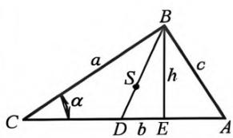</td><td colspan="4">F=bh/2=√l(l-a)(l-b)(l-c)=1/2absinαl=a+b+c/2</td><td colspan="2">SD=1/3BDCD=DA</td></tr><tr><td colspan="2">直角三角形a,b-直角边c-斜边</td><td colspan="2">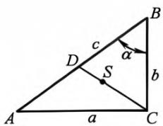</td><td colspan="4">F=1/2ab=1/4c2sin2α</td><td colspan="2">DS=1/3DCAD=DB</td></tr><tr><td colspan="2">平行四边形a,b-邻边h-对边间距离</td><td colspan="2">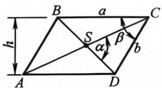</td><td colspan="4">F=ah=absinβ=AC·BD/2sinα</td><td colspan="2">在对角线交点上</td></tr><tr><td colspan="2">四边形d1,d2-对角线α-对角线夹角</td><td colspan="2">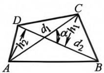</td><td colspan="4">F=d2/2(h1+h2)=d1d2/2sinα</td><td colspan="2"></td></tr><tr><td colspan="2">正多边形r-内切圆半径R-外接圆半径p-周长,p=ann-边数α=180°:n</td><td colspan="2">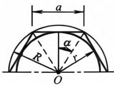</td><td colspan="4">F=n/2R2sin 2α=pr/2α=2√R2-r2一边</td><td colspan="2">在O点上</td></tr><tr><td colspan="2">梯形CE=ABAF=CDa,b-底</td><td colspan="2">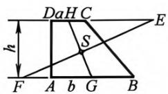</td><td colspan="4">F=a+b/2h</td><td colspan="2">HS=h/3·a+2b/a+bGS=h/3·2a+b/a+b</td></tr><tr><td colspan="2">菱形d1,d2-对角线a-边α-角</td><td colspan="2">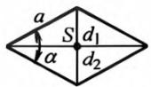</td><td colspan="4">F=a2sinα=d1d2/2</td><td colspan="2">在对角线交点上</td></tr><tr><td colspan="2">矩形a,b-邻边d-对角线</td><td colspan="2">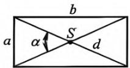</td><td colspan="4">F=ab=1/2d2sinα</td><td colspan="2">在对角线交点上</td></tr><tr><td colspan="2">圆形r——半径d——直径P——圆周长</td><td colspan="2">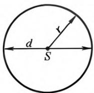</td><td colspan="4"> $F=\pi r^{2}=\frac{1}{4}\pi d^{2}=\frac{Pd}{4}=0.785d^{2}$  $P=\pi d$ </td><td colspan="2">在圆心上</td></tr><tr><td colspan="2">圆环R、r——外、内半径D、d——外、内直径Dpj——平均直径t——环宽</td><td colspan="2">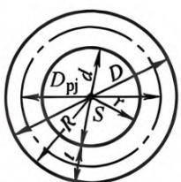</td><td colspan="4"> $F=\pi(R^{2}-r^{2})=\frac{1}{4}\pi(D^{2}-d^{2})=2\pi D_{pj}t$ </td><td colspan="2">在圆心上</td></tr><tr><td colspan="2">弓形r——半径s——弧长a——中心角度数b——弦长h——高</td><td colspan="2">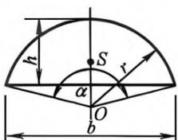</td><td colspan="4"> $F=\frac{1}{2}r^{2}\left(\frac{\alpha\pi}{180}-\sin\alpha\right)=\frac{r(s-b)+bh}{2}$ </td><td colspan="2"> $SO=\frac{1}{12}\times\frac{b^{3}}{F}$ 当α=180°时 $SO=\frac{4r}{3\pi}=0.4244r$ </td></tr><tr><td colspan="2">扇形r——半径s——弧长a——弧s的对应中心角s1——半径为1的对应弧长</td><td colspan="2">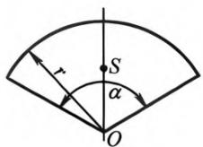</td><td colspan="4"> $F=\frac{1}{2}rs=\frac{\alpha}{360}\pi r^{2}=\frac{1}{2}s_{1}r^{2}$  $s_{1}=\frac{\alpha\pi}{180}$  $s=\frac{\alpha\pi}{180}\cdot r$ </td><td colspan="2"> $SO=\frac{2}{3}\cdot\frac{rb}{S}$ 当α=90° $SO=\frac{4}{3}\cdot\frac{\sqrt{2}}{\pi}r=0.6r$ </td></tr><tr><td colspan="2">部分圆环t——环宽Rpj——圆环平均半径</td><td colspan="2">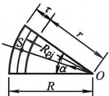</td><td colspan="4"> $F=\frac{\alpha\pi}{360}(R^{2}-r^{2})$  $=\frac{\alpha\pi}{180}R_{pj}t$  $=\alpha R_{pj}t$ </td><td colspan="2"> $SO=38.2\frac{R^{3}-r^{3}}{R^{2}-r^{2}}\cdot\frac{\sin\frac{\alpha}{2}}{\frac{\alpha}{2}}$ </td></tr><tr><td colspan="2">椭圆形a、b——主轴</td><td colspan="2">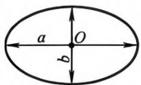</td><td colspan="4"> $F=\frac{\pi}{4}ab$ </td><td colspan="2">在a和b轴的交点上</td></tr><tr><td colspan="2">新月形OO1=l——圆心间的距离d——直径</td><td colspan="2">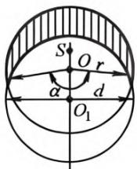</td><td colspan="4"> $F=r^{2}\left(\pi-\frac{\alpha\pi}{180}+\sin\alpha\right)=r^{2}\eta$  $\left(\eta=\pi-\frac{\alpha\pi}{180}+\sin\alpha\right)$ </td><td colspan="2"> $O_{1}S=\frac{(\pi-\eta)\cdot l}{2\eta}$ </td></tr><tr><td>l</td><td>d/10</td><td>2d/10</td><td>3d/10</td><td>4d/10</td><td>5d/10</td><td>6d/10</td><td>7d/10</td><td>8d/10</td><td>9d/10</td></tr><tr><td>η</td><td>0.40</td><td>0.79</td><td>1.18</td><td>1.56</td><td>1.91</td><td>2.25</td><td>2.55</td><td>2.81</td><td>3.02</td></tr></table>

续表

### 2.1.6 多面体的体积和表面积计算

多面体的体积和表面积计算如表 2.1-5 所示。

多面体的体积和表面积计算表  
表2.1-5

<table><tr><td>尺寸符号</td><td>形体</td><td>V——体积;M——侧面积;O——全面积</td><td>重心S</td></tr><tr><td>立方体a——棱d——对角线</td><td>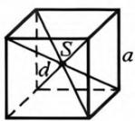</td><td> $V=a^{3}$  $M=4a^{2}$  $O=6a^{2}$ </td><td>在对角线交点上</td></tr><tr><td>棱柱b,t,h——边长F——底面积</td><td>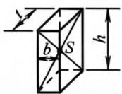</td><td> $V=bth=Fh$  $M=(b+t)2h$  $O=(b+t)2h+2bt$  $=2(hb+ht+bt)$ </td><td>在对角线交点上</td></tr><tr><td>三棱柱a,b,c——边长h——高;F——底面积</td><td>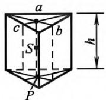</td><td> $V=Fh$  $M=(a+b+c)h$  $O=M+2F$ </td><td>SP=h/2P——中线的交点,本表下文同此</td></tr><tr><td>棱锥F——底面积f——一个组合三角形的面积n——组合三角形数</td><td>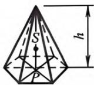</td><td> $V=\frac{h}{3}F$  $M=fn$  $O=M+F$ </td><td>SP=h/4</td></tr><tr><td>棱台 $F_{1}、F_{2}$ ——两平行底面的面积h——底面间距离a——一个组合梯形面积n——组合梯形数</td><td>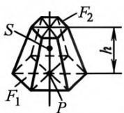</td><td> $V=\frac{h}{3}(F_{1}+F_{2}+\sqrt{F_{1}F_{2}})$  $M=an$  $O=M+F_{1}+F_{2}$ </td><td> $SP=\frac{h}{4}\cdot\frac{F_{1}+2\sqrt{F_{1}F_{2}}+3F_{2}}{F_{1}+\sqrt{F_{1}F_{2}}+F_{2}}$ </td></tr><tr><td>圆柱和空心圆柱R——外半径r——内半径t——壁厚ρ——平均半径</td><td>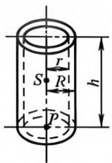</td><td>圆柱; $V=\pi R^{2}h$  $M=2\pi Rh$  $O=M+2\pi R^{2}$ 空心直圆柱: $V=\pi h(R^{2}-r^{2})$  $=2\pi\rho h$  $M=2\pi(R+r)h$  $O=M+2\pi(R^{2}-r^{2})$ </td><td> $SP=\frac{h}{2}$ </td></tr><tr><td>斜截直圆柱 $h_1$ ——最小高度 $h_2$ ——最大高度r——底面半径</td><td>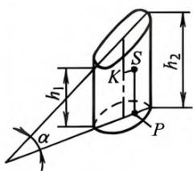</td><td> $V=\pi r^2\frac{h_1+h_2}{2}$  $M=\pi r(h_1+h_2)$  $O=M+\pi r^2\left(1+\frac{1}{\cos\alpha}\right)$ </td><td> $SP=\frac{h_1+h_2}{4}$  $=+\frac{1}{4}\cdot\frac{r^2}{h_1+h_2}\tan^2\alpha$  $SK=\frac{1}{2}\cdot\frac{r^2}{h_1+h_2}\tan\alpha$ </td></tr><tr><td>直圆锥r——底面半径h——高s——母线</td><td>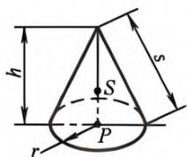</td><td> $V=\frac{\pi}{3}r^2h$  $M=\pi r\sqrt{r^2+h^2}=\pi rs$  $s=\sqrt{r^2+h^2};O=M+\pi r^2$ </td><td> $SP=\frac{1}{4}h$ </td></tr><tr><td>圆台R,r——底面半径h——高;s——母线 $s=\sqrt{(R-r)^2+h}$ </td><td>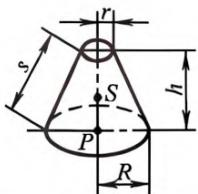</td><td> $V=\frac{\pi h}{3}(R^2+r^2+rR)$  $M=\pi s(R+r)$  $O=M+\pi(R^2+r^2)$ </td><td> $SP=\frac{h}{4}\cdot\frac{R^2+2Rr+3r^2}{R^2+Rr+r^2}$ </td></tr><tr><td>球r——半径d——直径</td><td></td><td> $V=\frac{4}{3}\pi r^3=\frac{1}{6}\pi d^3$  $=0.5236d^3$  $O=4\pi r^2=\pi d^2$ </td><td>在球心上</td></tr><tr><td>球扇形r——球半径d——弓形底圆直径h——弓形高</td><td>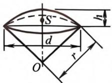</td><td> $V=\frac{2}{3}\pi r^2h=2.0944r^2h$  $O=\frac{\pi r}{2}(4h+d)=1.57r(4h+d)$ </td><td> $SO=\frac{3}{4}\left(r-\frac{h}{2}\right)$ </td></tr><tr><td>球缺h——弓形高r——球半径d——球缺底圆直径</td><td>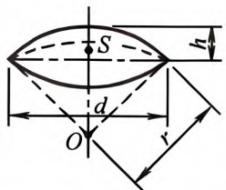</td><td> $V=\pi h^2\left(r-\frac{h}{3}\right)$  $M=2\pi rh=\frac{\pi}{4}(d^2+4h^2)$ </td><td> $SO=\frac{3}{4}\cdot\frac{(2r-h)^2}{3r-h}$ </td></tr><tr><td>圆环胎 $D_{pj}$ ——圆环胎平均直径 $R_{pj}$ ——圆环胎平均半径r——圆环胎断面半径d——圆环胎断面直径</td><td>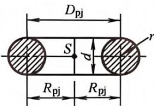</td><td> $V=2\pi^2R_{pj}r^2=\frac{\pi^2D_{pj}d^2}{4}$  $O=4\pi^2R_{pj}r=39.478R_{pj}r$ </td><td>在环中心上</td></tr><tr><td>球带R——球半径 $r_1,r_2$ ——底面半径h——腰高桶形D——中间断面直径d——底直径l——长</td><td>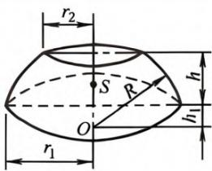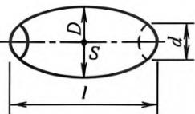</td><td> $V=\frac{\pi h}{6}(3r_1^2+3r_2^2+h^2)$  $M=2\pi Rh$  $O=M+\pi(r_1^2+r_2^2)$ 对于抛物线形桶板; $V = \frac{\pi l}{15} \left( 2D^{2} + Dd + \frac{3}{4} d^{2} \right)$ 对于圆形桶板: $V = \frac{1}{12} \pi l (2D^{2} + d^{2})$ </td><td>侧表面积 $SO=h_1+\frac{h}{2}$ 在轴交点上</td></tr><tr><td>椭圆球a,b,c——半轴</td><td>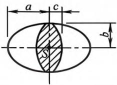</td><td> $V = \frac{4}{3} \pi abc$ (M和O不能用简单公式表达)</td><td>在轴交点上</td></tr></table>

2.2 热力学基础

### 2.2.1 基本概念及定义

**1. 热力系统（表 2.2-1）**

热力系统  
表 2.2-1

<table><tr><td>名称</td><td>定义及说明</td></tr><tr><td>热力系统</td><td>根据研究问题的需要,人为选取一定范围内的物质作为研究对象,称其为热力系统,简称为热力系或系统。热力系以外的物体称为外界。热力系与外界的交界面称为边界。边界的选取可以是真实的,也可以是假想的;可以是固定的,也可以是运动的;还可以是这几种边界的组合</td></tr><tr><td>闭口系统</td><td>热力系与外界无物质交换的系统。由于系统所包含的物质质量保持不变,亦称之为控制质量系统。对于闭口系统,常用控制质量法来研究</td></tr><tr><td>开口系统</td><td>热力系与外界有物质交换的系统。开口系统通常总是取一相对固定的空间,又称为控制容积系统,对其常用控制容积法来研究</td></tr><tr><td>绝热系统</td><td>热力系与外界无热量交换的系统</td></tr><tr><td>孤立系统</td><td>热力系与外界无任何能量和物质交换的系统</td></tr><tr><td>简单可压缩系统</td><td>热力系由可压缩流体构成,与外界只有可逆体积变化功的交换的系统</td></tr></table>

**2. 平衡状态**

热力系统在某一瞬间所呈现的宏观物理状况称为系统的状态。

平衡状态是指在没有外界作用（重力场除外）的情况下，系统的宏观性质不随时间变化的状态。

系统内部及系统与外界之间各种不平衡势差（力差、温差、化学势差）的消失是系统实现热力平衡状态的充要条件。具体来说：力差消失而建立的平衡称为力平衡；温差消失而建立的平衡称为热平衡；化学势差消失而建立的平衡称为化学或物理化学平衡。

**3. 工质的状态参数**

用来实现能量相互转换的媒介物称为工质。

描述系统工质状态的客观物理量称为状态参数。在热力学中，常用的状态参数有压力 $p$ 、温度 $T$ 、比体积 $v$ 、热力学能（内能） $U$ 、焓 $H$ 和熵 $S$ ，其中压力、温度和比体积可直接用仪表测定，称为基本状态参数（表2.2-2）。其他的状态参数可依据这些基本状态参数之间的关系间接导出。

工质的基本状态参数  
表2.2-2

<table><tr><td colspan="2">参数名称</td><td>单位</td><td>定义及说明</td></tr><tr><td rowspan="3">温度</td><td>定义</td><td>-</td><td>温度是确定一个系统是否与其他系统处于热平衡的状态函数。换言之,温度是热平衡的唯一判据。 温度的数量表示法称为温标</td></tr><tr><td>热力学温度(T)</td><td>K</td><td>热力学温标是建立在热力学第二定律基础上的完全不依赖测温物质性质的温标。采用开尔文(K)作为度量温度的单位,规定水的汽、液、固三相平衡共存的状态点(三相点)为基准点,并规定此点的温度为273.16K</td></tr><tr><td>摄氏温度(t)</td><td>°C</td><td>摄氏温度由热力学温度移动零点获得,其与热力学温度的换算关系为: t(°C)=T(K)-273.15K (2.2-1)</td></tr><tr><td colspan="2">压力(p)</td><td>Pa</td><td>单位面积上所受的垂直作用力称为压力(即压强)。在SI单位制中,规定在1m2表面上作用1N(牛顿)力时的压力为1Pa(帕斯卡)。 对于气体,实质上是气体分子运动撞击容器壁面,在单位面积的容器壁面上所呈现的平均作用力</td></tr><tr><td colspan="2">比体积(v)</td><td>m3/kg</td><td>比体积为体积(V)除以质量(m),即单位质量工质所占的体积,即 v=V/m (2.2-2) 比体积与压力、温度有关,当压力一定时,物质在不同温度下有不同的比体积;当温度一定时,在不同压力下也有不同的比体积</td></tr><tr><td colspan="2">密度(ρ)</td><td>kg/m3</td><td>密度为质量(m)除以体积(V),即单位体积工质的质量,它是比体积的倒数,即 ρ=1/v=m/V (2.2-3)</td></tr></table>

**4. 压力的测量**

测量工质压力的仪器称为压力计。由于压力计的测压元件处于其所在环境的压力作用下，因此压力计所测得的压力是工质的真实压力与环境介质压力之差，如图 2.2-1 所示。

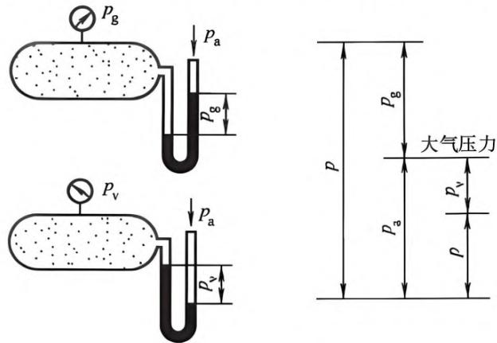  
图2.2-1 压力关系

工质的真实压力以 $p$ 表示。大气压力（或压力计所在空间的压力）以 $p_{\mathrm{b}}$ 表示。当 $p > p_{\mathrm{b}}$ 时，压力计上的读数称为表压力 $p_{\mathrm{g}}$ ，则工质真实压力为：

$$
p = p _ {\mathrm{g}} + p _ {\mathrm{b}}\tag{2.2-4}
$$

当 $p < p_{\mathrm{b}}$ 时，压力计称为真空计，真空计上的读数称为真空度 $p_{\mathrm{v}}$ ，则工质真实压力为：

$$
p = p _ {\mathrm{b}} - p _ {\mathrm{v}}\tag{2. 2-5}
$$

**5. 热力过程（表 2.2-3）**

热力过程  
表 2.2-3

<table><tr><td>名称</td><td>定义及说明</td><td>解释</td></tr><tr><td>热力过程</td><td>热力过程是指热力系从一个状态向另一个状态变化时所经历的全部状态的总和</td><td>热力过程中热力系中的物质总量可以保持不变,也可以发生变化。热力系的状态变化,意味着原平衡状态被破坏。所以,一切实际过程实际上都是不平衡的过程</td></tr><tr><td>准平衡过程(或准静态过程)</td><td>在无限小势差的推动下,由一系列连续的平衡态组成的过程称为准平衡过程,也称为准静态过程。其实现条件是:推动过程进行的势差无限小。这样保证系统在任意时刻皆无限接近于平衡态</td><td>准平衡过程是实际热力过程进行得足够缓慢的极限情况。这里的“缓慢”是热力学意义上的缓慢,即由不平衡到平衡的弛豫时间远小于过程进行所用的时间。因此,工程上的大多数过程,由于热力系恢复平衡的速度很快,仍可作为准平衡过程分析。建立准平衡过程的概念,就可以用确定的状态参数变化描述热力过程;还可以在状态参数坐标图上用一条连续曲线表示热力过程</td></tr><tr><td>可逆过程</td><td>如果系统完成某一热力过程后,再沿原来路径逆向进行时,能使系统和外界都返回原来状态而不留下任何变化,则这一过程为可逆过程</td><td rowspan="2">可逆过程实现的充要条件是:过程应为准平衡过程且过程中无任何耗散效应(通过摩擦、电阻、磁阻等使功变成热的效应)。由于可逆过程进行的结果不会产生任何能量损失,因而可逆过程可以作为实际过程中能量转换效果比较的标准和极限。因实际过程都或多或少地存在着各种不可逆因素(如摩擦、温差、力差或化学势差),所以实际过程都是不可逆的。工程上计算和分析时,通常先把实际过程当作可逆过程进行分析计算,然后再用一些经验系数加以修正,这是一种实用有效的处理方法</td></tr><tr><td>不可逆过程</td><td>如果反向过程能回到初态,但是给外界造成影响;或者不能回到初态,这样的过程称为不可逆过程</td></tr></table>

**6. 热力循环（表 2.2-4）**

热力循环  
表2.2-4

<table><tr><td>名称</td><td>定义及说明</td><td>解释</td></tr><tr><td>热力循环</td><td>工质由某一状态出发,经历一系列热力状态变化后,又回到原来初态的封闭热力过程称为热力循环,简称循环。系统实施热力循环的目的是实现预期连续的能量转换。</td><td>正向循环是把热能转换为机械能的循环,如图2.2-2(a)所示。所有热力发动机都是正循环,在 $p-v$ 图上按顺时针方向进行。正向循环对外所作的净功 $w_{\text{net}}$ 为膨胀功与压缩功之差,在 $p-v$ 图上为循环曲线1-a-2-b-1所包围的面积(正值)。正向循环所获得的净功可以表示为: $w_{\text{net}} = q_1 - q_2$ (2.2-6)</td></tr></table>

续表

<table><tr><td>名称</td><td>定义及说明</td><td>解释</td></tr><tr><td>热力循环</td><td>循环按照性质来分有可逆循环(全部由可逆过程组成的循环)和不可逆循环(含有不可逆过程的循环)。按照目的来分,有正向循环(即动力循环)和逆向循环(即制冷循环或热泵循环)</td><td>式中, $q_1$ 是工质从高温热源吸进的热量: $q_2$ 是工质向低温热源放出的热量。逆向循环是消耗一定量的机械能,迫使低温热源的热量流向高温热源的循环。压缩式制冷及热泵供热都是利用逆向循环工作的,如图2.2-2(b)所示。工质从低温热源吸进的热量为 $q_2$ ,向高温热源放出的热量为 $q_1$ ,逆循环所消耗的净功为循环曲线1-b-2-a-1所包围的面积的负值: $-w_{\text{net}} = q_2 - q_1$ 或 $q_1 = q_2 + w_{\text{net}}$ (2.2-7)</td></tr><tr><td>循环的经济指标</td><td>循环的经济指标用工作系数来表示:工作系数= $\frac{\text{得到的收益}}{\text{花费的代价}}$ (2.2-8)</td><td>动力循环的经济性用循环热效率定义,为工质在整个热力循环中,对外界所作的净功 $w_{\text{net}}$ 与循环过程中外界传递给工质的热量 $q_1$ 的比值,即: $\eta = \frac{w_{\text{net}}}{q_1} = \frac{q_1 - q_2}{q_1} = 1 - \frac{q_2}{q_1} < 1$ (2.2-9)对于制冷循环,其经济性用制冷系数 $\epsilon$ 来衡量,其定义为工质从低温热源吸收的热量 $q_2$ 与循环过程所消耗的净功 $w_{\text{net}}$ 的比值: $\varepsilon = \frac{q_2}{w_{\text{net}}} = \frac{q_2}{q_1 - q_2}$ (2.2-10)对于热泵循环,其经济性用供热系数 $\epsilon'$ 来衡量,其定义为工质向高温热源放出的热量 $q_1$ 与循环过程所消耗的净功 $w_{\text{net}}$ 的比值: $\epsilon' = \frac{q_1}{w_{\text{net}}} = \frac{q_1}{q_1 - q_2}$ (2.2-11)</td></tr></table>

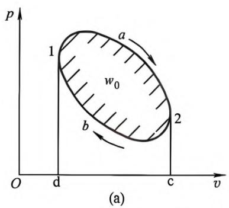

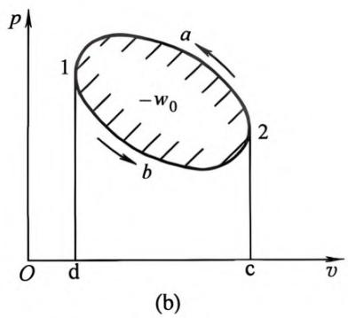  
图2.2-2 热力循环

### 2.2.2 热力学第一定律

**1. 热力学第一定律的实质**

热力学第一定律是能量转换与守恒定律在热力学中的应用，它确定了热力过程中各种能量在数量上的相互关系。

热力学第一定律可以表述为；当热能与其他形式的能量相互转换时，能的总量保持不变。

根据能量守恒与转换定律，任何一个热力系统的能量变化都可表示为：

进入系统的能量—离开系统的能量=系统储存能量的增量

热力学第一定律的应用中需要明确系统储存的能量以及系统与外界相互交换的能量（热量和功量）。

**2. 储存能（表 2.2-5）**

储存能  
表2.2-5

<table><tr><td>名称</td><td>定义及说明</td><td>解释</td></tr><tr><td>热力学能:U</td><td>储存于物质内部的微观粒子热运动具有的能量的总和称为热力学能U(以前称为内能),单位为J或kJ。1kg物质的热力学能称为比热力学能u,单位为J/kg或kJ/kg。热力学能是下列各种能量的总和:· 分子热运动形成的内动能,是温度的函数;· 分子间相互作用形成的内位能,是比体积的函数;· 维持一定分子结构的化学能、原子核内部的原子能以及电磁场作用下的电磁能等</td><td>热力学能是状态参数。若工质从初态1变化到终态2,其热力学能的变化只与初终态有关,而与过程的路径无关。工质经过循环变化后,热力学能的变化为零。 $\Delta U = \int_{1}^{2} dU = U_{2} - U_{1}\quad (2.2-12)$  $\oint dU = 0\quad (2.2-13)$ </td></tr><tr><td>总能E</td><td>系统储存的总能量,包括:系统内部所具有的热力学能U以及系统相对于外部坐标系做整体运动时的宏观动能 $E_{k}$ 、在重力场中处于某高度Z而具有的位能 $E_{p}$ 之和。因此,系统总能量E为: $E = U + E_{k} + E_{p} = U + \frac{1}{2}mc_{f}^{2} + mgZ$ (2.2-14)式中, $c_{f}$ 是系统速度</td><td>当系统静止时,宏观动能和重力位能没有变化,所以 $\Delta E=\Delta U$ </td></tr></table>

**3. 热量（表 2.2-6）**

热量  
表2.2-6

<table><tr><td>名称</td><td>定义及说明</td><td>解释</td></tr><tr><td>热量Q</td><td>热量是系统与外界之间在温差的推动下,通过微观粒子的无序运动(无规则运动)的方式传递的能量,用Q表示,单位为J或kJ。也就是说,借传热来传递能量,不需要有物体的宏观移动。热力学规定:系统吸热时,热量取正值;放热时,取负值</td><td>当物质吸收或放出热量时,仅产生温度变化而无相的变化,该热量称为显热;如果出现相的变化而无温度变化,该热量称为潜热。可逆过程的热量计算公式为: $Q_{\text{re}} = \int_{1}^{2} T \text{d}S$ (2.2-15)或 $q_{\text{re}} = \int_{1}^{2} T \text{d}s$ (2.2-16)</td></tr></table>

**4. 功量**

几种功及相互之间的关系如表 2.2-7 所示。

几种功及相互之间的关系  
表2.2-7

<table><tr><td>名称</td><td>定义及说明</td><td>解释</td></tr><tr><td>功W</td><td>功是系统与外界之间在力差的推动下,通过宏观的有序运动(有规则运动)的方式传递的能量,用W表示,单位为J或kJ。换言之,借做功来传递能量总是和物体的宏观位移有关</td><td>热力学规定:热力系对外界做功时,功取正值;外界对热力系做功时,功取负值</td></tr></table>

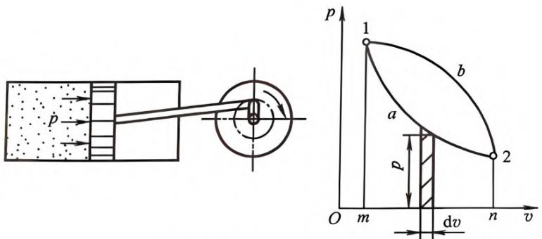

<table><tr><td>名称</td><td>定义及说明</td><td>解释</td></tr><tr><td>体积变化功(或膨胀功)W</td><td>系统体积变化所完成的功W,单位为J或kJ(工程热力学中最常见的简单可压缩系,与外界的功交换只有体积变化功,因此符号仍采用W)。膨胀功是简单可压缩系热变功的源泉。膨胀功往往对应闭口系统所求的功</td><td>由图2.2-3可知,工质在可逆过程中所做的功可以在p-v图上过程曲线1-a-2线下的面积来表示,因此p-v图也称示功图。可逆过程的体积变化功的计算公式为: Wre=∫12p dV (2.2-17)或 wre=∫12p dv (2.2-18)</td></tr><tr><td>轴功Ws</td><td>系统通过叶轮机械的轴与外界交换的功量称为轴功Ws</td><td>轴功通常是开口系统所求的功</td></tr><tr><td>流动功Wf</td><td>开口系统因维持工质流动而传递的功称为流动功Wf</td><td>流动功是所有进出口截面上推动功的代数和,即 Wf=Δ(pV)=p2V2-p1V1 (2.2-19)</td></tr><tr><td>技术功Wt</td><td>技术上可资利用的功称为技术功Wt</td><td>Wt与轴功Ws的关系如下: Wt=1/2mΔc2f+mgΔz+Ws (2.2-20)Wt与体积功W、流动功Wf的关系如下: Wt=W-Δ(pV) (2.2-21)当过程可逆时,有 Wt=-∫12Vdp (2.2-22)这也是不计动能差、位能差时的最大轴功</td></tr></table>

图2.2-3 膨胀功与 $p - v$ 图

**5. 焓（表 2.2-8）**

焓  
表2.2-8

<table><tr><td>名称</td><td>定义及说明</td><td>解释</td></tr><tr><td>焓H</td><td>焓的定义式为:H=U+pV (2.2-23)单位为J或kJ。1kg工质的焓称为比焓,是1kg工质的热力学能和推动功之和,单位为J/kg或kJ/kg、用h表示:h=u+pv (2.2-24)</td><td>因为在流动过程中,工质携带的能量除热力学能外,总伴有推动功,所以为工程应用方便,把U和pV组合起来,引入焓H的概念。由于U、p、V都是状态参数,因此焓也是状态参数</td></tr></table>

**6. 闭口系的能量方程**

热力学第一定律应用于控制质量系统时，其一般表达式为：

$$
Q = \Delta E + W\tag{2.2-25}
$$

$$
q = \Delta e + w\tag{2.2-26}
$$

对于控制质量闭口系统来说，比较常见的情况是在状态变化过程中，系统的动能和位能的变化为零，或与其他各项能量相比可忽略不计。于是，式（2.2-25）和式（2.2-26）中总能的变化，也即是热力学能的变化。于是，闭口系统能量方程的表达式有以下几种形式：

$$
1 \mathrm{kg} \text {工质经过有限过程:} q = \Delta u + w\tag{2.2-27}
$$

$$
1 \mathrm{kg} \text {工质经过微元过程:} \quad \delta q = \mathrm{d} u + \delta w\tag{2.2-28}
$$

$$
m \mathrm{kg} \text {工质经过有限过程:} Q = \Delta U + W\tag{2.2-29}
$$

$$
m \mathrm{kg} \text {工质经过微元过程:} \quad \delta Q = \mathrm{d} U + \delta W\tag{2.2-30}
$$

以上各式，对闭口系统各种过程（可逆过程或不可逆过程）及各种工质都适用。

对于可逆过程，以上各式又可表示为：

$$
q = \Delta u + \int_ {1} ^ {2} p \mathrm{d} v\tag{2.2-31}
$$

$$
\delta q = \mathrm{d} u + p \mathrm{d} v\tag{2.2-32}
$$

$$
Q = \Delta U + \int_ {1} ^ {2} p \mathrm{d} V\tag{2.2-33}
$$

$$
\delta Q = \mathrm{d} U + p \mathrm{d} V\tag{2.2-34}
$$

**7. 稳定流动系统的能量方程**

开口系统内任意一点的工质，其状态参数不随时间变化的流动过程称为稳定流动。实现稳定流动的必要条件是：

(1) 进、出口截面的参数不随时间而变;

(2) 系统与外界交换的功量和热量不随时间而变;

(3) 工质的质量流量不随时间而变, 且进、出口处的质量流量相等, 即

$$
q _ {\mathrm{m1}} = q _ {\mathrm{m2}} = \text {常数}
$$

以上 3 个条件可以概括为：系统与外界进行物质和能量的交换不随时间而变。

稳定流动能量方程的表达式有以下几种形式：

1kg 工质流过开口系统经过有限过程或微元过程时，有

$$
q = \Delta h + \frac {1}{2} \Delta c _ {\mathrm{f}} ^ {2} + g \Delta z + w _ {\mathrm{s}} = \Delta h + w _ {\mathrm{t}}\tag{2.2-35}
$$

$$
\delta q = \mathrm{d} h + \frac {1}{2} \mathrm{d} c _ {\mathrm{f}} ^ {2} + g \mathrm{d} z + \delta w _ {\mathrm{s}} = \mathrm{d} h + \delta w _ {\mathrm{t}}\tag{2.2-36}
$$

$m \mathrm{~kg}$ 工质流过开口系统经过有限过程或微元过程时, 有

$$
Q = \Delta H + \frac {1}{2} m \Delta c _ {\mathrm{f}} ^ {2} + m g \Delta z + W _ {\mathrm{s}} = \Delta H + W _ {\mathrm{t}}\tag{2.2-37}
$$

$$
\delta Q = \mathrm{d} H + \frac {1}{2} m \mathrm{d} c _ {\mathrm{f}} ^ {2} + m g \mathrm{d} z + \delta W _ {\mathrm{s}} = \mathrm{d} H + \delta W _ {\mathrm{t}}\tag{2.2-38}
$$

式（2.2-35）～式（2.2-38）对于任何工质、任何稳定流动过程，包括可逆和不可逆的稳定流动都是适用的。

对于可逆过程，因 $\delta w_{1} = -v\mathrm{d}p$ ， $w_{1} = -\int_{1}^{2}v\mathrm{d}p$ ，则以上各式又可写为：

$$
q = \Delta h - \int_ {1} ^ {2} v \mathrm{d} p\tag{2.2-39}
$$

$$
\delta q = \mathrm{d} h - v \mathrm{d} p\tag{2.2-40}
$$

$$
Q = \Delta H - \int_ {1} ^ {2} V \mathrm{d} p\tag{2.2-41}
$$

$$
\delta Q = \mathrm{d} H - V \mathrm{d} p\tag{2.2-42}
$$

对于周期性动作的热力设备（如活塞式压气机），如果每个周期内与外界交换的热量和功量保持不变，与外界交换的质量保持不变，进、出口截面上工质参数的平均值保持不变，则仍然可用稳定流动能量方程分析其能量的转换关系。

### 2.2.3 理想气体的性质与过程

**1. 理想气体及其状态方程式（表 2.2-9）**

理想气体及其状态方程式  
表 2.2-9

<table><tr><td>名称</td><td>定义及说明</td></tr><tr><td>理想气体和实际气体</td><td>实际气体是真实气体,在工程使用范围内通常离液态较近,分子间作用力及分子本身体积不可忽略,因此热力性质计算复杂,工程计算主要依据图表。理想气体是一种假想的气体,其分子模型满足:分子间没有相互作用力,分子本身是不占体积的弹性质点。理想气体是实际气体在低压、高温( $p \to 0$ 或 $v \to \infty$ )时的抽象。实际气体可以当作理想气体处理时,工质的热力性质计算式变得简单,容易利用解析的方法进行计算</td></tr><tr><td>理想气体状态方程式</td><td>表征理想气体平衡态基本参数(温度、压力和体积)之间数量关系的关系式,称为理想气体状态方程式。单位质量气体的理想气体状态方程式为: $pv = R_g T$ (2.2-43) $mkg$ 气体的理想气体状态方程式为: $pV = mR_g T$ (2.2-44)气体常数 $R_g$ 随气体种类而异,可利用 $R_g = R/M$ 求取,其中R是摩尔气体常数,其值为8.314J/(mol·K),M是气体的摩尔质量</td></tr><tr><td>气体的临界温度与临界压力</td><td>可以使气体等温压缩成液体的极限温度,称为该气体的临界温度。高于该温度时,无论压力增加至多大,都不能使气体液化。可以使气体等温压缩成液体的极限压力,称为该气体的临界压力。临界压力和临界温度确定的状态称为临界状态,其比体积和密度,分别称为临界比体积和临界密度</td></tr></table>

注：式（2.2-43）和式（2.2-44）中：p 是真实压力，Pa；v 是比体积， $m^{3}/kg$ ； $R_{g}$ 是气体常数（表 2.2-10），J/(kg·K)；T 是热力学温度，K；V 是气体的总体积， $m^{3}$ 。

部分气体的气体常数 $R_{g}$  
表2.2-10

<table><tr><td>名称</td><td>分子式</td><td>相对分子质量</td><td> $R_g$ [J/(kg·K)]</td><td>名称</td><td>分子式</td><td>相对分子质量</td><td> $R_g$ [J/(kg·K)]</td></tr><tr><td>空气</td><td>—</td><td>28.97</td><td>287.0</td><td>氦</td><td>He</td><td>4.003</td><td>2077.0</td></tr><tr><td>氧</td><td> $O_2$ </td><td>32.009</td><td>259.8</td><td>水蒸气</td><td> $H_2O$ </td><td>18.051</td><td>461.5</td></tr><tr><td>氮</td><td> $N_2$ </td><td>28.013</td><td>296.8</td><td>一氧化碳</td><td>CO</td><td>28.011</td><td>296.8</td></tr><tr><td>氢</td><td> $H_2$ </td><td>2.016</td><td>4124.0</td><td>二氧化碳</td><td> $CO_2$ </td><td>44.010</td><td>188.9</td></tr><tr><td>氨</td><td> $NH_3$ </td><td>17.031</td><td>488.2</td><td>甲烷</td><td> $CH_4$ </td><td>16.043</td><td>518.2</td></tr></table>

**2. 比热容（表 2.2-11）**

比热容  
表 2.2-11

<table><tr><td>名称</td><td>单位</td><td>定义及说明</td><td>解释</td></tr><tr><td>比热容c</td><td>J/(kg·K)</td><td>比(质量)热容c是单位质量工质温度每升高1开尔文(摄氏度)所需的热量,单位为J/(kg·K)。容积热容c&#x27;表示单位体积工质,在标准状态(p=0.101325MPa,t=0°C)下温度每升高1开尔文(摄氏度)所吸收的热量,单位为J/(m3·K)</td><td>影响比热容的主要因素:相对分子量与分子结构特征;状态参数:温度、压力;过程特性:定压过程、定容过程等</td></tr><tr><td>摩尔热容Cm</td><td>J/(mol·K)</td><td>单位摩尔工质温度每升高1开尔文(摄氏度)所吸收的热量</td><td rowspan="3">c和Cm之间的关系为:Cm=Mc (2.2-45)式中,M是工质摩尔质量。在工程实际计算中,如果忽略比热容随温度的变化、把比热容当作常数处理时,热力系从温度t1加热至t2所需的加热量为:定压过程:Q=mcp(t2-t1)定容过程:Q=mcv(t2-t1)</td></tr><tr><td>比定压热容cp</td><td>J/(kg·K)</td><td>在定压过程中,单位质量的工质温度每升高1开尔文(摄氏度)所吸收的热量</td></tr><tr><td>比定容热容CV</td><td>J/(kg·K)</td><td>在定容过程中,单位质量的工质温度每升高1开尔文(摄氏度)所吸收的热量</td></tr></table>

**3. 比热容与温度的关系**

比定压热容和比定容热容是状态参数，与过程无关。对于简单可压缩系统，它们应是温度、压力的函数。但对理想气体，它们仅是温度的单值函数，即 $c = f(t)$ 。利用比热容计算热量、热力学能、焓和熵时，对比热容的处理方法如表2.2-12所示。

比热容的几种处理方法  
表 2.2-12

<table><tr><td>名称</td><td>定义及说明</td><td>计算关系</td></tr><tr><td>真实比热容</td><td>将实验测得的不同气体的比热容随温度的变化关系表达为多项式形式,称之为真实比热容</td><td> $c = a_{0} + a_{1}t + a_{2}t^{2} + \cdots$  (2.2-46)</td></tr><tr><td>平均比热容</td><td>平均比热容表示 $t_1$ 到 $t_2$ 间隔内比热容的积分平均值</td><td>比热容表法: $c\big|_{t_1}^{t_2}=\frac{c\big|_{0}^{t_2}t_2-c\big|_{0}^{t_1}t_1}{t_2-t_1}$ (2.2-47)其中, $c\big|_{0}^{t_2}$ 和 $c\big|_{0}^{t_1}$ 可以从平均比热容表中查取。直线关系:若取真实比热容为直线关系式,可推得平均比热容的直线关系式为: $c\big|_{t_1}^{t_2}=a+\frac{b}{2}(t_1+t_2)=a+b'(t_1+t_2)$ (2.2-48)即只要用 $t_1+t_2$ 代替从表中查取的直线关系式中的 $t$ ,就可以求得 $t_1\sim t_2$ 的平均比热容</td></tr><tr><td>定值比热容</td><td>当气体温度不太高且变化范围不大,或计算精度要求不高时,可将比热容近似看作不随温度而变的定值,称为定值比热容</td><td>理想气体的定值比热容在表2.2-13中给出</td></tr></table>

理想气体的定值比热容  
表 2.2-13

<table><tr><td>气体种类</td><td> $c_{\text{V}}[\text{J}/(\text{kg} \cdot \text{K})]$ </td><td> $c_{\text{p}}[\text{J}/(\text{kg} \cdot \text{K})]$ </td><td> $\kappa$ </td></tr><tr><td>单原子</td><td> $\frac{3}{2}R_{\text{g}}$ </td><td> $\frac{5}{2}R_{\text{g}}$ </td><td>1.67</td></tr><tr><td>双原子</td><td> $\frac{5}{2}R_{\text{g}}$ </td><td> $\frac{7}{2}R_{\text{g}}$ </td><td>1.40</td></tr><tr><td>多原子</td><td> $\frac{7}{2}R_{\text{g}}$ </td><td> $\frac{9}{2}R_{\text{g}}$ </td><td>1.29</td></tr></table>

注： $\kappa=c_{p}/c_{V}$ 。

**4. 理想气体的热力学能、焓和熵（表 2.2-14）**

理想气体的热力学能、焓和熵  
表 2.2-14

<table><tr><td>类型</td><td>热力学能</td><td>焓</td><td>熵</td></tr><tr><td>微元变化</td><td> $\mathrm{d}u = c_{\mathrm{V}}\mathrm{d}T$ </td><td> $\mathrm{d}h = c_{\mathrm{p}}\mathrm{d}T$ </td><td> $\mathrm{d}s = c_{\mathrm{p}}\frac{\mathrm{d}T}{T} - R_{\mathrm{g}}\frac{\mathrm{d}p}{p}$ </td></tr><tr><td>有限变化(真实比热容)</td><td> $\Delta u = \int_{1}^{2}c_{\mathrm{V}}\mathrm{d}T$ </td><td> $\Delta h = \int_{1}^{2}c_{\mathrm{p}}\mathrm{d}T$ </td><td> $\Delta s = \int_{1}^{2}c_{\mathrm{p}}\frac{\mathrm{d}T}{T} - R_{\mathrm{g}}\ln\frac{p_{2}}{p_{1}}$ </td></tr><tr><td>有限变化(平均比热容)</td><td> $\Delta u = c_{\mathrm{V}}\left|{}_{0}^{\iota_{2}}t_{2}-c_{\mathrm{V}}\right|{}_{0}^{\iota_{1}}t_{1}$ </td><td> $\Delta h = c_{\mathrm{p}}\left|{}_{0}^{\iota_{2}}t_{2}-c_{\mathrm{p}}\right|{}_{0}^{\iota_{1}}t_{1}$ </td><td> $\Delta s = s_{T_{2}}^{0} - s_{T_{1}}^{0} - R_{\mathrm{g}}\ln\frac{p_{2}}{p_{1}}$ </td></tr><tr><td>有限变化(定值比热容)</td><td> $\Delta u = c_{\mathrm{V}}\Delta T$ </td><td> $\Delta h = c_{\mathrm{p}}\Delta T$ </td><td> $\Delta s = c_{\mathrm{p}}\ln\frac{T_{2}}{T_{1}} - R_{\mathrm{g}}\ln\frac{p_{2}}{p_{1}}$ </td></tr></table>

熵还有另外两个计算公式，即

$$
\mathrm{ds} = c _ {\mathrm{v}} \frac {\mathrm{dT}}{T} + R _ {\mathrm{g}} \frac {\mathrm{dv}}{v}\tag{2.2-49}
$$

$$
\mathrm{d} s = c _ {\mathrm{p}} \frac {\mathrm{d} v}{v} + c _ {V} \frac {\mathrm{d} p}{p}\tag{2.2-50}
$$

可根据已知条件的不同进行选择。

**5. 理想气体可逆过程计算公式**

常遇到的热力过程有定容过程、定压过程、定温过程、定熵过程（可逆绝热过程）以及多变过程，其过程的初态和终态参数之间的关系、过程比热容、功量和热量的计算方法见表 2.2-15。

理想气体可逆过程计算公式（定值比热容）  
表 2.2-15

<table><tr><td>过程</td><td>定容过程</td><td>定压过程</td><td>定温过程</td><td>定熵过程(可逆绝热过程)</td><td>多变过程</td></tr><tr><td>过程特征</td><td>v=定值</td><td>p=定值</td><td>T=定值</td><td>s=定值</td><td>—</td></tr><tr><td>T、p、v之间的关系式</td><td> $\frac{T_1}{p_1} = \frac{T_2}{p_2}$ </td><td> $\frac{T_1}{v_1} = \frac{T_2}{v_2}$ </td><td> $p_1 v_1 = p_2 v_2$ </td><td> $p_1 v_1^{\kappa} = p_2 v_2^{\kappa}$  $T_1 v_1^{\kappa-1} = T_2 v_2^{\kappa-1}$  $T_1 p_1^{\frac{\kappa-1}{\kappa}} = T_2 p_2^{\frac{\kappa-1}{\kappa}}$ </td><td> $p_1 v_1^n = p_2 v_2^n$  $T_1 v_1^{n-1} = T_2 v_2^{n-1}$  $T_1 p_1^{\frac{n-1}{n}} = T_2 p_2^{\frac{n-1}{n}}$ </td></tr><tr><td>比热容c</td><td> $c_v = \frac{R_g}{\kappa-1}$ </td><td> $c_p = \frac{\kappa R_g}{\kappa-1}$ </td><td>∞</td><td>0</td><td> $\frac{n-\kappa}{n-1} c_v$ </td></tr><tr><td>过程功 $w = \int_{1}^{2} p dv$ </td><td>0</td><td> $p(v_2 - v_1)$  $R_g(T_2 - T_1)$ </td><td> $R_g T \ln \frac{v_2}{v_1}$  $R_g T \ln \frac{p_1}{p_2}$ </td><td> $-\Delta u$  $\frac{R_g}{\kappa-1}(T_1 - T_2)$  $\frac{R_g T_1}{\kappa-1}\left[1 - \left(\frac{p_2}{p_1}\right)^{\frac{\kappa-1}{\kappa}}\right]$ </td><td> $\frac{R_g}{n-1}(T_1 - T_2)$  $\frac{R_g T_1}{n-1}\left[1 - \left(\frac{p_2}{p_1}\right)^{\frac{n-1}{n}}\right]$ </td></tr><tr><td>技术功 $w_t = -\int_{1}^{2} v dp$ </td><td> $v(p_1 - p_2)$ </td><td>0</td><td> $w_t = w$ </td><td> $-\Delta h$  $\frac{\kappa R_g}{\kappa-1}(T_1 - T_2)$  $\frac{\kappa R_g T_1}{\kappa-1}\left[1 - \left(\frac{p_2}{p_1}\right)^{\frac{\kappa-1}{\kappa}}\right]$  $w_t = \kappa w$ </td><td> $\frac{n R_g}{n-1}(T_1 - T_2)$  $\frac{n R_g T_1}{n-1}\left[1 - \left(\frac{p_2}{p_1}\right)^{\frac{n-1}{n}}\right]$  $w_t = n w$ </td></tr><tr><td>过程热量q</td><td>Δu</td><td>Δh</td><td> $T(s_2 - s_1)$  $q = w = w_t$ </td><td>0</td><td> $\frac{n-\kappa}{n-1} c_v (T_2 - T_1)$ </td></tr></table>

注： $\kappa=c_{p}/c_{V}$ 。

### 2.2.4 热力学第二定律及其相关概念

热力学第二定律及其相关概念见表 2.2-16。

热力学第二定律及其相关概念  
表 2.2-16

<table><tr><td>名称</td><td>定义及说明</td><td>解释</td></tr><tr><td>热力学第二定律</td><td>热力学第二定律的两种典型表述:克劳修斯表述法:热不可能自发地、不付代价地从低温物体传到高温物体。开尔文-普朗克表述法:不可能制造出从单一热源吸热,使之全部转换为功而不留下其他任何变化的热力发动机</td><td>热力学第二定律是对热力学过程方向性的描述。说明能量不仅有“量”的多少,而且有“质”的高低。热力学第二定律的两种典型表述说明,热从低温物体传至高温物体,以及热变功都是非自发过程,要使它们实现,必须花费一定的代价或具备一定的条件,也就是说要引起其他变化。在制冷机或热泵中,此代价就是消耗的功量或热量,而热变功中至少还要有一个放热的热源</td></tr><tr><td>卡诺循环与卡诺定理</td><td>卡诺循环是工作于温度分别为 $T_1$ 的高温热源和 $T_2$ 的低温热源之间的正循环,由两个可逆定温过程和两个可逆绝热过程组成,其循环过程为:绝热压缩、定温吸热、绝热膨胀、定温放热。卡诺定理一指出,在相同的高温热源和相同的低温热源之间工作的一切可逆循环,其热效率都相等,与工质及循环形式无关。卡诺循环的热效率 $η_c$ 只决定于高温热源和低温热源的温度,即: $η_c = 1 - \frac{T_2}{T_1}$ (2.2-51)卡诺定理二指出,在相同的高温热源和相同的低温热源之间工作的一切不可逆循环,其热效率必小于可逆循环的热效率</td><td>卡诺定理有重要的实用价值和理论价值:(1)卡诺定理指出了热效率的极限值,这一极限值仅与热源及冷源的温度有关。由于 $T_2=0$ 和 $T_1 \to \infty$ 都不可能,因此热机热效率恒小于1。(2)提高热效率的根本途径在于提高热源温度 $T_1$ ,降低冷源温度 $T_2$ ,以及尽可能减少不可逆因素。(3)由于不花代价的低温热源的温度以大气环境温度 $T_0$ 为限,温度为 $T$ 的热源放出的热量 $Q$ 最多只能有: $W_{\text{net}} = Q \left(1 - \frac{T_0}{T}\right)$ 或 $W_{\text{net}} = \int \left(1 - \frac{T_0}{T}\right) \delta Q$ 可以转变为功,这就提示了热变功的极限</td></tr><tr><td>熵、比熵及温熵图</td><td>在卡诺定理基础上,克劳修斯从数学上严格证明了工质经任意可逆循环, $δQ_{re}/T$ 沿整个循环的积分为零,即 $\oint \frac{\delta Q_{re}}{T} = 0$ 因此,物理量 $δQ_{re}/T$ 具有状态参数的性质,定义其为熵,以符号 $S$ 表示,单位为 $kJ/K$ : $dS = \frac{\delta Q_{re}}{T}$ (2.2-52)即熵的变化等于可逆过程中系统与外界交换的热量与热力学温度的比值。单位质量工质的熵,称为比熵,以符号 $s$ 表示,单位为 $kJ/(kg·K)$ 。单位质量工质在等温加热过程中,从外界加入热量 $q$ ,加热时的温度为 $T$ ,加热前后工质的熵分别为 $s_1$ 、 $s_2$ ,对于可逆过程可得: $Δs = s_2 - s_1 = \frac{q}{T}$ (2.2-53)或 $q = T(s_2 - s_1)$ (2.2-54)</td><td>可逆过程中,当 $s_2 > s_1$ 时, $q > 0$ ,表示工质从外界吸收热量;当 $s_2 < s_1$ 时, $q < 0$ ,表示工质对外界放出热量;当 $s_2 = s_1$ 时,表示工质与外界无热量交换,一般称为等熵过程或绝热过程。若以 $T$ 为纵坐标, $s$ 为横坐标,则可绘成类似于 $p-v$ 图的 $T-s$ 图(温熵图),如图2.2-4所示。在 $T-s$ 图中,每一条曲线代表一个可逆过程,图中曲线 $1-a-2$ 下面的面积 $1a2s_2s_11$ ,表示该可逆过程中工质与外界所传的热量,因此, $T-s$ 图也称示热图</td></tr><tr><td>克劳修斯不等式</td><td>克劳修斯不等式可表示为: $\oint\frac{\delta Q}{T_r} \leqslant 0$ (2.2-55)式中, $T_r$ 为热源温度。等号仅当循环可逆时成立,对于不可逆循环,克劳修斯积分式永远小于零</td><td>克劳修斯不等式也可写作: $\mathrm{d}S \geqslant \frac{\delta Q}{T_r}$ (2.2-56) $S_2 - S_1 \geqslant \int_1^2 \frac{\delta Q}{T_r}$ (2.2-57)</td></tr><tr><td>孤立系统熵增原理</td><td>由式(2.2-57)可知,闭口系在不可逆过程中, $\Delta S$ 大于过程中的 $\frac{\delta Q}{T_r}$ ,若将此差用熵产 $\Delta S_g$ 表示,则有: $\Delta S_g = \Delta S - \int_1^2 \frac{\delta Q}{T_r} \geqslant 0$ (2.2-58)和 $\Delta S = \Delta S_g + \int_1^2 \frac{\delta Q}{T_r} = \Delta S_g + \Delta S_f$ (2.2-59)其中, $\Delta S_f$ 是由于系统与外界发生热交换,由热流引起的熵变,称为熵流。对于孤立系统,由于 $\delta Q=0$ ,则有: $\Delta S_{\text{iso}} = \Delta S_g \geqslant 0$ (2.2-60)即为孤立系统熵增原理</td><td>由式(2.2-59)可知,在不可逆过程中引起系统熵变化的因素有:(1)热流引起的熵流,可为正、负或零,视热流方向及情况而定。(2)由于不可逆因素存在所引起的熵产,其值永远为正</td></tr><tr><td>烟、烷</td><td>在环境条件下,能量中可转化为有用功的最高份额称为该能量的烟;或者,热力系只与环境相互作用,从任意状态可逆地变化到与环境相平衡的状态时,做出的最大有用功称为该热力系的烟,以符号 $E_x$ 表示。在环境条件下不可能转化为有用功的那部分能量称为烷,以符号 $A_n$ 表示。任何能量都由烟和烷两部分组成 $E=E_x+A_n$ (2.2-61)</td><td>各种形式的能量相互转化时,具有明显的方向性。例如机械能、电能等可以全部转化为热能,热能只有部分可转化为机械能。习惯上将“有用功”作为“无限可转化能量”的同义词</td></tr><tr><td>热量烟</td><td>在温度为 $T_0$ 的环境条件下,系统( $T>T_0$ )所提供的热量中可转化为有用功的最大值是热量烟,用符号 $E_{x,Q}$ 表示。 $E_{x,Q}=Q-T_0\Delta S$ (2.2-62)相应的,热量烷为: $A_{n,Q}=T_0\Delta S$ (2.2-63)</td><td>热量烟是过程量,环境状态一定时,还与系统供热温度变化规律有关。由于 $T>T_0$ , $E_{x,Q}$ 与Q正负相同,系统放出热量Q的同时也放出了热量烟</td></tr><tr><td>冷量烟</td><td>工程上把与温度低于环境温度 $T_0$ 的物体( $T\( E_{x,Q_c}=T_0\Delta S-Q_c$ (2.2-64)相应的,冷量烷为: $A_{n,Q_c}=T_0\Delta S$ (2.2-65)</td><td>由于 $T\( E_{x,Q_c}$ 与Q正负相反。吸热过程, $Q_c>0$ , $E_{x,Q_c}<0$ ;放热过程, $Q_c<0$ , $E_{x,Q_c}>0$ 。系统吸热放出冷量烟(系统的烟减少),利用它对外做功;系统放热得到冷量烟(系统的烟增加),这时外界提供最小有用功</td></tr><tr><td>热力学能 烟、焓烟</td><td>闭口系统在给定状态的热力学能烟为:Ex,U=(U-U0)-T0(S-S0)+p0(V-V0)(2.2-66)对于1kg工质,比热力学能烟为:e x,U=(u-u0)-T0(s-s0)+p0(v-v0)(2.2-67)稳流工质的烟通常称焓烟:Ex,H=(H-H0)-T0(S-S0)(2.2-68)对于1kg工质,焓烟为:e x,H=(h-h0)-T0(s-s0)(2.2-69)</td><td>与环境处于热力不平衡的闭口系统,当其与环境发生作用、可逆地变化到与环境平衡时,可做出的最大有用功,称为闭口系统工质的热力学能烟;与环境处于热力不平衡的流动工质,通过稳流热力系在只与环境发生作用的条件下,可逆地变化到与环境平衡时做出的最大有用功,称为稳流工质的焓烟</td></tr><tr><td>烟损失</td><td>环境温度 T0一定时,孤立系统烟损失与其熵增成正比,用符号I表示:I=T0ΔSg(2.2-70)</td><td></td></tr><tr><td>烟平衡方程</td><td>闭口系统的烟平衡方程为:Ex,Q=Ex,U2-Ex,U1+Wu+I(2.2-71)其中系统有用功Wu是系统做出的过程功W与排斥大气功p0(V1-V2)之差:Wu=W-p0(V1-V2)(2.2-72)稳定流动系的烟平衡方程为:Ex,Q=Ex,H2-Ex,H1+\frac{1}{2}mcf2-1/2mcf1+Ws+I(2.2-73)</td><td></td></tr><tr><td>烟效率</td><td>烟效率为系统在过程中被利用或收益的烟Ex,u与支付或耗费的烟Ex,p的比值,用符号 ηex表示:ηex=Ex,u/Ex,p(2.2-74)</td><td>烟效率弥补了仅从能量的数量评价过程对能量利用程度的不足,可作为评价各种实际热力学完善程度的统一尺度</td></tr></table>

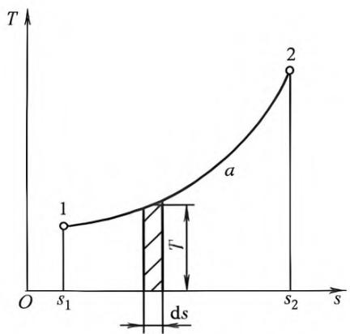  
图2.2-4 $T - s$ 图

### 2.2.5 水蒸气

**1. 饱和状态与非饱和状态**

液体在封闭容器中加热汽化，单位时间内逸出液面与回到液体中的分子数相等时，蒸汽与液体的物理量将保持不变，汽液两相处于平衡状态，这时称为饱和状态。

饱和状态下，蒸汽和液体的压力称为饱和压力（ $p_{\mathrm{s}}$ ）；对应的温度称为饱和温度，即沸点（ $t_{\mathrm{s}}$ ）。处于饱和状态的液体称为饱和液体；两者的混合物称为湿饱和蒸汽，简称湿蒸汽。相应的不含饱和液体的饱和蒸汽，称为干饱和蒸汽，简称干蒸汽。

当蒸汽的温度高于其压力所对应的饱和温度时，则称为过热蒸汽。过热蒸汽的温度和其压力所对应的饱和温度之差称为过热度。

当液体的温度低于其压力所对应的饱和温度时，则此液体称为未饱和液体，或过冷液体。液体的温度和其压力所对应的饱和温度之差称为过冷度。

**2. 水蒸气的定压发生过程**

工程上应用的蒸汽，大多是在锅炉中定压加热产生的。蒸汽的产生过程可分为三个阶段（图 2.2-5）：

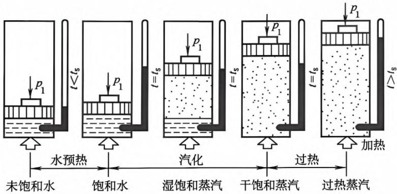  
图 2.2-5 水蒸气的定压发生过程示意图

(1) 单位质量 $0.01^{\circ} \mathrm{C}$ 的水, 在定压力 $p_{1}$ 下开始加热时, 其初状态温度 $t < t_{\mathrm{s}}$ , 在 $p - v$ 图和 $T - s$ 图上用点 $a_{1}$ 表示, 见图 2.2-6。

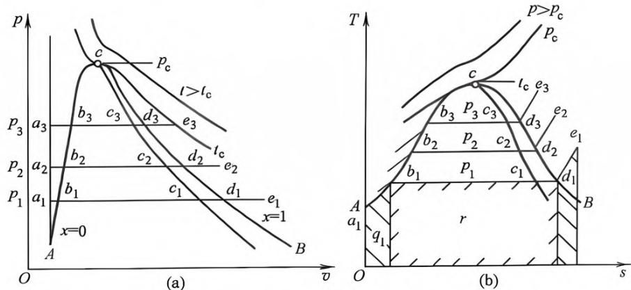  
图 2.2-6 水蒸气定压发生过程的表示  
(a) p-v 图；(b) T-s 图

(2) 随着加热, 水温逐渐上升, 比体积略有增加, 定压预热过程线为 $a_{1} - b_{1}$ 段, $b_{1}$ 点为水温 $t = t_{\mathrm{s}}$ 的饱和水状态。 $T - s$ 图上 $a_{1} - b_{1}$ 过程线下面的阴影面积, 表示水在定压预热过程中加入的热量 $q_{1}$ , 称为液体热。

(3) 对饱和水继续加热, 水开始沸腾, 水温不变, 比体积增大, 饱和水的定压汽化过程线如图中 $b_{1} - d_{1}$ 线所示, 直至 $d_{1}$ 点达到干饱和蒸汽状态。在 $T - s$ 图上, $b_{1} - d_{1}$ 过程线下面的阴影面积表示饱和水在定压汽化过程中吸入的热量, 称为汽化潜热 $(r)$ 。水在汽化过程中形成的汽、水混合物称为湿饱和蒸汽; 湿饱和蒸汽中的干蒸汽的量, 称为干度 $(x)$ 。显然, $b_{1}$ 点的饱和水的干度 $x = 0$ , 而 $d_{1}$ 点的干饱和蒸汽的干度 $x = 1$ 。

（4）对 $d_{1}$ 点的饱和蒸汽继续加热时，蒸汽的温度上升， $t > t_{s}$ ，比体积增大，这一过程以 $d_{1} - e_{1}$ 线表示，该线下面的阴影面积表示过热热量。

由图 2.2-6 可知，随着压力 p 的升高，饱和温度亦将升高，汽化过程的比体积变化逐渐减小，汽化潜热也逐渐变小，但液体加热量将增多，至临界点 c 时，汽化潜热为零，而液体加热量为最大。

水蒸气的 $p$ 、 $v$ 、 $T$ 的关系不符合理想气体状态方程，状态方程式复杂，所以工程中一般都利用制成的各种水和水蒸气的物理特性表等进行计算。根据工程需要，饱和水与饱和水蒸气表又分为按压力 $p$ 排列的表（表 2.2-21）和按温度 $t$ 排列的表（表 2.2-22），依次列出不同温度 $t$ 或压力 $p$ 下的 $p$ （或 $t$ ）、 $v'$ 、 $v''$ 、 $h'$ 、 $h''$ 、 $s'$ 和 $s''$ 。其中 “'” “''” 分别表示饱和水和饱和蒸汽的状态参数。对于干度是 $x$ 的湿蒸汽的状态参数，可利用同一 $t$ （或 $p$ ）下的饱和水与饱和蒸汽的状态参数求取，即：

$$
v = x v ^ {\prime \prime} + (1 - x) v ^ {\prime}
$$

$$
h = x h ^ {\prime \prime} + (1 - x) h ^ {\prime}\tag{2.2-75}
$$

(2.2-76)

$$
s = x s ^ {\prime \prime} + (1 - x) s ^ {\prime}\tag{2.2-77}
$$

**3. 水及水蒸气热力性质的计算程序**

国际水和水蒸气性质协会（IAPWS）在 1997 年推出并于之后陆续修订的水和水蒸气热力性质公式（IAPWS—IF97），其适用范围为：273.15K≤T≤1073.15K，p≤100MPa；1073.15K≤T≤2273.15K，p≤50MPa。IAPWS—IF97 将此适用范围划分为 5 个计算子区域，如图 2.2-7 所示，它们分别是：1——未饱和水区；2——过热蒸汽区；3——临界水和临界蒸汽区；4——饱和区；5——超高温（过热）蒸汽区。

计算程序的参考值包括：

水的气体常数：

$$
R _ {\mathrm{H} _ {2} \mathrm{O}} = 0. 4 6 1 5 2 6 \mathrm{kJ/(kg} \cdot \mathrm{K)}\tag{2.2-78}
$$

临界参数:

$$
T _ {\mathrm{c}} = 6 4 7. 0 9 6 \mathrm{K}\tag{2.2-79}
$$

$$
p _ {\mathrm{c}} = 2 2. 0 6 4 \mathrm{MPa}\tag{2.2-80}
$$

$$
\rho_ {\mathrm{c}} = 3 2 2 \mathrm{kg/m}\tag{2.2-81}
$$

IAPWS-IF 97 中，针对各个计算子区域，给出了区域 1、区域 2 和区域 5 中吉布斯自由能与温度和压力的关系式，区域 3 中赫姆霍兹自由能与密度和温度的关系式，区域 4 中饱和压力与饱和温度的关系式，而其他热力学参数可通过基本热力学关系式求得。

以区域 1 为例，其无量纲吉布斯自由能关系式为：

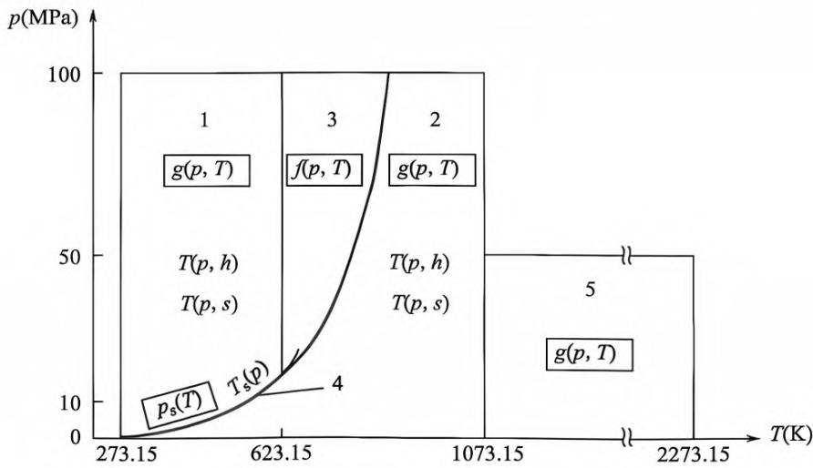  
图2.2-7 IAPWS-IF97公式的计算子区域

$$
\frac {g (p , T)}{R _ {\mathrm{H} _ {2} \mathrm{O}} T} = \gamma (\pi , \tau) = \sum_ {i = 1} ^ {3 4} n _ {i} (7. 1 - \pi) ^ {I _ {i}} (\tau - 1. 2 2 2) ^ {J _ {i}}\tag{2.2-82}
$$

其中， $\pi = p / p^{*}$ ， $\tau = T^{*} / T$ ， $p^{*} = 16.53 \mathrm{MPa}$ ， $T^{*} = 1386 \mathrm{~K}$ 。系数 $n_{i}$ 和指数 $I_{i}$ 、 $J_{i}$ 由表2.2-17给出。其他热力学参数可利用基本热力学关系，由式（2.2-82）及其对 $\pi$ 和 $\tau$ 的偏导数计算得到，如表2.2-18所示。

其他区域的计算关系式可参考 IAPWS-IF97 文件相关内容。IAPWS-IF97 中还给出了区域 1～4 内反求温度的关系式，以及区域间界线的计算关系式。

区域1无量纲吉布斯自由能公式的系数与指数  
表 2.2-17

<table><tr><td>i</td><td> $I_i$ </td><td> $J_i$ </td><td> $n_i$ </td><td>i</td><td> $I_i$ </td><td> $J_i$ </td><td> $n_i$ </td></tr><tr><td>1</td><td>0</td><td>-2</td><td>0.14632971213167</td><td>18</td><td>2</td><td>3</td><td>-0.44141845330846×10-5</td></tr><tr><td>2</td><td>0</td><td>-1</td><td>-0.84548187169114</td><td>19</td><td>2</td><td>17</td><td>-0.72694996297594×10-15</td></tr><tr><td>3</td><td>0</td><td>0</td><td>-0.37563603672040×101</td><td>20</td><td>3</td><td>-4</td><td>-0.31679644845054×10-4</td></tr><tr><td>4</td><td>0</td><td>1</td><td>0.33855169168385×101</td><td>21</td><td>3</td><td>0</td><td>-0.28270797985312×10-5</td></tr><tr><td>5</td><td>0</td><td>2</td><td>-0.95791963387872</td><td>22</td><td>3</td><td>6</td><td>-0.85205128120103×10-9</td></tr><tr><td>6</td><td>0</td><td>3</td><td>0.15772038513228</td><td>23</td><td>4</td><td>-5</td><td>-0.22425281908000×10-5</td></tr><tr><td>7</td><td>0</td><td>4</td><td>-0.16616417199501×10-1</td><td>24</td><td>4</td><td>-2</td><td>-0.65171222895601×10-6</td></tr><tr><td>8</td><td>0</td><td>5</td><td>0.81214629983568×10-3</td><td>25</td><td>4</td><td>10</td><td>-0.14341729937924×10-12</td></tr><tr><td>9</td><td>1</td><td>-9</td><td>0.28319080123804×10-3</td><td>26</td><td>5</td><td>-8</td><td>-0.40516996860117×10-6</td></tr><tr><td>10</td><td>1</td><td>-7</td><td>-0.60706301565874×10-3</td><td>27</td><td>8</td><td>-11</td><td>-0.12734301741641×10-8</td></tr><tr><td>11</td><td>1</td><td>-1</td><td>-0.18990068218419×10-1</td><td>28</td><td>8</td><td>-6</td><td>-0.17424871230634×10-9</td></tr><tr><td>12</td><td>1</td><td>0</td><td>-0.32529748770505×10-1</td><td>29</td><td>21</td><td>-29</td><td>-0.68762131295531×10-18</td></tr><tr><td>13</td><td>1</td><td>1</td><td>-0.21841717175414×10-1</td><td>30</td><td>23</td><td>-31</td><td>0.14478307828521×10-19</td></tr><tr><td>14</td><td>1</td><td>3</td><td>-0.52838357969930×10-4</td><td>31</td><td>29</td><td>-38</td><td>0.26335781662795×10-22</td></tr><tr><td>15</td><td>2</td><td>-3</td><td>-0.47184321073267×10-3</td><td>32</td><td>30</td><td>-39</td><td>-0.11947622640071×10-22</td></tr><tr><td>16</td><td>2</td><td>0</td><td>-0.30001780793026×10-3</td><td>33</td><td>31</td><td>-40</td><td>0.18228094581404×10-23</td></tr><tr><td>17</td><td>2</td><td>1</td><td>0.47661393906987×10-4</td><td>34</td><td>32</td><td>-41</td><td>-0.93537087292458×10-25</td></tr></table>

区域1中的热力学参数计算关系式  
表2.2-18

<table><tr><td>参数</td><td>计算方法</td><td>计算关系式</td></tr><tr><td>比体积</td><td> $v = (\partial g/\partial p)_{T}$ </td><td> $v(\pi,\tau)\frac{p}{R_{H_2O}T} = \pi\gamma_\pi$ </td></tr><tr><td>比热力学能</td><td> $u = g - T(\partial g/\partial T)_{p} - p(\partial g/\partial p)_{T}$ </td><td> $\frac{u(\pi,\tau)}{R_{H_2O}T} = \tau\gamma_\tau - \pi\gamma_\pi$ </td></tr><tr><td>比熵</td><td> $s = -(\partial g/\partial T)_{p}$ </td><td> $\frac{s(\pi,\tau)}{R_{H_2O}} = \tau\gamma_\tau - \gamma$ </td></tr><tr><td>比焓</td><td> $h = g - T(\partial g/\partial T)_{p}$ </td><td> $\frac{h(\pi,\tau)}{R_{H_2O}T} = \tau\gamma_\tau$ </td></tr><tr><td>比定容热容</td><td> $c_V = (\partial u/\partial T)_V$ </td><td> $\frac{c_V(\pi,\tau)}{R_{H_2O}} = -\tau^2\gamma_\pi + \frac{(\gamma_\pi - \tau\gamma_\pi)^2}{\gamma_\pi\pi}$ </td></tr><tr><td>比定压热容</td><td> $c_p = (\partial h/\partial T)_p$ </td><td> $\frac{c_p(\pi,\tau)}{R_{H_2O}} = -\tau^2\gamma_\pi$ </td></tr></table>

注： $\gamma_{\pi} = \partial \gamma /\partial \pi_{\tau},\gamma_{\tau} = \partial \gamma /\partial \tau_{\pi},\gamma_{\pi \pi} = \partial^{2}\gamma /\partial \pi_{\tau}^{2},\gamma_{\pi \tau} = \partial^{2}\gamma /\partial \tau_{\pi}^{2},\gamma_{\pi \tau} = \partial^{2}\gamma /( \partial \pi \partial \tau )$

**4. 水的常用物理参数（表 2.2-19）**

水的常用物理参数  
表 2.2-19

<table><tr><td>温度t(°C)</td><td>压力p(kPa)</td><td>比定压热容cp[kJ/(kg·K)]</td><td>导热系数λ[W/(m·K)]</td><td>热扩散率a(10-8m2/s)</td><td>动力黏度μ(10-6Pa·s)</td><td>运动黏度ν(10-6m2/s)</td></tr><tr><td>1</td><td>98</td><td>4.2166</td><td>0.563</td><td>13.353</td><td>1731.10</td><td>1.731</td></tr><tr><td>10</td><td>98</td><td>4.1955</td><td>0.580</td><td>13.829</td><td>1305.90</td><td>1.306</td></tr><tr><td>20</td><td>98</td><td>4.1844</td><td>0.598</td><td>14.328</td><td>1001.60</td><td>1.003</td></tr><tr><td>30</td><td>98</td><td>4.1801</td><td>0.615</td><td>14.789</td><td>797.35</td><td>0.801</td></tr><tr><td>40</td><td>98</td><td>4.1796</td><td>0.631</td><td>15.206</td><td>652.98</td><td>0.658</td></tr><tr><td>50</td><td>98</td><td>4.1815</td><td>0.644</td><td>13.353</td><td>546.85</td><td>0.553</td></tr><tr><td>60</td><td>98</td><td>4.1851</td><td>0.654</td><td>15.578</td><td>466.39</td><td>0.474</td></tr><tr><td>70</td><td>98</td><td>4.1902</td><td>0.663</td><td>15.903</td><td>403.89</td><td>0.413</td></tr><tr><td>80</td><td>98</td><td>4.1969</td><td>0.670</td><td>16.185</td><td>354.35</td><td>0.365</td></tr><tr><td>90</td><td>98</td><td>4.2053</td><td>0.675</td><td>16.428</td><td>314.41</td><td>0.326</td></tr><tr><td>100</td><td>101</td><td>4.2157</td><td>0.679</td><td>16.635</td><td>281.74</td><td>0.294</td></tr><tr><td>110</td><td>143</td><td>4.2283</td><td>0.682</td><td>16.809</td><td>254.70</td><td>0.268</td></tr><tr><td>120</td><td>199</td><td>4.2435</td><td>0.683</td><td>16.954</td><td>232.05</td><td>0.246</td></tr><tr><td>130</td><td>270</td><td>4.2615</td><td>0.684</td><td>17.071</td><td>212.90</td><td>0.228</td></tr><tr><td>140</td><td>362</td><td>4.2826</td><td>0.683</td><td>17.162</td><td>196.54</td><td>0.212</td></tr><tr><td>150</td><td>476</td><td>4.3071</td><td>0.682</td><td>17.228</td><td>182.46</td><td>0.199</td></tr><tr><td>160</td><td>618</td><td>4.3354</td><td>0.680</td><td>17.268</td><td>170.24</td><td>0.188</td></tr><tr><td>170</td><td>792</td><td>4.3678</td><td>0.677</td><td>17.283</td><td>159.55</td><td>0.178</td></tr><tr><td>温度t(°C)</td><td>压力p(kPa)</td><td>比定压热容 $c_p$ [kJ/(kg·K)]</td><td>导热系数λ[W/(m·K)]</td><td>热扩散率a( $10^{-8} \text{m}^2/\text{s}$ )</td><td>动力黏度μ( $10^{-6} \text{Pa} \cdot \text{s}$ )</td><td>运动黏度ν( $10^{-6} \text{m}^2/\text{s}$ )</td></tr><tr><td>180</td><td>1003</td><td>4.4050</td><td>0.673</td><td>17.272</td><td>150.14</td><td>0.169</td></tr><tr><td>190</td><td>1255</td><td>4.4474</td><td>0.669</td><td>17.233</td><td>141.78</td><td>0.162</td></tr><tr><td>200</td><td>1555</td><td>4.4958</td><td>0.663</td><td>17.164</td><td>134.32</td><td>0.155</td></tr><tr><td>210</td><td>1908</td><td>4.5512</td><td>0.657</td><td>17.063</td><td>127.60</td><td>0.150</td></tr><tr><td>220</td><td>2320</td><td>4.6146</td><td>0.650</td><td>16.928</td><td>121.52</td><td>0.145</td></tr><tr><td>230</td><td>2797</td><td>4.6876</td><td>0.641</td><td>16.755</td><td>115.96</td><td>0.140</td></tr><tr><td>240</td><td>3347</td><td>4.7719</td><td>0.632</td><td>16.541</td><td>110.85</td><td>0.136</td></tr></table>

注：100～240℃范围为饱和水物理参数。

**5. 饱和水蒸气的物理参数（表 2.2-20）**

饱和水蒸气的物理参数  
表 2.2-20

<table><tr><td>温度t(°C)</td><td>压力p(kPa)</td><td>密度ρ(kg/m3)</td><td>汽化潜热r(kJ/kg)</td><td>比定压热容 $c_p$ [kJ/(kg·K)]</td><td>导热系数λ[10-2W/(m·K)]</td><td>热扩散率a(10-6m2/s)</td><td>动力黏度μ(10-6Pa·s)</td><td>运动黏度ν(10-6m2/s)</td></tr><tr><td>100</td><td>101</td><td>0.598</td><td>2256</td><td>2.08</td><td>2.51</td><td>20.170</td><td>12.27</td><td>20.511</td></tr><tr><td>110</td><td>143</td><td>0.827</td><td>2230</td><td>2.12</td><td>2.62</td><td>14.940</td><td>12.61</td><td>15.252</td></tr><tr><td>120</td><td>199</td><td>1.122</td><td>2202</td><td>2.18</td><td>2.75</td><td>11.244</td><td>12.96</td><td>11.546</td></tr><tr><td>130</td><td>270</td><td>1.497</td><td>2174</td><td>2.24</td><td>2.88</td><td>8.582</td><td>13.30</td><td>8.885</td></tr><tr><td>140</td><td>362</td><td>1.967</td><td>2144</td><td>2.31</td><td>3.01</td><td>6.632</td><td>13.65</td><td>6.939</td></tr><tr><td>150</td><td>476</td><td>2.548</td><td>2114</td><td>2.39</td><td>3.16</td><td>5.180</td><td>13.99</td><td>5.491</td></tr><tr><td>160</td><td>618</td><td>3.260</td><td>2082</td><td>2.49</td><td>3.31</td><td>4.085</td><td>14.34</td><td>4.398</td></tr><tr><td>170</td><td>792</td><td>4.122</td><td>2049</td><td>2.59</td><td>3.47</td><td>3.249</td><td>14.68</td><td>3.561</td></tr><tr><td>180</td><td>1003</td><td>5.159</td><td>2014</td><td>2.71</td><td>3.64</td><td>2.604</td><td>15.03</td><td>2.912</td></tr><tr><td>190</td><td>1255</td><td>6.395</td><td>1978</td><td>2.84</td><td>3.82</td><td>2.102</td><td>15.37</td><td>2.403</td></tr><tr><td>200</td><td>1555</td><td>7.861</td><td>1940</td><td>2.99</td><td>4.01</td><td>1.707</td><td>15.72</td><td>1.999</td></tr><tr><td>210</td><td>1908</td><td>9.589</td><td>1900</td><td>3.15</td><td>4.21</td><td>1.393</td><td>16.06</td><td>1.675</td></tr><tr><td>220</td><td>2320</td><td>11.62</td><td>1857</td><td>3.33</td><td>4.42</td><td>1.142</td><td>16.41</td><td>1.413</td></tr><tr><td>230</td><td>2797</td><td>13.99</td><td>1813</td><td>3.53</td><td>4.64</td><td>0.940</td><td>16.77</td><td>1.199</td></tr><tr><td>240</td><td>3347</td><td>16.75</td><td>1765</td><td>3.75</td><td>4.87</td><td>0.775</td><td>17.13</td><td>1.022</td></tr><tr><td>250</td><td>3976</td><td>19.97</td><td>1715</td><td>4.01</td><td>5.13</td><td>0.640</td><td>17.50</td><td>0.876</td></tr></table>

**6. 饱和水和饱和水蒸气的常用热力特性（表 2.2-21、表 2.2-22）**

饱和水和饱和水蒸气的常用热力特性（按压力排序）  
表 2.2-21

<table><tr><td rowspan="2">压力p(MPa)</td><td rowspan="2">饱和温度 $t_s$ (°C)</td><td colspan="2">比容 $v(m^3/kg)$ </td><td colspan="3">比焓 $h(kJ/kg)$ </td><td colspan="2">比熵 $s[kJ/(kg·K)]$ </td></tr><tr><td>饱和水 $v'$ </td><td>饱和蒸汽 $v''$ </td><td>饱和水 $h'$ </td><td>汽化潜热r</td><td>饱和蒸汽 $h''$ </td><td>饱和水 $s'$ </td><td>饱和蒸汽 $s''$ </td></tr><tr><td>0.001</td><td>6.970</td><td>0.0010001</td><td>129.18</td><td>29.299</td><td>2484.401</td><td>2513.7</td><td>0.1059</td><td>8.9749</td></tr><tr><td>0.002</td><td>17.50</td><td>0.0010014</td><td>66.987</td><td>73.428</td><td>2459.472</td><td>2532.9</td><td>0.2606</td><td>8.7226</td></tr><tr><td rowspan="2">压力P(MPa)</td><td rowspan="2">饱和温度 $t_s$ (°C)</td><td colspan="2">比容 $v(m^3/kg)$ </td><td colspan="3">比焓 $h(kJ/kg)$ </td><td colspan="2">比熵 $s[kJ/(kg·K)]$ </td></tr><tr><td>饱和水 $v'$ </td><td>饱和蒸汽 $v''$ </td><td>饱和水 $h'$ </td><td>汽化潜热 $r$ </td><td>饱和蒸汽 $h''$ </td><td>饱和水 $s'$ </td><td>饱和蒸汽 $s''$ </td></tr><tr><td>0.003</td><td>24.08</td><td>0.0010028</td><td>45.653</td><td>100.98</td><td>2443.82</td><td>2544.8</td><td>0.3543</td><td>8.5764</td></tr><tr><td>0.004</td><td>28.96</td><td>0.0010041</td><td>34.791</td><td>121.39</td><td>2432.31</td><td>2553.7</td><td>0.4224</td><td>8.4734</td></tr><tr><td>0.005</td><td>32.87</td><td>0.0010053</td><td>28.185</td><td>137.75</td><td>2422.95</td><td>2560.7</td><td>0.4762</td><td>8.3938</td></tr><tr><td>0.006</td><td>36.16</td><td>0.0010065</td><td>23.733</td><td>151.48</td><td>2415.12</td><td>2566.6</td><td>0.5208</td><td>8.3290</td></tr><tr><td>0.007</td><td>39.00</td><td>0.0010075</td><td>20.524</td><td>163.35</td><td>2408.35</td><td>2571.7</td><td>0.5590</td><td>8.2745</td></tr><tr><td>0.008</td><td>41.51</td><td>0.0010085</td><td>18.099</td><td>173.84</td><td>2402.36</td><td>2576.2</td><td>0.5925</td><td>8.2273</td></tr><tr><td>0.009</td><td>43.76</td><td>0.0010094</td><td>16.199</td><td>183.25</td><td>2396.95</td><td>2580.2</td><td>0.6223</td><td>8.1858</td></tr><tr><td>0.010</td><td>45.81</td><td>0.0010103</td><td>14.670</td><td>191.81</td><td>2392.09</td><td>2583.9</td><td>0.6492</td><td>8.1488</td></tr><tr><td>0.015</td><td>53.97</td><td>0.0010140</td><td>10.020</td><td>225.94</td><td>2372.36</td><td>2598.3</td><td>0.7549</td><td>8.0071</td></tr><tr><td>0.020</td><td>60.06</td><td>0.0010172</td><td>7.6480</td><td>251.42</td><td>2357.48</td><td>2608.9</td><td>0.8320</td><td>7.9072</td></tr><tr><td>0.025</td><td>64.96</td><td>0.0010198</td><td>6.2032</td><td>271.96</td><td>2345.44</td><td>2617.4</td><td>0.8932</td><td>7.8302</td></tr><tr><td>0.030</td><td>69.10</td><td>0.0010222</td><td>5.2284</td><td>289.27</td><td>2335.23</td><td>2624.5</td><td>0.9441</td><td>7.7675</td></tr><tr><td>0.040</td><td>75.86</td><td>0.0010264</td><td>3.9930</td><td>317.62</td><td>2318.48</td><td>2636.1</td><td>1.0261</td><td>7.6690</td></tr><tr><td>0.050</td><td>81.32</td><td>0.0010299</td><td>3.2400</td><td>340.54</td><td>2304.66</td><td>2645.2</td><td>1.0912</td><td>7.5930</td></tr><tr><td>0.060</td><td>85.93</td><td>0.0010331</td><td>2.7317</td><td>359.91</td><td>2292.99</td><td>2652.9</td><td>1.1454</td><td>7.5311</td></tr><tr><td>0.070</td><td>89.93</td><td>0.0010359</td><td>2.3648</td><td>376.75</td><td>2282.65</td><td>2659.4</td><td>1.1921</td><td>7.4790</td></tr><tr><td>0.080</td><td>93.49</td><td>0.0010385</td><td>2.0871</td><td>391.71</td><td>2273.49</td><td>2665.2</td><td>1.2330</td><td>7.4339</td></tr><tr><td>0.090</td><td>96.69</td><td>0.0010409</td><td>1.8694</td><td>405.20</td><td>2265.10</td><td>2670.3</td><td>1.2696</td><td>7.3943</td></tr><tr><td>0.100</td><td>99.61</td><td>0.0010432</td><td>1.6939</td><td>417.50</td><td>2257.40</td><td>2674.9</td><td>1.3028</td><td>7.3588</td></tr><tr><td>0.120</td><td>104.78</td><td>0.0010473</td><td>1.4284</td><td>439.36</td><td>2243.74</td><td>2683.1</td><td>1.3609</td><td>7.2977</td></tr><tr><td>0.140</td><td>109.29</td><td>0.0010510</td><td>1.2366</td><td>458.42</td><td>2231.58</td><td>2690.0</td><td>1.4110</td><td>7.2461</td></tr><tr><td>0.160</td><td>113.30</td><td>0.0010544</td><td>1.0914</td><td>475.38</td><td>2220.62</td><td>2696.0</td><td>1.4551</td><td>7.2014</td></tr><tr><td>0.180</td><td>116.91</td><td>0.0010576</td><td>0.97747</td><td>490.70</td><td>2210.70</td><td>2701.4</td><td>1.4945</td><td>7.1621</td></tr><tr><td>0.200</td><td>120.21</td><td>0.0010605</td><td>0.88568</td><td>504.70</td><td>2201.50</td><td>2706.2</td><td>1.5302</td><td>7.1269</td></tr><tr><td>0.250</td><td>127.41</td><td>0.0010672</td><td>0.71866</td><td>535.34</td><td>2181.16</td><td>2716.5</td><td>1.6072</td><td>7.0524</td></tr><tr><td>0.300</td><td>133.52</td><td>0.0010732</td><td>0.60576</td><td>561.43</td><td>2163.47</td><td>2724.9</td><td>1.6717</td><td>6.9916</td></tr><tr><td>0.350</td><td>138.86</td><td>0.0010786</td><td>0.52418</td><td>584.26</td><td>2147.74</td><td>2732.0</td><td>1.7274</td><td>6.9401</td></tr><tr><td>0.400</td><td>143.61</td><td>0.0010836</td><td>0.46238</td><td>604.65</td><td>2133.45</td><td>2738.1</td><td>1.7765</td><td>6.8955</td></tr><tr><td>0.450</td><td>147.90</td><td>0.0010882</td><td>0.41390</td><td>623.14</td><td>2120.26</td><td>2743.4</td><td>1.8205</td><td>6.8560</td></tr><tr><td>0.500</td><td>151.83</td><td>0.0010925</td><td>0.37481</td><td>640.09</td><td>2108.01</td><td>2748.1</td><td>1.8604</td><td>6.8207</td></tr><tr><td>0.600</td><td>158.83</td><td>0.0011006</td><td>0.31558</td><td>670.38</td><td>2085.72</td><td>2756.1</td><td>1.9308</td><td>6.7592</td></tr><tr><td>0.700</td><td>164.95</td><td>0.0011080</td><td>0.27277</td><td>697.00</td><td>2065.8</td><td>2762.8</td><td>1.9918</td><td>6.7071</td></tr><tr><td>0.800</td><td>170.41</td><td>0.0011148</td><td>0.24034</td><td>720.86</td><td>2047.44</td><td>2768.3</td><td>2.0457</td><td>6.6616</td></tr><tr><td>0.900</td><td>175.35</td><td>0.0011212</td><td>0.21489</td><td>742.56</td><td>2030.44</td><td>2773.0</td><td>2.0940</td><td>6.6213</td></tr><tr><td>1.000</td><td>179.88</td><td>0.0011272</td><td>0.19436</td><td>762.52</td><td>2014.58</td><td>2777.1</td><td>2.1381</td><td>6.5850</td></tr><tr><td>1.100</td><td>184.06</td><td>0.0011330</td><td>0.17745</td><td>781.03</td><td>1999.57</td><td>2780.6</td><td>2.1785</td><td>6.5520</td></tr><tr><td>1.200</td><td>187.96</td><td>0.0011385</td><td>0.16326</td><td>798.33</td><td>1985.37</td><td>2783.7</td><td>2.2159</td><td>6.5217</td></tr><tr><td>1.300</td><td>191.60</td><td>0.0011438</td><td>0.15119</td><td>814.60</td><td>1971.90</td><td>2786.5</td><td>2.2508</td><td>6.4936</td></tr><tr><td rowspan="2">压力p(MPa)</td><td rowspan="2">饱和温度 ts(°C)</td><td colspan="2">比容v(m3/kg)</td><td colspan="3">比焓h(kJ/kg)</td><td colspan="2">比熵s[kJ/(kg·K)]</td></tr><tr><td>饱和水v'</td><td>饱和蒸汽v"</td><td>饱和水h'</td><td>汽化潜热r</td><td>饱和蒸汽h"</td><td>饱和水s'</td><td>饱和蒸汽s"</td></tr><tr><td>1.400</td><td>195.04</td><td>0.0011489</td><td>0.14078</td><td>829.97</td><td>1958.83</td><td>2788.8</td><td>2.2835</td><td>6.4675</td></tr><tr><td>1.500</td><td>198.29</td><td>0.0011539</td><td>0.13171</td><td>844.56</td><td>1946.44</td><td>2791.0</td><td>2.3143</td><td>6.4430</td></tr><tr><td>1.600</td><td>201.37</td><td>0.0011587</td><td>0.12374</td><td>858.46</td><td>1934.34</td><td>2792.8</td><td>2.3435</td><td>6.4199</td></tr><tr><td>1.700</td><td>204.31</td><td>0.0011634</td><td>0.11667</td><td>871.74</td><td>1922.76</td><td>2794.5</td><td>2.3711</td><td>6.3981</td></tr><tr><td>1.800</td><td>207.11</td><td>0.0011679</td><td>0.11037</td><td>884.47</td><td>1911.43</td><td>2795.9</td><td>2.3975</td><td>6.3775</td></tr><tr><td>1.900</td><td>209.80</td><td>0.0011724</td><td>0.10470</td><td>896.71</td><td>1900.49</td><td>2797.2</td><td>2.4227</td><td>6.3578</td></tr><tr><td>2.000</td><td>212.38</td><td>0.0011767</td><td>0.099585</td><td>908.50</td><td>1889.80</td><td>2798.3</td><td>2.4468</td><td>6.3390</td></tr><tr><td>2.200</td><td>217.25</td><td>0.0011852</td><td>0.090698</td><td>930.87</td><td>1869.23</td><td>2800.1</td><td>2.4921</td><td>6.3038</td></tr><tr><td>2.400</td><td>221.79</td><td>0.0011934</td><td>0.083244</td><td>951.87</td><td>1849.53</td><td>2801.4</td><td>2.5343</td><td>6.2712</td></tr><tr><td>2.600</td><td>226.05</td><td>0.0012014</td><td>0.076899</td><td>971.67</td><td>1830.63</td><td>2802.3</td><td>2.5736</td><td>6.2409</td></tr><tr><td>2.800</td><td>230.06</td><td>0.0012091</td><td>0.071429</td><td>990.46</td><td>1812.44</td><td>2802.9</td><td>2.6106</td><td>6.2124</td></tr><tr><td>3.000</td><td>233.85</td><td>0.0012167</td><td>0.066664</td><td>1008.3</td><td>1794.9</td><td>2803.2</td><td>2.6455</td><td>6.1856</td></tr><tr><td>3.500</td><td>242.56</td><td>0.0012350</td><td>0.057058</td><td>1049.8</td><td>1752.8</td><td>2802.6</td><td>2.7254</td><td>6.1243</td></tr><tr><td>4.000</td><td>250.35</td><td>0.0012526</td><td>0.049776</td><td>1087.5</td><td>1713.3</td><td>2800.8</td><td>2.7968</td><td>6.0696</td></tr><tr><td>4.500</td><td>257.44</td><td>0.0012696</td><td>0.044059</td><td>1122.2</td><td>1675.7</td><td>2797.9</td><td>2.8615</td><td>6.0197</td></tr><tr><td>5.000</td><td>263.94</td><td>0.0012864</td><td>0.039446</td><td>1154.6</td><td>1639.6</td><td>2794.2</td><td>2.9210</td><td>5.9737</td></tr><tr><td>6.000</td><td>275.58</td><td>0.0013193</td><td>0.032448</td><td>1213.9</td><td>1570.7</td><td>2784.6</td><td>3.0278</td><td>5.8901</td></tr><tr><td>7.000</td><td>285.83</td><td>0.0013519</td><td>0.027378</td><td>1267.7</td><td>1504.9</td><td>2772.6</td><td>3.1224</td><td>5.8148</td></tr><tr><td>8.000</td><td>295.01</td><td>0.0013847</td><td>0.023526</td><td>1317.3</td><td>1441.4</td><td>2758.7</td><td>3.2081</td><td>5.7450</td></tr><tr><td>9.000</td><td>303.34</td><td>0.0014181</td><td>0.020490</td><td>1363.9</td><td>1379.0</td><td>2742.9</td><td>3.2870</td><td>5.6791</td></tr><tr><td>10.00</td><td>311.00</td><td>0.0014526</td><td>0.01803</td><td>1408.1</td><td>1317.4</td><td>2725.5</td><td>3.3606</td><td>5.6160</td></tr><tr><td>12.00</td><td>324.68</td><td>0.0015263</td><td>0.014264</td><td>1491.5</td><td>1193.9</td><td>2685.4</td><td>3.4967</td><td>5.4939</td></tr><tr><td>14.00</td><td>336.67</td><td>0.0016097</td><td>0.011485</td><td>1571.0</td><td>1066.9</td><td>2637.9</td><td>3.6232</td><td>5.3727</td></tr><tr><td>16.00</td><td>347.35</td><td>0.0017094</td><td>0.0093088</td><td>1649.7</td><td>931.1</td><td>2580.8</td><td>3.7457</td><td>5.2463</td></tr><tr><td>18.00</td><td>356.99</td><td>0.0018398</td><td>0.0075017</td><td>1732.1</td><td>777.7</td><td>2509.8</td><td>3.8718</td><td>5.1061</td></tr><tr><td>20.00</td><td>365.75</td><td>0.0020400</td><td>0.0058652</td><td>1827.2</td><td>585.1</td><td>2412.3</td><td>4.0156</td><td>4.9314</td></tr><tr><td>22.00</td><td>373.71</td><td>0.0027044</td><td>0.0036475</td><td>2011.3</td><td>161.8</td><td>2173.1</td><td>4.2945</td><td>4.5446</td></tr></table>

饱和状态下水的热力特性（按温度排序）  
表2.2-22

<table><tr><td rowspan="2">温度t(°C)</td><td rowspan="2">压力p(kPa)</td><td colspan="3">比容v(m3/kg)</td><td colspan="3">比焓h(kJ/kg)</td><td colspan="3">比熵s[kJ/(kg·K)]</td></tr><tr><td> $v'$ </td><td> $\Delta v$ </td><td> $v''$ </td><td> $h'$ </td><td> $\Delta h$ </td><td> $h''$ </td><td> $s'$ </td><td> $\Delta s$ </td><td> $s''$ </td></tr><tr><td>-60</td><td>0.00108</td><td>0.001082</td><td>90942.00</td><td>90942.00</td><td>-446.40</td><td>2836.27</td><td>2389.87</td><td>-1.6854</td><td>13.3065</td><td>11.6211</td></tr><tr><td>-59</td><td>0.00124</td><td>0.001082</td><td>79858.69</td><td>79858.69</td><td>-444.40</td><td>2836.46</td><td>2391.72</td><td>-1.6776</td><td>13.2452</td><td>11.5677</td></tr><tr><td>-58</td><td>0.00141</td><td>0.001082</td><td>70212.37</td><td>70212.37</td><td>-443.06</td><td>2836.64</td><td>2393.57</td><td>-1.6698</td><td>13.1845</td><td>11.5147</td></tr><tr><td>-57</td><td>0.00161</td><td>0.001082</td><td>61805.35</td><td>61805.35</td><td>-441.38</td><td>2836.81</td><td>2395.43</td><td>-1.6620</td><td>13.1243</td><td>11.4623</td></tr><tr><td>-56</td><td>0.00184</td><td>0.001082</td><td>54469.39</td><td>54469.39</td><td>-439.69</td><td>2836.97</td><td>2397.28</td><td>-1.6542</td><td>13.0646</td><td>11.4104</td></tr><tr><td>-55</td><td>0.00209</td><td>0.001082</td><td>48061.05</td><td>48061.05</td><td>-438.00</td><td>2837.13</td><td>2399.13</td><td>-1.6464</td><td>13.0054</td><td>11.3590</td></tr><tr><td>-54</td><td>0.00238</td><td>0.001082</td><td>42453.57</td><td>42453.57</td><td>-436.29</td><td>2837.27</td><td>2400.98</td><td>-1.6386</td><td>12.8886</td><td>11.3082</td></tr><tr><td>-53</td><td>0.00271</td><td>0.001083</td><td>37546.09</td><td>37546.09</td><td>-434.59</td><td>2837.42</td><td>2402.83</td><td>-1.6308</td><td>12.8309</td><td>11.2578</td></tr><tr><td>-52</td><td>0.00307</td><td>0.001083</td><td>33242.14</td><td>33242.14</td><td>-432.87</td><td>2837.55</td><td>2404.68</td><td>-1.6230</td><td>12.7738</td><td>11.2079</td></tr><tr><td>-51</td><td>0.00348</td><td>0.001083</td><td>29464.67</td><td>29464.67</td><td>-431.14</td><td>2837.68</td><td>2406.53</td><td>-1.6153</td><td>12.7170</td><td>11.1585</td></tr><tr><td>-50</td><td>0.00394</td><td>0.001084</td><td>26145.01</td><td>26145.01</td><td>-429.41</td><td>2837.80</td><td>2408.39</td><td>-1.6075</td><td>12.7170</td><td>11.1096</td></tr><tr><td>-49</td><td>0.00443</td><td>0.001084</td><td>23223.69</td><td>23223.69</td><td>-427.67</td><td>2837.91</td><td>2410.24</td><td>-1.5997</td><td>12.6608</td><td>11.0611</td></tr><tr><td>-48</td><td>0.00503</td><td>0.001084</td><td>20651.69</td><td>20651.69</td><td>-425.93</td><td>2838.02</td><td>2412.09</td><td>-1.5919</td><td>12.6051</td><td>11.0131</td></tr><tr><td>-47</td><td>0.00568</td><td>0.001084</td><td>18383.51</td><td>18383.51</td><td>-424.17</td><td>2838.12</td><td>2413.94</td><td>-1.5842</td><td>12.5498</td><td>10.9656</td></tr><tr><td>-46</td><td>0.00640</td><td>0.001084</td><td>16481.35</td><td>16481.35</td><td>-422.41</td><td>2838.21</td><td>2415.79</td><td>-1.5764</td><td>12.4949</td><td>10.9185</td></tr><tr><td>-45</td><td>0.00721</td><td>0.001084</td><td>14612.36</td><td>14612.36</td><td>-420.65</td><td>2838.29</td><td>2417.65</td><td>-1.5686</td><td>12.4405</td><td>10.8719</td></tr><tr><td>-44</td><td>0.00811</td><td>0.001085</td><td>13047.66</td><td>13047.66</td><td>-418.87</td><td>2838.37</td><td>2419.50</td><td>-1.5609</td><td>12.3866</td><td>10.8257</td></tr><tr><td>-43</td><td>0.00911</td><td>0.001085</td><td>11661.85</td><td>11661.85</td><td>-417.09</td><td>2838.44</td><td>2421.35</td><td>-1.5531</td><td>12.3330</td><td>10.7799</td></tr><tr><td>-42</td><td>0.01022</td><td>0.001085</td><td>10433.85</td><td>10433.85</td><td>-415.30</td><td>2838.50</td><td>2423.20</td><td>-1.5453</td><td>12.2799</td><td>10.7346</td></tr><tr><td>-41</td><td>0.01147</td><td>0.001085</td><td>9344.25</td><td>9344.25</td><td>-413.50</td><td>2838.55</td><td>2425.05</td><td>-1.5376</td><td>12.2273</td><td>10.6897</td></tr><tr><td>-40</td><td>0.01285</td><td>0.001085</td><td>8376.33</td><td>8376.33</td><td>-411.70</td><td>2838.60</td><td>2426.90</td><td>-1.5298</td><td>12.1730</td><td>10.6452</td></tr><tr><td>-39</td><td>0.01438</td><td>0.001085</td><td>7315.86</td><td>7315.87</td><td>-409.88</td><td>2838.64</td><td>2428.76</td><td>-1.5221</td><td>12.1232</td><td>10.6011</td></tr><tr><td>-38</td><td>0.01608</td><td>0.001085</td><td>6750.36</td><td>6750.36</td><td>-408.07</td><td>2838.68</td><td>2430.61</td><td>-1.5143</td><td>12.0718</td><td>10.5575</td></tr><tr><td>-37</td><td>0.01</td><td>0.001085</td><td>6068.16</td><td>6068.17</td><td>-406.24</td><td>2838.70</td><td>2432.46</td><td>-1.5066</td><td>12.0208</td><td>10.5142</td></tr><tr><td>-36</td><td>0.02</td><td>0.001085</td><td>5459.82</td><td>5459.82</td><td>-404.40</td><td>2838.71</td><td>2434.31</td><td>-1.4988</td><td>11.9702</td><td>10.4713</td></tr><tr><td>-35</td><td>0.02235</td><td>0.001086</td><td>4917.09</td><td>4917.10</td><td>-402.56</td><td>2838.73</td><td>2436.16</td><td>-1.4911</td><td>11.9199</td><td>10.4289</td></tr><tr><td>-34</td><td>0.02490</td><td>0.001086</td><td>4432.36</td><td>4432.37</td><td>-400.72</td><td>2838.73</td><td>2438.01</td><td>-1.4833</td><td>11.8701</td><td>10.3868</td></tr><tr><td>-33</td><td>0.02772</td><td>0.001086</td><td>3998.71</td><td>3998.71</td><td>-398.86</td><td>2838.72</td><td>2439.86</td><td>-1.4756</td><td>11.8207</td><td>10.3451</td></tr><tr><td>-32</td><td>0.03082</td><td>0.001086</td><td>3610.71</td><td>3610.71</td><td>-397.00</td><td>2838.72</td><td>2441.72</td><td>-1.4678</td><td>11.7716</td><td>10.3037</td></tr><tr><td>-31</td><td>0.03425</td><td>0.001086</td><td>3263.20</td><td>3263.20</td><td>-395.12</td><td>2838.69</td><td>2443.57</td><td>-1.4601</td><td>11.7229</td><td>10.2628</td></tr><tr><td>-30</td><td>0.03802</td><td>0.001086</td><td>2951.64</td><td>2951.64</td><td>-393.25</td><td>2838.66</td><td>2445.42</td><td>-1.4524</td><td>11.6746</td><td>10.2222</td></tr><tr><td>-29</td><td>0.04217</td><td>0.001086</td><td>2672.03</td><td>2672.03</td><td>-391.36</td><td>2838.63</td><td>2447.27</td><td>-1.4446</td><td>11.6266</td><td>10.1820</td></tr><tr><td>-28</td><td>0.04673</td><td>0.001086</td><td>2420.89</td><td>2420.89</td><td>-389.47</td><td>2838.59</td><td>2449.12</td><td>-1.4369</td><td>11.5790</td><td>10.1421</td></tr><tr><td>-27</td><td>0.05175</td><td>0.001086</td><td>2195.23</td><td>2195.23</td><td>-387.56</td><td>2838.53</td><td>2450.97</td><td>-1.4291</td><td>11.5318</td><td>10.1026</td></tr><tr><td>-26</td><td>-0.05725</td><td>-0.001087</td><td>1992.15</td><td>1992.15</td><td>-385.66</td><td>2838.48</td><td>2452.82</td><td>-1.4214</td><td>11.4849</td><td>10.0634</td></tr><tr><td>-25</td><td>0.06329</td><td>0.001087</td><td>1809.35</td><td>1809.36</td><td>-383.74</td><td>2838.41</td><td>2454.67</td><td>-1.4137</td><td>11.4383</td><td>10.0246</td></tr><tr><td>-24</td><td>0.06991</td><td>0.001087</td><td>1644.59</td><td>1644.59</td><td>-381.82</td><td>2838.34</td><td>2456.52</td><td>-1.4059</td><td>11.3921</td><td>9.9862</td></tr><tr><td>-23</td><td>0.07716</td><td>0.001087</td><td>1495.98</td><td>1495.98</td><td>-379.89</td><td>2838.26</td><td>2458.37</td><td>-1.3982</td><td>11.3462</td><td>9.9480</td></tr><tr><td>-22</td><td>0.08510</td><td>0.001087</td><td>1361.94</td><td>1361.94</td><td>-377.95</td><td>2838.17</td><td>2460.22</td><td>-1.3905</td><td>11.3007</td><td>9.9102</td></tr><tr><td>-21</td><td>0.09378</td><td>0.001087</td><td>1240.77</td><td>1240.77</td><td>-376.01</td><td>2838.07</td><td>2462.06</td><td>-1.3828</td><td>11.2555</td><td>9.8728</td></tr><tr><td>-20</td><td>0.10326</td><td>0.001087</td><td>1131.27</td><td>1131.27</td><td>-374.06</td><td>2837.97</td><td>2463.91</td><td>-1.3750</td><td>11.2106</td><td>9.8356</td></tr><tr><td>-19</td><td>0.11362</td><td>0.001088</td><td>1032.18</td><td>1032.18</td><td>-372.10</td><td>2837.06</td><td>2465.76</td><td>-1.3673</td><td>11.1661</td><td>9.7988</td></tr><tr><td>-18</td><td>0.12492</td><td>0.001088</td><td>942.46</td><td>942.47</td><td>-370.13</td><td>2837.74</td><td>2467.61</td><td>-1.3596</td><td>11.1218</td><td>9.7623</td></tr><tr><td>-17</td><td>0.13725</td><td>0.001088</td><td>861.17</td><td>861.18</td><td>-368.15</td><td>2837.61</td><td>2469.46</td><td>-1.3518</td><td>11.0779</td><td>9.7261</td></tr><tr><td>-16</td><td>0.15068</td><td>0.001088</td><td>787.49</td><td>787.49</td><td>-366.17</td><td>2837.47</td><td>2471.30</td><td>-1.3441</td><td>11.0343</td><td>9.6902</td></tr><tr><td rowspan="2">温度t(°C)</td><td rowspan="2">压力p(kPn)</td><td colspan="3">比容v(m3/kg)</td><td colspan="3">比焓h(kJ/kg)</td><td colspan="3">比熵s[kJ/(kg*K)]</td></tr><tr><td> $v'$ </td><td>Δv</td><td> $v''$ </td><td> $h'$ </td><td>Δh</td><td> $h''$ </td><td> $s'$ </td><td>Δs</td><td> $s''$ </td></tr><tr><td>-15</td><td>0.16530</td><td>0.001088</td><td>720.59</td><td>720.59</td><td>-364.18</td><td>2837.33</td><td>2473.15</td><td>-1.3364</td><td>10.9910</td><td>9.6546</td></tr><tr><td>-14</td><td>0.18122</td><td>0.001088</td><td>659.86</td><td>659.86</td><td>-362.18</td><td>2837.18</td><td>2474.99</td><td>-1.3287</td><td>10.9480</td><td>9.6193</td></tr><tr><td>-13</td><td>0.19352</td><td>0.001089</td><td>604.65</td><td>604.65</td><td>-360.18</td><td>2837.02</td><td>2476.84</td><td>-1.3210</td><td>10.9053</td><td>9.5844</td></tr><tr><td>-12</td><td>0.21735</td><td>0.001089</td><td>554.45</td><td>554.45</td><td>-358.17</td><td>2836.85</td><td>2478.68</td><td>-1.3132</td><td>10.8629</td><td>9.5497</td></tr><tr><td>-11</td><td>0.23775</td><td>0.001089</td><td>508.75</td><td>508.75</td><td>-356.15</td><td>2836.68</td><td>2480.53</td><td>-1.3055</td><td>10.8208</td><td>9.5153</td></tr><tr><td>-10</td><td>0.25991</td><td>0.001089</td><td>467.14</td><td>467.14</td><td>-354.12</td><td>2836.49</td><td>2482.37</td><td>-1.2978</td><td>10.7790</td><td>9.4812</td></tr><tr><td>-9</td><td>0.28395</td><td>0.001089</td><td>429.21</td><td>429.21</td><td>-352.08</td><td>2836.30</td><td>2484.22</td><td>-1.2901</td><td>10.7375</td><td>9.4474</td></tr><tr><td>-8</td><td>0.30999</td><td>0.001090</td><td>394.64</td><td>394.64</td><td>-350.04</td><td>2836.10</td><td>2486.06</td><td>-1.2824</td><td>10.6962</td><td>9.4139</td></tr><tr><td>-7</td><td>0.33821</td><td>0.001090</td><td>363.07</td><td>363.07</td><td>-347.99</td><td>2835.89</td><td>2487.90</td><td>-1.2746</td><td>10.6552</td><td>9.3806</td></tr><tr><td>-6</td><td>0.36874</td><td>0.001090</td><td>334.25</td><td>334.25</td><td>-345.95</td><td>2835.68</td><td>2489.74</td><td>-1.2669</td><td>10.6145</td><td>9.3476</td></tr><tr><td>-5</td><td>0.40178</td><td>0.001090</td><td>307.91</td><td>307.91</td><td>-343.87</td><td>2835.45</td><td>2491.58</td><td>-1.2591</td><td>10.5741</td><td>9.3149</td></tr><tr><td>-4</td><td>0.43748</td><td>0.001090</td><td>283.83</td><td>283.83</td><td>-341.80</td><td>2835.22</td><td>2493.42</td><td>-1.2515</td><td>10.5340</td><td>9.2825</td></tr><tr><td>-3</td><td>0.47606</td><td>0.001090</td><td>261.79</td><td>261.79</td><td>-339.72</td><td>2834.98</td><td>2495.26</td><td>-1.2438</td><td>10.4941</td><td>9.2503</td></tr><tr><td>-2</td><td>0.51773</td><td>0.001091</td><td>241.60</td><td>241.60</td><td>-337.63</td><td>2834.72</td><td>2497.10</td><td>-1.2361</td><td>10.4544</td><td>9.2184</td></tr><tr><td>-1</td><td>0.56268</td><td>0.001091</td><td>223.11</td><td>223.11</td><td>-335.53</td><td>2834.47</td><td>2498.91</td><td>-1.2284</td><td>10.4151</td><td>9.1867</td></tr><tr><td>0</td><td>0.61117</td><td>0.001091</td><td>206.16</td><td>206.16</td><td>-333.43</td><td>2834.20</td><td>2500.77</td><td>-1.2206</td><td>10.3760</td><td>9.1553</td></tr><tr><td>0.01</td><td>0.6117</td><td>0.001000</td><td>205.9902</td><td>205.9912</td><td>0.00</td><td>2500.91</td><td>2500.92</td><td>0.0000</td><td>9.1555</td><td>9.1555</td></tr><tr><td>1</td><td>0.6571</td><td>0.001000</td><td>192.4378</td><td>192.4388</td><td>4.18</td><td>2498.55</td><td>2502.73</td><td>0.0153</td><td>9.1138</td><td>9.1291</td></tr><tr><td>2</td><td>0.7060</td><td>0.001000</td><td>179.7568</td><td>179.7578</td><td>8.39</td><td>2496.17</td><td>2504.56</td><td>0.0306</td><td>9.0720</td><td>9.1027</td></tr><tr><td>3</td><td>0.7581</td><td>0.001000</td><td>168.0074</td><td>168.0084</td><td>12.60</td><td>2493.79</td><td>2506.40</td><td>0.0459</td><td>9.0306</td><td>9.0765</td></tr><tr><td>4</td><td>0.8135</td><td>0.001000</td><td>157.1148</td><td>157.1158</td><td>16.81</td><td>2491.42</td><td>2508.23</td><td>0.0611</td><td>8.9894</td><td>9.0505</td></tr><tr><td>5</td><td>0.8726</td><td>0.001000</td><td>147.0103</td><td>147.0113</td><td>21.02</td><td>2489.04</td><td>2510.06</td><td>0.0763</td><td>8.9486</td><td>9.0248</td></tr><tr><td>6</td><td>0.9354</td><td>0.001000</td><td>137.6317</td><td>137.6327</td><td>25.22</td><td>2486.67</td><td>2511.89</td><td>0.0913</td><td>8.9080</td><td>8.9993</td></tr><tr><td>7</td><td>1.0021</td><td>0.001000</td><td>128.9216</td><td>128.9226</td><td>29.43</td><td>2484.30</td><td>2513.72</td><td>0.1064</td><td>8.8677</td><td>8.9741</td></tr><tr><td>8</td><td>1.0730</td><td>0.001000</td><td>120.8279</td><td>120.8289</td><td>33.63</td><td>2481.93</td><td>2515.55</td><td>0.1213</td><td>8.8278</td><td>8.9491</td></tr><tr><td>9</td><td>1.1483</td><td>0.001000</td><td>113.3028</td><td>113.3038</td><td>37.82</td><td>2479.56</td><td>2517.38</td><td>0.1362</td><td>8.7881</td><td>8.9243</td></tr><tr><td>10</td><td>1.2282</td><td>0.001000</td><td>106.3022</td><td>106.3032</td><td>42.02</td><td>2477.19</td><td>2519.21</td><td>0.1511</td><td>8.7487</td><td>8.8998</td></tr><tr><td>11</td><td>1.3130</td><td>0.001000</td><td>99.7862</td><td>99.7872</td><td>46.22</td><td>2474.82</td><td>2521.04</td><td>0.1659</td><td>8.7096</td><td>8.8754</td></tr><tr><td>12</td><td>1.4028</td><td>0.001001</td><td>93.7179</td><td>93.7189</td><td>50.41</td><td>2472.45</td><td>2522.86</td><td>0.1806</td><td>8.6707</td><td>8.8513</td></tr><tr><td>13</td><td>1.4981</td><td>0.001001</td><td>88.0634</td><td>88.0644</td><td>54.60</td><td>2470.08</td><td>2524.69</td><td>0.1953</td><td>8.6321</td><td>8.8274</td></tr><tr><td>14</td><td>1.5990</td><td>0.001001</td><td>82.7918</td><td>82.7928</td><td>58.79</td><td>2467.72</td><td>2526.51</td><td>0.2099</td><td>8.5938</td><td>8.8037</td></tr><tr><td>15</td><td>1.7058</td><td>0.001001</td><td>77.8745</td><td>77.8755</td><td>62.98</td><td>2465.35</td><td>2528.33</td><td>0.2245</td><td>8.5558</td><td>8.7803</td></tr><tr><td>16</td><td>1.8188</td><td>0.001001</td><td>73.2853</td><td>73.2863</td><td>67.17</td><td>2462.99</td><td>2530.16</td><td>0.2390</td><td>8.5180</td><td>8.7570</td></tr><tr><td>17</td><td>1.9384</td><td>0.001001</td><td>69.0001</td><td>69.0011</td><td>71.36</td><td>2460.62</td><td>2531.98</td><td>0.2534</td><td>8.4805</td><td>8.7339</td></tr><tr><td>18</td><td>2.0647</td><td>0.001001</td><td>64.9968</td><td>64.9978</td><td>75.54</td><td>2458.25</td><td>2533.80</td><td>0.2678</td><td>8.4433</td><td>8.7111</td></tr><tr><td>19</td><td>2.1983</td><td>0.001002</td><td>61.2550</td><td>61.2560</td><td>79.73</td><td>2455.89</td><td>2535.62</td><td>0.2822</td><td>8.4063</td><td>8.6884</td></tr><tr><td>20</td><td>2.3393</td><td>0.001002</td><td>57.7557</td><td>57.7567</td><td>83.91</td><td>2453.52</td><td>2537.43</td><td>0.2965</td><td>8.3695</td><td>8.6660</td></tr><tr><td>21</td><td>2.4882</td><td>0.001002</td><td>54.4817</td><td>54.4827</td><td>88.10</td><td>2451.15</td><td>2539.25</td><td>0.3107</td><td>8.3330</td><td>8.6437</td></tr><tr><td>22</td><td>2.6453</td><td>0.001002</td><td>51.4170</td><td>51.4180</td><td>92.28</td><td>2448.78</td><td>2541.07</td><td>0.3249</td><td>8.2967</td><td>8.6217</td></tr><tr><td rowspan="2">温度t(°C)</td><td rowspan="2">压力p(kPn)</td><td colspan="3">比容v(m3/kg)</td><td colspan="3">比焓h(kJ/kg)</td><td colspan="3">比熵s[kJ/(kg·K)]</td></tr><tr><td> $v'$ </td><td>Δv</td><td> $v''$ </td><td> $h'$ </td><td>Δh</td><td> $h''$ </td><td> $s'$ </td><td>Δs</td><td> $s''$ </td></tr><tr><td>23</td><td>2.8111</td><td>0.001003</td><td>48.5467</td><td>48.5477</td><td>96.46</td><td>2446.42</td><td>2542.88</td><td>0.3391</td><td>8.2607</td><td>8.5998</td></tr><tr><td>24</td><td>2.9858</td><td>0.001003</td><td>45.8574</td><td>45.8584</td><td>100.65</td><td>2444.05</td><td>2544.69</td><td>0.3532</td><td>8.2250</td><td>8.5781</td></tr><tr><td>25</td><td>3.1699</td><td>0.001003</td><td>43.3363</td><td>43.3373</td><td>104.83</td><td>2441.68</td><td>2546.51</td><td>0.3672</td><td>8.1894</td><td>8.5566</td></tr><tr><td>26</td><td>3.3639</td><td>0.001003</td><td>40.9719</td><td>40.9729</td><td>109.01</td><td>2439.31</td><td>2548.32</td><td>0.3812</td><td>8.1541</td><td>8.5353</td></tr><tr><td>27</td><td>3.5681</td><td>0.001004</td><td>38.7534</td><td>38.7544</td><td>113.19</td><td>2436.93</td><td>2550.13</td><td>0.3952</td><td>8.1191</td><td>8.5142</td></tr><tr><td>28</td><td>3.7831</td><td>0.001004</td><td>36.6708</td><td>36.6718</td><td>117.37</td><td>2434.56</td><td>2551.93</td><td>0.4091</td><td>8.0842</td><td>8.4933</td></tr><tr><td>29</td><td>4.0092</td><td>0.001004</td><td>34.7149</td><td>34.7160</td><td>121.55</td><td>2432.19</td><td>2553.74</td><td>0.4229</td><td>8.0496</td><td>8.4725</td></tr><tr><td>30</td><td>4.2470</td><td>0.001004</td><td>32.8773</td><td>32.8783</td><td>125.73</td><td>2429.81</td><td>2555.55</td><td>0.4368</td><td>8.0152</td><td>8.4520</td></tr><tr><td>31</td><td>4.4969</td><td>0.001005</td><td>31.1499</td><td>31.1509</td><td>129.91</td><td>2427.43</td><td>2557.35</td><td>0.4505</td><td>7.9810</td><td>8.4316</td></tr><tr><td>32</td><td>4.7596</td><td>0.001005</td><td>29.5255</td><td>29.5265</td><td>134.09</td><td>2425.06</td><td>2559.15</td><td>0.4642</td><td>7.9471</td><td>8.4113</td></tr><tr><td>33</td><td>5.0354</td><td>0.001005</td><td>27.9972</td><td>27.9982</td><td>138.27</td><td>2422.68</td><td>2560.95</td><td>0.4779</td><td>7.9134</td><td>8.3913</td></tr><tr><td>34</td><td>5.3251</td><td>0.001006</td><td>26.5587</td><td>26.5597</td><td>142.45</td><td>2420.30</td><td>2562.75</td><td>0.4915</td><td>7.8799</td><td>8.3714</td></tr><tr><td>35</td><td>5.6290</td><td>0.001006</td><td>25.2043</td><td>25.2053</td><td>146.63</td><td>2417.91</td><td>2564.55</td><td>0.5051</td><td>7.8466</td><td>8.3517</td></tr><tr><td>36</td><td>5.9479</td><td>0.001006</td><td>23.9283</td><td>23.9293</td><td>150.81</td><td>2415.53</td><td>2566.34</td><td>0.5187</td><td>7.8135</td><td>8.3321</td></tr><tr><td>37</td><td>6.2823</td><td>0.001007</td><td>22.7259</td><td>22.7269</td><td>154.99</td><td>2413.15</td><td>2568.14</td><td>0.5322</td><td>7.7806</td><td>8.3127</td></tr><tr><td>38</td><td>6.6328</td><td>0.001007</td><td>21.5923</td><td>21.5933</td><td>159.17</td><td>2410.76</td><td>2569.93</td><td>0.5456</td><td>7.7479</td><td>8.2935</td></tr><tr><td>39</td><td>7.0002</td><td>0.001008</td><td>20.5230</td><td>20.5240</td><td>163.35</td><td>2408.37</td><td>2571.72</td><td>0.5590</td><td>7.7154</td><td>8.2745</td></tr><tr><td>40</td><td>7.3849</td><td>0.001008</td><td>19.5141</td><td>19.5151</td><td>167.53</td><td>2405.98</td><td>2573.51</td><td>0.5724</td><td>7.6831</td><td>8.2555</td></tr><tr><td>41</td><td>7.7878</td><td>0.001008</td><td>18.5618</td><td>18.5628</td><td>171.71</td><td>2403.58</td><td>2575.30</td><td>0.5857</td><td>7.6511</td><td>8.2368</td></tr><tr><td>42</td><td>8.2096</td><td>0.001009</td><td>17.6625</td><td>17.6635</td><td>175.89</td><td>2401.19</td><td>2577.08</td><td>0.5990</td><td>7.6192</td><td>8.2182</td></tr><tr><td>43</td><td>8.6508</td><td>0.001009</td><td>16.8130</td><td>16.8140</td><td>180.07</td><td>2398.79</td><td>2578.87</td><td>0.6123</td><td>7.5875</td><td>8.1998</td></tr><tr><td>44</td><td>9.1124</td><td>0.001010</td><td>16.0101</td><td>16.0111</td><td>184.25</td><td>2396.39</td><td>2580.65</td><td>0.6255</td><td>7.5560</td><td>8.1815</td></tr><tr><td>45</td><td>9.5950</td><td>0.001010</td><td>15.2511</td><td>15.2521</td><td>188.43</td><td>2393.99</td><td>2582.43</td><td>0.6386</td><td>7.3247</td><td>8.1633</td></tr><tr><td>46</td><td>10.0994</td><td>0.001010</td><td>14.5332</td><td>14.5342</td><td>192.62</td><td>2391.59</td><td>2584.20</td><td>0.6517</td><td>7.4936</td><td>8.1453</td></tr><tr><td>47</td><td>10.6265</td><td>0.001011</td><td>13.8540</td><td>13.8550</td><td>196.80</td><td>2389.18</td><td>2585.98</td><td>0.6648</td><td>7.4627</td><td>8.1275</td></tr><tr><td>48</td><td>11.1771</td><td>0.001011</td><td>13.2111</td><td>13.2121</td><td>200.98</td><td>2386.77</td><td>2587.75</td><td>0.6779</td><td>7.4320</td><td>8.1098</td></tr><tr><td>49</td><td>11.7519</td><td>0.001012</td><td>12.6024</td><td>12.6034</td><td>205.16</td><td>2384.36</td><td>2589.52</td><td>0.6908</td><td>7.4014</td><td>8.0922</td></tr><tr><td>50</td><td>12.3519</td><td>0.001012</td><td>12.0259</td><td>12.0269</td><td>209.34</td><td>2381.95</td><td>2591.29</td><td>0.7038</td><td>7.3710</td><td>8.0743</td></tr><tr><td>51</td><td>12.9781</td><td>0.001013</td><td>11.4796</td><td>11.4806</td><td>213.52</td><td>2379.53</td><td>2593.05</td><td>0.7167</td><td>7.3408</td><td>8.0576</td></tr><tr><td>52</td><td>13.6312</td><td>0.001013</td><td>10.9618</td><td>10.9628</td><td>217.71</td><td>2377.11</td><td>2594.82</td><td>0.7296</td><td>7.3108</td><td>8.0404</td></tr><tr><td>53</td><td>14.3123</td><td>0.001014</td><td>10.4709</td><td>10.4719</td><td>221.89</td><td>2374.69</td><td>2596.58</td><td>0.7425</td><td>7.2810</td><td>8.0234</td></tr><tr><td>54</td><td>15.0222</td><td>0.001014</td><td>10.0052</td><td>10.0062</td><td>226.07</td><td>2372.27</td><td>2598.34</td><td>0.7553</td><td>7.2513</td><td>8.0066</td></tr><tr><td>55</td><td>15.7621</td><td>0.001015</td><td>9.5633</td><td>9.5643</td><td>230.26</td><td>2369.84</td><td>2600.09</td><td>0.7680</td><td>7.2218</td><td>7.9898</td></tr><tr><td>56</td><td>16.5329</td><td>0.001015</td><td>9.1438</td><td>9.1448</td><td>234.44</td><td>2367.41</td><td>2601.85</td><td>0.7808</td><td>7.1925</td><td>7.9732</td></tr><tr><td>57</td><td>17.3356</td><td>0.001016</td><td>8.7456</td><td>8.7466</td><td>238.62</td><td>2364.97</td><td>2603.60</td><td>0.7934</td><td>7.1633</td><td>7.9568</td></tr><tr><td>58</td><td>18.1714</td><td>0.001016</td><td>8.3673</td><td>8.3683</td><td>242.81</td><td>2362.54</td><td>2605.35</td><td>0.8061</td><td>7.1343</td><td>7.9404</td></tr><tr><td>59</td><td>19.0413</td><td>0.001017</td><td>8.0078</td><td>8.0089</td><td>246.99</td><td>2360.10</td><td>2607.09</td><td>0.8187</td><td>7.1055</td><td>7.9242</td></tr><tr><td rowspan="2">温度t(°C)</td><td rowspan="2">压力p(kPa)</td><td colspan="3">比容v(m3/kg)</td><td colspan="3">比焓h(kJ/kg)</td><td colspan="3">比熵s[kJ/(kg·K)]</td></tr><tr><td>v'</td><td>Δv</td><td>v"</td><td>h'</td><td>Δh</td><td>h"</td><td>s'</td><td>Δs</td><td>s"</td></tr><tr><td>60</td><td>19.9464</td><td>0.001017</td><td>7.6662</td><td>7.6672</td><td>251.18</td><td>2357.65</td><td>2608.83</td><td>0.8313</td><td>7.0769</td><td>7.9081</td></tr><tr><td>61</td><td>20.8879</td><td>0.001018</td><td>7.3414</td><td>7.3424</td><td>255.37</td><td>2355.21</td><td>2610.57</td><td>0.8438</td><td>7.0484</td><td>7.8922</td></tr><tr><td>62</td><td>21.8670</td><td>0.001018</td><td>7.0325</td><td>7.0335</td><td>259.55</td><td>2352.76</td><td>2612.31</td><td>0.8563</td><td>7.0200</td><td>7.8764</td></tr><tr><td>63</td><td>22.8848</td><td>0.001019</td><td>6.7385</td><td>6.7396</td><td>263.74</td><td>2350.31</td><td>2614.05</td><td>0.8688</td><td>6.9918</td><td>7.8607</td></tr><tr><td>64</td><td>23.9426</td><td>0.001019</td><td>6.4588</td><td>6.4598</td><td>267.93</td><td>2347.85</td><td>2615.78</td><td>0.8813</td><td>6.9638</td><td>7.8451</td></tr><tr><td>65</td><td>25.0416</td><td>0.001020</td><td>6.1925</td><td>6.1935</td><td>272.12</td><td>2345.39</td><td>2617.50</td><td>0.8937</td><td>6.9359</td><td>7.8296</td></tr><tr><td>66</td><td>26.1831</td><td>0.001020</td><td>5.9389</td><td>5.9399</td><td>276.30</td><td>2342.92</td><td>2619.23</td><td>0.9060</td><td>6.9082</td><td>7.8142</td></tr><tr><td>67</td><td>27.3685</td><td>0.001021</td><td>5.6974</td><td>5.6984</td><td>280.49</td><td>2340.46</td><td>2620.95</td><td>0.9183</td><td>6.8807</td><td>7.7990</td></tr><tr><td>68</td><td>28.5990</td><td>0.001022</td><td>5.4672</td><td>5.4682</td><td>284.68</td><td>2337.99</td><td>2622.67</td><td>0.9306</td><td>6.8532</td><td>7.7839</td></tr><tr><td>69</td><td>29.8760</td><td>0.001022</td><td>5.2477</td><td>5.2488</td><td>288.87</td><td>2335.51</td><td>2624.38</td><td>0.9429</td><td>6.8260</td><td>7.7689</td></tr><tr><td>70</td><td>31.2009</td><td>0.001023</td><td>5.0385</td><td>5.0395</td><td>293.07</td><td>2333.03</td><td>2626.10</td><td>0.9551</td><td>6.7989</td><td>7.7540</td></tr><tr><td>71</td><td>32.5752</td><td>0.001023</td><td>4.8390</td><td>4.8400</td><td>297.26</td><td>2330.55</td><td>2627.80</td><td>0.9673</td><td>6.7719</td><td>7.7392</td></tr><tr><td>72</td><td>34.0003</td><td>0.001024</td><td>4.6486</td><td>4.6496</td><td>301.45</td><td>2328.06</td><td>2629.51</td><td>0.9795</td><td>6.7451</td><td>7.7246</td></tr><tr><td>73</td><td>35.4777</td><td>0.001025</td><td>4.4669</td><td>4.4680</td><td>305.64</td><td>2325.57</td><td>2631.21</td><td>0.9916</td><td>6.7184</td><td>7.7100</td></tr><tr><td>74</td><td>37.0089</td><td>0.001025</td><td>4.2935</td><td>4.2945</td><td>309.84</td><td>2323.07</td><td>2632.91</td><td>1.0037</td><td>6.6918</td><td>7.6955</td></tr><tr><td>75</td><td>38.5954</td><td>0.001026</td><td>4.1279</td><td>4.1289</td><td>314.03</td><td>2320.57</td><td>2634.60</td><td>1.0158</td><td>6.6654</td><td>7.6812</td></tr><tr><td>76</td><td>40.2388</td><td>0.001026</td><td>3.9697</td><td>3.9708</td><td>318.22</td><td>2318.07</td><td>2636.29</td><td>1.0278</td><td>6.6392</td><td>7.6670</td></tr><tr><td>77</td><td>41.9408</td><td>0.001027</td><td>3.8186</td><td>3.8197</td><td>322.42</td><td>2315.56</td><td>2637.98</td><td>1.0398</td><td>6.6130</td><td>7.6528</td></tr><tr><td>78</td><td>43.7030</td><td>0.001028</td><td>3.6742</td><td>3.6752</td><td>326.62</td><td>2313.05</td><td>2639.66</td><td>1.0517</td><td>6.5871</td><td>7.6388</td></tr><tr><td>79</td><td>45.5270</td><td>0.001028</td><td>3.5361</td><td>3.5372</td><td>330.81</td><td>2310.53</td><td>2641.34</td><td>1.0637</td><td>6.5612</td><td>7.6249</td></tr><tr><td>80</td><td>47.4145</td><td>0.001029</td><td>3.4041</td><td>3.4052</td><td>335.01</td><td>2308.00</td><td>2643.02</td><td>1.0756</td><td>6.5355</td><td>7.6111</td></tr><tr><td>81</td><td>49.3673</td><td>0.001030</td><td>3.2779</td><td>3.2789</td><td>339.21</td><td>2305.48</td><td>2644.69</td><td>1.0874</td><td>6.5099</td><td>7.5973</td></tr><tr><td>82</td><td>51.3871</td><td>0.001030</td><td>3.1571</td><td>3.1581</td><td>343.41</td><td>2302.94</td><td>2646.35</td><td>1.0993</td><td>6.4844</td><td>7.5837</td></tr><tr><td>83</td><td>53.4758</td><td>0.001031</td><td>3.0414</td><td>3.0425</td><td>347.61</td><td>2300.40</td><td>2648.02</td><td>1.1111</td><td>6.4591</td><td>7.5702</td></tr><tr><td>84</td><td>55.6351</td><td>0.001032</td><td>2.9308</td><td>2.9318</td><td>351.81</td><td>2297.86</td><td>2649.67</td><td>1.1229</td><td>6.4339</td><td>7.5567</td></tr><tr><td>85</td><td>57.8670</td><td>0.001032</td><td>2.8248</td><td>2.8258</td><td>356.01</td><td>2295.31</td><td>2651.33</td><td>1.1346</td><td>6.4088</td><td>7.5434</td></tr><tr><td>86</td><td>60.1733</td><td>0.001033</td><td>2.7233</td><td>2.7244</td><td>360.22</td><td>2292.76</td><td>2652.98</td><td>1.1463</td><td>6.3838</td><td>7.5302</td></tr><tr><td>87</td><td>62.5559</td><td>0.001034</td><td>2.6261</td><td>2.6271</td><td>364.42</td><td>2290.20</td><td>2654.62</td><td>1.1580</td><td>6.3590</td><td>7.5170</td></tr><tr><td>88</td><td>65.0169</td><td>0.001035</td><td>2.5329</td><td>2.5340</td><td>368.63</td><td>2287.64</td><td>2656.26</td><td>1.1696</td><td>6.3343</td><td>7.5040</td></tr><tr><td>89</td><td>67.5581</td><td>0.001035</td><td>2.4436</td><td>2.4447</td><td>372.83</td><td>2285.07</td><td>2657.90</td><td>1.1813</td><td>6.3097</td><td>7.4910</td></tr><tr><td>90</td><td>70.1818</td><td>0.001036</td><td>2.3580</td><td>2.3591</td><td>377.04</td><td>2282.49</td><td>2659.53</td><td>1.1929</td><td>6.2853</td><td>7.4781</td></tr><tr><td>91</td><td>72.8898</td><td>0.001037</td><td>2.2759</td><td>2.2770</td><td>381.25</td><td>2279.91</td><td>2661.16</td><td>1.2044</td><td>6.2609</td><td>7.4653</td></tr><tr><td>92</td><td>75.6843</td><td>0.001037</td><td>2.1972</td><td>2.1982</td><td>385.46</td><td>2277.32</td><td>2662.78</td><td>1.2160</td><td>6.2367</td><td>7.4526</td></tr><tr><td>93</td><td>78.5675</td><td>0.001038</td><td>2.1216</td><td>2.1227</td><td>389.67</td><td>2274.73</td><td>2664.40</td><td>1.2275</td><td>6.2126</td><td>7.4400</td></tr><tr><td>94</td><td>81.5415</td><td>0.001039</td><td>2.0491</td><td>2.0502</td><td>393.88</td><td>2272.13</td><td>2666.01</td><td>1.2389</td><td>6.1886</td><td>7.4275</td></tr><tr><td>95</td><td>84.6085</td><td>0.001040</td><td>1.9795</td><td>1.9806</td><td>398.09</td><td>2269.52</td><td>2667.61</td><td>1.2504</td><td>6.1647</td><td>7.4151</td></tr><tr><td>96</td><td>87.7707</td><td>0.001040</td><td>1.9127</td><td>1.9137</td><td>402.30</td><td>2266.91</td><td>2669.22</td><td>1.2618</td><td>6.1409</td><td>7.4027</td></tr><tr><td>97</td><td>91.0304</td><td>0.001041</td><td>1.8485</td><td>1.8496</td><td>406.52</td><td>2264.30</td><td>2670.81</td><td>1.2732</td><td>6.1172</td><td>7.3904</td></tr><tr><td>98</td><td>94.3900</td><td>0.001042</td><td>1.7869</td><td>1.7879</td><td>410.73</td><td>2261.67</td><td>2672.40</td><td>1.2846</td><td>6.0937</td><td>7.3783</td></tr><tr><td>99</td><td>97.8517</td><td>0.001043</td><td>1.7276</td><td>1.7287</td><td>414.95</td><td>2259.04</td><td>2673.99</td><td>1.2959</td><td>6.0702</td><td>7.3661</td></tr><tr><td>100</td><td>101.4180</td><td>0.001043</td><td>1.6707</td><td>1.6718</td><td>419.17</td><td>2256.40</td><td>2675.57</td><td>1.3072</td><td>6.0469</td><td>7.3541</td></tr><tr><td>101</td><td>105.0912</td><td>0.001044</td><td>1.6160</td><td>1.6171</td><td>423.39</td><td>2253.76</td><td>2677.14</td><td>1.3185</td><td>6.0237</td><td>7.3422</td></tr><tr><td>102</td><td>108.8738</td><td>0.001045</td><td>1.5634</td><td>1.5644</td><td>427.61</td><td>2251.11</td><td>2678.71</td><td>1.3297</td><td>6.0006</td><td>7.3303</td></tr><tr><td>103</td><td>112.7683</td><td>0.001046</td><td>1.5128</td><td>1.5139</td><td>431.83</td><td>2248.45</td><td>2680.28</td><td>1.3410</td><td>5.9775</td><td>7.3185</td></tr><tr><td>104</td><td>116.7772</td><td>0.001047</td><td>1.4641</td><td>1.4652</td><td>436.05</td><td>2245.79</td><td>2681.84</td><td>1.3522</td><td>5.9546</td><td>7.3088</td></tr><tr><td>105</td><td>120.9031</td><td>0.001047</td><td>1.4173</td><td>1.4184</td><td>440.27</td><td>2243.12</td><td>2683.39</td><td>1.3633</td><td>5.9318</td><td>7.2952</td></tr><tr><td>106</td><td>125.1485</td><td>0.001048</td><td>1.3723</td><td>1.3733</td><td>444.50</td><td>2240.44</td><td>2684.94</td><td>1.3745</td><td>5.9091</td><td>7.2836</td></tr><tr><td>107</td><td>129.5161</td><td>0.001049</td><td>1.3289</td><td>1.3300</td><td>448.73</td><td>2237.75</td><td>2686.48</td><td>1.3856</td><td>5.8865</td><td>7.2721</td></tr><tr><td>108</td><td>134.0085</td><td>0.001050</td><td>1.2872</td><td>1.2882</td><td>452.95</td><td>2235.06</td><td>2688.01</td><td>1.3967</td><td>5.8640</td><td>7.2607</td></tr><tr><td>109</td><td>138.6285</td><td>0.001051</td><td>1.2470</td><td>1.2480</td><td>457.18</td><td>2232.35</td><td>2689.54</td><td>1.4078</td><td>5.8416</td><td>7.2493</td></tr><tr><td>110</td><td>143.3787</td><td>0.001052</td><td>1.2082</td><td>1.2093</td><td>461.42</td><td>2229.65</td><td>2691.06</td><td>1.4188</td><td>5.8193</td><td>7.2381</td></tr><tr><td>111</td><td>148.2620</td><td>0.001052</td><td>1.1709</td><td>1.1720</td><td>465.65</td><td>2226.93</td><td>2692.58</td><td>1.4298</td><td>5.7970</td><td>7.2269</td></tr><tr><td>112</td><td>153.2811</td><td>0.001053</td><td>1.1350</td><td>1.1361</td><td>469.88</td><td>2224.21</td><td>2694.09</td><td>1.4408</td><td>5.7749</td><td>7.2157</td></tr><tr><td>113</td><td>158.4390</td><td>0.001054</td><td>1.1004</td><td>1.1014</td><td>474.12</td><td>2221.47</td><td>2695.59</td><td>1.4518</td><td>5.7529</td><td>7.2047</td></tr><tr><td>114</td><td>163.7384</td><td>0.001055</td><td>1.0670</td><td>1.0680</td><td>478.35</td><td>2218.73</td><td>2697.09</td><td>1.4628</td><td>5.7309</td><td>7.1937</td></tr><tr><td>115</td><td>169.1824</td><td>0.001056</td><td>1.0348</td><td>1.0358</td><td>482.59</td><td>2215.98</td><td>2698.58</td><td>1.4737</td><td>5.7091</td><td>7.1828</td></tr><tr><td>116</td><td>174.7738</td><td>0.001057</td><td>1.0037</td><td>1.0048</td><td>486.83</td><td>2213.23</td><td>2700.06</td><td>1.4846</td><td>5.6873</td><td>7.1719</td></tr><tr><td>117</td><td>180.5156</td><td>0.001058</td><td>0.9738</td><td>0.9749</td><td>491.08</td><td>2210.46</td><td>2701.54</td><td>1.4954</td><td>5.6657</td><td>7.1611</td></tr><tr><td>118</td><td>186.4110</td><td>0.001059</td><td>0.9449</td><td>0.9460</td><td>495.32</td><td>2207.69</td><td>2703.01</td><td>1.5063</td><td>5.6441</td><td>7.1504</td></tr><tr><td>119</td><td>192.4629</td><td>0.001059</td><td>0.9170</td><td>0.9181</td><td>499.56</td><td>2204.91</td><td>2704.47</td><td>1.5171</td><td>5.6226</td><td>7.1397</td></tr><tr><td>120</td><td>198.6744</td><td>0.001060</td><td>0.8902</td><td>0.8912</td><td>503.81</td><td>2202.11</td><td>2705.93</td><td>1.5279</td><td>5.6012</td><td>7.1291</td></tr><tr><td>122</td><td>211.5891</td><td>0.001062</td><td>0.8391</td><td>0.8402</td><td>512.31</td><td>2196.51</td><td>2708.82</td><td>1.5494</td><td>5.5587</td><td>7.1081</td></tr><tr><td>124</td><td>225.1805</td><td>0.001064</td><td>0.7915</td><td>0.7926</td><td>520.82</td><td>2190.86</td><td>2711.68</td><td>1.5709</td><td>5.5165</td><td>7.0873</td></tr><tr><td>126</td><td>239.4749</td><td>0.001066</td><td>0.7471</td><td>0.7482</td><td>529.33</td><td>2185.18</td><td>2714.51</td><td>1.5922</td><td>5.4746</td><td>7.0668</td></tr><tr><td>128</td><td>254.4989</td><td>0.001068</td><td>0.7057</td><td>0.7067</td><td>537.85</td><td>2179.46</td><td>2717.31</td><td>1.6135</td><td>5.4330</td><td>7.0465</td></tr><tr><td>130</td><td>270.2800</td><td>0.001070</td><td>0.6669</td><td>0.6680</td><td>546.38</td><td>2173.70</td><td>2720.08</td><td>1.6346</td><td>5.3918</td><td>7.0264</td></tr><tr><td>132</td><td>286.8460</td><td>0.001072</td><td>0.6307</td><td>0.6318</td><td>554.92</td><td>2167.90</td><td>2722.82</td><td>1.6557</td><td>5.3509</td><td>7.0066</td></tr><tr><td>134</td><td>304.2255</td><td>0.001074</td><td>0.5968</td><td>0.5979</td><td>563.47</td><td>2162.06</td><td>2725.53</td><td>1.6767</td><td>5.3102</td><td>6.9869</td></tr><tr><td>136</td><td>322.4476</td><td>0.001076</td><td>0.5650</td><td>0.5661</td><td>572.02</td><td>2156.18</td><td>2728.20</td><td>1.6976</td><td>5.2699</td><td>6.9675</td></tr><tr><td>138</td><td>341.5421</td><td>0.001078</td><td>0.5353</td><td>0.5364</td><td>580.59</td><td>2150.25</td><td>2730.84</td><td>1.7185</td><td>5.2298</td><td>6.9483</td></tr><tr><td>140</td><td>361.5391</td><td>0.001080</td><td>0.5074</td><td>0.5085</td><td>589.16</td><td>2144.28</td><td>2733.44</td><td>1.7392</td><td>5.1901</td><td>6.9293</td></tr><tr><td>142</td><td>382.4696</td><td>0.001082</td><td>0.4812</td><td>0.4823</td><td>597.74</td><td>2138.27</td><td>2736.01</td><td>1.7599</td><td>5.1506</td><td>6.9105</td></tr><tr><td>144</td><td>404.3651</td><td>0.001084</td><td>0.4566</td><td>0.4577</td><td>606.34</td><td>2132.21</td><td>2738.55</td><td>1.7805</td><td>5.1114</td><td>6.8919</td></tr><tr><td>146</td><td>427.2575</td><td>0.001086</td><td>0.4335</td><td>0.4346</td><td>614.94</td><td>2126.10</td><td>2741.04</td><td>1.8010</td><td>5.0724</td><td>6.8734</td></tr><tr><td>148</td><td>451.1796</td><td>0.001088</td><td>0.4118</td><td>0.4129</td><td>623.56</td><td>2119.95</td><td>2743.50</td><td>1.8214</td><td>5.0337</td><td>6.8552</td></tr><tr><td>150</td><td>476.1645</td><td>0.001091</td><td>0.3914</td><td>0.3925</td><td>632.18</td><td>2113.75</td><td>2745.93</td><td>1.8418</td><td>4.9953</td><td>6.8371</td></tr><tr><td>152</td><td>502.2461</td><td>0.001093</td><td>0.3721</td><td>0.3732</td><td>640.81</td><td>2107.49</td><td>2748.31</td><td>1.8621</td><td>4.9571</td><td>6.8192</td></tr><tr><td>154</td><td>529.4587</td><td>0.001095</td><td>0.3540</td><td>0.3551</td><td>649.46</td><td>2101.19</td><td>2750.65</td><td>1.8823</td><td>4.9191</td><td>6.8014</td></tr><tr><td>156</td><td>557.8372</td><td>0.001097</td><td>0.3370</td><td>0.3381</td><td>658.12</td><td>2094.84</td><td>2752.96</td><td>1.9025</td><td>4.8814</td><td>6.7838</td></tr><tr><td>158</td><td>587.4171</td><td>0.001100</td><td>0.3209</td><td>0.3220</td><td>666.79</td><td>2088.43</td><td>2755.22</td><td>1.9225</td><td>4.8439</td><td>6.7664</td></tr><tr><td>160</td><td>618.2346</td><td>0.001102</td><td>0.3057</td><td>0.3068</td><td>675.47</td><td>2081.97</td><td>2757.44</td><td>1.9426</td><td>4.8066</td><td>6.7491</td></tr><tr><td>162</td><td>650.3263</td><td>0.001104</td><td>0.2913</td><td>0.2925</td><td>684.17</td><td>2075.45</td><td>2759.62</td><td>1.9625</td><td>4.7695</td><td>6.7320</td></tr><tr><td>164</td><td>683.7293</td><td>0.001107</td><td>0.2778</td><td>0.2789</td><td>692.88</td><td>2068.88</td><td>2761.76</td><td>1.9824</td><td>4.7327</td><td>6.7150</td></tr><tr><td>166</td><td>718.4815</td><td>0.001109</td><td>0.2650</td><td>0.2661</td><td>701.60</td><td>2062.25</td><td>2763.85</td><td>2.0022</td><td>4.6960</td><td>6.6982</td></tr><tr><td>168</td><td>754.6211</td><td>0.001112</td><td>0.2529</td><td>0.2540</td><td>710.33</td><td>2055.56</td><td>2765.90</td><td>2.0220</td><td>4.6596</td><td>6.6815</td></tr><tr><td>170</td><td>792.1870</td><td>0.001114</td><td>0.2415</td><td>0.2426</td><td>719.08</td><td>2048.82</td><td>2767.90</td><td>2.0417</td><td>4.6233</td><td>6.6650</td></tr><tr><td>172</td><td>831.2187</td><td>0.001117</td><td>0.2306</td><td>0.2318</td><td>727.85</td><td>2042.01</td><td>2769.86</td><td>2.0613</td><td>4.5872</td><td>6.6485</td></tr><tr><td>174</td><td>871.7561</td><td>0.001119</td><td>0.2204</td><td>0.2215</td><td>736.63</td><td>2035.14</td><td>2771.77</td><td>2.0809</td><td>4.5514</td><td>6.6322</td></tr><tr><td>176</td><td>913.8398</td><td>0.001122</td><td>0.2107</td><td>0.2118</td><td>745.42</td><td>2028.21</td><td>2773.63</td><td>2.1004</td><td>4.5157</td><td>6.6161</td></tr><tr><td>178</td><td>957.5107</td><td>0.001125</td><td>0.2015</td><td>0.2026</td><td>754.23</td><td>2021.22</td><td>2775.45</td><td>2.1198</td><td>4.4802</td><td>6.6000</td></tr><tr><td>180</td><td>1002.8105</td><td>0.001127</td><td>0.1927</td><td>0.1938</td><td>763.05</td><td>2014.16</td><td>2777.21</td><td>2.1392</td><td>4.4448</td><td>6.5840</td></tr><tr><td>182</td><td>1049.7814</td><td>0.001130</td><td>0.1844</td><td>0.1856</td><td>771.90</td><td>2007.04</td><td>2778.93</td><td>2.1586</td><td>4.4096</td><td>6.5682</td></tr><tr><td>184</td><td>1098.4659</td><td>0.001133</td><td>0.1766</td><td>0.1777</td><td>780.75</td><td>1999.84</td><td>2780.60</td><td>2.1779</td><td>4.3746</td><td>6.5525</td></tr><tr><td>186</td><td>1148.9073</td><td>0.001136</td><td>0.1691</td><td>0.1702</td><td>789.63</td><td>1992.58</td><td>2782.21</td><td>2.1971</td><td>4.3397</td><td>6.5369</td></tr><tr><td>188</td><td>1201.1493</td><td>0.001139</td><td>0.1620</td><td>0.1631</td><td>798.52</td><td>1985.25</td><td>2783.77</td><td>2.2163</td><td>4.3050</td><td>6.5213</td></tr><tr><td>190</td><td>1255.2362</td><td>0.001141</td><td>0.1552</td><td>0.1564</td><td>807.43</td><td>1977.85</td><td>2785.28</td><td>2.2355</td><td>4.2704</td><td>6.5059</td></tr><tr><td>192</td><td>1311.2126</td><td>0.001144</td><td>0.1488</td><td>0.1499</td><td>816.36</td><td>1970.38</td><td>2786.74</td><td>2.2546</td><td>4.2360</td><td>6.4906</td></tr><tr><td>194</td><td>1369.1239</td><td>0.001147</td><td>0.1427</td><td>0.1438</td><td>825.31</td><td>1962.83</td><td>2788.14</td><td>2.2736</td><td>4.2017</td><td>6.4754</td></tr><tr><td>196</td><td>1429.0160</td><td>0.001150</td><td>0.1369</td><td>0.1380</td><td>834.28</td><td>1955.21</td><td>2789.49</td><td>2.2926</td><td>4.1676</td><td>6.4602</td></tr><tr><td>198</td><td>1490.9350</td><td>0.001153</td><td>0.1313</td><td>0.1325</td><td>843.26</td><td>1947.51</td><td>2790.78</td><td>2.3116</td><td>4.1335</td><td>6.4451</td></tr><tr><td>200</td><td>1554.9279</td><td>0.001157</td><td>0.1261</td><td>0.1272</td><td>852.27</td><td>1939.74</td><td>2792.01</td><td>2.3305</td><td>4.0996</td><td>6.4302</td></tr></table>

注： $p$ —真实压力， $\mathrm{kPa}$ ； $v^{\prime}$ —饱和固体（液体）水的比容， $\mathrm{m}^{3} / \mathrm{kg}$ ； $v^{\prime \prime}$ —饱和水蒸气的比容， $\mathrm{m}^{3} / \mathrm{kg}$ ； $\Delta v = v'' - v'$ ； $h^{\prime}$ —饱和固体（液体）水的比焓， $\mathrm{kJ} / \mathrm{kg}$ ； $h^{\prime \prime}$ —饱和水蒸气的比焓， $\mathrm{kJ} / \mathrm{kg}$ ； $\Delta h = h'' - h'$ ； $s^{\prime}$ —饱和固体（液体）水的比熵， $\mathrm{kJ} / (\mathrm{kg} \cdot \mathrm{K})$ ； $s^{\prime \prime}$ —饱和水蒸气的比熵， $\mathrm{kJ} / (\mathrm{kg} \cdot \mathrm{K})$ ； $\Delta s = s'' - s'$ 。  
$0^{\circ} \mathrm{C}$ 以下为饱和固体和饱和水蒸气, $0^{\circ} \mathrm{C}$ 以上为饱和液体和饱和水蒸气。

**7. 水在不同温度下的密度（表 2.2-23）**

水在不同温度下的密度（ $p = 100\mathrm{kPa}$ ）  
表2.2-23

<table><tr><td>温度t(°C)</td><td>密度ρ(kg/m3)</td><td>温度t(°C)</td><td>密度ρ(kg/m3)</td><td>温度t(°C)</td><td>密度ρ(kg/m3)</td><td>温度t(°C)</td><td>密度ρ(kg/m3)</td></tr><tr><td>0.01</td><td>999.84</td><td>52</td><td>987.12</td><td>68</td><td>978.9</td><td>84</td><td>969.26</td></tr><tr><td>10</td><td>999.70</td><td>53</td><td>986.65</td><td>69</td><td>978.33</td><td>85</td><td>968.61</td></tr><tr><td>20</td><td>998.21</td><td>54</td><td>986.17</td><td>70</td><td>977.76</td><td>86</td><td>967.96</td></tr><tr><td>30</td><td>995.65</td><td>55</td><td>985.69</td><td>71</td><td>977.19</td><td>87</td><td>967.30</td></tr><tr><td>40</td><td>992.22</td><td>56</td><td>985.21</td><td>72</td><td>976.61</td><td>88</td><td>966.64</td></tr><tr><td>41</td><td>991.83</td><td>57</td><td>984.71</td><td>73</td><td>976.03</td><td>89</td><td>965.98</td></tr><tr><td>42</td><td>991.44</td><td>58</td><td>984.21</td><td>74</td><td>975.44</td><td>90</td><td>965.31</td></tr><tr><td>43</td><td>991.04</td><td>59</td><td>983.71</td><td>75</td><td>974.84</td><td>91</td><td>964.63</td></tr><tr><td>44</td><td>990.63</td><td>60</td><td>983.20</td><td>76</td><td>974.24</td><td>92</td><td>963.95</td></tr><tr><td>45</td><td>990.21</td><td>61</td><td>982.68</td><td>77</td><td>973.64</td><td>93</td><td>963.27</td></tr><tr><td>46</td><td>989.79</td><td>62</td><td>982.15</td><td>78</td><td>973.03</td><td>94</td><td>962.58</td></tr><tr><td>47</td><td>989.36</td><td>63</td><td>981.63</td><td>79</td><td>972.41</td><td>95</td><td>961.89</td></tr><tr><td>48</td><td>988.93</td><td>64</td><td>981.09</td><td>80</td><td>971.79</td><td>96</td><td>961.19</td></tr><tr><td>49</td><td>988.48</td><td>65</td><td>980.55</td><td>81</td><td>971.16</td><td>97</td><td>960.49</td></tr><tr><td>50</td><td>988.03</td><td>66</td><td>980.00</td><td>82</td><td>970.53</td><td>98</td><td>959.78</td></tr><tr><td>51</td><td>987.58</td><td>67</td><td>979.45</td><td>83</td><td>969.94</td><td>99</td><td>959.07</td></tr></table>

### 2.2.6 压缩式制冷循环

**1. 逆卡诺循环**

逆卡诺循环同样是由两个等温过程和两个等熵过程组成的可逆循环，工质流程及在 $T - s$ 图上的表示如图2.2-8所示。其主要过程包括：①过程 $4^{\prime} - 1^{\prime}$ ：制冷剂（工质）在蒸发器中等压、等温蒸发；②过程 $1^{\prime} - 2^{\prime}$ ：在压缩机中进行可逆绝热压缩；③过程 $2^{\prime} - 3^{\prime}$ ：在冷凝器中等压、等温冷凝；④过程 $3^{\prime} - 4^{\prime}$ ：在膨胀机中可逆绝热膨胀。

单位质量制冷剂在每次循环过程中，从被冷却介质的低温热源吸收的热量 $q'_{\mathrm{e}}(\mathrm{kJ}/\mathrm{kg})$ 为：

$$
q _ {\mathrm{e}} ^ {\prime} = T _ {\mathrm{e}} ^ {\prime} (s _ {\mathrm{a}} - s _ {\mathrm{b}})\tag{2.2-83}
$$

向冷却介质的高温热源放出的热量 $q_{c}^{\prime}$ (kJ/kg) 为：

$$
q _ {\mathrm{c}} ^ {\prime} = T _ {\mathrm{c}} ^ {\prime} \left(s _ {\mathrm{a}} - s _ {\mathrm{b}}\right)\tag{2.2-84}
$$

外界输入压缩机的净功 $w_{c}$ (kJ/kg) 为:

$$
w _ {\mathrm{c}} = w - w _ {\mathrm{e}} = q _ {\mathrm{c}} ^ {\prime} - q _ {\mathrm{c}} ^ {\prime} = \left(T _ {\mathrm{c}} ^ {\prime} - T _ {\mathrm{c}} ^ {\prime}\right) \left(s _ {\mathrm{a}} - s _ {\mathrm{b}}\right)\tag{2.2-85}
$$

因此，逆卡诺循环的制冷系数为；

$$
\epsilon_ {\mathrm{c}} = \frac {q _ {\mathrm{c}} ^ {\prime}}{w _ {\mathrm{c}}} = \frac {T _ {\mathrm{a}} ^ {\prime} (s _ {\mathrm{a}} - s _ {\mathrm{b}})}{(T _ {\mathrm{c}} ^ {\prime} - T _ {\mathrm{e}} ^ {\prime}) (s _ {\mathrm{a}} - s _ {\mathrm{b}})} = \frac {T _ {\mathrm{e}} ^ {\prime}}{T _ {\mathrm{c}} ^ {\prime} - T _ {\mathrm{e}} ^ {\prime}}\tag{2.2-86}
$$

(a)  
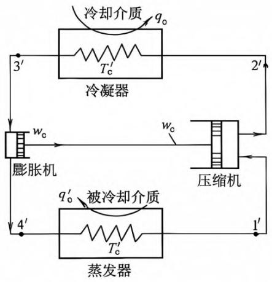

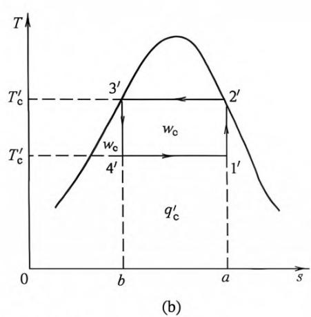  
图2.2-8 逆卡诺循环过程  
(a) 工质流程；(b) 在 $T - s$ 图上的表示

在相同的恒定高、低温热源区间，任何制冷循环的制冷系数 $\varepsilon$ 均小于逆卡诺循环的制冷系数 $\varepsilon_{\mathrm{c}}$ 。所以，逆卡诺循环的制冷系数可用以评价其他制冷循环的热力完善度，即：

$$
\eta = \varepsilon / \varepsilon_ {\mathrm{c}}\tag{2.2-87}
$$

$\eta$ 值越接近1，则该循环的不可逆程度越小，循环的节能性和经济性就越好。

**2. 变温热源的逆循环**

在实际制冷循环中，无论是高温热源还是低温热源，往往温度是在不断变化的，如图 2.2-9 所示。而制冷剂在冷凝器和蒸发器中的冷凝过程和蒸发过程，往往是有相变的等温过程，因此增大了制冷剂与介质之间的传热温差，从而使循环的不可逆性增加，制冷系数下降。

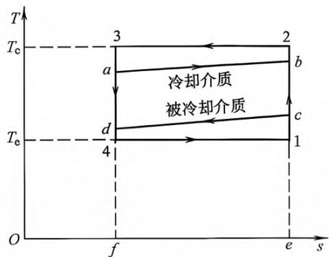

为了减少传热温差引起的能量损失，制冷剂与介质之间必须保持最小的传热温差，并且各点都保持定值。实际上，任何单一物质在等压下冷凝或蒸发时，

图2.2-9 恒温热源逆循环

温度都是恒定的。因此，要实现变温冷凝和蒸发，必须使用非共沸混合制冷剂。

通常，冷却与被冷却介质在冷凝器和蒸发器的进出口温度是固定不变的，因此要使制冷剂与介质流线保持等温差的唯一方法是变更制冷剂在冷凝器和蒸发器中的温度，即制冷剂的冷凝与蒸发过程是在一定的温度范围内变温进行。

由图 2.2-10 可知，若冷却介质温度由 $T_{a}$ 升至 $T_{b}$ ，制冷剂的冷凝温度由 $T_{3}$ 变至 $T_{3}^{\prime}$ ，被冷却介质温度由 $T_{c}$ 降至 $T_{d}$ ，制冷剂的蒸发温度由 $T_{1}$ 变至 $T_{1}^{\prime}$ 时，变温逆循环过程为 $1^{\prime}-2-3^{\prime}-4-1^{\prime}$ （恒温逆循环过程为 1-2-3-4-1）。显然，由于降低了制冷剂与介质之间的传热温差，节省了循环耗功 $\Delta w_{1}$ 和 $\Delta w_{2}$ ，增加了制冷量 $\Delta q_{0}$ （相当于 $\Delta w_{2}$ ），从而提高了制冷系数。

**3. 单级蒸气压缩式理论循环**

逆卡诺循环是理想制冷循环，实际制冷过程极为复杂，很难获得真实的全部参数，所以，通常采用介于两者之间的理论制冷循环来分析计算蒸气压缩式制冷循环。

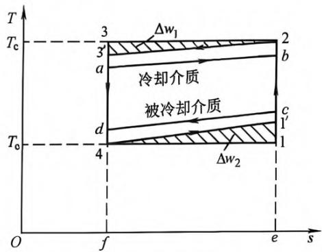  
图2.2-10 变温热源逆循环

图 2.2-11 绘出了单级蒸气压缩式理论制冷循环的流程及其在 T-s 图上的表示。压缩机吸入蒸发压力 p。下的饱和蒸气（状态 1），经绝热压缩至冷凝压力 p。（状态 2），进入冷凝器后等压冷凝成饱和液体（状态 3），再经膨胀阀绝热节流为蒸发压力 p。下的湿饱和蒸气（状态 4），然后，在蒸发器中等压吸热，气化成饱和蒸气（状态 1），再由压缩机吸入、压缩并重复上述过程。

蒸气压缩式制冷循环的热力计算，一般采用p-h图（压-焓图）。该图以制冷剂的焓h作横坐标，压

力 $p$ 作纵坐标（为了缩小图面，压力 $p$ 采用对数 $\lg p$ 分格。必须注意，从图上读得的是真实压力值，而不是压力的对数值）， $p - h$ 图上有等压、等焓、等温、等容、等熵和等干度六种等状态线簇。单级蒸气压缩式理论制冷循环在 $p - h$ 图上的表示如图2.2-12所示。

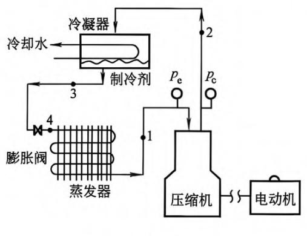  
(a)

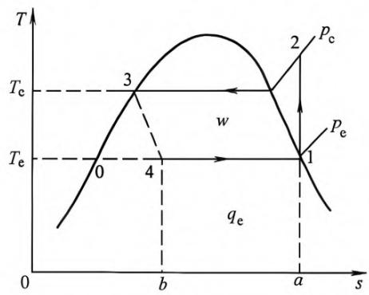  
(b)  
图 2.2-11 单级蒸气压缩式理论制冷循环  
(a) 循环流程；(b) $T - s$ 图

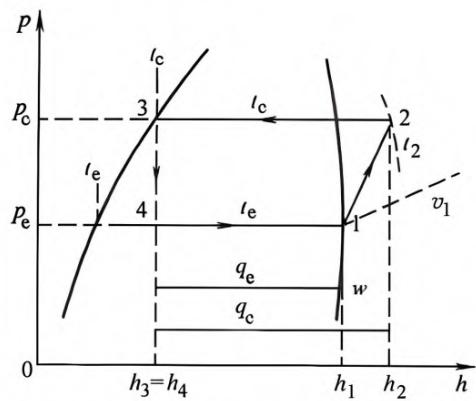  
图2.2-12 单级蒸气压缩式理论制冷循环在 $p - h$ 图上的表示

单级蒸气压缩式理论循环的分析如下：

1kg 制冷剂在蒸发器中产生的单位质量制冷量，是流出和进入蒸发器的焓差，即：

$$
q _ {\circ} = h _ {1} - h _ {4} = h _ {1} - h _ {3}\tag{2.2-88}
$$

制冷剂在冷凝器中的单位质量放热量，是进入与流出冷凝器的制冷剂的焓差，即：

$$
q _ {\circ} = h _ {2} - h _ {3}\tag{2.2-89}
$$

压缩机吸入制冷剂蒸气的单位质量压缩功，是排出和吸入制冷剂的焓差，即：

$$
w = h _ {2} - h _ {1}\tag{2.2-90}
$$

制冷剂通过膨胀阀时是绝热节流，所以其进入与流出膨胀阀的焓值不变，即：

$$
h _ {3} = h _ {4}\tag{2. 2-91}
$$

压缩机所产生的制冷量，称为制冷剂的单位容积制冷量 $q_{v}$ （kJ/m $^{3}$ ）：

$$
q _ {\mathrm{v}} = \frac {q _ {\mathrm{e}}}{v _ {1}} = \frac {h _ {1} - h _ {4}}{v _ {1}}\tag{2.2-92}
$$

式中 $v_{1}$ ——压缩机吸入制冷剂的比体积， $m^{3}/kg$ 。

设制冷装置的总制冷量为 $Q_{e}$ (kW)，则制冷剂在单位时间内流经压缩机、冷凝器、膨胀阀和蒸发器的质量流量 $q_{m}$ (kg/s) 为：

$$
q _ {\mathrm{m}} = \frac {Q _ {\mathrm{e}}}{q _ {\mathrm{e}}} = \frac {Q _ {\mathrm{e}}}{h _ {1} - h _ {4}}\tag{2.2-93}
$$

压缩机单位时间吸入的气态制冷剂体积 $q_{\mathrm{v}}(\mathrm{m}^{3}/\mathrm{s})$ 为：

$$
q _ {\mathrm{v}} = q _ {\mathrm{m}} v _ {1} = \frac {Q _ {\mathrm{e}}}{q _ {\mathrm{v}}}\tag{2.2-94}
$$

制冷剂在冷凝器中的放热量（冷凝器的热负荷） $Q_{c}$ （kW）为：

$$
Q _ {\mathrm{c}} = q _ {\mathrm{m}} q _ {\mathrm{c}} = q _ {\mathrm{m}} \left(h _ {2} - h _ {3}\right)\tag{2.2-95}
$$

压缩机消耗的理论功率 $P(\mathrm{kW})$ 为:

$$
P = q _ {\mathrm{m}} w = q _ {\mathrm{m}} (h _ {2} - h _ {1})\tag{2.2-96}
$$

结合 $p - h$ 图，制冷循环的制冷系数为：

$$
\varepsilon = \frac {Q _ {\mathrm{e}}}{P} = \frac {q _ {\mathrm{m}} q _ {\mathrm{e}}}{q _ {\mathrm{m}} w} = \frac {h _ {1} - h _ {4}}{h _ {2} - h _ {1}}\tag{2.2-97}
$$

理论循环的热力计算，表明了制冷装置的制冷量、放热量、消耗功率和制冷系数都不是定值，而是随着它的运行工况而改变。

若制冷循环的目的不是为了获得冷量 $Q_{\mathrm{e}}$ ，而是为了得到热量 $Q_{\mathrm{c}}$ ，则该循环称为热泵循环。热泵循环的性能可用供热系数 $\varepsilon^{\prime}$ 来评价：

$$
\varepsilon^ {\prime} = \frac {Q _ {\mathrm{c}}}{P} = \frac {Q _ {\mathrm{e}} + P}{P} = \varepsilon + 1\tag{2.2-98}
$$

或

$$
\varepsilon^ {\prime} = \frac {q _ {\mathrm{c}}}{w} = \frac {q _ {\mathrm{e}} + w}{w} = \varepsilon + 1\tag{2.2-99}
$$

显然，供热系数总是大于 $1$ 。 $\epsilon^{\prime} > 1$ 说明热泵循环的供热量总是大于其耗功量。

4. 液态制冷剂过冷和吸气过热理论制冷循环

液态制冷剂过冷和吸气过热理论制冷循环装置实际运行时，膨胀阀前的液态制冷剂温度通常低于冷凝温度 $t_{\mathrm{c}}$ 而处于过冷状态，其温度为 $t_{\mathrm{u}}$ （过冷温度）， $t_{\mathrm{c}} - t_{\mathrm{u}}$ 称为液体的过冷度。

由图 2.2-13 可知，增大过冷度能增加制冷剂的单位质量制冷量和提高制冷系数。通常可通过适当增大冷凝器的传热面积或增设过冷器等来增大过冷度。不过，由于受冷却介质温度的限制，过冷度的增大是有限度的。

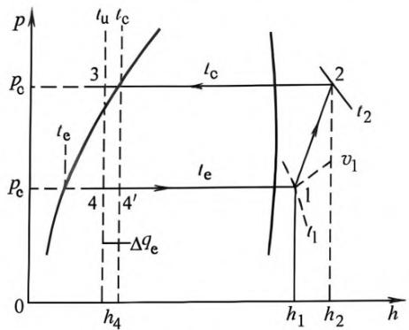  
图 2.2-13 液态制冷剂过冷和  
吸气过热理论制冷循环

为了防止制冷剂液滴被吸入压缩机，从而导致冲缸、损坏阀片或传动机构，实际运行中，一般吸入过热蒸气而不是饱和蒸气，压缩机吸气温度 $t_1$ 与蒸发温度 $t_e$ 之差，称为吸气过热度。由图2.2-13可知，过大的吸气过热度会增高排气温度 $t_2$ 和吸气的比体积 $v_1$ ，从而影响制冷装置的正常运行。

**5. 回热制冷循环**

若膨胀阀前液体制冷剂的过冷和压缩机吸气的过热主要利用由蒸发器流出的低温制冷剂蒸气和由冷凝器流出的液体制冷剂进行热交换，而不是通过与外界

介质的热交换，这种循环称为回热循环。回热循环的流程及 p-h 图，分别见图 2.2-14 和图 2.2-15。由图 2.2-15 可知，制冷剂的过冷过程线为 $3^{\prime}-3$ ，过热过程线为 $1^{\prime}-1$ 。

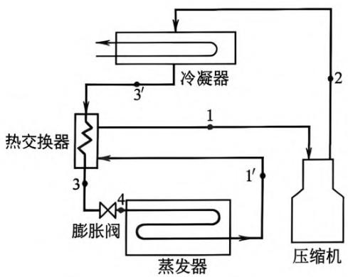  
图2.2-14 回热循环流程

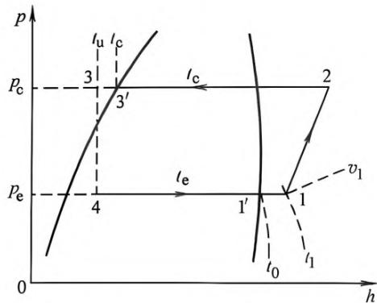  
图2.2-15 回热循环 $p - h$ 图

如果不考虑气、液两相在传热过程中的能量损失，则

$$
h _ {3} ^ {\prime} - h _ {3} = h _ {1} - h _ {1} ^ {\prime}\tag{2.2-100}
$$

或

$$
c \left(t _ {\mathrm{c}} - t _ {\mathrm{u}}\right) = c ^ {\prime} \left(t _ {1} - t _ {\mathrm{e}}\right)\tag{2.2-101}
$$

式中 c ——制冷剂的液体比热容， $\mathrm{kJ}/(\mathrm{kg} \cdot \mathrm{K})$ ;

$c'$ ——制冷剂的气体比热容，kJ/(kg·K)。

由于液体的比热容总大于气体的比热容，所以，在回热循环中，气体过热度总大于液体过冷度。

**6. 二级蒸气压缩式理论制冷循环**

图 2.2-16 表示蒸发温度由 $t_{e}$ 降至 $t_{e}^{\prime}$ 时制冷循环的变化过程，方便起见，假定 $t_{c}$ 和 $t_{u}$ 保持不变。由图 2.2-16 可知，当蒸发温度降低时，会产生以下不利影响：

（1）压缩机的排气温度由 $t_{2}$ 升至 $t_{2}^{\prime}$ ，过高的排气温度会引起冷冻油的性能变化，影响压缩机的正常工作与使用寿命；

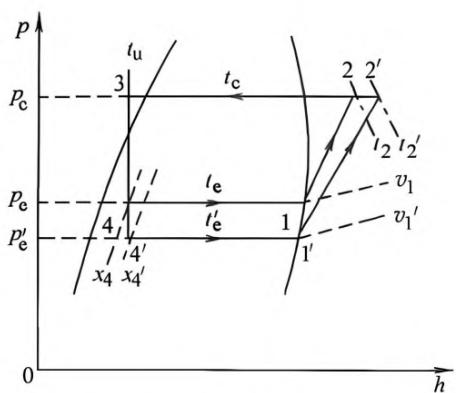  
图 2.2-16 蒸发温度降低时  
制冷循环的变化过程

(2) 压缩机的排气压力与吸气压力之比 $p_{\mathrm{c}} / p_{\mathrm{o}}$ 增大, 使压缩机的实际吸气量减少;

（3）制冷剂经膨胀节流后的干度由 $x_{4}$ 增至 $x_{4}^{\prime}$ ，这意味着进入蒸发器的制冷剂蒸气量增加，液体量减少，从而降低了制冷剂的单位质量制冷量 $q$ 。

（4）随着蒸发温度的下降，压缩机的吸气比体积由 $v_{1}$ 升至 $v_{1}^{\prime}$ ，降低了制冷剂的单位容积制冷量 $q_{v}$ 。

要克服上述不利影响，最好的方法是采用二级制冷循环。二级蒸气压缩式理论制冷循环，一般能达到的最低蒸发温度为 $-35 \sim -25^{\circ} \mathrm{C}$ （采用 R502 制冷剂可达 $-40^{\circ} \mathrm{C}$ 左右），如果蒸发温度低于以上数值，则对制冷装置的运行将产生许多不利影响。

7. 一次节流完全中间冷却的二级制冷循环

图 2.2-17 给出了一次节流完全中间冷却的二级制冷循环流程及 p-h 图，与单级制冷循环的主要区别是制冷剂蒸气分别在高、低压气缸中进行两次压缩，并增加了一台中间冷却器和膨胀阀；高、低压气缸中制冷剂的循环量不相同。

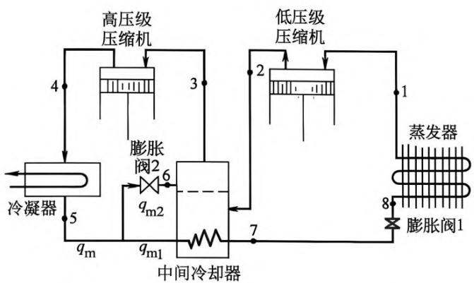  
(a)

  
(b)  
图 2.2-17 一次节流完全中间冷却的二级制冷循环  
(a) 循环流程；(b) p-h 图

制冷剂的循环过程为：高压级压缩机吸入来自中间冷却器的干饱和蒸气（状态3），经绝热压缩为过热蒸气（状态4），进入冷凝器冷凝成饱和液体（状态5）。饱和液体分为两部分，少部分经膨胀阀2节流至低温湿饱和蒸气（状态6，在中间压力 $p_{m}$ 线上），用来冷却大部分未经节流的饱和液体（状态5），以及由低压级压缩机排入中间冷却器的过热蒸气（状态2），它们的状态变化过程线分别为5-7和2-3。过冷液体（状态7）经膨胀阀1，一次节流为蒸发压力 $p_{e}$ 下的低压湿饱和蒸气（状态8），并进入蒸发器吸热，气化成干饱和蒸气（状态1）。这部分蒸气再由低压级压缩机吸入，压缩到状态2，排入中间冷却器中，冷却成干饱和蒸气（状态3）。

若已知制冷量 $Q_{\mathrm{c}}$ 、冷凝温度 $t_{\mathrm{c}}$ （或冷凝压力 $p_{\mathrm{c}}$ ）和蒸发温度 $t_{\mathrm{c}}$ （或蒸发压力 $p_{\mathrm{c}}$ ），则可按下列步骤和公式进行热力计算：

中间压力：

$$
p _ {\mathrm{m}} = \sqrt {p _ {\mathrm{c}} p _ {\mathrm{o}}}\tag{2.2-102}
$$

通过蒸发器的制冷剂质量流量 $q_{ml}$ (kg/s):

$$
q _ {\mathrm{m1}} = \frac {Q _ {\mathrm{e}}}{h _ {1} - h _ {8}}\tag{2.2-103}
$$

(a)

进入中间冷却器制冷剂的放热量为： $q_{\mathrm{m1}}(h_2 - h_3) + q_{\mathrm{m1}}(h_5 - h_7)$ ；中间冷却器中制冷剂的吸热量为： $q_{\mathrm{m2}}(h_3 - h_6)$

若不考虑中间冷却器与外界的传热，放热量应等于吸热量，则有：

$$
q _ {\mathrm{m2}} = Q _ {\mathrm{e}} \frac {(h _ {2} - h _ {3}) + (h _ {5} - h _ {7})}{(h _ {1} - h _ {8}) (h _ {3} - h _ {6})}\tag{2.2-104}
$$

高压级压缩机吸入的制冷剂质量流量 $q_{m}$ （kg/s）为：

$$
q _ {\mathrm{m}} = q _ {\mathrm{ml}} + q _ {\mathrm{m2}}\tag{2.2-105}
$$

冷凝器的热负荷为：

$$
Q _ {\mathrm{c}} = q _ {\mathrm{m}} (h _ {4} - h _ {5})\tag{2.2-106}
$$

低压级压缩机吸入的制冷剂体积为：

$$
q _ {\mathrm{vl}} = q _ {\mathrm{ml}} v _ {1}\tag{2.2-107}
$$

高压级压缩机吸入的制冷剂体积为:

$$
q _ {\mathrm{v2}} = q _ {\mathrm{m}} v _ {3}\tag{2.2-108}
$$

低压级压缩机和高压级压缩机的理论耗功率分别为：

$$
P _ {1} = q _ {\mathrm{ml}} (h _ {2} - h _ {1})\tag{2.2-109}
$$

$$
P _ {2} = q _ {\mathrm{m}} (h _ {4} - h _ {3})\tag{2.2-110}
$$

理论制冷系数为:

$$
\varepsilon = \frac {Q _ {\mathrm{e}}}{P _ {1} + P _ {2}} = \frac {(h _ {3} - h _ {6}) (h _ {1} - h _ {8})}{(h _ {3} - h _ {6}) (h _ {2} - h _ {1}) + (h _ {2} - h _ {7}) (h _ {4} - h _ {3})}\tag{2.2-111}
$$

**8. 一次节流不完全中间冷却的二级制冷循环**

一次节流不完全中间冷却的二级制冷循环的流程及 $p - h$ 图如图2.2-18所示。该循环与上述完全中间冷却的二级制冷循环的主要区别在于低压级压缩机排出的气体（状态2）不进入中间冷却器冷却，而是直接与来自中间冷却器的干饱和蒸气（状态 $3^{\prime}$ ）混合成过热蒸气（状态3），然后由高压级压缩机吸入、压缩。同时，系统中增设了回热换热器，使蒸发器流出的低温蒸气温度由 $t_{\mathrm{e}}$ 升至 $t_1$ ，而流出中间冷却器的过冷液体（状态7），再进一步冷却至状态8。

  
图2.2-18 一次节流不完全中间冷却的二级制冷循环  
(a) 循环流程；(b) p-h 图

系统中间压力的确定方法主要有以下几种：

(1) 若所需的中间温度 $T_{\mathrm{m}}$ 已定, 则可由制冷剂的饱和蒸气表或 $p - h$ 图直接查出。

(2) 根据二级压缩总轴功率最小的原则, 导出高、低级升压比相等时, 所需轴功最小, 即:

$$
\frac {p _ {\mathrm{m}}}{p _ {\mathrm{e}}} = \frac {p _ {\mathrm{c}}}{p _ {\mathrm{m}}} \text {或} p _ {\mathrm{m}} = \sqrt {p _ {\mathrm{c}} p _ {\mathrm{e}}}\tag{2.2-112}
$$

式（2.2-112）是按高、低级压缩机的质量流量和吸气温度相同导出的，这与二级压缩制冷循环有一定区别。因此，算出的中间压力与最佳中间压力会有一些偏差，所以该式适用于初步估算。

(3) 根据蒸发温度和冷凝温度的比例中项, 确定中间温度 $T_{\mathrm{m}}$ :

$$
T _ {\mathrm{m}} = \sqrt {T _ {\mathrm{c}} T _ {\mathrm{e}}}\tag{2.2-113}
$$

根据 $T_{m}$ 查得 $p_{m}$ 。实践证明，在蒸发温度不太低时，所得中间压力接近最佳值。

(4) 对于氨制冷系统, 可用下列经验公式计算:

$$
t _ {\mathrm{m}} = 0. 4 t _ {\mathrm{c}} + 0. 6 t _ {\mathrm{e}} + 3\tag{2.2-114}
$$

根据已知的蒸发温度 $t_{\mathrm{e}}$ （或 $p_{\mathrm{e}}$ ）、冷凝温度 $t_{\mathrm{c}}$ （或 $p_{\mathrm{c}}$ ）及制冷量，用假设中间温度 $t_{\mathrm{m}}$ （或 $p_{\mathrm{m}}$ ）的计算方法，求得最大的制冷系数，然后再确定中间压力。

该循环的热力计算步骤和公式如下：

中间压力 $p_{\mathrm{m}} = \sqrt{p_{\mathrm{c}}p_{\mathrm{e}}}$ ；根据 $p_{\mathrm{m}}$ ，可查出其饱和温度 $t_6$ ，则流出中间冷却器的过冷液体温度为： $t_7 = t_6 + \Delta t$ （传热温差）。

低压级压缩机吸入蒸汽温度为： $t_{1}=t_{0}+\Delta t_{2}$ （吸气过热度）。

通过换热器的热平衡，可获得状态8的焓值： $h_{8}=h_{7}+h_{0}-h_{1}$ 。

通过蒸发器及低压级压缩机的制冷剂质量流量 $q_{ml}$ 为：

$$
q _ {\mathrm{ml}} = \frac {Q _ {\mathrm{e}}}{h _ {0} - h _ {9}} = \frac {Q _ {\mathrm{e}}}{h _ {0} - h _ {8}}\tag{2.2-115}
$$

通过膨胀阀 2 的制冷剂质量流量 $q_{m2}$ 为：

$$
q _ {\mathrm{m2}} = q _ {\mathrm{m1}} \frac {h _ {5} - h _ {7}}{h _ {3 ^ {\prime}} - h _ {6}} = Q _ {\mathrm{e}} \frac {h _ {5} - h _ {7}}{(h _ {0} - h _ {8}) (h _ {3 ^ {\prime}} - h _ {6})}\tag{2.2-116}
$$

高压级压缩机吸入气体的焓值 $h_{3}$ （kJ/kg）为：

$$
h _ {3} = \frac {q _ {\mathrm{m1}} h _ {2} + q _ {\mathrm{m2}} h _ {3 ^ {\prime}}}{q _ {\mathrm{m1}} + q _ {\mathrm{m2}}} = \frac {q _ {\mathrm{m1}} h _ {2} + q _ {\mathrm{m2}} h _ {3 ^ {\prime}}}{q _ {\mathrm{m}}}\tag{2.2-117}
$$

冷凝器的热负荷为：

$$
Q _ {\mathrm{c}} = q _ {\mathrm{m}} \left(h _ {4} - h _ {5}\right)\tag{2.2-118}
$$

低压级压缩机吸入制冷剂的体积流量为:

$$
q _ {\mathrm{vl}} = q _ {\mathrm{ml}} v _ {1}\tag{2.2-119}
$$

高压级压缩机吸入制冷剂的体积流量为：

$$
q _ {\mathrm{v2}} = q _ {\mathrm{m}} v _ {3}\tag{2.2-120}
$$

低压级压缩机的理论耗功率为：

$$
P _ {1} = q _ {\mathrm{ml}} \left(h _ {2} - h _ {1}\right)\tag{2.2-121}
$$

高压级压缩机的理论耗功率为：

$$
P _ {2} = q _ {\mathrm{m}} (h _ {4} - h _ {3})\tag{2.2-122}
$$

理论制冷系数为:

$$
\epsilon = \frac {Q _ {\mathrm{e}}}{P _ {1} + P _ {2}} = \frac {(h _ {3 ^ {\prime}} - h _ {6}) (h _ {0} - h _ {8})}{(h _ {3 ^ {\prime}} - h _ {6}) (h _ {2} - h _ {1}) + (h _ {3 ^ {\prime}} - h _ {7}) (h _ {4} - h _ {3})}\tag{2.2-123}
$$

**9. 复叠式蒸气压缩理论制冷循环**

当需要达到更低的制冷温度时，若采用一种制冷剂进行二级或多级压缩制冷循环，将会出现以下问题：

(1) 随着蒸发温度的降低, 蒸发压力也相应降低。过低的蒸发压力会导致压缩机难以吸气, 或使外界空气进入系统。

(2) 蒸发温度过低时, 往往已达到常用制冷剂的凝固温度, 根本无法进行制冷循环。

（3）随着蒸发压力的降低，制冷剂的比体积增大，制冷剂的质量流量减少，制冷量大幅度下降。

(4) 为了获得所需的制冷量, 必须增大吸气容积, 压缩机的体积会过于庞大。

复叠式蒸气压缩制冷循环，也称串级制冷循环，它由两个或两个以上的单级压缩制冷循环组成，每个制冷循环中采用不同的制冷剂，所以，它既能满足在较低温度时有合适的蒸发压力，又能保持具有适宜的冷凝压力，如图 2.2-19 所示。

  
图 2.2-19 复叠式蒸气压缩制冷循环

图 2.2-19 所示制冷循环由两个单级压缩制冷循环组成，而实际上，左侧制冷循环与常规的单级制冷循环相同，只是它的任务不同，专门用于冷凝右侧制冷循环中的制冷剂，由于其运行于温度较高的区间，故称高温级，一般采用 R22、R134a 等制冷剂。右侧制冷循环运行的温度区间较低，故称低温级，常用的制冷剂是 R13、R503 等。

图 2.2-19 所示制冷循环，可以获得 $-80^{\circ}C$ 左右的低温。如果高温级改用二级制冷循环，为低温级提供更低的冷凝温度，则可以获得更低的蒸发温度（ $-100^{\circ}C$ 左右）。

## 2.3 传热学基础

### 2.3.1 导热

物体各部分之间不发生相对位移时，依靠分子、原子及自由电子等微观粒子的热运动而产生的热能传递称为热传导，简称导热。

单位时间内通过某一给定面积的热量称为热流量，记为 $\Phi$ ，单位为W。单位时间内通过单位面积的热流量称为热流密度，记为 $q$ ，单位为 $\mathrm{W / m^2}$ 。通过对大量实际导热问题的经验提炼，导热现象的规律被总结为傅立叶定律。热流密度正比于该处的温度梯度，即：

$$
q = \frac {\Phi}{A} = - \lambda \frac {\mathrm{d} t}{\mathrm{d} x}\tag{2. 3-1}
$$

式（2.3-1）中的比例系数 $\lambda$ 称为热导率，单位为 $W/(m \cdot K)$ 。它表征了物体中单位温度梯度在单位时间内通过单位面积的热量，反映了物体导热能力的大小。在工程界，习惯上把热导率称为导热系数。

下文主要介绍工程中常见的通过平壁和圆管管壁的导热问题。

**1. 通过平壁的导热**

设厚度为 $\delta$ 的无限大平壁（指平壁的长度与宽度远大于其厚度），如图2.3-1（a）所示。平壁两侧分别为固定温度 $t_{\mathrm{w1}}$ 和 $t_{\mathrm{w2}}$ ，导热面积为 $A$ ，则单位时间内通过平壁的热量 $\Phi$ 为：

$$
\Phi = A \frac {\lambda}{\delta} (t _ {\mathrm{w1}} - t _ {\mathrm{w2}}) = A \frac {\lambda}{\delta} \Delta t\tag{2. 3-2}
$$

当平壁由多层不同的材料组成时，如图 2.3-1（b）所示，则单位时间内通过 n 层平壁的总热流量为：

$$
\Phi = A \frac {t _ {\mathrm{w1}} - t _ {\mathrm{w,n+1}}}{\sum_ {i = 1} ^ {n} \frac {\lambda_ {i}}{\delta_ {i}}} = A \frac {t _ {\mathrm{w1}} - t _ {\mathrm{w,n+1}}}{\sum_ {i = 1} ^ {n} R _ {\lambda i}}\tag{2.3-3}
$$

式中 $R_{\lambda i}$ ——第 i 层平壁的热阻，m·K/W；

$\sum_{i=1}^{n} R_{\lambda i}$ —— $n$ 层平壁单位面积的总热阻（与串联电阻增加原理相同）， $\mathrm{m} \cdot \mathrm{K} / \mathrm{W}$ 。

在 $n$ 层平壁内，第 $i$ 层与第 $i + 1$ 层之间接触面的温度 $t_{\mathrm{w},n + 1}$ 为：

$$
t _ {\mathrm{w}, n + 1} = t _ {\mathrm{wl}} - q \sum_ {i = 1} ^ {n} R _ {\lambda i} = t _ {\mathrm{wl}} - \frac {\Phi}{A} \sum_ {i = 1} ^ {n} R _ {\lambda i}\tag{2.3-4}
$$

**2. 通过圆管管壁的导热**

图 2.3-2 所示为一长度等于 l（m）的圆管，其内外直径分别为 $d_{1}$ 和 $d_{2}$ （半径分别为 $r_{1}$ 和 $r_{2}$ ），且 $l \gg d_{2}$ ，热导率 $\lambda$ 为常数，内外壁面温度各为 $t_{w1}$ 和 $t_{w2}$ ，且 $t_{w1} > t_{w2}$ 。通过该管壁的热流量 $\Phi$ 为：

  
(a)

  
(b)  
图2.3-1 单层与多层平壁的导热  
(a) 单层平壁；(b) 多层平壁

  
图2.3-2 通过圆管管壁的导热

$$
\Phi = - 2 \pi r l \lambda \frac {\mathrm{d} t}{\mathrm{d} r}\tag{2.3-5}
$$

分离变量、积分后，得

$$
\Phi = \frac {(t _ {\mathrm{w} 1} - t _ {\mathrm{w} 2}) l}{\frac {1}{2 \pi \lambda} \ln \frac {d _ {2}}{d _ {1}}}\tag{2.3-6}
$$

通过每米管长的热流量 $\Phi_{1}$ (W/m) 为:

$$
\Phi_ {1} = \frac {\Phi}{l} = \frac {t _ {\mathrm{w1}} - t _ {\mathrm{w2}}}{\frac {1}{2 \pi \lambda} \ln \frac {d _ {2}}{d _ {1}}}\tag{2.3-7}
$$

壁内任意一直径 $d_{x}$ 处的温度 $t_{wx}$ 为：

$$
t _ {\mathrm{wx}} = t _ {\mathrm{wl}} - \frac {t _ {\mathrm{wl}} - t _ {\mathrm{w2}}}{\ln \frac {d _ {2}}{d _ {1}}} \ln \frac {d _ {\mathrm{x}}}{d _ {1}}\tag{2.3-8}
$$

多层圆管壁的导热计算，也可以利用串联电阻增加的原理，直接求出每米管长 n 层圆管壁的热流量 $\Phi_{1}$ （W/m）：

$$
\Phi_ {1} = \frac {t _ {\mathrm{wl}} - t _ {\mathrm{w,n+1}}}{\sum_ {i = 1} ^ {n} \frac {1}{2 \pi \lambda} \ln \frac {d _ {i + 1}}{d _ {i}}}\tag{2.3-9}
$$

**3. 导热算例**

【例 2.3-1】某地建一室内制冷装置工作温度为 $-35^{\circ}C$ ，采用超细玻璃棉毡作隔热材料，其导热系数为 $\lambda = 0.033 + 0.00023\bar{t}\mathrm{W}/(\mathrm{m} \cdot \mathrm{K})$ ，该装置的管道外径为 108mm。该地最热月份的平均空气温度为 $30^{\circ}C$ ，相对湿度为 80%。设计时需隔热材料层外表面温度比最热月份时的空气露点温度（26.2℃）高 $1.5^{\circ}C$ 。隔热材料外表面传热系数为 $8.14\mathrm{W}/(\mathrm{m}^{2} \cdot \mathrm{K})$ 。求隔热层厚度 $\delta$ 。

解: 隔热层外表面温度为 $t_{\mathrm{o}} = 26.2^{\circ} \mathrm{C} + 1.5^{\circ} \mathrm{C} = 27.7^{\circ} \mathrm{C}$ , 平均温度为: $\bar{t} = (27.7 - 35)^{\circ} \mathrm{C} / 2 = -3.65^{\circ} \mathrm{C}$ , 则超细玻璃棉毡的 $\lambda$ 为 $0.0322 \mathrm{~W} / (\mathrm{m} \cdot \mathrm{K})$ 。该问题的能量平衡式为:

$$
\begin{array}{r l} & \Phi_ {1} = \frac {t _ {\mathrm{o}} - t _ {\mathrm{i}}}{\frac {1}{2 \pi \lambda} \ln \frac {d _ {\mathrm{o}}}{d _ {\mathrm{i}}}} = h _ {\mathrm{o}} \pi d _ {\mathrm{o}} (t _ {\mathrm{f}} - t _ {\mathrm{o}}) \\ & \frac {2 7 . 7 + 3 5}{\frac {1}{2 \pi \times 0 . 0 3 2 2} \ln \frac {d _ {\mathrm{o}}}{0 . 1 0 8 \mathrm{m}}} \mathrm{W/m} = 8. 1 4 \pi d _ {\mathrm{o}} (3 0 - 2 7. 7) \mathrm{W/m} \\ & d _ {\mathrm{o}} = 0. 2 5 3 \mathrm{m} \end{array}
$$

解得隔热层厚度为：

$$
\delta = (d _ {\mathrm{o}} - d _ {\mathrm{i}}) / 2 = 0. 0 7 3 \mathrm{m} = 7 3 \mathrm{mm}
$$

### 2.3.2 对流传热

**1. 对流传热的基本概念**

流体流过一个物体表面时流体与物体表面间的热量传递过程，称为对流传热。

对流可区分为自然对流与强制对流两大类。自然对流是由于流体冷、热各部分的密度不同而引起的；而强制对流中流体的流动是由于水泵、风机或其他压差作用所造成的。另外，工程上还常遇到液体在热表面上沸腾及蒸气在冷表面上凝结的对流传热问题，分别简称为沸腾传热及凝结传热。

对流传热的热流量基本计算式是牛顿冷却公式，即：

$$
\Phi = h A \left(t _ {\mathrm{f}} - t _ {\mathrm{w}}\right)\tag{2.3-10}
$$

或

$$
q = h \left(t _ {\mathrm{f}} - t _ {\mathrm{w}}\right)\tag{2. 3-11}
$$

$$
h = \frac {q}{t _ {\mathrm{f}} - t _ {\mathrm{w}}}\tag{2. 3-12}
$$

式中 h —— 表面传热系数， $W/(m^{2} \cdot K)$ ;

A——传热面积， $m^{2}$ ;

$t_{f}$ 和 $t_{w}$ ——分别是流体和壁面温度，℃；

$q$ ——对流传热的热流密度， $\mathrm{W} / \mathrm{m}^{2}$ ，传热方向为从流体向壁面。

表面传热系数 $h$ 的大小与对流传热过程中的许多因素相关。式（2.3-10）、式（2.3-11）和式（2.3-12）并不是揭示影响 $h$ 的种种复杂因素的关系式，而是给出了 $h$ 的定义。研究对流传热的基本任务就在于用理论分析或实验方法具体给出各种场合下 $h$ 的计算关系式。下文将首先分析影响 $h$ 的因素。

**2. 表面传热系数的影响因素**

（1）流体流动的起因：对流传热的规律，随强制对流或自然对流等不同的流动起因而改变。

（2）流体有无相变：在流体没有相变时，对流传热中的热量交换是由于流体显热的变化而实现的。而在有相变的换热过程中，流体相变潜热的释放或吸收常常起主要作用，因而传热规律与无相变时不同。

(3) 流体流动速度: 流速增大, 表面传热系数也增大; 在其他条件相同时, 湍流传热的强度较层流强烈。

(4) 流体的物理性质: 如导热系数 $\lambda$ 、密度 $\rho$ 、热扩散率 $a$ ( $a = \lambda \rho / c_{\mathrm{p}}$ ) 、动力黏度 $\mu$ 、运动黏度 $\nu$ ( $\nu = \mu / \rho$ ) 、比热容 $c_{\mathrm{p}}$ 、体胀系数 $\alpha$ 等。

(5) 换热表面的几何因素: 换热表面的几何尺寸、形状和位置等, 如定型尺度 $d$ 、管的换热区间长度 $l$ , 固体表面的相对粗糙度 $\Delta$ 、换热表面与流体运动方向的相对位置等。

由以上讨论可见，影响对流传热的因素很多，因而表征对流传热强弱的表面传热系数是取决于多种因素的复杂函数。以单相强制对流传热为例，在不考虑航空航天中的高速流动时，表面传热系数可表示为：

$$
h = f (u, l, \rho , \mu , \lambda , c _ {\mathrm{p}})\tag{2. 3-13}
$$

**3. 相似准则数**

由于式（2.3-13）中包含了多个影响因素，对该关系式的实验研究与应用造成了困难。实际中，采用相似原理或量纲分析的方法，将表面传热系数的关系式整理为无量纲相似准则数之间的关系式，从而简化实验研究与应用。

依据相似理论的分析，可将众多变量组合成若干无量纲数群，这种数群称为相似准则数或特征数，如表 2.3-1 所示。用这种特征数表示的函数关系式称为特征数关联式或准则方程式。

部分相似准则数  
表 2.3-1

<table><tr><td>序号</td><td>特征数名称</td><td>表达式</td><td>反映的内容</td></tr><tr><td>1</td><td>努塞尔数</td><td> $Nu = hl / \lambda$ </td><td>壁面上流体的无量纲温度梯度(λ为流体的导热系数),反映对流换热过程的强度</td></tr><tr><td>2</td><td>雷诺数</td><td> $Re = ul / \nu$ </td><td>惯性力与黏性力之比的一种量度,反映黏性流体强制对流状态对换热的影响</td></tr><tr><td>3</td><td>普朗特数</td><td> $Pr = \mu c_{p} / \lambda = \nu / a$ </td><td>动量扩散能力与热量扩散能力的一种度量,反映流体物性,为影响边界层状况的物性综合量</td></tr><tr><td>4</td><td>格拉晓夫数</td><td> $Gr = gal^{3} \Delta t / \nu^{2}$ </td><td>浮升力与黏性力之比的一种度量(a为流体的体胀系数, $\mathrm{K}^{-1}$ ),反映流体自然对流状态对换热的影响</td></tr><tr><td>5</td><td>格莱茨数</td><td> $Gz = \pi d^{2}uc_{p}\rho /(4\lambda l)$ </td><td>综合了 $Re$ 、 $Pr$ 以及几何特征的影响</td></tr></table>

**4. 准则方程式**

由于 $Nu$ 中含有 $h$ ，因此，对流换热准则方程通常表达为 $Nu$ 与其他相似准则数之间的关联式：

$$
N u = k R e ^ {a} P r ^ {b} G r ^ {c} G z ^ {d}\tag{2.3-14}
$$

式中，k、a、b、c、d 为实验常数和指数，见表 2.3-2。

对流传热准则方程式中的常数和指数表  
表 2.3-2

<table><tr><td>形状</td><td colspan="3">流动状态</td><td>定型尺度</td><td>适用范围</td><td>k</td><td>a</td><td>b</td><td>c</td><td>d</td></tr><tr><td>平板</td><td>强制对流</td><td colspan="2">层流湍流</td><td>长度长度</td><td> $Re<5\times10^5$  $Re>5\times10^5$ </td><td>0.6640.037</td><td>0.50.8</td><td>0.3330.333</td><td>00</td><td>00</td></tr><tr><td>垂直平板</td><td>自然对流</td><td colspan="2">层流湍流</td><td>高度高度</td><td> $GrPr<10^9$  $GrPr>10^9$ </td><td>0.560.13</td><td>00</td><td>0.250.333</td><td>0.250.333</td><td>00</td></tr><tr><td rowspan="2">水平正方平板</td><td rowspan="2">自然对流</td><td>热流向上</td><td>层流湍流</td><td>一边之边长一边之边长</td><td> $GrPr<2\times10^7$  $GrPr>2\times10^7$ </td><td>0.540.14</td><td>00</td><td>0.250.333</td><td>0.250.333</td><td>00</td></tr><tr><td colspan="2">热流向下</td><td>一边之边长</td><td></td><td>0.27</td><td>0</td><td>0.25</td><td>0.25</td><td>0</td></tr><tr><td rowspan="2">圆管(内)</td><td>层流</td><td colspan="2">旺盛流过渡区</td><td>内径内径</td><td> $l_e>0.288dRe$  $Re<2100$  $l_e<0.288dRe$ </td><td>1.750.664</td><td>00.5</td><td>00.333</td><td>00</td><td>0.3330</td></tr><tr><td>湍流</td><td colspan="2">旺盛流过渡区</td><td>内径内径</td><td> $l_e>0.693dRe^{1/4}$  $Re>2300$  $l_e<0.693dRe^{1/4}$ </td><td>0.0230.0255× $(d/l_o)^{0.22}$ </td><td>0.80.855</td><td>0.4加热0.3冷却0.4</td><td>00</td><td>00</td></tr><tr><td rowspan="2">水平圆管(外)</td><td colspan="3">受迫对流</td><td>外径</td><td> $40<Re<4000$ </td><td>0.615</td><td>0.466</td><td>0</td><td>0</td><td>0</td></tr><tr><td>自然对流</td><td colspan="2">层流湍流</td><td>外径外径</td><td> $GrPr<10^9$  $GrPr>10^9$ </td><td>0.530.13</td><td>00</td><td>0.250.333</td><td>0.250.333</td><td>00</td></tr></table>

表 2.3-3 列出了管束的平均换热准则方程式；表 2.3-4 为不同排数时的校正系数。

管束的平均换热准则方程式  
表2.3-3

<table><tr><td>排列方式</td><td colspan="2">适用范围 $0.7 < Pr < 500$ </td><td>准则方程式</td><td>对空气或烟气的简化式 $Pr = 0.7$ </td></tr><tr><td rowspan="2">顺排</td><td colspan="2"> $Re=10^{2} \sim 2 \times 10^{5}$ </td><td> $Nu_{\mathrm{f}} = 0.27Re_{\mathrm{f}}^{0.63}Pr_{\mathrm{f}}^{0.36}\left(\frac{Pr_{\mathrm{f}}}{Pr_{\mathrm{w}}}\right)^{0.25}$ </td><td> $Nu_{\mathrm{f}} = 0.24Re^{0.63}$ </td></tr><tr><td colspan="2"> $Re=2 \times 10^{5} \sim 2 \times 10^{6}$ </td><td> $Nu_{\mathrm{f}} = 0.021Re_{\mathrm{f}}^{0.84}Pr_{\mathrm{f}}^{0.36}\left(\frac{Pr_{\mathrm{f}}}{Pr_{\mathrm{w}}}\right)^{0.25}$ </td><td> $Nu_{\mathrm{f}} = 0.018Re^{0.84}$ </td></tr><tr><td rowspan="3">叉排</td><td rowspan="2"> $Re=2 \times 10^{3} \sim 2 \times 10^{5}$ </td><td> $\frac{s_{1}}{s_{2}} \leqslant 2$ </td><td> $Nu_{\mathrm{f}} = 0.35Re_{\mathrm{f}}^{0.6}Pr_{\mathrm{f}}^{0.36}\left(\frac{Pr_{\mathrm{f}}}{Pr_{\mathrm{w}}}\right)^{0.25}\left(\frac{s_{1}}{s_{2}}\right)^{0.2}$ </td><td> $Nu_{\mathrm{f}} = 0.31Re^{0.6}\left(\frac{s_{1}}{s_{2}}\right)^{0.2}$ </td></tr><tr><td> $\frac{s_{1}}{s_{2}} > 2$ </td><td> $Nu_{\mathrm{f}} = 0.40Re_{\mathrm{f}}^{0.6}Pr_{\mathrm{f}}^{0.36}\left(\frac{Pr_{\mathrm{f}}}{Pr_{\mathrm{w}}}\right)^{0.25}$ </td><td> $Nu_{\mathrm{f}} = 0.35Re^{0.6}$ </td></tr><tr><td colspan="2"> $Re=2 \times 10^{5} \sim 2 \times 10^{6}$ </td><td> $Nu_{\mathrm{f}} = 0.022Re_{\mathrm{f}}^{0.84}Pr_{\mathrm{f}}^{0.36}\left(\frac{Pr_{\mathrm{f}}}{Pr_{\mathrm{w}}}\right)^{0.25}$ </td><td> $Nu_{\mathrm{f}} = 0.019Re^{0.84}$ </td></tr></table>

注：式中定性温度为管束进、出口流体的平均温度； $Pr_{w}$ 按管束的平均壁温确定；Re中的流速取管束中最小截面处的平均流速；特征长度为管子外径。

不同排数时的校正系数  
表 2.3-4

<table><tr><td>排数</td><td>1</td><td>2</td><td>3</td><td>4</td><td>5</td><td>6</td><td>8</td><td>12</td><td>16</td><td>20</td></tr><tr><td>顺排</td><td>0.69</td><td>0.80</td><td>0.86</td><td>0.90</td><td>0.93</td><td>0.95</td><td>0.96</td><td>0.98</td><td>0.99</td><td>1.0</td></tr><tr><td>叉排</td><td>0.62</td><td>0.76</td><td>0.84</td><td>0.88</td><td>0.92</td><td>0.95</td><td>0.96</td><td>0.98</td><td>0.99</td><td>1.0</td></tr></table>

**5. 利用准则方程式计算表面传热系数的步骤**

(1) 根据对流换热的具体条件, 选择合适的准则方程式 (要求所选准则方程式的应用范围与换热现象的范围相一致)。

(2) 根据准则方程式所要求的定性温度, 查出有关准则的物性量。如 $\lambda 、 c_{\mathrm{p}} 、 \rho 、 \alpha 、$ $\mu 、 \nu$ 等的数值。

(3) 将定型尺寸及有关物理量等代入相应准则, 由所选定的准则方程式求得 $Nu$ 。

(4) 由 $Nu = h l / \lambda$ ，求得： $h = N u \lambda / l$ 。

**6. 有相变时的对流传热**

**(1) 凝结**

工质在饱和温度下由气态变为液态的过程，称为凝结或冷凝。工质在凝结过程中放出热量，称为凝结潜热。凝结有下列两种现象：

膜状凝结：当凝结液能很好地润湿壁面时，则形成完整的向下流动的水膜，这种现象称为膜状凝结。

珠状凝结：当凝结液不能很好地润湿壁面时，则会聚成一个个液珠，这种现象称为珠

状凝结。

无论是膜状凝结还是珠状凝结，凝结液体都是构成蒸气与壁面交换热量的热阻载体。将蒸气与冷壁面隔开的液体层的面积越大、越厚，热阻越大。膜状凝结的热阻常常比珠状凝结大一个数量级以上。

(2) 凝结换热

1) 凝结雷诺数（凝结液膜雷诺数） $Re_{c}$ :

$$
R e _ {\mathrm{c}} = \frac {4 h l (t _ {\mathrm{s}} - t _ {\mathrm{w}})}{\mu r}\tag{2.3-15}
$$

式中 $t_{s}$ 和 $t_{w}$ ——分别为流体的饱和温度和壁面温度，℃；

r——流体的凝结潜热，J/kg；

$\mu$ ——流体的动力黏度， $Pa\cdot s$ ;

$l$ ——壁高， $\mathrm{m}$ ；

h——凝结表面传热系数， $W/(m^{2} \cdot K)$ 。

2) 凝结换热的强弱由凝结准则数 $C_0$ 反映:

$$
C o = h \left(\frac {\lambda^ {3} \rho^ {2} g}{\mu^ {2}}\right) ^ {- \frac {1}{3}}\tag{2. 3-16}
$$

式中 $\lambda$ ——导热系数，W/(m·K);

$\rho$ ——液膜的密度，kg/m $^{3}$ 。

3）层流膜状凝结时表面传热系数的计算

垂直壁的凝结换热准则方程式为：

$$
C o = 1. 8 7 R e _ {\mathrm{c}} ^ {- \frac {1}{3}} (R e _ {\mathrm{c}} <   1 8 0 0)
$$

得

(2. 3-17)

$$
h = 1. 1 3 \left[ \frac {\rho^ {2} g \lambda^ {3} r}{l \mu (t _ {\mathrm{s}} - t _ {\mathrm{w}})} \right] ^ {0. 2 5}\tag{2. 3-18}
$$

横圆管外壁的凝结换热准则方程式为：

得

$$
C o = 1. 0 3 R e _ {\mathrm{c}} ^ {- \frac {1}{3}} (R e _ {\mathrm{c}} <   3 6 0 0)\tag{2.3-19}
$$

$$
h = 0. 7 2 5 \left[ \frac {\rho^ {2} g \lambda^ {3} r}{\mu d (t _ {\mathrm{s}} - t _ {\mathrm{w}})} \right] ^ {0. 2 5}\tag{2. 3-20}
$$

4）湍流膜状凝结换热系数的计算

当 $Re_{c} > 1800$ 时，液膜由层流转变为湍流，其准则方程式为：

$$
C o = 0. 0 0 7 7 R e _ {\mathrm{c}} ^ {0. 4}\tag{2. 3-21}
$$

5）横管内凝结换热系数的计算

当 $Re < 3500$ 时，可按式（2.3-22）估算平均换热系数：

$$
h = 0. 5 5 5 \left[ \frac {\rho g (\rho - \rho_ {v}) \lambda^ {3} r ^ {\prime}}{\mu d (t _ {s} - t _ {w})} \right] ^ {0. 2 5}\tag{2.3-22}
$$

式中 $\rho_{v}$ ——蒸汽的密度，kg/m $^{3}$ ;

$r^{\prime}$ ——修正后的凝结潜热， $r^{\prime}=r+3/8c_{\mathrm{V}}(t_{\mathrm{s}}-t_{\mathrm{w}})$ ，J/kg。

其中， $c_{v}$ 是凝结液的比热容， $J/(kg \cdot K)$ 。

**6）水平管束平均凝结换热系数的计算**

当沿凝结液流向有 $n$ 排的管束时, 近似以 $nd$ 作为定型尺寸代入式 (2.3-20), 则得

$$
h = 0. 7 2 5 \left[ \frac {\rho^ {2} g \lambda^ {3} r}{\mu n d (t _ {\mathrm{s}} - t _ {\mathrm{w}})} \right] ^ {0. 2 5}\tag{2. 3-23}
$$

式中 n —— 排数，当 n > 25 时，取 n = 25。

**(3) 沸腾换热**

沸腾：工质在饱和温度下由液态变为气态的过程，称为沸腾；沸腾过程中需要吸收汽化潜热。

大空间沸腾：热壁面沉浸在具有自由表面的液体中所进行的沸腾，称为大空间沸腾。

如图2.3-3所示，随着表面温度与饱和温度温差 $\Delta t$ 的增加，沸腾换热主要经历以下4个区域：

  
图 2.3-3 饱和水在水平加热面上沸腾的 $q-\Delta t$ 曲线 ( $p=1.013\times10^{5}Pa$ )  
注： $\Delta t = t_{\mathrm{w}} - t_{\mathrm{s}}$

(1) 自然对流区: 壁面过热度较小时 (对于水在一个大气压下的饱和沸腾为 $\Delta t < 4^{\circ} \mathrm{C}$ ), 壁面上没有气泡产生, 传热属于自然对流工况。

(2) 核态沸腾区: 当加热壁面的过热度 $\Delta t \geqslant 4^{\circ} \mathrm{C}$ 后, 壁面上个别地点 (汽化核心) 开始产生气泡, 汽化核心产生的气泡彼此互不干扰, 称孤立气泡区。随着 $\Delta t$ 进一步增加, 汽化核心增加, 气泡互相影响, 合成汽块和汽柱。在这两个区域中, 气泡的扰动剧烈, 传热系数和热流密度都急剧增大。由于汽化核心对传热起着决定性影响, 这两区的沸腾统称为核态沸腾 (或泡状沸腾)。核态沸腾有温差小、传热强的特点, 一般工业应用都设计在这个范围。核态沸腾区的终点为热流密度的峰值点 $q_{max}$ ，该峰值被称为临界热流密度（CHF）。

(3) 过渡沸腾区: 从核态沸腾区的峰值点进一步增加 $\Delta t$ , 由于气泡汇聚覆盖在加热面上, 而蒸汽排除过程越趋恶化, 因此热流密度随 $\Delta t$ 的升高反而降低, 这段沸腾称为过渡沸腾, 是很不稳定的过程。这种情况持续达到最低热流密度 $q_{\min}$ 为止, 该热流密度最低点称为莱登佛罗斯特 (Leidenfrost) 点。

(4) 膜态沸腾区: 从 $q_{\min}$ 起, 加热面上已经形成稳定的蒸汽膜层, 产生的蒸汽有规则地排离膜层, $q$ 随 $\Delta t$ 的升高而增大。此段称为稳定膜态沸腾。由于热量必须穿过热阻较大的气膜, 因此传热系数比膜状凝结小得多。

从图 2.3-3 可见, 一旦热流密度超过 $q_{\max}$ , 工况将沿过 $q_{\max}$ 的虚线, 从核态沸腾区跳到稳定模态沸腾区, $\Delta t$ 将猛升至近 $1000^{\circ} \mathrm{C}$ , 可能导致设备烧毁, 因此 $q_{\max}$ 也称烧毁点。烧毁点附近, 有个比 $q_{\max}$ 的热流密度略小, 表现为 $q$ 上升缓慢的核态沸腾的转折点 DNB, 可用它作为监视接近 $q_{\max}$ 的警戒。

大空间核态沸腾的换热系数，可按下列公式计算：

$$
h = 0. 5 6 q ^ {0. 7} p ^ {0. 1 5}\tag{2.3-24}
$$

或

$$
h = 0. 1 4 4 8 \Delta t ^ {2. 3 3} p ^ {0. 5} = 0. 1 4 4 8 \left(t _ {\mathrm{w}} - t _ {\mathrm{s}}\right) ^ {2. 3 3} p ^ {0. 5}\tag{2.3-25}
$$

式中 $\Delta t$ ——壁面过热度， $\Delta t = t_{w} - t_{s}$ ，℃；

p——沸腾绝对压力，Pa；

q——壁面热流密度， $W/m^{2}$ 。

7. 对流传热算例

【例 2.3-2】空气横掠 3 排管组成的叉排换热器管束。已知管外径 d=20mm， $s_{1}/d=2$ ， $s_{2}/d=2$ ，空气平均温度为 $30^{\circ}C$ ， $t_{w}=10^{\circ}C$ ，管束最窄处平均流速 u=5m/s，求管束平均表面传热系数。（30℃时空气的物性为： $\rho=1.165kg/m^{3}$ ， $\lambda=0.0267W/(m\cdot K)$ ， $\nu=16.00\times10^{-6}m^{2}/s$ ，Pr=0.701，10℃时空气有 Pr=0.705）

解：对流换热的雷诺数为：

$$
R e = \frac {u d}{\nu} = \frac {5 \times 0 . 0 2}{1 6 . 0 0 \times 1 0 ^ {- 6}} = 6 2 5 0
$$

根据表 2.3-3 中叉排管束关联式, 计算努塞尔数与表面传热系数:

$$
\begin{array}{r l} N u _ {\mathrm{f}} & = 0. 3 5 R e _ {\mathrm{f}} ^ {0. 6} P r _ {\mathrm{f}} ^ {0. 3 6} \left(\frac {P r _ {\mathrm{f}}}{P r _ {\mathrm{w}}}\right) ^ {0. 2 5} \left(\frac {s _ {1}}{s _ {2}}\right) ^ {0. 2} \\ & = 0. 3 5 \times 6 2 5 0 ^ {0. 6} \times 0. 7 0 1 ^ {0. 3 6} \left(\frac {0 . 7 0 1}{0 . 7 0 5}\right) ^ {0. 2 5} \left(\frac {2 d}{2 d}\right) ^ {0. 2} = 5 8. 2 7 \\ h & = N u _ {\mathrm{f}} \frac {\lambda}{d} = 5 8. 2 7 \times 0. 0 2 6 7 / 0. 0 2 = 7 7. 8 \mathrm {W / (m^ {2} \cdot K)} \end{array}
$$

根据表 2.3-4，管排修正系数为 0.84，因此平均表面传热系数为：

$$
h = 0. 8 4 \times 7 7. 8 = 6 5. 4 \mathrm {W / (m^ {2} \cdot K)}
$$

【例 2.3-3】 室温为 $10^{\circ}$ C 的大房间中有一个 1.5m 高，直径为 10cm 的竖直烟筒，求烟筒的平均壁温为 $110^{\circ}$ C 时，每小时的对流散热量。（平均温度为 $60^{\circ}$ C 时空气的物性为： $\rho=$

$1.060\mathrm{kg / m^3}$ ， $c_{\mathrm{p}} = 1.005\mathrm{kJ / (kg\cdot K)}$ ， $\lambda = 0.029\mathrm{W / (m\cdot K)}$ ， $\nu = 18.97\times 10^{-6}\mathrm{m}^2 /\mathrm{s},$ $Pr = 0.696)$

解：平均温度为 $t_{\mathrm{m}} = (t_{\mathrm{f}} + t_{\mathrm{w}}) / 2 = (10 + 110)^{\circ}\mathrm{C} / 2 = 60^{\circ}\mathrm{C}$ 。假设空气为理想气体，其体胀系数 $\alpha = 1 / T = 1 / (273 + 60)\mathrm{K}^{-1}$ 。

$$
G r = \frac {g \alpha l ^ {3} \Delta t}{\nu^ {2}} = \frac {9 . 8 \times 1 . 5 ^ {3} \times (1 1 0 - 1 0)}{(1 8 . 9 7 \times 1 0 ^ {- 6}) ^ {2} \times (2 7 3 + 6 0)} = 2. 7 6 \times 1 0 ^ {1 0}
$$

$$
G r P r = 1. 9 2 \times 1 0 ^ {1 0}
$$

参考表 2.3-2，有：

$$
N u = 0. 1 3 (G r P r) ^ {0. 3 3 3} = 0. 1 3 \times (1. 9 2 \times 1 0 ^ {1 0}) ^ {0. 3 3 3} = 3 4 5
$$

因此其表面传热系数为：

$$
h = N u \frac {\lambda}{l} = 3 4 5 \times \frac {0 . 0 2 9}{1 . 5} \mathrm{W/(m} ^ {2} \cdot \mathrm{K)} = 6. 6 7 \mathrm{W/(m} ^ {2} \cdot \mathrm{K)}
$$

对流散热速率为：

$$
Q = \pi d l h (t _ {\mathrm{w}} - t _ {\mathrm{f}}) = 3. 1 4 \times 0. 1 \times 1. 5 \times 6. 6 7 \times (1 1 0 - 1 0) \mathrm{W} = 3 1 4 \mathrm{W}
$$

### 2.3.3 辐射传热

**1. 基本概念**

依靠物体表面对外发射可见和不可见射线——电磁波来传递热能的现象称为热辐射。

任何物体在向外发射辐射能的同时，还在不断地吸收周围其他物体发出的辐射能，并转换成热能。当热辐射投射到物体表面上时，和可见光一样，也有吸收、反射和穿透现象发生。

设投射到物体表面上的辐射总能量为 $Q$ ，吸收部分为 $Q_{\alpha}$ ，反射部分为 $Q_{\rho}$ ，透过部分为 $Q_{\tau}$ ，根据能量守恒定律，得

$$
Q = Q _ {\alpha} + Q _ {\rho} + Q _ {\tau}
$$

或

$$
\frac {Q _ {\alpha}}{Q} + \frac {Q _ {\rho}}{Q} + \frac {Q _ {\tau}}{Q} = 1\tag{2.3-26}
$$

式中， $Q_{\alpha}/Q$ 、 $Q_{\rho}/Q$ 、 $Q_{\tau}/Q$ 分别称为该物体对投入辐射的吸收比、反射比和穿透比，分别记为 $\alpha$ 、 $\rho$ 、 $\tau$ 。

由此可得:

$$
\alpha + \rho + \tau = 1\tag{2.3-27}
$$

自然界中所有物体的 $\alpha$ 、 $\rho$ 、 $\tau$ 均在 0～1 之间变化。通常，把 $\alpha=1$ 的物体称为黑体或绝对黑体；把 $\rho=1$ 的物体称为白体或绝对白体；把 $\tau=1$ 的物体称为透热体或绝对透热体。显然，自然界中实际上并没有这样的物体。

**2. 斯蒂芬-玻尔兹曼定律**

辐射力 $E$ 指单位时间内单位面积物体表面向其上半球空间所有方向发射的全部波长的辐射能的总值，单位为 $\mathrm{W} / \mathrm{m}^2$ 。黑体辐射力与温度的关系，由斯蒂芬-玻尔兹曼定律给出。它表明黑体的辐射力 $E_{\mathrm{b}}$ 与其热力学温度 $T$ 的四次方成正比，所以又称为四次方定律，即

$$
E _ {\mathrm{b}} = \sigma_ {\mathrm{b}} T ^ {4}\tag{2. 3-28}
$$

或

$$
E _ {\mathrm{b}} = C _ {\mathrm{b}} \left(\frac {T}{1 0 0}\right) ^ {4}\tag{2.3-29}
$$

式中 $\sigma_{\mathrm{b}}$ ——斯蒂芬-玻尔兹曼常数， $\sigma_{\mathrm{b}} = 5.67\times 10^{-8}\mathrm{W / (m^2*K^4)}$

$C_{b}$ ——黑体辐射系数， $C_{b}=5.67\mathrm{W}/(\mathrm{m}^{2}\cdot\mathrm{K}^{4})$ 。

任一物体的辐射力 E 与同温度下黑体辐射力 $E_{b}$ 之比，即： $\varepsilon = E / E_{b}$ ，称为该物体的发射率（也称黑度）。它表征物体辐射力接近黑体的程度，其数值在 0～1 之间，由实验测定。部分物体表面热辐射的法向发射率，如表 2.3-5 所示。

部分物体表面热辐射的法向发射率  
表 2.3-5

<table><tr><td>名称及表面状况</td><td>温度(°C)</td><td>ε</td><td>名称及表面状况</td><td>温度(°C)</td><td>ε</td></tr><tr><td>混凝土(粗糙表面)</td><td>40</td><td>0.94</td><td>铝(纯度98%、高度抛光)</td><td>50~500</td><td>0.04~0.06</td></tr><tr><td>玻璃:平面玻璃</td><td>40</td><td>0.94</td><td>砖:粗糙红砖</td><td>40</td><td>0.88~0.93</td></tr><tr><td>派力克斯铅玻璃</td><td>260~540</td><td>0.85~0.95</td><td>黏土耐火砖</td><td>500~1000</td><td>0.8~0.9</td></tr><tr><td>黏土:土壤(干)</td><td>20</td><td>0.92</td><td>石棉:板</td><td>40</td><td>0.96</td></tr><tr><td>土壤(湿)</td><td>20</td><td>0.95</td><td>石棉水泥</td><td>40</td><td>0.96</td></tr><tr><td>耐火黏土</td><td>100</td><td>0.91</td><td>石棉瓦</td><td>40</td><td>0.97</td></tr><tr><td>大理石(浅色、磨光的)</td><td>40</td><td>0.93</td><td>铬(抛光的板)</td><td>40~550</td><td>0.08~0.27</td></tr><tr><td>油漆:各种油漆</td><td>40</td><td>0.92~0.96</td><td>黄铜:高度抛光的电解铜</td><td>100</td><td>0.02</td></tr><tr><td>白色喷漆</td><td>40</td><td>0.80~0.95</td><td>轻微抛光的铜</td><td>40</td><td>0.12</td></tr><tr><td>光亮黑漆</td><td>40</td><td>0.90</td><td>氧化变黑的铜</td><td>40</td><td>0.76</td></tr><tr><td>石灰砂浆(白色、粗糙)</td><td>40~260</td><td>0.87~0.92</td><td>锌(镀锌、灰色的)</td><td>40</td><td>0.28</td></tr><tr><td>木材</td><td>40</td><td>0.80~0.90</td><td>锡(光亮的镀锡薄钢板)</td><td>40</td><td>0.04~0.06</td></tr><tr><td>瓷(上釉的)</td><td>40</td><td>0.93</td><td>橡胶(硬质的)</td><td>40</td><td>0.94</td></tr><tr><td>石膏</td><td>40</td><td>0.80~0.90</td><td>不锈钢(抛光的)</td><td>40</td><td>0.07~0.17</td></tr><tr><td>钢(抛光的)</td><td>40~260</td><td>0.07~0.1</td><td>铸铁(抛光的)</td><td>200</td><td>0.21</td></tr><tr><td>钢板(轧制的)</td><td>40</td><td>0.65</td><td>铸铁(新车削的)</td><td>40</td><td>0.44</td></tr></table>

试验发现，实际物体的辐射力并不完全严格地与其热力学温度的四次方成正比。由此引起的误差可以用发射率来修正，从而使斯蒂芬-玻尔兹曼定律可近似地用于实际物体。即

$$
E = \varepsilon E _ {\mathrm{b}} = \varepsilon \sigma_ {\mathrm{b}} T ^ {4} = \varepsilon C _ {\mathrm{b}} \left(\frac {T}{1 0 0}\right) ^ {4}\tag{2. 3-30}
$$

**3. 基尔霍夫定律**

物体对某一特定波长辐射能的吸收比称为光谱吸收比。在热辐射理论中，把光谱吸收比与波长无关的物体称为灰体。基尔霍夫定律可以表述为：在与黑体处于热平衡的条件下, 任何物体对黑体投入辐射的吸收比等于同温度下该物体的发射率, 即

$$
\alpha = \epsilon\tag{2.3-31}
$$

基尔霍夫定律在 “物体与黑体投入辐射处于热平衡” 的严格条件下才成立。由于灰体的吸收比只取决于本身情况，与投入无关，且物体的发射率是物性参数，与环境无关，因此灰体的吸收比恒等于同温度下该物体的发射率。试验证明，在红外辐射范围内，即工程常见温度范围内（≤2000K），把一般物体当作灰体处理不会引起太大的误差。（在研究物体与太阳辐射相互作用时，由于大多数物体对可见光波的吸收表现出强烈的选择性，该物体一般不能当作灰体处理）。

**4. 有效辐射**

单位时间内投入到单位表面积上的总辐射能称为该表面的投入辐射，记为 G。有效辐射是指单位时间内离开表面单位面积的总辐射能，记为 J。有效辐射不仅包括表面的自身辐射 E，还包括投入辐射 G 中被表面反射的部分 $\rho G$ 。因此，在表面没有透射的条件下，表面的有效辐射 J 的表达式为：

$$
J = E + \rho G = \varepsilon E + (1 - \alpha) G\tag{2.3-32}
$$

对于一个表面，从表面外部来看，该表面与外界的辐射换热量为有效辐射 $J$ 与投入辐射 $G$ 之差：

$$
q = J - G\tag{2.3-33}
$$

从表面内部来看，该表面与外界的辐射换热量为表面的辐射力 E 与所吸收的辐射 $\alpha G$ 之差：

$$
q = E - \alpha G\tag{2.3-34}
$$

从式（2.3-33）与式（2.3-34）中消去 $G$ ，可得有效辐射与净辐射换热量之间的关系：

$$
J = \frac {E}{\alpha} - \frac {1 - \alpha}{\alpha} q = E _ {\mathrm{b}} - \left(\frac {1}{\varepsilon} - 1\right) q\tag{2. 3-35}
$$

$$
q = \frac {E _ {\mathrm{b}} - J}{\frac {1 - \varepsilon}{\varepsilon}}\tag{2.3-36}
$$

$$
\Phi = \frac {E _ {\mathrm{b}} - J}{\frac {1 - \varepsilon}{\varepsilon A}}\tag{2. 3-37}
$$

其中， $\frac{1-\varepsilon}{\varepsilon A}$ 称为辐射传热的表面辐射热阻。

**5. 角系数**

角系数是一个表面发射出的辐射能中，落到另一表面的百分数。把表面1发出而落到表面2上的百分数称为表面1对表面2的角系数，记为 $X_{1,2}$ 。角系数与面积存在下列关系：

$$
A _ {1} X _ {1, 2} = A _ {2} X _ {2, 1}\tag{2.3-38}
$$

表2.3-6和表2.3-7分别汇总了几种二维和三维典型几何结构角系数的计算公式。

几种二维典型几何结构角系数的计算公式  
表 2.3-6

<table><tr><td>表面形状和相互位置</td><td>简图</td><td>角系数计算公式</td></tr><tr><td>与垂直平分面相重合的两平行平板</td><td></td><td> $X_{i,j}=\frac{[(W_i+W_j)^2+4]^{1/2}-[(W_j-W_i)^2+4]^{1/2}}{2W_i}$  $W_i=w_i/L,W_j=w_j/L$ </td></tr><tr><td>宽度相同的两平板,共用一边且形成夹角</td><td></td><td> $X_{i,j}=1-\sin\frac{\alpha}{2}$ </td></tr><tr><td>共用一边的两垂直平板</td><td></td><td> $X_{i,j}=\frac{1+(w_j/w_i)-[1+(w_j/w_i)^2]^{1/2}}{2}$ </td></tr><tr><td>三平板围成的封闭区域</td><td></td><td> $X_{i,j}=\frac{w_i+w_j-w_k}{2w_i}$ </td></tr><tr><td>不同半径的两平行圆柱</td><td></td><td> $X_{i,j}=\frac{1}{2\pi}\left(\pi+[C^2-(R+1)^2]^{1/2}-[C^2-(R-1)^2]^{1/2}+(R-1)\arccos\left(\frac{R}{C}-\frac{1}{C}\right)-(R+1)\arccos\left(\frac{R}{C}+\frac{1}{C}\right)\right)$  $R=r_j/r_i,S=s/r_i,C=1+R+S$ </td></tr><tr><td>圆柱与平行长方形板</td><td></td><td> $X_{i,j}=\frac{r}{s_1-s_2}\left(\arctan\frac{s_1}{L}-\arctan\frac{s_2}{L}\right)$ </td></tr><tr><td>无限大平板和单排管束</td><td></td><td> $X_{i,j} = 1 - \left[1 - \left(\frac{D}{s}\right)^2\right]^{1/2} + \frac{D}{s} \arctan \left[\left(\frac{s^2 - D^2}{D^2}\right)^{1/2}\right]$ </td></tr></table>

几种三维典型几何结构角系数的计算公式  
表2.3-7

<table><tr><td>表面形状和相互位置</td><td>简图</td><td>角系数计算公式</td></tr><tr><td>大小相同的两平行长方形</td><td></td><td> $X_{i,j} = \frac{2}{\pi \overline{XY}} \left\{ \ln \left[ \frac{(1 + \overline{X}^2)(1 + \overline{Y}^2)}{1 + \overline{X}^2 + \overline{Y}^2} \right]^{1/2} + \overline{X}(1 + \overline{Y}^2)^{1/2} \arctan \frac{\overline{X}}{(1 + \overline{Y}^2)^{1/2}} + \overline{Y}(1 + \overline{X}^2)^{1/2} \arctan \frac{\overline{Y}}{(1 + \overline{X}^2)^{1/2}} - \overline{X} \arctan \overline{X} - \overline{Y} \arctan \overline{Y} \right\}$  $\overline{X} = X/L, \overline{Y} = Y/L$ </td></tr><tr><td>两同轴平行圆盘</td><td></td><td> $X_{i,j} = \frac{1}{2} \{ S - [S^2 - 4(r_j/r_i)^2 ]^{1/2} \}$  $R_i = r_i/L, R_j = r_j/L$  $S = 1 + \frac{1 + R_j^2}{R_i^2}$ </td></tr><tr><td>共用一边的两垂直长方形板</td><td></td><td> $X_{i,j} = \frac{1}{\pi W} \left( Warctan \frac{1}{W} + Harctan \frac{1}{H} - (H^2 + W^2)^{1/2} \arctan \frac{1}{(H^2 + W^2)^{1/2}} + \frac{1}{4} \ln \left\{ \frac{(1 + W^2)(1 + H^2)}{1 + W^2 + H^2} \left[ \frac{W^2(1 + W^2 + H^2)}{(1 + W^2)(W^2 + H^2)} \right]^w^2 \times \left[ \frac{H^2(1 + H^2 + W^2)}{(1 + H^2)(H^2 + W^2)} \right]^H^2 \right\} \right)$  $H = Z/X, W = Y/X$ </td></tr></table>

为了方便应用，将常用表面间的角系数的计算制成线图，如图 2.3-4～图 2.3-7 所示。
6. 辐射换热量的计算

由有效辐射的定义, 可知两个表面之间的辐射换热量 $\Phi_{1,2}$ (W) 为:

$$
\Phi_ {1, 2} = A _ {1} J _ {1} X _ {1, 2} - A _ {2} J _ {2} X _ {2, 1} = \frac {J _ {1} - J _ {2}}{\frac {1}{A _ {1} X _ {1 , 2}}}\tag{2.3-39}
$$

  
图 2.3-4 微元面对长方形表面的角系数

  
图 2.3-5 平行长方形表面间的角系数

其中， $\frac{1}{A_1X_{1,2}}$ 称为空间辐射热阻。

对于两个漫灰的等温表面所组成的封闭腔，两个表面之间的辐射换热量 $\Phi_{1,2}(\mathrm{W})$ 为：

$$
\Phi_ {1, 2} = \frac {E _ {\mathrm{b} 1} - E _ {\mathrm{b} 2}}{\frac {1 - \varepsilon_ {1}}{\varepsilon_ {1} A _ {1}} + \frac {1}{A _ {1} X _ {1 , 2}} + \frac {1 - \varepsilon_ {2}}{\varepsilon_ {2} A _ {2}}}\tag{2.3-40}
$$

或

  
图2.3-6 相互垂直两长方形表面间的角系数

  
$1-e \geqslant 1.4d$ ; $2-e=0.8d$ ; $3-e=0.5d$ ; $4-e=0$ 。  
图 2.3-7 单排管的角系数

$$
\Phi_ {1, 2} = 5. 6 7 \varepsilon_ {1, 2} \left[ \left(\frac {T _ {1}}{1 0 0}\right) ^ {4} X _ {1, 2} A _ {1} - \left(\frac {T _ {2}}{1 0 0}\right) ^ {4} X _ {2, 1} A _ {2} \right]\tag{2.3-41}
$$

其中， $\epsilon_{1,2}$ 是物体 1、2 所组成的辐射换热系数的发射率，有

$$
\varepsilon_ {1, 2} = \frac {1}{1 + \left(\frac {1}{\varepsilon_ {1}} - 1\right) X _ {1 , 2} + \left(\frac {1}{\varepsilon_ {2}} - 1\right) X _ {2 , 1}}\tag{2.3-42}
$$

式中 $X_{1,2}, X_{2,1}$ ——分别是物体 1 对物体 2 和物体 2 对物体 1 的平均角系数；

$A_{1}$ 、 $A_{2}$ ——分别是物体1和2的表面积， $m^{2}$ 。

两表面封闭腔辐射换热可采用如图2.3-8所示的传热等效网络图表示。

对于两个无限大的平行灰体，有

  
图 2.3-8 两表面封闭腔辐射换热等效网络图

$$
\begin{array}{r l} & X _ {1, 2} = X _ {2, 1} = 1 \\ & \epsilon_ {1, 2} = \frac {1}{\frac {1}{\epsilon_ {1}} + \frac {1}{\epsilon_ {2}} - 1} \end{array}\tag{2.3-43}
$$

对于构成一个封闭系统的两块灰体，当其中较小的表面没有凹面时，有

$$
\begin{array}{r l} & X _ {1, 2} = 1; X _ {2, 1} = \frac {A _ {1}}{A _ {2}} \\ & \varepsilon_ {1, 2} = \frac {1}{\frac {1}{\varepsilon_ {1}} + \frac {A _ {1}}{A _ {2}} \left(\frac {1}{\varepsilon_ {2}} - 1\right)} \end{array}\tag{2.3-44}
$$

对于三个或三个以上的灰体表面组成的封闭系统的换热，要先画出辐射网络图，然后基于稳态时流入某节点的热流量之和等于零，建立线性方程组并求解。具体应用例子可参考以下算例。

7. 三个灰体表面组成的封闭腔辐射换热的算例

【例 2.3-4】两个边长为 $1 \, m \times 2 \, m$ 的长方形板平行放置于壁面温度 $t_{3} = 27^{\circ}C$ 的大房间里，其间距为 $1 \, m$ ，温度分别为 $t_{1} = 527^{\circ}C$ ， $t_{2} = 227^{\circ}C$ ，发射率分别为 $\varepsilon_{1} = 0.3$ ， $\varepsilon_{2} = 0.6$ 。假定板的背面不参与换热，试求每个长方形板的辐射换热量。

解：该问题的辐射换热网络如图 2.3-9 所示。

  
图2.3-9 三个灰体表面组成的封闭腔辐射换热等效网络图

由于大房间表面积 $A_{3}$ 很大，因此可以假设其表面热阻 $\frac{1 - \epsilon_3}{\epsilon_3 A_3} = 0$ 。由表2.3-7可以计算出 $X_{1,2} = X_{2,1} = 0.286$ ，因此 $X_{1,3} = 1 - X_{1,2} = 0.714 = X_{2,3}$ 。两个长方形板的面积为： $A_{1} = A_{2} = 2 \mathrm{~m}^{2}$ 。

对图2.3-9中节点 $J_{1}$ 、 $J_{2}$ 和 $J_{3}$ 分别列出能量守恒关系式：

$$
\begin{array}{r l} & \frac {E _ {\mathrm{b1}} - J _ {1}}{\frac {1 - \epsilon_ {1}}{\epsilon_ {1} A _ {1}}} + \frac {J _ {2} - J _ {1}}{\frac {1}{A _ {1} X _ {1 , 2}}} + \frac {J _ {3} - J _ {1}}{\frac {1}{A _ {1} X _ {1 , 3}}} = 0 \\ & \frac {E _ {\mathrm{b2}} - J _ {2}}{\frac {1 - \epsilon_ {2}}{\epsilon_ {2} A _ {2}}} + \frac {J _ {1} - J _ {2}}{\frac {1}{A _ {1} X _ {1 , 2}}} + \frac {J _ {3} - J _ {2}}{\frac {1}{A _ {2} X _ {2 , 3}}} = 0 \\ & E _ {\mathrm{b3}} = J _ {3} \end{array}
$$

黑体辐射力可通过式（2.3-28）计算得出： $E_{b1}=23224W/m^{2}$ ， $E_{b2}=3544W/m^{2}$ ， $E_{b3}=459W/m^{2}$ 。

联立方程组，可以求解得到 $J_{1}=7828.1W/m^{2}$ ， $J_{2}=3152.9W/m^{2}$ 。

因此，板 1 所失去的热流量为：

$$
\Phi_ {1} = \frac {E _ {\mathrm{b1}} - J _ {1}}{\frac {1 - \varepsilon_ {1}}{\varepsilon_ {1} A _ {1}}} = 1 3 1 9 7 \mathrm {W/ m^ {2}}
$$

板 2 所失去的热流量为:

$$
\Phi_ {2} = \frac {E _ {\mathrm{b2}} - J _ {2}}{\frac {1 - \epsilon_ {2}}{\epsilon_ {2} A _ {2}}} = 1 1 7 2 \mathrm {W/ m^ {2}}
$$

### 2.3.4 传热及换热器

用来使热量从热流体传递到冷流体，以满足规定的工艺要求的装置统称换热器（或热交换设备）。按换热器操作过程，可将其分为间壁式、混合式和储热式三大类。其中以间壁式换热器应用最为广泛，因此，本节将主要介绍间壁式换热器传热的计算方法。

在间壁式换热器中，冷、热流体由壁面间隔开来而分别位于壁面的两侧，其传热过程通常是指热量从壁面一侧的流体通过壁面传到另一侧流体的过程。传热过程中所传递的热量由以下传热方程确定：

$$
\Phi = k A \left(t _ {\mathrm{f} 1} - t _ {\mathrm{f} 2}\right)\tag{2.3-45}
$$

其中，传热系数 $k$ 及冷热流体平均温差的计算是关键，将在本节进行主要介绍。

**1. 复合换热**

在实际工程中所发生的换热过程，大部分是由导热、对流和辐射同时作用的结果，所以是一个复合的换热过程。在计算复合换热时，通常将辐射传热量 $q_{\mathrm{r}}$ 表达成与对流换热算式类似的表达式，即

$$
q _ {\mathrm{r}} = h _ {\mathrm{r}} (t _ {1} - t _ {2})\tag{2.3-46}
$$

式中 $h_{r}$ ——辐射传热表面传热系数， $W/(m^{2} \cdot K)$ 。

对于壁面或管壁在大空间中的辐射换热，可近似按下式计算：

$$
q _ {\mathrm{r}} = \varepsilon \sigma_ {\mathrm{b}} (T _ {1} ^ {4} - T _ {2} ^ {4})\tag{2.3-47}
$$

由此可得

$$
h _ {\mathrm{r}} = \frac {\varepsilon \sigma_ {\mathrm{b}} (T _ {1} ^ {4} - T _ {2} ^ {4})}{t _ {1} - t _ {2}}\tag{2.3-48}
$$

式中 $t_{1}$ ——壁面或管壁温度，℃；

$t_{2}$ ——周围环境表面温度，℃。

若认为 $t_2$ 近似等于周围空气的温度 $t_\mathrm{f}$ ，则式（2.3-47）可改写为：

$$
h _ {\mathrm{r}} = \frac {q _ {\mathrm{r}}}{t _ {\mathrm{w}} - t _ {\mathrm{f}}} = \frac {\varepsilon \sigma_ {\mathrm{b}} (T _ {\mathrm{w}} ^ {4} - T _ {\mathrm{f}} ^ {4})}{t _ {\mathrm{w}} - t _ {\mathrm{f}}}\tag{2.3-49}
$$

总传热量 $q$ （ $\mathrm{W / m^2}$ ）等于对流传热量 $q_{\mathrm{c}}$ 与辐射传热量 $q_{\mathrm{r}}$ 之和，即

$$
q = q _ {\mathrm{c}} + q _ {\mathrm{r}} = \left(h _ {\mathrm{c}} + h _ {\mathrm{r}}\right) \left(t _ {\mathrm{w}} - t _ {\mathrm{f}}\right) = h _ {\mathrm{t}} \left(t _ {\mathrm{w}} - t _ {\mathrm{f}}\right)\tag{2. 3-50}
$$

式中 $h_{r}$ ——总表面传热系数， $W/(m^{2} \cdot K)$ 。

**2. 传热系数**

**(1) 通过平壁的传热过程计算**

图 2.3-10 所示为一面积为 A、壁厚为 $\delta$ 、热导率为 $\lambda$ 的平壁的传热。两侧介质的温度分别为 $t_{f1}$ 和 $t_{f2}$ ，壁面两侧的表面温度和表面总换热系数分别为 $t_{w1}$ 、 $t_{w2}$ 和 $h_{t1}$ 、 $h_{t2}$ ，则可得其传热量 $\Phi$ （W）为：

$$
\Phi = \frac {A (t _ {\mathrm{fl}} - t _ {\mathrm{f2}})}{\frac {1}{h _ {\mathrm{t1}}} + \frac {\delta}{\lambda} + \frac {1}{h _ {\mathrm{t2}}}}\tag{2.3-51}
$$

  
图2.3-10 通过平壁的传热

令

$$
\frac {1}{k} = \frac {1}{h _ {\mathrm{t} 1}} + \frac {\delta}{\lambda} + \frac {1}{h _ {\mathrm{t} 2}}\tag{2.3-52}
$$

则

$$
\Phi = k A \left(t _ {\mathrm{fl}} - t _ {\mathrm{f2}}\right)\tag{2. 3-53}
$$

或

$$
q = k \left(t _ {\mathrm{f} 1} - t _ {\mathrm{f} 2}\right)\tag{2. 3-54}
$$

**(2) 通过圆管壁的传热**

图2.3-11所示为内、外直径（半径）分别为 $d_{1}$ 、 $d_{2}$ $(r_1,r_2)$ 、长度为 $l$ 的圆管壁的传热。已知材料的热导率为 $\lambda$ ，管壁两侧的表面总换热系数和介质温度分别为 $h_{t1}$ 、 $h_{t2}$ 和 $t_{f1}$ 、 $t_{f2}$ ，则根据串联热阻叠加的原理，可列出单位管长的传热热阻 $R_{1}$ 和传热系数 $k_{1}$ ：

$$
\begin{array}{r l} & R _ {1} = \frac {1}{h _ {\mathrm{tl}} \pi d _ {1}} + \frac {1}{2 \pi \lambda} \ln \frac {d _ {2}}{d _ {1}} + \frac {1}{h _ {\mathrm{t2}} \pi d _ {2}} \\ & k _ {1} = \frac {1}{\frac {1}{h _ {\mathrm{tl}} \pi d _ {1}} + \frac {1}{2 \pi \lambda} \ln \frac {d _ {2}}{d _ {1}} + \frac {1}{h _ {\mathrm{t2}} \pi d _ {2}}} \end{array}
$$

  
图2.3-11 通过圆管壁的传热

管长为 $l$ 时的传热量为：

$$
\Phi = \frac {\pi l (t _ {\mathrm{f} 1} - t _ {\mathrm{f} 2})}{\frac {1}{h _ {\mathrm{t} 1} d _ {1}} + \frac {1}{2 \lambda} \ln \frac {d _ {2}}{d _ {1}} + \frac {1}{h _ {\mathrm{t} 2} d _ {2}}}\tag{2.3-55}
$$

工程计算常以管外侧面积为基准，此时传热量与传热系数的关系由下式表示：

$$
\Phi = k A _ {2} (t _ {\mathrm{fl}} - t _ {\mathrm{f2}}) = k \pi d _ {2} l (t _ {\mathrm{fl}} - t _ {\mathrm{f2}})\tag{2.3-56}
$$

从以上两式的对比中可以得到以管外侧面积为基准的传热系数计算式：

$$
k = \frac {1}{\frac {d _ {2}}{h _ {\mathrm{t} 1} d _ {1}} + \frac {d _ {2}}{2 \lambda} \ln \frac {d _ {2}}{d _ {1}} + \frac {1}{h _ {\mathrm{t} 2}}}\tag{2.3-57}
$$

**(3) 通过肋壁的传热**

图 2.3-12 所示为一厚度为 $\delta$ 平壁加肋的传热。肋壁的导热系数为 $\lambda$ ，已知光面的表面积为 $A_{1}$ ，有肋侧的表面积为 $A_{2}$ （包含肋片和肋间面积），内侧和外侧的介质温度和表面换热系数分别为 $t_{f1}$ 、 $t_{f2}$ 和 $h_{t1}$ 、 $h_{t2}$ （ $h_{t1} \gg h_{t2}$ ），光表面和肋基的温度分别为 $t_{w1}$ 和 $t_{w2}$ ，肋面的平均温度为 $t_{m}$ 。由于肋片实际散热量小于假设整个肋表面处于肋基温度下的理想散热量，因此，定义两者之比为肋壁总效率 $\eta$ ，即

$$
\eta = \frac {h _ {\mathrm{t2}} A _ {2} (t _ {\mathrm{m}} - t _ {\mathrm{f2}})}{h _ {\mathrm{t2}} A _ {2} (t _ {\mathrm{w2}} - t _ {\mathrm{f2}})} = \frac {t _ {\mathrm{m}} - t _ {\mathrm{f2}}}{t _ {\mathrm{w2}} - t _ {\mathrm{f2}}}
$$

(2.3-58)

按光面面积计算的肋壁传热总热阻为： $\frac{1}{h_{\mathrm{t1}}A_1} +\frac{\delta}{\lambda A_1} +$ $\frac{1}{h_{\mathrm{t2}}A_2\eta}$ ，则肋壁的传热量为：

图 2.3-12 通过平壁加肋的传热

$$
\Phi = \frac {t _ {\mathrm{f} 1} - t _ {\mathrm{f} 2}}{\frac {1}{h _ {\mathrm{t} 1} A _ {1}} + \frac {\delta}{\lambda A _ {1}} + \frac {1}{h _ {\mathrm{t} 2} A _ {2} \eta}}\tag{2.3-59}
$$

令 $A_{2} / A_{1} = \beta$ 为肋化系数, 则以光面面积为计算基准的肋壁传热量为:

$$
\Phi = \frac {A _ {1} (t _ {\mathrm{f} 1} - t _ {\mathrm{f} 2})}{\frac {1}{h _ {\mathrm{t} 1}} + \frac {\delta}{\lambda} + \frac {1}{h _ {\mathrm{t} 2} \eta \beta}}\tag{2.3-60}
$$

传热系数 $k$ 则为：

$$
k = \frac {1}{\frac {1}{h _ {\mathrm{t} 1}} + \frac {\delta}{\lambda} + \frac {1}{h _ {\mathrm{t} 2} \eta \beta}}\tag{2. 3-61}
$$

**3. 换热器的平均温差**

在换热器中，冷、热两种流体沿传热面流动时，温度和两者的温度差沿途均不断地发生变化，且其变化随流体流动方式而异，图 2.3-13 所示分别是两股流体顺流和逆流下的流体沿程温度的变化。

平均温差 $\Delta t_{\mathrm{m}}$ （ $^{\circ}\mathrm{C}$ ）的计算式为：

  
图 2.3-13 两股流体顺流和逆流下的流体沿程温度的变化

$$
\Delta t _ {\mathrm{m}} = \frac {\Delta t _ {\mathrm{max}} - \Delta t _ {\mathrm{min}}}{\ln \frac {\Delta t _ {\mathrm{max}}}{\Delta t _ {\mathrm{min}}}}\tag{2.3-62}
$$

式中 $\Delta t_{max}$ ——换热面两端温差之大值，顺流时为 $\Delta t'$ ；逆流时取 $\Delta t'$ 和 $\Delta t''$ 两者中的大值，℃；

$\Delta t_{\min}$ ——换热面两端温差之小值，℃。

由于温度计算式中有对数项，所以又称为对数平均温差。

当 $\frac{\Delta t_{\max}}{\Delta t_{\min}} \leqslant 2$ 时，可以用算术平均温差替代，这样产生的误差不会大于 $4\%$ ，这在工程计算中一般是允许的。

除了顺流和逆流外，实践中流体在换热器中还有其他流动形式，如图 2.3-14 所示。

  
(a)

(b)  
(d)  
  
(e)

(c)  
  
(f)  
图2.3-14 流体在换热器中的其他流动形式  
（a）顺流；（b）逆流；（c）交叉流；（d）混合流；（e）混合流；（f）混合流

交叉流和混合流的平均温差计算比较麻烦，通常都是先按照逆流方式进行计算，然后再根据实际流动形式乘以修正系数 $\varepsilon_{\Delta t}$ 。 $\epsilon_{\Delta t}$ 取决于两个无量纲参数 $P$ 及 $R$ ，其定义为：

$$
P = \frac {t _ {2} ^ {\prime \prime} - t _ {2} ^ {\prime}}{t _ {1} ^ {\prime} - t _ {2} ^ {\prime}}, R = \frac {t _ {1} ^ {\prime} - t _ {1} ^ {\prime \prime}}{t _ {2} ^ {\prime \prime} - t _ {2} ^ {\prime}}\tag{2.3-63}
$$

式中，下标 1、2 分别表示两种流体，上角标 “/” 及 “/” 则分别表示进口与出口。

图 2.3-15～图 2.3-17 所示为三种常见流动形式 $\epsilon_{\Delta t}$ 的曲线图。

  
图2.3-15 一侧流体混合，一侧不混合 $\varepsilon_{\Delta t}$ 曲线图

  
图2.3-16 两侧流体都不混合 $\varepsilon_{\Delta t}$ 曲线图

  
图2.3-17 壳侧单壳程，管侧2、4、6管程 $\varepsilon_{\Delta t}$ 曲线图

**4. 换热器换热量的计算**

对数平均温差方法进行换热器热计算的基本公式为传热方程式及热平衡方程式：

$$
\Phi = k A \Delta t _ {\mathrm{m}}\tag{2.3-64}
$$

$$
\Phi = q _ {m 1} c _ {1} (t _ {1} ^ {\prime} - t _ {1} ^ {\prime \prime}) = q _ {m 2} c _ {2} (t _ {2} ^ {\prime \prime} - t _ {2} ^ {\prime})\tag{2.3-65}
$$

其中， $q_{\mathrm{ml}}c_1$ 和 $q_{\mathrm{m2}}c_2$ 分别是两种流体的质量流量与比热容的乘积。

换热器的设计计算指设计一个新的换热器，以确定换热器所需的换热面积。换热器的校核计算是对已确定换热面积的换热器，在非设计工况条件下核算它能否完成规定的换热

任务。

在设计计算时，给定的是 $q_{\mathrm{ml}}c_1$ 、 $q_{\mathrm{m2}}c_2$ 和4个进、出口温度中的3个温度，最终求得 $k$ 和 $A$ 。

在校核计算时，给定的是 A（包括换热器结构和流动布置）、 $q_{m1}c_{1}$ 、 $q_{m2}c_{2}$ 和两个进口温度 $t_{1}^{\prime}$ 及 $t_{2}^{\prime}$ ，待求解的是出口温度 $t_{1}^{\prime\prime}$ 和 $t_{2}^{\prime\prime}$ 。此时传热系数 k 可以由给定的条件计算而得。

设计计算步骤：

(1) 初步选定换热面的形状和尺寸, 结合质量流量, 计算出相应的传热系数 $k$ 。

（2）根据给定条件，由式（2.3-65）求出进、出口温度中的待定温度。

(3) 由冷、热流体的 4 个进、出口温度确定平均温差 $\Delta t_{\mathrm{m}}$ 。

（4）由式（2.3-64）及传热系数 $k$ 求出所需的换热面积 $A$ ，并核算换热面两侧流体的流动阻力。

(5) 若流动阻力过大, 改变方案重新设计。

校核计算步骤：

（1）先假设一个流体的出口温度，按热平衡方程求出另一个流体的出口温度，并求得传热量 $\Phi'$ 。

(2) 由冷、热流体的 4 个进、出口温度确定平均温差 $\Delta t_{\mathrm{m}}$ 。

（3）根据换热器的结构，算出相应工作条件下的传热系数 $k$ 。

(4)已知 $kA$ 和 $\Delta t_{\mathrm{m}}$ ，按传热方程式求出传热量 $\Phi''$ 。

(5) 如果传热量 $\Phi''$ 与 $\Phi'$ 相等或偏差不超过 $2\% \sim 5\%$ , 则表明假定的流体出口温度与事实相符或接近, 计算结束。否则, 重复步骤 (1) $\sim$ (4), 直到 $\Phi''$ 与 $\Phi'$ 的偏差满足要求。

### 2.3.5 换热器的强化传热

**1. 强化传热技术**

在工程实际中，常常需要强化换热器的传热过程以缩小设备尺寸、减小质量、节约能源，或使受热部件得到有效的冷却，保证设备安全运行。

强化传热过程要抓住主要的热阻环节来改善。由式（2.3-51）、式（2.3-56）和式（2.3-60）可知，对于一个由几个环节串联组成的总传热过程，要强化传热首先要找出热阻最大环节，并设法强化该环节的传热，才能抓住主要矛盾。

对于无相变的对流传热，凡是能减薄边界层、增加流体的扰动、促进流体中各部分混合以及增加固体壁面上的速度梯度的措施，都能强化传热。强化沸腾传热的有效措施是增加固体壁面上的汽化核心，而对于膜状凝结则要减薄所形成的液膜厚度，并及时排液。

强化传热的技术可分为有源技术与无源技术两大类。

有源技术（又称主动技术），是需要额外动力（机械力、电磁力等）的强化传热技术。例如：①对换热介质作机械搅拌；②使换热面发生振动；③使换热流体作振荡流动；④将电磁场作用于流体；⑤将异种或同种流体喷入换热介质或从换热表面抽走等。

无源技术（又称被动技术），是指除了输送传热介质的功率外不再需要附加动力的强化传热技术。例如：①表面涂层，增加细小多孔层强化沸腾换热和非浸润涂层形成珠状凝结等；②粗糙表面，增强流体的扰动与混合，增加汽化核心等；③扩展表面，主要包括各种形式的肋片和翅片、纵向涡发生器、酒窝结构、纵向内翅片管等；④各种内外螺纹管；⑤扰流元件，插入管内以增强流体中的扰动与混合；⑥添加物，指在流体中掺混入少量异种物质的小颗粒以强化传热；⑦冲击传热，将一股冷气流对着被冷却表面冲击过去的一种对流传热方法，适用于热负荷高的局部地区的冷却。

**2. 强化传热的场协同理论**

我国学者提出的场协同理论揭示了强化单相对流换热的基本机理。对边界层型对流换热能量方程和回流型对流换热能量方程积分，可以得到以下关系式：

$$
\iiint_ {\Omega} \rho c _ {\mathrm{p}} (\vec {U} \cdot \nabla T) \mathrm{d} v = q _ {\mathrm{w}}\tag{2.3-66}
$$

即流体与壁面的对流换热量正比于区域内速度与温度梯度点积的积分。由于

$$
\vec {U} \cdot \nabla T = | \vec {U} | | \nabla T | \cos \theta\tag{2.3-67}
$$

因此，增加 $\vec{U}$ 与 $\nabla T$ 夹角的余弦值是强化对流传热的有效措施。

在一定的速度及温度梯度下要强化对流换热，实质上就是要减小速度与温度梯度之间的夹角（流体被加热时）或者使夹角增加到 $180^{\circ}$ （流体被冷却时），这被称为“场协同”理论。

相关研究证明了减薄热边界层、增加流体中的扰动以及增加壁面的速度梯度，其实质都是要减小速度与温度梯度的夹角。因此，寻找强化单相对流传热的表面就是要获得能使流体的速度与温度梯度夹角尽量减小（流体被加热时）的表面结构。

**3. 熵、烟、烟原理与应用**

**(1) 熵、烟、烟基本概念（表 2.3-8）**

熵、烟、烟基本概念  
表 2.3-8

<table><tr><td>名称</td><td>定义</td><td>物理意义</td></tr><tr><td>熵(S)</td><td> $\mathrm{d}S = \left( \frac{\delta Q}{T} \right)_{\text{rev}}$ (2.3-68)</td><td>熵是描述热功不等价的物理量,给定环境参数,系统的熵可以度量热量中不能转换为功的部分</td></tr><tr><td>烟( $E_x$ )</td><td> $E_x = W_{\max } = \int \left( 1 - \frac{T_0}{T} \right) dQ$ (2.3-69)</td><td>烟也称为可用能,当系统由一任意状态可逆地变化到与给定环境(参考状态)相平衡时,能最大限度地转换为功的那部分能量</td></tr><tr><td>烟( $En$ )</td><td> $En = \int_0^T Mc_v T \mathrm{d}T = \frac{1}{2} Mc_v T^2$ (2.3-70)</td><td>烟表征物体在定容条件下、一定时间内传递热量的能力,具有势能的特性</td></tr></table>

**(2) 熵、烟、烟的联系与区别**

热量 $Q$ 和温度 $T$ 是用来衡量热力系统的重要特征量, 前者着重于数量, 后者着重于品位。因此, 分析热力系统时需要有相应的热学参数作为指标, 同时考虑热量 $Q$ 和温度 $T$ 的影响。熵、烟和烟都是用来分析热过程的重要热学参数, 都能综合反映热量 $Q$ 和温度 $T$ 的作用, 也是优化系统的重要工具。三者之间在不可逆程度的度量及分析结果的指向性等方面均具有一定的相似性, 但从实质上来看, 它们对应的物理规律则有显著差异 (表 2.3-9), 对应的物理模型存在根本不同。

熵、烟和炽的比较  
表2.3-9

<table><tr><td>名称</td><td>熵(S)</td><td>烟( $E_x$ )</td><td>烟( $En$ )</td></tr><tr><td>推导依据</td><td colspan="2">热力学第二定律</td><td>热量传递过程</td></tr><tr><td>适用性</td><td colspan="2">热功转换过程</td><td>热量传递过程</td></tr><tr><td>评价对象</td><td colspan="2">做功能力</td><td>传热能力</td></tr><tr><td>含义</td><td>在热力学过程中,表征热量转化为功的程度,熵越大,转化为功的过程损失越大</td><td>在热力学过程中,用于确定某指定状态下所给定的能量中有可能做出有用功的部分</td><td>在传热学过程中,用于表征物体热传递的能力</td></tr><tr><td>评价指标与可逆性</td><td>对于热力过程,熵产 $\Delta S_g \geqslant 0; \Delta S_g = 0$ 时即为可逆过程</td><td>对于热力过程,其烟损失 $\Delta E_{x,L} \geqslant 0; \Delta E_{x,L} = 0$ 时即为可逆过程</td><td>对于传热过程,其烟耗散 $\Delta En \geqslant 0; \Delta En = 0$ 时即为可逆过程</td></tr></table>

**(3) 传热过程分析**

熵产分析并不总适用于传热过程的分析和优化，烟耗散是没有热功转换的传热过程的不可逆性的度量，根据烟耗散可定义烟耗散热阻 $R_{g}$ 如式：

$$
R _ {\mathrm{g}} = \frac {\Delta E n}{Q ^ {2}}\tag{2.3-71}
$$

烟耗散热阻为优化传热过程提供了重要指标，在热量传递过程中最小热阻与最优的换热性能一致。

【例 2.3-5】如图 2.3-18 所示，两股流逆流换热器的热容流量为 $c_{h}m_{h}=5W/K$ ， $c_{c}m_{c}=8W/K$ ，进口温度 $T_{h,in}=360K$ ， $T_{c,in}=300K$ 。请分别从熵分析和熵分析角度优化换热器的性能。

解：对于换热器而言，其优化目标一般为最大的效能：

$$
\epsilon = \frac {Q}{Q _ {\max}} = \frac {c _ {\mathrm{h}} m _ {\mathrm{h}} (T _ {\mathrm{h,in}} - T _ {\mathrm{h,out}})}{c _ {\mathrm{h}} m _ {\mathrm{h}} (T _ {\mathrm{h,in}} - T _ {\mathrm{c,in}})} = \frac {T _ {\mathrm{h,in}} - T _ {\mathrm{h,out}}}{T _ {\mathrm{h,in}} - T _ {\mathrm{c,in}}}
$$

图 2.3-18 两股流逆流换热器

计算烟耗散：

$$
\begin{array}{c} \Delta E n = \int_ {\text {in}} ^ {\text {out}} (T _ {\mathrm{h}} - T _ {\mathrm{c}}) \delta Q = (G _ {\mathrm{h,in}} + G _ {\mathrm{c,in}}) - (G _ {\mathrm{h,out}} + G _ {\mathrm{c,out}}) \\ \Delta E n = \left(\frac {1}{2} c _ {\mathrm{h}} m _ {\mathrm{h}} T _ {\mathrm{h,in}} ^ {2} + \frac {1}{2} c _ {\mathrm{c}} m _ {\mathrm{c}} T _ {\mathrm{c,in}} ^ {2}\right) - \left(\frac {1}{2} c _ {\mathrm{h}} m _ {\mathrm{h}} T _ {\mathrm{h,out}} ^ {2} + \frac {1}{2} c _ {\mathrm{c}} m _ {\mathrm{c}} T _ {\mathrm{c,out}} ^ {2}\right) \end{array}
$$

燃耗散热阻：

$$
\begin{array}{r l} R _ {\mathrm{g}} = & \frac {\Delta E n}{Q ^ {2}} = \frac {\left(\frac {1}{2} c _ {\mathrm{h}} m _ {\mathrm{h}} T _ {\mathrm{h,in}} ^ {2} + \frac {1}{2} c _ {\mathrm{c}} m _ {\mathrm{c}} T _ {\mathrm{c,in}} ^ {2}\right) - \left(\frac {1}{2} c _ {\mathrm{h}} m _ {\mathrm{h}} T _ {\mathrm{h,out}} ^ {2} + \frac {1}{2} c _ {\mathrm{c}} m _ {\mathrm{c}} T _ {\mathrm{c,out}} ^ {2}\right)}{Q ^ {2}} \\ & R _ {\mathrm{g}} = \frac {1}{c _ {\mathrm{h}} m _ {\mathrm{h}}} \left[ \frac {1}{\epsilon} - \frac {1}{2} \left(1 + \frac {c _ {\mathrm{h}} m _ {\mathrm{h}}}{c _ {\mathrm{c}} m _ {\mathrm{c}}}\right) \right] \end{array}
$$

计算熵产：

$$
\begin{array}{r l} & \Delta S _ {\mathrm{g}} = c _ {\mathrm{h}} m _ {\mathrm{h}} \ln \frac {T _ {\mathrm{h,out}}}{T _ {\mathrm{h,in}}} + c _ {\mathrm{c}} m _ {\mathrm{c}} \ln \frac {T _ {\mathrm{c,out}}}{T _ {\mathrm{c,in}}} \\ & \Delta S _ {\mathrm{g}} = c _ {\mathrm{h}} m _ {\mathrm{h}} \ln \left[ 1 - \frac {T _ {\mathrm{h,in}} - T _ {\mathrm{c,in}}}{T _ {\mathrm{h,in}}} \epsilon \right] + c _ {\mathrm{c}} m _ {\mathrm{c}} \ln \left[ 1 + \frac {c _ {\mathrm{h}} m _ {\mathrm{h}} (T _ {\mathrm{h,in}} - T _ {\mathrm{c,in}})}{c _ {\mathrm{c}} m _ {\mathrm{c}} T _ {\mathrm{c,in}}} \epsilon \right] \end{array}
$$

计算不同换热器效能得到烟耗散热阻和熵产，如图 2.3-19 所示。

  
图 2.3-19 煜耗散热阻/熵产与换热器效能的关系

随着换热器效能增大，烟耗散热阻单调减小，熵产先增大后减小。表明烟耗散分析可以描述换热器效能和换热量的变化情况，最小烟耗散热阻对应换热器的最佳性能，适用于换热器的优化。

**(4) 不涉及热功转换的传热网络**

【例 2.3-6】如图 2.3-20 所示，两个换热器串联，工质为水，冷流体入口温度 $t_{c,in}=30^{\circ}C$ （ $T_{c,in}=303K$ ），冷热流体热容流量相同，均为 cm=300W/K，换热器的最小换热温差 $\Delta T_{\min}=2K$ ，换热量 Q=9kW，环境温度 $t_{0}=20^{\circ}C$ （ $T_{0}=293K$ ）。如何设计换热器中间流体的流量，使热流体进口温度最低？

解：计算流体温度：

$$
\begin{array}{r} {T _ {\mathrm{c,out}} = T _ {\mathrm{c,in}} + \frac {Q}{c m} = 3 3 3 \mathrm{K}} \\ {T _ {\mathrm{h,in}} - T _ {\mathrm{h,out}} = \frac {Q}{c m} = 3 0 \mathrm{K}} \end{array}
$$

图 2.3-20 传热网络

烟耗散分析：将该换热过程在图 2.3-21 所示的 T-Q 图上表示出来，图中围合面积即为换热过程烟耗散。

$$
\begin{array}{r l} \Delta E n & = \Delta E n _ {\mathrm{h}} + \Delta E n _ {\mathrm{c}} = \frac {Q}{2} (T _ {\mathrm{h,in}} + T _ {\mathrm{h,out}} - T _ {\mathrm{m,h}} - T _ {\mathrm{m,c}}) \\ & + \frac {Q}{2} (T _ {\mathrm{m,h}} + T _ {\mathrm{m,c}} - T _ {\mathrm{c,out}} - T _ {\mathrm{c,in}}) \end{array}
$$

假设两个换热器均取最小换热温差 $2 \mathrm{~K}$ , 有

$$
\Delta E n = \frac {Q ^ {2}}{2} \left| \frac {1}{c m _ {\mathrm{m}}} - \frac {1}{c m} \right| + Q \times \Delta T _ {\mathrm{min}}
$$

当中间流体热容流量 $cm_{m}$ 与冷热流体热容量 cm 相等时，烟耗散最小， $\Delta En = 36kW \cdot K$ ，热流体进口温度最低， $t_{c,out} = 60^{\circ}C$ ， $t_{m,c} = 32^{\circ}C$ ， $t_{m,h} = 62^{\circ}C$ ， $t_{h,in} = 64^{\circ}C$ ， $t_{h,out} = 34^{\circ}C$ 。

烟损失分析: 将该换热过程在图 2.3-22 所示的 $(1 - T_{0} / T)$ 与 $Q$ 关系图上表示出来, 图中围合面积即为换热过程烟损失。

  
图2.3-21 换热过程 $T - Q$

  
图2.3-22 $(1 - T_0 / T)$ 与 $Q$ 关系图

$$
\begin{array}{l} \Delta E _ {\mathrm{x}, \mathrm{Lh}} = T _ {0} c m _ {\mathrm{h}} \ln \left(\frac {T _ {\mathrm{h,out}}}{T _ {\mathrm{h,in}}}\right) + T _ {0} c m _ {\mathrm{m}} \ln \left(\frac {T _ {\mathrm{m,h}}}{T _ {\mathrm{m,c}}}\right) \\ \Delta E _ {\mathrm{x}, \mathrm{Lc}} = T _ {0} c m _ {\mathrm{m}} \ln \left(\frac {T _ {\mathrm{m,c}}}{T _ {\mathrm{m,h}}}\right) + T _ {0} c m _ {\mathrm{c}} \ln \left(\frac {T _ {\mathrm{c,out}}}{T _ {\mathrm{c,in}}}\right) \\ \Delta E _ {\mathrm{x,L}} = T _ {0} c m _ {\mathrm{h}} \ln \left(\frac {T _ {\mathrm{h,out}}}{T _ {\mathrm{h,in}}}\right) + T _ {0} c m _ {\mathrm{c}} \ln \left(\frac {T _ {\mathrm{c,out}}}{T _ {\mathrm{c,in}}}\right) \\ \Delta E _ {\mathrm{x,L}} = T _ {0} c m \ln \left(\frac {T _ {\mathrm{c,in}} + 2 \Delta T _ {\min} + \left| \frac {Q}{c m _ {\mathrm{m}}} - \frac {Q}{c m} \right|}{T _ {\mathrm{c,in}} + 2 \Delta T _ {\min} + \frac {Q}{c m}}\right) + T _ {0} c m \ln \left(\frac {T _ {\mathrm{c,in}} + \frac {Q}{c m}}{T _ {\mathrm{c,in}}}\right) \end{array}
$$

当中间流体热容流量 $cm_{\mathrm{m}}$ 与冷热流体热容量 $cm$ 相等时，烟损失最小， $\Delta E_{\mathrm{x,L}} = 103.2\mathrm{W}$ ，热流体进口温度最低，换热器各处温度与烟耗散分析结果相同。

本例应用烟耗散和烟损失分析, 对换热器进行优化, 分析结果的指向性相似。传热过程的烟损失和烟耗散可以在不同坐标系的图上表示, 烟耗散可由 $T - Q$ 图上的积分面积得到 (图 2.3-21), 烟损失可由 $(1 - T_{0} / T) - Q$ 图上的积分面积得到 (图 2.3-22)。如果换热过程中流体的比热容为定值, 则在 $T - Q$ 图中换热流体温度 $T$ 随热流 $Q$ 变化的斜率为定值。而换热器的烟损失尽管也可以表示为 $(1 - T_{0} / T) - Q$ 图中所围成图形的面积, 但在图中 $1 - T_{0} / T$ 随传热量变化的斜率并非定值, 换热过程的烟损失也难以像烟耗散一样通过简便的方式进行计算。

流体特性

## 2.4 流体力学基础

### 2.4.1 流体的性质

液体与气体统称为流体，其特性如表 2.4-1 所示。

表 2.4-1

<table><tr><td>特性</td><td colspan="2">定义及说明</td></tr><tr><td>连续性</td><td colspan="2">流体力学研究的是大量分子的宏观集体运动效果,同时,将整个流体分成许多分子集团,各个分子集团称为质点,并认为各质点之间没有任何空隙,而且相对整个流体来说,质点的几何尺寸可忽略不计。因此,质点是研究流体的最小单位,质点是连续的,所以流体具有连续性,反映流体质点运动特性的各种物理量如速度、密度、压力等也是连续的</td></tr><tr><td>流动性</td><td colspan="2">流动性是流体与固体的根本区别。由于具有流动性,所以流体没有固定的形状。液体和气体都具有流动性,但它们的流动性是有区别的。液体形状随着容器而改变,但其体积保持不变。气体在流动中在改变自身形状的同时,其体积也随容器的体积而改变,它总能充满整个容器</td></tr><tr><td rowspan="5">压缩性</td><td>压缩系数κ</td><td>流体在受压时体积缩小、密度增大的性质称为流体的压缩性,以压缩系数κ(m2/N)表示在一定的温度下,压强增加1个单位,体积的相对缩小率。若液体的原体积为V,压强增加dp后,体积减小dV,压缩系数为:κ=dV/V/dp=-1/V·dV/dp (2.4-1)</td></tr><tr><td>体积弹性模量K</td><td>由于液体受压体积减小,dp与dV异号,式(2.4-1)中右侧加负号,以使κ为正值;其值越大,越容易被压缩。压缩系数的倒数是体积弹性模量K,即K=1/κ=-V·dP/dV (2.4-2)</td></tr><tr><td rowspan="2">工程简化</td><td>水的压缩系数很小,当压力为0.1MPa时,压力每升高105Pa,其体积的变化为5/100000左右,所以,在一般情况下可以忽略不计。因此,工程界均把水以及其他液体视为不可压缩流体</td></tr><tr><td>气体的压缩系数比液体大得多,而且其值根据气体的热力学过程而定,随压力的升高而增大。在温度为0℃、压力为1×105Pa的条件下,空气的压缩系数是水的2万倍左右</td></tr><tr><td>暖通空调专业应用</td><td>在暖通空调专业常见的气流运动中,由于管道不很长,气流速度远远小于声速(340m/s),流动过程中,密度没有显著变化,所以仍可作为不可压缩流体处理</td></tr><tr><td>膨胀性</td><td colspan="2">流体受热时温度升高、体积膨胀、密度减小的性质称为流体的膨胀性。以膨胀系数α(1/K或1/℃)表示。它表示了单位温度变化时流体体积的相对变化,即α=1/V·dV/dT (2.4-3)式中 V——流体体积,m3;dV/dT——流体体积相对于温度的变化,m3/K</td></tr><tr><td>黏滞性</td><td>定义</td><td>流体内部质点间或层流间,由于相对运动而产生内摩擦力,以阻止相对运动的性质称为黏滞性。产生黏滞性的物理原因是流体微观分子不规则运动的动量交换和分子间吸引力而形成阻力的宏观表现</td></tr></table>

<table><tr><td>特性</td><td colspan="3">定义及说明</td></tr><tr><td rowspan="3">黏滞性</td><td rowspan="3">性质</td><td>黏滞力</td><td>黏滞力  $\tau \left( \mathrm{{Pa}}\right)$  是单位面积的内摩擦力,也称剪应力:  $\tau  = \frac{F}{A} = \mu \frac{\mathrm{d}\mu }{\mathrm{d}y}$ (2.4-4)式中  $F$  ——内摩擦力,N;  $A$  ——截面积,  ${\mathrm{m}}^{2}$ ; $\mathrm{d}\mu /\mathrm{d}y$  ——速度梯度,表示速度沿垂直于速度的方向  $y$  的变化率,1/s;  $\mu$  ——流体的动力黏度,  $\mathrm{{Pa}} \cdot  \mathrm{s}$  。</td></tr><tr><td>动力黏度</td><td>动力黏度是反映流体黏滞性强弱的系数,其意义为当速度梯度  $\mathrm{d}\mu /\mathrm{d}y = 1$  时流体的黏滞力,  $\mu$  值越大,则黏滞性越强</td></tr><tr><td>运动黏度</td><td>运动黏度  $\nu \left( {{\mathrm{m}}^{2}/\mathrm{s}}\right)$  是动力黏度  $\mu$  与同温度时的流体密度  $\rho$  的比值。即  $\nu  = \mu / \rho$ (2.4-5)</td></tr></table>

水的膨胀系数 $\alpha_{v}$ ( $\times10^{-4}/^{\circ}C$ ) 如表 2.4-2 所示。

水在不同温度时的膨胀系数 $\alpha_{v}$ ( $\times10^{-4}/^{\circ}C$ )  
表 2.4-2

<table><tr><td>压强(at)</td><td>1~10°C</td><td>10~20°C</td><td>40~50°C</td><td>60~70°C</td><td>90~100°C</td></tr><tr><td>1</td><td>0.14</td><td>1.50</td><td>4.22</td><td>5.56</td><td>7.19</td></tr><tr><td>100</td><td>0.43</td><td>1.65</td><td>4.22</td><td>5.48</td><td>7.04</td></tr><tr><td>200</td><td>0.72</td><td>1.83</td><td>4.26</td><td>5.39</td><td>—</td></tr></table>

注：1at=98070Pa。

### 2.4.2 流体的流动形态

**2.4.2.1 流体的运动**

流动性是流体最基本的特征。流体在运（流）动过程中，从静止到运动，质点获得流速，同时，在黏滞力的作用下，其压强的静力特性改变。

**1. 恒定流动和非恒定流动（表 2.4-3）**

恒定流动和非恒定流动  
表 2.4-3

<table><tr><td>名称</td><td>定义及说明</td></tr><tr><td>恒定流动</td><td>恒定流动是运动平衡的流动,各点流速不随时间变化,由流速决定的压强、黏滞力和惯性力也不随时间变化</td></tr><tr><td>非恒定流动</td><td>非恒定流动是运动不平衡的流动,各点流速随时间变化,各点压强、黏滞力和惯性力也随流速的变化而改变</td></tr></table>

**2. 流场、流线、迹线（表 2.4-4）**

流场、流线、迹线  
表2.4-4

<table><tr><td>名称</td><td>定义及说明</td></tr><tr><td>流场</td><td>流体流动占据的空间</td></tr><tr><td>流线</td><td>为反映流场中的流速,分析流场中的流动,而直接在流场中绘出的表示流体流动方向的一系列线条</td></tr><tr><td>迹线</td><td>一定质点在连续时间内的流动轨迹线</td></tr></table>

**3. 流量和断面平均流速（表 2.4-5）**

流量和断面平均流速  
表2.4-5

<table><tr><td>名称</td><td colspan="2">定义及说明</td></tr><tr><td>流管</td><td colspan="2">在垂直于流动方向的平面上,取任意封闭微小曲线1,经此曲线上全部点作流线而组成的管状流面</td></tr><tr><td>流束</td><td colspan="2">流管以内的流动总体,如图2.4-1所示</td></tr><tr><td rowspan="3">流量</td><td>流量Q</td><td>单位时间流过全部断面A的流体体积,称为该断面的流量Q(m3/s): Q=∫AudA (2.4-6)</td></tr><tr><td>质量流量Qm</td><td>上述流量系体积流量,若引入流体的密度ρ则可得质量流量Qm(kg/s): Qm=∫ρ·udA (2.4-7)</td></tr><tr><td>平均流速v</td><td>断面平均流速v(m/s)为(图2.4-2): v=∫AudA/A =Q/A (2.4-8)式中 u-dA上的流速,m/s;dA-元面积,m2</td></tr></table>

  
图2.4-1 流束

  
图2.4-2 断面平均流速

【例 2.4-1】已知圆管半径为 $r_{0}$ ，过流断面上的流速分布为： $u = u_{\max}\left(\frac{y}{r_{0}}\right)^{\frac{1}{7}}$ （式中： $u_{\max}$ 为轴线上最大断面流速；y 为距管壁的距离），求：（1）通过的流量和断面平均流速；（2）过流断面上速度等于平均流速的点与管壁的距离。

解：（1）在过流断面 $r = r_0 - y$ 处，取环形微元面积 $\mathrm{d}A = 2\pi r\mathrm{d}r$ ，环形上各点流速 $u$ 相等。

由式（2.4-6）得：

$$
\begin{array}{r l} Q & = \int_ {A} u \mathrm{d} A = \int_ {r _ {0}} ^ {0} u _ {\max} \left(\frac {y}{r _ {0}}\right) ^ {\frac {1}{7}} \cdot 2 \pi (r _ {0} - y) \mathrm{d} (r _ {0} - y) \\ & = \frac {2 \pi u _ {\max}}{r _ {0} ^ {\frac {1}{7}}} \int_ {r _ {0}} ^ {0} (r _ {0} - y) \cdot y ^ {\frac {1}{7}} \mathrm{d} y = \frac {4 9}{6 0} \pi \cdot r _ {0} \cdot u _ {\max} \end{array}
$$

断面平均流速为 $v = \frac{Q}{A} = \frac{49}{60} \cdot u_{\mathrm{max}}$

**(2) 依题意，令**

$$
u _ {\max} \left(\frac {y}{r _ {0}}\right) ^ {\frac {1}{7}} = \frac {4 9}{6 0} \cdot u _ {\max}
$$

$$
\frac {y}{r _ {0}} = \left(\frac {4 9}{6 0}\right) ^ {7} = 0. 2 4 2
$$

则与管壁的距离为：

$$
y = 0. 2 4 2 r _ {0}
$$

**2.4.2.2 流动形态**

**1. 层流与紊流（表 2.4-6）**

层流与紊流  
表 2.4-6

<table><tr><td>名称</td><td>定义及说明</td></tr><tr><td>层流</td><td>流体质点无横向运动,只沿着流动轴线在各自的流层中作无相互掺混的直线运动</td></tr><tr><td>紊流</td><td>流体质点完全处于无规则的紊乱运动</td></tr></table>

流动形态的转换取决于流动的几何尺寸（管径）、平均流速和流体的性质（密度、动力黏度或运动黏度）。这些影响参数可综合成一个量纲为1的数群，作为流体流形的判据，这个数群称为雷诺数 $Re$ ，即

$$
R e = \frac {u d \rho}{\mu} = \frac {u d}{\nu}\tag{2.4-9}
$$

$$
\begin{array}{l l} {R e <   2 3 0 0} & {\text {层流区}} \\ {2 3 0 0 \leqslant R e \leqslant 4 0 0 0} & {\text {过渡区（有时呈层流，有时呈紊流）}} \\ {R e > 4 0 0 0} & {\text {紊流区}} \end{array}
$$

紊流区速度分布的半经验公式：

$$
\frac {u}{u _ {\max}} = \left(\frac {y}{r _ {0}}\right) ^ {n}\tag{2.4-10}
$$

式中 $u_{\mathrm{max}}$ ——管轴处的最大流速；

$r_{0}$ ——圆管的半径；

n ——随雷诺数 Re 变化的指数，见表 2.4-7。

紊流速度分布指数  
表 2.4-7

<table><tr><td>Re</td><td> $4 \times {10}^{3}$ </td><td> ${2.3} \times {10}^{4}$ </td><td> ${1.1} \times {10}^{5}$ </td><td> ${1.1} \times {10}^{6}$ </td><td> ${2.0} \times {10}^{6}$ </td><td> ${3.2} \times {10}^{6}$ </td></tr><tr><td>n</td><td>1/6</td><td>1/6.6</td><td>1/7.0</td><td>1/8.8</td><td>1/10</td><td>1/10</td></tr><tr><td> $v/{u}_{\max }$ </td><td>0.791</td><td>0.808</td><td>0.817</td><td>0.849</td><td>0.865</td><td>0.865</td></tr></table>

注： $v$ 为平均速度。根据 $v / u_{\mathrm{max}}$ 的比值，只须求出管轴心的最大速度即可求出断面平均速度，进而求得流量。

**2. 均匀流与非均匀流（表 2.4-8）**

均匀流与非均匀流

<table><tr><td>名称</td><td>定义及说明</td></tr><tr><td>均匀流</td><td>总的有效断面或平均流速沿流程保持不变,各有效断面上相应点的流速也不变,且流线为平行直线。均匀流中,没有加速度,因此不存在惯性力</td></tr><tr><td>非均匀流</td><td>有效断面沿流程有变化,或有效断面不变,但各断面上的速度分布改变。非均匀流中,有加速度,因此存在惯性力。当有效断面沿流程变化剧烈,或断面流速分布变化剧烈时,该流动称为急变流</td></tr></table>

表 2.4-8

**2.4.2.3 流体动力学的基本方程**

1. 连续性原理、连续性方程（表 2.4-9）

连续性原理、连续性方程  
表 2.4-9

<table><tr><td>名称</td><td>定义及说明</td><td>解释</td></tr><tr><td rowspan="2">连续性原理</td><td rowspan="2">流体运动的质量守恒定律对于封闭流管中的流动(图2.4-3),当流体为恒定流且为不可压缩时,由于在任意选取的过流断面1、2之间空间体积不变,而流动是连续的,根据质量守恒定律,进入断面1的质量流量和流出断面2的质量流量是相等的,因此,体积流量 $Q_1$ 和 $Q_2$ 也是相等的</td><td>不可压缩流体: $Q_1 = Q_2 = Q$ (2.4-11) $A_1v_1 = A_2v_2 = Av$ (2.4-12)式中  $Q$ ——封闭流管的总体积流量, $m^3/s$ ; $Q_1、Q_2$ ——断面1、2处的体积流量, $m^3/s$ ; $A$ ——总过流断面积, $m^2$ ; $A_1、A_2$ ——断面1、2处的过流断面积, $m^2$ ; $v$ ——总过流断面的平均流速,m/s; $v_1、v_2$ ——断面1、2处的平均流速,m/s</td></tr><tr><td>对于可压缩流体,由于密度 $\rho$ 改变,关系式应为: $\rho_1A_1v_1 = \rho_2A_2v_2 = \rhoAv$ (2.4-13)</td></tr><tr><td rowspan="2">连续性方程式</td><td rowspan="2">取单元体dx、dy、dz(图2.4-4),速度的分量为 $v_x、v_y、v_z$ 密度为 $\rho$ ,时间为t</td><td>可压缩流体的连续性方程式为: $\frac{\partial\rho}{\partial t} + \frac{\partial\rho v_x}{\partial x} + \frac{\partial\rho v_y}{\partial y} + \frac{\partial\rho v_z}{\partial z} = 0$ (2.4-14)</td></tr><tr><td>不可压缩流体的连续性方程式为: $\frac{\partial v_x}{\partial x} + \frac{\partial v_y}{\partial y} + \frac{\partial v_z}{\partial z} = 0$ (2.4-15)</td></tr></table>

  
图2.4-3 封闭管中的流动

  
图2.4-4 单元体示意图

**2. 流体运动方程式**

根据动量守恒定律，可推出上述流体运动方程式：

$$
\left. \begin{array}{l} v _ {x} \frac {\partial v _ {x}}{\partial x} + v _ {y} \frac {\partial v _ {y}}{\partial y} + v _ {z} \frac {\partial v _ {z}}{\partial z} + \frac {\partial v _ {x}}{\partial t} = - \frac {1}{\rho} \frac {\partial p}{\partial x} + \nu \left(\frac {\partial^ {2} v _ {x}}{\partial x ^ {2}} + \frac {\partial^ {2} v _ {z}}{\partial y ^ {2}} + \frac {\partial^ {2} v _ {y}}{\partial z ^ {2}}\right) + X \\ v _ {x} \frac {\partial v _ {x}}{\partial x} + v _ {y} \frac {\partial v _ {y}}{\partial y} + v _ {z} \frac {\partial v _ {z}}{\partial z} + \frac {\partial v _ {y}}{\partial t} = - \frac {1}{\rho} \frac {\partial p}{\partial y} + \nu \left(\frac {\partial^ {2} v _ {y}}{\partial x ^ {2}} + \frac {\partial^ {2} v _ {y}}{\partial y ^ {2}} + \frac {\partial^ {2} v _ {y}}{\partial z ^ {2}}\right) + Y \\ v _ {x} \frac {\partial v _ {x}}{\partial x} + v _ {y} \frac {\partial v _ {y}}{\partial y} + v _ {z} \frac {\partial v _ {z}}{\partial z} + \frac {\partial v _ {z}}{\partial t} = - \frac {1}{\rho} \frac {\partial p}{\partial z} + \nu \left(\frac {\partial^ {2} v _ {z}}{\partial x ^ {2}} + \frac {\partial^ {2} v _ {z}}{\partial y ^ {2}} + \frac {\partial^ {2} v _ {z}}{\partial z ^ {2}}\right) + Z \end{array} \right]\tag{2.4-16}
$$

式中 $v_{\mathrm{x}}$ 、 $v_{\mathrm{y}}$ 、 $v_{z}$ ——沿 $x$ 、 $y$ 、 $z$ 轴方向的流速；

p ——作用在单元体断面 1 上的压力；

$\rho$ ——流体的密度；

$\nu$ ——流体的运动黏度；

X、Y、Z——作用在单元体上的其他外力 x、y、z 轴方向上的分量。

**3. 能量方程式（表 2.4-10）**

能量方程式  
表 2.4-10

<table><tr><td>名称</td><td>定义及说明</td><td>解释</td></tr><tr><td rowspan="3">伯努利方程式</td><td rowspan="3">根据能量守恒定律,不可压缩理想流体(无黏滞性)在管内流动时,各处的能量不变,即在断面1处的总能量恒等于流体在断面2处的总能量(图2.4-5): $p_1 + \frac{\rho v_1^2}{2} + \rho \cdot g \cdot z_1 = p_2 + \frac{\rho v_2^2}{2} + \rho \cdot g \cdot z_2$ (2.4-17)式中  $p_1, p_2$  ——流体在断面1、2处具有的压力,Pa; $v_1, v_2$  ——流体在断面1、2处的平均流速,m/s; $z_1, z_2$  ——断面1、2中心相对于选定基准面的高度,m; $\rho$  ——流体的密度, $kg/m^3$ ;g ——重力加速度, $m/s^2$ </td><td>式(2.4-17)中的第二项,即 $\rho v^2/2$ ,是流体具有的动能,或称动压;第三项 $\rho gz$ ,表示的是流体流动的位能;而 $p + \rho v^2/2$ 则为流体的全压</td></tr><tr><td>对于空气,由于密度很小, $\rho gz_1$ 与 $\rho gz_2$ 之差可以忽略不计,因此有 $p_1 + \frac{\rho}{2} \cdot v_1^2 = p_2 + \frac{\rho}{2} \cdot v_2^2$ (2.4-18)</td></tr><tr><td>对于实际流体,由于具有黏滞性,流体在管内流动时会因为有阻力而产生能量损失 $\Delta p_{1-2}$ ,因此,不可压缩实际流体的稳定流动能量方程式为: $p_1 + \frac{\rho}{2} \cdot v_1^2 + \rho \cdot g \cdot z_1$  $= p_2 + \frac{\rho}{2} \cdot v_2^2 + \rho \cdot g \cdot z_2 + \Delta p_{1-2}$ (2,4-19)</td></tr><tr><td>托里拆利定理能量损失</td><td>液体自容器下部的孔口流出时(图2.4-6),其流出速度 $v_2(m/s)$ 与水位差的平方根成正比,即 $v_2 = \sqrt{2gh}$ 式中 h ——液面与孔口间的高度差,m流体流动之所以有阻力,原因有两个:一是流体的黏滞性和惯性;二是流道固体边界壁面的粗糙度对流动有扰动作用。为了克服流动阻力,需要消耗一定量的机械能,这部分机械能不可逆地转变为热能,从而形成能量损失。流体的流动阻力由沿程摩擦阻力 $\Delta {p}_{\mathrm{m}}$ 和局部阻力 $\Delta {p}_{\mathrm{j}}$ 两部分组成,即: $\Delta p = \Delta {p}_{\mathrm{m}} + \Delta {p}_{\mathrm{j}}$ (2.4-20)</td><td> $\Delta {p}_{\mathrm{m}} = \lambda \cdot \frac{l}{d} \cdot \frac{\rho {v}^{2}}{2}$ (2.4-21) $\Delta {p}_{\mathrm{j}} = \zeta \cdot \frac{\rho {v}^{2}}{2}$ (2.4-22)式中 $\lambda$ ——沿程(摩擦)阻力系数; $l$ ——管长,m; $d$ ——管径,m; $v$ ——平均流速,m/s; $\zeta$ ——局部阻力系数</td></tr></table>

续表

  
图2.4-5 能量守恒

  
图2.4-6 液体自容器下部的孔口流出

### 2.4.3 管内摩擦定律

**2.4.3.1 根哈-泊肃叶定律**

当流体的流动处于层流状态时, 光滑圆管的流量 $Q$ 、管径 $d$ 、管长 $L$ 、流体的动力黏度 $\mu$ 与压力损失 $\Delta p$ 之间, 存在下列关系:

$$
\Delta p = Q \cdot \frac {1 2 8 \mu \cdot L}{\pi \cdot d ^ {4}} = \frac {3 2 \mu \cdot L}{d ^ {2}}\tag{2.4-23}
$$

**2.4.3.2 管道壁面的粗糙度（表2.4-11）**

管道壁面的粗糙度  
表 2.4-11

<table><tr><td>名称</td><td>定义及说明</td></tr><tr><td>绝对粗糙度</td><td>壁面粗糙度一般包括粗糙凸起的高度、形状及疏密排列等许多因素,为便于分析,Nikuradse.J用经筛选的均匀砂粒粘贴至壁面而形成人工粗糙,并以其凸起高度(砂粒直径) $k_{s}$ 来表示壁面的粗糙度, $k_{s}$ 称为绝对粗糙度,单位为mm</td></tr><tr><td>相对粗糙度</td><td>管道的绝对粗糙度与管道的内径(或半径) $d$ 之比 $k_{s}/d$ (或 $k_{s}/r_{0}$ ),称为相对粗糙度</td></tr><tr><td>当量粗糙度</td><td>直径相同、紊流粗糙区λ的值相等的人工粗糙管的粗糙凸起高度 $k_{s}$ ,称为当量粗糙度(表2.4-12)</td></tr><tr><td>光滑度</td><td>管道相对粗糙度的倒数称为光滑度</td></tr></table>

工业管道的当量粗糙度 $k_{\mathrm{g}}$  
表 2.4-12

<table><tr><td>管道种类</td><td> ${k}_{\mathrm{s}}\left( \mathrm{{mm}}\right)$ </td><td>管道种类</td><td> ${k}_{\theta }\left( \mathrm{{mm}}\right)$ </td></tr><tr><td>铝管、钢管</td><td> $\leqslant {0.01}$ </td><td>塑料管</td><td>0.05</td></tr><tr><td>玻璃管</td><td> $\leqslant {0.01}$ </td><td>钢板风道</td><td>0.10~0.15</td></tr><tr><td>普通钢管</td><td>0.02~0.10</td><td>矿渣石膏板风道</td><td>1.00</td></tr><tr><td>镀锌钢管</td><td>0.15</td><td>表面光滑工业的砖风道</td><td>4.00</td></tr><tr><td>生锈钢管</td><td>0.50~1.00</td><td>矿渣混凝土风道</td><td>1.50</td></tr><tr><td>重锈钢管</td><td>1.00~3.00</td><td>胶合板风道</td><td>1.00</td></tr><tr><td>铸铁管</td><td>0.25</td><td>钢丝网抹灰风道</td><td>1.00~1.50</td></tr><tr><td>涂沥青铸铁管</td><td>0.13</td><td>地面沿墙砖砌风道</td><td>3.00~6.00</td></tr><tr><td>石棉水泥管</td><td>0.10</td><td>墙内砖风道</td><td>5.00~10.00</td></tr></table>

**2.4.3.3 沿程摩擦阻力系数**

沿程摩擦阻力系数，习称沿程阻力系数或摩擦阻力系数。对于沿程阻力系数的确定，工程上一般有下列两种方法：

（1）查图法：先根据管道种类在表2.4-12中查出当量粗糙度，由管径算出相对粗糙度；再按流体流态、管径和流速计算雷诺数，然后在莫迪图（图2.4-7）上直接查出沿程阻力系数 $\lambda$ 。

  
图2.4-7 莫迪图

（2）计算法：根据流态由表 2.4-13 选取适合的计算公式，通过计算求出沿程阻力系数 $\lambda$ 。

圆管的沿程阻力系数 $\lambda$ 的计算公式  
表 2.4-13

<table><tr><td>流态</td><td>阻力区</td><td>判别公式</td><td>λ的计算公式</td></tr><tr><td>层流</td><td></td><td> $Re < 2300$ </td><td> $\lambda = \frac{64}{Re}$ (2.4-24)</td></tr><tr><td>过渡区</td><td></td><td> $2300 \leqslant Re \leqslant 4000$ </td><td> $\lambda = 0.0025Re^{\frac{1}{3}}$ (2.4-25)</td></tr><tr><td rowspan="3">紊流</td><td>光滑区</td><td> $4000 < Re < 26.98\left(\frac{d}{k_s}\right)^{\frac{6}{7}}$ </td><td> $1.\lambda = \frac{0.3164}{Re^{0.25}}$ (2.4-26) $2.\frac{1}{\sqrt{\lambda}} = -2\lg(Re\sqrt{\lambda} - 0.8)$ (2.4-27)</td></tr><tr><td>紊流过渡区</td><td> $26.98\left(\frac{d}{k_s}\right)^{\frac{6}{7}} \leqslant Re \leqslant \frac{191.2}{\sqrt{\lambda}}\frac{d}{k_s}$ </td><td> $1.\frac{1}{\sqrt{\lambda}} = -2\lg\left(\frac{k_s}{3.7d} - \frac{2.51}{Re\sqrt{\lambda}}\right)$ (2.4-28) $2.\lambda = 0.005\left[1 + \left(2\times 10^{4}\frac{k_s}{d} + \frac{10^{6}}{Re}\right)^{\frac{1}{3}}\right]$ (2.4-29) $3.\lambda = 0.11\left(\frac{k_s}{d} + \frac{68}{Re}\right)^{0.25}$ (2.4-30)</td></tr><tr><td>粗糙区</td><td> $\frac{191.2}{\sqrt{\lambda}}\frac{d}{k_s} < Re$ </td><td> $1.\frac{1}{\sqrt{\lambda}} = 2\lg\frac{3.7d}{k_s}$ (2.4-31) $2.\lambda = 0.11\left(\frac{k_s}{d}\right)^{0.25}$ (2.4-32)</td></tr></table>

当流体流过非圆形断面管时，沿程阻力计算式中，应以当量直径 $d_{\mathrm{e}}$ 代入。边长分别为 $a$ 和 $b$ 的矩形管道，其当量直径为：

$$
d _ {\mathrm{e}} = \frac {2 a b}{a + b}\tag{2.4-33}
$$

对于管束，当管道的直径为 $d$ ，间距分别为 $s_1$ 和 $s_2$ 时[图2.4-8（a）]，其当量直径

  
(a)

  
图2.4-8 当量直径  
(b)  
(a) 管束；(b) 环形管

为：

$$
d _ {\mathrm{e}} = \frac {4 s _ {1} s _ {2}}{\pi d} - d\tag{2.4-34}
$$

对于直径为 $d_{1}$ 、 $d_{2}$ 的环形管道 [图2.4-8（b）]，其当量直径为：

$$
d _ {\mathrm{e}} = d _ {2} - d _ {1}\tag{2.4-35}
$$

### 2.4.4 钢管的水力计算表

由 2.4.1～2.4.3 节所述可知，由于水具有黏性，在管道内流动时，流体内流层之间存在相对运动，而且与管壁之间有摩擦，因而在沿程（形状、尺寸、过流方向均无变化）的均匀流管段上，将产生流动阻力，这部分阻力称为沿程阻力或摩擦阻力。克服沿程阻力引起的能量损失，称为沿程压力损失或摩擦压力损失，一般简称为沿程损失或摩擦损失。

**1. 水力计算表编制依据**

为了便于进行水力计算，特编制了钢管水力计算表，其编制依据如表 2.4-14 所示。

钢管水力计算表编制依据  
表 2.4-14

<table><tr><td>名称</td><td>定义及说明</td></tr><tr><td>沿程损失的计算</td><td>水在均匀流管段内流动,由式(2.4-21)可知,当l=1m时,沿程压力损失Δpm(Pa),可用下式计算: Δpm=λ/d·pv2/2 (2.4-36)</td></tr><tr><td>摩擦阻力系数的计算</td><td>对大部分热水供暖系统的管道,水的流动形态处于紊流状态(Re&gt;4000),即光滑区、紊流过渡区和粗糙区。其摩擦阻力系数λ取决于雷诺数Re和钢管内表面的相对粗糙(度)摩擦阻力系数,可按下式计算: 1/√λ=-2lg(ks/3.7d+2.51/Re√λ) (2.4-37) 水力计算表编制中,钢管内表面的平均绝对粗糙(度),取ks=0.2×10-3m。随着建筑节能的普及,供暖负荷减小,热水流量也相应变小。由于受管级差的限制,系统的局部管段内,水的流动形态有可能处于层流状态或层流向紊流过渡,即临界区。这时,摩擦阻力系数按下列公式计算: 层流区 λ=64/Re(Re&lt;2300) (2.4-38) 过渡区(临界区) λ=0.0025Re1/3(2300≤Re≤4000) (2.4-39)</td></tr><tr><td>热水流量和流速的计算</td><td>供暖系统的热水流量G(kg/h)和管道内的热水流速v(m/s)可按下式计算: 热水流量 G=Q/c·Δt×3600 (2.4-40) 热水流速 v=G/3600×4/π·d2 (2.4-41) 式中 Q——热负荷,W;c——水的比热容,c=4186.6J/(kg·°C);Δt——供回水温度差,°C</td></tr><tr><td>热水的运动黏度和密度的确定</td><td>由于水的密度和运动黏度随温度的升高而减小,为了减少供暖系统水力计算中沿程损失的误差,不同温度下热水的运动黏度和密度均采用拟合法确定(表2.4-15)</td></tr></table>

不同温度时水的运动黏度和密度  
表2.4-15

<table><tr><td>温度(°C)</td><td>运动黏度(10-6m2/s)</td><td>密度(kg/m3)</td><td>温度(°C)</td><td>运动黏度(10-6m2/s)</td><td>密度(kg/m3)</td></tr><tr><td>40</td><td>0.659</td><td>992.24</td><td>70</td><td>0.415</td><td>977.90</td></tr><tr><td>45</td><td>0.603</td><td>990.25</td><td>75</td><td>0.389</td><td>974.85</td></tr><tr><td>50</td><td>0.556</td><td>988.07</td><td>80</td><td>0.366</td><td>971.84</td></tr><tr><td>55</td><td>0.515</td><td>985.73</td><td>85</td><td>0.345</td><td>968.57</td></tr><tr><td>60</td><td>0.479</td><td>983.28</td><td>90</td><td>0.326</td><td>965.34</td></tr><tr><td>65</td><td>0.445</td><td>980.63</td><td>95</td><td>0.310</td><td>961.82</td></tr></table>

**2. 水力计算表应用须知**

(1) 按实际水温进行供暖系统的管路水力计算, 可保持沿程损失误差 $< 2\%$ , 而且更容易进行系统的水力平衡。

(2) 由于篇幅所限, 水温间隔不能过小。水力计算表水温的界定原则是:

1）由于过渡区仅在局部管段出现，占比很小，因此在该区范围内保持计算结果的误差 $< 10\%$ ；

2）在占比较大的紊流区内，则保持计算结果的误差≤3%；

3）确保水力计算的总体误差 $< 5\%$ 。

(3) 水力计算表的水温是指系统中供、回水的平均温度。

(4) 在系统运行过程中, 根据调节方式的不同, 水温有可能改变。设计中应结合工程实际情况, 按最不利的工况确定计算水温。

40～90℃热水管道水力计算表详见本书增值服务（或识别二维码查看）。

### 2.4.5 管道经济流速分析

热水管道水力计算表

**1. 管道经济流速计算方法**

管道及其附件的施工成本与管径可以简单地看作正比关系（图 2.4-9）。

管道沿程阻力可通过达西公式计算: $H = \lambda \frac{L}{D} \frac{v^{2}}{2 g}$ , 根据管道阻力和流量, 可以得到水泵功率 $W = \frac{\pi \lambda \rho L D v ^ {3}}{4 \eta}$ , 设电价为 $e$ 元/kWh, 运行天数为 $M$ , $N$ 年的水泵运行成本为

  
主材 总价 线性(总价)  
图2.4-9 直埋双管道造价与管径的关系

$6MNe \frac{\pi\lambda\rho LDv^{3}}{1000\eta}$ , 则输送单位流量所消耗的总成本为 $\frac{L}{D} \left( \frac{c}{6MN\pi v} + \frac{e\lambda\rho v^{2}}{1000\eta} \right)$ , 当 $\frac{1}{2} \frac{c}{MN\pi v} = \frac{e\lambda\rho v^{2}}{1000\eta}$ 时取到极值, 可得到经济流速 $v = \sqrt[3]{\frac{\eta c}{1.2\times 10^{-2}MN\pi e\lambda\rho}}$ 。

**2. 管道经济流速计算案例**

以某长输供热管道（案例1）为例，c=19500元/m（考虑财务成本）、e=0.5元/kWh、M=151d、N=10a（考虑动态折旧）、 $\rho=958kg/m^{3}$ 、 $\eta=0.7$ ，可算得经济流速如图2.4-10所示。

  
图2.4-10 经济流速与管径的关系（案例1）

若 c=19500 元/m（考虑财务成本）、e=0.4 元/kWh、M=120 天、N=10 年（考虑动态折旧）、 $\rho=958kg/m^{3}$ 、 $\eta=0.7$ （案例 2），可算得经济流速如图 2.4-11 所示。

从经济流速的表达式和上面的案例计算中都能看出，经济流速不仅跟管径、管道泵站造价、电价有关，与地域（供热天数）也有很大的关系，对于 DN1400 的管道，经济流速为 2.7～3m/s，不同地区需要进行进一步核算。

  
经济比摩阻 经济流速  
图2.4-11 经济流速与管径的关系（案例2）

### 2.4.6 水力稳定性及水力平衡

一个流体系统的流量分布，在动力设备一定的情况下，取决于系统的阻抗分布。系统中各负载（支路、末端设备等）通过管路的连接，成为一个相互联系的整体。某个负载的流量调节，势必改变系统的阻抗分布，而使其他负载的流量发生变化。这种负载之间的相互影响称为耦合干扰。系统水力稳定性的优劣即耦合干扰的强弱，耦合干扰强即稳定性差，耦合干扰弱即稳定性好。提高稳定性即减弱耦合干扰。

空调水系统分为定流量和变流量两种形式。这两种形式的水系统均要进行水力平衡，以满足最不利末端支路的流量需求。对于定流量系统而言，系统达到静态水力平衡就能够保证最不利末端支路的流量需求；对于变流量系统来说，除了必须在设计工况下达到静态水力平衡外，还必须在部分负荷工况下较好地实现动态水力平衡。水力平衡是指在真实运行情况下测定水的流量，并在满负荷时调节流量至设计值，为建筑内的每个区域或房间输送合理的供热、供冷量的过程，它是通过水力平衡元件来实现的。

**2.4.6.1 闭式水循环系统的稳定性评价**

流体系统中的任何一个分支（任意两节点间均为一个分支）的阻抗发生变化，都会引起自身和其他分支流量的变化，敏感度是能够反映二者关系的一个度量指标。显然，系统的稳定性与敏感度具有密切的关系。本节从敏感度出发，提出了闭式水循环系统稳定性的一种评价方法，并针对闭式水循环系统的两种基本形式——异程式系统和同程式系统进行了敏感度计算和稳定性评价。

对于一个流体网络，当 $i$ 分支的阻抗有一个改变量 $\Delta S$ ，引起 $j$ 分支流量的改变量为 $\Delta q$ ，则当 $\Delta S\to 0$ 时，有

$$
d _ {i j} = \lim _ {\Delta s _ {i} \rightarrow 0} \frac {\Delta q _ {j}}{\Delta s _ {i}} = \frac {\partial q _ {j}}{\partial s _ {i}}
$$

对于具有 $m$ 个分支的流体网络，敏感度共有 $m \times m$ 个，可用矩阵表示如下：即 $d_{ij}$ 分支流量相对于 $j$ 分支阻抗的敏感度。

$$
\boldsymbol {D} = \left[ \begin{array}{c c c c} d _ {1 1} & d _ {1 2} & \dots & d _ {1 m} \\ d _ {2 1} & d _ {2 2} & & d _ {1 m} \\ \vdots & \vdots & \dots & \vdots \\ d _ {m 1} & d _ {m 2} & \dots & d _ {m m} \end{array} \right]
$$

D 中第 i 行元素表示各分支流量对分支阻抗的敏感度；第 j 列元素表示 j 分支流量对各分支阻抗的敏感度。

**2.4.6.2 水力平衡的分类**

**1. 静态水力失调和静态水力平衡**

设计、施工、设备材料等导致的系统管道特性阻力数比值与设计要求的管道特性阻力数比值不一致，从而使系统各用户的实际流量与设计要求的流量不一致引起的水力失调，称为静态水力失调，也称为稳态失调。静态水力失调是稳态的、根本性的，是系统本身所固有的。如不加以解决，影响始终存在。

静态水力平衡是指对平衡元件进行调节，使回路在设计工况下达到设计流量的平衡。通过增设静态水力平衡设备，在水系统初调试时对系统管道特性阻力数比值进行调节，使其与设计要求的管道特性阻力数比值一致，从而使系统总流量达到设计总流量，同时使各末端流量达到设计流量，可以实现静态水力平衡。它应用于定流量系统和变流量系统。

**2. 动态水力失调和动态水力平衡**

水系统实际运行过程中，当某些末端支路阀门开度改变引起水系统流量变化时，水系统的压力产生波动，其他末端支路的流量也随之发生改变，偏离末端要求流量，引起水力失调，这种水力失调称为动态水力失调，也称为稳定性失调。动态水力失调是动态的、随机变化的，它不是水系统本身所固有的，是在水系统运行过程中产生的。这种失调现象是静态平衡阀无法解决的，只能用动态平衡阀来解决。

动态水力平衡是指平衡元件（通常为压差控制阀或动态流量平衡阀）自动地调节其通路面积，以与水系统中的压力或流量相匹配。在管网系统中增设动态水力平衡元件，利用其对水系统压差变化的屏蔽作用，使末端支路流量在用户阀门开度改变时互不干扰，可以实现动态水力平衡。动态水力平衡主要用于变流量系统。

**2.4.6.3 提高系统水力稳定性和水力平衡的方法**

1. 提高系统的水力稳定性，主要有两种方法：一是通过管路系统静态部分的设计来实现；二是通过动态平衡设备的设置来实现。

2. 对于一个系统，或者系统中的某个环路，减小干线的阻抗，增大支路的阻抗，可以提高其水力稳定性。由此又可推出：如果泵（或风机）选型过大，流量和扬程富余过多，必须在母管上用阀门节流才能使流量符合要求，将使系统的稳定性恶化；任何一个环路，因资用压差过大，用环路总阀门进行节流，将使环路的稳定性变差；一个系统或者系统中的某个环路，母管过长，必然增大干线阻抗，使系统或环路的稳定性变差。

3. 异程式系统，从离热源最近的支路到最远支路，稳定性依次变差，即最近支路稳定性最好，最远支路稳定性最差。同程式系统的稳定性具有对称性，管网中部的支路稳定性最差，越往两端，支路的稳定性越好。同程式系统的稳定性总体上不如异程式系统。

4. 压差控制阀可以减弱被控环路内各负载间的调节干扰，可以切断不同环路间的调节干扰。压差控制阀也可以与末端设备的电动调节阀配合使用，既可切断末端设备之间的调节干扰，又可使电动调节阀有较好的调节特性。

5. 流量控制阀可以通过维持自身流量的恒定，从而维持与其串联的支路或负载的流量恒定。流量控制阀不能用于变流量系统。而对于多泵并联变台数进行流量调节的变流量系统，则可以采用自力式流量控制的方式对单泵流量进行控制，屏蔽泵与泵之间的耦合干扰，既可防止超载现象的发生，又可改善调节效果。

6. 动态平衡电动调节阀既可以切断不同末端设备间的干扰，又有较好的自动调节效果。

7. 旁通压差控制阀的作用是：由于系统负荷减小使系统流量减小到一定程度时，开通旁路，保护冷热源；并且减轻管网中动态平衡装置和末端设备自动调节装置的负担，使它们更好地发挥作用。

## 2.5 计算流体力学与数值传热学

### 2.5.1 计算流体力学与数值传热学的基本过程

计算流体力学（Computational Fluid Dynamics，CFD）是采用数值方法通过计算机求解流动、传热等相关物理现象控制方程的学科。当研究的问题侧重于传热现象时，通常称为数值传热学（Numerical Heat Transfer，NHT）或计算传热学（Computational Heat Transfer，CHT）。

流动和传热问题数值求解的基本思想是：把原来在空间与时间坐标中连续的物理量的场（如速度场、温度场、体积/质量浓度场等），用一系列有限个离散点（称为节点）上的值的集合来代替，基于控制方程，通过一定的原则建立起这些离散点上的变量值之间关系的代数方程（称为离散方程），求解所建立起来的代数方程以获得所求解变量的近似值。如图 2.5-1 所示。

数值传热学中常用的数值方法包括有限差分法（Finite Difference Method，FDM）、有限容积法（Finite Volume Method，FVM）和有限元法（Finite Element Method，FEM）等。

有限差分法：将求解区域用与坐标轴平行的一系列网格线的交点所组成的点的集合来代替，在每个节点上，将控制方程中每一个导数用本节点及其附近一些节点值的相应的差分表达式来代替，从而在每个节点上形成一个代数方程，用于求解所需的数值解。

有限容积法：将计算区域划分成一系列控制

  
图2.5-1 物理问题数值求解的基本过程

容积，每个控制容积都有一个节点作为代表。通过将守恒型的控制方程在控制容积内做积分来导出离散方程。其中需要对控制容积界面上被求函数的值及其导数的构成做出假设，这些构成方式就是有限容积法中的离散格式。

有限元法：将计算区域划分成一系列单元，在单元内利用简单的形状函数，通过节点上的被求变量值近似描述变量在单元内的局部变化。将形状函数代入控制方程后，控制方程等号两端不相等，存在误差。通过将控制方程乘以一个权函数并积分的方法，使得误差在加权积分的意义上为零，从而得出一组关于节点上的被求变量的代数方程组。

本节将对计算传热学相关基础概念给予简要介绍，主要参考文献是陶文铨编著的《数值传热学（第2版）》。

### 2.5.2 流动与传热问题的控制方程

**1. 流动与传热问题的基本控制方程**

描写流动与传热问题的控制方程包括质量守恒方程（又称连续性方程）、动量守恒方程和能量守恒方程。其分量表达式、向量表达式和常物性不可压缩流体的表达式在表 2.5-1 中给出。

控制方程的通用形式可以写成:

$$
\frac {\partial (\rho \phi)}{\partial t} + \nabla \cdot (\rho U \phi) = \nabla \cdot (\Gamma_ {\phi} \nabla \phi) + S _ {\phi}\tag{2.5-1}
$$

其中， $\phi$ 为通用变量，可以代表速度、温度等求解变量； $\Gamma_{\phi}$ 为广义扩散系数； $S_{\phi}$ 为广义源项。式（2.5-1）中，对流项都采用散度的形式来表示，称为守恒型的控制方程。利用质量守恒方程，可以将控制方程改写成非守恒形式：

$$
\rho \frac {\partial \phi}{\partial t} + \rho U \cdot \nabla \phi = \nabla \cdot (\Gamma_ {\phi} \nabla \phi) + S _ {\phi}\tag{2.5-2}
$$

在数值传热计算中，只有守恒型的控制方程才可以保证在有限的控制容积内所研究的物理量的守恒。

**2. 控制方程的数学分类**

流动传热问题的数值方程通常可以写成拟线性偏微分方程形式。二阶二元拟线性偏微分方程的一般形式为：

$$
a \phi_ {x x} + b \phi_ {x y} + c \phi_ {y y} + d \phi_ {x} + e \phi_ {y} + f \phi = g (x, y)\tag{2.5-3}
$$

其中，下标 x，y 表示对该自变量的偏导数，系数 a，b，c，d，e，f 可以是变量 $\phi$ 及 x，y 的函数。

根据空间中某一点处 $b^{2} - 4ac$ 的值大于、等于或小于零的情况，在该点可以把微分方程称为椭圆形、抛物形和双曲形三类，如表2.5-2所示。其中空间中该点的依赖区是指为了唯一确定该点的值，所需要完全给定的空间点的集合；影响区是指该点值变化所影响的范围。

同一问题在不同的坐标上可能有不同性质。例如非稳态导热问题在时间上是步进问题，在空间上必须对同一空间层内不同空间点同时求解。

流动与传热问题的控制方程

<table><tr><td>描述</td><td>质量守恒方程</td><td>动量守恒方程</td><td>能量守恒方程</td></tr><tr><td>分量表达式</td><td> $\frac{\partial\rho}{\partial t}+\frac{\partial(\rho u)}{\partial x}+\frac{\partial(\rho v)}{\partial y}+\frac{\partial(\rho w)}{\partial z}=0$ </td><td> $\frac{\partial(\rho u)}{\partial t}+\frac{\partial(\rho u u)}{\partial x}+\frac{\partial(\rho v u)}{\partial y}+\frac{\partial(\rho w u)}{\partial z}=-\frac{\partial p}{\partial x}+\frac{\partial}{\partial x}\left(\bar{\lambda}\nabla \cdot U+2\mu\frac{\partial u}{\partial x}\right)+\frac{\partial}{\partial y}\left[\mu\left(\frac{\partial v}{\partial x}+\frac{\partial u}{\partial y}\right)\right]+\frac{\partial}{\partial z}\left[\mu\left(\frac{\partial u}{\partial z}+\frac{\partial w}{\partial x}\right)\right]+\rho F_{x}$  $\frac{\partial(\rho v)}{\partial t}+\frac{\partial(\rho u v)}{\partial x}+\frac{\partial(\rho v v)}{\partial y}+\frac{\partial(\rho w v)}{\partial z}=-\frac{\partial p}{\partial y}+\frac{\partial}{\partial x}\left[\mu\left(\frac{\partial u}{\partial y}+\frac{\partial v}{\partial x}\right)\right]+\frac{\partial}{\partial y}\left(\bar{\lambda}\nabla \cdot U+2\mu\frac{\partial v}{\partial y}\right)+\frac{\partial}{\partial z}\left[\mu\left(\frac{\partial v}{\partial z}+\frac{\partial w}{\partial y}\right)\right]+\rho F_{y}$  $\frac{\partial(\rho w)}{\partial t}+\frac{\partial(\rho u w)}{\partial x}+\frac{\partial(\rho v w)}{\partial y}+\frac{\partial(\rho w w)}{\partial z}=-\frac{\partial p}{\partial z}+\frac{\partial}{\partial x}\left[\mu\left(\frac{\partial w}{\partial x}+\frac{\partial u}{\partial z}\right)\right]+\frac{\partial}{\partial y}\left[\mu\left(\frac{\partial v}{\partial z}+\frac{\partial w}{\partial y}\right)\right]+\frac{\partial}{\partial z}\left(\bar{\lambda}\nabla \cdot U+2\mu\frac{\partial w}{\partial z}\right)+\rho F_{z}$  $\nabla \cdot U=\frac{\partial u}{\partial x}+\frac{\partial v}{\partial y}+\frac{\partial w}{\partial z}$ </td><td> $\frac{\partial(\rho h)}{\partial t}+\frac{\partial(\rho u h)}{\partial x}+\frac{\partial(\rho v h)}{\partial y}+\frac{\partial(\rho w h)}{\partial z}=-p\left(\frac{\partial u}{\partial x}+\frac{\partial v}{\partial y}+\frac{\partial w}{\partial z}\right)+\frac{\partial}{\partial x}\left(\lambda\frac{\partial T}{\partial x}\right)+\frac{\partial}{\partial y}\left(\lambda\frac{\partial T}{\partial y}\right)+\frac{\partial}{\partial z}\left(\lambda\frac{\partial T}{\partial z}\right)+\Phi+S$  $\Phi=\mu\left[2\left(\frac{\partial u}{\partial x}\right)^{2}+2\left(\frac{\partial v}{\partial y}\right)^{2}+2\left(\frac{\partial w}{\partial z}\right)^{2}+\left(\frac{\partial u}{\partial y}+\frac{\partial v}{\partial x}\right)^{2}+\left(\frac{\partial u}{\partial z}+\frac{\partial w}{\partial x}\right)^{2}+\left(\frac{\partial v}{\partial z}+\frac{\partial w}{\partial y}\right)^{2}\right]+\bar{\lambda}\left(\frac{\partial u}{\partial x}+\frac{\partial v}{\partial y}+\frac{\partial w}{\partial z}\right)^{2}$ </td></tr><tr><td>向量表达式</td><td> $\frac{\partial\rho}{\partial t}+\nabla \cdot (\rho U)=0$ </td><td> $\frac{\partial(\rho U)}{\partial t}+\nabla \cdot (\rho UU)=-\nabla p+\nabla \cdot [\bar{\lambda}\nabla \cdot U+\mu(\nabla U+(\nabla U)^{\mathrm{T}})]+\rho F$ </td><td> $\frac{\partial(\rho h)}{\partial t}+\nabla \cdot (\rho Uh)=-p\nabla \cdot U+\nabla \cdot (\lambda\nabla T)+S_{T}$  $S_{T}=\Phi+S$ </td></tr><tr><td>常物性不可压缩流体的表达式</td><td> $\nabla \cdot U=0$ </td><td> $\frac{\partial u}{\partial t}+U \cdot \nabla u = \nu\nabla^{2}u - \frac{1}{\rho}\frac{\partial p}{\partial x} + F_{x}$  $\frac{\partial v}{\partial t}+U \cdot \nabla v = \nu\nabla^{2}v - \frac{1}{\rho}\frac{\partial p}{\partial y} + F_{y}$  $\frac{\partial w}{\partial t}+U \cdot \nabla w = \nu\nabla^{2}w - \frac{1}{\rho}\frac{\partial p}{\partial z} + F_{z}$ </td><td> $\frac{\partial T}{\partial t}+U \cdot \nabla T = \frac{\lambda}{\rho c_{p}}\nabla^{2}T + \frac{S_{T}}{\rho}$ </td></tr></table>

注；u、v、w 分别为速度矢量 U 在三个坐标上的分量；p，T， $\rho$ 是流体压力、温度和密度； $\mu$ 是流体动力黏度； $\bar{\lambda}$ 是第二分子黏度，通常 $\bar{\lambda} = -2\mu/3$ ； $\nu$ 是流体运动黏度；F 是体积力；h 是流体比焓； $\lambda$ 是导热系数； $\Phi$ 是耗散函数；S 是热源； $c_{p}$ 是比定压热容。

控制方程的数学分类  
表2.5-2

<table><tr><td>类型</td><td>判据</td><td>依赖区与控制区</td><td>解释</td></tr><tr><td>椭圆形</td><td> $b^{2}-4ac>0$ </td><td> </td><td>该类物理问题的变量需要在空间的一个封闭区域内求解。这类问题又称为边值问题。由于求解区域中各点上的值是相互影响的,因而各节点上的代数方程必须联立求解。例如稳态导热问题,有回流的流动与对流换热问题</td></tr><tr><td>抛物形</td><td> $b^{2}-4ac=0$ </td><td></td><td>此类问题中往往有类似时间的变量,因此又称为初值问题。计算时可从已知的初值出发,采用步进的方法,一直计算到所需时间或地点为止。例如非稳态导热问题中的时间步进,边界层型流动换热中沿主流方向的步进</td></tr><tr><td>双曲形</td><td> $b^{2}-4ac<0$ </td><td></td><td>例如物理学中的波动方程,空气动力学中的无黏流体稳态超声速流动及无黏流体的非稳态流动等。其数值求解方法也是步进过程</td></tr></table>

### 2.5.3 计算区域与控制方程的离散化

**1. 空间区域的离散化与网格无关性**

区域离散化就是用一组有限个离散的点来代替原来的连续空间。一般的实施过程是将计算区域划分成许多个互不重叠的子区域，确定每个子区域中的节点位置及该节点所代表的控制容积。区域离散后的4个几何要素包括：

(1) 节点: 需要求解的位置物理量的几何位置;

(2) 控制容积: 应用控制方程或守恒定律的最小几何单位;

(3) 界面: 与各节点相对应的控制容积的分界面位置;

(4) 网格线: 沿坐标轴方向连接相邻两节点而形成的曲线簇。

将节点排列有序、相邻点间关系明确且可用固定法则对节点进行编号的网格称为结构化网格；块结构化网格是指被一个复杂的计算区域分成若干块，每一块内采用结构化网格；而将节点排列无序，邻点间无固定连接关联模式的网格称为非结构化网格，如图2.5-2所示。

  
(a)

  
图2.5-2 网格类型

  
(c)  
(a) 结构化网格；(b) 块结构化网格；(c) 非结构化网格

对于二维问题的结构化网格，通常采用 $(i,j)$ 表示节点位置，用P,N,S,W,E表示该节点和上下左右4个相邻节点，用n,s,w,e表示相应的界面，用 $\delta x$ 和 $\Delta x$ 分别表示相邻两节点和相邻两界面之间的距离，如图2.5-3所示。

  
图2.5-3 网格命名方法

根据节点在子区域中位置的不同，可以将区域离散化方法分为外节点法和内节点法两类，如表 2.5-3 所示。

外节点法和内节点法  
表2.5-3

<table><tr><td></td><td>外节点法</td><td>内节点法</td></tr><tr><td>特点</td><td>节点位于子区域的角顶上,划分子区域的曲线簇就是网格线,但子区域不是控制容积。计算中先确定节点坐标再计算相应界面</td><td>节点位于子区域的中心,子区域就是控制容积,划分子区域的曲线簇是控制体的界面线。计算中先规定界面位置面后确定节点</td></tr><tr><td>图示</td><td></td><td></td></tr><tr><td>边界节点的控制容积</td><td>有半个控制容积</td><td></td></tr><tr><td>不均匀网格</td><td> $\rightarrow$   $(\delta x)_e$  $$ 界面处于两相邻节点中间位置,有利于界面导数计算精度</td><td>节点处于控制容积中心</td></tr></table>

作为获得数值解的网格应当足够细密，以至于再进一步加密网格已经对数值计算结果基本没有影响了，这时的数值解称为网格无关的解。在数值模拟中应当注意验证解的网格无关性。

2. 一阶、二阶导数的几种差分表达式（表 2.5-4）

一阶、二阶导数的几种差分表达式  
表2.5-4

<table><tr><td>导数</td><td>差分表示式</td><td>格式图案</td><td>截断误差</td></tr><tr><td rowspan="5"> $\left.\frac{\partial \phi}{\partial x}\right|_i$ </td><td> $\frac{\phi_{i+1}-\phi_i}{\Delta x}$ </td><td></td><td> $O(\Delta x)$ </td></tr><tr><td> $\frac{\phi_i-\phi_{i-1}}{\Delta x}$ </td><td></td><td> $O(\Delta x)$ </td></tr><tr><td> $\frac{\phi_{i+1}-\phi_{i-1}}{2\Delta x}$ </td><td></td><td> $O(\Delta x^2)$ </td></tr><tr><td> $\frac{-3\phi_i+4\phi_{i+1}-\phi_{i+2}}{2\Delta x}$ </td><td></td><td> $O(\Delta x^2)$ </td></tr><tr><td> $\frac{3\phi_i-4\phi_{i-1}+\phi_{i-2}}{2\Delta x}$ </td><td></td><td> $O(\Delta x^2)$ </td></tr><tr><td rowspan="3"> $\left.\frac{\partial\phi}{\partial x}\right|_i$ </td><td> $\frac{4\phi_{i+1}+6\phi_i-12\phi_{i-1}+2\phi_{i-2}}{12\Delta x}$ </td><td></td><td> $O(\Delta x^2)$ </td></tr><tr><td> $\frac{-2\phi_{i+2}+12\phi_{i+1}-6\phi_i-4\phi_{i-1}}{12\Delta x}$ </td><td></td><td> $O(\Delta x^3)$ </td></tr><tr><td> $\frac{\phi_{i-2}-8\phi_{i-1}+8\phi_{i+1}-\phi_{i+2}}{12\Delta x}$ </td><td>— </td><td> $O(\Delta x^4)$ </td></tr><tr><td rowspan="4"> $\left.\frac{\partial^2\phi}{\partial x^2}\right|_i$ </td><td> $\frac{\phi_i-2\phi_{i+1}+\phi_{i+2}}{\Delta x^2}$ </td><td></td><td> $O(\Delta x)$ </td></tr><tr><td> $\frac{\phi_i-2\phi_{i-1}+\phi_{i-2}}{\Delta x^2}$ </td><td></td><td> $O(\Delta x)$ </td></tr><tr><td> $\frac{\phi_{i+1}-2\phi_i+\phi_{i-1}}{\Delta x^2}$ </td><td></td><td> $O(\Delta x^2)$ </td></tr><tr><td> $\frac{-\phi_{i-1}+16\phi_{i-1}-30\phi_i+16\phi_{i+1}-\phi_{i+2}}{12\Delta x^2}$ </td><td></td><td> $O(\Delta x^4)$ </td></tr></table>

**3. 非稳态问题的显式、隐式格式**

对于非稳态问题，需要规定每一时层上空间导数的差分按哪一时刻的值来计算。如果按每一时层的初始时刻的值来计算，所形成的离散方程称为显式；如果按每一时层的终了时刻的值计算，则为隐式；如果按每一时层的中间时刻之值计算，则为 Crank-Nicolson 格式（C-N 格式），如图 2.5-4 所示。

  
(a)

  
(b)

  
(c)  
- 已知节点；×一待求节点；○一空间导数节点  
图 2.5-4 非稳态问题三种格式的图示  
(a) 显式；(b) 隐式；(c) Crank-Nicolson 格式

**4. 离散方程的建立**

控制容积积分是有限容积法中建立离散方程的主要方法，其主要步骤为：

(1) 将守恒型控制方程在任一控制容积及时间间隔内对空间与时间做积分。

以方程（2.5-1）的一维形式为例，即：

$$
\frac {\partial (\rho \phi)}{\partial t} + \frac {\partial (\rho u \phi)}{\partial x} = \frac {\partial}{\partial x} \left(\Gamma \frac {\partial \phi}{\partial x}\right) + S\tag{2.5-4}
$$

在控制容积以及时间间隔 $\Delta t$ 内积分，有：

$$
\begin{array}{r l} & {\rho \int_ {w} ^ {e} (\phi^ {t + \Delta t} - \phi^ {t}) \mathrm{d} x + \rho \int_ {t} ^ {t + \Delta t} [ (u \phi) _ {e} - (u \phi) _ {w} ] \mathrm{d} t} \\ & {= \Gamma \int_ {t} ^ {t + \Delta t} \left[ \left(\frac {\partial \phi}{\partial x}\right) _ {e} - \left(\frac {\partial \phi}{\partial x}\right) _ {w} \right] \mathrm{d} t + \int_ {t} ^ {t + \Delta t} \int_ {w} ^ {e} S \mathrm{d} x \mathrm{d} t} \end{array}\tag{2.5-5}
$$

（2）选定未知函数及其导数对时间及空间的局部分布形线，以及从相邻节点的函数值确定控制容积界面上被求函数值的插值方式。通常采用分段线性分布和阶梯式分布两种方式，如图 2.5-5 所示。

  
(a)

(b)  
  
图2.5-5 两种型线分布  
(a) 空间坐标；(b) 时间坐标

(3) 对各项按选定的型线做出积分, 并整理成关于节点上未知值的代数方程。例如, 对非稳态项采用阶梯式型线, 即

$$
\int_ {w} ^ {e} (\phi^ {\iota + \Delta \iota} - \phi^ {\iota}) \mathrm{d} x = (\phi_ {\mathrm{P}} ^ {\iota + \Delta \iota} - \phi_ {\mathrm{P}} ^ {\iota}) \Delta x\tag{2.5-6}
$$

对于对流项和扩散项，在时间上采用阶梯显式格式，在空间上采用分段线性型线，有：

$$
\int_ {t} ^ {t + \Delta t} \left[ (u \phi) _ {\circ} - (u \phi) _ {\mathrm{w}} \right] \mathrm{d} t = \left[ (u \phi) _ {\circ} ^ {\varepsilon} - (u \phi) _ {\mathrm{w}} ^ {\varepsilon} \right] \Delta t\tag{2.5-7}
$$

$$
\int_ {t} ^ {t + \Delta t} \left[ \left(\frac {\partial \phi}{\partial x}\right) _ {\mathrm{e}} - \left(\frac {\partial \phi}{\partial x}\right) _ {\mathrm{w}} \right] \mathrm{d} t = \left[ \left(\frac {\partial \phi}{\partial x}\right) _ {\mathrm{e}} ^ {t} - \left(\frac {\partial \phi}{\partial x}\right) _ {\mathrm{w}} ^ {t} \right] \Delta t\tag{2.5-8}
$$

$$
(u \phi) _ {\circ} = \frac {(u \phi) _ {\mathrm{P}} + (u \phi) _ {\mathrm{E}}}{2}, (u \phi) _ {\mathrm{w}} = \frac {(u \phi) _ {\mathrm{W}} + (u \phi) _ {\mathrm{P}}}{2}\tag{2.5-9}
$$

$$
\left(\frac {\partial \phi}{\partial x}\right) _ {\circ} = \frac {\phi_ {E} - \phi_ {P}}{(\delta x) _ {\mathrm{e}}}, \left(\frac {\partial \phi}{\partial x}\right) _ {\mathrm{w}} = \frac {\phi_ {P} - \phi_ {\mathrm{W}}}{(\delta x) _ {\mathrm{w}}}\tag{2.5-10}
$$

对于源项，可假设 S 随 t 和 x 均呈阶梯式变化，有：

$$
\int_ {t} ^ {t + \Delta t} \int_ {w} ^ {e} S \mathrm{d} x \mathrm{d} t = \overline {{{S}}} ^ {t} \Delta x \Delta t\tag{2.5-11}
$$

最终整理得到节点 $P$ 的离散方程（假设均匀网格）：

$$
\rho \frac {\phi_ {\mathrm{P}} ^ {t + \Delta t} - \phi_ {\mathrm{P}} ^ {t}}{\Delta t} + \rho \frac {(u \phi) _ {\mathrm{E}} ^ {t} - (u \phi) _ {\mathrm{W}} ^ {t}}{2 \Delta x} = \Gamma \frac {\phi_ {\mathrm{E}} ^ {t} - 2 \phi_ {\mathrm{P}} ^ {t} + \phi_ {\mathrm{W}} ^ {t}}{\Delta x ^ {2}} + \overline {{{S}}} ^ {t}\tag{2.5-12}
$$

其中，对流项和扩散项如果采用 $t + \Delta t$ 时刻的未知变量，则为隐式格式。

**5. 离散方程的误差**

偏微分方程数值解的误差主要包括离散误差和舍入误差。其中，离散误差是偏微分方程解析精确解与离散方程精确解之间的差别；舍入误差是由于计算机计算位数有限，在计算过程中不断舍去有限位数以后的数字，造成的离散方程计算结果与离散方程精确解之间的误差。

当时间与空间步长均趋近于零时，如果各个节点上的离散误差都趋近于零，则称该离散方程（或离散格式）是收敛的。

一个初值问题的离散格式，如果可以确保在任一时层计算中所引入的误差都不会在以后各时层的计算中被不断地放大，以致变得无界，则称此离散格式是稳定的。

### 2.5.4 对流-扩散方程的离散格式

流动传热问题控制方程离散的关键是对流-扩散的离散格式。一维稳态无内热源的对流-扩散方程为：

$$
\frac {\partial (\rho u \phi)}{\partial x} = \frac {\partial}{\partial x} \left(\Gamma \frac {\partial \phi}{\partial x}\right)\tag{2.5-13}
$$

或

$$
\rho u \frac {\partial \phi}{\partial x} = \frac {\partial}{\partial x} \left(\Gamma \frac {\partial \phi}{\partial x}\right)\tag{2.5-14}
$$

对方程（2.5-13）在控制容积内积分，可得：

$$
(\rho u \phi) _ {\circ} - (\rho u \phi) _ {\mathrm{w}} = \left(\Gamma \frac {\partial \phi}{\partial x}\right) _ {\circ} - \left(\Gamma \frac {\partial \phi}{\partial x}\right) _ {\mathrm{w}}\tag{2.5-15}
$$

对于扩散项，可通过二阶中心差分处理方程（2.5-14）右侧的扩散项，或通过分段线性型线处理方程（2.5-15）右侧界面上的变量梯度，如式（2.5-10）。而对流-扩散离散格式的关键是对流项的处理，即方程（2.5-14）左侧的变量梯度在节点处的确定，或方程（2.5-15）左侧界面上的对流项值的确定。

几种常用的对流-扩散离散格式在表 2.5-5 中给出。其中对于中心差分、一阶迎风和二阶迎风格式，给出了式（2.5-14）中 $\partial\phi/\partial x$ 的计算方式；对于 QUICK 格式，给出了式（2.5-15）中界面处变量的计算方式；而对于指数格式、乘方格式和混合格式，直接给出了节点方程的离散形式：

$$
a _ {\mathrm{P}} \phi_ {\mathrm{P}} = a _ {\mathrm{E}} \phi_ {\mathrm{E}} + a _ {\mathrm{W}} \phi_ {\mathrm{W}}\tag{2.5-16}
$$

表 2.5-5 中， $F=\rho u$ ， $D=\Gamma/\delta x$ ，网格贝克莱数 Pe=F/D。

几种常用的对流-扩散离散格式  
表2.5-5

<table><tr><td>格式名称</td><td>格式定义</td><td>稳定条件</td><td>准确性与经济性</td></tr><tr><td>中心差分</td><td> $\left.\frac{\partial\phi}{\partial x}\right|_{i} \cong \frac{\phi_{i+1}-\phi_{i-1}}{2\Delta x}$ </td><td>Pe≤2</td><td>在不发生振荡的参数范围内,可以获得较准确的结果</td></tr><tr><td>一阶迎风</td><td> $\left.\frac{\partial\phi}{\partial x}\right|_{i} \cong \frac{\phi_{i}-\phi_{i-1}}{\Delta x},u>0$  $\left.\frac{\partial\phi}{\partial x}\right|_{i} \cong \frac{\phi_{i+1}-\phi_{i}}{\Delta x},u<0$ </td><td>绝对稳定</td><td>当Pe较大时假扩散较严重,虽然所得之解在物理上是可以接受的。如果用作最终计算的格式,应采用较细密的网格</td></tr><tr><td>指数格式</td><td> $a_{\mathrm{E}}=\frac{F_{\mathrm{e}}}{\exp(Pe_{\mathrm{e}})-1}$  $a_{\mathrm{W}}=\frac{F_{\mathrm{w}}\exp(Pe_{\mathrm{w}})}{\exp(Pe_{\mathrm{w}})-1}$  $a_{\mathrm{P}}=a_{\mathrm{W}}+a_{\mathrm{E}}+(F_{\mathrm{e}}-F_{\mathrm{w}})$ </td><td>绝对稳定</td><td>对有非常数源项的场合,当Pe较高时有较大的误差</td></tr><tr><td>乘方格式</td><td> $a_{\mathrm{E}}=D_{\mathrm{c}}\max[0,(1-0.1|Pe_{\mathrm{e}}|^{5})]+\max[-F_{\mathrm{e}},0]$  $a_{\mathrm{W}}=D_{\mathrm{w}}\max[0,(1-0.1|Pe_{\mathrm{w}}|^{5})]+\max[F_{\mathrm{w}},0]$  $a_{\mathrm{P}}=a_{\mathrm{W}}+a_{\mathrm{E}}+(F_{\mathrm{e}}-F_{\mathrm{w}})$ </td><td>绝对稳定</td><td>与指数格式类似,计算量相比指数格式较小</td></tr><tr><td>混合格式</td><td> $a_{\mathrm{E}}=\max[-F_{\mathrm{e}},(D_{\mathrm{e}}-F_{\mathrm{e}}/2),0]$  $a_{\mathrm{W}}=\max[F_{\mathrm{w}},(D_{\mathrm{w}}+F_{\mathrm{w}}/2),0]$  $a_{\mathrm{P}}=a_{\mathrm{W}}+a_{\mathrm{E}}+(F_{\mathrm{e}}-F_{\mathrm{w}})$ </td><td>绝对稳定</td><td>当Pe≤2时,情况同中心差分;当Pe&gt;2时,情况与一阶迎风差分相仿,假扩散较显著</td></tr><tr><td>二阶迎风</td><td> $\left.\frac{\partial\phi}{\partial x}\right|_{i} \cong \frac{\phi_{i}-\phi_{i-1}}{\Delta x}+\frac{\phi_{i}-2\phi_{i-1}+\phi_{i-2}}{2\Delta x},u>0$  $\left.\frac{\partial\phi}{\partial x}\right|_{i} \cong \frac{\phi_{i+1}-\phi_{i}}{\Delta x}+\frac{\phi_{i}-2\phi_{i+1}+\phi_{i+2}}{2\Delta x},u<0$ </td><td>绝对稳定</td><td>一般准确度较一阶迎风高,但仍有一定假扩散作用</td></tr><tr><td>QUICK</td><td> $\phi_{i+1/2} \cong \frac{\phi_{i}+\phi_{i+1}}{2}-\frac{\phi_{i+1}-2\phi_{i}+\phi_{i-1}}{8},u>0$  $\phi_{i+1/2} \cong \frac{\phi_{i}+\phi_{i+1}}{2}-\frac{\phi_{i+2}-2\phi_{i+1}+\phi_{i}}{8},u<0$ </td><td>Pe≤8/3</td><td>可以减少假扩散误差,应用较为广泛</td></tr></table>

### 2.5.5 代数方程组的求解方法

**1. 点迭代法**

流动传热问题的离散方程通常可以表示为以下紧凑形式：

$$
a _ {k k} T _ {k} = \sum_ {\substack {l = 1 \\ l \neq k}} ^ {L} a _ {k l} T _ {l} + b _ {k}, k = 1, 2, \dots , L\tag{2.5-17}
$$

其中，T 是待求变量，a，b 是系数，L 是节点数，对于 M 行、N 列的网格， $L=M\times N$ 。
在点迭代法中，每一步计算只能改进求解区域中一个节点的值，且该值是用一个显函数形式由其余各点的已知值来确定的。

**(1) Jacobi 迭代**

在Jacobi迭代中，任一点上未知量的更新是用上一轮迭代中所获得的各邻点之值来计算的：

$$
T _ {k} ^ {(n)} = \left(\sum_ {l = 1, l \neq k} ^ {L} a _ {k l} T _ {l} ^ {(n - 1)} + b _ {k}\right) / a _ {k k}\tag{2.5-18}
$$

**(2) Gauss-Seidel 迭代**

在 Gauss-Seidel 迭代中，每一步计算总是取相邻点的最新值来进行。如果每一次迭代按 $T$ 的下角标由小到大的方式进行，则有：

$$
T _ {k} ^ {(n)} = \left(\sum_ {l = 1} ^ {k - 1} a _ {k l} T _ {l} ^ {(n)} + \sum_ {l = k + 1} ^ {L} a _ {k l} T _ {l} ^ {(n - 1)} + b _ {k}\right) / a _ {k k}\tag{2.5-19}
$$

(3) 逐次超松弛/逐次亚松弛迭代

$$
T _ {k} ^ {(n)} = T _ {k} ^ {(n - 1)} + \alpha (\widetilde {T} _ {k} ^ {(n)} - T _ {k} ^ {(n - 1)}) , 0 \leqslant \alpha \leqslant 2\tag{2.5-20}
$$

其中， $\widetilde{T}_{k}^{(n)}$ 表示第 $n$ 轮迭代中用 Jacobi 迭代或 Gauss-Seidel 迭代所得到的值。当 $\alpha = 1$ 时， $T_{k}^{(n)}$ 就是 Jacobi 迭代或 Gauss-Seidel 迭代的结果；当 $\alpha > 1$ 时，为逐次超松弛迭代；当 $\alpha < 1$ 时，为逐次亚松弛迭代。 $\alpha$ 的最佳值一般通过计算实践确定。

**2. 三对角阵算法（TDMA）**

一维的流动传热问题离散方程往往可以写成以下形式：

$$
a _ {\mathrm{P}} T _ {\mathrm{P}} = a _ {\mathrm{E}} T _ {\mathrm{E}} + a _ {\mathrm{W}} T _ {\mathrm{W}} + b\tag{2.5-21}
$$

如果将该方程组写成矩阵形式，其系数矩阵将是一个三对角阵，即仅对角元素及其上下邻位上的元素不为零。该方程组可进一步改写成：

$$
A _ {i} T _ {i} = B _ {i} T _ {i + 1} + C _ {i} T _ {i - 1} + D _ {i}\tag{2.5-22}
$$

假设共有 $M_{1}$ 个节点， $i=1\sim M_{1}$ ，则对于边界节点，当 i=1 时， $C_{i}=0$ ；当 $i=M_{1}$ 时， $B_{i}=0$ 。

三对角阵算法（TDMA）可用于求解以上方程组，其具体计算步骤为：

(1) $P_{1} = B_{1} / A_{1}, Q_{1} = D_{1} / A_{1}$ 。

(2) 从 $i = 2$ 到 $i = M_{1}$ , 计算: $P_{i} = \frac{B_{i}}{A_{i} - C_{i}P_{i - 1}}$ , $Q_{i} = \frac{D_{i} + C_{i}Q_{i - 1}}{A_{i} - C_{i}P_{i - 1}}$ 。

(3) $T_{M1} = Q_{M1}$ 。

(4) 从 $i = M_{1} - 1$ 到 $i = 2$ , 计算: $T_{i-1} = P_{i-1} T_{i} + Q_{i-1}$ 。

对于二维或三维问题，可采用交替方向隐式方法（ADI）进行求解。在每个坐标方向上分别采用 TDMA 进行直接求解，同时对其余坐标方向的变量采用显式处理，将其与系数的乘积合并入常数项 b。