# 第3章 能源应用

## 3.1 概述

建筑能源是指建筑在使用过程中，为满足建筑环境（供暖、空调、照明等）和使用功能（动力、炊事等）所需的能源。建筑能源的种类包括电力、燃气、市政热源（或冷源）及可再生能源（太阳能、地热能等），如图 3.1-1 所示。

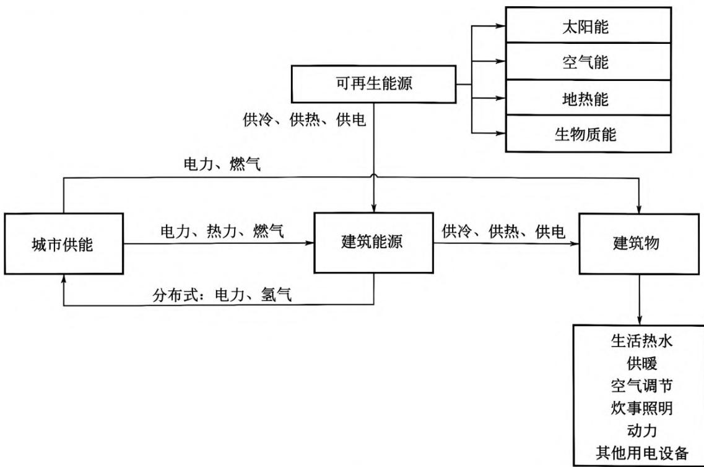  
图3.1-1 建筑能源

我国的建筑用能主要分为四大类，分别是：北方城镇供暖用能、城镇住宅用能（不包括北方地区的供暖）、公共建筑用能（不包括北方地区的供暖）以及农村住宅用能。图3.1-2和图3.1-3分别展示了2019年我国四类建筑用能及碳排放比例。

本章围绕建筑能源及应用领域的相关内容，对主要关注问题（如区域能源及规划、能源折算、碳排放等）进行介绍。

### 3.1.1 基本概念

1. 通用术语及定义（表 3.1-1）

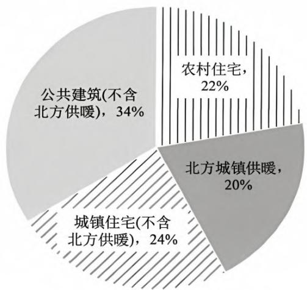  
图3.1-2 建筑用能情况

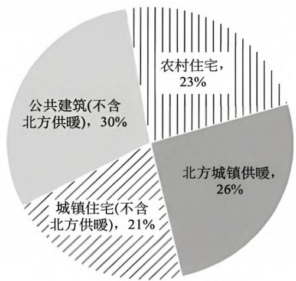  
图3.1-3 建筑碳排放情况

通用术语及定义  
表 3.1-1

<table><tr><td>术语</td><td>定义</td></tr><tr><td>能源 $^{\text{1}}$ </td><td>能够直接取得或者通过加工、转换而取得有用能的各种资源,包括煤炭、原油、天然气、煤层气、水能、核能、风能、太阳能、地热能、生物质能等一次能源和电力、热力、成品油等二次能源,以及其他新能源和可再生能源</td></tr><tr><td>一次能源 $^{\text{1}}$ </td><td>自然界中以天然形式存在并没有经过加工或转换的能量资源</td></tr><tr><td>二次能源 $^{\text{1}}$ </td><td>由一次能源直接或间接转换成其他种类和形式的能量资源</td></tr><tr><td>常规能源 $^{\text{1}}$ </td><td>利用技术上成熟,使用比较普遍的能源</td></tr><tr><td>新能源 $^{\text{1}}$ </td><td>尚未普遍使用或正在着手开发的能源</td></tr><tr><td>可再生能源 $^{\text{1}}$ </td><td>具有自我恢复原有特性,并可持续利用的一次能源</td></tr><tr><td>不可再生能源 $^{\text{1}}$ </td><td>不可以不断得到补充或不能在较短周期内产生的能源</td></tr><tr><td>清洁能源 $^{\text{2}}$ </td><td>能源在使用中对环境无污染或污染小的能源</td></tr><tr><td>区域能源 $^{\text{1}}$ </td><td>在能源中心生产蒸汽、热水和冷水,通过地下管道输送至单栋建筑,用以供暖、生活热水和空调</td></tr><tr><td>分布式能源 $^{\text{1}}$ </td><td>以小规模、分散式为特征,安置在用户附近,以就地消纳为主,向用户提供多种能量形式的综合利用系统</td></tr><tr><td>综合资源规划 $^{\text{4}}$ </td><td>供应侧和需求侧的各种资源作为一个整体进行协调的规划方法</td></tr><tr><td>碳排放权 $^{\text{6}}$ </td><td>向大气排放一定数量的温室气体的权利</td></tr><tr><td>碳交易 $^{\text{6}}$ </td><td>把二氧化碳排放权作为一种商品,从而形成了二氧化碳排放权的交易</td></tr><tr><td>碳达峰 $^{\text{6}}$ </td><td>在某一时点,二氧化碳排放不再增长,达到峰值之后逐步回落</td></tr><tr><td>碳中和 $^1$ </td><td>计算二氧化碳的排放总量,然后通过植树等方式把这些排放量吸收掉,以达到环保的目的</td></tr><tr><td>碳汇 $^3$ </td><td>主要是指森林吸收并储存二氧化碳的多少,或者说是森林吸收并储存二氧化碳的能力</td></tr><tr><td>全生命周期成本 $^9$ </td><td>指建筑物或设备从设计、建造、使用直到拆毁的全过程的耗费</td></tr><tr><td>建筑能源 $^9$ </td><td>建筑在使用过程中,为满足建筑环境(供暖、空气调节、照明等)和使用功能(动力、炊事等)所需的能源。消耗的能源种类包括电力、水、燃气、燃油、燃煤、集中热源(或冷源)及可再生能源(太阳能、生物质能等)等</td></tr></table>

①《名词术语 电力节能》DL/T 1365—2014。  
②《机械工业工程设计基本术语标准》GB/T 51218—2017。

③ 国际区域能源协会。

④ 联合国环境计划署（UNEP）。

⑤《京都议定书》。

⑥ 央视网。

⑦《新牛津英语词典》。

⑧ 国际能源网。

⑨《建筑节能与建筑能效管理》。

**2. 专业技术术语及定义（表 3.1-2）**

专业技术术语及定义  
表 3.1-2

<table><tr><td>术语</td><td>定义</td></tr><tr><td>地热能资源 $^1$ </td><td>储存于地球内部岩土体、岩石和流体中的热能。暖通空调领域主要包括中深层地热能供热和浅层地热能供冷、供热</td></tr><tr><td>中深层地热能资源 $^2$ </td><td>蕴藏在2000~3000m深的岩土体、地下水的热能资源</td></tr><tr><td>浅层地热能资源 $^3$ </td><td>蕴藏在浅层岩土体、地下水或地表水中的热能资源</td></tr><tr><td>生物质能 $^4$ </td><td>太阳能以化学能形式贮存在生物质中的能量形式,即以生物质为载体的能量。它直接或间接地来源于绿色植物的光合作用,可转化为常规的固态、液态和气态燃料。暖通空调领域生物质能应用通常指生物质能供暖,利用各类生物质原料及其加工转化形成的固体、气体、液体燃料,在专用设备中清洁燃烧供暖</td></tr><tr><td>太阳能 $^5$ </td><td>太阳以电磁能的形式发射、传播或接收的辐射能。暖通空调领域内通常将太阳能转换为热能和电能,即光热系统和光电系统</td></tr><tr><td>空气能</td><td>太阳能辐射到地球中,一部分能量被空气吸收并储存于空气中的能源。在暖通空调领域通常指的是空气吸收或放出热量的能力,如空气源热泵、蒸发冷却等</td></tr></table>

①《地热能术语》NB/T 10097—2018。  
② 陕西省地方标准《中深层地热地埋管供热系统应用技术规程》DBJ 61/T 166—2020。  
③《地源热泵系统工程技术规范（2009年版）》GB50366—2005。  
④《北方地区冬季清洁取暖规划（2017—2021年）》。  
⑤《太阳能热利用术语》GB/T 12936—2007。

**3. 能源分类**

由于能源形式和能源类型多种多样，对能源分类的方法也很多，如表 3.1-3 所示。

能源分类方法  
表3.1-3

<table><tr><td>按使用状况分</td><td>按性质分</td><td>按一、二次能源分</td><td>能源类型</td></tr><tr><td rowspan="4">常规能源</td><td rowspan="2">燃料能源</td><td>一次能源</td><td>煤炭、原油、天然气等</td></tr><tr><td>二次能源</td><td>煤气、焦炭、煤油、汽油、液化石油气、甲醇等</td></tr><tr><td rowspan="2">非燃料能源</td><td>一次能源</td><td>水动能、水势能等</td></tr><tr><td>二次能源</td><td>电、蒸汽、热水等</td></tr><tr><td rowspan="3">新能源</td><td rowspan="2">燃料能源</td><td>一次能源</td><td>核燃料、生物质能等</td></tr><tr><td>二次能源</td><td>沼气、氢气等</td></tr><tr><td>非燃料能源</td><td>一次能源</td><td>太阳能、风能、地热能、潮汐能等</td></tr></table>

**4. 能源应用**

能源应用结构有生产、转换、用户三个环节，如图 3.1-4 所示。对于能源的关注主要聚焦在供应侧。而在节能减排大背景下，能源需求侧越来越被关注，能源需求侧中能源消耗主要在产业、交通和建筑三大领域，本章主要针对的是建筑用能源，简称建筑能源。

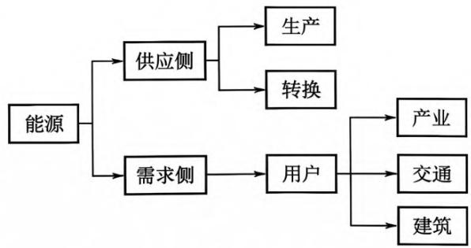  
图3.1-4 能源应用结构

### 3.1.2 建筑能源

**1. 建筑能源及分类**

建筑能源的主要转换及利用过程如图 3.1-5 所示。

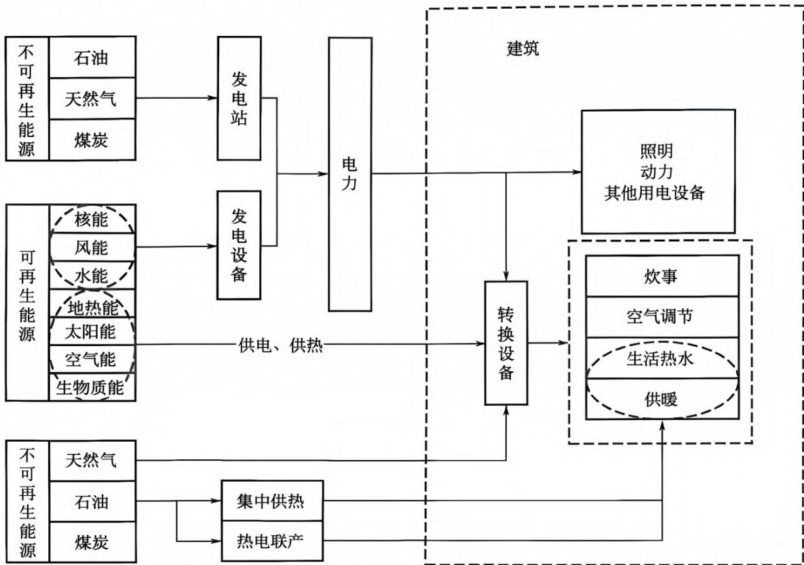  
图3.1-5 建筑能源转换及利用过程

**2. 建筑能源分类**

根据能源类型分，建筑中可使用的能源主要包括四类，如表 3.1-4 所示。

建筑能源分类  
表 3.1-4

<table><tr><td>建筑能源</td><td>主要来源及种类</td><td>主要用途</td></tr><tr><td>热力</td><td>集中供热和热电联产</td><td>供暖、生活热水</td></tr><tr><td>电力</td><td>热电、风电、太阳能发电、水电、核电等</td><td>照明、动力、用电设备、炊事、空调、生活热水、供暖</td></tr><tr><td>化石能源</td><td>天然气</td><td>供暖、生活热水、炊事以及空调等</td></tr><tr><td>可再生能源</td><td>太阳能、生物质能、地热能、空气能等</td><td>建筑的用电、生活热水、供暖、空调以及炊事</td></tr></table>

注：集中供冷目前应用较少，暂不列入建筑能源分类。

### 3.1.3 清洁、绿色和低碳能源间关系

**1. 定义**

**(1) 清洁能源定义**

国内外对于清洁能源并无统一定义，既有按照能源使用对环境的影响程度来定义和划分的，也有将能源的清洁利用本身就当作清洁能源的定义。国内外对清洁能源的认知见表3.1-5：

清洁能源范畴  
表3.1-5

<table><tr><td>国家和地区</td><td>来源</td><td>清洁能源及范畴</td></tr><tr><td>中国</td><td>国家能源局、国家发展和改革委员会、国家统计局</td><td>水电、风电、太阳能等可再生能源发电以及核电、天然气等作为清洁能源的重要组成部分;天然气以外的化石能源的清洁高效利用不应属于清洁能源范畴</td></tr><tr><td>欧盟</td><td>欧盟委员会(European Commission)</td><td>欧洲清洁能源转型投资主要包括能效和可再生能源,也包括电力和天然气联网投资。考虑到德国等欧盟主要成员国弃核,欧盟清洁能源转型中并未提及核电</td></tr><tr><td>美国</td><td>美国能源部(DOE)</td><td>美国把可再生能源和核能统称为清洁能源技术,燃气并不在此列</td></tr></table>

国内一些规范和工具书对清洁能源的定义见表 3.1-6。

清洁能源定义  
表3.1-6

<table><tr><td>来源</td><td>清洁能源定义</td></tr><tr><td>《机械工业工程设计基本术语标准》GB/T 51218—2017</td><td>在使用中对环境无污染或污染小的能源</td></tr><tr><td>《中国百科大辞典》</td><td>无污染和污染程度小的能源,如太阳能、风能、水能、气体燃料等</td></tr><tr><td>《生态文明建设大辞典》</td><td>能源清洁高效的系统化技术应用体系包括利用核能、太阳能、生物质能、水能、风能、地热能、潮汐能、氢能、洁净煤技术等。相对于传统化石能源的概念,清洁能源符合一定的排放标准,对环境的影响程度更低,利于环境的可持续发展</td></tr><tr><td>《国土资源实用词典》</td><td>在使用过程中不排放或很少排放污染物的能源,包括核能、太阳能、风能、水能、地热能、潮汐能、沼气、天然气、煤气、电能等。也指对能源的清洁化、高效率利用的工程技术措施,如煤炭、柴油、汽油等,通过采取技术措施,使其在使用后的排污控制在允许范围内</td></tr></table>

综上所述，可以将清洁能源的定义归结如下：清洁能源是能源在使用过程中对环境无污染或污染小的能源，包括可再生能源、核能、天然气以及洁净煤等。清洁能源不但强调清洁性，同时也强调经济性，并且强调在其使用后必须符合一定的排放标准。

**(2) 绿色能源定义**

国内外对于绿色能源也无统一定义，国内一些工具书上对于绿色能源的定义见表3.1-7。

绿色能源定义  
表3.1-7

<table><tr><td>来源</td><td>定义</td></tr><tr><td>《资源科学技术名词》</td><td>指温室气体和污染物零排放或排放很少的能源,主要是新能源和可再生能源</td></tr><tr><td>《水利大辞典》</td><td>各种可再生能源(如水能、太阳能、风能等),生产和消费过程中对生态环境低污染或无污染的能源(如天然气、清洁煤和核能等),以及化害为利、同改善环境相结合、充分利用城市垃圾、淤泥等废物中所蕴藏的能源的总称</td></tr><tr><td>《新编经济金融词典》</td><td>在开发利用及转化为电能的过程中对大气没有污染的能源,如太阳能、风能、潮汐能、热核聚变能、地热能、氢能等</td></tr><tr><td>《生态学名词》</td><td>绿色植物通过光合作用将太阳能转化并储存于体内的化学能。人们直接或加工利用这些化学能作为能源,代替煤、石油等不可再生的能源。在可持续发展的理念下,绿色能源体现了与环境友好相容的自然资源的开发利用原则</td></tr></table>

由以上的一些定义及分析可知，绿色能源主要包括两点：低污染和绿色。因此，将绿色能源的定义归结为：绿色能源是指洁净的能源和对于废热、废物等的洁净利用，包括可再生能源利用技术等。

**(3) 低碳能源定义**

国内外对于低碳能源并没有准确的定义，目前在国际上低碳能源和低碳经济的发展十分迅速，伴随着国际社会的碳减排压力，很多国家和国际机构都对低碳能源的发展政策提出了具体要求，见表3.1-8。

低碳能源发展政策  
表3.1-8

<table><tr><td>来源</td><td>政策</td></tr><tr><td>中国</td><td>要深入推进能源革命,着力推动能源生产利用方式变革,优化能源供给结构,提高能源利用效率,建设清洁低碳、安全高效的现代能源体系</td></tr><tr><td>国际能源署</td><td>最重要的是使用高效能源、减少火电等效能较低的发电形式和逐步减少对化石能源的补贴</td></tr><tr><td>英国</td><td>《2007 能源白皮书》正式提出低碳能源的组合发展,即形成可再生能源、核能以及碳的捕获与封存(CCS)的低碳能源组合。《2008 英国能源法》则从立法层面对三种低碳能源进行了规定</td></tr></table>

综上所述，可将低碳能源的定义归结为；低碳能源是指高能效、低能耗、低污染、低碳排放的能源，包括可再生能源、核能等。

根据低碳能源的内涵，可将低碳能源归于清洁能源。低碳能源的基本特征主要表现在以下三个方面：①能源结构清洁化；②能源使用高效化；③能源技术低碳化。

**2. 清洁能源、绿色能源、低碳能源的关系**

根据上述各能源内涵，清洁能源、绿色能源以及低碳能源之间的关系如图 3.1-6 所示。

（1）清洁、低碳以及绿色能源的交集是可再生能源，包含太阳能、风能、潮汐能以及地热能等，其主要特点是资源丰富、可再生、对环境影响小。

（2）清洁能源包含低碳能源。我国对清洁能源的界定中包括天然气，但天然气的碳排放是很高的，不能算作低碳能源。

（3）绿色能源不包含化石能源，只包含可再生能源和废热、废物的再利用，强调自然环境保护。

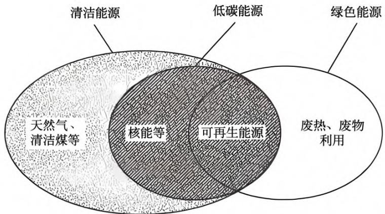  
图 3.1-6 清洁能源、绿色能源、低碳能源之间的关系

**3. 常用新能源种类**

暖通空调行业常用新能源种类通常包括太阳能、风能、生物质能、地热能以及工业余热等。表3.1-9所示是几种常用的新能源特点。

常用新能源特点  
表 3.1-9

<table><tr><td>能源种类</td><td>应用</td><td>优缺点</td><td>适用地区</td></tr><tr><td>太阳能</td><td>太阳能光热;太阳能光电</td><td>优点;应用范围广,用之不竭,环保;缺点;不稳定</td><td>太阳能丰富地区(参考表3.1-10)</td></tr><tr><td>风能</td><td>风电技术</td><td>优点;资源丰富,用之不竭,环保;缺点;不稳定</td><td>风能丰富地区(参考表3.1-11)</td></tr><tr><td>生物质能</td><td>生物质供热与发电;生物质沼气;生物燃料乙醇;生物柴油;垃圾供热与发电</td><td>优点;资源分布广,储量丰富,对环境影响小,可持续零碳燃料(参考表3.1-12);缺点;原料成分复杂,能量密度低,收集成本高,各种生物质分布不均</td><td>适用于各类地区(参考表3.1-13)</td></tr><tr><td>地热能</td><td>地热能供暖;地热能发电;地源热泵供冷、供暖</td><td>优点:低品质稳定能源,资源分布广;缺点:资源密度低,开发利用较难</td><td>适用于各类地区(参考表3.1-14)</td></tr><tr><td>工业余热</td><td>余热发电;余热供暖;余热制冷</td><td>优点:资源丰富、种类多,节能降碳的主要方法/手段;缺点:通常分布在远离城市及用户区,利用不便;综合利用跨行业、跨界较多;余热利用周期较短,需配合跨季节储能技术,成本较高</td><td>适用于周边有电厂、钢铁厂、化工厂、水泥厂等的区域(参考表3.1-15)</td></tr></table>

我国太阳能资源总量等级  
表 3.1-10

<table><tr><td>名称</td><td>分级阈值(kWh/m2)</td><td>地域</td></tr><tr><td>最丰富</td><td>≥1750</td><td>甘肃西部、内蒙古西部、青海北部、西藏中西部</td></tr><tr><td>很丰富</td><td>1400~1750</td><td>新疆大部、内蒙古大部、甘肃大部、宁夏、陕西北部、山西北部、河北中北部、青海东部、西藏东部、四川西部、云南大部、海南等地</td></tr><tr><td>丰富</td><td>1050~1400</td><td>东北大部、华北南部、黄淮、江淮、汉江、江南及华南大部分地区</td></tr><tr><td>一般</td><td>&lt;1050</td><td>重庆、贵州中东部、湖南西北部和湖北西南部地区</td></tr></table>

我国风能资源总量等级  
表3.1-11

<table><tr><td>名称</td><td>70m高度年平均风功率密度 $\geqslant 150W/m^{2}$ 区域面积(万km2)</td><td>地域</td></tr><tr><td>最丰富</td><td> $\geqslant 80$ </td><td>内蒙古、新疆、西藏</td></tr><tr><td>很丰富</td><td>40~80</td><td>黑龙江、青海</td></tr><tr><td>丰富</td><td>10-40</td><td>甘肃、吉林、四川、广西、云南、辽宁</td></tr><tr><td>一般</td><td>&lt;10</td><td>河北、山东、陕西、山西、贵州、广东等地</td></tr></table>

我国生物质资源利用潜力  
表3.1-12

<table><tr><td rowspan="2">资源来源</td><td colspan="2">可利用资源量</td><td colspan="2">已利用资源量</td><td colspan="2">剩余可利用资源量</td></tr><tr><td>实物量(万t)</td><td>折合标煤量(万t)</td><td>实物量(万t)</td><td>折合标煤量(万t)</td><td>实物量(万t)</td><td>折合标煤量(万t)</td></tr><tr><td>农作物秸秆</td><td>34000</td><td>17000</td><td>800</td><td>400</td><td>33200</td><td>16600</td></tr><tr><td>农产品加工剩余物</td><td>6000</td><td>3000</td><td>200</td><td>100</td><td>5800</td><td>2900</td></tr><tr><td>林业木质剩余物</td><td>35000</td><td>20000</td><td>300</td><td>170</td><td>34700</td><td>19830</td></tr><tr><td>畜禽粪便</td><td>84000</td><td>2800</td><td>30000</td><td>1000</td><td>54000</td><td>1800</td></tr><tr><td>城市生活垃圾</td><td>7500</td><td>1200</td><td>2800</td><td>500</td><td>4700</td><td>700</td></tr><tr><td>有机废水</td><td>435000</td><td>1600</td><td>2700</td><td>10</td><td>432300</td><td>1590</td></tr><tr><td>有机废渣</td><td>95000</td><td>400</td><td>4800</td><td>20</td><td>90200</td><td>380</td></tr><tr><td>合计</td><td>—</td><td>46000</td><td>—</td><td>2200</td><td>—</td><td>43800</td></tr></table>

2017年我国不同地区城市生活垃圾产生情况  
表 3.1-13

<table><tr><td>城市生活垃圾产生量(万t)</td><td>地区</td></tr><tr><td>0~500</td><td>宁夏、西藏、青海、河北、海南、云南、陕西、安徽、吉林、新疆、河南、重庆、天津、江西、辽宁、甘肃、内蒙古</td></tr><tr><td>500~1000</td><td>贵州、广西、黑龙江、福建、陕西、湖北、上海、北京</td></tr><tr><td>1000~1500</td><td>湖南、四川、山东</td></tr><tr><td>1500~2000</td><td>江苏、浙江</td></tr><tr><td>2500~3000</td><td>广东</td></tr></table>

注：本表不包括香港、澳门、台湾。

我国地热资源类型分布  
表3.1-14

<table><tr><td colspan="2">资源类型</td><td colspan="2">分布地区</td></tr><tr><td colspan="2">浅层地热资源</td><td colspan="2">东北地区南部、华北地区、江淮流域、四川盆地和西北地区东部</td></tr><tr><td rowspan="3">水热型地热资源</td><td rowspan="2">中低温</td><td>沉积盆地型</td><td>东部中、新生代平原盆地,包括华北平原、河-淮盆地、苏北平原、江汉平原、松辽盆地、四川盆地以及环鄂尔多斯断陷盆地等地区</td></tr><tr><td>隆起山地型</td><td>藏南、川西和滇西、东南沿海、胶东半岛、辽东半岛、天山北麓等地区</td></tr><tr><td>高温</td><td colspan="2">藏南、滇西、川西等地区</td></tr><tr><td>换热型地热资源</td><td>中低温</td><td colspan="2">京津冀地区、华北平原部分地区、渭河盆地的陕西西安和咸阳等地温资源较好的区域</td></tr><tr><td colspan="2">干热岩资源</td><td colspan="2">主要分布在西藏,其次为云南、广东、福建等东南沿海地区</td></tr></table>

注：干热岩为不含或仅含少量流体，温度高于 $180^{\circ}\mathrm{C}$ ，其热能在当前技术经济条件下可以利用的岩体。

各行业余热资源情况表  
表3.1-15

<table><tr><td>行业</td><td>余热资源</td><td>余热用途</td><td>余热可回收率</td></tr><tr><td>钢铁冶金行业</td><td>烟气、高炉废气、循环冷却水、冲渣水</td><td>发电、工艺生产用热、生活用热(供暖、卫生热水)</td><td>30%以上</td></tr><tr><td>煤矿行业</td><td>巷道排水、矿井排风、瓦斯发电机循环冷却水</td><td>井筒防冻、生活热水、建筑供暖、制冷</td><td>30%~40%</td></tr><tr><td>印染行业</td><td>印染废水</td><td>生产工艺用热、生活热水、建筑供暖、制冷</td><td>40%以上</td></tr><tr><td>有色金属行业</td><td>循环冷却水、生产污水</td><td>生产工艺用热、生活热水、建筑供暖、制冷</td><td>40%以上</td></tr><tr><td>化工行业</td><td>工艺循环冷却水、工业废水、工业废气、烟气、乏汽</td><td>生产工艺用热、生活热水、建筑供暖、制冷</td><td>30%以上</td></tr><tr><td>石油行业</td><td>采油污水</td><td>生产工艺用热、生活热水、建筑供暖、制冷</td><td>30%~40%</td></tr><tr><td>火力发电行业</td><td>烟气,乏汽冷凝余热</td><td>城市供热</td><td>50%以上</td></tr></table>

## 3.2 区域能源及能源规划

### 3.2.1 基本概念

**1. 区域能源**

**(1) 区域能源定义**

区域供暖、区域供冷、区域供电以及解决区域能源需求的能源系统的综合集成称为区域能源。这种区域可以是行政划分的城市和城区，也可以是一个居住小区或一个建筑群，还可以是特指的开发区、园区等。

区域能源通过能源网络系统向区域内建筑物等服务对象提供热水/蒸汽（区域供热）、电力（区域供电）、冷水（区域供冷）等，涉及的系统形式有锅炉房供热系统、冷水机组供冷系统、热电厂系统、冷热电联产系统、热泵供能系统、太阳能利用系统、风力发电系统及生物质能系统等。

**(2) 区域能源特点**

区域能源是基于区域内特定的终端能源需求（形式、品位、耗散），通过对平行运行的能源体系的优化集成，实现品位对应、温度对口、梯级利用、多能互补的能源生产、供应和利用，如图 3.2-1 所示。“区域能源”主要强调的是“基于用户能源需求与区域能效目标的多能源系统优化”，而不是通常理解的仅是在区域内建几座集中能源站（能源站）。集中能源站是区域能源规划的结果，而非目的，更不能说建了集中能源站就意味着实现了区域能源。

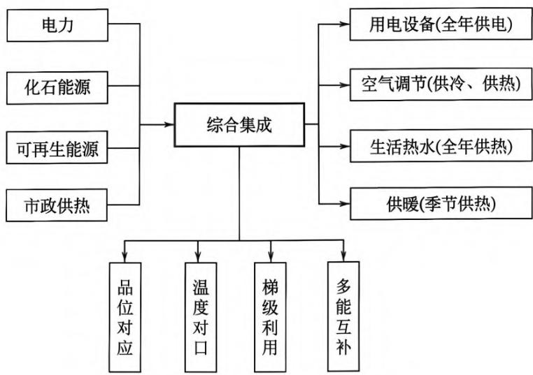  
图3.2-1 区域能源系统的特点

**2. 分布式能源**

**(1) 分布式能源定义**

国际主要能源机构对分布式能源的定义见表 3.2-1。

分布式能源的定义  
表3.2-1

<table><tr><td>来源</td><td>定义</td></tr><tr><td>美国能源部(DOE)</td><td>英文名称:Distributed Energy Resources(DER),指的是一系列小型的、模块化的、产生电能的技术,容量范围从几千瓦到50MW,包括许多供应侧和用户侧的技术,一般位于需要能源的地点或附近</td></tr><tr><td>美国电力研究院(EPRI)</td><td>英文名称:Distributed Energy Resources(DER),小型的能量产生及存储系统,一般在用户或配电站附近,单个设备的容量在20MW以下,总容量为1kW~50MW,可用于供应侧及用户侧的管理技术</td></tr><tr><td>欧洲推进热电联产协会</td><td>英文名称:Distributed Generation(DG),由一切连接分布式电网、拥有用户侧计量的发电装置组成,主要是可再生能源系统和热电联产系统,一般单个装置发电量不超过10MW</td></tr><tr><td>国际能源机构(IEA)</td><td>英文名称:Distributed Generation(DG),服务于当地用户或支持电网的发电站,与公共电网以传输电压进行连接。主要采用的技术是内燃机、小型或微型燃气轮机、燃料电池和光伏电池系统。由于风力发电场一般不面向当地用户需要,因此不包括这项技术。英文名称:Distributed Power(DP),将DG加上能量储存技术,比如飞轮、大型再生燃料电池和空气压缩存储。英文名称:Distributed Energy Resources(DER),DG加上需求侧管理</td></tr><tr><td>《机械工业工程设计基本术语标准》GB/T 51218—2017</td><td>英文名称:Distributed Energy Sources,分布在用户端的以热电冷联产技术为基础的能源综合利用系统</td></tr><tr><td>《名词术语 电力节能》DL/T 1365—2014</td><td>以小规模、分散式为特征,安置在用户附近,以就地消纳为主,向用户提供多种能量形式的综合利用系统</td></tr></table>

由此可见，分布式能源有几个关键词，即“分布式”“发电”“热电联产”。因此，可将分布式能源定义归结如下：分布式能源是以小规模、分散式为特征，安置在用户附近，且以就地消纳为主，向用户提供多种能量形式的综合利用系统。能源形式包括燃气冷热电三联供、太阳能、风能、储能等。

分布式能源的四种形式：①热电（冷）联产系统；②利用可再生能源的分布式供电供热系统；③以热泵为核心技术的低品位能源应用系统；④上述系统的综合系统。

**(2) 分布式能源的特点**

分布式能源系统是相对于集中能源系统而言的，是通过电力生产与电力用户的空间关

系定义 “分布” 与 “集中”。“集中” 意味着电力能源远离用户端生产，长距离输配；“分布” 意味着电力能源贴近用户端生产，甚至就在用户电力负荷中心处生产，短距离（甚至零距离）输配。

分布式能源的特征体现为用户端设置一、二次能源多能联产（冷、热、电）、余废热与可再生能源利用，其目的是减少高品位能源输配损失，实现能源梯级利用，充分利用低品位能源，见图3.2-2。分布式能源的用户对象应具有多种形式二次能源需求（如冷、热、电等）且其负荷强度相对均衡，否则不仅不能实现总体上的能源梯级利用，而且系统的经济性会变差。

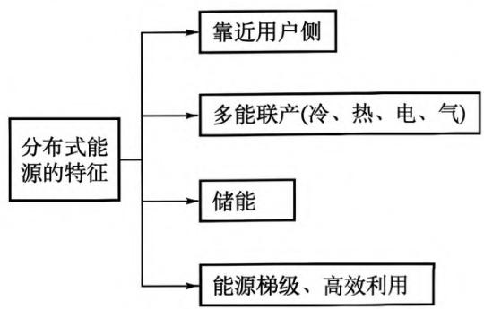  
图3.2-2 分布式能源的特征

分布式能源系统是区域能源规划的结果，即通过区域能源规划决定什么样的终端用户适合采用分布式能源，并为其创造适合的外部条件。

**3. 能源微网**

能源微网，也称能源互联网，就是将区域内基于分布式能源技术和可再生能源利用的一些规模较小的能源站或者热电联产装置连接成网，变成能源互联网。区域内的冷、热、电均可以互通有无、相互补偿。

能源互联网中的能源站点可以是太阳能光电、风力发电、生物质能热电联产（包括垃圾发电）、家用燃料电池以及各种低品位热能等。充分利用区域内的可再生能源和未利用能源，这样各区域中每一栋建筑都可以收集能量、转换能量，收集到的能量汇聚到热和电的互联网中，既能提供建筑用能，也能作为公用设施为电动车辆充电（图 3.2-3）。能源互联网的核心是有一个智能化的控制调度中心。

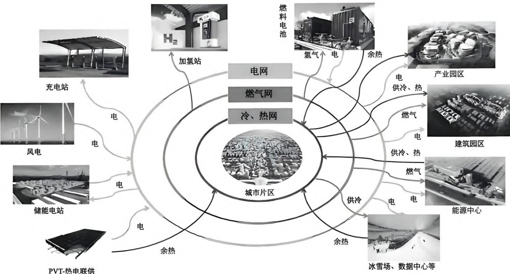  
图3.2-3 能源微网系统示意图

### 3.2.2 能源规划及评价

**1. 能源规划方法**

综合资源规划方法即将供应侧和需求侧的各种资源作为一个整体进行协调的规划方法（表 3.2-2）。

需求侧能源规划和供应侧能源规划的区别见表3.2-3。

能源规划方法定义  
表3.2-2

<table><tr><td>方法</td><td>定义</td><td>规划资源</td></tr><tr><td>供应侧能源规划</td><td>从城市能源的供应侧对能源进行规划。在我国城市规划体系中,城区电力规划、燃气规划以及北方城市的集中供热规划都占有重要地位,这些都属于供应侧能源规划</td><td>公用事业网络提供的电力、热水、燃气、蒸汽等商品能源,购买得到的石油制品、液化石油气、煤炭等商品能源;当地可获得和值得应用的可再生能源,如生物质能(森林废弃物、农作物秸秆、生活垃圾)、太阳能、风能、地热能、小水电等资源;有应用价值的余热、废热,如污水以及自然界的低品位可再生热源,如空气、土壤、地表水等</td></tr><tr><td>需求侧能源规划</td><td>需求侧能源规划基于综合资源规划原则,将终端节能视为一种资源,通过能源互联网整合供应侧能源、需求侧节能、城市空间形态及终端可再生能源的应用,达到降低负荷、减少系统装机容量以及保障系统可靠性的目的</td><td>新建建筑由于采取了比国家节能设计标准更严格的建筑节能措施而降低的能耗;用户改变消费行为而节约的能量;通过规划措施调整城市形态降低供冷供热负荷所节约的能量;采用区域能源系统,利用负荷错峰和负荷参差率而减少的能耗;用户采用更高能效的末端设备所降低的能耗</td></tr></table>

需求侧能源规划与供应侧能源规划的区别  
表3.2-3

<table><tr><td>供应侧能源规划</td><td>需求侧能源规划</td></tr><tr><td colspan="2">技术路线</td></tr><tr><td>基于可靠性和经济效益最大化原则</td><td>基于综合能源规划(IRP)理论,终端节能资源化</td></tr><tr><td>单源系统,以化石能源为主</td><td>多源系统,集成可再生能源和未利用能源</td></tr><tr><td>大集中系统,垂直化管理</td><td>能源互联网,扁平化管理</td></tr><tr><td>适应工业化时代需求,高温高压高品位能源产品,稳定的负荷</td><td>适应后工业化时代需求,低温低压低品位能源产品,变动的负荷</td></tr><tr><td>集中产能,远程输送</td><td>现场产能,用户既是消费者也是生产者,通过能源互联网互联互通</td></tr><tr><td>单向供应</td><td>双向供应</td></tr><tr><td>从顶到底的思想</td><td>从底到顶的思想</td></tr><tr><td colspan="2">方法论</td></tr><tr><td>负荷预测;极端用能情况下的高峰负荷</td><td>负荷预测:用户采取节能措施后的减量负荷</td></tr><tr><td>指标法粗放型预测负荷;取单位建设用地、单位建筑面积、人均生活用电、人均综合用电等经验指标,取其中大者;装机留有格量,做加法。</td><td>精细化预测负荷;采取各类建筑、各种情景下的逐时负荷叠加,实现负荷平准化和错峰,装机做减法</td></tr><tr><td>选择大机组大集中系统,发挥大机组的高能效</td><td>分布式产能,灵活运用,适应分散式个性化用能</td></tr><tr><td>系统大部分时间在部分负荷下运行,输送能耗占比较大,系统能效低。形成节能的悖论;即需求侧用能越多,系统能效反而越高,供应侧经济效益越好</td><td>系统满负荷运行时段延长,系统能效提高</td></tr><tr><td>热电联产系统,电力依赖上网或并网,重视余热利用,综合一次能源利用效率要求在70%以上</td><td>热电联产系统,电力自用为主,多余的电量上网,用电力驱动热泵,与余热共同承担供热(冷)任务,综合一次能源利用效率可以高达200%</td></tr><tr><td>进入法定城市规划体系,有成熟的技术标准</td><td>没有进入法定城市规划体系,未形成技术标准</td></tr><tr><td colspan="2">效益比较</td></tr><tr><td>用户对能源品种、供应方式只有唯一选择</td><td>用户有多种选择,必须有灵活的价格机制和周到的服务。系统运行的商业化模式,是需求侧能源规划中必须要考虑的因素</td></tr><tr><td>利用价格杠杆推动需求响应,用足存量、降低增量,用户节钱不节能或节能不节钱</td><td>根据市场交易的原则,选取最有利的运行模式,既节能又节钱</td></tr><tr><td>保障供应侧利益,实行按面积收费等不合理制度</td><td>供需双赢、计量收费、有吸引力的合理价格</td></tr><tr><td>带有行政公权力,既当裁判员又当运动员</td><td>完全是一种服务</td></tr><tr><td>只有一个投资主体</td><td>多个投资主体,多种投资形式,非常适合采取公私合营(PPP)模式</td></tr><tr><td>上下游利益独享</td><td>既是供应者又是用户,必须与用户分享效益</td></tr></table>

**2. 能源规划流程（图 3.2-4）**

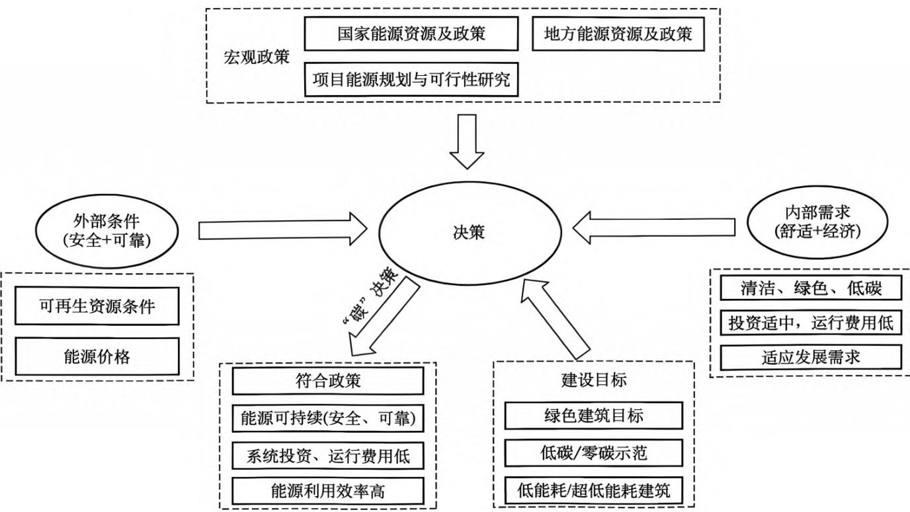  
图3.2-4 能源规划流程图

**3. 能源规划评价**

近年来，国家对于项目的评价逐渐从单纯的前评估向前评估和后评价相结合的评价方式转变，对项目实施后的实际节能效果评价等愈加重视。我国发布了中央政府投资项目后评价管理办法和中央政府投资项目后评价报告编制大纲等一系列文件，从政府项目着手，逐步让项目后评价得以重视。

对于规划项目的评价，应从全过程考虑，包括项目的前期决策阶段、中期设计阶段和后期运行阶段。各个阶段由于其评价时点不同，目的也不完全相同，如图 3.2-5 所示。

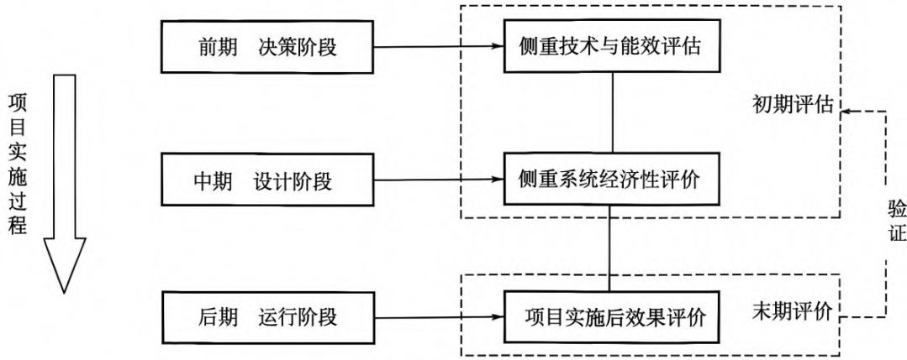  
图3.2-5 项目全过程评价示意图  
能源规划项目评价类型及特点参考表 3.2-4。

能源规划项目评价类型及特点  
表3.2-4

<table><tr><td>评价类型</td><td>评价方法及原理</td><td>特点</td></tr><tr><td>节能量分摊</td><td>“需求侧”单体建筑的实际使用,和“供给侧”分布式能源中心分别计算;通过把建筑所有能源都转换成电力,可以计算该建筑电力的总消耗量;如果以电力为换算“媒介”,节能率即“参照建筑”和“设计建筑”的电耗的差值。即节能率=(参照建筑电耗-设计建筑电耗)/参照建筑电耗</td><td>将节能量折算为统一标准,更便于比较;节能量分摊多见的是两种需求:计算能耗表现(绝对量);计算节能率(相对量)。如果是后一种情况,计算中还需要确定一个参照建筑</td></tr><tr><td>碳减排率评价</td><td>设定系统计算边界,选定所要计算的城区能源系统即设定了系统计算边界;确定计算边界内系统的温室气体排放;计算出能源系统的碳排放量;确定能源系统的比较对象,即基准能源系统。具体计算参考“3.6碳排放与交易”</td><td>温室气体的排放包括直接排放和间接排放;对于不同的城区能源系统,可选择不同的基准能源系统。基准能源系统应具有一定的典型性、代表性和实效性</td></tr><tr><td>能效评价</td><td>能效是基于热力学第一定律提出来的,是输出能量(作为收益的能量)与投入能量(作为代价的能量)的比值。具体计算参见表3.2-5</td><td>能效评价反映的是能量的数量守恒关系,不能反映能量的质的差别,即不能区分机械能、电能、水能、风能等高级能量和热能等低级热量的差异</td></tr><tr><td>烟效率评价</td><td>烟效率指的是作为收益的烟值与作为代价的烟值之比。通常计算区域能源系统的烟效率时,需按照以下步骤进行;画出区域能源系统图;实际循环抽象为理想循环;确定各状态点参数;列出烟平衡式;计算烟效率</td><td>烟作为评价能量价值的物理量,结合“量”和“质”评价了能量的价值;烟损失可清楚识别系统中偏离理想状态的位置、原因及来源</td></tr></table>

不同循环方式的能效评价方法

<table><tr><td>循环方式</td><td>能量平衡方程式</td><td>能效</td><td>示意图</td></tr><tr><td>动力循环</td><td> $Q_1 = Q_2 + W_{\text{net}}$ </td><td> $\eta = \frac{\text{收益能量}}{\text{代价能量}} = \frac{W_{\text{net}}}{Q_1} = \frac{Q_1 - Q_2}{Q_1}$ </td><td>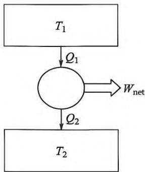</td></tr><tr><td rowspan="2">热泵循环</td><td rowspan="2"> $Q_2 + W_{\text{net}} = Q_1$ </td><td>制冷: $\eta = \frac{\text{收益能量}}{\text{代价能量}} = \frac{Q_2}{W_{\text{net}}} = \frac{Q_2}{Q_1 - Q_2}$ </td><td rowspan="2">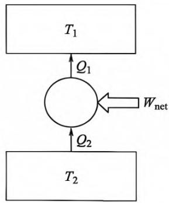</td></tr><tr><td>制热: $\eta = \frac{\text{收益能量}}{\text{代价能量}} = \frac{Q_1}{W_{\text{net}}} = \frac{Q_1}{Q_1 - Q_2}$ </td></tr></table>

表3.2-5

## 3.3 燃料与燃烧

### 3.3.1 基本概念

**1. 燃料的分类**

燃料按照其状态不同可分为固体燃料、液体燃料和气体燃料三大类，见表 3.3-1；按照燃料获得的方法不同，又可分为天然燃料和人工燃料；按照其释放能量的方式不同，还可以分为化学燃料（包括氢等无机燃料和煤炭、石油、天然气等有机燃料）和核燃料（包括钍、铀、钚等裂变核燃料和氢、氦等聚变核燃料）。

燃料分类  
表 3.3-1

<table><tr><td>类别</td><td colspan="2">天然燃料</td><td>人工燃料</td></tr><tr><td rowspan="2">固体燃料</td><td>木质燃料</td><td>木柴、植物秸秆等</td><td>木炭等</td></tr><tr><td>矿物质燃料</td><td>泥炭、烟煤、无烟煤、褐煤、石煤、油页岩等</td><td>焦炭、半焦炭、泥炭砖、煤矸石等</td></tr><tr><td>液体燃料</td><td colspan="2">石油</td><td>汽油、柴油、煤油、甲醇、乙醇等</td></tr><tr><td>气体燃料</td><td colspan="2">天然气(气田气、油田气)</td><td>液化石油气、人造煤气、沼气等</td></tr></table>

**2. 固体燃料**

天然固体燃料分为两大类，即木质燃料和矿物质燃料。木质燃料（又称植物性燃料或生物质燃料）主要包括木柴、植物秸秆等，它们可以直接燃烧而获得热能，也可通过干馏、热解、气化等方法转换为气体、液体或固体燃料。

**(1) 煤炭**

我国煤的技术型分类法采用表征煤的煤化程度的主要参数，即以干燥无灰基挥发分 $V_{\mathrm{dnf}}$ 作为分类指标，将煤分为褐煤、烟煤和无烟煤三大类，如表3.3-2所示。

煤炭的常见种类  
表 3.3-2

<table><tr><td>种类</td><td>碳的质量分数</td><td>水的质量分数</td><td>灰分的质量分数</td><td>无灰基挥发分 $V_{\text{dnf}}$ </td><td>热值(kJ/kg)</td></tr><tr><td>无烟煤</td><td>&gt;50%</td><td>1%~5%</td><td>6%~25%</td><td>&lt;10%</td><td>25000~32500</td></tr><tr><td>烟煤</td><td>40%~60%</td><td>3%~18%</td><td>7%~30%</td><td>—</td><td>20000~30000</td></tr><tr><td>褐煤</td><td>40%~50%</td><td>20%~50%</td><td>6%~50%</td><td>40%~50%</td><td>10000~21000</td></tr></table>

注：烟煤的种类较多，彼此之间参数差别较大。

**(2) 其他固体燃料**

常用的固体燃料除了煤炭外，还包括一些非常规的伴生物以及一些特殊的燃料，主要包括油页岩、炭沥青、天然焦、木炭等。除此之外，植物性燃料和城市生活垃圾同样是固体燃料的一部分，但由于热值的限制，目前并未大面积投入使用，有待技术的进一步发展（表 3.3-3）。

其他固体燃料  
表3.3-3

<table><tr><td>种类</td><td>特性</td><td>热值(kJ/kg)</td></tr><tr><td>油页岩</td><td>含氢量高,燃点低,可作为锅炉燃料使用</td><td>2093~6280</td></tr><tr><td>炭沥青</td><td>低灰、低硫、质地均匀,主要作为燃料使用</td><td>&gt;29200</td></tr><tr><td>天然焦</td><td>用途广泛,但作为一种劣质燃料,不适合长距离运输</td><td>18000~28000</td></tr><tr><td>木炭</td><td>易燃,燃烧灰分少,可作为锅炉点火燃料</td><td>27200~30500</td></tr><tr><td>植物性燃料</td><td>种类丰富、易燃、储量巨大,不同种类热值差别较大</td><td>—</td></tr><tr><td>城市生活垃圾</td><td>蕴藏着巨大的能量,但其热值及利用受地域影响较大</td><td>—</td></tr></table>

目前，生物质成型燃料以及生物质气化供热和发电技术发展迅速。生物质在一定的热力学环境下，将组成生物质的碳氢化合物转化为含有一氧化碳、氢气和甲烷等的可燃气体，可燃气体通过专用燃烧器进行充分燃烧，将化学能转化为热能，满足供热、供汽等生产工艺要求。生物质气化系统工艺流程如图3.3-1所示。

**3. 液体燃料**

液体燃料可分为天然液体燃料和人工液体燃料两大类。石油是主要的天然液体燃料。石油一般不直接用于工业燃烧，锅炉、冶金炉等工业燃烧设备的燃油是重油、渣油和柴油，它们是由石油炼制加工所得到的产品，属于人工液体燃料。该类液体燃料还包括利用化学方法将煤、油页岩或天然气等提炼或合成的燃料，如通过煤液化制取的合成汽油、柴油、重油和甲醇燃料，以及通过化学合成法和发酵法制取的乙醇燃料。液体燃料的特性如表3.3-4所示。

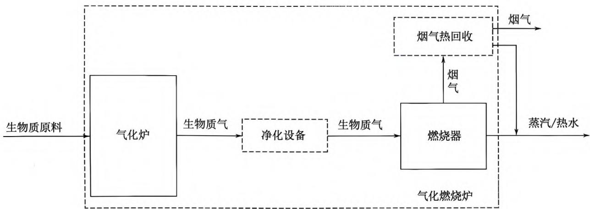  
图 3.3-1 生物质气化系统工艺流程图

液体燃料的特性  
表 3.3-4

<table><tr><td>种类</td><td>特性</td><td>热值(kJ/kg)</td></tr><tr><td>柴油</td><td>用途广泛,对环境污染小,对设备腐蚀小</td><td>42652</td></tr><tr><td>重油</td><td>密度大,燃烧稳定,对环境污染小</td><td>46040</td></tr><tr><td>煤液化合成燃料</td><td>种类很多,用途广泛</td><td>—</td></tr><tr><td>醇类燃料</td><td>燃烧效率高,用途广泛</td><td>&gt;20000</td></tr></table>

**4. 气体燃料**

气体燃料按获得方式可分为天然气体燃料和人工气体燃料两大类。

天然气体燃料是指从自然界直接收集和开采得到的，不用经过再加工即可投入使用的气体燃料。这些气体燃料按储藏特点可分为气田气、油田气和煤田气。人工气体燃料是以煤、石油产品或各种有机物为原料，经过各种加工方法而得到的气体燃料。气体燃料的主要成分见表3.3-5。

气体燃料的主要成分  
表 3.3-5

<table><tr><td>种类</td><td>主要成分</td><td>热值(kJ/Nm3)</td></tr><tr><td>气田气</td><td>甲烷的体积分数一般在90%以上,还有少量的乙烷、丙烷、丁烷</td><td>35544</td></tr><tr><td>油田气</td><td>甲烷的体积分数在80%左右,还有少量的乙烷、丙烷、丁烷</td><td>38931</td></tr><tr><td>煤田气</td><td>甲烷的体积分数在50%左右,其余为氢气、氧气和二氧化碳</td><td>14636~16726</td></tr><tr><td>液化石油气</td><td>主要成分为丙烷、丁烷、丙烯和丁烯</td><td>50179(液)</td></tr><tr><td>沼气</td><td>主要成分是甲烷,体积分数为55%~70%,还有少量的一氧化碳、氢气及硫化氢等</td><td>23000</td></tr></table>

沼气作为人工气体燃料，也是生物质燃料，在农村地区的应用也越来越受关注。沼气制作工艺流程如图 3.3-2 所示。

常见燃料的热值如表 3.3-6 所示。

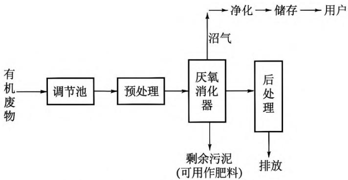  
图3.3-2 沼气制作工艺流程图

常见燃料的热值  
表3.3-6

<table><tr><td>燃料种类</td><td>燃料名称</td><td>平均低位发热量</td></tr><tr><td rowspan="5">燃煤</td><td>无烟煤</td><td>26700kJ/kg</td></tr><tr><td>炼焦煤</td><td>28200kJ/kg</td></tr><tr><td>褐煤</td><td>11900kJ/kg</td></tr><tr><td>原煤</td><td>20908kJ/kg</td></tr><tr><td>焦炭</td><td>28435kJ/kg</td></tr><tr><td rowspan="8">燃油</td><td>原油</td><td>41816kJ/kg</td></tr><tr><td>燃料油</td><td>41816kJ/kg</td></tr><tr><td>汽油</td><td>43070kJ/kg</td></tr><tr><td>煤油</td><td>43070kJ/kg</td></tr><tr><td>柴油</td><td>42652kJ/kg</td></tr><tr><td>煤焦油</td><td>33453kJ/kg</td></tr><tr><td>渣油</td><td>41816kJ/kg</td></tr><tr><td>液化石油气</td><td>50179kJ/kg</td></tr><tr><td rowspan="5">燃气</td><td>油田气</td><td>38931kJ/Nm³</td></tr><tr><td>气田气</td><td>35544kJ/Nm³</td></tr><tr><td>煤矿瓦斯气</td><td>14636~16726kJ/Nm³</td></tr><tr><td>焦炉煤气</td><td>16726~17981kJ/Nm³</td></tr><tr><td>高炉煤气</td><td>3763kJ/Nm³</td></tr></table>

### 3.3.2 燃烧计算

**1. 燃烧原理**

常见燃料组分的燃烧反应如表 3.3-7 所示。

**2. 燃烧空气量计算**

**(1) 理论空气量**

在进行燃烧计算时，将燃烧产物中不再有可燃物质的燃烧过程称为完全燃烧，否则称为不完全燃烧。几种常见燃料燃烧所需空气量理论值见表3.3-8。

常见燃料组分的燃烧反应  
表 3.3-7

<table><tr><td rowspan="3">组分</td><td rowspan="3">分子式</td><td rowspan="3">燃烧反应</td><td colspan="4">理论氧气和空气需求</td></tr><tr><td colspan="2">kg/kg燃料</td><td colspan="2">m3/m3燃料</td></tr><tr><td>氧气</td><td>空气</td><td>氧气</td><td>空气</td></tr><tr><td>碳</td><td>C</td><td>C+0.5O2→CO</td><td>1.33</td><td>5.75</td><td>-</td><td>-</td></tr><tr><td>碳</td><td>C</td><td>C+O2→CO2</td><td>2.66</td><td>11.51</td><td>-</td><td>-</td></tr><tr><td>一氧化碳</td><td>CO</td><td>CO+0.5O2→CO2</td><td>0.57</td><td>2.47</td><td>0.50</td><td>2.39</td></tr><tr><td>氢气</td><td>H2</td><td>H2+0.5O2→H2O</td><td>7.94</td><td>34.28</td><td>0.50</td><td>2.39</td></tr><tr><td>甲烷</td><td>CH4</td><td>CH4+2O2→CO2+2H2O</td><td>3.99</td><td>17.24</td><td>2.00</td><td>9.57</td></tr><tr><td>乙烷</td><td>C2H6</td><td>C2H6+3.5O2→2CO2+3H2O</td><td>3.72</td><td>16.09</td><td>3.50</td><td>16.75</td></tr><tr><td>丙烷</td><td>C3H8</td><td>C3H8+5O2→3CO2+4H2O</td><td>3.63</td><td>15.68</td><td>5.00</td><td>23.95</td></tr><tr><td>丁烷</td><td>C4H10</td><td>C4H10+6.5O2→4CO2+5H2O</td><td>3.58</td><td>15.47</td><td>6.50</td><td>31.14</td></tr><tr><td>烷类</td><td>CnH2n+2</td><td>CnH2n+2+(1.5n+0.5)O2→nCO2+(n+1)H2O</td><td>-</td><td>-</td><td>-</td><td>-</td></tr><tr><td>乙烯</td><td>C2H4</td><td>C2H4+3O2→2CO2+2H2O</td><td>3.42</td><td>14.78</td><td>3.00</td><td>14.38</td></tr><tr><td>丙烯</td><td>C3H6</td><td>C3H6+4.5O2→3CO2+3H2O</td><td>3.42</td><td>14.78</td><td>4.50</td><td>21.53</td></tr><tr><td>烯烃</td><td>CnH2n</td><td>CnH2n+1.5nO2→nCO2+nH2O</td><td>3.42</td><td>14.78</td><td>1.5n</td><td>7.18n</td></tr><tr><td>乙炔</td><td>C2H2</td><td>C2H2+2.5O2→2CO2+H2O</td><td>3.07</td><td>13.27</td><td>2.50</td><td>11.96</td></tr><tr><td>炔烃</td><td>CnH2n-2</td><td>CnH2n-2+(1.5n-0.5)O2→nCO2+(n-1)H2O</td><td>-</td><td>-</td><td>-</td><td>-</td></tr><tr><td>硫</td><td>S</td><td>S+O2→SO2</td><td>1.00</td><td>4.31</td><td>-</td><td>-</td></tr><tr><td>硫化氢</td><td>H2S</td><td>H2S+1.5O2→SO2+H2O</td><td>1.41</td><td>6.08</td><td>1.50</td><td>7.18</td></tr></table>

几种常见燃料燃烧所需空气量理论值  
表3.3-8

<table><tr><td colspan="2">燃料种类</td><td>燃烧所需空气量理论值(kg/kg燃料)</td></tr><tr><td rowspan="5">固体燃料</td><td>无烟煤</td><td>9.6</td></tr><tr><td>半烟煤</td><td>11.2</td></tr><tr><td>烟煤</td><td>10.3</td></tr><tr><td>褐煤</td><td>6.2</td></tr><tr><td>焦炭</td><td>11.2</td></tr><tr><td>气体燃料</td><td>天然气</td><td>17.2</td></tr><tr><td rowspan="2">液体燃料</td><td>汽油</td><td>14.7</td></tr><tr><td>柴油</td><td>14.3</td></tr></table>

注：数据来源于美国供暖、制冷与空调工程师学会（ASHRAE）设计手册《ASHRAE Handbook；Fundamentals（SI Edition）》。

已知燃料成分为:

$$
C_{\mathrm{ar}} + H_{\mathrm{ar}} + O_{\mathrm{ar}} + N_{\mathrm{ar}} + S_{\mathrm{ar}} + A_{\mathrm{ar}} + W_{\mathrm{ar}} = 100\%\tag{3. 3-1}
$$

式中 $C_{ar}$ ， $H_{ar} \cdots W_{ar}$ ——燃料中各组分的收到基质量分数，%。

1kg 燃料完全燃烧所需理论空气量计算公式如下：

用空气体积 $V_{0}$ 表示（ $\mathrm{Nm}^{3}$ 空气/kg燃料）：

$$
V _ {0} = 0. 0 8 9 9 C _ {\mathrm{ar}} + 0. 2 6 5 H _ {\mathrm{ar}} + 0. 0 3 3 3 S _ {\mathrm{ar}} - 0. 0 3 3 3 O _ {\mathrm{ar}}\tag{3. 3-2}
$$

用空气质量 $L_{0}$ 表示（ $\mathrm{kg}$ 空气/ $\mathrm{kg}$ 燃料）：

$$
L _ {0} = 0. 1 1 5 C _ {\mathrm{ar}} + 0. 3 4 3 H _ {\mathrm{ar}} + 0. 0 4 3 S _ {\mathrm{ar}} - 0. 0 4 3 O _ {\mathrm{ar}}\tag{3. 3-3}
$$

**(2) 过量空气量**

在各种燃烧设备的实际运行中，由于现有的燃烧设备难以保证燃料和空气的彻底混合。因此，为了使燃料尽可能地完全燃烧，必须供应比理论空气量更多的空气，这样才能保证燃料有充分接触空气的机会。实际供给燃烧室燃烧的空气量称为实际空气量（V 或 L），实际空气量总是大于理论空气量，二者的比值称过量空气系数： $\alpha = L/L_{0}$ 或 $\alpha = V/V_{0}$ 。

实际空气量与理论空气量之差称为过量空气量：

$$
\Delta V = V - V _ {0} = (\alpha - 1) V _ {0}\tag{3. 3-4}
$$

这部分空气并不参加反应，但它吸收炉内热量后随烟气排放到大气中，造成排烟热损失，所以说， $\alpha$ 过大，过剩空气量 $\Delta V$ 过大，就会增加排烟热损失，对热能利用不利。但 $\alpha$ 过小，又会增加不完全燃烧的程度，使燃料的化学热不能充分发挥，也对燃烧不利。对于不同的燃料、不同的燃烧器， $\alpha$ 的最佳范围是不一样的。但是，先进的燃烧设备应该在保证燃烧完全的前提下，尽量使过量空气系数趋近于1。

**(3) 海拔补偿**

高海拔地区空气密度较小，单位体积空气中氧气较少，燃烧时如果按照低海拔地区的空气量进行设计，实际参与燃烧的氧气会大大减少，导致燃烧不充分或者停止。对于高海拔地区，可以通过燃烧鼓风机增加对燃烧区的供气量（空气补偿），或减少燃料供应。

**3. 燃烧烟气量计算**

**(1) 完全燃烧烟气量计算**

当固体或液体燃料完全燃烧时, 燃料中的各元素成分 (C、H、O、N、S) 便形成了各种不同的燃烧产物, 参见表 3.3-9。

完全燃烧时燃烧产物计算  
表 3.3-9

<table><tr><td colspan="2">燃烧产物</td><td>计算公式</td></tr><tr><td colspan="2"> $CO_2$ 、 $SO_2$ </td><td> $V_{RO_2} = V_{CO_2} + V_{SO_2} = 1.866C_{ar}/100 + 0.7S_{ar}/100$ </td></tr><tr><td rowspan="2"> $N_2$ </td><td>理论氮气体积</td><td> $V_{N_2}^0 = 22.4/28 \times N_{ar}/100 + 0.79V_0 = 0.8N_{ar}/100 + 0.79V_0$ </td></tr><tr><td>过量空气中的氮气</td><td> $\Delta V_{N_2} = V_{N_2} - V_{N_2}^0 = 0.79(a-1)V_0 = 0.79\Delta V$ </td></tr><tr><td> $O_2$ </td><td>过量空气中的氧气</td><td> $V_{O_2} = 0.21\Delta V = 0.21(\alpha - 1)V_0$ </td></tr><tr><td rowspan="2"> $H_2O$ </td><td>理论水蒸气体积</td><td> $V_{H_2O}^0 = 0.111H_{ar} + 0.0124W_{ar} + 0.00161V_K^0$ </td></tr><tr><td>过量空气中的水蒸气</td><td> $\Delta V_{H_2O} = 0.0161d(\alpha - 1)V_0$ </td></tr></table>

燃料中: $\mathrm{C} \longrightarrow \mathrm{CO}_{2}; \mathrm{S} \longrightarrow \mathrm{SO}_{2}; \mathrm{H} \longrightarrow \mathrm{H}_{2} \mathrm{O}; \mathrm{N}_{2} \longrightarrow \mathrm{N}_{2}; \mathrm{O}_{2}$ 消耗于各反应中; 过量空气中氧气、氮气和水蒸气, 即燃烧所用的实际空气中还有过量的氧 ( $\mathrm{O}_{2}$ ) 以及 $\mathrm{N}_{2}$ 和少量 $\mathrm{H}_{2} \mathrm{O}$ 混入烟气之中。

完全燃烧时，实际烟气量计算：

$$
V _ {\mathrm{y}} = V _ {\mathrm{RO} _ {2}} + V _ {\mathrm{N} _ {2}} + V _ {\mathrm{H} _ {2} \mathrm{O}} + V _ {\mathrm{O} _ {2}}\tag{3. 3-5}
$$

**(2) 不完全燃烧烟气量计算**

当发生不完全燃烧时, 烟气的成分中增加了不完全燃烧产物 $\mathrm{CO} 、 \mathrm{H}_{2}$ 和 $\mathrm{CH}_{4}$ 等。由于实际不完全燃烧时 $\mathrm{H}_{2}$ 和 $\mathrm{CH}_{4}$ 等的量极少, 一般工程计算中可忽略不计。因此, 当燃料不完全燃烧时, 可以认为烟气中不完全燃烧产物只有 $\mathrm{CO}$ , 此时烟气量可表示为:

$$
V _ {\mathrm{y}} = V _ {\mathrm{CO} _ {2}} + V _ {\mathrm{SO} _ {2}} + V _ {\mathrm{N} _ {2}} + V _ {\mathrm{H} _ {2} \mathrm{O}} + V _ {\mathrm{O} _ {2}} + V _ {\mathrm{CO}}\tag{3. 3-6}
$$

其中 $\mathrm{SO}_2$ 和 $\mathrm{H}_2\mathrm{O}$ 的体积与完全燃烧时完全相同, 只有 $\mathrm{CO}_2$ 、 $\mathrm{CO}$ 、 $\mathrm{N}_2$ 和 $\mathrm{O}_2$ 的体积需要重新计算 (表3.3-10)。

不完全燃烧时燃烧产物计算  
表 3.3-10

<table><tr><td>燃烧产物</td><td>计算公式</td></tr><tr><td> $CO_2$ 、CO</td><td> $V_{CO_2} + V_{CO} = 0.01866C_{ar}$ </td></tr><tr><td> $N_2$ </td><td> $V_{N_2} = V_{N_2}^0 + 0.79(V_{O_2} - 0.5V_{CO})/0.21$ </td></tr><tr><td> $O_2$ </td><td> $V_{O_2} = 0.21(\alpha - 1)V_0 + 0.5V_{CO}$ </td></tr></table>

## 3.4 熵、烟、焖原理与应用

### 3.4.1 基本概念

熵、烟、烟的联系与区别详见本书2.3.5节。

### 3.4.2 计算及算例

**1. 热功过程**

利用烟作为参数分析时，热力系统中投入的烟 $\Delta E_{\mathrm{x}}$ ，等于体系的烟损失 $\Delta E_{\mathrm{x,L}}$ 与系统获得的烟两部分之和：

$$
\Delta E _ {\mathrm{x}, \mathrm{投入}} = \Delta E _ {\mathrm{x}, \mathrm{获得}} + \Delta E _ {\mathrm{x}, \mathrm{L}}\tag{3.4-1}
$$

当系统得到的烟 $\Delta E_{x,获得}$ 一定时，通过减少处理过程的烟损失 $\Delta E_{x,L}$ ，就可以降低对系

统提供烟 $\Delta E_{x,获得}$ 的需求，系统烟效率高。

【例 3.4-1】图 3.4-1 描述了建筑物内排出余热的过程，请计算室内温度为 $25^{\circ}C$ ，室外温度为 $35^{\circ}C$ 时，排出 1000kJ 室内余热所需投入的最少的功。若该制冷循环系统的蒸发温度 $T_{c}=279K(6^{\circ}C)$ 、冷凝温度 $T_{c}=313K(40^{\circ}C)$ ，环热力完善度 $\eta=0.65$ ，需要投入的功是多少？该过程的烟损失是多少？

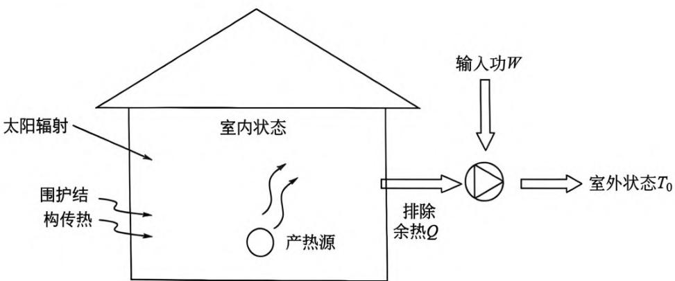  
图3.4-1 建筑物内余热排除过程

解：

(1) 根据烟分析, 利用可逆过程将热量从室内排到室外时, 所需投入的功最少, 等于室内与室外状态的烟差。选取室外温度为参考温度, 所需投入的功为:

$$
W _ {\mathrm{ideal}} = E _ {\mathrm{x,Q}} = \int \left(1 - \frac {T _ {0}}{T}\right) \mathrm{d} Q = 3 4 (\mathrm{kJ})
$$

(2) 制冷循环 COP

$$
C O P = \eta C O P _ {\mathrm{ideal}} = 0. 6 5 \times \frac {2 7 9}{3 1 3 - 2 7 9} = 5. 3 3 4
$$

(3) 实际需要投入的功 $W$

$$
W = \frac {Q}{C O P} = 1 8 7. 5 (\mathrm{kJ})
$$

(4) 系统烟损失 $\Delta E_{x,L}$

$$
\Delta E _ {\mathrm{x,L}} = W - W _ {\mathrm{ideal}} = 1 5 3. 5 (\mathrm{kJ})
$$

降低此部分烟损失，有助于降低系统对投入功的需求，从而提升整个热功转换过程的性能。

**2. 传热过程**

熵产分析并不总适用于传热过程的分析和优化，烟耗散 $\Delta En$ 是对没有热功转换的传热过程的不可逆性的度量，根据烟耗散 $\Delta En$ 可定义烟耗散热阻 $R_{\mathrm{g}}$ 为：

$$
R _ {g} = \frac {\Delta E n}{Q ^ {2}}\tag{3.4-2}
$$

燃耗散热阻为优化传热过程提供了重要指标，在热量传递过程中最小热阻与最优的换热性能一致。

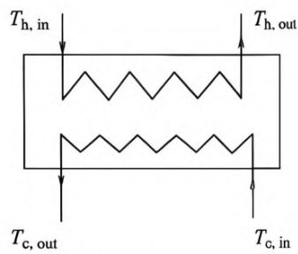  
图3.4-2 两股流逆流换热器

【例3.4-2】如图3.4-2所示，两股流逆流换热器的热容流量为 $c_{\mathrm{h}}m_{\mathrm{h}} = 5\mathrm{W / K}$ ， $c_{\mathrm{c}}m_{\mathrm{c}} = 8\mathrm{W / K}$ ，进口温度 $T_{\mathrm{h,in}} = 360\mathrm{K}$ ， $T_{\mathrm{c,in}} = 300\mathrm{K}$ ，请分别从熵分析和熵分析角度优化换热器的性能。

解：对于换热器而言，其优化目标一般为最大的效能：

$$
\varepsilon = \frac {Q}{Q _ {\mathrm{msx}}} = \frac {c _ {\mathrm{h}} m _ {\mathrm{h}} (T _ {\mathrm{h,in}} - T _ {\mathrm{h,out}})}{c _ {\mathrm{h}} m _ {\mathrm{h}} (T _ {\mathrm{h,in}} - T _ {\mathrm{c,in}})} = \frac {T _ {\mathrm{h,in}} - T _ {\mathrm{h,out}}}{T _ {\mathrm{h,in}} - T _ {\mathrm{c,in}}}
$$

(1) 计算烟耗散

$$
\Delta E n = \int_ {\mathrm{in}} ^ {\mathrm{out}} (T _ {\mathrm{h}} - T _ {\mathrm{c}}) \delta Q = (G _ {\mathrm{h,in}} + G _ {\mathrm{c,in}}) - (G _ {\mathrm{h,out}} + G _ {\mathrm{c,out}})
$$

$$
\Delta E n = \left(\frac {1}{2} c _ {\mathrm{h}} m _ {\mathrm{h}} T _ {\mathrm{h,in}} ^ {2} + \frac {1}{2} c _ {\mathrm{c}} m _ {\mathrm{c}} T _ {\mathrm{c,in}} ^ {2}\right) - \left(\frac {1}{2} c _ {\mathrm{h}} m _ {\mathrm{h}} T _ {\mathrm{h,out}} ^ {2} + \frac {1}{2} c _ {\mathrm{c}} m _ {\mathrm{c}} T _ {\mathrm{c,out}} ^ {2}\right)
$$

(2) 煨耗散热阻

$$
\begin{array}{r} R _ {\mathrm{g}} = \frac {\Delta E n}{Q ^ {2}} = \frac {\left(\frac {1}{2} c _ {\mathrm{h}} m _ {\mathrm{h}} T _ {\mathrm{h,in}} ^ {2} + \frac {1}{2} c _ {\mathrm{c}} m _ {\mathrm{c}} T _ {\mathrm{c,in}} ^ {2}\right) - \left(\frac {1}{2} c _ {\mathrm{h}} m _ {\mathrm{h}} T _ {\mathrm{h,out}} ^ {2} + \frac {1}{2} c _ {\mathrm{c}} m _ {\mathrm{c}} T _ {\mathrm{c,out}} ^ {2}\right)}{Q ^ {2}} \\ R _ {\mathrm{g}} = \frac {1}{c _ {\mathrm{h}} m _ {\mathrm{h}}} \left[ \frac {1}{\varepsilon} - \frac {1}{2} \left(1 + \frac {c _ {\mathrm{h}} m _ {\mathrm{h}}}{c _ {\mathrm{c}} m _ {\mathrm{c}}}\right) \right] \end{array}
$$

(3) 计算熵产

$$
\begin{array}{c} \Delta S _ {\mathrm{g}} = c _ {\mathrm{h}} m _ {\mathrm{h}} \ln \frac {T _ {\mathrm{h,out}}}{T _ {\mathrm{h,in}}} + c _ {\mathrm{c}} m _ {\mathrm{c}} \ln \frac {T _ {\mathrm{c,out}}}{T _ {\mathrm{c,in}}} \\ \Delta S _ {\mathrm{g}} = c _ {\mathrm{h}} m _ {\mathrm{h}} \ln \left[ 1 - \frac {T _ {\mathrm{h,in}} - T _ {\mathrm{c,in}}}{T _ {\mathrm{h,in}}} \epsilon \right] + c _ {\mathrm{c}} m _ {\mathrm{c}} \ln \left[ 1 + \frac {c _ {\mathrm{h}} m _ {\mathrm{h}} (T _ {\mathrm{h,in}} - T _ {\mathrm{c,in}})}{c _ {\mathrm{c}} m _ {\mathrm{c}} T _ {\mathrm{c,in}}} \epsilon \right] \end{array}
$$

计算不同换热器效能得到烟耗散热阻和熵产，如图 3.4-3 所示。

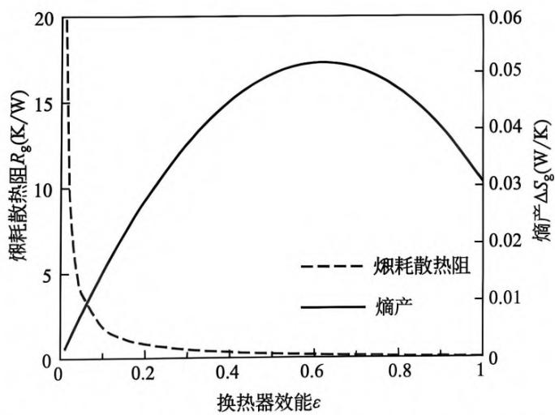  
图 3.4-3 煨耗散热阻、熵产与换热器效能的关系

随着换热器效能的增大，烟耗散热阻单调减小，熵产先增大后减小。表明烟耗散分析可以描述换热器效能和换热量的变化情况，最小烟耗散热阻对应换热器的最佳性能，适用于换热器的优化。

3. 典型供热系统

【例3.4-3】图3.4-4是建筑中典型的热泵供热系统，建筑热负荷 $Q_{\mathrm{r}} = 5\mathrm{kW}$ ，热泵蒸发温度 $T_{c} = -5^{\circ}C$ ，冷凝温度 $T_{c} = 50^{\circ}C$ ，蒸发器端差 $\Delta T = 5^{\circ}C$ ，环境温度 $T_{0} = 5^{\circ}C$ ，热水供/回水温度为 $45^{\circ}C / 50^{\circ}C$ ，风机盘管送风温度为 $30^{\circ}C$ ，室内温度 $T_{r} = 20^{\circ}C$ ，请计算各个环节的炽耗散热阻。

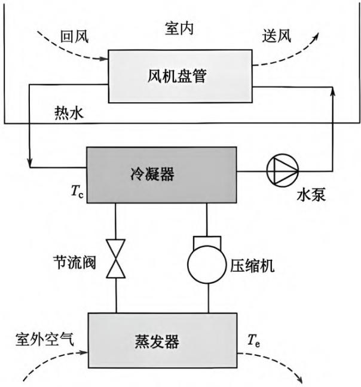  
图3.4-4 典型的热泵供热系统

解：图3.4-5为热泵换热系统的各环节温度分布情况在 $T - Q$ 图上的表示，换热环节热阻计算如表3.4-1所示。

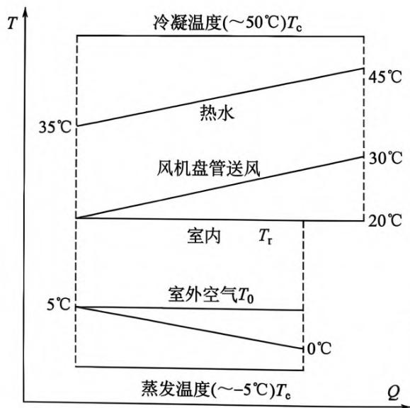

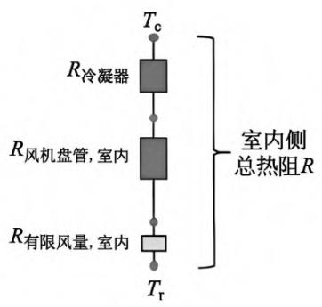

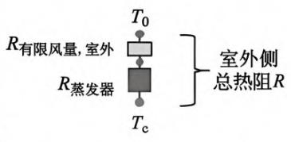  
图3.4-5 热泵供热系统 $T - Q$ 图及换热环节热阻

换热环节热阻计算  
表3.4-1

<table><tr><td></td><td>计算公式</td></tr><tr><td>热泵 COP</td><td> $COP = \frac{(273 + 50)}{50 - (-5)} \times 0.7 = 4.1$ 假设热泵热力完善度为 0.7</td></tr><tr><td>蒸发器换热量</td><td> $Q_{\circ}=\frac{4.1}{4.1+1}\times5=4.0kW$ </td></tr><tr><td>冷凝器热阻</td><td> $R_{\text{冷凝器}}=\frac{(50-35+50-45)}{2\times5}=2.0K/kW$ </td></tr><tr><td>风机盘管热阻</td><td> $R_{\text{风机盘管}}=\frac{(45-30+35-20)}{2\times5}=3.0K/kW$ </td></tr><tr><td>室内有限风量热阻</td><td> $R_{\text{有限风量,室内}}=\frac{(30-20+20-20)}{2\times5}=1.0K/kW$ </td></tr><tr><td>室外有限风量热阻</td><td> $R_{\text{有限风量,室外}}=\frac{(5-5+5-0)}{2\times4}=0.625K/kW$ </td></tr><tr><td>蒸发器热阻</td><td> $R_{\text{冷凝器}}=\frac{(5-(-5)+0-(-5))}{2\times4}=1.875K/kW$ </td></tr></table>

对于热泵供暖方式，获得的热源品位越高，要求热泵系统的冷凝温度越高，热泵系统的冷凝器与蒸发器之间工作的温差越大，换热过程总热阻越大，热泵系统性能系数越低。

## 3.5 能源的等效折算

### 3.5.1 基本概念

建筑能耗是建筑使用过程中的运行能耗，包括由外部输入、用于维持建筑环境（如供暖、供冷、通风和照明等）和各类建筑内活动（如办公、炊事等）的用能，不包括建筑材料制造和建筑施工的用能。

建筑能耗通常包含多种能源的消耗，如电力、化石能源（煤、油、天然气等）、冷/热水、蒸汽等。建筑能耗的表述可采用实物量法，也可将各类能源消耗量（Q）折算为标准煤量（ $Q_{\mathrm{ce}}$ ）或者等效电量（ $Q_{\mathrm{ce}}$ ）。常用的能源折算方法有当量热值法、供电能耗法（一次能耗法）和等效电法。三种能源折算方法如表3.5-1所示。其中，计算参数 $c_{1}$ 、 $c_{2}$ 为单位转换系数，其数值见表3.5-2；计算参数 $\beta$ 和 $\lambda$ 为能源品位折算系数，其数值见表3.5-3。有的国家采用一次能耗法进行建筑能耗折算，表3.5-4列出了部分国家供电能耗法（一次能耗法）采用的能源品位折算系数 $\beta$ 。

建筑能耗中多种类能源的折算需要同时考虑能源的“数量”和“品位”，三种能源折算方法的差异主要体现在对于“品位”（即 $\beta$ 和 $\lambda$ ）的不同考虑；

(1) 当量热值法: 不同能源的品位折算系数 $\beta$ 取值均为 1, 即认为 $1 \mathrm{kWh}$ 电力 $= 1 \mathrm{kWh}$ 化石能源 $= 1 \mathrm{kWh}$ 冷热量, 未考虑能源的 “品位” 差异。

(2) 供电能耗法 (一次能耗法): 采用全国平均供电煤耗, 将二次能源消耗 (电力) 转化为一次能源消耗 (标准煤或热量), 即 $1 \mathrm{~kWh}$ 电力 $= 2.5142 \mathrm{kWh}$ 一次能源。其余能源的品位折算系数 $\beta$ 取值均为 1，即 $1\mathrm{kWh}$ 化石能源 $= 1\mathrm{kWh}$ 冷热量 $= 1\mathrm{kWh}$ 一次能源。

(3) 等效电法: 定义电力 “品位” 最高 ( $\lambda = 1$ ), 从做功能力的角度定义其余能源的品位折算系数 $\lambda$ (其取值均小于 1)。化石能源依据表 3.5-1 中的计算公式及表 3.5-3 中的能源品位折算系数 $\lambda$ 折算为等效电量; 对于冷热量及蒸汽, 需要先确认外部冷热源设备所消耗的电力及化石能源, 再采用烟分摊法拆分得到该部分能源对应消耗的电量和化石能源, 最终可统一折算为等效电量。详细内容可参考《民用建筑能耗分类及表示方法》GB/T 34913—2017。

三种能源折算方法  
表3.5-1

<table><tr><td colspan="2">折算方法</td><td>计算公式 $^{\text{2}}$ </td><td>系数说明</td></tr><tr><td rowspan="2">折合成标准煤</td><td>当量热值法</td><td rowspan="2"> $Q_{\infty} = \beta \cdot c_1 \cdot Q$ (3.5-1)式中  $c_1$  ——单位转换系数,见表 3.5-2; $\beta$  ——能源品位折算系数</td><td> $\beta=1$ </td></tr><tr><td>供电能耗法(一次能耗法)</td><td>电力: $\beta>1$ 其余能源: $\beta=1$ </td></tr><tr><td>折合成等效电量</td><td>等效电法</td><td>化石能源: $Q_{re} = \lambda \cdot c_2 \cdot Q$ (3.5-2)式中  $c_2$  ——单位转换系数,见表 3.5-2; $\lambda$  ——能源品位折算系数。冷热量及蒸汽:采用烟分摊法拆分得到消耗的电量和化石能源,再统一折算为等效电量 $^{\text{2}}$ </td><td>电力: $\lambda=1$ 化石能源: $0<\lambda<1$ </td></tr></table>

① $c_{1}$ 和 $c_{2}$ 仅体现单位转换； $\beta$ 和 $\lambda$ 体现能源的品位，为无量纲数。  
③ 详见《民用建筑能耗分类及表示方法》GB/T 34913—2017。

我国常见能源的低温发热量和单位转换系数 $(c_{1}$ 和 $c_{2}$  
表3.5-2

<table><tr><td>能源种类</td><td>能源名称</td><td>平均低温发热量</td><td>c1</td><td>c2</td></tr><tr><td rowspan="6">煤</td><td>原煤</td><td>20904kJ/kg</td><td>0.7143kgce/kg</td><td>5.8067kWh/kg</td></tr><tr><td>洗精煤</td><td>26377kJ/kg</td><td>0.9000kgce/kg</td><td>7.3269kWh/kg</td></tr><tr><td>洗中煤</td><td>8374kJ/kg</td><td>0.2857kgce/kg</td><td>2.3261kWh/kg</td></tr><tr><td>煤泥</td><td>8374~12560kJ/kg</td><td>0.2857~0.4286kgce/kg</td><td>2.3261~3.4889kWh/kg</td></tr><tr><td>煤矸石(用作能源)</td><td>8374kJ/kg</td><td>0.2857kgce/kg</td><td>2.3261kWh/kg</td></tr><tr><td>焦炭(干全焦)</td><td>28470kJ/kg</td><td>0.9714kgce/kg</td><td>7.9083kWh/kg</td></tr><tr><td rowspan="6">油</td><td>煤焦油</td><td>33494kJ/kg</td><td>1.1429kgce/kg</td><td>9.3039kWh/kg</td></tr><tr><td>原油</td><td>41868kJ/kg</td><td>1.4286kgce/kg</td><td>11.6300kWh/kg</td></tr><tr><td>燃料油</td><td>41868kJ/kg</td><td>1.4286kgce/kg</td><td>11.6300kWh/kg</td></tr><tr><td>汽油</td><td>43124kJ/kg</td><td>1.4714kgce/kg</td><td>11.9789kWh/kg</td></tr><tr><td>煤油</td><td>43124kJ/kg</td><td>1.4714kgce/kg</td><td>11.9789kWh/kg</td></tr><tr><td>柴油</td><td>42705kJ/kg</td><td>1.4571kgce/kg</td><td>11.8625kWh/kg</td></tr><tr><td>能源种类</td><td>能源名称</td><td>平均低温发热量</td><td>C1</td><td>C2</td></tr><tr><td rowspan="17">气</td><td>天然气</td><td>32238~38979kJ/m3</td><td>1.1000~1.3300kgce/m3</td><td>8.9550~10.8275kWh/m3</td></tr><tr><td>液化天然气</td><td>51498kJ/m3</td><td>1.7572kgce/m3</td><td>14.3050kWh/m3</td></tr><tr><td>液化石油气</td><td>50242kJ/kg</td><td>1.7143kgce/kg</td><td>13.9561kWh/kg</td></tr><tr><td>炼厂干气</td><td>46055kJ/kg</td><td>1.5714kgce/kg</td><td>12.7931kWh/kg</td></tr><tr><td>焦炉煤气</td><td>16747~18003kJ/m3</td><td>0.5714~0.6143kgce/m3</td><td>4.6519~5.0008kWh/m3</td></tr><tr><td>高炉煤气</td><td>3768kJ/m3</td><td>0.1286kgce/m3</td><td>1.0467kWh/m3</td></tr><tr><td>发生炉煤气</td><td>5234kJ/m3</td><td>0.1786kgce/m3</td><td>1.4539kWh/m3</td></tr><tr><td>重油催化裂解煤气</td><td>19259kJ/m3</td><td>0.6571kgce/m3</td><td>5.3497kWh/m3</td></tr><tr><td>重油热裂解煤气</td><td>35588kJ/m3</td><td>1.2143kgce/m3</td><td>9.8856kWh/m3</td></tr><tr><td>焦炭制气</td><td>16329kJ/m3</td><td>0.5571kgce/m3</td><td>4.5358kWh/m3</td></tr><tr><td>压力气化煤气</td><td>15072kJ/m3</td><td>0.5143kgce/m3</td><td>4.1867kWh/m3</td></tr><tr><td>水煤气</td><td>10467kJ/m3</td><td>0.3571kgce/m3</td><td>2.9075kWh/m3</td></tr><tr><td>粗苯</td><td>41868kJ/kg</td><td>1.4286kgce/kg</td><td>11.6300kWh/kg</td></tr><tr><td>甲醇(用作燃料)</td><td>19913kJ/kg</td><td>0.6794kgce/kg</td><td>5.5314kWh/kg</td></tr><tr><td>乙醇(用作燃料)</td><td>26800kJ/kg</td><td>0.9144kgce/kg</td><td>7.4444kWh/kg</td></tr><tr><td>氢气(用作燃料,密度为0.082kg/m3)</td><td>9756kJ/m3</td><td>0.3329kgce/m3</td><td>2.7100kWh/m3</td></tr><tr><td>沼气</td><td>20934~24283kJ/m3</td><td>0.7143~0.8286kgce/m3</td><td>5.8150~6.7453kWh/m3</td></tr><tr><td>电力</td><td>电力(当量值)</td><td>3600kJ/kWh</td><td>0.1229kgce/kWh</td><td>1</td></tr><tr><td rowspan="2">热量</td><td>热力(当量值)</td><td>1</td><td>0.03412kgce/MJ</td><td>0.2778kWh/MJ</td></tr><tr><td>蒸汽(低压)</td><td>3763kJ/kg</td><td>0.1286kgce/kg</td><td>1.0453kWh/kg</td></tr></table>

数据来源：《中国能源统计年鉴 2017》和《综合能耗计算通则》GB/T 2589—2020。

能源品位折算系数 $\beta$ 和 $\lambda$ 取值  
表3.5-3

<table><tr><td></td><td>当量热值法β</td><td>供电能耗法(一次能耗法)β</td><td>等效电法 $^{\text{2}}$ </td></tr><tr><td>电力</td><td>1</td><td>2.5142 $^{\text{1}}$ </td><td>λ=1</td></tr><tr><td>煤</td><td>1</td><td>1</td><td rowspan="3"> $λ = 1 - \frac{T_0}{T_1 - T_0} \ln \frac{T_1}{T_0}$ (3.5-3)式中  $T_0$  ——环境温度,K,取273.15K; $T_1$  ——工作温度,即热源对外做功时的温度,K。燃煤取工作温度为700°C,λ=0.5042;燃油和燃气取工作温度为1500°C,λ=0.6594</td></tr><tr><td>油</td><td>1</td><td>1</td></tr><tr><td>气</td><td>1</td><td>1</td></tr><tr><td>冷水</td><td>1</td><td>1</td><td> $λ' = \frac{T_0}{T_1 - T_2} \ln \frac{T_1}{T_2} - 1$ (3.5-4)式中  $T_0$  ——环境温度,K; $T_1$  ——冷水供水温度,K; $T_2$  ——冷水回水温度,K。当室外温度为30°C,供/回水温度为7°C/12°C时, $λ' = 0.0726$ </td></tr><tr><td>热水</td><td>1</td><td>1</td><td> $\lambda' = 1 - \frac{T_0}{T_1 - T_2} \ln \frac{T_1}{T_2}$ (3.5-5)式中  $T_0$ ——环境温度,K; $T_1$ ——热水供水温度,K; $T_2$ ——热水回水温度,K。当室外温度为0°C,供/回水温度为95°C/70°C时, $\lambda' = 0.2317$ </td></tr><tr><td>蒸汽</td><td>1</td><td>1</td><td> $\lambda' = \frac{r}{h_1 - h_2} \cdot \left(1 - \frac{T_0}{T_1}\right) + \left(1 - \frac{r}{h_1 - h_2}\right) \cdot \left(1 - \frac{T_0}{T_1 - T_2} \ln \frac{T_1}{T_2}\right)$ (3.5-6)式中  $T_0$ ——环境温度,K; $T_1$ ——供给蒸汽压力对应的饱和温度,K; $T_2$ ——返回热源的凝水温度,K;r——蒸汽的汽化潜热,kJ/kg; $h_1$ ——供给蒸汽的焓值,kJ/kg; $h_2$ ——返回热源的凝水的焓值,kJ/kg。当室外温度为0°C,蒸气压力为1.0MPa(180°C)时, $\lambda' = 0.3520$ </td></tr></table>

① 2017 年我国 6000kW 及以上电厂平均供电标准煤耗为 309 gce/kWh，依此计算 $\beta$ ；数据来源于 2017 年全国电力工业统计数据。部分国家供电能耗法（一次能耗法）中的能源品位折算系数 $\beta$ 见表 3.5-4。  
② 参见《民用建筑能耗分类及表示方法》GB/T 34913—2017。

部分国家供电能耗法（一次能耗法）中的能源品位折算系数 $\beta$

<table><tr><td></td><td>美国 $^1$ </td><td>加拿大 $^1$ </td><td>日本 $^2$ </td><td>德国 $^3$ </td></tr><tr><td>电力</td><td>电网买电:2.80;可再生能源自用:1.00;可再生能源交易:2.80</td><td>电网买电:1.96;可再生能源自用:1.00;可再生能源交易:1.96</td><td>2.71</td><td>2.8</td></tr><tr><td>煤</td><td>1.00</td><td>1.00</td><td>1.00</td><td>1.1</td></tr><tr><td>油</td><td>1.01</td><td>1.01</td><td>1.00</td><td>1.10</td></tr><tr><td>气</td><td>1.05</td><td>1.01</td><td>1.00</td><td>1.10</td></tr><tr><td>冷水</td><td>0.91</td><td>0.57</td><td>1.36</td><td rowspan="3">来自热电联产:0.70;来自燃气锅炉:1.30;来自可再生能源:0</td></tr><tr><td>热水</td><td>1.20</td><td>1.33</td><td>1.36</td></tr><tr><td>蒸汽</td><td>1.20</td><td>1.33</td><td>工业:1.02其余:1.36</td></tr></table>

① 数据来源：ENERGY STAR®，2018年数据。  
② 数据来源：日本经济产业省资源与能源厅。  
③ 数据来源：德国标准《建筑能源效率——计算供暖、制冷、通风、生活热水和照明的能源需求、输送能源和一次能源》DIN V 18599。

【例 3.5-1】某建筑能耗涉及的能源种类为电力和天然气，该建筑全年能耗：63 万 kWh 电力、0.5 万 m³ 天然气和 2000GJ 冷水（冷水供/回水温度为 7℃/12℃，制冷站性能系数 $EER =$ 制冷量/制冷站耗电量 $= 4.0$ 。试用当量热值法、供电能耗法（一次能耗法）和等效电法计算建筑全年能耗。

解：计算结果见表 3.5-5。

例 3.5-1 计算结果  
表3.5-5

<table><tr><td>方法</td><td>计算步骤</td></tr><tr><td>当量热值法</td><td>电力:63×104kWh×0.1229kgce/kWh=77427kgce天然气:0.5×104m3×1.2143kgce/m3=6071.5kgce冷水:2000GJ×34.12kgce/GJ=68240kgce合计:77427kgce+6071.5kgce+68240kgce=151738.5kgce</td></tr><tr><td>供电能耗法</td><td>电力:63×104kWh×0.1229kgce/kWh×2.5142=194667.0kgce天然气:0.5×104m3×1.2143kgce/m3=6071.5kgce冷水:2000GJ×34.12kgce/GJ=68240kgce合计:194667.0kgce+6071.5kgce+68240kgce=268978.5kgce</td></tr><tr><td>等效电法</td><td>电力:630000kWh天然气:0.5×104m3×9.8856kWh/m3×0.6594=32592.8kWh冷水:2000GJ÷0.0036GJ/kWh÷4.0=138888.9kWh合计:630000kWh+32592.8kWh+138888.9kWh=801481.7kWh</td></tr></table>

### 3.5.2 烟分摊法

当建筑外界冷热源制备和输送的冷/热量以多种形式输出（如热电联产）时，对于某一建筑而言其冷/热量能耗应采用烟分摊法核算分摊各用能系统对应的输入能量（电力、化石能源）。烟分摊法计算步骤为：

（1）计算每个输出能源对应的输入能源分摊比例，第 $i$ 个输出能源分摊输入能源的比例 $x_{i}$ 按下式计算。

$$
x_{i} = \frac{Q_{i}\lambda_{i}}{\sum_{i = 1}^{n}Q_{i}\lambda_{i}}\times 100\%\tag{3.5-7}
$$

式中 $Q_{i}$ ——第 $i$ 个输出能源对应能源量， $\mathrm{kWh}$ ；

$\lambda_{i}$ ——第 i 个输出能源的能源品位折算系数；

$x_{i}$ ——第 i 个输出能源分摊输入能源的比例（数值在 0～1 之间）。

（2）计算每个输出能源所分摊的输入能源量，第 $i$ 个输出能源分摊的输入能源量按下式计算。

$$
\text {   第   } i \text {   个输出能源分摊能耗   } = x _ {i} \cdot \text {   输入能源量   }\tag{3.5-8}
$$

【例 3.5-2】某建筑能耗情况如图 3.5-1 所示，该建筑全年能耗： $0.5 \times 10^{4} m^{3}$ 天然气、63 × 10^{4} kWh 电力、2140GJ 热水（热水供/回水温度为 95℃/70℃）和 2000GJ 冷水（冷水供/回水温度为 7℃/12℃）。制备和输送热媒的系统为热电联产系统，该系统同时产生电力和热水，其中一部分热水供给图 3.5-1 所示建筑。该热电联产系统的输入能源为 490tce 燃煤，输出能源为 100 万 kWh 电力和 7200GJ（200 万 kWh）热水，冷水来源为性能系数 EER 为 4.0 的制冷机房。

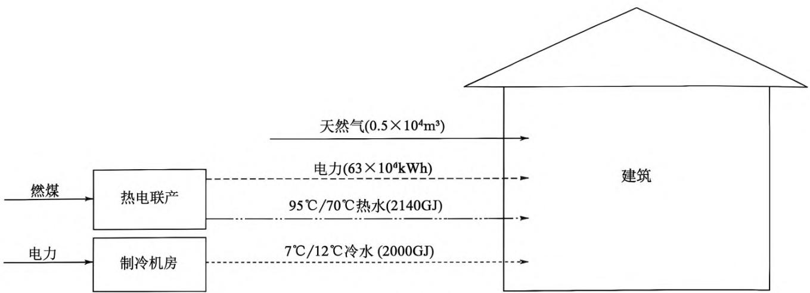  
图3.5-1 某建筑能耗情况

解：

（1）输出 100 万 kWh 电力对应的输入能源分摊比例 $x_{1}$ ，输出 200 万 kWh 热水对应的输入能源分摊比例 $x_{2}$ 分别为：

$$
x_{1} = \frac{100\times 1}{100\times 1 + 200\times 0.232}\times 100\% = 68.3\%
$$

$$
x_{2} = \frac{200\times 0.232}{100\times 1 + 200\times 0.232}\times 100\% = 31.7\%
$$

(2) 输出 200 万 kWh 热量对应的输入能源量为:

$$
31.7\% \times 490\mathrm{tce} = 155.3\mathrm{tce}
$$

(3) 热水折算的建筑能耗为:

$$
2 1 4 0 \mathrm{GJ} \div 7 2 0 0 \mathrm{GJ} \times 1 5 5. 3 \mathrm{tce} = 4 6. 2 \mathrm{tce}
$$

(4) 冷水折算的建筑能耗为:

$$
2 0 0 0 \mathrm{GJ} \div 0. 0 0 3 6 \mathrm{GJ/kWh} \div 4. 0 = 1 3 8 8 8 8. 9 \mathrm{kWh}
$$

因此，图 3.5-1 所示建筑能耗为 76.9 万 kWh 电（其中直接耗电量 63 万 kWh、建筑输入冷量折算电耗 13.9 万 kWh）、0.5 万 m³ 天然气和 46.2tce。采用等效电法统一折算为电力，则为：

$$
7 6. 9 \times 1 0 ^ {4} \mathrm{kWh} + 0. 5 \times 1 0 ^ {4} \mathrm{m} ^ {3} \times 9. 8 7 3 3 \mathrm{kWh/m} ^ {3} \times 0. 6 5 9 4
$$

$$
+ 4 6. 2 \times 1 0 ^ {3} \mathrm{kgce} \times 5. 8 0 7 8 \mathrm{kWh/kgce} \times 0. 5 0 4 2 = 9 3. 7 \times 1 0 ^ {4} \mathrm{kWh}
$$

## 3.6 碳排放与可持续性

### 3.6.1 基本概念

**1. 碳排放**

碳排放是关于温室气体排放的一个总称或简称。温室气体中最主要的气体是二氧化碳，因此用“碳”作为代表。温室气体因导致温室效应而得名，通常包括二氧化碳（ $\mathrm{CO}_{2}$ ）、甲烷（ $\mathrm{CH}_{4}$ ）、氧化亚氮（ $\mathrm{N}_{2} \mathrm{O}$ ）、氢氟碳化物（HFCs）、全氟化碳（PFCs）和六

氟化硫（ $\mathrm{SF}_{6}$ ）。

建筑全生命期的碳排放分为四个部分（图 3.6-1），分别是建材生产（A1～A3）、房屋建造（A4～A5）、运行使用（B1～B6）以及拆除处置（C1～C4），每个过程内包含数量不等的子过程。其中建材生产和房屋建造过程也被称为建筑物化碳排放（A1～A5）。图 3.6-2 为一般建筑全生命期各阶段碳排放量示意图。

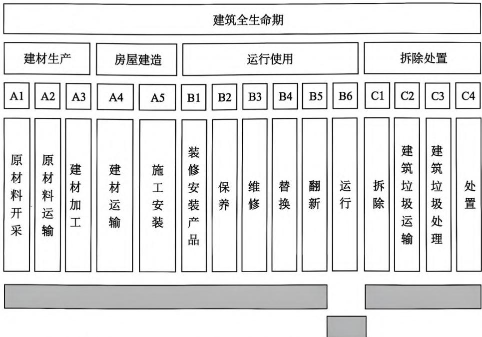  
图 3.6-1 建筑全生命期碳排放示意图  
来源：《中国建筑节能年度发展研究报告 2023（城市能源系统专题）》。

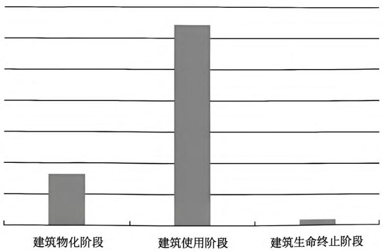  
图 3.6-2 一般建筑全生命期各阶段碳排放量示意图

**2. 碳排放权与碳交易**

碳排放权，简而言之是指向大气排放一定数量的温室气体的权利。所以，碳排放权应为“温室气体排放权”。

碳交易，即把碳排放权作为一种商品，买方通过向卖方支付一定费用从而获得一定数量的碳排放权，从而形成了碳排放权的交易，即碳交易。碳排放权交易，有总量控制与交易和基线与信用交易之分，如表 3.6-1 所示。

碳排放权交易种类  
表 3.6-1

<table><tr><td>碳排放权交易种类</td><td>定义</td><td>特点</td></tr><tr><td>总量控制与交易</td><td>首先确定允许排放的温室气体总量,然后将该总量分解为若干份配额,分配给相关排放源。如果排放源实际排放的温室气体量超出了其排放配额所允许的量,则必须另行购买;如果少于排放配额,则可出售</td><td>具有减排激励效果;总量控制更有利于达成减排目标</td></tr><tr><td>基线与信用交易</td><td>不设置允许排放的温室气体总量,而是为污染源设定一条排放率或减排技术标准等基准线,再根据排放源减排后优于基准线的部分核发减排信用,由无法完成减排目标的排放源购买</td><td>具有减排激励效果;由于基线与信用交易没有预先设置允许排放的温室气体总量,减排的效果具有很大的不确定性;合理确定各排放源适用的基线存在困难</td></tr></table>

**3. 碳排放配额和自愿减排量**

按照碳交易的分类，目前我国碳交易市场有两类基础产品：一类为政府分配给企业的碳排放配额；另一类为核证自愿减排量（CCER），其交易机理如图 3.6-3 所示。之后也会逐步引入其他碳交易产品。

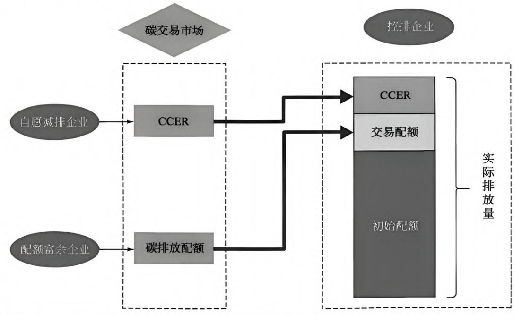  
图3.6-3 CCER交易机理图

配额交易是政府为完成控排目标采用的一种政策手段，即在一定的空间和时间内，将该控排目标转化为碳排放配额并分配给下级政府和企业，若企业实际碳排放量小于政府分配的配额，则可以通过交易多余碳排放配额，从而实现碳排放配额在不同企业的合理分配，最终以相对较低的成本实现控排目标。

作为补充，在配额市场之外引入自愿减排市场交易，即 CCER 交易。CCER 交易指控排企业向实施 “碳抵消” 活动的企业购买可用于抵消自身碳排放的核证量。

“碳抵消”是指用于减少温室气体排放源或增加温室气体吸收汇，用来实现补偿或抵消其他排放源产生温室气体排放的活动，即控排企业的碳排放可用非控排企业使用清洁能源减少温室气体排放或增加碳汇来抵消。抵消信用由通过特定减排项目的实施得到减排量后进行签发，包括可再生能源项目、森林碳汇项目等。

碳市场按照 1:1 的比例给予 CCER 替代碳排放配额，即 1 个 CCER 等同于 1 个配额，可以抵消 1t 二氧化碳当量的排放，《碳排放权交易管理办法（试行）》规定重点排放单位每年可以使用国家核证自愿减排量抵消碳排放配额的清缴，抵消比例不得超过应清缴碳排放配额的 5%。

**4. 碳达峰和碳中和**

2020年9月22日我国在第七十五届联合国大会一般性辩论上提出了应对气候变化新的国家自主贡献目标和长期愿景：中国将提高国家自主贡献力度，采取更加有力的政策和措施，力争于2030年前二氧化碳排放达到峰值，努力争取2060年前实现碳中和。

全球主要国家和地区碳达峰示意图如图 3.6-4 所示。

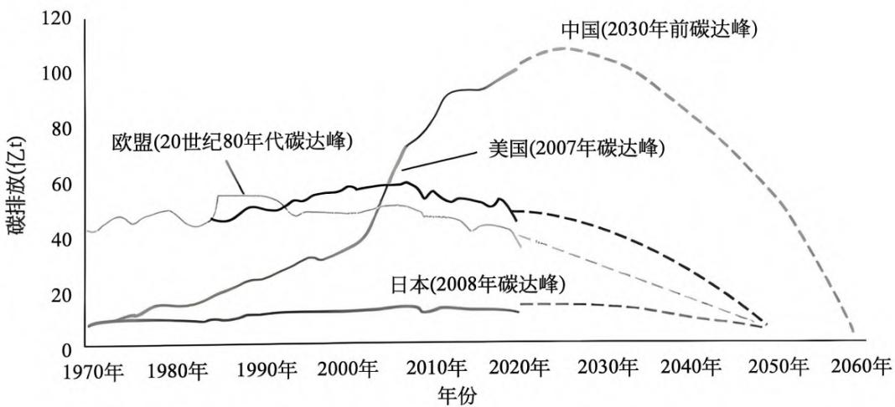  
图 3.6-4 全球主要国家和地区碳达峰示意图

碳达峰是指某个地区或行业年度二氧化碳排放量达到历史最高值，然后经历平台期进入持续下降的过程，是二氧化碳排放量由增转降的历史拐点，标志着碳排放与经济发展实现脱钩，达峰目标包括达峰年份和峰值。碳达峰与能耗达峰的关系如图 3.6-5 所示。

碳中和是指在一定时间内，企业、团体和个人直接或间接产生的温室气体排放总量，通过植树造林、节能减排等形式，抵消自身产生的二氧化碳排放量，实现二氧化碳“零排放”。

碳中和包括减少碳排放和增加碳汇两个方面。

减少碳排放主要是指减少生产、生活过程中造成的二氧化碳排放。减少碳排放主要通过以下几个方面实现：提能效，降能耗；发展可再生能源，替代化石能源。

碳汇是指从空气中清除二氧化碳的过程、活动、机制，是指自然或人造的、能够无限期地吸收和存储含碳化合物的场所。主要的自然碳汇包括：林业碳汇、草地碳汇、耕地碳汇以及海洋碳汇；主要的人工碳汇包括：垃圾填埋场、碳捕获和碳存储设备。

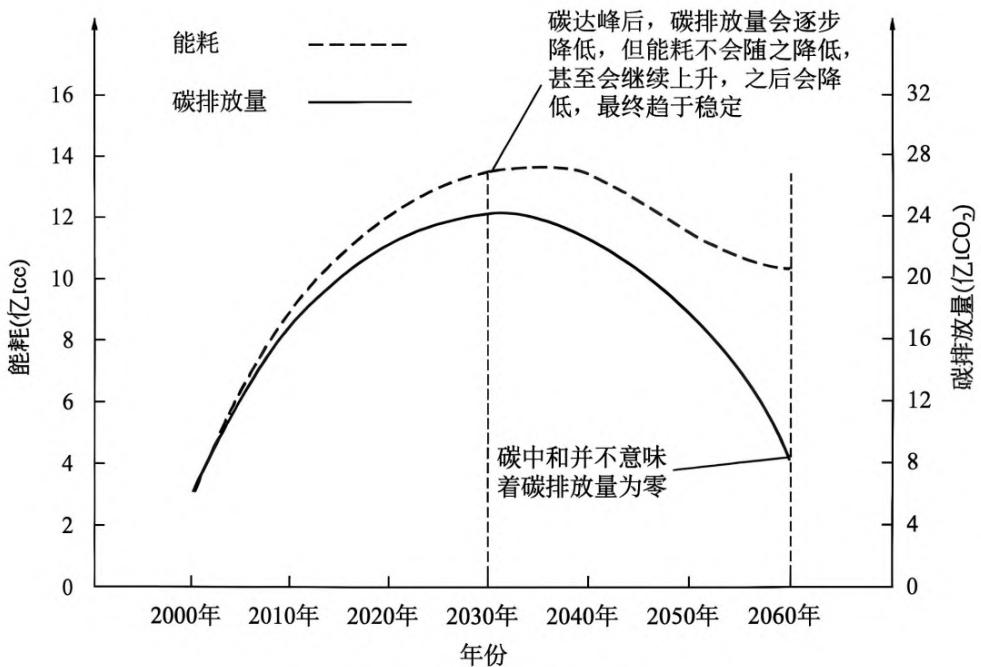  
图3.6-5 碳达峰与能耗达峰的关系

生物质能源技术包括基于生物质气的热电联产或秸秆燃料发电等，尽管有碳排放，但是在理论上其排放的 $CO_{2}$ 会被下一茬农作物重新吸收，因此可以认为是“碳中和”技术。

《巴黎协定》中全球碳排放目标实现路径如图 3.6-6 所示。

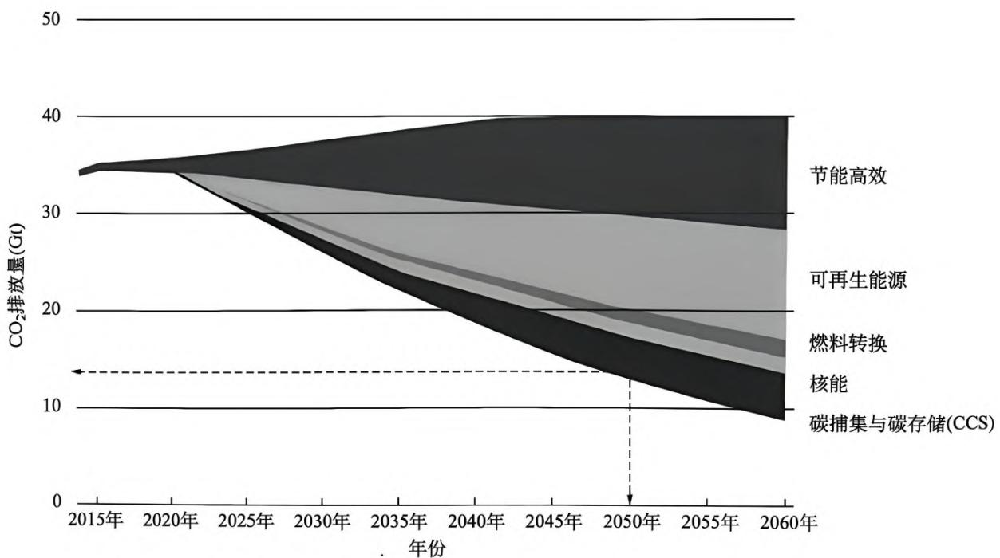  
图 3.6-6 《巴黎协定》中全球碳排放目标实现路径  
注：数据来源于国际能源署（IEA）。

**5. “节能减排—绿色低碳”发展路线**

随着全球人口和经济的不断增长，全球能源消耗量持续攀升，能源短缺和环境污染问

题愈加突出。同时，全球气候变化问题愈加严重，人类生存和发展面临着巨大挑战。

我国是一个发展中国家，在发展经济的同时也面临着能源短缺和环境污染问题，以及响应《京都议定书》的要求。我国在过去几十年中不断探索和实施各种节能减排政策，促进环境改善；政策不仅适用于环保领域，还适用于利用新能源、改善社会福利、促进经济发展等领域；同时，促进企业不断创新，提高技术含量，落实工业转型升级和经济结构调整，取得了显著成效。图3.6-7是我国“节能减排—绿色低碳”发展路线图。

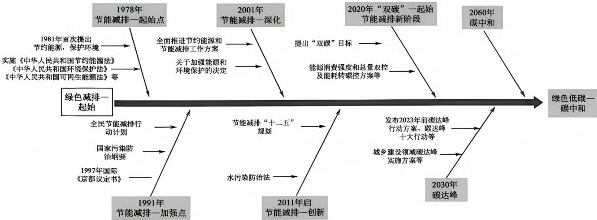  
图 3.6-7 我国 “节能减排—绿色低碳” 发展路线图

**6. 可持续性**

可持续性在《ASHRAE 绿色指南：可持续建筑的设计、建造和运营》中被定义为“满足现在的需求而不会降低满足未来需求的能力”。也有文献将可持续性定义为“最大限度地提高资源利用效率”，同时尽量减少这种利用对“环境”以及“人类社会与大自然之间平衡”的影响。可持续性发展特征如表 3.6-2 所示，非可持续发展对环境的影响如表 3.6-3 所示。

可持续性发展特征  
表 3.6-2

<table><tr><td>特征</td><td>内容</td></tr><tr><td>可持续性是面向未来的</td><td>关注未来,考虑的未来时期越长,初投资成本的重要性就越小。可持续设计与绿色设计的区别;绿色设计更多地关注近期的未来(即在建筑物首次建造然后被使用时开始);可持续设计从长远来看对全球环境至关重要,同时仍然融合了现在和将来关注的绿色设计特征</td></tr><tr><td>可持续性包含很多方面</td><td>可持续性涉及能源、碳排放、污染、废物处理以及人口增长等</td></tr><tr><td>可持续性是全面的</td><td>可持续性发展有赖于全球所有地区建筑业、交通业等的共同努力。个体的可持续性发展对于全球来讲影响微乎其微</td></tr><tr><td>技术在其中只扮演部分角色</td><td>建筑的可持续性发展往往意味着投资的大量增加,很多业主缺乏主动性,现实中可持续性发展通常是由政府监管以及少部分人士来推动的</td></tr></table>

非可持续发展对环境的影响  
表3.6-3

<table><tr><td>环境影响</td><td>定义及原理</td><td>图示</td><td>关联</td></tr><tr><td>温室效应</td><td>低层大气由于对长波和短波辐射的吸收特性不同而引起的增温现象。大气中有温室效应的气体主要是二氧化碳,此外还有甲烷、臭氧、水汽等。温室效应使全球气候变暖,引起南北两极冰川融化,海平面上升,造成世界气候反常,旱情加剧,沙漠化扩大,影响农业生产</td><td>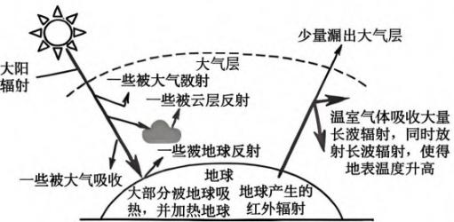</td><td rowspan="2">臭氧层破坏会使到达地面的太阳辐射尤其是其中的紫外线增强,它会起到促进全球气候变暖的作用;温室效应加剧,产生的废气中许多物质会进入平流层,与那里的臭氧发生化学反应,耗损臭氧,使臭氧浓度降低</td></tr><tr><td>臭氧层破坏</td><td>亦称“臭氧层耗损”。臭氧层出现臭氧空洞,是臭氧减少的现象,其原因既有工农业和运输业高速发展,使大量氮氧化物和其他痕量气体进入臭氧层;也有用于制冷剂、除臭剂、头发喷雾剂的大量氯氟烃化合物进入臭氧层,与臭氧反应,降低了臭氧层的臭氧浓度</td><td>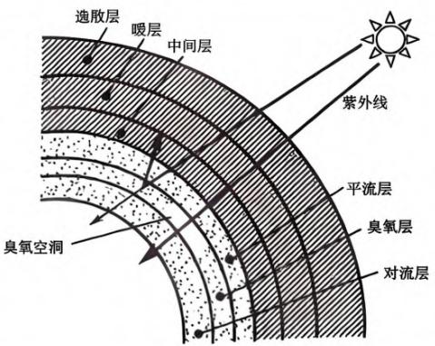</td></tr></table>

### 3.6.2 碳排放计算方法

碳排放量化是实现碳中和的基础，碳排放计算尤为重要。本节仅介绍基于能源消耗量基础上的碳排放量的计算（表3.6-4）。对于建筑碳排放，需从建筑的全生命周期进行计算，包括建材、建造过程、运行过程以及拆除等。具体计算可参考《建筑碳排放计算标准》GB/T51366—2019。

碳排放量计算方法  
表3.6-4

<table><tr><td>计算方法</td><td>计算公式</td></tr><tr><td>碳排放因子法</td><td> $C_{\mathrm{M}} = \sum_{i=1}^{n} E_{i}^{\prime} \times V_{i} \times EF_{i} \times 10^{-6}$ (3.6-1)其中, $C_{\mathrm{M}}$ 是第 $t$ 年的二氧化碳排放总量( $\mathrm{tCO}_{2}$ ), $E_{i}^{\prime}$ 是第 $t$ 年燃料 $i$ 的能源消耗总量, $V_{i}$ 是燃料 $i$ 的燃烧值, $EF_{i}$ 是燃料 $i$ 单位热值的二氧化碳排放因子( $\mathrm{tCO}_{2}/\mathrm{TJ}$ ),其取值见表3.6-5</td></tr></table>

燃烧值、单位热值的二氧化碳排放因子和二氧化碳排放系数  
表 3.6-5

<table><tr><td>能源名称</td><td>燃烧值  $V_i$ </td><td>单位热值的二氧化碳排放因子  $EF_i(tCO_2/TJ)$ </td><td>二氧化碳排放系数 $V_i \times EF_i \times 10^{-6}$ </td></tr><tr><td>原煤</td><td>20934kJ/kg</td><td>90.89</td><td>1.90kg $CO_2$ /kg</td></tr><tr><td>焦炭</td><td>28470kJ/kg</td><td>100.60</td><td>2.86kg $CO_2$ /kg</td></tr><tr><td>原油</td><td>41868kJ/kg</td><td>72.23</td><td>3.02kg $CO_2$ /kg</td></tr><tr><td>汽油</td><td>43124kJ/kg</td><td>67.91</td><td>2.93kg $CO_2$ /kg</td></tr><tr><td>煤油</td><td>43124kJ/kg</td><td>70.43</td><td>3.04kg $CO_2$ /kg</td></tr><tr><td>柴油</td><td>42705kJ/kg</td><td>72.59</td><td>3.10kg $CO_2$ /kg</td></tr><tr><td>液化石油气</td><td>50242kJ/kg</td><td>61.81</td><td>3.11kg $CO_2$ /kg</td></tr><tr><td>炼厂干气</td><td>46055kJ/kg</td><td>65.40</td><td>3.01kg $CO_2$ /kg</td></tr><tr><td>油田天然气</td><td>32238~38979kJ/m3</td><td>55.54</td><td>1.79~2.16kg $CO_2$ /m3</td></tr></table>

注：1. 低（位）发热量等于29307千焦（kJ）的燃料，称为1千克标准煤（1kgce）。  
2. 表中平均低位发热量、折算标准煤系数来源于《综合能耗计算通则》GB/T 2589—2020。  
3. 表中单位热值的二氧化碳排放因子、碳氧化率来源于《省级温室气体清单编制指南》。  
4. “二氧化碳排放系数”计算方法（以“原煤”为例）： $1.9003 = 0.020908 \times 26.37 \times 0.94 \times 3.66667$ 。

【例 3.6-1】某酒店建筑，以燃煤锅炉作为热源，全年消耗 10t 原煤；酒店厨房及生活热水以天然气为能源，每年使用 $5000 ~m^{3}$ 天然气；酒店园区内有 10 台接送车，每年共使用 1t 汽油；其他用能主要是电，每年约消耗 50000 度电。求该酒店建筑全年碳排放量。

解：

电折标准煤： $5\times 10^{4}\mathrm{kWh}\times 0.1229\mathrm{kgce / kWh}\times 2.5142 = 15450\mathrm{kgce}$

根据原煤折算标准煤系数 0.7143kgce/kg，折合约 21630kg 原煤。

$$
\begin{array}{r l} C _ {\mathrm{M}} & = \sum_ {i = 1} ^ {n} E _ {i} ^ {t} \times V _ {i} \times E F _ {i} \times 1 0 ^ {- 6} \\ & = (3 1 6 3 0 \times 2 0 9 3 4 \times 9 0. 8 9 + 5 0 0 0 \times 3 8 9 7 9 \times 5 5. 5 4 + 1 0 0 0 \times 4 3 1 2 4 \times 7 0. 4 3) \times 1 0 ^ {- 6} \\ & = 7 4 0 4 4 (\mathrm{kg}) \end{array}
$$

## 3.7 光储直柔设计

### 3.7.1 基本概念

**1. 光储直柔**

光储直柔（PEDF）是建筑应用光伏、储能、直流配电和柔性用电四项技术的简称，指配置建筑光伏和建筑储能，采用直流配电系统，且用电设备具备功率主动响应功能的新型建筑能源系统，如图 3.7-1 所示。

常规建筑电力系统主要考虑用电负荷和城市电网之间的平衡，建筑电气设计通常考虑的是用电负荷和城市电网的关系，如式（3.7-1）所示。而建筑光储直柔系统关注的是建筑光伏、建筑储能、用电负荷以及城市电网四者之间的动态平衡，如式（3.7-2）所示。

$$
P _ {\mathrm{grid}} = P _ {\mathrm{load}}\tag{3.7-1}
$$

$$
P _ {\mathrm{grid}} + P _ {\mathrm{PV}} = P _ {\mathrm{load}} + P _ {\mathrm{battery}}\tag{3.7-2}
$$

式中 $P_{grid}$ ——城市电网负荷，kW；

$P_{load}$ ——用户用电负荷，kW;

$P_{battery}$ ——建筑储能负荷，kW;

$P_{PV}$ ——建筑光伏负荷，kW。

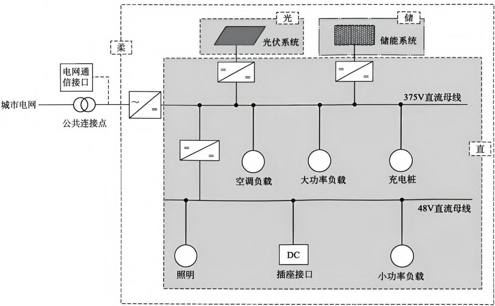  
图 3.7-1 建筑光储直柔系统示意图

**2. 用电柔性**

用电柔性是指建筑或设备根据电力交互需求进行实时用电功率调节的能力。根据《民用建筑电气设计标准》GB 51348—2019中建筑用电负荷分级及供电要求，其中三级负荷具有可调节特性。按照柔性特征，柔性负荷分为可中断负荷、可迁移负荷、可比例调节负荷三类，如图3.7-2和表3.7-1所示。

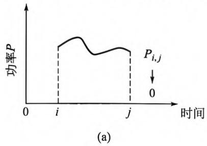

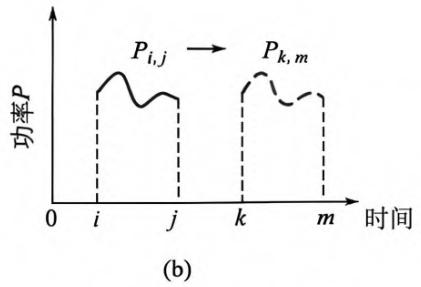  
图3.7-2 柔性负荷分类

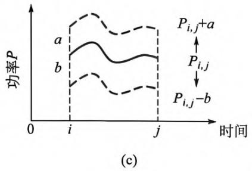  
(a) 可中断负荷；(b) 可迁移负荷；(c) 可比例调节负荷

部分建筑用电设备柔性负荷分类

<table><tr><td>用电负荷</td><td>可中断负荷</td><td>可迁移负荷</td><td>可比例调节负荷</td></tr><tr><td>空调</td><td>○</td><td>○</td><td>○</td></tr><tr><td>新风机</td><td>○</td><td>○</td><td>○</td></tr><tr><td>电热水器</td><td>○</td><td>○</td><td>○</td></tr><tr><td>电供暖设备</td><td>○</td><td>○</td><td>○</td></tr><tr><td>电冰箱</td><td>○</td><td>○</td><td>×</td></tr><tr><td>照明</td><td>○</td><td>×</td><td>○</td></tr><tr><td>双向充电桩</td><td>○</td><td>○</td><td>○</td></tr><tr><td>带蓄电功能的负载</td><td>○</td><td>○</td><td>○</td></tr></table>

表 3.7-1  
注：○表示具备该项负荷分类特征；×表示不具备该项负荷分类特征。

(1) 可中断负荷是指在用电过程中, 可根据需求随时切断电源, 停止运行的负荷。如自带电池的笔记本电脑、手机、平板, 以及紧急情况下的不重要负荷等。

（2）可迁移负荷是指在用电过程中，可根据需求调整运行时间的负荷。如空调、有预约功能的洗衣机、洗碗机、热水器等。

（3）可比例调节负荷是指在用电过程中，可根据需求削减或提升运行功率的负荷。如空调、照明以及建筑储能（含电动车）等。

### 3.7.2 设计原则

当建筑需布置分布式光伏和建筑储能等电源设备或参与电力交互时，光储直柔是其低成本实现新能源高效消纳与负荷调控的有效技术路径之一。典型的“光储直柔”建筑电气系统如图3.7-3所示，该图展示了外部交流电源、光伏、储能、充电桩及用电设备通过直流配电网组成有机物理整体的逻辑拓扑关系。

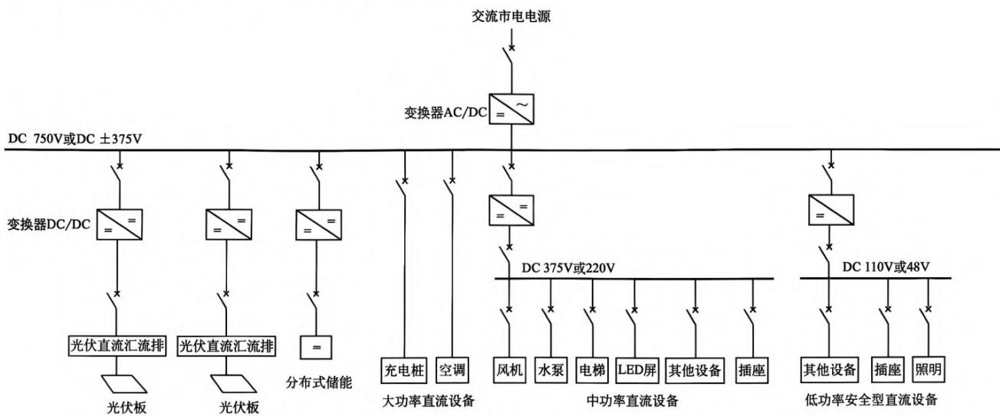  
图 3.7-3 典型 “光储直柔” 建筑电气系统

“光储直柔”建筑电气系统设计原理如图3.7-4所示，主要分为建筑光伏系统设计、储能系统设计、低压直流配电系统设计、系统柔性控制四部分，各部分设计要点及指标要求如下；

**1. 建筑光伏系统设计**

建筑光伏系统能够提供零碳化的清洁电力，推荐优先安装在建筑屋顶。屋顶光伏系统的安装容量、朝向、倾角与间距应根据安全、美观、负荷时间规律和投资收益等因素确定。

**(1) 安装倾角**

光伏组件的发电量与太阳辐射强度、太阳辐射光谱、环境温度、光伏组件温度系数等因素有关。当光伏组件的方位角和倾斜角不同时，单位面积光伏组件接收到的太阳辐射量不同，因此发电量也会有变化。以北京和广州为例，当光伏组件水平安装、南向最佳倾斜角安装和南向竖直安装时，光伏组件逐月发电量如图3.7-5所示。考虑到我国南方地区夏季空调负荷较大，北方地区冬季供暖负荷较大，可以因地制宜根据负荷需求采用不同的安装方式，在尽可能实现光伏系统全年发电量最大的同时兼顾光伏系统每月发电量与负荷需求的匹配性。

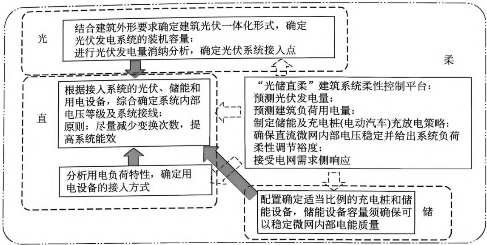  
图 3.7-4 “光储直柔” 建筑电气系统设计原理图

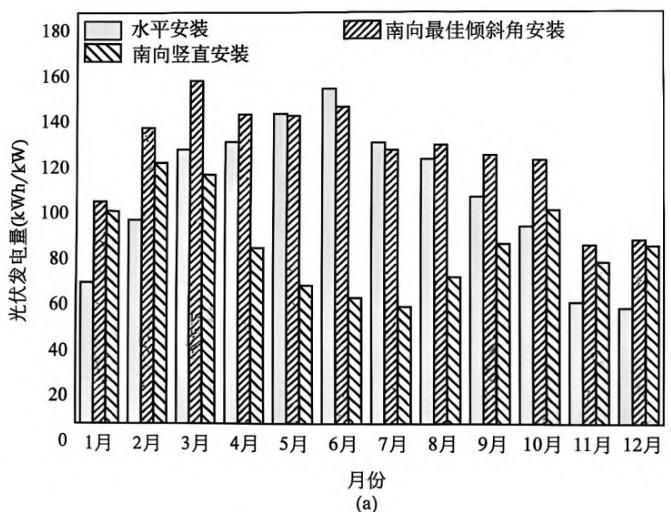

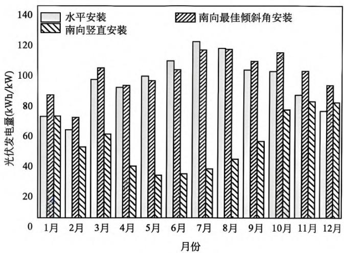  
图 3.7-5 光伏组件在不同朝向和不同倾斜角下我国典型城市年发电量  
(a) 北京；(b) 广州

**(2) 占地率与单位可利用面积收益**

将光伏组件的占地面积与光伏组件面积的比值定义为占地率，某一纬度地区光伏阵列的占地率与倾斜角有关。在同一城市，随着倾斜角升高，光伏组件占地率先升高后降低，且城市纬度越高占地率随着倾斜角升高得越快。对比最佳倾角安装和水平安装两种方式，可以发现光伏组件以最佳倾角安装时占地率比水平安装时高，但单位屋顶面积发电量比水平安装时低，如图3.7-7所示。

光伏阵列前后排间距计算示意如图 3.7-7 所示。光伏阵列间的距离对光伏组件的输出功率和转换效率有很大影响，光伏阵列前后排间距 D 的一般确定原则为；确保冬至日当天 9:00 至下午 3:00，后排光伏阵列不被前排组件遮挡。

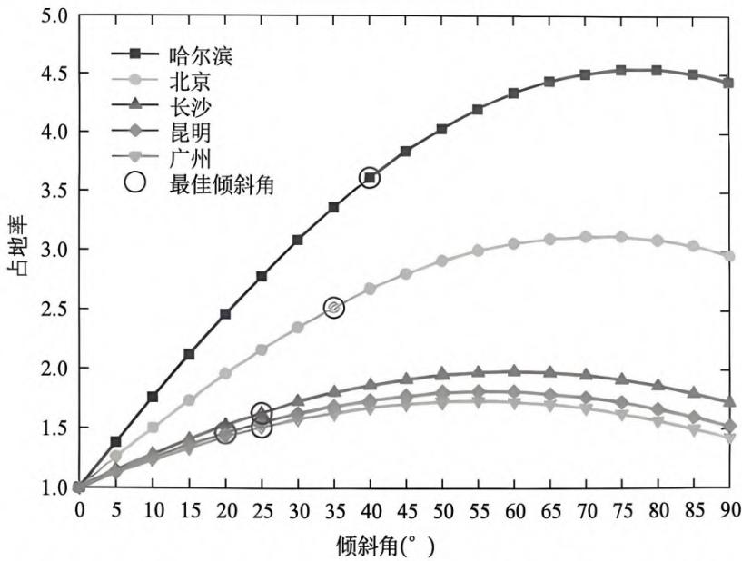  
图3.7-6 我国代表性城市光伏组件占地率随倾斜角变化示意图

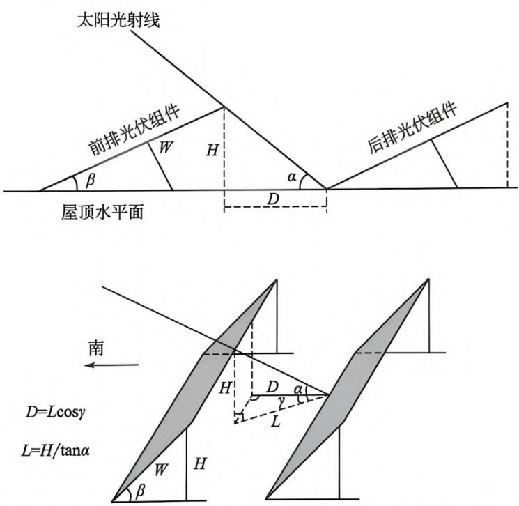  
D—组件阵列相对间距，m；L—太阳射线在地面上的影长，m；H—前排组件阵列最高点与地面垂直高度，m； $\alpha$ —太阳高度角，(°)； $\gamma$ —太阳方位角，(°)； $\beta$ —光伏组件安装倾角，(°)。  
图3.7-7 光伏阵列前后排间距计算示意图

综合上述影响因素，不同安装方式发电量不同，产生的经济效益也不同，工程中常用的安装方式下年发电量和单位屋顶面积发电量对比见表3.7-2。由此可知，当屋顶面积比较紧缺并且对初投资不敏感，但是对光伏发电量占比有要求时，可以采用水平安装，最大化利用占地面积，从而实现单位占地面积光伏发电量最大；而当屋顶面积充裕并且对投资性价比要求高时，可以采用最佳倾斜角安装，虽然单位屋顶面积光伏发电量较低，但是单位面积光伏组件的发电量相比其他安装方式要高，投资收益最大。

常用安装方式下年发电量和单位屋顶面积发电量对比  
表 3.7-2

<table><tr><td>安装方式</td><td>夏季发电量</td><td>冬季发电量</td><td>全年发电量</td><td>单位屋顶面积发电量</td></tr><tr><td>水平安装(保留5°倾角排水)</td><td>较大</td><td>较小</td><td>☆☆</td><td>☆☆☆</td></tr><tr><td>最佳倾角安装</td><td>较平均</td><td>较平均</td><td>☆☆☆</td><td>☆☆</td></tr><tr><td>竖直安装</td><td>较小</td><td>较大</td><td>☆</td><td>☆</td></tr></table>

此外，设计时还应考虑美观性。在实际项目中，还可以选择以介于最佳倾斜角和水平之间的某个角度进行安装，以追求包括光伏系统初投资和屋顶租金在内的综合效益最大化。而立面光伏系统则应结合建筑外观要求，根据采光和遮阳等建筑热工因素、发电效率以及经济性，进行一体化设计。

建筑光伏系统设计目标与运行指标要求见表 3.7-3。

建筑光伏系统设计目标与运行指标要求  
表3.7-3

<table><tr><td colspan="2">星级评价指标</td><td>基本级</td></tr><tr><td rowspan="4">设计阶段</td><td>光伏安装</td><td>安装面积/可利用面积&gt;50%</td></tr><tr><td rowspan="3">光伏消纳</td><td>光伏全年发电量占建筑全年用电量比例&lt;30%时,光伏发电自用率应达到100%</td></tr><tr><td>30%≤光伏全年发电量占建筑全年用电量比例&lt;100%时,光伏发电自用率&gt;80%</td></tr><tr><td>光伏全年发电量占建筑全年用电量比例≥100%时,光伏发电自用率&gt;80%或本变压器台区内消纳</td></tr><tr><td rowspan="4">运行阶段</td><td>光伏安装</td><td>安装面积/可利用面积&gt;50%</td></tr><tr><td rowspan="3">光伏消纳</td><td>光伏全年发电量占建筑全年用电量比例&lt;30%时,光伏发电自用率应达到100%</td></tr><tr><td>30%≤光伏全年发电量占建筑全年用电量比例&lt;100%时,光伏发电自用率&gt;80%</td></tr><tr><td>光伏全年发电量占建筑全年用电量比例≥ 100%时,光伏发电自用率&gt;80%或本变压器台区内消纳</td></tr></table>

**2. 储能系统设计**

建筑储能可以通过调整充放电功率改变直流配电系统的负荷特性，达到光伏消纳、平抑负荷波动和电力交互等目的。常见储能形式根据原理可以分为电化学储能、电磁储能、机械储能、热储能等多种形式，如表3.7-4所示。从建筑电气化趋势和储能技术成熟度来看，在建筑供配电系统中配置储电装置目前以电化学储能为主，同时电动车也是重要的建筑储能方式。

常见储能形式  
表3.7-4

<table><tr><td>储能形式</td><td>分类</td><td>优点</td><td>缺点</td></tr><tr><td rowspan="3">电化学储能</td><td>锂离子电池</td><td>能量效率高、使用寿命长、充放电倍率高</td><td>成本略高</td></tr><tr><td>铅酸/铅碳电池</td><td>应用最早、技术最成熟、成本低廉</td><td>能量密度小、循环寿命略低</td></tr><tr><td>全钒液流电池</td><td>能量效率高、使用寿命长、电化学极化小</td><td>投资成本高、占地面积大</td></tr><tr><td rowspan="3">机械储能</td><td>抽水储能</td><td>成熟、容量规模大</td><td>受地理因素制约、基础投资大</td></tr><tr><td>压缩空气</td><td>能量密度大</td><td>受地理因素制约</td></tr><tr><td>飞轮储能</td><td>使用寿命长、瞬时功率大、响应速度快</td><td>试验阶段、造价高、噪声大</td></tr><tr><td rowspan="2">电磁储能</td><td>超级电容储能</td><td>功率密度高、循环寿命长</td><td>试验阶段</td></tr><tr><td>超导储能</td><td>功率密度高、循环寿命长、响应速度快</td><td>试验阶段、技术不成熟</td></tr></table>

当采用电化学储能形式时，建议容量不超过 500kWh，且应包括储能电池模组、储能变换器、电池管理系统（Battery Management System，BMS）。以锂电池储能系统为例，其基本组成包括电池组、电池管理系统、功率系统、能量管理系统，以及照明配电、空调、消防等辅助系统，如图 3.7-8 所示。电池管理系统对电池状态进行监测及管理，多采用三级架构，包括 BMS 从控采集均衡模块（BSU）、BMS 主控控制模块（BMU）和 BMS 电池堆控制模块（BDU）。

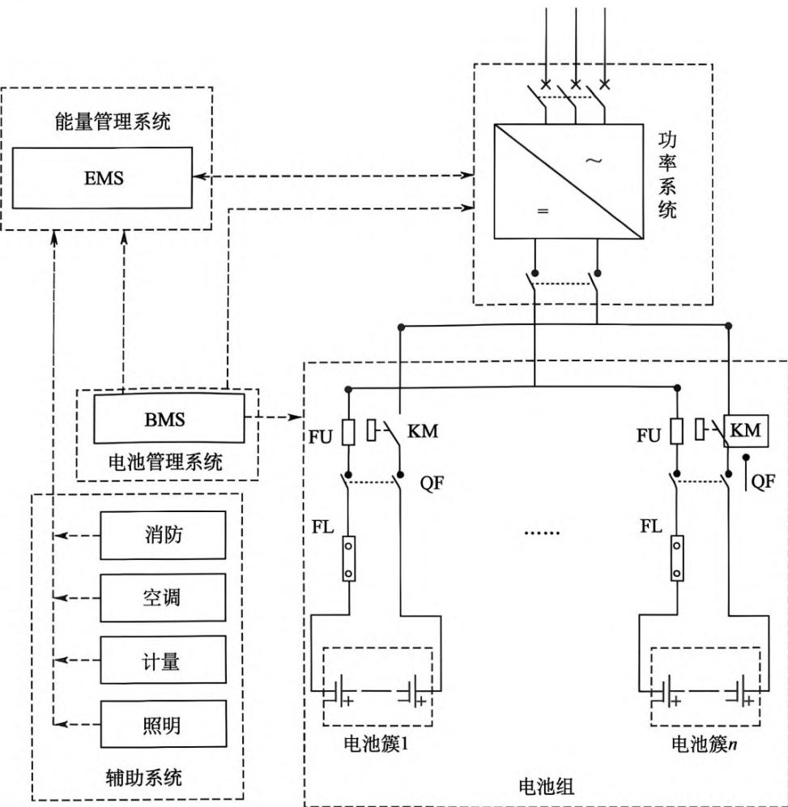  
图3.7-8 锂电池储能系统组成

建筑储能是建筑整体用电柔性调节的重要手段，其储能容量 $E =$ 充放电功率 $P \times$ 持续时间 $T$ ，储能容量和充放电功率之间的关系可以用充放电倍率 $C(C = P / E)$ 来衡量，并可以分为功率模式和能量模式两种基本形式：功率模式充放电倍率一般大于 1，因为充放电功率较大，相同储能电池电压和容量下，电池和储能变换器的电流更大，充放电持续时间相应较短，常用于平抑功率波动和短时应急供电等场合；能量模式以吞吐电量作为主要控制目标，充放电功率相比功率模式小，但持续时间要求更长，充放电倍率大多在 1 以下，常用于负荷迁移、光伏消纳和长时间后备供电。

光储直柔建筑在没有参与电网侧调峰调频辅助服务的要求时，一般可选用能量型电池，即以大于1小时率（1P）额定功率工作的电池，主要以磷酸铁锂电池（LFP）为代表；如果有上述要求，则可以选择功率型电池或者二者混合型电池组合。功率型电池是以小于或等于1小时率（1P）额定功率工作的电池，适用在需要短时快充快放（如实现需求侧快速响应）的场合，主要以钛酸锂电池（LTO）为代表。另外，考虑运行安全等因素，接入直流母线的储能系统（布置于楼宇配电室）功率原则上不超过总配电功率的 $50\%$ ，容量按照容量功率比为2设计。建筑储能系统设计与运行要求见表3.7-5。

建筑储能系统设计与运行要求  
表3.7-5

<table><tr><td colspan="2">建筑星级评价指标</td><td>基本级</td><td>一星级</td><td>二星级</td><td>三星级</td></tr><tr><td rowspan="2">设计阶段</td><td>储能配置</td><td>配置一种及以上的储能设备</td><td>-</td><td>-</td><td>-</td></tr><tr><td>充电桩配置</td><td>配置电动汽车充电桩,并具备有序充电管理功能</td><td>-</td><td>-</td><td>-</td></tr><tr><td rowspan="2">运行阶段</td><td>储能配置</td><td>配置一种及以上的储能设备</td><td>-</td><td>配置两种以上储能形式</td><td>配置两种以上储能形式</td></tr><tr><td>充电桩配置</td><td>配置电动汽车充电桩,并具备有序充电管理功能</td><td>-</td><td>充电桩具备双向充放电功能</td><td>充电桩具备双向充放电功能</td></tr></table>

**3. 低压直流配电系统设计**

建筑光伏发电、蓄电池储电等具有直流特性，而且便于通过直流母线实现建筑光伏、建筑储能和不同类型负荷的接入，并根据城市电网功率变化要求，以直流母线线电压调节为手段，在满足用户需求的前提下通过调节储能和负荷，实现供需匹配。直流配电已成为新能源高效消纳与负荷调控的关键技术。

建筑低压直流配电系统组成如图 3.7-9 所示，包括以下四个部分：①电源设备，包括城市电网、建筑光伏、建筑储能等；②配电设备，包括交直/直直变换器、光伏变换器、储能变换器，线缆以及开关等保护装置；③用电设备，包括照明、空调、办公设备等用电设备，以及插座等；④监控系统，包括传感器、测量/计量表具、控制器和监控软件等。

建筑低压直流配电系统设计要点如下：

(1) 系统设计；采用单极结构。

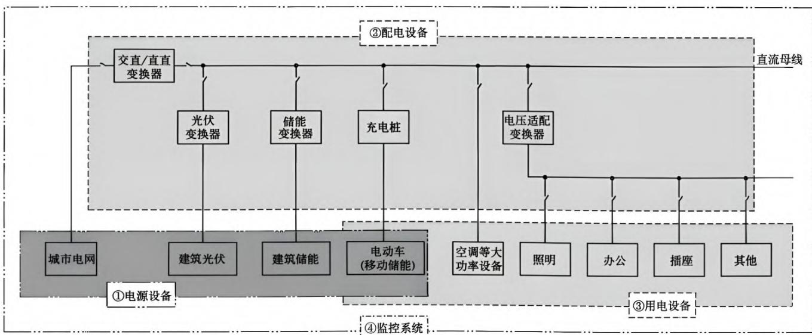  
图 3.7-9 建筑低压直流配电系统组成

(2) 电压分级: 系统电压等级不超过三级, 建议采用 DC 750V、DC 375V 和 DC 48V, 如图 3.7-10 所示。

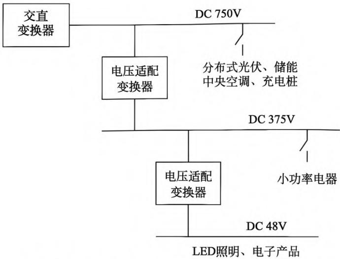  
图3.7-10 低压直流配电系统电压分级示意图

（3）电压等级：用电设备接入直流母线时，应根据其额定功率选择电压等级（表 3.7-6），且同一用电设备不应同时接入不同的直流母线。

设备接入的电压等级选择  
表3.7-6

<table><tr><td>序号</td><td>设备额定功率</td><td>直流母线电压等级</td></tr><tr><td>1</td><td>&gt;15kW</td><td>DC 750V</td></tr><tr><td>2</td><td>≤15kW且&gt;500W</td><td>DC 375V</td></tr><tr><td>3</td><td>≤500W</td><td>DC 48V</td></tr></table>

(4) 接地设计: 采用 IT 接地形式。

(5) 负荷计算; 参考交流配电系统的标准来实施。在建筑方案和规划阶段, 可采用面积指标法对建筑低压直流配电系统的装机容量进行估算；在建筑施工图阶段，建筑主要用电设备的容量均已确定，可采用利用系数法对建筑低压直流配电系统的各个环节进行负荷计算，以此作为后续系统设备及线缆选型的依据。

(6) 电压保护: 电压是直流电气系统最重要的电能质量指标, 系统应针对过压和欠压等电压异常设置保护功能。当直流母线处于 $70 \% \sim 80 \%$ 额定电压范围, 且持续时间不超过 $10 \mathrm{~s}$ 时, 直流电气系统应保持运行。当直流母线处于 $20 \% \sim 70 \%$ 额定电压范围, 且持续时间不超过 $10 \mathrm{~ms}$ 时, 直流电气系统应保持运行, 不应执行欠压保护, 提高供电可靠性。为确保系统设备正常运行, 一般建议的电压波动范围不超过 $-20 \% \sim +5 \%$ 。

此外，还有主要设备与线缆选型等。

综上，建筑低压直流配电系统设计与运行要求见表3.7-7。

**4. 建筑柔性控制**

实现柔性用电是建筑光储直柔系统的最主要目标。柔性用电能力评价主要侧重于评价其自身用电功率曲线与外部需求曲线之间的匹配程度，既包括根据电网用电指令进行实时功率调节，也包括需求响应时短时间调节自身用电功率，还包括根据实时电价、电力动态碳排放因子变化等主动进行柔性用电调节的能力等。

建筑低压直流配电系统设计与运行要求  
表3.7-7

<table><tr><td colspan="2">建筑星级评价指标</td><td>基本级</td><td>一星级</td><td>二星级</td><td>三星级</td></tr><tr><td rowspan="9">设计阶段</td><td>直流负荷</td><td>直流负荷功率占直流供电能力的比例不应小于50%</td><td>—</td><td>—</td><td>—</td></tr><tr><td rowspan="3">电能质量</td><td>稳态电压应在85%~105%标称电压范围</td><td>—</td><td>—</td><td>—</td></tr><tr><td>暂态电压变动应不大于标称电压的5%</td><td>—</td><td>—</td><td>—</td></tr><tr><td>纹波的峰峰值系数和有效值系数应分别小于1.5%和1.0%</td><td>—</td><td>—</td><td>—</td></tr><tr><td rowspan="3">供电安全</td><td>保护系统具备故障识别和保护功能</td><td>—</td><td>—</td><td>—</td></tr><tr><td>DC 750V和DC 375V电压等级采取规定的电击防护措施</td><td>—</td><td>—</td><td>—</td></tr><tr><td>DC 750V系统具备安全标识</td><td>—</td><td>—</td><td>—</td></tr><tr><td rowspan="2">运行控制</td><td>具备状态切换和功率控制功能</td><td>—</td><td>—</td><td>—</td></tr><tr><td>系统采用直流母线电压控制</td><td>—</td><td>—</td><td>—</td></tr><tr><td>运行阶段</td><td>直流负荷比例</td><td>同设计阶段要求</td><td>直流负荷功率占直流供电能力的比例&gt;60%</td><td>直流负荷功率占直流供电能力的比例&gt;80%</td><td>直流负荷功率占直流供电能力的比例达到100%</td></tr></table>

建筑光储直柔系统柔性效果评价包括单次调节能力评价和全天 24h 连续调节能力评价。其中，单次调节能力评价指标包含最大调节容量比例、向上调节和向下调节的调节电量比例，如图 3.7-11 所示；连续调节能力评价指标包括相对于全天 24h 计划目标功率曲线的功率偏差指标和电量偏差指标，如图 3.7-12 所示。同时，单次调节能力和连续调节能力分别按如下公式计算，且其设计与运行要求见表 3.7-7。

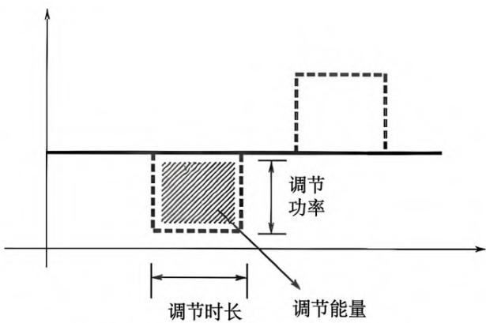  
图 3.7-11 单次调节能力示意图

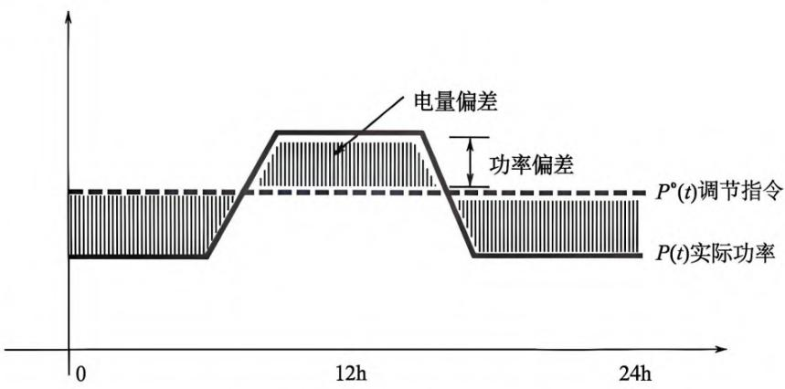  
图3.7-12 连续调节能力示意图

(1) 单次调节能力指标

1) 最大调节容量比例 $\delta_{\mathrm{max}}$ :

$$
\Delta P = \max \left\{\left| P (t) - P _ {0} (t) \right| \right\}\tag{3.7-3}
$$

$$
\delta_ {\max} = \Delta P / P _ {0} (t)\tag{3.7-4}
$$

式中 $\Delta P$ ——光储直柔系统最大调节容量，kW；

$P(t)$ ——光储直柔系统在 t 时刻的实际功率，kW；

$P_{0}(t)$ ——同一时刻不调节时的基线功率，kW。

2）调节电量比例（ $\gamma_{up}$ 和 $\gamma_{down}$ ）：

$$
Q _ {\mathrm{up}} = \int_ {t} ^ {t + T} [ P (t) - P _ {0} (t) ] \mathrm{d} t\tag{3.7-5}
$$

$$
Q _ {\mathrm{down}} = \int_ {t} ^ {t + T} [ P _ {0} (t) - P (t) ] \mathrm{d} t\tag{3.7-6}
$$

$$
\gamma_ {\mathrm{up}} = Q _ {\mathrm{up}} / \int_ {t} ^ {t + T} P _ {0} (t) \mathrm{d} t\tag{3.7-7}
$$

$$
\gamma_ {\mathrm{down}} = Q _ {\mathrm{down}} / \int_ {t} ^ {t + T} P _ {0} (t) \mathrm{d} t\tag{3.7-8}
$$

式中 $Q_{up}$ 和 $Q_{down}$ ——分别为向上调节和向下调节电量，kWh；

$P(t)$ ——建筑光储直柔系统在 t 时刻的实际功率，kW;

$P_{0}(t)$ ——同一时刻不调节时的基线功率，kW；

T ——按最大调节容量 $\Delta P$ 调节时，光储直柔系统可以保持的最大可持续的时长，h。

**(2) 连续调节能力指标**

1) 在调节期间, 各时刻 ( $15 \mathrm{~min}$ 时间窗口) 平均功率偏差指标 $\alpha_{\mathrm{P}}$ 应按下式计算:

$$
\alpha_ {\mathrm{P}} = \max \left(\left| \frac {P (t) - P ^ {*} (t)}{P ^ {*} (t)} \right|\right)\tag{3.7-9}
$$

式中 $P(t)$ ——光储直柔系统在 t 时刻的平均功率，kW；

$P^{*}(t)$ ——t 时刻的调节指令的目标功率，kW。

2）在调节响应期间，整个调节过程调节电量偏差 $\alpha_{\mathrm{Q}}$ 应按下式计算：

$$
\alpha_ {\mathrm{Q}} = \frac {\int_ {t} ^ {t + T} | P (t) - P ^ {*} (t) | \mathrm{d} t}{\int_ {t} ^ {t + T} P ^ {*} (t) \mathrm{d} t}\tag{3.7-10}
$$

式中 $T$ ——全天 $24 \mathrm{~h}$ 调节周期。

**(3) 柔性过程评价指标**

建筑光储直柔系统柔性过程评价指标应包括响应时间、响应速度和调节时长，其柔性调节过程指标示意如图 3.7-13 所示（深色实线为基准负荷，浅色实线为运行负荷，虚线为运行负荷波动范围）。

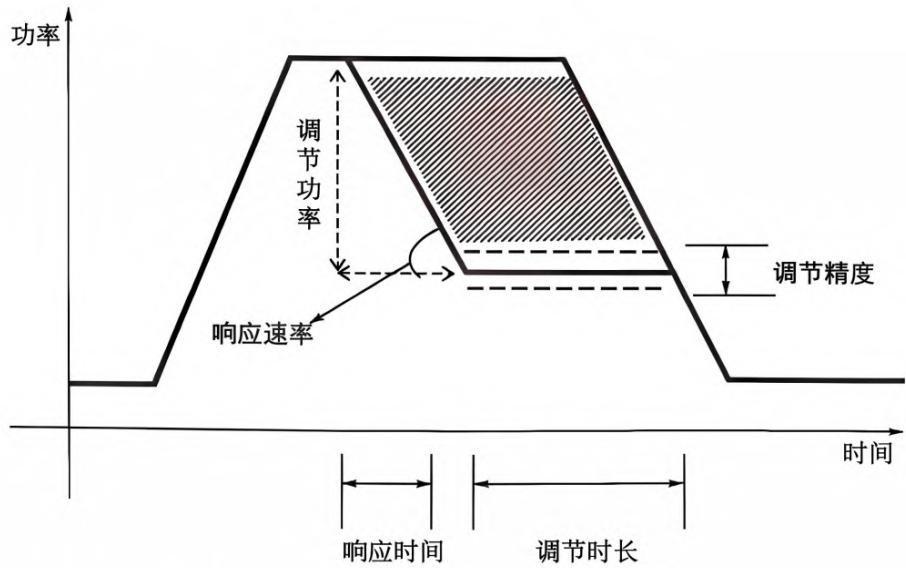  
图 3.7-13 柔性调节过程指标示意图

其中，系统响应时间（ $T_{1}$ ）按下式计算：

$$
T _ {1} = T _ {[ 0. \mathrm{S} \times (P ^ {*} - P) ]} - T _ {(P)}\tag{3. 7-11}
$$

式中 $T_{(P)}$ ——光储直柔系统接收到调节指令的时刻；

$T_{[0.s\times (P^{*} - P)]}$ ——光储直柔系统运行功率首次达到调节指令目标值 $90\%$ 的时刻。

系统响应速率 $V$ 按下式计算：

$$
V = \frac {90 \% \times | P (t) - P ^ {*} (t) |}{T _ {1}}\tag{3.7-12}
$$

系统调节时长 $T_{2}$ 应按下式计算：

$$
T _ {2} = T _ {(e _ {\mathrm{P}} > \alpha)} - T _ {[ 0. 9 \times (P ^ {\vee} - P) ]}\tag{3.7-13}
$$

式中 $T_{(\alpha_{\mathrm{p}}>\alpha)}$ ——光储直柔系统运行功率偏差首次超容许范围的时刻；

$\alpha$ ——调节过程中容许的最大功率偏差值。

综上，建筑运行阶段柔性性能评价指标要求见表 3.7-8。

建筑运行阶段柔性性能评价指标要求  
表3.7-8

<table><tr><td colspan="3">建筑星级评价指标</td><td>基本级</td><td>一星级</td><td>二星级</td><td>三星级</td></tr><tr><td rowspan="7">运行阶段</td><td rowspan="2">单次调节能力</td><td>最大调节容量比例</td><td rowspan="7">—</td><td>不小于基线功率的20%</td><td>不小于基线功率的50%</td><td>不小于基线功率的50%</td></tr><tr><td>调节电量比例</td><td>不小于基线电量的20%</td><td>不小于基线电量的50%</td><td>不小于基线电量的50%</td></tr><tr><td rowspan="2">连续调节能力</td><td>功率偏差指标</td><td>—</td><td>目标功率的±15%</td><td>目标功率的±5%</td></tr><tr><td>调节电量偏差</td><td>—</td><td>理论调节电量的±15%</td><td>理论调节电量的±5%</td></tr><tr><td rowspan="3">柔性过程评价指标</td><td>响应时间</td><td>不大于120s</td><td>不大于60s</td><td>不大于12s</td></tr><tr><td>响应速率</td><td>可调节负荷容量的0.5%/min</td><td>可调节负荷容量的1%/min</td><td>可调节负荷容量的1%/min</td></tr><tr><td>持续调节时间</td><td>30min</td><td>1h</td><td>2h</td></tr></table>

**5. 总体指标**

建筑光储直柔设计阶段与运行阶段指标要求分别见表3.7-9和表3.7-10。

建筑光储直柔系统设计阶段指标要求  
表 3.7-9

<table><tr><td colspan="2">建筑星级评价指标</td><td>基本级</td></tr><tr><td rowspan="2">一般规定</td><td>部件要求</td><td>关键部件符合标准和设计要求</td></tr><tr><td>系统要求</td><td>系统设计符合标准要求</td></tr><tr><td rowspan="4">光伏指标</td><td>光伏安装</td><td>安装面积/可利用面积&gt;50%</td></tr><tr><td rowspan="3">光伏消纳</td><td>光伏全年发电量占建筑全年用电量比例&lt;30%时,光伏发电自用率应达到100%</td></tr><tr><td>30%≤光伏全年发电量占建筑全年用电量比例&lt;100%时,光伏发电自用率&gt;80%</td></tr><tr><td>光伏全年发电量占建筑全年用电量比例≥100%时,光伏发电自用率&gt;80%或本变压器台区内消纳</td></tr><tr><td rowspan="2">储能指标</td><td>储能配置</td><td>配置一种及以上的储能设备</td></tr><tr><td>充电桩配置</td><td>配置电动汽车充电桩,并具备有序充电管理功能</td></tr><tr><td rowspan="8">直流配用电指标</td><td>直流负荷</td><td>直流负荷功率占直流供电能力的比例不应小于50%</td></tr><tr><td rowspan="3">电能质量</td><td>稳态电压应在85%~105%标称电压范围</td></tr><tr><td>暂态电压变动应不大于5%标称电压</td></tr><tr><td>纹波的峰峰值系数和有效值系数应分别小于1.5%和1.0%</td></tr><tr><td rowspan="2">供电安全</td><td>保护系统具备故障识别和保护功能</td></tr><tr><td>DC 750V和DC 375V电压等级采取规定的电击防护措施</td></tr><tr><td rowspan="2">运行控制</td><td>具备状态切换和功率控制功能</td></tr><tr><td>系统采用直流母线电压控制</td></tr></table>

建筑光储直柔系统运行阶段指标要求  
表3.7-10

<table><tr><td colspan="2">建筑星级评价指标</td><td>基本级</td><td>一星级</td><td>二星级</td><td colspan="2">三星级</td></tr><tr><td rowspan="2">一般规定</td><td>部件要求</td><td>关键部件符合标准和设计要求</td><td>-</td><td>-</td><td colspan="2">-</td></tr><tr><td>系统要求</td><td>系统设计符合标准要求</td><td>-</td><td>-</td><td colspan="2">-</td></tr><tr><td rowspan="4">光伏指标</td><td>光伏安装</td><td>安装面积/可利用面积&gt;50%</td><td>-</td><td>-</td><td colspan="2">-</td></tr><tr><td rowspan="3">光伏消纳</td><td>光伏全年发电量占建筑全年用电量比例&lt;30%时,光伏发电自用率应达到100%</td><td>-</td><td>-</td><td colspan="2">-</td></tr><tr><td>30%≤光伏全年发电量占建筑全年用电量比例&lt;100%时,光伏发电自用率&gt;80%</td><td>-</td><td>-</td><td colspan="2">-</td></tr><tr><td>光伏全年发电量占建筑全年用电量比例≥100%时,光伏发电自用率&gt;80%或本变压器台区内消纳</td><td>-</td><td>-</td><td colspan="2">-</td></tr><tr><td rowspan="2">储能指标</td><td>储能配置</td><td>配置一种及以上的储能设备</td><td>-</td><td>配置两种以上储能形式</td><td colspan="2">配置两种以上储能形式</td></tr><tr><td>充电桩配置</td><td>配置电动汽车充电桩,并具备有序充电管理功能</td><td>-</td><td>充电桩具备双向充放电功能</td><td colspan="2">充电桩具备双向充放电功能</td></tr><tr><td rowspan="9">直流配用电指标</td><td colspan="2">直流负荷</td><td>直流负荷功率占直流供电能力的比例不应小于50%</td><td rowspan="9">直流负荷功率占直流供电能力的比例&gt;60%</td><td rowspan="9">直流负荷功率占直流供电能力的比例&gt;80%</td><td rowspan="9">直流负荷功率占直流供电能力的比例达到100%</td></tr><tr><td colspan="2" rowspan="3">电能质量</td><td>稳态电压应在85%~105%标称电压范围</td></tr><tr><td>暂态电压变动应不大于标称电压的5%</td></tr><tr><td>纹波的峰峰值系数和有效值系数应分别小于1.5%和1.0%</td></tr><tr><td colspan="2" rowspan="3">供电安全</td><td>保护系统具备故障识别和保护功能</td></tr><tr><td>DC 750V和DC 375V电压等级采取规定的电击防护措施</td></tr><tr><td>DC 750V系统具备安全标识</td></tr><tr><td colspan="2" rowspan="2">运行控制</td><td>具备状态切换和功率控制功能</td></tr><tr><td>系统采用直流母线电压控制</td></tr><tr><td rowspan="7">柔性性能指标</td><td>单次调节能力</td><td>最大调节容量比例</td><td>—</td><td>不小于基线功率的20%</td><td>不小于基线功率的50%</td><td>不小于基线功率的50%</td></tr><tr><td rowspan="3">连续调节能力</td><td>调节电量比例</td><td>—</td><td>不小于基线电量的20%</td><td>不小于基线电量的50%</td><td>不小于基线电量的50%</td></tr><tr><td>功率偏差指标</td><td>—</td><td>—</td><td>目标功率的±15%</td><td>目标功率的±5%</td></tr><tr><td>调节电量偏差</td><td>—</td><td>—</td><td>理论调节电量的±15%</td><td>理论调节电量的±5%</td></tr><tr><td rowspan="3">柔性过程评价指标</td><td>响应时间</td><td>—</td><td>不大于120s</td><td>不大于60s</td><td>不大于12s</td></tr><tr><td>响应速率</td><td>—</td><td>可调节负荷容量的0.5%/min</td><td>可调节负荷容量的1%/min</td><td>可调节负荷容量的1%/min</td></tr><tr><td>持续调节时间</td><td>—</td><td>30min</td><td>1h</td><td>2h</td></tr></table>

### 3.7.3 计算示例

建筑光储直柔系统设计采用动态计算方法，输入参数包括建筑基本信息、光伏系统基本信息与光伏逐时功率及容量、全年8760h建筑逐时用电负荷、柔性设计目标等，输出结

—— 总负荷 …… 非空调负荷

果包括储能系统容量与功率、电网公共连接点功率、用电负荷上/下调节能力等。

以位于深圳市的某办公建筑为例，计算其柔性调节能力与储能电池容量，计算步骤及结果示意如下：

**1. 获取建筑用电负荷数据**

若该建筑装有分项计量系统，通过调取历年分项计量数据可以获取空调、照明插座等分项的年用电量和负荷形态。如图 3.7-14 所示。

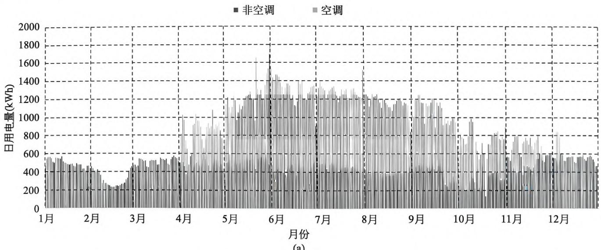

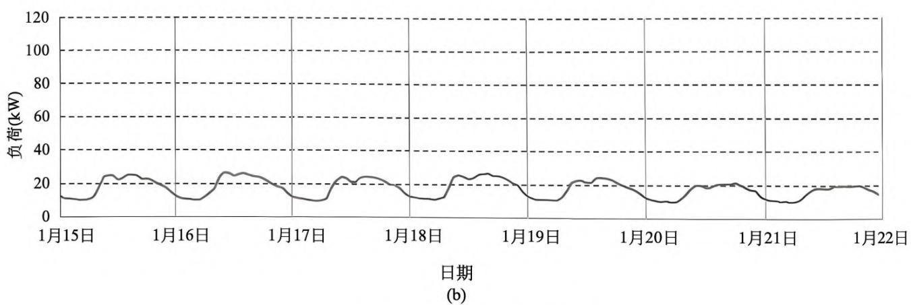

  
图3.7-14 建筑逐时用电负荷示意图  
(a) 日用电量预测；(b) 冬季典型周用电负荷形态；(c) 夏季典型周用电负荷形态

若建筑未安装分项计量系统，可通过办公建筑的单位建筑面积用电功率×建筑面积获取年用电负荷形态。办公建筑单位面积逐时用电功率如图 3.7-15 所示。

(a)  
(b)  
  
时间(h)  
图 3.7-15 办公建筑单位面积逐时用电功率示意图

**2. 获取建筑屋顶光伏发电负荷数据**

根据深圳市典型气象年太阳辐照数据、光伏组件性能参数和排布参数等，计算得到的屋顶光伏年发电量和逐时负荷如图 3.7-16 所示。

  
—— 总负荷 …… 非空调负荷 ---- 光伏发电

  
图3.7-16 屋顶光伏年发电量和逐时负荷  
(a) 光伏日发电量与建筑日用电量对比图；(b) 夏季典型周发电负荷与建筑用电负荷对比图

  
图 3.7-16 屋顶光伏年发电量和逐时负荷（续）  
(c) 光伏冬季典型周发电负荷与建筑用电负荷对比图

**3. 计算结果**

以实现建筑用电柔性为设计目标，计算结果示意如图 3.7-17 所示，包括储能系统容量与功率、电网公共连接点功率、用电负荷上/下调节能力等。

图3.7-17 计算结果示意图  

**⑦图例说明**

调局闸片同点负目：厘建联用电负同扣圈建筑本地光伏网电路的电网共网点的建筑用电负目；

目同所闻点负同：电力系统再呈建筑通让各种固节手成改爱的共同点负商的直棕柴结。