# 第 4 章 空气的物理性质

## 4.1 空气的性质

通常所说的空气是由干空气和水蒸气混合而成的湿空气。空气的成分如表 4.1-1 所示。

空气的成分  
表 4.1-1

<table><tr><td colspan="3">组成成分</td><td>分子量</td><td>体积百分比(%)</td></tr><tr><td rowspan="6">湿空气</td><td rowspan="5">干空气</td><td>氮</td><td>28.05</td><td>78.03</td></tr><tr><td>氧</td><td>32</td><td>20.99</td></tr><tr><td>二氧化碳</td><td>44</td><td>0.03</td></tr><tr><td>氢</td><td>2.02</td><td>0.01</td></tr><tr><td>氦</td><td>39.41</td><td>0.94</td></tr><tr><td colspan="3">水蒸气</td><td>0.2~4</td></tr></table>

湿空气中的水蒸气含量虽然少，但它的作用很大，空调的任务之一就是调节空气中的水蒸气量。

干空气的常用物理参数见表 4.1-2。

干空气的常用物理参数（压力 $p \approx 100kPa$ ）  
表4.1-2

<table><tr><td>温度(°C)</td><td>密度(kg/m3)</td><td>比热容[kJ/(kg·K)]</td><td>导热系数[10-2W/(m·K)]</td><td>热扩散率(10-2m2/h)</td><td>动力黏度(10-6Pa·s)</td><td>运动黏度(10-6m2/s)</td></tr><tr><td>-100</td><td>2.011</td><td>1.0087</td><td>1.620</td><td>2.863</td><td>11.780</td><td>5.858</td></tr><tr><td>-90</td><td>1.908</td><td>1.0078</td><td>1.707</td><td>3.195</td><td>12.370</td><td>6.483</td></tr><tr><td>-80</td><td>1.808</td><td>1.0071</td><td>1.792</td><td>3.543</td><td>12.940</td><td>7.157</td></tr><tr><td>-70</td><td>1.719</td><td>1.0066</td><td>1.877</td><td>3.905</td><td>13.510</td><td>7.859</td></tr><tr><td>-60</td><td>1.637</td><td>1.0062</td><td>1.960</td><td>4.282</td><td>14.070</td><td>8.595</td></tr><tr><td>-50</td><td>1.564</td><td>1.0059</td><td>2.042</td><td>4.673</td><td>14.610</td><td>9.344</td></tr><tr><td>-45</td><td>1.529</td><td>1.0058</td><td>2.082</td><td>4.874</td><td>14.880</td><td>9.731</td></tr><tr><td>-40</td><td>1.496</td><td>1.0057</td><td>2.122</td><td>5.078</td><td>15.150</td><td>10.126</td></tr><tr><td>-35</td><td>1.465</td><td>1.0056</td><td>2.163</td><td>5.286</td><td>15.420</td><td>10.528</td></tr><tr><td>温度(℃)</td><td>密度(kg/m3)</td><td>比热容[kJ/(kg·K)]</td><td>导热系数[10-2W/(m·K)]</td><td>热扩散率(10-2m2/h)</td><td>动力黏度(10-6Pa·s)</td><td>运动黏度(10-6m2/s)</td></tr><tr><td>-30</td><td>1.434</td><td>1.0055</td><td>2.202</td><td>5.497</td><td>15.680</td><td>10.932</td></tr><tr><td>-25</td><td>1.405</td><td>1.0055</td><td>2.242</td><td>5.712</td><td>15.940</td><td>11.343</td></tr><tr><td>-20</td><td>1.377</td><td>1.0055</td><td>2.281</td><td>5.930</td><td>16.201</td><td>11.762</td></tr><tr><td>-19</td><td>1.372</td><td>1.0055</td><td>2.289</td><td>5.973</td><td>16.253</td><td>11.847</td></tr><tr><td>-18</td><td>1.367</td><td>1.0055</td><td>2.297</td><td>6.017</td><td>16.304</td><td>11.931</td></tr><tr><td>-17</td><td>1.361</td><td>1.0055</td><td>2.305</td><td>6.062</td><td>16.356</td><td>12.016</td></tr><tr><td>-16</td><td>1.356</td><td>1.0055</td><td>2.312</td><td>6.106</td><td>16.407</td><td>12.100</td></tr><tr><td>-15</td><td>1.351</td><td>1.0055</td><td>2.320</td><td>6.151</td><td>16.458</td><td>12.186</td></tr><tr><td>-14</td><td>1.345</td><td>1.0055</td><td>2.328</td><td>6.195</td><td>16.509</td><td>12.271</td></tr><tr><td>-13</td><td>1.340</td><td>1.0055</td><td>2.336</td><td>6.240</td><td>16.561</td><td>12.357</td></tr><tr><td>-12</td><td>1.335</td><td>1.0055</td><td>2.344</td><td>6.285</td><td>16.612</td><td>12.443</td></tr><tr><td>-11</td><td>1.330</td><td>1.0055</td><td>2.351</td><td>6.330</td><td>16.663</td><td>12.530</td></tr><tr><td>-10</td><td>1.325</td><td>1.0055</td><td>2.359</td><td>6.375</td><td>16.714</td><td>12.616</td></tr><tr><td>-9</td><td>1.320</td><td>1.0056</td><td>2.367</td><td>6.420</td><td>16.764</td><td>12.702</td></tr><tr><td>-8</td><td>1.315</td><td>1.0056</td><td>2.375</td><td>6.466</td><td>16.815</td><td>12.789</td></tr><tr><td>-7</td><td>1.310</td><td>1.0056</td><td>2.382</td><td>6.511</td><td>16.866</td><td>12.877</td></tr><tr><td>-6</td><td>1.305</td><td>1.0056</td><td>2.390</td><td>6.557</td><td>16.916</td><td>12.963</td></tr><tr><td>-5</td><td>1.300</td><td>1.0056</td><td>2.398</td><td>6.602</td><td>16.967</td><td>13.052</td></tr><tr><td>-4</td><td>1.295</td><td>1.0056</td><td>2.405</td><td>6.648</td><td>17.017</td><td>13.139</td></tr><tr><td>-3</td><td>1.290</td><td>1.0056</td><td>2.413</td><td>6.695</td><td>17.068</td><td>13.227</td></tr><tr><td>-2</td><td>1.286</td><td>1.0056</td><td>2.421</td><td>6.741</td><td>17.118</td><td>13.315</td></tr><tr><td>-1</td><td>1.281</td><td>1.0056</td><td>2.428</td><td>6.787</td><td>17.168</td><td>13.403</td></tr><tr><td>0</td><td>1.276</td><td>1.0057</td><td>2.436</td><td>6.833</td><td>17.218</td><td>13.493</td></tr><tr><td>1</td><td>1.272</td><td>1.0057</td><td>2.444</td><td>6.880</td><td>17.268</td><td>13.581</td></tr><tr><td>2</td><td>1.267</td><td>1.0057</td><td>2.451</td><td>6.926</td><td>17.318</td><td>13.671</td></tr><tr><td>3</td><td>1.262</td><td>1.0057</td><td>2.459</td><td>6.973</td><td>17.368</td><td>13.760</td></tr><tr><td>4</td><td>1.258</td><td>1.0057</td><td>2.467</td><td>7.020</td><td>17.418</td><td>13.849</td></tr><tr><td>5</td><td>1.253</td><td>1.0057</td><td>2.474</td><td>7.067</td><td>17.468</td><td>13.940</td></tr><tr><td>6</td><td>1.249</td><td>1.0058</td><td>2.482</td><td>7.114</td><td>17.517</td><td>14.029</td></tr><tr><td>7</td><td>1.244</td><td>1.0058</td><td>2.489</td><td>7.161</td><td>17.567</td><td>14.119</td></tr><tr><td>8</td><td>1.240</td><td>1.0058</td><td>2.497</td><td>7.209</td><td>17.617</td><td>14.211</td></tr><tr><td>9</td><td>1.235</td><td>1.0058</td><td>2.505</td><td>7.257</td><td>17.666</td><td>14.301</td></tr><tr><td>温度(°C)</td><td>密度(kg/m3)</td><td>比热容[kJ/(kg·K)]</td><td>导热系数[10-2W/(m·K)]</td><td>热扩散率(10-2m2/h)</td><td>动力黏度(10-6Pa·s)</td><td>运动黏度(10-5m3/s)</td></tr><tr><td>10</td><td>1.231</td><td>1.0059</td><td>2.512</td><td>7.304</td><td>17.715</td><td>14.392</td></tr><tr><td>11</td><td>1.227</td><td>1.0059</td><td>2.520</td><td>7.352</td><td>17.765</td><td>14.483</td></tr><tr><td>12</td><td>1.222</td><td>1.0059</td><td>2.527</td><td>7.400</td><td>17.814</td><td>14.574</td></tr><tr><td>13</td><td>1.218</td><td>1.0059</td><td>2.535</td><td>7.448</td><td>17.863</td><td>14.666</td></tr><tr><td>14</td><td>1.214</td><td>1.0059</td><td>2.542</td><td>7.496</td><td>17.912</td><td>14.758</td></tr><tr><td>15</td><td>1.210</td><td>1.006</td><td>2.550</td><td>7.544</td><td>17.961</td><td>14.850</td></tr><tr><td>16</td><td>1.205</td><td>1.006</td><td>2.557</td><td>7.593</td><td>18.010</td><td>14.942</td></tr><tr><td>17</td><td>1.201</td><td>1.006</td><td>2.565</td><td>7.641</td><td>18.059</td><td>15.035</td></tr><tr><td>18</td><td>1.197</td><td>1.0061</td><td>2.572</td><td>7.690</td><td>18.108</td><td>15.128</td></tr><tr><td>19</td><td>1.193</td><td>1.0061</td><td>2.580</td><td>7.739</td><td>18.157</td><td>15.221</td></tr><tr><td>20</td><td>1.189</td><td>1.0061</td><td>2.587</td><td>7.788</td><td>18.205</td><td>15.314</td></tr><tr><td>21</td><td>1.185</td><td>1.0062</td><td>2.595</td><td>7.836</td><td>18.254</td><td>15.407</td></tr><tr><td>22</td><td>1.181</td><td>1.0062</td><td>2.602</td><td>7.885</td><td>18.303</td><td>15.502</td></tr><tr><td>23</td><td>1.177</td><td>1.0062</td><td>2.610</td><td>7.935</td><td>18.351</td><td>15.595</td></tr><tr><td>24</td><td>1.173</td><td>1.0063</td><td>2.617</td><td>7.984</td><td>18.400</td><td>15.689</td></tr><tr><td>25</td><td>1.169</td><td>1.0063</td><td>2.625</td><td>8.033</td><td>18.448</td><td>15.784</td></tr><tr><td>26</td><td>1.165</td><td>1.0063</td><td>2.632</td><td>8.083</td><td>18.496</td><td>15.878</td></tr><tr><td>27</td><td>1.161</td><td>1.0064</td><td>2.640</td><td>8.133</td><td>18.544</td><td>15.972</td></tr><tr><td>28</td><td>1.157</td><td>1.0064</td><td>2.647</td><td>8.182</td><td>18.593</td><td>16.067</td></tr><tr><td>29</td><td>1.153</td><td>1.0064</td><td>2.654</td><td>8.232</td><td>18.641</td><td>16.163</td></tr><tr><td>30</td><td>1.150</td><td>1.0065</td><td>2.662</td><td>8.283</td><td>18.689</td><td>16.258</td></tr><tr><td>31</td><td>1.146</td><td>1.0065</td><td>2.669</td><td>8.333</td><td>18.737</td><td>16.354</td></tr><tr><td>32</td><td>1.142</td><td>1.0066</td><td>2.677</td><td>8.383</td><td>18.784</td><td>16.450</td></tr><tr><td>33</td><td>1.138</td><td>1.0066</td><td>2.684</td><td>8.433</td><td>18.832</td><td>16.545</td></tr><tr><td>34</td><td>1.135</td><td>1.0066</td><td>2.691</td><td>8.484</td><td>18.880</td><td>16.642</td></tr><tr><td>35</td><td>1.131</td><td>1.0067</td><td>2.699</td><td>8.535</td><td>18.928</td><td>16.739</td></tr><tr><td>36</td><td>1.127</td><td>1.0067</td><td>2.706</td><td>8.585</td><td>18.975</td><td>16.835</td></tr><tr><td>37</td><td>1.124</td><td>1.0068</td><td>2.713</td><td>8.636</td><td>19.023</td><td>16.932</td></tr><tr><td>38</td><td>1.120</td><td>1.0068</td><td>2.721</td><td>8.687</td><td>19.070</td><td>17.028</td></tr><tr><td>39</td><td>1.116</td><td>1.0069</td><td>2.728</td><td>8.738</td><td>19.118</td><td>17.126</td></tr><tr><td>40</td><td>1.113</td><td>1.0069</td><td>2.735</td><td>8.789</td><td>19.165</td><td>17.224</td></tr><tr><td>45</td><td>1.095</td><td>1.0071</td><td>2.772</td><td>9.047</td><td>19.401</td><td>17.715</td></tr><tr><td>50</td><td>1.078</td><td>1.0074</td><td>2.808</td><td>9.307</td><td>19.635</td><td>18.211</td></tr><tr><td>温度(°C)</td><td>密度(kg/m3)</td><td>比热容[kJ/(kg·K)]</td><td>导热系数[10-2W/(m·K)]</td><td>热扩散率(10-2m2/h)</td><td>动力黏度(10-6Pa·s)</td><td>运动黏度(10-6m2/s)</td></tr><tr><td>55</td><td>1.062</td><td>1.0077</td><td>2.844</td><td>9.571</td><td>19.868</td><td>18.713</td></tr><tr><td>60</td><td>1.046</td><td>1.008</td><td>2.880</td><td>9.837</td><td>20.099</td><td>19.219</td></tr><tr><td>65</td><td>1.030</td><td>1.0083</td><td>2.916</td><td>10.106</td><td>20.329</td><td>19.731</td></tr><tr><td>70</td><td>1.015</td><td>1.0087</td><td>2.952</td><td>10.377</td><td>20.557</td><td>20.249</td></tr><tr><td>75</td><td>1.001</td><td>1.0091</td><td>2.987</td><td>10.651</td><td>20.783</td><td>20.771</td></tr><tr><td>80</td><td>0.986</td><td>1.0094</td><td>3.023</td><td>10.927</td><td>21.009</td><td>21.298</td></tr><tr><td>85</td><td>0.973</td><td>1.0099</td><td>3.058</td><td>11.206</td><td>21.233</td><td>21.830</td></tr><tr><td>90</td><td>0.959</td><td>1.0103</td><td>3.093</td><td>11.488</td><td>21.455</td><td>22.367</td></tr><tr><td>95</td><td>0.946</td><td>1.0107</td><td>3.127</td><td>11.772</td><td>21.676</td><td>22.908</td></tr><tr><td>100</td><td>0.934</td><td>1.0112</td><td>3.162</td><td>12.059</td><td>21.896</td><td>23.456</td></tr><tr><td>120</td><td>0.886</td><td>1.0133</td><td>3.299</td><td>13.229</td><td>22.763</td><td>25.693</td></tr><tr><td>140</td><td>0.843</td><td>1.0158</td><td>3.434</td><td>14.435</td><td>23.610</td><td>28.006</td></tr><tr><td>160</td><td>0.804</td><td>1.0185</td><td>3.566</td><td>15.675</td><td>24.439</td><td>30.394</td></tr><tr><td>180</td><td>0.769</td><td>1.0216</td><td>3.696</td><td>16.948</td><td>25.251</td><td>32.855</td></tr><tr><td>200</td><td>0.736</td><td>1.025</td><td>3.825</td><td>18.251</td><td>26.046</td><td>35.386</td></tr><tr><td>250</td><td>0.666</td><td>1.0344</td><td>4.138</td><td>21.635</td><td>27.970</td><td>42.017</td></tr></table>

## 4.2 湿空气的物理性质

将湿空气近似地看作理想气体，则可用理想气体的状态方程式来表示干空气和水蒸气的主要状态参数。即

$$
p _ {\mathrm{g}} V = m _ {\mathrm{g}} R _ {\mathrm{g}} T \quad \text {或} \quad p _ {\mathrm{g}} \bullet v _ {\mathrm{g}} = R _ {\mathrm{g}} T\tag{4.2-1}
$$

$$
p _ {\mathrm{q}} V = m _ {\mathrm{q}} R _ {\mathrm{q}} T \quad \text {或} \quad p _ {\mathrm{q}} \cdot v _ {\mathrm{q}} = R _ {\mathrm{q}} T\tag{4.2-2}
$$

式中 $p_{g}$ ， $p_{q}$ ——干空气与水蒸气的压力，Pa；

V——湿空气的容积， $m^{3}$ ;

$m_{g}$ ， $m_{q}$ ——干空气与湿空气的质量，kg；

$R_{g}$ ， $R_{q}$ ——干空气与湿空气的气体常数， $J/(kg \cdot K)$ ， $R_{g}=287J/(kg \cdot K)$ ； $R_{q}=461J/(kg \cdot K)$ ;

T——湿空气的热力学温度，K。

干空气的比容 $v_{\mathrm{g}}$ （ $\mathrm{m}^3 /\mathrm{kg}$ ）和湿空气的比容 $v_{\mathrm{q}}$ （ $\mathrm{m}^3 /\mathrm{kg}$ ）分别为：

$$
v _ {\mathrm{g}} = V / m _ {\mathrm{g}}; v _ {\mathrm{q}} = V / m _ {\mathrm{q}}\tag{4.2-3}
$$

干空气的密度 $\rho_{\mathrm{g}}$ (kg/m³) 和湿空气的密度 $\rho_{\mathrm{q}}$ (kg/m³) 分别为:

$$
\rho_ {\mathrm{g}} = 1 / v _ {\mathrm{g}}; \rho_ {\mathrm{q}} = 1 / v _ {\mathrm{q}}\tag{4.2-4}
$$

在通风空调及干燥工程中，一般采用大气作为工质，这时湿空气的总压力就是当地的大气压力 $p$ ，可写为：

$$
p = p _ {\mathrm{g}} + p _ {\mathrm{q}}
$$

大气压力随当地的地理位置、海拔高度、季节及天气状况等不同而不同，尤其是海拔高度对其影响比较显著。在同一地区的不同季节，也有大约±5%的变化。标准大气压是指标准大气条件下海平面的气压，其值为101325Pa，相当于1013.25mbar。

在空调设计中，除了湿空气的压力、温度外，还涉及以下参数：

**1. 含湿量**

湿空气中所含水蒸气质量与干空气质量之比，称为湿空气的含湿量，以符号 d 表示，其单位为 $kg/kg_{干空气}$ 。即

$$
d = m _ {\mathrm{q}} / m _ {\mathrm{g}} = 0. 6 2 2 p _ {\mathrm{q}} / p _ {\mathrm{g}} = 0. 6 2 2 p _ {\mathrm{q}} / (p - p _ {\mathrm{q}}) (\mathrm{kg/kg} _ {\mathrm{干空气}})\tag{4.2-5}
$$

或

$$
d = 6 2 2 p _ {\mathrm{q}} / (p - p _ {\mathrm{q}}) \quad (\mathrm{g/kg} _ {\mathrm{干空气}})\tag{4.2-6}
$$

**2. 相对湿度**

湿空气的实际水蒸气分压力 $p_{\mathrm{q}}$ 与同温度下饱和状态空气水蒸气分压力 $p_{\mathrm{q.b}}$ 之比，称为湿空气的相对湿度，以符号 $\varphi$ 表示，其单位为%。即

$$
\varphi = (p_{\mathrm{q}} / p_{\mathrm{q} \cdot \mathrm{b}})\times 100\%\tag{4.2-7}
$$

湿空气的相对湿度，也可以近似地用其含湿量与同温度下饱和含湿量 $d_{\mathrm{b}}$ 之比来表示（误差为 $2\% \sim 3\%$ ）。即

$$
\varphi \approx (d / d _ {\mathrm{b}}) \times 100\tag{4.2-8}
$$

**3. 焓**

物质的体积、压力的乘积与内能的总和，称为该物质的焓，以符号 h 表示，其单位为 kJ/kg。

若取 $0^{\circ}$ C 的干空气和 $0^{\circ}$ C 的水的焓值为 0，则 $t^{\circ}$ C 时 1kg 干空气的焓为：

$$
h _ {\mathrm{g}} = c _ {\mathrm{p} \cdot \mathrm{g}} \cdot t\tag{4.2-9}
$$

式中 $c_{p\cdot g}$ ——干空气的定压比热容， $c_{p\cdot g}=1.005\mathrm{kJ}/(\mathrm{kg}\cdot^{\circ}\mathrm{C})$ 。

1kg 水蒸气的焓为:

$$
h _ {\mathrm{q}} = c _ {\mathrm{p} \cdot \mathrm{q}} \cdot t + 2 5 0 0\tag{4.2-10}
$$

式中 $c_{p\cdot g}$ ——水蒸气的定压比热容， $c_{p\cdot g}=1.84\mathrm{kJ}/(\mathrm{kg}\cdot^{\circ}\mathrm{C})$ ;

2500——0℃时水蒸气的汽化潜热，kJ/kg。

湿空气的焓 $h$ ，等于 $1\mathrm{kg}$ 干空气的焓 $h_{\mathrm{g}}$ 与共存的 $d\mathrm{kg}$ （或 $\mathbf{g}$ ）水蒸气的焓 $h_{\mathrm{q}}$ 之和。即

$$
h = h _ {\mathrm{g}} + d h _ {\mathrm{q}} = c _ {\mathrm{p} \cdot \mathrm{g}} \cdot t + (2 5 0 0 + c _ {\mathrm{p} \cdot \mathrm{q}} \cdot t) d \quad (\mathrm{kg/kg} _ {\text {干空气}})\tag{4.2-11}
$$

或

$$
h = 1. 0 0 5 t + (2 5 0 0 + 1. 8 4 t) \times 0. 0 0 1 d \quad (\mathrm{g/kg} _ {\text {干空气}})\tag{4.2-12}
$$

已知水的比热容为 $4.19 \mathrm{~kJ} / (\mathrm{kg} \cdot {}^{\circ} \mathrm{C})$ ，则可按下式求出 $t^{\circ} \mathrm{C}$ 时水蒸气的汽化潜热 $r_{\mathrm{t}}$ ：

$$
r _ {t} = 2 5 0 0 + 1. 8 4 t - 4. 1 9 t = 2 5 0 0 - 2. 3 5 t\tag{4.2-13}
$$

**4. 湿空气的密度**

湿空气的密度等于干空气的密度 $\rho_{\mathrm{g}}$ 与水蒸气的密度 $\rho_{\mathrm{q}}$ 之和，即

$$
\rho = \rho_ {\mathrm{g}} + \rho_ {\mathrm{q}} = \frac {p _ {\mathrm{g}}}{R _ {\mathrm{g}} T} + \frac {p _ {\mathrm{q}}}{R _ {\mathrm{q}} T} = 0. 0 0 3 4 8 4 \frac {p}{T} - 0. 0 0 1 3 4 \frac {p _ {\mathrm{q}}}{T}\tag{4.2-14}
$$

由于水蒸气的密度较小，所以在标准状态下（ $p = 101325\mathrm{Pa}$ ， $T = 293\mathrm{K}$ ），干空气与湿空气的密度相差较小，在工程上，取 $\rho = 1.2\mathrm{kg / m^3}$ 已足够精确。

应该指出，在湿空气的含湿量和焓的计算中，均以 $1 \, kg$ 干空气为基准，原因是干空气在热、湿处理过程中，其质量是不变的，而水蒸气的量则可能有变化。

## 4.3 湿空气焓湿图的绘制

根据式（4.2-1）、式（4.2-3）和式（4.2-8），以及 $p_{\mathrm{q} \cdot \mathrm{b}} = f(T)$ 的函数关系，并取 $c_{\mathrm{p} \cdot \mathrm{g}} = 1.01 \mathrm{~kJ} / (\mathrm{kg} \cdot \mathrm{K})$ ， $c_{\mathrm{p} \cdot \mathrm{q}} = 1.84 \mathrm{~kJ} / (\mathrm{kg} \cdot \mathrm{K})$ ，即可计算出不同大气压下湿空气饱和状态的各参数。当大气压力 $p = 101.3 \mathrm{kPa}$ 时，湿空气的各参数如表4.3-1所示。

湿空气的密度、水蒸气压力、含湿量和焓（大气压力 $p = 101.3\mathrm{kPa}$ ）表4.3-1

<table><tr><td rowspan="2">温度(°C)</td><td>干空气</td><td colspan="4">饱和空气</td></tr><tr><td>密度(kg/m3)</td><td>密度(kg/m3)</td><td>水蒸气分压力(hPa)</td><td>含湿量(g/kg干空气)</td><td>焓(kJ/kg干空气)</td></tr><tr><td>-20</td><td>1.396</td><td>1.395</td><td>1.02</td><td>0.63</td><td>-18.55</td></tr><tr><td>-19</td><td>1.394</td><td>1.393</td><td>1.13</td><td>0.70</td><td>-17.39</td></tr><tr><td>-18</td><td>1.385</td><td>1.384</td><td>1.25</td><td>0.77</td><td>-16.20</td></tr><tr><td>-17</td><td>1.379</td><td>1.378</td><td>1.37</td><td>0.85</td><td>-14.99</td></tr><tr><td>-16</td><td>1.374</td><td>1.373</td><td>1.50</td><td>0.93</td><td>-13.77</td></tr><tr><td>-15</td><td>1.368</td><td>1.367</td><td>1.65</td><td>1.01</td><td>-12.60</td></tr><tr><td>-14</td><td>1.363</td><td>1.362</td><td>1.81</td><td>1.11</td><td>-11.35</td></tr><tr><td>-13</td><td>1.358</td><td>1.357</td><td>1.98</td><td>1.22</td><td>-10.05</td></tr><tr><td>-12</td><td>1.353</td><td>1.352</td><td>2.17</td><td>1.34</td><td>-8.75</td></tr><tr><td>-11</td><td>1.348</td><td>1.347</td><td>2.37</td><td>1.46</td><td>-7.45</td></tr><tr><td>-10</td><td>1.342</td><td>1.341</td><td>2.59</td><td>1.60</td><td>-6.07</td></tr><tr><td>-9</td><td>1.337</td><td>1.336</td><td>2.83</td><td>1.75</td><td>-4.73</td></tr><tr><td>-8</td><td>1.332</td><td>1.331</td><td>3.09</td><td>1.91</td><td>-3.31</td></tr><tr><td>-7</td><td>1.327</td><td>1.325</td><td>3.36</td><td>2.08</td><td>-1.88</td></tr><tr><td>-6</td><td>1.322</td><td>1.320</td><td>3.67</td><td>2.27</td><td>-0.38</td></tr><tr><td>-5</td><td>1.317</td><td>1.315</td><td>4.00</td><td>2.47</td><td>1.14</td></tr><tr><td>-4</td><td>1.312</td><td>1.310</td><td>4.36</td><td>2.69</td><td>2.68</td></tr><tr><td>-3</td><td>1.308</td><td>1.306</td><td>4.75</td><td>2.94</td><td>4.31</td></tr><tr><td>-2</td><td>1.303</td><td>1.301</td><td>5.16</td><td>3.19</td><td>5.90</td></tr><tr><td>-1</td><td>1.298</td><td>1.295</td><td>5.61</td><td>3.47</td><td>7.62</td></tr><tr><td>0</td><td>1.293</td><td>1.290</td><td>6.09</td><td>3.78</td><td>9.42</td></tr><tr><td>1</td><td>1.288</td><td>1.285</td><td>6.56</td><td>4.07</td><td>11.14</td></tr><tr><td>2</td><td>1.284</td><td>1.281</td><td>7.04</td><td>4.37</td><td>12.89</td></tr><tr><td>3</td><td>1.279</td><td>1.275</td><td>7.57</td><td>4.70</td><td>14.74</td></tr><tr><td>4</td><td>1.275</td><td>1.271</td><td>8.11</td><td>5.03</td><td>16.58</td></tr><tr><td>5</td><td>1.270</td><td>1.266</td><td>8.70</td><td>5.40</td><td>18.51</td></tr><tr><td>6</td><td>1.265</td><td>1.261</td><td>9.32</td><td>5.79</td><td>20.51</td></tr><tr><td>7</td><td>1.261</td><td>1.256</td><td>9.99</td><td>6.21</td><td>22.61</td></tr><tr><td>8</td><td>1.256</td><td>1.251</td><td>10.70</td><td>6.65</td><td>24.70</td></tr><tr><td>9</td><td>1.252</td><td>1.247</td><td>11.46</td><td>7.13</td><td>26.92</td></tr><tr><td>10</td><td>1.248</td><td>1.242</td><td>12.25</td><td>7.63</td><td>29.18</td></tr><tr><td>11</td><td>1.243</td><td>1.237</td><td>13.09</td><td>8.15</td><td>31.52</td></tr><tr><td>12</td><td>1.239</td><td>1.232</td><td>13.99</td><td>8.75</td><td>34.08</td></tr><tr><td>13</td><td>1.235</td><td>1.228</td><td>14.94</td><td>9.35</td><td>36.59</td></tr><tr><td>14</td><td>1.230</td><td>1.223</td><td>15.95</td><td>9.97</td><td>39.19</td></tr><tr><td>15</td><td>1.226</td><td>1.218</td><td>17.01</td><td>10.6</td><td>41.78</td></tr><tr><td>16</td><td>1.222</td><td>1.214</td><td>18.13</td><td>11.4</td><td>44.80</td></tr><tr><td>17</td><td>1.217</td><td>1.208</td><td>19.32</td><td>12.1</td><td>47.73</td></tr><tr><td>18</td><td>1.213</td><td>1.204</td><td>20.59</td><td>12.9</td><td>50.66</td></tr><tr><td>19</td><td>1.209</td><td>1.200</td><td>21.92</td><td>13.8</td><td>54.01</td></tr><tr><td>20</td><td>1.205</td><td>1.195</td><td>23.31</td><td>14.7</td><td>57.78</td></tr><tr><td>21</td><td>1.201</td><td>1.190</td><td>24.80</td><td>15.6</td><td>61.13</td></tr><tr><td>22</td><td>1.197</td><td>1.185</td><td>26.37</td><td>16.6</td><td>64.06</td></tr><tr><td>23</td><td>1.193</td><td>1.181</td><td>28.02</td><td>17.7</td><td>67.83</td></tr><tr><td>24</td><td>1.189</td><td>1.176</td><td>29.77</td><td>18.8</td><td>72.01</td></tr><tr><td>25</td><td>1.185</td><td>1.171</td><td>31.60</td><td>20.0</td><td>75.78</td></tr><tr><td>26</td><td>1.181</td><td>1.166</td><td>33.53</td><td>21.4</td><td>80.39</td></tr><tr><td>27</td><td>1.177</td><td>1.161</td><td>35.56</td><td>22.6</td><td>84.57</td></tr><tr><td>28</td><td>1.173</td><td>1.156</td><td>37.71</td><td>24.0</td><td>89.18</td></tr><tr><td>29</td><td>1.169</td><td>1.151</td><td>39.95</td><td>25.6</td><td>94.20</td></tr><tr><td>30</td><td>1.165</td><td>1.146</td><td>42.32</td><td>27.2</td><td>99.65</td></tr><tr><td>31</td><td>1.161</td><td>1.141</td><td>44.82</td><td>28.8</td><td>104.67</td></tr><tr><td>32</td><td>1.157</td><td>1.136</td><td>47.43</td><td>30.6</td><td>110.11</td></tr><tr><td>33</td><td>1.154</td><td>1.131</td><td>50.18</td><td>32.5</td><td>115.97</td></tr><tr><td>34</td><td>1.150</td><td>1.126</td><td>53.07</td><td>34.4</td><td>122.25</td></tr><tr><td>35</td><td>1.146</td><td>1.121</td><td>56.10</td><td>36.6</td><td>128.95</td></tr><tr><td>36</td><td>1.142</td><td>1.116</td><td>59.26</td><td>38.8</td><td>135.65</td></tr><tr><td>37</td><td>1.139</td><td>1.111</td><td>62.60</td><td>41.1</td><td>142.35</td></tr><tr><td>38</td><td>1.135</td><td>1.107</td><td>66.09</td><td>43.5</td><td>149.47</td></tr><tr><td>39</td><td>1.132</td><td>1.102</td><td>69.75</td><td>46.0</td><td>157.42</td></tr><tr><td>40</td><td>1.128</td><td>1.097</td><td>73.58</td><td>48.8</td><td>165.80</td></tr><tr><td>41</td><td>1.124</td><td>1.091</td><td>77.59</td><td>51.7</td><td>174.17</td></tr><tr><td>42</td><td>1.121</td><td>1.086</td><td>81.80</td><td>54.8</td><td>182.96</td></tr><tr><td>43</td><td>1.117</td><td>1.081</td><td>86.18</td><td>58.0</td><td>192.17</td></tr><tr><td>44</td><td>1.114</td><td>1.076</td><td>90.79</td><td>61.3</td><td>202.22</td></tr><tr><td>45</td><td>1.110</td><td>1.070</td><td>95.60</td><td>65.0</td><td>212.69</td></tr><tr><td>46</td><td>1.107</td><td>1.065</td><td>100.61</td><td>68.9</td><td>223.57</td></tr><tr><td>47</td><td>1.103</td><td>1.059</td><td>105.87</td><td>72.8</td><td>235.30</td></tr><tr><td>48</td><td>1.100</td><td>1.054</td><td>111.33</td><td>77.0</td><td>247.02</td></tr><tr><td>49</td><td>1.096</td><td>1.048</td><td>117.07</td><td>81.5</td><td>260.00</td></tr></table>

通常的湿空气特性图，是以 h 和 d 为坐标的焓湿图（h-d）图。为了扩大不饱和湿空气的范围，两坐标间的夹角一般取 $\geqslant 135^{\circ}$ ，当然，也可以取其他参数对（如温度和湿度）作为坐标。

在选定坐标比例尺和确定坐标网的基础上，则可画出以下诸线：

**1. 等温线**

由 $h = 1.01t + (2500 + 1.84t)d$ 可知，当 $t = \mathrm{const}$ 时， $h = a + bd$ 的形式。显然， $1.01t$ 为 $d = 0$ 时在纵坐标上的截距， $(2500 + 1.84t)$ 为等温线的斜率。各等温线之间不是平行线，其差别在于 $1.84t$ 一项，见图4.3-1。

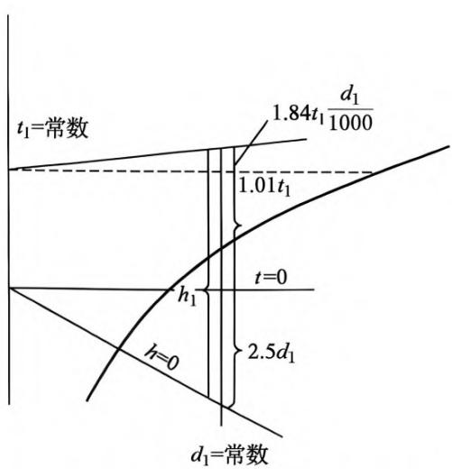  
图4.3-1 等温线在 $h - d$ 图上的确定

**2. 等相对湿度线**

由 $d = 0.622 \frac{p_{\mathrm{q}}}{p - p_{\mathrm{q}}}$ , 可得 $p_{\mathrm{q}} = \frac{pd}{0.622 + d}$ , 所以, 如果给定不同的 $d$ 值, 即可求得对应的 $p_{\mathrm{q}}$ 值, 则可在 $h - d$ 图上取一横坐标, 示出水蒸气分压力。对应不同温度下的饱和水蒸气压力（查表4.3-1），可得 $\varphi = 100\%$ 的等 $\varphi$ 线。根据 $\varphi = p_{\mathrm{q}} / p_{\mathrm{q} \cdot \mathrm{b}}$ 或 $p = \varphi p_{\mathrm{q} \cdot \mathrm{b}}$ ，当相对湿度 $\varphi = \mathrm{const}$ 时，则可求出各温度下的 $p_{\mathrm{q}}$ 值，连接在各等温线与相应求得的 $p_{\mathrm{q}}$ 值的交点，则得出某一等 $\varphi$ 线。

这样画出的 $h - d$ 图，包含了 $p, t, d, h, \varphi$ 及 $p_{\mathrm{q}}$ 等湿空气参数。其中 $t, d, h, \varphi$ 为独立参数，只要已知其中任意两个参数，在 $h - d$ 图上就可找到一个确定的点，也就确定了该湿空气的状态点，其余参数都可由此点查出。但是， $d$ 和 $p_{\mathrm{q}}$ 却不能确定一个空气状态点，所以，只有一个能作为独立参数。

**3. 热湿比线**

湿空气的焓变化与含湿量变化之比，称为热湿比，也称角系数，通常以符号 $\varepsilon$ 表示，即

$$
\varepsilon = \Delta h / \Delta d \quad \text {或} \quad \varepsilon = \Delta h / (\Delta d / 1 0 0 0)\tag{4. 3-1}
$$

若在 $h - d$ 图A，B两状态点，则由A至B的热湿比为：

$$
\varepsilon = \frac {h _ {\mathrm{B}} - h _ {\mathrm{A}}}{d _ {\mathrm{B}} - d _ {\mathrm{A}}}\tag{4.3-2}
$$

如有 A 状态的湿空气，其热量变化为 $\pm Q$ （kJ/s 或 kJ/h），含湿量变化为 $\pm W$ （kg/s 或 kg/h），则其热湿比为：

$$
\varepsilon = \frac {\pm Q}{\pm W}\tag{4. 3-3}
$$

不同热湿比 $\varepsilon$ 时的等值线，一般绘制在 $h - d$ 图的右下角。当已知某状态点的 $\varepsilon$ 值时，则过该点作平行于 $\varepsilon$ 等值线的平行线，这一直线就代表该湿空气状态的变化方向。

**4. 等湿球温度线**

在理论上，湿球温度是在定压绝热条件下，空气与水直接接触达到稳定热湿平衡时的绝热饱和温度，也称热力学湿球温度。

设状态为 $p, t_{1}, d_{1}, h_{1}$ 的空气流经与水直接接触的绝热小室（保证二者有充分的接触表面和时间），流出状态为 $p, t_{2}, d_{2}, h_{2}$ ，由于小室为绝热的，所以对应 $1 \mathrm{~kg}$ 干空气的湿空气的稳定流动能量方程式为：

$$
h _ {1} + \frac {d _ {2} - d _ {1}}{1 0 0 0} h _ {\mathrm{w}} = h _ {2}\tag{4. 3-4}
$$

而

$$
\varepsilon = \frac {h _ {2} - h _ {1}}{\frac {d _ {2} - d _ {1}}{1 0 0 0}} = h _ {\mathrm{w}} = 4. 1 9 t _ {\mathrm{w}}\tag{4. 3-5}
$$

式中 $h_{w}$ ——液态水的焓， $h_{w}=4.19t_{w}$ ，kJ/kg。

由于在小室内，空气状态的变化过程是水温的单值函数，因此，空气达到饱和时的温度即等于水温，即 $t_{2}=t_{w}$ ，所以

$$
h _ {1} + \frac {d _ {2} - d _ {1}}{1 0 0 0} \cdot 4. 1 9 t _ {2} = 1. 0 1 t _ {2} + (2 5 0 0 + 1. 8 4 t _ {2}) \frac {d _ {2}}{1 0 0 0}\tag{4. 3-6}
$$

满足式（4.3-6）的 $t_2$ 和 $t_\mathrm{w}$ ，即为入口空气状态的绝热饱和温度（热力学湿球温度）。

在 $h - d$ 图上，从各等温线与 $\varphi = 100\%$ 饱和线的交点出发，作 $\varepsilon = 4.19t_{\mathrm{s}}$ 的热湿比线，则可得等湿球温度线，如图4.3-2所示。由图可知，当 $t_{\mathrm{s}} = 0$ 时， $\varepsilon = 0$ ，即等湿球温度线与等焓线完全重合；而当 $t_{\mathrm{s}} > 0$ 时， $\varepsilon > 0$ ；当 $t_{\mathrm{s}} < 0$ 时， $\varepsilon < 0$ 。因此，严格来说，等湿球温度线与等焓线并不重合，但由于 $\epsilon = 4.19t$ 。的数值较小，所以，工程上一般可近似地认为等焓线即为等湿球温度线。

大气压力及温度随海拔高度、地理位置和气候条件的变化而变化，标准大气压给出了估算不同海拔高度下空气参数的参考标准：在海平面上，标准温度为 $15^{\circ}$ C，标准大气压为 101.325 kPa。同时，假定从对流层直至同温层，空气的温度降低与海拔高度的增加呈线性关系，则不同海拔高度下的空气温度及大气压力可以通过下式计算：

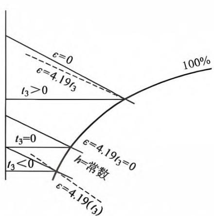

$$
t = 1 5 - 0. 0 0 6 5 Z\tag{4. 3-7}
$$

$$
p = 1 0 1. 3 2 5 (1 - 2. 2 5 5 7 \times 1 0 ^ {- 5} Z) ^ {5. 2 5 5 9}\tag{4. 3-8}
$$

图4.3-2 等湿球温度线

式中 $Z$ ——海拔高度， $\mathrm{m}$ ；

p——大气压力，kPa；

t——空气温度，℃。

表 4.3-2 给出了《民用建筑供暖通风与空气调节设计规范》GB 50736—2012 中统计的我国主要城市室外大气压力参考数据。

我国主要城市海拔高度及室外大气压力  
表 4.3-2

<table><tr><td rowspan="2">城市</td><td rowspan="2">海拔高度(m)</td><td colspan="2">大气压力(hPa)</td><td rowspan="2">城市</td><td rowspan="2">海拔高度(m)</td><td colspan="2">大气压力(hPa)</td></tr><tr><td>冬季</td><td>夏季</td><td>冬季</td><td>夏季</td></tr><tr><td>北京</td><td>31.3</td><td>1021.7</td><td>1000.2</td><td>武汉</td><td>23.1</td><td>1023.5</td><td>1002.1</td></tr><tr><td>天津</td><td>2.5</td><td>1027.1</td><td>1005.2</td><td>长沙</td><td>44.9</td><td>1019.6</td><td>999.2</td></tr><tr><td>石家庄</td><td>81.0</td><td>1017.2</td><td>995.8</td><td>广州</td><td>41.7</td><td>1019.0</td><td>1004.0</td></tr><tr><td>太原</td><td>778.3</td><td>933.5</td><td>919.8</td><td>南宁</td><td>73.1</td><td>1011.0</td><td>995.5</td></tr><tr><td>呼和浩特</td><td>1063.0</td><td>901.2</td><td>889.6</td><td>海口</td><td>13.9</td><td>1016.4</td><td>1002.8</td></tr><tr><td>沈阳</td><td>44.7</td><td>1020.8</td><td>1000.9</td><td>重庆</td><td>351.1</td><td>980.6</td><td>963.8</td></tr><tr><td>长春</td><td>236.8</td><td>994.4</td><td>978.4</td><td>成都</td><td>506.1</td><td>963.7</td><td>948.0</td></tr><tr><td>哈尔滨</td><td>142.3</td><td>1004.2</td><td>987.7</td><td>贵阳</td><td>1074.3</td><td>897.4</td><td>887.8</td></tr><tr><td>上海</td><td>2.6</td><td>1025.4</td><td>1005.4</td><td>昆明</td><td>1892.4</td><td>811.9</td><td>808.2</td></tr><tr><td>南京</td><td>8.9</td><td>1025.5</td><td>1004.3</td><td>拉萨</td><td>3648.7</td><td>650.6</td><td>652.9</td></tr><tr><td>杭州</td><td>41.7</td><td>1021.1</td><td>1000.9</td><td>西安</td><td>397.5</td><td>979.1</td><td>959.8</td></tr><tr><td>合肥</td><td>27.9</td><td>1022.3</td><td>1001.2</td><td>兰州</td><td>1517.2</td><td>851.5</td><td>843.2</td></tr><tr><td>福州</td><td>84.0</td><td>1012.9</td><td>996.6</td><td>西宁</td><td>2295.2</td><td>774.4</td><td>772.9</td></tr><tr><td>南昌</td><td>46.7</td><td>1019.5</td><td>999.5</td><td>银川</td><td>1111.4</td><td>896.1</td><td>883.9</td></tr><tr><td>济南</td><td>51.6</td><td>1019.1</td><td>997.9</td><td>乌鲁木齐</td><td>917.9</td><td>924.6</td><td>911.2</td></tr><tr><td>郑州</td><td>110.4</td><td>1013.3</td><td>992.3</td><td></td><td></td><td></td><td></td></tr></table>

图 4.3-3 是根据大气压力 p=101.325kPa 绘制出的 h-d 图。当 p 值不同时，h-d 图也相应地不同，图 4.3-4～图 4.3-7 分别为大气压力 p 为 90kPa，80kPa，70kPa，60kPa 下的 h-d 图。

在北美和西欧，通常采用图4.3-8所示的 $h - d$ 图。该图的使用方法与前述 $h - d$ 图基本相同。不过，该图所表示的热湿比实际上是显热系数（SHF），它等于显热与全热的比值，与前文所说的热湿比在概念上是完全不同的。

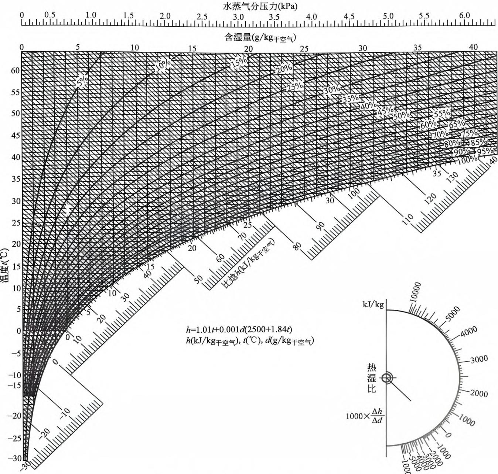  
图4.3-3 湿空气在标准大气压下的 $h - d$ 图

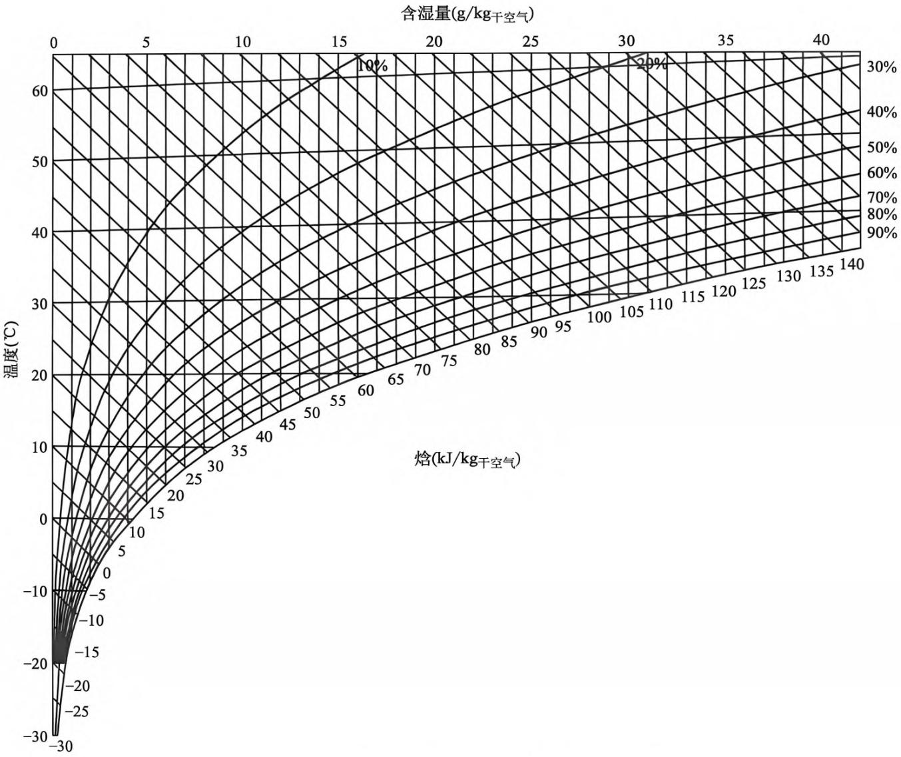  
图4.3-4 湿空气在大气压 $p = 90\mathrm{kPa}$ 下的 $h - d$ 图

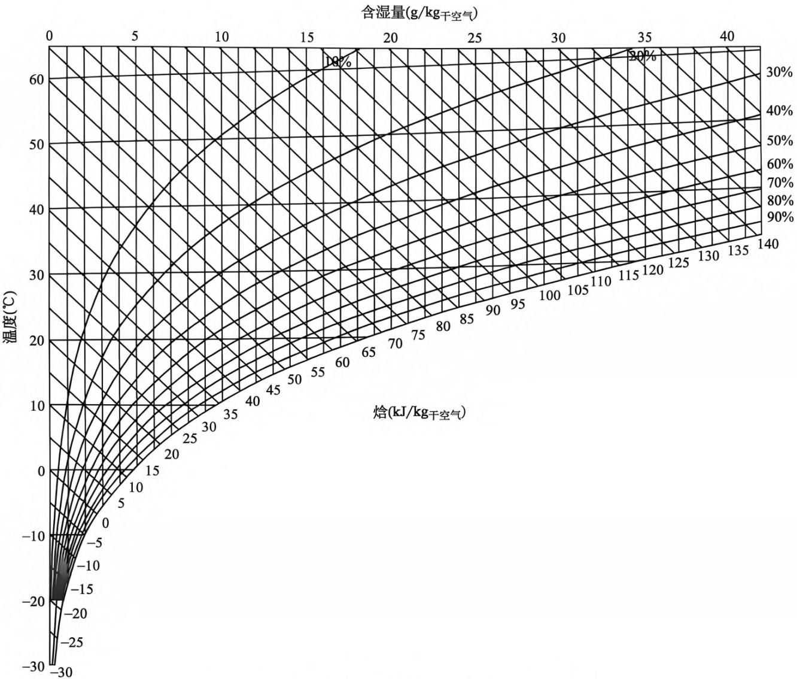  
图4.3-5 湿空气在大气压 $p = 80\mathrm{kPa}$ 下的 $h - d$ 图

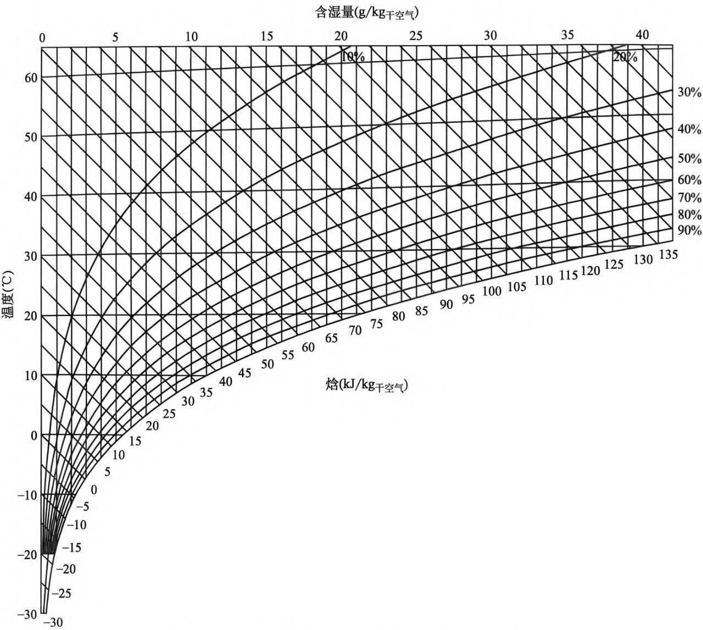  
图4.3-6 湿空气在大气压 $p = 70\mathrm{kPa}$ 下的 $h - d$ 图

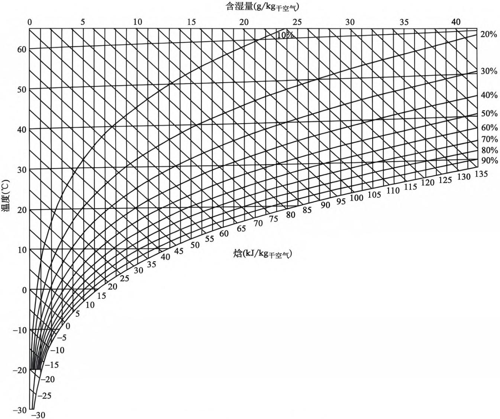  
图4.3-7 湿空气在大气压 $p = 60\mathrm{kPa}$ 下的 $h - d$ 图

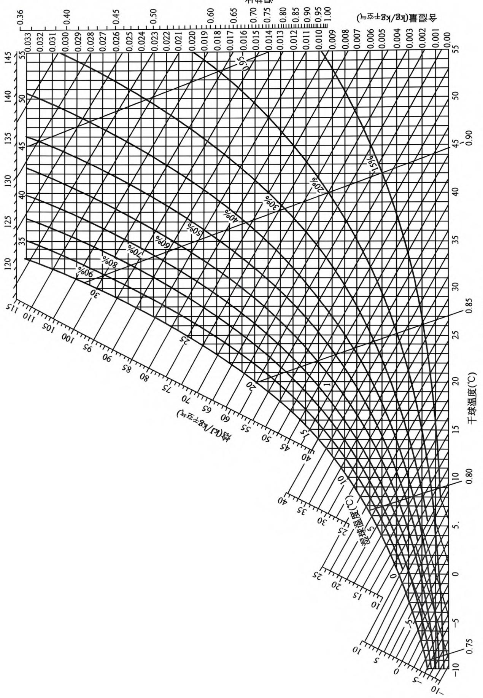  
比容( $m^{3}/kg$ 干空气)

图 4.3-8 北美、西欧地区常用的 h-d 图

## 4.4 空气状态参数的计算法

在已知当地大气压力的情况下，只要已知任意两个独立参数，即可求出其他各个参数。在计算机已普及的今天，完全可以通过数值计算直接确定空气的状态变化参数。为了便于应用，将空气状态参数的计算式汇总如下：

1. 湿空气的热力学温度 $T$

$$
T = 2 7 3. 1 5 + t\tag{4.4-1}
$$

2. 湿空气的饱和水蒸气分压力 $p_{q \cdot b}$

$p_{q\cdot b}=f(T)$ 的经验式：

(1) 当 $t = -100 \sim 0^{\circ}C$ 时:

$$
\ln p _ {\mathrm{q} \cdot \mathrm{b}} = \frac {c _ {1}}{T} + c _ {2} + c _ {3} T + c _ {4} T ^ {2} + c _ {5} T ^ {3} + c _ {6} T ^ {4} + c _ {7} \ln T\tag{4.4-2}
$$

(2) 当 $t=0 \sim 200^{\circ}C$ 时:

$$
\ln p _ {\mathrm{q} \cdot \mathrm{b}} = \frac {c _ {8}}{T} + c _ {9} + c _ {1 0} T + c _ {1 1} T ^ {2} + c _ {1 2} T ^ {3} + c _ {1 3} \ln T\tag{4.4-3}
$$

式中， $c_{1} = -5674.5359$ ， $c_{2} = 6.3925247$ ， $c_{3} = -0.9677843\times 10^{-2}$ ， $c_{4} = 0.62215701\times$ $10^{-6}$ ， $c_{5} = 0.20747825\times 10^{-8}$ ， $c_{6} = -0.9484024\times 10^{-12}$ ， $c_{7} = 4.1635019$ ， $c_{8} =$ $-5800.2206$ ， $c_{9} = 1.3914993$ ， $c_{10} = -0.04860239$ ， $c_{11} = 0.41764768\times 10^{-4}$ ， $c_{12} =$ $-0.14452093\times 10^{-7}$ ， $c_{13} = 6.5459673$ 。

3. 湿空气的水蒸气分压力 $p_{\mathrm{q}}$

$$
p _ {\mathrm{q}} = p _ {\mathrm {q\cdot b}} ^ {*} - A (t - t _ {\mathrm{s}}) p \quad \text {或} \quad t _ {\mathrm{s}} = t - \frac {p _ {\mathrm {q\cdot b}} ^ {*} - p _ {\mathrm{q}}}{A \bullet p}\tag{4.4-4}
$$

式中，A 可根据风速 v（m/s）按下式求出：

$$
A = \left(6 5 + \frac {6 . 7 5}{v}\right) \cdot 1 0 ^ {- 5}\tag{4.4-5}
$$

一般可取 A=0.000667。

注：此处的 $p_{q\cdot b}^{*}$ 为湿球温度对应的饱和水蒸气压力，Pa。

4. 湿空气的露点温度 $t_1$

$t_{1}=0\sim93^{\circ}C$ 时：

$$
t _ {1} = c _ {1 4} + c _ {1 5} \alpha + c _ {1 6} \alpha^ {2} + c _ {1 7} \alpha^ {3} + c _ {1 8} (p _ {\mathrm{q}}) ^ {0. 1 9 8 4}\tag{4.4-6}
$$

$t_{1}<0^{\circ}C$ 时：

$$
t _ {1} = 6. 0 9 + 1 2. 6 0 8 \alpha + 0. 4 9 5 9 \alpha^ {2}\tag{4.4-7}
$$

式中， $\alpha = \ln p_{\mathrm{q}}$ ， $c_{14} = 6.54$ ， $c_{15} = 14.526$ ， $c_{16} = 0.7389$ ， $c_{17} = 0.09486$ ， $c_{18} = 0.4569$ 。

湿空气的露点温度，也可以近似地按下式之一计算：

$t_{1}=-60\sim0^{\circ}C$ 时：

$$
t _ {1} = - 6 0. 4 5 + 7. 0 3 2 2 \ln p _ {\mathrm{q}} + 0. 3 7 (\ln p _ {\mathrm{q}}) ^ {2}\tag{4.4-8}
$$

$t_{1}=0\sim70^{\circ}C$ 时：

$$
t _ {1} = - 3 5. 9 5 7 - 1. 8 7 2 6 \ln p _ {\mathrm{q}} + 1. 1 6 8 9 (\ln p _ {\mathrm{q}}) ^ {2}\tag{4.4-9}
$$

或

$$
t _ {1} = A \cdot \varphi + B \cdot t\tag{4. 4-10}
$$

式中 $A$ 、 $B$ ——湿空气的露点温度计算系数，见表4.4-1。

湿空气的露点温度计算系数  
表 4.4-1

<table><tr><td>φ(%)</td><td>A(°C)</td><td>B(°C/°C)</td><td>φ(%)</td><td>A(°C)</td><td>B(°C/°C)</td></tr><tr><td>30</td><td>-14.501922</td><td>0.842345</td><td>70</td><td>-4.461370</td><td>0.948767</td></tr><tr><td>40</td><td>-11.195327</td><td>0.876491</td><td>80</td><td>-2.809702</td><td>0.967488</td></tr><tr><td>50</td><td>-8.539849</td><td>0.904096</td><td>90</td><td>-1.329306</td><td>0.984380</td></tr><tr><td>60</td><td>-6.345999</td><td>0.927906</td><td>100</td><td>0.000000</td><td>1.000000</td></tr></table>

5. 湿空气的湿球温度 $t_{\mathrm{s}}$

可近似按下式计算：

$$
t _ {\mathrm{s}} = C \cdot \varphi + D \cdot t\tag{4.4-11}
$$

式中 $\varphi$ ——空气的相对湿度，%；

t——空气的干球温度，℃；

C、D——湿空气的湿球温度计算系数，见表 4.4-2。

湿空气的湿球温度计算系数  
表 4.4-2

<table><tr><td>φ(%)</td><td>C(°C)</td><td>D(°C/°C)</td><td>φ(%)</td><td>C(°C)</td><td>D(°C/°C)</td></tr><tr><td>30</td><td>-5.082366</td><td>0.750256</td><td>70</td><td>-2.536432</td><td>0.928161</td></tr><tr><td>40</td><td>-4.740581</td><td>0.811202</td><td>80</td><td>-1.666897</td><td>0.955048</td></tr><tr><td>50</td><td>-4.131947</td><td>0.858568</td><td>90</td><td>-0.824302</td><td>0.978813</td></tr><tr><td>60</td><td>-3.342766</td><td>0.896106</td><td>100</td><td>0.000000</td><td>1.000000</td></tr></table>

6. 湿空气的相对湿度 $\varphi$

$$
\varphi = \frac {p _ {\mathrm{q}}}{p _ {\mathrm {q\cdot b}}} \times 100\tag{4. 4-12}
$$

7. 湿空气的含湿量 $d$

$$
d = 6 2 2 \frac {p _ {\mathrm{q}}}{p - p _ {\mathrm{q}}}\tag{4. 4-13}
$$

8. 湿空气的焓 $h$

$$
h = 1. 0 1 t + 0. 0 0 1 d (2 5 0 0 + 1. 8 4 t)\tag{4. 4-14}
$$

9. 湿空气的密度 $\rho$

$$
\rho = 0. 0 0 3 4 8 4 \frac {p}{T} - 0. 0 0 1 3 4 \frac {p _ {\mathrm{q}}}{T}\tag{4. 4-15}
$$

10. $100^{\circ} \mathrm{C}$ 以下水面上的水蒸气压力

英国国家工程实验室（National Engineering Laboratory，NEL）给出了以下公式：

$$
\lg p = 2 8. 5 9 0 5 1 - 8. 2 1 g (t + 2 7 3. 1 6) + 0. 0 0 2 4 8 0 4 \times (t + 2 7 3. 1 6) - \frac {3 1 4 2 . 3 1}{t + 2 7 3 . 1 6}\tag{4.4-16}
$$

冰面上的水蒸气压力，可按下式计算：

$$
\lg p = 1 0. 5 3 8 0 9 9 7 - \frac {2 6 6 3 . 9 1}{t + 2 7 3 . 1 6}\tag{4.4-17}
$$

11. 各状态变化过程的变化率

(1) 等湿加热或冷却过程 (d=constant): $\frac{dh}{dt}=1.01+1.84\times10^{-3}d$ 。

(2) 等焓加湿或减湿过程 (h=constant): $\frac{dt}{dd} \approx -2.5$ 。

(3) 等温过程 (t=constant): $\frac{dh}{dd}=2.5+1.84\times10^{-3}t$ 。

(4) 多变过程: $\frac{\mathrm{d}h}{\mathrm{d}d} = \varepsilon$ 。

## 4.5 焓湿图的应用

### 4.5.1 湿空气的状态参数

由本手册第 4.2 节和第 4.3 节介绍的有关湿空气的性质和湿空气焓湿图的绘制方法可知：

1. 湿空气的状态参数主要有温度 (t)、相对湿度 ( $\varphi$ )、含湿量 (d)、比焓 (h) 等。

2. 湿空气的状态参数随大气压力的变化而改变。每张焓湿（h-d）图都是根据一定的大气压力绘制的，因此，应用时必须注意选择与当地大气压力相同或接近的焓湿图。

3. 在一定的大气压力下，只要已知其中的任意两个参数，在焓湿图上空气状态点的位置就固定了，另外两个参数也就确定了。

4. 借助焓湿（h-d）图，不仅可以确定湿空气的各种状态变化，还可以查出空气的相对湿度、湿球温度、露点温度等参数。

### 4.5.2 不同状态空气的混合

状态1和2表示混合前两种空气的状态，3表示混合后的状态点。它们的流量 $G(\mathrm{kg/h})$ 、焓 $h(\mathrm{kJ/kg})$ 、含湿量 $d(\mathrm{g/kg_{干空气}})$ 、温度 $t(°C)$ 分别为 $(G_{1}, h_{1}, d_{1}, t_{1})$ 、 $(G_{2}, h_{2}, d_{2}, t_{2})$ 和 $(G_{3}, h_{3}, d_{3}, t_{3})$ 。假设混合过程中与外界没有热湿交换，则

$$
G _ {3} = G _ {1} + G _ {2}\tag{4.5-1}
$$

$$
(G _ {1} + G _ {2}) \cdot d _ {3} = G _ {1} d _ {1} + G _ {2} d _ {2}\tag{4.5-2}
$$

$$
(G _ {1} + G _ {2}) \cdot h _ {3} = G _ {1} h _ {1} + G _ {2} h _ {2}\tag{4.5-3}
$$

从而得

$$
\frac {G _ {1}}{G _ {2}} = \frac {d _ {2} - d _ {3}}{d _ {3} - d _ {1}}\tag{4.5-4}
$$

$$
\frac {G _ {1}}{G _ {2}} = \frac {h _ {2} - h _ {3}}{h _ {3} - h _ {1}}\tag{4.5-5}
$$

$$
\frac {h _ {2} - h _ {3}}{h _ {3} - h _ {1}} = \frac {d _ {2} - d _ {3}}{d _ {3} - d _ {1}}\tag{4.5-6}
$$

式（4.5-6）是一直线方程，这说明混合状态点3位于状态点1和2的连接直线上，且把直线1-2分割成 $(1-k):k$ 。混合状态点的具体位置取决于 $(1-k):k$ ，即风量比 $G_{1}/G_{2}$ ，如图4.5-1所示。

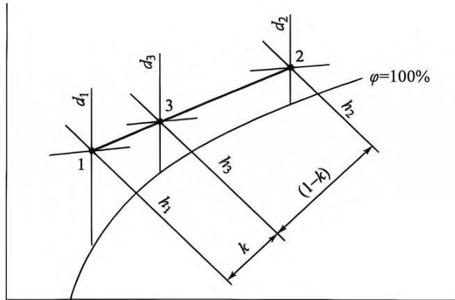  
图4.5-1 两种空气混合过程图

由此，可列出下列表达式：

$$
t _ {3} \approx k \cdot t _ {1} + (1 - k) \cdot t _ {2}\tag{4.5-7}
$$

$$
d _ {3} = k \cdot d _ {1} + (1 - k) \cdot d _ {2}\tag{4.5-8}
$$

$$
h _ {3} = k \cdot h _ {1} + (1 - k) \cdot h _ {2}\tag{4.5-9}
$$

因此，混合状态点的各项参数，也可在 $h - d$ 图上直接读出。

例如：设室外空气状态点1的参数为： $t_{1}=35^{\circ}C$ ， $d_{1}=0.022kg/kg_{干空气}$ ；状态点2的参数为： $t_{2}=27^{\circ}C$ ， $d_{2}=0.012kg/kg_{干空气}$ 。已知室外空气的比例为k=30%，室内空气的比例为： $(1-k)=70\%$ 。则可计算出：

$$
t _ {3} = 0. 3 \times 3 5 + (1 - 0. 3) \times 2 7 = 2 9. 4 ^ {\circ} \mathrm{C}
$$

$$
d _ {3} = 0. 3 \times 0. 0 2 2 + (1 - 0. 3) \times 0. 0 1 2 = 0. 0 1 5 \mathrm{kg/kg} _ {\mathrm{干空气}}
$$

根据以上条件，在 $h - d$ 图上可确定出混合状态点3的具体位置，查得其状态参数为： $t_3 = 29.4^\circ \mathrm{C}$ ， $d_3 = 0.015\mathrm{kg / kg}_{\text{干空气}}$ 。

【例 4.5-1】已知大气压力 $p_{b}=1013hPa$ ，空气状态点 1 的参数为： $G_{1}=16000kg/h$ ， $t_{1}=26^{\circ}C$ ， $\varphi_{1}=60\%$ ; 空气状态点 2 的参数为： $G_{2}=4000kg/h$ ， $t_{2}=35^{\circ}C$ ， $\varphi_{2}=70\%$ ，求混合状态点 3 的状态参数。

解：在已知大气压力 $p_{b}=1013hPa$ 的 h-d 图上，确定状态点 1 和状态点 2 的位置，分别得出其他参数为： $h_{1}=58.4kJ/kg,\quad d_{1}=0.0126kg/kg_{干空气}$ ; $h_{2}=100kJ/kg,\quad d_{2}=0.0252kg/kg_{干空气}$ 。

由式（4.5-5）可得：

$$
\frac {1 6 0 0 0}{4 0 0 0} = \frac {1 0 0 - h _ {3}}{h _ {3} - 5 8 . 4}   h _ {3} = 6 6. 7 2 \mathrm{kJ/kg}
$$

在直线 1-2 上定出焓值为 66.72kJ/kg 的点，该点即为混合状态点 3。

### 4.5.3 典型的空气状态变化和处理过程

1. 典型的空气状态变化过程

几种典型的空气状态变化过程如图 4.5-2 所示。

2. 各种过程的处理内容和方法

各种处理过程在 h-d 图上的表示如图 4.5-3 所示。

图 4.5-2 几种典型的空气状态变化过程  
注：const 表示恒定值，下文同此。  
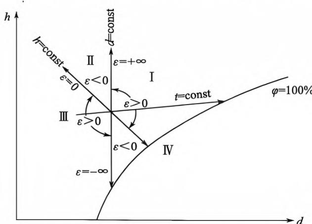

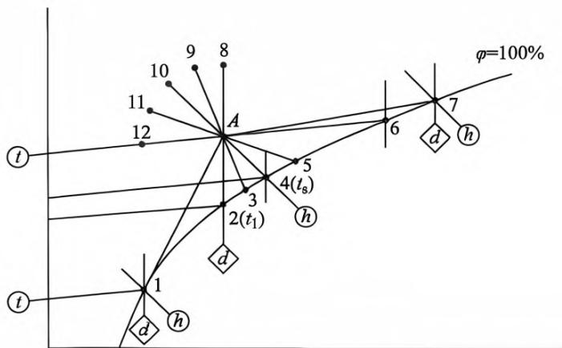

$$
h - d
$$

$$
t _ {1}
$$

不同的处理方法可能达到的状态；常用的处理过程

如表4.5-1所示。

各种过程的处理过程  
表 4.5-1

<table><tr><td>过程线</td><td>象限</td><td>热湿比ε</td><td>状态变化</td><td>典型处理方法</td></tr><tr><td>A-1</td><td>III</td><td>ε&gt;0</td><td>减焓降湿降温</td><td>喷淋温度低于 $t_1$ 的冷水;空气冷却器(表面温度低于 $t_1$ );蒸发器直接膨胀(蒸发温度低于 $t_1$ )</td></tr><tr><td>A-2</td><td>d=const</td><td>ε=-∞</td><td>减焓等湿降温</td><td>喷淋平均温度稍低于 $t_1$ 的冷水;干式空气冷却器(表面温度稍低于 $t_1$ );蒸发器直接膨胀(蒸发温度稍低于 $t_1$ )</td></tr><tr><td>A-3</td><td>IV</td><td>ε&lt;0</td><td>减焓加湿降温</td><td>喷淋水温为t的冷水( $t_1 < t < t_s$ )</td></tr><tr><td>A-4</td><td>h=const</td><td>ε=0</td><td>等焓加湿降温</td><td>喷淋循环水(绝热加湿)</td></tr><tr><td>A-5</td><td>I</td><td>ε&gt;0</td><td>增焓加湿降温</td><td>喷水温度; $t_s < t < t_A$ </td></tr><tr><td>A-6</td><td>I(t=const)</td><td>ε&gt;0</td><td>增焓加湿等温</td><td>喷水室:水温 $t = t_A$ ;喷低压蒸汽</td></tr><tr><td>A-7</td><td>I</td><td>ε&gt;0</td><td>增焓加湿升温</td><td>喷水室:水温 $t > t_A$ ;喷过热蒸汽</td></tr><tr><td>A-8</td><td>d=const</td><td>ε=+∞</td><td>增焓等湿升温</td><td>空气加热器(蒸汽、热水、电)干式加热</td></tr><tr><td>A-9</td><td>II</td><td>ε&lt;0</td><td>增焓降湿升温</td><td>冷却降湿(热泵)</td></tr><tr><td>A-10</td><td>h=const</td><td>ε=0</td><td>等焓降湿升温</td><td>固体吸湿剂吸湿</td></tr><tr><td>A-11</td><td>III</td><td>ε&gt;0</td><td>减焓降湿升温</td><td>喷淋温度稍高于 $t_A$ 的液体除湿剂</td></tr><tr><td>A-12</td><td>III(t=const)</td><td>ε&gt;0</td><td>减焓降湿等温</td><td>喷淋温度等于 $t_A$ 的液体除湿剂</td></tr></table>

注： $t_{A}$ 为 A 点的空气温度。