# 第 5 章 室内环境与计算参数

## 5.1 基本概念

建筑环境包括室外环境和室内环境。建筑室内环境主要受各种外扰和内扰的影响。建筑物所在地的气候条件和外部环境作为外扰，通过围护结构影响室内环境；建筑物内部设备、照明和人员等热湿源和污染物散发源，对室内环境形成直接扰动。图 5.1-1 展示了自然环境、建筑室外环境和室内环境的相互关联示意图。

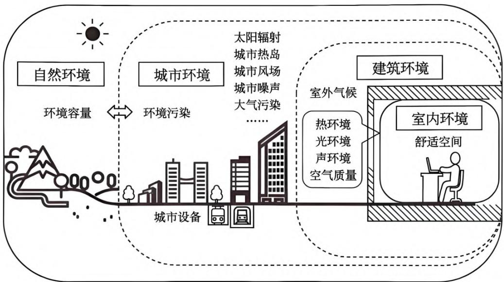  
图 5.1-1 自然环境、建筑室外环境和室内环境的相互关联示意图

本章主要内容为建筑室内环境与计算参数，其逻辑框图如图 5.1-2 所示。建筑室内环境包括室内热湿环境、室内空气质量和新风量。室内热湿环境和室内空气质量不仅影响人体的舒适与健康，而且影响室内人员的工作、学习效率。建筑室内环境的设计目标是舒适、健康、高效，即以最少的能源消耗提供舒适、健康的工作和居住环境，提高人们的生活质量。

基于人体生理热调节的热舒适需求是建筑热环境设计的基本依据。人体与周围环境存在导热、对流及辐射换热三种显热热交换方式和汗液蒸发、呼吸散热、皮肤湿扩散等潜热热交换方式。影响人体热舒适的因素除了热环境因素以外，还包括人的新陈代谢率和服装热阻。人体热平衡是指人体新陈代谢产生的热量与散热量相平衡的状态，是热舒适的前提。室内热环境、人体热舒适的概念见表5.1-1。

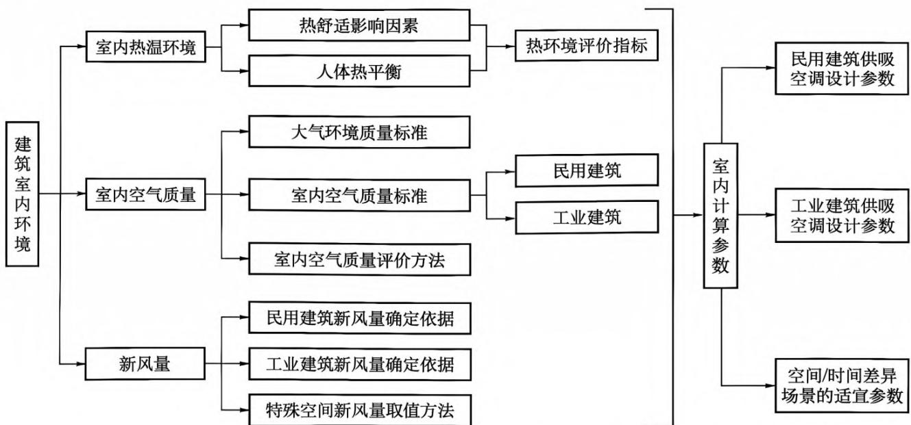  
图5.1-2 建筑室内环境与计算参数逻辑框图

室内热环境、人体热舒适的概念  
表 5.1-1

<table><tr><td>概念</td><td>含义</td><td>影响因素</td><td>表征参数</td></tr><tr><td>室内热环境</td><td>由室内物理因素组成的微气候环境</td><td>空气温度、相对湿度、气流速度、周围物体表面温度</td><td>操作温度、平均辐射温度、新有效温度 $ET^*$ 、标准有效温度 SET、辐射不对称性等</td></tr><tr><td>人体热舒适</td><td>人体对热环境感到满意的主观评价</td><td>热环境参数、人的新陈代谢率和服装热阻等</td><td>稳态热环境:PMV/PPD指标,动态热环境:标准有效温度 SET、相对热指标 RWI 和热损失率 HDR</td></tr></table>

室内空气质量 IAQ（Indoor Air Quality）是影响人体精神状态和健康水平的重要因素。IAQ 具有客观和主观两个层面的含义，客观层面 IAQ 是系列污染物的指标，主观层面 IAQ 指人们可接受的或感知舒适的室内空气质量。室内空气质量的关注度日益提高，室内空气质量降低的主要原因见表 5.1-2。

室内空气质量降低的主要原因  
表5.1-2

<table><tr><td>1</td><td>建筑节能发展导致建筑密闭性增强、新风量减少</td></tr><tr><td>2</td><td>大量使用含有机挥发物的新型合成材料和散发有害气体的电器</td></tr><tr><td>3</td><td>厨房和卫生间气流组织不合理</td></tr><tr><td>4</td><td>室外空气污染严重</td></tr></table>

我国室内空气质量标准规定了物理性、化学性、生物性和放射性参数的标准值。对于民用建筑，规定了两类功能建筑室内甲醛、苯、氨、总挥发性有机物（TVOC）、氧五项指标的污染物限量。对于工业建筑，室内环境设计主要保证工艺要求，同时满足室内人员的舒适要求。针对洁净室及洁净区、药品生产车间，规定了不同的悬浮粒子和微生物水平；针对井下作业地点，规定了有毒有害物质、放射性物质、生产性粉尘的限值；针对列车、轮船、飞机等公共交通工具，规定了二氧化碳、一氧化碳、可吸入颗粒物、空气细菌总数、有机物的限值。室内空气质量评价方法见表5.1-3。

室内空气质量评价方法  
表 5.1-3

<table><tr><td>主观评价方法</td><td>通过问卷调查获得人对室内空气质量满意度</td></tr><tr><td>客观评定方法</td><td>通过代表性污染物监测,量化室内空气质量满意度</td></tr><tr><td>综合指数法</td><td>兼顾各种污染物最高分指数和平均分指数</td></tr></table>

新风量是衡量室内空气质量的另一重要标准。确定新风量的依据包括三个方面，即满足卫生标准及空气参数要求、补充局部排风量、保证房间内正压要求。对于洁净室、矿井工作面和全矿空间、交通舱室和飞机客舱等特殊空间，应根据具体需求确定新风量。

室内设计参数包括室内温湿度及其允许波动范围、室内空气流速、新风量、洁净度、噪声等。对于民用建筑，供暖室内设计参数主要关注室内设计温度，空调室内设计参数主要关注室内设计温度、相对湿度、风速；对于工业建筑，依据不同生产需求，室内设计参数包括工作区和全空间设计温度、相对湿度、风速、新风量、噪声等。

## 5.2 热舒适

尽管人类建筑历史较为漫长，但对室内热环境及人体热舒适的研究从19世纪才开始，第二次世界大战后才逐步建立起较为系统的理论。人体热舒适涉及医学、生理学、心理学、建筑学等多种学科。在满足工艺要求且不影响工作效率的前提下，人类工作和生活的环境应满足热舒适要求。在建筑热舒适环境设计中，应充分关注环境参数、人体生理状况与人的热感觉之间的关系。

热环境评价标准是建筑围护结构设计、热环境设计及调节等相关工程实践的基本依据。热环境评价指标包括环境空气温度、湿球温度、空气流速等直接指标以及操作温度、标准有效温度、预测平均投票、预测不满意百分率等间接指标。目前国际公认的室内热环境舒适性评价标准包括《人居环境条件》ASHRAE 55 和《热环境的人类工效学 通过计算 PMV 和 PPD 指数与局部热舒适准则对热舒适进行分析测定与解释》ISO 7730。参考国际标准并结合我国国情，我国在热舒适领域的相关标准包括《热环境的人类工效学 通过计算 PMV 和 PPD 指数与局部热舒适准则对热舒适进行分析测定与解释》GB/T 18049、《热环境人类工效学 代谢率的测定》GB/T 18048、《热环境人类工效学 使用主观判定量表评价热环境的影响》GB/T 18977、《民用建筑室内热湿环境评价标准》GB/T 50785 等。这些标准对于指导建筑热环境设计与评价、推进以人体健康和舒适为目标的建筑节能发展具有重要意义。

### 5.2.1 室内的热舒适性及影响因素

热舒适性是人体生理和心理相关的主观感觉，热舒适性是人体通过自身的热平衡条件和对环境的热感觉经综合判断后得出的主观评价或判断。《人居环境条件》ASHRAE 55:2017 对热舒适的定义是：对环境表示满意的意识状态。

除了衣着、活动方式等个人因素外，影响人体热平衡从而影响热舒适性的环境因素还包括温度、湿度、气流速度和辐射换热量等。

**1.室内空气温度与房间温度**

室内空气温度是影响热舒适的主要因素。房间温度反映了室内空气温度和平均辐射温度的综合作用，常用作用温度表示，其计算方法为以辐射换热系数和对流换热系数作为权重系数进行加权平均。“作用温度”有时也称为操作温度、修正干球温度或显热温度。当室内空气流速 $v < 0.2 \, \text{m/s}$ ，且室内空气温度与平均辐射温度的差异小于 $4^\circ\text{C}$ 时，作用温度可近似简化为室内空气温度与平均辐射温度的平均值，即房间温度 $t_{\text{r}}$ （℃）可表示为：

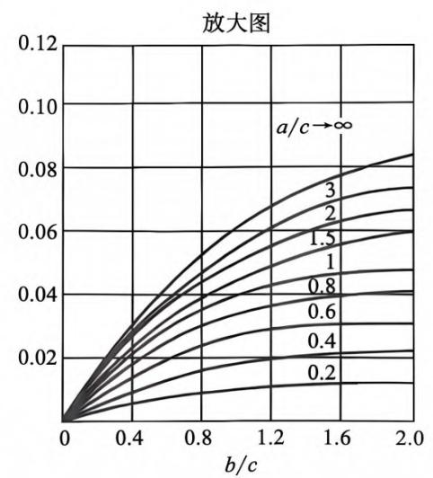

$$
t _ {\mathrm{r}} = \frac {1}{2} (t _ {\mathrm{s}} + t _ {\mathrm{a}})\tag{5.2-1}
$$

式中 $t_{s}$ ——房间围护结构的内表面温度，℃；

$t_{a}$ ——房间内空气温度，℃。

很多研究发现：当人以坐姿、着轻便服装，处于舒适的房间温度范围内时，即满足 $20^{\circ} \mathrm{C} < t_{\mathrm{r}} < 26^{\circ} \mathrm{C}$ ， $\left|t_{\mathrm{s}} - t_{\mathrm{a}}\right| < 4^{\circ} \mathrm{C}$ 时，其辐射散热和对流散热基本上各占一半；式（5.2-1）就是表达这一特性的温度——作用温度。

**2. 平均辐射温度**

平均辐射温度是描述室内辐射换热状况的基本指标，其定义为：假设在一个绝热黑体表面构成的封闭空间里，人体与周围的辐射换热量和在实际房间里的辐射换热量相同，则这一黑体封闭空间的表面平均温度称为实际房间的平均辐射温度。

平均辐射温度 $\overline{T}_{r}$ 可按下式计算：

$$
\overline {{{T}}} _ {\mathrm{r}} ^ {4} = \overline {{{T}}} _ {1} ^ {4} \cdot F _ {\mathrm{p-1}} + \overline {{{T}}} _ {2} ^ {4} \cdot F _ {\mathrm{p-2}} + \dots \dots + \overline {{{T}}} _ {n} ^ {4} \cdot F _ {\mathrm{p-n}}\tag{5.2-2}
$$

式中 $T_{n}$ ——表面 n 的表面热力学温度，K；

$F_{p-n}$ ——人与表面 n 之间的角系数。

角系数 $F_{\mathrm{p} - n}$ 取决于人的位置和方向，以及围护结构的尺寸，一般可根据图5.2-1和

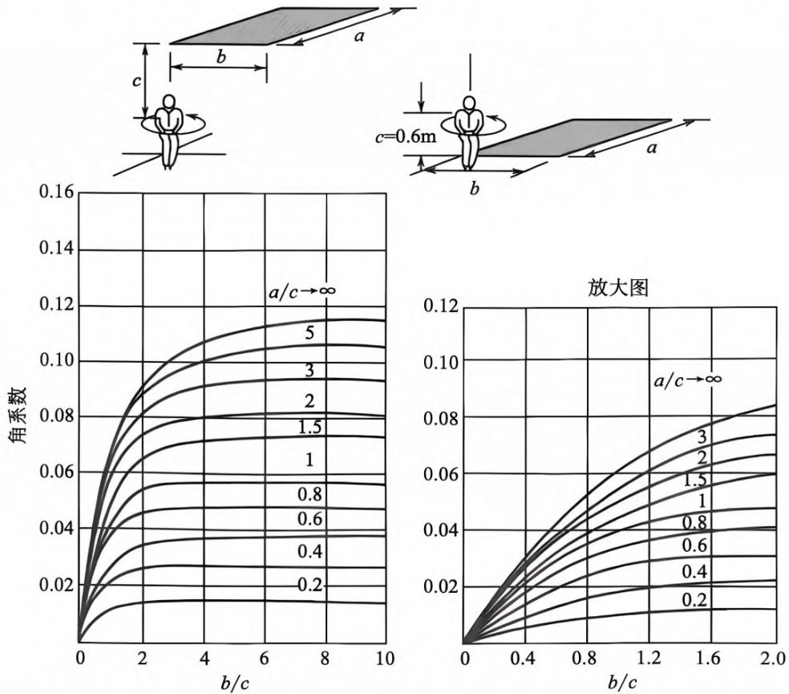  
图5.2-1 以纵坐标为轴旋转时坐姿人体与水平矩形平面的平均角系数（一）

图5.2-2确定。

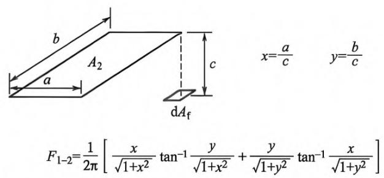  
图 5.2-1 以纵坐标为轴旋转时坐姿人体与水平矩形平面的平均角系数（二）

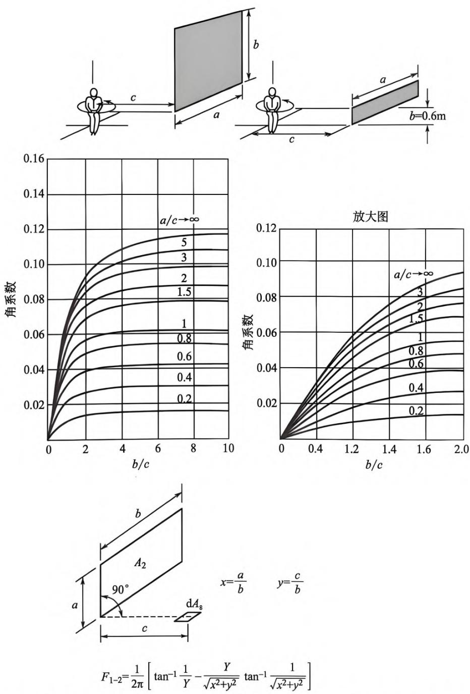  
图 5.2-2 以纵坐标为轴旋转时坐姿人体与垂直矩形平面的平均角系数

如果围护物表面之间存在的温度差异比较小，式（5.2-2）可简化成线性形式：

$$
\overline {{t}} _ {\mathrm{r}} = \overline {{t}} _ {1} \cdot F _ {\mathrm{p-1}} + \overline {{t}} _ {2} \cdot F _ {\mathrm{p-2}} + \dots + \overline {{t}} _ {n} \cdot F _ {\mathrm{p-n}}\tag{5.2-3}
$$

【例 5.2-1】 办公室的尺寸及人坐的位置如图 5.2-3 所示，围护结构的表面温度分别为：西窗，31.1℃；南隔墙，23.9℃；西墙，26.7℃；平顶，25.0℃；北隔墙，23.9℃；地面，25.6℃；东隔墙，23.9℃。

人员坐的方向为未知数，试计算该办公室围护结构的平均辐射温度。

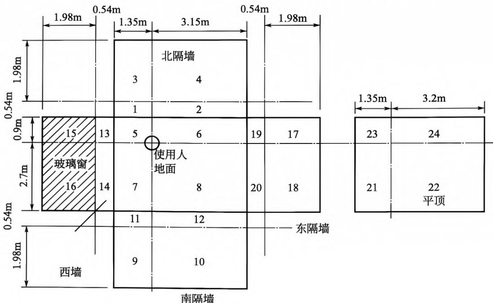  
图 5.2-3 办公室尺寸及人坐的位置  
解：

(1) 北隔墙: 角系数表示由人体服装外部 (表面 0) 直接辐射到隔墙 (表面 1、2、3 和 4) 上的总能量, 已知

$$
F _ {0 - 1, 2, 3, 4} = F _ {0 - 1} + F _ {0 - 2} + F _ {0 - 3} + F _ {0 - 4}
$$

式中， $F_{0-1}$ 是表面 0 至北隔墙（表面 1）的角系数，根据 $b / L = 0.54 / 0.9 = 0.6$ 和 $a / L = 1.35 / 0.9 = 1.5$ ，由图 5.2-2 得角系数 $F_{0-1} = 0.04$ 。 $L$ 是由人体至北隔墙的水平距离（ $L = 0.9 \mathrm{~m}$ ）。以同样方法可计算出角系数 $F_{0-2}$ 、 $F_{0-3}$ 和 $F_{0-4}$ 。

(2) 确定人体 (表面 0) 至地面 (表面 5) 的角系数 $F_{0-5}$ , 坐着的人的中心至地面的垂直距离是 $0.54 \mathrm{~m}$ , 则 $b / L = 0.9 / 0.54 = 1.67$ , $a / L = 1.35 / 0.54 = 2.5$ , 由图 5.2-1 可得角系数 $F_{0-5} = 0.068$ 。以同样方法, 可求出如表 5.2-1 所示的其他角系数。

(3) 对于北隔墙 (表面 1):

$$
T _ {\mathrm{r}, 1} ^ {4} \cdot F _ {0 - 1} = (2 3. 9 + 2 7 3) ^ {4} \times 0. 0 4 = 3. 1 1 \times 1 0 ^ {8}
$$

其他的 $\overline{T}_{\mathrm{r},n}^{4}\cdot F_{0 - n}$ ，可按此方式进行计算，结果如表5.2-1所示。

乘积的总和为： $\sum \overline{T}_{\mathrm{r},n}^{4} = 78.98\times 10^{8}$ ，即 $\overline{T}_{\mathrm{r}}^{4} = 78.98\times 10^{8}$ 。

所以， $\overline{T}_{\mathrm{r}} = (78.98 \times 10^{8})^{\frac{1}{4}} = 298.1\mathrm{K}$ 或 $\overline{t}_{n} = 298.1 - 273 = 25.1^{\circ}\mathrm{C}$ 。

(4) 角系数之和为: $F_{0-n}=0.994\approx1.0$ 。

$F_{0 - n}$ 和 $\overline{T}_{r,n}^{4}\cdot F_{0 - n}$ 计算值  
表 5.2-1

<table><tr><td>表面</td><td>表面温度</td><td>角系数</td><td>b/L</td><td>a/L</td><td>F0-n</td><td>T1,n4·F0-n×108</td></tr><tr><td rowspan="4">北隔墙</td><td rowspan="4">296.9K</td><td>F0-1</td><td>0.6</td><td>1.5</td><td>0.04</td><td>3.11</td></tr><tr><td>F0-2</td><td>0.6</td><td>3.5</td><td>0.045</td><td>3.5</td></tr><tr><td>F0-3</td><td>2.2</td><td>1.5</td><td>0.07</td><td>5.44</td></tr><tr><td>F0-4</td><td>2.2</td><td>3.5</td><td>0.087</td><td>6.76</td></tr><tr><td rowspan="4">东隔墙</td><td rowspan="4">296.9K</td><td>F0-17</td><td>0.63</td><td>0.29</td><td>0.014</td><td>1.09</td></tr><tr><td>F0-18</td><td>0.63</td><td>0.86</td><td>0.03</td><td>2.33</td></tr><tr><td>F0-19</td><td>0.17</td><td>0.29</td><td>0.004</td><td>0.31</td></tr><tr><td>F0-20</td><td>0.17</td><td>0.86</td><td>0.009</td><td>0.7</td></tr><tr><td rowspan="4">南隔墙</td><td rowspan="4">296.9K</td><td>F0-9</td><td>0.73</td><td>0.5</td><td>0.023</td><td>1.79</td></tr><tr><td>F0-10</td><td>0.73</td><td>1.17</td><td>0.038</td><td>2.95</td></tr><tr><td>F0-11</td><td>0.2</td><td>0.5</td><td>0.008</td><td>0.62</td></tr><tr><td>F0-12</td><td>0.2</td><td>1.17</td><td>0.013</td><td>1.01</td></tr><tr><td rowspan="2">西墙</td><td rowspan="2">299.7K</td><td>F0-13</td><td>0.4</td><td>0.67</td><td>0.018</td><td>1.45</td></tr><tr><td>F0-14</td><td>0.4</td><td>2.0</td><td>0.03</td><td>2.42</td></tr><tr><td rowspan="2">西窗</td><td rowspan="2">304.1K</td><td>F0-15</td><td>1.6</td><td>0.67</td><td>0.04</td><td>3.42</td></tr><tr><td>F0-16</td><td>1.6</td><td>2.0</td><td>0.07</td><td>5.99</td></tr><tr><td rowspan="4">地面</td><td rowspan="4">298.6K</td><td>F0-5</td><td>1.67</td><td>2.5</td><td>0.068</td><td>5.41</td></tr><tr><td>F0-6</td><td>1.67</td><td>5.8</td><td>0.073</td><td>5.8</td></tr><tr><td>F0-7</td><td>5.0</td><td>2.5</td><td>0.087</td><td>6.92</td></tr><tr><td>F0-8</td><td>5.0</td><td>5.8</td><td>0.102</td><td>8.11</td></tr><tr><td rowspan="4">平顶</td><td rowspan="4">298.0K</td><td>F0-21</td><td>1.36</td><td>0.68</td><td>0.033</td><td>2.6</td></tr><tr><td>F0-22</td><td>1.36</td><td>1.59</td><td>0.052</td><td>4.1</td></tr><tr><td>F0-23</td><td>0.45</td><td>0.68</td><td>0.015</td><td>1.18</td></tr><tr><td>F0-24</td><td>0.45</td><td>1.59</td><td>0.025</td><td>1.97</td></tr><tr><td colspan="5">总计</td><td>0.994</td><td>78.9</td></tr></table>

【例 5.2-2】仍以例 5.2-1 的办公室为例，但按式（5.2-3）进行计算，比较两种计算方法的差异。

解：计算结果如表5.2-2所示。

$F_{0-n}$ 和 $\bar{t}_{n} \cdot F_{0-n}$ 计算值  
表5.2-2

<table><tr><td>表面</td><td>表面温度</td><td>角系数</td><td>b/L</td><td>a/L</td><td> $F_{0-n}$ </td><td> $\overline{t}_{n} \cdot F_{0-n}$ </td></tr><tr><td rowspan="4">北隔墙</td><td rowspan="4">23.9°C</td><td> $F_{0-1}$ </td><td>0.6</td><td>1.5</td><td>0.04</td><td>0.96</td></tr><tr><td> $F_{0-2}$ </td><td>0.6</td><td>3.5</td><td>0.045</td><td>1.08</td></tr><tr><td> $F_{0-3}$ </td><td>2.2</td><td>1.5</td><td>0.07</td><td>1.67</td></tr><tr><td> $F_{0-4}$ </td><td>2.2</td><td>3.5</td><td>0.087</td><td>2.08</td></tr><tr><td>表面</td><td>表面温度</td><td>角系数</td><td>b/L</td><td>a/L</td><td>F0-n</td><td> $\overline{l}_{n} \cdot F_{0-n}$ </td></tr><tr><td rowspan="4">东隔墙</td><td rowspan="4">23.9°C</td><td>F0-17</td><td>0.63</td><td>0.29</td><td>0.014</td><td>0.34</td></tr><tr><td>F0-18</td><td>0.63</td><td>0.86</td><td>0.03</td><td>0.72</td></tr><tr><td>F0-19</td><td>0.17</td><td>0.29</td><td>0.004</td><td>0.10</td></tr><tr><td>F0-20</td><td>0.17</td><td>0.86</td><td>0.009</td><td>0.22</td></tr><tr><td rowspan="4">南隔墙</td><td rowspan="4">23.9°C</td><td>F0-9</td><td>0.73</td><td>0.5</td><td>0.023</td><td>0.55</td></tr><tr><td>F0-10</td><td>0.73</td><td>1.17</td><td>0.038</td><td>0.91</td></tr><tr><td>F0-11</td><td>0.2</td><td>0.5</td><td>0.008</td><td>0.19</td></tr><tr><td>F0-12</td><td>0.2</td><td>1.17</td><td>0.013</td><td>0.31</td></tr><tr><td rowspan="2">西墙</td><td rowspan="2">26.7°C</td><td>F0-13</td><td>0.4</td><td>0.67</td><td>0.018</td><td>0.48</td></tr><tr><td>F0-14</td><td>0.4</td><td>2.0</td><td>0.03</td><td>0.80</td></tr><tr><td rowspan="2">西窗</td><td rowspan="2">31.1°C</td><td>F0-15</td><td>1.6</td><td>0.67</td><td>0.04</td><td>1.24</td></tr><tr><td>F0-16</td><td>1.6</td><td>2.0</td><td>0.07</td><td>2.18</td></tr><tr><td rowspan="3">地面</td><td rowspan="3">25.6°C</td><td>F0-5</td><td>1.67</td><td>2.5</td><td>0.068</td><td>1.74</td></tr><tr><td>F0-6</td><td>1.67</td><td>5.8</td><td>0.073</td><td>1.87</td></tr><tr><td>F0-7</td><td>5.0</td><td>2.5</td><td>0.087</td><td>2.23</td></tr><tr><td rowspan="5">平顶</td><td rowspan="5">25.0°C</td><td>F0-8</td><td>5.0</td><td>5.8</td><td>0.102</td><td>2.61</td></tr><tr><td>F0-21</td><td>1.36</td><td>0.68</td><td>0.033</td><td>0.83</td></tr><tr><td>F0-22</td><td>1.36</td><td>1.59</td><td>0.052</td><td>1.3</td></tr><tr><td>F0-23</td><td>0.45</td><td>0.68</td><td>0.015</td><td>0.38</td></tr><tr><td>F0-24</td><td>0.45</td><td>1.59</td><td>0.025</td><td>0.63</td></tr><tr><td colspan="5">总计</td><td>0.994</td><td>25.42</td></tr></table>

由计算结果可知，两者相差仅 $0.32^{\circ} \mathrm{C}$ ，百分比则为：

$$
\Delta = \frac {25.42 - 25.1}{25.42} \times 100\% = 1.26\%
$$

平均辐射温度也可以根据平面辐射温度 $t_{pr}$ 以六个方向（上、下、右、左、前、后）与人员在相同方向的投影面积系数进行计算。

对于站立的人，平均辐射温度可按下式计算：

$$
\begin{array}{r l} & {\overline {{{t}}} _ {\mathrm{r}} = \{0. 0 8 [ t _ {\mathrm{pr,上}} + t _ {\mathrm{pr,下}} ] + 0. 2 3 [ t _ {\mathrm{pr,右}} + t _ {\mathrm{pr,左}} ]} \\ & {\qquad + 0. 3 5 [ t _ {\mathrm{pr,前}} + t _ {\mathrm{pr,后}} ] \} \div [ 2 \times (0. 0 8 + 0. 2 3 + 0. 3 5) ]} \end{array}\tag{5.2-4}
$$

对于坐着的人，平均辐射温度可按下式计算：

$$
\begin{array}{r l} & {\overline {{{t}}} _ {\mathrm{r}} = \{0. 1 8 [ t _ {\mathrm{pr,上}} + t _ {\mathrm{pr,下}} ] + 0. 2 2 [ t _ {\mathrm{pr,右}} + t _ {\mathrm{pr,左}} ]} \\ & {\qquad + 0. 3 0 [ t _ {\mathrm{pr,前}} + t _ {\mathrm{pr,后}} ] \} \div [ 2 \times (0. 1 8 + 0. 2 2 + 0. 3 0) ]} \end{array}\tag{5.2-5}
$$

应用 Vernon 球形温度计, 可以测量出室内的黑球温度 $T_{\mathrm{g}}$ (K)。当已知黑球温度和空气流速 $\upsilon$ (m/s) 时, 则可按下式估算平均辐射温值:

$$
\begin{array}{r l} \overline {{{T}}} _ {\mathrm{r}} ^ {4} = & \overline {{{T}}} _ {\mathrm{g}} ^ {4} + c v ^ {0. 5} (T _ {\mathrm{g}} - T _ {\mathrm{a}}) = \overline {{{T}}} _ {\mathrm{g}} ^ {4} + 0. 2 4 7 \times 1 0 ^ {9} \times v ^ {0. 5} (T _ {\mathrm{g}} - T _ {\mathrm{a}}) \\ & \overline {{{T}}} _ {\mathrm{r}} = [ \overline {{{T}}} _ {\mathrm{g}} ^ {4} + 0. 2 4 7 \times 1 0 ^ {9} \times v ^ {0. 5} (T _ {\mathrm{g}} - T _ {\mathrm{a}}) ] ^ {\frac {1}{4}} \end{array}
$$

或

(5.2-6)

式中 $T_{\mathrm{g}}$ ——黑球温度，K；

$T_{a}$ ——环境空气温度，K；

v ——空气流速，m/s。

【例 5.2-3】房间有一个面积较大的玻璃窗，在窗附近测得干球温度 $t_{a}=24^{\circ}C$ ，黑球温度 $t_{g}=28^{\circ}C$ ，空气流速 v=0.15m/s，试求该房间的作用温度。

解：由式（5.2-6）可计算出平均辐射温度为：

$$
\begin{array}{r l} \overline {{{T}}} _ {\mathrm{r}} & = [ \overline {{{T}}} _ {\mathrm{g}} ^ {4} + 0. 2 4 7 \times 1 0 ^ {9} \times v ^ {0. 5} (T _ {\mathrm{g}} - T _ {\mathrm{a}}) ] ^ {\frac {1}{4}} \\ & = \{(2 8 + 2 7 3) ^ {4} + 0. 2 4 7 \times 1 0 ^ {9} \times 0. 1 5 ^ {0. 5} \times [ (2 7 3 + 2 8) - (2 7 3 + 2 4) ] \} ^ {\frac {1}{4}} \\ & = 3 0 4. 5 \mathrm{K} = 3 1. 5 ^ {\circ} \mathrm{C} \end{array}
$$

注意：式（5.2-6）中，含4次方项中的温度必须用热力学温度，温度差项中的温度，则可以采用摄氏温度。据此可估算出作用温度为：

$$
t _ {\mathrm{o}} = \frac {1}{2} (\overline {{t}} _ {\mathrm{r}} + t _ {\mathrm{a}}) = \frac {1}{2} (3 1. 5 + 2 4) = 2 7. 7 5 ^ {\circ} \mathrm{C}
$$

作用温度反映的是环境辐射和空气流动的综合影响，本例的作用温度比周围空气的温度高 $27.75 - 24 = 3.75^{\circ}\mathrm{C}$ ，由图5.2-8可以看出，这是一个不符合舒适性要求的环境。这种不舒适并不是由空气温度引起的，而是由周围环境中的热表面（如大面积玻璃窗）的辐射温度造成的。

**3. 有效温度 $ET^{*}$**

有效温度是最常用的环境指标，它指的是当相对湿度为 $50\%$ ，皮肤表面的热损失与实际环境中的热损失相同时的环境温度。《人居环境条件》ASHRAE 55 就是用有效温度和作用温度来定义舒适条件的。

有效温度同时考虑了温度与湿度两个因素，所以对于有效温度相同的两种环境，即使其温度与湿度可能不同，也能产生相同的热效应。

$$
E T ^ {*} = t _ {\mathrm{o}} + w i _ {\mathrm{m}} L R (p _ {\mathrm{a}} - 0. 5 p _ {\mathrm{ET} ^ {*}})\tag{5.2-7}
$$

式中 $t_{0}$ ——作用温度，℃；

$i_{m}$ ——水汽总渗透效率；

LR——Lewis 比， $LR = h_{e}/h_{c}$ ，在典型室内条件下，LR 近似等于 16.5K/kPa；

$h_{e}$ ——蒸发换热系数， $W/(m^{2}\cdot kPa)$ ;

w ——皮肤湿润度；

$h_{c}$ ——对流换热系数， $W/(m^{2} \cdot K)$ ;

$p_{a}$ ——周围空气中的水蒸气分压力，kPa；

$p_{ET^{*}}$ ——在 $ET^{*}$ 条件下的饱和水蒸气压力，kPa。

有效温度 $ET^{*}$ 的计算比较复杂，为此，针对典型的室内环境条件，定义了标准有效温度 SET 指标，其假定条件是：

(1) 服装热阻 $R_{cl}=0.6clo=0.093m^{2}\cdot K/W$ ;

(2) 服装透湿指数为 0.4;

(3) 代谢活动水平 M = 1.0 met (1met = 58.15W/m²);

(4) 空气流速 $v < {0.102}\mathrm{\;m}/\mathrm{s}$ ；

(5) 环境温度 $t_{\mathrm{a}} = MRT$ ，即环境温度等于平均辐射温度。

湿作用温度 $t_{oh}$ 是指在相对湿度为 100% 时，人体通过皮肤损失的总热量与在实际环境中损失量相同时的均匀环境温度：

$$
t _ {\mathrm{oh}} = t _ {\mathrm{o}} + w i _ {\mathrm{m}} L R \left(p _ {\mathrm{a}} - 0. 5 p _ {\mathrm{oh,s}}\right)\tag{5.2-8}
$$

式中 $p_{oh,s}$ ——在 $ET^{*}$ 条件下的饱和水蒸气分压力，kPa。

**4. 房间表面温度与房间空气温度间的温度差**

假设房间围护结构的绝热性良好，与外界没有传热，房间辐射供暖/供冷面以外的表面温度与空气温度之间温差的主要影响因素为围护结构的蓄热能力、房间负荷特性和供暖/供冷方式。

例如夏季供冷工况下：

(1) 如果空调方式为全空气系统, 房间表面吸收的辐射热只能以对流方式传给空气, 这时房间表面温度总是高于空气温度。冷负荷中辐射成分占得越多, 表面温度与空气温度间的差值也就越大。从极端状况而言, 辐射传热占到总负荷的 $100 \%$ 时, 温差将达到最大值; 反之, 当对流传热占到 $100 \%$ 时, 则由于表面没有得热, 表面温度将与空气温度相等, 温差为零。

(2) 如果空调方式为辐射供冷系统, 非供冷表面温度与空气温度之间的差值主要取决于冷表面温度和负荷中辐射热的强度。一般情况下, 房间辐射供暖/供冷面以外表面温度与空气温度之间的温差较小。当冷负荷中的辐射热部分与冷辐射面的辐射供冷量相等时, 非供冷表面温度与空气温度相等。当对流热部分占到负荷的 $100 \%$ 时, 非供冷表面温度低于空气温度, 且达到最低值。

**5. 竖向空气温度的变化**

竖向空气温度的变化是由于不同温度空气的密度不同以及竖向空气流动造成的，竖向空气的流动速度越大，温度变化越大，舒适性也越差。

Olessen 通过实验得出的结论是: 当以不满意率 $\mathrm{PPD} = 10\%$ 作为舒适界限时, 允许舒适温差为 $3.7 \mathrm{~K}$ 。

**6. 辐射的不对称（均衡）性**

围护结构各内表面之间温度差异的存在，会造成辐射的不对称（均衡）性，即使这时表面平均温度处于允许范围之内，仍会导致舒适性的降低。

辐射的不均衡性可以使用半空间辐射温度进行定量评价。所谓半空间，就是将房间一分为二，变成两个“半空间”，然后分别计算其表面平均温度，二者的差值 $\Delta t_{s}$ 越大，表明辐射的不对称性越大。其数学表达式为：

$$
\Delta t _ {\mathrm{s}} = \left| t _ {\mathrm{s1}} - t _ {\mathrm{s2}} \right|\tag{5.2-9}
$$

式中 $t_{s1}$ 、 $t_{s2}$ ——半空间 1 和半空间 2 的表面平均温度，K。

Fanger 通过实验得出了图 5.2-4 所示的结果（受试者情况：静坐，代谢率为 1met，衣服热阻为 0.6clo）。图中水平虚线表示不满意率为 5%，水平虚线以下为可接受的辐射不对称性。

由图 5.2-4 可知，冷/热辐射板位置不同时，人们对辐射不对称性的接受程度相差很大。例如在不满意率为 5% 时，热墙面的允许辐射不对称性可高达 22K，而热顶板仅为 4K。

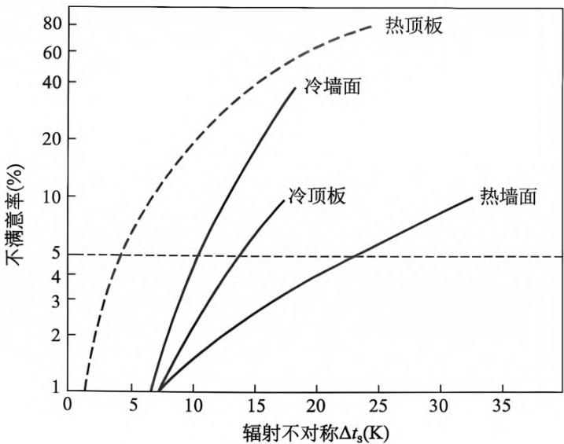  
图5.2-4 辐射不对称性引起的人员不满意率

**7. 空气湿度**

空气的湿度主要影响偏热环境下人体表面汗液的蒸发量。在偏热环境下，当湿度过高时，因汗液不能及时、充分地蒸发掉而积于皮肤表面，使人的不舒适感增强。空气湿度对人体舒适感的影响可用皮肤湿润度来衡量。

湿润度是一个无量纲参数，它的定义是：汗液的实际蒸发量与同一热环境下体表完全湿润而可能产生的最大蒸发量之比。超出一定范围以后，皮肤湿润度越大，不舒适感就越强烈。导致不舒适的皮肤湿润度 $w$ 的上限，可按下式计算：

$$
w <   0. 0 0 1 2 M + 0. 1 5\tag{5. 2-10}
$$

式中 $M$ ——人体能量代谢率，met。

**8. 空气流速和湍流强度**

空气流速的变化程度，即某一时间段内速度扰动平均大小的量度，一般以湍流强度 Tu 来衡量。湍流强度越大，说明速度扰动越剧烈，风速越不均匀。

湍流强度 Tu 的定义是：瞬时速度的标准偏差除以平均速度，是一个无量纲的百分比值，其计算式为：

$$
T u = \frac {s _ {\mathrm{v}}}{\overline {{v}}} \times 100\tag{5.2-11}
$$

$$
s _ {v} = \sqrt {\frac {1}{n - 1} \cdot \sum_ {i = 1} ^ {n} \left(v _ {i} - \bar {v}\right) ^ {2}}\tag{5. 2-12}
$$

式中 $\overline{v}$ ——空气的平均流速，m/s；

$s_{v}$ ——平均流速与流速瞬时值的标准差，m/s；

$v_{i}$ ——空间某点空气流速在 i 时刻的瞬时值，m/s。

人体对气流速度比较敏感，在“中性—热”状态下的微风，人们会感到舒适，超过一定限度的风速，会引起“吹风感”，导致不满意率的升高。吹风感的定义为：由于空气流动造成的人体所不希望的局部冷却不适感。它是评价人体舒适性的重要标准之一。

吹风感的不满意百分率 PPD 可按下列公式计算（该公式由 P.O.Fanger 等人提出，被

ISO 7730 采用):

$$
\mathrm{PPD} = (3 4 - t _ {\mathrm{a}}) (\overline {{{v}}} + 0. 0 5) ^ {0. 6 2} \times (0. 3 7 \cdot \overline {{{v}}} \cdot \mathrm{Tu} + 3. 1 4)\tag{5.2-13}
$$

式中 $t_{a}$ ——室内空气温度，℃；

$\overline{v}$ ——空气平均流速，m/s。

当不满意百分率 PPD>100% 时，取 PPD=100%；当空气平均流速 $\overline{v}<0.05m/s$ 时，取 $\overline{v}=0.05m/s$ 。推荐不满意百分率 PPD<15%。

Fountain 等人提出：在实际工程设计中，可以将作用温度与不同的气流速度进行搭配，从而满足舒适性的要求（图 5.2-5）。

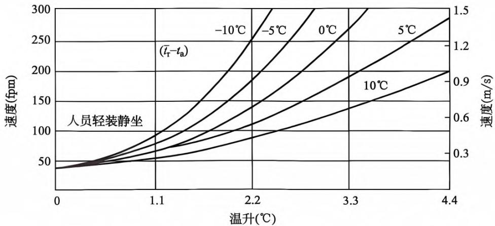  
图5.2-5 弥补温度升高所需提高的风速

图 5.2-6 为空气温度与平均风速及湍流强度的关系。

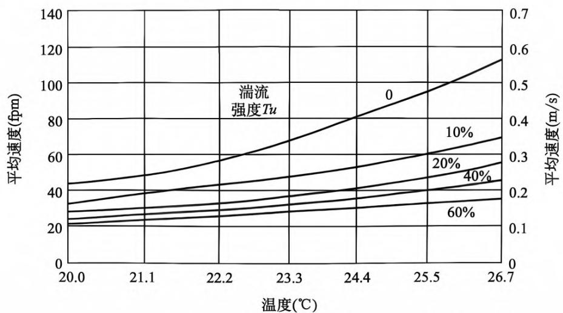  
图 5.2-6 空气温度与平均风速及湍流强度的关系

Fanger 等人给出了考虑不同服装热阻、不同代谢率、不同温度等多种因素影响下人体可接受的空气流速，如图 5.2-7 所示。

**9. 舒适标准与舒适范围**

(1) ISO 标准: 《热环境的人类工效学 通过计算 PMV 和 PPD 指数与局部热舒适准则对热舒适进行分析测定与解释》ISO 7730: 2005 对从事轻的、主要是坐着的活动（如办公室工作），提出了表 5.2-3 所示的建议值。

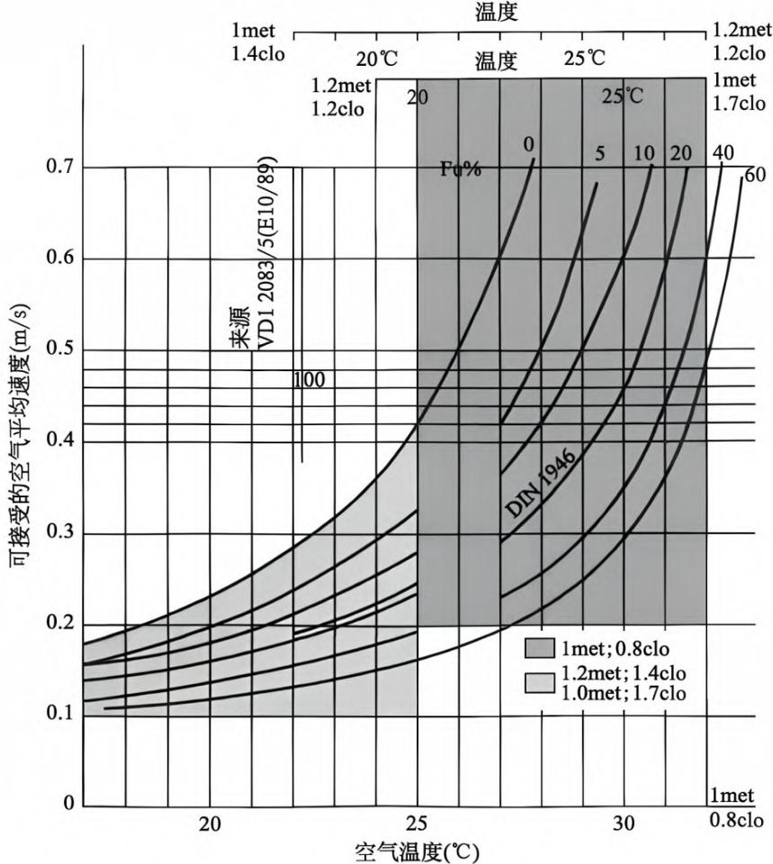  
图 5.2-7 不同条件下人体可接受的空气流速

ISO 7730: 2005 对舒适区的建议值  
表5.2-3

<table><tr><td colspan="2">项目</td><td>夏季</td><td>冬季</td></tr><tr><td colspan="2">干球温度(°C)</td><td>23~26</td><td>20~24</td></tr><tr><td colspan="2">地面以上0.1~1.1m的垂直温度差(°C)</td><td>&lt;3</td><td>&lt;3</td></tr><tr><td colspan="2">室内平均风速(m/s)</td><td>&lt;0.25</td><td>&lt;0.15</td></tr><tr><td colspan="2">地表面温度(°C)</td><td>-</td><td>19~26(地面辐射供暖≤29)</td></tr><tr><td rowspan="2">辐射温度不均衡性(°C)</td><td>平面与地面0.6m以上水平平面间的辐射温度的不对称性</td><td>-</td><td>&lt;5</td></tr><tr><td>窗或其他冷垂直面与地面0.6m以上垂直平面间的辐射温度的不对称性</td><td>-</td><td>&lt;10</td></tr></table>

(2) ASHRAE 标准: 图 5.2-8 是《人居环境条件》ASHRAE 55 给出的冬季和夏季舒适区, 它的具体条件是: 穿着典型夏季和冬季服装进行轻体力活动或处于静坐状态 $(M \leqslant 1.1 \mathrm{~met})$ 的人可接受的作用温度和相对湿度的范围, 该范围内人群的不满意率为 $10 \%$ 。

该标准中相对湿度的上下限是综合考虑了皮肤干燥、眼睛发炎、呼吸健康、微生物繁殖以及其他与相对湿度有关的现象后给定的。在确定室内设计条件时，要注意通过调节室内露点温度和控制临界表面温度，防止建筑物和建材表面结露。

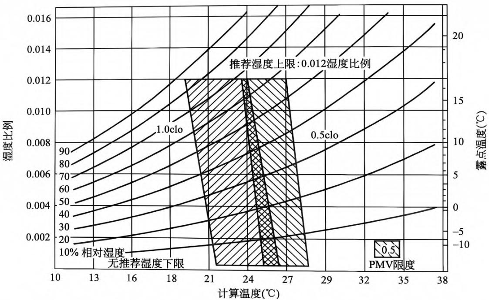  
图5.2-8 ASHRAE55中冬季和夏季舒适区

由图 5.2-8 可以看出，在部分区域中，冬季和夏季的舒适区是相互重叠的。在该区域内，穿夏季服装的人会感到稍凉，而穿冬季服装的人则感觉稍热。实际上，由于每个人在给定条件下的反应不可能完全一致，所以，不能将该图给定的边界理解为突变的分界线。

图 5.2-9 为在各种舒适度条件下给定温度时，从事轻肢体活动或久坐的人的服装热阻 (<1.2met)。

作用温度(℃)  
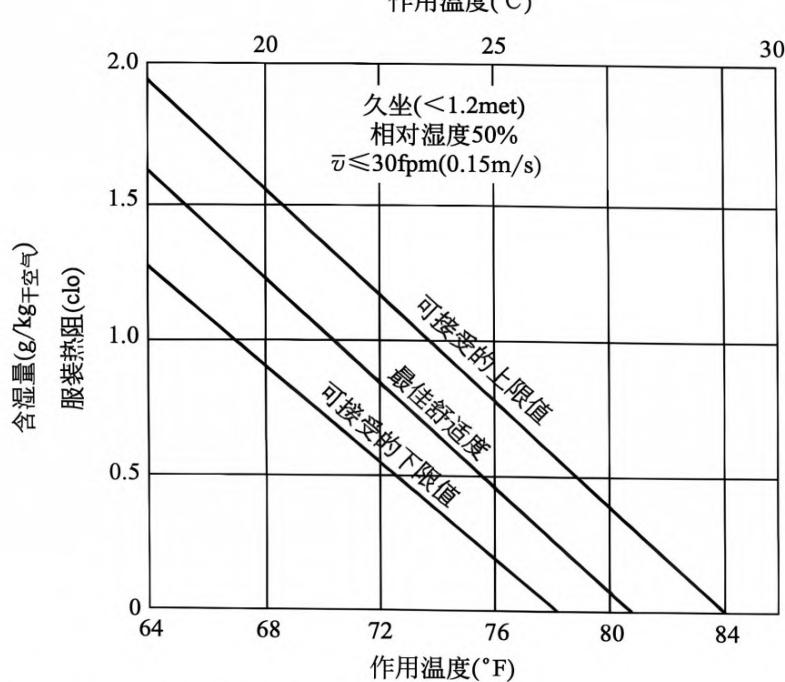  
图 5.2-9 各种舒适度条件下给定温度时，从事轻肢体活动或久坐的人的服装热阻

对于长久处于坐姿工作（活动量 $< 1.2 \mathrm{~met}$ ）的人来说，避免吹风不适是非常必要的，但是对于正在活动的人来说，不一定会感到吹风不适。图5.2-10为空气流速和温度对图 5.2-8 的舒适区的综合影响。由图 5.2-10 可见，夏季空气温度升高时，如果空气流速也相应增大的话，有可能保持原有的舒适度。

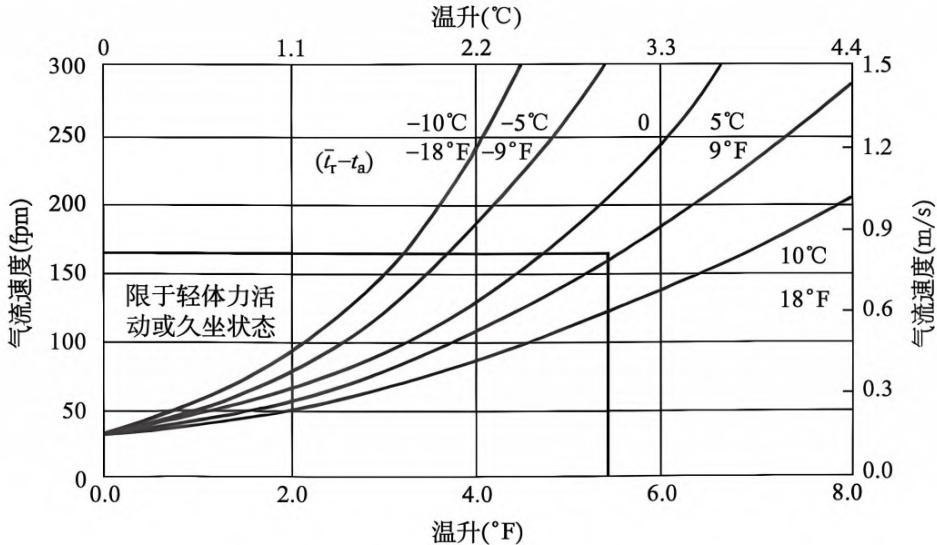  
图5.2-10 能抵消温升的空气流速

对于活动中（1.2met＜活动量＜3met）的人员来说，可接受的作用温度也可按下式计算：

$$
t _ {\mathrm{o}} = t _ {\mathrm{o}} ^ {\prime} - 3. 0 \times (1 + I _ {\mathrm{cl}}) (M - 1. 2)\tag{5.2-14}
$$

式中 $t_{\circ}^{\prime}$ ——由图5.2-9得出的久坐状态下的作用温度， ${}^{\circ}\mathrm{C}$

M——活动量，met；

$I_{cl}$ ——服装热阻，clo。

图 5.2-11 所示为作用温度、活动量和服装的综合影响，图中给出了空气低速流动条件下活动中的人的最佳作用温度（空气流动速度 $\bar{v}<0.15m/s$ ）。

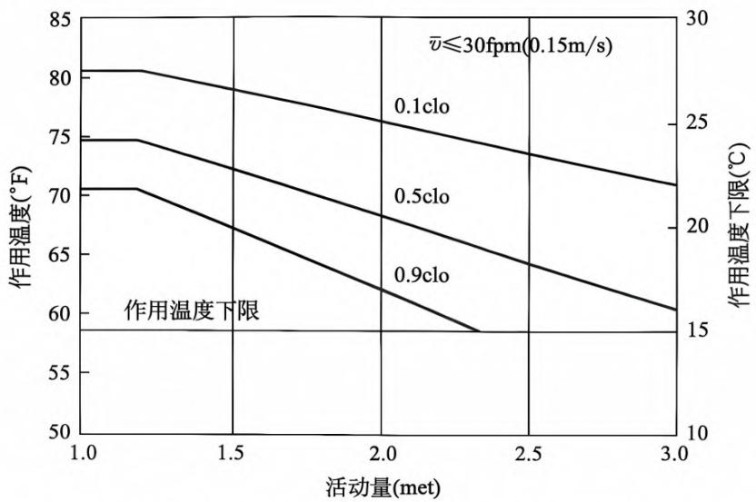  
图 5.2-11 空气低速流动条件下活动中的人的最佳作用温度 ( $\bar{v}<0.15m/s$ )

### 5.2.2 人体热舒适

1. 热平衡方程式

$$
S = M - W - E - R - C\tag{5.2-15}
$$

式中 S ——人体蓄热率， $W/m^{2}$ ;

M——人体能量代谢率， $W/m^{2}$ ;

W——人体所作机械功， $W/m^{2}$ ;

E——蒸发热损失，W/m $^{4}$ ；

R——辐射热损失，W/m $^{2}$ ;

C——对流热损失， $W/m^{2}$ 。

2. 蒸发热损失 $E(\mathrm{W} / \mathrm{m}^{2})$

$$
E = L + E _ {\mathrm{hu}} + E _ {\mathrm{p}} + E _ {\mathrm{h}}\tag{5.2-16}
$$

式中 L ——呼吸时的显热损失， $W/m^{2}$ ;

$E_{hu}$ ——呼吸时的潜热损失， $W/m^{2}$ ;

$E_{p}$ ——皮肤扩散蒸发热损失， $W/m^{2}$ ;

$E_{h}$ ——皮肤出汗造成的热损失， $W/m^{2}$ 。

$$
L = 0. 0 0 1 4 M (3 4 - t _ {\mathrm{a}})\tag{5.2-17}
$$

$$
E _ {\mathrm{hu}} = 1. 7 2 \times 1 0 ^ {- 5} M (5 8 6 7 - p _ {\mathrm{q}})\tag{5.2-18}
$$

$$
E _ {\mathrm{p}} = 3. 0 5 \times 1 0 ^ {- 3} \times (2 5 4 t _ {\mathrm{p}} - 3 3 3 5 - p _ {\mathrm{q}})\tag{5.2-19}
$$

$$
E _ {\mathrm{h}} = 0. 4 2 (M - W - 5 8. 1 5)\tag{5.2-20}
$$

式中 $t_{a}$ ——人体周围的空气温度，℃；

$p_{q}$ ——人体周围空气的水蒸气分压力，Pa；

$t_{p}$ ——人体皮肤的平均温度，℃。

$$
t _ {\mathrm{p}} = 3 5. 7 - 0. 0 2 7 5 (M - W)\tag{5.2-21}
$$

$$
E = 0. 0 0 1 4 M (3 4 - t _ {\mathrm{a}}) + 1. 7 2 \times 1 0 ^ {- 5} M (5 8 6 7 - p _ {\mathrm{q}}) + 3. 0 5 \times 1 0 ^ {- 3}
$$

$$
\times (2 5 4 t _ {\mathrm{p}} - 3 3 3 5 - p _ {\mathrm{q}}) + 0. 4 2 (M - W - 5 8. 1 5)
$$

3. 辐射热损失 $R(\mathrm{W} / \mathrm{m}^{2})$

(5.2-22)

$$
R = 3. 9 5 \times 1 0 ^ {- 8} A _ {\mathrm{y}} \left[ (t _ {\mathrm{y}} + 2 7 3) ^ {4} - (\bar {t} _ {\mathrm{r}} + 2 7 3) ^ {4} \right]\tag{5.2-23}
$$

式中 $A_{\mathrm{y}}$ ——穿衣人体的外表面与裸体时外表面积之比；

$t_{y}$ ——衣着外表面的温度，℃；

$\overline{t}_{r}$ ——平均辐射温度，℃。

当服装热阻 $R_{\mathrm{y}} \leqslant 0.078 \mathrm{~m}^{2} \cdot {}^{\circ} \mathrm{C} / \mathrm{W}$ 时：

$$
A _ {\mathrm{y}} = 1. 0 0 + 1. 2 9 R _ {\mathrm{y}}
$$

当服装热阻 $R_{\mathrm{y}} > 0.078 \mathrm{~m}^{2} \cdot {}^{\circ} \mathrm{C} / \mathrm{W}$ 时：

(5.2-24)

$$
A _ {\mathrm{y}} = 1. 0 5 + 0. 6 4 5 R _ {\mathrm{y}}\tag{5.2-25}
$$

衣着外表面的温度 $t_{\mathrm{y}}$ ，按平衡关系为：

$$
t _ {\mathrm{y}} = t _ {\mathrm{p}} - R _ {\mathrm{y}} (R + C)\tag{5.2-26}
$$

4. 对流热损失 $C(\mathrm{W} / \mathrm{m}^{2})$

$$
C = A _ {\mathrm{y}} h _ {\mathrm{c}} \left(t _ {\mathrm{y}} - t _ {\mathrm{a}}\right)\tag{5.2-27}
$$

式中 $h_{c}$ ——对流换热系数， $W/(m^{2} \cdot ^{\circ}C)$ 。

当2.38 $(t_{\mathrm{y}} - t_{\mathrm{n}})^{0,25}\leqslant 12.1\sqrt{v}$ 时：

$$
h _ {\mathrm{c}} = 2. 3 8 (t _ {\mathrm{y}} - t _ {\mathrm{n}}) ^ {0. 2 5}\tag{5.2-28}
$$

当2.38 $(t_{\mathrm{y}} - t_{\mathrm{n}})^{0.25} > 12.1\sqrt{v}$ 时：

$$
h _ {\mathrm{c}} = 1 2. 1 \sqrt {v}\tag{5.2-29}
$$

式中 v ——空气的相对流速，m/s。

当人体蓄热率 $S = 0$ 时，达到舒适状态。这时，热舒适方程式如下：

$$
M - W - E - R - C = 0\tag{5.2-30}
$$

5. 人体能量代谢率 $M(\mathrm{W} / \mathrm{m}^{2})$

$$
M = \frac {2 1 (0 . 2 3 R Q + 0 . 7 7) Q _ {\mathrm{O} _ {2}}}{A _ {\mathrm{D}}}\tag{5.2-31}
$$

式中 $RQ$ ——呼吸商， $RQ = \frac{Q_{\mathrm{CO_2}}}{Q_{\mathrm{O_2}}}$ ；

$Q_{CO_{2}}$ ——人体的 $CO_{2}$ 呼出量，L/min;

$Q_{O_{2}}$ ——在呼出 $CO_{2}$ 时的耗氧量，L/min;

$A_{D}$ ——人体裸体的表面积，可按表5.2-4确定，该表是根据DuBois公式编制的。

$$
A _ {\mathrm{D}} = 0. 2 0 2 m ^ {0. 4 2 5} \times h ^ {0. 7 2 5}\tag{5.2-32}
$$

式中 m ——人体的体重，kg；

h——身高，m。

人体裸体的表面积 $(m^{2})$  
表5.2-4

<table><tr><td rowspan="2">身高(m)</td><td colspan="14">体重(kg)</td></tr><tr><td>30</td><td>40</td><td>50</td><td>60</td><td>65</td><td>70</td><td>75</td><td>80</td><td>85</td><td>90</td><td>95</td><td>100</td><td>105</td><td>110</td></tr><tr><td>1.20</td><td>0.99</td><td>1.12</td><td>1.23</td><td>1.33</td><td>1.37</td><td>1.42</td><td>1.46</td><td>1.50</td><td>1.54</td><td>1.58</td><td>1.61</td><td>1.65</td><td>1.68</td><td>1.72</td></tr><tr><td>1.30</td><td>1.05</td><td>1.18</td><td>1.30</td><td>1.41</td><td>1.45</td><td>1.50</td><td>1.55</td><td>1.59</td><td>1.63</td><td>1.67</td><td>1.71</td><td>1.75</td><td>1.78</td><td>1.82</td></tr><tr><td>1.40</td><td>1.10</td><td>1.25</td><td>1.37</td><td>1.48</td><td>1.53</td><td>1.58</td><td>1.63</td><td>1.68</td><td>1.72</td><td>1.76</td><td>1.80</td><td>1.84</td><td>1.88</td><td>1.92</td></tr><tr><td>1.45</td><td>1.13</td><td>1.28</td><td>1.41</td><td>1.52</td><td>1.57</td><td>1.62</td><td>1.67</td><td>1.72</td><td>1.76</td><td>1.81</td><td>1.85</td><td>1.89</td><td>1.93</td><td>1.97</td></tr><tr><td>1.50</td><td>1.16</td><td>1.31</td><td>1.44</td><td>1.56</td><td>1.61</td><td>1.67</td><td>1.71</td><td>1.76</td><td>1.81</td><td>1.85</td><td>1.90</td><td>1.94</td><td>1.98</td><td>2.02</td></tr><tr><td>1.55</td><td>1.19</td><td>1.34</td><td>1.48</td><td>1.60</td><td>1.65</td><td>1.71</td><td>1.76</td><td>1.80</td><td>1.85</td><td>1.90</td><td>1.94</td><td>1.98</td><td>2.03</td><td>2.07</td></tr><tr><td>1.60</td><td>1.22</td><td>1.38</td><td>1.51</td><td>1.63</td><td>1.69</td><td>1.74</td><td>1.80</td><td>1.85</td><td>1.90</td><td>1.94</td><td>1.99</td><td>2.03</td><td>2.07</td><td>2.11</td></tr><tr><td>1.65</td><td>1.24</td><td>1.41</td><td>1.55</td><td>1.67</td><td>1.73</td><td>1.78</td><td>1.84</td><td>1.89</td><td>1.94</td><td>1.99</td><td>2.03</td><td>2.08</td><td>2.12</td><td>2.16</td></tr><tr><td>1.70</td><td>1.27</td><td>1.44</td><td>1.58</td><td>1.71</td><td>1.77</td><td>1.82</td><td>1.88</td><td>1.93</td><td>1.98</td><td>2.03</td><td>2.08</td><td>2.12</td><td>2.17</td><td>2.21</td></tr><tr><td>1.75</td><td>1.30</td><td>1.47</td><td>1.61</td><td>1.74</td><td>1.80</td><td>1.86</td><td>1.92</td><td>1.97</td><td>2.02</td><td>2.07</td><td>2.12</td><td>2.17</td><td>2.21</td><td>2.26</td></tr><tr><td>1.80</td><td>1.33</td><td>1.50</td><td>1.65</td><td>1.78</td><td>1.84</td><td>1.90</td><td>1.96</td><td>2.01</td><td>2.06</td><td>2.11</td><td>2.16</td><td>2.21</td><td>2.26</td><td>2.30</td></tr><tr><td>1.85</td><td>1.35</td><td>1.53</td><td>1.68</td><td>1.82</td><td>1.88</td><td>1.94</td><td>2.00</td><td>2.05</td><td>2.11</td><td>2.16</td><td>2.21</td><td>2.26</td><td>2.30</td><td>2.35</td></tr><tr><td>1.90</td><td>1.38</td><td>1.56</td><td>1.71</td><td>1.85</td><td>1.92</td><td>1.98</td><td>2.04</td><td>2.09</td><td>2.15</td><td>2.20</td><td>2.25</td><td>2.30</td><td>2.35</td><td>2.40</td></tr><tr><td>1.95</td><td>1.41</td><td>1.59</td><td>1.75</td><td>1.89</td><td>1.95</td><td>2.01</td><td>2.07</td><td>2.13</td><td>2.19</td><td>2.24</td><td>2.29</td><td>2.34</td><td>2.39</td><td>2.44</td></tr><tr><td>2.00</td><td>1.43</td><td>1.62</td><td>1.78</td><td>1.92</td><td>1.99</td><td>2.05</td><td>2.11</td><td>2.17</td><td>2.23</td><td>2.28</td><td>2.34</td><td>2.39</td><td>2.44</td><td>2.49</td></tr></table>

呼吸商 $RQ$ 取决于人的活动、饮食和身体条件，ASHRAE手册给出了下列数据：成年人坐着从事轻劳动（ $M < 1.5$ ）时，平均 $RQ = 0.83$ ；从事非常重的劳动（ $M = 5$ ）时，

增加至 $RQ = 1.0$ 。

表 5.2-5 列出了不同活动水平时人的心率和耗氧量。  
不同活动水平时人的心率和耗氧量  
表5.2-5

<table><tr><td>劳动水平</td><td>心率(b/min)</td><td>耗氧量(mL/s)</td></tr><tr><td>轻劳动</td><td>&lt;90</td><td>&lt;8</td></tr><tr><td>中等劳动</td><td>90~110</td><td>8~16</td></tr><tr><td>重劳动</td><td>110~130</td><td>16~24</td></tr><tr><td>很重的劳动</td><td>130~150</td><td>24~32</td></tr><tr><td>非常重的劳动</td><td>150~170</td><td>&gt;32</td></tr></table>

表5.2-6列出了不同活动时人的能量代谢率（摘自ASHRAE手册）。

不同活动时人的能量代谢率  
表 5.2-6

<table><tr><td rowspan="2">活动状态</td><td rowspan="2">活动类型</td><td colspan="2">能量代谢率</td></tr><tr><td>(W/m2)</td><td>(met)</td></tr><tr><td rowspan="4">静止</td><td>睡眠</td><td>40</td><td>0.7</td></tr><tr><td>向后靠着</td><td>45</td><td>0.8</td></tr><tr><td>坐着,平静的</td><td>60</td><td>1.0</td></tr><tr><td>站着,无拘束的</td><td>70</td><td>1.2</td></tr><tr><td rowspan="3">走路(在平面上)</td><td>3.2km/h(0.9m/s)</td><td>115</td><td>2.0</td></tr><tr><td>4.3km/h(1.2m/s)</td><td>150</td><td>2.6</td></tr><tr><td>6.4km/h(1.8m/s)</td><td>220</td><td>3.8</td></tr><tr><td rowspan="7">办公活动</td><td>阅读,坐着</td><td>55</td><td>1.0</td></tr><tr><td>书写</td><td>60</td><td>1.0</td></tr><tr><td>打字</td><td>65</td><td>1.1</td></tr><tr><td>整理文档,坐着</td><td>70</td><td>1.2</td></tr><tr><td>整理文档,站着</td><td>80</td><td>1.4</td></tr><tr><td>到处走动</td><td>100</td><td>1.7</td></tr><tr><td>包装</td><td>120</td><td>2.1</td></tr><tr><td rowspan="5">驾驶/飞行</td><td>汽车</td><td>60~115</td><td>1.0~2.0</td></tr><tr><td>飞机,常规操作</td><td>70</td><td>1.2</td></tr><tr><td>飞机,起降</td><td>105</td><td>1.8</td></tr><tr><td>飞机,战斗</td><td>140</td><td>2.4</td></tr><tr><td>重型运输工具</td><td>185</td><td>3.2</td></tr><tr><td rowspan="8">各种活动</td><td>烹饪</td><td>90~115</td><td>1.6~2.0</td></tr><tr><td>清扫房屋</td><td>115~200</td><td>2.0~3.4</td></tr><tr><td>坐着,移动繁重的零部件</td><td>130</td><td>2.2</td></tr><tr><td>机械操作:锯(台锯)</td><td>105</td><td>1.8</td></tr><tr><td>轻作业(电气作业)</td><td>115~140</td><td>2.0~2.4</td></tr><tr><td>操作重型运输工具</td><td>235</td><td>4.0</td></tr><tr><td>搬运(50kg)</td><td>235</td><td>4.0</td></tr><tr><td>挖掘、铲工作</td><td>235~280</td><td>4.0~4.8</td></tr><tr><td rowspan="5">各种休闲活动</td><td>舞蹈、社交</td><td>140~255</td><td>2.4~4.4</td></tr><tr><td>柔软体操/锻炼</td><td>175~235</td><td>3.0~4.0</td></tr><tr><td>网球</td><td>210~270</td><td>3.6~4.0</td></tr><tr><td>篮球</td><td>290~440</td><td>5.0~7.6</td></tr><tr><td>摔跤、竞赛</td><td>410~505</td><td>7.0~8.7</td></tr></table>

注：1. met 表示某活动强度时的能量代谢率/静坐时的能量代谢率。  
2. $1 \, met = 58.15 \, W/m^{2}$

**6. 服装热阻**

服装热阻 $R_{\mathrm{y}}$ （ $\mathrm{m}^2\cdot {}^\circ \mathrm{C} / \mathrm{W}$ ）可按下式计算确定：

$$
R _ {\mathrm{y}} = (0. 5 3 4 + 0. 1 3 5 \chi_ {\mathrm{f}}) (A _ {\mathrm{G}} / A _ {\mathrm{D}}) - 0. 0 5 4 9\tag{5.2-33}
$$

式中 $\chi_{f}$ ——织物的厚度，mm；

$A_{G}$ ——身体被衣服覆盖的表面积， $m^{2}$ ;

$A_{D}$ ——人体的表面积， $m^{2}$ 。

服装热阻也可以用 $I_{cl}$ （clo）表示：

$$
1 \mathrm{clo} = 0. 1 5 5 \mathrm{m} ^ {2} \cdot {} ^ {\circ} \mathrm{C} / \mathrm{W}\tag{5. 2-34}
$$

1clo 相当于同时穿着长袖衬衣、长裤和普通外衣或西装时的服装热阻。夏季的服装的热阻一般为 0.5clo，工作服装的热阻一般为 0.7clo，冬季室外穿的服装的热阻一般为 1.5～2.0clo，在北极地区的服装的热阻可达到 4.0clo。如果缺乏成套服装热阻 $I_{cl}$ 的数据，可以通过单件服装的热阻 $I_{clu,i}$ 求得：

$$
I _ {\mathrm{cl}} = \sum I _ {\mathrm{clu}, i}\tag{5.2-35}
$$

表 5.2-7 及表 5.2-8 列出了《人居环境条件》ASHRAE 55 给出的单件服装的热阻和成套服装的热阻。表 5.2-9 列出一些具有中国特色的单件服装热阻。

单件服装的热阻  
表5.2-7

<table><tr><td>服装类型</td><td>热阻(clo)</td><td>服装类型</td><td>热阻(clo)</td></tr><tr><td colspan="2">内衣</td><td>长袖衬衫</td><td>0.25</td></tr><tr><td>文胸</td><td>0.01</td><td>长袖法兰绒衬衫</td><td>0.34</td></tr><tr><td>女士短内裤</td><td>0.03</td><td>短袖针织运动衫</td><td>0.17</td></tr><tr><td>男士内裤</td><td>0.04</td><td>长袖运动衫</td><td>0.34</td></tr><tr><td>T恤</td><td>0.08</td><td>薄西装坎肩</td><td>0.10</td></tr><tr><td>半衬裙</td><td>0.14</td><td>厚西装坎肩</td><td>0.17</td></tr><tr><td>长衬裙</td><td>0.16</td><td>薄毛背心</td><td>0.13</td></tr><tr><td>长内衣</td><td>0.20</td><td>厚毛背心</td><td>0.22</td></tr><tr><td>长内裤</td><td>0.15</td><td>长袖薄毛衣</td><td>0.25</td></tr><tr><td colspan="2">鞋袜</td><td>长袖厚毛衣</td><td>0.36</td></tr><tr><td>短运动袜</td><td>0.02</td><td>单排扣薄外套</td><td>0.36</td></tr><tr><td>半长袜</td><td>0.03</td><td>单排扣厚外套</td><td>0.44</td></tr><tr><td>及膝厚袜</td><td>0.06</td><td>双排扣薄外套</td><td>0.42</td></tr><tr><td>连裤/长筒丝袜</td><td>0.02</td><td>双排扣厚外套</td><td>0.48</td></tr><tr><td>凉鞋</td><td>0.02</td><td colspan="2">裙装</td></tr><tr><td>鞋子</td><td>0.02</td><td>薄半身裙</td><td>0.14</td></tr><tr><td>拖鞋(棉质)</td><td>0.03</td><td>厚半身裙</td><td>0.23</td></tr><tr><td>靴子</td><td>0.10</td><td>无袖薄低领连衣裙</td><td>0.23</td></tr><tr><td colspan="2">睡衣</td><td>无袖厚低领连衣裙</td><td>0.27</td></tr><tr><td>无袖薄短睡袍</td><td>0.18</td><td>短袖薄连衣裙</td><td>0.29</td></tr><tr><td>无袖薄长睡袍</td><td>0.20</td><td>长袖薄连衣裙</td><td>0.33</td></tr><tr><td>短袖薄病人睡袍</td><td>0.31</td><td>长袖厚连衣裙</td><td>0.47</td></tr><tr><td>短袖薄短袍</td><td>0.34</td><td colspan="2">裤装</td></tr><tr><td>短袖薄睡衣睡裤</td><td>0.42</td><td>超短裤</td><td>0.06</td></tr><tr><td>长袖厚长睡袍</td><td>0.46</td><td>短裤</td><td>0.08</td></tr><tr><td>长袖厚短裹袍</td><td>0.48</td><td>薄长裤</td><td>0.15</td></tr><tr><td>长袖厚睡衣睡裤</td><td>0.57</td><td>厚长裤</td><td>0.24</td></tr><tr><td>长袖厚长裹袍</td><td>0.69</td><td>运动裤</td><td>0.28</td></tr><tr><td colspan="2">上衣</td><td>工装裤</td><td>0.30</td></tr><tr><td>无袖低圆领衫</td><td>0.12</td><td>连衣裤工作服</td><td>0.49</td></tr><tr><td>短袖衬衫</td><td>0.19</td><td></td><td></td></tr></table>

成套服装的热阻  
表 5.2-8

<table><tr><td>服装类型</td><td>热阻(clo)</td></tr><tr><td>短袖衬衫+短裤</td><td>0.36</td></tr><tr><td>短袖衬衫+长裤</td><td>0.57</td></tr><tr><td>长袖衬衫+长裤</td><td>0.61</td></tr><tr><td>长袖衬衫+短外套+长裤</td><td>0.96</td></tr><tr><td>长袖衬衫+短外套+背心+T恤+长裤</td><td>1.14</td></tr><tr><td>长袖衬衫+长袖毛衣+T恤+长裤</td><td>1.01</td></tr><tr><td>长袖衬衫+长袖毛衣+T恤+短外套+长裤+长内裤</td><td>1.30</td></tr><tr><td>长袖运动衫+运动裤</td><td>0.74</td></tr><tr><td>短袖衬衫+及膝裙(凉鞋)</td><td>0.54</td></tr><tr><td>长袖衬衫+长衬裙+及膝裙</td><td>0.67</td></tr><tr><td>长袖衬衫+长袖毛衣+半衬裙+及膝裙</td><td>1.10</td></tr><tr><td>长袖衬衫+短外套+半衬裙+及膝裙</td><td>1.04</td></tr><tr><td>长袖衬衫+短外套+长裙</td><td>1.10</td></tr><tr><td>长袖连衣裤工作服+T恤</td><td>0.72</td></tr><tr><td>长袖衬衫+T恤+工装裤</td><td>0.89</td></tr><tr><td>厚连衣裤工作服+保暖内衣+长内裤</td><td>1.37</td></tr><tr><td>长袖睡衣+长睡裤+3/4袖短罩衣(拖鞋,无袜子)</td><td>0.96</td></tr></table>

注：除括号内另有说明外，所有服装套装包括鞋、袜子和内裤。所有的裙装套装包括连裤袜，不包括额外的短袜。

具有中国特色的单件服装的热阻  
表 5.2-9

<table><tr><td>服装类型</td><td>热阻(clo)</td><td>服装类型</td><td>热阻(clo)</td></tr><tr><td>秋衣</td><td>0.20</td><td>保暖家居服上衣</td><td>0.50</td></tr><tr><td>秋裤</td><td>0.16</td><td>保暖家居裤</td><td>0.44</td></tr><tr><td>毛裤</td><td>0.22</td><td>短夹克外套</td><td>0.28</td></tr><tr><td>保暖裤</td><td>0.22</td><td>短棉衣</td><td>0.47</td></tr></table>

注：依据清华大学暖体假人测试结果。

### 5.2.3 热环境的评价指标

**1. PMV/PPD 指标**

《热环境的人类工效学 通过计算 PMV 和 PPD 指数与局部热舒适准则对热舒适进行分析测定与解释》ISO 7730 以预测平均得票数 PMV/预测不满意的百分数 PPD 来描述和评价热环境，热舒适指标：

$$
\begin{array}{r l} \mathrm{PMV} & = (0. 3 0 3 \mathrm{e} ^ {- 0. 0 3 6 M} + 0. 0 2 8) \{M - W - 3. 0 5 \times 1 0 ^ {- 3} [ 5 7 3 3 - 6. 9 9 (M - W) - P _ {\mathrm{f}} ] \\ & - 0. 4 2 (M - W - 5 8. 1 5) - 1. 7 \times 1 0 ^ {- 5} M (5 8 6 7 - P _ {\mathrm{f}}) \\ & - 0. 0 0 1 4 M (3 4 - t _ {\mathrm{n}}) - 3. 9 6 \times 1 0 ^ {- 8} A _ {y} [ (t _ {y} + 2 7 3) ^ {4} \\ & - (M R T + 2 7 3) ^ {4} ] - A _ {y} \alpha_ {c} (t _ {y} - t _ {\mathrm{n}}) \} \end{array} \tag {5.2-3}\tag{5.2-36}
$$

PMV 指标的判断标准如下: $\text{PMV}=+3$ , 热; $\text{PMV}=+2$ , 暖和; $\text{PMV}=+1$ , 稍暖和; $\text{PMV}=0$ 适中、舒适; $\text{PMV}=-1$ , 稍凉快; $\text{PMV}=-2$ , 凉快; $\text{PMV}=-3$ , 冷。

PPD指标表示对热舒适环境不满意的百分数，与PMV之间的关系如下式和图5.2-12所示。

$$
\mathrm{PPD} = 1 0 0 - 9 5 \exp \left[ - (0. 0 3 3 5 3 \mathrm{PMV} ^ {4} + 0. 2 1 7 9 \mathrm{PMV} ^ {2}) \right]\tag{5.2-37}
$$

ISO 7730 对 PPD 指标的推荐值为：PPD<10%；对 PMV 指标的要求为：-0.5<PMV<+0.5。

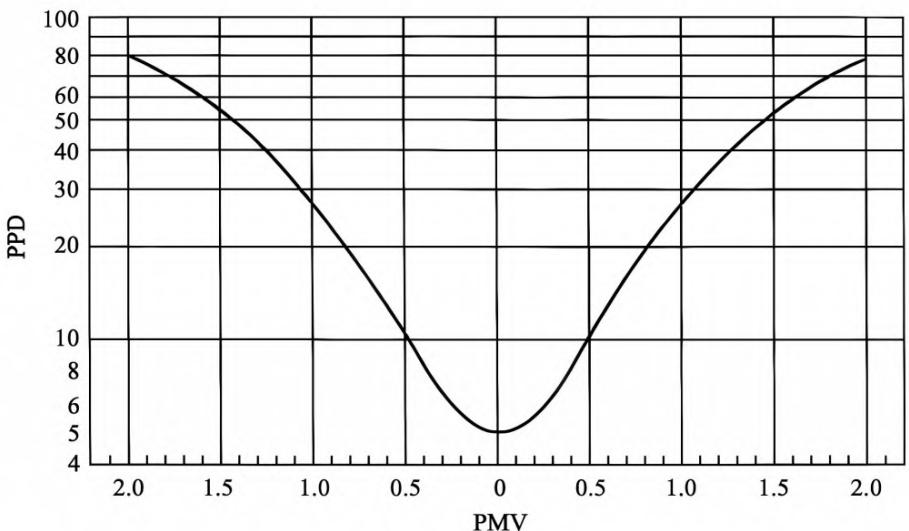  
图5.2-12 PPD与PMV的关系

**2. 偏热环境下风速对热舒适的补偿作用**

根据《人居环境条件》ASHRAE 55，在提高风速的条件下，可以有效改善室内人体热舒适度，提高人体可接受的温度上限（图 5.2-13）。

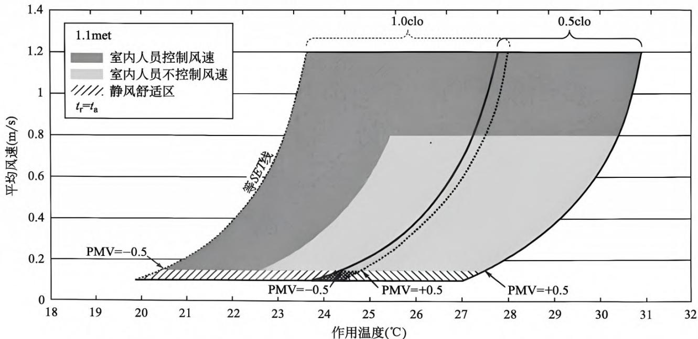  
图5.2-13 提高风速对热舒适的补偿作用

**3. 相对热指标 RWI 和热损失率 HDR**

空调供暖工程设计中，经常会遇到过渡空间的情况。过渡空间可能连接着两个热环境条件不同的空间，人员经过过渡空间或在该空间作短暂停留，且活动状态有所改变时，对该空间热环境参数的感觉与其在此作长时间静止停留时的感觉不同。因此，针对过渡空间需要使用专门的热舒适指标。

相对热指标 RWI 和热损失率 HDR 是美国运输部为确定地铁车站站台、站厅和列车空调的设计参数提出的考虑人体在过渡空间环境的热舒适指标。这两个指标是根据 ASHRAE 的热舒适实验结果得出的。RWI 适用于较暖的环境，而 HDR 适用于冷环境。

**(1) 相对热指标 $R W I$**

RWI 是无量纲指标。如果在两种不同的环境条件和活动情况下，具有相同的 RWI，则表明人在这两种情况下的热感觉是近似的。其定义式为：

$$
R W I = \frac {M (\tau) (I _ {\mathrm{cw}} + I _ {\mathrm{a}}) + 6 . 4 2 (t _ {\mathrm{a}} - 3 5) + R I _ {\mathrm{a}}}{2 3 4} \quad (p _ {\mathrm{a}} \leqslant 2 2 6 9 \mathrm{Pa})\tag{5.2-38}
$$

$$
R W I = \frac {M (\tau) (I _ {\mathrm{cw}} + I _ {\mathrm{a}}) + 6 . 4 2 (t _ {\mathrm{a}} - 3 5) + R I _ {\mathrm{a}}}{6 2 . 5 (5 8 5 8 . 4 4 - p _ {\mathrm{a}}) / 1 0 0 0} \quad (p _ {\mathrm{a}} > 2 2 6 9 \mathrm{Pa})\tag{5.2-39}
$$

式中 $M(\tau)$ ——新陈代谢率，W/m $^{2}$ ;

$t_{a}$ ——环境空气的干球温度，℃；

$I_{cw}$ ——服装热阻，clo；

$I_{a}$ ——服装外空气边界层热阻，clo；

R——单位皮肤面积的平均辐射得热， $W/m^{2}$ 。

RWI 的分度与 ASHRAE 热感觉标度之间的关系见表 5.2-10。

RWI的分度与ASHRAE热感觉标度之间的关系  
表 5.2-10

<table><tr><td>热感觉</td><td>暖</td><td>稍暖</td><td>中性</td><td>稍凉</td></tr><tr><td>ASHRAE 热感觉标度</td><td>2</td><td>1</td><td>0</td><td>-1</td></tr><tr><td>RWI</td><td>0.25</td><td>0.15</td><td>0.08</td><td>0</td></tr></table>

**(2) 热损失率 HDR**

热损失率 HDR 综合考虑了温度、相对湿度、辐射、风速、人体代谢率、服装等影响人体热舒适的因素，反映了人体单位皮肤面积上的热损失，其单位是 W/m²。

HDR 的定义式如下:

$$
H D R = \frac {D}{\Delta \tau} = 2 8. 3 9 - M (\tau) - \frac {6 . 4 2 (t _ {\mathrm{a}} - 3 0 . 5 6) + R I _ {\mathrm{a}}}{I _ {\mathrm{cw}} (\tau) + I _ {\mathrm{a}}}\tag{5. 2-40}
$$

式中 D ——人体蓄热量，即热债， $J/m^{2}$ ;

$\Delta\tau$ ——暴露时间，s。

HDR 对时间的积分即热债。 $HDR = 0$ 是不出现热债的必要条件。由于人体具有一定的蓄热量，当人体蓄热量达到约 $100\mathrm{kJ} / \mathrm{m}^2$ 时会感到冷不适，相当于在 $HDR \geqslant 100\mathrm{W} / \mathrm{m}^2$ 的条件下逗留了 $1000\mathrm{s}$ 。相反，当人体蓄热量达到 $100\mathrm{kJ} / \mathrm{m}^2$ 时将感到热不适，相当于在 $HDR \leqslant -100\mathrm{W} / \mathrm{m}^2$ 的情况下逗留 $1000\mathrm{s}$ 。也就是说，在过渡空间中，适宜的 HDR 与人员的逗留时间成反比。因此，可采取人员的平均逗留时间来确定适宜的过渡空间室内空气

设计参数。

在上述 RWI 和 HDR 表达式中， $I_{\mathrm{cw}}(\tau)$ 是衣服被汗湿润后的热阻，其和新陈代谢率 $M(\tau)$ 一样在改变活动状态后的前 $6\mathrm{min}$ 内是两个状态之间的时间 $\tau$ 的线性函数，单位为 clo，即有：

自 $\tau < 360\mathrm{s}$ 时：

$$
I _ {\mathrm{cw}} (\tau) = I _ {\mathrm{cw1}} + (I _ {\mathrm{cw2}} - I _ {\mathrm{cw1}}) \frac {\tau}{3 6 0}\tag{5.2-41}
$$

$$
M (\tau) = M _ {1} + (M _ {2} - M _ {1}) \frac {\tau}{3 6 0}\tag{5.2-42}
$$

当 $\tau \geqslant 360\mathrm{s}$ 时：

$$
I _ {\mathrm{cw}} (\tau) = I _ {\mathrm{cw2}}\tag{5.2-43}
$$

$$
M (\tau) = M _ {2}\tag{5.2-44}
$$

如果考虑人体运动诱导产生的相对风速为 $v_{\mathrm{a}}$ ，则服装外空气边界层 $I_{\mathrm{a}}$ 的拟合公式为：

$$
I _ {\mathrm{a}} = 0. 3 9 2 3 v _ {\mathrm{a}} ^ {- 0. 4 2 9 4}\tag{5.2-45}
$$

如果考虑低温时的辐射和对流修正，也可以采用如下公式计算：

$$
I _ {\mathrm{a}} = \frac {1}{0 . 6 1 (T _ {\mathrm{a}} / 2 9 8) ^ {3} + 1 . 9 \sqrt {v _ {\mathrm{a}}} (2 9 8 / T _ {\mathrm{a}})}\tag{5.2-46}
$$

## 5.3 室内外空气质量

人类有 80%～90% 的时间在室内度过，室内空气质量对人类的身体健康和工作效率十分重要。影响室内空气质量的因素主要有室外空气、建筑装修装饰材料、空调系统、家具、办公用品、厨房燃烧产物、室内人员等。室内空气污染与室外空气污染密切相关，室外空气中的污染物大多通过门窗、孔隙或管道缝隙等空气交换途径进入室内。因此，准确掌握室外空气质量对室内空气质量的控制至关重要。

空气污染是指由于人类活动或自然过程引起某些物质进入空气中，达到一定的量，持续足够的时间，而危害了人类舒适、健康或环境的现象。20世纪70年代以后，世界各国开始通过制定严格的空气质量标准，确立空气污染物控制目标。美国于1959年颁布了《空气污染控制法》，随后于1963年、1965年、1967年先后颁布《清洁空气法》《机动车空气污染控制法》和《空气质量法》。日本于1968年制定《空气污染控制法》，于1988年颁布《新机动车的排放控制法》。世界卫生组织（WHO）于1987年及2005年分别发布了适用于欧洲及全球的《空气质量准则》。

我国环境空气质量标准首次发布于 1982 年，2008 年针对空气污染指数发布《城市空气质量日报和预报技术规定》（征求意见稿）。随着臭氧和 $PM_{2.5}$ 对环境空气的影响日益加剧，雾霾和灰霾现象在各地频频发生，我国继而发布《环境空气质量标准》GB 3095—2012 和《环境空气质量指数（AQI）技术规定（试行）》HJ 633—2012，以质量指数取代空气污染指数。

20 世纪 70 年代后期，随着建筑节能技术的发展，建筑物的气密性大大提高，造成室内通风量不足，室内空气污染事件频发。美国、日本等国家开始研究室内空气质量的问题，先后制定了室内建筑、装饰材料和家庭用品管理的相关法律和标准。《可接受的室内空气质量通风标准》（Ventilation for Acceptable Indoor Air Quality）ASHRAE 62：1989提出了可接受的室内空气质量和感受到的可接受的室内空气质量概念。可接受的室内空气质量定义为：空调房间中绝大多数人没有对室内空气质量表示不满意，并且空气中没有已知的污染物达到可能对人体产生严重威胁的程度；感受到的可接受的室内空气质量定义为：空调房间中绝大多数人没有因为气味或刺激性而表示不满。

### 5.3.1 大气环境的质量标准

**5.3.1.1 我国大气环境质量标准**

根据国家标准《环境空气质量标准》GB 3095—2012的规定，我国环境空气功能区分为两类：一类区为自然保护区、风景名胜区和其他需要特殊保护的区域；二类区为居住区、商业交通居民混合区、文化区、工业区和农村地区。

不同环境空气污染物质量浓度限值见表 5.3-1，一类区适用一级质量浓度限值，二类区适用二级质量浓度限值。

不同环境空气污染物质量浓度限值  
表 5.3-1

<table><tr><td rowspan="2"></td><td rowspan="2">污染物项目</td><td rowspan="2">平均时间</td><td colspan="2">质量浓度限值</td><td rowspan="2">单位</td></tr><tr><td>一级</td><td>二级</td></tr><tr><td rowspan="14">基本项目</td><td rowspan="3">二氧化硫(SO2)</td><td>年平均</td><td>20</td><td>60</td><td rowspan="6">μg/m3</td></tr><tr><td>24h平均</td><td>50</td><td>150</td></tr><tr><td>1h平均</td><td>150</td><td>500</td></tr><tr><td rowspan="3">二氧化氮(NO2)</td><td>年平均</td><td>40</td><td>40</td></tr><tr><td>24h平均</td><td>80</td><td>80</td></tr><tr><td>1h平均</td><td>200</td><td>200</td></tr><tr><td rowspan="2">一氧化碳(CO)</td><td>24h平均</td><td>4</td><td>4</td><td rowspan="2">mg/m3</td></tr><tr><td>1h平均</td><td>10</td><td>10</td></tr><tr><td rowspan="2">臭氧(O3)</td><td>日最大8h平均</td><td>100</td><td>160</td><td rowspan="11">μg/m3</td></tr><tr><td>1h平均</td><td>160</td><td>200</td></tr><tr><td rowspan="2">颗粒物(粒径小于或等于10μm)</td><td>年平均</td><td>40</td><td>70</td></tr><tr><td>24h平均</td><td>50</td><td>150</td></tr><tr><td rowspan="2">颗粒物(粒径小于或等于2.5μm)</td><td>年平均</td><td>15</td><td>35</td></tr><tr><td>24h平均</td><td>35</td><td>75</td></tr><tr><td rowspan="5">其他项目</td><td rowspan="2">总悬浮颗粒物(TSP)</td><td>年平均</td><td>80</td><td>200</td></tr><tr><td>24h平均</td><td>120</td><td>300</td></tr><tr><td rowspan="3">氮氧化物(NOx)(以NO2计)</td><td>年平均</td><td>50</td><td>50</td></tr><tr><td>24h平均</td><td>100</td><td>100</td></tr><tr><td>1h平均</td><td>250</td><td>250</td></tr><tr><td rowspan="4">其他项目</td><td rowspan="2">铅(Pb)</td><td>年平均</td><td>0.5</td><td>0.5</td><td rowspan="4">μg/m3</td></tr><tr><td>季平均</td><td>1</td><td>1</td></tr><tr><td rowspan="2">苯并[a]芘(BaP)</td><td>年平均</td><td>0.001</td><td>0.001</td></tr><tr><td>24h平均</td><td>0.0025</td><td>0.0025</td></tr></table>

注：1. 1h 平均指任何 1h 污染物质量浓度的算术平均值；8h 平均指连续 8h 平均质量浓度的算术平均值，也称 8h 滑动平均；24h 平均指一个自然日 24h 平均质量浓度的算术平均值，也称为日平均；季平均指一个日历季内各日平均质量浓度的算术平均值；年平均指一个日历年内各日平均质量浓度的算术平均值；

2. 颗粒物（粒径小于或等于 $10 \mu \mathrm{m}$ ）指环境空气中空气动力学当量直径小于或等于 $10 \mu \mathrm{m}$ 的颗粒物，也称可吸入颗粒物；颗粒物（粒径小于或等于 $2.5 \mu \mathrm{m}$ ）指环境空气中空气动力学当量直径小于或等于 $2.5 \mu \mathrm{m}$ 的颗粒物，也称细颗粒物；总悬浮颗粒物（TSP）指环境空气中空气动力学当量直径小于或等于 $100 \mu \mathrm{m}$ 的颗粒物；苯并 [a] 芘（BaP）指存在于颗粒物（粒径小于等于 $10 \mu \mathrm{m}$ ）中的苯并 [a] 芘。

各项污染物分析方法，应符合表 5.3-2 的规定。

各项污染物分析方法  
表 5.3-2

<table><tr><td rowspan="2">污染物</td><td colspan="2">手工分析方法</td><td rowspan="2">自动分析方法</td></tr><tr><td>分析方法</td><td>标准编号</td></tr><tr><td rowspan="2">二氧化硫(SO2)</td><td>《环境空气二氧化硫的测定甲醛吸收-副玫瑰苯胺分光光度法》</td><td>HJ 482-2009</td><td>紫外荧光法、差分吸收光谱分析法</td></tr><tr><td>《环境空气二氧化硫的测定四氯汞盐吸收-副玫瑰苯胺分光光度法》</td><td>HJ 483-2009</td><td>化学分光法、差分吸收光谱分析法</td></tr><tr><td>二氧化氮(NO2)</td><td>《环境空气氮氧化物(一氧化氮和二氧化氮)的测定盐酸萘乙二胺分光光度法》</td><td>HJ 479-2009</td><td>化学分光法、差分吸收光谱分析法</td></tr><tr><td>一氧化碳(CO)</td><td>《空气质量一氧化碳的测定非分散红外法》</td><td>GB 9801-88</td><td>气体滤波相关红外吸收法、非分散红外吸收法</td></tr><tr><td rowspan="2">臭氧(O3)</td><td>《环境空气臭氧的测定靛蓝二磺酸钠分光光度法》</td><td>HJ 504-2009</td><td rowspan="2">紫外荧光法、差分吸收光谱分析法</td></tr><tr><td>《环境空气臭氧的测定紫外光度法》</td><td>HJ 590-2010</td></tr><tr><td>颗粒物(粒径小于或等于10μm)</td><td>《环境空气PM10和PM2.5的测定重量法》</td><td>HJ 618-2011</td><td>微量振荡天平法、β射线法</td></tr><tr><td>颗粒物(粒径小于或等于2.5μm)</td><td>《环境空气PM10和PM2.5的测定重量法》</td><td>HJ 618-2011</td><td>微量振荡天平法、β射线法</td></tr><tr><td>总悬浮颗粒物(TSP)</td><td>《环境空气总悬浮颗粒物的测定重量法》</td><td>GB/T 15432-1995</td><td>-</td></tr><tr><td>氮氧化物(NOx)</td><td>《环境空气氮氧化物(一氧化氮和二氧化氮)的测定盐酸萘乙二胺分光光度法》</td><td>HJ 479-2009</td><td>化学分光法、差分吸收光谱分析法</td></tr><tr><td rowspan="2">铅(Pb)</td><td>《环境空气 铅的测定 石墨炉原子吸收分光光度法》</td><td>HJ 539-2015</td><td>-</td></tr><tr><td>《环境空气 铅的测定 火焰原子吸收分光光度法》</td><td>GB/T 15264-1994</td><td>-</td></tr><tr><td rowspan="2">苯并[a]芘(BaP)</td><td>《空气质量 飘尘中苯并(a)芘的测定 乙酰化滤纸层析荧光分光光度法》</td><td>GB 8971-88</td><td>-</td></tr><tr><td>《环境空气 苯并[a]芘的测定 高效液相色谱法》</td><td>HJ 956-2018</td><td>-</td></tr></table>

**5.3.1.2 国外大气环境质量标准**

当前国外的空气质量标准中所规定的污染物控制类别如表 5.3-3 所示。

国外的空气质量标准中污染物控制类别  
表5.3-3

<table><tr><td>国家、地区或组织</td><td>污染物</td></tr><tr><td>美国</td><td> $CO、Pb、NO_2、PM_{10}、PM_{2.5}、O_3、SO_2$ </td></tr><tr><td>欧盟</td><td> $SO_2、CO、NO_2、O_3、PM_{2.5}、PM_{10}、Pb、多环芳烃、As、Cd、Ni、苯$ </td></tr><tr><td>日本</td><td> $SO_2、CO、NO_2、PM_{2.5}、苯、光化学氧化剂、三氯乙烯、四氯乙烯、二氯甲烷、SPM、PCDDs、PC-DFs、PCBs$ </td></tr><tr><td>WHO</td><td> $SO_2、NO_2、CO、O_3、PM_{10}、PM_{2.5}、Pb、丙烯腈、苯、甲醛、甲苯、丁二烯、二硫化碳、1,2-二氯乙烷、二氯甲烷、多环芳烃、多氯联苯、PCDD及PCDF、苯乙烯、四氯乙烯、三氯乙烯、氯乙烯、砷、石棉、镉、铬、氟化物、硫化氢、锰、汞、镍、铂金、五氧化二钒$ </td></tr></table>

当前国外的空气质量标准中所规定的主要污染物质量浓度限值如表 5.3-4 所示。

国外的空气质量标准中主要污染物质量浓度限值  
表5.3-4

<table><tr><td>污染物</td><td>限值标准</td><td>美国</td><td>欧盟</td><td>日本</td><td>WHO</td></tr><tr><td rowspan="2"> $PM_{2.5}$ </td><td>日平均质量浓度限值</td><td>35μg/m3</td><td>—</td><td>≤35μg/m3</td><td>25μg/m3</td></tr><tr><td>年平均质量浓度限值</td><td>12μg/m3(主);15μg/m3(次)</td><td>25μg/m3</td><td>≤15μg/m3</td><td>10μg/m3</td></tr><tr><td rowspan="2"> $PM_{10}$ </td><td>日平均质量浓度限值</td><td>150μg/m3</td><td>50μg/m3</td><td>—</td><td>50μg/m3</td></tr><tr><td>年平均质量浓度限值</td><td>—</td><td>40μg/m3</td><td>—</td><td>20μg/m3</td></tr><tr><td rowspan="3"> $SO_2$ </td><td>小时平均质量浓度限值</td><td>75mg/L</td><td>350μg/m3</td><td>≤0.1mg/L</td><td>150μg/m3</td></tr><tr><td>日平均质量浓度限值</td><td>—</td><td>125μg/m3</td><td>≤0.04mg/L</td><td>20μg/m3</td></tr><tr><td>年平均质量浓度限值</td><td>—</td><td>—</td><td>—</td><td>—</td></tr><tr><td rowspan="3"> $NO_2$ </td><td>小时平均质量浓度限值</td><td>—</td><td>200μg/m3</td><td>—</td><td>200μg/m3</td></tr><tr><td>日平均质量浓度限值</td><td>100mg/L</td><td>—</td><td>0.04~0.06mg/L</td><td>—</td></tr><tr><td>年平均质量浓度限值</td><td>53mg/L</td><td>40μg/m3</td><td>—</td><td>40μg/m3</td></tr><tr><td rowspan="3">CO</td><td>小时平均质量浓度限值</td><td>40mg/m3</td><td>—</td><td>—</td><td>35mg/m3</td></tr><tr><td>8h平均质量浓度限值</td><td>10mg/m3</td><td>10mg/m3</td><td>≤20mg/L</td><td>10mg/m3</td></tr><tr><td>日平均质量浓度限值</td><td>—</td><td>—</td><td>≤10mg/L</td><td>7mg/m3</td></tr><tr><td rowspan="2">O3</td><td>小时平均质量浓度限值</td><td>—</td><td>—</td><td>—</td><td>—</td></tr><tr><td>8h平均质量浓度限值</td><td>140μg/m3</td><td>120μg/m3</td><td>—</td><td>100μg/m3</td></tr><tr><td>Pb</td><td>年平均质量浓度限值</td><td>0.15mg/L(3个月滚动平均)</td><td>0.5μg/m3</td><td>—</td><td>0.5μg/m3</td></tr></table>

### 5.3.2 室内空气的质量标准

长期在现代建筑物中生活和工作的人群，容易产生眼睛发红、流鼻涕、嗓子疼、困倦、头痛、恶心、头晕、皮肤瘙痒等症状。调查表明，这些症状主要是由于室内空气质量不佳而引起的。本节主要对住宅、办公及工业等建筑的主控室内空气污染物及限值标准进行介绍。

**5.3.2.1 我国室内空气质量标准**

**1. 室内常见污染物**

室内污染物有几百种，包括： $CO_{2}$ 、CO、其他气体、蒸气、放射性物质、微生物、病毒、病原体和悬浮颗粒物质等，常见的污染物来源及危害见表5.3-5。

室内常见污染物的来源及危害  
表5.3-5

<table><tr><td></td><td>来源</td><td>危害</td></tr><tr><td> $CO_2$ </td><td>主要发生源是人体,吸烟及做饭过程中也会产生</td><td>浓度过高会引起头昏、憋闷或精神不佳等情况</td></tr><tr><td>CO</td><td>主要来源是碳氢燃料的不完全燃烧和吸烟</td><td>毒性大,非常有害,能严重影响人体的化学组成及性质。浓度超过人的承受限度时,常见的症状是头疼、恶心</td></tr><tr><td>氮氧化物( $NO_x$ )</td><td>主要来源于烹饪煤气、液化石油气、煤炭的燃烧、吸烟及室外环境</td><td>易造成呼吸道损害,还可引起高铁血红蛋白血症。轻度中毒表现为咽部不适、干咳、胸闷;中度中毒会出现化学性支气管炎及肺炎</td></tr><tr><td>氨气</td><td>主要来源于建筑施工中使用的混凝土外加剂、木质板材、室内装饰材料、室内卫生间和厨房的排水管道等</td><td>短期吸入大量氨气会出现流泪、咽痛、声音嘶哑、咳嗽、头晕、恶心等症状,严重者会出现肺水肿或呼吸窘迫综合征,同时发生呼吸道刺激症状</td></tr><tr><td>挥发性有机化合物  $VOC_S$ </td><td>主要来源于燃烧设备、杀虫剂、建筑材料、油漆、清洗剂等,最常见的是随着建筑装修材料、家具等进入室内的甲醛气体</td><td>一般症状有眼睛不适、喉部干燥、气喘、头痛、眩晕等。其中甲醛刺激眼睛和呼吸道黏膜,会引起哮喘和免疫神经反应等,被认为是潜在的致癌元凶</td></tr><tr><td>氡</td><td>镭衰变而产生的放射性气体,可由土壤经地面的接缝、基础墙或沿着水管进入室内。有些含铀或钍的花岗石、大理石等也能把氡带入室内</td><td>通过呼吸道进人人体,其在体内衰变以固体微粒沉积在肺部,能引发肺癌;与人体脂肪有很高的亲和力,从而影响神经系统,使人精神不振</td></tr><tr><td>真/霉菌</td><td>大量存在于浴室、洗手间等湿度较高的场所,在卧室、壁橱等处也存在</td><td>不仅腐蚀建筑物,也会导致人体免疫系统损害、过敏、加重哮喘、短期记忆力减退及呼吸系统出血等</td></tr><tr><td>颗粒物</td><td>来源有环境香烟烟雾(ETS)、装饰装修材料颗粒物释放、室内燃煤取暖、烹调</td><td>对人体的呼吸系统、肺功能、神经系统、免疫功能、心血管有一定的影响,严重时会致癌</td></tr></table>

**2. 室内空气质量标准**

《室内空气质量标准》GB/T 18883—2022适用于住宅和办公建筑，该标准明确规定；室内空气应无毒、无害、无异常嗅味，具体给出了物理性、化学性、生物性和放射性参数的标准值，详见表5.3-6。

室内空气质量的标准值  
表5.3-6

<table><tr><td>序号</td><td>参数类别</td><td>污染物</td><td>单位</td><td>标准值</td><td>备注</td></tr><tr><td>1</td><td rowspan="16">化学性</td><td>二氧化硫(SO2)</td><td>mg/m3</td><td>0.50</td><td>1h均值</td></tr><tr><td>2</td><td>二氧化氮(NO2)</td><td>mg/m3</td><td>0.20</td><td>1h均值</td></tr><tr><td>3</td><td>一氧化碳(CO)</td><td>mg/m3</td><td>10</td><td>1h均值</td></tr><tr><td>4</td><td>二氧化碳(CO2)</td><td>%</td><td>0.10</td><td>日平均值</td></tr><tr><td>5</td><td>氨(NH3)</td><td>mg/m3</td><td>0.20</td><td>1h均值</td></tr><tr><td>6</td><td>臭氧(O3)</td><td>mg/m3</td><td>0.16</td><td>1h均值</td></tr><tr><td>7</td><td>甲醛(HCHO)</td><td>mg/m3</td><td>0.08</td><td>1h均值</td></tr><tr><td>8</td><td>苯(C6H6)</td><td>mg/m3</td><td>0.03</td><td>1h均值</td></tr><tr><td>9</td><td>甲苯(C7H8)</td><td>mg/m3</td><td>0.20</td><td>1h均值</td></tr><tr><td>10</td><td>二甲苯(C8H10)</td><td>mg/m3</td><td>0.20</td><td>1h均值</td></tr><tr><td>11</td><td>苯并[a]芘(B(a)P)</td><td>ng/m3</td><td>1.0</td><td>日平均值</td></tr><tr><td>12</td><td>可吸入颗粒物 PM10</td><td>mg/m3</td><td>0.1</td><td>日平均值</td></tr><tr><td>13</td><td>细颗粒物 PM2.5</td><td>μg/m3</td><td>75</td><td>日平均值</td></tr><tr><td>14</td><td>三氯乙烯(C2HCl3)</td><td>μg/m3</td><td>6</td><td>8h均值</td></tr><tr><td>15</td><td>四氯乙烯(C2Cl4)</td><td>μg/m3</td><td>120</td><td>8h均值</td></tr><tr><td>16</td><td>总挥发性有机物(TVOC)</td><td>mg/m3</td><td>0.60</td><td>8h均值</td></tr><tr><td>17</td><td>生物性</td><td>菌落总数</td><td>cfu/m3</td><td>1500</td><td>依据仪器定 $^{\text{1}}$ </td></tr><tr><td>18</td><td>放射性</td><td>氡222(Rn)</td><td>Bq/m3</td><td>300</td><td>年平均值(行动水平 $^{\text{2}}$ )</td></tr></table>

① 撞击法：采用撞击式空气微生物采样器采样，通过抽气动力作用，空气通过狭缝或小孔而产生高速气流，使悬浮在空气中的带菌粒子撞击到营养琼脂平板上，经 $37^{\circ} \mathrm{C}$ 、48h培养后，计数菌落数，并根据采样器的流量和采样时间，换算成 $1 \mathrm{~m}^{3}$ 空气中的菌落数，以 $\mathrm{cfu} / \mathrm{m}^{3}$ 报告结果。  
② 达到此水平建议采取干预行动，以降低室内氡的量。

**3. 民用建筑工程室内环境控制标准**

《民用建筑工程室内环境污染控制标准》GB 50325—2020 规定了两类建筑工程验收时，必须检测氡、甲醛、苯、甲苯、二甲苯、氨、TVOC七项指标。Ⅰ类民用建筑应包括住宅、居住功能公寓、医院病房、老年人照料房屋设施、幼儿园、学校教室、学生宿舍等；Ⅱ类民用建筑应包括办公楼、商店、旅馆、文化娱乐场所书店、图书馆、展览馆、体育馆、公共交通等候室、餐厅等。民用建筑室内环境污染物限值见表5.3-7。

民用建筑室内环境污染物限值  
表5.3-7

<table><tr><td>污染物</td><td>I类民用建筑</td><td>II类民用建筑</td><td>单位</td></tr><tr><td>氡</td><td> $\leqslant 150$ </td><td> $\leqslant 150$ </td><td> $Bq/m^{3}$ </td></tr><tr><td>甲醛</td><td> $\leqslant 0.07$ </td><td> $\leqslant 0.08$ </td><td> $mg/m^{3}$ </td></tr><tr><td>苯</td><td> $\leqslant 0.06$ </td><td> $\leqslant 0.09$ </td><td> $mg/m^{3}$ </td></tr><tr><td>甲苯</td><td> $\leqslant 0.15$ </td><td> $\leqslant 0.20$ </td><td> $mg/m^{3}$ </td></tr><tr><td>二甲苯</td><td> $\leqslant 0.20$ </td><td> $\leqslant 0.20$ </td><td> $mg/m^{3}$ </td></tr><tr><td>氨</td><td> $\leqslant 0.15$ </td><td> $\leqslant 0.20$ </td><td> $mg/m^{3}$ </td></tr><tr><td>TVOC</td><td> $\leqslant 0.45$ </td><td> $\leqslant 0.50$ </td><td> $mg/m^{3}$ </td></tr></table>

**4. 工业建筑的室内空气质量标准**

工业建筑室内环境设计主要保证工艺要求，同时满足室内人员的舒适要求。

根据国家标准《数据中心设计规范》GB 50174—2017，数据中心主机房的空气含尘量，在静态或动态条件下测试，每立方米空气中粒径大于或等于 $0.5\mu \mathrm{m}$ 的悬浮粒子数应小于17600000粒。数据中心装修后的室内空气质量应符合《室内空气质量标准》GB/T 18883—2022的有关规定。

根据国家标准《洁净厂房设计规范》GB 50073—2013，洁净室及洁净区空气洁净度等级应符合表 5.3-8 的规定。

洁净室及洁净区空气洁净度等级  
表5.3-8

<table><tr><td rowspan="2">空气洁净度等级(N)</td><td colspan="6">大于或等于要求粒径的限值(PC/m3)</td></tr><tr><td>0.1μm</td><td>0.2μm</td><td>0.3μm</td><td>0.5μm</td><td>1μm</td><td>5μm</td></tr><tr><td>1级</td><td>10</td><td>2</td><td>—</td><td>—</td><td>—</td><td>—</td></tr><tr><td>2级</td><td>100</td><td>24</td><td>10</td><td>4</td><td>—</td><td>—</td></tr><tr><td>3级</td><td>1000</td><td>237</td><td>102</td><td>35</td><td>8</td><td>—</td></tr><tr><td>4级</td><td>10000</td><td>2370</td><td>1020</td><td>352</td><td>83</td><td>—</td></tr><tr><td>5级</td><td>100000</td><td>23700</td><td>10200</td><td>3520</td><td>832</td><td>29</td></tr><tr><td>6级</td><td>1000000</td><td>237000</td><td>102000</td><td>35200</td><td>8320</td><td>293</td></tr><tr><td>7级</td><td>—</td><td>—</td><td>—</td><td>352000</td><td>83200</td><td>2930</td></tr><tr><td>8级</td><td>—</td><td>—</td><td>—</td><td>3520000</td><td>832000</td><td>29300</td></tr><tr><td>9级</td><td>—</td><td>—</td><td>—</td><td>35200000</td><td>8320000</td><td>293000</td></tr></table>

注：按不同的测量方法，各等级水平的数据的有效数字不应超过3位。

我国《药品生产质量管理规范（2010年修订）》（简称新版GMP）规定了药品生产车间空气洁净度的标准，洁净区空气悬浮粒子标准与微生物监测的动态等级标准见表5.3-9和表5.3-10。

洁净区空气悬浮粒子标准  
表5.3-9

<table><tr><td rowspan="3">洁净度级别</td><td colspan="4">空气中悬浮粒子限值(个/ $m^3$ )</td></tr><tr><td colspan="2">静态</td><td colspan="2">动态</td></tr><tr><td> $\geqslant 0.5\mu m$ </td><td> $\geqslant 5.0\mu m$ </td><td> $\geqslant 0.5\mu m$ </td><td> $\geqslant 5.0\mu m$ </td></tr><tr><td>A级</td><td>3520</td><td>20</td><td>3520</td><td>20</td></tr><tr><td>B级</td><td>3520</td><td>29</td><td>352000</td><td>2900</td></tr><tr><td>C级</td><td>352000</td><td>2900</td><td>3520000</td><td>29000</td></tr><tr><td>D级</td><td>3520000</td><td>29000</td><td>不作规定</td><td>不作规定</td></tr></table>

洁净区微生物监测的动态等级标准  
表 5.3-10

<table><tr><td rowspan="2">洁净度级别</td><td rowspan="2">浮游菌 $(cfu/m^3)$ </td><td rowspan="2">沉降菌(φ90mm)(cfu/4h)</td><td colspan="2">表面微生物</td></tr><tr><td>接触(φ55mm)(cfu/碟)</td><td>5指手套(cfu/手套)</td></tr><tr><td>A级</td><td>&lt;1</td><td>&lt;1</td><td>&lt;1</td><td>&lt;1</td></tr><tr><td>B级</td><td>10</td><td>5</td><td>5</td><td>5</td></tr><tr><td>C级</td><td>100</td><td>50</td><td>25</td><td>—</td></tr><tr><td>D级</td><td>200</td><td>100</td><td>50</td><td>—</td></tr></table>

根据《煤矿安全规程》《金属非金属矿山安全规程》GB 16423—2020，井下作业地点空气中有害物质的限值如表5.3-11所示。

井下作业地点的空气中有害物质的限值  
表 5.3-11

<table><tr><td colspan="2">物质名称</td><td>最高允许体积分数(%)</td><td>最高允许质量浓度</td></tr><tr><td rowspan="5">有毒有害物质</td><td>一氧化碳(CO)</td><td>0.0024</td><td>30mg/m3</td></tr><tr><td>氮氧化物(NOx)</td><td>0.00025</td><td>5mg/m3</td></tr><tr><td>二氧化硫(SO2)</td><td>0.0005</td><td>15mg/m3</td></tr><tr><td>硫化氢(H2S)</td><td>0.00066</td><td>10mg/m3</td></tr><tr><td>氨(NH3)</td><td>0.004</td><td>30.4mg/m3</td></tr><tr><td rowspan="2">放射性物质</td><td>氡</td><td>—</td><td>3.7kBq/m3</td></tr><tr><td>氡子体α潜能</td><td>—</td><td>6.4μJ/m3</td></tr><tr><td rowspan="3">生产性粉尘</td><td>含游离二氧化硅10%以上的粉尘(石英、石英岩等)</td><td>—</td><td>2mg/m3</td></tr><tr><td>石棉粉尘及含石棉10%的粉尘</td><td>—</td><td>2mg/m3</td></tr><tr><td>含游离二氧化硅10%以下的粉尘</td><td>—</td><td>4mg/m3</td></tr></table>

《乘用车内空气质量评价指南》GB/T 27630—2011 给出了车内空气中苯、甲苯等污染物的质量浓度要求，见表 5.3-12。

车内空气中污染物的质量浓度要求  
表5.3-12

<table><tr><td>序号</td><td>污染物</td><td>最高允许质量浓度(mg/m3)</td></tr><tr><td>1</td><td>苯</td><td> $\leqslant 0.11$ </td></tr><tr><td>2</td><td>甲苯</td><td> $\leqslant 1.10$ </td></tr><tr><td>3</td><td>二甲苯</td><td> $\leqslant 1.50$ </td></tr><tr><td>4</td><td>乙苯</td><td> $\leqslant 1.50$ </td></tr><tr><td>5</td><td>苯乙烯</td><td> $\leqslant 0.26$ </td></tr><tr><td>6</td><td>甲醛</td><td> $\leqslant 0.10$ </td></tr><tr><td>7</td><td>乙醛</td><td> $\leqslant 0.05$ </td></tr><tr><td>8</td><td>丙烯醛</td><td> $\leqslant 0.05$ </td></tr></table>

《公共场所卫生指标及限值要求》GB 37488—2019规定了适用于宾馆、旅店、招待所、公共浴室、理发店、美容店、影剧院、录像厅（室）、游艺厅（室）、舞厅、音乐厅、体育场（馆）、游泳场（馆）、展览馆、博物馆、美术馆、图书馆、商场（店）、书店、候诊室、候车（机、船）室与公共交通工具等公共场所室内空气质量标准（表5.3-13）：

公共场所室内空气质量标准  
表 5.3-13

<table><tr><td colspan="2">指标</td><td>要求</td></tr><tr><td colspan="2">新风量[m3/(h·人)]</td><td>≥30(有睡眠、休憩需求)≥20(其他场所)</td></tr><tr><td colspan="2">二氧化碳质量分数(%)</td><td>≤0.10(有睡眠、休憩需求)≤0.15(其他场所)</td></tr><tr><td colspan="2">一氧化碳质量浓度(mg/m3)</td><td>≤10</td></tr><tr><td colspan="2">可吸入颗粒物质量浓度(mg/m3)</td><td>≤0.15</td></tr><tr><td colspan="2">甲醛质量浓度(mg/m3)</td><td>≤0.10</td></tr><tr><td colspan="2">苯质量浓度(mg/m3)</td><td>≤0.11</td></tr><tr><td colspan="2">甲苯质量浓度(mg/m3)</td><td>≤0.20</td></tr><tr><td colspan="2">二甲苯质量浓度(mg/m3)</td><td>≤0.20</td></tr><tr><td rowspan="2">空气细菌总数</td><td>撞击法(CFU/m3)</td><td>≤1500(有睡眠、休憩需求)≤4000(其他场所)</td></tr><tr><td>沉降法(CFU/III)</td><td>≤20(有睡眠、休憩需求)≤40(其他场所)</td></tr></table>

**5. IAQ 的评价方法**

目前应用较多的是主观评价与客观评价相结合的综合评价法：

(1) 主观评价法: 利用人体的感觉器官, 对室内空气质量进行描述与评价。常用的方法是通过问卷调查, 根据调查结果确定室内空气质量是否令人满意。

(2) 客观评价法: 通过量化监测, 根据直接测量出的各种污染物的量来客观评定室内空气质量是否令人满意。由于涉及的污染物太多, 不可能每种都测, 所以, 通常是选择部分有代表性的污染物作为评价指标。《室内空气质量标准》GB/T 18883—2022 规定了以二氧化碳、一氧化碳、甲醛、可吸入颗粒物、二氧化氮、二氧化硫等18项污染物作为定量反映、推断室内空气质量优劣的依据（表5.3-6）。实践中可根据具体情况与要求，增减监测污染物的项目。所测得的数据需进行整理、分析、归纳，将实测污染物的量 $C_i$ （平均值）作为客观评价指标，以该污染物的标准值 $S_i$ （采用现行标准规范中的标准值）的倒数作为权重系数，把无量纲的 $C_i / S_i$ 作为污染物的分布指数来反映室内各种污染物之间污染程度上的差异。通常，把各项分指数 $C_i / S_i$ 的叠加值称为算术叠加指数 $p$ ，即：

$$
p = \sum \frac {C _ {i}}{S _ {i}}\tag{5. 3-1}
$$

室内污染物的平均污染水平，则由算术平均指数 $Q$ 来反映：

$$
Q = \frac {1}{n} \sum \frac {C _ {i}}{S _ {i}}\tag{5. 3-2}
$$

而污染物的综合污染程度，则由综合指数 I 来反映：

$$
I = \sqrt {\frac {1}{n} \left(\sum_ {i = 1} ^ {n} \frac {C _ {i}}{S _ {i}}\right) \cdot \max \left(\frac {C _ {1}}{S _ {1}} , \frac {C _ {2}}{S _ {2}} \dots \frac {C _ {n}}{S _ {n}}\right)}\tag{5. 3-3}
$$

式中 I ——兼顾污染物最高分指数和平均分指数。

一般认为，综合指数 $I < 0.50$ 时，属于清洁环境，可获得室内人员的最大接受率； $I > 1.00$ 时，则属于污染环境。室内空气质量的等级指标评价与综合指数及对应的室内环境特征的关系，如表5.3-14所示。

室内空气质量的等级指标及对应的环境特征的关系  
表 5.3-14

<table><tr><td>综合指数</td><td>室内空气质量等级</td><td>等级评语</td><td>对应的环境特征</td></tr><tr><td> $I \leqslant 0.49$ </td><td>I</td><td>清洁</td><td>适宜于人类生活</td></tr><tr><td> $I = {0.50} \sim {0.99}$ </td><td>II</td><td>未污染</td><td>各项环境要素的污染物均不超标,人类生活正常</td></tr><tr><td> $I = {1.00} \sim {1.49}$ </td><td>III</td><td>轻污染</td><td>至少有一种环境要素的污染物超标,除敏感者外,一般不会发生急、慢性中毒</td></tr><tr><td> $I = {1.49} \sim {1.99}$ </td><td>IV</td><td>中污染</td><td>一般有2~3项环境要素的污染物超标,人群健康明显受害,敏感者受害严重</td></tr><tr><td> $I \geqslant {2.00}$ </td><td>V</td><td>重污染</td><td>一般有3~4项环境要素的污染物超标,人群健康受害严重,敏感者可能死亡</td></tr></table>

**5.3.2.2 国内外室内空气质量标准**

国内外室内空气质量标准如表 5.3-15 和表 5.3-16。

国内外室内空气质量标准比较  
表 5.3-15

<table><tr><td>国家</td><td>标准发布机构</td><td>标准名称</td><td>主要内容</td></tr><tr><td rowspan="3">加拿大</td><td rowspan="3">联邦/省职业安全及健康委员会</td><td>《居民室内空气质量指引》</td><td rowspan="3">规定了 $CO$ 、 $CO_{2}$ 、 $PM$ 、 $Rn$ 、 $NO_{2}$ 、 $SO_{2}$ 、 $O_{3}$ 、甲醛、空气流速等11项物理和化学指标限值</td></tr><tr><td>《办公楼空气质量技术指南》</td></tr><tr><td>《公共建筑过滤细菌污染;认识与管理》</td></tr><tr><td rowspan="2">日本</td><td>健康与福利部</td><td>《楼房卫生条例》</td><td>制定 $CO、CO_{2}、NO、O_{3}$ 、相对湿度、空气流速等标准</td></tr><tr><td>劳工部</td><td>《办公楼卫生条例》</td><td>规定员工所需要的开窗面积,其余如 $CO$ 、相对湿度等指标与《楼房卫生条例》相同</td></tr><tr><td>新加坡</td><td>环境部</td><td>《办公楼良好室内空气质量指引》</td><td>规定 $CO、CO_{2}、O_{3}、TVOC$ 、甲醛、总微生物、空气流速标准值</td></tr><tr><td>美国</td><td>ASHRAE</td><td>《可接受的室内空气质量通风标准》</td><td>规定甲醛、乙醛、 $CO$ 、石棉、铅、氯丹、氮氧化物、颗粒物等12种污染物的质量浓度标准</td></tr><tr><td rowspan="4">中国</td><td>住房城乡建设部</td><td>《公共建筑室内空气质量控制设计标准》</td><td>规定了公共建筑工程验收时室内空气中甲醛、苯、TVOC的设计限值和 $PM_{2.5}$ 的室内设计日质量浓度限值</td></tr><tr><td>中国建筑学会</td><td>《健康建筑评价标准》</td><td>规定了室内颗粒物 $PM_{2.5}$ 和 $PM_{10}$ 年均质量浓度限值及建筑室内空气有害物质甲醛、苯系物(苯、甲苯、二甲苯)、TVOC的质量浓度评价规则</td></tr><tr><td>住房城乡建设部</td><td>《民用建筑工程室内环境污染控制标准》</td><td>将民用建筑分为两类并分别提出控制要求,规定了放射性氡、甲醛、氨、苯、TVOC等人们普遍关注的室内常见污染物限值</td></tr><tr><td>国家市场监督管理总局</td><td>《室内空气质量标准》</td><td>该标准适用于住宅和办公楼,规定了化学、物理、生物和放射性18种污染物控制指标,还增加了“室内空气应无毒、无害、无异常嗅味”的要求</td></tr></table>

续表

不同国家/地区或组织室内污染物标准  
表 5.3-16

<table><tr><td>污染物</td><td colspan="2">国家/地区或组织</td><td>标准值</td><td>备注</td></tr><tr><td rowspan="3">氨</td><td colspan="2">芬兰</td><td>0.04mg/m3</td><td>—</td></tr><tr><td colspan="2">波兰</td><td>0.30mg/m3</td><td>8~10h平均</td></tr><tr><td colspan="2">中国(内地)</td><td>0.20mg/m3</td><td>1h平均</td></tr><tr><td rowspan="6">苯</td><td colspan="2">波兰</td><td>0.02mg/m3</td><td>8~10h平均</td></tr><tr><td rowspan="5">中国</td><td rowspan="3">香港</td><td>0.016mg/m3</td><td>8h平均,I级标准</td></tr><tr><td>0.016mg/m3</td><td>8h平均,II级标准</td></tr><tr><td>1.600mg/m3</td><td>8h平均,III级标准</td></tr><tr><td rowspan="2">内地</td><td>0.080mg/m3</td><td>GB/T 18883—2022</td></tr><tr><td>0.090mg/m3</td><td>GB 50325—2020</td></tr><tr><td rowspan="7">甲苯</td><td colspan="2" rowspan="2">德国</td><td>0.30mg/m3</td><td>长期暴露</td></tr><tr><td>3.0mg/m3</td><td>健康效应值</td></tr><tr><td colspan="2">波兰</td><td>0.25mg/m3</td><td>8~10h</td></tr><tr><td colspan="2">WHO</td><td>1.092mg/m3</td><td>8h平均</td></tr><tr><td rowspan="3">中国</td><td rowspan="2">香港</td><td>1.092mg/m3</td><td>8h平均</td></tr><tr><td>188mg/m3</td><td>8h平均,职业卫生,III级标准</td></tr><tr><td>内地</td><td>0.20mg/m3</td><td>1h平均</td></tr><tr><td rowspan="10">TVOC</td><td colspan="2">美国</td><td>0.20mg/m3</td><td>US-EPA1996</td></tr><tr><td colspan="2">澳大利亚</td><td>0.50mg/m3</td><td>1h平均</td></tr><tr><td colspan="2">德国</td><td>0.30mg/m3</td><td>长时间平均</td></tr><tr><td colspan="2">芬兰</td><td>0.60mg/m3</td><td>-</td></tr><tr><td colspan="2">挪威</td><td>0.40mg/m3</td><td>-</td></tr><tr><td colspan="2">波兰</td><td>0.10mg/m3</td><td>-</td></tr><tr><td colspan="2">日本</td><td>0.30mg/m3</td><td>-</td></tr><tr><td colspan="2">新加坡</td><td>3.0x10-6mg/m3</td><td>-</td></tr><tr><td rowspan="2">中国</td><td>香港</td><td>0.60mg/m3</td><td>8h平均</td></tr><tr><td>内地</td><td>0.50mg/m3</td><td>8h平均</td></tr><tr><td rowspan="7">NO2</td><td colspan="2">加拿大</td><td>0.48mg/m3</td><td>1h平均</td></tr><tr><td colspan="2">美国</td><td>0.10mg/m3</td><td>年平均</td></tr><tr><td colspan="2">德国</td><td>0.35mg/m3</td><td>30min平均</td></tr><tr><td colspan="2">挪威</td><td>0.10mg/m3</td><td>1h平均</td></tr><tr><td colspan="2">日本</td><td>0.28mg/m3</td><td>-</td></tr><tr><td colspan="2">WHO</td><td>0.19~0.32mg/m3</td><td>1h平均</td></tr><tr><td colspan="2">中国(内地)</td><td>0.20mg/m3</td><td>1h平均</td></tr><tr><td rowspan="10">臭氧</td><td colspan="2">加拿大</td><td>0.21mg/m3</td><td>1h平均</td></tr><tr><td colspan="2">美国</td><td>0.10mg/m3</td><td>25℃,101.325kPa</td></tr><tr><td colspan="2">澳大利亚</td><td>0.21mg/m3</td><td>1h平均</td></tr><tr><td colspan="2">德国</td><td>0.12mg/m3</td><td>-</td></tr><tr><td colspan="2">芬兰</td><td>0.08mg/m3</td><td>-</td></tr><tr><td colspan="2">挪威</td><td>0.10mg/m3</td><td>-</td></tr><tr><td colspan="2">波兰</td><td>0.15mg/m3</td><td>8~10h平均</td></tr><tr><td colspan="2">新加坡</td><td>0.10mg/m3</td><td>1h平均</td></tr><tr><td rowspan="2">中国</td><td>香港</td><td>0.12mg/m3</td><td>I级标准</td></tr><tr><td>内地</td><td>0.16mg/m3</td><td>1h平均</td></tr><tr><td rowspan="13">CO</td><td colspan="2">加拿大</td><td>29mg/m3</td><td>1h平均</td></tr><tr><td colspan="2">美国</td><td>10mg/m3</td><td>1h平均</td></tr><tr><td colspan="2">澳大利亚</td><td>10mg/m3</td><td>8h平均</td></tr><tr><td colspan="2" rowspan="2">德国</td><td>60mg/m3</td><td>30min平均</td></tr><tr><td>15mg/m3</td><td>8h平均</td></tr><tr><td colspan="2">芬兰</td><td>8mg/m3</td><td>-</td></tr><tr><td colspan="2">挪威</td><td>25mg/m3</td><td>1h平均</td></tr><tr><td colspan="2">波兰</td><td>6mg/m3</td><td>8~10h平均</td></tr><tr><td colspan="2">韩国</td><td>29mg/m3</td><td>1h平均</td></tr><tr><td colspan="2">日本</td><td>11.5mg/m3</td><td>25℃,101.325kPa</td></tr><tr><td colspan="2">新加坡</td><td>10mg/m3</td><td>8h平均</td></tr><tr><td rowspan="2">中国</td><td>香港</td><td>10mg/m3</td><td>8h平均</td></tr><tr><td>内地</td><td>10mg/m3</td><td>1h平均</td></tr><tr><td rowspan="13">颗粒物</td><td colspan="2">加拿大</td><td>0.10mg/m3</td><td>1h平均，PM2.5</td></tr><tr><td colspan="2">美国</td><td>0.26mg/m3或0.075mg/m3</td><td>24h或1年平均</td></tr><tr><td colspan="2">澳大利亚</td><td>0.09mg/m3</td><td>年平均</td></tr><tr><td colspan="2">德国</td><td>0.12mg/m3</td><td>-</td></tr><tr><td colspan="2">芬兰</td><td>0.05mg/m3</td><td>-</td></tr><tr><td colspan="2" rowspan="2">挪威</td><td>0.02mg/m3</td><td>24h平均，PM2.5</td></tr><tr><td>0.09mg/m3</td><td>除 PM2.5以外</td></tr><tr><td colspan="2">韩国</td><td>0.15mg/m3</td><td>24h平均，PM10</td></tr><tr><td colspan="2">日本</td><td>0.15mg/m3</td><td>-</td></tr><tr><td colspan="2">新加坡</td><td>0.15mg/m3</td><td>-</td></tr><tr><td rowspan="3">中国</td><td>香港</td><td>0.18mg/m3</td><td>8h平均</td></tr><tr><td rowspan="2">内地</td><td>0.05mg/m3</td><td>24h平均，PM2.5</td></tr><tr><td>0.10mg/m3</td><td>24h平均，PM10</td></tr><tr><td rowspan="11">甲醛</td><td colspan="2">加拿大</td><td>0.12mg/m3</td><td>-</td></tr><tr><td colspan="2">美国</td><td>0.4mg/L</td><td>-</td></tr><tr><td colspan="2">澳大利亚</td><td>0.12mg/m3</td><td>-</td></tr><tr><td colspan="2">德国</td><td>0.12mg/m3</td><td>-</td></tr><tr><td colspan="2">芬兰</td><td>0.10mg/m3</td><td>-</td></tr><tr><td colspan="2">挪威</td><td>0.10mg/m3</td><td>-</td></tr><tr><td colspan="2">波兰</td><td>0.10mg/m3</td><td>-</td></tr><tr><td colspan="2">韩国</td><td>0.12mg/m3</td><td>-</td></tr><tr><td colspan="2">日本</td><td>0.10mg/m3</td><td>25℃,101.325kPa</td></tr><tr><td colspan="2">新加坡</td><td>0.12mg/m3</td><td>-</td></tr><tr><td colspan="2">中国(内地)</td><td>0.08mg/m3</td><td>1h平均</td></tr><tr><td rowspan="8">氡</td><td colspan="2">加拿大</td><td> $800Bq/m^{3}$ </td><td>—</td></tr><tr><td colspan="2">美国</td><td> $148Bq/m^{3}$ </td><td>—</td></tr><tr><td colspan="2">澳大利亚</td><td> $200Bq/m^{3}$ </td><td>—</td></tr><tr><td colspan="2">芬兰</td><td> $200Bq/m^{3}$ </td><td>—</td></tr><tr><td colspan="2">挪威</td><td> $200Bq/m^{3}$ </td><td>—</td></tr><tr><td colspan="2">日本</td><td> $100Bq/m^{3}$ </td><td>—</td></tr><tr><td rowspan="2">中国</td><td>香港</td><td> $200Bq/m^{3}$ </td><td>—</td></tr><tr><td>内地</td><td> $300Bq/m^{3}$ </td><td>年平均</td></tr></table>

### 5.3.3 新风量

建筑室内引入必要的新风对在建筑内活动的人员的身体健康、舒适状态和建筑内工艺生产所要求的空气质量有着重要的意义。不同类型和功能的建筑所需要的新风量不同，其设计最小新风量的计算方法也不同。民用建筑中一般公共建筑和居住建筑主要以人员健康和舒适性为目标进行新风量的设计；医院建筑除了考虑人员污染外，还要考虑建筑污染，其对新风量的需求不同于一般公共建筑；工业建筑则主要以稀释工艺生产过程中产生的有害物质所需要的新风量为主。另外，一些特殊空间（如洁净室、矿井、交通舱室等）的新风量需要单独计算。国外公共建筑和居住建筑等的新风量取值方法对我国工程设计人员也有一定的参考意义，本节也做了一些介绍。

**5.3.3.1 我国民用建筑新风量取值**

**1. 公共建筑设计最小新风量**

（1）对于一般公共建筑，设计最小新风量的确定分为两个步骤，首先应计算按人员和地板面积所需最小新风量的总和，然后可按照换气效率进一步修正。计算公式如下：

$$
G _ {\mathrm{b}} = G _ {\mathrm{b1}} \times P + G _ {\mathrm{b2}} \times A\tag{5.3-4}
$$

$$
G _ {\mathrm{f}} = \frac {G _ {\mathrm{b}}}{M}\tag{5. 3-5}
$$

式中 $G_{b}$ ——设计最小新风量， $m^{3}/h$ ;

$G_{f}$ ——修正的设计最小新风量， $m^{3}/h$ ;

$G_{bl}$ ——人员所需最小新风量， $m^{3}/(h \cdot 人)$ ，按表 5.3-17 和 5.3-18 取值；

$P$ ——设计人数，人；

$G_{b2}$ ——按单位地板面积计所需最小新风量， $m^{3}/(h\cdot m^{2})$ ，按表5.3-19取值；

A——设计房间地板面积， $m^{2}$ ;

M——换气效率，按现行行业标准《公共建筑室内空气质量控制设计标准》JGJ/T 461 的规定取值。

1) 公共建筑主要房间人员所需最小新风量取值见表 5.3-17。

2）对于高密人群公共建筑，人员所需最小新风量应按人员密度确定，见表5.3-18。

3）按地板面积计所需最小新风量值见表5.3-19，其中建筑污染分级按照现行行业标

准《公共建筑室内空气质量控制设计标准》JGJ/T461执行。

公共建筑主要房间人员所需最小新风量  
表 5.3-17

<table><tr><td>建筑类型</td><td>新风量[m3/(h·人)]</td></tr><tr><td>办公室</td><td>30</td></tr><tr><td>客房</td><td>30</td></tr><tr><td>大堂、四季厅</td><td>10</td></tr></table>

高密人群公共建筑人员所需最小新风量 [单位： $m^{3}/(h \cdot 人)$ ] 表 5.3-18

<table><tr><td rowspan="2">建筑类型</td><td colspan="3">人员密度 $P_F$ (人/ $m^2$ )</td></tr><tr><td> $P_F \leqslant 0.4$ </td><td> $0.4 < P_F \leqslant 1.0$ </td><td> $P_F >1.0$ </td></tr><tr><td>影剧院、音乐厅、大会厅、多功能厅、会议室</td><td>14</td><td>12</td><td>11</td></tr><tr><td>商场、超市</td><td>19</td><td>16</td><td>15</td></tr><tr><td>博物馆、展览厅</td><td>19</td><td>16</td><td>15</td></tr><tr><td>公共交通等候室</td><td>19</td><td>16</td><td>15</td></tr><tr><td>歌厅</td><td>23</td><td>20</td><td>19</td></tr><tr><td>酒吧、咖啡厅、宴会厅、餐厅</td><td>30</td><td>25</td><td>23</td></tr><tr><td>游艺厅、保龄球房</td><td>30</td><td>25</td><td>23</td></tr><tr><td>体育馆</td><td>19</td><td>16</td><td>15</td></tr><tr><td>健身房</td><td>40</td><td>38</td><td>37</td></tr><tr><td>教室</td><td>28</td><td>24</td><td>22</td></tr><tr><td>图书馆</td><td>20</td><td>17</td><td>16</td></tr><tr><td>幼儿园</td><td>30</td><td>25</td><td>23</td></tr></table>

按单位地板面积计所需最小新风量  
表5.3-19

<table><tr><td>建筑污染分级</td><td>按单位地板面积计所需最小新风量 $\left\lbrack {{\mathrm{m}}^{3}/\left( {\mathrm{h} \cdot {\mathrm{m}}^{2}}\right) }\right\rbrack$ </td></tr><tr><td>一级污染建筑</td><td>0</td></tr><tr><td>二级污染建筑</td><td>2.16</td></tr><tr><td>三级污染建筑</td><td>3.24</td></tr></table>

(2) 对于设置新风系统的医院建筑, 所需最小新风量宜按换气次数确定。医院建筑设计最小换气次数见表 5.3-20。

医院建筑设计最小换气次数  
表 5.3-20

<table><tr><td>功能房间</td><td>最小换气次数( $h^{-1}$ )</td></tr><tr><td>门诊室</td><td>2</td></tr><tr><td>急诊室</td><td>2</td></tr><tr><td>配药室</td><td>5</td></tr><tr><td>放射室</td><td>2</td></tr><tr><td>病房</td><td>2</td></tr></table>

2. 设置新风系统的居住建筑，所需最小新风量宜按换气次数确定。居住建筑设计最小换气次数见表 5.3-21。

居住建筑设计最小换气次数  
表 5.3-21

<table><tr><td>人均居住面积 $F_{P}$ </td><td>最小换气次数( $h^{-1}$ )</td></tr><tr><td> $F_{P} \leqslant 10m^{2}$ </td><td>0.70</td></tr><tr><td> $10m^{2} < F_{P} \leqslant 20m^{2}$ </td><td>0.60</td></tr><tr><td> $20m^{2} < F_{P} \leqslant 50m^{2}$ </td><td>0.50</td></tr><tr><td> $F_{P} >50m^{2}$ </td><td>0.45</td></tr></table>

注：人均居住面积为居住面积除以设计人数或实际使用人数。

**5.3.3.2 工业建筑及其他民用建筑设计最小新风量**

工业建筑及对于表 5.3-17～表 5.3-21 中未做出规定的其他民用建筑所需最小新风量，可按下述方法进行计算。

**1. 确定新风量的三个因素**

**(1) 满足卫生标准及空气参数要求**

使室内污染物的质量浓度在规定值以内，以及消除室内余热、余湿所需的新风量按以下公式计算：

消除余热所需要的新风量 $G_{1}$ (kg/h):

$$
G _ {1} = 3 6 0 0 \frac {Q}{(t _ {\mathrm{p}} - t _ {\mathrm{j}}) c}\tag{5.3-6}
$$

消除余湿所需要的新风量 $G_{2}$ (kg/h):

$$
G _ {2} = \frac {D _ {\mathrm{sh}}}{d _ {\mathrm{p}} - d _ {\mathrm{j}}}\tag{5.3-7}
$$

稀释有害物所需要的新风量 $G_{3}$ (kg/h):

$$
G _ {3} = \frac {\rho m}{c _ {\mathrm{y}} - c _ {\mathrm{j}}}\tag{5.3-8}
$$

式中 $Q$ 、 $D_{\mathrm{sh}}$ ——余热量、余湿量， $\mathrm{kW}$ 、 $\mathrm{g / h}$

$t_{p}$ 、 $t_{j}$ ——排出、进入空气的温度，℃；

$d_{p}$ 、 $d_{j}$ ——排出、进入空气的含湿量，g/kg干空气；

c——空气的比热容， $1.0\mathrm{kJ}/(\mathrm{kg}\cdot\mathrm{K})$ ;

m——室内有害物的散发量，mg/h；

$c_{y}$ ——室内空气中有害物质的最高允许质量浓度， $mg/m^{3}$ ;

$c_{j}$ ——进入室内的空气中有害物质的质量浓度， $mg/m^{3}$ ;

$\rho$ ——空气密度， $kg/m^{3}$ 。

1) 对于无明确污染物的建筑, 稀释有害物所需新风量可按 $\mathrm{CO}_{2}$ 限值计算。表 5.3-22 和表 5.3-23 给出了一个人在不同条件下呼出的二氧化碳量和不同场合下室内二氧化碳允许体积浓度。一般在农村和城市, 室外空气二氧化碳质量浓度为 $0.5 \sim 0.75 \mathrm{~g} / \mathrm{kg}$ 。

人体在不同状态下的二氧化碳呼出量  
表 5.3-22

<table><tr><td>工作状态</td><td>CO2呼出量[L/(h·人)]</td><td>CO2呼出量[g/(h·人)]</td></tr><tr><td>安静时</td><td>13</td><td>19.5</td></tr><tr><td>极轻的劳动</td><td>22</td><td>33</td></tr><tr><td>轻劳动</td><td>30</td><td>45</td></tr><tr><td>中等劳动</td><td>46</td><td>69</td></tr><tr><td>重劳动</td><td>74</td><td>111</td></tr></table>

不同场合下室内二氧化碳允许体积浓度  
表5.3-23

<table><tr><td>房间性质</td><td> $CO_{2}$ 允许体积浓度( $L/m^{3}$ )</td></tr><tr><td>人长期停留的地方</td><td>1</td></tr><tr><td>儿童和病人停留的地方</td><td>0.7</td></tr><tr><td>人周期性停留的地方</td><td>1.25</td></tr><tr><td>人短期停留的地方</td><td>2.0</td></tr></table>

2) 对于有明确污染物的建筑, 室内有害物质的散发量可按以下公式计算:

① 室内 $PM_{2.5}$ 或其他有害颗粒物散发量计算：

$$
G _ {\mathrm{pm}} = \sum_ {i = 1} ^ {N _ {\mathrm{pm}}} G _ {\mathrm{pm}, i}\tag{5.3-9}
$$

式中 $G_{\mathrm{pm}}$ ——室内有害颗粒物散发量， $\mu \mathrm{g} / \mathrm{h}$

$G_{pm,i}$ ——室内第 i 个有害颗粒物发生源的散发量， $\mu g/h$ ，人员的 $PM_{2.5}$ 散发量为：当人员密度大于 $0.4 \, 人/m^{2}$ 时，按 $0.9 \mu g/(人 \cdot h)$ 计算；当人员密度小于或等于 $0.4 \, 人/m^{2}$ 时，忽略不计；

$N_{pm}$ ——室内有害颗粒物发生源总数。

② 室内化学污染物散发量计算：

$$
G _ {\mathrm{cp}, j} = \sum_ {i = 1} ^ {N _ {\mathrm{cp}}} E _ {\mathrm{cp}, i, j} L _ {\mathrm{cp}, i, j}\tag{5. 3-10}
$$

式中 $G_{cp,j}$ ——室内第 j 类化学污染物散发量，mg/h；

$E_{cp,i,j}$ ——室内第i个化学污染源的第j类化学污染物的释放率， $mg/(m^{2}\cdot h)$ ;

$L_{cp,i,j}$ ——室内第 i 个化学污染源的第 j 类化学污染物的载荷， $m^{2}$ ;

j——第 j 类化学污染物；

$i$ ——第 $i$ 个化学污染源；

$N_{cp}$ ——室内化学污染物发生源总数。

(2) 补充局部排风量

当空调房间内有局部排风装置时，为了不使房间产生负压，在系统中必须有相应的新

风量来补充排风量。

补偿局部排风和全面排风所需的风量 $G_{\mathrm{p}}$ 由下式计算：

$$
G _ {\mathrm{p}} = L _ {1} + L _ {2} + L _ {3}\tag{5. 3-11}
$$

式中 $L_{1} 、 L_{2} 、 L_{3}$ ——空调系统各个局部排风系统和全面排风系统的排风量， $\mathrm{m}^{3} / \mathrm{h}$ 。

**(3) 保证房间内正压要求**

为防止室外空气无组织侵入，影响室内空气参数，需要在空调房间内保持正压（室内空气压力＞房间周围的空气压力）。用增加一部分新风量（或排风系统少排部分新风）的方法，使室内空气压力高于外界压力，然后再让这部分新风从空调房间门窗缝隙等不严密处渗漏出去。这部分渗漏空气量的大小由房间正压、门窗缝隙的状况所决定。一般情况下，空调房间正压可取5～10Pa。

从保持正压或负压房间的门缝、窗缝和其他缝隙渗漏的风量 $G_{\mathrm{s}}$ 可按下式计算：

$$
G _ {\mathrm{s}} = a l \Delta p ^ {\frac {1}{n}}\tag{5. 3-12}
$$

式中 $l$ ——缝隙长度， $\mathrm{m}$ ；

$\Delta p$ ——室内要求保持的正压或负压值，Pa；

a、n——与密封程度有关的常数。

一般 n 值在 1\~2 之间，对于没有进行过漏损试验的窗，则可取 n=1.5。

a 值随门窗的形式不同而不同，一般可取下列数值：密封程度好的， $a=1\sim3$ ；密封程度一般的， $a=3\sim8$ ；密封程度不好的， $a=8\sim40$ 。

**2. 新风量确定的一般原则**

依据上述三个因素分别计算出所需新风量后，可按如图 5.3-1 所示框图确定最终民用建筑和工业建筑设计最小新风量。

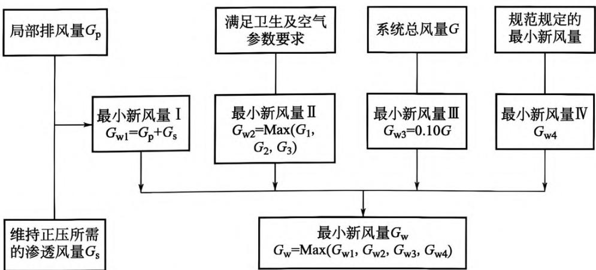  
图5.3-1 新风量确定示意框图

(1) 房间内同时放散余热、余湿和有害物质时, 新风量应按分别消除余热、余湿和有害物质所需风量的最大值确定。

(2) 如果室内同时散发几种有害物质时, 新风量按消除各种有害物质所需风量的最大值确定。但当数种溶剂 (苯及其同系物、醇类或醋酸酯类) 的蒸气, 或数种刺激性气体 (三氧化硫或二氧化硫或氟化氢及其盐类等) 同时在室内放散时, 新风量按稀释各有害物所需风量的总和计算。

(3) 当散发有害物数量不能确定时, 全面通风的新风量可根据类似房间的实测资料或经验数据按换气次数确定。

（4）当按上述方法得出的新风量不足总风量的 $10\%$ 时，应按总风量的 $10\%$ 计算，以确保卫生和安全。

**5.3.3.3 特殊空间新风量取值**

**1. 洁净室**

洁净室新风量取值应为满足卫生要求和保证室内正压两项之间的最大值。

**(1) 满足卫生标准的新风量**

满足卫生标准的新风量分别按下述两种情况计算，并取其中最大值。

1）对于室内无明显有害气体发生的一般情况，根据《洁净厂房设计规范》GB 50073—2013的规定，保证供给洁净室内的新鲜空气量不小于 $40 \mathrm{~m}^{3} / (\mathrm{h} \cdot \text {人})$ 。

2）对于室内存在有害气体的情况，需根据室内有害气体的允许值计算稀释室内有害气体的新风量。

**(2) 补偿室内排风量和保持室内正压所需新风量**

《洁净厂房设计规范》GB 50073—2013 规定，不同等级的洁净室之间、洁净区与非洁净区之间的压差应不小于 5Pa，洁净区与室外的压差应不小于 10Pa。按照不同洁净等级与控制需求，洁净室与周围空间建议采用的静压差如表 5.3-24 所示。

洁净室与周围空间建议采用的静压差  
表5.3-24

<table><tr><td>类型</td><td>非单向流洁净室与任何相通的相差一级的邻室</td><td>非单向流洁净室与任何相通的相差一级以上的邻室</td><td>单向流洁净室与任何相通的邻室</td><td>洁净室与室外(或与室外相通的房间)</td></tr><tr><td>一般(防止缝隙渗漏)</td><td>5Pa</td><td>5~10Pa</td><td>5~10Pa</td><td>15Pa</td></tr><tr><td>严格(防止开门进人的污染)</td><td>5Pa</td><td>40Pa或对缓冲室5Pa</td><td>10Pa或对缓冲室5Pa</td><td>对缓冲室10Pa</td></tr><tr><td>无菌洁净室</td><td>5Pa</td><td>对缓冲室5Pa</td><td>对缓冲室5Pa</td><td>对缓冲室10Pa</td></tr></table>

维持洁净室静压差所需的风量可以根据两种方法计算：缝隙法和换气次数法。缝隙法计算公式如下：

$$
L _ {\mathrm{C}} = \sum \mu_ {\mathrm{P}} A _ {\mathrm{P}} \sqrt {\frac {2 \Delta p}{\rho}} \times 3 6 0 0\tag{5. 3-13}
$$

式中 $L_{c}$ ——维持洁净室静压差所需的风量， $m^{3}/h$ ;

$\mu_{P}$ ——流量系数，通常取0.2\~0.5；

$A_{p}$ ——缝隙面积， $m^{2}$ ;

$\Delta p$ ——静压差，Pa；

$\rho$ ——空气密度，kg/m $^{3}$ 。

当采用换气次数法时，可参考表 5.3-25 确定换气次数。

洁净室压差与房间换气次数  
表 5.3-25

<table><tr><td>室内压差值(Pa)</td><td>有外窗、气密性较差的洁净室换气次数(h-1)</td><td>有外窗、气密性较好的洁净室换气次数(h-1)</td><td>无外窗、土建式洁净室换气次数(h-1)</td></tr><tr><td>5</td><td>0.9</td><td>0.7</td><td>0.6</td></tr><tr><td>10</td><td>1.5</td><td>1.2</td><td>1.0</td></tr><tr><td>15</td><td>2.2</td><td>1.8</td><td>1.5</td></tr><tr><td>20</td><td>3.0</td><td>2.5</td><td>2.1</td></tr><tr><td>25</td><td>3.6</td><td>3.0</td><td>2.5</td></tr><tr><td>30</td><td>4.0</td><td>3.3</td><td>2.7</td></tr><tr><td>35</td><td>4.5</td><td>3.8</td><td>3.0</td></tr><tr><td>40</td><td>5.0</td><td>4.2</td><td>3.2</td></tr><tr><td>45</td><td>5.7</td><td>4.7</td><td>3.4</td></tr><tr><td>50</td><td>6.5</td><td>5.3</td><td>3.6</td></tr></table>

**2. 矿井**

**(1) 矿井掘进通风的风量**

**1) 煤矿掘进工作面通风量**

煤矿掘进工作面实际需要风量 $G \left( m^{3}/min \right)$ 应根据瓦斯（二氧化碳）涌出量、炸药用量、工作面最多人数以及局部通风机的实际吸风量分别计算，并选取其中最大值。

① 按瓦斯（二氧化碳）涌出量计算：

$$
G = a q _ {\mathrm{掘瓦}} K _ {\mathrm{掘瓦}}\tag{5. 3-14}
$$

式中 $a$ ——配风换算系数，即单位瓦斯（二氧化碳）涌出量的配风量；若回风流瓦斯的体积分数不超过 $1\%$ ， $a$ 取 100；若按二氧化碳的体积分数不超过 $1.5\%$ ， $a$ 取 67；

$q_{\text{掘瓦}}$ ——掘进工作面回风流中平均绝对瓦斯涌出量， $m^{3}/min$ ;

$K_{\text{掘瓦}}$ ——掘进工作面因瓦斯（二氧化碳）涌出不均衡的备用风量系数，应根据实际观测结果确定 [掘进面最大绝对瓦斯（二氧化碳）涌出量与平均绝对瓦斯（二氧化碳）涌出量之比]，通常，机掘工作面取 $1.5 \sim 2$ ，炮掘工作面取 $1.8 \sim 2.0$ 。

低瓦斯、高二氧化碳矿井必须按二氧化碳涌出量计算。

② 按炸药使用量计算：

$$
G = 2 5 A\tag{5. 3-15}
$$

式中 25——1kg 炸药爆炸后所需风量， $m^{3}/(min \cdot kg)$ ;

A——掘进工作面一次爆破所用的最大炸药用量，kg。

③ 按工作人员数量计算：

$$
G = 4 n\tag{5. 3-16}
$$

式中 4——每人每分钟应供给的最低风量， $m^{3}/(\min \cdot \text{人})$ ;

n——掘进工作面同时工作的最多人数，人。

④ 按局部通风机的实际吸风量：

设置局部通风机的巷道中的风量，除了满足局部通风机的吸风量外，还应保证局部通风机吸入口至掘进工作面之间的风速，岩巷不小于 0.15m/s，煤巷和半煤巷不小于 0.25m/s，以防止局部通风机吸入循环风和这段距离内气流停滞，造成瓦斯积聚。

岩巷掘进

$$
G = G _ {\mathrm{f}} I + 9 S\tag{5.3-17}
$$

煤巷掘进

$$
G = G _ {\mathrm{f}} I + 1 5 S\tag{5. 3-18}
$$

式中 $G_{f}$ ——掘进工作面局部通风机的实际吸风量， $m^{3}/min$ ;

I——掘进工作同时运转的局部通风机数量；

S——掘进巷道的断面面积， $m^{2}$ 。

⑤ 按风速进行验算。掘进工作面的最低风量 G 为：

$$
G = 6 0 u _ {\mathrm{min}} S\tag{5.3-19}
$$

式中 $u_{\mathrm{min}}$ ——掘进工作面的最低风速， $\mathrm{m / s}$ ，岩巷取 $0.15\mathrm{m / s}$ ，煤巷和半煤巷取 $0.25\mathrm{m / s}$ 。式（5.3-19）为每个岩巷、煤巷和半煤巷掘进工作面的最低风量，但受掘进面最高风速限制，风量不得大于 $4\times 60S$ 。

2）金属矿山掘进工作面通风量

① 按排出炮烟量计算风量：

(a) 压入式通风的风量:

$$
G _ {\mathrm{p}} = \frac {1 9}{t} \sqrt {A l _ {\mathrm{r}} S}\tag{5. 3-20}
$$

式中 $G_{p}$ ——压入式通风工作面所需风量， $m^{3}/s$ ;

t——通风时间，s，一般取1800s；

A——一次爆破的炸药消耗量，kg；

$l_{r}$ ——巷道长度，m；

S——巷道断面面积， $m^{2}$ 。

(b) 抽出式通风的风量:

$$
G _ {\mathrm{e}} = \frac {1 8}{t} \sqrt {A l _ {0} S}\tag{5.3-21}
$$

式中 $G_{e}$ ——抽出式通风所需风量， $m^{3}/s$ ;

$l_{0}$ ——炮烟抛掷带长度，m，取决于爆破方式及炸药消耗量，其数值可按下面的方法估算：

电雷管起爆时

$$
l _ {0} = 1 5 + \frac {A}{5}\tag{5.3-22}
$$

火雷管起爆时

$$
l _ {0} = 1 5 + A\tag{5. 3-23}
$$

必须指出，式（5.3-22）及式（5.3-23）只适用于爆破后立即开始通风的情况。

(c) 混合式通风的风量:

使用两台不同工作方式的局部通风机的风量：

$$
G _ {\mathrm{mp}} = \frac {1 9}{t} \sqrt {A l _ {\mathrm{w}} S}\tag{5.3-24}
$$

$$
G _ {\mathrm{me}} = (1. 2 \sim 1. 2 5) G _ {\mathrm{mp}}\tag{5.3-25}
$$

式中 $G_{mp}$ ——压入式工作的局部通风机风量， $m^{3}/s$ ;

$G_{me}$ ——抽出式工作的局部通风机风量， $m^{3}/s$ ;

$l_{w}$ ——抽出式吸风口到工作面的距离，m。

② 按排出矿尘计算风量：

(a) 按排尘风速计算风量:

$$
G = u S\tag{5. 3-26}
$$

式中 G ——需要的通风量， $m^{3}/s$ ;

u——排尘风速，m/s，掘进巷道一般不小于0.25m/s；

S——巷道断面面积， $m^{2}$ 。

(b) 按排尘风量定额确定风量: 排尘风量定额是根据设计产尘强度 $(\mathrm{mg} / \mathrm{s})$ , 在稳定的通风过程中保持工作面粉尘的质量浓度不超过许可范围的平均统计风量值, 计算方法是:

$$
G = \frac {Q}{C - C _ {0}}\tag{5. 3-27}
$$

式中 Q ——设备的产尘强度，mg/s；

C——允许的粉尘质量浓度， $mg/m^{3}$ ;

$C_{0}$ ——进风的粉尘质量浓度， $mg/m^{3}$ 。

(2) 全矿所需风量

生产矿井的总进风量 $G(\mathrm{m}^3/\mathrm{min})$ 按下列要求分别计算, 并取其中最大值。

1) 按井下同时工作的最多人数计算:

$$
G \geqslant 4 N K\tag{5. 3-28}
$$

式中 4——每人每分钟应供给的最低风量， $m^{3}/(\min \cdot \text{人})$ ;

N——井下同时工作的最多人数，人；

K——矿井通风系数，一般可取1.20～1.25。

2）按照采矿、掘进、硐室和其他用风地点的需风量总和：

$$
G \geqslant K (\sum G _ {\text {采}} + \sum G _ {\text {掘}} + \sum G _ {\text {硐}} + \sum G _ {\text {备}} + \sum G _ {\text {其他}})\tag{5. 3-29}
$$

式中 $K$ ——矿井通风系数，抽出式矿井取 $1.15 \sim 1.20$ ，压入式矿井取 $1.25 \sim 1.30$ ，如果地表没有崩落区取 $1.25 \sim 1.40$ ，一般矿井取 $1.30 \sim 1.45$ ，地表有崩落区取 $1.35 \sim 1.50$ ；

$\sum G_{采}$ ——各回采工作面所需风量之和， $m^{3}/s$ ;

$\sum G_{掘}$ ——各掘进工作面所需风量之和， $m^{3}/s$ ;

$\sum G_{硐}$ ——各硐室所需风量之和， $m^{3}/s$ ;

$\sum G_{\text {备}}$ ——各备用工作面所需风量之和， $\mathrm{m}^{3}/\mathrm{s}$ ，其风量可取作业工作面风量的一半；

$\sum G_{\text{其他}}$ ——除上述各用风地点外，其他巷道所需风量之和， $\mathrm{m}^3/\mathrm{s}$ 。

对于煤矿采区，各用风地点的需风量：

① 回采工作面需风量 $\sum G_{\text{采}}$ ，按照稀释和排放瓦斯、二氧化碳、炮烟及其他有害气体、粉尘，并使工作面有适宜的气温和风速，分别计算后取最大值。

(a) 按瓦斯涌出量计算:

$$
G _ {\mathrm{采}} = 1 0 0 q _ {\mathrm{采瓦}} K _ {\mathrm{采瓦}} / C\tag{5. 3-30}
$$

式中 $G_{采}$ ——采煤工作面实际需风量， $m^{3}/min$ ;

$K_{采瓦}$ ——采煤工作面瓦斯涌出不均衡的备用风量系数，通常综采工作面取1.2～1.6，炮采工作面取1.4～2.0，水采工作面取2.0～3.0；

$q_{采瓦}$ ——采煤工作面瓦斯的平均绝对涌出量， $m^{3}/min$ ;

C——采煤工作面回风流中允许的最大瓦斯体积分数为 1.0%，C=1。

（b）按 $\mathrm{CO}_{2}$ 涌出量计算：计算方法同上，采煤工作面回风流中的 $\mathrm{CO}_{2}$ 最大允许体积分数为 $1.5\%$ ， $C = 1.5$ 。

（c）按工作面温度计算：采煤工作面空气温度与风速应符合表5.3-26的要求。采煤工作面的需风量计算公式为：

$$
G _ {\mathrm{采}} = 6 0 v _ {\mathrm{采}} S _ {\mathrm{采}} K _ {\mathrm{采}}\tag{5. 3-31}
$$

式中 $v_{采}$ ——采煤工作面的风速，m/s，按采煤工作面温度从表 5.3-26 中选取；

$S_{采}$ ——采煤工作面的有效通风断面积， $m^{2}$ ，取最大和最小控顶有效断面的平均值，对于综采工作面，使用支撑式支护时，近似计算 $S_{采}=3.75(M-0.3)$ ，使用掩护式支护时，近似计算 $S_{采}=3(M-0.3)$ ，其中 M 为煤层开采厚度，m；

$K_{\text{采}}$ ——采煤工作面长度对应的系数，可根据采煤工作面长度按表5.3-27选取。

采煤工作面空气温度与风速对应表  
表5.3-26

<table><tr><td>采煤工作面空气温度t(°C)</td><td>采煤工作面风速 $v_{\text{采}}$ (m/s)</td></tr><tr><td>&lt;15</td><td>0.3~0.5</td></tr><tr><td>15~18</td><td>0.5~0.8</td></tr><tr><td>18~20</td><td>0.8~1.0</td></tr><tr><td>20~23</td><td>1.0~1.5</td></tr><tr><td>23~26</td><td>1.5~1.8</td></tr></table>

采煤工作面长度与 $K_{\text {采}}$ 对应表  
表5.3-27

<table><tr><td>采煤工作面长度(m)</td><td> $K_{采}$ </td></tr><tr><td>&lt;50</td><td>0.8</td></tr><tr><td>50~80</td><td>0.9</td></tr><tr><td>80~120</td><td>1.0</td></tr><tr><td>120~150</td><td>1.1</td></tr><tr><td>150~180</td><td>1.2</td></tr><tr><td>&gt;180</td><td>1.3~1.4</td></tr></table>

(d) 按炸药使用量计算, 与式 (5.3-15) 计算方法相同。

(e) 按工作人数计算，与式（5.3-16）计算方法相同。

(f) 按风速验算: 在上述计算式中, 取最大值 $G_{\text {采大}}$ , 以回采工作面最低风速 $0.25 \mathrm{~m} / \mathrm{s}$ 和最高风速 $4 \mathrm{~m} / \mathrm{s}$ 进行验算, 即:

$$
G _ {\mathrm{采大}} \geqslant 0. 2 5 \times 6 0 S _ {\mathrm{采}} \mathrm{与} G _ {\mathrm{采大}} \leqslant 4 \times 6 0 S _ {\mathrm{采}}\tag{5.3-32}
$$

若 $G_{采大}$ 符合风速要求，则为该工作面的风量确定值；若不符合要求，则需调整。风速低则适当增加风量；风速高则可扩大断面面积，最后，取其中最大值。

② 掘进工作面所需风量 $\sum G_{\text{掘}}$ 的计算原则和方法，按照掘进通风的风量计算方法进行计算。

③ 硐室需风量 $\sum G_{\text{硐}}$ 计算。每个独立通风的硐室需风量之和，即为矿井硐室总需风量 $\sum G_{\text{硐}}$ 。

（a）机电硐室的总需风量 $G_{\text{电硐}}$ 应能带走设备运转散发的热量，即：

$$
G _ {\mathrm{电硐}} = \frac {8 6 0 W _ {i} \theta}{1 . 2 \times 0 . 2 4 \times 6 0 \Delta t}\tag{5. 3-33}
$$

式中 $W_{i}$ ——机电硐室中设备运转的总功率，kW；

θ——设备运转时的散热系数，水泵房 $\theta=0.02\sim0.04$ ，压气机房 $\theta=0.20\sim0.23$ ;

$\Delta t$ ——机电硐室回风与进风温差，℃。

(b) 火药库需风量按库内换气次数为 $4 \mathrm{~h}^{- 1}$ 计算:

$$
G _ {\mathrm{药库}} = 4 V / 6 0\tag{5. 3-34}
$$

式中 V —— 火药库与其他联络巷的总体积， $m^{3}$ ;

$G_{药库}$ ——火药库需风量， $m^{3}/min$ ，根据经验，大型火药库为 $100 \sim 150m^{3}/min$ ，中型火药库为 $60 \sim 100m^{3}/min$ 。

（c）其他硐室需风量，常以经验数配风。采区绞车房和采区变电所需风量 $G_{\text{绞车}} = G_{\text{变电}} = 60 \sim 80 \mathrm{~m}^{3} / \mathrm{min}$ ，充电硐室需风量 $Q_{\text{绞车}} = 100 \sim 200 \mathrm{~m}^{3} / \mathrm{min}$ 。

④ 其他巷道的需风量 $\sum G_{\text {其他}}$ ：按瓦斯涌出量和风速分别计算，取最大值。

(a) 按瓦斯涌出量计算:

$$
G _ {\mathrm{其他}} = 1 3 3 q _ {\mathrm{其他瓦}} K _ {\mathrm{其他}}\tag{5. 3-35}
$$

式中 $q_{\text{其他瓦}}$ ——其他用风巷道的瓦斯绝对涌出量， $\mathrm{m}^3/\mathrm{min}$ ；

$K_{\text {其他}}$ ——其他用风巷道瓦斯涌出不均匀的风量备用系数，一般取 $1.2 \sim 1.3$ 。

（b）按最低风速验算：其他通风行人巷道按最低风速 $0.15 \mathrm{~m} / \mathrm{s}$ （ $9 \mathrm{~m} / \mathrm{min}$ ）进行验算，即

$$
G _ {\mathrm{其他}} \geqslant 9 S _ {\mathrm{其他}}\tag{5. 3-36}
$$

式中 $S_{其他}$ ——其他需风井巷净断面面积， $m^{2}$ 。

**3. 交通舱室新风量**

(1) 国内有关标准对轨道客车空调新风量的规定见表 5.3-28。

国内有关标准对轨道客车空调新风量的规定  
表5.3-28

<table><tr><td>标准</td><td>标准条款</td><td>新风量规定</td><td>适用列车类型</td></tr><tr><td>《公共场所卫生指标及限值要求》GB 37488—2019</td><td>4.2.1</td><td>人均新风量 $\geqslant {20}{\mathrm{\;m}}^{3}/\mathrm{h}$ </td><td>旅客列车车厢</td></tr><tr><td>《铁道车辆空调 第1部分:舒适度参数》GB/T 33193.1-2016</td><td>附录F表F.1</td><td>Te≤-20°C时,每座位(卧铺)人均新风量为10m3/h;-20°C&lt;Te≤-5°C时,每座位(卧铺)人均新风量为15m3/h;-5°C&lt;Te≤26°C时,每座位(卧铺)人均新风量为20m3/h;26°C&lt;Te≤40°C时,每座位(卧铺)人均新风量为15m3/h;Te&gt;40°C时,每座位(卧铺)人均新风量为10m3/h</td><td>长途</td></tr><tr><td>《铁路客车通用技术条件》GB/T 12817-2021</td><td>表5</td><td>夏季人均新风量为20~25m3/h,冬季人均新风量为15~20m3/h(北京以南)</td><td>长途</td></tr><tr><td>《地铁车辆通用技术条件》GB/T 7928-2003</td><td>12.5,12.6</td><td>空调车人均新风量不应少于10m3/h,仅通风车人均新风量不应少于20m3/h;司机室采用空调时,新风量不少于30m3/(h·人)</td><td>地铁</td></tr><tr><td>《地铁设计规范》GB 50157-2013</td><td>12.2.15</td><td>当采用空调系统时,每个乘客每小时需供应的新鲜空气量不应少于12.6m3,且系统的新风量不应少于总送风量的10%</td><td>地铁</td></tr></table>

注： $T_{e}$ 为车外温度（外温）。

**(2) 民用飞机客舱新风量**

目前我国针对民航飞机座舱空气质量标准参照《公共场所卫生指标及限值要求》GB 37488—2019。该标准4.2.1条规定无睡眠、休憩需求的公共场合的人均新风量不应小于 $20m^{3}/h$ 。

《中国民用航空规章 第25部 运输类飞机适航标准》CCAR-25-R4规定飞机客舱新风量为 $250\mathrm{g / (min}\cdot$ 人）。

另外, 如果按照《室内空气质量标准》GB/T 18883—2022, 新风量为 $30 \mathrm{~m}^{3} / (\mathrm{h} \cdot \text {人})$ 。

国外的相关标准，例如美国联邦航空章程（FAR）、欧洲联合民航局飞标与运行规章（JAR）的规定与我国相同，规定客舱新风量为 $250 \, \text{g/(min} \cdot \text{人)}$ 。

**5.3.3.4 国外建筑新风量取值方法**

**1. 公共建筑新风量取值**

《商业建筑的通风与可接受的室内空气质量》（Ventilation for Acceptable Indoor Air Quality in Commercial Buildings）ANSI/ASHRAE 62.1 规定人员呼吸区设计新风量应不小于按下式所计算的值：

$$
G _ {\mathrm{bz}} = G _ {\mathrm{P}} \times P _ {\mathrm{z}} + G _ {\mathrm{a}} \times A _ {\mathrm{z}}\tag{5. 3-37}
$$

式中 $G_{bz}$ ——人员呼吸区设计新风量，L/s；

$G_{P}$ ——每人所需新风量，按表 5.3-29 取值，L/(人·s)；

$P_{z}$ ——室内人数，人；

$G_{z}$ ——单位地板面积所需新风量，按表5.3-29取值， $L/(m^{2}\cdot s)$ ;

$A_{z}$ ——建筑面积， $m^{2}$ 。

ANSI/ASHRAE 62.1 中规定的部分建筑呼吸区最小新风量  
表5.3-29

<table><tr><td>建筑类型</td><td> $G_p[L/(人·s)]$ </td><td> $G_a[L/(m^2·s)]$ </td></tr><tr><td>幼儿园</td><td>5</td><td>0.9</td></tr><tr><td>教室</td><td>5</td><td>0.6</td></tr><tr><td>美术室</td><td>5</td><td>0.9</td></tr><tr><td>实验室</td><td>5</td><td>0.9</td></tr><tr><td>报告厅</td><td>3.8</td><td>0.3</td></tr><tr><td>图书馆</td><td>2.5</td><td>0.6</td></tr><tr><td>餐厅</td><td>3.8</td><td>0.9</td></tr><tr><td>厨房</td><td>3.8</td><td>0.6</td></tr><tr><td>餐厅休息室</td><td>2.5</td><td>0.3</td></tr><tr><td>咖啡厅</td><td>2.5</td><td>0.3</td></tr><tr><td>会议厅</td><td>2.5</td><td>0.3</td></tr><tr><td>卧室/起居室</td><td>2.5</td><td>0.3</td></tr><tr><td>大堂</td><td>3.8</td><td>0.3</td></tr><tr><td>多功能厅</td><td>2.5</td><td>0.3</td></tr><tr><td>洗衣房</td><td>2.5</td><td>0.6</td></tr><tr><td>办公休息室</td><td>2.5</td><td>0.6</td></tr><tr><td>办公区</td><td>2.5</td><td>0.3</td></tr><tr><td>接待区</td><td>2.5</td><td>0.3</td></tr><tr><td>保龄球馆</td><td>5</td><td>0.6</td></tr><tr><td>舞池</td><td>10</td><td>0.3</td></tr><tr><td>游戏厅</td><td>3.8</td><td>0.9</td></tr><tr><td>体育馆</td><td>10</td><td>0.9</td></tr><tr><td>游泳馆</td><td>-</td><td>2.4</td></tr></table>

**2. 居住建筑新风量取值**

(1)《住宅建筑的通风和可接受的室内空气质量》ANSI/ASHRAE 62.2 规定有机械通风的居住建筑所需最小新风量可按下式计算，或按表 5.3-30 取值。

$$
G = 0. 1 5 A + 3. 5 (N + 1)\tag{5. 3-38}
$$

式中 G —— 最小新风量，L/s；

A——居住建筑面积， $m^{2}$ ;

N——卧室数量（最小为1）。

ANSI/ASHRAE 62.2 中规定的居住建筑最小新风量取值（单位：L/s） 表 5.3-30

<table><tr><td rowspan="2">建筑面积( $m^{2}$ )</td><td colspan="5">卧室数量(间)</td></tr><tr><td>1</td><td>2</td><td>3</td><td>4</td><td>5</td></tr><tr><td>&lt;47</td><td>14</td><td>18</td><td>21</td><td>25</td><td>28</td></tr><tr><td>47~93</td><td>21</td><td>24</td><td>28</td><td>31</td><td>35</td></tr><tr><td rowspan="2">建筑面积( $m^2$ )</td><td colspan="5">卧室数量(间)</td></tr><tr><td>1</td><td>2</td><td>3</td><td>4</td><td>5</td></tr><tr><td>94~139</td><td>28</td><td>31</td><td>35</td><td>38</td><td>42</td></tr><tr><td>140~186</td><td>35</td><td>38</td><td>42</td><td>45</td><td>49</td></tr><tr><td>187~232</td><td>42</td><td>45</td><td>49</td><td>52</td><td>56</td></tr><tr><td>233~279</td><td>49</td><td>52</td><td>56</td><td>59</td><td>63</td></tr><tr><td>280~325</td><td>56</td><td>59</td><td>63</td><td>66</td><td>70</td></tr><tr><td>326~372</td><td>63</td><td>66</td><td>70</td><td>73</td><td>77</td></tr><tr><td>373~418</td><td>70</td><td>73</td><td>77</td><td>80</td><td>84</td></tr><tr><td>419~465</td><td>77</td><td>80</td><td>84</td><td>87</td><td>91</td></tr></table>

(2) 其他国家居住建筑最小通风换气量的规定见表 5.3-31。

其他国家居住建筑最小通风换气量的规定  
表 5.3-31

<table><tr><td>国家</td><td>规定</td></tr><tr><td>挪威</td><td>整个住宅的换气次数不低于0.5h-1,同时规定特殊空间的最小排气量,如厕所为36m3/h,浴室(同时设有厕所)为36m3/h(有可开启窗)或108m3/h,厨房为36m3/h(未开启排气罩)+72m3/h(厨房使用时,排气罩的通风量)</td></tr><tr><td>瑞典</td><td>房间使用时,持续的室外新风量不能少于1.26m3/(m2·h)。同时规定居住空间最小新风量及功能性房间排风量:卧室为14.4m3/(人·h);厨房为36m3/h,小厨房(开放式烹饪台)为54m3/h;浴室+厕所为36m3/h(有可开启窗)或108m3/h(机械通风);储存室:储存废物为18m3/(m2·h),储存干燥物品为1.26m3/(m2·h)</td></tr><tr><td>芬兰</td><td>整个住宅的换气次数不低于0.4h-1,一般新风量不能小于1.26m3/(m2·h)。卧室的最小新风量为14.4m3/(人·h)或2.52m3/(m2·h),厨房的排风量为72m3/h,浴室(同时设有厕所)的排风量为54m3/h</td></tr><tr><td>丹麦</td><td>独栋建筑允许采用自然通风和机械通风两种通风方式,集合住宅建筑只允许采用机械通风,整个住宅应该有至少0.5h-1的换气次数。厨房、浴室、卫生间等必须有排风系统,而且要满足室外新风量的供给</td></tr><tr><td>比利时</td><td>居住建筑通风量,如客厅最小送风量为75m3/h,卧室、书房、娱乐房最小送风量为25m3/h,厨房、浴室(同时设有厕所)、洗衣间最小排风量为50m3/h,卫生间最小排风量为25m3/h</td></tr><tr><td>法国</td><td>根据可居住房间的数量,选择住宅的最小通风量。例如,当可居住房间的数量依次为1间、2间、3间、4间、5间、6间、7间时,厨房的最小通风量分别为35m3/h、60m3/h、75m3/h、90m3/h、105m3/h、120m3/h、135m3/h,整个住宅的最小通风量分别为105m3/h、120m3/h、150m3/h、165m3/h、210m3/h、210m3/h、210m3/h</td></tr><tr><td>荷兰</td><td>居住建筑所需的最小通风量由厨房、浴室及卫生间的排风量决定,不能小于151.2m3/h,居住区域不得小于3.24m3/(m2·h),卫生间不得小于25.2m3/h,厨房不得小于75.6m3/h,浴室(同时设有厕所)不得小于50.4m3/h</td></tr><tr><td>德国</td><td>通风量由房间面积和居住人数以及通风方式决定,居住建筑内CO2体积分数要求保持低于1500×10-6。当房间面积小于50m2、预计最多居住人数为2人时,自然通风和机械通风室外新风量为60m3/h;房间面积为50~80m2、预计最多居住人数为4人时,自然通风和机械通风室外新风量分别为90m3/h和120m3/h;房间面积大于80m2、预计最多居住人数为6人时,自然通风和机械通风室外新风量分别为120m3/h和180m3/h</td></tr><tr><td>瑞士</td><td>不允许抽烟的房间CO2最大体积分数为1000×10-6,所需要的通风量为25~30m3/(h·人);允许抽烟的房间CO2最大体积分数为1500×10-6,所需要的通风量为30~70m3/(h·人)。未使用的房间换气次数要大于0.3h-1</td></tr><tr><td>英国</td><td>自然通风的开口面积,起居室不小于80cm2,厨房、卫生间、浴室等不小于40cm2。强制通风时,厨房通风量不小于108m3/h,浴室不小于54m3/h</td></tr><tr><td>意大利</td><td>整个住宅及各功能性房间换气次数和通风量:自然通风的住宅换气次数为0.35~5.0h-1,厨房为1.0h-1,浴室(同时设有厕所)为2.0h-1,起居室为15m3/(人·h)</td></tr><tr><td>希腊</td><td>客厅和卧室的最小通风量为8.5m3/(人·h),推荐通风量为12~17m3/(人·h);浴室和厨房的最小通风量为34m3/(人·h),推荐通风量为50~80m3/(人·h)</td></tr><tr><td>加拿大</td><td>不供暖的季节,可以使用自然通风和机械通风,机械制冷的房间换气次数为0.5h-1,非机械制冷的房间换气次数为1.0h-1。在供暖季节,只能使用机械通风,规定了各类房间的最小通风量</td></tr><tr><td>日本</td><td>居住房间的换气次数不低于0.5h-1,但是当建筑材料中甲醛挥发率超过一定值时,最小换气次数为0.7h-1</td></tr></table>

**3. 其他特殊空间新风量取值（表 5.3-32）**

国外有关标准对轨道客车空调新风量  
表5.3-32

<table><tr><td>标准</td><td>标准条款</td><td>新风量规定</td><td>适用列车类型</td></tr><tr><td>《铁路应用 主干线机车用空调 第1部分:舒适参数》(Railway applications—Air conditioning for main line rolling stock—Part 1:Comfort parameters) EN 13129-1:2002</td><td>表11</td><td> $T_{e} \leqslant -15^{\circ}C$ 时,每座位(卧铺)人均新风量为 $10m^{3}/h$ ; $-15^{\circ}C < T_{e} \leqslant -5^{\circ}C$ 时,每座位(卧铺)人均新风量为 $15m^{3}/h$ ; $-5^{\circ}C < T_{e} \leqslant 26^{\circ}C$ 时,每座位(卧铺)人均新风量为 $20m^{3}/h$ ; $T_{e} >26^{\circ}C$ 时,每座位(卧铺)人均新风量为 $15m^{3}/h$ </td><td>长途</td></tr><tr><td>《铁路客车中加热、通风和空气调节 标准试验》(Heating, ventilation and air—Conditioning in coaches—Standard tests) UIC OR 553-1:2005</td><td>附录H</td><td> $T_{e} \leqslant -20^{\circ}C$ 时,每座位(卧铺)人均新风量为 $10m^{3}/h$ ; $-20^{\circ}C < T_{e} \leqslant -5^{\circ}C$ 时,每座位(卧铺)人均新风量为 $15m^{3}/h$ ; $-5^{\circ}C < T_{o} \leqslant 26^{\circ}C$ 时,每座位(卧铺)人均新风量为 $20m^{3}/h$ ; $T_{o} >26^{\circ}C$ 时,每座位(卧铺)人均新风量为 $15m^{3}/h$ </td><td>长途</td></tr><tr><td>《铁路应用 城市和郊区铁路车辆用空调 第1部分:舒适度参数》(Railway applications—Air Conditioning for urban and suburban rolling stock—Part 1: Comfort parameters) BSEN 14750-1:2006</td><td>附录G</td><td>A类车的正常人均新风量 $\geqslant 15m^{3}/h$ ,最低人均新风量为 $10m^{3}/h$ ;B类车的正常人均新风量 $\geqslant 12m^{3}/h$ ,最低人均新风量为 $8m^{3}/h$ </td><td>地铁</td></tr></table>

注： $T_{0}$ 为车外温度（外温）。

表 5.3-32 中 EN 14750-1: 2006 规定:

（1）在未规定正常载客情况下的乘客数量时，应视 A 类车和 B 类车中的座位为满员，合同技术规范中应明确规定所有站立区按 2 人/ $m^{2}$ 计算。

(2) 其对 A 类车、B 类车的车辆分类规定见表 5.3-33。

EN 14750-1: 2006 中车辆分类规定  
表5.3-33

<table><tr><td>车辆分类</td><td>A类车</td><td>B类车</td></tr><tr><td>站立的乘客</td><td> $<4$ 人/ $m^{2}$ </td><td> $\geqslant 4$ 人/ $m^{2}$ </td></tr><tr><td>乘客行程时间平均值</td><td> $>20min$ </td><td> $\leqslant 20min$ </td></tr><tr><td>两站间平均运行时间</td><td> $>3min$ </td><td> $\leqslant 3min$ </td></tr></table>

## 5.4 室内空气设计参数

室内空气设计参数主要是指室内温湿度及其允许波动范围，此外，还包括室内空气的流速、新风量、洁净度、噪声等。民用建筑空调室内空气设计参数的确定，主要取决于房间使用功能对舒适性的要求，并综合考虑地区、经济条件与建筑节能要求等因素。其中，建筑节能是室内空气设计参数选择的重要方面。

建筑节能的目的是在改善建筑室内热环境的同时，提高空调系统的能源利用效率，从而在总体上实现节约能源和保护环境。室内空气设计参数的选择，将直接影响为了维持设定的室内环境而需要投入的能量。我国各地气候特征和经济发展水平各不相同，因而各地的建筑节能设计标准也会存在一定的差异。因此，各地在供暖及空调设计中，应参照建筑节能设计的国家及地方标准中的室内空气设计参数进行设计。

### 5.4.1 民用建筑的室内空气设计参数

**5.4.1.1 一般民用建筑供暖与空气调节室内空气设计参数**

根据《民用建筑供暖通风与空气调节设计规范》GB 50736—2012，民用建筑冬季供暖和夏季空调室内空气设计参数应符合表 5.4-1 和表 5.4-2 的规定。

供暖室内设计温度  
表 5.4-1

<table><tr><td>参数</td><td>严寒和寒冷地区主要房间</td><td>夏热冬冷地区主要房间</td><td>设置值班供暖房间</td></tr><tr><td>温度(°C)</td><td>18~24</td><td>16~22</td><td> $\geqslant 5$ </td></tr></table>

空调室内空气设计参数  
表5.4-2

<table><tr><td rowspan="2">类别</td><td colspan="4">人员长期逗留区域</td><td colspan="4">人员短期逗留区域</td></tr><tr><td colspan="2">供热工况</td><td colspan="2">供冷工况</td><td colspan="2">供热工况</td><td colspan="2">供冷工况</td></tr><tr><td>热舒适度等级</td><td>较高</td><td>一般</td><td>较高</td><td>一般</td><td>较高</td><td>一般</td><td>较高</td><td>一般</td></tr><tr><td>温度(°C)</td><td>22~24</td><td>18~22</td><td>24~26</td><td>26~28</td><td>20~23</td><td>16~21</td><td>25~28</td><td>27~30</td></tr><tr><td>相对湿度(%)</td><td>≥30</td><td>—</td><td>40~60</td><td>≤70</td><td>—</td><td>—</td><td>—</td><td>—</td></tr><tr><td>风速(m/s)</td><td colspan="2">≤0.2</td><td>≤0.25</td><td>≤0.3</td><td colspan="2">≤0.3</td><td colspan="2">≤0.5</td></tr></table>

**5.4.1.2 各类民用建筑供暖与空气调节设计参数**

对于不同类型的民用建筑而言，由于各空调房间的使用功能不同，而其室内空气设计参数也会有较大差异。因此，不同用途房间的室内空气设计参数，应参照相应专用设计规范。

参照我国现行各类民用建筑设计规范与标准，下文给出了不同类型民用建筑供暖与空调室内空气设计参数。

**1. 旅馆建筑**

旅馆建筑暖通空调室内空气设计参数应符合表 5.4-3 的规定。

旅馆建筑暖通空调室内空气设计参数  
表5.4-3

<table><tr><td colspan="2" rowspan="2">房间等级和房间名称</td><td colspan="2">夏季</td><td colspan="2">冬季</td><td rowspan="2">新风量[m3/(h·人)]</td></tr><tr><td>温度(°C)</td><td>相对湿度(%)</td><td>温度(°C)</td><td>相对湿度(%)</td></tr><tr><td rowspan="5">客房</td><td>一级</td><td>26~28</td><td>-</td><td>18~20</td><td>-</td><td>-</td></tr><tr><td>二级</td><td>26~28</td><td>≤65</td><td>19~21</td><td>-</td><td>≥30</td></tr><tr><td>三级</td><td>25~27</td><td>≤60</td><td>20~22</td><td>≥35</td><td>≥30</td></tr><tr><td>四级</td><td>24~26</td><td>≤60</td><td>21~23</td><td>≥40</td><td>≥40</td></tr><tr><td>五级</td><td>24~26</td><td>≤60</td><td>22~24</td><td>≥40</td><td>≥50</td></tr><tr><td rowspan="5">餐厅、宴会厅、多功能厅</td><td>一级</td><td>26~28</td><td>-</td><td>18~20</td><td>-</td><td>-</td></tr><tr><td>二级</td><td>26~28</td><td>-</td><td>18~20</td><td>-</td><td>≥15</td></tr><tr><td>三级</td><td>25~27</td><td>≤65</td><td>19~21</td><td>≥30</td><td>≥20</td></tr><tr><td>四级</td><td>24~26</td><td>≤60</td><td>20~22</td><td>≥35</td><td>≥25</td></tr><tr><td>五级</td><td>23~25</td><td>≤60</td><td>21~23</td><td>≥40</td><td>≥30</td></tr><tr><td rowspan="5">商业、服务</td><td>一级</td><td>26~28</td><td>-</td><td>18~20</td><td>-</td><td>-</td></tr><tr><td>二级</td><td>25~27</td><td>-</td><td>18~20</td><td>-</td><td>≥15</td></tr><tr><td>三级</td><td>25~27</td><td>≤60</td><td>19~21</td><td>≥30</td><td>≥20</td></tr><tr><td>四级</td><td>24~26</td><td>≤60</td><td>20~22</td><td>≥35</td><td>≥25</td></tr><tr><td>五级</td><td>24~26</td><td>≤60</td><td>21~23</td><td>≥40</td><td>≥30</td></tr><tr><td rowspan="5">大堂、中庭、门厅</td><td>一级</td><td>26~28</td><td>-</td><td>16~18</td><td>-</td><td>-</td></tr><tr><td>二级</td><td>26~28</td><td>-</td><td>17~19</td><td>-</td><td>-</td></tr><tr><td>三级</td><td>26~28</td><td>≤65</td><td>18~20</td><td>-</td><td>-</td></tr><tr><td>四级</td><td>25~27</td><td>≤65</td><td>19~21</td><td>≥30</td><td>≥10</td></tr><tr><td>五级</td><td>25~27</td><td>≤65</td><td>20~22</td><td>≥30</td><td>≥10</td></tr><tr><td colspan="2">美容、理发室</td><td>24~26</td><td>≤60</td><td>20~22</td><td>≥50</td><td>≥30</td></tr><tr><td colspan="2">健身、娱乐</td><td>24~26</td><td>≤60</td><td>18~20</td><td>≥40</td><td>≥30</td></tr></table>

**2. 图书馆建筑**

图书馆建筑设置集中供暖或空调系统时，室内温度、湿度等设计参数应符合表5.4-4和表5.4-5的规定。

图书馆建筑集中供暖室内设计温度  
表5.4-4

<table><tr><td>房间名称</td><td>室内设计温度(°C)</td><td>房间名称</td><td>室内设计温度(°C)</td></tr><tr><td>少年儿童阅览室</td><td rowspan="11">20</td><td>会议室</td><td rowspan="4">18</td></tr><tr><td>普通阅览室</td><td>报告厅(多功能厅)</td></tr><tr><td>舆图阅览室</td><td>装裱、修整室</td></tr><tr><td>缩微阅览室</td><td>复印室</td></tr><tr><td>电子阅览室</td><td>门厅</td><td rowspan="4">16</td></tr><tr><td>开架阅览室、开架书库</td><td>走廊</td></tr><tr><td>视听室</td><td>楼梯间</td></tr><tr><td>研究室</td><td>卫生间</td></tr><tr><td>内部业务办公室</td><td>基本书库</td><td rowspan="3">14</td></tr><tr><td>目录、出纳厅(室)</td><td>特藏书库</td></tr><tr><td>读者休息室</td><td>陈列室</td></tr></table>

图书馆建筑空调室内空气设计参数  
表5.4-5

<table><tr><td rowspan="2" colspan="3">房间名称</td><td rowspan="2">感光层</td><td colspan="2">干球温度(℃)</td><td colspan="2">相对湿度(%)</td><td colspan="2">风速(m/s)</td></tr><tr><td>冬季</td><td>夏季</td><td>冬季</td><td>夏季</td><td>冬季</td><td>夏季</td></tr><tr><td rowspan="10">特藏库</td><td colspan="2">珍善本书库</td><td>-</td><td colspan="2">14~24</td><td colspan="2">45~60</td><td>-</td><td>-</td></tr><tr><td rowspan="8">缩微胶卷胶片及照片</td><td rowspan="3">长期(100年以上)保存</td><td rowspan="4">银-明胶型干银微泡重氮</td><td colspan="2">≤21</td><td colspan="2">20~30</td><td rowspan="3">-</td><td rowspan="3">-</td></tr><tr><td colspan="2">≤15</td><td colspan="2">20~40</td></tr><tr><td colspan="2">≤10</td><td colspan="2">20~50</td></tr><tr><td>中期(10年以上)保存</td><td colspan="2">≤25</td><td colspan="2">20~50</td><td>-</td><td>-</td></tr><tr><td rowspan="3">长期(100年以上)保存</td><td rowspan="3">彩色</td><td colspan="2">≤2</td><td colspan="2">20~30</td><td>-</td><td>-</td></tr><tr><td colspan="2">≤-3</td><td colspan="2">20~40</td><td>-</td><td>-</td></tr><tr><td colspan="2">≤-10</td><td colspan="2">20~50</td><td>-</td><td>-</td></tr><tr><td>中期(10年以上)保存</td><td>彩色</td><td colspan="2">≤25</td><td colspan="2">20~50</td><td>-</td><td>-</td></tr><tr><td colspan="2">唱片、光盘库</td><td>-</td><td colspan="2">15~20</td><td colspan="2">25~45</td><td>-</td><td>-</td></tr><tr><td colspan="3">少年儿童阅览室</td><td>-</td><td>18~20</td><td>25~27</td><td>30~60</td><td>40~65</td><td>&lt;0.2</td><td>&lt;0.3</td></tr><tr><td colspan="3">普通阅览室</td><td>-</td><td>18~20</td><td>25~27</td><td>30~60</td><td>40~65</td><td>&lt;0.2</td><td>&lt;0.3</td></tr><tr><td colspan="3">缩微阅览室</td><td>-</td><td>18~20</td><td>24~27</td><td>30~60</td><td>40~65</td><td>&lt;0.2</td><td>&lt;0.3</td></tr><tr><td colspan="3">电子阅览室</td><td>-</td><td>18~20</td><td>25~27</td><td>30~60</td><td>40~65</td><td>&lt;0.2</td><td>&lt;0.3</td></tr><tr><td colspan="3">开架阅览室、开架书库</td><td>-</td><td>18~20</td><td>25~27</td><td>30~60</td><td>40~65</td><td>&lt;0.2</td><td>&lt;0.3</td></tr><tr><td colspan="3">基本书库</td><td>-</td><td>≥14</td><td>≤28</td><td>30~60</td><td>40~65</td><td>&lt;0.2</td><td>&lt;0.3</td></tr><tr><td colspan="3">视听室</td><td>-</td><td>18~20</td><td>25~27</td><td>30~60</td><td>40~65</td><td>&lt;0.2</td><td>&lt;0.3</td></tr><tr><td colspan="3">报告厅</td><td>-</td><td>18~20</td><td>24~27</td><td>30~60</td><td>40~65</td><td>&lt;0.2</td><td>&lt;0.3</td></tr><tr><td colspan="3">会议室</td><td>-</td><td>16~18</td><td>25~27</td><td>30~60</td><td>40~65</td><td>&lt;0.2</td><td>&lt;0.3</td></tr><tr><td colspan="3">目录、出纳厅(室)</td><td>-</td><td>18~20</td><td>25~27</td><td>30~60</td><td>40~65</td><td>&lt;0.2</td><td>&lt;0.3</td></tr><tr><td colspan="3">研究室</td><td>-</td><td>18~20</td><td>25~27</td><td>30~60</td><td>40~65</td><td>&lt;0.2</td><td>&lt;0.3</td></tr><tr><td colspan="3">内部业务办公室</td><td>-</td><td>18~20</td><td>25~27</td><td>30~60</td><td>40~65</td><td>&lt;0.2</td><td>&lt;0.3</td></tr><tr><td colspan="3">装裱、修整室</td><td>-</td><td>18~20</td><td>25~27</td><td>30~60</td><td>40~65</td><td>&lt;0.2</td><td>&lt;0.3</td></tr><tr><td colspan="3">美工室</td><td>-</td><td>18~20</td><td>25~27</td><td>30~60</td><td>40~65</td><td>&lt;0.2</td><td>&lt;0.3</td></tr><tr><td colspan="3">公共活动空间</td><td>-</td><td>18~20</td><td>25~27</td><td>30~60</td><td>40~65</td><td>&lt;0.2</td><td>&lt;0.3</td></tr></table>

图书馆建筑主要用房和空间的设计新风量应符合表 5.4-6 的规定。

图书馆建筑主要用房和空间的设计新风量  
表 5.4-6

<table><tr><td>房间名称</td><td>新风量[m3/(h·人)]</td><td>房间名称</td><td>新风量[m3/(h·人)]</td></tr><tr><td>开架书库</td><td rowspan="2">10</td><td>目录、出纳厅(室)</td><td rowspan="2">10</td></tr><tr><td>陈列室</td><td>门厅</td></tr><tr><td>珍善本、舆图阅览室</td><td rowspan="6">30</td><td>报告厅(多功能厅)</td><td rowspan="6">30</td></tr><tr><td>普通阅览室</td><td>会议室</td></tr><tr><td>缩微阅览室</td><td>内部业务办公室</td></tr><tr><td>电子阅览室</td><td>读者休息室</td></tr><tr><td>开架阅览室</td><td>装裱、修整室</td></tr><tr><td>视听室</td><td>研究室</td></tr></table>

注：报告厅和会议室一般出现最多人数的持续时间少于 3h，其所需新风量按室内平均人数确定，该平均人数不应少于最多人数的 1/2。

**3. 档案馆建筑**

档案库及档案业务和技术用房设置空调时，室内温湿度应符合表 5.4-7 的规定。

档案馆建筑室内温湿度  
表 5.4-7

<table><tr><td colspan="3">用房名称</td><td>温度(°C)</td><td>相对湿度(%)</td></tr><tr><td colspan="3">纸质档案库</td><td>14~24</td><td>45~60</td></tr><tr><td rowspan="4">特殊档案库</td><td colspan="2">特藏库</td><td>14~20</td><td>45~55</td></tr><tr><td colspan="2">音像磁带库</td><td>14~24</td><td>40~60</td></tr><tr><td rowspan="2">胶片库</td><td>拷贝片</td><td>14~24</td><td>40~60</td></tr><tr><td>母片</td><td>13~15</td><td>35~45</td></tr><tr><td rowspan="7">技术用房和对外服务用房</td><td colspan="2">裱糊室</td><td>18~28</td><td>50~70</td></tr><tr><td colspan="2">保护技术试验室</td><td>18~28</td><td>40~60</td></tr><tr><td colspan="2">复印室</td><td>18~28</td><td>50~65</td></tr><tr><td colspan="2">音像档案阅览室</td><td>20~25</td><td>50~60</td></tr><tr><td colspan="2">阅览室</td><td>18~28</td><td>—</td></tr><tr><td colspan="2">展览厅</td><td>14~28</td><td>45~60</td></tr><tr><td colspan="2">工作间(拍照、拷贝、校对、阅读)</td><td>18~28</td><td>40~60</td></tr></table>

注：档案库在选定温湿度后，每昼夜温度波动幅度不得超过±2℃、相对湿度波动幅度不得超过±5%。

**4. 博物馆建筑**

设置空气调节设备的藏品库房、展厅，其温度和相对湿度应保持稳定，温度日较差应控制在 2～5℃，相对湿度日波动值不应高于 5%，且应根据藏品材质类别确定。藏品保存环境的温度、相对湿度可按表 5.4-8 确定，并应满足工艺要求。

博物馆建筑藏品保存环境的温度、相对湿度  
表 5.4-8

<table><tr><td>材质</td><td>藏品、展品类型</td><td>温度(°C)</td><td>相对湿度(%)</td></tr><tr><td rowspan="3">金属</td><td>青铜器、铁器、金银器、金属币</td><td>20</td><td>0~40</td></tr><tr><td>锡器、铅器</td><td>25</td><td>0~40</td></tr><tr><td>珐琅器、搪瓷器</td><td>20</td><td>40~50</td></tr><tr><td rowspan="3">硅酸盐</td><td>陶器、陶俑、唐三彩、紫砂器、砖瓦</td><td>20</td><td>40~50</td></tr><tr><td>瓷器</td><td>20</td><td>40~50</td></tr><tr><td>玻璃器</td><td>20</td><td>0~40</td></tr><tr><td rowspan="3">岩石</td><td>石器、碑刻、石雕、石砚、画像石、岩画、玉器、宝石</td><td>20</td><td>40~50</td></tr><tr><td>古生物化石、岩矿标本</td><td>20</td><td>40~50</td></tr><tr><td>彩绘泥塑、壁画</td><td>20</td><td>40~50</td></tr><tr><td>纸类</td><td>纸张、文献、经卷、书法、国画、书籍、拓片、邮票</td><td>20</td><td>50~60</td></tr><tr><td>织品类、油画等</td><td>丝毛棉麻纺织品、织绣、服装、帛书、唐卡、油画</td><td>20</td><td>50~60</td></tr><tr><td>竹木制品类</td><td>漆器、木器、木雕、竹器、藤器、家具、版画</td><td>20</td><td>50~60</td></tr><tr><td rowspan="3">动植物材料</td><td>象牙制品、甲骨制品、角制品、贝壳制品</td><td>20</td><td>50~60</td></tr><tr><td>皮革、皮毛</td><td>5</td><td>50~60</td></tr><tr><td>动物标本、植物标本</td><td>20</td><td>50~60</td></tr><tr><td rowspan="2">其他</td><td>黑白照片及胶片</td><td>15</td><td>40~50</td></tr><tr><td>彩色照片及胶片</td><td>0</td><td>40~50</td></tr></table>

注：未设空气调节设备的藏品库房应贯彻恒湿变温的原则，相对湿度不应大于 $70\%$ ，且昼夜间的相对湿度差不宜大于 $5\%$ 。

**5. 剧场建筑**

剧场建筑空调室内设计参数应符合表5.4-9的规定。

剧场建筑空调室内设计参数  
表5.4-9

<table><tr><td>设计参数</td><td>夏季</td><td>冬季</td></tr><tr><td>干球温度(°C)</td><td>24~28</td><td>18~22</td></tr><tr><td>相对湿度(%)</td><td>40~70</td><td> $\geqslant 30$ </td></tr><tr><td>平均风速(m/s)</td><td>0.15~0.3</td><td>0.1~0.2</td></tr></table>

注：夏季采用天然冷源降温时，剧场室内温度应低于 $30^{\circ} \mathrm{C}$ 。

对于严寒和寒冷地区未设空气调节的剧场，冬季供暖室内设计温度应符合表 5.4-10 的规定。

剧场建筑冬季供暖室内设计温度  
表5.4-10

<table><tr><td>房间名称</td><td>室内设计温度(°C)</td></tr><tr><td>门厅、走道</td><td>14~18</td></tr><tr><td>观众厅、放映厅、洗手间、休息厅</td><td>16~20</td></tr><tr><td>化妆、主舞台、后台休息室</td><td>20~22</td></tr><tr><td>贵宾休息室、VIP化妆室、服装间</td><td>22~24</td></tr></table>

**6. 电影院建筑**

电影院建筑空调室内空气设计参数应符合表5.4-11的规定。

电影院建筑空调室内设计参数  
表 5.4-11

<table><tr><td rowspan="2">设计参数</td><td colspan="2">观影厅</td><td colspan="2">放映室</td></tr><tr><td>夏季</td><td>冬季</td><td>夏季</td><td>冬季</td></tr><tr><td>干球温度(°C)</td><td>24~28</td><td>16~20</td><td>24~28</td><td>18~20</td></tr><tr><td>相对湿度(%)</td><td>55~70</td><td>≥30</td><td>55~70</td><td>≥30</td></tr><tr><td>工作区平均风速(m/s)</td><td>0.30~0.50</td><td>0.20~0.30</td><td>0.30~0.50</td><td>0.20~0.30</td></tr></table>

供暖地区冬季室内设计温度应符合表 5.4-12 的规定：

电影院建筑主要用房冬季供暖室内设计温度  
表 5.4-12

<table><tr><td>房间名称</td><td>室内设计温度(°C)</td><td>房间名称</td><td>室内设计温度(°C)</td></tr><tr><td>门厅</td><td>14~18</td><td>放映室</td><td>16~20</td></tr><tr><td>休息厅</td><td>16~20</td><td>观影厅</td><td>16~20</td></tr></table>

不同等级电影院的观众厅最小新风量不应小于表 5.4-13 的规定。

电影院的观众厅最小新风量  
表 5.4-13

<table><tr><td>电影院等级</td><td>特级</td><td>甲级</td><td>乙级</td></tr><tr><td>新风量[m3/(人·h)]</td><td>25</td><td>20</td><td>18</td></tr></table>

通风或空调系统应采取消声减噪措施，应使通过风口传入观众厅的噪声比厅内允许噪声低 5dB。

通风、空调和制冷机房与观众厅紧邻时应采取隔声减振措施，其隔声及减振能力应使传到观众厅的噪声比厅内允许噪声低 5dB。

**7. 办公建筑**

设置空调及集中供暖的办公建筑，室内设计参数可参照表5.4-14的规定选取。

办公建筑室内设计参数  
表 5.4-14

<table><tr><td rowspan="2">办公建筑类别</td><td colspan="3">夏季</td><td colspan="3">冬季</td><td rowspan="2">新风量[m3/(h·人)]</td><td rowspan="2">PM10质量浓度(mg/m3)</td></tr><tr><td>温度(°C)</td><td>相对湿度(%)</td><td>风速(m/s)</td><td>温度(°C)</td><td>相对湿度(%)</td><td>风速(m/s)</td></tr><tr><td>A类、B类</td><td>24~26</td><td>40~60</td><td>≤0.25</td><td>20~22</td><td>≥30</td><td>≤0.20</td><td>≥30</td><td>≤0.15</td></tr><tr><td>C类</td><td>26~28</td><td>≤70</td><td>≤0.3</td><td>18~20</td><td>—</td><td>≤0.20</td><td>≥30</td><td>≤0.15</td></tr></table>

注：1. A类建筑为特别重要办公建筑，设计使用年限为100年或50年；B类建筑为重要办公建筑，设计使用年限为50年；C类建筑为普通办公建筑，设计使用年限为50年或25年。  
2. 复印室、打印室、垃圾间、清洁间等应设机械通风设施，换气次数可取 $4 \sim 6 \mathrm{~h}^{-1}$ 。

**8. 商店建筑**

当商店建筑设置供暖设施时，供暖房间室内设计温度应符合表 5.4-15 的规定。

商店建筑供暖房间室内设计温度  
表5.4-15

<table><tr><td>房间名称</td><td>室内设计温度(°C)</td></tr><tr><td>营业厅</td><td>16~18</td></tr><tr><td>厨房和饮食制作间</td><td>10~16</td></tr><tr><td>干菜、饮料、药品库</td><td>8~10</td></tr><tr><td>蔬菜库</td><td>5</td></tr><tr><td>洗涤间</td><td>16~18</td></tr></table>

当商店建筑设置空气调节设施时，空调房间室内设计参数应符合表 5.4-16 规定。

商店建筑空调房间室内设计参数  
表5.4-16

<table><tr><td rowspan="2">房间名称</td><td colspan="2">温度(°C)</td><td colspan="2">相对湿度(%)</td><td colspan="2">风速(m/s)</td></tr><tr><td>夏季</td><td>冬季</td><td>夏季</td><td>冬季</td><td>夏季</td><td>冬季</td></tr><tr><td>营业厅</td><td>25~28</td><td>18~24</td><td>≤65</td><td>≥30</td><td>≤0.3</td><td>≤0.2</td></tr><tr><td>食品、药品库</td><td>≤32</td><td>≥5</td><td>—</td><td>—</td><td>—</td><td>—</td></tr></table>

注：空调系统冬季供热时，室内温度为 $18 \sim 20^{\circ}C$ ；空调系统冬季供冷时，室内温度为 $20 \sim 24^{\circ}C$ 。营业厅的新风量不应小于 $15m^{3}/(h \cdot 人)$ ，且应保证稀释室内污染物所需新风量。

**9. 餐饮建筑**

餐饮建筑供暖房间室内设计温度应符合表 5.4-17 的规定。

餐饮建筑供暖房间室内设计温度  
表 5.4-17

<table><tr><td>房间名称</td><td>室内设计温度(°C)</td></tr><tr><td>用餐区域</td><td>16~22</td></tr><tr><td>公共区域</td><td>16~20</td></tr><tr><td>厨房区域</td><td>10~16</td></tr><tr><td>干菜、饮料库</td><td>8~10</td></tr><tr><td>蔬菜库</td><td>5</td></tr><tr><td>洗消间</td><td>16~20</td></tr></table>

餐饮建筑空调房间室内设计参数应符合表 5.4-18 的规定。

餐饮建筑空调房间室内设计参数  
表 5.4-18

<table><tr><td rowspan="2">房间名称</td><td colspan="2">温度(°C)</td><td colspan="2">相对湿度(%)</td><td colspan="2">风速(m/s)</td></tr><tr><td>夏季</td><td>冬季</td><td>夏季</td><td>冬季</td><td>夏季</td><td>冬季</td></tr><tr><td>用餐区域</td><td>24~28</td><td>18~24</td><td>≤65</td><td>≥30</td><td>≤0.3</td><td>≤0.2</td></tr><tr><td>公共区域</td><td>26~28</td><td>18~22</td><td>≤65</td><td>≥30</td><td>≤0.3</td><td>≤0.2</td></tr><tr><td>食品、酒水库</td><td>按储存要求</td><td>≥5</td><td>—</td><td>—</td><td>—</td><td>—</td></tr></table>

注：餐馆、饮品店用餐区域、公共区域的新风量不应小于 $25 \mathrm{~m}^{3} / (\mathrm{h} \cdot \text{人})$ ，食堂、快餐店用餐区域、公共区域的新风量不应小于 $23 \mathrm{~m}^{3} / (\mathrm{h} \cdot \text{人})$ ，并应保证稀释室内污染物所需的新风量。

**10. 体育建筑**

体育建筑比赛大厅空气调节设计参数宜按表 5.4-19 确定。

体育建筑比赛大厅空气调节设计参数  
表 5.4-19

<table><tr><td rowspan="2" colspan="2">房间名</td><td colspan="3">夏季</td><td colspan="3">冬季</td><td rowspan="2">最小新风量 $[m^3/(h·人)]$ </td></tr><tr><td>温度(°C)</td><td>相对湿度(%)</td><td>风速(m/s)</td><td>温度(°C)</td><td>相对湿度(%)</td><td>风速(m/s)</td></tr><tr><td colspan="2">体育馆</td><td>26~28</td><td>55~65</td><td> $\neq 0.5$  $\neq 0.2^{1}$ </td><td>16~18</td><td> $\neq 30$ </td><td> $\neq 0.5$  $\neq 0.2^{1}$ </td><td> $15~20^{2}$ </td></tr><tr><td rowspan="2">游泳馆</td><td>观众区</td><td>26~29</td><td>60~70</td><td> $\neq 0.5$ </td><td>22~24</td><td> $\leqslant 60$ </td><td> $\neq 0.5$ </td><td> $15~20^{4}$ </td></tr><tr><td>池区</td><td>26~29</td><td>60~70</td><td> $\neq 0.2^{3}$ </td><td>26~28</td><td>60~70</td><td> $\neq 0.2$ </td><td>—</td></tr></table>

① 乒乓球、羽毛球比赛时的风速为建议值，乒乓球的高度范围取距地 3m 以下，羽毛球的高度范围取距地 9m 以下。  
② 新风量按厅内不准吸烟计。  
③ 游泳馆池区风速主要是距地 2.4m 以内，跳水区包括运动员活动的所有空间在内。  
④ 乙级以上游泳馆的新风量还应满足过渡季排湿要求。  
注：通风或空调系统必须采取消声减振措施，通过风口传入观众席和比赛厅的噪声应比室内允许的背景噪声标准低 5dB。

**11. 医疗建筑**

综合医院建筑供暖与空调室内设计温度可按表5.4-20、表5.4-21选取；洁净手术部用房主要技术指标见表5.4-22。

综合医院建筑供暖室内设计温度  
表 5.4-20

<table><tr><td>房间名称</td><td>室内设计温度(°C)</td></tr><tr><td>病房</td><td>20~24</td></tr><tr><td>诊室、检查、治疗室</td><td>18~24</td></tr><tr><td>患者浴室、盥洗室</td><td>22~26</td></tr><tr><td>一般手术室、产房</td><td>20~24</td></tr><tr><td>办公、活动用房</td><td>18~20</td></tr><tr><td>无人活动用房(如药品库)</td><td> $\geqslant$ 10</td></tr></table>

综合医院建筑功能房间室内空气设计参数  
表 5.4-21

<table><tr><td colspan="2">房间名称</td><td>空调设计温度(°C)</td><td>供暖设计温度(°C)</td><td>相对湿度(%)</td><td>风速(m/s)</td><td>噪声[dB(A)]</td></tr><tr><td rowspan="2">门诊部</td><td>候诊区、办公室</td><td> $\leqslant 26$ </td><td> $\geqslant 18$ </td><td>—</td><td>—</td><td>—</td></tr><tr><td>诊室</td><td> $\leqslant 28$ </td><td>—</td><td>—</td><td>—</td><td>—</td></tr><tr><td>急诊部</td><td>急诊室</td><td> $\leqslant 26$ </td><td> $\geqslant 18$ </td><td>—</td><td>—</td><td>—</td></tr><tr><td colspan="2">房间名称</td><td>空调设计温度(℃)</td><td>供暖设计温度(℃)</td><td>相对湿度(%)</td><td>风速(m/s)</td><td>噪声[dB(A)]</td></tr><tr><td rowspan="8">住院部</td><td>普通病区</td><td>≤27</td><td>≥20</td><td>-</td><td>-</td><td>-</td></tr><tr><td>新生儿室</td><td>22~26</td><td>22~26</td><td>-</td><td>-</td><td>-</td></tr><tr><td>新生儿重症监护(NICU)、免疫缺陷新生儿室</td><td>24~26</td><td>24~26</td><td>-</td><td>-</td><td>≤45</td></tr><tr><td>监护病房</td><td>≤27</td><td>≥24</td><td>40~65</td><td>-</td><td>≤45</td></tr><tr><td>血液病房</td><td>≤27</td><td>≥22</td><td>≥45(冬季)≤60(夏季)</td><td>≥0.2(患者活动或治疗)≥0.12(患者休息)</td><td>≤45</td></tr><tr><td>IV级烧伤病房</td><td>24~26</td><td>24~26</td><td>≥40(冬季)≤60(夏季)</td><td>-</td><td>≤45</td></tr><tr><td>重度(含)以上烧伤病房</td><td>24~32</td><td>24~32</td><td>40~90</td><td>-</td><td>≤45</td></tr><tr><td>过敏性哮喘病房</td><td>25±1</td><td>25±1</td><td>50(全年)</td><td>-</td><td>≤45</td></tr><tr><td>手术部</td><td>一般手术室</td><td>≤26</td><td>≥20</td><td>≥30(冬季)≤65(夏季)</td><td>-</td><td>≤50</td></tr><tr><td rowspan="4">医技科室</td><td>检验科、病理科、实验室</td><td>≤26</td><td>≥22</td><td>≥30(冬季)≤65(夏季)</td><td>-</td><td>-</td></tr><tr><td>体外受精实验室、取卵室</td><td>-</td><td>-</td><td>-</td><td>-</td><td>≤45</td></tr><tr><td>听力检查室</td><td>-</td><td>-</td><td>-</td><td>-</td><td>≤30</td></tr><tr><td>核磁共振室、核医学科扫描间</td><td>22±2</td><td>22±2</td><td>60±10</td><td>-</td><td>-</td></tr><tr><td rowspan="2">中心(消毒)供应室</td><td>低温灭菌室</td><td>≤24</td><td>≥18</td><td>≥30(冬季)≤60(夏季)</td><td>-</td><td>-</td></tr><tr><td>普通空调区域</td><td>≤26</td><td>≥18</td><td>-</td><td>-</td><td>-</td></tr></table>

注：医疗用房的集中空调系统的新风量不应低于 $40 \mathrm{~m}^{3} / (\mathrm{h} \cdot \text {人})$ ，或新风换气次数不应小于 $2 \mathrm{~h}^{- 1}$ 。

洁净手术部用房主要技术指标  
表 5.4-22

<table><tr><td>名称</td><td>室内压力</td><td>最小换气次数 $\left( {\mathrm{h}}^{-1}\right)$ </td><td>工作区平均风速(m/s)</td><td>温度(°C)</td><td>相对湿度(%)</td><td>最小新风量 $\left[\mathrm{m}^{3}/(\mathrm{h} \cdot \mathrm{m}^{2})\right.$ ,或 $\mathrm{h}^{-1}$ (仅指本栏括号中数据)]</td><td>噪声[dB(A)]</td><td>最低照度(lx)</td><td>最少术间自净时间(min)</td></tr><tr><td>I级洁净手术室和需要无菌操作的特殊用房</td><td>正</td><td>—</td><td>0.20~0.25</td><td>21~25</td><td>30~60</td><td>15~20</td><td>≤51</td><td>≥350</td><td>10</td></tr><tr><td>II级洁净手术室</td><td>正</td><td>24</td><td>—</td><td>21~25</td><td>30~60</td><td>15~20</td><td>≤49</td><td>≥350</td><td>20</td></tr><tr><td>III级洁净手术室</td><td>正</td><td>18</td><td>—</td><td>21~25</td><td>30~60</td><td>15~20</td><td>≤49</td><td>≥350</td><td>20</td></tr><tr><td>名称</td><td>室内压力</td><td>最小换气次数(h-1)</td><td>工作区平均风速(m/s)</td><td>温度(℃)</td><td>相对湿度(%)</td><td>最小新风量[m3/(h·m2),或 h-1(仅指本栏括号中数据)]</td><td>噪声[dB(A)]</td><td>最低照度(lx)</td><td>最少术间自净时间(min)</td></tr><tr><td>IV级洁净手术室</td><td>正</td><td>12</td><td>-</td><td>21~25</td><td>30~60</td><td>15~20</td><td>≤49</td><td>≥350</td><td>30</td></tr><tr><td>体外循环室</td><td>正</td><td>12</td><td>-</td><td>21~27</td><td>≤60</td><td>(2)</td><td>≤60</td><td>≥150</td><td>-</td></tr><tr><td>无菌敷料室</td><td>正</td><td>12</td><td>-</td><td>≤27</td><td>≤60</td><td>(2)</td><td>≤60</td><td>≥150</td><td>-</td></tr><tr><td>未拆封器械、无菌药品、一次性物品和精密仪器存放室</td><td>正</td><td>10</td><td>-</td><td>≤27</td><td>≤60</td><td>(2)</td><td>≤60</td><td>≥150</td><td>-</td></tr><tr><td>护士站</td><td>正</td><td>10</td><td>-</td><td>21~27</td><td>≤60</td><td>(2)</td><td>≤55</td><td>≥150</td><td>-</td></tr><tr><td>预麻醉室</td><td>负</td><td>10</td><td>-</td><td>23~26</td><td>30~60</td><td>(2)</td><td>≤55</td><td>≥150</td><td>-</td></tr><tr><td>手术室前室</td><td>正</td><td>8</td><td>-</td><td>21~27</td><td>≤60</td><td>(2)</td><td>≤60</td><td>≥200</td><td>-</td></tr><tr><td>刷手间</td><td>负</td><td>8</td><td>-</td><td>21~27</td><td>-</td><td>(2)</td><td>≤55</td><td>≥150</td><td>-</td></tr><tr><td>洁净区走廊</td><td>正</td><td>8</td><td>-</td><td>21~27</td><td>≤60</td><td>(2)</td><td>≤52</td><td>≥150</td><td>-</td></tr><tr><td>恢复室</td><td>正</td><td>8</td><td>-</td><td>22~26</td><td>25~60</td><td>(2)</td><td>≤48</td><td>≥200</td><td>-</td></tr><tr><td rowspan="2">脱包间</td><td>负(外间脱包)</td><td>-</td><td>-</td><td>-</td><td>-</td><td>-</td><td>-</td><td>-</td><td>-</td></tr><tr><td>正(内间暂存)</td><td>8</td><td>-</td><td>-</td><td>-</td><td>-</td><td>-</td><td>-</td><td>-</td></tr></table>

**12. 数据中心**

数据中心室内温湿度应满足表 5.4-23 的要求。

数据中心室内温湿度要求  
表 5.4-23

<table><tr><td>房间或区域</td><td>温度(°C)</td><td>相对湿度(%)</td><td>露点温度(°C)</td></tr><tr><td>冷通道或机柜进风区域</td><td>18~27</td><td>≤60</td><td>5.5~15</td></tr><tr><td>主机房(停机时)</td><td>5~45</td><td>8~80</td><td>≤27</td></tr><tr><td>辅助区(开机时)</td><td>18~28</td><td>35~75</td><td>—</td></tr><tr><td>辅助区(停机时)</td><td>5~35</td><td>20~80</td><td>—</td></tr><tr><td>不间断电源系统电池室</td><td>20~30</td><td>—</td><td>—</td></tr></table>

注：数据中心房间或区域均不得结露。

**13. 客运站建筑**

客运站建筑室内设计参数见表 5.4-24～表 5.4-27。

交通客运站主要房间供暖室内设计温度  
表 5.4-24

<table><tr><td>房间名称</td><td>室内设计温度(°C)</td></tr><tr><td>候乘厅、售票厅、行包托运厅</td><td>14~16</td></tr><tr><td>重点旅客候乘厅、医务室、母婴候乘厅</td><td>18~20</td></tr><tr><td>办公用房</td><td>18~20</td></tr><tr><td>厕所、盥洗间、走廊</td><td>14~16</td></tr><tr><td>联检用房</td><td>18~20</td></tr></table>

铁路旅客车站主要房间供暖室内设计温度  
表 5.4-25

<table><tr><td>房间名称</td><td>室内设计温度(°C)</td></tr><tr><td>进站集散厅</td><td>12~14</td></tr><tr><td>售票厅、行李和包裹托取处、小件寄存处</td><td>14~16</td></tr><tr><td>候车区(室)、售票室、车站办公室、旅客信息系统设备机房</td><td>18</td></tr><tr><td>票据室</td><td>10</td></tr><tr><td>行李、包裹库(有消防管道)</td><td>5</td></tr></table>

铁路旅客车站空调室内设计参数  
表 5.4-26

<table><tr><td colspan="2">冬季</td><td colspan="2">夏季</td></tr><tr><td>温度(°C)</td><td>相对湿度(%)</td><td>温度(°C)</td><td>相对湿度(%)</td></tr><tr><td>18~20</td><td> $\geqslant 40$ </td><td>26~28</td><td>40~65</td></tr></table>

铁路旅客车站主要房间空调最小新风量  
表5.4-27

<table><tr><td rowspan="2">房间名称</td><td colspan="2">最小新风量[m3/(h·人)]</td></tr><tr><td>客货共线</td><td>客运专线</td></tr><tr><td>普通候车区</td><td>8</td><td>10</td></tr><tr><td>军人(团体)候车区</td><td>8</td><td>10</td></tr><tr><td>软席候车区</td><td>20</td><td>10</td></tr><tr><td>无障碍候车区</td><td>20</td><td>10</td></tr><tr><td>贵宾候车室</td><td>20</td><td>20</td></tr><tr><td>售票厅</td><td>10</td><td>10</td></tr><tr><td>售票室</td><td>25</td><td>25</td></tr><tr><td>乘务员公寓、候乘人员待班室</td><td>30</td><td>30</td></tr></table>

**14. 殡仪馆建筑**

殡仪馆建筑室内设计温度应符合表 5.4-28 的规定。设置机械通风的房间换气次数不应低于表 5.4-29 的规定。

殡仪馆建筑室内设计温度  
表5.4-28

<table><tr><td>房间名称</td><td>室内设计温度(°C)</td></tr><tr><td>火化间</td><td>10</td></tr><tr><td>遗体处置用房</td><td>16</td></tr><tr><td>取灰室</td><td>16</td></tr><tr><td>冷藏室</td><td>5</td></tr></table>

殡仪馆建筑房间换气次数  
表 5.4-29

<table><tr><td>序号</td><td>房间名称</td><td>换气次数( $h^{-1}$ )</td></tr><tr><td>1</td><td>消毒室</td><td>8</td></tr><tr><td>2</td><td>防腐室</td><td>8</td></tr><tr><td>3</td><td>整容室</td><td>8</td></tr><tr><td>4</td><td>解剖室</td><td>8</td></tr><tr><td>5</td><td>冷藏室</td><td>6</td></tr><tr><td>6</td><td>悼念厅</td><td>6</td></tr><tr><td>7</td><td>休息室</td><td>4</td></tr><tr><td>8</td><td>火化间</td><td>8</td></tr><tr><td>9</td><td>骨灰寄存室</td><td>3</td></tr></table>

**15. 车库建筑**

车库内供暖室内设计温度应符合表 5.4-30 的规定。

车库内供暖室内设计温度  
表 5.4-30

<table><tr><td>名称</td><td>室内设计温度(°C)</td></tr><tr><td>停车区域</td><td>5~10</td></tr><tr><td>洗车间</td><td>12~15</td></tr><tr><td>管理办公室、值班室、卫生间等</td><td>16~18</td></tr></table>

对于设有机械通风系统的机动车库，机械通风量应按允许的废气量计算，且不应小于按换气次数法或单台机动车排风量法计算的风量。机动车库换气次数和单台机动车排风量应符合表 5.4-31 的规定。

机动车库换气次数与单台机动车排风量  
表 5.4-31

<table><tr><td>建筑类型</td><td>换气次数( $h^{-1}$ )</td><td>单台机动车排风量( $m^3/h$ )</td></tr><tr><td>商业类建筑</td><td>6</td><td>500</td></tr><tr><td>住宅类建筑</td><td>4</td><td>300</td></tr><tr><td>其他类建筑</td><td>5</td><td>400</td></tr></table>

**16. 展览建筑**

设置供暖系统的展览建筑的各功能用房室内设计温度宜按表 5.4-32 确定。

展览建筑各功能用房供暖室内设计温度  
表5.4-32

<table><tr><td>房间名称</td><td>室内设计温度(°C)</td></tr><tr><td>展厅</td><td>14~18</td></tr><tr><td>门厅</td><td>12~16</td></tr><tr><td>办公室</td><td>18~20</td></tr><tr><td>会议室</td><td>18~20</td></tr><tr><td>餐厅</td><td>16~18</td></tr></table>

设置空调系统的展览建筑各功能用房室内设计参数宜按表 5.4-33 确定。

展览建筑各功能用房空调室内设计参数  
表5.4-33

<table><tr><td rowspan="2">房间名称</td><td colspan="3">夏季</td><td colspan="3">冬季</td><td rowspan="2">最小新风量[m3/(h·人)]</td></tr><tr><td>温度(°C)</td><td>相对湿度(%)</td><td>气流速度(m/s)</td><td>温度(°C)</td><td>相对湿度(%)</td><td>风速(m/s)</td></tr><tr><td>展厅</td><td>25~27</td><td>≤65</td><td>≤0.5</td><td>16~18</td><td>—</td><td>≤0.3</td><td>15</td></tr><tr><td>门厅</td><td>25~27</td><td>≤65</td><td>≤0.5</td><td>16~18</td><td>—</td><td>≤0.3</td><td>10</td></tr><tr><td>办公室</td><td>24~26</td><td>≤65</td><td>≤0.3</td><td>18~20</td><td>≥30</td><td>≤0.2</td><td>30</td></tr><tr><td>会议室</td><td>24~26</td><td>≤65</td><td>≤0.3</td><td>18~20</td><td>≥30</td><td>≤0.2</td><td>30</td></tr><tr><td>餐厅</td><td>24~26</td><td>≤65</td><td>≤0.3</td><td>16~18</td><td>≥30</td><td>≤0.2</td><td>20</td></tr></table>

**17. 托儿所、幼儿园建筑**

托儿所、幼儿园建筑供暖室内设计温度宜符合表 5.4-34 的规定。

托儿所、幼儿园建筑供暖室内设计温度  
表 5.4-34

<table><tr><td>房间名称</td><td>室内设计温度(°C)</td></tr><tr><td>活动室、寝室、保健观察室、晨检室(厅)、办公室</td><td>20</td></tr><tr><td>睡眠区、活动区、喂奶室</td><td>24</td></tr><tr><td>盥洗室、厕所</td><td>22</td></tr><tr><td>门厅、走廊、楼梯间、厨房</td><td>16</td></tr><tr><td>洗衣房</td><td>18</td></tr><tr><td>淋浴室、更衣室</td><td>25</td></tr></table>

托儿所、幼儿园建筑空调房间室内设计参数应符合表 5.4-35 的规定：

托儿所、幼儿园房间的空调设计参数  
表5.4-35

<table><tr><td colspan="2">室内设计参数</td><td>冬季</td><td>夏季</td></tr><tr><td rowspan="2">温度(°C)</td><td>活动室、寝室、保健观察室、晨检室(厅)、办公室</td><td>20</td><td>25</td></tr><tr><td>睡眠区、活动区、喂奶室</td><td>24</td><td>25</td></tr><tr><td>风速v(m/s)</td><td>0.10≤v≤0.20</td><td>0.15≤v≤0.30</td></tr><tr><td>相对湿度(%)</td><td>30~60</td><td>40~60</td></tr></table>

托儿所、幼儿园建筑房间换气次数以及人员所需新风量应不小于表 5.4-36 的规定。

托儿所、幼儿园建筑房间换气次数以及人员所需最小新风量  
表 5.4-36

<table><tr><td>房间名称</td><td>换气次数( $h^{-1}$ )</td><td>最小新风量[ $m^3/(h·人)$ ]</td></tr><tr><td>活动室、寝室、睡眠区、活动区</td><td>3~5</td><td>30</td></tr><tr><td>喂奶室</td><td>3~5</td><td>—</td></tr><tr><td>卫生间</td><td>10</td><td>—</td></tr><tr><td>多功能活动室</td><td>3~5</td><td>30</td></tr><tr><td>保健观察室</td><td>—</td><td>38</td></tr></table>

### 5.4.2 工业建筑的室内设计参数

与民用建筑对供暖空调的舒适性要求不同，工业建筑的供暖空调通常以生产为服务对象，因此具有较强的工艺性要求。对于一般工业建筑，其室内设计参数应符合现行国家标准《工业建筑供暖通风与空气调节设计规范》GB 50019 的规定。

**5.4.2.1 一般工业建筑供暖与空气调节室内设计参数**

工业建筑冬季供暖室内设计温度应根据建筑物的用途采用，并应符合表 5.4-37 的规定。

工业建筑冬季供暖室内设计参数  
表 5.4-37

<table><tr><td colspan="2">类别</td><td>室内设计温度(°C)</td><td>活动区平均风速(m/s)</td></tr><tr><td rowspan="4">生产厂房、仓库、公用辅助建筑的工作地点</td><td>轻劳动强度</td><td>18~2110(每名工人占用面积大于50m2时)</td><td rowspan="4">≤0.3(室内散热量小于23W/m3时)≤0.5(室内散热量大于或等于23W/m3时)</td></tr><tr><td>中劳动强度</td><td>16~187(每名工人占用面积大于50m2时)</td></tr><tr><td>重劳动强度</td><td>14~165(每名工人占用面积大于50m2时)</td></tr><tr><td>极重劳动强度</td><td>12~14</td></tr><tr><td rowspan="3">生活、行政辅助建筑及生产厂房、仓库、公用辅助建筑的辅助用房</td><td>浴室、更衣室</td><td>≥25</td><td rowspan="3">≤0.3</td></tr><tr><td>办公室、休息室、食堂</td><td>≥18</td></tr><tr><td>盥洗室、厕所</td><td>≥14</td></tr></table>

工业建筑空调室内设计参数应符合表 5.4-38 的规定。

工业建筑空调室内设计参数  
表5.4-38

<table><tr><td rowspan="2">类别</td><td colspan="2">温度(°C)</td><td colspan="2">相对湿度(%)</td><td colspan="2">活动区风速(m/s)</td><td rowspan="2">新风量[m3/(h·人)]</td></tr><tr><td>冬季</td><td>夏季</td><td>冬季</td><td>夏季</td><td>冬季</td><td>夏季</td></tr><tr><td>工艺性空调</td><td colspan="4">根据工艺需要及卫生要求确定</td><td>≤0.3</td><td>0.2~0.5</td><td rowspan="3">30</td></tr><tr><td>舒适性空调</td><td>18~24</td><td>25~28</td><td>—</td><td>40~70</td><td>≤0.2</td><td>≤0.3</td></tr><tr><td>高温作业区休息室</td><td>—</td><td>26~30</td><td>—</td><td>—</td><td>—</td><td>—</td></tr></table>

当工艺无特殊要求时，工业建筑生产厂房夏季工作地点的温度可根据夏季通风室外计算温度及其与工作地点的允许最大温差进行设计，并不得超过表 5.4-39 的规定。

工业建筑夏季工作地点温度  
表5.4-39

<table><tr><td>夏季通风室外计算温度(°C)</td><td>≤22</td><td>23</td><td>24</td><td>25</td><td>26</td><td>27</td><td>28</td><td>29~32</td><td>≥33</td></tr><tr><td>允许最大温差(°C)</td><td>10</td><td>9</td><td>8</td><td>7</td><td>6</td><td>5</td><td>4</td><td>3</td><td>2</td></tr><tr><td>工作地点温度(°C)</td><td>≤32</td><td colspan="6">32</td><td>32~35</td><td>35</td></tr></table>

不同相对湿度下工业建筑生产厂房空气温度的上限值应符合表 5.4-40 的规定。

不同相对湿度下工业建筑生产厂房空气温度的上限值  
表 5.4-40

<table><tr><td>相对湿度 φ(%)</td><td>55≤φ&lt;65</td><td>65≤φ&lt;75</td><td>75≤φ&lt;85</td><td>φ≥85</td></tr><tr><td>温度(°C)</td><td>29</td><td>28</td><td>27</td><td>26</td></tr></table>

工业建筑中热辐射强度较高的作业场所采用局部送风系统时，工作地点的温度和平均风速应符合表 5.4-41 的规定。

工业建筑工作地点的平均温度和平均风速  
表 5.4-41

<table><tr><td rowspan="2">热辐射强度( $W/m^2$ )</td><td colspan="2">冬季</td><td colspan="2">夏季</td></tr><tr><td>温度(°C)</td><td>风速(m/s)</td><td>温度(°C)</td><td>风速(m/s)</td></tr><tr><td>350~700</td><td>20~25</td><td>1~2</td><td>26~31</td><td>1.5~3</td></tr><tr><td>701~1400</td><td>20~25</td><td>1~3</td><td>26~30</td><td>2~4</td></tr><tr><td>1401~2100</td><td>18~22</td><td>2~3</td><td>25~29</td><td>3~5</td></tr><tr><td>2101~2800</td><td>18~22</td><td>3~4</td><td>24~28</td><td>4~6</td></tr></table>

注：1. 轻度劳动时，温度宜采用较高值，风速宜采用较低值；重度劳动时，温度宜采用较低值，风速宜采用较高值，中度劳动时，可按插入法确定。  
2. 表中夏季工作地点的温度，对于夏热冬冷或夏热冬暖地区可提高 $2^{\circ}$ C，对于累年最热月平均温度小于 $25^{\circ}$ C 的地区可降低 $2^{\circ}$ C。

**5.4.2.2 各类工业建筑供暖与空气调节室内设计参数**

在工业建筑的暖通空调设计中，若有工艺要求，其室内设计参数应根据工艺需要及卫生要求确定。参照我国现行不同类型工业建筑设计规范与标准，下文给出部分工业建筑厂房的室内设计参数。

**1. 洁净厂房**

洁净厂房内洁净室的室内设计参数应符合表5.4-42的规定。

洁净厂房内洁净室的室内设计参数  
表 5.4-42

<table><tr><td rowspan="2">房间性质</td><td colspan="2">温度(°C)</td><td colspan="2">相对湿度(%)</td><td rowspan="2">最小新风量( $m^{3}/h$ )</td></tr><tr><td>冬季</td><td>夏季</td><td>冬季</td><td>夏季</td></tr><tr><td>生产工艺有温湿度要求的洁净室</td><td colspan="4">按生产工艺要求确定</td><td rowspan="3">补偿室内排风量和保持室内正压所需新风量之和,并且保证 $40m^{3}/(h·人)$ 的新风量</td></tr><tr><td>生产工艺无温湿度要求的洁净室</td><td>20~22</td><td>24~26</td><td>30~50</td><td>50~70</td></tr><tr><td>人员净化及生活用室</td><td>16~20</td><td>26~30</td><td>—</td><td>—</td></tr></table>

**2. 电子工业洁净厂房**

电子工业洁净厂房内洁净室（区）的室内设计应符合表 5.4-43 的规定。

电子工业洁净厂房内洁净室（区）的室内设计参数  
表 5.4-43

<table><tr><td rowspan="2">房间性质</td><td colspan="2">温度(°C)</td><td colspan="2">相对湿度(%)</td><td rowspan="2">噪声[dB(A)]</td></tr><tr><td>冬季</td><td>夏季</td><td>冬季</td><td>夏季</td></tr><tr><td>生产工艺有温湿度要求的洁净室</td><td colspan="4">按生产工艺要求确定</td><td rowspan="3">≤65[单向流和混合流洁净室(区),空态];≤60[非单向流洁净室(区),空态]</td></tr><tr><td>生产工艺无温湿度要求的洁净室</td><td>≤22</td><td>约24</td><td>30~50</td><td>40~70</td></tr><tr><td>人员净化及生活用室</td><td>约18</td><td>约28</td><td>—</td><td>—</td></tr></table>

**3. 医药工业洁净厂房**

医药工业洁净厂房内洁净室（区）的室内设计参数应符合表5.4-44的规定。

医药工业洁净厂房内洁净室（区）的室内设计参数  
表 5.4-44

<table><tr><td rowspan="2" colspan="2">房间性质</td><td colspan="2">温度(°C)</td><td colspan="2">相对湿度(%)</td><td rowspan="2">噪声[dB(A)]</td></tr><tr><td>冬季</td><td>夏季</td><td>冬季</td><td>夏季</td></tr><tr><td colspan="2">生产工艺有特殊温湿度要求的洁净室</td><td colspan="4">按生产工艺要求确定</td><td rowspan="4">≤65[单向流和混合流医药洁净室(区),空态];≤60[非单向流医药洁净室(区),空态]</td></tr><tr><td rowspan="2">生产工艺无特殊温湿度要求的洁净室</td><td>A级、B级、C级</td><td colspan="2">20~24</td><td colspan="2">45~60</td></tr><tr><td>D级</td><td colspan="2">18~26</td><td colspan="2">45~65</td></tr><tr><td colspan="2">人员净化及生活用室</td><td>16~20</td><td>26~30</td><td>—</td><td>—</td></tr></table>

**4. 焊接作业厂房**

焊接作业厂房供暖室内设计温度和工作区设计风速应符合表 5.4-45 的规定：

焊接作业厂房供暖室内设计温度和工作区设计风速  
表 5.4-45

<table><tr><td colspan="2">房间性质</td><td>室内设计温度(°C)</td><td>工作区设计风速(m/s)</td></tr><tr><td colspan="2">生产工艺有要求</td><td colspan="2">按生产工艺要求确定</td></tr><tr><td rowspan="2">生产工艺无要求</td><td>室内散热量小于23W/m3</td><td rowspan="2">≥14</td><td>≤0.3</td></tr><tr><td>室内散热量大于或等于23W/m3</td><td>≤0.5</td></tr></table>

焊接作业厂房空调室内设计参数应符合表 5.4-46 的规定。

焊接作业厂房空调室内设计参数  
表 5.4-46

<table><tr><td colspan="3">夏季</td><td colspan="3">冬季</td><td rowspan="2">最小新风量 $[m^3/(h·人)]$ </td></tr><tr><td>温度(°C)</td><td>相对湿度(%)</td><td>工作区风速(m/s)</td><td>温度(°C)</td><td>相对湿度(%)</td><td>工作区风速(m/s)</td></tr><tr><td>≤28</td><td>≤65</td><td>0.2~0.5</td><td>≥15</td><td>—</td><td>≤0.3</td><td>30</td></tr></table>

对湿度控制有严格要求的焊接作业厂房，当无特殊工艺要求时，厂房工作区内不同相对湿度下的温度应符合表 5.4-47 的规定。

焊接作业厂房内不同相对湿度下的温度要求（上限值）  
表5.4-47

<table><tr><td>相对湿度(%)</td><td>&lt;55</td><td>55~65</td><td>65~75</td><td>75~85</td><td>≥85</td></tr><tr><td>温度(°C)</td><td>30</td><td>29</td><td>28</td><td>27</td><td>26</td></tr></table>

**5. 卷烟厂房**

卷烟厂房主要车（房）间空气温湿度要求见表 5.4-48。有特殊技术要求的车（房）间空气温湿度应执行企业技术中心（或工艺部门）制定的标准。

卷烟厂房主要车（房）间空气温湿度要求  
表5.4-48

<table><tr><td rowspan="2">车(房)间名称</td><td colspan="2">温度(°C)</td><td colspan="2">相对湿度(%)</td><td rowspan="2">备注</td></tr><tr><td>设计值</td><td>允许偏差</td><td>设计值</td><td>允许偏差</td></tr><tr><td>原料配方库</td><td>5.0~38.0</td><td>—</td><td>&lt;70</td><td>—</td><td>—</td></tr><tr><td>制丝车间</td><td>17.0~35.0</td><td>—</td><td>—</td><td>—</td><td>温度基准值冬季取低值,夏季取高值</td></tr><tr><td>独立间隔的贮叶房、预配间</td><td>35.0~40.0</td><td>±2.0</td><td>72.0</td><td>±5.0</td><td>—</td></tr></table>

同制丝车间

<table><tr><td colspan="2">掺配加香间</td><td>20.0~28.0</td><td>—</td><td>50.0~72.0</td><td>—</td><td>温度基准值冬季取低值,夏季取高值</td></tr><tr><td colspan="2">贮丝房(含半成品丝、成品梗丝、成品膨胀丝贮存)</td><td>28.0</td><td>±2.0</td><td>65.0~72.0</td><td>±5.0</td><td>—</td></tr><tr><td colspan="2">卷接包车间</td><td rowspan="3">22.0~27.0</td><td rowspan="3">±2.0</td><td>60.0</td><td rowspan="3">±5.0</td><td rowspan="3">温度基准值冬季取低值,夏季取高值</td></tr><tr><td colspan="2">辅料成型车间</td><td rowspan="2">62.0</td></tr><tr><td colspan="2">滤棒成型车间</td></tr><tr><td colspan="2">成品周转库</td><td>5.0~38.0</td><td>—</td><td>&lt;70</td><td>—</td><td>—</td></tr><tr><td rowspan="2">质量检测</td><td>物理检验室</td><td>22.0</td><td>±2.0</td><td>66.0</td><td>±5.0</td><td>—</td></tr><tr><td>分析化验间</td><td>—</td><td>—</td><td>—</td><td>—</td><td>设通风柜排气</td></tr></table>

### 5.4.3 不同场景环境下的适宜参数

在民用建筑中，若同一房间（空间）由于使用功能不同，不同区域、不同时刻（如早晚）会有不同的参数需求。在确定房间设计参数时，应分区域、分时间段进行。

在工业建筑中，由于特殊工艺需求而使不同区域、不同工况（如生产工况、值班工况、维保工况等）对于室内环境参数的需求不同。在设计时需根据具体项目的工艺情况，详细了解生产工艺和设备的使用环境，从而得出其对室内空气参数的要求，并据此进行供暖与空调设计。

**5.4.3.1 空间差异的场景**

对于建筑过渡区域的设计参数，国内外学者从人的生理和心理方面开展了大量热舒适性研究。一般的观点认为，当人从室外进入空调房间，或在室内参数差异较大的两个空调房间之间走动时，存在过渡区域并且具有适合的空气参数能够让人经历较为缓和的皮肤温度变化过程，并且在较短时间内达到基本稳定状态，因而获得较高的热舒适性。

参照我国相关设计规范及研究成果，对于门厅、过厅、走廊等过渡区域的室内设计参数，有明确规定的应按照规定执行，没有明确规定的，须同时考虑热舒适性和节能的要求，过渡区域的室内设计参数可按表5.4-49选取。

过渡区域的室内设计参数  
表 5.4-49

<table><tr><td>过渡区域的空间位置</td><td>空调供冷工况</td><td>供热工况</td></tr><tr><td>空调(供暖)区域与室外之间</td><td>高于相邻空调区域1~2°C</td><td>低于相邻供暖区域1~2°C</td></tr><tr><td>两个或两个以上空调(供暖)房间之间</td><td colspan="2">取相邻空调(供暖)房间的中间参数,或在较高等级相邻房间参数的基础上降低一级热舒适度进行选取</td></tr><tr><td>多级过渡区域</td><td colspan="2">各级取值相同或相邻两级设计温差不超过2°C</td></tr></table>

注：过渡区域在空调（供暖）区域与室外之间，也可按现行国家标准《民用建筑供暖通风与空气调节设计规范》GB 50736 中不同热舒适度等级的室内设计参数值，降低一级热舒适度等级进行选取。

对于同一空间中的不同区域存在需求差异的情况，也可根据需求的不同来选择适宜的室内设计参数。如体育馆、剧院等高大空间的观众席，若具有分区域空调的条件，可按以下原则选择设计参数：

1. 对于观众区域的主席台或贵宾席，可提高一级热舒适度等级进行参数选取。

2. 对于靠近比赛区（或舞台）的观众席，可适当倾向比赛区（或舞台）的设计参数，以尽量减少观众席对比赛区（或舞台）产生的影响。

**5.4.3.2 时间差异的场景**

在实际供暖空调工程中，有些房间或空间属于人员短暂停留的场所，人员通过或在该区域作短暂停留时，对该空间的热环境参数的感觉与在同一空间作长期停留的感觉是不同的。

参照我国相关设计规范及研究成果，对民用建筑而言，人员短期逗留区域空调供冷工况室内设计温度宜比长期逗留区域提高 $1 \sim 2^{\circ} \mathrm{C}$ ，供热工况宜降低 $1 \sim 2^{\circ} \mathrm{C}$ 。短期逗留区域供冷工况风速不宜大于 $0.5 \mathrm{~m} / \mathrm{s}$ ，供热工况风速不宜大于 $0.3 \mathrm{~m} / \mathrm{s}$ 。

对于工艺性空调值班模式下的室内设计参数，原则上应参照具体工艺要求而定，不得随意更改。在保证安全生产的前提下，可考虑节能要求，适当降低室内环境要求的等级，选取适宜的室内设计参数。

**5.4.3.3 居住建筑分时分区的场景**

建筑用能按需高效输配是建筑节能的重要途径，其主要体现为热环境参数设计在空间和时间维度的精确性。在民用建筑中，根据人员对建筑空间的占用程度，热环境调节方式包括全面调节和局部调节两类。局部调节可进一步分为建筑部分功能房间全空间调节和室内局部定向调节。基于人员活动轨迹的时间迁移规律，各功能房间的使用时段具有间歇性，热环境调节根据房间使用时间又可分为持续调节和间歇调节。基于分时分区热环境调节的建筑热环境设计参数可在保障人体热舒适的同时，在建筑用能高效输配方面具有巨大节能潜力。

对于城市居住建筑，由于住宅、别墅、宿舍等建筑功能和运行特征差异，使用时间和空间占用规律不同；但在以住宅为主的农村居住建筑中，人员活动轨迹规律显著，客厅、卧室、厨房三类典型功能房间的使用规律如图5.4-1所示，7：00～21：00客厅人员在室率最高，21：00～次日7：00卧室人员在室率最高。

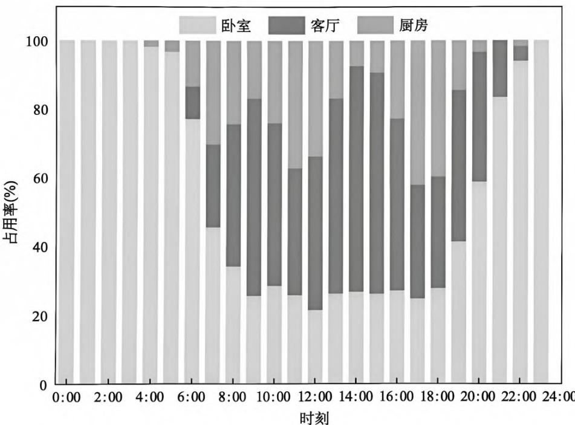  
图 5.4-1 农村居住建筑典型功能房间使用规律

居住建筑热环境的分时设计主要以昼间活动状态和夜间睡眠状态进行划分。满足人体昼间活动状态热舒适需求的室内设计参数参见5.4.1节。对于夜间睡眠状态，应综合考虑室内热环境与被褥微环境双空间对人体热舒适的耦合影响，如图5.4-2所示，据此对被褥微环境与房间热环境进行双空间耦合设计。

对于满足人员精准热舒适需求的住宅，室内热环境参数应按照昼一夜分时、客厅一卧室分区的原则选取。供暖工况下：昼间，人员活动范围以客厅为主、卧室为辅，房间温度取值范围为 $12 \sim 20^{\circ} \mathrm{C}$ ，其中，人员短暂逗留区域温度比长期逗留区域低 $1 \sim 2^{\circ} \mathrm{C}$ ；夜间，室内热环境设计以卧室睡眠空间为主，室内热环境应与被褥微气候相匹配，房间温度不宜高于 $21^{\circ}$ C，被褥温度不宜低于 $30^{\circ}$ C（引自西安建筑科技大学对居住建筑热环境的现场调研与气候室实验研究成果）。

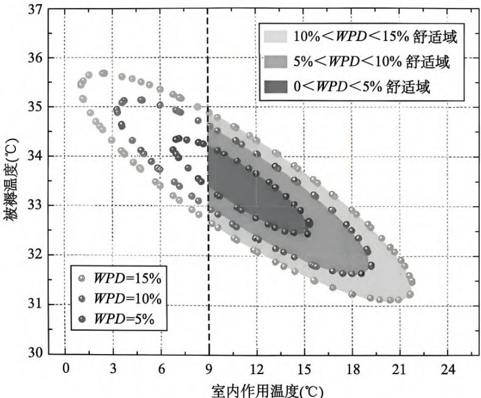  
图 5.4-2 睡眠热环境分区设计参数  
注：WPD 为整体热环境不满意率。

**5.4.3.4 应用特殊供暖空调的场景**

采用辐射方式进行供暖或空调，可以有效降低系统能耗，并且提高人体热舒适性。在冬季，采用地面辐射供暖，在相同的气象条件下，可以获得比普通散热器供暖更高的围护结构内表面温度，能够提高 PMV。因而，可以在较低的温度下，达到较高的室内热舒适度。研究表明，采用地面辐射供暖，将供暖房间温度降低 $2^{\circ}$ C，仍可保证人体热舒适度不变，而由此带来的节能效益可达 10% 以上。在夏季，采用冷辐射表面供冷，冷辐射直接作用于人体，避免了中间换热的热损失。研究表明，在室内人员热舒适得到保证的情况下，辐射供冷房间的室内设计温度比使用传统空调系统的房间高 $1.6^{\circ}$ C 左右，因而也能够取得较好的节能效果。

参照我国相关设计规范及研究成果，对于采用辐射方式供暖、空调的房间，辐射供暖室内设计温度宜降低 $2^{\circ} \mathrm{C}$ ，辐射供冷室内设计温度宜提高 $0.5 \sim 1.5^{\circ} \mathrm{C}$ 。既能够保证室内人员的热舒适性，也可达到降低能耗的目的。