# 第7章 建筑热工

## 7.1 建筑热工气候分区

### 7.1.1 建筑气候分区

《建筑气候区划标准》GB 50178—1993 和《民用建筑热工设计规范》GB 50176—2016 将建筑热工设计区划分为两级，具体的区划指标和设计原则如表 7.1-1、表 7.1-2 所示。

建筑热工设计一级区划指标及设计原则  
表7.1-1

<table><tr><td rowspan="2">一级区划名称</td><td colspan="2">区划指标</td><td rowspan="2">设计原则</td></tr><tr><td>主要指标(°C)</td><td>辅助指标(d)</td></tr><tr><td>严寒地区(1)</td><td> $t_{\min} \cdot m \leqslant -10$ </td><td> $145 \leqslant d \leqslant 5$ </td><td>必须充分满足冬季保温要求,一般可以不考虑夏季防热</td></tr><tr><td>寒冷地区(2)</td><td> $-10 < t_{\min} \cdot m \leqslant 0$ </td><td> $90 \leqslant d \leqslant 5 < 145$ </td><td>应满足冬季保温要求,部分地区兼顾夏季防热</td></tr><tr><td>夏热冬冷地区(3)</td><td> $0 < t_{\min} \cdot m \leqslant 10$  $25 < t_{\max} \cdot m \leqslant 30$ </td><td> $0 \leqslant d \leqslant 5 < 90$  $40 \leqslant d \geqslant 25 < 110$ </td><td>必须满足夏季防热要求,兼顾冬季保温</td></tr><tr><td>夏热冬暖地区(4)</td><td> $t_{\min} \cdot m >10$  $25 < t_{\max} \cdot m \leqslant 29$ </td><td> $100 \leqslant d \geqslant 25 < 200$ </td><td>必须充分满足夏季防热要求,一般可不考虑冬季保温</td></tr><tr><td>温和地区(5)</td><td> $0 < t_{\min} \cdot m \leqslant 13$  $18 < t_{\max} \cdot m \leqslant 25$ </td><td> $0 \leqslant d \leqslant 5 < 90$ </td><td>部分地区应考虑冬季保温,一般可不考虑夏季防热</td></tr></table>

注： $t_{\min \cdot m}$ 表示最冷月平均温度； $t_{\max \cdot m}$ 表示最热月平均温度； $d_{\leqslant5}$ 表示日平均温度 $\leqslant5^{\circ}C$ 的天数， $d_{\geqslant25}$ 表示日平均温度 $\geqslant25^{\circ}C$ 的天数。

建筑热工设计二级区划指标及设计要求  
表7.1-2

<table><tr><td>二级区划名称</td><td>区划指标(°C·d)</td><td>设计要求</td></tr><tr><td>严寒A区(1A)</td><td>6000≤HDD18</td><td>冬季保温要求极高,必须满足保温设计要求,不考虑防热设计</td></tr><tr><td>严寒B区(1B)</td><td>5000≤HDD18&lt;6000</td><td>冬季保温要求非常高,必须满足保温设计要求,不考虑防热设计</td></tr><tr><td>严寒C区(1C)</td><td>3800≤HDD18&lt;5000</td><td>必须满足保温设计要求,可不考虑防热设计</td></tr></table>

续表

<table><tr><td>二级区划名称</td><td colspan="2">区划指标(°C·d)</td><td>设计要求</td></tr><tr><td>寒冷A区(2A)</td><td rowspan="2">2000≤HDD18&lt;3800</td><td>CDD26≤90</td><td>应满足保温设计要求,可不考虑防热设计</td></tr><tr><td>寒冷B区(2B)</td><td>CDD26&gt;90</td><td>应满足保温设计要求,宜满足隔热设计要求,兼顾自然通风、遮阳设计</td></tr><tr><td>夏热冬冷A区(3A)</td><td colspan="2">1200≤HDD18&lt;2000</td><td>应满足保温、隔热设计要求,并重视建筑的自然通风、遮阳设计</td></tr><tr><td>夏热冬冷B区(3B)</td><td colspan="2">700≤HDD18&lt;1200</td><td>应满足隔热、保温设计要求,强调建筑的自然通风、遮阳设计</td></tr><tr><td>夏热冬暖A区(4A)</td><td colspan="2">500≤HDD18&lt;700</td><td>应满足隔热设计要求,宜满足保温设计要求,强调自然通风、遮阳设计</td></tr><tr><td>夏热冬暖B区(4B)</td><td colspan="2">HDD18&lt;500</td><td>应满足隔热设计要求,可不考虑保温设计,强调自然通风、遮阳设计</td></tr><tr><td>温和A区(5A)</td><td rowspan="2">CDD26&lt;10</td><td>700≤HDD18&lt;2000</td><td>应满足冬季保温设计要求,可不考虑防热设计</td></tr><tr><td>温和B区(5B)</td><td>HDD18&lt;700</td><td>宜满足冬季保温设计要求,可不考虑防热设计</td></tr></table>

注：HDD18 指以 $18^{\circ}$ C 为基准的供暖度日数；CDD26 指以 $26^{\circ}$ C 为基准的空调度日数。

根据《被动式太阳能建筑技术规范》JGJ/T 267—2012，被动供暖建筑气候分区是采用南向垂直面太阳辐照度与室内外温差的比值（辐射温差比 ITR）作为被动式太阳能供暖气候分区的一级分区指标，南向垂直面太阳辐照度（W/m²）作为二级指标，划分出不同的被动太阳能供暖建筑设计分区。表 7.1-3 为被动太阳能供暖气候分区指标。

被动太阳能供暖气候分区指标  
表 7.1-3

<table><tr><td colspan="2">被动太阳能供暖气候分区</td><td>南向辐射温差比 ITR[W/(m2·°C)]</td><td>南向垂直面太阳辐照度I(W/m2)</td><td>典型城市</td></tr><tr><td rowspan="2">最佳气候区</td><td>A区(SH I a)</td><td>ITR≥8</td><td>I≥160</td><td>拉萨、日喀则、稻城、小金、理塘、得荣、昌都、巴塘</td></tr><tr><td>B区(SH I b)</td><td>ITR≥8</td><td>160&gt;I≥60</td><td>昆明、大理、西昌、会理、木里、林芝、马尔康、九龙、道孚、德格</td></tr><tr><td rowspan="3">适宜气候区</td><td>A区(SH II a)</td><td>6≤ITR&lt;8</td><td>I≥120</td><td>西宁、银川、格尔木、哈密、民勤、敦煌、甘孜、松潘、阿坝、若尔盖</td></tr><tr><td>B区(SH II b)</td><td>6≤ITR&lt;8</td><td>120&gt;I≥60</td><td>康定、阳泉、昭觉、昭通</td></tr><tr><td>C区(SH II c)</td><td>4≤ITR&lt;6</td><td>I≥60</td><td>北京、天津、石家庄、太原、呼和浩特、长春、上海、济南、西安、兰州、青岛、郑州、长春、张家口、吐鲁番、安康、伊宁、民和、大同、锦州、保定、承德、唐山、大连、洛阳、日照、徐州、宝鸡、开封、玉树、齐齐哈尔</td></tr><tr><td>一般气候区(SHIII)</td><td>4&lt;ITR≤3</td><td>I≥60</td><td>乌鲁木齐、沈阳、吉林、武汉、长沙、南京、杭州、合肥、南昌、延安、商丘、邢台、淄博、泰安、海拉尔、克拉玛依、鹤岗、天水、安阳、通化</td></tr><tr><td rowspan="2">不宜气候区(SHIV)</td><td>ITR≤3</td><td>—</td><td rowspan="2">成都、重庆、贵阳、绵阳、遂宁、南充、达县、泸州、南阳、遵义、岳阳、信阳、吉首、常德</td></tr><tr><td>—</td><td colspan="2">I&lt;60</td></tr></table>

注：辐射温差比 ITR 指累年 1 月南向垂直面太阳平均辐射照度与 1 月室内外温差的比值。

### 7.1.2 建筑热工设计用室外气象参数

我国部分城镇建筑热工设计用室外气象参数如表 7.1-4 所示。

我国部分城镇建筑热工设计用室外气象参数  
表7.1-4

<table><tr><td>省份</td><td>城镇</td><td>气候区属</td><td>最冷月平均温度 tmin·m(°C)</td><td>最热月平均温度 tmax·m(°C)</td><td>供暖度日数 HDD18(°C·d)</td><td>空调度日数 CDD26(°C·d)</td><td>供暖室外计算温度 tw(°C)</td><td>计算供暖期室外平均温度 te(°C)</td><td>计算供暖期室外平均相对湿度 φo(%)</td></tr><tr><td>北京</td><td>北京</td><td>2B</td><td>-2.9</td><td>27.1</td><td>2699</td><td>94</td><td>-7.0</td><td>0.1</td><td>43</td></tr><tr><td>天津</td><td>天津</td><td>2B</td><td>-3.5</td><td>27.0</td><td>2743</td><td>92</td><td>-7.0</td><td>-0.2</td><td>59</td></tr><tr><td>上海</td><td>上海</td><td>3A</td><td>4.9</td><td>28.5</td><td>1540</td><td>199</td><td>0.5</td><td>4.4</td><td>73</td></tr><tr><td rowspan="4">重庆</td><td>重庆</td><td>3B</td><td>8.1</td><td>28.4</td><td>1089</td><td>217</td><td>5.5</td><td>-</td><td>-</td></tr><tr><td>奉节</td><td>3A</td><td>6.0</td><td>26.9</td><td>1457</td><td>126</td><td>3.1</td><td>-</td><td>-</td></tr><tr><td>梁平</td><td>3A</td><td>6.0</td><td>26.9</td><td>1435</td><td>102</td><td>3.6</td><td>-</td><td>-</td></tr><tr><td>酉阳</td><td>3A</td><td>4.7</td><td>25.2</td><td>1731</td><td>22</td><td>0.9</td><td>4.4</td><td>76</td></tr><tr><td rowspan="13">黑龙江</td><td>哈尔滨</td><td>1B</td><td>-16.9</td><td>23.8</td><td>5032</td><td>14</td><td>-22.4</td><td>-8.5</td><td>62</td></tr><tr><td>漠河</td><td>1A</td><td>-28.4</td><td>18.6</td><td>7994</td><td>0</td><td>-36.3</td><td>-14.7</td><td>67</td></tr><tr><td>呼玛</td><td>1A</td><td>-24.3</td><td>21.5</td><td>6805</td><td>4</td><td>-32.6</td><td>-12.9</td><td>64</td></tr><tr><td>黑河</td><td>1A</td><td>-21.9</td><td>21.6</td><td>6310</td><td>4</td><td>-28.9</td><td>-11.6</td><td>60</td></tr><tr><td>嫩江</td><td>1A</td><td>-23.0</td><td>21.7</td><td>6352</td><td>5</td><td>-30.1</td><td>-11.9</td><td>63</td></tr><tr><td>孙吴</td><td>1A</td><td>-22.8</td><td>21.0</td><td>6517</td><td>2</td><td>-29.2</td><td>-11.5</td><td>68</td></tr><tr><td>克山</td><td>1B</td><td>-21.1</td><td>22.6</td><td>5888</td><td>7</td><td>-26.3</td><td>-10.6</td><td>61</td></tr><tr><td>齐齐哈尔</td><td>1B</td><td>-17.7</td><td>24.0</td><td>5259</td><td>23</td><td>-23.2</td><td>-8.7</td><td>54</td></tr><tr><td>海伦</td><td>1B</td><td>-20.8</td><td>22.4</td><td>5798</td><td>5</td><td>-25.8</td><td>-10.3</td><td>63</td></tr><tr><td>伊春</td><td>1A</td><td>-21.2</td><td>21.3</td><td>6100</td><td>1</td><td>-27.2</td><td>-10.8</td><td>64</td></tr><tr><td>富锦</td><td>1B</td><td>-19.0</td><td>22.5</td><td>5594</td><td>6</td><td>-24.0</td><td>-9.5</td><td>63</td></tr><tr><td>泰来</td><td>1B</td><td>-16.1</td><td>24.4</td><td>5005</td><td>26</td><td>-21.7</td><td>-8.3</td><td>52</td></tr><tr><td>安达</td><td>1B</td><td>-18.2</td><td>23.9</td><td>5291</td><td>15</td><td>-23.6</td><td>-9.1</td><td>57</td></tr></table>

续表

<table><tr><td>省份</td><td>城镇</td><td>气候区属</td><td>最冷月平均温度 t_min·m(°C)</td><td>最热月平均温度 t_mas·m(°C)</td><td>供暖度日数 HDD18(°C·d)</td><td>空调度日数 CDD26(°C·d)</td><td>供暖室外计算温度 l_w(°C)</td><td>计算供暖期室外平均温度 l̄。(°C)</td><td>计算供暖期室外平均相对湿度 φ̄。(%)</td></tr><tr><td rowspan="7">黑龙江</td><td>宝清</td><td>1B</td><td>-16.7</td><td>22.6</td><td>5190</td><td>9</td><td>-22.4</td><td>-8.2</td><td>57</td></tr><tr><td>通河</td><td>1B</td><td>-20.2</td><td>22.5</td><td>5675</td><td>3</td><td>-25.5</td><td>-9.7</td><td>71</td></tr><tr><td>尚志</td><td>1B</td><td>-19.0</td><td>22.5</td><td>5467</td><td>3</td><td>-24.9</td><td>-8.8</td><td>67</td></tr><tr><td>鸡西</td><td>1B</td><td>-15.9</td><td>22.3</td><td>5105</td><td>7</td><td>-21.0</td><td>-7.7</td><td>58</td></tr><tr><td>虎林</td><td>1B</td><td>-17.7</td><td>21.9</td><td>5351</td><td>2</td><td>-22.8</td><td>-8.8</td><td>65</td></tr><tr><td>牡丹江</td><td>1B</td><td>-16.7</td><td>22.8</td><td>5066</td><td>7</td><td>-21.8</td><td>-8.2</td><td>61</td></tr><tr><td>绥芬河</td><td>1B</td><td>-16.1</td><td>19.9</td><td>5422</td><td>1</td><td>-21.3</td><td>-7.6</td><td>59</td></tr><tr><td rowspan="10">吉林</td><td>长春</td><td>1C</td><td>-14.4</td><td>23.7</td><td>4642</td><td>12</td><td>-20.8</td><td>-6.7</td><td>57</td></tr><tr><td>前郭尔罗斯</td><td>1C</td><td>-15.5</td><td>24.3</td><td>4800</td><td>17</td><td>-21.9</td><td>-7.6</td><td>54</td></tr><tr><td>长岭</td><td>1C</td><td>-14.8</td><td>24.2</td><td>4718</td><td>15</td><td>-20.9</td><td>-7.2</td><td>54</td></tr><tr><td>四平</td><td>1C</td><td>-12.8</td><td>24.4</td><td>4308</td><td>15</td><td>-19.8</td><td>-5.5</td><td>57</td></tr><tr><td>敦化</td><td>1B</td><td>-15.9</td><td>20.8</td><td>5221</td><td>1</td><td>-21.5</td><td>-7.0</td><td>61</td></tr><tr><td>桦甸</td><td>1B</td><td>-17.1</td><td>22.8</td><td>5007</td><td>4</td><td>-24.6</td><td>-7.9</td><td>65</td></tr><tr><td>延吉</td><td>1C</td><td>-13.2</td><td>21.9</td><td>4687</td><td>5</td><td>-17.8</td><td>-6.1</td><td>55</td></tr><tr><td>临江</td><td>1C</td><td>-14.8</td><td>22.9</td><td>4736</td><td>4</td><td>-20.4</td><td>-6.7</td><td>64</td></tr><tr><td>集安</td><td>1C</td><td>-11.6</td><td>23.9</td><td>4142</td><td>9</td><td>-16.4</td><td>-4.5</td><td>65</td></tr><tr><td>长白</td><td>1B</td><td>-16.6</td><td>19.6</td><td>5542</td><td>0</td><td>-22.0</td><td>-7.8</td><td>64</td></tr><tr><td rowspan="10">辽宁</td><td>沈阳</td><td>1C</td><td>-11.2</td><td>25.0</td><td>3929</td><td>25</td><td>-18.1</td><td>-4.5</td><td>55</td></tr><tr><td>彰武</td><td>1C</td><td>-11.8</td><td>24.5</td><td>4134</td><td>13</td><td>-18.0</td><td>-4.9</td><td>48</td></tr><tr><td>清原</td><td>1C</td><td>-14.1</td><td>23.6</td><td>4598</td><td>8</td><td>-20.3</td><td>-6.3</td><td>65</td></tr><tr><td>朝阳</td><td>2A</td><td>-8.5</td><td>25.6</td><td>3559</td><td>53</td><td>-13.7</td><td>-3.1</td><td>38</td></tr><tr><td>锦州</td><td>2A</td><td>-7.6</td><td>25.0</td><td>3458</td><td>26</td><td>-13.0</td><td>-2.5</td><td>47</td></tr><tr><td>本溪</td><td>1C</td><td>-11.5</td><td>24.3</td><td>4046</td><td>16</td><td>-18.5</td><td>-4.4</td><td>58</td></tr><tr><td>营口</td><td>2A</td><td>-8.4</td><td>25.5</td><td>3526</td><td>29</td><td>-14.6</td><td>-2.9</td><td>58</td></tr><tr><td>宽甸</td><td>1C</td><td>-10.8</td><td>23.0</td><td>4095</td><td>4</td><td>-16.0</td><td>-4.1</td><td>65</td></tr><tr><td>丹东</td><td>2A</td><td>-7.3</td><td>23.4</td><td>3566</td><td>6</td><td>-11.8</td><td>-2.2</td><td>55</td></tr><tr><td>大连</td><td>2A</td><td>-3.4</td><td>24.1</td><td>2924</td><td>16</td><td>-9.0</td><td>0.1</td><td>54</td></tr><tr><td rowspan="6">内蒙古</td><td>呼和浩特</td><td>1C</td><td>-10.8</td><td>23.4</td><td>4186</td><td>11</td><td>-15.6</td><td>-4.4</td><td>49</td></tr><tr><td>图里河</td><td>1A</td><td>-28.4</td><td>17.5</td><td>8023</td><td>0</td><td>-35.2</td><td>-14.4</td><td>67</td></tr><tr><td>海拉尔</td><td>1A</td><td>-24.3</td><td>21.0</td><td>6713</td><td>3</td><td>-31.1</td><td>-12.0</td><td>71</td></tr><tr><td>新巴尔虎右旗</td><td>1A</td><td>-20.8</td><td>22.7</td><td>6157</td><td>13</td><td>-26.6</td><td>-10.6</td><td>62</td></tr><tr><td>博克图</td><td>1A</td><td>-20.5</td><td>18.8</td><td>6622</td><td>0</td><td>-26.1</td><td>-10.3</td><td>60</td></tr><tr><td>东乌珠穆沁旗</td><td>1B</td><td>-19.7</td><td>22.1</td><td>5940</td><td>11</td><td>-25.8</td><td>-10.1</td><td>58</td></tr><tr><td>省份</td><td>城镇</td><td>气候区属</td><td>最冷月平均温度l_min·m(℃)</td><td>最热月平均温度l_max·m(℃)</td><td>供暖度日数HDD18(℃·d)</td><td>空调度日数CDD26(℃·d)</td><td>供暖室外计算温度lw(℃)</td><td>计算供暖期室外平均温度 l0(℃)</td><td>计算供暖期室外平均相对湿度 φ0(%)</td></tr><tr><td rowspan="26">内蒙古</td><td>额济纳旗</td><td>1C</td><td>-10.1</td><td>27.8</td><td>3884</td><td>130</td><td>-14.6</td><td>-4.3</td><td>36</td></tr><tr><td>拐子湖</td><td>1C</td><td>-10.1</td><td>28.3</td><td>3836</td><td>173</td><td>-15.5</td><td>-4.2</td><td>34</td></tr><tr><td>巴音毛道</td><td>1C</td><td>-10.5</td><td>24.6</td><td>4208</td><td>30</td><td>-16.0</td><td>-4.7</td><td>40</td></tr><tr><td>二连浩特</td><td>1B</td><td>-16.7</td><td>24.5</td><td>5131</td><td>36</td><td>-23.8</td><td>-8.0</td><td>52</td></tr><tr><td>那仁宝拉格</td><td>1A</td><td>-20.4</td><td>21.2</td><td>6153</td><td>4</td><td>-26.5</td><td>-9.9</td><td>61</td></tr><tr><td>满都拉</td><td>1C</td><td>-13.1</td><td>23.6</td><td>4746</td><td>20</td><td>-19.0</td><td>-5.8</td><td>42</td></tr><tr><td>阿巴嘎旗</td><td>1B</td><td>-20.0</td><td>21.9</td><td>5892</td><td>7</td><td>-26.5</td><td>-9.9</td><td>57</td></tr><tr><td>海力素</td><td>1C</td><td>-12.9</td><td>23.0</td><td>4780</td><td>14</td><td>-19.1</td><td>-5.8</td><td>42</td></tr><tr><td>朱日和</td><td>1C</td><td>-13.8</td><td>23.1</td><td>4810</td><td>16</td><td>-20.6</td><td>-6.1</td><td>45</td></tr><tr><td>乌拉特后旗</td><td>1C</td><td>-12.7</td><td>23.1</td><td>4675</td><td>10</td><td>-18.1</td><td>-5.6</td><td>49</td></tr><tr><td>达尔罕联合旗</td><td>1C</td><td>-14.0</td><td>21.8</td><td>4969</td><td>5</td><td>-20.3</td><td>-6.4</td><td>45</td></tr><tr><td>化德</td><td>1B</td><td>-14.8</td><td>19.6</td><td>5366</td><td>0</td><td>-21.0</td><td>-6.8</td><td>57</td></tr><tr><td>集宁</td><td>1C</td><td>-12.4</td><td>20.4</td><td>4873</td><td>0</td><td>-18.1</td><td>-5.4</td><td>50</td></tr><tr><td>吉兰太</td><td>2A</td><td>-8.9</td><td>26.2</td><td>3746</td><td>68</td><td>-13.8</td><td>-3.4</td><td>37</td></tr><tr><td>临河</td><td>2A</td><td>-8.7</td><td>24.9</td><td>3777</td><td>30</td><td>-13.7</td><td>-3.1</td><td>43</td></tr><tr><td>鄂托克旗</td><td>1C</td><td>-9.0</td><td>23.0</td><td>4045</td><td>9</td><td>-14.8</td><td>-3.6</td><td>42</td></tr><tr><td>东胜</td><td>1C</td><td>-9.5</td><td>21.9</td><td>4226</td><td>3</td><td>-15.5</td><td>-3.8</td><td>43</td></tr><tr><td>西乌珠穆沁旗</td><td>1B</td><td>-18.0</td><td>20.8</td><td>5812</td><td>4</td><td>-24.6</td><td>-8.4</td><td>58</td></tr><tr><td>扎鲁特旗</td><td>1C</td><td>-12.1</td><td>24.9</td><td>4398</td><td>32</td><td>-17.3</td><td>-5.6</td><td>39</td></tr><tr><td>巴林左旗</td><td>1C</td><td>-13.1</td><td>23.3</td><td>4704</td><td>10</td><td>-18.3</td><td>-6.4</td><td>43</td></tr><tr><td>锡林浩特</td><td>1B</td><td>-18.0</td><td>22.2</td><td>5545</td><td>12</td><td>-24.6</td><td>-8.6</td><td>58</td></tr><tr><td>林西</td><td>1C</td><td>-13.4</td><td>22.2</td><td>4858</td><td>7</td><td>-18.8</td><td>-6.3</td><td>42</td></tr><tr><td>通辽</td><td>1C</td><td>-12.7</td><td>24.8</td><td>4376</td><td>22</td><td>-18.6</td><td>-5.7</td><td>46</td></tr><tr><td>多伦</td><td>1B</td><td>-16.0</td><td>19.9</td><td>5466</td><td>0</td><td>-22.7</td><td>-7.4</td><td>55</td></tr><tr><td>赤峰</td><td>1C</td><td>-10.7</td><td>23.9</td><td>4196</td><td>20</td><td>-16.2</td><td>-4.5</td><td>42</td></tr><tr><td>宝国图</td><td>1C</td><td>-11.1</td><td>24.0</td><td>4197</td><td>20</td><td>-16.5</td><td>-4.7</td><td>39</td></tr><tr><td rowspan="7">山东</td><td>济南</td><td>2B</td><td>-0.1</td><td>27.6</td><td>2211</td><td>160</td><td>-5.2</td><td>1.8</td><td>51</td></tr><tr><td>德州</td><td>2B</td><td>-2.4</td><td>27.0</td><td>2613</td><td>103</td><td>-6.7</td><td>0.5</td><td>63</td></tr><tr><td>惠民县</td><td>2B</td><td>-2.4</td><td>27.1</td><td>2622</td><td>96</td><td>-6.7</td><td>0.4</td><td>58</td></tr><tr><td>长岛</td><td>2A</td><td>-0.7</td><td>24.4</td><td>2570</td><td>20</td><td>-4.2</td><td>1.4</td><td>62</td></tr><tr><td>龙口</td><td>2A</td><td>-1.4</td><td>26.2</td><td>2551</td><td>60</td><td>-4.5</td><td>1.1</td><td>59</td></tr><tr><td>成山头</td><td>2A</td><td>-0.1</td><td>21.6</td><td>2672</td><td>2</td><td>-3.7</td><td>2.0</td><td>63</td></tr><tr><td>莘县</td><td>2A</td><td>-1.7</td><td>26.9</td><td>2521</td><td>90</td><td>-5.9</td><td>0.8</td><td>66</td></tr><tr><td>省份</td><td>城镇</td><td>气候区属</td><td>最冷月平均温度 t_min·m (°C)</td><td>最热月平均温度 t_mas·m (°C)</td><td>供暖度日数 HDD18 (°C·d)</td><td>空调度日数 CDD26 (°C·d)</td><td>供暖室外计算温度 t_w (°C)</td><td>计算供暖期室外平均温度 t_c (°C)</td><td>计算供暖期室外平均相对湿度 φ。 (%)</td></tr><tr><td rowspan="7">山东</td><td>沂源</td><td>2A</td><td>-2.2</td><td>25.9</td><td>2660</td><td>45</td><td>-6.0</td><td>0.7</td><td>54</td></tr><tr><td>潍坊</td><td>2A</td><td>-2.8</td><td>26.5</td><td>2735</td><td>63</td><td>-6.6</td><td>0.3</td><td>62</td></tr><tr><td>青岛</td><td>2A</td><td>0.2</td><td>24.6</td><td>2401</td><td>22</td><td>-3.8</td><td>2.1</td><td>61</td></tr><tr><td>海阳</td><td>2A</td><td>-1.4</td><td>24.7</td><td>2631</td><td>20</td><td>-5.1</td><td>1.1</td><td>58</td></tr><tr><td>定陶</td><td>2B</td><td>-0.5</td><td>27.1</td><td>2319</td><td>107</td><td>-4.4</td><td>1.5</td><td>68</td></tr><tr><td>兖州</td><td>2B</td><td>-0.8</td><td>27.2</td><td>2390</td><td>97</td><td>-4.6</td><td>1.5</td><td>64</td></tr><tr><td>日照</td><td>2A</td><td>0.2</td><td>25.4</td><td>2361</td><td>39</td><td>-3.5</td><td>2.1</td><td>58</td></tr><tr><td rowspan="12">河北</td><td>石家庄</td><td>2B</td><td>-1.1</td><td>27.6</td><td>2388</td><td>147</td><td>-5.3</td><td>0.9</td><td>53</td></tr><tr><td>蔚县</td><td>1C</td><td>-10.0</td><td>23.3</td><td>3955</td><td>9</td><td>-15.2</td><td>-3.9</td><td>47</td></tr><tr><td>邢台</td><td>2B</td><td>-0.5</td><td>27.6</td><td>2268</td><td>155</td><td>-4.8</td><td>1.4</td><td>52</td></tr><tr><td>丰宁</td><td>1C</td><td>-10.1</td><td>23.1</td><td>4167</td><td>5</td><td>-14.2</td><td>-4.2</td><td>40</td></tr><tr><td>围场</td><td>1C</td><td>-11.7</td><td>21.9</td><td>4602</td><td>3</td><td>-16.6</td><td>-5.1</td><td>44</td></tr><tr><td>张家口</td><td>2A</td><td>-7.7</td><td>24.5</td><td>3637</td><td>24</td><td>-12.7</td><td>-2.7</td><td>37</td></tr><tr><td>怀来</td><td>2A</td><td>-6.5</td><td>25.1</td><td>3388</td><td>32</td><td>-10.9</td><td>-1.8</td><td>38</td></tr><tr><td>承德</td><td>2A</td><td>-8.9</td><td>24.5</td><td>3783</td><td>20</td><td>-13.7</td><td>-3.4</td><td>49</td></tr><tr><td>青龙</td><td>2A</td><td>-7.7</td><td>24.9</td><td>3532</td><td>23</td><td>-12.0</td><td>-2.5</td><td>49</td></tr><tr><td>唐山</td><td>2A</td><td>-4.1</td><td>26.6</td><td>2853</td><td>72</td><td>-7.9</td><td>-0.6</td><td>50</td></tr><tr><td>乐亭</td><td>2A</td><td>-5.0</td><td>25.6</td><td>3080</td><td>37</td><td>-8.9</td><td>-1.3</td><td>56</td></tr><tr><td>保定</td><td>2B</td><td>-2.3</td><td>27.5</td><td>2564</td><td>129</td><td>-6.4</td><td>0.4</td><td>53</td></tr><tr><td rowspan="8">河南</td><td>郑州</td><td>2B</td><td>0.9</td><td>27.2</td><td>2106</td><td>125</td><td>-3.5</td><td>2.5</td><td>57</td></tr><tr><td>安阳</td><td>2B</td><td>-0.7</td><td>27.4</td><td>2309</td><td>131</td><td>-4.9</td><td>1.3</td><td>59</td></tr><tr><td>孟津</td><td>2A</td><td>0.4</td><td>26.3</td><td>2221</td><td>89</td><td>-4.0</td><td>2.3</td><td>52</td></tr><tr><td>南阳</td><td>3A</td><td>2.1</td><td>27.2</td><td>1967</td><td>123</td><td>-1.4</td><td>3.0</td><td>69</td></tr><tr><td>西华</td><td>2B</td><td>1.3</td><td>27.2</td><td>2096</td><td>110</td><td>-2.5</td><td>2.4</td><td>67</td></tr><tr><td>驻马店</td><td>3A</td><td>2.0</td><td>27.6</td><td>1956</td><td>142</td><td>-2.1</td><td>3.1</td><td>68</td></tr><tr><td>信阳</td><td>3A</td><td>2.8</td><td>27.6</td><td>1863</td><td>137</td><td>-1.5</td><td>3.7</td><td>69</td></tr><tr><td>固始</td><td>3A</td><td>3.0</td><td>28.2</td><td>1803</td><td>168</td><td>-1.0</td><td>3.9</td><td>73</td></tr><tr><td rowspan="6">山西</td><td>太原</td><td>2A</td><td>-4.6</td><td>24.1</td><td>3160</td><td>11</td><td>-9.0</td><td>-1.1</td><td>47</td></tr><tr><td>大同</td><td>1C</td><td>-10.2</td><td>22.8</td><td>4120</td><td>8</td><td>-15.6</td><td>-4.0</td><td>45</td></tr><tr><td>河曲</td><td>1C</td><td>-10.5</td><td>24.2</td><td>3913</td><td>18</td><td>-15.7</td><td>-4.0</td><td>53</td></tr><tr><td>原平</td><td>2A</td><td>-6.3</td><td>24.1</td><td>3399</td><td>14</td><td>-11.2</td><td>-1.7</td><td>42</td></tr><tr><td>离石</td><td>2A</td><td>-6.5</td><td>24.1</td><td>3424</td><td>16</td><td>-11.4</td><td>-1.8</td><td>53</td></tr><tr><td>榆社</td><td>2A</td><td>-6.1</td><td>22.5</td><td>3529</td><td>1</td><td>-10.6</td><td>-1.7</td><td>47</td></tr><tr><td>省份</td><td>城镇</td><td>气候区属</td><td>最冷月平均温度l_min·m(℃)</td><td>最热月平均温度l_max·m(℃)</td><td>供暖度日数HDD18(℃·d)</td><td>空调度日数CDD26(℃·d)</td><td>供暖室外计算温度t_w(℃)</td><td>计算供暖期室外平均温度 l_c(℃)</td><td>计算供暖期室外平均相对湿度 φc(%)</td></tr><tr><td rowspan="3">山西</td><td>介休</td><td>2A</td><td>-3.6</td><td>24.7</td><td>2978</td><td>24</td><td>-8.2</td><td>-0.3</td><td>50</td></tr><tr><td>运城</td><td>2B</td><td>-0.1</td><td>28.1</td><td>2267</td><td>185</td><td>-3.5</td><td>1.3</td><td>55</td></tr><tr><td>阳城</td><td>2A</td><td>-2.0</td><td>24.7</td><td>2698</td><td>21</td><td>-5.9</td><td>0.7</td><td>51</td></tr><tr><td rowspan="6">陕西</td><td>西安</td><td>2B</td><td>0.9</td><td>27.8</td><td>2178</td><td>153</td><td>-2.4</td><td>2.1</td><td>62</td></tr><tr><td>榆林</td><td>2A</td><td>-8.2</td><td>24.1</td><td>3672</td><td>19</td><td>-13.5</td><td>-2.9</td><td>47</td></tr><tr><td>延安</td><td>2A</td><td>-4.5</td><td>24.1</td><td>3127</td><td>15</td><td>-8.9</td><td>-0.9</td><td>50</td></tr><tr><td>宝鸡</td><td>2A</td><td>0.6</td><td>26.6</td><td>2301</td><td>86</td><td>-2.7</td><td>2.1</td><td>59</td></tr><tr><td>汉中</td><td>3A</td><td>3.1</td><td>26.3</td><td>1945</td><td>63</td><td>0.7</td><td>3.5</td><td>80</td></tr><tr><td>安康</td><td>3A</td><td>4.0</td><td>27.6</td><td>1743</td><td>135</td><td>1.6</td><td>4.3</td><td>73</td></tr><tr><td rowspan="14">甘肃</td><td>兰州</td><td>2A</td><td>-4.0</td><td>23.3</td><td>3094</td><td>16</td><td>-6.6</td><td>-0.6</td><td>46</td></tr><tr><td>马鬃山</td><td>1C</td><td>-11.8</td><td>21.2</td><td>4937</td><td>1</td><td>-17.4</td><td>-5.0</td><td>44</td></tr><tr><td>敦煌</td><td>2A</td><td>-7.6</td><td>25.6</td><td>3518</td><td>40</td><td>-11.8</td><td>-2.8</td><td>44</td></tr><tr><td>玉门镇</td><td>1C</td><td>-9.3</td><td>22.7</td><td>4083</td><td>3</td><td>-14.3</td><td>-3.8</td><td>43</td></tr><tr><td>酒泉</td><td>1C</td><td>-8.8</td><td>22.7</td><td>3971</td><td>3</td><td>-14.4</td><td>-3.4</td><td>46</td></tr><tr><td>张掖</td><td>1C</td><td>-9.0</td><td>22.8</td><td>4001</td><td>9</td><td>-13.1</td><td>-3.6</td><td>49</td></tr><tr><td>民勤</td><td>2A</td><td>-7.5</td><td>23.7</td><td>3715</td><td>17</td><td>-12.4</td><td>-2.6</td><td>41</td></tr><tr><td>乌鞘岭</td><td>1A</td><td>-11.3</td><td>12.1</td><td>6329</td><td>0</td><td>-16.9</td><td>-4.0</td><td>50</td></tr><tr><td>华家岭</td><td>1C</td><td>-7.8</td><td>15.4</td><td>4997</td><td>0</td><td>-13.2</td><td>-2.7</td><td>61</td></tr><tr><td>平凉</td><td>2A</td><td>-3.7</td><td>21.8</td><td>3334</td><td>1</td><td>-8.1</td><td>-0.3</td><td>53</td></tr><tr><td>西峰镇</td><td>2A</td><td>-3.8</td><td>21.8</td><td>3364</td><td>1</td><td>-8.2</td><td>-0.3</td><td>51</td></tr><tr><td>合作</td><td>1B</td><td>-9.1</td><td>13.5</td><td>5432</td><td>0</td><td>-12.5</td><td>-3.4</td><td>52</td></tr><tr><td>武都</td><td>3A</td><td>3.9</td><td>26.0</td><td>1776</td><td>65</td><td>1.3</td><td>4.2</td><td>49</td></tr><tr><td>天水</td><td>2A</td><td>-1.2</td><td>24.1</td><td>2729</td><td>13</td><td>-4.1</td><td>1.0</td><td>59</td></tr><tr><td rowspan="3">宁夏</td><td>银川</td><td>2A</td><td>-6.7</td><td>23.9</td><td>3472</td><td>11</td><td>-11.2</td><td>-2.1</td><td>50</td></tr><tr><td>中宁</td><td>2A</td><td>-5.8</td><td>23.9</td><td>3349</td><td>22</td><td>-9.9</td><td>-1.6</td><td>44</td></tr><tr><td>盐池</td><td>2A</td><td>-7.1</td><td>23.1</td><td>3700</td><td>10</td><td>-12.6</td><td>-2.3</td><td>44</td></tr><tr><td rowspan="7">青海</td><td>西宁</td><td>1C</td><td>-7.9</td><td>17.2</td><td>4478</td><td>0</td><td>-11.5</td><td>-3.0</td><td>49</td></tr><tr><td>茫崖</td><td>1B</td><td>-10.6</td><td>17.4</td><td>5075</td><td>0</td><td>-13.8</td><td>-4.3</td><td>26</td></tr><tr><td>冷湖</td><td>1B</td><td>-12.1</td><td>18.2</td><td>5395</td><td>0</td><td>-15.6</td><td>-5.6</td><td>28</td></tr><tr><td>大柴旦</td><td>1B</td><td>-12.7</td><td>16.8</td><td>5616</td><td>0</td><td>-16.7</td><td>-5.8</td><td>32</td></tr><tr><td>德令哈</td><td>1C</td><td>-10.4</td><td>17.5</td><td>4874</td><td>0</td><td>-14.1</td><td>-3.7</td><td>32</td></tr><tr><td>刚察</td><td>1A</td><td>-13.2</td><td>11.7</td><td>6471</td><td>0</td><td>-16.8</td><td>-5.2</td><td>44</td></tr><tr><td>格尔木</td><td>1C</td><td>-8.2</td><td>18.9</td><td>4436</td><td>0</td><td>-11.2</td><td>-3.1</td><td>29</td></tr><tr><td>省份</td><td>城镇</td><td>气候区属</td><td>最冷月平均温度 tmin·m(°C)</td><td>最热月平均温度 tmax·m(°C)</td><td>供暖度日数 HDD18(°C·d)</td><td>空调度日数 CDD26(°C·d)</td><td>供暖室外计算温度 tw(°C)</td><td>计算供暖期室外平均温度 l0(°C)</td><td>计算供暖期室外平均相对湿度 φ0(%)</td></tr><tr><td rowspan="9">青海</td><td>都兰</td><td>1B</td><td>-9.5</td><td>15.9</td><td>5161</td><td>0</td><td>-13.6</td><td>-3.6</td><td>32</td></tr><tr><td>五道梁</td><td>1A</td><td>-16.6</td><td>6.4</td><td>8331</td><td>0</td><td>-21.1</td><td>-6.9</td><td>51</td></tr><tr><td>托托河</td><td>1A</td><td>-16.6</td><td>8.4</td><td>7878</td><td>0</td><td>-22.5</td><td>-7.2</td><td>48</td></tr><tr><td>杂多</td><td>1A</td><td>-10.9</td><td>11.4</td><td>6153</td><td>0</td><td>-15.8</td><td>-3.8</td><td>48</td></tr><tr><td>曲麻莱</td><td>1A</td><td>-13.9</td><td>9.5</td><td>7148</td><td>0</td><td>-19.1</td><td>-5.8</td><td>48</td></tr><tr><td>玉树</td><td>1B</td><td>-7.4</td><td>13.4</td><td>5154</td><td>0</td><td>-11.5</td><td>-2.2</td><td>43</td></tr><tr><td>玛多</td><td>1A</td><td>-15.6</td><td>8.3</td><td>7683</td><td>0</td><td>-20.6</td><td>-6.4</td><td>51</td></tr><tr><td>达日</td><td>1A</td><td>-12.2</td><td>9.8</td><td>6721</td><td>0</td><td>-17.8</td><td>-4.5</td><td>52</td></tr><tr><td>河南</td><td>1A</td><td>-12.8</td><td>10.5</td><td>6591</td><td>0</td><td>-17.5</td><td>-4.5</td><td>57</td></tr><tr><td rowspan="24">新疆</td><td>乌鲁木齐</td><td>1C</td><td>-12.2</td><td>23.7</td><td>4329</td><td>36</td><td>-17.8</td><td>-6.5</td><td>73</td></tr><tr><td>哈巴河</td><td>1C</td><td>-13.9</td><td>22.4</td><td>4867</td><td>10</td><td>-22.9</td><td>-6.9</td><td>67</td></tr><tr><td>阿勒泰</td><td>1B</td><td>-15.4</td><td>21.8</td><td>5081</td><td>11</td><td>-23.4</td><td>-7.9</td><td>67</td></tr><tr><td>富蕴</td><td>1B</td><td>-19.2</td><td>23.1</td><td>5458</td><td>22</td><td>-26.9</td><td>-10.1</td><td>70</td></tr><tr><td>塔城</td><td>1C</td><td>-10.1</td><td>23.1</td><td>4143</td><td>20</td><td>-17.8</td><td>-5.1</td><td>67</td></tr><tr><td>和布克赛尔</td><td>1B</td><td>-12.3</td><td>19.6</td><td>5066</td><td>1</td><td>-17.9</td><td>-5.6</td><td>58</td></tr><tr><td>克拉玛依</td><td>1C</td><td>-15.2</td><td>27.6</td><td>4234</td><td>196</td><td>-20.8</td><td>-7.9</td><td>68</td></tr><tr><td>北塔山</td><td>1B</td><td>-12.2</td><td>18.5</td><td>5434</td><td>2</td><td>-19.1</td><td>-6.2</td><td>52</td></tr><tr><td>精河</td><td>1C</td><td>-14.6</td><td>25.6</td><td>4236</td><td>70</td><td>-20.1</td><td>-6.9</td><td>76</td></tr><tr><td>奇台</td><td>1C</td><td>-17.7</td><td>22.5</td><td>4989</td><td>10</td><td>-24.1</td><td>-9.2</td><td>74</td></tr><tr><td>伊宁</td><td>2A</td><td>-7.3</td><td>23.2</td><td>3501</td><td>9</td><td>-14.5</td><td>-2.8</td><td>73</td></tr><tr><td>巴仑台</td><td>1C</td><td>-7.5</td><td>19.4</td><td>3992</td><td>0</td><td>-12.3</td><td>-3.2</td><td>36</td></tr><tr><td>七角井</td><td>2B</td><td>-8.7</td><td>28.1</td><td>3496</td><td>222</td><td>-13.6</td><td>-3.5</td><td>40</td></tr><tr><td>巴音布鲁克</td><td>1A</td><td>-25.9</td><td>11.2</td><td>7952</td><td>0</td><td>-33.2</td><td>-11.2</td><td>69</td></tr><tr><td>吐鲁番</td><td>2B</td><td>-6.4</td><td>32.4</td><td>2758</td><td>579</td><td>-10.4</td><td>-2.5</td><td>51</td></tr><tr><td>库车</td><td>2A</td><td>-7.1</td><td>25.1</td><td>3162</td><td>42</td><td>-10.9</td><td>-2.7</td><td>58</td></tr><tr><td>库尔勒</td><td>2B</td><td>-6.8</td><td>26.8</td><td>3115</td><td>123</td><td>-10.7</td><td>-2.5</td><td>56</td></tr><tr><td>喀什</td><td>2A</td><td>-4.7</td><td>25.7</td><td>2767</td><td>46</td><td>-8.7</td><td>-1.3</td><td>59</td></tr><tr><td>阿合奇</td><td>1C</td><td>-8.5</td><td>19.0</td><td>4118</td><td>0</td><td>-13.4</td><td>-3.6</td><td>55</td></tr><tr><td>巴楚</td><td>2A</td><td>-5.8</td><td>26.1</td><td>2892</td><td>77</td><td>-9.4</td><td>-2.1</td><td>57</td></tr><tr><td>阿拉尔</td><td>2A</td><td>-7.7</td><td>24.3</td><td>3296</td><td>22</td><td>-10.8</td><td>-3.0</td><td>63</td></tr><tr><td>铁干里克</td><td>2B</td><td>-8.4</td><td>27.4</td><td>3353</td><td>133</td><td>-11.9</td><td>-3.5</td><td>53</td></tr><tr><td>若羌</td><td>2B</td><td>-7.2</td><td>28.0</td><td>3149</td><td>152</td><td>-10.6</td><td>-2.9</td><td>49</td></tr><tr><td>莎车</td><td>2A</td><td>-5.0</td><td>25.0</td><td>2858</td><td>27</td><td>-8.7</td><td>-1.5</td><td>59</td></tr><tr><td>省份</td><td>城镇</td><td>气候区属</td><td>最冷月平均温度 t_min·m(°C)</td><td>最热月平均温度 t_max·m(°C)</td><td>供暖度日数 HDD18(°C·d)</td><td>空调度日数 CDD26(°C·d)</td><td>供暖室外计算温度 t_w(°C)</td><td>计算供暖期室外平均温度 l_c(°C)</td><td>计算供暖期室外平均相对湿度 φo(%)</td></tr><tr><td rowspan="4">新疆</td><td>皮山</td><td>2A</td><td>-4.7</td><td>26.0</td><td>2761</td><td>70</td><td>-8.6</td><td>-1.3</td><td>48</td></tr><tr><td>和田</td><td>2A</td><td>-3.7</td><td>25.9</td><td>2595</td><td>71</td><td>-7.8</td><td>-0.6</td><td>45</td></tr><tr><td>伊吾</td><td>1B</td><td>-12.0</td><td>19.0</td><td>5042</td><td>0</td><td>-16.7</td><td>-5.4</td><td>44</td></tr><tr><td>哈密</td><td>2B</td><td>-10.5</td><td>27.0</td><td>3682</td><td>104</td><td>-15.3</td><td>-4.1</td><td>52</td></tr><tr><td rowspan="13">西藏</td><td>拉萨</td><td>2A</td><td>-0.4</td><td>15.7</td><td>3425</td><td>0</td><td>-3.7</td><td>1.6</td><td>27</td></tr><tr><td>狮泉河</td><td>1A</td><td>-11.7</td><td>15.2</td><td>6048</td><td>0</td><td>-16.5</td><td>-5.0</td><td>28</td></tr><tr><td>班戈</td><td>1A</td><td>-10.7</td><td>9.0</td><td>6699</td><td>0</td><td>-15.8</td><td>-4.2</td><td>38</td></tr><tr><td>那曲</td><td>1A</td><td>-11.8</td><td>9.5</td><td>6722</td><td>0</td><td>-16.2</td><td>-4.8</td><td>48</td></tr><tr><td>申扎</td><td>1A</td><td>-9.8</td><td>10.0</td><td>6402</td><td>0</td><td>-14.1</td><td>-4.1</td><td>36</td></tr><tr><td>日喀则</td><td>1C</td><td>-2.8</td><td>14.2</td><td>4047</td><td>0</td><td>-6.8</td><td>0.3</td><td>33</td></tr><tr><td>定日</td><td>1B</td><td>-6.7</td><td>12.2</td><td>5305</td><td>0</td><td>-10.0</td><td>-2.2</td><td>34</td></tr><tr><td>隆子</td><td>1C</td><td>-4.0</td><td>13.3</td><td>4473</td><td>0</td><td>-6.3</td><td>-0.3</td><td>51</td></tr><tr><td>帕里</td><td>1A</td><td>-8.9</td><td>8.2</td><td>6435</td><td>0</td><td>-15.1</td><td>-3.1</td><td>64</td></tr><tr><td>索县</td><td>1B</td><td>-9.6</td><td>11.9</td><td>5775</td><td>0</td><td>-15.0</td><td>-3.1</td><td>48</td></tr><tr><td>丁青</td><td>1B</td><td>-6.2</td><td>12.3</td><td>5197</td><td>0</td><td>-9.4</td><td>-1.8</td><td>51</td></tr><tr><td>昌都</td><td>2A</td><td>-2.0</td><td>15.8</td><td>3764</td><td>0</td><td>-5.3</td><td>0.6</td><td>40</td></tr><tr><td>林芝</td><td>2A</td><td>0.9</td><td>16.0</td><td>3191</td><td>0</td><td>-1.4</td><td>2.2</td><td>49</td></tr><tr><td rowspan="7">安徽</td><td>合肥</td><td>3A</td><td>3.4</td><td>28.8</td><td>1725</td><td>210</td><td>-0.6</td><td>3.8</td><td>73</td></tr><tr><td>亳州</td><td>2B</td><td>1.3</td><td>27.9</td><td>2030</td><td>154</td><td>-2.5</td><td>2.5</td><td>66</td></tr><tr><td>阜阳</td><td>3A</td><td>2.2</td><td>27.9</td><td>1931</td><td>154</td><td>-1.8</td><td>3.2</td><td>71</td></tr><tr><td>蚌埠</td><td>3A</td><td>2.5</td><td>28.5</td><td>1852</td><td>185</td><td>-1.7</td><td>3.5</td><td>69</td></tr><tr><td>霍山</td><td>3A</td><td>3.1</td><td>28.1</td><td>1815</td><td>151</td><td>-0.8</td><td>3.9</td><td>78</td></tr><tr><td>芜湖县</td><td>3A</td><td>3.8</td><td>28.5</td><td>1699</td><td>186</td><td>0.0</td><td>4.0</td><td>77</td></tr><tr><td>安庆</td><td>3A</td><td>4.8</td><td>29.5</td><td>1504</td><td>253</td><td>0.8</td><td>4.6</td><td>73</td></tr><tr><td rowspan="7">江苏</td><td>南京</td><td>3A</td><td>3.1</td><td>28.3</td><td>1775</td><td>176</td><td>-0.7</td><td>3.6</td><td>72</td></tr><tr><td>徐州</td><td>2B</td><td>1.0</td><td>27.6</td><td>2090</td><td>137</td><td>-3.0</td><td>2.5</td><td>64</td></tr><tr><td>赣榆</td><td>2A</td><td>0.5</td><td>26.7</td><td>2226</td><td>83</td><td>-3.2</td><td>2.1</td><td>64</td></tr><tr><td>射阳</td><td>2B</td><td>1.8</td><td>26.8</td><td>2083</td><td>92</td><td>-2.0</td><td>3.0</td><td>72</td></tr><tr><td>东台</td><td>3A</td><td>2.6</td><td>27.3</td><td>1934</td><td>120</td><td>-1.1</td><td>3.5</td><td>73</td></tr><tr><td>吕泗</td><td>3A</td><td>3.9</td><td>26.9</td><td>1772</td><td>105</td><td>0.1</td><td>4.0</td><td>75</td></tr><tr><td>溧阳</td><td>3A</td><td>3.6</td><td>28.6</td><td>1726</td><td>187</td><td>-0.1</td><td>3.9</td><td>76</td></tr><tr><td rowspan="2">浙江</td><td>杭州</td><td>3A</td><td>5.1</td><td>28.8</td><td>1509</td><td>211</td><td>1.0</td><td>4.5</td><td>73</td></tr><tr><td>嵊泗</td><td>3A</td><td>6.3</td><td>26.3</td><td>1431</td><td>81</td><td>2.0</td><td>5.0</td><td>69</td></tr><tr><td>省份</td><td>城镇</td><td>气候区属</td><td>最冷月平均温度 tmin·m(℃)</td><td>最热月平均温度 tmax·m(℃)</td><td>供暖度日数 HDD18(℃·d)</td><td>空调度日数 CDD26(℃·d)</td><td>供暖室外计算温度 tw(℃)</td><td>计算供暖期室外平均温度 ̄。(℃)</td><td>计算供暖期室外平均相对湿度 φo(%)</td></tr><tr><td rowspan="7">浙江</td><td>定海</td><td>3A</td><td>6.4</td><td>27.1</td><td>1403</td><td>118</td><td>2.1</td><td>5.1</td><td>69</td></tr><tr><td>嵊州</td><td>3A</td><td>5.1</td><td>28.5</td><td>1529</td><td>186</td><td>0.7</td><td>4.6</td><td>75</td></tr><tr><td>石浦</td><td>3A</td><td>6.6</td><td>27.0</td><td>1395</td><td>101</td><td>2.0</td><td>-</td><td>-</td></tr><tr><td>衢州</td><td>3A</td><td>6.0</td><td>28.8</td><td>1383</td><td>211</td><td>1.8</td><td>5.1</td><td>78</td></tr><tr><td>丽水</td><td>3B</td><td>7.3</td><td>29.3</td><td>1178</td><td>257</td><td>2.8</td><td>-</td><td>-</td></tr><tr><td>临海</td><td>3A</td><td>7.1</td><td>28.7</td><td>1235</td><td>212</td><td>3.0</td><td>-</td><td>-</td></tr><tr><td>大陈岛</td><td>3A</td><td>7.8</td><td>26.5</td><td>1237</td><td>73</td><td>3.5</td><td>-</td><td>-</td></tr><tr><td rowspan="9">湖北</td><td>武汉</td><td>3A</td><td>4.7</td><td>29.6</td><td>1501</td><td>283</td><td>1.1</td><td>4.4</td><td>76</td></tr><tr><td>房县</td><td>2A</td><td>2.6</td><td>26.0</td><td>2014</td><td>49</td><td>-0.5</td><td>3.3</td><td>70</td></tr><tr><td>老河口</td><td>3A</td><td>3.5</td><td>27.9</td><td>1741</td><td>157</td><td>-0.1</td><td>3.9</td><td>70</td></tr><tr><td>枣阳</td><td>3A</td><td>3.2</td><td>28.0</td><td>1773</td><td>171</td><td>-0.5</td><td>3.7</td><td>68</td></tr><tr><td>钟祥</td><td>3A</td><td>4.1</td><td>28.1</td><td>1637</td><td>181</td><td>0.1</td><td>4.4</td><td>72</td></tr><tr><td>麻城</td><td>3A</td><td>4.2</td><td>28.9</td><td>1599</td><td>221</td><td>0.7</td><td>4.5</td><td>71</td></tr><tr><td>恩施</td><td>3A</td><td>5.5</td><td>26.5</td><td>1554</td><td>81</td><td>2.7</td><td>5.0</td><td>82</td></tr><tr><td>宜昌</td><td>3A</td><td>5.4</td><td>27.8</td><td>1437</td><td>159</td><td>1.6</td><td>4.8</td><td>75</td></tr><tr><td>荆州</td><td>3A</td><td>4.8</td><td>28.4</td><td>1528</td><td>203</td><td>0.7</td><td>4.5</td><td>75</td></tr><tr><td rowspan="11">湖南</td><td>长沙</td><td>3A</td><td>5.3</td><td>29.0</td><td>1466</td><td>230</td><td>0.9</td><td>4.8</td><td>83</td></tr><tr><td>桑植</td><td>3A</td><td>5.2</td><td>26.9</td><td>1556</td><td>98</td><td>1.7</td><td>4.9</td><td>79</td></tr><tr><td>岳阳</td><td>3A</td><td>5.4</td><td>29.0</td><td>1426</td><td>242</td><td>1.1</td><td>4.8</td><td>78</td></tr><tr><td>沅陵</td><td>3A</td><td>5.7</td><td>27.5</td><td>1451</td><td>141</td><td>1.7</td><td>5.0</td><td>74</td></tr><tr><td>常德</td><td>3A</td><td>5.4</td><td>29.0</td><td>1420</td><td>239</td><td>1.2</td><td>4.9</td><td>78</td></tr><tr><td>芷江</td><td>3A</td><td>5.5</td><td>27.1</td><td>1490</td><td>108</td><td>1.5</td><td>5.0</td><td>80</td></tr><tr><td>邵阳</td><td>3A</td><td>5.9</td><td>28.1</td><td>1418</td><td>172</td><td>1.4</td><td>5.0</td><td>79</td></tr><tr><td>通道</td><td>3A</td><td>5.8</td><td>26.2</td><td>1464</td><td>49</td><td>1.7</td><td>5.2</td><td>82</td></tr><tr><td>武冈</td><td>3A</td><td>5.9</td><td>27.3</td><td>1461</td><td>114</td><td>1.3</td><td>5.1</td><td>81</td></tr><tr><td>零陵</td><td>3A</td><td>6.7</td><td>28.6</td><td>1303</td><td>221</td><td>1.9</td><td>5.1</td><td>83</td></tr><tr><td>郴州</td><td>3A</td><td>7.1</td><td>29.3</td><td>1255</td><td>274</td><td>1.9</td><td>4.9</td><td>85</td></tr><tr><td rowspan="6">江西</td><td>南昌</td><td>3A</td><td>6.1</td><td>29.3</td><td>1326</td><td>250</td><td>1.9</td><td>4.9</td><td>76</td></tr><tr><td>修水</td><td>3A</td><td>4.9</td><td>27.8</td><td>1543</td><td>140</td><td>1.1</td><td>4.7</td><td>80</td></tr><tr><td>宜春</td><td>3A</td><td>6.0</td><td>28.4</td><td>1380</td><td>185</td><td>1.8</td><td>5.0</td><td>81</td></tr><tr><td>吉安</td><td>3B</td><td>7.1</td><td>29.6</td><td>1190</td><td>279</td><td>2.6</td><td>-</td><td>-</td></tr><tr><td>赣州</td><td>3B</td><td>8.7</td><td>29.2</td><td>984</td><td>280</td><td>3.8</td><td>-</td><td>-</td></tr><tr><td>景德镇</td><td>3A</td><td>6.1</td><td>29.1</td><td>1322</td><td>238</td><td>2.1</td><td>5.2</td><td>75</td></tr><tr><td>省份</td><td>城镇</td><td>气候区属</td><td>最冷月平均温度 $t_{\text{min}} \cdot \text{m}$ (°C)</td><td>最热月平均温度 $t_{\text{max}} \cdot \text{m}$ (°C)</td><td>供暖度日数HDD18(°C·d)</td><td>空调度日数CDD26(°C·d)</td><td>供暖室外计算温度 $t_w$ (°C)</td><td>计算供暖期室外平均温度 $\bar{t}_o$ (°C)</td><td>计算供暖期室外平均相对湿度 $\overline{\varphi}_o$ (%)</td></tr><tr><td rowspan="3">江西</td><td>南城</td><td>3A</td><td>6.5</td><td>28.8</td><td>1287</td><td>208</td><td>2.1</td><td>5.1</td><td>82</td></tr><tr><td>广昌</td><td>3B</td><td>7.3</td><td>28.7</td><td>1170</td><td>212</td><td>2.8</td><td>-</td><td>-</td></tr><tr><td>寻鸟</td><td>3B</td><td>9.8</td><td>27.1</td><td>873</td><td>99</td><td>4.7</td><td>-</td><td>-</td></tr><tr><td rowspan="24">四川</td><td>成都</td><td>3A</td><td>6.3</td><td>26.1</td><td>1344</td><td>56</td><td>3.8</td><td>-</td><td>-</td></tr><tr><td>若尔盖</td><td>1B</td><td>-9.6</td><td>11.2</td><td>5972</td><td>0</td><td>-13.9</td><td>-2.9</td><td>61</td></tr><tr><td>德格</td><td>1C</td><td>-2.2</td><td>14.3</td><td>4088</td><td>0</td><td>-5.3</td><td>0.8</td><td>40</td></tr><tr><td>甘孜</td><td>1C</td><td>-4.4</td><td>13.9</td><td>4414</td><td>0</td><td>-8.3</td><td>-0.2</td><td>47</td></tr><tr><td>色达</td><td>1A</td><td>-10.4</td><td>10.3</td><td>6274</td><td>0</td><td>-14.4</td><td>-3.8</td><td>58</td></tr><tr><td>道孚</td><td>2A</td><td>-1.8</td><td>16.0</td><td>3601</td><td>0</td><td>-5.2</td><td>0.8</td><td>48</td></tr><tr><td>马尔康</td><td>2A</td><td>-0.5</td><td>16.4</td><td>3390</td><td>0</td><td>-4.0</td><td>1.3</td><td>46</td></tr><tr><td>松潘</td><td>1C</td><td>-3.4</td><td>15.0</td><td>4218</td><td>0</td><td>-6.4</td><td>-0.1</td><td>55</td></tr><tr><td>平武</td><td>3A</td><td>4.7</td><td>24.7</td><td>1710</td><td>12</td><td>2.3</td><td>4.7</td><td>68</td></tr><tr><td>绵阳</td><td>3A</td><td>6.0</td><td>26.8</td><td>1392</td><td>82</td><td>3.3</td><td>-</td><td>-</td></tr><tr><td>巴塘</td><td>2A</td><td>4.2</td><td>18.9</td><td>2100</td><td>0</td><td>0.6</td><td>3.8</td><td>30</td></tr><tr><td>理塘</td><td>1B</td><td>-4.9</td><td>10.9</td><td>5173</td><td>0</td><td>-8.7</td><td>-1.2</td><td>45</td></tr><tr><td>雅安</td><td>3A</td><td>6.6</td><td>25.6</td><td>1372</td><td>42</td><td>3.8</td><td>-</td><td>-</td></tr><tr><td>稻城</td><td>1C</td><td>-4.5</td><td>12.0</td><td>4762</td><td>0</td><td>-7.1</td><td>-0.7</td><td>40</td></tr><tr><td>康定</td><td>1C</td><td>-1.9</td><td>15.7</td><td>3873</td><td>0</td><td>-5.4</td><td>0.6</td><td>67</td></tr><tr><td>九龙</td><td>2A</td><td>1.5</td><td>15.2</td><td>3191</td><td>0</td><td>-1.0</td><td>2.7</td><td>45</td></tr><tr><td>宜宾</td><td>3B</td><td>7.9</td><td>27.0</td><td>1099</td><td>122</td><td>5.1</td><td>-</td><td>-</td></tr><tr><td>西昌</td><td>5A</td><td>10.0</td><td>22.3</td><td>983</td><td>6</td><td>5.7</td><td>-</td><td>-</td></tr><tr><td>会理</td><td>5A</td><td>7.2</td><td>20.5</td><td>1394</td><td>0</td><td>5.1</td><td>-</td><td>-</td></tr><tr><td>万源</td><td>3A</td><td>4.3</td><td>25.4</td><td>1804</td><td>30</td><td>1.7</td><td>4.5</td><td>69</td></tr><tr><td>阆中</td><td>3A</td><td>6.3</td><td>27.3</td><td>1384</td><td>120</td><td>3.6</td><td>-</td><td>-</td></tr><tr><td>达州</td><td>3A</td><td>6.4</td><td>27.6</td><td>1368</td><td>142</td><td>3.9</td><td>-</td><td>-</td></tr><tr><td>南充</td><td>3A</td><td>6.5</td><td>27.7</td><td>1307</td><td>156</td><td>4.1</td><td>-</td><td>-</td></tr><tr><td>泸州</td><td>3B</td><td>7.8</td><td>27.1</td><td>1134</td><td>144</td><td>5.5</td><td>-</td><td>-</td></tr><tr><td rowspan="6">贵州</td><td>贵阳</td><td>5A</td><td>4.8</td><td>23.3</td><td>1703</td><td>3</td><td>0.1</td><td>4.0</td><td>81</td></tr><tr><td>威宁</td><td>2A</td><td>2.6</td><td>17.6</td><td>2636</td><td>0</td><td>-3.3</td><td>3.0</td><td>78</td></tr><tr><td>毕节</td><td>2A</td><td>3.2</td><td>21.4</td><td>2125</td><td>0</td><td>-0.7</td><td>3.7</td><td>85</td></tr><tr><td>遵义</td><td>3A</td><td>5.2</td><td>25.2</td><td>1606</td><td>30</td><td>1.5</td><td>4.6</td><td>81</td></tr><tr><td>思南</td><td>3A</td><td>6.8</td><td>27.2</td><td>1293</td><td>127</td><td>3.1</td><td>-</td><td>-</td></tr><tr><td>三穗</td><td>3A</td><td>4.2</td><td>25.1</td><td>1778</td><td>19</td><td>0.1</td><td>4.3</td><td>81</td></tr><tr><td>省份</td><td>城镇</td><td>气候区属</td><td>最冷月平均温度 tmin·m(℃)</td><td>最热月平均温度 tmax·m(℃)</td><td>供暖度日数 HDD18(℃·d)</td><td>空调度日数 CDD26(℃·d)</td><td>供暖室外计算温度 tw(℃)</td><td>计算供暖期室外平均温度 l_c(℃)</td><td>计算供暖期室外平均相对湿度 φe(%)</td></tr><tr><td rowspan="4">贵州</td><td>兴义</td><td>5A</td><td>7.0</td><td>22.1</td><td>1430</td><td>0</td><td>1.6</td><td>5.3</td><td>82</td></tr><tr><td>罗甸</td><td>3B</td><td>10.9</td><td>26.9</td><td>741</td><td>112</td><td>6.4</td><td>-</td><td>-</td></tr><tr><td>独山</td><td>5A</td><td>5.4</td><td>23.2</td><td>1608</td><td>1</td><td>0.3</td><td>4.5</td><td>81</td></tr><tr><td>榕江</td><td>3B</td><td>8.2</td><td>27.0</td><td>1069</td><td>102</td><td>4.1</td><td>-</td><td>-</td></tr><tr><td rowspan="23">云南</td><td>昆明</td><td>5A</td><td>9.4</td><td>20.3</td><td>1103</td><td>0</td><td>5.2</td><td>-</td><td>-</td></tr><tr><td>德钦</td><td>1C</td><td>-2.0</td><td>13.2</td><td>4266</td><td>0</td><td>-4.0</td><td>0.9</td><td>59</td></tr><tr><td>昭通</td><td>2A</td><td>2.6</td><td>19.6</td><td>2394</td><td>0</td><td>-1.9</td><td>3.1</td><td>74</td></tr><tr><td>丽江</td><td>5A</td><td>6.3</td><td>17.9</td><td>1884</td><td>0</td><td>4.0</td><td>-</td><td>-</td></tr><tr><td>会泽</td><td>5A</td><td>5.5</td><td>18.8</td><td>1954</td><td>0</td><td>-0.6</td><td>4.4</td><td>69</td></tr><tr><td>腾冲</td><td>5A</td><td>8.7</td><td>19.8</td><td>1130</td><td>0</td><td>7.2</td><td>-</td><td>-</td></tr><tr><td>保山</td><td>5A</td><td>9.6</td><td>21.3</td><td>973</td><td>0</td><td>7.8</td><td>-</td><td>-</td></tr><tr><td>大理</td><td>5A</td><td>8.6</td><td>19.7</td><td>1295</td><td>0</td><td>5.8</td><td>-</td><td>-</td></tr><tr><td>元谋</td><td>4B</td><td>14.2</td><td>25.0</td><td>343</td><td>104</td><td>10.6</td><td>-</td><td>-</td></tr><tr><td>楚雄</td><td>5A</td><td>9.8</td><td>21.1</td><td>971</td><td>0</td><td>7.2</td><td>-</td><td>-</td></tr><tr><td>沾益</td><td>5A</td><td>7.7</td><td>19.5</td><td>1455</td><td>0</td><td>1.7</td><td>-</td><td>-</td></tr><tr><td>瑞丽</td><td>5B</td><td>14.1</td><td>24.6</td><td>272</td><td>8</td><td>12.2</td><td>-</td><td>-</td></tr><tr><td>泸西</td><td>5A</td><td>8.0</td><td>20.3</td><td>1330</td><td>0</td><td>2.6</td><td>-</td><td>-</td></tr><tr><td>耿马</td><td>5B</td><td>12.6</td><td>23.2</td><td>457</td><td>2</td><td>10.5</td><td>-</td><td>-</td></tr><tr><td>临沧</td><td>5B</td><td>11.8</td><td>21.6</td><td>627</td><td>0</td><td>9.9</td><td>-</td><td>-</td></tr><tr><td>澜沧</td><td>5B</td><td>13.7</td><td>23.1</td><td>348</td><td>0</td><td>11.9</td><td>-</td><td>-</td></tr><tr><td>景洪</td><td>4B</td><td>17.3</td><td>25.6</td><td>90</td><td>59</td><td>14.3</td><td>-</td><td>-</td></tr><tr><td>思茅</td><td>5B</td><td>13.6</td><td>22.2</td><td>413</td><td>0</td><td>11.0</td><td>-</td><td>-</td></tr><tr><td>元江</td><td>4B</td><td>16.7</td><td>28.2</td><td>121</td><td>364</td><td>13.6</td><td>-</td><td>-</td></tr><tr><td>勐腊</td><td>4B</td><td>16.8</td><td>25.0</td><td>128</td><td>16</td><td>13.7</td><td>-</td><td>-</td></tr><tr><td>江城</td><td>5B</td><td>13.3</td><td>22.6</td><td>467</td><td>0</td><td>10.2</td><td>-</td><td>-</td></tr><tr><td>蒙自</td><td>5B</td><td>13.0</td><td>22.9</td><td>547</td><td>2</td><td>7.5</td><td>-</td><td>-</td></tr><tr><td>广南</td><td>5A</td><td>9.3</td><td>22.8</td><td>1046</td><td>3</td><td>3.6</td><td>-</td><td>-</td></tr><tr><td rowspan="6">福建</td><td>福州</td><td>4A</td><td>11.6</td><td>29.2</td><td>681</td><td>267</td><td>7.4</td><td>-</td><td>-</td></tr><tr><td>邵武</td><td>3B</td><td>7.8</td><td>27.8</td><td>1145</td><td>138</td><td>3.4</td><td>-</td><td>-</td></tr><tr><td>武夷山市</td><td>3B</td><td>8.2</td><td>27.6</td><td>1084</td><td>133</td><td>4.0</td><td>-</td><td>-</td></tr><tr><td>浦城</td><td>3A</td><td>7.0</td><td>27.4</td><td>1257</td><td>116</td><td>2.7</td><td>-</td><td>-</td></tr><tr><td>福鼎</td><td>3B</td><td>9.4</td><td>28.5</td><td>978</td><td>190</td><td>5.1</td><td>-</td><td>-</td></tr><tr><td>南平</td><td>3B</td><td>10.2</td><td>28.8</td><td>816</td><td>241</td><td>5.8</td><td>-</td><td>-</td></tr><tr><td>省份</td><td>城镇</td><td>气候区属</td><td>最冷月平均温度 tmin·m(℃)</td><td>最热月平均温度 tmas·m(℃)</td><td>供暖度日数 HDD18(℃·d)</td><td>空调度日数CDD26(℃·d)</td><td>供暖室外计算温度 tw(℃)</td><td>计算供暖期室外平均温度 l_c(℃)</td><td>计算供暖期室外平均相对湿度 φc(%)</td></tr><tr><td rowspan="5">福建</td><td>长汀</td><td>3B</td><td>8.6</td><td>26.9</td><td>1035</td><td>81</td><td>3.5</td><td>-</td><td>-</td></tr><tr><td>永安</td><td>3B</td><td>10.3</td><td>28.3</td><td>814</td><td>193</td><td>5.4</td><td>-</td><td>-</td></tr><tr><td>漳平</td><td>4A</td><td>11.7</td><td>27.8</td><td>634</td><td>162</td><td>6.7</td><td>-</td><td>-</td></tr><tr><td>平潭</td><td>4A</td><td>12.0</td><td>28.3</td><td>665</td><td>202</td><td>8.0</td><td>-</td><td>-</td></tr><tr><td>厦门</td><td>4B</td><td>13.2</td><td>28.0</td><td>490</td><td>178</td><td>9.0</td><td>-</td><td>-</td></tr><tr><td rowspan="15">广东</td><td>广州</td><td>4B</td><td>14.3</td><td>28.8</td><td>373</td><td>313</td><td>8.3</td><td>-</td><td>-</td></tr><tr><td>连州</td><td>3B</td><td>9.6</td><td>28.7</td><td>863</td><td>251</td><td>5.0</td><td>-</td><td>-</td></tr><tr><td>韶关</td><td>3B</td><td>10.7</td><td>28.6</td><td>747</td><td>249</td><td>6.1</td><td>-</td><td>-</td></tr><tr><td>佛冈</td><td>4A</td><td>12.4</td><td>28.1</td><td>546</td><td>216</td><td>7.4</td><td>-</td><td>-</td></tr><tr><td>连平</td><td>4A</td><td>11.4</td><td>27.6</td><td>673</td><td>160</td><td>5.8</td><td>-</td><td>-</td></tr><tr><td>梅县</td><td>4B</td><td>12.9</td><td>28.7</td><td>484</td><td>278</td><td>7.7</td><td>-</td><td>-</td></tr><tr><td>高要</td><td>4B</td><td>14.4</td><td>28.7</td><td>350</td><td>334</td><td>9.4</td><td>-</td><td>-</td></tr><tr><td>河源</td><td>4B</td><td>13.5</td><td>28.5</td><td>436</td><td>290</td><td>7.9</td><td>-</td><td>-</td></tr><tr><td>汕头</td><td>4B</td><td>14.7</td><td>28.8</td><td>306</td><td>302</td><td>10.7</td><td>-</td><td>-</td></tr><tr><td>信宜</td><td>4B</td><td>15.4</td><td>28.3</td><td>277</td><td>286</td><td>9.6</td><td>-</td><td>-</td></tr><tr><td>深圳</td><td>4B</td><td>16.0</td><td>29.0</td><td>223</td><td>374</td><td>10.2</td><td>-</td><td>-</td></tr><tr><td>汕尾</td><td>4B</td><td>15.5</td><td>28.3</td><td>243</td><td>265</td><td>11.0</td><td>-</td><td>-</td></tr><tr><td>湛江</td><td>4B</td><td>16.6</td><td>29.2</td><td>183</td><td>399</td><td>11.0</td><td>-</td><td>-</td></tr><tr><td>阳江</td><td>4B</td><td>15.9</td><td>28.4</td><td>241</td><td>301</td><td>10.3</td><td>-</td><td>-</td></tr><tr><td>上川岛</td><td>4B</td><td>15.8</td><td>28.5</td><td>229</td><td>301</td><td>10.4</td><td>-</td><td>-</td></tr><tr><td rowspan="12">广西</td><td>南宁</td><td>4B</td><td>13.4</td><td>28.2</td><td>473</td><td>259</td><td>8.3</td><td>-</td><td>-</td></tr><tr><td>桂林</td><td>3B</td><td>8.7</td><td>28.0</td><td>989</td><td>195</td><td>4.1</td><td>-</td><td>-</td></tr><tr><td>河池</td><td>4A</td><td>11.7</td><td>28.3</td><td>613</td><td>253</td><td>7.2</td><td>-</td><td>-</td></tr><tr><td>柳州</td><td>4A</td><td>11.1</td><td>28.9</td><td>684</td><td>326</td><td>6.1</td><td>-</td><td>-</td></tr><tr><td>蒙山</td><td>3B</td><td>10.5</td><td>27.4</td><td>775</td><td>152</td><td>5.6</td><td>-</td><td>-</td></tr><tr><td>那坡</td><td>4A</td><td>12.0</td><td>24.8</td><td>673</td><td>17</td><td>6.7</td><td>-</td><td>-</td></tr><tr><td>百色</td><td>4B</td><td>14.1</td><td>28.3</td><td>389</td><td>295</td><td>9.7</td><td>-</td><td>-</td></tr><tr><td>桂平</td><td>4B</td><td>13.3</td><td>28.5</td><td>466</td><td>291</td><td>8.1</td><td>-</td><td>-</td></tr><tr><td>梧州</td><td>4A</td><td>12.7</td><td>28.0</td><td>551</td><td>232</td><td>6.9</td><td>-</td><td>-</td></tr><tr><td>龙州</td><td>4B</td><td>14.7</td><td>28.2</td><td>344</td><td>284</td><td>9.9</td><td>-</td><td>-</td></tr><tr><td>钦州</td><td>4B</td><td>14.4</td><td>28.5</td><td>365</td><td>315</td><td>8.9</td><td>-</td><td>-</td></tr><tr><td>北海</td><td>4B</td><td>15.0</td><td>28.9</td><td>318</td><td>346</td><td>9.2</td><td>-</td><td>-</td></tr><tr><td rowspan="2">海南</td><td>海口</td><td>4B</td><td>18.6</td><td>29.1</td><td>75</td><td>427</td><td>13.7</td><td>-</td><td>-</td></tr><tr><td>东方</td><td>4B</td><td>19.8</td><td>29.6</td><td>42</td><td>530</td><td>15.0</td><td>-</td><td>-</td></tr><tr><td>省份</td><td>城镇</td><td>气候区属</td><td>最冷月平均温度 $t_{\text{mm}} \cdot \text{m}$ (°C)</td><td>最热月平均温度 $t_{\text{mnx}} \cdot \text{m}$ (°C)</td><td>供暖度日数HDD18(°C·d)</td><td>空调度日数CDD26(°C·d)</td><td>供暖室外计算温度 $t_{\text{w}}$ (°C)</td><td>计算供暖期室外平均温度 $\overline{t}_{\text{o}}$ (°C)</td><td>计算供暖期室外平均相对湿度 $\overline{\varphi}_{\text{o}}$ (%)</td></tr><tr><td rowspan="3">海南</td><td>儋州</td><td>4B</td><td>18.4</td><td>28.1</td><td>119</td><td>281</td><td>12.4</td><td>—</td><td>—</td></tr><tr><td>琼海</td><td>4B</td><td>19.3</td><td>28.8</td><td>61</td><td>379</td><td>14.2</td><td>—</td><td>—</td></tr><tr><td>三亚</td><td>4B</td><td>22.3</td><td>28.8</td><td>3</td><td>498</td><td>18.9</td><td>—</td><td>—</td></tr></table>

## 7.2 建筑热工设计基本计算参数和方法

### 7.2.1 表面换热系数和换热阻

表面换热系数 $a$ 为该表面对流换热系数 $a_{\mathrm{c}}$ 与辐射换热系数 $a_{\mathrm{r}}$ 之和。换热阻是指围护结构两侧表面空气边界层阻抗传热能力的物理量，为表面换热系数的倒数。在内表面，称为内表面换热阻 $(R_{\mathrm{i}})$ ；在外表面，称为外表面换热阻 $(R_{\mathrm{e}})$ 。

$$
a = a _ {\mathrm{c}} + a _ {\mathrm{r}}
$$

$$
q = q _ {\mathrm{c}} + q _ {\mathrm{r}} = a _ {\mathrm{c}} (\theta - t) + a _ {\mathrm{r}} (\theta - t) = \left(a _ {\mathrm{c}} + a _ {\mathrm{r}}\right) (\theta - t) = a (\theta - t)
$$

式中 $q$ ——表面换热量， $\mathrm{W / m^2}$

θ——壁面温度，℃；

t——室内或室外温度，℃。

典型工况围护结构内表面换热系数 $a_{\mathrm{i}}$ 和内表面换热阻 $R_{\mathrm{i}}$ 应按表7.2-1取值，外表面换热系数 $a_{\mathrm{e}}$ 和外表面换热阻 $R_{\mathrm{e}}$ 应按表7.2-2取值。

典型工况围护结构内表面换热系数 $a_{i}$ 和内表面换热阻 $\pmb{R}_{i}$ 取值表

<table><tr><td>适用季节</td><td>表面特征</td><td> $a_i$  $[W/(m^2 \cdot K)]$ </td><td> $R_i$  $(m^2 \cdot K/W)$ </td></tr><tr><td rowspan="2">冬季和夏季</td><td>墙面、地面、表面平整或有肋状突出物的顶棚,当h/s≤0.3时</td><td>8.7</td><td>0.11</td></tr><tr><td>有肋状突出物的顶棚,当h/s&gt;0.3时</td><td>7.6</td><td>0.13</td></tr></table>

注：表中 h 为肋高，s 为肋间净距。

典型工况围护结构外表面换热系数 $a_{\circ}$ 和外表面换热阻 $\mathbf{R}_{\circ}$ 取值表 表7.2

<table><tr><td>适用季节</td><td>表面特征</td><td> $a_{\circ}$  $[W/(m^{2} \cdot K)]$ </td><td> $R_{\circ}$  $(m^{2} \cdot K/W)$ </td></tr><tr><td rowspan="4">冬季</td><td>外墙、屋顶、与室外空气直接接触的地面</td><td>23.0</td><td>0.04</td></tr><tr><td>与室外空气相通的不供暖地下室上面的楼板</td><td>17.0</td><td>0.06</td></tr><tr><td>闷顶、外墙上有窗的不供暖地下室上面的楼板</td><td>12.0</td><td>0.08</td></tr><tr><td>外墙上无窗的不供暖地下室上面的楼板</td><td>6.0</td><td>0.17</td></tr><tr><td>夏季</td><td>外墙和屋顶</td><td>19.0</td><td>0.05</td></tr></table>

3000m 以上高海拔地区，围护结构内表面换热系数 $a_{i}$ 应按表 7.2-3 取值，外表面换热系数 $a_{o}$ 。应按表 7.2-4 取值。

高海拔地区围护结构内表面换热系数 $a_{1}$ 和内表面换热阻 $\pmb{R}_{1}$ 取值表 表7.2-3

<table><tr><td>适用季节</td><td>海拔高度(m)</td><td>表面特征</td><td> $a_i$  $[W/(m^2\cdot K)]$ </td><td> $R_i$  $(m^2\cdot K/W)$ </td></tr><tr><td rowspan="8">冬季和夏季</td><td rowspan="2">3001~3500</td><td>墙面、地面、表面平整或有肋状突出物的顶棚,当h/s≤0.3时</td><td>8.0</td><td>0.13</td></tr><tr><td>有肋状突出物的顶棚,当h/s&gt;0.3时</td><td>7.1</td><td>0.14</td></tr><tr><td rowspan="2">3501~4000</td><td>墙面、地面、表面平整或有肋状突出物的顶棚,当h/s≤0.3时</td><td>7.5</td><td>0.13</td></tr><tr><td>有肋状突出物的顶棚,当h/s&gt;0.3时</td><td>6.6</td><td>0.15</td></tr><tr><td rowspan="2">4001~4500</td><td>墙面、地面、表面平整或有肋状突出物的顶棚,当h/s≤0.3时</td><td>7.0</td><td>0.14</td></tr><tr><td>有肋状突出物的顶棚,当h/s&gt;0.3时</td><td>6.2</td><td>0.16</td></tr><tr><td rowspan="2">4501~5000</td><td>墙面、地面、表面平整或有肋状突出物的顶棚,当h/s≤0.3时</td><td>6.4</td><td>0.15</td></tr><tr><td>有肋状突出物的顶棚,当h/s&gt;0.3时</td><td>5.6</td><td>0.18</td></tr></table>

高海拔地区围护结构外表面换热系数 $a_{\mathrm{e}}$ 和外表面换热阻 $\mathbf{R}_{\mathrm{e}}$ 取值表 表7.2-4

<table><tr><td>适用季节</td><td>海拔高度(m)</td><td>表面特征</td><td> $a_o$  $[W/(m^2·K)]$ </td><td> $R_o$  $(m^2·K/W)$ </td></tr><tr><td rowspan="12">冬季和夏季</td><td rowspan="3">3001~3500</td><td>外墙、屋顶、与室外空气直接接触的地面</td><td>20.0</td><td>0.05</td></tr><tr><td>与室外空气相通的不供暖地下室上面的楼板</td><td>15.0</td><td>0.07</td></tr><tr><td>闷顶、外墙上有窗的不供暖地下室上面的楼板</td><td>11.0</td><td>0.09</td></tr><tr><td rowspan="3">3501~4000</td><td>外墙、屋顶、与室外空气直接接触的地面</td><td>18.0</td><td>0.06</td></tr><tr><td>与室外空气相通的不供暖地下室上面的楼板</td><td>13.0</td><td>0.08</td></tr><tr><td>闷顶、外墙上有窗的不供暖地下室上面的楼板</td><td>11.0</td><td>0.09</td></tr><tr><td rowspan="3">4001~4500</td><td>外墙、屋顶、与室外空气直接接触的地面</td><td>17.0</td><td>0.06</td></tr><tr><td>与室外空气相通的不供暖地下室上面的楼板</td><td>13.0</td><td>0.08</td></tr><tr><td>闷顶、外墙上有窗的不供暖地下室上面的楼板</td><td>10.0</td><td>0.10</td></tr><tr><td rowspan="3">4501~5000</td><td>外墙、屋顶、与室外空气直接接触的地面</td><td>16.0</td><td>0.06</td></tr><tr><td>与室外空气相通的不供暖地下室上面的楼板</td><td>12.0</td><td>0.08</td></tr><tr><td>闷顶、外墙上有窗的不供暖地下室上面的楼板</td><td>9.0</td><td>0.11</td></tr></table>

### 7.2.2 传热阻、传热系数的计算

1. 单一均质材料层的热阻应按下式计算：

$$
R = \frac {\delta}{\lambda}\tag{7.2-1}
$$

式中 R ——材料层的热阻， $m^{2} \cdot K/W$ ;

$\delta$ ——材料层的厚度， $\mathrm{m}$ ；

$\lambda$ ——材料的导热系数， $W/(m\cdot K)$ ，按表7.2-5取值。

(1) 常用建筑材料的热物理性能计算参数（表 7.2-5）

常用建筑材料的热物理性能计算参数  
表7.2-5

<table><tr><td rowspan="2">材料子类</td><td rowspan="2">材料名称</td><td rowspan="2">干密度 ρ0(kg/m3)</td><td colspan="4">计算参数</td></tr><tr><td>导热系数λ[W/(m·K)]</td><td>蓄热系数S(周期24h)[W/(㎡·K)]</td><td>比热容c[kJ/(kg·K)]</td><td>蒸汽渗透系数μ(x10-4)[g/(m·h·Pa)]</td></tr><tr><td rowspan="27">普通混凝土</td><td>钢筋混凝土</td><td>2500</td><td>1.74</td><td>17.20</td><td>0.92</td><td>0.158</td></tr><tr><td rowspan="2">碎石、卵石混凝土</td><td>2300</td><td>1.51</td><td>15.36</td><td rowspan="2">0.92</td><td rowspan="2">0.173</td></tr><tr><td>2100</td><td>1.28</td><td>13.57</td></tr><tr><td>沥青混凝土</td><td>2100</td><td>1.05</td><td>16.39</td><td>1.68</td><td>-</td></tr><tr><td rowspan="3">膨胀矿渣珠混凝土</td><td>2000</td><td>0.77</td><td>10.49</td><td rowspan="3">0.96</td><td rowspan="3">-</td></tr><tr><td>1800</td><td>0.63</td><td>9.05</td></tr><tr><td>1600</td><td>0.53</td><td>7.87</td></tr><tr><td rowspan="3">自然煤矸石、炉渣混凝土</td><td>1700</td><td>1.00</td><td>11.68</td><td rowspan="3">1.05</td><td>0.548</td></tr><tr><td>1500</td><td>0.76</td><td>9.54</td><td>0.900</td></tr><tr><td>1300</td><td>0.56</td><td>7.63</td><td>1.050</td></tr><tr><td rowspan="4">粉煤灰陶粒混凝土</td><td>1700</td><td>0.95</td><td>11.40</td><td rowspan="4">1.05</td><td>0.188</td></tr><tr><td>1500</td><td>0.70</td><td>9.16</td><td>0.975</td></tr><tr><td>1300</td><td>0.57</td><td>7.78</td><td>1.050</td></tr><tr><td>1100</td><td>0.44</td><td>6.30</td><td>1.350</td></tr><tr><td rowspan="5">黏土陶粒混凝土</td><td>1600</td><td>0.84</td><td>10.36</td><td rowspan="5">1.05</td><td>0.315</td></tr><tr><td>1400</td><td>0.70</td><td>8.93</td><td>0.390</td></tr><tr><td>1200</td><td>0.53</td><td>7.25</td><td>0.405</td></tr><tr><td>1000</td><td>0.22</td><td>4.08</td><td>-</td></tr><tr><td>800</td><td>0.12</td><td>2.70</td><td>-</td></tr><tr><td>页岩渣、石灰、水泥混凝土</td><td>1300</td><td>0.52</td><td>7.39</td><td>0.98</td><td>0.855</td></tr><tr><td rowspan="3">页岩陶粒混凝土</td><td>1500</td><td>0.77</td><td>9.65</td><td rowspan="3">1.05</td><td>0.316</td></tr><tr><td>1300</td><td>0.63</td><td>8.16</td><td>0.390</td></tr><tr><td>1100</td><td>0.50</td><td>6.70</td><td>0.435</td></tr><tr><td>火山灰渣、沙、水泥混凝土</td><td>1700</td><td>0.57</td><td>6.30</td><td>0.57</td><td>0.395</td></tr><tr><td rowspan="3">浮岩混凝土</td><td>1500</td><td>0.67</td><td>9.09</td><td rowspan="3">1.05</td><td>-</td></tr><tr><td>1300</td><td>0.53</td><td>7.54</td><td>0.188</td></tr><tr><td>1100</td><td>0.42</td><td>6.13</td><td>0.353</td></tr><tr><td rowspan="19">轻混凝土</td><td rowspan="8">轻质混凝土</td><td>551~650</td><td>0.16</td><td>2.70</td><td rowspan="8">1.05</td><td rowspan="8">-</td></tr><tr><td>651~750</td><td>0.18</td><td>3.09</td></tr><tr><td>751~850</td><td>0.20</td><td>3.48</td></tr><tr><td>851~950</td><td>0.23</td><td>3.96</td></tr><tr><td>951~1050</td><td>0.26</td><td>4.44</td></tr><tr><td>1051~1150</td><td>0.28</td><td>4.83</td></tr><tr><td>1151~1250</td><td>0.31</td><td>5.31</td></tr><tr><td>1251~1350</td><td>0.36</td><td>5.96</td></tr><tr><td rowspan="8">泡沫混凝土</td><td>300</td><td>0.08</td><td>1.42</td><td rowspan="8">1.05</td><td rowspan="8">-</td></tr><tr><td>400</td><td>0.10</td><td>1.81</td></tr><tr><td>500</td><td>0.12</td><td>2.20</td></tr><tr><td>600</td><td>0.14</td><td>2.59</td></tr><tr><td>700</td><td>0.18</td><td>3.16</td></tr><tr><td>800</td><td>0.21</td><td>3.64</td></tr><tr><td>900</td><td>0.24</td><td>4.12</td></tr><tr><td>1000</td><td>0.27</td><td>4.59</td></tr><tr><td rowspan="3">蒸压加气混凝土</td><td>300</td><td>0.10</td><td>-</td><td>-</td><td>-</td></tr><tr><td>500</td><td>0.14</td><td>2.31</td><td>1.05</td><td>1.110</td></tr><tr><td>700</td><td>0.18</td><td>3.10</td><td>1.05</td><td>0.998</td></tr><tr><td rowspan="11">砂浆</td><td>水泥砂浆</td><td>1800</td><td>0.93</td><td>11.37</td><td>1.05</td><td>0.210</td></tr><tr><td>石灰水泥砂浆</td><td>1700</td><td>0.87</td><td>10.75</td><td>1.05</td><td>0.975</td></tr><tr><td>石灰砂浆</td><td>1600</td><td>0.81</td><td>10.07</td><td>1.05</td><td>0.443</td></tr><tr><td>石灰石膏砂浆</td><td>1500</td><td>0.76</td><td>9.44</td><td>1.05</td><td>-</td></tr><tr><td rowspan="2">无机保温砂浆</td><td>600</td><td>0.18</td><td>2.87</td><td>1.05</td><td>-</td></tr><tr><td>400</td><td>0.14</td><td>-</td><td>-</td><td>-</td></tr><tr><td rowspan="3">无机轻集料保温砂浆</td><td>≤350</td><td>0.07</td><td>1.26</td><td rowspan="3">1.05</td><td rowspan="3">-</td></tr><tr><td>≤450</td><td>0.085</td><td>1.61</td></tr><tr><td>≤550</td><td>0.10</td><td>1.95</td></tr><tr><td rowspan="2">胶粉聚苯颗粒保温砂浆</td><td>400</td><td>0.09</td><td>0.95</td><td rowspan="2">-</td><td rowspan="2">-</td></tr><tr><td>300</td><td>0.07</td><td>-</td></tr><tr><td rowspan="14">砌体</td><td>重砂浆砌筑烧结普通砖砌体</td><td>1800</td><td>0.81</td><td>10.63</td><td>1.05</td><td>1.050</td></tr><tr><td>轻砂浆砌筑烧结普通砖砌体</td><td>1700</td><td>0.76</td><td>9.96</td><td>1.05</td><td>1.200</td></tr><tr><td>灰砂砖砌体</td><td>1900</td><td>1.10</td><td>12.72</td><td>1.05</td><td>1.050</td></tr><tr><td>硅酸盐砖砌体</td><td>1800</td><td>0.87</td><td>11.11</td><td>1.05</td><td>1.050</td></tr><tr><td>炉渣砖砌体</td><td>1700</td><td>0.81</td><td>10.43</td><td>1.05</td><td>1.050</td></tr><tr><td>蒸压粉煤灰砖砌体</td><td>1520</td><td>0.74</td><td>-</td><td>-</td><td>-</td></tr><tr><td>重砂浆砌筑26、33及36孔多孔砖砌体</td><td>1400</td><td>0.58</td><td>7.92</td><td>1.05</td><td>0.158</td></tr><tr><td>模数多孔砖砌体240x115x53(13排孔)</td><td>1230</td><td>0.46</td><td>-</td><td>-</td><td>-</td></tr><tr><td>KP1黏土空心砖砌体240x115x90</td><td>1180</td><td>0.44</td><td>-</td><td>-</td><td>-</td></tr><tr><td rowspan="2">节能型烧结空心砌块(孔排数≥9排,孔洞率≥50%)砌体</td><td rowspan="2">801~900</td><td rowspan="2">0.25</td><td>3.90</td><td rowspan="2">1.05</td><td rowspan="2">-</td></tr><tr><td>4.13</td></tr><tr><td>厚壁型烧结空心砌块(外壁厚≥25mm孔排数≥7排,孔洞率≥45%)砌体</td><td>801~900</td><td>0.30</td><td>4.53</td><td>1.05</td><td>-</td></tr><tr><td>无机复合烧结空心砖(规格:长200mm,宽190mm,厚115mm,填充厚度为40mm、密度等级为B03级及以下的泡沫混凝土)砌体</td><td>≤800</td><td>0.26</td><td>4.23</td><td>1.05</td><td>-</td></tr><tr><td>烧结陶粒混凝土小型空心砌块砌体(孔排数≥3排)</td><td>801~900</td><td>0.28</td><td>4.37</td><td>-</td><td>-</td></tr><tr><td rowspan="7">纤维材料</td><td>矿棉板</td><td>80~180</td><td>0.05</td><td>0.60~0.89</td><td>1.22</td><td>4.880</td></tr><tr><td>岩棉板</td><td>60~160</td><td>0.041</td><td>0.47~0.76</td><td>1.22</td><td>4.880</td></tr><tr><td>岩棉带</td><td>80~120</td><td>0.045</td><td>-</td><td>-</td><td>-</td></tr><tr><td rowspan="2">玻璃棉板、毡</td><td>&lt;40</td><td>0.040</td><td>0.38</td><td rowspan="2">1.22</td><td rowspan="2">4.880</td></tr><tr><td>≥40</td><td>0.035</td><td>0.35</td></tr><tr><td>麻刀</td><td>150</td><td>0.070</td><td>1.34</td><td>2.10</td><td>-</td></tr><tr><td>聚酯纤维棉</td><td>30~40</td><td>0.039</td><td>0.45</td><td>1.22</td><td>4.880</td></tr><tr><td rowspan="6">膨胀珍珠岩、蛭石制品</td><td rowspan="3">水泥膨胀珍珠岩</td><td>800</td><td>0.26</td><td>4.37</td><td rowspan="3">1.17</td><td>0.420</td></tr><tr><td>600</td><td>0.21</td><td>3.44</td><td>0.900</td></tr><tr><td>400</td><td>0.16</td><td>2.49</td><td>1.910</td></tr><tr><td rowspan="2">沥青、乳化沥青膨胀珍珠岩</td><td>400</td><td>0.12</td><td>2.28</td><td rowspan="2">1.55</td><td>0.293</td></tr><tr><td>300</td><td>0.093</td><td>1.77</td><td>0.675</td></tr><tr><td>水泥膨胀蛭石</td><td>350</td><td>0.14</td><td>1.99</td><td>1.05</td><td>-</td></tr><tr><td rowspan="11">泡沫材料及多孔聚合物</td><td>聚乙烯泡沫塑料</td><td>100</td><td>0.047</td><td>0.70</td><td>1.38</td><td>-</td></tr><tr><td rowspan="2">聚苯乙烯泡沫塑料</td><td rowspan="2">20</td><td>0.039(白板)</td><td rowspan="2">0.28</td><td rowspan="2">1.38</td><td rowspan="2">0.162</td></tr><tr><td>0.033(灰板)</td></tr><tr><td rowspan="2">挤塑聚苯乙烯泡沫塑料</td><td rowspan="2">35</td><td>0.03(带表皮)</td><td rowspan="2">0.34</td><td rowspan="2">1.38</td><td rowspan="2">-</td></tr><tr><td>0.032(不带表皮)</td></tr><tr><td>聚氨酯硬泡沫塑料</td><td>35</td><td>0.024</td><td>0.29</td><td>1.38</td><td>0.234</td></tr><tr><td rowspan="2">酚醛板</td><td rowspan="2">60</td><td>0.034(用于墙体)</td><td rowspan="2">-</td><td rowspan="2">-</td><td rowspan="2">-</td></tr><tr><td>0.040(用于地面)</td></tr><tr><td>二氧化硅微粉真空隔热保温板</td><td>350~450</td><td>0.008</td><td>0.70</td><td>-</td><td>-</td></tr><tr><td rowspan="2">不燃型复合膨胀聚苯乙烯保温板</td><td>120~180(浸渍型)</td><td>0.065</td><td>0.70</td><td rowspan="2">-</td><td rowspan="2">-</td></tr><tr><td>150~250(颗粒型)</td><td>0.065</td><td>0.90</td></tr><tr><td rowspan="14">泡沫材料及多孔聚合物</td><td rowspan="2">膨胀玻化微珠无机保温板</td><td>240~270(I型)</td><td>0.07</td><td>1.00</td><td>-</td><td>-</td></tr><tr><td>270~300(II型)</td><td>0.08</td><td>1.20</td><td>-</td><td>-</td></tr><tr><td>聚氯乙烯硬泡沫塑料</td><td>130</td><td>0.048</td><td>0.79</td><td>1.38</td><td>-</td></tr><tr><td>钙塑</td><td>120</td><td>0.049</td><td>0.83</td><td>1.59</td><td>-</td></tr><tr><td>发泡水泥</td><td>150~300</td><td>0.070</td><td>-</td><td>-</td><td>-</td></tr><tr><td>泡沫玻璃</td><td>140</td><td>0.050</td><td>0.65</td><td>0.84</td><td>0.225</td></tr><tr><td rowspan="2">发泡陶瓷</td><td>180</td><td>0.065</td><td>0.80</td><td>0.80</td><td>-</td></tr><tr><td>230</td><td>0.080</td><td>1.20</td><td>0.80</td><td>-</td></tr><tr><td>泡沫石膏</td><td>500</td><td>0.19</td><td>2.78</td><td>1.05</td><td>0.375</td></tr><tr><td rowspan="2">气凝胶保温材料</td><td>255</td><td>0.0490</td><td>-</td><td>-</td><td>-</td></tr><tr><td>579</td><td>0.1050</td><td>-</td><td>-</td><td>-</td></tr><tr><td rowspan="3">无机纤维喷涂层</td><td>133</td><td>0.0380</td><td>-</td><td>-</td><td>-</td></tr><tr><td>129</td><td>0.0377</td><td>-</td><td>-</td><td>-</td></tr><tr><td>45</td><td>0.0340</td><td>-</td><td>-</td><td>-</td></tr><tr><td rowspan="16">建筑板材</td><td>胶合板</td><td>600</td><td>0.17</td><td>4.57</td><td>2.51</td><td>0.225</td></tr><tr><td rowspan="2">软木板</td><td>300</td><td>0.093</td><td>1.95</td><td rowspan="2">1.89</td><td>0.255</td></tr><tr><td>150</td><td>0.058</td><td>1.09</td><td>0.285</td></tr><tr><td rowspan="2">纤维板</td><td>1000</td><td>0.34</td><td>8.13</td><td rowspan="2">2.51</td><td>1.200</td></tr><tr><td>600</td><td>0.23</td><td>5.28</td><td>1.130</td></tr><tr><td>石膏板</td><td>1050</td><td>0.33</td><td>5.28</td><td>1.05</td><td>0.790</td></tr><tr><td>纸面石膏板</td><td>1100</td><td>0.31</td><td>4.73</td><td>1.16</td><td>-</td></tr><tr><td>纤维石膏板</td><td>1150</td><td>0.30</td><td>5.20</td><td>1.23</td><td>-</td></tr><tr><td>石棉水泥板</td><td>1800</td><td>0.52</td><td>8.52</td><td>1.05</td><td>-</td></tr><tr><td>石棉水泥隔热板</td><td>500</td><td>0.16</td><td>2.58</td><td>1.05</td><td>-</td></tr><tr><td rowspan="2">水泥刨花板</td><td>1000</td><td>0.34</td><td>7.27</td><td rowspan="2">2.01</td><td rowspan="2">-</td></tr><tr><td>700</td><td>0.19</td><td>4.56</td></tr><tr><td>稻草板</td><td>300</td><td>0.13</td><td>2.33</td><td>1.68</td><td>3.000</td></tr><tr><td>木屑板</td><td>200</td><td>0.065</td><td>1.54</td><td>2.10</td><td>2.630</td></tr><tr><td>硬质PVC板</td><td>1400</td><td>0.160</td><td>-</td><td>-</td><td>-</td></tr><tr><td>铝塑复合板</td><td>1380</td><td>0.450</td><td>-</td><td>-</td><td>-</td></tr><tr><td rowspan="6">建筑板材</td><td>钙塑泡沫板</td><td>250</td><td>0.074</td><td>-</td><td>-</td><td>-</td></tr><tr><td>轻质硅酸钙板</td><td>500</td><td>0.116</td><td>-</td><td>-</td><td>-</td></tr><tr><td rowspan="4">纤维增强硅酸钙板</td><td>≤950</td><td>0.20</td><td rowspan="4">-</td><td rowspan="4">-</td><td rowspan="4">-</td></tr><tr><td>950~1200</td><td>0.25</td></tr><tr><td>1201~1400</td><td>0.30</td></tr><tr><td>&gt;1400</td><td>0.35</td></tr><tr><td rowspan="10">松散无机材料</td><td>锅炉渣</td><td>1000</td><td>0.29</td><td>4.40</td><td>0.92</td><td>1.930</td></tr><tr><td>粉煤灰</td><td>1000</td><td>0.23</td><td>3.93</td><td>0.92</td><td>-</td></tr><tr><td>高炉炉渣</td><td>900</td><td>0.26</td><td>3.92</td><td>0.92</td><td>2.030</td></tr><tr><td>浮岩、凝灰岩</td><td>600</td><td>0.23</td><td>3.05</td><td>0.92</td><td>2.630</td></tr><tr><td>水泥膨胀蛭石</td><td>350</td><td>0.14</td><td>1.99</td><td>1.05</td><td>-</td></tr><tr><td rowspan="2">膨胀蛭石</td><td>300</td><td>0.14</td><td>1.79</td><td rowspan="2">1.05</td><td rowspan="2">-</td></tr><tr><td>200</td><td>0.10</td><td>1.24</td></tr><tr><td>硅藻土</td><td>200</td><td>0.076</td><td>1.00</td><td>0.92</td><td>-</td></tr><tr><td rowspan="2">膨胀珍珠岩</td><td>120</td><td>0.070</td><td>0.84</td><td rowspan="2">1.17</td><td rowspan="2">-</td></tr><tr><td>80</td><td>0.058</td><td>0.63</td></tr><tr><td rowspan="3">松散有机材料</td><td>木屑</td><td>250</td><td>0.093</td><td>1.84</td><td>2.01</td><td>2.630</td></tr><tr><td>稻壳</td><td>120</td><td>0.06</td><td>1.02</td><td>2.01</td><td>-</td></tr><tr><td>干草</td><td>100</td><td>0.047</td><td>0.83</td><td>2.01</td><td>-</td></tr><tr><td rowspan="4">木材</td><td>橡木、枫树(热流方向垂直木纹)</td><td>700</td><td>0.17</td><td>4.90</td><td>2.51</td><td>0.562</td></tr><tr><td>橡木、枫树(热流方向顺木纹)</td><td>700</td><td>0.35</td><td>6.93</td><td>2.51</td><td>3.000</td></tr><tr><td>松木、云杉(热流方向垂直木纹)</td><td>500</td><td>0.14</td><td>3.85</td><td>2.51</td><td>0.345</td></tr><tr><td>松木、云杉(热流方向顺木纹)</td><td>500</td><td>0.29</td><td>5.55</td><td>2.51</td><td>1.680</td></tr><tr><td rowspan="6">土壤</td><td rowspan="2">夯实黏土</td><td>2000</td><td>1.16</td><td>12.99</td><td rowspan="2">1.01</td><td rowspan="2">-</td></tr><tr><td>1800</td><td>0.93</td><td>11.03</td></tr><tr><td rowspan="2">加草黏土</td><td>1600</td><td>0.76</td><td>9.37</td><td rowspan="2">1.01</td><td rowspan="2">-</td></tr><tr><td>1400</td><td>0.58</td><td>7.69</td></tr><tr><td>轻质黏土</td><td>1200</td><td>0.47</td><td>6.36</td><td>1.01</td><td></td></tr><tr><td>建筑用砂</td><td>1600</td><td>0.58</td><td>8.26</td><td>1.01</td><td></td></tr><tr><td rowspan="4">石材</td><td>花岗石、玄武岩</td><td>2800</td><td>3.49</td><td>25.49</td><td>0.92</td><td>0.113</td></tr><tr><td>大理石</td><td>2800</td><td>2.91</td><td>23.27</td><td>0.92</td><td>0.113</td></tr><tr><td>砾石、石灰岩</td><td>2400</td><td>2.04</td><td>18.03</td><td>0.92</td><td>0.375</td></tr><tr><td>石灰石</td><td>2000</td><td>1.16</td><td>12.56</td><td>0.92</td><td>0.600</td></tr><tr><td rowspan="7">卷材、沥青材料</td><td>SBS改性沥青防水卷材</td><td>900</td><td>0.23</td><td>9,37</td><td>1.62</td><td>-</td></tr><tr><td>APP改性沥青防水卷材</td><td>1050</td><td>0.23</td><td>9.37</td><td>1.62</td><td>-</td></tr><tr><td>合成高分子防水卷材</td><td>580</td><td>0.15</td><td>6.07</td><td>1.14</td><td>-</td></tr><tr><td>沥青油毡、油毡纸</td><td>600</td><td>0.17</td><td>3.33</td><td>1.47</td><td>-</td></tr><tr><td>沥青混凝土</td><td>2100</td><td>1.05</td><td>16.39</td><td>1.68</td><td>0.075</td></tr><tr><td rowspan="2">石油沥青</td><td>1400</td><td>0.27</td><td>6.73</td><td rowspan="2">1.68</td><td>-</td></tr><tr><td>1050</td><td>0.17</td><td>4.71</td><td>0.075</td></tr><tr><td rowspan="3">玻璃</td><td>平板玻璃</td><td>2500</td><td>0.76</td><td>10.69</td><td>0.84</td><td>-</td></tr><tr><td>玻璃钢</td><td>1800</td><td>0.52</td><td>9.25</td><td>1.26</td><td>-</td></tr><tr><td>玻璃砖</td><td>2500</td><td>0.813</td><td>11.07</td><td>0.84</td><td>-</td></tr><tr><td rowspan="5">金属</td><td>紫铜</td><td>8500</td><td>407</td><td>324</td><td>0.42</td><td>-</td></tr><tr><td>青铜</td><td>8000</td><td>64.0</td><td>118</td><td>0.38</td><td>-</td></tr><tr><td>建筑钢材</td><td>7850</td><td>58.2</td><td>126</td><td>0.48</td><td>-</td></tr><tr><td>铝</td><td>2700</td><td>203</td><td>191</td><td>0.92</td><td>-</td></tr><tr><td>铸铁</td><td>7250</td><td>49.9</td><td>112</td><td>0.48</td><td>-</td></tr></table>

**(2) 围护结构中材料导热系数的修正**

除材料自身影响因素外，考虑到由于施工、建筑构造等因素对围护结构传热系数的影响，给出应用于不同围护结构部位时，常用保温材料导热系数的修正系数，见表7.2-6。

常用保温材料导热系数的计算值按式（7.2-2）计算：

$$
\lambda_ {\mathrm{c}} = \lambda \cdot \alpha\tag{7.2-2}
$$

式中 $\lambda_{c}$ ——保温材料导热系数计算值，W/(m·K);

$\lambda$ ——保温材料导热系数，W/(m·K);

α——保温材料导热系数的修正系数，按表 7.2-6 取值。

常用建筑材料导热系数的修正系数  
表7.2-6

<table><tr><td>序号</td><td>材料名称</td><td>使用范围</td><td>修正系数</td></tr><tr><td rowspan="2">1</td><td rowspan="2">难燃型膨胀聚苯板(B1级)(密度 $\geqslant 20kg/m^{3}$ )</td><td>用于外墙</td><td>1.20</td></tr><tr><td>用于屋面</td><td>1.25</td></tr><tr><td rowspan="2">2</td><td rowspan="2">难燃型挤塑聚苯板(B1级)(密度≥35kg/m3)</td><td>用于外墙</td><td>1.15</td></tr><tr><td>用于屋面</td><td>1.20</td></tr><tr><td rowspan="3">3</td><td rowspan="3">不燃型复合膨胀聚苯乙烯保温板(颗粒型硅质A2级)</td><td>用于屋面</td><td>1.25</td></tr><tr><td>用于外墙外保温</td><td>1.20</td></tr><tr><td>用于外墙内保温</td><td>1.30</td></tr><tr><td rowspan="2">4</td><td rowspan="2">不燃型复合膨胀聚苯乙烯保温板(浸渍型非硅质A2级)</td><td>用于屋面</td><td>1.40</td></tr><tr><td>不宜用于外墙</td><td>-</td></tr><tr><td>5</td><td>复合酚醛泡沫板</td><td>用于外墙</td><td>1.15</td></tr><tr><td rowspan="2">6</td><td rowspan="2">复合硬泡聚氨酯板</td><td>用于外墙</td><td>1.10</td></tr><tr><td>用于屋面</td><td>1.15</td></tr><tr><td rowspan="2">7</td><td rowspan="2">二氧化硅微粉真空隔热保温板</td><td>用于外墙、架空楼地面</td><td>1.40</td></tr><tr><td>用于屋面</td><td>1.60</td></tr><tr><td>8</td><td>胶粉聚苯颗粒保温浆料</td><td>用于外墙</td><td>1.30</td></tr><tr><td>9</td><td>无机保温砂浆</td><td>用于外墙</td><td>1.30</td></tr><tr><td rowspan="3">10</td><td rowspan="3">膨胀玻化微珠无机保温板</td><td>用于外墙外保温</td><td>1.20</td></tr><tr><td>用于外墙内保温</td><td>1.30</td></tr><tr><td>用于屋面及楼地面保温系统</td><td>1.25</td></tr><tr><td>11</td><td>烧结陶粒混凝土</td><td>用于屋面</td><td>1.50</td></tr><tr><td>12</td><td>轻质混凝土</td><td>用于分户楼板、地面</td><td>1.20</td></tr><tr><td rowspan="2">13</td><td rowspan="2">蒸压加气混凝土砌块</td><td>用于墙体</td><td>1.25</td></tr><tr><td>用于屋面</td><td>1.50</td></tr><tr><td rowspan="2">14</td><td rowspan="2">现浇泡沫混凝土</td><td>用于分户楼板</td><td>1.20</td></tr><tr><td>用于屋面</td><td>1.50</td></tr><tr><td rowspan="2">15</td><td rowspan="2">硅酸铝棉板</td><td>用于外墙</td><td>1.30</td></tr><tr><td>用于屋面</td><td>1.50</td></tr><tr><td>16</td><td>岩棉板</td><td>用于外墙</td><td>1.20</td></tr><tr><td>17</td><td>聚酯纤维棉</td><td>用于分户楼板</td><td>1.15</td></tr><tr><td rowspan="2">18</td><td rowspan="2">泡沫玻璃、发泡陶瓷</td><td>用于外墙、架空楼地面</td><td>1.05</td></tr><tr><td>用于屋面</td><td>1.20</td></tr></table>

当保温材料导热系数的计算值采用修正后的数值时，材料蓄热系数的计算值宜按照修正后的导热系数值重新计算。

2. 多层均质材料层组成的围护结构平壁的热阻应按式（7.2-3）计算：

$$
R = R _ {1} + R _ {2} + \dots + R _ {n}\tag{7.2-3}
$$

式中 $R_{1}$ 、 $R_{2}$ 、…、 $R_{n}$ ——各层材料的热阻， $m^{2} \cdot K/W$ ，其中，实体材料层的热阻按式（7.2-1）计算，封闭空气间层热阻按表7.2-7取值。

封闭空气间层热阻表

<table><tr><td colspan="4">空气间层</td><td colspan="10">辐射率</td></tr><tr><td rowspan="2">位置</td><td rowspan="2">热流方向</td><td rowspan="2">平均温度(°C)</td><td rowspan="2">温差(K)</td><td colspan="5">13mm空气间层</td><td colspan="5">20mm空气间层</td></tr><tr><td>0.03</td><td>0.05</td><td>0.2</td><td>0.5</td><td>0.82</td><td>0.03</td><td>0.05</td><td>0.2</td><td>0.5</td><td>0.82</td></tr><tr><td rowspan="7">水平</td><td rowspan="7">向上</td><td>32.2</td><td>5.6</td><td>0.37</td><td>0.36</td><td>0.27</td><td>0.17</td><td>0.13</td><td>0.41</td><td>0.39</td><td>0.28</td><td>0.18</td><td>0.13</td></tr><tr><td>10.0</td><td>16.7</td><td>0.29</td><td>0.28</td><td>0.23</td><td>0.17</td><td>0.13</td><td>0.30</td><td>0.29</td><td>0.24</td><td>0.17</td><td>0.14</td></tr><tr><td>10.0</td><td>5.6</td><td>0.37</td><td>0.36</td><td>0.28</td><td>0.20</td><td>0.15</td><td>0.40</td><td>0.39</td><td>0.30</td><td>0.20</td><td>0.15</td></tr><tr><td>-17.8</td><td>11.1</td><td>0.30</td><td>0.30</td><td>0.26</td><td>0.20</td><td>0.16</td><td>0.32</td><td>0.32</td><td>0.27</td><td>0.20</td><td>0.16</td></tr><tr><td>-17.8</td><td>5.6</td><td>0.37</td><td>0.36</td><td>0.30</td><td>0.22</td><td>0.18</td><td>0.39</td><td>0.38</td><td>0.31</td><td>0.23</td><td>0.18</td></tr><tr><td>-45.6</td><td>11.1</td><td>0.30</td><td>0.29</td><td>0.26</td><td>0.22</td><td>0.18</td><td>0.31</td><td>0.31</td><td>0.27</td><td>0.22</td><td>0.19</td></tr><tr><td>-45.6</td><td>5.6</td><td>0.36</td><td>0.35</td><td>0.31</td><td>0.25</td><td>0.20</td><td>0.38</td><td>0.37</td><td>0.32</td><td>0.26</td><td>0.21</td></tr><tr><td rowspan="7">45°倾斜</td><td rowspan="7">向上</td><td>32.2</td><td>5.6</td><td>0.43</td><td>0.41</td><td>0.29</td><td>0.19</td><td>0.13</td><td>0.52</td><td>0.49</td><td>0.33</td><td>0.20</td><td>0.14</td></tr><tr><td>10.0</td><td>16.7</td><td>0.36</td><td>0.35</td><td>0.27</td><td>0.19</td><td>0.15</td><td>0.35</td><td>0.34</td><td>0.27</td><td>0.19</td><td>0.14</td></tr><tr><td>10.0</td><td>5.6</td><td>0.45</td><td>0.43</td><td>0.32</td><td>0.21</td><td>0.16</td><td>0.51</td><td>0.48</td><td>0.35</td><td>0.23</td><td>0.17</td></tr><tr><td>-17.8</td><td>11.1</td><td>0.39</td><td>0.38</td><td>0.31</td><td>0.23</td><td>0.18</td><td>0.37</td><td>0.36</td><td>0.30</td><td>0.23</td><td>0.18</td></tr><tr><td>-17.8</td><td>5.6</td><td>0.46</td><td>0.45</td><td>0.36</td><td>0.25</td><td>0.19</td><td>0.48</td><td>0.46</td><td>0.37</td><td>0.26</td><td>0.20</td></tr><tr><td>-45.6</td><td>11.1</td><td>0.37</td><td>0.36</td><td>0.31</td><td>0.25</td><td>0.21</td><td>0.36</td><td>0.35</td><td>0.31</td><td>0.25</td><td>0.20</td></tr><tr><td>-45.6</td><td>5.6</td><td>0.46</td><td>0.45</td><td>0.38</td><td>0.29</td><td>0.23</td><td>0.45</td><td>0.43</td><td>0.37</td><td>0.29</td><td>0.23</td></tr><tr><td rowspan="7">垂直</td><td rowspan="7">水平</td><td>32.2</td><td>5.6</td><td>0.43</td><td>0.41</td><td>0.29</td><td>0.19</td><td>0.14</td><td>0.62</td><td>0.57</td><td>0.37</td><td>0.21</td><td>0.15</td></tr><tr><td>10.0</td><td>16.7</td><td>0.45</td><td>0.43</td><td>0.32</td><td>0.22</td><td>0.16</td><td>0.51</td><td>0.49</td><td>0.35</td><td>0.23</td><td>0.17</td></tr><tr><td>10.0</td><td>5.6</td><td>0.47</td><td>0.45</td><td>0.33</td><td>0.22</td><td>0.16</td><td>0.65</td><td>0.61</td><td>0.41</td><td>0.25</td><td>0.18</td></tr><tr><td>-17.8</td><td>11.1</td><td>0.50</td><td>0.48</td><td>0.38</td><td>0.26</td><td>0.20</td><td>0.55</td><td>0.53</td><td>0.41</td><td>0.28</td><td>0.21</td></tr><tr><td>-17.8</td><td>5.6</td><td>0.52</td><td>0.50</td><td>0.39</td><td>0.27</td><td>0.20</td><td>0.66</td><td>0.63</td><td>0.46</td><td>0.30</td><td>0.22</td></tr><tr><td>-45.6</td><td>11.1</td><td>0.51</td><td>0.50</td><td>0.41</td><td>0.31</td><td>0.24</td><td>0.51</td><td>0.50</td><td>0.42</td><td>0.31</td><td>0.24</td></tr><tr><td>-45.6</td><td>5.6</td><td>0.56</td><td>0.55</td><td>0.45</td><td>0.33</td><td>0.26</td><td>0.65</td><td>0.63</td><td>0.51</td><td>0.36</td><td>0.27</td></tr><tr><td rowspan="7">45°倾斜</td><td rowspan="7">向下</td><td>32.2</td><td>5.6</td><td>0.44</td><td>0.41</td><td>0.29</td><td>0.19</td><td>0.14</td><td>0.62</td><td>0.58</td><td>0.37</td><td>0.21</td><td>0.15</td></tr><tr><td>10.0</td><td>16.7</td><td>0.46</td><td>0.44</td><td>0.33</td><td>0.22</td><td>0.16</td><td>0.60</td><td>0.57</td><td>0.39</td><td>0.24</td><td>0.17</td></tr><tr><td>10.0</td><td>5.6</td><td>0.47</td><td>0.45</td><td>0.33</td><td>0.22</td><td>0.16</td><td>0.67</td><td>0.63</td><td>0.42</td><td>0.26</td><td>0.18</td></tr><tr><td>-17.8</td><td>11.1</td><td>0.51</td><td>0.49</td><td>0.39</td><td>0.27</td><td>0.20</td><td>0.66</td><td>0.63</td><td>0.46</td><td>0.30</td><td>0.22</td></tr><tr><td>-17.8</td><td>5.6</td><td>0.52</td><td>0.50</td><td>0.39</td><td>0.27</td><td>0.20</td><td>0.73</td><td>0.69</td><td>0.49</td><td>0.32</td><td>0.23</td></tr><tr><td>-45.6</td><td>11.1</td><td>0.56</td><td>0.54</td><td>0.44</td><td>0.33</td><td>0.25</td><td>0.67</td><td>0.64</td><td>0.51</td><td>0.36</td><td>0.28</td></tr><tr><td>-45.6</td><td>5.6</td><td>0.57</td><td>0.56</td><td>0.45</td><td>0.33</td><td>0.26</td><td>0.77</td><td>0.74</td><td>0.57</td><td>0.39</td><td>0.29</td></tr><tr><td rowspan="7">水平</td><td rowspan="7">向下</td><td>32.2</td><td>5.6</td><td>0.44</td><td>0.41</td><td>0.29</td><td>0.19</td><td>0.14</td><td>0.62</td><td>0.58</td><td>0.37</td><td>0.21</td><td>0.15</td></tr><tr><td>10.0</td><td>16.7</td><td>0.47</td><td>0.45</td><td>0.33</td><td>0.22</td><td>0.16</td><td>0.66</td><td>0.62</td><td>0.42</td><td>0.25</td><td>0.18</td></tr><tr><td>10.0</td><td>5.6</td><td>0.47</td><td>0.45</td><td>0.33</td><td>0.22</td><td>0.16</td><td>0.68</td><td>0.63</td><td>0.42</td><td>0.26</td><td>0.18</td></tr><tr><td>-17.8</td><td>11.1</td><td>0.52</td><td>0.50</td><td>0.39</td><td>0.27</td><td>0.20</td><td>0.74</td><td>0.70</td><td>0.50</td><td>0.32</td><td>0.23</td></tr><tr><td>-17.8</td><td>5.6</td><td>0.52</td><td>0.50</td><td>0.39</td><td>0.27</td><td>0.20</td><td>0.75</td><td>0.71</td><td>0.51</td><td>0.32</td><td>0.23</td></tr><tr><td>-45.6</td><td>11.1</td><td>0.57</td><td>0.55</td><td>0.45</td><td>0.33</td><td>0.26</td><td>0.81</td><td>0.78</td><td>0.59</td><td>0.40</td><td>0.30</td></tr><tr><td>-45.6</td><td>5.6</td><td>0.58</td><td>0.56</td><td>0.46</td><td>0.33</td><td>0.26</td><td>0.83</td><td>0.79</td><td>0.60</td><td>0.40</td><td>0.30</td></tr></table>

(单位: $m^{2} \cdot K/W$ )

表7.2-7

<table><tr><td colspan="4">空气间层</td><td colspan="10">辐射率</td></tr><tr><td rowspan="2">位置</td><td rowspan="2">热流方向</td><td rowspan="2">平均温度(°C)</td><td rowspan="2">温差(K)</td><td colspan="5">40mm空气间层</td><td colspan="5">90mm空气间层</td></tr><tr><td>0.03</td><td>0.05</td><td>0.2</td><td>0.5</td><td>0.82</td><td>0.03</td><td>0.05</td><td>0.2</td><td>0.5</td><td>0.82</td></tr><tr><td rowspan="7">水平</td><td rowspan="7">向上</td><td>32.2</td><td>5.6</td><td>0.45</td><td>0.42</td><td>0.30</td><td>0.19</td><td>0.14</td><td>0.50</td><td>0.47</td><td>0.32</td><td>0.20</td><td>0.14</td></tr><tr><td>10.0</td><td>16.7</td><td>0.33</td><td>0.32</td><td>0.26</td><td>0.18</td><td>0.14</td><td>0.27</td><td>0.35</td><td>0.28</td><td>0.19</td><td>0.15</td></tr><tr><td>10.0</td><td>5.6</td><td>0.44</td><td>0.42</td><td>0.32</td><td>0.21</td><td>0.16</td><td>0.49</td><td>0.47</td><td>0.34</td><td>0.23</td><td>0.16</td></tr><tr><td>-17.8</td><td>11.1</td><td>0.35</td><td>0.34</td><td>0.29</td><td>0.22</td><td>0.17</td><td>0.40</td><td>0.38</td><td>0.32</td><td>0.23</td><td>0.18</td></tr><tr><td>-17.8</td><td>5.6</td><td>0.43</td><td>0.41</td><td>0.33</td><td>0.24</td><td>0.19</td><td>0.48</td><td>0.46</td><td>0.36</td><td>0.26</td><td>0.20</td></tr><tr><td>-45.6</td><td>11.1</td><td>0.34</td><td>0.34</td><td>0.30</td><td>0.24</td><td>0.20</td><td>0.39</td><td>0.38</td><td>0.33</td><td>0.26</td><td>0.21</td></tr><tr><td>-45.6</td><td>5.6</td><td>0.42</td><td>0.41</td><td>0.35</td><td>0.27</td><td>0.22</td><td>0.47</td><td>0.45</td><td>0.38</td><td>0.29</td><td>0.23</td></tr><tr><td rowspan="7">45°倾斜</td><td rowspan="7">向上</td><td>32.2</td><td>5.6</td><td>0.51</td><td>0.48</td><td>0.33</td><td>0.20</td><td>0.14</td><td>0.56</td><td>0.52</td><td>0.35</td><td>0.21</td><td>0.14</td></tr><tr><td>10.0</td><td>16.7</td><td>0.38</td><td>0.36</td><td>0.28</td><td>0.20</td><td>0.15</td><td>0.40</td><td>0.38</td><td>0.29</td><td>0.20</td><td>0.15</td></tr><tr><td>10.0</td><td>5.6</td><td>0.51</td><td>0.48</td><td>0.35</td><td>0.23</td><td>0.17</td><td>0.55</td><td>0.52</td><td>0.37</td><td>0.24</td><td>0.17</td></tr><tr><td>-17.8</td><td>11.1</td><td>0.40</td><td>0.39</td><td>0.32</td><td>0.24</td><td>0.18</td><td>0.43</td><td>0.41</td><td>0.33</td><td>0.24</td><td>0.19</td></tr><tr><td>-17.8</td><td>5.6</td><td>0.49</td><td>0.47</td><td>0.37</td><td>0.26</td><td>0.20</td><td>0.52</td><td>0.51</td><td>0.39</td><td>0.27</td><td>0.20</td></tr><tr><td>-45.6</td><td>11.1</td><td>0.39</td><td>0.38</td><td>0.33</td><td>0.26</td><td>0.21</td><td>0.41</td><td>0.40</td><td>0.35</td><td>0.27</td><td>0.22</td></tr><tr><td>-45.6</td><td>5.6</td><td>0.48</td><td>0.46</td><td>0.39</td><td>0.30</td><td>0.24</td><td>0.51</td><td>0.49</td><td>0.41</td><td>0.31</td><td>0.24</td></tr><tr><td rowspan="7">垂直</td><td rowspan="7">水平</td><td>32.2</td><td>5.6</td><td>0.70</td><td>0.64</td><td>0.40</td><td>0.22</td><td>0.15</td><td>0.65</td><td>0.60</td><td>0.38</td><td>0.22</td><td>0.15</td></tr><tr><td>10.0</td><td>16.7</td><td>0.45</td><td>0.43</td><td>0.32</td><td>0.22</td><td>0.16</td><td>0.47</td><td>0.45</td><td>0.33</td><td>0.22</td><td>0.16</td></tr><tr><td>10.0</td><td>5.6</td><td>0.67</td><td>0.62</td><td>0.42</td><td>0.26</td><td>0.18</td><td>0.64</td><td>0.60</td><td>0.41</td><td>0.25</td><td>0.18</td></tr><tr><td>-17.8</td><td>11.1</td><td>0.49</td><td>0.47</td><td>0.37</td><td>0.26</td><td>0.20</td><td>0.51</td><td>0.49</td><td>0.38</td><td>0.27</td><td>0.20</td></tr><tr><td>-17.8</td><td>5.6</td><td>0.62</td><td>0.59</td><td>0.44</td><td>0.29</td><td>0.22</td><td>0.61</td><td>0.59</td><td>0.44</td><td>0.29</td><td>0.22</td></tr><tr><td>-45.6</td><td>11.1</td><td>0.46</td><td>0.45</td><td>0.38</td><td>0.29</td><td>0.23</td><td>0.50</td><td>0.48</td><td>0.40</td><td>0.30</td><td>0.24</td></tr><tr><td>-45.6</td><td>5.6</td><td>0.58</td><td>0.56</td><td>0.46</td><td>0.34</td><td>0.26</td><td>0.60</td><td>0.58</td><td>0.47</td><td>0.34</td><td>0.26</td></tr><tr><td rowspan="7">45°倾斜</td><td rowspan="7">向下</td><td>32.2</td><td>5.6</td><td>0.89</td><td>0.80</td><td>0.45</td><td>0.24</td><td>0.16</td><td>0.85</td><td>0.76</td><td>0.44</td><td>0.24</td><td>0.16</td></tr><tr><td>10.0</td><td>16.7</td><td>0.63</td><td>0.59</td><td>0.41</td><td>0.25</td><td>0.18</td><td>0.62</td><td>0.58</td><td>0.40</td><td>0.25</td><td>0.18</td></tr><tr><td>10.0</td><td>5.6</td><td>0.90</td><td>0.82</td><td>0.50</td><td>0.28</td><td>0.19</td><td>0.83</td><td>0.77</td><td>0.48</td><td>0.28</td><td>0.19</td></tr><tr><td>-17.8</td><td>11.1</td><td>0.68</td><td>0.64</td><td>0.47</td><td>0.31</td><td>0.22</td><td>0.67</td><td>0.64</td><td>0.47</td><td>0.31</td><td>0.22</td></tr><tr><td>-17.8</td><td>5.6</td><td>0.87</td><td>0.81</td><td>0.56</td><td>0.34</td><td>0.24</td><td>0.81</td><td>0.76</td><td>0.53</td><td>0.33</td><td>0.24</td></tr><tr><td>-45.6</td><td>11.1</td><td>0.64</td><td>0.62</td><td>0.49</td><td>0.35</td><td>0.27</td><td>0.66</td><td>0.64</td><td>0.51</td><td>0.36</td><td>0.28</td></tr><tr><td>-45.6</td><td>5.6</td><td>0.82</td><td>0.79</td><td>0.60</td><td>0.40</td><td>0.30</td><td>0.79</td><td>0.76</td><td>0.58</td><td>0.40</td><td>0.30</td></tr><tr><td rowspan="7">水平</td><td rowspan="7">向下</td><td>32.2</td><td>5.6</td><td>1.07</td><td>0.94</td><td>0.49</td><td>0.25</td><td>0.17</td><td>1.77</td><td>1.44</td><td>0.60</td><td>0.28</td><td>0.18</td></tr><tr><td>10.0</td><td>16.7</td><td>1.10</td><td>0.99</td><td>0.56</td><td>0.30</td><td>0.20</td><td>1.69</td><td>1.44</td><td>0.68</td><td>0.33</td><td>0.21</td></tr><tr><td>10.0</td><td>5.6</td><td>1.16</td><td>1.04</td><td>0.58</td><td>0.30</td><td>0.20</td><td>1.96</td><td>1.63</td><td>0.72</td><td>0.34</td><td>0.22</td></tr><tr><td>-17.8</td><td>11.1</td><td>1.24</td><td>1.13</td><td>0.69</td><td>0.39</td><td>0.26</td><td>1.92</td><td>1.68</td><td>0.86</td><td>0.43</td><td>0.29</td></tr><tr><td>-17.8</td><td>5.6</td><td>1.29</td><td>1.17</td><td>0.70</td><td>0.39</td><td>0.27</td><td>2.11</td><td>1.82</td><td>0.89</td><td>0.44</td><td>0.29</td></tr><tr><td>-45.6</td><td>11.1</td><td>1.36</td><td>1.27</td><td>0.84</td><td>0.50</td><td>0.35</td><td>2.05</td><td>1.85</td><td>1.06</td><td>0.57</td><td>0.38</td></tr><tr><td>-45.6</td><td>5.6</td><td>1.42</td><td>1.32</td><td>0.86</td><td>0.51</td><td>0.35</td><td>2.28</td><td>2.03</td><td>1.12</td><td>0.59</td><td>0.39</td></tr></table>

3. 由两种以上材料组成的、二（三）向非均质复合围护结构平均热阻计算简图如图7.2-1所示。

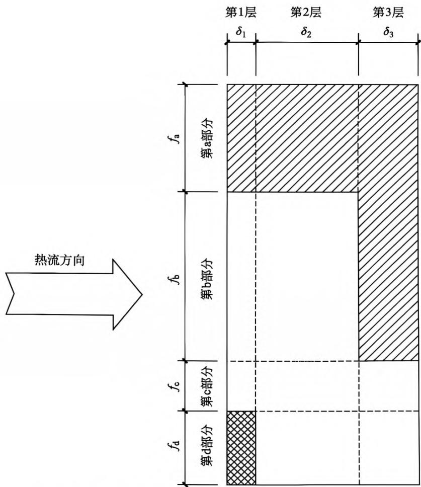  
图 7.2-1 非均质复合围护结构平均热阻计算简图

当相邻部分热阻的比值小于或等于 1.5 时, 复合围护结构的热阻可按以下公式计算:

$$
\overline {{{R}}} = \frac {R _ {\mathrm{ou}} + R _ {\mathrm{ol}}}{2} - (R _ {\mathrm{i}} + R _ {\mathrm{e}})\tag{7.2-4}
$$

$$
R _ {\mathrm{ou}} = \frac {1}{\frac {f _ {\mathrm{a}}}{R _ {\mathrm{oua}}} + \frac {f _ {\mathrm{b}}}{R _ {\mathrm{oub}}} + \cdots + \frac {f _ {\mathrm{q}}}{R _ {\mathrm{ouq}}}}\tag{7.2-5}
$$

$$
R _ {\mathrm{ol}} = R _ {\mathrm{i}} + R _ {1} + R _ {2} + \dots + R _ {j} + \dots + R _ {n} + R _ {\mathrm{e}}\tag{7.2-6}
$$

$$
R _ {j} = \frac {1}{\frac {f _ {\mathrm{a}}}{R _ {\mathrm{aj}}} + \frac {f _ {\mathrm{b}}}{R _ {\mathrm{bj}}} + \cdots + \frac {f _ {\mathrm{q}}}{R _ {\mathrm{qj}}}}\tag{7.2-7}
$$

式中

$\overline{R}$ ——非均质复合围护结构的热阻， $m^{2}\cdot K/W$ ;

$R_{ou}$ ——与热流平行方向的热阻，按式（7.2-5）计算；

$R_{o1}$ ——与热流垂直方向的热阻，按式（7.2-6）计算；

$R_{i}$ ——内表面换热阻， $m^{2}\cdot K/W$ ，按表7.2-1取值；

$R_{e}$ ——外表面换热阻， $m^{2}\cdot K/W$ ，按表7.2-2取值；

$f_{a}$ ， $f_{b}$ ，…， $f_{q}$ ——与热流平行方向各部分面积占总面积的百分比；

$R_{oua}$ ， $R_{oub}$ ，…， $R_{ouq}$ ——与热流平行方向各部分的传热阻， $m^{2}\cdot K/W$ ;

$R_{1}, R_{2}, \cdots, R_{j}, \cdots, R_{n}$ ——与热流垂直方向第 1, 2, …, j, …, n 层的热阻，按式 (7.2-7) 计算；

$R_{aj}$ ， $R_{bj}\cdots\cdots R_{qj}$ ——与热流垂直方向第 j 层各部分的热阻， $m^{2}\cdot K/W$ 。

当相邻部分热阻的比值大于1.5时，复合围护结构平均热阻可按下式计算：

$$
\overline {{{R}}} = \frac {1}{K _ {\mathrm{m}}} - (R _ {\mathrm{i}} + R _ {\mathrm{e}})\tag{7.2-8}
$$

式中 $K_{m}$ ——非均质复合围护结构平均传热系数， $W/(m^{2} \cdot K)$ ，按式（7.2-11）计算；

4. 围护结构平壁的传热阻 $R_{0}$ 应按式（7.2-9）计算：

$$
R _ {0} = R _ {\mathrm{i}} + R + R _ {\mathrm{e}}\tag{7.2-9}
$$

式中 $R_{0}$ ——围护结构的热阻， $m^{2} \cdot K/W$ ;

R——围护结构平壁的热阻， $m^{2} \cdot K/W$ 。

5. 围护结构平壁的传热系数 $K$ 按式（7.2-10）计算：

$$
K = \frac {1}{R _ {0}}\tag{7.2-10}
$$

式中 K ——围护结构平壁的传热系数， $W/(m^{2} \cdot K)$ ;

$R_{0}$ ——围护结构的传热阻， $m^{2}\cdot K/W$ ，按式（7.2-9）计算。

6. 考虑热桥影响的围护结构平均传热系数 $K_{\mathrm{m}}$ 按式（7.2-11）计算：

$$
K _ {\mathrm{m}} = K + \frac {\sum \psi_ {j} l _ {j}}{A}\tag{7.2-11}
$$

式中 $K_{m}$ ——围护结构的平均传热系数， $W/(m^{2} \cdot K)$ ;

K——围护结构平壁的传热系数， $W/(m^{2} \cdot K)$ ，按式（7.2-10）计算；

$\psi_{j}$ ——围护结构上的第 j 个结构性热桥的线传热系数，W/(m·K);

$l_{j}$ ——围护结构第 j 个结构性热桥的计算长度，m；

A——围护结构的面积， $m^{2}$ 。

7. 在建筑外围护结构中, 墙角、窗间墙、凸窗、阳台、屋顶、楼板、地板等处形成的热桥称为结构性热桥 (图 7.2-2), 对墙体、屋面传热的影响应利用线传热系数 $\phi$ 描述。

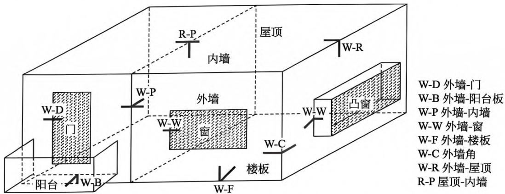  
图 7.2-2 建筑外围护结构的结构性热桥示意图

8. 热桥线传热系数应按下式计算：

$$
\Psi = \frac {Q ^ {\mathrm{2D}} - K A (t _ {\mathrm{i}} - t _ {\mathrm{e}})}{l (t _ {\mathrm{i}} - t _ {\mathrm{e}})} = \frac {Q ^ {\mathrm{2D}}}{l (t _ {\mathrm{i}} - t _ {\mathrm{e}})} - K C\tag{7.2-12}
$$

式中 $\Psi$ ——热桥线传热系数，W/(m·K);

$Q^{2D}$ ——二维传热计算得出的流过一块包含热桥的围护结构的热流，W，该围护结构的构造沿着热桥的长度方向必须是均匀的，热流可以根据其横截面（对纵向热桥）或纵截面（对横向热桥）通过二维传热计算得到；

K——围护结构平壁的传热系数， $W/(m^{2} \cdot K)$ ;

A——计算 $Q^{2D}$ 的围护结构的面积， $m^{2}$ ;

$t_{i}$ ——围护结构室内侧的空气温度，℃；

$t_{e}$ ——围护结构室外侧的空气温度，℃；

$l$ ——计算 $Q^{2D}$ 的围护结构的长度，热桥沿这个长度均匀分布，计算 $\Psi$ 时， $l$ 宜取 $1\mathrm{m}$ ;

C——计算 $Q^{2D}$ 的围护结构的另一条边的长度，即 $A=l \cdot C$ ，可取 $C \geqslant 1m$ 。

注：线传热系数 $\Psi$ 可利用《民用建筑热工设计规范》GB50176—2016提供的二维稳态传热计算软件计算。

### 7.2.3 围护结构内表面温度和内部温度计算

1. 冬季围护结构平壁的内表面温度应按式（7.2-13）计算：

$$
\theta_ {\mathrm{i}} = t _ {\mathrm{i}} - \frac {R _ {\mathrm{i}}}{R _ {0}} (t _ {\mathrm{i}} - t _ {\mathrm{e}})\tag{7.2-13}
$$

式中 $\theta_{i}$ ——围护结构平壁的内表面温度，℃；

$R_{0}$ ——围护结构平壁的传热阻， $m^{2}\cdot K/W$ ;

$R_{i}$ ——内表面换热阻， $m^{2}\cdot K/W$ ，按表7.2-1、表7.2-3取值；

$t_{i}$ ——室内设计温度，℃；

$t_{e}$ ——室外计算温度，℃。

2. 夏季围护结构平壁的内表面温度应采用一维非稳态计算方法，并按房间运行工况确定相应的边界条件。围护结构隔热计算应符合以下要求：

(1) 计算软件:

1) 计算软件应通过相关评审，以确保计算的正确性；

2）软件的输入、输出应便于检查，计算结果清晰、直观。

(2) 边界条件:

1）外表面：第三类边界条件，室外空气逐时温度按照《民用建筑热工设计规范》GB 50176—2016的规定取用，表面换热系数为 $19.0 \mathrm{~W} / (\mathrm{m}^{2} \cdot \mathrm{K})$ ；

2）内表面：第三类边界条件，室内空气逐时温度按照《民用建筑热工设计规范》GB 50176—2016的规定取用，表面换热系数为 $8.7\mathrm{W / (m^2*K)}$ ；

3) 其他边界: 第二类边界条件, 热流密度为 $0 \mathrm{~W} / \mathrm{m}^{2}$ 。

(3) 计算模型:

1）计算模型应选取外墙、屋面的平壁部分；

2）计算模型的几何尺寸和材料应与节点构造设计一致；

3）当外墙、屋顶采用两种以上不同构造，且各部分面积相当时，应对每种构造分别进行计算，内表面温度的计算结果取最高值。

(4) 计算参数:

1) 常用建筑材料的热物理性能参数符合表 7.2-5 的规定;

2）当材料的热物理性能参数有可靠来源时，也可以采用。

3. 地面内表面温度应按下式计算：

$$
\theta_ {\mathrm{i} \cdot \mathrm{g}} = \frac {t _ {\mathrm{i}} \cdot R _ {\mathrm{g}} + \theta_ {\mathrm{e}} \cdot R _ {\mathrm{i}}}{R _ {\mathrm{g}} + R _ {\mathrm{i}}}\tag{7.2-14}
$$

式中 $\theta_{i\cdot g}$ ——地面内表面温度，℃；

$\theta_{e}$ ——地面层与土体接触面的温度，℃，按表7.1-4中的最冷月平均温度取值；

$R_{g}$ ——地面热阻， $m^{2}\cdot K/W$ 。

4. 地下室外墙内表面温度应按下式计算：

$$
\theta_ {\mathrm{i} \bullet \mathrm{b}} = \frac {t _ {\mathrm{i}} \cdot R _ {\mathrm{b}} + \theta_ {\mathrm{e}} \cdot R _ {\mathrm{i}}}{R _ {\mathrm{b}} + R _ {\mathrm{i}}}\tag{7.2-15}
$$

式中 $\theta_{i\cdot b}$ ——地下室外墙内表面温度，℃；

$\theta_{e}$ ——地下室外墙与土体接触面的温度，℃，取表7.1-4中的最冷月平均温度，℃；

$R_{b}$ ——地下室外墙热阻， $m^{2}\cdot K/W$ 。

5. 围护结构内部第 $m$ 层内表面温度, 由下式计算:

$$
\theta_ {m} = t _ {\mathrm{i}} - \frac {t _ {\mathrm{i}} - t _ {\mathrm{e}}}{R _ {0}} R _ {\mathrm{i}} (R _ {\mathrm{i}} + R _ {1 - m})\tag{7.2-16}
$$

式中 $t_{i}$ 、 $t_{e}$ ——室内设计温度和室外计算温度，℃；

$R_{0}$ 、 $R_{i}$ ——围护结构传热阻和内表面换热阻， $m^{2}\cdot K/W$ ;

$R_{1-m}$ ——第 $1 \sim (m-1)$ 层热阻之和， $m^{2} \cdot K/W$ 。

### 7.2.4 围护结构热稳定性

1. 材料的蓄热系数应按下式计算：

$$
S = \sqrt {\frac {2 \pi \lambda c \rho_ {0}}{3 . 6 T}}\tag{7.2-17}
$$

式中 S ——材料的蓄热系数， $W/(m^{2} \cdot K)$ ，按表 7.2-5 取值；

$\lambda$ ——材料的导热系数， $W/(m\cdot K)$ ，按表7.2-5取值；

c——材料的比热容，kJ/(kg·K)，按表7.2-5取值；

$\rho_{0}$ ——材料的干密度，kg/m $^{3}$ ，按表7.2-5取值；

T——温度波动周期，h，一般取 T=24h；

$\pi$ ——圆周率， $\pi=3.14$ 。

2. 对单一均质材料层的热惰性指标应按式（7.2-18）计算：

$$
D = R \cdot S\tag{7.2-18}
$$

式中 D ——材料层的热惰性指标，无量纲；

R——材料层热阻， $m^{2} \cdot K/W$ ;

S——材料层蓄热系数， $W/(m^{2} \cdot K)$ 。

3. 多层均质材料层组成的围护结构平壁的热惰性指标应按式（7.2-19）计算：

$$
D = D _ {1} + D _ {2} + \dots + D _ {n} = R _ {1} \cdot S _ {1} + R _ {2} \cdot S _ {2} + \dots + R _ {n} \cdot S _ {n}\tag{7.2-19}
$$

式中 $D_{1}, D_{2}, \cdots, D_{n}$ ——各层材料的热惰性指标，无量纲，其中实体材料层的热惰性指标按式（7.2-18）计算，封闭空气层的热惰性指标应为零。

$R_{1}$ ， $R_{2}$ ，…， $R_{n}$ ——各层材料的热阻， $m^{2} \cdot K/W$ ;

$S_{1}$ ， $S_{2}$ ，…， $S_{n}$ ——各层材料的蓄热系数， $W/(m^{2} \cdot K)$ 。

4. 计算由两种以上材料组成的、二（三）向非均质复合围护结构的热惰性指标 $\overline{D}$ 值时，应先将非均质复合围护结构沿平行于热流方向按不同构造划分成若干块，再按式（7.2-20）计算：

$$
\overline {{{D}}} = \frac {D _ {1} A _ {1} + D _ {2} A _ {2} + \cdots + D _ {n} A _ {n}}{A _ {1} + A _ {2} + \cdots + A _ {n}}\tag{7.2-20}
$$

式中 $\overline{D}$ ——非均质复合围护结构的热惰性指标，无量纲；

$A_{1}, A_{2}, \cdots, A_{n}$ ——平行于热流方向的各块平壁的面积， $m^{2}$ ;

$D_{1}, D_{2}, \cdots, D_{n}$ ——平行于热流方向的各块平壁的热惰性指标，按式（7.2-18）和式（7.2-19）计算，无量纲。

### 7.2.5 围护结构衰减倍数和延迟时间计算

**7.2.5.1 什克洛维尔近似计算方法**

1. 围护结构表面蓄热系数计算

(1) 多层围护结构各层外表面蓄热系数按图 7.2-3 由内到外逐层计算。

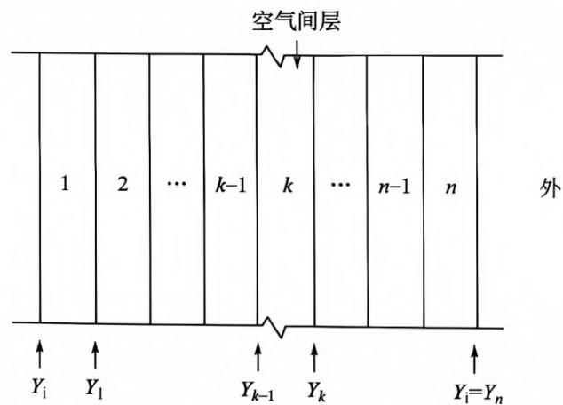  
图7.2-3 多层围护结构的层次排列

注：1. 空气间层的蓄热系数 S=0;

2. 若某层由几种不同材料组成组合壁时, 则应求出组合壁的平均热阻 $\overline{R}$ 和平均蓄热系数 $\overline{S}$ 。如果任何一层的 $D \geqslant 1$ , 则 $Y = S$ , 即取该层材料的蓄热系数。如果第一层的 $D_{1} < 1$ , 则:

$$
Y _ {1, \mathrm{e}} = \frac {R _ {1} S _ {1} ^ {2} + a _ {1}}{1 + R _ {1} a _ {\mathrm{i}}}\tag{7.2-21}
$$

如果第二层的 $D_{2} < 1$ ，则：

$$
Y _ {2, \mathrm{e}} = \frac {R _ {2} S _ {2} ^ {2} + Y _ {1 , \mathrm{e}}}{1 + R _ {2} Y _ {1 , \mathrm{e}}}\tag{7.2-22}
$$

其余类推，直到最后一层（第 $n$ 层）：

$$
Y _ {n, \mathrm{e}} = \frac {R _ {n} S _ {n} ^ {2} + Y _ {n - 1 , \mathrm{e}}}{1 + R _ {n} Y _ {n - 1 , \mathrm{e}}}\tag{7.2-23}
$$

式中 $S_{1}$ ， $S_{2}$ ，…， $S_{n}$ ——各层材料的蓄热系数， $W/(m^{2} \cdot K)$ ;

$R_{1}$ ， $R_{2}$ ，…， $R_{n}$ ——各层材料的热阻， $m^{2}\cdot K/W$ ;

$Y_{1,e}$ ， $Y_{2,c}$ ，…， $Y_{n,e}$ ——各层材料的外表面蓄热系数， $W/(m^{2}\cdot K)$ ;

$a_{i}$ ——内表面换热系数， $W/(m^{2}\cdot K)$ ，取 $8.7W/(m^{2}\cdot K)$ 。

围护结构的外表面蓄热系数就是第 $n$ 层材料的外表面蓄热系数，即 $Y_{\mathrm{e}} = Y_{n,\mathrm{e}}$ 。

(2) 多层围护结构各层内表面蓄热系数按图 7.2-3 由外到内逐层进行计算。

如果多层围护结构中的第一层 $D_{1} \geqslant 1$ ，则直接可得 $Y_{\mathrm{i}} = Y_{1,\mathrm{i}} = S_{1}$ 。

如果最接近第一层的第 k 层热惰性指标 $D_{k} \geqslant 1$ ，则该材料层的内表面蓄热系数取该材料层的蓄热系数，即 $Y_{k,i} = S_{k}$ ，然后从第 k - 1 层开始逐层向第一层计算，直至得到第一层的 $Y_{1,i} = Y_{i}$ 。

如果第 $n$ 层的 $D_{n} < 1$ ，则

$$
Y _ {n, \mathrm{i}} = \frac {R _ {n} S _ {n} ^ {2} + a _ {\mathrm{e}}}{1 + R _ {n} a _ {\mathrm{e}}}\tag{7.2-24}
$$

如果第 $n - 1$ 层的 $D_{n - 1} < 1$ ，则：

$$
Y _ {n - 1, \mathrm{i}} = \frac {R _ {n - 1} S _ {n - 1} ^ {2} + Y _ {n , \mathrm{i}}}{1 + R _ {n - 1} Y _ {n , \mathrm{i}}}\tag{7.2-25}
$$

其余类推，直到最内层（第一层）：

$$
Y _ {1, \mathrm{i}} = \frac {R _ {n} S _ {n} ^ {2} + Y _ {n - 1 , \mathrm{i}}}{1 + R _ {n} Y _ {n - 1 , \mathrm{i}}}\tag{7.2-26}
$$

式中 $Y_{n,i}$ ， $Y_{n-1,i}$ ，…， $Y_{1,i}$ ——各层材料的内表面蓄热系数， $W/(m^{2} \cdot K)$ ;

$a_{e}$ ——外表面换热系数， $W/(m^{2}\cdot K)$ ，取 $19.0W/(m^{2}\cdot K)$ 。

围护结构的内表面蓄热系数就是内侧第一层材料的内表面蓄热系数，即

$$
Y _ {\mathrm{i}} = Y _ {1, \mathrm{i}}\tag{7.2-27}
$$

2. 围护结构衰减倍数和延迟时间计算

(1) 室外温度波传到围护结构内表面时的衰减倍数 $\nu_{0}$ 和延迟时间 $\xi_{0}$ 计算

多层围护结构的衰减倍数 $\nu_{0}$ 按下式计算：

$$
\nu_ {0} = 0. 9 \mathrm{e} ^ {\frac {D}{\sqrt {2}}} \frac {S _ {1} + a _ {\mathrm{i}}}{S _ {1} + Y _ {1 , \mathrm{e}}} \cdot \frac {S _ {2} + Y _ {1 , \mathrm{e}}}{S _ {2} + Y _ {2 , \mathrm{e}}} \dots \frac {Y _ {k - 1 , \mathrm{e}}}{Y _ {k , \mathrm{e}}} \dots \frac {S _ {n} + Y _ {n - 1 , \mathrm{e}}}{S _ {n} + Y _ {n , \mathrm{e}}} \cdot \frac {Y _ {\mathrm{e}} + a _ {\mathrm{e}}}{a _ {\mathrm{e}}}\tag{7.2-28}
$$

式中 $\nu_{0}$ ——围护结构的衰减倍数；

$D$ ——围护结构的热惰性指标，等于各材料层的热惰性指标之和；

$a_{i}$ 、 $a_{e}$ ——分别为围护结构的内、外表面换热系数，取 $a_{i}=8.7\mathrm{W}/(\mathrm{m}^{2}\cdot\mathrm{K})$ ， $a_{c}=$

$$
1 9. 0 \mathrm{W} / (\mathrm{m} ^ {2} \cdot \mathrm{K});
$$

$Y_{k,e}$ 、 $Y_{k-1,e}$ ——分别为空气间层外表面和空气间层前一层材料外表面的蓄热系数， $W/(m^{2} \cdot K)$ 。

多层围护结构延迟时间 $\xi_0$ 按下式计算：

$$
\xi_ {0} = \frac {1}{1 5} \left(4 0. 5 D - \arctan \frac {\alpha_ {\mathrm{i}}}{\alpha_ {\mathrm{i}} + Y _ {\mathrm{i}} \sqrt {2}} + \arctan \frac {R _ {k} \cdot Y _ {k , \mathrm{i}}}{R _ {k} \cdot Y _ {k , \mathrm{i}} + \sqrt {2}} + \arctan \frac {Y _ {\mathrm{e}}}{Y _ {\mathrm{e}} + \alpha_ {\mathrm{e}} \sqrt {2}}\right)\tag{7.2-29}
$$

若无空气间层， $\arctan \frac{R_k\cdot Y_{k,\mathrm{i}}}{R_k\cdot Y_{k,\mathrm{i}} + \sqrt{2}} = 0$

式中 $\xi_{0}$ ——外围护结构延迟时间，h；

$Y_{k,i}$ ——空气间层的内表面蓄热系数， $W/(m^{2}\cdot K)$ ;

$R_{k}$ ——空气间层热阻， $m^{2}\cdot K/W$ ，按表7.2-7取值。

(2) 室内温度波传到围护结构内表面时的衰减倍数 $\nu_{i}$ 和延迟时间 $\xi_{i}$ 计算

衰减倍数 $\nu_{\mathrm{i}}$ 按式（7.2-30）计算：

$$
\nu_ {\mathrm{i}} = 0. 9 5 \frac {a _ {\mathrm{i}} + Y _ {\mathrm{i}}}{a _ {\mathrm{i}}}\tag{7.2-30}
$$

延迟时间 $\xi_{\mathrm{i}}$ 按式（7.2-31）计算：

$$
\xi_ {\mathrm{i}} = \frac {1}{1 5} \arctan \frac {Y _ {\mathrm{i}}}{Y _ {\mathrm{i}} + \alpha_ {\mathrm{i}} \sqrt {2}}\tag{7.2-31}
$$

式中 $\xi_{i}$ ——室内温度波的延迟时间，h。

**7.2.5.2 周期传热软件计算方法**

1. 围护结构的衰减倍数应按式（7.2-32）计算：

$$
\nu = \frac {\theta_ {\mathrm{e}}}{\theta_ {\mathrm{i}}}\tag{7.2-32}
$$

式中 $\nu$ ——围护结构的衰减倍数，无量纲；

$\theta_{e}$ ——室外综合温度或空气温度波幅，K；

$\theta_{i}$ ——室外综合温度或空气温度影响下的围护结构内表面温度波幅，K，应采用围护结构周期传热计算软件计算。

2. 围护结构的延迟时间应按式（7.2-33）计算：

$$
\xi = \xi_ {\mathrm{i}} - \xi_ {\mathrm{e}}\tag{7.2-33}
$$

式中 $\xi$ ——围护结构的延迟时间，h；

$\xi_{e}$ ——室外综合温度或空气温度达到最大值的时间，h；

$\xi_{i}$ ——室外综合温度或空气温度影响下的围护结构内表面温度达到最大值的时间，h，应采用围护结构周期传热计算软件计算。

### 7.2.6 室外综合温度

室外综合温度受室外气温和太阳辐射照度两个因素的影响，按下式进行计算：

$$
t _ {\mathrm{se}} = t _ {\mathrm{e}} + \frac {\rho_ {\mathrm{s}} I}{a _ {\mathrm{e}}}\tag{7.2-34}
$$

式中 $t_{so}$ ——室外综合温度，℃；

$t_{0}$ ——室外空气温度，℃；

I——投射到围护结构外表面的太阳辐射照度， $W/m^{2}$ ，应按现行行业标准《建筑节能气象参数标准》JGJ/T 346 的规定取值；

$\rho_{s}$ ——外表面的太阳辐射吸收系数，无量纲，按表7.2-8取值；

$a_{0}$ ——外表面换热系数， $W/(m^{2}\cdot K)$ ，按7.2.1节的规定取值。

常用围护结构表面太阳辐射吸收系数 $\rho_{s}$  
表7.2-8

<table><tr><td>面层类型</td><td>表面性质</td><td>表面颜色</td><td>太阳辐射吸收系数 ρ。</td></tr><tr><td>石灰粉刷墙面</td><td>光滑、新</td><td>白色</td><td>0.48</td></tr><tr><td>抛光铝反射体片</td><td>-</td><td>浅色</td><td>0.12</td></tr><tr><td>水泥拉毛墙</td><td>粗糙、旧</td><td>米黄色</td><td>0.65</td></tr><tr><td>白水泥粉刷墙面</td><td>光滑、新</td><td>白色</td><td>0.48</td></tr><tr><td>水刷石墙面</td><td>粗糙、旧</td><td>浅色</td><td>0.68</td></tr><tr><td>水泥粉刷墙面</td><td>光滑、新</td><td>浅灰</td><td>0.56</td></tr><tr><td>砂石粉刷面</td><td>-</td><td>深色</td><td>0.57</td></tr><tr><td>浅色饰面砖</td><td>-</td><td>浅黄、浅白</td><td>0.50</td></tr><tr><td>红砖墙</td><td>旧</td><td>红色</td><td>0.70~0.78</td></tr><tr><td>硅酸盐砖墙</td><td>不光滑</td><td>黄灰色</td><td>0.45~0.50</td></tr><tr><td>硅酸盐砖墙</td><td>不光滑</td><td>灰白色</td><td>0.50</td></tr><tr><td>混凝土砌块</td><td>-</td><td>灰色</td><td>0.65</td></tr><tr><td>混凝土墙</td><td>平滑</td><td>深灰</td><td>0.73</td></tr><tr><td>红褐陶瓦屋面</td><td>旧</td><td>红褐</td><td>0.65~0.74</td></tr><tr><td>灰瓦屋面</td><td>旧</td><td>浅灰</td><td>0.52</td></tr><tr><td>水泥屋面</td><td>旧</td><td>素灰</td><td>0.74</td></tr><tr><td>水泥瓦屋面</td><td>-</td><td>深灰</td><td>0.69</td></tr><tr><td>石棉水泥瓦屋面</td><td>-</td><td>浅灰色</td><td>0.75</td></tr><tr><td>绿豆砂保护屋面</td><td>-</td><td>浅黑色</td><td>0.65</td></tr><tr><td>白石子屋面</td><td>粗糙</td><td>灰白色</td><td>0.62</td></tr><tr><td>浅色油毛毡屋面</td><td>不光滑、新</td><td>浅黑色</td><td>0.72</td></tr><tr><td>黑色油毛毡屋面</td><td>不光滑、新</td><td>深黑色</td><td>0.86</td></tr><tr><td>绿色草地</td><td>-</td><td>-</td><td>0.78~0.80</td></tr><tr><td>水(开阔湖、海面)</td><td>-</td><td>-</td><td>0.96</td></tr><tr><td>棕色、发色喷泉漆</td><td>光亮</td><td>中棕、中绿色</td><td>0.79</td></tr><tr><td>红涂料、油漆</td><td>光平</td><td>大红</td><td>0.74</td></tr><tr><td>浅色涂料</td><td>光亮</td><td>浅黄、浅红</td><td>0.50</td></tr><tr><td rowspan="2">反射隔热涂料</td><td>光滑、新</td><td>白色</td><td>0.48</td></tr><tr><td>光滑、新</td><td>浅灰</td><td>0.56</td></tr></table>

注：主要数据来源于《民用建筑热工设计规范》GB 50176—2016。

### 7.2.7 蒸汽渗透阻计算

蒸汽渗透阻是指一定厚度的物体，在两侧单位水蒸气分压作用下，通过单位面积渗透单位质量水蒸气所需要的时间，单位为 $m^{2} \cdot h \cdot Pa/g$ ，用 H 表示。常用薄片材料和涂层的蒸汽渗透阻按照表 7.2-9 选用。

常用薄片材料和涂层的蒸汽渗透阻 $\pmb{H}$  
表7.2-9

<table><tr><td>序号</td><td>材料及涂层名称</td><td>厚度(mm)</td><td>H(m2·h·Pa/g)</td></tr><tr><td>1</td><td>普通纸板</td><td>1</td><td>16.0</td></tr><tr><td>2</td><td>石膏板</td><td>8</td><td>120.0</td></tr><tr><td>3</td><td>硬质木纤维板</td><td>8</td><td>106.7</td></tr><tr><td>4</td><td>软质木纤维板</td><td>10</td><td>53.3</td></tr><tr><td>5</td><td>三层胶合板</td><td>3</td><td>226.6</td></tr><tr><td>6</td><td>纤维水泥板</td><td>6</td><td>266.6</td></tr><tr><td>7</td><td>热沥青一道</td><td>2</td><td>266.6</td></tr><tr><td>8</td><td>热沥青二道</td><td>4</td><td>480.0</td></tr><tr><td>9</td><td>乳化沥青二道</td><td>-</td><td>520.0</td></tr><tr><td>10</td><td>偏氯乙烯二道</td><td>-</td><td>1239.0</td></tr><tr><td>11</td><td>环氧煤焦油二道</td><td>-</td><td>3733.0</td></tr><tr><td>12</td><td>油漆二道(先做抹灰嵌缝、上底漆)</td><td>-</td><td>639.9</td></tr><tr><td>13</td><td>聚氯乙烯涂层二道</td><td>-</td><td>3866.3</td></tr><tr><td>14</td><td>氯丁橡胶涂层二道</td><td>-</td><td>3466.3</td></tr><tr><td>15</td><td>玛碲脂涂层一道</td><td>-</td><td>599.9</td></tr><tr><td>16</td><td>沥青玛碲脂涂层一道</td><td>-</td><td>639.9</td></tr><tr><td>17</td><td>沥青玛碲脂涂层二道</td><td>-</td><td>1079.9</td></tr><tr><td>18</td><td>石油沥青油毡</td><td>1.5</td><td>1106.6</td></tr><tr><td>19</td><td>石油沥青油纸</td><td>0.4</td><td>293.3</td></tr><tr><td>20</td><td>聚乙烯薄膜</td><td>0.16</td><td>733.3</td></tr></table>

注：引自《民用建筑热工设计规范》GB 50176—2016。

### 7.2.8 地面传热系数

周边地面传热系数由二维非稳态传热计算程序计算确定。地面传热系数应分成周边地面和非周边地面两种传热系数，周边地面为外墙内表面 $2 \mathrm{~m}$ 以内的地面，周边地面以外的地面为非周边地面（图7.2-4）。

周边地面和非周边地面的当量传热系数参照表7.2-10、表7.2-11取值。

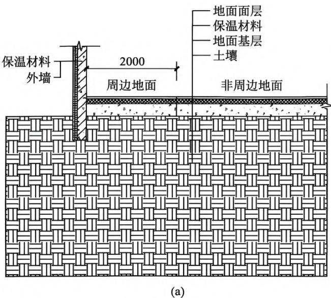

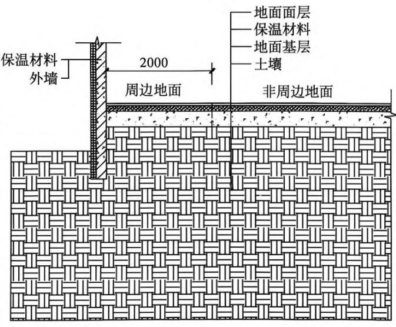  
(b)  
图7.2-4 典型地面构造示意图  
(a) 地面构造 1; (b) 地面构造 2

周边地面当量传热系数 [单位： $\mathbf{W}/(\mathbf{m}^{2} \cdot \mathbf{K})$ ]  
表7.2-10

<table><tr><td rowspan="3">保温层热阻(m2·K/W)</td><td colspan="5">地面构造1</td><td colspan="5">地面构造2</td></tr><tr><td colspan="5">供暖期室外平均温度</td><td colspan="5">供暖期室外平均温度</td></tr><tr><td>西安2.1°C</td><td>北京0.1°C</td><td>长春-6.7°C</td><td>哈尔滨-8.5°C</td><td>海拉尔-12.0°C</td><td>西安2.1°C</td><td>北京0.1°C</td><td>长春-6.7°C</td><td>哈尔滨-8.5°C</td><td>海拉尔-12.0°C</td></tr><tr><td>3.00</td><td>0.05</td><td>0.06</td><td>0.08</td><td>0.08</td><td>0.08</td><td>0.05</td><td>0.06</td><td>0.08</td><td>0.08</td><td>0.08</td></tr><tr><td>2.75</td><td>0.05</td><td>0.07</td><td>0.09</td><td>0.08</td><td>0.09</td><td>0.05</td><td>0.07</td><td>0.09</td><td>0.08</td><td>0.09</td></tr><tr><td>2.50</td><td>0.06</td><td>0.07</td><td>0.10</td><td>0.09</td><td>0.11</td><td>0.06</td><td>0.07</td><td>0.10</td><td>0.09</td><td>0.11</td></tr><tr><td>2.25</td><td>0.08</td><td>0.07</td><td>0.11</td><td>0.10</td><td>0.11</td><td>0.08</td><td>0.07</td><td>0.11</td><td>0.10</td><td>0.11</td></tr><tr><td>2.00</td><td>0.09</td><td>0.08</td><td>0.12</td><td>0.11</td><td>0.12</td><td>0.08</td><td>0.07</td><td>0.11</td><td>0.11</td><td>0.12</td></tr><tr><td>1.75</td><td>0.10</td><td>0.09</td><td>0.14</td><td>0.13</td><td>0.14</td><td>0.09</td><td>0.08</td><td>0.12</td><td>0.11</td><td>0.12</td></tr><tr><td>1.50</td><td>0.11</td><td>0.11</td><td>0.15</td><td>0.14</td><td>0.15</td><td>0.10</td><td>0.09</td><td>0.14</td><td>0.13</td><td>0.14</td></tr><tr><td>1.25</td><td>0.12</td><td>0.12</td><td>0.16</td><td>0.15</td><td>0.17</td><td>0.11</td><td>0.11</td><td>0.15</td><td>0.14</td><td>0.15</td></tr><tr><td>1.00</td><td>0.14</td><td>0.14</td><td>0.19</td><td>0.17</td><td>0.20</td><td>0.12</td><td>0.12</td><td>0.16</td><td>0.15</td><td>0.17</td></tr><tr><td>0.75</td><td>0.17</td><td>0.17</td><td>0.22</td><td>0.20</td><td>0.22</td><td>0.14</td><td>0.14</td><td>0.19</td><td>0.17</td><td>0.20</td></tr><tr><td>0.50</td><td>0.20</td><td>0.20</td><td>0.26</td><td>0.24</td><td>0.26</td><td>0.17</td><td>0.17</td><td>0.22</td><td>0.20</td><td>0.22</td></tr><tr><td>0.25</td><td>0.27</td><td>0.26</td><td>0.32</td><td>0.29</td><td>0.31</td><td>0.24</td><td>0.23</td><td>0.29</td><td>0.25</td><td>0.27</td></tr><tr><td>0.00</td><td>0.34</td><td>0.38</td><td>0.38</td><td>0.40</td><td>0.41</td><td>0.31</td><td>0.34</td><td>0.34</td><td>0.36</td><td>0.37</td></tr></table>

### 7.2.9 玻璃和幕墙的热工计算

建筑门窗、玻璃幕墙的热工性能、结露性能评价的计算条件和方法应满足现行行业标准《建筑门窗玻璃幕墙热工计算规程》JGJ/T 151的相关规定。

非周边地面当量传热系数 [单位：W/(m²·K)]  
表7.2-11

<table><tr><td rowspan="3">保温层热阻(m2·K/W)</td><td colspan="5">地面构造1</td><td colspan="5">地面构造2</td></tr><tr><td colspan="5">供暖期室外平均温度</td><td colspan="5">供暖期室外平均温度</td></tr><tr><td>西安2.1°C</td><td>北京0.1°C</td><td>长春-6.7°C</td><td>哈尔滨-8.5°C</td><td>海拉尔-12.0°C</td><td>西安2.1°C</td><td>北京0.1°C</td><td>长春-6.7°C</td><td>哈尔滨-8.5°C</td><td>海拉尔-12.0°C</td></tr><tr><td>3.00</td><td>0.02</td><td>0.03</td><td>0.08</td><td>0.06</td><td>0.07</td><td>0.02</td><td>0.03</td><td>0.08</td><td>0.06</td><td>0.07</td></tr><tr><td>2.75</td><td>0.02</td><td>0.03</td><td>0.08</td><td>0.06</td><td>0.07</td><td>0.02</td><td>0.03</td><td>0.08</td><td>0.06</td><td>0.07</td></tr><tr><td>2.50</td><td>0.03</td><td>0.03</td><td>0.09</td><td>0.06</td><td>0.08</td><td>0.03</td><td>0.03</td><td>0.09</td><td>0.06</td><td>0.08</td></tr><tr><td>2.25</td><td>0.03</td><td>0.04</td><td>0.09</td><td>0.07</td><td>0.07</td><td>0.03</td><td>0.04</td><td>0.09</td><td>0.07</td><td>0.07</td></tr><tr><td>2.00</td><td>0.03</td><td>0.04</td><td>0.10</td><td>0.07</td><td>0.08</td><td>0.03</td><td>0.04</td><td>0.10</td><td>0.07</td><td>0.08</td></tr><tr><td>1.75</td><td>0.03</td><td>0.04</td><td>0.10</td><td>0.07</td><td>0.08</td><td>0.03</td><td>0.04</td><td>0.10</td><td>0.07</td><td>0.08</td></tr><tr><td>1.50</td><td>0.03</td><td>0.04</td><td>0.11</td><td>0.07</td><td>0.09</td><td>0.03</td><td>0.04</td><td>0.11</td><td>0.07</td><td>0.09</td></tr><tr><td>1.25</td><td>0.04</td><td>0.05</td><td>0.11</td><td>0.08</td><td>0.09</td><td>0.04</td><td>0.05</td><td>0.11</td><td>0.08</td><td>0.09</td></tr><tr><td>1.00</td><td>0.04</td><td>0.05</td><td>0.12</td><td>0.08</td><td>0.10</td><td>0.04</td><td>0.05</td><td>0.12</td><td>0.08</td><td>0.10</td></tr><tr><td>0.75</td><td>0.04</td><td>0.06</td><td>0.13</td><td>0.09</td><td>0.10</td><td>0.04</td><td>0.06</td><td>0.13</td><td>0.09</td><td>0.10</td></tr><tr><td>0.50</td><td>0.05</td><td>0.06</td><td>0.14</td><td>0.09</td><td>0.11</td><td>0.05</td><td>0.06</td><td>0.14</td><td>0.09</td><td>0.11</td></tr><tr><td>0.25</td><td>0.06</td><td>0.07</td><td>0.15</td><td>0.10</td><td>0.11</td><td>0.06</td><td>0.07</td><td>0.15</td><td>0.10</td><td>0.11</td></tr><tr><td>0.00</td><td>0.08</td><td>0.10</td><td>0.17</td><td>0.19</td><td>0.21</td><td>0.08</td><td>0.10</td><td>0.17</td><td>0.19</td><td>0.21</td></tr></table>

**7.2.9.1 门窗热工性能计算**

门窗一般由框架和玻璃板组成，门窗玻璃板面积定义为门窗两侧可视面积中较小的面积，整樘窗的传热系数应按下式计算：

$$
K _ {\mathrm{t}} = \frac {\sum A _ {\mathrm{g}} K _ {\mathrm{g}} + \sum A _ {\mathrm{f}} K _ {\mathrm{f}} + \sum l _ {\psi} \psi}{A _ {\mathrm{t}}}\tag{7.2-35}
$$

式中 $K_{t}$ ——整樘窗的传热系数， $W/(m^{2} \cdot K)$ ;

$A_{g}$ ——窗玻璃（或者其他镶嵌板）面积， $m^{2}$ ;

$A_{f}$ ——窗框面积， $m^{2}$ ;

$A_{t}$ ——窗面积， $m^{2}$ ;

$l_{\psi}$ ——玻璃区域（或者其他镶嵌板区域）的边缘长度，m；

$K_{g}$ ——窗玻璃（或者其他镶嵌板）的传热系数， $W/(m^{2}\cdot K)$ ;

$K_{f}$ ——窗框的传热系数， $W/(m^{2} \cdot K)$ ;

$\psi$ ——窗框和窗玻璃（或者其他镶嵌板）之间的线传热系数， $W/(m\cdot K)$ 。整樘窗的太阳光总透射比 $g_{t}$ 应按下式计算：

$$
g _ {\mathrm{t}} = \frac {\sum A _ {\mathrm{g}} g _ {\mathrm{g}} + \sum A _ {\mathrm{f}} g _ {\mathrm{f}}}{A _ {\mathrm{t}}}\tag{7.2-36}
$$

式中 $g_{t}$ ——整樘窗的太阳光总透射比，也称为太阳得热系数 SHGC；

$A_{g}$ ——玻璃或透明面板面积， $m^{2}$ ;

$A_{f}$ ——窗框面积， $m^{2}$ ;

$g_{g}$ ——窗玻璃（或其他镶嵌板）区域太阳光总透射比；

$g_{f}$ ——窗框的太阳光总透射比；

$A_{1}$ ——窗面积， $m^{2}$ 。

整樘窗的遮阳系数应按下式计算：

$$
S C = \frac {g _ {1}}{0 . 8 7}\tag{7.2-37}
$$

式中 $SC$ ——整樘窗的遮阳系数；

$g_{t}$ ——整樘窗的太阳光总透射比。

整樘窗的可见光透射比应按下式计算：

$$
\tau_ {\mathrm{t}} = \frac {\sum \tau_ {\mathrm{v}} A _ {\mathrm{g}}}{A _ {\mathrm{t}}}\tag{7.2-38}
$$

式中 $\tau_{t}$ ——整樘窗的可见光透射比；

$\tau_{v}$ ——窗玻璃（或其他镶嵌板）的可见光透射比；

$A_{g}$ ——窗玻璃（或其他镶嵌板）面积， $m^{2}$ ;

$A_{t}$ ——窗面积， $m^{2}$ 。

**7.2.9.2 玻璃幕墙热工性能计算**

单幅幕墙的传热系数 $K_{\mathrm{cw}}$ 计算按以下公式：

$$
K _ {\mathrm{cw}} = \frac {\sum A _ {\mathrm{g}} K _ {\mathrm{g}} + \sum A _ {\mathrm{p}} K _ {\mathrm{p}} + \sum A _ {\mathrm{f}} K _ {\mathrm{f}} + \sum l _ {\mathrm{g}} \psi_ {\mathrm{g}} + \sum l _ {\mathrm{p}} \psi_ {\mathrm{p}}}{\sum A _ {\mathrm{g}} + \sum A _ {\mathrm{p}} + \sum A _ {\mathrm{f}}}\tag{7.2-39}
$$

式中 $K_{cw}$ ——单幅幕墙的传热系数， $W/(m^{2} \cdot K)$ ;

$A_{g}$ ——玻璃或透明面板面积， $m^{2}$ ;

$l_{p}$ ——玻璃或透明面板边缘长度，m；

$K_{\mathrm{g}}$ ——玻璃或透明面板中部的传热系数， $\mathrm{W / (m^2\cdot K)}$

$\psi_{g}$ ——玻璃或透明面板边缘的线传热系数，W/(m·K);

$A_{p}$ ——非透明面板面积， $m^{2}$ ;

$l_{p}$ ——非透明面板边缘长度，m；

$K_{\mathrm{p}}$ ——非透明面板中部的传热系数， $\mathrm{W / (m^2\cdot K)}$

$\psi_{p}$ ——非透明面板边缘的线传热系数，W/(m·K);

$A_{f}$ ——框的投影面积， $m^{2}$ ;

$K_{f}$ ——框的面传热系数， $W/(m^{2} \cdot K)$ 。

单幅幕墙的太阳光总透射比 $g_{\mathrm{cw}}$ 应按下式计算：

$$
g _ {\mathrm{cw}} = \frac {\sum A _ {\mathrm{g}} g _ {\mathrm{g}} + \sum A _ {\mathrm{p}} g _ {\mathrm{p}} + \sum A _ {\mathrm{f}} g _ {\mathrm{f}}}{A}\tag{7.2-40}
$$

式中 $g_{\mathrm{cw}}$ ——单幅幕墙的太阳光总透射比；

$A_{g}$ ——单玻璃或透明面板面积， $m^{2}$ ;

$g_{g}$ ——玻璃或透明面板的太阳光总透射比；

$A_{p}$ ——非透明面板面积， $m^{2}$ ;

$g_{p}$ ——非透明面板的太阳光总透射比；

$A_{f}$ ——框面积， $m^{2}$ ;

$g_{f}$ ——框的太阳光总透射比；

A——幕墙单元面积， $m^{2}$ 。

单幅幕墙的遮阳系数 $SC_{\mathrm{cw}}$ 应按下式计算：

$$
S C _ {\mathrm{cw}} = \frac {g _ {\mathrm{cw}}}{0 . 8 7}\tag{7.2-41}
$$

式中 $SC_{cw}$ ——单幅幕墙的遮阳系数；

$g_{cw}$ ——单幅幕墙的太阳光总透射比。

幕墙单元的可见光透射比应按下式计算：

$$
\tau_ {\mathrm{cw}} = \frac {\sum \tau_ {\mathrm{v}} A _ {\mathrm{g}}}{A}\tag{7.2-42}
$$

式中 $\tau_{cw}$ ——幕墙单元的可见光透射比；

$\tau_{v}$ ——透光面板的可见光透射比；

A——幕墙单元面积， $m^{2}$ ;

$A_{g}$ ——透光面板面积， $m^{2}$ 。

7.2.9.3 结露性能评价

水表面（高于 $0^{\circ}$ C）的饱和水蒸气压力应按下式计算：

$$
p _ {\mathrm{s}} = p _ {0} \times 1 0 ^ {\frac {a \cdot t}{b + t}}\tag{7.2-43}
$$

式中 $p_{s}$ ——空气的饱和水蒸气压力，hPa；

$p_{0}$ ——空气温度为 $0^{\circ}C$ 时的饱和水蒸气压力， $E_{0}=6.11hPa$ ;

t——空气温度，℃；

a、b——参数，a=7.5，b=237.3。

在一定空气相对湿度 $\varphi$ 下, 空气的水蒸气压为 $e$ 可按下式计算:

$$
p = \varphi \cdot p _ {\mathrm{s}}\tag{7.2-44}
$$

式中 $p$ ——空气的水蒸气压力， $\mathrm{hPa}$ ；

$\varphi$ ——空气的相对湿度；

$p_{s}$ ——空气的饱和水蒸气压力，hPa。

空气的露点温度可按下式计算：

$$
t _ {\mathrm{d}} = \frac {b}{\frac {a}{\lg \frac {p}{6 . 1 1}} - 1}\tag{7.2-45}
$$

式中 $t_{d}$ ——空气的露点温度，℃；

p——空气的水蒸气压力，hPa；

a、b——参数，a=7.5，b=237.3。

采用产品的结露性能评价指标 $T_{10 \cdot \min}$ 确定门窗、玻璃幕墙在实际工程中是否结露，应以内表面最低温度不低于室内露点温度为满足要求，可按下式计算判定：

$$
(t _ {1 0, \min} - t _ {\mathrm{out,std}}) \cdot \frac {t _ {\mathrm{in}} - t _ {\mathrm{out}}}{t _ {\mathrm{in,std}} - t _ {\mathrm{out,std}}} + t _ {\mathrm{out}} \geqslant t _ {\mathrm{d}}\tag{7.2-46}
$$

式中 $t_{10,\min}$ ——产品的结露性能评价指标，℃；

$t_{in,std}$ ——结露性能计算时对应的室内标准温度，℃；

$t_{out,std}$ ——结露性能计算时对应的室外标准温度，℃；

$t_{in}$ ——实际工程对应的室内设计温度，℃；

$t_{out}$ ——实际工程对应的室外计算温度，℃；

$t_{d}$ ——室内设计环境条件对应的露点温度，℃。

建筑外窗、玻璃幕墙结露计算时，计算节点应包括所有的框、面板边缘以及面板中部。面板中部的结露性能评价指标 $t_{10}$ 应采用二维稳态传热计算得到的面板中部区域室内表面的温度值。

**7.2.9.4 算例**

【例 7.2-1】以青岛某工程项目为例, 建筑玻璃幕墙采用横明竖隐结构形式, 玻璃幕墙采用 12 (超白) Low-E+12Ar+10+2.28PVB+8mm 双钢化夹胶中空双银玻璃, 明框、隐框玻璃幕墙节点大样分别见图 7.2-5、图 7.2-6。分别计算:

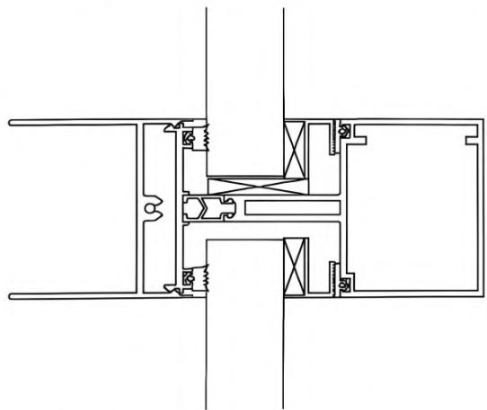  
图 7.2-5 明框玻璃幕墙框节点

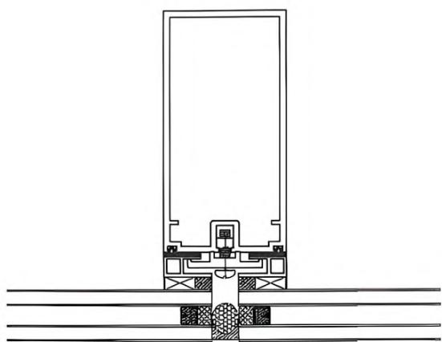  
图7.2-6 隐框玻璃幕墙框节点

(1) 玻璃系统光学热工性能计算;

(2) 框二维传热有限元分析计算;

(3) 幕墙幅面热工性能计算;

(4) 幕墙结露性能计算。

解：采用由广东省建筑科学研究院编制的计算软件《粤建科MQMC建筑幕墙门窗热工性能计算软件》进行计算。

**步骤一：确定幅面**

选取玻璃幕墙幅面，如图 7.2-7 所示，横框为明框，竖框为隐框，玻璃采用 12（超白）Low-E+12Ar+10+2.28PVB+8mm 双钢化夹胶中空双银玻璃。

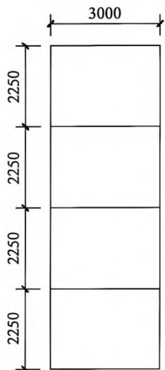  
图7.2-7 玻璃幕墙幅面

步骤二：确定热工性能计算边界条件（表 7.2-12）

热工性能计算边界条件  
表7.2-12

<table><tr><td>参数</td><td>冬季标准计算条件</td><td>夏季标准计算条件</td></tr><tr><td>室内空气温度 $t_{\text{in}}$ </td><td>20.0°C</td><td>25.0°C</td></tr><tr><td>室外空气温度 $t_{\text{ont}}$ </td><td>-9.0°C</td><td>27.0°C</td></tr><tr><td>室内对流换热系数 $h_{\text{c, in}}$ </td><td>3.60W/(m2·K)</td><td>2.50W/(m2·K)</td></tr><tr><td>室外对流换热系数 $h_{\text{c, ont}}$ </td><td>26.40W/(m2·K)</td><td>23.60W/(m2·K)</td></tr><tr><td>室内平均辐射温度 $t_{\text{rm, in}}$ </td><td>20.0°C</td><td>25.0°C</td></tr><tr><td>室外平均辐射温度 $t_{\text{rm, out}}$ </td><td>-13.0°C</td><td>27.0°C</td></tr><tr><td>太阳辐射照度 $I_{\text{s}}$ </td><td>0.00W/m2</td><td>500.00W/m2</td></tr></table>

步骤三：幕墙框传热计算

**(1) 明框节点**

明框节点计算结果如图 7.2-8～图 7.2-10 所示。

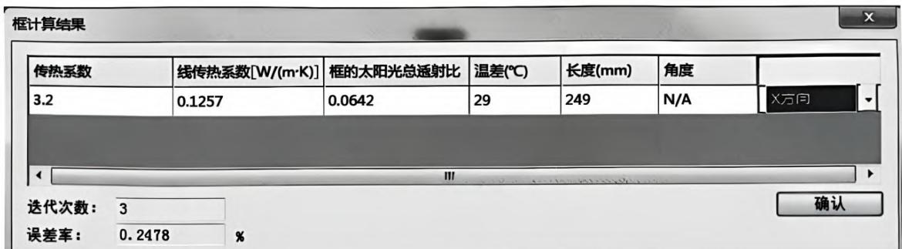  
图7.2-8 明框节点计算结果

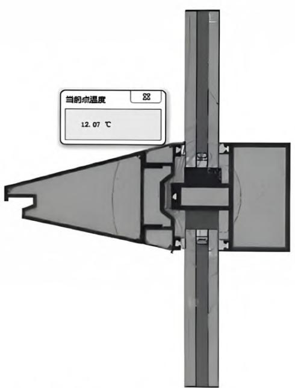  
图7.2-9 明框节点温度线图

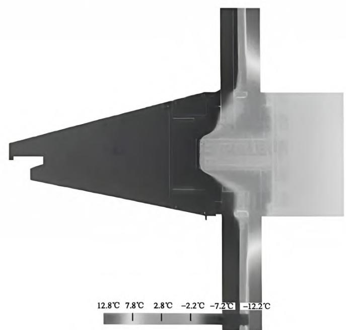  
图7.2-10 明框节点温度场图

**(2) 隐框节点**

隐框节点计算结果如图 7.2-11～图 7.2-13 所示。

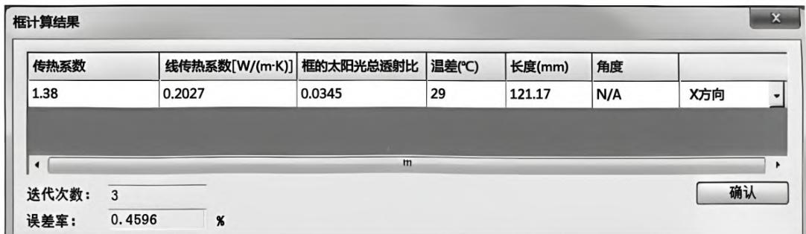  
图7.2-11 隐框节点计算结果

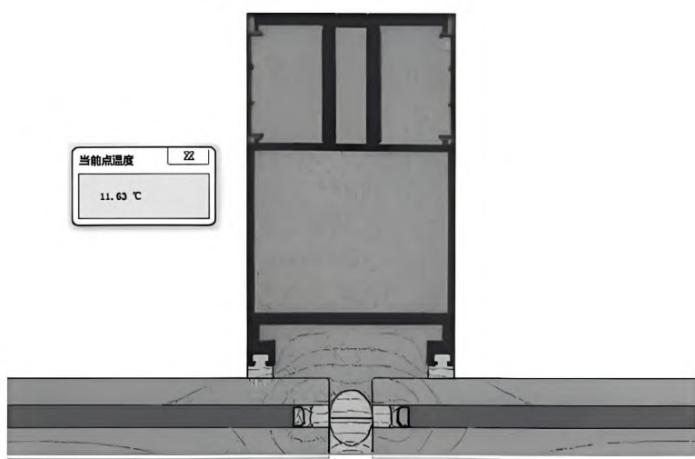  
图7.2-12 隐框节点温度线图

步骤四：幕墙热工性能计算

本工程各向透明幕墙部分由图 7.2-14 所示典型分格组成，上述典型分格按各自所占的面积加权平均所得传热系数即为本工程各向透明幕墙的传热系数（表 7.2-13～表 7.2-15）。上述典型分格的传热系数为 $1.69 \, \text{W/(m}^2 \cdot \text{K)}$ 。

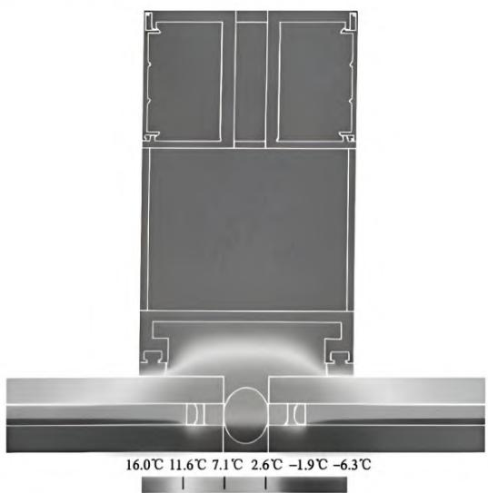  
图7.2-13 隐框节点温度场图

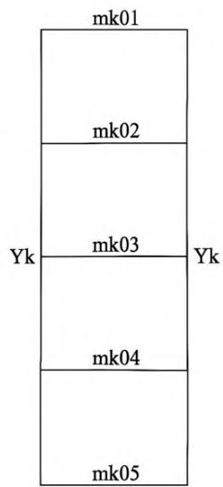  
图7.2-14 青岛某工程大板块玻璃幕墙典型分格

框及接缝的传热系数及面积  
表7.2-13

<table><tr><td>名称</td><td>传热系数[W/(m2·K)]</td><td>面积(m2)</td><td>传热量(W/K)</td></tr><tr><td>mk01</td><td>3.2</td><td>0.216</td><td>0.6912</td></tr><tr><td>mk02</td><td>3.2</td><td>0.432</td><td>1.3824</td></tr><tr><td>mk03</td><td>3.2</td><td>0.432</td><td>1.3824</td></tr><tr><td>mk04</td><td>3.2</td><td>0.432</td><td>1.3824</td></tr><tr><td>mk05</td><td>3.2</td><td>0.216</td><td>0.6912</td></tr><tr><td>Yk</td><td>1.38</td><td>1.08</td><td>1.4904</td></tr><tr><td>合计</td><td></td><td></td><td>7.02</td></tr></table>

框与面板接缝的线传热系数及边缘长度  
表7.2-14

<table><tr><td>名称</td><td>线传热系数[W/(m·K)]</td><td>边缘长度(m)</td><td>传热量(W/K)</td></tr><tr><td>mk01</td><td>0.1257</td><td>2.88</td><td>0.3620</td></tr><tr><td>mk02</td><td>0.1257</td><td>5.76</td><td>0.7240</td></tr><tr><td>mk03</td><td>0.1257</td><td>5.76</td><td>0.7240</td></tr><tr><td>mk04</td><td>0.1257</td><td>5.76</td><td>0.7240</td></tr><tr><td>mk05</td><td>0.1257</td><td>2.88</td><td>0.3620</td></tr><tr><td>Yk</td><td>0.2027</td><td>9.0</td><td>1.8243</td></tr><tr><td>合计</td><td></td><td></td><td>4.7204</td></tr></table>

玻璃的传热系数及面积  
表7.2-15

<table><tr><td>名称</td><td>传热系数 $\left\lbrack {\mathrm{W}/\left( {{\mathrm{m}}^{2} \cdot \mathrm{K}}\right) }\right\rbrack$ </td><td>面积 $\left( {\mathrm{m}}^{2}\right)$ </td><td>传热量(W/K)</td></tr><tr><td>BL01</td><td>1.39</td><td>24.282</td><td>33.7520</td></tr><tr><td>此典型分格的传热系数 $\left\lbrack {\mathrm{W}/\left( {{\mathrm{m}}^{2} \cdot \mathrm{K}}\right) }\right\rbrack$ </td><td colspan="3"> ${U}_{cw} = \left( {{7.02} + {4.7204} + {33.7520}}\right) /{27} = {1.69}$ </td></tr></table>

步骤五：幕墙结露性能计算

幕墙应考虑冬季的结露问题，即在冬季透明幕墙的内表面最低温度不得低于室内的空气露点温度。本工程结露计算的计算参数：冬季室内温度为 $20^{\circ}C$ ，相对湿度为 45%，冬季室外温度为 $-9^{\circ}C$ 。

**(1) 室内空气露点温度计算**

根据 4.3 节湿空气焓湿图的绘制, 查表, 当 $t = 20^{\circ} \mathrm{C}$ 时, 饱和空气的水蒸气分压力为 $23.31 \mathrm{hPa}$ 。湿空气中水蒸气分压力由下式求得:

$$
p = p_{\mathrm{s}}\times \varphi = 23.31\times 45\% = 10.49\mathrm{hPa}
$$

查表得， $t = 7^{\circ} \mathrm{C}$ 时，饱和空气的水蒸气分压力为 $9.99 \mathrm{hPa}$ ； $t = 8^{\circ} \mathrm{C}$ 时，饱和空气的水蒸气分压力为 $10.70 \mathrm{hPa}$ 。

以 $10.49\mathrm{hPa}$ 为饱和空气的水蒸气分压力，露点温度为： $t_\mathrm{d} = 8 - \frac{10.7 - 10.49}{10.7 - 9.99} =$ $7.7^{\circ}\mathrm{C}$ 。

**(2) 结露性能分析**

幕墙主要由面板和金属框组成，现分别对其内表面温度进行分析计算。

节能软件分析结果见图 7.2-9、图 7.2-12。内表面温度： $t_{\min}=11.63^{\circ}C>t_{d}=7.7^{\circ}C$ 。幕墙的内表面温度均大于露点温度，不会结露，符合要求。

### 7.2.10 双层皮幕墙得热计算

**7.2.10.1 双层皮幕墙结构与运行方式**

玻璃幕墙虽有良好的透光性和漂亮的外观，但其良好的导热性能使得建筑能耗远远高于传统围护结构。双层皮幕墙（Double Skin Façade，DSF）的出现很好地解决了双层中空玻璃幕墙保温隔热性能较差和夏季太阳辐射得热量大的问题，是一种受欢迎的围护结构形式。DSF由双层中空玻璃、通风空腔、遮阳百叶和单层玻璃组成（图7.2-15），其通风空腔可采用自然通风或者机械通风两种方式，一般以自然通风方式为主，也被称为呼吸式幕墙。根据需要可以在通风空腔中增加遮阳设施，一般为遮阳百叶，有时也会选择遮阳卷帘、格栅以及植物等。DSF的中空玻璃空气层可填充惰性气体（例如氩气、氪气等），以增强DSF的保温隔热性能。

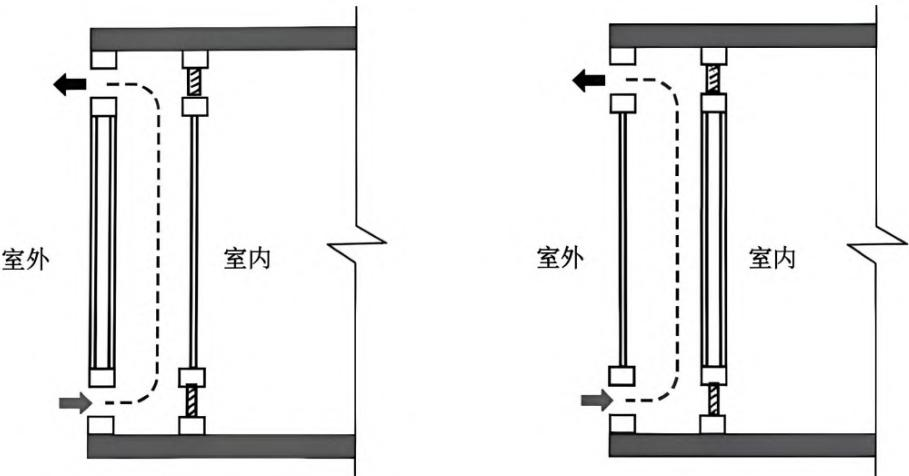  
图7.2-15 DSF结构示意图

DSF 的运行方式可根据需要改变。根据地区气候的不同，选择性地将双层中空玻璃放在室外侧或者室内侧。当夏天太阳辐射强度较强时可增大百叶角度（百叶上端指向室内顶棚时，百叶与水平方向的锐夹角），降低进入室内的太阳辐射；冬天可降低百叶角度或者收起百叶，让更多的太阳辐射进入室内。DSF 在内外玻璃层的上下分别有四个通风口，在夏天太阳辐射较强时一般打开外层玻璃上下两个通风口，通过“烟囱效应”带走通风空腔内的热量，这种通风方式通常被称为“外通风”。在冬天，为了更好地保温和隔热，一般将通风口关闭，以降低房间的散热量，中午时可以打开内侧玻璃上的两个通风口，通过“烟囱效应”将空腔内的热量带到室内，这种通风方式通常被称为“内通风”。DSF 一般有12种运行方式，如图7.2-16和图7.2-17所示（左边为室外侧，右边为室内侧）。在过渡季节，还可以通过打开外层玻璃上通风口和内层玻璃下通风口，形成斜对角气流模式，使室内外的空气直接进行交换，但这种运行方式不需要进行传热计算。

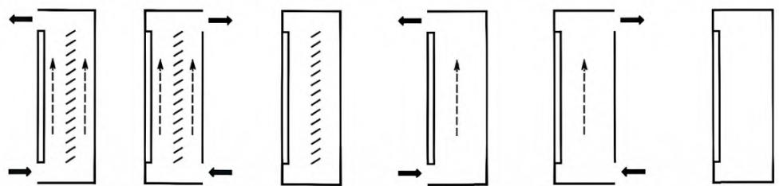  
图7.2-16 中空玻璃位于室外侧DSF运行方式

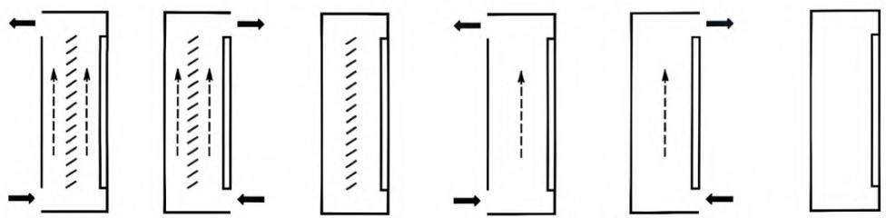  
图 7.2-17 中空玻璃位于室内侧 DSF 运行方式

**7.2.10.2 DSF得热量计算**

为使工程技术人员不需要学习计算软件就能准确快速计算 DSF 的得热量，这里给出一种查双层皮幕墙参数表和插值的简化计算方法。下面介绍内双层有百叶外通风双层皮幕墙参数表，其中 DSF 的单层玻璃厚度为 6mm，双层中空玻璃类型为 $6mm + 9A + 6mm$ 。

**1. DSF 太阳辐射透过率参数表**

将影响 DSF 太阳辐射透过率的所有参数划分区段节点。因 DSF 透过率对太阳入射投影角的变化敏感，太阳入射投影角 $\beta$ 从 $0^{\circ}$ 到 $90^{\circ}$ 每 $2.5^{\circ}$ 为一个节点。百叶角度 $\varphi$ 从 $0^{\circ}$ 到 $90^{\circ}$ 每 $10^{\circ}$ 为一个节点。幕墙接收到的太阳辐射中散射辐射所占比例 $sp$ 划分为 0、 $30\%$ 、 $60\%$ 、 $90\%$ 、 $100\%$ 五个节点。用 DSF 动态传热计算模型计算出每个节点组合的太阳辐射透过率，绘制成参数表，其中散射比为 $30\%$ 和 $60\%$ 的部分太阳辐射透过率参数如表 7.2-16、表 7.2-17 所示。

DSF 的太阳辐射透过率 $(sp=30\%)$ （单位：%）  
表7.2-16

<table><tr><td rowspan="2">太阳入射投影角(°)</td><td colspan="10">百叶角度(°)</td></tr><tr><td>0</td><td>10</td><td>20</td><td>30</td><td>40</td><td>50</td><td>60</td><td>70</td><td>80</td><td>90</td></tr><tr><td>......</td><td>......</td><td>......</td><td>......</td><td>......</td><td>......</td><td>......</td><td>......</td><td>......</td><td>......</td><td>......</td></tr><tr><td>62.5</td><td>5.00</td><td>4.43</td><td>3.82</td><td>3.42</td><td>3.02</td><td>2.54</td><td>2.00</td><td>1.39</td><td>0.73</td><td>0.00</td></tr><tr><td>65.0</td><td>4.86</td><td>4.31</td><td>3.75</td><td>3.4</td><td>3.00</td><td>2.53</td><td>1.99</td><td>1.38</td><td>0.72</td><td>0.00</td></tr><tr><td>67.5</td><td>4.73</td><td>4.26</td><td>3.71</td><td>3.38</td><td>2.97</td><td>2.51</td><td>1.97</td><td>1.37</td><td>0.71</td><td>0.00</td></tr><tr><td>70.0</td><td>4.59</td><td>4.21</td><td>3.68</td><td>3.35</td><td>2.95</td><td>2.49</td><td>1.95</td><td>1.36</td><td>0.71</td><td>0.00</td></tr><tr><td>72.5</td><td>4.47</td><td>4.1</td><td>3.66</td><td>3.33</td><td>2.93</td><td>2.47</td><td>1.94</td><td>1.35</td><td>0.7</td><td>0.00</td></tr><tr><td>......</td><td>......</td><td>......</td><td>......</td><td>......</td><td>......</td><td>......</td><td>......</td><td>......</td><td>......</td><td>......</td></tr></table>

表7.2-18  
DSF 的太阳辐射透过率 (sp=60%) (单位:%)  
表7.2-17

<table><tr><td rowspan="2">太阳入射投影角/(°)</td><td colspan="10">百叶角度/(°)</td></tr><tr><td>0</td><td>10</td><td>20</td><td>30</td><td>40</td><td>50</td><td>60</td><td>70</td><td>80</td><td>90</td></tr><tr><td>......</td><td>......</td><td>......</td><td>......</td><td>......</td><td>......</td><td>......</td><td>......</td><td>......</td><td>......</td><td>......</td></tr><tr><td>62.5</td><td>6.37</td><td>6.01</td><td>5.54</td><td>5.11</td><td>4.58</td><td>3.93</td><td>3.15</td><td>2.24</td><td>1.20</td><td>0.00</td></tr><tr><td>65.0</td><td>6.30</td><td>5.94</td><td>5.50</td><td>5.09</td><td>4.57</td><td>3.92</td><td>3.14</td><td>2.23</td><td>1.19</td><td>0.00</td></tr><tr><td>67.5</td><td>6.22</td><td>5.91</td><td>5.47</td><td>5.08</td><td>4.56</td><td>3.91</td><td>3.13</td><td>2.22</td><td>1.19</td><td>0.00</td></tr><tr><td>70.0</td><td>6.14</td><td>5.88</td><td>5.46</td><td>5.06</td><td>4.55</td><td>3.90</td><td>3.12</td><td>2.22</td><td>1.18</td><td>0.00</td></tr><tr><td>72.5</td><td>6.07</td><td>5.82</td><td>5.45</td><td>5.05</td><td>4.53</td><td>3.89</td><td>3.11</td><td>2.21</td><td>1.18</td><td>0.00</td></tr><tr><td>......</td><td>......</td><td>......</td><td>......</td><td>......</td><td>......</td><td>......</td><td>......</td><td>......</td><td>......</td><td>......</td></tr></table>

通过查表和插值的方法可以得到 DSF 太阳辐射透过率 $\tau$ ，再用式（7.2-47）计算出透过 DSF 进入室内的太阳辐射得热量 $Q_{s}$ 。

$$
Q _ {\mathrm{s}} = \tau E _ {\mathrm{ts}}\tag{7.2-47}
$$

式中 $E_{ts}$ ——DSF 接收到的太阳总辐照度，W/m $^{2}$ 。

**2. DSF 对流得热量参数表**

将影响 DSF 对流得热量的所有参数划分区段节点。因对流得热量对太阳入射投影角的变化敏感，太阳入射投影角 $\beta$ 从 $0^{\circ}$ 到 $90^{\circ}$ 每 $2.5^{\circ}$ 为一个节点。百叶角度， $\varphi$ 从 $0^{\circ}$ 到 $90^{\circ}$ 每 $10^{\circ}$ 为一个节点。将 DSF 接收到的太阳辐射中散射辐射所占比例 sp 划分为 0、30%、60%、100% 四个节点。室外空气温度 $T_{am}$ 从 $20^{\circ}C$ 到 $40^{\circ}C$ 每 $5^{\circ}C$ 为一个节点。幕墙接收到的太阳总辐射照度 $E_{ts}$ 从 0 到 $800W/m^{2}$ 每 $100W/m^{2}$ 为一个节点。室内温度设定为 $26^{\circ}C$ 。内双层有百叶外通风的 DSF 常用高度（H）在 $3 \sim 5m$ 之间，DSF 通风空腔宽度通常在 $0.3 \sim 0.4m$ 之间。由于高度和通风空腔宽度对对流得热量影响很小，对 DSF 高度 H 和通风空腔宽度 D 分别只取 4m 和 0.3m 一个节点。用 DSF 动态传热计算模型计算每个节点组合的对流换热量，并绘制成 DSF 对流得热量参数表，其中 H = 4m, D = 0.3m, sp = 30%, $T_{am} = 30^{\circ}C$ , $E_{ts} = 400W/m^{2}$ 和 $E_{ts} = 500W/m^{2}$ 时对流得热量参数如表 7.2-18 和表 7.2-19 所示。

DSF 的对流得热量（H=4m，D=0.3m，sp=30%， $T_{am}=30^{\circ}C$ ， $E_{ts}=400W/m^{2}$ ）（单位： $W/m^{2}$ ）

<table><tr><td rowspan="2">太阳人射投影角/(°)</td><td colspan="10">百叶角度/(°)</td></tr><tr><td>0</td><td>10</td><td>20</td><td>30</td><td>40</td><td>50</td><td>60</td><td>70</td><td>80</td><td>90</td></tr><tr><td>......</td><td>......</td><td>......</td><td>......</td><td>......</td><td>......</td><td>......</td><td>......</td><td>......</td><td>......</td><td>......</td></tr><tr><td>62.5</td><td>39.57</td><td>37.29</td><td>34.47</td><td>32.80</td><td>30.92</td><td>28.65</td><td>25.95</td><td>22.78</td><td>18.98</td><td>14.39</td></tr><tr><td>65.0</td><td>39.02</td><td>36.83</td><td>34.41</td><td>32.70</td><td>30.83</td><td>28.57</td><td>25.88</td><td>22.72</td><td>18.95</td><td>14.39</td></tr><tr><td>67.5</td><td>38.52</td><td>36.61</td><td>34.17</td><td>32.59</td><td>30.73</td><td>28.48</td><td>25.81</td><td>22.67</td><td>18.92</td><td>14.39</td></tr><tr><td>70.0</td><td>37.98</td><td>36.41</td><td>33.99</td><td>32.49</td><td>30.64</td><td>28.40</td><td>25.74</td><td>21.61</td><td>18.89</td><td>14.39</td></tr><tr><td>72.5</td><td>37.51</td><td>35.95</td><td>33.89</td><td>32.39</td><td>30.55</td><td>28.32</td><td>25.67</td><td>21.56</td><td>18.86</td><td>14.39</td></tr><tr><td>......</td><td>......</td><td>......</td><td>......</td><td>......</td><td>......</td><td>......</td><td>......</td><td>......</td><td>......</td><td>......</td></tr></table>

续表

DSF 的对流得热量（ $H=4\mathrm{m}$ ， $D=0.3\mathrm{m}$ ， $sp=30\%$ ， $T_{\mathrm{am}}=30^{\circ}\mathrm{C}$ ， $E_{\mathrm{ts}}=500\mathrm{W/m^{2}}$ ）（单位： $\mathrm{W/m^{2}}$ ）  
表7.2-19

<table><tr><td rowspan="2">太阳入射投影角/(°)</td><td colspan="10">百叶角度/(°)</td></tr><tr><td>0</td><td>10</td><td>20</td><td>30</td><td>40</td><td>50</td><td>60</td><td>70</td><td>80</td><td>90</td></tr><tr><td>......</td><td>......</td><td>......</td><td>......</td><td>......</td><td>......</td><td>......</td><td>......</td><td>......</td><td>......</td><td>......</td></tr><tr><td>62.5</td><td>46.44</td><td>43.62</td><td>40.40</td><td>38.07</td><td>35.74</td><td>32.91</td><td>29.53</td><td>25.55</td><td>20.88</td><td>15.20</td></tr><tr><td>65.0</td><td>45.77</td><td>43.04</td><td>40.06</td><td>37.94</td><td>35.62</td><td>32.81</td><td>29.44</td><td>25.48</td><td>20.84</td><td>15.20</td></tr><tr><td>67.5</td><td>45.14</td><td>42.76</td><td>39.76</td><td>37.82</td><td>35.51</td><td>32.70</td><td>29.36</td><td>25.41</td><td>20.80</td><td>15.20</td></tr><tr><td>70.0</td><td>44.47</td><td>42.52</td><td>39.56</td><td>37.69</td><td>35.39</td><td>32.60</td><td>29.27</td><td>25.34</td><td>20.76</td><td>15.20</td></tr><tr><td>72.5</td><td>43.88</td><td>41.95</td><td>39.42</td><td>37.57</td><td>35.28</td><td>32.50</td><td>29.18</td><td>25.28</td><td>20.72</td><td>15.20</td></tr><tr><td>......</td><td>......</td><td>......</td><td>......</td><td>......</td><td>......</td><td>......</td><td>......</td><td>......</td><td>......</td><td>......</td></tr></table>

通过查表和插值的方法可以得到对流得热量 $Q_{\mathrm{c}}$ （ $\mathrm{W / m^2}$ ）。用下式计算通过DSF进入室内的总得热量 $Q_{\mathrm{t}}$ （ $\mathrm{W / m^2}$ ）。

$$
Q _ {\mathrm{t}} = Q _ {8} + Q _ {\mathrm{c}}\tag{7.2-48}
$$

**3. 修正系数**

在实际工程中，DSF 会用到 $6\mathrm{mm} + 12\mathrm{A} + 6\mathrm{mm}$ 双层中空玻璃。在计算内双层中空玻璃 $6\mathrm{mm} + 12\mathrm{A} + 6\mathrm{mm}$ 的 DSF 得热量时，需要对计算结果进行修正。因为空气对太阳辐射没有吸收、折射和反射作用，不需要修正 DSF 太阳辐射透过率。由于双层中空玻璃的空气夹层较小，在计算时可以看作是纯导热过程。对流得热量主要是由空腔与室内空气之间的温差导致的，当温差一定时，对流得热量的差异主要受双层中空玻璃的导热系数的影响。因此，双层中空玻璃为 $6\mathrm{mm} + 9\mathrm{A} + 6\mathrm{mm}$ 和 $6\mathrm{mm} + 12\mathrm{A} + 6\mathrm{mm}$ 的 DSF 对流换热量的比值应接近于两种双层中空玻璃的导热系数的比值。由 DSF 热性能计算模块大量计算发现，双层中空玻璃为 $6\mathrm{mm} + 12\mathrm{A} + 6\mathrm{mm}$ 和 $6\mathrm{mm} + 9\mathrm{A} + 6\mathrm{mm}$ 的 DSF 对流得热量比值在 0.97 左右，即 $Q_{\mathrm{c},12\mathrm{mm}} / Q_{\mathrm{c},6\mathrm{mm}} \approx 0.97$ 。

**7.2.10.3 算例**

**【例7.2-2】**

**1. 计算条件**

长沙市正东向 DSF，百叶角度 $60^{\circ}$ ，高度 H 为 3m，通风空腔宽度 D 为 0.3m，室内温度设定为 $26^{\circ}C$ 。室外空气温度和太阳辐照度为典型气象年数据中 7 月 21 日的数据（表 7.2-20）。以 11:00 为例说明插值计算过程。11:00 室外空气温度为 $30.05^{\circ}C$ ，室外天空法向直射辐射为 $788.57 \, W/m^{2}$ ，室外天空水平面散射辐射为 $116.52 \, W/m^{2}$ 。

**2. 计算查表需要的参数**

查表所需要的参数为幕墙接收到的总辐射、幕墙接收到的散射辐射、幕墙接收到的散射辐射所占比例和太阳入射投影角。

通过计算得到幕墙接收到的总辐照度 $E_{\mathrm{ts}} = 467.27\mathrm{W / m^2}$ ，幕墙接收到的散射辐照度为 $172.58\mathrm{W / m^2}$ ，散射比为 $36.94\%$ ，太阳入射投影角为 $67.95^\circ$ 。

**3. 计算太阳辐射透过率 $\tau$**

（1）查表 7.2-16 可得，散射比为 30%，太阳入射投影角为 $67.5^{\circ}$ 时，透过率 $\tau_{1}=1.97\%$ 。散射比为 30%、太阳入射投影角为 $70^{\circ}$ 时，透过率 $\tau_{2}=1.95\%$ 。当散射比为 30%、太阳入射投影角为 $67.95^{\circ}$ 时，对太阳入射投影角插值计算太阳辐射透过率 $\tau_{3}=(1.97\%-1.95\%)/(70-67.5)\times(70-67.95)+1.95\%=1.97\%$ 。

（2）同样地，当散射比为 $60\%$ ，太阳入射投影角为 $67.95^{\circ}$ 时，通过查表7.2-17和插值计算可得太阳辐射透过率 $\tau_{4} = 3.13\%$ 。

(3) 当散射比为 $36.94\%$ ，太阳入射投影角为 $67.95^{\circ}$ 时，对散射比插值计算，可得太阳辐射透过率 $\tau = (3.13\% - 1.97\%) / (60 - 30) \times (36.94 - 30) + 1.97\% = 2.24\%$ 。

**4. 计算对流得热量 $Q_{c}$**

**(1) 计算散射比为 $30 \%$ 时的对流得热量**

1）查表 7.2-18 可得，当室外空气温度为 $30^{\circ}C$ ，幕墙接收的太阳辐照度为 $400W/m^{2}$ ，太阳入射投影角为 $67.5^{\circ}$ 时，对流得热量为 $25.81W/m^{2}$ 。当室外空气温度为 $30^{\circ}C$ ，幕墙接收的太阳辐照度为 $400W/m^{2}$ ，太阳入射投影角为 $70^{\circ}$ 时，对流得热量为 $25.74W/m^{2}$ 。当室外温度为 $30^{\circ}C$ ，幕墙接收的太阳辐照度为 $400W/m^{2}$ ，太阳入射投影角为 $67.95^{\circ}$ 时，对太阳入射投影角插值计算可得对流得热量 $Q_{c1}=25.80W/m^{2}$ 。

2) 同样地, 当室外空气温度为 $30^{\circ} \mathrm{C}$ , 幕墙接收的太阳辐照度为 $500 \mathrm{~W} / \mathrm{m}^{2}$ , 太阳入射投影角为 $67.95^{\circ}$ 时, 通过查表 7.2-19 和插值计算可得对流得热量 $Q_{\mathrm{c} 2} = 29.34 \mathrm{~W} / \mathrm{m}^{2}$ 。

3）当室外空气温度为 $30^{\circ}C$ ，幕墙接收的太阳辐照度为 $467.27W/m^{2}$ ，太阳入射投影角为 $67.95^{\circ}$ 时，对幕墙接收的太阳辐射插值计算可得对流得热量 $Q_{c3}=(29.34-25.80)/(500-400)\times(467.27-400)+25.80=28.18W/m^{2}$ 。

4）当室外空气温度为 $35^{\circ}C$ ，幕墙接收的太阳辐照度为 $467.27W/m^{2}$ ，太阳入射投影角为 $67.95^{\circ}$ 时，重复步骤 1）、2）、3）可得对流得热量 $Q_{c4}=43.21W/m^{2}$ 。

5）当散射比为 $30\%$ ，室外空气温度为 $30.05^{\circ}\mathrm{C}$ ，幕墙接收太阳辐照度为 $467.27\mathrm{W / m}^{2}$ 太阳入射投影角为 $67.95^{\circ}$ 时，对室外温度插值计算可得，对流得热量 $Q_{\mathrm{c5}} = (43.21 - 28.18) / (35 - 30)\times (30.05 - 30) + 25.80 = 28.33\mathrm{W / m}^{2}$ 。

**(2) 计算散射比为 $60 \%$ 时的对流得热量**

当散射比为 60%，室外空气温度为 $30.05^{\circ}C$ ，幕墙接收的太阳辐照度为 $467.27W/m^{2}$ ，太阳入射投影角为 $67.95^{\circ}$ 时，重复（1）的计算过程，插值计算出对流得热量 $Q_{c6}=33.98W/m^{2}$ 。

**(3) 计算对流得热量**

当散射比为 $36.94\%$ ，室外空气温度为 $30.05^{\circ}\mathrm{C}$ ，幕墙接收的太阳辐照度为 $467.27\mathrm{W / m^2}$ 太阳入射投影角为 $67.95^{\circ}$ 时，对散射比插值计算可得室内对流得热量 $Q_{\mathrm{o}} = (33.98 - 28.33) / (60 - 30)\times (36.94 - 30) + 28.33 = 29.64\mathrm{W / m}^{2}$ 。

**5. 计算 DSF 的总得热量 Q,**

通过式（7.2-47）和式（7.2-48）可计算出长沙市东向DSF在11：00室内总得热量 $Q_{\mathrm{t}} = Q_{\mathrm{c}} + \tau E_{\mathrm{ts}} = 29.64 + 2.24\% \times 467.27 = 40.11\mathrm{W / m^2}$ 。

表 7.2-20 比较了长沙市东向 DSF (H=3m, D=0.3m) 7 月 21 日在百叶倾角为 $60^{\circ}$ 时太阳辐射得热、对流得热量的插值逐时计算值和动态模型逐时模拟值。可见，在有直射辐射时对流得热量插值计算最大误差不超过 3%。用 H=4m、D=0.3m 的 DSF 性能参数表插值计算大尺寸 DSF (H>3m, D>0.3m) 的得热量，误差更小，插值计算方法满足工程精度要求。

长沙市东向DSF辐射得热、对流得热插值计算值与模拟值的对比 表7.2-20

<table><tr><td>时间</td><td>室外温度Tnm(°C)</td><td>法向直射辐射(W/m2)</td><td>水平面散射辐射(W/m2)</td><td>投射到DSF总辐射(W/m2)</td><td>投射到DSF散射辐射(W/m2)</td><td>散射比(%)</td><td>太阳入射投影角(°)</td><td>模拟Qs(W/m2)</td><td>插值Qs(W/m2)</td><td>模拟Qc(W/m2)</td><td>插值Qc(W/m2)</td></tr><tr><td>0:00</td><td>24.75</td><td>0.00</td><td>0.00</td><td>0.00</td><td>0.00</td><td>0.00</td><td>0.00</td><td>0.00</td><td>0.00</td><td>-3.92</td><td>-3.95</td></tr><tr><td>1:00</td><td>24.75</td><td>0.00</td><td>0.00</td><td>0.00</td><td>0.00</td><td>0.00</td><td>0.00</td><td>0.00</td><td>0.00</td><td>-3.92</td><td>-3.95</td></tr><tr><td>2:00</td><td>24.45</td><td>0.00</td><td>0.00</td><td>0.00</td><td>0.00</td><td>0.00</td><td>0.00</td><td>0.00</td><td>0.00</td><td>-4.73</td><td>-4.74</td></tr><tr><td>3:00</td><td>24.15</td><td>0.00</td><td>0.00</td><td>0.00</td><td>0.00</td><td>0.00</td><td>0.00</td><td>0.00</td><td>0.00</td><td>-5.53</td><td>-5.54</td></tr><tr><td>4:00</td><td>24.05</td><td>0.00</td><td>0.00</td><td>0.00</td><td>0.00</td><td>0.00</td><td>0.00</td><td>0.00</td><td>0.00</td><td>-5.80</td><td>-5.80</td></tr><tr><td>5:00</td><td>24.45</td><td>258.13</td><td>7.91</td><td>234.90</td><td>10.03</td><td>4.27</td><td>0.00</td><td>0.47</td><td>0.47</td><td>-4.06</td><td>-4.04</td></tr><tr><td>6:00</td><td>25.55</td><td>583.52</td><td>28.67</td><td>581.20</td><td>40.45</td><td>6.96</td><td>2.64</td><td>34.86</td><td>34.87</td><td>29.75</td><td>30.47</td></tr><tr><td>7:00</td><td>26.75</td><td>649.55</td><td>51.54</td><td>689.98</td><td>85.24</td><td>12.35</td><td>15.51</td><td>12.51</td><td>12.51</td><td>24.62</td><td>25.34</td></tr><tr><td>8:00</td><td>27.75</td><td>703.99</td><td>74.73</td><td>741.52</td><td>127.75</td><td>17.23</td><td>28.21</td><td>13.25</td><td>13.30</td><td>28.86</td><td>29.64</td></tr><tr><td>9:00</td><td>28.45</td><td>747.12</td><td>95.15</td><td>721.87</td><td>159.09</td><td>22.04</td><td>41.06</td><td>13.42</td><td>13.43</td><td>30.79</td><td>31.60</td></tr><tr><td>10:00</td><td>29.15</td><td>775.97</td><td>109.84</td><td>626.72</td><td>174.05</td><td>27.77</td><td>54.28</td><td>12.36</td><td>12.38</td><td>30.47</td><td>31.26</td></tr><tr><td>11:00</td><td>30.05</td><td>788.57</td><td>116.52</td><td>467.27</td><td>172.59</td><td>36.94</td><td>67.95</td><td>10.45</td><td>10.47</td><td>28.89</td><td>29.64</td></tr><tr><td>12:00</td><td>31.35</td><td>784.08</td><td>114.12</td><td>267.39</td><td>158.76</td><td>59.37</td><td>81.97</td><td>8.17</td><td>8.18</td><td>27.31</td><td>27.86</td></tr><tr><td>13:00</td><td>33.25</td><td>762.79</td><td>103.04</td><td>142.16</td><td>142.16</td><td>100</td><td>0.00</td><td>6.65</td><td>6.65</td><td>28.38</td><td>29.36</td></tr><tr><td>14:00</td><td>34.75</td><td>726.18</td><td>85.00</td><td>123.03</td><td>123.03</td><td>100</td><td>0.00</td><td>5.76</td><td>5.76</td><td>30.95</td><td>32.17</td></tr><tr><td>15:00</td><td>34.55</td><td>355.27</td><td>57.29</td><td>66.69</td><td>66.69</td><td>100</td><td>0.00</td><td>3.12</td><td>3.12</td><td>27.08</td><td>27.73</td></tr><tr><td>16:00</td><td>33.75</td><td>615.50</td><td>39.36</td><td>67.39</td><td>67.39</td><td>100</td><td>0.00</td><td>3.15</td><td>3.15</td><td>24.89</td><td>25.57</td></tr><tr><td>17:00</td><td>32.65</td><td>544.26</td><td>17.72</td><td>38.42</td><td>38.42</td><td>100</td><td>0.00</td><td>1.80</td><td>1.80</td><td>19.87</td><td>20.45</td></tr><tr><td>18:00</td><td>31.45</td><td>0.00</td><td>0.00</td><td>0.00</td><td>0.00</td><td>0.00</td><td>0.00</td><td>0.00</td><td>0.00</td><td>14.00</td><td>14.26</td></tr><tr><td>19:00</td><td>30.25</td><td>0.00</td><td>0.00</td><td>0.00</td><td>0.00</td><td>0.00</td><td>0.00</td><td>0.00</td><td>0.00</td><td>10.69</td><td>10.83</td></tr><tr><td>20:00时间</td><td>29.35室外温度 ${T}_{\mathrm{{nm}}}\left( {{}^{ \circ }\mathrm{C}}\right)$ </td><td>0.00法向直射辐射 $\left( {\mathrm{W}/{\mathrm{m}}^{2}}\right)$ </td><td>0.00水平面散射辐射 $\left( {\mathrm{W}/{\mathrm{m}}^{2}}\right)$ </td><td>0.00投射到DSF总辐射 $\left( {\mathrm{W}/{\mathrm{m}}^{2}}\right)$ </td><td>0.00投射到DSF散射辐射 $\left( {\mathrm{W}/{\mathrm{m}}^{2}}\right)$ </td><td>0.00散射比(%)</td><td>0.00太阳人射投影角(°)</td><td>0.00模拟 ${Q}_{0}$  $\left( {\mathrm{W}/{\mathrm{m}}^{2}}\right)$ </td><td>0.00插值 ${Q}_{s}$  $\left( {\mathrm{W}/{\mathrm{m}}^{2}}\right)$ </td><td>8.23模拟 ${Q}_{o}$  $\left( {\mathrm{W}/{\mathrm{m}}^{2}}\right)$ </td><td>8.38插值 ${Q}_{o}$  $\left( {\mathrm{W}/{\mathrm{m}}^{2}}\right)$ </td></tr><tr><td>21:00</td><td>28.65</td><td>0.00</td><td>0.00</td><td>0.00</td><td>0.00</td><td>0.00</td><td>0.00</td><td>0.00</td><td>0.00</td><td>6.34</td><td>6.50</td></tr><tr><td>22:00</td><td>28.05</td><td>0.00</td><td>0.00</td><td>0.00</td><td>0.00</td><td>0.00</td><td>0.00</td><td>0.00</td><td>0.00</td><td>4.73</td><td>4.89</td></tr><tr><td>23:00</td><td>27.65</td><td>0.00</td><td>0.00</td><td>0.00</td><td>0.00</td><td>0.00</td><td>0.00</td><td>0.00</td><td>0.00</td><td>3.66</td><td>3.82</td></tr></table>

## 7.3 围护结构冬季保温热工设计

### 7.3.1 一般规定

1. 常用建筑材料的热物理性能计算参数应按表 7.2-5 取值。

2. 围护结构（外墙、屋面、地面、地下室）的内表面温度与室内空气温度的温差应符合表 7.3-1 的要求。

墙体内表面温度与室内空气温度的温差限值  
表 7.3-1

<table><tr><td>围护结构部位</td><td>房间设计要求</td><td>防结露</td><td>基本热舒适</td></tr><tr><td>外墙</td><td>允许温差 $\Delta t_{w}$ </td><td> $\leqslant t_{i}-t_{d}$ </td><td> $\leqslant3^{\circ}C$ </td></tr><tr><td>屋面</td><td>允许温差 $\Delta t_{r}$ </td><td> $\leqslant t_{i}-t_{d}$ </td><td> $\leqslant4^{\circ}C$ </td></tr><tr><td>地面</td><td>允许温差 $\Delta t_{g}$ </td><td> $\leqslant t_{i}-t_{d}$ </td><td> $\leqslant2^{\circ}C$ </td></tr><tr><td>地下室</td><td>允许温差 $\Delta t_{b}$ </td><td>—</td><td> $\leqslant4^{\circ}C$ </td></tr></table>

注： $\Delta t_{w}=t_{i}-\theta_{i,w}$ ， $\Delta t_{r}=t_{i}-\theta_{i,r}$ ， $\Delta t_{g}=t_{i}-\theta_{i,g}$ ， $\Delta t_{b}=t_{i}-\theta_{i,b}$ 。其中， $\theta_{i,w}$ ——墙体内表面温度，℃； $\theta_{i,r}$ ——屋面内表面温度，℃； $\theta_{i,g}$ ——地面内表面温度，℃； $\theta_{i,b}$ ——地下室外墙内表面温度，℃。

### 7.3.2 墙体

**1. 自保温外墙热工指标（表 7.3-2）**

自保温外墙热工指标 $[a_{\mathrm{e}} = 23.26\mathrm{W / (m^{2}\cdot K)}$ ， $a_{\mathrm{i}} = 8.72\mathrm{W / (m^2\cdot K)}]$ 表7.3-2

<table><tr><td>序号</td><td>构造</td><td>保温材料</td><td>保温层厚度(mm)</td><td>热阻[(m2·K)/W]</td><td>传热系数K[W/(m2·K)]</td><td>热情性指标D</td></tr><tr><td rowspan="4">1</td><td rowspan="3">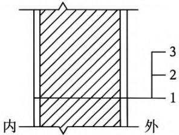1—20厚混合砂浆;2—多孔砖;3—饰面层</td><td rowspan="3">多孔砖</td><td>200</td><td>0.516</td><td>1.94</td><td>2.98</td></tr><tr><td>240</td><td>0.585</td><td>1.71</td><td>3.52</td></tr><tr><td>370</td><td>0.809</td><td>1.24</td><td>5.30</td></tr><tr><td colspan="6">多孔砖λ=0.58W/(m·K),S=7.92W/(m2·K),ρ0=1400kg/m3(λ为导热系数,S为蓄热系数,ρ0为干密度)</td></tr><tr><td rowspan="3">2</td><td rowspan="2">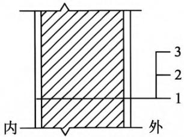1-20厚混合砂浆;2-加气混凝土砌块;3-饰面层</td><td rowspan="2">加气混凝土砌块</td><td>200</td><td>1.06</td><td>0.94</td><td>3.69</td></tr><tr><td>240</td><td>1.238</td><td>0.81</td><td>4.38</td></tr><tr><td colspan="6">加气混凝土砌块λ=0.18W/(m·K),S=3.10W/(m2·K),ρ0=700kg/m3</td></tr><tr><td rowspan="3">3</td><td rowspan="2">1-20厚混合砂浆;2-自保温砖;3-饰面层</td><td rowspan="2">自保温砖</td><td>240</td><td>0.787</td><td>1.27</td><td>5.12</td></tr><tr><td>200</td><td>0.684</td><td>1.46</td><td>4.31</td></tr><tr><td colspan="6">自保温砖λ=0.39W/(m·K),S=7.92W/(m2·K),ρ0=1200kg/m3</td></tr></table>

**2. 外保温外墙热工指标（表 7.3-3）**

外保温外墙热工指标 $[a_{\mathrm{e}} = 23.26\mathrm{W / (m^{2}\cdot K)}, a_{\mathrm{i}} = 8.72\mathrm{W / (m^{2}\cdot K)}]$ 表7.3-3

<table><tr><td>序号</td><td colspan="2">构造</td><td>保温材料</td><td>保温层厚度(mm)</td><td>热阻[(m2·K)/W]</td><td>传热系数K[W/(m2·K)]</td><td>热惰性指标D</td></tr><tr><td rowspan="13">1</td><td rowspan="13">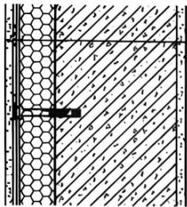1—外饰面;2—抹面胶浆;3—保温材料;4—胶黏剂;5—混凝土墙体;6—水泥砂浆抹灰</td><td rowspan="13">123456</td><td rowspan="10">EPS保温板</td><td>30</td><td>0.981</td><td>1.02</td><td>3.05</td></tr><tr><td>35</td><td>1.088</td><td>0.92</td><td>3.08</td></tr><tr><td>40</td><td>1.195</td><td>0.84</td><td>3.12</td></tr><tr><td>45</td><td>1.302</td><td>0.77</td><td>3.16</td></tr><tr><td>50</td><td>1.409</td><td>0.71</td><td>3.19</td></tr><tr><td>60</td><td>1.622</td><td>0.62</td><td>3.26</td></tr><tr><td>70</td><td>1.836</td><td>0.54</td><td>3.34</td></tr><tr><td>80</td><td>2.050</td><td>0.49</td><td>3.41</td></tr><tr><td>90</td><td>2.263</td><td>0.44</td><td>3.48</td></tr><tr><td>100</td><td>2.477</td><td>0.40</td><td>3.55</td></tr><tr><td rowspan="3">发泡陶瓷保温板</td><td>30</td><td>0.760</td><td>1.32</td><td>3.48</td></tr><tr><td>40</td><td>0.900</td><td>1.11</td><td>3.69</td></tr><tr><td>50</td><td>1.04</td><td>0.96</td><td>3.91</td></tr></table>

续表

<table><tr><td>序号</td><td>构造</td><td>保温材料</td><td>保温层厚度(mm)</td><td>热阻[(m2·K)/W]</td><td>传热系数K[W/(m2·K)]</td><td>热情性指标D</td></tr><tr><td rowspan="14">1</td><td rowspan="13">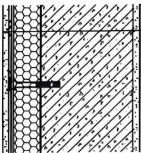1—外饰面;2—抹面胶浆;3—保温材料;4—胶黏剂;5—混凝土墙体;6—水泥砂浆抹灰</td><td rowspan="5">发泡陶瓷保温板</td><td>60</td><td>1.179</td><td>0.85</td><td>4.13</td></tr><tr><td>70</td><td>1.319</td><td>0.76</td><td>4.34</td></tr><tr><td>80</td><td>1.459</td><td>0.69</td><td>4.56</td></tr><tr><td>90</td><td>1.599</td><td>0.63</td><td>4.77</td></tr><tr><td>100</td><td>1.739</td><td>0.58</td><td>4.99</td></tr><tr><td rowspan="8">不燃型无机保温板</td><td>30</td><td>0.697</td><td>1.43</td><td>3.19</td></tr><tr><td>40</td><td>0.816</td><td>1.22</td><td>3.31</td></tr><tr><td>50</td><td>0.935</td><td>1.07</td><td>3.43</td></tr><tr><td>60</td><td>1.054</td><td>0.95</td><td>3.55</td></tr><tr><td>70</td><td>1.174</td><td>0.85</td><td>3.67</td></tr><tr><td>80</td><td>1.293</td><td>0.77</td><td>3.79</td></tr><tr><td>90</td><td>1.412</td><td>0.71</td><td>3.91</td></tr><tr><td>100</td><td>1.531</td><td>0.65</td><td>4.03</td></tr><tr><td colspan="6">EPS保温板λ=0.039W/(m·K),S=0.28W/(m2·K)], ρo=20kg/m3;发泡陶瓷保温板λ=0.065W/(m·K),S=1.4W/(m2·K), ρo=1400kg/m3;不燃型无机保温板λ=0.07W/(m·K),S=0.84W/(m2·K), ρo=120kg/m3</td></tr><tr><td rowspan="11">2</td><td rowspan="10">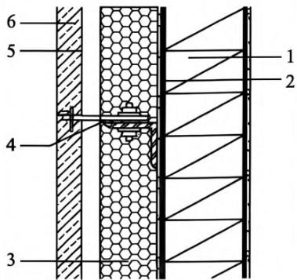1—钢筋混凝土墙体;2—粘结层;3—铝箔覆面岩棉保温;4—龙骨;5—空气层;6—饰面层</td><td rowspan="10">岩棉</td><td>30</td><td>0.725</td><td>1.14</td><td>2.53</td></tr><tr><td>40</td><td>0.928</td><td>0.93</td><td>2.71</td></tr><tr><td>50</td><td>1.131</td><td>0.78</td><td>2.89</td></tr><tr><td>60</td><td>1.334</td><td>0.67</td><td>3.07</td></tr><tr><td>70</td><td>1.538</td><td>0.59</td><td>3.26</td></tr><tr><td>80</td><td>1.741</td><td>0.53</td><td>3.44</td></tr><tr><td>90</td><td>1.944</td><td>0.48</td><td>3.62</td></tr><tr><td>100</td><td>2.147</td><td>0.44</td><td>3.81</td></tr><tr><td>120</td><td>2.554</td><td>0.37</td><td>4.17</td></tr><tr><td>150</td><td>3.164</td><td>0.30</td><td>4.72</td></tr><tr><td colspan="6">岩棉λ=0.041W/(m·K),S=0.75W/(m2·K), ρo=80kg/m3</td></tr></table>

**3. 内保温外墙热工指标（表 7.3-4）**

内保温外墙热工指标 $[a_{\circ} = 23.26\mathrm{W / (m^{2}\cdot K)}$ ， $a_1 = 8.72\mathrm{W / (m^2*K)}]$ 表7.3-4

<table><tr><td>序号</td><td>构造</td><td>保温材料</td><td>保温层厚度(mm)</td><td>热阻[(m2·K)/W]</td><td>传热系数K[W/(m2·K)]</td><td>热情性指标D</td></tr><tr><td rowspan="33">1</td><td rowspan="32">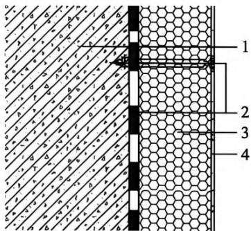1-钢筋混凝土墙体;2-粘结层;3-保温材料;4-外饰面</td><td rowspan="6">XPS保温板</td><td>25</td><td>0.809</td><td>1.15</td><td>2.60</td></tr><tr><td>30</td><td>0.948</td><td>1.00</td><td>2.73</td></tr><tr><td>35</td><td>1.087</td><td>0.89</td><td>2.85</td></tr><tr><td>40</td><td>1.226</td><td>0.80</td><td>2.98</td></tr><tr><td>45</td><td>1.365</td><td>0.73</td><td>3.10</td></tr><tr><td>50</td><td>1.504</td><td>0.67</td><td>3.23</td></tr><tr><td rowspan="6">EPS保温板</td><td>30</td><td>0.710</td><td>1.28</td><td>2.51</td></tr><tr><td>35</td><td>0.809</td><td>1.15</td><td>2.60</td></tr><tr><td>40</td><td>0.909</td><td>1.04</td><td>2.69</td></tr><tr><td>45</td><td>1.008</td><td>0.95</td><td>2.78</td></tr><tr><td>50</td><td>1.107</td><td>0.88</td><td>2.87</td></tr><tr><td>60</td><td>1.305</td><td>0.76</td><td>3.05</td></tr><tr><td rowspan="7">发泡陶瓷保温板</td><td>40</td><td>0.628</td><td>1.41</td><td>2.72</td></tr><tr><td>50</td><td>0.756</td><td>1.21</td><td>2.90</td></tr><tr><td>60</td><td>0.884</td><td>1.06</td><td>3.08</td></tr><tr><td>70</td><td>1.102</td><td>0.95</td><td>3.27</td></tr><tr><td>80</td><td>1.141</td><td>0.85</td><td>3.45</td></tr><tr><td>90</td><td>1.269</td><td>0.78</td><td>3.64</td></tr><tr><td>100</td><td>1.397</td><td>0.71</td><td>3.82</td></tr><tr><td rowspan="6">不燃型无机保温板</td><td>50</td><td>0.664</td><td>1.35</td><td>2.58</td></tr><tr><td>60</td><td>0.774</td><td>1.19</td><td>2.70</td></tr><tr><td>70</td><td>0.884</td><td>1.06</td><td>2.82</td></tr><tr><td>80</td><td>0.994</td><td>0.96</td><td>2.94</td></tr><tr><td>90</td><td>1.104</td><td>0.88</td><td>3.06</td></tr><tr><td>100</td><td>1.214</td><td>0.81</td><td>3.18</td></tr><tr><td rowspan="7">岩棉板</td><td>30</td><td>0.725</td><td>1.26</td><td>2.53</td></tr><tr><td>40</td><td>0.928</td><td>1.02</td><td>2.71</td></tr><tr><td>50</td><td>1.131</td><td>0.86</td><td>2.89</td></tr><tr><td>60</td><td>1.334</td><td>0.74</td><td>3.07</td></tr><tr><td>75</td><td>1.639</td><td>0.61</td><td>3.35</td></tr><tr><td>100</td><td>2.147</td><td>0.48</td><td>3.81</td></tr><tr><td>120</td><td>2.554</td><td>0.41</td><td>4.17</td></tr><tr><td colspan="6">XPS保温板λ=0.039W/(m·K),S=0.28W/(m2·K),ρ0=20kg/m3;EPS保温板λ=0.039W/(m·K),S=0.28W/(m2·K),ρ0=20kg/m3;发泡陶瓷保温板λ=0.065W/(m·K),S=1.4W/(m2·K),ρ0=1400kg/m3;不燃型无机保温板λ=0.07W/(m·K),S=0.84W/(m2·K),ρ0=120kg/m3;岩棉板λ=0.041W/(m·K),S=0.75W/(m2·K),ρ0=100kg/m3</td></tr></table>

### 7.3.3 屋面

屋面热工指标如表 7.3-5 所示。

屋面热工指标  
表7.3-5

<table><tr><td>序号</td><td>构造</td><td>保温材料</td><td>保温层厚度(mm)</td><td>热阻[(m2·K)/W]</td><td>传热系数K[W/(m2·K)]</td><td>热惰性指标D</td></tr><tr><td rowspan="19">1</td><td rowspan="18">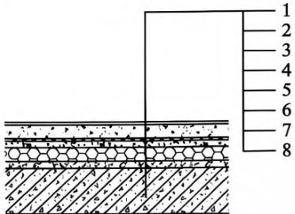1—面层;2—细石混凝土;3—防水层;4—水泥炉渣找坡层;5—保温层;6—隔汽层;7—水泥砂浆;8—钢筋混凝土屋面板</td><td rowspan="10">XPS保温板</td><td>30</td><td>1.016</td><td>0.86</td><td>2.49</td></tr><tr><td>35</td><td>1.155</td><td>0.77</td><td>2.55</td></tr><tr><td>40</td><td>1.294</td><td>0.69</td><td>2.61</td></tr><tr><td>45</td><td>1.432</td><td>0.63</td><td>2.67</td></tr><tr><td>50</td><td>1.571</td><td>0.58</td><td>2.73</td></tr><tr><td>60</td><td>1.849</td><td>0.50</td><td>2.84</td></tr><tr><td>70</td><td>2.127</td><td>0.44</td><td>2.96</td></tr><tr><td>80</td><td>2.405</td><td>0.39</td><td>3.08</td></tr><tr><td>90</td><td>2.682</td><td>0.35</td><td>3.19</td></tr><tr><td>100</td><td>2.960</td><td>0.32</td><td>3.31</td></tr><tr><td rowspan="8">发泡混凝土</td><td>50</td><td>0.778</td><td>1.08</td><td>2.74</td></tr><tr><td>60</td><td>0.897</td><td>0.96</td><td>2.86</td></tr><tr><td>70</td><td>1.106</td><td>0.86</td><td>2.98</td></tr><tr><td>80</td><td>1.135</td><td>0.78</td><td>3.10</td></tr><tr><td>90</td><td>1.254</td><td>0.71</td><td>3.22</td></tr><tr><td>100</td><td>1.373</td><td>0.66</td><td>3.34</td></tr><tr><td>120</td><td>1.611</td><td>0.57</td><td>3.58</td></tr><tr><td>150</td><td>1.968</td><td>0.47</td><td>3.94</td></tr><tr><td colspan="6">XPS保温板λ=0.03W/(m·K),S=0.34W/(m2·K),ρ0=35kg/m3;发泡混凝土λ=0.07W/(m·K),S=0.84W/(m2·K),ρ0=120kg/m3</td></tr><tr><td rowspan="8">2</td><td rowspan="8">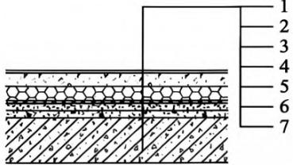1—面层;2—细石混凝土;3—保温层;4—防水层;5—水泥砂浆;6—找坡层;7—钢筋混凝土屋面板</td><td rowspan="8">XPS保温板</td><td>30</td><td>1.016</td><td>0.86</td><td>2.49</td></tr><tr><td>35</td><td>1.155</td><td>0.77</td><td>2.55</td></tr><tr><td>40</td><td>1.294</td><td>0.69</td><td>2.61</td></tr><tr><td>45</td><td>1.432</td><td>0.63</td><td>2. 67</td></tr><tr><td>50</td><td>1.571</td><td>0.58</td><td>2.73</td></tr><tr><td>60</td><td>1.849</td><td>0.50</td><td>2.84</td></tr><tr><td>70</td><td>2.127</td><td>0.44</td><td>2.96</td></tr><tr><td>80</td><td>2.405</td><td>0.39</td><td>3.08</td></tr><tr><td rowspan="13">3</td><td rowspan="12">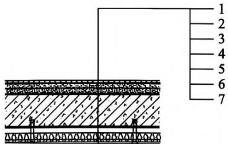1—细石混凝土保护层;2—防水层;3—水泥砂浆找平层;4—水泥炉渣找坡层;5—钢筋混凝土屋面板;6—空气层;7—轻钢龙骨保温吊顶</td><td rowspan="6">岩棉板</td><td>50</td><td>1.199</td><td>0.74</td><td>3.06</td></tr><tr><td>60</td><td>1.402</td><td>0.64</td><td>3.24</td></tr><tr><td>75</td><td>1.707</td><td>0.54</td><td>3.52</td></tr><tr><td>100</td><td>2.215</td><td>0.42</td><td>3.97</td></tr><tr><td>120</td><td>2.621</td><td>0.36</td><td>4.34</td></tr><tr><td>150</td><td>3.231</td><td>0.30</td><td>4.89</td></tr><tr><td rowspan="6">玻璃棉板</td><td>30</td><td>0.897</td><td>0.96</td><td>2.44</td></tr><tr><td>50</td><td>1.373</td><td>0.66</td><td>2.64</td></tr><tr><td>75</td><td>1.968</td><td>0.47</td><td>2.89</td></tr><tr><td>100</td><td>2.563</td><td>0.37</td><td>3.14</td></tr><tr><td>120</td><td>3.040</td><td>0.31</td><td>3.34</td></tr><tr><td>150</td><td>3.754</td><td>0.26</td><td>3.64</td></tr><tr><td colspan="6">岩棉板λ=0.041W/(m·K),S=0.75W/(m2·K),ρ0=100kg/m3;玻璃棉板λ=0.035W/(m·K),S=0.35W/(m2·K),ρ0=40kg/m3</td></tr><tr><td rowspan="11">4</td><td rowspan="10">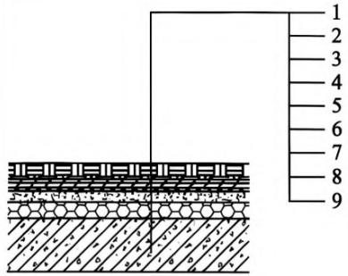1—种植土;2—土木布过滤层;3—凹凸型排(蓄)水板;4—防水保护层;5—耐根穿刺防水层;6—普通防水层;7—找平兼找坡层;8—保温层;9—钢筋混凝土屋面板</td><td rowspan="10">XPS保温板</td><td>30</td><td>1.118</td><td>0.79</td><td>3.27</td></tr><tr><td>35</td><td>1.257</td><td>0.71</td><td>3.33</td></tr><tr><td>40</td><td>1.396</td><td>0.65</td><td>3.39</td></tr><tr><td>45</td><td>1.534</td><td>0.59</td><td>3.44</td></tr><tr><td>50</td><td>1.673</td><td>0.55</td><td>3.50</td></tr><tr><td>60</td><td>1.951</td><td>0.48</td><td>3.62</td></tr><tr><td>70</td><td>2.229</td><td>0.42</td><td>3.74</td></tr><tr><td>80</td><td>2.507</td><td>0.38</td><td>3.85</td></tr><tr><td>90</td><td>2.784</td><td>0.34</td><td>3.97</td></tr><tr><td>100</td><td>3.062</td><td>0.31</td><td>4.09</td></tr><tr><td colspan="6">XPS保温板λ=0.03W/(m·K),S=0.34W/(m2·K),ρ0=35kg/m3</td></tr></table>

注；种植屋面植被层附加热阻按照 $0.1 \, (\mathrm{m}^{2} \cdot \mathrm{K}) / \mathrm{W}$ 计算。

### 7.3.4 楼地面

**1. 底面接触室外空气的架空楼板热工指标（表 7.3-6）**

底面接触室外空气的架空楼板热工指标  
表7.3-6

<table><tr><td>序号</td><td>构造</td><td>保温材料</td><td>保温层厚度(mm)</td><td>热阻[(m2·K)/W]</td><td>传热系数K[W/(m2·K)]</td></tr><tr><td rowspan="31">1</td><td rowspan="19">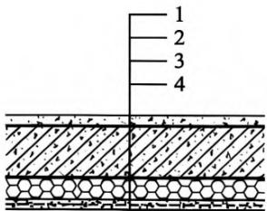1-水泥砂浆;2-钢筋混凝土楼板;3-保温层;4-聚合物砂浆(压人耐碱网格布)</td><td rowspan="11">XPS保温板</td><td>20</td><td>0.640</td><td>1.27</td></tr><tr><td>25</td><td>0.779</td><td>1.08</td></tr><tr><td>30</td><td>0.918</td><td>0.94</td></tr><tr><td>35</td><td>1.057</td><td>0.83</td></tr><tr><td>40</td><td>1.195</td><td>0.74</td></tr><tr><td>50</td><td>1.473</td><td>0.62</td></tr><tr><td>60</td><td>1.751</td><td>0.53</td></tr><tr><td>70</td><td>2.029</td><td>0.46</td></tr><tr><td>80</td><td>2.307</td><td>0.41</td></tr><tr><td>90</td><td>2.584</td><td>0.37</td></tr><tr><td>100</td><td>2.862</td><td>0.33</td></tr><tr><td rowspan="8">EPS保温板</td><td>50</td><td>0.778</td><td>1.08</td></tr><tr><td>60</td><td>0.897</td><td>0.96</td></tr><tr><td>70</td><td>1.106</td><td>0.86</td></tr><tr><td>80</td><td>1.135</td><td>0.78</td></tr><tr><td>90</td><td>1.254</td><td>0.71</td></tr><tr><td>100</td><td>1.373</td><td>0.66</td></tr><tr><td>120</td><td>1.611</td><td>0.57</td></tr><tr><td>150</td><td>1.968</td><td>0.47</td></tr><tr><td colspan="5">XPS保温板λ=0.03W/(m·K),S=0.34W/(m2·K),ρ0=35kg/m3;EPS保温板λ=0.039W/(m·K),S=0.28W/(m2·K),ρ0=20kg/m3</td></tr><tr><td rowspan="10">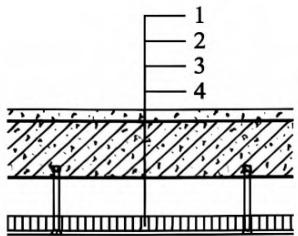1-水泥砂浆;2-钢筋混凝土板;3-空气层;4-轻钢龙骨保温板吊顶</td><td rowspan="10">岩棉板</td><td>30</td><td>0.689</td><td>1.19</td></tr><tr><td>40</td><td>0.892</td><td>0.96</td></tr><tr><td>50</td><td>1.095</td><td>0.80</td></tr><tr><td>60</td><td>1.298</td><td>0.69</td></tr><tr><td>70</td><td>1.502</td><td>0.61</td></tr><tr><td>80</td><td>1.805</td><td>0.54</td></tr><tr><td>90</td><td>1.908</td><td>0.49</td></tr><tr><td>100</td><td>2.111</td><td>0.44</td></tr><tr><td>120</td><td>2.518</td><td>0.37</td></tr><tr><td>150</td><td>3.128</td><td>0.31</td></tr><tr><td colspan="5">岩棉板λ=0.041W/(m·K),S=0.75W/(m2·K),ρ0=100kg/m3</td></tr></table>

**2. 地面热工指标（表 7.3-7）**

地面热工指标  
表7.3-7

<table><tr><td>序号</td><td colspan="2">构造</td><td>保温材料</td><td>保温层厚度(mm)</td><td>热阻[(m2·K)/W]</td><td>传热系数K[W/(m2·K)]</td></tr><tr><td rowspan="15">1</td><td rowspan="14" colspan="2">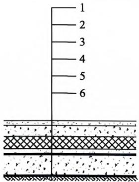</td><td rowspan="6">XPS保温板</td><td>20</td><td>0.56</td><td>-</td></tr><tr><td>25</td><td>0.69</td><td>-</td></tr><tr><td>30</td><td>0.83</td><td>-</td></tr><tr><td>35</td><td>0.97</td><td>-</td></tr><tr><td>40</td><td>1.11</td><td>-</td></tr><tr><td>50</td><td>1.39</td><td>-</td></tr><tr><td rowspan="5">EPS保温板</td><td>30</td><td>0.64</td><td>-</td></tr><tr><td>35</td><td>0.75</td><td>-</td></tr><tr><td>40</td><td>0.85</td><td>-</td></tr><tr><td>50</td><td>1.07</td><td>-</td></tr><tr><td>60</td><td>1.28</td><td>-</td></tr><tr><td rowspan="3">复合硬泡聚氨酯板</td><td>20</td><td>0.69</td><td>-</td></tr><tr><td>30</td><td>1.04</td><td>-</td></tr><tr><td>40</td><td>1.39</td><td>-</td></tr><tr><td colspan="6">XPS保温板λ=0.03W/(m·K),S=0.34W/(m2·K),ρ0=35kg/m3;EPS保温板λ=0.039W/(m·K),S=0.28W/(m2·K),ρ0=20kg/m3;复合硬泡聚氨酯板λ=0.024W/(m·K),S=0.29W/(m2·K),ρ0=45kg/m3</td></tr></table>

注：热阻仅为保温材料层热阻值。

### 7.3.5 地下室外墙

常用地下室外墙热工指标如表 7.3-8 所示。

常用地下室外墙热工指标  
表7.3-8

<table><tr><td>序号</td><td>构造</td><td>保温材料</td><td>保温层厚度(mm)</td><td>热阻[(m2·K)/W]</td><td>传热系数K[W/(m2·K)]</td></tr><tr><td rowspan="13">1</td><td rowspan="12">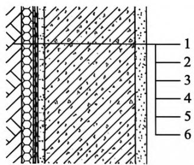1—回填土;2—保温层;3—防水层;4—水泥砂浆抹灰;5—钢筋混凝土墙体;6—水泥砂浆抹灰</td><td rowspan="6">XPS保温板</td><td>20</td><td>0.56</td><td>-</td></tr><tr><td>25</td><td>0.69</td><td>-</td></tr><tr><td>30</td><td>0.83</td><td>-</td></tr><tr><td>35</td><td>0.97</td><td>-</td></tr><tr><td>40</td><td>1.11</td><td>-</td></tr><tr><td>50</td><td>1.39</td><td>-</td></tr><tr><td rowspan="6">硬质聚氨酯泡沫塑料</td><td>20</td><td>0.69</td><td>-</td></tr><tr><td>25</td><td>0.87</td><td>-</td></tr><tr><td>30</td><td>1.04</td><td>-</td></tr><tr><td>35</td><td>1.22</td><td>-</td></tr><tr><td>40</td><td>1.39</td><td>-</td></tr><tr><td>50</td><td>1.74</td><td>-</td></tr><tr><td colspan="5">XPS保温板λ=0.03W/(m·K),S=0.34W/(m2·K),ρ0=35kg/m3;硬质聚氨酯泡沫塑料λ=0.024W/(m·K),S=0.79W/(m2·K),ρ0=130kg/m3</td></tr></table>

## 7.4 围护结构夏季隔热热工设计

### 7.4.1 一般规定

建筑隔热性能是体现建筑围护结构热工特性好坏的基本指标，我国南方地区夏季屋面外表面综合温度会达到 $60^{\circ}\mathrm{C}$ 以上，西墙外表面温度达 $50^{\circ}\mathrm{C}$ 以上，围护结构外表面综合温度的波动幅度可超过 $20^{\circ}\mathrm{C}$ ，造成围护结构内表面温度出现很大波动，围护结构内表面平均辐射温度大大超过人体热舒适温度，直接影响室内热环境。因此，把内表面最高温度作为控制围护结构隔热性能最重要的评价指标。

**7.4.1.1 墙体**

1. 在给定外墙两侧空气温度及变化规律的情况下，外墙内表面最高温度应符合表 7.4-1 的要求。

外墙内表面最高温度  
表 7.4-1

<table><tr><td rowspan="2">房间类型</td><td rowspan="2">自然通风房间</td><td colspan="2">空调房间</td></tr><tr><td>重质围护结构(D≥2.5)</td><td>轻质围护结构(D&lt;2.5)</td></tr><tr><td>内表面最高温度 $\theta_{i} \cdot_{max}$ </td><td> $\leqslant t_{e} \cdot_{max}$ </td><td> $\leqslant t_{i}+2$ </td><td> $\leqslant t_{i}+3$ </td></tr></table>

注：表中， $\theta_{i.max}$ ——围护结构内表面最高温度，℃； $t_{e.max}$ ——当地累年日平均温度最高日的最高温度，℃； $t_{i}$ ——室内空气温度，℃。

2. 外墙隔热设计可采取以下措施：

(1) 宜采用浅色外饰面, 如: 涂刷浅色涂料或热反射涂料、粘贴浅色饰面砖等。

(2) 可采用通风墙、干挂通风幕墙等。

（3）设置封闭空气间层时，在空气间层平行墙面的两个表面涂刷热反射涂料、贴热反射膜或铝箔。当采用单面热反射隔热措施时，热反射隔热层应设置在空气温度较高的一侧。

(4) 采用复合墙体构造时, 墙体外侧宜采用轻质材料, 内侧宜采用重质材料。

(5) 可采用墙面垂直绿化及淋水被动蒸发墙面等。

(6) 宜提高围护结构的热惰性指标 $D$ 值。

(7) 西向墙体宜采用高蓄热材料与低热传导材料组合的复合墙体构造。

3. 围护结构隔热性能计算：

《民用建筑热工设计规范》GB 50176—2016 提出了在给定边界条件下围护结构隔热性能的评价方法。评价仅围绕围护结构本身的隔热性能，只反映出围护结构固有的热工特性，而不是整个房间的热工特性。

隔热设计时，外墙内表面温度应采用一维非稳态方法计算，并按照房间的运行工况确定相应的边界条件。即外墙外表面为当地的夏季最热月典型日的逐时室外综合温度，自然通风房间外墙内侧空气温度平均值比室外空气温度平均值高 $1.5^{\circ} \mathrm{C}$ 、波幅小 $1.5^{\circ} \mathrm{C}$ ；空调房间外墙内侧空气温度为固定的 $26^{\circ} \mathrm{C}$ 。围护结构隔热计算参照7.2.3节。

**7.4.1.2 屋面**

1. 在给定屋面两侧空气温度及变化规律的情况下，屋面内表面最高温度应符合表7.4-2的要求。

屋面内表面最高温度  
表 7.4-2

<table><tr><td rowspan="2">房间类型</td><td rowspan="2">自然通风房间</td><td colspan="2">空调房间</td></tr><tr><td>重质围护结构(D≥2.5)</td><td>轻质围护结构(D&lt;2.5)</td></tr><tr><td>内表面最高温度 $\theta_{i, \max}$ </td><td> $\leqslant t_{c, \max}$ </td><td> $\leqslant t_{i}+2.5$ </td><td> $\leqslant t_{i}+3.5$ </td></tr></table>

2. 屋面隔热设计可采用以下措施：

(1) 宜采用浅色外饰面, 如: 涂刷浅色或热反射涂料、粘贴浅色屋面面砖等。

(2) 宜采用通风隔热屋面。通风隔热屋面的风道长度不宜大于 $10 \mathrm{~m}$ 。通风间层高度应大于 $0.3 \mathrm{~m}$ 。屋面基层应做保温隔热层, 檐口处宜采用导风构造, 通风隔热平屋面风道口与女儿墙的距离不应小于 $0.6 \mathrm{~m}$ 。

(3) 可采用有热反射材料层 (热反射涂料、热反射膜、铝箔等) 的空气间层隔热屋面, 单面设置热反射材料空气间层, 热反射材料应设在温度较高的一侧。

(4) 可采用蓄水屋面。水面宜有水浮莲等浮生植物或白色漂浮物, 水深宜为 $0.15 \sim 0.2 \mathrm{~m}$ 。

(5) 宜采用种植屋面。种植屋面的保温隔热层应选用密度小、压缩强度大、导热系数小、吸水率低的保温隔热材料。

(6) 可采用淋水被动蒸发屋面。

(7) 宜采用带老虎窗的通气阁楼坡屋面。

(8) 采用带通风空气层的金属夹芯隔热屋面时, 空气层厚度不宜小于 $0.1 \mathrm{~m}$ 。

3. 围护结构隔热性能计算：屋面内表面最高温度的计算方法与外墙内表面最高温度的计算方法一样，只是边界条件按照屋面条件输入。

### 7.4.2 外墙隔热

《民用建筑热工设计规范》GB 50176—2016 中针对围护结构隔热计算给出了一款专用软件 Kvalue，用来计算和判定外墙和屋面构造隔热性能是否满足规范要求。

我国夏热冬冷地区和夏热冬暖地区常用的保温隔热墙体包括以下几种类型，在自然通风和空调两种工况下的隔热要求，计算墙体内表面最高温度 $\theta_{\mathrm{i}} \cdot_{\max}$ 。

(1) $50 \mathrm{~mm}$ 厚岩棉 + 200 $\mathrm{~mm}$ 钢筋混凝土外保温墙体;

(2) $40 \mathrm{~mm} \mathrm{EPS} + 200 \mathrm{~mm}$ 钢筋混凝土外保温墙体;

(3) $200 \mathrm{~mm}$ 钢筋混凝土墙体 $+25 \mathrm{~mm}$ 挤塑聚苯板 XPS 内保温墙体；

(4) $20 \mathrm{~mm}$ 水泥砂浆 $+200 \mathrm{~mm}$ 加气混凝土砌块 $+20 \mathrm{~mm}$ 水泥砂浆自保温。

以重庆市为例，软件计算界面边界条件见图 7.4-1、图 7.4-2。算例中太阳辐射吸收系数 $\rho_{s}$ 按照 0.7 取值，由于该数值会直接影响逐时室外综合温度的大小，对计算结果产生影响，故设计过程中应根据待计算的外墙或屋面外表面的实际情况输入。计算结果如表 7.4-3～表 7.4-6 所示。

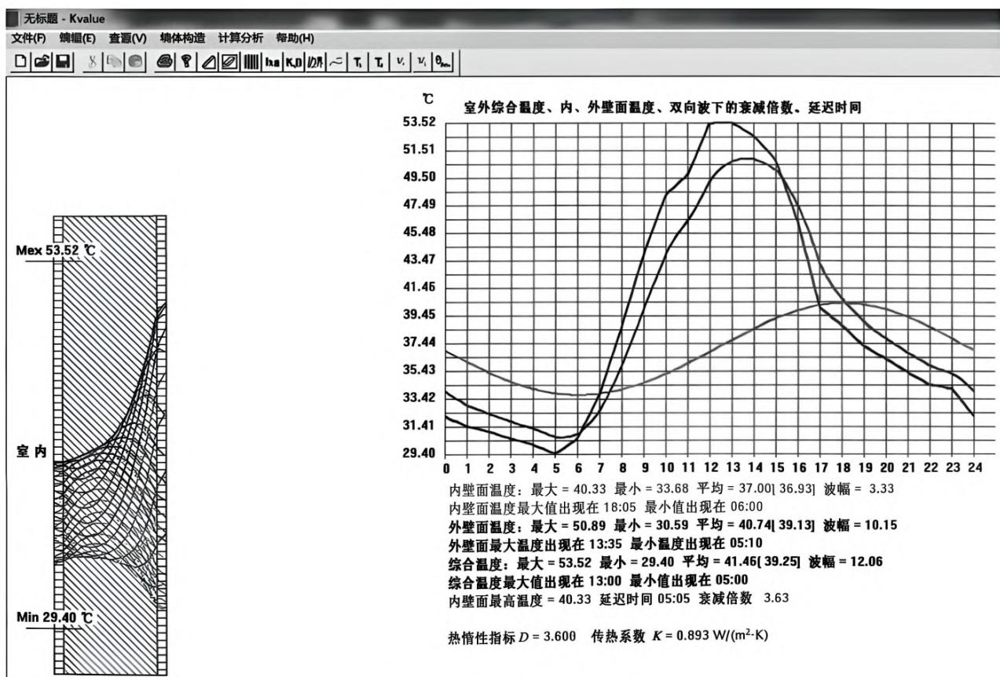  
图7.4-1 Kvalue软件计算界面

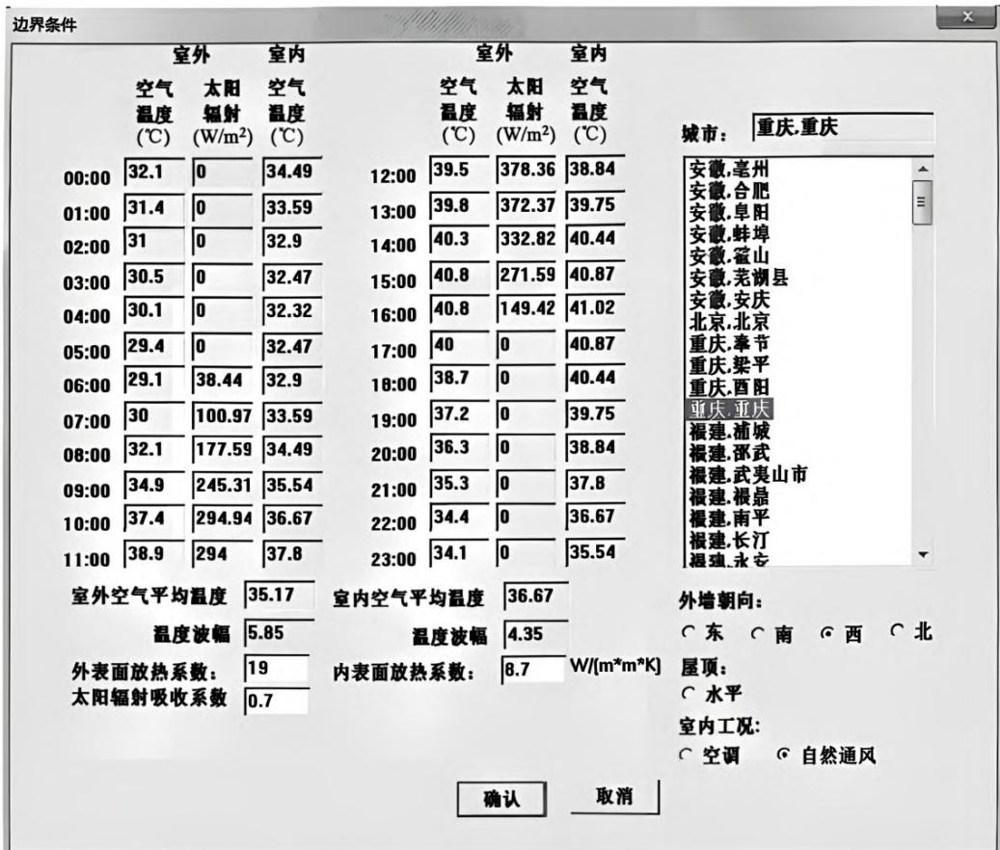  
图 7.4-2 计算边界条件（以重庆为例）

自然通风条件下西墙的隔热性能  
表7.4-3

<table><tr><td rowspan="2">地名</td><td rowspan="2">累年最高日平均温度的最高温度(°C)</td><td colspan="4">内表面最高温度 θi.max(°C)</td></tr><tr><td>50mm岩棉+200mm钢筋混凝土外保温墙体(D=3.039,K=0.707W/(m2·K),ρs=0.7)</td><td>40mmEPS+200mm钢筋混凝土外保温墙体(D=2.607,K=0.793W/(m2·K),ρs=0.7)</td><td>200mm钢筋混凝土墙体+25mm XPS内保温墙体(D=2.518,K=0.875W/(m2·K),ρs=0.7)</td><td>20mm水泥砂浆+200mm加气混凝土+20mm水泥砂浆(D=3.608,K=0.893W/(m2·K),ρs=0.7)</td></tr><tr><td>重庆</td><td>40.80</td><td>38.60</td><td>38.65</td><td>40.88</td><td>40.33</td></tr><tr><td>武汉</td><td>39.30</td><td>38.41</td><td>38.50</td><td>39.86</td><td>39.62</td></tr><tr><td>长沙</td><td>40.40</td><td>38.51</td><td>38.61</td><td>40.33</td><td>39.98</td></tr><tr><td>西安</td><td>36.00</td><td>33.80</td><td>33.85</td><td>35.89</td><td>35.36</td></tr><tr><td>南京</td><td>39.00</td><td>37.02</td><td>37.08</td><td>38.88</td><td>38.48</td></tr><tr><td>上海</td><td>38.00</td><td>36.37</td><td>36.40</td><td>37.96</td><td>37.59</td></tr><tr><td>杭州</td><td>39.40</td><td>37.59</td><td>37.66</td><td>39.57</td><td>39.14</td></tr><tr><td>南宁</td><td>35.40</td><td>34.31</td><td>34.37</td><td>35.79</td><td>35.52</td></tr><tr><td>合肥</td><td>39.80</td><td>37.88</td><td>37.95</td><td>39.70</td><td>39.32</td></tr><tr><td>福州</td><td>40.40</td><td>37.04</td><td>37.13</td><td>39.18</td><td>38.77</td></tr><tr><td>南昌</td><td>39.10</td><td>37.75</td><td>37.84</td><td>39.26</td><td>39.02</td></tr></table>

注：黑色字体表示围护结构在自然通风条件下的隔热性能不满足规范要求。

自然通风条件下东墙的隔热性能  
表7.4-4

<table><tr><td rowspan="2">地名</td><td rowspan="2">累年最高日平均温度的最高温度(°C)</td><td colspan="4">内表面最高温度 θi.max(℃)</td></tr><tr><td>50mm 岩棉+200mm钢筋混凝土(D=3.039,K=0.707W/(m2·K),ρs=0.7)</td><td>40mmEPS+200mm钢筋混凝土外保温墙体(D=2.607,K=0.793W/(m2·K),ρs=0.7)</td><td>200mm 钢筋混凝土墙体+25mm XPS 内保温墙体(D=2.518,K=0.875W/(m2·K),ρs=0.7)</td><td>20mm 水泥砂浆+200mm加气混凝土+20mm水泥砂浆(D=3.608,K=0.893W/(m2·K),ρs=0.7)</td></tr><tr><td>重庆</td><td>40.80</td><td>38.60</td><td>38.65</td><td>40.92</td><td>40.37</td></tr><tr><td>武汉</td><td>39.30</td><td>38.32</td><td>38.38</td><td>39.80</td><td>39.53</td></tr><tr><td>长沙</td><td>40.40</td><td>38.36</td><td>38.42</td><td>40.20</td><td>39.80</td></tr><tr><td>西安</td><td>36.00</td><td>33.87</td><td>33.92</td><td>36.02</td><td>35.50</td></tr><tr><td>南京</td><td>39.00</td><td>36.97</td><td>37.02</td><td>38.85</td><td>38.43</td></tr><tr><td>上海</td><td>38.00</td><td>37.21</td><td>37.35</td><td>39.11</td><td>39.05</td></tr><tr><td>杭州</td><td>39.40</td><td>37.60</td><td>37.67</td><td>39.64</td><td>39.21</td></tr><tr><td>南宁</td><td>35.40</td><td>34.28</td><td>34.33</td><td>35.78</td><td>35.50</td></tr><tr><td>合肥</td><td>39.80</td><td>37.78</td><td>37.84</td><td>36.63</td><td>39.22</td></tr><tr><td>福州</td><td>40.40</td><td>36.95</td><td>37.01</td><td>39.10</td><td>38.66</td></tr><tr><td>南昌</td><td>39.10</td><td>37.59</td><td>37.65</td><td>39.13</td><td>38.83</td></tr></table>

注：黑色字体表示围护结构在空调条件下的隔热性能不满足规范要求。

空调条件下西墙的隔热性能  
表 7.4-5

<table><tr><td rowspan="2">地名</td><td rowspan="2">内表面最高温度限值ti+2(℃)</td><td colspan="4">内表面最高温度 θi.max(℃)</td></tr><tr><td>50mm岩棉+200mm钢筋混凝土(D=3.039,K=0.707W/(m2·K),ρs=0.7)</td><td>40mmEPS+200mm钢筋混凝土外保温墙体(D=2.607,K=0.793W/(m2·K),ρs=0.7)</td><td>200mm钢筋混凝土墙体+25mm XPS内保温墙体(D=2.518,K=0.875W/(m2·K),ρs=0.7)</td><td>20mm水泥砂浆+200mm加气混凝土+20mm水泥砂浆(D=3.608,K=0.893W/(m2·K),ρs=0.7)</td></tr><tr><td>重庆</td><td>28.00</td><td>27.22</td><td>27.38</td><td>27.61</td><td>27.88</td></tr><tr><td>武汉</td><td>28.00</td><td>27.44</td><td>27.62</td><td>27.91</td><td>28.23</td></tr><tr><td>长沙</td><td>28.00</td><td>27.51</td><td>27.71</td><td>28.03</td><td>28.40</td></tr><tr><td>西安</td><td>28.00</td><td>26.83</td><td>26.93</td><td>27.11</td><td>27.34</td></tr><tr><td>南京</td><td>28.00</td><td>27.14</td><td>27.28</td><td>27.52</td><td>27.79</td></tr><tr><td>上海</td><td>28.00</td><td>26.94</td><td>27.05</td><td>27.22</td><td>27.40</td></tr><tr><td>杭州</td><td>28.00</td><td>27.26</td><td>27.42</td><td>27.68</td><td>27.96</td></tr><tr><td>南宁</td><td>28.00</td><td>26.97</td><td>27.09</td><td>27.30</td><td>27.54</td></tr><tr><td>合肥</td><td>28.00</td><td>27.35</td><td>27.52</td><td>27.80</td><td>28.11</td></tr><tr><td>福州</td><td>28.00</td><td>27.32</td><td>27.49</td><td>27.79</td><td>28.15</td></tr><tr><td>南昌</td><td>28.00</td><td>27.47</td><td>27.65</td><td>27.96</td><td>28.32</td></tr></table>

注：黑色字体表示围护结构在空调条件下的隔热性能不满足规范要求。

空调条件下东墙的隔热性能  
表7.4-6

<table><tr><td rowspan="2">地名</td><td rowspan="2">内表面最高温度限值ti+2(°C)</td><td colspan="4">内表面最高温度 θi·max(°C)</td></tr><tr><td>50mm岩棉+200mm钢筋混凝土(D=3.039,K=0.707W/(m2·K),ρs=0.7)</td><td>40mmEPS+200mm钢筋混凝土外保温墙体(D=2.607,K=0.793W/(m2·K),ρs=0.7)</td><td>200mm钢筋混凝土墙体+25mm XPS内保温墙体(D=2.518,K=0.875W/(m2·K),ρs=0.7)</td><td>20mm水泥砂浆+200mm加气混凝土+20mm水泥砂浆(D=3.608,K=0.893W/(m2·K),ρs=0.7)</td></tr><tr><td>重庆</td><td>28.00</td><td>27.21</td><td>27.36</td><td>27.58</td><td>27.80</td></tr><tr><td>武汉</td><td>28.00</td><td>27.29</td><td>27.45</td><td>27.68</td><td>27.90</td></tr><tr><td>长沙</td><td>28.00</td><td>27.29</td><td>27.46</td><td>27.69</td><td>27.92</td></tr><tr><td>西安</td><td>28.00</td><td>26.87</td><td>26.97</td><td>27.14</td><td>27.31</td></tr><tr><td>南京</td><td>28.00</td><td>27.07</td><td>27.20</td><td>27.40</td><td>27.61</td></tr><tr><td>上海</td><td>28.00</td><td>27.76</td><td>27.99</td><td>28.37</td><td>28.84</td></tr><tr><td>杭州</td><td>28.00</td><td>27.24</td><td>27.40</td><td>27.62</td><td>27.85</td></tr><tr><td>南宁</td><td>28.00</td><td>26.92</td><td>27.03</td><td>27.21</td><td>27.40</td></tr><tr><td>合肥</td><td>28.00</td><td>27.21</td><td>27.36</td><td>27.58</td><td>27.79</td></tr><tr><td>福州</td><td>28.00</td><td>27.19</td><td>27.34</td><td>27.58</td><td>27.84</td></tr><tr><td>南昌</td><td>28.00</td><td>27.24</td><td>27.40</td><td>27.61</td><td>27.83</td></tr></table>

注：黑色字体表示围护结构在空调条件下的隔热性能不满足规范要求。

当外墙隔热性能不满足规范要求时，应通过降低太阳辐射吸收系数、增加保温材料厚度、墙面垂直绿化、淋水被动蒸发墙面等措施，使得墙体内表面最高温度满足要求。

### 7.4.3 屋面隔热

屋面隔热设计与外墙隔热设计相近，不同之处仅是朝向为水平向。可根据隔热要求确定所需隔热层厚度 $\delta$ 和内表面最高温度。选取较为典型的三种屋面形式，在自然通风、空调两种工况下的隔热效果进行计算（表 7.4-7、表 7.4-8）。

自然通风条件下屋面的隔热性能  
表7.4-7

<table><tr><td rowspan="2">地名</td><td rowspan="2">累年最高日平均温度的最高温度(°C)</td><td colspan="3">内表面最高温度 θi, max°C</td></tr><tr><td>100mm彩钢夹芯保温岩棉屋面[D=1.664,K=0.418W/(m2·K),ρs=0.7]</td><td>40mm细石混凝土+40mm XPS板+20mm水泥砂浆+50mm水泥炉渣+100mm钢筋混凝土平屋面[D=2.861,K=0.557W/(m2·K),ρs=0.7]</td><td>20mm水泥砂浆+40mm XPS板+20mm水泥砂浆+100mm钢筋混凝土坡屋面[D=1.902,K=0.624W/(m2·K),ρs=0.7]</td></tr><tr><td>重庆</td><td>40.80</td><td>41.72</td><td>39.08</td><td>39.31</td></tr><tr><td>武汉</td><td>39.30</td><td>40.74</td><td>38.84</td><td>39.14</td></tr><tr><td>长沙</td><td>40.40</td><td>41.40</td><td>38.94</td><td>39.31</td></tr><tr><td>西安</td><td>36.00</td><td>36.70</td><td>34.33</td><td>34.54</td></tr><tr><td>南京</td><td>39.00</td><td>39.80</td><td>37.43</td><td>37.67</td></tr><tr><td>上海</td><td>38.00</td><td>38.71</td><td>36.62</td><td>36.84</td></tr><tr><td>杭州</td><td>39.40</td><td>40.46</td><td>38.12</td><td>38.38</td></tr><tr><td>南宁</td><td>35.40</td><td>36.59</td><td>34.75</td><td>34.98</td></tr><tr><td>合肥</td><td>39.80</td><td>40.64</td><td>38.30</td><td>38.60</td></tr><tr><td>福州</td><td>40.40</td><td>40.33</td><td>37.56</td><td>37.90</td></tr><tr><td>南昌</td><td>39.10</td><td>40.23</td><td>38.17</td><td>38.51</td></tr></table>

注：黑色字体表示围护结构在自然通风条件下的隔热性能不满足规范要求。

空调条件下屋面的隔热性能  
表7.4-8

<table><tr><td rowspan="2">地名</td><td rowspan="2">内表面最高温度限值 $t_i+2.5/t_i+3.5$ (°C)</td><td colspan="3">内表面最高温度  $\theta_{i,\max }^{\circ}C$ </td></tr><tr><td>100mm 彩钢夹芯保温岩棉屋面[D=1.664,K=0.418W/(m2·K), $\rho_s=0.7$ ]</td><td>40mm 细石混凝土+40mm XPS板+20mm 水泥砂浆+50mm水泥炉渣+100mm 钢筋混凝土平屋面[D=2.861,K=0.557W/(m2·K), $\rho_s=0.7$ ]</td><td>20mm 水泥砂浆+40mm XPS板+20mm 水泥砂浆+100mm钢筋混凝土坡屋面[D=1.902,K=0.624W/(m2·K), $\rho_s=0.7$ ]</td></tr><tr><td>重庆</td><td>28.5/29.5</td><td>28.09</td><td>27.42</td><td>27.78</td></tr><tr><td>武汉</td><td>28.5/29.5</td><td>28.03</td><td>27.58</td><td>27.97</td></tr><tr><td>长沙</td><td>28.5/29.5</td><td>28.19</td><td>27.65</td><td>28.07</td></tr><tr><td>西安</td><td>28.5/29.5</td><td>27.55</td><td>27.15</td><td>27.45</td></tr><tr><td rowspan="2">地名</td><td rowspan="2">内表面最高温度限值 $t_i+2.5/t_i+3.5$ (°C)</td><td colspan="3">内表面最高温度 $\theta_i \cdot_{max}$ °C</td></tr><tr><td>100mm彩钢夹芯保温岩棉屋面[D=1.664,K=0.418W/(m2·K), $\rho_o=0.7$ ]</td><td>40mm细石混凝土+40mm XPS板+20mm水泥砂浆+50mm水泥炉渣+100mm钢筋混凝土平屋面[D=2.861,K=0.557W/(m2·K), $\rho_o=0.7$ ]</td><td>20mm水泥砂浆+40mm XPS板+20mm水泥砂浆+100mm钢筋混凝土坡屋面[D=1.902,K=0.624W/(m2·K), $\rho_o=0.7$ ]</td></tr><tr><td>南京</td><td>28.5/29.5</td><td>27.83</td><td>27.30</td><td>27.65</td></tr><tr><td>上海</td><td>28.5/29.5</td><td>27.28</td><td>27.00</td><td>27.24</td></tr><tr><td>杭州</td><td>28.5/29.5</td><td>28.05</td><td>27.52</td><td>27.91</td></tr><tr><td>南宁</td><td>28.5/29.5</td><td>27.71</td><td>27.21</td><td>27.55</td></tr><tr><td>合肥</td><td>28.5/29.5</td><td>27.97</td><td>27.50</td><td>27.88</td></tr><tr><td>福州</td><td>28.5/29.5</td><td>28.29</td><td>27.59</td><td>28.04</td></tr><tr><td>南昌</td><td>28.5/29.5</td><td>28.14</td><td>27.61</td><td>28.02</td></tr></table>

(1) $100 \mathrm{~mm}$ 彩钢夹芯岩棉屋面。

（2）40mm 细石混凝土+40mm 挤塑聚苯板 XPS+20mm 水泥砂浆找平+50mm（平均）水泥炉渣找坡+100mm 钢筋混凝土平屋面。

(3) $20 \mathrm{~mm}$ 水泥砂浆 $+40 \mathrm{~mm}$ 挤塑聚苯板 $\mathrm{XPS} + 20 \mathrm{~mm}$ 水泥砂浆找平 $+100 \mathrm{~mm}$ 钢筋混凝土坡屋面。

当屋面隔热性能不满足规范要求时，应通过降低太阳辐射吸收系数、增加保温材料厚度、设置通风隔热屋面、种植屋面、淋水被动蒸发屋面等措施，使得屋面内表面最高温度满足要求。

## 7.5 透光围护结构热工设计

### 7.5.1 一般规定

1. 透光围护结构太阳得热系数与夏季建筑遮阳系数的乘积宜小于表7.5-1规定的限值。

透光围护结构隔热性能限值  
表7.5-1

<table><tr><td rowspan="2">气候区</td><td colspan="4">朝向</td></tr><tr><td>南</td><td>北</td><td>东、西</td><td>水平</td></tr><tr><td>寒冷B区</td><td>—</td><td>—</td><td>0.55</td><td>0.45</td></tr><tr><td>夏热冬冷A区</td><td>0.55</td><td>—</td><td>0.50</td><td>0.40</td></tr><tr><td>夏热冬冷B区</td><td>0.50</td><td>—</td><td>0.45</td><td>0.35</td></tr><tr><td>夏热冬暖A区</td><td>0.50</td><td>—</td><td>0.40</td><td>0.30</td></tr><tr><td>夏热冬暖B区</td><td>0.45</td><td>0.55</td><td>0.40</td><td>0.30</td></tr></table>

2. 透光围护结构的太阳得热系数、遮阳系数按照现行行业标准《建筑门窗玻璃幕墙热工计算规程》JGJ/T 151 中的计算方法进行计算。

3. 对遮阳要求高的门窗、玻璃幕墙、采光顶隔热宜采用着色玻璃、遮阳型单片 Low-E 玻璃、着色中空玻璃、热反射中空玻璃、遮阳型 Low-E 中空玻璃等遮阳型玻璃。

4. 向阳面的窗、玻璃门、玻璃幕墙、采光顶应设置固定遮阳或活动遮阳。固定遮阳的设计可考虑阳台、走廊、雨棚等建筑构件的遮阳作用，设计时应进行夏季太阳直射轨迹分析，根据分析结果确定固定遮阳的形状和安装位置。活动遮阳宜设置在室外侧。

5. 对于非透光的建筑幕墙, 应在幕墙面板的背后设置保温材料, 保温材料层的热阻应满足墙体的保温要求, 且不应小于 $1.0 \mathrm{~m}^{2} \cdot \mathrm{K} / \mathrm{W}$ 。

### 7.5.2 典型玻璃的光学、热工性能

典型玻璃的光学、热工性能如表 7.5-2 所示。

典型玻璃的光学、热工性能参数  
表7.5-2

<table><tr><td colspan="2">玻璃品种</td><td>可见光透射比τv</td><td>太阳得热系数SHGC</td><td>中部传热系数K[W/(m2·K)]</td><td>镀膜玻璃半球辐射率ζ</td></tr><tr><td>透明</td><td>6mm 透明玻璃</td><td>0.87</td><td>0.82</td><td>5.36</td><td>-</td></tr><tr><td rowspan="4">热反射玻璃</td><td>6mm 高透光热反射玻璃</td><td>0.78</td><td>0.77</td><td>5.27</td><td>0.80</td></tr><tr><td>6mm 中透光热反射玻璃</td><td>0.51</td><td>0.59</td><td>5.30</td><td>0.81</td></tr><tr><td>6mm 低透光热反射玻璃</td><td>0.37</td><td>0.52</td><td>5.27</td><td>0.80</td></tr><tr><td>6mm 特低透光热反射玻璃</td><td>0.22</td><td>0.40</td><td>5.36</td><td>0.58</td></tr><tr><td rowspan="2">Low-E单片玻璃</td><td>6mm 在线型 Low-E 玻璃1</td><td>0.80</td><td>0.69</td><td>3.54</td><td>0.18</td></tr><tr><td>6mm 在线型 Low-E 玻璃2</td><td>0.73</td><td>0.63</td><td>3.72</td><td>0.25</td></tr><tr><td rowspan="15">双玻中空玻璃</td><td>6 透明+12A+6 透明</td><td>0.77</td><td>0.71</td><td>2.80</td><td>-</td></tr><tr><td>6 绿色吸热+12A+6 透明</td><td>0.66</td><td>0.47</td><td>2.80</td><td>-</td></tr><tr><td>6 浅灰色吸热+12A+6 透明</td><td>0.38</td><td>0.45</td><td>2.80</td><td>-</td></tr><tr><td>6 中透光热反射+12A+6 透明</td><td>0.45</td><td>0.49</td><td>2.64</td><td>0.81</td></tr><tr><td>6 低透光热反射+12A+6 透明</td><td>0.34</td><td>0.41</td><td>2.63</td><td>0.80</td></tr><tr><td>6 高透光 Low-E+12A+6 透明</td><td>0.68</td><td>0.56</td><td>1.88</td><td>0.15</td></tr><tr><td>6 中透光 Low-E+12A+6 透明</td><td>0.49</td><td>0.39</td><td>1.81</td><td>0.11</td></tr><tr><td>6 较低透光 Low-E+12A+6 透明</td><td>0.41</td><td>0.31</td><td>1.72</td><td>0.07</td></tr><tr><td>6 低透光 Low-E+12A+6 透明</td><td>0.40</td><td>0.32</td><td>1.81</td><td>0.11</td></tr><tr><td>6 高透光 Low-E+12Ar+6 透明</td><td>0.68</td><td>0.55</td><td>1.63</td><td>0.15</td></tr><tr><td>6 中透光 Low-E+12Ar+6 透明</td><td>0.49</td><td>0.38</td><td>1.56</td><td>0.11</td></tr><tr><td>6 高透光双银 Low-E+9A/12A+6 透明</td><td>0.60</td><td>0.38/0.37</td><td>1.89/1.69</td><td>0.05</td></tr><tr><td>6 高透光双银 Low-E+9Ar/12Ar+6 透明</td><td>0.60</td><td>0.37/0.36</td><td>1.54/1.41</td><td>0.05</td></tr><tr><td>6 中透光双银 Low-E+9A/12A+6 透明</td><td>0.49</td><td>0.36/0.35</td><td>1.92/1.72</td><td>0.06</td></tr><tr><td>6 中透光双银 Low-E+9Ar/12Ar+6 透明</td><td>0.48</td><td>0.35/0.34</td><td>1.57/1.45</td><td>0.06</td></tr><tr><td rowspan="6">双玻中空玻璃</td><td>6低透光双银 Low-E+9A/12A+6 透明</td><td>0.35</td><td>0.25/0.24</td><td>1.86/1.66</td><td>0.03</td></tr><tr><td>6低透光双银 Low-E+9Ar/12Ar+6 透明</td><td>0.35</td><td>0.24/0.23</td><td>1.50/1.38</td><td>0.03</td></tr><tr><td>6高透光三银 Low-E+9A/12A+6 透明</td><td>0.64</td><td>0.30</td><td>1.83/1.63</td><td>0.02</td></tr><tr><td>6高透光三银 Low-E+9Ar/12Ar+6 透明</td><td>0.64</td><td>0.29</td><td>1.46/1.32</td><td>0.02</td></tr><tr><td>6中透光三银 Low-E+9A/12A+6 透明</td><td>0.47</td><td>0.23</td><td>1.84/1.64</td><td>0.02</td></tr><tr><td>6中透光三银 Low-E+9Ar/12Ar+6 透明</td><td>0.47</td><td>0.22</td><td>1.48/1.33</td><td>0.02</td></tr><tr><td rowspan="16">三玻中空玻璃</td><td>6透明+12A+6 透明+12A+6 透明</td><td>0.69</td><td>0.62</td><td>1.76</td><td>-</td></tr><tr><td>6中透光 Low-E+6A+6 透明+6A+6 透明</td><td>0.43</td><td>0.35</td><td>1.82</td><td>0.11</td></tr><tr><td>6中透光 Low-E+9A+6 透明+9A+6 透明</td><td>0.43</td><td>0.35</td><td>1.49</td><td>0.11</td></tr><tr><td>6高透光 Low-E+12A+6 透明+12A+6 透明</td><td>0.61</td><td>0.50</td><td>1.37</td><td>0.15</td></tr><tr><td>6中透光 Low-E+12A+6 透明+12A+6 透明</td><td>0.44</td><td>0.34</td><td>1.33</td><td>0.11</td></tr><tr><td>6低透光 Low-E+12A+6 透明+12A+6 透明</td><td>0.36</td><td>0.28</td><td>1.33</td><td>0.11</td></tr><tr><td>6高透光 Low-E+12Ar+6 透明+12A+6 透明</td><td>0.61</td><td>0.50</td><td>1.23</td><td>0.15</td></tr><tr><td>6中透光 Low-E+12Ar+6 透明+12A+6 透明</td><td>0.44</td><td>0.34</td><td>1.18</td><td>0.11</td></tr><tr><td>6高透光双银 Low-E+12A+6 透明+12A+6 透明</td><td>0.53</td><td>0.33</td><td>1.25</td><td>0.05</td></tr><tr><td>6中透光双银 Low-E+12A+6 透明+12A+6 透明</td><td>0.43</td><td>0.31</td><td>1.28</td><td>0.07</td></tr><tr><td>6高透光三银 Low-E+12A+6 透明+12A+6 透明</td><td>0.56</td><td>0.27</td><td>1.22</td><td>0.02</td></tr><tr><td>6中透光三银 Low-E+12A+6 透明+12A+6 透明</td><td>0.41</td><td>0.20</td><td>1.23</td><td>0.02</td></tr><tr><td>6高透光双银 Low-E+12Ar+6 透明+12A+6 透明</td><td>0.53</td><td>0.33</td><td>1.09</td><td>0.05</td></tr><tr><td>6中透光双银 Low-E+12Ar+6 透明+12A+6 透明</td><td>0.43</td><td>0.31</td><td>1.11</td><td>0.07</td></tr><tr><td>6高透光三银 Low-E+12Ar+6 透明+12A+6 透明</td><td>0.56</td><td>0.26</td><td>1.04</td><td>0.02</td></tr><tr><td>6中透光三银 Low-E+12Ar+6 透明+12A+6 透明</td><td>0.41</td><td>0.20</td><td>1.05</td><td>0.02</td></tr><tr><td rowspan="2">真空玻璃</td><td>6透明+12A+6 高透光双银 Low-E+0.2mm 真空层+6 透明</td><td>0.60</td><td>0.35</td><td>0.68</td><td>0.03</td></tr><tr><td>6中透光 Low-E+0.2mm 真空层+6 透明</td><td>0.52</td><td>0.40</td><td>0.9</td><td>0.15</td></tr><tr><td rowspan="5">热致调光双玻、三玻中空玻璃</td><td>6透明+2M+6 透明+12A+6 透明</td><td>0.71</td><td>透明0.75;雾化0.18</td><td>2.50</td><td>-</td></tr><tr><td>6透明+2M+6 绿色吸热+12A+6 透明</td><td>0.66</td><td>透明0.47;雾化0.18</td><td>2.50</td><td>-</td></tr><tr><td>6透明+2M+6 深灰色吸热+12A+6 透明</td><td>0.38</td><td>透明0.44;雾化0.18</td><td>2.50</td><td>-</td></tr><tr><td>6透明+2M+6 中透光热反射+12A+6 透明</td><td>0.28</td><td>透明0.30;雾化0.18</td><td>2.10</td><td>-</td></tr><tr><td>6透明+2M+6 低透光热反射+12A+6 透明</td><td>0.15</td><td>透明0.16;雾化0.18</td><td>2.00</td><td>-</td></tr></table>

续表

<table><tr><td colspan="2">玻璃品种</td><td>可见光透射比τv</td><td>太阳得热系数SHGC</td><td>中部传热系数K[W/(m2·K)]</td><td>镀膜玻璃半球辐射率ζ</td></tr><tr><td rowspan="8">热致调光双玻、三玻中空玻璃</td><td>6透明+2M+6高透光 Low-E+12A+6 透明</td><td>0.72</td><td>透明0.54;雾化0.18</td><td>1.70</td><td>-</td></tr><tr><td>6透明+2M+6中透光 Low-E+12A+6 透明</td><td>0.62</td><td>透明0.44;雾化0.18</td><td>1.60</td><td>-</td></tr><tr><td>6透明+2M+6较低透光 Low-E+12A+6 透明</td><td>0.48</td><td>透明0.33;雾化0.18</td><td>1.60</td><td>-</td></tr><tr><td>6透明+2M+6低透光 Low-E+12A+6 透明</td><td>0.35</td><td>透明0.26;雾化0.18</td><td>1.60</td><td>-</td></tr><tr><td>6透明+2M+6高透光 Low-E+12Ar+6 透明</td><td>0.72</td><td>透明0.54;雾化0.18</td><td>1.40</td><td>-</td></tr><tr><td>6透明+2M+6中透光 Low-E+12Ar+6 透明</td><td>0.62</td><td>透明0.44;雾化0.18</td><td>1.30</td><td>-</td></tr><tr><td>6透明+2M+6高透光 Low-E+12Ar+6 高透光 Low-E+12Ar+6 透明</td><td>0.47</td><td>透明0.36;雾化0.18</td><td>1.00</td><td>-</td></tr><tr><td>6透明+2M+6高透光 Low-E+16Ar+6 高透光 Low-E+16Ar+6 透明</td><td>0.47</td><td>透明0.36;雾化0.18</td><td>0.80</td><td>-</td></tr><tr><td rowspan="6">气凝胶玻璃</td><td>1级</td><td>0.70</td><td>0.28~0.65</td><td>1.0</td><td>-</td></tr><tr><td>2级</td><td>0.60</td><td>0.16~0.58</td><td>0.8</td><td>-</td></tr><tr><td>6Low-E+9A+6涂膜</td><td>0.65</td><td>0.26~0.35</td><td>1.9</td><td>-</td></tr><tr><td>6Low-E+12A+6涂膜</td><td>0.65</td><td>0.26~0.35</td><td>1.8</td><td>-</td></tr><tr><td>6+9A+6涂膜</td><td>0.75</td><td>0.30~0.39</td><td>2.6-3.0</td><td>-</td></tr><tr><td>6+12A+6涂膜</td><td>0.75</td><td>0.29~0.38</td><td>2.4-2.8</td><td>-</td></tr><tr><td rowspan="6">汽车</td><td>白玻璃(2.1mm)</td><td>0.904</td><td>0.874</td><td>5.47</td><td>-</td></tr><tr><td>白玻璃(4mm)</td><td>0.900</td><td>0.853</td><td>5.41</td><td>-</td></tr><tr><td>绿玻璃(2.1mm)</td><td>0.854</td><td>0.698</td><td>5.47</td><td>-</td></tr><tr><td>绿玻璃(4mm)</td><td>0.782</td><td>0.554</td><td>5.41</td><td>-</td></tr><tr><td>夹层玻璃(普通PVB 4mm)</td><td>0.745</td><td>0.470</td><td>5.51</td><td>-</td></tr><tr><td>钢化玻璃 VG10(5mm)</td><td>0.610</td><td>0.500</td><td>5.4</td><td>-</td></tr><tr><td rowspan="3">高铁</td><td>双层有机玻璃 6mm+12mm+6mm</td><td>0.921</td><td>0.771</td><td>3.062</td><td>-</td></tr><tr><td>镀膜有机玻璃 6mm+12mm+6.5mm(膜厚0.5mm)</td><td>0.865</td><td>0.495</td><td>2.442</td><td>0.86</td></tr><tr><td>高寒地区:双层 Low-E 玻璃(5mm+12mmAr+5mm)</td><td>0.72</td><td>-</td><td>2.60</td><td>0.45</td></tr></table>

注：1. A 表示空气层，Ar 表示氩气。  
2. 汽车车窗目前使用的玻璃多为单层玻璃，影响单层玻璃传热系数的因素有：玻璃厚度、玻璃镀膜表面辐射率、室外综合换热系数和室内综合换热系数。在其他三个条件一定时，玻璃厚度对传热系数的影响基本呈线性变化：随玻璃厚度增加，传热系数逐渐降低。钢化玻璃仅改变玻璃力学、机械性能，没有改变热传导性能，因此将原片钢化制成的钢化玻璃传热系数基本可以认为不变。  
3. 数据引自《建筑热工与围护结构节能设计手册》。

### 7.5.3 常见外门窗的热工指标

典型玻璃配合不同窗框的整窗传热系数如表7.5-3所示。

表7.5-3

典型玻璃配合不同窗框的整窗传热系数

<table><tr><td rowspan="3" colspan="2">玻璃品种</td><td rowspan="3">玻璃中部传热系数 $K_{\mathrm{g}}[\mathrm{W}/(\mathrm{m}^{2}\cdot\mathrm{K})]$ </td><td colspan="7">传热系数 $K[\mathrm{W}/(\mathrm{m}^{2}\cdot\mathrm{K})]$ </td></tr><tr><td colspan="3">铝合金型材</td><td>木框</td><td>铝塑型材</td><td colspan="2">塑料型材</td></tr><tr><td>非隔热金属型材 $K_{\mathrm{f}}=10.8\mathrm{W}/(\mathrm{m}^{2}\cdot\mathrm{K})$ 窗框面积15%</td><td>隔热金属型材 $K_{\mathrm{f}}=5.0\mathrm{W}/(\mathrm{m}^{2}\cdot\mathrm{K})$ 窗框面积20%</td><td>多腔隔热金属型材 $K_{\mathrm{f}}=3.0\mathrm{W}/(\mathrm{m}^{2}\cdot\mathrm{K})$ 窗框面积20%</td><td>木框 $K_{\mathrm{f}}=2.4\mathrm{W}/(\mathrm{m}^{2}\cdot\mathrm{K})$ 窗框面积25%</td><td>铝塑共挤型材 $K_{\mathrm{f}}=2.7\mathrm{W}/(\mathrm{m}^{2}\cdot\mathrm{K})$ 窗框面积30%</td><td>塑料型材 $K_{\mathrm{f}}=2.7\mathrm{W}/(\mathrm{m}^{2}\cdot\mathrm{K})$ 窗框面积25%</td><td>多腔塑料型材 $K_{\mathrm{f}}=2.0\mathrm{W}/(\mathrm{m}^{2}\cdot\mathrm{K})$ 窗框面积25%</td></tr><tr><td>透明</td><td>6mm透明玻璃</td><td>5.4</td><td>6.2</td><td>5.3</td><td>4.9</td><td>4.7</td><td>4.6</td><td>4.7</td><td>4.6</td></tr><tr><td rowspan="4">热反射玻璃</td><td>6mm高透光热反射玻璃</td><td>5.3</td><td>6.1</td><td>5.2</td><td>4.8</td><td>4.6</td><td>4.5</td><td>4.7</td><td>4.5</td></tr><tr><td>6mm中透光热反射玻璃</td><td>5.3</td><td>6.1</td><td>5.2</td><td>4.8</td><td>4.6</td><td>4.5</td><td>4.7</td><td>4.5</td></tr><tr><td>6mm低透光热反射玻璃</td><td>5.3</td><td>6.1</td><td>5.2</td><td>4.8</td><td>4.6</td><td>4.5</td><td>4.7</td><td>4.5</td></tr><tr><td>6mm特低透光热反射玻璃</td><td>5.4</td><td>6.2</td><td>5.3</td><td>4.9</td><td>4.7</td><td>4.6</td><td>4.7</td><td>4.6</td></tr><tr><td rowspan="2">单片Low-E</td><td>6mm在线型Low-E玻璃1</td><td>3.1</td><td>4.3</td><td>3.5</td><td>3.1</td><td>2.9</td><td>3.0</td><td>3.0</td><td>2.8</td></tr><tr><td>6mm在线型Low-E玻璃2</td><td>3.2</td><td>4.3</td><td>3.6</td><td>3.2</td><td>3.0</td><td>3.1</td><td>3.1</td><td>2.9</td></tr><tr><td rowspan="6">双玻中空玻璃</td><td>6透明+9A/12A+6透明</td><td>3.0/2.8</td><td>4.2/4.0</td><td>3.4/3.2</td><td>3.0/2.8</td><td>2.9/2.7</td><td>2.9/2.8</td><td>2.9/2.8</td><td>2.8/2.6</td></tr><tr><td>6透明+16A/20A+6透明</td><td>2.7/2.4</td><td>3.9/3.7</td><td>3.2/2.9</td><td>2.8/2.5</td><td>2.6/2.4</td><td>2.7/2.5</td><td>2.7/2.5</td><td>2.5/2.3</td></tr><tr><td>6灰色吸热+9A/12A+6透明</td><td>2.9/2.8</td><td>4.1/4.0</td><td>3.3/3.2</td><td>2.9/2.8</td><td>2.8/2.7</td><td>2.8/2.8</td><td>2.9/2.8</td><td>2.7/2.6</td></tr><tr><td>6绿色吸热+9A/12A+6透明</td><td>2.9/2.8</td><td>4.1/4.0</td><td>3.3/3.2</td><td>2.9/2.8</td><td>2.8/2.7</td><td>2.8/2.8</td><td>2.9/2.8</td><td>2.7/2.6</td></tr><tr><td>6中透光热反射+9A/12A+6透明</td><td>2.8/2.6</td><td>4.0/3.8</td><td>3.2/3.1</td><td>2.8/2.7</td><td>2.7/2.6</td><td>2.8/2.6</td><td>2.8/2.6</td><td>2.6/2.5</td></tr><tr><td>6低透光热反射+9A/12A+6透明</td><td>2.8/2.6</td><td>4.0/3.8</td><td>3.2/3.1</td><td>2.8/2.7</td><td>2.7/2.6</td><td>2.8/2.6</td><td>2.8/2.6</td><td>2.6/2.5</td></tr></table>

续表

<table><tr><td colspan="2" rowspan="3">玻璃品种</td><td rowspan="3">玻璃中部传热系数 $K_{g}[W/(m^{2} \cdot K)]$ </td><td colspan="7">传热系数 $K[W/(m^{2} \cdot K)]$ </td></tr><tr><td colspan="3">铝合金型材</td><td>木框</td><td>铝塑型材</td><td colspan="2">塑料型材</td></tr><tr><td>非隔热金属型材 $K_{f}=10.8W/(m^{2} \cdot K)$ 窗框面积15%</td><td>隔热金属型材 $K_{f}=5.0W/(m^{2} \cdot K)$ 窗框面积20%</td><td>多腔隔热金属型材 $K_{f}=3.0W/(m^{2} \cdot K)$ 窗框面积20%</td><td>木框 $K_{f}=2.4W/(m^{2} \cdot K)$ 窗框面积25%</td><td>铝塑共挤型材 $K_{f}=2.7W/(m^{2} \cdot K)$ 窗框面积30%</td><td>塑料型材 $K_{f}=2.7W/(m^{2} \cdot K)$ 窗框面积25%</td><td>多腔塑料型材 $K_{f}=2.0W/(m^{2} \cdot K)$ 窗框面积25%</td></tr><tr><td rowspan="9">双玻中空玻璃</td><td>6高透光Low-E+9A/12A+6透明</td><td>2.1/1.9</td><td>3.4/3.2</td><td>2.7/2.5</td><td>2.3/2.1</td><td>2.2/2.0</td><td>2.3/2.1</td><td>2.3/2.1</td><td>2.1/1.9</td></tr><tr><td>6中透光Low-E+9A/12A+6透明</td><td>2.0/1.8</td><td>3.3/3.2</td><td>2.6/2.4</td><td>2.2/2.0</td><td>2.1/2.0</td><td>2.2/2.1</td><td>2.2/2.0</td><td>2.0/1.9</td></tr><tr><td>6较低透光Low-E+9A/12A+6透明</td><td>1.9/1.7</td><td>3.2/3.1</td><td>2.5/2.4</td><td>2.1/2.0</td><td>2.0/1.9</td><td>2.1/2.0</td><td>2.1/2.0</td><td>1.9/1.8</td></tr><tr><td>6低透光Low-E+9A/12A+6透明</td><td>2.0/1.8</td><td>3.3/3.2</td><td>2.6/2.4</td><td>2.2/2.0</td><td>2.1/2.0</td><td>2.2/2.1</td><td>2.2/2.0</td><td>2.0/1.9</td></tr><tr><td>6高透光Low-E+9Ar/12Ar+6透明</td><td>1.8/1.6</td><td>3.2/3.0</td><td>2.4/2.3</td><td>2.0/1.9</td><td>2.0/1.8</td><td>2.1/1.9</td><td>2.0/1.9</td><td>1.9/1.7</td></tr><tr><td>6中透光Low-E+9Ar/12Ar+6透明</td><td>1.8/1.6</td><td>3.2/3.0</td><td>2.4/2.3</td><td>2.0/1.9</td><td>2.0/1.8</td><td>2.1/1.9</td><td>2.0/1.9</td><td>1.9/1.7</td></tr><tr><td>6高透光双银Low-E+9A/12A+6透明</td><td>1.9/1.7</td><td>3.2/3.1</td><td>2.5/2.4</td><td>2.1/2.0</td><td>2.0/1.9</td><td>2.1/2.0</td><td>2.1/2.0</td><td>1.9/1.8</td></tr><tr><td>6高透光双银Low-E+9Ar/12Ar+6透明</td><td>1.6/1.4</td><td>3.0/2.8</td><td>2.3/2.1</td><td>1.9/1.7</td><td>1.8/1.7</td><td>1.9/1.8</td><td>1.9/1.7</td><td>1.7/1.6</td></tr><tr><td>6中透光双银Low-E+9A/12A+6透明</td><td>1.9/1.7</td><td>3.2/3.1</td><td>2.5/2.4</td><td>2.1/2.0</td><td>2.0/1.9</td><td>2.1/2.0</td><td>2.1/2.0</td><td>1.9/1.8</td></tr><tr><td rowspan="7">双玻中空玻璃</td><td>6中透光双银Low-E+9Ar/12Ar+6透明</td><td>1.6/1.5</td><td>3.0/2.9</td><td>2.3/2.2</td><td>1.9/1.8</td><td>1.8/1.7</td><td>1.9/1.9</td><td>1.9/1.8</td><td>1.7/1.6</td></tr><tr><td>6低透光双银Low-E+9A/12A+6透明</td><td>1.9/1.7</td><td>3.2/3.1</td><td>2.5/2.4</td><td>2.1/2.0</td><td>2.0/1.9</td><td>2.1/2.0</td><td>2.1/2.0</td><td>1.9/1.8</td></tr><tr><td>6低透光双银Low-E+9Ar/12Ar+6透明</td><td>1.5/1.4</td><td>2.9/2.8</td><td>2.2/2.1</td><td>1.8/1.7</td><td>1.7/1.7</td><td>1.9/1.8</td><td>1.8/1.7</td><td>1.6/1.6</td></tr><tr><td>6高透光三银Low-E+9A/12A+6透明</td><td>1.8/1.6</td><td>3.2/3.0</td><td>2.4/2.3</td><td>2.0/1.9</td><td>2.0/1.8</td><td>2.1/1.9</td><td>2.0/1.9</td><td>1.9/1.7</td></tr><tr><td>6高透光三银Low-E+9Ar/12Ar+6透明</td><td>1.5/1.3</td><td>2.9/2.7</td><td>2.2/2.0</td><td>1.8/1.6</td><td>1.7/1.6</td><td>1.9/1.7</td><td>1.8/1.7</td><td>1.6/1.5</td></tr><tr><td>6中透光三银Low-E+9A/12A+6透明</td><td>1.8/1.6</td><td>3.2/3.0</td><td>2.4/2.3</td><td>2.0/1.9</td><td>2.0/1.8</td><td>2.1/1.9</td><td>2.0/1.9</td><td>1.9/1.7</td></tr><tr><td>6中透光三银Low-E+9Ar/12Ar+6透明</td><td>1.5/1.3</td><td>2.9/2.7</td><td>2.2/2.0</td><td>1.8/1.6</td><td>1.7/1.6</td><td>1.9/1.7</td><td>1.8/1.7</td><td>1.6/1.5</td></tr><tr><td rowspan="2">三玻中空玻璃</td><td>6透明+9A+6透明+9A+6透明</td><td>1.9</td><td>3.2</td><td>2.5</td><td>2.1</td><td>2.0</td><td>2.1</td><td>2.1</td><td>1.9</td></tr><tr><td>6透明+12A+6透明+12A+6透明</td><td>1.8</td><td>3.2</td><td>2.4</td><td>2.0</td><td>2.0</td><td>2.1</td><td>2.0</td><td>1.9</td></tr></table>

续表

<table><tr><td rowspan="3" colspan="2">玻璃品种</td><td rowspan="3">玻璃中部传热系数 $K_{\mathrm{g}}[\mathrm{W}/(\mathrm{m}^{2}\cdot\mathrm{K})]$ </td><td colspan="7">传热系数 $K[\mathrm{W}/(\mathrm{m}^{2}\cdot\mathrm{K})]$ </td></tr><tr><td colspan="3">铝合金型材</td><td>木框</td><td>铝塑型材</td><td colspan="2">塑料型材</td></tr><tr><td>非隔热金属型材 $K_{\mathrm{f}}=10.8\mathrm{W}/(\mathrm{m}^{2}\cdot\mathrm{K})$ 窗框面积15%</td><td>隔热金属型材 $K_{\mathrm{f}}=5.0\mathrm{W}/(\mathrm{m}^{2}\cdot\mathrm{K})$ 窗框面积20%</td><td>多腔隔热金属型材 $K_{\mathrm{f}}=3.0\mathrm{W}/(\mathrm{m}^{2}\cdot\mathrm{K})$ 窗框面积20%</td><td>木框 $K_{\mathrm{f}}=2.4\mathrm{W}/(\mathrm{m}^{2}\cdot\mathrm{K})$ 窗框面积25%</td><td>铝塑共挤型材 $K_{\mathrm{f}}=2.7\mathrm{W}/(\mathrm{m}^{2}\cdot\mathrm{K})$ 窗框面积30%</td><td>塑料型材 $K_{\mathrm{f}}=2.7\mathrm{W}/(\mathrm{m}^{2}\cdot\mathrm{K})$ 窗框面积25%</td><td>多腔塑料型材 $K_{\mathrm{f}}=2.0\mathrm{W}/(\mathrm{m}^{2}\cdot\mathrm{K})$ 窗框面积25%</td></tr><tr><td rowspan="7">三玻中空玻璃</td><td>6中透光Low-E+6A+6透明+6A+6透明</td><td>1.8</td><td>3.2</td><td>2.4</td><td>2.0</td><td>2.0</td><td>2.1</td><td>2.0</td><td>1.9</td></tr><tr><td>6中透光Low-E+9A+6透明+9A+6透明</td><td>1.5</td><td>2.9</td><td>2.2</td><td>1.8</td><td>1.7</td><td>1.9</td><td>1.8</td><td>1.6</td></tr><tr><td>6高透光双银Low-E+12A+6透明+12A+6透明</td><td>1.3</td><td>2.7</td><td>2.0</td><td>1.6</td><td>1.6</td><td>1.7</td><td>1.7</td><td>1.5</td></tr><tr><td>6高透光三银Low-E+12A+6透明+12A+6透明</td><td>1.2</td><td>2.6</td><td>2.0</td><td>1.6</td><td>1.5</td><td>1.7</td><td>1.6</td><td>1.4</td></tr><tr><td>6高透光双银Low-E+12Ar+6透明+12A+6透明</td><td>1.1</td><td>2.6</td><td>1.9</td><td>1.5</td><td>1.4</td><td>1.6</td><td>1.5</td><td>1.3</td></tr><tr><td>6高透光三银Low-E+12Ar+6透明+12A+6透明</td><td>1.0</td><td>2.5</td><td>1.8</td><td>1.4</td><td>1.4</td><td>1.5</td><td>1.4</td><td>1.3</td></tr><tr><td>6透明+6A+6透明+6A+6透明</td><td>2.1</td><td>3.4</td><td>2.7</td><td>2.3</td><td>2.2</td><td>2.3</td><td>2.3</td><td>2.1</td></tr></table>

注：1. 双层中空玻璃的气体层厚度宜选定在9～20mm之间。
2. 由5mm玻璃组成的不同品种及规格的整窗传热系数可参照6mm玻璃组成的不同品种及规格的整窗传热系数选用。
3. 隔热铝合金型材多腔密封是指门窗框、扇型材采用隔热铝合金多腔型材，并在框、扇之间设置等压胶条而形成的多腔密封的门窗构造；隔热铝合金多腔型材是指在热流方向由铝合金型材和隔热材料组成的具有独立封闭腔室（腔室数不少于3层）的隔热铝合金门窗框、扇型材；多腔塑钢型材是指在热流方向由具有独立封闭的腔室（腔室数不少于3层）的塑料门窗框、扇型材。  
的腔室（腔室数不少于3层）的塑料门窗框、扇型材。
4. 数据引自《建筑热工与围护结构节能设计手册》。

### 7.5.4 遮阳系数计算

**7.5.4.1 外遮阳**

1. 根据《建筑遮阳工程技术规范》JGJ 237—2011，外遮阳系数应按下列公式计算确定：

$$
S D = a x ^ {2} + b x + 1\tag{7.5-1}
$$

$$
x = A / B\tag{7.5-2}
$$

式中 $SD$ ——外遮阳系数；

x——外遮阳特征值，当 x>1 时，取 x=1；

a、b——拟合系数，按表7.5-4选取；

A、B——外遮阳的构造定型尺寸，宜按表 7.5-4 确定。

不同类型外遮阳简图及拟合系数  
表7.5-4

<table><tr><td>外遮阳基本类型及其简图</td><td colspan="2">气候区</td><td>拟合系数</td><td>东</td><td>南</td><td>西</td><td>北</td></tr><tr><td rowspan="16">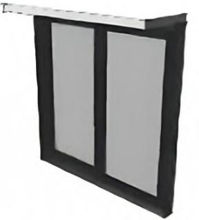 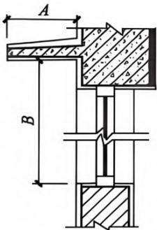水平式</td><td colspan="2" rowspan="2">严寒地区</td><td>a</td><td>0.31</td><td>0.28</td><td>0.33</td><td>0.25</td></tr><tr><td>b</td><td>-0.62</td><td>-0.71</td><td>-0.65</td><td>-0.48</td></tr><tr><td colspan="2" rowspan="2">寒冷地区</td><td>a</td><td>0.34</td><td>0.65</td><td>0.35</td><td>0.26</td></tr><tr><td>b</td><td>-0.78</td><td>-1.00</td><td>-0.81</td><td>-0.54</td></tr><tr><td colspan="2" rowspan="2">夏热冬冷地区</td><td>a</td><td>0.36</td><td>0.50</td><td>0.38</td><td>0.28</td></tr><tr><td>b</td><td>-0.80</td><td>-0.80</td><td>-0.81</td><td>-0.54</td></tr><tr><td rowspan="4">夏热冬暖地区北区</td><td rowspan="2">冬季</td><td>a</td><td>0.30</td><td>0.10</td><td>0.20</td><td>0.00</td></tr><tr><td>b</td><td>-0.75</td><td>-0.45</td><td>-0.45</td><td>0.00</td></tr><tr><td rowspan="2">夏季</td><td>a</td><td>0.35</td><td>0.35</td><td>0.20</td><td>0.20</td></tr><tr><td>b</td><td>-0.65</td><td>-0.65</td><td>-0.40</td><td>-0.40</td></tr><tr><td colspan="2" rowspan="2">夏热冬暖地区南区</td><td>a</td><td>0.35</td><td>0.35</td><td>0.20</td><td>0.20</td></tr><tr><td>b</td><td>-0.63</td><td>-0.86</td><td>-0.63</td><td>-0.92</td></tr><tr><td rowspan="4">温和地区</td><td rowspan="2">冬季</td><td>a</td><td>0.30</td><td>0.10</td><td>0.20</td><td>0.00</td></tr><tr><td>b</td><td>-0.75</td><td>-0.45</td><td>-0.45</td><td>0.00</td></tr><tr><td rowspan="2">夏季</td><td>a</td><td>0.35</td><td>0.35</td><td>0.20</td><td>0.20</td></tr><tr><td>b</td><td>-0.65</td><td>-0. 65</td><td>-0.40</td><td>-0.40</td></tr><tr><td rowspan="6">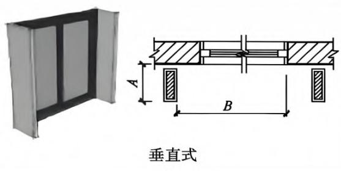</td><td colspan="2" rowspan="2">严寒地区</td><td>a</td><td>0.42</td><td>0.31</td><td>0.47</td><td>0.42</td></tr><tr><td>b</td><td>-0.83</td><td>-0.65</td><td>-0.9</td><td>-0.83</td></tr><tr><td colspan="2" rowspan="2">寒冷地区</td><td>a</td><td>0.25</td><td>0.40</td><td>0.25</td><td>0.50</td></tr><tr><td>b</td><td>-0.55</td><td>-0.76</td><td>-0.54</td><td>-0.93</td></tr><tr><td colspan="2" rowspan="2">夏热冬冷地区</td><td>a</td><td>0.24</td><td>0.33</td><td>0.24</td><td>0.48</td></tr><tr><td>b</td><td>-0.54</td><td>-0.72</td><td>-0.53</td><td>-0.89</td></tr><tr><td>外造阳基本类型及其简图</td><td colspan="2">气候区</td><td>拟合系数</td><td>东</td><td>南</td><td>西</td><td>北</td></tr><tr><td rowspan="10">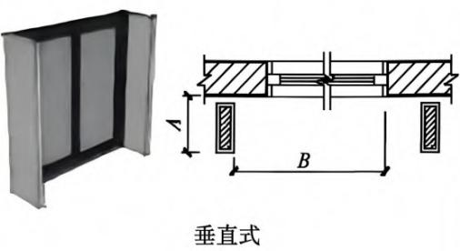</td><td rowspan="4">夏热冬暖地区北区</td><td rowspan="2">冬季</td><td>a</td><td>0.30</td><td>0.25</td><td>0.25</td><td>0.05</td></tr><tr><td>b</td><td>-0.75</td><td>-0.60</td><td>-0.60</td><td>-0.15</td></tr><tr><td rowspan="2">夏季</td><td>a</td><td>0.25</td><td>0.40</td><td>0.30</td><td>0.30</td></tr><tr><td>b</td><td>-0.60</td><td>-0.75</td><td>-0.60</td><td>-0.60</td></tr><tr><td colspan="2" rowspan="2">夏热冬暖地区南区</td><td>a</td><td>0.25</td><td>0.40</td><td>0.30</td><td>0.30</td></tr><tr><td>b</td><td>-0.60</td><td>-0.75</td><td>-0.60</td><td>-0.60</td></tr><tr><td rowspan="4">温和地区</td><td rowspan="2">冬季</td><td>a</td><td>0.30</td><td>0.25</td><td>0.25</td><td>0.05</td></tr><tr><td>b</td><td>-0.75</td><td>-0.60</td><td>-0.60</td><td>-0.15</td></tr><tr><td rowspan="2">夏季</td><td>a</td><td>0.25</td><td>0.40</td><td>0.30</td><td>0.30</td></tr><tr><td>b</td><td>-0.60</td><td>-0,75</td><td>-0.60</td><td>-0.60</td></tr><tr><td rowspan="12">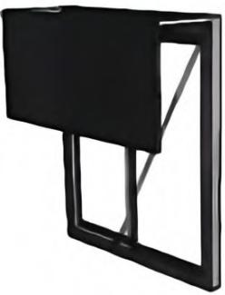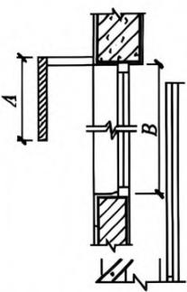挡板式</td><td colspan="2" rowspan="2">寒冷地区</td><td>a</td><td>0.00</td><td>0.35</td><td>0.00</td><td>0.13</td></tr><tr><td>b</td><td>-0.93</td><td>-1.00</td><td>-0.93</td><td>-0.91</td></tr><tr><td colspan="2" rowspan="2">夏热冬冷地区</td><td>a</td><td>0.00</td><td>0.35</td><td>0.00</td><td>0.13</td></tr><tr><td>b</td><td>-0.96</td><td>-1.00</td><td>-0.96</td><td>-0.93</td></tr><tr><td rowspan="4">夏热冬暖地区北区</td><td rowspan="2">冬季</td><td>a</td><td>0.24</td><td>0.25</td><td>0.24</td><td>0.16</td></tr><tr><td>b</td><td>-1.01</td><td>-1.01</td><td>-1.01</td><td>-0.95</td></tr><tr><td rowspan="2">夏季</td><td>a</td><td>0.18</td><td>0.41</td><td>0.18</td><td>0.09</td></tr><tr><td>b</td><td>-0.63</td><td>-0.86</td><td>-0.63</td><td>-0.92</td></tr><tr><td colspan="2" rowspan="2">夏热冬暖地区南区</td><td>a</td><td>0.16</td><td>0.35</td><td>0.16</td><td>0.17</td></tr><tr><td>b</td><td>-0.60</td><td>-1.01</td><td>-0.60</td><td>-0.97</td></tr><tr><td colspan="2" rowspan="2">温和地区</td><td>a</td><td>0.00</td><td>0.35</td><td>0.00</td><td>0.13</td></tr><tr><td>b</td><td>-0.96</td><td>-1.00</td><td>-0.96</td><td>-0.93</td></tr><tr><td rowspan="6">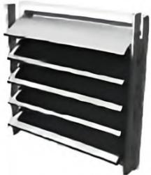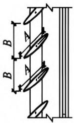固定横百叶挡板式</td><td colspan="2" rowspan="2">寒冷地区</td><td>a</td><td>0.45</td><td>0.54</td><td>0.48</td><td>0.34</td></tr><tr><td>b</td><td>-1.2</td><td>-1.2</td><td>-1.2</td><td>-0.88</td></tr><tr><td colspan="2" rowspan="2">夏热冬冷地区</td><td>a</td><td>0.50</td><td>0.50</td><td>0.52</td><td>0.37</td></tr><tr><td>b</td><td>-1.20</td><td>-1.20</td><td>-1.30</td><td>0.92</td></tr><tr><td colspan="2" rowspan="2">温和地区</td><td>a</td><td>0.53</td><td>0.44</td><td>0.54</td><td>0.40</td></tr><tr><td>b</td><td>-1.30</td><td>-1.10</td><td>-1.30</td><td>-0.93</td></tr><tr><td rowspan="6">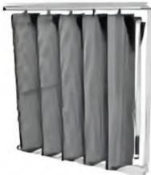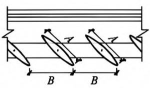固定竖百叶挡板式</td><td colspan="2" rowspan="2">寒冷地区</td><td>a</td><td>0.00</td><td>0.19</td><td>0.22</td><td>0.57</td></tr><tr><td>b</td><td>-0.70</td><td>-0.91</td><td>-0.72</td><td>-1.18</td></tr><tr><td colspan="2" rowspan="2">夏热冬冷地区</td><td>a</td><td>0.00</td><td>0.16</td><td>0.19</td><td>0.56</td></tr><tr><td>b</td><td>-0.66</td><td>-0.92</td><td>-0.71</td><td>-1.16</td></tr><tr><td colspan="2" rowspan="2">温和地区</td><td>a</td><td>0.02</td><td>0.10</td><td>0.17</td><td>0.54</td></tr><tr><td>b</td><td>-0.70</td><td>-0.82</td><td>-0.70</td><td>-1.15</td></tr><tr><td>外遮阳基本类型及其简图</td><td colspan="2">气候区</td><td>拟合系数</td><td>东</td><td>南</td><td>西</td><td>北</td></tr><tr><td rowspan="12">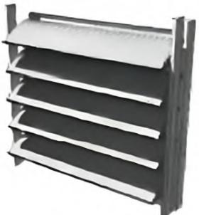 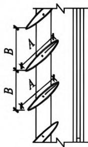活动横百叶挡板式</td><td rowspan="4">寒冷地区</td><td rowspan="2">冬季</td><td>a</td><td>0.21</td><td>0.04</td><td>0.19</td><td>0.20</td></tr><tr><td>b</td><td>-0.65</td><td>-0.39</td><td>-0.61</td><td>-0.62</td></tr><tr><td rowspan="2">夏季</td><td>a</td><td>0.50</td><td>1.00</td><td>0.54</td><td>0.50</td></tr><tr><td>b</td><td>-1.20</td><td>-1.70</td><td>-1.30</td><td>-1.20</td></tr><tr><td rowspan="4">夏热冬冷地区</td><td rowspan="2">冬季</td><td>a</td><td>0.23</td><td>0.03</td><td>0.23</td><td>0.20</td></tr><tr><td>b</td><td>-0.66</td><td>-0.47</td><td>-0.69</td><td>-0.62</td></tr><tr><td rowspan="2">夏季</td><td>a</td><td>0.56</td><td>0.79</td><td>0.57</td><td>0.60</td></tr><tr><td>b</td><td>-1.30</td><td>-1.40</td><td>-1.30</td><td>-1.30</td></tr><tr><td rowspan="4">温和地区</td><td rowspan="2">冬季</td><td>a</td><td>0.26</td><td>0.05</td><td>0.28</td><td>0.20</td></tr><tr><td>b</td><td>-0.73</td><td>-0.61</td><td>-0.74</td><td>-0.62</td></tr><tr><td rowspan="2">夏季</td><td>a</td><td>0.56</td><td>0.42</td><td>0.57</td><td>0.68</td></tr><tr><td>b</td><td>-1.30</td><td>-0.99</td><td>-1.30</td><td>-1.30</td></tr><tr><td rowspan="12">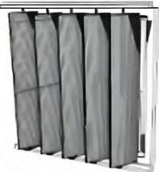 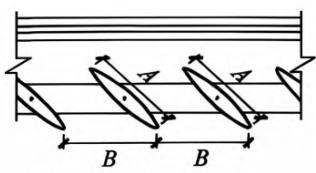活动竖百叶挡板式</td><td rowspan="4">寒冷地区</td><td rowspan="2">冬季</td><td>a</td><td>0.40</td><td>0.09</td><td>0.38</td><td>0.20</td></tr><tr><td>b</td><td>-0.99</td><td>-0.54</td><td>-0.95</td><td>-0.62</td></tr><tr><td rowspan="2">夏季</td><td>a</td><td>0.06</td><td>0.38</td><td>0.13</td><td>0.85</td></tr><tr><td>b</td><td>-0.70</td><td>-1.10</td><td>-0.69</td><td>-1.49</td></tr><tr><td rowspan="4">夏热冬冷地区</td><td rowspan="2">冬季</td><td>a</td><td>0.29</td><td>0.14</td><td>0.31</td><td>0.20</td></tr><tr><td>b</td><td>-0.87</td><td>-0.64</td><td>-0.86</td><td>-0.62</td></tr><tr><td rowspan="2">夏季</td><td>a</td><td>0.14</td><td>0.42</td><td>0.12</td><td>0.84</td></tr><tr><td>b</td><td>-0.75</td><td>-1.11</td><td>-0.73</td><td>-1.47</td></tr><tr><td rowspan="4">温和地区</td><td rowspan="2">冬季</td><td>a</td><td>0.23</td><td>0.17</td><td>0.25</td><td>0.20</td></tr><tr><td>b</td><td>-0.77</td><td>-0.70</td><td>-0.77</td><td>-0.62</td></tr><tr><td rowspan="2">夏季</td><td>a</td><td>0.14</td><td>0.27</td><td>0.15</td><td>0.81</td></tr><tr><td>b</td><td>-0.81</td><td>-0.85</td><td>-0.81</td><td>-1.44</td></tr></table>

注：组合式遮阳装置的外遮阳系数，应为各组成部分的外遮阳系数的乘积。  
2. 当外遮阳的遮阳板采用有透光能力的材料制作时，应按下式修正：

$$
S D = 1 - (1 - S D ^ {*}) (1 - \eta^ {*})\tag{7.5-3}
$$

式中 $SD^{*}$ ——外遮阳的遮阳板采用非透明材料制作时的外遮阳系数，按式（7.5-1）计算。

$\eta^{*}$ ——遮阳板的透射比，按表7.5-5选取。

遮阳板的透射比  
表7.5-5

<table><tr><td>遮阳板使用的材料</td><td>规格</td><td> $\eta^{*}$ </td></tr><tr><td>织物面料</td><td>浅色</td><td>0.40</td></tr><tr><td>玻璃钢类板</td><td>浅色</td><td>0.43</td></tr><tr><td>遮阳板使用的材料</td><td>规格</td><td>η</td></tr><tr><td rowspan="2">玻璃、有机玻璃类板</td><td>深色:0 $< S_{o} \leqslant 0.6$ </td><td>0.60</td></tr><tr><td>浅色:0.6 $< S_{e} \leqslant 0.8$ </td><td>0.80</td></tr><tr><td rowspan="4">金属穿孔板</td><td>穿孔率:0 $< \varphi \leqslant 0.2$ </td><td>0.10</td></tr><tr><td>穿孔率:0.2 $< \varphi \leqslant 0.4$ </td><td>0.30</td></tr><tr><td>穿孔率:0.4 $< \varphi \leqslant 0.6$ </td><td>0.50</td></tr><tr><td>穿孔率:0.6 $< \varphi \leqslant 0.8$ </td><td>0.70</td></tr><tr><td>铝合金百叶板</td><td>—</td><td>0.20</td></tr><tr><td>木质百叶板</td><td>—</td><td>0.25</td></tr><tr><td>混凝土花格</td><td>—</td><td>0.50</td></tr><tr><td>木质花格</td><td>—</td><td>0.45</td></tr></table>

注： $S_{0}$ 是透过玻璃窗的太阳光透射比与 3mm 平板玻璃的太阳光透射比的比值。

**7.5.4.2 中置遮阳**

中置遮阳的遮阳设施通常位于双层玻璃的中间，和窗框及玻璃组合成为整扇窗户，具有较强的整体性，一般由工厂一体化生产成型，遮阳系数可手动或自动调节。中置遮阳与外窗（玻璃幕墙）组合后的综合遮阳系数、传热系数应按现行行业标准《建筑门窗玻璃幕墙热工计算规程》JGJ/T 151 的规定计算。

**7.5.4.3 内遮阳**

内遮阳仅作为遮阳措施，改善室内阳光直射和眩光，不计其遮阳系数。

### 7.5.5 半透明围护结构

聚碳酸酯（PC）、PVC膜结构均具有半透明性，透光率为 $10\% \sim 20\%$ ，具有较高的反射性及较低的光吸收，热传导值可达到 $0.16\mathrm{W / (m\cdot K)}$ 。半透明围护结构热工性能参数见表7.5-6。

半透明围护结构热工性能参数  
表7.5-6

<table><tr><td rowspan="2" colspan="2">类型</td><td colspan="2">总传热系数</td><td colspan="2">抗热性能</td></tr><tr><td>垂直[W/(m2·K)]</td><td>水平[W/(m2·K)]</td><td>垂直(m2·K/W)</td><td>水平(m2·K/W)</td></tr><tr><td rowspan="2">PVC膜结构</td><td>单层膜材</td><td>5.6</td><td>6.4</td><td>0.18</td><td>0.16</td></tr><tr><td>双层膜材</td><td>2.9</td><td>3.3</td><td>—</td><td>—</td></tr></table>

## 7.6 围护结构防潮热工设计

建筑外围护结构由于长期受到自然雨（水）、雪等的浸蚀，在太阳辐射、风雨、雪、室内外空气温度、湿度的作用下，围护结构的表面和内部常常可能发生冷凝、结露和泛潮等问题。这些都是建筑防潮设计时应考虑的主要问题，因为围护结构受潮会降低材料性能、滋生霉菌，进而影响建筑的美观和正常使用，甚至影响建筑使用者的健康。因此，加强防潮设计必不可少，防潮设计可有效保证墙体的保温效果及耐久年限。

### 7.6.1 自由水防止

为防止雨水、地下水、给水排水对建筑物某些部位的渗透浸入，切断自由水进入围护结构内部成为湿源的路径，需要对建筑采取防水处理。从围护结构部位分，可分为屋面、外墙、女儿墙、地下室及附属构件等防水。具体分类情况详见表7.6-1。

自由水防止分类  
表7.6-1

<table><tr><td>部位</td><td>分类</td><td>工程做法</td></tr><tr><td>屋面</td><td>正置式,倒置式</td><td>柔性防水、刚性防水或粉刷防水</td></tr><tr><td>外墙</td><td>水泥砂浆(涂料)外墙,面砖(锦砖)外墙,干挂花岗石外墙</td><td>聚合物防水砂浆,有防水功能的胶黏剂铺贴面砖,“JS”等柔性防水涂料</td></tr><tr><td>女儿墙</td><td>钢筋混凝土墙板结构,砌体结构</td><td>同外墙做法</td></tr><tr><td>门、窗等孔洞</td><td>门洞、窗洞</td><td>门(窗)框四周用聚合物防水砂浆塞缝,窗框与墙面的交接用高分子密封材料密封</td></tr><tr><td>雨棚、阳台等水平构件节点及设备挂件</td><td>外凸型,内凹型</td><td>聚合物防水砂浆或防水材料</td></tr><tr><td>地下室</td><td>地下室,半地下室</td><td>防潮法,外排法或防水法等</td></tr></table>

### 7.6.2 内部冷凝的检验和计算

验算的方法：根据供暖期保温层内重量湿度允许增量，计算冷凝界面内侧所需的蒸汽渗透阻。

验算的部位：对外侧有卷材或其他防水层的屋面，以及多层复合保温墙体结构进行验算，如图 7.6-1 所示。

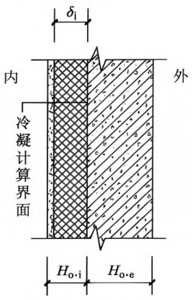  
(a)

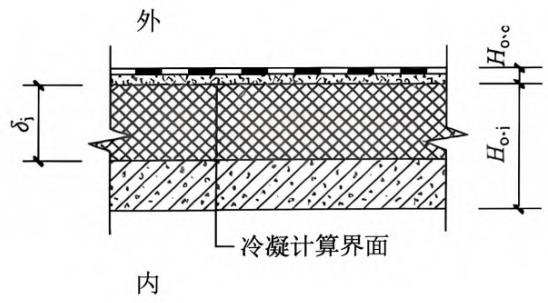  
(b)  
图7.6-1 冷凝计算界面  
(a) 外墙；(b) 屋顶

**7.6.2.1 围护结构内部冷凝的判别**

1. 内部冷凝条件：同部某处的水蒸气分压力 $p_{\mathrm{m}}$ 大于该处的饱和水蒸气分压力 $p_{\mathrm{s}}$ 。

2. 判别方法：

(1) 求各界面的温度 $\theta_{\mathrm{m}}$ 并作分布线。

(2) 求与界面温度相应的饱和水蒸气分压力 $p_{B}$ ，并作分布线。

(3) 求各界面上实际的水蒸气分压力 $p_{\mathrm{m}}$ ，并作分布线。

$$
p _ {\mathrm{m}} = p _ {\mathrm{i}} - \frac {p _ {\mathrm{i}} - p _ {\mathrm{e}}}{H _ {0}} (H _ {1} + H _ {2} + \dots + H _ {m - 1})\tag{7.6-1}
$$

式中 $p_{i}$ 、 $p_{o}$ ——内表面和外表面水蒸气分压力，取室内和室外空气的水蒸气分压力，Pa；

$H_{1}$ ， $H_{2}$ ，…， $H_{m-1}$ ——各层的水蒸气渗透阻， $m^{2}\cdot h\cdot Pa/g$ ;

$H_{0}$ ——结构的总水蒸气渗透阻， $m^{2}\cdot h\cdot Pa/g$ 。

材料层的水蒸气渗透阻：

$$
H = \frac {\delta}{\mu}\tag{7.6-2}
$$

多层结构的总水蒸气渗透阻：

$$
H _ {0} = \frac {\delta_ {1}}{\mu_ {1}} + \frac {\delta_ {2}}{\mu_ {2}} + \dots + \frac {\delta_ {n}}{\mu_ {n}}\tag{7.6-3}
$$

式中 $\delta$ ——材料层厚度，m；

$\mu$ ——材料的蒸汽渗透系数， $g/(m\cdot h\cdot Pa)$ 。

  
图7.6-2 围护结构内部冷凝的判别

(4) 若 $p_{\mathrm{m}}$ 线与 $p_{\mathrm{a}}$ 线不相交, 如图 7.6-2 (b) 所示, 则内部不会出现冷凝; 若两线相交, 如图 7.6-2 (a) 所示。若经判别内部可能出现冷凝, 则每平方米小时冷凝量 $\omega \left[\mathrm{g} / \left(\mathrm{m}^{2} \cdot \mathrm{h}\right)\right]$ 为:

$$
\omega = \frac {p _ {\mathrm{i}} - p _ {\mathrm{s} \cdot \mathrm{c}}}{H _ {\mathrm{o} \cdot \mathrm{i}}} - \frac {p _ {\mathrm{s} \cdot \mathrm{c}} - p _ {\mathrm{s}}}{H _ {\mathrm{o} \cdot \mathrm{e}}}\tag{7.6-4}
$$

式中 $p_{i}$ 、 $p_{e}$ ——室内和室外水蒸气分压力，Pa；

$p_{s\cdot c}$ ——冷凝界面温度下的饱和水蒸气分压力，Pa；

$H_{o\cdot i}$ ——内表面至冷凝界面的水蒸气渗透阻， $m^{2}\cdot h\cdot Pa/g$ ;

$H_{\circ\cdot e}$ ——外表面至冷凝界面的水蒸气渗透阻， $m^{2}\cdot h\cdot Pa/g$ ，见表7.2-7。冷凝界面温度：

$$
\theta_ {\mathrm{c}} = t _ {\mathrm{i}} - \frac {t _ {\mathrm{i}} - \overline {{{t}}} _ {\mathrm{e}}}{R _ {0}} (R _ {\mathrm{i}} + R _ {\mathrm{c} \cdot \mathrm{i}})\tag{7. 6-5}
$$

式中 $\theta_{c}$ ——冷凝计算界面温度，℃；

$t_{i}$ ——室内设计温度，℃；

$\overline{t}_{e}$ ——供暖期室外平均温度，℃；

$R_{i}$ ——内表面换热阻， $m^{2}\cdot K/W$ ;

$R_{0}$ ——围护结构传热阻， $m^{2}\cdot K/W$ ;

$R_{c\cdot i}$ ——冷凝计算界面至围护结构内表面之间的热阻， $m^{2}\cdot K/W$ 。

供暖期每平方米冷凝量 $W(\mathrm{g} / \mathrm{m}^{2})$ 为：

$$
W = 2 4 Z w\tag{7.6-6}
$$

式中 $Z$ ——供暖期天数，d；

w——每平方米小时冷凝量， $\mathrm{g}/(\mathrm{m}^{2} \cdot \mathrm{h})$ 。

**7.6.2.2 冷凝界面内侧所需水蒸气渗透阻的计算**

为保证供暖期内围护结构内部保温材料因冷凝受潮湿而使其重量湿度的增量不超过允许值，冷凝界面内侧所需的水蒸气渗透阻为：

$$
H _ {\mathrm{o} \cdot \mathrm{i}} = \frac {p _ {\mathrm{i}} - p _ {\mathrm{S} \cdot \mathrm{C}}}{\frac {1 0 \rho_ {0} \delta_ {\mathrm{i}} [ \Delta w ]}{2 4 Z} + \frac {p _ {\mathrm{S} \cdot \mathrm{C}} - p _ {\mathrm{e}}}{H _ {\mathrm{o} \cdot \mathrm{e}}}}\tag{7.6-7}
$$

式中 $H_{0\cdot i}$ ——冷凝计算界面内侧所需的蒸汽渗透阻， $m^{2}\cdot h\cdot Pa/g$ ;

$H_{o\cdot e}$ ——冷凝计算界面至围护结构外表面之间的蒸汽渗透阻， $m^{2}\cdot h\cdot Pa/g$ ;

$\rho_{0}$ ——保温材料干密度，kg/m $^{3}$ ；

$\delta_{i}$ ——保温材料厚度，m；

$\left[\Delta w\right]$ ——保温材料重量湿度的允许增量，%，见表7.6-2；

Z——供暖期天数，d。

当冷凝界面内侧实际具有的水蒸气渗透阻小于所需值时，应设置隔汽层或其他构造，以提高内侧的隔汽能力。

保温材料重量湿度的允许增量 $[\Delta w]$  
表7.6-2

<table><tr><td>保温材料总称</td><td>重量湿度的允许增量[Δw](%)</td></tr><tr><td>多孔混凝土(泡沫混凝土、加气混凝土等)(ρ0=500~700kg/m3)</td><td>4</td></tr><tr><td>水泥膨胀珍珠岩和水泥膨胀蛭石等(ρ0=300~500kg/m3)</td><td>6</td></tr><tr><td>沥青膨胀珍珠岩和沥青膨胀蛭石等(ρ0=300~400kg/m3)</td><td>7</td></tr><tr><td>矿渣和炉渣填料</td><td>2</td></tr><tr><td>水泥纤维板</td><td>5</td></tr><tr><td>矿棉、岩棉、玻璃棉及制品(板或毡)</td><td>5(3)</td></tr><tr><td>模塑聚苯乙烯泡沫塑料(EPS)</td><td>15</td></tr><tr><td>挤塑聚苯乙烯泡沫塑料(XPS)</td><td>10</td></tr><tr><td>硬质聚氨酯泡沫塑料(PUR)</td><td>10</td></tr><tr><td>酚醛泡沫塑料(PF)</td><td>10</td></tr><tr><td>玻化微珠保温浆料(自然干燥后)</td><td>5</td></tr><tr><td>胶粉聚苯颗粒保温浆料(自然干燥后)</td><td>5</td></tr><tr><td>复合硅酸盐保温板</td><td>5</td></tr></table>

对不设通风口的阁楼屋顶，其屋顶部分的蒸汽渗透阻 $H_{\circ \cdot n}$ 应满足下式要求

$$
H _ {\mathrm{o.n}} > 1. 2 (p _ {\mathrm{i}} - p _ {\mathrm{e}})\tag{7. 6-8}
$$

式中 $H_{\mathrm{o}} \cdot_{\mathrm{n}}$ ——顶棚围护结构部分总蒸汽渗透阻， $\mathrm{m}^2 \cdot \mathrm{h} \cdot \mathrm{Pa} / \mathrm{g}$ 。

### 7.6.3 表面结露

冬季室外计算温度 $t_{e}$ 低于 $0.9^{\circ}C$ 时，应对围护结构进行内表面结露验算。

**7.6.3.1 围护结构平壁部分的验算**

围护结构平壁部分的表面温度应按式（7.6-9）及式（7.6-10）计算；

$$
\theta_ {\mathrm{i}} = t _ {\mathrm{i}} - \frac {t _ {\mathrm{i}} - t _ {\mathrm{e}}}{R _ {0}} R _ {\mathrm{i}}\tag{7.6-9}
$$

$$
\theta_ {m} = t _ {\mathrm{i}} - \frac {t _ {\mathrm{i}} - t _ {\mathrm{e}}}{R _ {0}} (R _ {\mathrm{i}} + R _ {1 - m})\tag{7.6-10}
$$

式中 $\theta_{i}$ ——围护结构内表面温度，℃；

$\theta_{m}$ ——围护结构内部第 m 层内表面温度，℃；

$t_{i}$ ——室内设计温度，℃；

$t_{e}$ ——室外计算温度，℃；

$R_{0}$ 、 $R_{i}$ ——分别为围护结构传热阻和内表面换热阻， $m^{2}\cdot K/W$ ;

$R_{1-m}$ ——第 $1 \sim (m-1)$ 层热阻之和， $m^{2} \cdot K/W$ 。

**7.6.3.2 围护结构热桥部分的验算**

围护结构热桥部分的表面温度应采用《民用建筑热工设计规范》GB 50176—2016附录C.2.4规定的软件计算，或通过其他符合《民用建筑热工设计规范》GB 50176—2016附录C.2.5规定的二维或三维稳态传热软件计算得到。

**7.6.3.3 算例**

以成都市某工程墙体与楼板 T 形热桥为例，计算墙角处内表面的结露情况。外墙构造做法分别为 $40 \, mm EPS + 200 \, mm$ 页岩多孔砖外墙外保温（热桥类型一）和 $200 \, mm$ 页岩多孔砖 + $25 \, mm XPS$ 内保温（热桥类型二），采用中国建筑科学研究院基于控制容积法编制的软件 PTemp。

边界条件设置如下；

外表面：第三类边界条件，供暖室外计算温度 $t_{\mathrm{w}}$ 为 $3.8^{\circ}\mathrm{C}$ ，累年最低日平均温度 $t_{\mathrm{o}} \cdot_{\mathrm{min}}$ 为 $0.7^{\circ}\mathrm{C}$ ，表面换热系数 $23.0\mathrm{W / (m^2*K)}$ 。冬季室外热工计算温度 $t_{\mathrm{o}}$ 按围护结构的热惰性指标 $D$ 值的不同进行取值，本工程冬季室外热工计算温度 $t_{\mathrm{o}}$ 按 $1.63^{\circ}\mathrm{C}$ 进行计算。

内表面: 第三类边界条件, 冬季室内设计温度 $t_{\mathrm{i}}$ 为 $18^{\circ} \mathrm{C}$ , 表面换热系数为 $8.7 \mathrm{~W} / (\mathrm{m}^{2} \cdot \mathrm{K})$ , 室内相对湿度取 $60 \%$ 。

其他边界：第二类边界条件，热流密度取零。

空气露点温度：10.13℃。

计算结果如图 7.6-3 所示。

  
图 7.6-3 T 形热桥温度分布及内表面最低温度  
(a) 热桥类型一；(b) 热桥类型二

### 7.6.4 防潮分析先进方法

围护结构的防潮分析实际上是一个复杂的热湿耦合的分析过程，并不单纯是湿度的变化（为了简化，目前常常单纯分析湿度的变化）。其总体目标是分析随着时间而改变的建筑围护结构的温度和湿度变化。按照具体目标和对象可以分为表 7.6-3 所示的情况，按照分析手段可以分为计算分析和测试两类方法。

热湿分析分类  
表7.6-3

<table><tr><td>目的</td><td>针对对象</td><td>使用对象</td></tr><tr><td>设计</td><td>新建、改造建筑</td><td>工程师、建筑师</td></tr><tr><td>评估</td><td>改造建筑、鉴定、调查</td><td>工程师、建筑师</td></tr><tr><td>研究</td><td>产品、标准、基础理论</td><td>研究人员</td></tr></table>

**7.6.4.1 计算分析**

目前，不同学者根据不同的基本方程开发了十几种热湿传递计算分析软件，其考虑的因素及主要特点分析如表 7.6-4 所示。目前功能比较全面和使用较多的软件是 WUFI 和 DELPHIN4.1。

热湿分析软件比较  
表7.6-4

<table><tr><td>软件名称</td><td>维数</td><td>液态水流动</td><td>风驱雨</td><td>湿分析可视</td><td>围护结构整体分析</td><td>空气渗透</td><td>超饱和流动</td><td>应用情况</td></tr><tr><td>WUFI</td><td>2</td><td>✓</td><td>✓</td><td>✓</td><td>✓</td><td>×</td><td>✓</td><td>✓</td></tr><tr><td>LATENITE</td><td>3</td><td>✓</td><td>✓</td><td>✓</td><td>✓</td><td>✓</td><td>×</td><td>×</td></tr><tr><td>DELPHIN4.1</td><td>2</td><td>✓</td><td>✓</td><td>✓</td><td>✓</td><td>✓</td><td>×</td><td>✓</td></tr><tr><td>SIMPLE-FULUV</td><td>2</td><td>×</td><td>×</td><td>×</td><td>×</td><td>✓</td><td>×</td><td>×</td></tr><tr><td>TCCC2D</td><td>2</td><td>×</td><td>×</td><td>×</td><td>×</td><td>✓</td><td>×</td><td>×</td></tr><tr><td>HMTRA</td><td>2</td><td>✓</td><td>×</td><td>×</td><td>✓</td><td>✓</td><td>✓</td><td>✓</td></tr><tr><td>TRATMO2</td><td>2</td><td>✓</td><td>✓</td><td>×</td><td>✓</td><td>✓</td><td>×</td><td>×</td></tr><tr><td>JAM-2</td><td>2</td><td>✓</td><td>×</td><td>✓</td><td>×</td><td>×</td><td>×</td><td>×</td></tr><tr><td>FRET</td><td>2</td><td>✓</td><td>×</td><td>×</td><td>×</td><td>×</td><td>✓</td><td>×</td></tr><tr><td>2DHAV</td><td>2</td><td>×</td><td>×</td><td>×</td><td>✓</td><td>✓</td><td>×</td><td>×</td></tr><tr><td>FSEC</td><td>2</td><td>×</td><td>×</td><td>×</td><td>×</td><td>✓</td><td>×</td><td>×</td></tr><tr><td>MOISTURE-EXPERT</td><td>2</td><td>✓</td><td>✓</td><td>✓</td><td>✓</td><td>✓</td><td>×</td><td>×</td></tr></table>

注：“√”表示可实现该功能；“×”表示不可实现该功能。

**7.6.4.2 测试手段**

不管是对计算结果的验证还是计算过程中部分物性参数的确定，都需要进行湿物性等相关量的测试。目前国内在该部分的测试方面还缺乏相关标准，主要参考国外相关标准。

**1. 测试标准**

湿物性参数测试标准见表 7.6-5。

湿物性参数测试标准  
表7.6-5

<table><tr><td>参数</td><td>美国标准</td><td>欧洲标准</td><td>ISO</td></tr><tr><td>饱和自由水含水率</td><td>—</td><td>DIN EN 13755</td><td>—</td></tr><tr><td>孔隙率和孔径分布</td><td>—</td><td>DIN 66133</td><td>—</td></tr><tr><td>骨架密度</td><td>—</td><td>DIN 66135</td><td>—</td></tr><tr><td>导热系数</td><td>ASTM C177, ASTM C518</td><td>DIN 52612</td><td>DIN ISO 12664</td></tr><tr><td>等温吸湿-解湿曲线(相对湿度95%以下)</td><td>ASTM C1498CEN 89 N 337 E</td><td>DIN EN ISO12571</td><td>ISO 12571ISO 11274</td></tr><tr><td>水蒸气渗透系数</td><td>CEN 89 N 336 EASTM E96/E96M-05(ASTM 2005)</td><td>EN ISO 12572</td><td>—</td></tr><tr><td>水蒸气扩散</td><td>—</td><td>DIN 52615</td><td>DIN EN ISO 12572</td></tr><tr><td>吸水系数</td><td>CEN 89 N 370 E</td><td>—</td><td>EN ISO 15148</td></tr><tr><td>空气渗透率</td><td>ASTM C522</td><td>—</td><td>—</td></tr></table>

**2. 湿分分布测试技术**

在众多湿物性相关参数的测试中，最复杂的是测试多孔材料中湿分的分布。以往由于技术的限制，只能通过烘干的办法来测得材料的整体含湿量，或通过切割材料后烘干来获得材料的局部含湿量。显然烘干法无法连续且无损地测量材料中各部分的含湿量，因此在应用上有很大局限。

随着科技的进步，许多先进的方法相继被用于多孔材料中湿分分布的测量。比较有代表性的现代实验技术有 MRI 技术、 $\gamma$ 射线衰减技术、NMR 技术、电容法、TDR 技术、X 射线辐射图谱和扫描中子辐射图谱等，扫描电镜（SEM）以及数码摄像机也常被应用。

这些实验技术克服了烘干法的缺点，实现了对多孔材料湿分分布的动态连续测量，并且保证了材料的完好性，为进一步研究多孔建筑材料的传热与传湿奠定了基础。不过这些测试方法所用到的仪器设备较为昂贵，并且对样品处理、实验设备以及实验人员专业知识有较高要求，故并未在建筑物理或建筑技术科学的相关实验室普及。

### 7.6.5 防潮通用技术

1. 采用松散多孔保温材料的多层复合围护结构，应在水蒸气分压高的一侧设置隔汽层。对于有供暖、空调功能的建筑，隔汽层应按供暖建筑围护结构设置隔汽层。

2. 外侧有密实保护层或防水层的多层复合围护结构，经内部冷凝受潮验算而必须设置隔汽层时，应严格控制保温层的施工湿度，宜采用板状或块状保温材料，避免湿法施工和雨天施工，并保证隔汽层的施工质量。对于卷材防水屋面或疏散多孔保温材料的金属夹芯围护结构，应有与室外空气相通的排湿措施。

3. 外侧有卷材或其他密闭防水层，内侧为钢筋混凝土屋面板的平屋顶结构，如经内部冷凝受潮验算不需要设隔汽层，则应确保屋面板及其接缝的密实性，达到所需的蒸汽渗透阻。

4. 室内地表面和地下室外墙防潮宜采取以下措施：建筑室内一层地表面应高于地面（±0.0m）0.6m 以上；地坪可采用架空地板层，采用架空通风地板层时，通风口应设置活动的遮挡板，使其在冬季能方便关闭，遮挡板的传热阻应不小于围护结构低限热阻；地面和地下室外墙必须设保温层；地表面材料宜采用蓄热系数小的材料，减少地表温度与空气温度的差值；地表采用带有微孔的面层材料来处理；面层材料导热系数要小，使地表面温度易于紧随空气温度变化；表面材料有较强的吸湿性，具有对表面水分的“吞吐”作用。

5. 严寒、寒冷地区非透光建筑幕墙面板背后的保温材料应采取隔汽措施，隔汽层应布置在保温材料的高温侧（室内侧），隔汽密封空间的周边密封应严密，如图7.6-4所示。夏热冬冷地区、温和A区的建筑幕墙宜设计隔汽层。

6. 在建筑围护结构的低温侧设置空气间层，保温材料层与空气层分界面宜设防水、透气的挡风防潮纸，防止蒸汽渗透在围护结构内部凝结，如图 7.6-5 所示。

  
图 7.6-4 严寒、寒冷地区隔汽层设置构造示意图

  
图 7.6-5 空气间层设置构造示意图  
(a) 严寒、寒冷地区及部分夏热冬冷地区；(b) 夏热冬冷、夏热冬暖地区

## 7.7 特殊围护结构

### 7.7.1 冷库围护结构（高温、低温冷库）

根据隔热层的位置，冷库围护结构分为以下三种：

1. 内隔热结构：隔热层设在围护结构承重层的内侧，即先将冷库的承重结构及外墙建好，然后在建筑物内进行隔热层的施工。

2. 外隔热结构：隔热层和其他材料组合成自承重的外围护结构，如用镀锌钢板或不锈钢板，中间用聚氨酯泡沫塑料、岩棉保温材料作隔热层的夹心墙板，或钢筋混凝土预制的夹心墙板，作围护结构的自承重结构，附在冷库的内框架上。这种结构必须处理好板缝之间的连接，确保不跑冷、不结露。

3. 外断热结构：隔热层设在围护结构的外侧，即先将整幢冷库的建筑结构做好，然后在围护结构的外侧作隔热层。为了保护隔热层，在隔热层外需要有一层保护层，这是最理想的外断热做法，没有“冷桥”，施工方便、维修容易。

因冷库温度低、湿度大，需要蒸汽渗透系数小、非水溶性的隔汽防潮材料，并要有足够的粘结力，能牢固地粘结在隔热结构上，常用的隔汽防潮材料有石油沥青。

### 7.7.2 近零能耗建筑围护结构

近零能耗建筑围护结构包括：

1. 选择高效的非透明外围护结构外保温体系。保温层较常规建筑的厚度大，选择高性能保温材料，减少保温层厚度。近零能耗建筑围护结构平均传热系数参考值如表7.7-1所示。

2. 采用高效的外门窗（幕墙）系统。近零能耗建筑外窗传热系数和太阳得热系数参考值如表 7.7-2 所示。

近零能耗建筑围护结构平均传热系数参考值  
表7.7-1

<table><tr><td rowspan="2" colspan="2">围护结构部位</td><td colspan="5">传热系数 $K[W/(m^{2} \cdot K)]$ </td></tr><tr><td>严寒地区</td><td>寒冷地区</td><td>夏热冬冷地区</td><td>夏热冬暖地区</td><td>温和地区</td></tr><tr><td rowspan="3">居住建筑</td><td>屋面</td><td>0.10~0.15</td><td>0.10~0.20</td><td>0.15~0.35</td><td>0.25~0.40</td><td>0.20~0.40</td></tr><tr><td>外墙</td><td>0.10~0.15</td><td>0.15~0.20</td><td>0.15~0.40</td><td>0.30~0.80</td><td>0.20~0.80</td></tr><tr><td>地面及外挑楼板</td><td>0.10~0.30</td><td>0.20~0.40</td><td>—</td><td>—</td><td>—</td></tr><tr><td rowspan="3">公共建筑</td><td>屋面</td><td>0.10~0.20</td><td>0.10~0.30</td><td>0.15~0.35</td><td>0.30~0.60</td><td>0.20~0.60</td></tr><tr><td>外墙</td><td>0.10~0.25</td><td>0.10~0.30</td><td>0.15~0.40</td><td>0.30~0.80</td><td>0.20~0.80</td></tr><tr><td>地面及外挑楼板</td><td>0.20~0.30</td><td>0.25~0.40</td><td>—</td><td>—</td><td>—</td></tr></table>

近零能耗建筑外窗传热系数和太阳得热系数参考值  
表 7.7-2

<table><tr><td colspan="3">性能参数</td><td>严寒地区</td><td>寒冷地区</td><td>夏热冬冷地区</td><td>夏热冬暖地区</td><td>温和地区</td></tr><tr><td rowspan="3">居住建筑</td><td colspan="2">传热系数 $K$  $[W/(m^{2} \cdot K)]$ </td><td> $\leqslant 1.0$ </td><td> $\leqslant 1.2$ </td><td> $\leqslant 2.0$ </td><td> $\leqslant 2.5$ </td><td> $\leqslant 2.0$ </td></tr><tr><td rowspan="2">太阳得热系数SHGC</td><td>冬季</td><td> $\geqslant 0.45$ </td><td> $\geqslant 0.45$ </td><td> $\geqslant 0.40$ </td><td>—</td><td> $\geqslant 0.40$ </td></tr><tr><td>夏季</td><td> $\leqslant 0.30$ </td><td> $\leqslant 0.30$ </td><td> $\leqslant 0.30$ </td><td> $\leqslant 0.15$ </td><td> $\leqslant 0.30$ </td></tr><tr><td rowspan="3">公共建筑</td><td colspan="2">传热系数 $K$  $[W/(m^{2} \cdot K)]$ </td><td> $\leqslant 1.2$ </td><td> $\leqslant 1.5$ </td><td> $\leqslant 2.2$ </td><td> $\leqslant 2.8$ </td><td> $\leqslant 2.2$ </td></tr><tr><td rowspan="2">太阳得热系数SHGC</td><td>冬季</td><td> $\geqslant 0.45$ </td><td> $\geqslant 0.45$ </td><td> $\geqslant 0.40$ </td><td>—</td><td>—</td></tr><tr><td>夏季</td><td> $\leqslant 0.30$ </td><td> $\leqslant 0.30$ </td><td> $\leqslant 0.15$ </td><td> $\leqslant 0.15$ </td><td> $\leqslant 0.30$ </td></tr></table>

3. 建筑气密性。外门窗应采用内平开窗，且应具有良好的气密性。依据国家标准《建筑幕墙、门窗通用技术条件》GB/T 31433—2015，其外门、外窗的气密性等级不应低于6级，幕墙的气密性不应低于3级。

4. 无热桥设计与建筑围护结构节点。建筑围护结构设计时，应进行消除或削弱热桥的专项设计，围护结构保温层应连续。近零能耗建筑围护结构保温做法如图 7.7-1～图 7.7-5 所示。

  
图7.7-1 外墙保温做法

  
图7.7-2 屋面保温做法

  
图7.7-3 女儿墙保温做法

  
图 7.7-4 地下室和地面保温做法示意图

  
图7.7-5 外窗安装示意图

### 7.7.3 装配式建筑围护结构

从结构材料分类，装配式建筑大体可以分为：装配式混凝土体系（PC）、装配式钢结构体系、装配式木结构体系。

**7.7.3.1 装配式混凝土体系**

装配式轻质混凝土围护结构的设计包括：墙体保温、隔热设计、防潮设计、防水设计、防火设计、隔声和吸声设计、附件保温装饰层的连接及构造设计、细部构造设计等建筑功能设计。

当外墙板与主体结构采用内嵌式连接时，墙板的上、下节点构造如图 7.7-6 所示，当外墙板与主体结构采用外挂式连接时，墙板的上、下节点构造如图 7.7-7 所示。

**7.7.3.2 装配式钢结构体系**

装配式钢结构宜采用工厂预制轻质墙板，楼板宜采用钢筋桁架楼承板组合楼板和桁架结构混凝土叠合板。装配式钢结构体系内嵌式连接节点构造如图 7.7-8 所示，外挂式连接节点构造如图 7.7-9 所示。

**7.7.3.3 装配式木结构体系**

装配式木结构建筑是指主要的木结构承重构件、木组件和部品在工厂预制生产，并通过现场安装而成的木结构建筑。节点连接系统要充分考虑木材的自然性质和变形特点，避免木材的收缩和膨胀问题，同时还要有效增加木结构建筑的抗震防风性能、气密性能等。装配式木结构体系连接节点构造如图7.7-10所示。

  
(a)

  
(b)  
1—轻质墙板；2—混凝土边梁或板；3—预埋件；4—连接角钢；5—连接压板；6—连接螺杆；7—预埋螺丝或连接杆；8—坐浆  
图 7.7-6 装配式混凝土体系内嵌式连接节点构造  
(a) 与混凝土梁连接；(b) 与混凝土楼板连接

  
(a)

  
(b)  
1—轻质墙板；2—混凝土边梁或板；3—预埋件；4—连接角钢；5—连接压板；6—连接螺杆；7—预埋螺丝或连接杆；8—坐浆  
(a) 与混凝土梁连接；(b) 与混凝土楼板连接

图 7.7-7 装配式混凝土体系外挂式连接节点构造

  
(a)

  
(b)  
1—轻质墙板；2—混凝土边梁或板；3—预埋件；4—连接角钢；5—连接压板；6—连接螺杆；7—预埋螺丝或连接杆；8—坐浆  
图 7.7-8 装配式钢结构体系内嵌式连接节点构造  
(a) 与混凝土楼板及钢梁连接；(b) 与钢链连接

  
(a)

  
(b)  
1—轻质墙板；2—混凝土边梁或板；3—预埋件；4—连接角钢；5—连接压板；6—连接螺杆  
图 7.7-9 装配式钢结构体系外挂式连接节点构造  
(a) 与混凝土楼板及钢梁连接；(b) 与钢链连接

  
图7.7-10 装配式木结构体系连接节点构造  
(a) 横缝节点；(b) 竖缝节点

### 7.7.4 相变蓄热围护结构

建筑中常用的相变蓄热材料主要有结晶水合盐类、石蜡、多元醇、酯、高分子聚合物等。相变材料具有如下特点：相变温度接近人体舒适温度；具有足够大的相变潜热；相变的可逆性好，使用寿命长；相变时膨胀或收缩性要小；无毒、无腐蚀性、不燃、不污染环境；易与建筑材料相容，不影响建筑材料的机械性和强度。

相变蓄热围护结构应用形式如表 7.7-3 所示。

相变蓄热围护结构应用形式  
表7.7-3

<table><tr><td>利用形式</td><td>相变墙</td><td>相变吊顶</td><td>相变地板</td></tr><tr><td>被动式太阳能供暖</td><td>利用日间太阳辐射能</td><td>利用日间太阳辐射能</td><td></td></tr><tr><td>主动式太阳能供暖</td><td>利用太阳集热系统热水供暖</td><td></td><td>利用仪间廉价电能地板供暖</td></tr><tr><td>夜间通风冷却</td><td></td><td></td><td></td></tr></table>

### 7.7.5 特殊功能建筑围护结构

**7.7.5.1 工艺性空调建筑**

根据《数据中心设计规范》GB 50174—2017 的规定，数据中心围护结构热工设计应符合现行国家标准《公共建筑节能设计标准》GB 50189 的规定。对于房中房型精密机房，机房环境必须保证恒温恒湿，空调全年 365d 不间断运行。若机房内热源引起的冷负荷在 $350 \, W/m^{2}$ 左右，则精密机房常年处于制冷状态。随着隔墙、上下楼板的保温性能的降低，机房的全年冷负荷逐渐减小，若机房墙体、楼板均为钢筋混凝土剪力墙结构，对降低机房全年冷负荷更为有利。

**7.7.5.2 实验室围护结构（超高或超低温、超洁净等）**

实验室对围护结构气密性要求高，良好的气密性可以减少冬季冷风渗透，降低夏季非受控通风导致的供冷需求，气密层应连续并包围整个外围护结构，如图 7.7-11 所示。

  
图 7.7-11 实验室围护结构气密层示意图

具体措施包括：

1. 选用气密性能高的外门窗，外门窗框与窗扇间宜采用3道耐久性良好的密封材料密封，每个开启扇至少设2个锁点。

2. 选用适用的气密性材料，如硬质材料板（密度板、石材）、气密性薄膜等。

3. 选择适用的气密性材料做节点气密性处理，如紧实完整的混凝土、气密性薄膜、专用的膨胀密封条、专用气密性处理涂料等材料。

4. 对门洞、窗洞、电气接线盒、管线贯穿处等易发生气密性问题的部位进行细部节点设计。

### 7.7.6 呼吸式玻璃幕墙

根据双层幕墙空气活动的方式与特点，分为封闭式内循环呼吸式幕墙和开敞式外循环呼吸式幕墙（图 7.7-12），其结构特点如表 7.7-4 所示。

(a)  

  
图 7.7-12 呼吸式幕墙示意图  
(a) 封闭式内循环呼吸式幕墙；(b) 开敞式外循环呼吸式幕墙

封闭式内循环和开敞式外循环呼吸式幕墙结构特点比较  
表7.7-4

<table><tr><td>封闭式内循环呼吸式幕墙</td><td>开敞式外循环呼吸式幕墙</td></tr><tr><td>内层幕墙可采用普通幕墙或铝合金窗,外层幕墙可采用隔热幕墙</td><td>内层幕墙采用隔热幕墙,外层幕墙采用点支式玻璃幕墙</td></tr><tr><td>内层幕墙通常采用单片玻璃,外层幕墙通常采用中空玻璃</td><td>内层幕墙采用中空玻璃,外层幕墙采用单片玻璃</td></tr><tr><td>外层幕墙完全封闭,空气的流动在室内与热通道之间进行</td><td>内层幕墙完全封闭,空气的流动在室外与热通道之间进行</td></tr><tr><td>内、外幕墙直接热通道的距离通常设计较窄,一般为150~300mm</td><td>内外幕墙直接热通道的距离可设计较宽,一般为500~600mm</td></tr><tr><td>需要借助专门的设备完成空气流动,运行成本高</td><td>不需要借助专门的设备完成空气流动,可以完全依靠自然通风</td></tr><tr><td>内外幕墙直接便于清洁</td><td>外层幕墙设计有进出风口,进出风口应防止沙尘进入,内层幕墙设计有可开启门或窗,便于通风、清洁维护</td></tr><tr><td>可根据需要在热通道内设置可调节的百叶窗帘或电动卷帘</td><td>可根据需要在热通道内设置可调节的百叶窗或电动卷帘</td></tr></table>

## 7.8 建筑围护结构节能设计原则

建筑节能设计应贯彻“遵循气候、因地制宜”的设计原则，在满足建筑功能、造型等基本需求的条件下，注重地域性特点，尽可能地将生态、可持续建筑设计理念融入整个建筑设计过程中，从而达到降低能源消耗、改善室内环境的目的。

围护结构节能设计，包括透明围护结构（外窗、玻璃幕墙）及非透明围护结构（外墙、屋面、楼地面、地下室外墙等）的热工性能满足国家或地方相关节能设计要求。

各气候区建筑围护结构节能设计原则见表 7.8-1。

各气候区建筑围护结构节能设计原则  
表7.8-1

<table><tr><td>气候分区</td><td>设计原则</td></tr><tr><td>严寒地区</td><td>必须满足冬季保温的要求;避免出现热桥,防止围护结构内表面结露;优先采用外保温技术;宜避免凸窗和屋顶天窗,外窗或幕墙面积不应过大;严格控制建筑体形系数或建筑热形态系数</td></tr><tr><td>寒冷地区</td><td>必须满足冬季保温,适当兼顾夏季防热;避免出现热桥,防止围护结构内表面结露;优先采用外保温或夹心保温技术</td></tr><tr><td>夏热冬冷地区</td><td>应满足夏季防热、兼顾冬季保温;优先采用自保温或内保温技术;设置遮阳措施,优先采用活动外遮阳</td></tr><tr><td>夏热冬暖地区</td><td>应满足夏季防热要求;优先采用自保温技术;宜优先采用活动或固定外遮阳设施;围护结构的外表面宜采用浅色饰面材料</td></tr><tr><td>温和地区</td><td>温和A区建筑围护结构应满足冬季保温的要求,可不考虑建筑的防热要求;温和B区建筑围护结构宜满足冬季保温设计要求;优先采用自保温技术;设置遮阳措施</td></tr></table>