# 第8章 冷热负荷原理

## 8.1 冷负荷计算基本原理

空调冷负荷是由空调建筑的得热通过一系列的建筑围护结构和室内物体储存放热转换而来的。

所谓空调建筑得热是指以导热、对流、辐射热交换形式，从室外进入的热量和建筑物内部产生的热量之和，如室外空气温湿度、太阳辐射等外扰作用下产生的热量，以及室内人员、照明、设备的发热等内扰作用下产生的热量。如图 8.1-1 所示，建筑物室内热湿环境是在室外扰量和室内扰量作用下形成的。

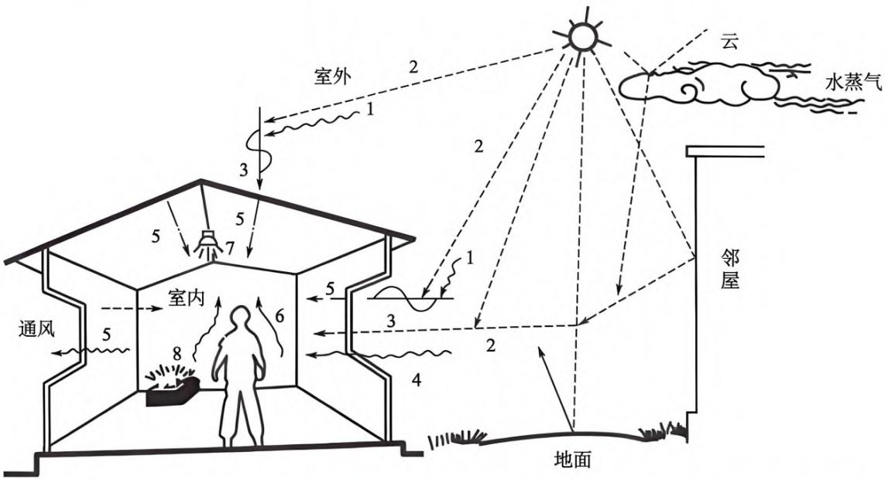  
1—室外气温；2—太阳辐射；3—室外空气综合温度；4—热湿空气交换；5—建筑围护结构传热；  
6—人体热源；7—照明热源；8—室内设备等热源

图 8.1-1 建筑物室内热湿环境下的室内传热过程

所谓冷负荷是指为了维持室内一定热湿环境要求，在单位时间内从室内空气中除去的热量，又称房间冷负荷。

如果将冷负荷概念拓展到空调系统，空调系统冷负荷除了上述房间冷负荷外，还包括空调系统新风冷负荷、空调系统管道等的冷量损失形成的冷负荷、空气处理方案中额外的空气处理所需冷量形成的冷负荷、空调系统中设备散热等形成的冷负荷。

### 8.1.1 冷负荷形成原理

**8.1.1.1 冷负荷形成机理**

现以送风空调方式维持室内热湿环境为例说明房间冷负荷形成机理。所谓送风空调，是指以空气为媒介除去室内余热量及余湿量，以达到要求的室内热湿环境为目标的空调方式。由热平衡原理可知，此时冷负荷的概念就是从室内空气中除去的余热量。进入典型空调房间的总得热量可分为潜热量和显热量两部分，如果不考虑围护结构和家具的吸湿和放湿作用，潜热立即进入空气影响室内热湿环境，成为冷负荷的一部分；显热中一部分热量以对流换热方式进入室内空气，立即成为冷负荷，另一部分热量则以辐射换热形式进入室内建筑表面或者室内固体表面，储存于这些围护结构或室内固体之中，提高其表面温度，再以对流形式逐步释放到室内空气中，成为冷负荷，或释放到室外空气而流失，抑或释放到与计算房间有温差的相邻房间（如果相邻房间温度高于计算房间，可计入得热）。这种物体中的热量储存与释放是基于不稳定的热量作用而形成的，如外围护结构在日射热作用下，壁温升高，在以后的时间内，储存在壁体内的热量将逐渐以对流形式释放到室内空气中成为冷负荷，在一定条件下还会以对流形式释放到室外侧空气中。又如室内照明开启后，一部分热量以对流热形式进入空气立即形成冷负荷，一部分热量则以辐射热形式储存于室内壁体及家具中使其温度升高，再以对流形式逐步释放给室内空气成为冷负荷，或者以对流形式释放到室外或者相邻房间的空气中。这种得热进入房间后的储存与释放特性，导致冷负荷的峰值相对于扰量形成的得热峰值有所衰减，在时间上有所延迟。

由上述分析可知，某一时刻进入房间的热量不一定等于同一时刻的房间冷负荷，不稳定的辐射得热是房间得热与冷负荷不相等的重要原因。因此，送风空调方式维持室内热湿环境要求的负荷计算关键，就是如何准确确定影响空气状态参数的显热交换量（包括辐射热释放的对流热交换）、水蒸气携带的潜热量。图8.1-2说明了送风空调房间得热形成房间冷负荷的过程。

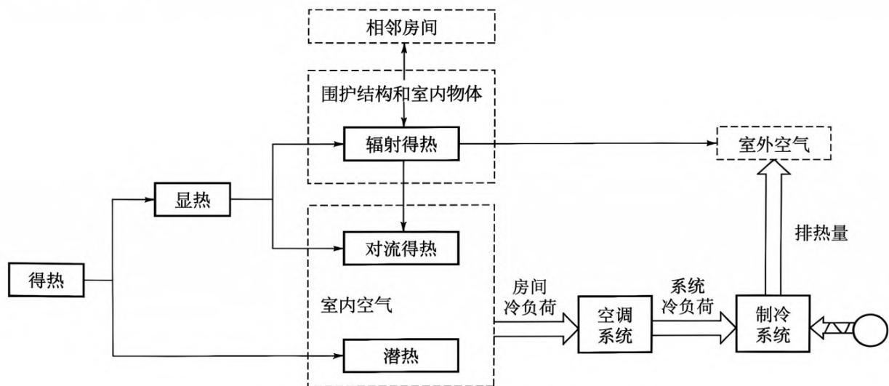  
图 8.1-2 送风空调房间得热形成房间冷负荷的过程

房间冷负荷、新风负荷以及系统产生的风机散热、管道传热等构成空调系统冷负荷。空调系统冷负荷中房间冷负荷、新风冷负荷是主要部分，其他由系统形成的冷负荷则根据不同的空调系统略有不同，这些定量计算由后续空调系统确定。图 8.1-2 中，当制冷系统提供的冷量与空调系统冷负荷达到平衡时，它所产生的热量以排热的形式排到大气中。

目前使用较多的辐射式空调方式，是通过辐射板以辐射和对流方式除去室内热量，来保证室内空气达到所需的热湿环境和平均辐射温度。与送风空调方式不同的是，辐射空调系统不仅需要在空气中除去热量，还需通过辐射换热方式除去各热表面上的热量。因此，房间冷负荷除了需要从空气中除去的热量外，还应包括冷辐射表面与其他热表面之间的辐射换热。

以下阐述以送风空调方式为对象。

**8.1.1.2 冷负荷形成过程**

得热转化为冷负荷的影响因素很多，其中围护结构和房间的蓄热特性是关键因素。分析冷负荷形成过程，可将从得热到冷负荷的蓄放热过程划分为围护结构、房间两个蓄放热过程。不同性质的得热，经过不同性质的围护结构，所经历的蓄放热过程有所不同。

对非透明围护结构（如砖墙），通常可将同时作用的太阳辐射与室外空气温度作为一个扰量，即室外空气综合温度，因其具有周期性特性以及围护结构蓄热特性，室外空气综合温度扰量首先经过围护结构本体第一蓄放热过程后得到衰减和延迟，形成了围护结构的内表面温度扰量；由于室内各表面温度的差异和建筑蓄热特性的不同，各表面之间存在长波辐射换热，由内表面温度形成的得热又经过房间第二蓄放热过程，室内得热中一部分热量储存在房间各表面或家具中，另一部分热量则通过表面以对流换热的形式进入空气，这一进入空气的热量才是冷负荷。

对于半透明围护结构（如玻璃面、玻璃幕墙等），在室外太阳辐射和空气温度同时作用下，因为不同的半透明围护结构（如不同厚度玻璃或者双层玻璃等）透射特性不同，太阳辐射透射进入室内的辐射热会不同，如图8.1-3所示，半透明围护结构难以像非透明围护结构那样，采用室外空气综合温度将太阳辐射与空气温度综合为一个参数。因此，通过半透明围护结构进入室内形成的冷负荷需分别计算日射透射冷负荷与温差传热冷负荷。半透明围护结构一般是由一层或多层玻璃与气体间层组成，它们的蓄热能力非常小，工程上，可认为外扰作用于半透明围护结构进入房间形成的热量不考虑蓄热，也就是外表面得热与内表面向室内传递的热量相同，不考虑衰减和延迟，这是太阳辐射与室外空气温度两个扰量通过非透明围护结构与半透明围护结构进入室内形成热量的主要不同点。由室外太阳辐射透过半透明围护结构形成的透射辐射扰量、室外空气温度通过半透明围护结构形成的内表面温度扰量在形成房间冷负荷时，与非透明围护结构相同，由于室内各表面温度差异以及热容不同，须经过房间第二蓄放热过程才形成房间冷负荷，即日射透射冷负荷与温差传热冷负荷，即：室外扰量通过半透明围护结构进入室内形成冷负荷时只经过了一次房间的衰减和延迟。

对于室内热源散热形成的冷负荷，如照明、人员、设备等室内扰量产生的热量，一般近似认为仅经历房间第二蓄放热的转化过程。无论是外围护结构还是内围护结构，只要有温差，围护结构都可能会将储存的一部分热量通过围护结构另一侧表面以对流方式传递给室外空气或者相邻房间的空气，由于这部分热量很小，工程上经常忽略不计。

得热形成冷负荷的多少取决于辐射在整个得热中所占比例的大小，不同扰量产生的得热中，辐射热、对流热和潜热所占比例不同，实际确定时应尽可能根据对象通过理论计算或调研或实验等方法获得，在难以获得时，显热得热可参考表8.2-1确定常见扰量的对流与辐射热量比例。

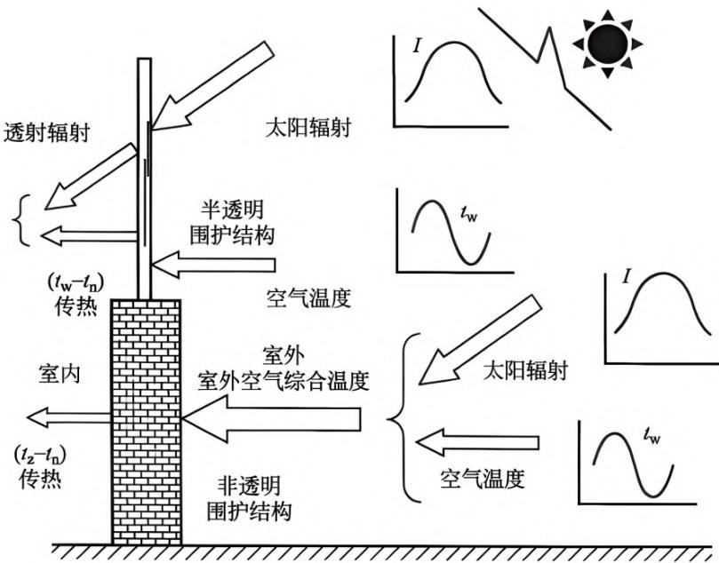  
图 8.1-3 室外扰量经过围护结构进入室内的传热途径

**8.1.1.3 建筑蓄热特性与间歇空调负荷**

工程上经常遇到的室外气候扰量一般为谐波扰量，室内人员、照明、设备等的室内扰量一般为阶跃扰量。这两种形式的扰量引起的负荷变化规律如图8.1-4所示。由能量守恒定律可知，瞬时得热曲线包围面积应等于瞬时冷负荷曲线所包围的面积，也就是空调初期各扰量得热在室内表面蓄热量应等于空调后期释放到空气中的表面放热量。蓄热量的大小取决于围护结构和房间的蓄热能力，房间蓄热能力越大，冷负荷衰减量越大，延迟时间也越长。

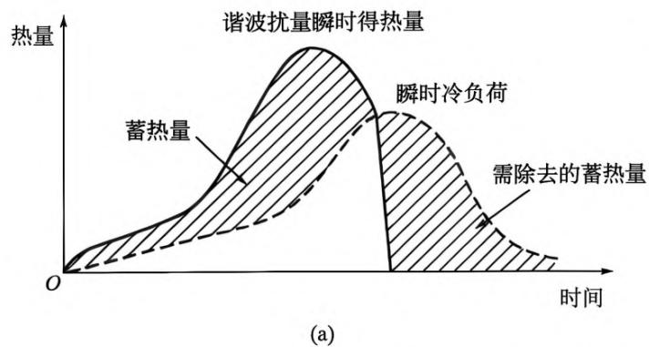

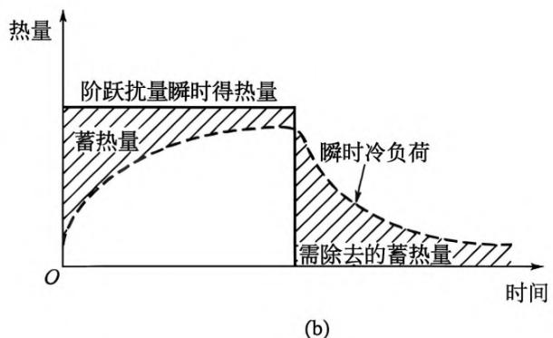  
图 8.1-4 谐波扰量、阶跃扰量引起的负荷变化规律  
(a) 谐波扰量；(b) 阶跃扰量

房间的蓄热能力与房间围护结构的建筑材料热容有关，建筑材料的热容等于质量与比热容的乘积，一般同类型的建筑材料比热容大致相近，因此建筑材料的热容可表示为单一与其质量成正比的关系。图8.1-5所示为不同质量的围护结构蓄热能力对冷负荷的影响，重型结构的蓄热能力比轻型结构大得多，其冷负荷的峰值就比较小，延迟时间也长得多。

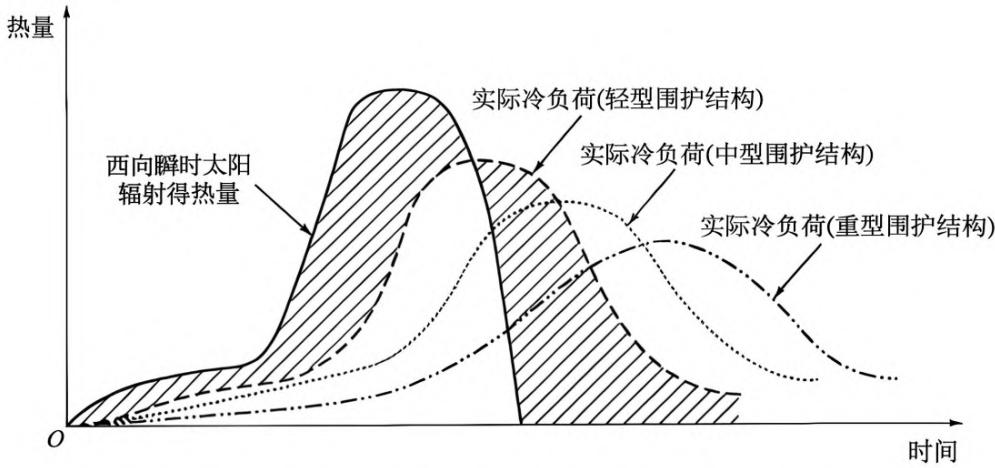  
图 8.1-5 不同质量的围护结构蓄热能力对冷负荷的影响

连续性空调系统冷负荷是在室温恒定不变的条件下形成的。但是当室温处于波动的情况下，会引起围护结构额外的蓄热和放热，同时室内空气参数波动也有相应的空气蓄热或放热，这就使得空调设备要从房间多取走或者少取走一些热量。这种在非稳定工况下，空调设备从房间带走的热量称为除热量，它包含房间冷负荷以及围护结构和空气的蓄热或者放热，由于室内空气温度的波动，此时房间冷负荷、围护结构和空气的蓄热或者放热应根据实际情况确定。图8.1-6用图解方式表达室温恒定与波动时，得热量、冷负荷与除热量之间的关系。

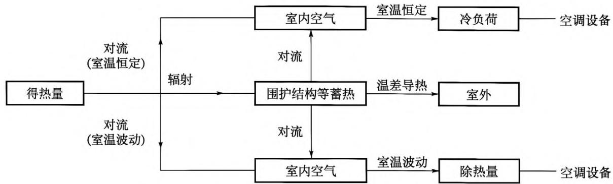  
图8.1-6 得热量、冷负荷与除热量之间的关系

在夏季，空调系统开机时，储存在建筑物和室内空气中的热量大量释放（随着室内热环境从最初状态逐渐趋于设定状态并达到稳定而减少），由于空气的比热容很小，室温会很快降低到设定值，因此围护结构放热是主要部分，空调末端装置选型时应充分考虑蓄热负荷，系统运行时应考虑足够的预冷时间使得空调房间室温达到设计状态。同理，空调关机时，由于建筑物内部在空调运行时储存了一定的冷量，室温会逐步回升，运行管理者可根据这一特性，在满足室温要求的同时，适当提前关机，节约能量。在冬季，同样也可考虑建筑蓄热与放热，通过考虑足够的预热时间和提前关机的方式，达到在室温满足设计要求时的节能。

空调系统间歇运行时，因为空调运行时间短，例如，体育比赛、演艺活动时的空调运行，室温不仅在开机和关机时波动，在空调运行期间也会有波动，因此围护结构、空气额外的蓄热与放热现象显著，此时围护结构冷负荷也有变化，因此采用热平衡方法计算间歇空调负荷比较合理。同样，由于其中的空气热容很小，计算间歇空调负荷可简化，仅考虑围护结构蓄热与放热便可，即间歇性空调系统负荷可简化成常规的空调冷负荷与蓄热负荷之和。

### 8.1.2 空调冷负荷计算中几个概念

**8.1.2.1 不保证时间概念**

在空调系统设计时，室外空气参数主要从两个方面影响系统的设备容量；一是由于室内外空气存在温差，这个温差会通过建筑围护结构以传热形式将热量传入室内；二是空调系统采用的室外新鲜空气或者通过房间渗透进入房间的渗透风，在其状态不同于室内空气状态时，需要花费一定的能量将其处理到室内空气状态，也就是新风能耗或者渗透风能耗。因此，确定室外空气的设计参数时，既不应选择多年不遇的极端值，也不应任意降低空调系统对服务对象的保证率或者保证时间。设计规范中规定的室外气象计算参数是按照一定的不保证率或不保证小时数确定的，即当室外参数超过规定的设计参数时允许室内参数偏离规定值。

空调负荷随不同地区气象条件的不同而不同，我国《民用建筑供暖通风与空气调节设计规范》GB 50736—2012、《工业建筑供暖通风与空气调节设计规范》GB 50019—2015中规定了不同保证时间的各地区冬夏季各室外气象计算参数值。

**8.1.2.2 同时使用系数**

同时使用系数是指在考察范围内同时使用的单元量占此范围内所有单元总量的比例。根据考察范围，可以是一个房间内同时运行的设备总功率与这个房间安装设备总功率的比例，也可以是一个集中空调系统内，同时开启空调所需冷量占这个系统空调总冷量的比例，或者也可以是区域建筑规划方案中，所有建筑同时需要供冷的冷量与区域供冷系统能源站所能提供的总冷量之比。

同时使用系数在建筑节能、降低工程投资方面具有一定的作用。同时使用系数影响因素很多，比如，单一集中空调系统的同时使用系数，与空调系统服务的建筑特点、人员性别结构与数量、所用空调设备的数量和容量、设备日常使用规律、设备安装情况和控制形式等诸多因素有关，因此，这一系数的确定有赖于实际空调工况的调查数据，积累的经验数据，或者概率论等方法的应用。

**8.1.2.3 不同场合空调冷负荷计算目的**

空调负荷计算分为设计负荷计算和全年负荷计算。

设计负荷计算是指计算建筑空调系统在设计工况下的设计负荷或设计日的峰值负荷，一般取设计日的各项负荷逐时值之和的最大值，常用于空调系统的设备容量、系统参数及控制方案确定的依据，它与系统初投资、建筑规划密切相关。

全年负荷计算是指计算建筑系统全年包含最热季、最冷季的负荷分布情况，一般根据全年 8760h 的室外气象参数计算逐时负荷获得，通常全年建筑能耗依赖全年负荷计算结果，全年能耗计算是建筑能耗评估、系统方案比较和优化、建筑节能措施评价等的基础，全年负荷计算及全年建筑能耗多采用软件计算。

空调负荷计算是建筑节能评估、建筑能耗分析的基础，其准确性与正确性对后续分析的正确性影响很大。因此，空调负荷计算时各参数的确定、方法的取用极为重要。

### 8.1.3 显热、潜热、通风渗透冷负荷

**8.1.3.1 显热冷负荷**

所谓显热是物质不发生相变（固液气转变）时吸收或放出的热量。

在计算空调建筑得热时，围护结构得热、透过玻璃的太阳辐射得热、照明得热、室内设备得热（不包括散湿）、人体散热中的显热散热等都属于显热。显热得热由对流得热与辐射得热组成，其中对流得热立即成为负荷，辐射得热首先储存于建筑和家具之中，后续逐步通过表面以对流热量形式，释放到空气中形成负荷。这部分对流热量相比于显热得热有所衰减和延迟。

在计算显热负荷时，根据显热得热性质不同，考虑建筑蓄放热特性，所采用的负荷计算方法也不同。对于以周期性扰量为特征的室外扰量（室外空气温度、日射辐射）常采用谐波反应法考虑建筑蓄放热的影响计算显热负荷；对于以阶跃扰量为特征的（如照明散热等）室内得热，常采用冷负荷系数法考虑建筑蓄放热影响计算显热负荷。

**8.1.3.2 潜热冷负荷**

所谓潜热是物质发生相变时吸收或放出的热量。

由于潜热是直接进入室内空气的，因此潜热得热就是潜热负荷。空调房间潜热得热一般涉及的是水与水蒸气相变形成的热量传递，此相变过程单位质量需要吸收或放出的热量称为潜热。水转变成水蒸气的相变过程需要吸收热量，水蒸气转变成水的相变过程会放出热量，这些热量便是潜热。空调房间空气中得到的潜热量一般都是伴随着散湿量形成的，实际上空气还获得了散湿量携带的显热量，但由于这部分显热量很小，工程计算时常常忽略。

空调房间中空气获得的散湿量，如人体出汗，汗水吸收体内热量，使人体降温，但对空气而言，汗水蒸发后的水蒸气携带水的潜热进入了空气，即获得了潜热量，与此同时空气也获得了人体蒸发的水蒸气，即散湿量。如果室内存在水面，由于水面蒸发的水蒸气是靠吸收水面上空气热量而转变成水蒸气的，进入空气的水蒸气潜热量与空气降温所需的热量相当，即空气没有获得潜热量，只获得了水面蒸发的散湿量。但如果直接将蒸汽送入房间，因蒸汽本身携带了汽化潜热，对空气而言，既获得了蒸汽的潜热量，又获得了蒸汽的散湿量。

因此，潜热得热或者说是潜热冷负荷 $Q$ （kJ）可以描述成发生相变的质量与其发生相变所需的潜热乘积，即；

$$
Q = m \cdot r\tag{8. 1- 1}
$$

式中 m ——发生相变的物质质量，对于空调房间而言，常常是散湿量，kg；

r——发生相变所需的潜热，kJ/kg。

**8.1.3.3 新风冷负荷/通风渗透负荷**

新风冷负荷是空调系统中很重要的冷负荷之一。它是夏季为保证空调房间空气品质而在系统中引入室外新鲜空气所消耗的能量。引入系统的新风通过与系统空气掺混成为一体，因此新风冷负荷也是新风得热。

夏季由于室外空气温度和含湿量均高于室内空气，此时室外空气的焓值高于室内空气，新风冷负荷则是将室外高焓值的空气冷却除湿至室内空气焓值所需的能量。通常可用

下式计算：

$$
\mathrm{CLQ} = G _ {\mathrm{w}} (h _ {\mathrm{w}} - h _ {\mathrm{n}})\tag{8. 1-2}
$$

式中 CLQ——新风冷负荷，kW；

$G_{w}$ ——新风量，kg/s；

$h_{w}$ 和 $h_{n}$ ——分别为室外和室内的空气比焓，kJ/kg。

建筑物门、窗和墙体等外围护结构存在各种缝隙，通过门、窗开启时的孔口，或者建筑围护结构上的缝隙，在建筑风压和热压或者在房间压力的作用下，室外空气经常会通过孔口或者缝隙进入房间。这些空气将室外热量带入室内，因此通风冷负荷或者渗透冷负荷也可采用式（8.1-2）计算。其中的新风量是通过孔口的风量或者是缝隙渗透风量。通风量和渗透风量的计算方法详见其他分册。

无论是系统新风还是房间通风渗透风，它们在带给系统或者房间热量的同时，会因为室内外含湿量的不同，同时带给系统湿量，带入的湿量可采用下式计算：

$$
W = G _ {\mathrm{w}} (d _ {\mathrm{w}} - d _ {\mathrm{n}}) / 1 0 0 0\tag{8. 1-3}
$$

式中 W ——带入的湿量，kg/s；

$d_{w}$ 和 $d_{n}$ ——分别为室外和室内的空气含湿量，g/kg干空气；

$G_{w}$ 同式（8.1-2）。

### 8.1.4 常用冷负荷计算方法演绎过程及其区别

1946 年，美国学者 C. O. Mackey 和 L. T. Wight 提出了当量温差法，20 世纪 50 年代初，苏联学者 A. T. Ш коловер 提出了用谐波分解法计算围护结构冷负荷，这两种方法的共同特点是没有区分得热与负荷，即：负荷等于得热，因此计算得到的空调冷负荷偏大。

1967 年，加拿大学者 D. G. Stephenson 和 G. P. Mitalas 提出了反应系数法，与当量温差法和谐波分解法的最大区别是区分了得热与负荷。之后学者以负荷不等于得热的思路提出了各种冷负荷计算方法。1971 年，Stephenson 和 Mitalas 利用 Z 传递函数法，改进了反应系数法，提出了适合手工计算的冷负荷系数法，又称权系数法，即不需要迭代或回溯，便可从得热直接求解冷负荷的方法。1975 年，Rudoy 和 Duran 采用 Z 传递函数法求得一批典型建筑的冷负荷温差（CLTD）和冷负荷系数（CLF），改进并完善了冷负荷系数法。ASHRAE 1977 年版的手册对冷负荷系数法正式予以采用。1992 年，McQuiston 等人又提出日射冷负荷系数（SCLs），对透过玻璃窗的日射冷负荷计算精度进行了改进。至此，在众多学者的研究完善下，冷负荷系数法逐渐完善趋于成熟。

20 世纪 80 年代初，我国 8 个单位多位学者协作，进行了空调负荷计算方法的研究，其中，在谐波分解法的基础上提出了谐波反应法。1982 年，在原城乡建设环境保护部的主持下，通过了谐波反应法和冷负荷系数法作为我国暖通空调设计的推荐方法。这些方法针对我国的建筑物特点推出一批典型围护结构的冷负荷温差（冷负荷温度）以及日射冷负荷强度（日射冷负荷系数）等，为我国暖通空调设计人员提供了实用的设计工具。

图 8.1-7 为目前我国工程界使用的冷负荷计算方法及其由来。

随着计算机应用的普及，冷负荷计算方法从工程的手工计算逐步拓展到应用计算机的

空调负荷模拟 $\Longrightarrow$ 全年能耗模拟  
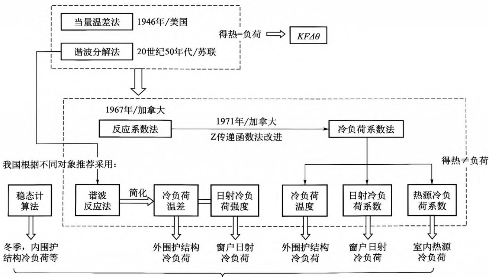  
图8.1-7 目前我国工程界使用的冷负荷计算方法及其由来

热平衡法。

Pedersen 等人于 1997 年在 ASHRAE 的项目研究报告中完整地阐述了冷负荷热平衡方法的计算过程。热平衡方法是空调冷负荷的一种精确计算方法，它是通过求解房间的热平衡方程来计算冷热负荷的。

ASHRAE 设计负荷计算技术委员会希望开发一种不像传递函数方法那样需要迭代计算的、更加精确的简化负荷计算方法。基于冷热负荷计算是以气象参数周期性作用于围护结构这一假设条件，该委员会于 1997 年提出了辐射时间序列法（RTSM）。该方法采用推荐的比例将房间得热量划分为对流得热和辐射得热两部分，其中对流得热直接转化为房间冷负荷，而辐射得热采用辐射时间因子计算房间辐射负荷，房间冷负荷即为对流得热与辐射负荷之和。

表 8.1-1 列出了反应系数法、Z 传递函数法、冷负荷系数法、谐波反应法、热平衡法、辐射时间序列法的计算概要，表中简要说明了它们的应用特点和方法特点。如果把围护结构或者房间看作是系统，这些计算方法都可以认为是对系统施加了一个扰量，负荷便是在此扰量作用下的系统响应，如图 8.1-8 所示。系统也就是围护结构或房间的蓄热特性不同，导致了不同特性的系统就有不同的响应；不同的扰量，同样的系统，也会有不同的响应。这些扰量可以是室外空气温度、太阳辐射、室内热源等，响应可以是得热或者冷负荷。房间可作为线性系统，作用于空调房间的扰量可以用不同类型的简单函数叠加，即单元扰量叠加，通过单元扰量计算单元响应，进而通过级数叠加，获得由多个单元扰量叠加后实际扰量作用下的响应，即多个单元响应叠加后的实际响应。因此，任何一种方法都可通过数学方法计算不同类型的扰量响应。

主要空调冷负荷计算方法比较  
表 8.1-1

<table><tr><td>空调冷负荷计算方法</td><td>计算方法概要</td><td>说明</td></tr><tr><td>反应系数法</td><td>以对系统输入室外空气综合温度扰量为例: $Q_{\tau}=F[\sum_{i=0}^{\tau}Y_{i}\cdot t_{e(r-i)}-\sum_{i=0}^{\tau}Z_{i}\cdot t_{n(r-i)}]$  $CLQ_{\tau}=\sum_{i=0}^{\tau}W_{i}\cdot\beta_{1}\cdot Q_{\tau-i}+\beta_{d}\cdot Q_{\tau}$ 式中: $Q_{\tau}$ 为τ时刻的房间得热量,W;F为围护结构的计算面积, $m^{2};Y_{i},Z_{i}$ 分别为i时刻的传热反应系数和内表面吸热反应系数, $W/(m^{2}\cdot^{\circ}C)$ ; $t_{e(r-i)},t_{n(r-i)}$ 分别为τ-i时刻的室外空气综合温度和室内空气温度,°C; $CLQ_{\tau}$ 为τ时刻的冷负荷,W; $W_{i}$ 为i时刻的房间的负荷反应系数; $\beta_{1},\beta_{d}$ 分别为得热量中辐射、对流得热量的占比</td><td>应用特点:该方法不要求以周期扰量为前提,适用于任意扰量。方法特点:须得到该系统的传热反应系数、内表面吸热反应系数、房间的负荷反应系数,即Y、Z、W等</td></tr><tr><td>Z传递函数法</td><td>以对系统输入室外空气综合温度扰量为例: $Q_{\tau}=F[\sum_{i=0}^{\tau}b_{i}\cdot t_{e(r-i)}-\sum_{i=0}^{\tau}c_{i}\cdot t_{n(r-i)}]-\sum_{i=1}^{\tau}d_{i}\cdot Q_{\tau-i}$  $CLQ_{\tau}=v_{0}Q_{\tau}+v_{1}Q_{\tau-1}-w_{1}CLQ_{\tau-1}$ 式中: $Q_{\tau},Q_{\tau-i}$ 分别为τ时刻和τ-i时刻的得热量,W;F为围护结构的计算面积, $m^{2};b_{i},c_{i},d_{i}$ 分别为i时刻围护结构Z传递函数的各系数,其中 $b_{i},c_{i}$ 的单位是 $W/(m^{2}\cdot^{\circ}C)$ ; $t_{e(r-i)},t_{n(r-i)}$ 分别为τ-i时刻的室外空气综合温度和室内空气温度,°C; $CLQ_{\tau},CLQ_{\tau-1}$ 分别为τ时刻和τ-1时刻的冷负荷,W; $v_{0},v_{1},w_{1}$ 分别为房间的Z传递函数各系数</td><td>应用特点:与反应系数法基本一致,但其收敛速度要远远快于反应系数法,适用于任意扰量。方法特点:知道围护结构传递函数的各系数 $b_{i},c_{i},d_{i}$ 和房间传递函数系数 $v_{0},v_{1},w_{1}$ 就可以计算房间的冷负荷,可通过求解房间各围护结构所建立起的热平衡联立方程式得到</td></tr><tr><td>冷负荷系数法</td><td>用冷负荷温度计算围护结构传热形成的逐时冷负荷: $CLQ_{\tau}=KF(t_{l.\tau}-t_{n})$ 用冷负荷系数计算室内热源散热形成的逐时冷负荷: $CLQ_{\tau}=QX_{\tau-T}$ 式中: $CLQ_{\tau}$ 为τ时刻的冷负荷,W;K为围护结构的传热系数, $W/(m^{2}\cdot K)$ ;F为围护结构的计算面积, $m^{2};t_{l.\tau}$ 为冷负荷温度逐时值,°C; $t_{n}$ 为室内空气温度,°C;Q为得热量,W; $X_{\tau-T}$ 为得热投入时刻T到计算时刻τ的冷负荷系数</td><td>应用特点:该方法常用于工程计算房间冷负荷。方法特点:对于围护结构采用目前冷负荷温度计算逐时负荷;对于人员、设备内热源的负荷采用冷负荷系数计算逐时负荷。这一方法需查得逐时冷负荷温度和内热源得热投入使用后的逐时冷负荷系数</td></tr><tr><td>谐波反应法</td><td>以对系统输入室外空气综合温度扰量为例: $Q_{\tau}=\overline{Q}+\widetilde{Q}=KF(\overline{t_{z}}-t_{n})+a_{n}F\sum_{n=1}^{m}\frac{\Delta t_{z,n}}{\nu_{n}}\cos(\omega_{n}\tau-\phi_{n}-\epsilon_{n})$  $CL\widetilde{Q}_{\mathrm{f}}=\beta_{\mathrm{f}}a_{\mathrm{n}}F\sum_{n=1}^{m}\frac{\Delta t_{z,n}}{\nu_{n}\mu_{n}}\cos[\omega_{n}\tau-\phi_{n}-\epsilon_{n}-\epsilon_{n}^{\prime}]$  $CLQ_{\tau}=CLQ_{\mathrm{d}}+CL\overline{Q}_{\mathrm{f}}+CL\widetilde{Q}_{\mathrm{f}}=\beta_{\mathrm{d}}Q_{\mathrm{r}}+\beta_{\mathrm{f}}KF(\overline{t_{z}}-t_{n})+CL\widetilde{Q}_{\mathrm{f}}$ </td><td>应用特点:该方法常用于求解系统在谐波变化扰量作用下的谐波响应。方法特点:要查得围护结构的传热衰减度和传热延迟时间、房间的放热衰减度和相位延迟时间</td></tr><tr><td>谐波反应法</td><td>式中:Q、Q得热量中的稳定部分和波动部分,W;K为围护结构的传热系数,W/(m2·K);F为围护结构的计算面积,m2;lz、tn分别为室外空气综合温度的平均值和室内空气温度,°C;a_n为围护结构内表面的放热传热系数,W/(m2·K);Δt_z,n为第n阶室外空气综合温度变化波幅,°C;ω_n为第n阶室外空气综合温度变化的频率,°/h或rad/h;φ_n为第n阶室外空气综合温度变化的初相位,°或rad;ν_n、ε_n分别为围护结构对n阶室外空气综合温度扰量的传热衰减度和传热延迟时间,后者单位为°或rad;βf、βd分别为得热量中辐射、对流得热量的占比;μn、εn'分别是房间对n阶辐射热扰量的放热衰减度和相位延迟时间,前者无量纲,后者单位为°或rad;CLQd为冷负荷中的对流部分,W;CLQf、CLQf分别为冷负荷中的稳定辐射部分和波动辐射部分</td><td>应用特点:该方法常用于求解系统在谐波变化扰量作用下的谐波响应。方法特点:要查得围护结构的传热衰减度和传热延迟时间、房间的放热衰减度和相位延迟时间</td></tr><tr><td>热平衡法</td><td>以房间或者计算系统为控制体,考虑室内各热源、长短波辐射、通风渗透热量、空调冷量等,列出各围护结构外表面、内表面和室内空气的导热、对流、辐射的热平衡方程,空调冷负荷通过联立求解这些方程得到。由于计算对象的非稳态特点以及方程中的非线性问题,常常需要迭代计算获得</td><td>应用特点:由于热平衡方法是通过各单元的热平衡方程联立求解,因此其适用面很广,是目前空调冷负荷计算中一种准确且基础的方法。方法特点:需要输入建筑结构、热工特性参数、运行工况等详细参数,计算比较复杂,一般通过计算机完成</td></tr><tr><td>辐射时间序列法</td><td>CLQr=Qd(τ)+CLQf(τ)CLQf(τ)=r1Qr+r2Qr-1+r3Qr-2+···+r24Qr-23式中:CLQr、Qd(τ)、CLQf(τ)分别为τ时刻的冷负荷、对流冷负荷、辐射冷负荷,W;Qr为τ时刻辐射得热,W;r1为第i个辐射时间因子。</td><td>应用特点:需要假设扰量具有周期性特征,该方法只适用于设计日负荷计算。方法特点:在获得总热量及其中的对流得热与辐射得热比例后,需已知辐射时间因子便可求解,不需要迭代计算</td></tr></table>

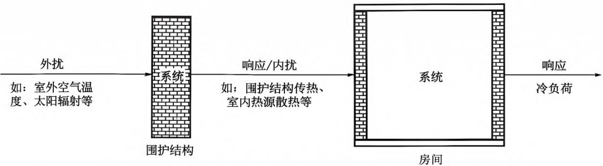  
图8.1-8 扰量与响应

## 8.2 谐波反应法

1967 年，加拿大学者应用控制理论的扰量和响应的离散化处理思想，提出了负荷计算反应系数法，引起较大反响，掀起了新负荷计算方法的研究热潮。国内学者对谐波法、反应系数法、传递函数法、冷负荷系数法进行了积极的跟踪、研究。1978 年成立 “设计用建筑物冷热负荷计算方法” 课题组，于 1982 年提出我国建筑物冷热负荷计算方法——冷负荷系数法和谐波反应法。这两种方法都只适用于传统建筑、常规空调系统的设计日负荷计算。

冷负荷系数法建立在传递函数法的理论基础之上。该方法建立窗、墙及屋面的传递函数，计算出逐时冷负荷系数表，通过查表，可以方便地计算出房间冷负荷，是国内早期空调冷负荷逐时计算的主要方法。该方法没有根据新型围护结构和现行标准规范中的气象参数更新传递函数、冷负荷计算表，因此目前主要采用谐波反应法进行计算。

谐波反应法由孙延勋提出，该方法以谐波法为基础，从根本上区分了得热和冷负荷两个概念，引用传热过程的衰减和延迟概念，物理意义清晰，易于理解。

谐波反应法认为，形成房间冷负荷的内扰和外扰，都是以 $24\mathrm{h}$ 为周期进行的重复性变化。自动控制理论认为，一个系统受到激励就会产生一个响应。空调房间可以看成一个线性的自控系统，它受到一个扰量的作用（得热）就会产生相应的反应（负荷）。稳定得热产生稳定负荷，周期性得热就会产生周期性负荷。作为线性系统，各部分得热可以叠加，由此产生的负荷也可以叠加。根据傅里叶级数的概念，任何周期函数都可以用正弦函数和余弦函数构成的无穷级数来表示。因此，周期性扰量是可以用不同阶的谐性波动表达，而谐波扰量的响应是可以计算的。这就是谐波反应法负荷计算的基本思路和理论基础。

谐波反应法计算空调负荷的步骤为:

1. 计算各围护结构的传热衰减与延迟以及放热衰减与延迟。

2. 计算空调区域的各种得热并将其表述为三角多项式。

3. 将得热分成对流部分和辐射部分。

4. 根据得热的种类计算空调区域对辐射热扰量的衰减和延迟。

5. 将辐射热扰转化成冷负荷。

6. 将上述计算值与原对流部分相加得到该项得热的负荷值。

7. 将各项负荷相加得到空调区域冷负荷值。

ASHRAE 手册中给出了不同类型的得热，其对流与辐射的成分见表 8.2-1；各种辐射得热在室内分配的比例见表 8.2-2。

得热中的对流与辐射成分表  
表8.2-1

<table><tr><td>得热种类</td><td>对流</td><td>辐射</td></tr><tr><td>外墙、外窗等温差传热</td><td>37%</td><td>63%</td></tr><tr><td>屋面温差传热</td><td>16%</td><td>84%</td></tr><tr><td>无遮阳外窗、天窗直射、散射辐射</td><td>0</td><td>100%</td></tr><tr><td>有遮阳外窗、天窗直射、散射辐射</td><td>37%</td><td>63%</td></tr><tr><td>架空楼板温差传热</td><td>37%</td><td>63%</td></tr><tr><td>灯器散热</td><td>33%</td><td>67%</td></tr><tr><td>人体显热散热</td><td>45%</td><td>55%</td></tr><tr><td>设备用具显热散热</td><td>75%</td><td>25%</td></tr></table>

辐射得热室内分配系数表  
表8.2-2

<table><tr><td rowspan="2">辐射源</td><td colspan="5">分配系数 $\mathrm{XS}_{i} (i=1\sim5)$ </td></tr><tr><td>楼板</td><td>顶棚</td><td>内墙</td><td>外墙</td><td>外窗</td></tr><tr><td>外墙内表面</td><td>0.20</td><td>0.20</td><td>0.60</td><td>0</td><td>0</td></tr><tr><td>屋顶内表面</td><td>0.35</td><td>0</td><td>0.50</td><td>0.10</td><td>0.05</td></tr><tr><td>外窗温差内表面</td><td>0.2</td><td>0.15</td><td>0.65</td><td>0</td><td>0</td></tr><tr><td>无内遮阳外窗直射辐射</td><td>0.80</td><td>0.05</td><td>0.15</td><td>0</td><td>0</td></tr><tr><td>无内遮阳外窗散射辐射</td><td>0.20</td><td>0.15</td><td>0.65</td><td>0</td><td>0</td></tr><tr><td>有内遮阳外窗直射、散射辐射</td><td>0.20</td><td>0.15</td><td>0.65</td><td>0</td><td>0</td></tr><tr><td>无内遮阳平天窗辐射</td><td>0.35</td><td>0</td><td>0.5</td><td>0.1</td><td>0.05</td></tr><tr><td>有内遮阳平天窗辐射</td><td>0.35</td><td>0</td><td>0.5</td><td>0.1</td><td>0.05</td></tr><tr><td>架空楼板</td><td>0</td><td>0.35</td><td>0.5</td><td>0.1</td><td>0.05</td></tr><tr><td>灯光</td><td>0.35</td><td>0</td><td>0.50</td><td>0.10</td><td>0.05</td></tr><tr><td>人体</td><td>0.30</td><td>0.10</td><td>0.50</td><td>0.05</td><td>0.05</td></tr><tr><td>设备器具</td><td>0.20</td><td>0.25</td><td>0.45</td><td>0.05</td><td>0.05</td></tr></table>

### 8.2.1 通过墙体、屋顶的得热量及其形成的冷负荷

通过墙体、屋顶的得热量以及形成的冷负荷可用图 8.2-1 表示。

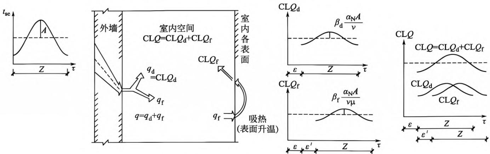  
图8.2-1 墙体得热转化为冷负荷图

由于围护结构外表面同时受太阳辐射和室外空气温度的热作用，在计算建筑物外表面的得热量时，往往采用综合温度的概念，即在原室外气温的基础上增加一个太阳辐射的等效温度。对于外墙，可忽略外围护结构与周围环境的长波辐射热交换，室外综合温度的计算公式见本手册7.2.6节。

室外空气综合温度呈周期性变化，使得围护结构从外表面逐层地跟着波动，这种波幅是由外向内逐渐衰减和延迟的。定义围护结构外侧综合温度的波幅与内表面温度波幅的比值为该墙体的传热衰减度 v，内表面温度波对外侧综合温度的相应滞后为该墙体的传热延迟时间 $\varepsilon$ 。

**1. 综合温度作用下围护结构的得热量**

计算日室外综合温度的逐时变化可展开为傅里叶级数形式:

$$
t _ {\mathrm{se}, \tau} = A _ {0} + \sum_ {n = 1} A _ {n} \cos (\overline {{{\omega}}} _ {n} \tau - \varphi_ {n})\tag{8.2-1}
$$

式中 $A_{0}$ ——零阶外扰，即计算日室外综合温度的平均值 $\bar{t}_{se}$ ，℃；

$A_{n}$ ——第 n 阶室外综合温度变化的波幅，℃；

$\overline{\omega}_{n}$ ——第 n 阶室外综合温度变化的频率；

$\varphi_{n}$ ——第 n 阶室外综合温度变化的初相角，°或 rad。

从式（8.2-1）看出，在周期性外扰作用下的室内得热量可认为包括两部分：

(1) 由于室外平均综合温度 $\bar{t}_{\mathrm{se}}$ 与室内空气温度 $t_{\mathrm{N}}$ 之差形成的稳定传热得热量:

$$
\overline {{{Q}}} = K F (\bar {t} _ {\mathrm{se}} - t _ {\mathrm{N}})\tag{8.2-2}
$$

（2）由于外扰波动引起围护结构内表面温度波动 $\Delta \tau_{\mathrm{N},\tau}$ ，从而产生的附加不稳定传热得热量：

$$
\widetilde {Q} = a _ {\mathrm{N}} F \Delta \tau_ {\mathrm{N}, \tau}\tag{8.2-3}
$$

而

$$
\Delta \tau_ {\mathrm{N}, \tau} = \sum_ {n = 1} ^ {m} \frac {\Delta t _ {\mathrm{se} , n}}{\nu_ {n}} \cos (\overline {{{\omega}}} _ {n} \tau - \varphi_ {n} - \varepsilon_ {n})\tag{8.2-4}
$$

所以

$$
Q _ {\tau} = K F \left[ \overline {{t}} _ {\mathrm{se}} - t _ {\mathrm{N}} + \frac {a _ {\mathrm{N}}}{K} \sum_ {n = 1} ^ {m} \frac {\Delta t _ {\mathrm{se} , n}}{\nu_ {n}} \cos (\overline {{\omega}} _ {n} \tau - \varphi_ {n} - \varepsilon_ {n}) \right]\tag{8.2-5}
$$

式中 $Q_{\tau}$ ——围护结构逐时得热量，W；

K——围护结构传热系数， $W/(m^{2} \cdot K)$ ;

F——围护结构的面积， $m^{2}$ ;

$a_{N}$ ——围护结构内表面换热系数， $W/(m^{2}\cdot K)$

$\Delta t_{se,n}$ ——第 n 阶综合温度扰量的波幅，℃；

$\nu_{n}$ ——围护结构对第 n 阶综合温度扰量的衰减度；

$\varepsilon_{n}$ ——围护结构对第 n 阶综合温度扰量的相位延迟，°或 rad。

2. 房间冷负荷

得热量由对流热和辐射热组成，其中对流热占总得热量的百分比为 $\beta_{d}$ ，辐射热成分占总得热量的百分比为 $\beta_{f}$ 。

(1) 对流形成的冷负荷

稳定得热量和附加不稳定得热量分别为：

$$
\overline {{Q}} = \overline {{Q}} _ {\mathrm{d}} + \overline {{Q}} _ {\mathrm{f}} = \beta_ {\mathrm{d}} \overline {{Q}} + \beta_ {\mathrm{f}} \overline {{Q}}
$$

$$
\widetilde {Q} = \widetilde {Q} _ {\mathrm{d}} + \widetilde {Q} _ {\mathrm{f}} = \beta_ {\mathrm{d}} \widetilde {Q} + \beta_ {\mathrm{f}} \widetilde {Q}
$$

由于得热量的对流部分直接转化为瞬时冷负荷，所以对流冷负荷为：

$$
\mathrm{CL} Q _ {\mathrm{d}} = Q _ {\mathrm{d}} = \overline {{{Q}}} _ {\mathrm{d}} + \widetilde {Q} _ {\mathrm{d}} = \beta_ {\mathrm{d}} (\overline {{{Q}}} + \widetilde {Q}) = \beta_ {\mathrm{d}} Q
$$

**(2) 辐射得热形成冷负荷**

辐射得热量同样可有稳定得热量 $\overline{Q}_{f}$ 和波动得热量 $\widetilde{Q}_{f}$ 。

稳定得热量 $\overline{Q}_{f}$ 不随时间变化，持续作用在房间内。房间对外的辐射非常小，或与房间外部对内的辐射抵消，予以忽略。因此，该部分最终全部转化为冷负荷 $CL\overline{Q}_{f}$ ： $CL\overline{Q}_{f}=\overline{Q}_{f}=\beta_{f}\overline{Q}$ 。

不稳定部分 $\widetilde{Q}_{f}$ 形成的冷负荷 $CL\widetilde{Q}_{f}$ 为：

$$
\mathrm{CL} \widetilde {Q} _ {\mathrm{f}} = \beta_ {\mathrm{f}} a _ {\mathrm{N}} F \sum_ {n = 1} ^ {m} \frac {\Delta t _ {\mathrm{se} , n}}{\nu_ {n} \mu_ {n}} \cos (\overline {{{\omega}}} _ {n} \tau - \varphi_ {n} - \varepsilon_ {n} - \varepsilon_ {n} ^ {\prime})\tag{8.2-6}
$$

式中 $\mu_{n}$ ——房间对第 $n$ 阶墙体或屋顶传导得热中辐射扰量的衰减度；

$\epsilon_{n}^{\prime}$ ——房间对第 $n$ 阶墙体或屋顶传导得热中辐射扰量的相位延迟，°或 rad。

所以总冷负荷 $\mathrm{CLQ}_{\tau}$ 为:

$$
\mathrm{CL} Q _ {\tau} = \mathrm{CL} Q _ {\mathrm{d}} + \mathrm{CL} \overline {{Q}} _ {\mathrm{f}} + \mathrm{CL} \widetilde {Q} _ {\mathrm{f}}\tag{8.2-7}
$$

### 8.2.2 通过窗户的得热量及其形成的冷负荷

通过窗户进入室内的得热量有传热得热和日射得热量两部分。传热得热由室内外温差引起。日射得热，因太阳照射到窗户上时，除了一部分辐射能量反射回大气之外，其中一部分能量透过玻璃以短波辐射形式直接进入室内；另一部分被玻璃吸收，提高了玻璃温度然后再以对流和长波辐射的方式向室内外散热。

**1. 传热得热冷负荷**

当忽略窗户热容时，其各阶谐波的衰减度均为 $a_{\mathrm{N}} / K$ ，延滞时间都为零，通过窗户的传热得热量为：

$$
Q _ {\tau} = K F \sum_ {n = 1} ^ {m} A _ {n} \cos (\omega_ {n} \tau - \varphi_ {n})\tag{8. 2-8}
$$

相应的冷负荷为：

$$
\mathrm{CL} Q _ {\tau} = \beta_ {\mathrm{d}} Q _ {\tau} + \beta_ {\mathrm{f}} K F \sum_ {n = 0} ^ {m} \frac {A _ {n}}{\mu_ {n}} \cos (\overline {{{\omega}}} _ {n} \tau - \varphi_ {n} - \epsilon_ {n} ^ {\prime})\tag{8.2-9}
$$

式中 $\mu_{n}, \epsilon_{n}^{\prime}$ ——分别为第 $n$ 阶窗户传导得热中辐射热扰量的衰减度和相位延滞，°或 rad。

**2. 日射得热冷负荷**

日射得热分为两部分：直接透射到室内的太阳辐射热和被玻璃吸收的太阳辐射热传向室内的热量。

窗户的日射得热量为：

$$
Q _ {\tau} = C _ {s} C _ {n} F \sum_ {n = 1} I _ {n} \cos (\overline {{{\omega}}} _ {n} \tau - \varphi_ {n})\tag{8. 2-10}
$$

式中 $I_{n}$ ——第 n 阶日射得热谐波的波幅。

$C_{8}$ ——遮挡系数，非标准玻璃得热量的修正系数；

$C_{n}$ ——遮阳系数，内遮阳对窗户得热量的修正系数。

相应的冷负荷为：

$$
\mathrm{CL} Q _ {\tau} = \beta_ {\mathrm{d}} Q _ {\tau} + \beta_ {\mathrm{f}} C _ {\mathrm{s}} C _ {\mathrm{n}} F \sum_ {n = 1} ^ {m} \frac {I _ {n}}{\mu_ {n}} \cos (\overline {{{\omega}}} _ {n} \tau - \varphi_ {n} - \epsilon_ {n} ^ {\prime})\tag{8.2-11}
$$

式中 $\mu_{n}, \epsilon_{n}^{\prime}$ ——房间对第 $n$ 阶窗户日射得热中辐射扰量的衰减度和相位延迟，或 rad。

### 8.2.3 照明、设备、人体的得热量及其形成的冷负荷

照明灯具将电能转换为光和热，热能部分通过对流、辐射的方式传递给房间。

室内设备的发热量，也分对流和辐射两部分。

人体的散热量与性别、年龄、劳动强度、衣着以及环境温湿度等多种因素有关，包含对流和辐射两部分。

照明、设备、人体的得热量，在其散热时间内为常量 $Q$ ，因此其扰量的时间曲线为矩形波。注意矩形波展开为余弦函数，傅立叶级数应取到 12 阶方能满足精度要求。该矩形波的傅立叶级数形式写成：

$$
Q _ {\tau} = Q \sum_ {n = 0} ^ {m} A _ {n} \cos (\omega_ {n} \tau - \varphi_ {n})\tag{8. 2-12}
$$

相应的冷负荷为：

$$
\mathrm{CL} Q _ {\tau} = \beta_ {\mathrm{d}} Q _ {\tau} + \beta_ {\mathrm{f}} Q \sum_ {n = 0} ^ {m} \frac {A _ {n}}{\mu_ {n}} \cos (\omega_ {n} \tau - \varphi_ {n} - \varepsilon_ {n} ^ {\prime})\tag{8.2-13}
$$

式中 $\beta_{\mathrm{d}}$ 、 $\beta_{\mathrm{f}}$ ——照明、人体和设备得热中对流热和辐射热所占的比例；

$\mu_{n}$ 、 $\varepsilon_{n}^{\prime}$ ——房间对照明、人体和设备得热中第 n 阶辐射扰量的衰减和相位延滞， $^{°}$ 或 rad。

### 8.2.4 算例

谐波反应法应取12阶谐波计算。本算例仅取2阶谐波，示意计算过程。

【例 8.2-1】计算某地区单位面积南外墙得热所产生的冷负荷。室内设计温度 $t_{a}=26^{\circ}C$ ，计算至 2 阶谐波。

该墙体构造如图 8.2-2，由内到外各层材料物理性能如下：

$$
\begin{array}{r l} & \lambda_ {5} = 0. 8 1 4 \mathrm{W/(m} \cdot \mathrm{K)}, \delta_ {5} = 0. 0 1 5 \mathrm{m}, \rho_ {5} = 1 6 0 0 \mathrm {kg/ m^ {3}}, \\ & c _ {5} = 0. 8 3 7 \mathrm{kJ/(kg} \cdot \mathrm{K)}; \end{array}
$$

$$
\begin{array}{r l} & \lambda_ {4} = 0. 9 9 5 \mathrm{W/(m} \cdot \mathrm{K)}, \delta_ {4} = 0. 2 \mathrm{m}, \rho_ {4} = 1 0 0 0 \mathrm {kg/ m^ {3}}, \\ & c _ {4} = 0. 8 7 9 \mathrm{kJ/(kg} \cdot \mathrm{K)}; \end{array}
$$

$$
\begin{array}{r l} & \lambda_ {3} = 0. 0 5 8 \mathrm{W/(m} \cdot \mathrm{K)}, \delta_ {3} = 0. 1 \mathrm{m}, \rho_ {3} = 1 0 0 \mathrm {kg/ m^ {3}}, c _ {3} = \\ & 0. 7 5 4 \mathrm{kJ/(kg} \cdot \mathrm{K)}; \end{array}
$$

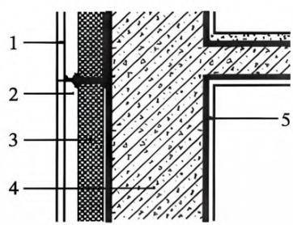  
1—外装饰层；2—通风空气层；3—保温层；4—现浇混凝土剪力墙；5—内墙面刮腻子

$$
\begin{array}{r l} & \lambda_ {2} = 0. 9 5 2 \mathrm{W/(m} \cdot \mathrm{K)}, \delta_ {2} = 0. 0 5 \mathrm{m}, \rho_ {2} = 1. 1 6 \mathrm {kg/ m^ {3}}, \\ & c _ {2} = 1. 1 0 3 \mathrm{kJ/(kg} \cdot \mathrm{K)}; \end{array}
$$

$$
\begin{array}{r l} & \lambda_ {1} = 1. 1 \mathrm{W/(m·K)}, \delta_ {1} = 0. 0 2 \mathrm{m}, \rho_ {1} = 1 9 0 0 \mathrm {kg/ m^ {3}}, c _ {1} = \\ & 1. 0 5 \mathrm{kJ/(kg·K)}; \end{array}
$$

图8.2-2 墙体构造

$$
a _ {\mathrm{in}} = 8. 7 \mathrm{W} / (\mathrm{m} ^ {2} \cdot \mathrm{K}), a _ {\mathrm{out}} = 1 9. 0 \mathrm{W} / (\mathrm{m} ^ {2} \cdot \mathrm{K}) 。
$$

其中， $\lambda$ 为导热系数； $\delta$ 为厚度； $\rho$ 为干密度； $c$ 为比热容； $a_{\mathrm{in}}$ 为内表面换热系数；

$a_{out}$ 为外表面换热系数。

解：

1. 室外综合温度计算。

由式（7.2-33），计算出该地区南向的逐时室外综合温度，如表8.2-3所示。

某地区南向综合温度  
表8.2-3

<table><tr><td>时刻</td><td>0</td><td>1</td><td>2</td><td>3</td><td>4</td><td>5</td><td>6</td><td>7</td><td>8</td><td>9</td><td>10</td><td>11</td></tr><tr><td>气温(°C)</td><td>26.98</td><td>26.75</td><td>26.45</td><td>26.23</td><td>26.08</td><td>26.53</td><td>27.50</td><td>28.70</td><td>29.83</td><td>30.80</td><td>31.78</td><td>32.6</td></tr><tr><td>太阳辐射( $W/m^{2}$ )</td><td>0.0</td><td>0.0</td><td>0.0</td><td>0.0</td><td>0.0</td><td>0.0</td><td>52.0</td><td>83.0</td><td>131.0</td><td>258.0</td><td>361.0</td><td>424.0</td></tr><tr><td>室外综合温度(°C)</td><td>26.98</td><td>26.75</td><td>26.45</td><td>26.23</td><td>26.08</td><td>26.53</td><td>29.46</td><td>31.82</td><td>34.76</td><td>40.51</td><td>45.36</td><td>48.56</td></tr><tr><td>时刻</td><td>12</td><td>13</td><td>14</td><td>15</td><td>16</td><td>17</td><td>18</td><td>19</td><td>20</td><td>21</td><td>22</td><td>23</td></tr><tr><td>气温(°C)</td><td>33.20</td><td>33.50</td><td>33.43</td><td>32.83</td><td>32.53</td><td>31.70</td><td>30.65</td><td>29.60</td><td>28.85</td><td>28.33</td><td>27.88</td><td>27.65</td></tr><tr><td>太阳辐射( $W/m^{2}$ )</td><td>448.0</td><td>424.0</td><td>361.0</td><td>258.0</td><td>131.0</td><td>83.0</td><td>52.0</td><td>0.0</td><td>0.0</td><td>0.0</td><td>0.0</td><td>0.0</td></tr><tr><td>室外综合温度(°C)</td><td>50.06</td><td>49.46</td><td>47.01</td><td>42.53</td><td>37.46</td><td>34.82</td><td>32.61</td><td>29.60</td><td>28.85</td><td>28.33</td><td>27.88</td><td>27.65</td></tr></table>

根据高等数学调和分析方法，计算各项系数，室外综合温度的2阶傅里叶级数表达公式为：

$$
T _ {\tau} (t) = 3 4. 4 + 1 0. 9 2 \cos (1 5 t - 1 8 8. 2) + 4. 2 \cos (3 0 t - 0. 0 2)
$$

**2. 墙体的衰减**

墙体的衰减计算理论公式，适用于软件求解。此处示例采用布罗维尔简化公式计算。注意多层围护结构应按从内到外的顺序计算。

$$
\nu = 0. 9 \mathrm{e} ^ {\frac {\sum R _ {k} S _ {k}}{\sqrt {2}}} \left(\frac {S _ {1} + \alpha_ {n}}{S _ {1} + Y _ {1}}\right) \left(\frac {S _ {2} + Y _ {1}}{S _ {2} + Y _ {2}}\right) \dots \left(\frac {S _ {n} Y _ {n - 1}}{S _ {n} + Y _ {n}}\right) \left(\frac {\alpha_ {\text { out }} + Y _ {n}}{\alpha_ {\text { out }}}\right)\tag{8.2-14}
$$

式中 $R_{k}$ ， $S_{k}$ ——各材料层的热阻， $(\mathrm{m}^{2} \cdot \mathrm{K})/\mathrm{W}$ 和蓄热系数， $\mathrm{W}/(\mathrm{m}^{2} \cdot \mathrm{K})$ ， $S_{k}=$

$$
\sqrt {\frac {2 \pi c _ {k} \rho_ {k} \lambda_ {k}}{3 . 6 z}} (\mathrm{z} \text {为波动周期});
$$

$a_{in}$ ， $a_{out}$ ——内、外表面的换热系数， $W/(m^{2}\cdot K)$ ;

Y——材料层表面蓄热系数， $W/(m^{2} \cdot K)$ 。

一阶谐波（周期 $Z = 24\mathrm{h}$ ），各材料层逐层计算：

$$
R _ {1} = \frac {\delta_ {1}}{\lambda_ {1}} = \frac {0 . 0 1 5}{0 . 8 1 4} = 0. 0 1 8 (\mathrm{m} ^ {2} \cdot \mathrm{K/W})
$$

$$
S _ {1, 1} = \sqrt {\frac {2 \pi c _ {1} \rho_ {1} \lambda_ {1}}{3 . 6 z _ {1}}} = \sqrt {\frac {2 \times 3 . 1 4 \times 0 . 8 3 7 \times 1 6 0 0 \times 0 . 8 1 4}{3 . 6 \times 2 4}} = 8. 9 0 2 [ \mathrm{W/(m} ^ {2} \cdot \mathrm{K)} ]
$$

$$
D _ {1} = R _ {1} S _ {1. 1} = 0. 0 1 8 \times 8. 9 0 4 = 0. 1 6 4
$$

$$
Y _ {1, 1} = \frac {R _ {1} S _ {1 , 1} ^ {2} + a _ {n}}{1 + a _ {n} R _ {1}} = \frac {0 . 0 1 8 \times 8 . 9 0 4 ^ {2} + 8 . 7}{1 + 8 . 7 \times 0 . 0 1 8} = 8. 7 5 6 [ \mathrm {W / (m^ {2} \cdot K)} ]
$$

$$
R _ {2} = \frac {\delta_ {2}}{\lambda_ {2}} = \frac {0 . 0 2}{0 . 9 9 5} = 0. 0 2 0 [ (\mathrm{m} ^ {2} \cdot \mathrm{K}) / \mathrm{W} ]
$$

$$
S _ {2, 1} = \sqrt {\frac {2 \times 3 . 1 4 \times 0 . 8 7 9 \times 1 0 0 0 \times 0 . 9 9 5}{2 4 \times 3 . 6}} = 7. 9 7 3 [ \mathrm{W/(m} ^ {2} \cdot \mathrm{K)} ]
$$

$$
D _ {2} = R _ {2} S _ {2. 1} = 0. 2 0 1 \times 7. 9 7 5 = 1. 6 0 3
$$

$$
Y _ {2. 1} = S _ {2. 1} = 7. 9 7 5 \left[ \mathrm{W} / (\mathrm{m} ^ {2} \cdot \mathrm{K}) \right]
$$

$$
R _ {3} = \frac {\delta_ {3}}{\lambda_ {3}} = \frac {0 . 0 9 5}{0 . 0 5 8} = 1. 6 3 8 (\mathrm{m} ^ {2} \cdot \mathrm{K/W})
$$

$$
S _ {3, 1} = \sqrt {\frac {2 \times 3 . 1 4 \times 0 . 7 5 4 \times 1 0 0 \times 0 . 0 5 8}{2 4 \times 3 . 6}} = 0. 5 6 4 [ \mathrm{W/(m} ^ {2} \cdot \mathrm{K)} ]
$$

$$
D _ {3} = R _ {3} S _ {3. 1} = 1. 6 3 8 \times 0. 5 6 4 = 0. 9 2 4
$$

$$
Y _ {3, 1} = \frac {Y _ {2 , 1} + R _ {3} S _ {3 , 1} ^ {2}}{1 + R _ {3} Y _ {2 , 1}} = \frac {7 . 9 7 5 + 1 . 6 3 8 \times 0 . 5 6 4 ^ {2}}{1 + 1 . 6 3 8 \times 7 . 9 7 5} = 0. 6 0 4 [ \mathrm{W/(m} ^ {2} \cdot \mathrm{K)} ]
$$

空气间层热阻 $R_{4}=0.15\ (m^{2}\cdot K)/W$ ;

空气间层蓄热系数 $S_{4,1}=0\mathrm{W}/(\mathrm{m}^{2}\cdot\mathrm{K})$ 。

$$
D _ {4} = R _ {4} S _ {4. 1} = 0. 1 5 \times 0 = 0
$$

$$
Y _ {4, 1} = \frac {Y _ {3 , 1} + R _ {4} S _ {4 , 1} ^ {2}}{1 + R _ {4} Y _ {3 , 1}} = \frac {0 . 6 0 4 + 0 . 1 5 \times 0 ^ {2}}{1 + 0 . 1 5 \times 0 . 6 0 4} = 0. 5 5 4 [ \mathrm{W/(m} ^ {2} \cdot \mathrm{K)} ]
$$

$$
R _ {5} = \frac {\delta_ {5}}{\lambda_ {5}} = \frac {0 . 0 2}{1 . 1} = 0. 0 1 8 (\mathrm{m} ^ {2} \cdot \mathrm{K/W})
$$

$$
S _ {5, 1} = \sqrt {\frac {2 \times 3 . 1 4 \times 1 . 0 5 \times 1 9 0 0 \times 1 . 1}{2 4 \times 3 . 6}} = 1 2. 6 3 0 [ \mathrm{W/(m} ^ {2} \cdot \mathrm{K)} ]
$$

$$
D _ {5} = R _ {5} S _ {5. 1} = 0. 0 1 8 \times 1 2. 6 3 3 = 0. 2 3
$$

$$
\begin{array}{r l} Y _ {5, 1} & = \frac {Y _ {4 , 1} + R _ {5} S _ {5 , 1} ^ {2}}{1 + R _ {5} Y _ {4 , 1}} = \frac {0 . 5 5 4 + 0 . 0 1 8 \times 1 2 . 6 3 3 ^ {2}}{1 + 0 . 0 1 8 \times 0 . 5 5 4} = 3. 4 2 1 [ \mathrm {W / (m^ {2} \cdot K)} ] \\ D & = \sum R _ {\mathrm{i}} S _ {\mathrm{i}} = 0. 1 6 4 + 1. 6 0 3 + 0. 9 2 4 + 0 + 0. 2 3 = 2. 9 2 \end{array}
$$

一阶谐波的衰减倍数：

$$
\begin{array}{r l} \nu_ {1} & = 0. 9 \mathrm{e} ^ {\frac {2 . 9 2}{\sqrt {2}}} \times \frac {8 . 9 0 2 + 8 . 7}{8 . 9 0 2 + 8 . 7 5 6} \times \frac {7 . 9 7 5 + 8 . 7 5 6}{7 . 9 7 5 + 7 . 9 7 3} \times \frac {0 . 5 6 4 + 7 . 9 7 3}{0 . 5 6 4 + 0 . 6 0 4} \times \frac {0 + 0 . 6 0 4}{0 + 0 . 5 5 4} \times \frac {1 2 . 6 3 0 + 0 . 5 5 4}{1 2 . 6 3 0 + 3 . 4 2 1} \\ & \times \frac {1 9 . 0 + 3 . 4 2 1}{1 9 . 0} = 5 7. 3 5 3 \end{array}
$$

二阶谐波（周期 $Z = 12 \mathrm{~h}$ ），各材料层逐层计算：

$$
\begin{array}{r l} S _ {1, 2} = & \sqrt {\frac {2 \pi c _ {1} \rho_ {1} \lambda_ {1}}{3 . 6 z _ {2}}} = \sqrt {\frac {2 \times 3 . 1 4 \times 0 . 8 3 7 \times 1 6 0 0 \times 0 . 8 1 4}{3 . 6 \times 1 2}} = 1 2. 5 9 2 [ \mathrm {W / (m^ {2} \cdot K)} ] \\ & D _ {1} = R _ {1} S _ {1, 1} = 0. 0 1 8 \times 1 2. 5 9 2 = 0. 2 3 2 \end{array}
$$

$$
Y _ {1, 2} = \frac {R _ {1} S _ {1 , 2} ^ {2} + a _ {n}}{1 + a _ {n} R _ {1}} = \frac {0 . 0 1 8 \times 1 2 . 5 9 2 ^ {2} + 8 . 7}{1 + 8 . 7 \times 0 . 0 1 8} = 1 0. 0 1 6 [ \mathrm {W / (m^ {2} \cdot K)} ]
$$

同理计算：

$$
\begin{array}{r l} S _ {2, 2} & = 1 1. 2 7 9 \mathrm {W / (m^ {2} \cdot K)} \\ D _ {2} & = 2. 2 6 7 \\ Y _ {2, 2} & = 1 1. 2 7 9 \mathrm {W / (m^ {2} \cdot K)} \\ S _ {3, 2} & = 0. 7 9 8 \mathrm {W / (m^ {2} \cdot K)} \\ D _ {3} & = 1. 3 0 6 \end{array}
$$

$$
\begin{array}{r l} & Y _ {3, 2} = 0. 7 9 8 \mathrm{W} / (\mathrm{m} ^ {2} \cdot \mathrm{K}) \\ & S _ {4, 2} = 0 \mathrm{W} / (\mathrm{m} ^ {2} \cdot \mathrm{K}) \\ & D _ {4} = 0 \\ & Y _ {4, 2} = 0. 7 1 2 \mathrm{W} / (\mathrm{m} ^ {2} \cdot \mathrm{K}) \\ & S _ {5, 2} = 1 7. 8 6 6 \mathrm{W} / (\mathrm{m} ^ {2} \cdot \mathrm{K}) \\ & D _ {5} = 0. 3 2 5 \\ & Y _ {5, 2} = 6. 4 3 2 \mathrm{W} / (\mathrm{m} ^ {2} \cdot \mathrm{K}) \\ & D = \sum R _ {i} S _ {i} = 0. 2 3 2 + 2. 2 6 7 + 1. 3 0 6 + 0 + 0. 3 2 5 = 4. 1 3 0 \end{array}
$$

二阶谐波的衰减倍数：

$$
\begin{array}{r l} \nu_ {2} & = 0. 9 \mathrm{e} ^ {\frac {4 . 1 3}{\sqrt {2}}} \times \frac {1 2 . 5 9 2 + 8 . 7}{1 2 . 5 9 2 + 1 0 . 0 1 6} \times \frac {1 1 . 2 7 9 + 1 0 . 0 1 6}{1 1 . 2 7 9 + 1 1 . 2 7 9} \times \frac {0 . 7 9 8 + 1 1 . 2 7 9}{0 . 7 9 8 + 0 . 7 9 8} \times \frac {0 + 0 . 7 9 8}{0 + 0 . 7 1 2} \\ & \times \frac {1 7 . 8 6 6 + 0 . 7 1 2}{1 7 . 8 6 6 + 6 . 4 3 2} \times \frac {1 9 . 0 + 6 . 4 3 2}{1 9 . 0} = 1 2 8. 7 7 2 \end{array}
$$

3. 墙体的延迟

墙体延迟近似计算公式：

$$
\epsilon = 4 0. 5 \sum R S - \arctan \frac {1}{1 + \frac {\sqrt {2} S _ {1}}{a _ {\mathrm{in}}}} + \arctan \frac {1}{1 + \frac {\sqrt {2} a _ {\mathrm{out}}}{S _ {\mathrm{n}}}}\tag{8. 2-15}
$$

一阶谐波延迟：

$$
\begin{array}{l} \epsilon_ {1} = 4 0. 5 \times (0. 1 6 4 + 1. 6 0 3 + 0. 9 2 4 + 0 + 0. 2 3) - \arctan \frac {1}{1 + \frac {\sqrt {2} \times 8 . 9 0 4}{8 . 7}} \\ + \arctan \frac {1}{1 + \frac {\sqrt {2} \times 1 9 . 0}{1 2 . 6 3 3}} = 1 1 3. 6 (^ {\circ}) \end{array}
$$

二阶谐波延迟：

$$
\begin{array}{r l} \varepsilon_ {2} & = 4 0. 5 \times (0. 2 3 2 + 2. 2 6 7 + 1. 3 0 6 + 0 + 0. 3 2 5) - \arctan \frac {1}{1 + \frac {\sqrt {2} \times 1 2 . 5 9 2}{8 . 7}} \\ & + \arctan \frac {1}{1 + \frac {\sqrt {2} \times 1 9 . 0}{1 7 . 8 6 6}} = 1 7 1. 0 (^ {\circ}) \end{array}
$$

4. 墙体得热量

$$
\begin{array}{r l} q & = K (\overline {{T _ {\mathrm{e}}}} - T _ {\mathrm{a}}) + a _ {\text {in}} \frac {\Delta T _ {e \cdot 1}}{\nu_ {1}} \cos (\omega_ {1} t - \varphi_ {1} - \epsilon_ {1}) + a _ {\text {in}} \frac {\Delta T _ {e \cdot 2}}{\nu_ {2}} \cos (\omega_ {2} t - \varphi_ {2} - \epsilon_ {2}) \\ & = 0. 5 \times (3 4. 4 - 2 6) + 8. 7 \times \frac {1 0 . 9 2}{5 7 . 3 5 3} \cos (1 5 t - 1 8 8. 2 - 1 1 8) \\ & + 8. 7 \times \frac {4 . 2}{1 2 8 . 7 7 2} \cos (3 0 t - 0. 0 2 - 1 6 8) \\ & = 4. 2 + 1. 6 6 \cos (1 5 t - 3 0 6. 2) + 0. 2 8 \cos (3 0 t - 1 6 8. 0 2) \end{array}
$$

**5. 冷负荷**

对于南向外墙得热， $\beta_{d}=0.37,\quad\beta_{f}=0.63$ 。

(1) 对流部分:

$$
\begin{array}{r l} \mathrm{CLQ} _ {\mathrm{d}} & = \beta_ {\mathrm{d}} q \\ & = 0. 3 7 q = 0. 3 7 (4. 2 + 1. 6 6 \cos (1 5 t - 3 0 6. 2) + 0. 2 8 \cos (3 0 t - 1 6 8. 0 2)) \\ & = 1. 5 5 + 0. 6 1 \cos (1 5 t - 3 0 6. 2) + 0. 1 \cos (3 0 t - 1 6 8. 0 2) \end{array}
$$

(2) 辐射部分:

1) 稳定传热中的辐射部分:

$$
\begin{array}{r l} \mathrm{CL} \overline {{Q}} _ {\mathrm{f}} & = \beta_ {\mathrm{f}} \overline {{q}} = 0. 6 3 \times K (T _ {\mathrm{e}} - T _ {\mathrm{a}}) \\ & = 0. 6 3 \times 0. 5 (3 4. 4 - 2 6) \\ & = 2. 6 5 (\mathbf {W} / \mathbf {m} ^ {2}) \end{array}
$$

2) 不稳定传热中的辐射部分: 六面体的房间, 受到周期性的辐射热扰, 经过衰减与延迟, 向房间内释放周期性的热量。房间的放热衰减与延迟与六面体各自的放热衰减和放热延迟有关, 还与各自接受的辐射扰量比例有关。设房间室内的楼面、顶棚和内墙的辐射热分配系数 $P_{j}$ 及其辐射的放热特性 $\nu_{\mathrm{f}, j} 、 \varepsilon_{\mathrm{f}, j}$ (取二阶谐波) 如表 8.2-4 所示。

房间放热特性表  
表8.2-4

<table><tr><td rowspan="2">结构名称</td><td rowspan="2"> $P_j$ </td><td colspan="2">一阶谐波</td><td colspan="2">二阶谐波</td></tr><tr><td> $\nu_{f,j,1}$ </td><td> $\epsilon_{f,j,1}$ </td><td> $\nu_{f,j,2}$ </td><td> $\epsilon_{f,j,2}$ </td></tr><tr><td>楼面</td><td>0.2</td><td>1.39</td><td>22.3</td><td>1.65</td><td>29.2</td></tr><tr><td>顶棚</td><td>0.2</td><td>1.89</td><td>40.1</td><td>2.82</td><td>38.4</td></tr><tr><td>内墙</td><td>0.6</td><td>1.25</td><td>28.6</td><td>1.70</td><td>39.0</td></tr></table>

一阶谐波（周期 $Z = 24 \mathrm{~h}$ ）的放热衰减与延迟：

$$
\begin{array}{r l} G _ {1, 1} & = \sum_ {i = j} ^ {3} \cdot \frac {P _ {j}}{\nu_ {\mathrm{f} , j , 1}} \cos \varepsilon_ {\mathrm{f}, j, 1} = \frac {0 . 2}{1 . 3 9} \cos 2 2. 3 + \frac {0 . 2}{1 . 8 9} \cos 4 0. 1 + \frac {0 . 6}{1 . 2 5} \cos 2 8. 6 = 0. 6 3 5 \\ G _ {2, 1} & = \sum_ {i = j} ^ {3} \frac {P _ {j}}{\nu_ {\mathrm{f} , j , 1}} \sin \varepsilon_ {\mathrm{f}, j, 1} = \frac {0 . 2}{1 . 3 9} \sin 2 2. 3 + \frac {0 . 2}{1 . 8 9} \sin 4 0. 1 + \frac {0 . 6}{1 . 2 5} \sin 2 8. 6 = 0. 3 5 3 \\ \mu_ {1} & = \frac {1}{\sqrt {G _ {1 , 1} ^ {2} + G _ {2 , 1} ^ {2}}} = \frac {1}{\sqrt {0 . 6 3 5 ^ {2} + 0 . 3 5 3 ^ {2}}} = 1. 3 7 6 \\ \varepsilon_ {1} ^ {\prime} & = \arctan \frac {G _ {2 , 1}}{G _ {1 , 2}} = \arctan \frac {0 . 3 5 3}{0 . 6 3 5} = 2 9 (^ {\circ}) \end{array}
$$

二阶谐波（周期 $Z = 12\mathrm{h}$ ）的放热衰减与延迟：

$$
G _ {1, 2} = \sum_ {i = j} ^ {3} \frac {P _ {j}}{\nu_ {\mathrm{f} , j , 2}} \cos \varepsilon_ {\mathrm{f}, j, 2} = \frac {0 . 2}{1 . 6 5} \cos 2 9. 2 + \frac {0 . 2}{2 . 8 2} \cos 3 8. 4 + \frac {0 . 6}{1 . 7 0} \cos 3 9. 0 = 0. 4 3 6
$$

$$
G _ {2. 2} = \sum_ {i = j} ^ {3} \frac {P _ {j}}{\nu_ {\mathrm{f} , j , 2}} \sin \epsilon_ {\mathrm{f}, j, 2} = \frac {0 . 2}{1 . 6 5} \sin 2 9. 2 + \frac {0 . 2}{2 . 8 2} \sin 3 8. 4 + \frac {0 . 6}{1 . 7 0} \sin 3 9. 0 = 0. 3 2 5
$$

$$
\mu_ {2} = \frac {1}{\sqrt {G _ {1 , 2} ^ {2} + G _ {2 , 2} ^ {2}}} = \frac {1}{\sqrt {0 . 4 3 6 ^ {2} + 0 . 3 2 5 ^ {2}}} = 1. 8 3 9
$$

$$
\epsilon_ {2} ^ {\prime} = \arctan \frac {G _ {2 . 2}}{G _ {1 . 2}} = \arctan \frac {0 . 3 2 5}{0 . 4 3 6} = 3 6. 7 (^ {\circ})
$$

辐射冷负荷为:

$$
\begin{array}{r l} \mathrm{CL} \Delta Q _ {\mathrm{f}} & = \beta_ {\mathrm{f}} a _ {n} \sum_ {n = 1} ^ {2} \frac {\Delta T _ {\mathrm{c} , n}}{\nu_ {n} \mu_ {n}} \cos (\omega_ {n} t - \varphi_ {n} - \epsilon_ {n} - \epsilon_ {n} ^ {\prime}) \\ & = 0. 6 3 \times 8. 7 \times \frac {1 0 . 9 2}{5 7 . 3 5 3 \times 1 . 3 7 6} \cos (1 5 t - 1 8 8. 2 - 1 1 8 - 2 9) \\ & + 0. 6 3 \times 8. 7 \times \frac {4 . 2}{1 2 8 . 7 7 2 \times 1 . 8 3 9} \cos (3 0 t - 0. 0 2 - 1 6 8 - 3 6. 7) \\ & = 0. 7 5 8 \cos (1 5 t - 3 3 5. 2) + 0. 0 9 7 \cos (3 0 t - 2 0 4. 7) \end{array}
$$

(3) 空调总冷负荷:

按以上各式进行逐时冷负荷计算，结果如表 8.2-5 所示。

冷负荷汇总表（单位： $\mathbf{W} / \mathbf{m}^2$ ）

<table><tr><td colspan="13">冷负荷汇总表(单位:W/m2) 表8.2-5</td></tr><tr><td>时刻</td><td>1:00</td><td>2:00</td><td>3:00</td><td>4:00</td><td>5:00</td><td>6:00</td><td>7:00</td><td>8:00</td><td>9:00</td><td>10:00</td><td>11:00</td><td>12:00</td></tr><tr><td> $CLQ_{d}$ </td><td>1.81</td><td>1.7</td><td>1.58</td><td>1.48</td><td>1.37</td><td>1.26</td><td>1.16</td><td>1.06</td><td>0.97</td><td>0.93</td><td>0.92</td><td>0.98</td></tr><tr><td> $CLQ_{f}$ </td><td>2.65</td><td>2.65</td><td>2.65</td><td>2.65</td><td>2.65</td><td>2.65</td><td>2.65</td><td>2.65</td><td>2.65</td><td>2.65</td><td>2.65</td><td>2.65</td></tr><tr><td> $CL\Delta Q_{f}$ </td><td>0.6</td><td>0.49</td><td>0.36</td><td>0.22</td><td>0.08</td><td>-0.07</td><td>-0.23</td><td>-0.39</td><td>-0.54</td><td>-0.67</td><td>-0.76</td><td>-0.8</td></tr><tr><td>CLQ</td><td>5.06</td><td>4.83</td><td>4.59</td><td>4.35</td><td>4.1</td><td>3.84</td><td>3.58</td><td>3.32</td><td>3.08</td><td>2.91</td><td>2.81</td><td>2.83</td></tr><tr><td>时刻</td><td>13:00</td><td>14:00</td><td>15:00</td><td>16:00</td><td>17:00</td><td>18:00</td><td>19:00</td><td>20:00</td><td>21:00</td><td>22:00</td><td>23:00</td><td>24:00</td></tr><tr><td> $CLQ_{d}$ </td><td>1.09</td><td>1.26</td><td>1.45</td><td>1.66</td><td>1.86</td><td>2.03</td><td>2.14</td><td>2.19</td><td>2.19</td><td>2.13</td><td>21.04</td><td>1.93</td></tr><tr><td> $CLQ_{f}$ </td><td>2.65</td><td>2.65</td><td>2.65</td><td>2.65</td><td>2.65</td><td>2.65</td><td>2.65</td><td>2.65</td><td>2.65</td><td>2.65</td><td>2.65</td><td>2.65</td></tr><tr><td> $CL\Delta Q_{f}$ </td><td>-0.78</td><td>-0.68</td><td>-0.52</td><td>-0.3</td><td>-0.06</td><td>0.19</td><td>0.41</td><td>0.58</td><td>0.7</td><td>0.75</td><td>0.75</td><td>0.69</td></tr><tr><td>CLQ</td><td>2.97</td><td>3.23</td><td>3.59</td><td>4.01</td><td>4.45</td><td>4.86</td><td>5.2</td><td>5.42</td><td>5.54</td><td>5.53</td><td>5.44</td><td>5.27</td></tr></table>

谐波法反应法的难点在于围护结构和房间的衰减与延迟的计算，手工计算难度非常大。为了便于使用，最初用软件计算出国内主要城市、常用典型围护结构的数据，制作成表格，供设计师查表计算。

根据谐波反应法编写软件，应采用严格的求解方程，傅立叶展开级数取12阶，可以适用于任意围护结构、任意地点的计算。该计算方法简化较少，不局限于具体的围护结构和气象参数，因此有较强的适用性。

## 8.3 辐射时间序列法

辐射时间序列法是热平衡方法的一种简化，它可以有效替代以前的传递函数法、冷负荷系数法等计算方法。该方法不需要求解大量的方程及迭代计算，直接查表计算，用传导时间系数（Conduction Time Factors, CTS）计算各项得热，得热中的辐射成分，用辐射时间系数（Radiant Time Factors, RTF）计算其负荷，用Excel电子表格即可完成，但它只适用于设计日负荷计算。

辐射时间序列法计算的假设条件是：

1. 室外气象参数、内扰等都是周期性的，以 24h 为周期反复循环。

2. 通过围护结构外表面的传导得热有延迟。

3. 辐射得热转换为负荷有延迟。

4. 区域内空气温度恒定不变。

辐射时间序列法的计算过程如下（图 8.3-1）：

1. 计算各外表面的逐时太阳辐射强度。

2. 计算各外表面的逐时综合计算温度。

3. 计算各窗户的逐时辐射得热、逐时传导得热。

4. 采用 CTS 计算外墙、屋面的逐时传导得热。

5. 确定人员、照明、设备等内扰得热。

6. 确定渗透得热。

7. 把所有的得热分为对流和辐射两部分。

8. 对流部分直接转换为冷负荷。

9. 采用 RTS 计算辐射部分引起的逐时冷负荷。

10. 对流部分冷负荷与辐射部分冷负荷逐时叠加，得到逐时总冷负荷。

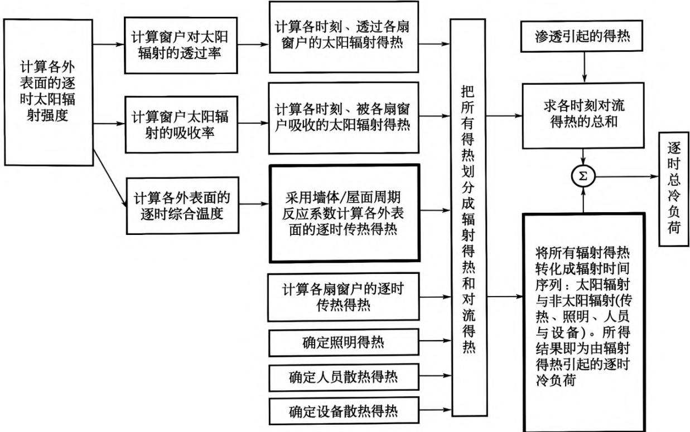  
图8.3-1 辐射时间序列法计算过程

### 8.3.1 室外空气综合温度

室外空气综合温度由室外空气温度、天空辐射模型计算得出，参照式（7.2-33）。

### 8.3.2 通过墙体、屋顶的得热量及其形成的冷负荷

外墙、屋顶的传导热量：

$$
q _ {i, \theta - n} = K A (t _ {\mathrm{se}, \theta - n} - t _ {\mathrm{rc}})\tag{8. 3-1}
$$

式中 $q_{i,\theta-n}$ ——n 小时前的传导热量，W；

K——围护结构总的传热系数， $W/(m^{2} \cdot K)$ ;

A——围护结构面积， $m^{2}$ ;

$t_{se,\theta-n}$ ——n 小时前的综合作用温度，℃；

$t_{rc}$ ——室内设定温度，℃。

通过外墙、屋顶的传导得热，可以采用传导时间系数，由当前及以前 23 个小时的传导热输入计算得出：

$$
q _ {\theta} = c _ {0} q _ {i, \theta} + c _ {1} q _ {1, \theta - 1} + c _ {2} q _ {i, \theta - 2} + c _ {3} q _ {i, \theta - 3} + \dots \dots + c _ {2 3} q _ {i, \theta - 2 3}\tag{8. 3-2}
$$

式中

$q_{\theta}$ ——围护结构逐时得热，W；

$q_{i,\theta}$ ——当前时刻的热输入，W；

$q_{i,\theta-n}$ ——n 小时前的热输入，W；

$c_{0}$ ， $c_{1}$ ，…， $c_{23}$ ——传导时间系数，%。

传导时间系数是一组系数（24 个），事先根据热平衡方法或传递函数法算出。ASHRAE 手册中给出了 35 种外墙、19 种屋顶的传导时间系数，本书选取了一部分，如表 8.3-1 所示。

墙体、屋顶的传导时间系数表  
表8.3-1

<table><tr><td rowspan="2">墙体编号</td><td colspan="9">预制和现浇的混凝土墙</td></tr><tr><td>27</td><td>28</td><td>29</td><td>30</td><td>31</td><td>32</td><td>33</td><td>34</td><td>35</td></tr><tr><td>传热系数[W/(m2·K)]</td><td>0.673</td><td>0.418</td><td>0.434</td><td>0.65</td><td>0.387</td><td>0.467</td><td>0.434</td><td>0.266</td><td>3.122</td></tr><tr><td>总热阻(m2·K/W)</td><td>1.5</td><td>2.4</td><td>2.3</td><td>1.5</td><td>2.6</td><td>2.1</td><td>2.3</td><td>3.8</td><td>0.3</td></tr><tr><td>质量(kg/m2)</td><td>143.9</td><td>144.6</td><td>262.5</td><td>291.8</td><td>274.7</td><td>488.1</td><td>469.9</td><td>698.9</td><td>683.2</td></tr><tr><td>热容量[kJ/(m2·K)]</td><td>124.7</td><td>124.7</td><td>220.8</td><td>247.3</td><td>233</td><td>411.5</td><td>425.2</td><td>631.6</td><td>615.2</td></tr><tr><td>时刻</td><td colspan="9">传导时间系数(%)</td></tr><tr><td>0:00</td><td>1</td><td>0</td><td>1</td><td>2</td><td>1</td><td>3</td><td>1</td><td>2</td><td>1</td></tr><tr><td>1:00</td><td>10</td><td>8</td><td>1</td><td>2</td><td>2</td><td>3</td><td>2</td><td>2</td><td>2</td></tr><tr><td>2:00</td><td>20</td><td>18</td><td>3</td><td>3</td><td>3</td><td>4</td><td>5</td><td>3</td><td>4</td></tr><tr><td>3:00</td><td>18</td><td>18</td><td>6</td><td>5</td><td>6</td><td>5</td><td>8</td><td>3</td><td>7</td></tr><tr><td>4:00</td><td>14</td><td>14</td><td>8</td><td>6</td><td>7</td><td>6</td><td>9</td><td>5</td><td>8</td></tr><tr><td>5:00</td><td>10</td><td>11</td><td>9</td><td>6</td><td>8</td><td>6</td><td>9</td><td>5</td><td>8</td></tr><tr><td>6:00</td><td>7</td><td>8</td><td>9</td><td>6</td><td>8</td><td>6</td><td>8</td><td>6</td><td>8</td></tr><tr><td>7:00</td><td>5</td><td>6</td><td>9</td><td>6</td><td>7</td><td>5</td><td>7</td><td>6</td><td>8</td></tr><tr><td>8:00</td><td>4</td><td>4</td><td>8</td><td>6</td><td>7</td><td>5</td><td>6</td><td>6</td><td>7</td></tr><tr><td>9:00</td><td>3</td><td>3</td><td>7</td><td>6</td><td>6</td><td>5</td><td>6</td><td>6</td><td>6</td></tr><tr><td>10:00</td><td>2</td><td>2</td><td>7</td><td>5</td><td>6</td><td>5</td><td>5</td><td>6</td><td>6</td></tr><tr><td>11:00</td><td>2</td><td>2</td><td>6</td><td>5</td><td>5</td><td>5</td><td>5</td><td>5</td><td>5</td></tr><tr><td>12:00</td><td>1</td><td>2</td><td>5</td><td>5</td><td>5</td><td>4</td><td>4</td><td>5</td><td>4</td></tr><tr><td>时刻</td><td colspan="9">传导时间系数(%)</td></tr><tr><td>13:00</td><td>1</td><td>1</td><td>4</td><td>5</td><td>4</td><td>4</td><td>4</td><td>5</td><td>4</td></tr><tr><td>14:00</td><td>1</td><td>1</td><td>4</td><td>4</td><td>4</td><td>4</td><td>3</td><td>4</td><td>4</td></tr><tr><td>15:00</td><td>1</td><td>1</td><td>3</td><td>4</td><td>3</td><td>4</td><td>3</td><td>4</td><td>3</td></tr><tr><td>16:00</td><td>0</td><td>1</td><td>2</td><td>4</td><td>3</td><td>4</td><td>3</td><td>4</td><td>3</td></tr><tr><td>17:00</td><td>0</td><td>0</td><td>2</td><td>3</td><td>3</td><td>4</td><td>2</td><td>4</td><td>3</td></tr><tr><td>18:00</td><td>0</td><td>0</td><td>1</td><td>3</td><td>2</td><td>4</td><td>2</td><td>4</td><td>2</td></tr><tr><td>19:00</td><td>0</td><td>0</td><td>1</td><td>3</td><td>2</td><td>3</td><td>2</td><td>3</td><td>2</td></tr><tr><td>20:00</td><td>0</td><td>0</td><td>1</td><td>3</td><td>2</td><td>3</td><td>2</td><td>3</td><td>2</td></tr><tr><td>21:00</td><td>0</td><td>0</td><td>1</td><td>3</td><td>2</td><td>3</td><td>2</td><td>3</td><td>1</td></tr><tr><td>22:00</td><td>0</td><td>0</td><td>1</td><td>2</td><td>2</td><td>2</td><td>1</td><td>3</td><td>1</td></tr><tr><td>23:00</td><td>0</td><td>0</td><td>1</td><td>2</td><td>2</td><td>2</td><td>1</td><td>3</td><td>1</td></tr><tr><td></td><td>100</td><td>100</td><td>100</td><td>100</td><td>100</td><td>100</td><td>100</td><td>100</td><td>100</td></tr></table>

不同类型的得热，其所含的对流与辐射成分比例不一样，可按表 8.3-2 计算逐时的对流得热与辐射得热。

得热成分表  
表8.3-2

<table><tr><td colspan="2">得热类型</td><td>辐射</td><td>对流</td></tr><tr><td colspan="2">人员(典型办公室条件)</td><td>60%</td><td>40%</td></tr><tr><td rowspan="3">设备</td><td></td><td>10%~80%</td><td>20%~90%</td></tr><tr><td>办公室,有风扇</td><td>10%</td><td>90%</td></tr><tr><td>办公室,无风扇</td><td>30%</td><td>70%</td></tr><tr><td rowspan="2">传导得热</td><td>通过墙体和楼板</td><td>46%</td><td>54%</td></tr><tr><td>通过屋面</td><td>60%</td><td>40%</td></tr></table>

得热中的对流成分，直接转化为负荷。辐射得热部分，可以通过辐射时间系数，由当前及以前23个小时的辐射得热计算得出逐时辐射冷负荷。

$$
Q _ {\mathrm{r}, \theta} = r _ {0} q _ {\mathrm{r}, \theta} + r _ {1} q _ {\mathrm{r}, \theta - 1} + r _ {2} q _ {\mathrm{r}, \theta - 2} + r _ {3} q _ {\mathrm{r}, \theta - 3} + \dots + r _ {2 3} q _ {\mathrm{r}, \theta - 2 3}\tag{8. 3-3}
$$

式中

$Q_{r,\theta}$ ——当前时刻的辐射冷负荷，W；

$q_{r,\theta}$ ——当前时刻的辐射得热，W；

$q_{r,\theta-n}$ ——n 小时前的刻的辐射得热，W；

$r_{0}$ ， $r_{1}$ ，…， $r_{23}$ ——辐射时间系数。

辐射时间系数是一组系数（24个），事先根据热平衡方法算出。ASHRAE手册中给出了部分典型建筑构造的辐射时间系数（表8.3-3），供计算使用。

辐射相关得热的辐射时间系数  
表8.3-3

<table><tr><td rowspan="2">建筑构造类型</td><td colspan="6">轻型构造</td><td colspan="6">中型构造</td><td colspan="6">重型构造</td></tr><tr><td colspan="3">有地毯</td><td colspan="3">无地毯</td><td colspan="3">有地毯</td><td colspan="3">无地毯</td><td colspan="3">有地毯</td><td colspan="3">无地毯</td></tr><tr><td>玻璃占比</td><td>10%</td><td>50%</td><td>90%</td><td>10%</td><td>50%</td><td>90%</td><td>10%</td><td>50%</td><td>90%</td><td>10%</td><td>50%</td><td>90%</td><td>10%</td><td>50%</td><td>90%</td><td>10%</td><td>50%</td><td>90%</td></tr><tr><td>时刻</td><td colspan="18">辐射时间系数</td></tr><tr><td>0:00</td><td>53</td><td>55</td><td>56</td><td>44</td><td>45</td><td>46</td><td>52</td><td>54</td><td>55</td><td>28</td><td>29</td><td>29</td><td>47</td><td>49</td><td>51</td><td>26</td><td>27</td><td>28</td></tr><tr><td>1:00</td><td>17</td><td>17</td><td>17</td><td>19</td><td>20</td><td>20</td><td>16</td><td>16</td><td>15</td><td>15</td><td>15</td><td>15</td><td>11</td><td>12</td><td>12</td><td>12</td><td>13</td><td>13</td></tr><tr><td>2:00</td><td>9</td><td>9</td><td>9</td><td>11</td><td>11</td><td>11</td><td>8</td><td>8</td><td>8</td><td>10</td><td>10</td><td>10</td><td>6</td><td>6</td><td>6</td><td>7</td><td>7</td><td>7</td></tr><tr><td>3:00</td><td>5</td><td>5</td><td>5</td><td>7</td><td>7</td><td>7</td><td>5</td><td>4</td><td>4</td><td>7</td><td>7</td><td>7</td><td>4</td><td>4</td><td>3</td><td>5</td><td>5</td><td>5</td></tr><tr><td>4:00</td><td>3</td><td>3</td><td>3</td><td>5</td><td>5</td><td>5</td><td>3</td><td>3</td><td>3</td><td>6</td><td>6</td><td>6</td><td>3</td><td>3</td><td>3</td><td>4</td><td>4</td><td>4</td></tr><tr><td>5:00</td><td>2</td><td>2</td><td>2</td><td>3</td><td>3</td><td>3</td><td>2</td><td>2</td><td>2</td><td>5</td><td>5</td><td>5</td><td>2</td><td>2</td><td>2</td><td>4</td><td>4</td><td>4</td></tr><tr><td>6:00</td><td>2</td><td>2</td><td>2</td><td>3</td><td>2</td><td>2</td><td>2</td><td>1</td><td>1</td><td>4</td><td>4</td><td>4</td><td>2</td><td>2</td><td>2</td><td>3</td><td>3</td><td>3</td></tr><tr><td>7:00</td><td>1</td><td>1</td><td>1</td><td>2</td><td>2</td><td>2</td><td>1</td><td>1</td><td>1</td><td>4</td><td>3</td><td>3</td><td>2</td><td>2</td><td>2</td><td>3</td><td>3</td><td>3</td></tr><tr><td>8:00</td><td>1</td><td>1</td><td>1</td><td>1</td><td>1</td><td>1</td><td>1</td><td>1</td><td>1</td><td>3</td><td>3</td><td>3</td><td>2</td><td>2</td><td>2</td><td>3</td><td>3</td><td>3</td></tr><tr><td>9:00</td><td>1</td><td>1</td><td>1</td><td>1</td><td>1</td><td>1</td><td>1</td><td>1</td><td>1</td><td>3</td><td>3</td><td>3</td><td>2</td><td>2</td><td>2</td><td>3</td><td>3</td><td>3</td></tr><tr><td>10:00</td><td>1</td><td>1</td><td>1</td><td>1</td><td>1</td><td>1</td><td>1</td><td>1</td><td>1</td><td>2</td><td>2</td><td>2</td><td>2</td><td>2</td><td>2</td><td>3</td><td>3</td><td>3</td></tr><tr><td>11:00</td><td>1</td><td>1</td><td>1</td><td>1</td><td>1</td><td>1</td><td>1</td><td>1</td><td>1</td><td>2</td><td>2</td><td>2</td><td>2</td><td>2</td><td>1</td><td>3</td><td>3</td><td>3</td></tr><tr><td>12:00</td><td>1</td><td>1</td><td>1</td><td>1</td><td>1</td><td>0</td><td>1</td><td>1</td><td>1</td><td>2</td><td>2</td><td>2</td><td>2</td><td>1</td><td>1</td><td>2</td><td>2</td><td>2</td></tr><tr><td>13:00</td><td>1</td><td>1</td><td>0</td><td>1</td><td>0</td><td>0</td><td>1</td><td>1</td><td>1</td><td>2</td><td>2</td><td>2</td><td>2</td><td>1</td><td>1</td><td>2</td><td>2</td><td>2</td></tr><tr><td>14:00</td><td>1</td><td>0</td><td>0</td><td>0</td><td>0</td><td>0</td><td>1</td><td>1</td><td>1</td><td>1</td><td>1</td><td>1</td><td>2</td><td>1</td><td>1</td><td>2</td><td>2</td><td>2</td></tr><tr><td>15:00</td><td>1</td><td>0</td><td>0</td><td>0</td><td>0</td><td>0</td><td>1</td><td>1</td><td>1</td><td>1</td><td>1</td><td>1</td><td>1</td><td>1</td><td>1</td><td>2</td><td>2</td><td>2</td></tr><tr><td>16:00</td><td>0</td><td>0</td><td>0</td><td>0</td><td>0</td><td>0</td><td>1</td><td>1</td><td>1</td><td>1</td><td>1</td><td>1</td><td>1</td><td>1</td><td>1</td><td>2</td><td>2</td><td>2</td></tr><tr><td>17:00</td><td>0</td><td>0</td><td>0</td><td>0</td><td>0</td><td>0</td><td>1</td><td>1</td><td>1</td><td>1</td><td>1</td><td>1</td><td>1</td><td>1</td><td>1</td><td>2</td><td>2</td><td>2</td></tr><tr><td>18:00</td><td>0</td><td>0</td><td>0</td><td>0</td><td>0</td><td>0</td><td>1</td><td>1</td><td>1</td><td>1</td><td>1</td><td>1</td><td>1</td><td>1</td><td>1</td><td>2</td><td>2</td><td>2</td></tr><tr><td>19:00</td><td>0</td><td>0</td><td>0</td><td>0</td><td>0</td><td>0</td><td>0</td><td>0</td><td>0</td><td>1</td><td>1</td><td>1</td><td>1</td><td>1</td><td>1</td><td>2</td><td>2</td><td>2</td></tr><tr><td>20:00</td><td>0</td><td>0</td><td>0</td><td>0</td><td>0</td><td>0</td><td>0</td><td>0</td><td>1</td><td>1</td><td>1</td><td>1</td><td>1</td><td>1</td><td>1</td><td>2</td><td>2</td><td>2</td></tr><tr><td>21:00</td><td>0</td><td>0</td><td>0</td><td>0</td><td>0</td><td>0</td><td>0</td><td>0</td><td>0</td><td>0</td><td>0</td><td>0</td><td>1</td><td>1</td><td>1</td><td>2</td><td>2</td><td>2</td></tr><tr><td>22:00</td><td>0</td><td>0</td><td>0</td><td>0</td><td>0</td><td>0</td><td>0</td><td>0</td><td>0</td><td>0</td><td>0</td><td>0</td><td>1</td><td>1</td><td>1</td><td>2</td><td>1</td><td>1</td></tr><tr><td>23:00</td><td>0</td><td>0</td><td>0</td><td>0</td><td>0</td><td>0</td><td>0</td><td>0</td><td>0</td><td>0</td><td>0</td><td>0</td><td>1</td><td>1</td><td>1</td><td>2</td><td>1</td><td>1</td></tr><tr><td></td><td>100</td><td>100</td><td>100</td><td>100</td><td>100</td><td>100</td><td>100</td><td>100</td><td>100</td><td>100</td><td>100</td><td>100</td><td>100</td><td>100</td><td>100</td><td>100</td><td>100</td><td>100</td></tr></table>

由外窗、照明、设备、人体、渗透等得热形成的冷负荷，其计算过程与此相似，可参阅 ASHRAE 手册等相关文献。

### 8.3.3 辐射时间序列法算例

ASHRAE 手册给出了一个单房间的算例，限于篇幅，此处摘取其一面外墙冷负荷的计算过程，可以加深对辐射时间序列法的了解。

【例 8.3-1】某城市一个房间，室内设计温度为 $23.9^{\circ}C$ ，其南朝向外墙，面积为 $5.77m^{2}$ ，砖墙，传热系数为 $0.44\mathrm{W}/(\mathrm{m}^{2}\cdot\mathrm{K})$ 。

解：计算表格见表8.3-4。

1. 设计日的 24 个时刻值，列入表 8.3-4 第一列。

2. 计算该朝向逐时太阳辐射强度，列入表 8.3-4 第二列。

3. 计算室外空气温度，列入表 8.3-4 第三列。

4. 计算室外综合温度，列入表 8.3-4 第四列。

5. 室内设计温度，列入表 8.3-4 第五列。

6. 计算逐时热输入，列入表 8.3-4 第六列；逐时热输入计算公式见式（8.3-1）：

$$
q _ {i, 1} = 0. 4 4 \times 5. 5 7 \times (2 3. 3 - 2 3. 9) = - 1 (\mathrm{W})
$$

$$
q _ {i, 2} = 0. 4 4 \times 5. 5 7 \times (2 2. 8 - 2 3. 9) = - 3 (\mathrm{W})
$$

$$
q _ {i, 3} = 0. 4 4 \times 5. 5 7 \times (2 2. 4 - 2 3. 9) = - 4 (\mathrm{W})
$$

$$
q _ {i, 4} = 0. 4 4 \times 5. 5 7 \times (2 2. 1 - 2 3. 9) = - 4 (\mathrm{W})
$$

$$
q _ {i, 5} = 0. 4 4 \times 5. 5 7 \times (2 1. 9 - 2 3. 9) = - 5 (\mathrm{W})
$$

$$
q _ {i, 6} = 0. 4 4 \times 5. 5 7 \times (2 2. 6 - 2 3. 9) = - 3 (\mathrm{W})
$$

$$
q _ {i, 7} = 0. 4 4 \times 5. 5 7 \times (2 5. 2 - 2 3. 9) = 3 (\mathrm{W})
$$

$$
q _ {i, 8} = 0. 4 4 \times 5. 5 7 \times (2 9. 0 - 2 3. 9) = 1 2 (\mathrm{W})
$$

$$
q _ {i, 9} = 0. 4 4 \times 5. 5 7 \times (3 2. 7 - 2 3. 9) = 2 1 (\mathrm{W})
$$

$$
q _ {i, 1 0} = 0. 4 4 \times 5. 5 7 \times (3 5. 9 - 2 3. 9) = 2 9 (\mathrm{W})
$$

$$
q _ {i, 1 1} = 0. 4 4 \times 5. 5 7 \times (3 8. 6 - 2 3. 9) = 3 6 (\mathrm{W})
$$

$$
q _ {i, 1 2} = 0. 4 4 \times 5. 5 7 \times (4 0. 8 - 2 3. 9) = 4 1 (\mathrm{W})
$$

$$
q _ {i, 1 3} = 0. 4 4 \times 5. 5 7 \times (5 0. 2 - 2 3. 9) = 6 4 (\mathrm{W})
$$

$$
q _ {i, 1 4} = 0. 4 4 \times 5. 5 7 \times (5 9. 8 - 2 3. 9) = 8 7 (\mathrm{W})
$$

$$
q _ {i, 1 5} = 0. 4 4 \times 5. 5 7 \times (6 5. 9 - 2 3. 9) = 1 0 2 (\mathrm{W})
$$

$$
q _ {i, 1 6} = 0. 4 4 \times 5. 5 7 \times (6 7. 6 - 2 3. 9) = 1 0 7 (\mathrm{W})
$$

$$
q _ {i, 1 7} = 0. 4 4 \times 5. 5 7 \times (6 4. 3 - 2 3. 9) = 9 8 (\mathrm{W})
$$

$$
q _ {i, 1 8} = 0. 4 4 \times 5. 5 7 \times (5 5. 4 - 2 3. 9) = 7 7 (\mathrm{W})
$$

$$
q _ {i, 1 9} = 0. 4 4 \times 5. 5 7 \times (3 9. 5 - 2 3. 9) = 3 8 (\mathrm{W})
$$

$$
q _ {i, 2 0} = 0. 4 4 \times 5. 5 7 \times (2 7. 6 - 2 3. 9) = 9 (\mathrm{W})
$$

$$
q _ {i, 2 1} = 0. 4 4 \times 5. 5 7 \times (2 6. 6 - 2 3. 9) = 6 (\mathrm{W})
$$

$$
q _ {i, 2 2} = 0. 4 4 \times 5. 5 7 \times (2 5. 6 - 2 3. 9) = 4 (\mathrm{W})
$$

$$
q _ {i, 2 3} = 0. 4 4 \times 5. 5 7 \times (2 4. 7 - 2 3. 9) = 2 (\mathrm{W})
$$

$$
q _ {i, 2 4} = 0. 4 4 \times 5. 5 7 \times (2 3. 9 - 2 3. 9) = 0 (\mathrm{W})
$$

7. 查墙体的传导时间系数表，根据墙体构造，1号外墙最为接近，取其传导时间系数，列入表8.3-4第七列。

8. 计算墙体得热。根据式（8.3-2），计算墙体逐时得热，列入表 8.3-4 第八列；例如 15:00 的得热量为：

$$
\begin{array}{r l} q _ {1 5} & = c _ {0} q _ {i, 1 5} + c _ {1} q _ {i, 1 4} + c _ {2} q _ {i, 1 3} + c _ {3} q _ {i, 1 2} + \dots + c _ {2 3} q _ {i, 1 6} \\ & = 0. 1 8 \times 1 0 2 + 0. 5 8 \times 8 7 + 0. 2 0 \times 6 4 + 0. 0 4 \times 4 1 \\ & \quad + 0 \times 3 6 + 0 \times 2 9 + 0 \times 2 1 + 0 \times 1 2 \\ & \quad + 0 \times 3 + 0 \times (- 3) + 0 \times (- 5) + 0 \times (- 4) \end{array}
$$

$$
\begin{array}{r l} & + 0 \times (- 4) + 0 \times (- 3) + 0 \times (- 1) + 0 \times 0 \\ & + 0 \times 2 + 0 \times 4 + 0 \times 6 + 0 \times 9 \\ & + 0 \times 3 8 + 0 \times 7 7 + 0 \times 9 8 + 0 \times 1 0 7 \\ & = 8 3. 3 (\mathbf {W}) \end{array}
$$

9. 查得热成分表。墙体得热，对流成分占 $54\%$ ，辐射成分占 $46\%$ 。对流部分列入表8.3-4第九列，辐射部分列于第十列。其中对流部分直接形成负荷。

例如：

15:00 的对流部分冷负荷为:

$$
Q _ {\mathrm{c}, 1 5} = 8 3. 5 \times 0. 5 4 = 4 5 (\mathrm{W})
$$

15:00 的辐射部分得热量为：

$$
q _ {\mathrm{r}, 1 5} = 8 3. 5 \times 0. 4 6 = 3 8 (\mathrm{W})
$$

10. 查辐射时间系数表，假设房间为中型构造，窗墙比为 $50\%$ ，室内铺地毯，取相应的辐射时间系数列入表8.3-4第十一列。

11. 根据式（8.3-3），计算得热量中辐射部分形成的冷负荷，列入表 8.3-4 第十二列。例如 15:00 的得热量中辐射部分形成的冷负荷为：

$$
\begin{array}{r l} Q _ {r, 1 5} & = r _ {0} q _ {i, 1 5} + r _ {1} q _ {i, 1 4} + r _ {2} q _ {i, 1 3} + r _ {3} q _ {i, 1 2} + \dots + r _ {2 3} q _ {i, 1 6} \\ & = 0. 4 9 \times 0. 4 6 \times 8 4 + 0. 1 7 \times 0. 4 6 \times 6 3 + 0. 0 9 \times 0. 4 6 \times 4 4 \\ & \quad + 0. 0 5 \times 0. 4 6 \times 3 5 + 0. 0 3 \times 0. 4 6 \times 2 8 + 0. 0 2 \times 0. 4 6 \times 2 0 \\ & \quad + 0. 0 2 \times 0. 4 6 \times 1 2 + 0. 0 1 \times 0. 4 6 \times 3 + 0. 0 1 \times 0. 4 6 \times (- 2) \\ & \quad + 0. 0 1 \times 0. 4 6 \times (- 4) + 0. 0 1 \times 0. 4 6 \times (- 4) + 0. 0 1 \times 0. 4 6 \times (- 3) \\ & \quad + 0. 0 1 \times 0. 4 6 \times (- 2) + 0. 0 1 \times 0. 4 6 \times (- 1) + 0. 0 1 \times 0. 4 6 \times 0 \\ & \quad + 0. 0 1 \times 0. 4 6 \times 2 + 0. 0 1 \times 0. 4 6 \times 4 + 0. 0 1 \times 0. 4 6 \times 8 \\ & \quad + 0. 0 1 \times 0. 4 6 \times 1 7 + 0. 0 1 \times 0. 4 6 \times 4 3 + 0 \times 0. 4 6 \times 7 5 \\ & \quad + 0 \times 0. 4 6 \times 9 6 + 0 \times 0. 4 6 \times 1 0 ^ {3} + 0 \times 0.   {4}   {6} \times   {9}   {9} \\ & = {2} {7} (\mathrm{W}) \end{array}
$$

12. 计算墙体总的逐时冷负荷，列入表 8.3-4 第十三列。

$$
Q _ {\mathrm{wall}, 1 5} = Q _ {\mathrm{c}, 1 5} + Q _ {\mathrm{r}, 1 5} = 4 5 + 2 7 = 7 2 (\mathrm{W})
$$

墙体得热负荷计算表  
表8.3-4

<table><tr><td>时刻</td><td>总太阳辐射强度 $\left( {\mathrm{W}/{\mathrm{m}}^{2}}\right)$ </td><td>室外温度(°C)</td><td>室外综合温度(°C)</td><td>室内设计温度(°C)</td><td>热输入(W)</td><td>传导时间系数(%)</td><td>总得热(W)</td><td>对流部分54%(W)</td><td>辐射部分46%(W)</td><td>辐射时间系数(%)</td><td>辐射冷负荷(W)</td><td>总冷负荷(W)</td></tr><tr><td>1:00</td><td>0</td><td>23.3</td><td>23.3</td><td>23</td><td>-1</td><td>18</td><td>0</td><td>0</td><td>0</td><td>49%</td><td>5</td><td>5</td></tr><tr><td>2:00</td><td>0</td><td>22.8</td><td>23.8</td><td>23</td><td>-3</td><td>58</td><td>-1</td><td>-1</td><td>-1</td><td>17%</td><td>4</td><td>3</td></tr><tr><td>3:00</td><td>0</td><td>22.4</td><td>22.4</td><td>23</td><td>-4</td><td>20</td><td>-2</td><td>-1</td><td>-1</td><td>9%</td><td>2</td><td>1</td></tr><tr><td>4:00</td><td>0</td><td>22.1</td><td>22.1</td><td>23</td><td>-4</td><td>4</td><td>-3</td><td>-2</td><td>-2</td><td>5%</td><td>2</td><td>1</td></tr><tr><td>5:00</td><td>0</td><td>21.9</td><td>21.9</td><td>23</td><td>-5</td><td>0</td><td>-4</td><td>-2</td><td>-2</td><td>3%</td><td>2</td><td>0</td></tr><tr><td>6:00</td><td>0.9</td><td>22.1</td><td>22.6</td><td>23</td><td>-3</td><td>0</td><td>-4</td><td>-2</td><td>-2</td><td>2%</td><td>2</td><td>-1</td></tr><tr><td>时刻</td><td>总太阳辐射强度(W/m2)</td><td>室外温度(°C)</td><td>室外综合温度(°C)</td><td>室内设计温度(°C)</td><td>热输入(W)</td><td>传导时间系数(%)</td><td>总得热(W)</td><td>对流部分54%(W)</td><td>辐射部分46%(W)</td><td>辐射时间系数(%)</td><td>辐射冷负荷(W)</td><td>总冷负荷(W)</td></tr><tr><td>7:00</td><td>4.1</td><td>22.9</td><td>25.2</td><td>23</td><td>3</td><td>0</td><td>-2</td><td>-1</td><td>-1</td><td>2%</td><td>2</td><td>1</td></tr><tr><td>8:00</td><td>7.3</td><td>24.8</td><td>29.0</td><td>23</td><td>12</td><td>0</td><td>3</td><td>2</td><td>2</td><td>1%</td><td>3</td><td>5</td></tr><tr><td>9:00</td><td>10.0</td><td>27.0</td><td>32.7</td><td>23</td><td>21</td><td>0</td><td>12</td><td>6</td><td>5</td><td>1%</td><td>5</td><td>12</td></tr><tr><td>10:00</td><td>12.3</td><td>28.9</td><td>35.9</td><td>23</td><td>29</td><td>0</td><td>20</td><td>11</td><td>9</td><td>1%</td><td>8</td><td>19</td></tr><tr><td>11:00</td><td>14.0</td><td>30.7</td><td>38.6</td><td>23</td><td>36</td><td>0</td><td>28</td><td>15</td><td>13</td><td>1%</td><td>10</td><td>26</td></tr><tr><td>12:00</td><td>15.9</td><td>31.8</td><td>40.8</td><td>23</td><td>41</td><td>0</td><td>35</td><td>19</td><td>16</td><td>1%</td><td>13</td><td>32</td></tr><tr><td>13:00</td><td>30.8</td><td>32.7</td><td>50.2</td><td>23</td><td>64</td><td>0</td><td>44</td><td>24</td><td>20</td><td>1%</td><td>15</td><td>39</td></tr><tr><td>14:00</td><td>46.6</td><td>33.3</td><td>59.8</td><td>23</td><td>87</td><td>0</td><td>63</td><td>34</td><td>29</td><td>1%</td><td>21</td><td>55</td></tr><tr><td>15:00</td><td>57.4</td><td>33.3</td><td>65.9</td><td>23</td><td>102</td><td>0</td><td>84</td><td>45</td><td>38</td><td>1%</td><td>27</td><td>72</td></tr><tr><td>16:00</td><td>61.5</td><td>32.6</td><td>67.6</td><td>23</td><td>107</td><td>0</td><td>99</td><td>53</td><td>45</td><td>1%</td><td>33</td><td>87</td></tr><tr><td>17:00</td><td>57.4</td><td>31.7</td><td>64.3</td><td>23</td><td>98</td><td>0</td><td>103</td><td>56</td><td>48</td><td>1%</td><td>37</td><td>93</td></tr><tr><td>18:00</td><td>43.6</td><td>30.6</td><td>55.4</td><td>23</td><td>77</td><td>0</td><td>96</td><td>52</td><td>44</td><td>1%</td><td>38</td><td>90</td></tr><tr><td>19:00</td><td>18.8</td><td>28.8</td><td>39.5</td><td>23</td><td>38</td><td>0</td><td>75</td><td>41</td><td>35</td><td>1%</td><td>34</td><td>74</td></tr><tr><td>20:00</td><td>0</td><td>27.6</td><td>27.6</td><td>23</td><td>9</td><td>0</td><td>43</td><td>23</td><td>20</td><td>1%</td><td>25</td><td>48</td></tr><tr><td>21:00</td><td>0</td><td>26.6</td><td>26.6</td><td>23</td><td>6</td><td>0</td><td>17</td><td>9</td><td>8</td><td>0</td><td>17</td><td>26</td></tr><tr><td>22:00</td><td>0</td><td>25.6</td><td>25.6</td><td>23</td><td>4</td><td>0</td><td>8</td><td>4</td><td>4</td><td>0</td><td>11</td><td>15</td></tr><tr><td>23:00</td><td>0</td><td>24.7</td><td>24.7</td><td>23</td><td>2</td><td>0</td><td>4</td><td>2</td><td>2</td><td>0</td><td>8</td><td>10</td></tr><tr><td>24:00</td><td>0</td><td>23.9</td><td>23.9</td><td>23</td><td>0</td><td>0</td><td>2</td><td>1</td><td>1</td><td>0</td><td>6</td><td>7</td></tr></table>

ASHRAE 网站上有辐射时间序列法负荷计算 Excel 表格，供下载使用。对于新型围护结构、新房间类型，亦有计算工具，输入相应参数，计算其传导时间系数和辐射时间系数。

20 世纪七八十年代，传统的空调负荷计算理论趋于成熟，反应系数法、传递函数法、谐波反应法等，对房间得热及转化为负荷的传热过程，认知是相同的。限于当时的计算条件，学者研究的不同方法，主要区别在于数学求解过程不同。反应系数法不要求外扰是周期性的，因此可以用于计算全年负荷，但该方法收敛慢、迭代周期长、计算量大；谐波反应法、辐射时间序列法，基于周期性外扰假设，计算性能好，但只能用于设计日负荷计算。对于设计日负荷计算，采用不同的计算方法，其结果相差很小，说明各方法有较好的一致性。

ASHRAE 指出，早期收录的传递函数法、冷负荷系数法等负荷计算方法，虽然没有在再版的手册中出现，并非因为其准确性低，它们是热平衡方法的简化应用，有各自的应用场景。辐射时间序列法最主要的优点是直接、简单，可降低对经验的依赖。即便如此，使用者对建筑信息、空调系统信息的掌握和工程师的经验、判断，对计算结果的影响仍然大于不同计算方法所带来的差别。

## 8.4 热负荷计算基本原理

由于稳态计算没有考虑建筑的蓄热性能，负荷即等于得热。在冬季，室外温度的波动幅度远小于室内外温差，可采用室外平均温度，即使用稳态计算方法来计算热负荷。而夏季，室内外温差小，室外昼夜温度波动却很大，瞬时得热与瞬时冷负荷会相差很大，所以一定要采用动态算法计算冷负荷。

热负荷的计算包括稳态算法和动态算法。稳态算法在8.4.1节详细介绍，动态算法可参考8.4.2节。

### 8.4.1 供暖热负荷

冬季供暖通风系统的热负荷应根据建筑物下列散失和获得的热量确定：

1. 围护结构的耗热量。

2. 加热由外门、窗缝隙渗入室内的冷空气耗热量。

3. 加热由外门开启时经外门进入室内的冷空气耗热量。

4. 通风耗热量。

5. 通过其他途径散失或获得的热量。

计算热负荷时，不常见的散热量可不计算；常见而不稳定的散热量，应采用小时平均值。当前住宅建筑户型面积越来越大，单位建筑面积内部得热量不一，且炊事、照明、家电等散热是间歇性的，这部分自由热可作为安全量，在确定热负荷时不予考虑。公共建筑内较大且较恒定放热物体的散热量，在确定供暖系统热负荷时应予以考虑。

围护结构的耗热量应包括基本耗热量和附加耗热量。

**1. 基本耗热量**

围护结构的基本耗热量应按下式计算：

$$
Q _ {\mathrm{j}} = \alpha F K (t _ {\mathrm{n}} - t _ {\mathrm{w}})\tag{8.4-1}
$$

式中 $Q_{j}$ ——围护结构的基本耗热量，W；

$\alpha$ ——围护结构温差修正系数；

$F$ ——围护结构的面积， $\mathrm{m}^2$ ；

K——围护结构的传热系数， $W/(m^{2} \cdot ^{\circ}C)$ ;

$t_{n}$ ——室内设计温度，℃；

$t_{w}$ ——供暖室外计算温度，℃。

**(1) 外墙, 屋顶的热桥计算**

外墙、屋顶的传热系数当考虑梁、楼板、柱等的热桥影响时，采用外墙平均传热系数 $K_{m}$ 。按规定，取各成分面积的加权平均值。

(2) 地面传热计算

当围护物是贴土的非保温地面时，其温差传热量 $Q_{\mathrm{j,d}}(\mathrm{W})$ 用下式计算：

$$
Q _ {\mathrm{j} \cdot \mathrm{d}} = K _ {\mathrm{pj} \cdot \mathrm{d}} F _ {\mathrm{d}} (t _ {\mathrm{n}} - t _ {\mathrm{w}})\tag{8.4-2}
$$

式中 $K_{pj\cdot d}$ ——非保温地面的平均传热系数， $W/(m^{2}\cdot^{\circ}C)$ ;

$F_{d}$ ——房间地面总面积， $m^{2}$ 。

**2. 附加耗热量**

附加耗热量按基本耗热量的百分数计算。考虑了各项附加后，某面围护物的传热耗热量 $Q_{1}(W)$ 为：

$$
Q _ {1} = Q _ {\mathrm{j}} \left(1 + \beta_ {\mathrm{ch}} + \beta_ {\mathrm{f}} + \beta_ {\mathrm{lang}} + \beta_ {\mathrm{m}}\right) \left(1 + \beta_ {\mathrm{fg}}\right) \left(1 + \beta_ {\mathrm{jian}}\right)\tag{8.4-3}
$$

式中 $Q_{j}$ ——该围护物的基本耗热量，W；

$\beta_{ch}$ ——朝向修正；

$\beta_{f}$ ——风力修正；

$\beta_{lang}$ ——两面外墙修正；

$\beta_{m}$ ——窗墙面积比过大修正；

$\beta_{fg}$ ——房高修正；

$\beta_{jian}$ ——间歇附加。

通过门、窗缝隙的冷风渗透耗热量 $Q_{2}(\mathrm{W})$ 为:

$$
Q _ {2} = 0. 2 8 \cdot c _ {\mathrm{p}} \cdot V \cdot \rho_ {\mathrm{w}} \cdot (t _ {\mathrm{n}} - t _ {\mathrm{w}})\tag{8.4-4}
$$

式中 $c_{p}$ ——干空气的定压比热容， $C_{p}=1.0\mathrm{kJ}/(\mathrm{kg}\cdot^{\circ}\mathrm{C})$ ;

V——渗透空气的体积流量， $m^{3}/h$ ;

$\rho_{w}$ ——室外温度下的空气密度， $kg/m^{3}$ ;

$t_{n}$ ——室内空气计算温度，℃；

$t_{w}$ ——供暖室外计算温度，℃。

渗透空气的体积流量的计算方法有缝隙法和换气次数法。

(1) 缝隙法

忽略热压及室外风速随建筑高度的递增，只计入风压作用时渗透空气的体积流量 V 的计算公式为：

$$
V = \sum (l \cdot L \cdot n)\tag{8.4-5}
$$

式中 l ——房间某朝向的可开启门、窗缝隙的长度，m；

L——每米门窗缝隙的渗风量， $m^{3}/(m \cdot h)$ ;

n——渗风量的朝向修正系数。

考虑热压与风压的联合作用，且室外风速随高度递增时的计算方法：

$$
V = l _ {1} \cdot L _ {0} \cdot m ^ {b}\tag{8.4-6}
$$

式中 $l_{1}$ ——外门窗缝隙长度，m；

$L_{0}$ ——每米门窗缝隙的基准渗风量， $m^{3}/(m\cdot h)$ ;

m——门窗缝隙的渗风量综合修正系数；

b——门窗缝隙渗风指数， $b=0.56\sim0.78$ ，当无实测数据时，可以取b=0.67。

$L_{0}$ 的确定：

$$
L _ {0} = \alpha_ {1} \left(\frac {\rho_ {\mathrm{w}}}{2} v _ {0} ^ {2}\right) ^ {b}\tag{8.4-7}
$$

式中 $\alpha_{1}$ ——门窗缝隙渗系数， $m^{3}/(m\cdot h\cdot Pab)$ ，Pab 代表 Pa（帕）的 b 次方；

$v_{0}$ ——基准高度冬季室外最多风向的平均风速，m/s。

$m$ 的确定：

$$
m = C _ {\mathrm{r}} \cdot \Delta C _ {\mathrm{f}} \cdot (n ^ {1 / b} + C) \cdot C _ {\mathrm{h}}\tag{8.4-8}
$$

式中 $C_{\mathrm{r}}$ ——热压系数；

$\Delta C_{f}$ ——风压差系数，当无实测数据时，可取0.7；

C——作用于门窗缝隙两侧的有效热压差和有效风压差之比，见式（8.4-9）；

$C_{h}$ ——高度修正系数，可按式（8.4-10）计算。

$$
C = 7 0 \cdot \left[ \left(h _ {z} - h\right) / \left(C _ {\mathrm{f}} \cdot v _ {0} ^ {2} \cdot h ^ {0. 4}\right) \right] \cdot \left[ \left(t _ {\mathrm{n}} ^ {\prime} - t _ {\mathrm{w}}\right) / \left(2 7 3 + t _ {\mathrm{n}} ^ {\prime}\right) \right]\tag{8.4-9}
$$

式中 $h_{z}$ ——热压单独作用下，建筑物中和界的标高，m；

$t_{n}^{\prime}$ ——建筑物内形成热压作用的竖井计算温度，℃。

$$
C _ {\mathrm{h}} = 0. 3 \cdot h ^ {0. 4}\tag{8.4-10}
$$

式中 $h$ ——计算门窗的中心线标高， $\mathrm{m}$ 。

(2) 换气次数法

$$
V = K \cdot V _ {\mathrm{f}}\tag{8.4-11}
$$

式中 V —— 渗透空气的体积流量， $m^{3}/h$ ;

K——换气次数， $h^{-1}$ ;

$V_{f}$ ——房间的净体积， $m^{3}$ 。

单层工业厂房的门、窗缝隙冷风渗透耗热量 $Q_{2}$ 计算参考本手册第2分册相关章节；对于多层工业车间的外门、窗缝隙，当车间内无其他人工通风系统工作、无天窗、无大量余热产生时、每米缝隙渗风量可按民用多层建筑渗风量计算，用缝隙法计算较合适，计算得到渗风量后，再计算其耗热。

因外门开启带入的冷风耗热量 $Q_{3}$ 计算参考本手册第2分册相关章节。

开启时间等于或者小于 15min 的大门，采用附加率法确定其大门冲入冷风耗热附加在大门的基本耗热量上，附加率为 200%～500%；开启时间大于 15min 的大门，按下列经验公式确定其大门开启冲入冷风量 $G(\text{kg/s})$ ：

$$
G = A + (a + N \cdot v _ {\mathrm{w}}) \cdot F\tag{8. 4-12}
$$

式中 G —— 因外门开启带入的冷风量，kg/s；

A, a ——常数;

N——常数，当大门尺寸为 $3.0 \, m \times 3.0 \, m$ 时，N = 0.25；当大门尺寸为 $4.0 \, m \times 4.0 \, m$ 时，N = 0.2；当大门尺寸为 $4.7 \, m \times 5.6 \, m$ 时，N = 0.15；

$v_{w}$ ——冬季室外平均风速，m/s；

$F$ ——车间上部可能开启的排风窗或排气孔的面积， $\mathrm{m}^{2}$ 。

多层厂房大门开启冲入冷风耗热量可按民用多层建筑外门开启冲入冷风耗热量计算，前提条件是车间内无机械通风造成的余压（或正或负）、无天窗、无大量余热。

### 8.4.2 空调热负荷

空调热负荷的计算分为工况设计计算和动态热负荷计算，以设计日条件下的气象数据作为负荷计算的依据。空调区的冬季热负荷按稳定传热计算，室外计算温度应采用冬季空调计算温度，计算时应另外计入加热新风所需的热量。

冬季空调热负荷和供暖房间的热负荷，计算方法是一样的，只是当空调区有足够的正压时，不必计算经由门窗缝隙渗入室内冷空气的耗热量。但是，考虑到空调区内热环境条件要求较高，空调区内温度的不保证时间应少于一般供暖房间，因此，在选取室外计算温度时，采用平均每年不保证 1d 的温度值，即应采用冬季空气调节室外计算温度。

动态负荷计算是在上述两种基本方法上加以连续的气象资料发展起来的一种计算机辅助计算方法。在以往的设计中，往往根据给定的室外计算温度来确定设备负荷容量，并常对每个确定的环节乘以一个大于1的安全系数，如此层层加码设计出的系统不可避免地会造成设备容量选择偏大。而空调系统的实际运行状态是动态变化的，且建筑物功能等级和业主的经济观念不同，对室内热环境的要求也不相同。因此，应根据空调负荷这一随机变量的概率分布来选择空调设备，也就是在不同的概率信度下确定不同的设备容量，而概率信度的确定则与建筑物使用功能与业主的经济观念密切相关，这恰好体现了空调设计中功能与投资的关系。由于室外气象与内部负荷都是随机事件，负荷计算和空调设备选型从确定转变为不确定。因此，在建筑物的能耗分析与研究中，追求的应该是一定条件下建筑物冷热负荷的概率分布，根据不同的负荷比例选择和匹配设备。也就是，求得建筑物夏（冬）季室温超过指标值的时间占整个夏（冬）季时间的百分比这一随机变量的概率分布。

在一定室温不保证率 $a_{1}$ 下的热负荷可由下式计算：

$$
P (x <   A) = \int_ {- \infty} ^ {A} f (x _ {\mathrm{h}}) \mathrm{d} x _ {\mathrm{h}} = a _ {1}\tag{8.4-13}
$$

从而可得出负荷 A 值。同样，对于冷负荷有： $P(x < B) = \int_{-\infty}^{B} f(x_c) \, dx_c = a_2$ 。若设冬夏季室温不保证率都为 0.02，则不保证小时数为 $0.02 \times 8760 = 175.2 \, h$ ，代入式（8.4-13）可得： $A = -85.0 \, W/m^2$ ， $B = 83.5 \, W/m^2$ 。A、B 值即为空调机组的设计制热、制冷量，这样就可以根据室温不保证率来确定设备的容量，从而反映了功能与投资的关系。同时，从负荷曲线上还可以计算出冬、夏季的部分负荷率时间关系，见表 8.4-1。根据表 8.4-1 可以确定机组的容量配置关系，达到更好的节能效果。

冬、夏季部分负荷时间关系表  
表8.4-1

<table><tr><td>大于设计负荷比率(%)</td><td>20</td><td>30</td><td>40</td><td>50</td><td>60</td><td>70</td><td>80</td><td>90</td></tr><tr><td>夏季时间(h)</td><td>3108</td><td>2544</td><td>2224</td><td>1996</td><td>1660</td><td>1173</td><td>660</td><td>283</td></tr><tr><td>冬季时间(h)</td><td>3625</td><td>3079</td><td>2503</td><td>1816</td><td>1256</td><td>743</td><td>419</td><td>194</td></tr></table>

国内外能耗模拟分析软件种类繁多。国外比较常用的软件有美国的 DOE-2 软件和 DEROB，瑞典的 BKL 和 JULOTTA，日本的 HASP，英国的 Energy2 和 Seri-Res，芬兰的 TASE，法国的 CLIM2000 等。国内有 BTP 和 EHL，清华大学在原有 BTP 软件的基础上于 2000 年正式推出了 DeST。

### 8.4.3 辐射供暖热负荷

根据国内外资料和国内一些工程的实测，地面辐射供暖用于全面供暖时，在相同热舒适条件下的室内温度可比对流供暖时的室内温度低2～3℃。故规定地面辐射供暖的耗热量计算可按相关规范的有关规定进行，但室内设计温度取值可降低2℃，或将计算耗热量乘以0.9～0.95的修正系数（寒冷地区取0.9，严寒地区取0.95）。

局部地面辐射供暖系统的热负荷应按整个房间全面辐射供暖所算得的热负荷乘以该区域面积与所在房间面积的比值和表8.4-2中规定的附加系数确定，当局部供暖的面积与房间总面积的比值0.75时，按全面供暖耗热量计算。

高度附加率是基于房间高度大于 $4 \mathrm{~m}$ 时, 由于竖向温度梯度的影响, 上部空间及围护结构的耗热量增大而产生的附加系数。对地面辐射供暖系统, 地面温度一般高于室内空气温度, 因此供暖热负荷计算时可不考虑高度附加。

局部辐射供暖耗热量附加系数  
表8.4-2

<table><tr><td>供暖区面积与房间总面积比值</td><td>0.55</td><td>0.40</td><td>0.25</td></tr><tr><td>附加系数</td><td>1.30</td><td>1.35</td><td>1.50</td></tr></table>

## 8.5 冷热负荷软件计算通用原则

随着时代的发展，对建筑设计的要求也越来越高。同时有越来越多复杂的建筑设计方案出现，既要保证房间的舒适性，又要节能，很多问题不能只凭经验来解决，例如合理选择建筑的围护结构、选择合适的外遮阳以及各种新技术的采用等。同时，许多新型技术在实际应用中还可能会出现预想不到的问题，这些因素导致目前的负荷计算趋于复杂及烦琐，因此需要借助计算软件来完成。

如今国内外的负荷计算软件种类繁多。国外常用的软件有开利的 HAP，该软件基于传递函数法计算负荷。HAP 需要指定空调系统及末端形式，指定空调系统所承担的分区和房间，然后计算负荷，并做末端、系统、主机设备的选型。HAP 的计算结果在国外被广泛认可，但其不含我国相关规范中的气象参数库，没有中文版，国内应用较少。20 世纪 90 年代国内开始推出商品化的负荷计算软件，早期的软件基于冷负荷系数法，该方法计算简单，资料齐全，软件开发难度低。随着各种新型节能围护结构出现、新的气象参数发布，目前常用的负荷计算软件采用谐波反应法计算负荷，并支持 BIM 模型。

不同软件的计算原理、模型简化方式、输入输出模式均存在差异，但其整体计算思路均一致。因此，本节主要对采用冷热负荷计算软件进行计算的通用性原则进行说明。

### 8.5.1 方法与模型

**8.5.1.1 计算方法**

冷热负荷的计算方法应符合现行国家标准《民用建筑供暖通风与空气调节设计规范》GB 50736及其他相关规范、标准中的有关规定。相关设计规范、标准规定了负荷计算应考虑的耗热量或得热量的项目和计算规则，较为笼统；详细的计算方法需要参照专业手册，或者负荷计算相关专著。一般而言，计算软件常用的计算方法主要有谐波反应法、反应系数法、传递函数法、冷负荷温差/冷负荷系数法、辐射时间序列法等。

以前的规范、手册在编写时，为方便手工计算，根据软件计算结果，简化、归纳制作了计算表格，适用于特定的围护结构和地区，有较大的局限性，不能应用表格的其他城市，反过来通过枚举方式插值计算，再编制计算软件，影响计算结果的可靠性。

冷热负荷计算软件应采用解析方式，即数学表达式进行计算。解析算法有较强的适用性和扩展性，例如可计算任意地点的太阳辐射照度、任意围护结构的传热系数、衰减和延迟。

**8.5.1.2 计算模型**

利用软件进行冷热负荷计算时，第一步是建立物理模型，即以建筑的方案或施工图为基础建立模型。模型要能够真实反映实际建筑的基本信息，包括建筑朝向、建筑布局、房间尺寸、窗户的大小及位置等，对于一些对传热过程造成影响的、不可忽略的其他因素，例如建筑构造部件（外遮阳）、旁边的遮挡建筑等，也应该在模型中体现。同时，模型应能支持空调逐时冷负荷、供暖热负荷、空调热负荷计算，避免重复建模。

一般而言，软件建立计算模型的方法主要有两种，一种是基于 CAD 的建模，软件可以直接读取 CAD 信息，或者用户在 CAD 图纸的基础上进行建模；另一种是直接导入三维建模软件（如 SU、RHINO、BIM）的模型，在此基础上生成负荷计算的模型。

**1. CAD 建模**

CAD 建模又分为两种模式，当建筑布局比较简单且图纸比较规范、信息较全时，软件可以直接读取 CAD 图纸上的信息，生成计算模型，用户再在该模型上进行适当的修改。当建筑较为复杂或其图纸质量较差时，需要用户根据 CAD 图纸上的信息，包括建筑物长、宽、高，房间布局，墙体、窗户、门的厚度、位置、尺寸等，进行二次作图建模。

**2. 三维建模**

可被负荷软件读取的常见三维建模软件主要有 SU、RHINO 及 BIM 等，用户根据建筑的基本信息在软件内自行建立三维模型，完成后导入负荷计算软件中。

目前，BIM技术在工程设计中的应用逐渐广泛，BIM模型中不仅包含描述建筑物围护结构的三维几何信息、材质信息，还可以定义房间的暖通空调参数信息，例如房间的温湿度、人员密度等。BIM软件通过gbXML格式文件，与分析软件进行信息传递。完备的BIM模型，导入负荷计算软件后，通过气象参数设置等简单的补充设定，即可进行计算，极大提高工作效率。

有些负荷计算软件可以直接导入 SU、RHINO 等三维模型，获取房间的几何信息。通过相应的插件，在三维建模过程中还可以对模型赋予基本信息，包括房间属性、运行时间表等基本参数，这些参数随模型的几何信息一并导入负荷计算软件中。

### 8.5.2 主要输入参数

几何模型建立完成后，需要对模型赋予建筑的属性信息及其他附属信息，即完善计算的边界条件。一般而言，软件内部均有相应的数据库，用户可以通过选择输入数据，也可以自定义输入。主要的输入性参数如下：

1. 室外气象参数。软件应根据现行国家标准建立气象参数数据库，并可增加、编辑数据。主要城市的室外气象参数，应按规范取用。对于规范中未列入的城市，或特殊情况，允许使用者增加城市、编辑数据。

2. 室内设计参数。根据规范及房间的实际用途，输入不同房间的室内设计参数，包括温度及湿度等。

3. 围护结构数据库。根据相关规范、节能标准、设计手册，按不同的气候分区，建立常用外墙、屋面、窗户、楼板、内墙等围护结构数据库。一般软件内部均会有相应的典型数据库，用户直接选用即可。同时，用户可自行对软件自带的围护结构进行更改，并可自行建立材质而构建新的围护结构。选择或建立好围护结构后，需要根据实际建筑情况，将围护结构对应到模型位置。

4. 材质数据库。软件内部包括材质数据库，方便用户构建围护结构。材质库数据应符合现行国家标准《民用建筑热工设计规范》GB 50176。同时，允许用户自行建立新的材质，对于非透明材料，需要输入材质的热物性参数，包括比热容、密度、导热系数、辐射相关的性能参数等；对于透明材料，还需输入太阳得热系数、可见光透射比等参数；对于相变材料，则需输入相关的相变特性参数。

5. 房间用途数据库。按照现行规范、标准，建立房间用途管理器，供用户选用。主要包括各种房间类型的人均新风量、人员密度、单位面积的照明功率、设备功率等参数。用户也可以根据实际情况手动更改参数。

6. 内扰参数输入。主要包括人员密度、灯光功率、设备功率的设计值。一般而言，该项输入有多种表达方式，如单位面积指标量、整个房间指标量、每人指标量等。输入内扰的同时，还要设置内扰产生的热量以对流形式及辐射形式传递的比例，一般软件内均有默认值，用户可自行更改。

7. 渗透风输入。渗透风对负荷的计算结果有重要影响，需要用户进行相关的设置。一般而言，软件在输入渗透风时，有多种输入模式，例如单位时间渗透量、单位地板面积渗透量、单位外墙面积渗透量、换气次数等。同时用户还可以输入门窗的尺寸及缝隙长度，软件自行计算渗风量。

8. 逐时变化系数。按照现行规范、标准，建立不同类型房间室内逐时变化系数，包括逐时的人员、照明功率、设备功率变化情况等。对于人员，需要输入逐时的人员数量变化情况、逐时劳动强度、逐时衣服热阻等参数。输入人员数量变化情况时，需要输入不同时刻的室内逐时人员系数、劳动强度系数等；对于照明灯具、设备等，需要输入逐时开启情况。

9. 建筑楼层及房间信息。需要手工输入，工作量较大。对于相同的房间或楼层，软件应提供复制、镜像复制等功能，提高输入效率。如果建筑物有 BIM 模型，直接从 BIM 模型导入，可大幅减少数据录入工作量。

10. 其他参数输入。根据计算模型的需求，输入相应的其他参数，例如绿化屋顶、太阳能烟囱等，用户根据计算模型的实际情况进行输入。

11. 控制策略输入。控制策略对负荷计算结果有较大的影响，例如遮阳的开启情况、灯光开启与室内自然采光照度的耦合关系等，用户根据工程的实际情况进行输入并完善。

12. 系统输入。软件在进行负荷计算时，有两种情况，一种情况是软件根据上述的输入信息即可进行负荷计算。另一种情况是，软件需要先建立空调系统，在系统的基础上才能计算负荷（例如 HAP），因此在完成上述输入时，还需建立相应的空调系统。用户根据工程的实际情况进行系统参数的输入。

### 8.5.3 主要输出报表

负荷计算软件输出报表主要应包含如下数据、信息：

1. 项目基本信息、建筑性质、工程所在地。

2. 室外气象参数等。

3. 建筑类型、楼层数、建筑面积等。

4. 围护结构的构造及热工参数等。

5. 建筑物总的逐时冷负荷、热负荷汇总表，冷热负荷面积指标值。

6. 建筑物每层逐时冷负荷、热负荷汇总表。

7. 建筑物各房间详细负荷计算表。

8. 软件应能定义空调系统分区，按系统生成负荷报表。

负荷计算软件作为设计工程师常用工具，除了保证计算正确、运行稳定、性能良好外，还应有较好的易用性，符合设计习惯，简单学习后即可使用。软件应有方便快捷的编辑功能，易于调整参数、修改方案。

9. 计算软件的名称、版本号。