# 第9章 室内环境计算模拟分析

## 9.1 建筑能耗模拟的基本概念

### 9.1.1 建筑能耗模拟涉及的内容

建筑环境由室外气候条件、室内各种热源的发热状况以及室内外通风状况决定。建筑环境控制系统的运行状况也必须随着建筑环境状况的变化而进行相应的调节，以满足舒适性及其他要求。由于建筑环境变化是由众多因素所决定的一个复杂过程，因此只有通过计算机模拟的方法才能有效地预测建筑环境在各种控制条件下可能出现的状况，例如室内温湿度随时间的变化、暖通空调系统的逐时能耗以及建筑物全年环境控制所需要的能耗等。

狭义的建筑能耗是指维持建筑功能所消耗的能量，包括供暖、空调、照明、热水供应、电梯、炊事、家电以及办公设备等的能耗。其中，以供暖和空调能耗为主。因此，建筑能耗模拟涉及的内容通常包括供暖和空调能耗的模拟，也包括常规建筑物中其他用能系统（比如照明系统、生活热水、电梯等）的能耗模拟。

对于供暖和空调能耗模拟，其涉及的内容可以从三个方面进行概括，如表 9.1-1 所示。

建筑能耗模拟涉及的内容  
表 9.1-1

<table><tr><td>序号</td><td>模拟内容</td><td>说明</td></tr><tr><td>1</td><td>与建筑设计方案相关</td><td>建筑的设计方案涉及建筑布局和造型、空间划分、围护结构设计、自然通风设计等诸多方面。不同的设计方案会带来不同的建筑热性能,比如,通过改善外墙保温、改进外窗性能和窗墙面积比、选取不同热惯性的围护结构等,都将改变建筑物室内热环境和能源消耗。因此在分析评价一个建筑设计方案对环境状况和能耗造成的影响时,一般都采用模拟的方法。例如,加大外窗面积会在冬天增加太阳得热,减少冬天供暖能耗;但在冬季夜间又会增加向室外的散热,增加供暖能耗,夏季还会导致通过外窗的得热增加,加大空调能耗,需要对窗墙面积比进行优化。由于这些相互制约的关系都随气候及室内状况而变化,因此相关优化也只有对建筑进行动态热模拟才能实现</td></tr><tr><td>2</td><td>与暖通空调系统方案相关</td><td>暖通空调系统的方案设计包括空调系统分区(比如内区、外区、按朝向分区、按房间功能分区等)、空调系统形式选取(如变风量全空气系统,风机盘管+新风系统,辐射供暖/制冷等)、设备选型和搭配、系统连接形式设计等。实际的暖通空调系统是运行在各种可能出现的气候条件和室内使用方式下,其大部分时间都不是运行在极端冷或极端热的设计工况,而是介于二者之间的部分负荷工况下。这些可能出现的部分负荷工况情况多样,特点各不相同,往往在实际运行中出现问题,或难以满足环境控制要求,或出现不合理的冷热抵消现象,导致能耗增加。通过对全年的逐时动态模拟,就会了解实际运行中可能出现的各种工况和各种问题,从而在系统,结构中采取有效措施。通过这样的动态模拟,还可以预测不同系统设计导致的全年空调能耗,从而对系统方案和设备配置进行优化</td></tr><tr><td>3</td><td>与系统控制策略相关</td><td>在实际建筑中,不同的系统控制策略对系统能耗有显著的影响。对暖通空调系统,控制策略涉及的内容包括设备的开机和加减机策略、设备的控制参数设定值调节策略、设备的变频调节策略等,具体比如冷热源的控制(机组群控、利用“峰谷电价”采用蓄能技术时的蓄能策略、冷热源出水温度的调节策略等),水泵变频控制及其控制参数(比如用户侧总压差)的调节策略,冷却塔风机的变频控制,冷却塔出水温度的调节策略,制冷机组、冷却泵、冷却塔等设备的搭配运行方式等。对暖通空调系统的控制策略进行模拟,就是要准确反映这些控制策略对系统和设备运行的影响,分析不同控制策略的能耗状况和环境控制效果,从而优化系统运行效果,以更小的能耗获得预期的环境控制效果</td></tr></table>

能耗计算与负荷计算存在较大差别。负荷计算指的是基于暖通空调系统设计用室外空气计算参数，单点或典型日对建筑内设计冷/热负荷进行计算，可以基于设计负荷对暖通空调系统制冷机组、水泵、空调箱等设备进行选型。能耗计算主要基于典型气象年对建筑全年能耗进行动态模拟。总的来说，这两类模拟采用的气象参数不同，应用目的也有差异。

### 9.1.2 建筑能耗模拟的计算模型

计算模型是联系输入参数和输出参数的桥梁，其本质就是描述输入参数与输出参数之间的关系。建筑能耗计算模型的主要内容如图9.1-1所示。

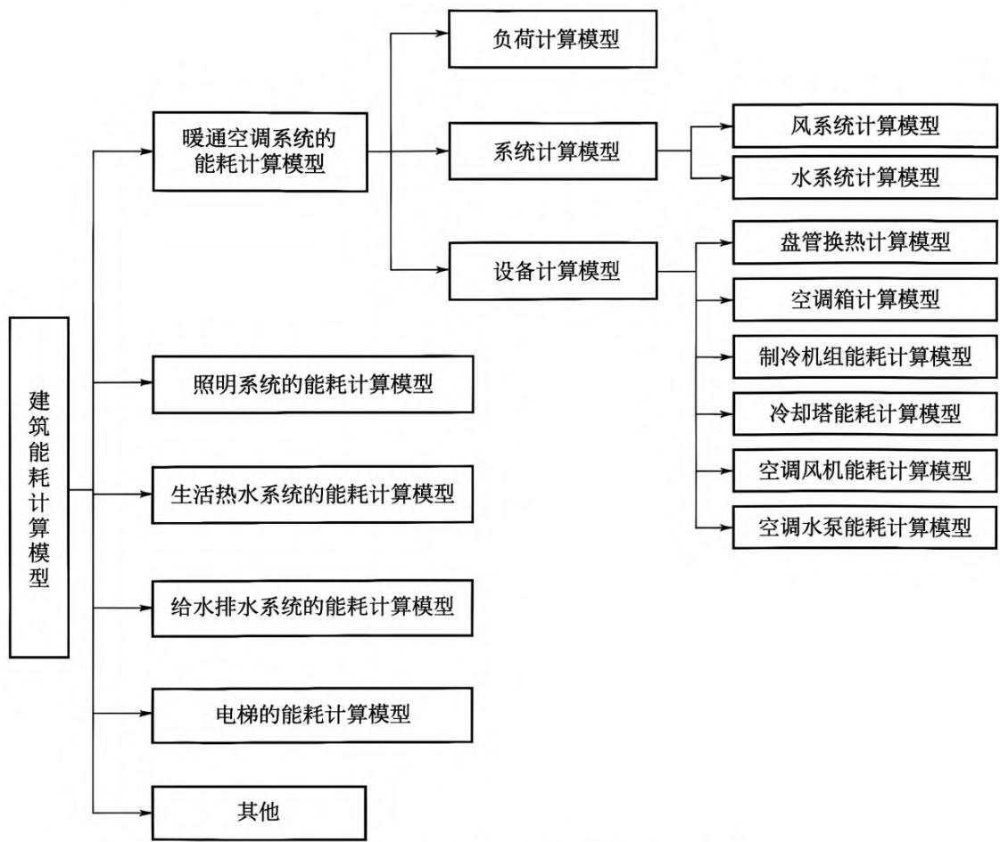  
图 9.1-1 建筑能耗计算模型的主要内容

2017 年出版的 ASHRAE 手册基础篇（ASHRAE Handbook Fundamentals）将能耗模拟方法分为两大类：正向模拟法（又称经典方法）和数据驱动法（又称逆向模拟法）。对于设计阶段的建筑物及其系统，采用正向模拟法的模拟工具具有较好的适应性，因为详细的设计信息可以作为这类模拟工具的输入参数，同时这类工具通常对物理过程有较详细的模拟，可以辅助进行设计方案的优化分析；对于交付以后的建筑物及其系统，采用数据驱动法的模拟工具具有较大的应用价值，此时建筑物及其系统的运行数据可以使得数据驱动模型更贴近实际，有利于对实际工程问题和能耗状况进行深入分析，辅助优化系统运行和控制调节，对建筑物及其系统的运行管理具有重要意义。

**9.1.2.1 正向模拟法（又称经典方法）**

正向模拟法的模型由四个主要模块构成：负荷模块、系统模块、设备模块和经济模块（表9.1-2）。这四个模块相互联系，形成一个建筑系统模型。在负荷模块中，有三种计算显热负荷的方法：热平衡法、加权系数法和热网络法。

正向模拟法的主要模块及方法  
表9.1-2

<table><tr><td>主要模块</td><td>模块介绍</td><td>采用方法</td><td>方法介绍</td></tr><tr><td rowspan="3">负荷模块</td><td rowspan="3">模拟建筑外围护结构及其与室外环境和室内负荷之间的相互影响</td><td>热平衡法</td><td>计算原理:根据热力学第一定律建立建筑外表面、建筑体、建筑内表面和室内空气的热平衡方程,通过联立方程求解室内瞬时负荷。基本假设:假设房间的空气是充分混合的,因此温度均匀;房间的各个表面具有均一的表面温度和长短波辐射,墙体导热为一维过程。主要特点:假设条件较少,但计算过程比较复杂</td></tr><tr><td>加权系数法</td><td>计算原理:该方法由Z-传递函数法推导得来,有两组权系数:得热权系数和空气温度权系数。得热权系数用来表示得热转化为负荷的关系;空气温度权系数用来表示房间温度与负荷之间的关系。计算过程中需要先输入建筑几何模型、天气参数和内部负荷,然后计算出在某一给定的房间温度下的得热,最后在已知空调系统的特性参数之后由房间得热计算房间温度和除湿量。基本假设:模拟的传热过程为线性。某些非线性的过程(如辐射和自然对流)也被假设为线性过程。影响权系数的系统参数均为定值,与时间无关。主要特点:该方法是对忽略建筑体的蓄热特性的稳态计算方法和动态的热平衡方法之间的一个折中。两个基本假设一定程度上削弱了模拟结果的准确性</td></tr><tr><td>热网络法</td><td>—</td></tr><tr><td>系统模块</td><td colspan="3">模拟空调系统的空气输送设备、风机、盘管以及相关的控制装置</td></tr><tr><td>设备模块</td><td colspan="3">模拟制冷机组、锅炉、冷却塔、蓄能设备、发电设备、冷热源设备等</td></tr><tr><td>经济模块</td><td colspan="3">计算为满足建筑负荷所需要的能源费用</td></tr></table>

**9.1.2.2 数据驱动法（又称逆向模拟法）**

数据驱动法利用已有的建筑能耗数据来建立模型。建筑能耗数据可以分为两种类型：设定型和非设定型。设定型建筑能耗数据是指在预先或计划好的实验工况下的建筑能耗数据；非设定型建筑能耗数据则是指在建筑系统正常运行工况下获得的建筑能耗数据。数据驱动法所建立的模型往往比正向模拟法简单，而且对未来系统性能的预测更为准确。数据驱动法的计算模型大致有两类：经验（黑箱）模型、灰箱模型（表9.1-3）。

数据驱动法的计算模型  
表9.1-3

<table><tr><td>采用方法</td><td>方法介绍</td></tr><tr><td>经验(黑箱)模型</td><td>计算原理:建立实测能耗与各项影响因子(如天气参数,人员密度等)之间的回归模型。回归模型可以是单纯的统计模型,也可以基于一些基本建筑能耗公式,常用的有最小二乘法、PRISM方法等。主要特点:较为简单和直接,这种模拟方法是逆向建模方法中应用最多的一种</td></tr><tr><td>灰箱模型</td><td>计算原理:首先需要建立一个表达建筑和空调系统的物理模型,然后用统计方法确定模型的各项物理参数。主要特点:这种方法需要分析人员具备建立合理的物理模型和估计物理参数的知识和能力,在故障检测与诊断和在线控制方面有很好的应用前景,但在整个建筑能耗估算上的应用较为有限</td></tr></table>

### 9.1.3 建筑能耗模拟的输入参数

输入参数是能耗模拟的基本要素，主要包括外界环境参数、模型参数和控制调节参数。每类参数具有不同的特点，对能耗模拟的影响也不同。以暖通空调系统能耗模拟为例，表9.1-4给出了各输入参数的简要说明和特点。

暖通空调系统能耗模拟的输入参数及特点  
表 9.1-4

<table><tr><td>序号</td><td>输入参数</td><td>参数说明</td><td>参数特点</td><td>参数描述准确性的含义</td></tr><tr><td>1</td><td>室外气象参数</td><td>描述室外空气干球温度、空气湿度、太阳辐射强度等影响建筑物热湿环境的气象要素</td><td>随时间变化的不可控参数,通常采用实测或统计数据,而不是主观确定数据的大小</td><td>参数大小及其随时间变化的规律基本符合气象要素的实际情况;根据模拟计算的目的对参数进行挑选(比如在多年实测数据中挑选具有某种统计典型性的数据)</td></tr><tr><td>2</td><td>室内外自然通风量</td><td>描述由于热压、风压原因从建筑物的各个开口进入室内的室外空气流量</td><td>随时间变化具有空间分布差异的不可控参数,实际建筑物中该参数的大小较难确定,一般只能粗略估计其大小,可根据实测或统计数据估计,也可采用模拟方法估计</td><td>参数大小及其随时间变化的规律、空间分布的差异定性地符合建筑物的实际情况(或待模拟工况);采用模拟方法估计时,对建筑物的开口情况和热压、风压作用的描述基本符合实际情况(或待模拟工况)</td></tr><tr><td>3</td><td>室内扰量参数</td><td>描述室内人员、灯光、设备等热湿源的产热产湿</td><td>随时间变化具有空间分布差异的不可控参数,可参考实测或实地调研数据、标准规范推荐的数据,在设计过程中也常常根据建筑物规划使用情况确定其大小</td><td>同一时刻,在建筑物的空调区域和非空调区域,室内扰量参数的总量应尽量符合实际情况(或待模拟工况);不同时刻的室内扰量总量的变化规律应与实际情况(或待模拟工况)一致;同一时刻,不同计算单元(通常是房间)的室内扰量的大小应尽量符合实际情况(或待模拟工况)</td></tr><tr><td>4</td><td>建筑物模型参数</td><td>建筑物的空间布局、层高、朝向、围护结构等信息</td><td>不随时间变化的参数,应尽量按照建筑物的实际情况进行描述</td><td>几何信息、材料特性等符合建筑物的实际情况(或设计方案)</td></tr><tr><td>5</td><td>暖通空调系统模型参数</td><td>空调系统分区,空调设备类型、型号、数量,水系统、风系统的拓扑结构和阻力特性等</td><td>基本上不随时间变化的参数,应尽量按照建筑物的暖通空调系统的实际情况进行描述</td><td>关系信息、设备参数、部件特性参数等基本符合空调系统的实际情况(或设计方案)</td></tr><tr><td>6</td><td>建筑物热湿控制要求</td><td>空调区域的空调设定温湿度</td><td>随时间变化具有空间分布差异的参数,应按照设计要求或建筑物的实际控制要求进行设定</td><td>不同时刻温湿度设定值的变化规律应与实际情况一致(或待模拟工况);同一时刻,不同计算单元(通常是空调房间)的温湿度设定值应尽量符合实际情况(或待模拟工况)</td></tr><tr><td>7</td><td>暖通空调系统设备开关状态</td><td>暖通空调设备的作息</td><td>随时间变化的参数,应按照设计要求或建筑物的实际使用要求进行设定</td><td>不同时刻、不同设备的开关状态设定应尽量符合实际情况(或待模拟工况)</td></tr><tr><td>8</td><td>暖通空调系统的控制策略和控制参数</td><td>比如空调箱的新风控制策略、风机变频策略,制冷机和水泵的台数控制策略,水泵变频策略,制冷机出水温度设定值、冷却塔出水温度设定值、空气处理设备(AHU)送风温度设定值、定静压变频风机的定压点设定值、定压差变频水泵的控制压差设定值等</td><td>可随时间变化的参数,应按照设计要求或建筑物暖通空调系统的实际控制要求进行设定</td><td>不同时刻,控制策略的设定和控制参数的设定应尽量符合实际情况(或待模拟工况)</td></tr></table>

为保证能耗模拟的效果，在选定合适的计算模型之后，就需要根据计算模型的要求恰当地确定各个输入参数的大小。不同类型的输入参数，其描述的准确性具有不同的含义。

总的来说，对于不同建筑物，其能耗敏感因素是不同的，原则上，越是能耗敏感的因素，对于能耗模拟来说，越是显著影响能耗的输入参数，其描述准确性的要求就越高。为了获得更好的模拟效果，应该首先确保主要影响因素的输入参数描述的准确性。在建筑物能耗模拟时，需要针对具体情况具体分析，首先分析所有输入参数对能耗影响的显著性，进而根据能耗敏感性的大小确定各类输入参数的描述准确性的要求，据此合理地搜集和准备输入参数数据，这样才能更好地确保能耗模拟的最终效果。对于随时间变化的动态输入参数，其随时间变化的描述对能耗模拟的影响不同于静态输入参数的方面。因此，在模拟计算时，对随时间变化的输入参数，描述其不同时段的数值大小时，要注意考虑模拟计算的特点与建筑物实际情况的差别，甄别不同的应用目的，采取灵活的处理方法。

### 9.1.4 建筑能耗模拟中的人行为

**9.1.4.1 人行为的内容和重要性**

建筑中人行为是影响建筑室内热环境与能耗的重要因素。人行为对建筑能耗具有十分明显的影响，也是造成建筑能耗不确定性的关键因素。从影响建筑室内环境和能源消耗的角度来看，通常需要描述人的移动行为、开窗行为、对遮阳设施的调节行为、照明行为、对空调设备的使用行为、对供暖设备的使用行为、对电气设备的使用行为和对其他设备的使用行为等。这些人行为与建筑环境和能耗有着直接而密切的联系，是人们在建筑中满足生活、工作等需求时所表现出的一系列活动，是居民生活方式的一个组成部分。

传统的建筑能耗模拟软件，如 EnergyPlus、DeST 等，通常将人行为简化描述为固定的作息或启动温度，这种简化方式无法表征人行为对于建筑热湿环境和能耗的复杂动态作用。模拟计算结果难以准确反映出实际人行为对建筑用能水平的影响，常常与实测结果存在较大偏差。导致某些建筑技术措施在实际建筑中的性能表现在模拟计算中得不到合理反映，模拟评估结论容易与实际观测到的情况不相符。目前节能标准规范中采用的标准工况与我国实际情况有很大不同，按标准工况计算得到的除供暖外的建筑能耗普遍高于该类建筑的实际平均能耗水平，标准规范的节能效果无法在建筑能耗总量的实际变化中得到体现。

**9.1.4.2 人行为的基本特征和影响因素**

人行为的模拟计算包括人员移动模拟、人员动作模拟两个部分（图 9.1-2）。人员移动模拟可以独立进行。人员动作模拟实际上包含多个动作，例如照明运行状态模拟至少包含开灯和关灯两个动作。

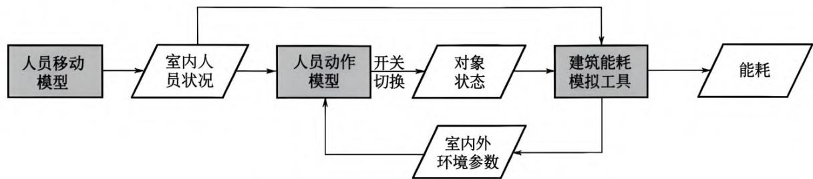  
图 9.1-2 人员移动模拟和动作模拟的基本流程

**1. 人员移动**

建筑中的人员是流动的。人的移动直接决定了建筑物的室内人员状况（即什么时候有人、有多少人、都有谁）。人是否在房间，是其对房间内部设备产生控制动作的先决条件，而人员进出房间的时刻往往也是动作发生的时刻。由人员移动引起的室内人数变化，是导致室内发热量随机变化的主要原因之一。因此，准确描述建筑中的人员移动行为十分必要。

人员移动具有一定的规律性和随机性：

(1) 建筑中人的移动具有一定的规律性。例如办公建筑中, 人员会按时上下班、在一定的时间到达、工作停留直至离开办公室; 住宅建筑中, 人员会按时睡觉起床、上班离家、下班回家等。这些每天重复发生的规律性事件, 决定了建筑房间每天的人员作息具有基本的相似性。

(2) 人的移动也具有很强的随机性。例如上下班时间不固定; 不论是办公建筑还是住宅建筑, 人员总会在不同房间之间来回走动、位置从一个房间变换到另一个房间等。因此, 建筑中各房间的人员状况是随机变化的, 每天都可能有所不同; 并且相互之间还存在一定关联, 一个房间的人数减少必然意味着另一房间的人数增加 (例如开会的情形)。另外, 人的移动行为还存在很大差异, 这种差异既与建筑类型有关 (例如办公建筑与住宅建筑人员移动与作息的差别)，也来自因为工作性质、生活习惯等不同导致的个体差异，例如办公建筑中的行政人员、研发人员、销售人员、部门主管等，其移动行为（例如上下班作息、在室时间长短）可能有很大不同。

以上人员移动特征对建筑的实际运行情况有间接影响，也是导致建筑房间人员设备作息“不均匀、不同步”的主要原因。一个良好的人员移动模型要能够全面而适当地描述这些特征，进而区分出不同的人员移动行为。

**2. 人员动作**

人是建筑系统的主动参与者和房间设备的使用者。人通过开关窗、开关窗帘、开关灯、开关计算机、开关空调及调节设定值等动作，对建筑房间的各类设备（包括窗户、窗帘、灯、计算机、空调等）进行调节和控制。这些行为直接决定了房间设备的运行状态，也直接决定了建筑物室内环境、能耗等。由人员动作决定的室内照明和设备状态变化，也是造成室内发热量随机变化的主要原因之一。因此，准确描述建筑中的人员动作十分必要。

人员动作的影响因素多而杂。根据日常生活经验和实际观察，人员动作往往发生在特定的时刻，例如进出口时刻、上下班时刻、起床睡觉时刻等，这些行为与人的移动作息有关；或者发生在特定的环境条件下，例如屋里热到一定程度会开空调、冷到一定程度会开暖气、暗了开灯、闷了开窗，等等，这些行为与环境参数有关，是对环境刺激的一种反馈。另外，还有一些行为与上述两大类因素没有明显联系，而是受其他因素（如社会和心理因素等）的影响，例如对于室外风景的视觉需求也影响着人开关窗帘的行为等。

人员动作具有随机性和不确定性，即使在相同的情形和条件下，人也可能做出不同的行为反应。以房间空调器的使用为例，觉得热时开空调是一种很普遍的行为方式。然而对于同样较高的室温，是否开空调则是不确定的，其结果是可能开也可能不开，可能开得早一些也可能开得晚一些。这种不确定性也直接反映到房间空调器的运行作息之中，使其启停时刻或运行时长呈现出很强的随机性和波动性。

在建筑模拟领域，主要关心的是时间和环境等物理因素对人员控制动作的影响，因此在控制动作模型中，只考察动作发生与时间或环境等因素的关联性。根据日常生活经验和实际观测，人员控制动作的发生往往表现出三种基本类型，其对应的相关因素见表9.1-5。

人员控制动作的基本类型及相关因素  
表9.1-5

<table><tr><td>类型</td><td>特点</td><td>相关因素</td><td>例子</td></tr><tr><td>与环境相关</td><td>动作发生在某些特定环境条件下,是对环境信号的响应和反馈</td><td>室内温度、湿度、照度、 $CO_{2}$ 质量浓度、太阳直射强度,室外温度、噪声等</td><td>暗了开灯、热了开空调等</td></tr><tr><td>与时间相关</td><td>动作发生在进出门的时刻、上下班的时刻、起床或睡觉时等</td><td>进出门时刻、上下班时刻、起床或睡觉时刻等</td><td>下班时关灯和关空调等</td></tr><tr><td>随机</td><td>动作的发生与时间和环境没有明显关系,可以认为是完全随机的</td><td>随机因素</td><td>看电视等</td></tr></table>

由于人的行为具有很强的随机性和不确定性，可用概率函数来描述任一控制动作发生

情况与各类影响因素之间的相关关系，其基本形式为：

$$
P _ {\tau} (\text { 对象状态的变化   A }) = F (\text { 系统状态   S } _ {\tau})
$$

式中 $P_{\tau}$ —— $\tau$ 时刻动作A发生的概率；

$S_{\tau}$ —— $\tau$ 时刻人员所处的系统状态；

$F$ ——概率函数，描述动作A发生概率与各类影响因素之间的数量映射关系。不同的 $F$ 形式（即待定系数水平），代表不同的行为特征；同一类动作，也可能有不同的 $F$ 形式，从而反映人行为的多样性和差异性。

## 9.2 建筑能耗模拟软件介绍

### 9.2.1 建筑能耗模拟软件的基本分类

目前常用的建筑能耗模拟软件可以分为两大类：计算内核与二次开发软件。这两类软件之间的关系如图9.2-1所示。主流的三大计算内核，即DeST、EnergyPlus和DOE-2，为本节的主要介绍内容。

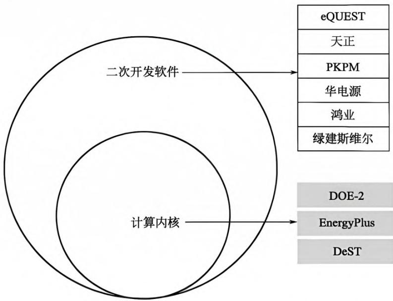  
图9.2-1 计算内核与二次开发软件之间的关系

**9.2.1.1 计算内核**

DeST、EnergyPlus 和 DOE-2 等计算内核具有完全独立自主的核心算法：

1. DeST 采用状态空间法计算不透明围护结构的传热，基于房间的传热特性系数可以求解房间热平衡方程。

2. EnergyPlus 采用基于墙体内表面温度的反应系数法计算定常物性不透明围护结构的传热，首先利用状态空间法求解单面围护结构的热特性，进而得到其内外表面热流与内外表面温度的关系，再建立房间热平衡方程进行求解。

3. DOE-2 采用反应系数法求解房间不透明围护结构的传热，采用冷负荷系数法计算房间负荷和房间温度。

一般来说，这类计算内核要求输入的参数比较多，且用户使用界面较为复杂，对使用者的要求比较高，需要一段时间的学习才能正确使用。例如，EnergyPlus 只是一个建筑能耗逐时模拟引擎，无用户图形界面，建模数据的输入可以采用写字板进行文字输入或用 IDF Editor 程序进行输入。DeST 为了简化建筑物的描述和定义工作，基于 AutoCAD 开发了图形化的工作界面，但要求用户输入大量参数，无法快速根据标准规范进行参数设置。

**9.2.1.2 二次开发软件**

为便于用户使用，国内外逐渐发展起一批基于计算内核进行二次开发的软件，包括美国的 eQUEST，以及我国的天正、PKPM、华电源、鸿业和绿建斯维尔等建筑能耗模拟软件。

eQUEST 是基于 DOE-2 的高级版本 DOE-2.2 开发的软件，其主要特点是为 DOE-2 输入数据的写入提供了向导，用户可以根据向导的指引写入建筑描述的输入档。同时，该软件还提供了图形结果显示的功能，用户可以直观地看到输入档生成的二维或三维建筑模型，并且可以查看图形的输出结果。

PKPM 以 DOE-2 作为计算内核，其最大的特点是与标准规范结合紧密，在设计时可以完全按照现行节能设计标准生成符合要求的建筑节能设计分析报告和审查备案登记表。该软件另一个比较大的优势是界面比较友好，输入比较方便，它与多种建筑软件都有接口，设计人员可以将 CAD 图纸直接转换成模型中所需要的数据。此外，PKPM 比较注重对工程实际的指导，在设计时能较好地结合能耗分析和经济指标进行最佳方案的选择。

这类软件基于第三方的计算内核，拥有友好的使用界面，用户使用较为便捷。许多二次开发软件均采用相同的计算内核，如天正、PKPM 和绿建斯维尔等均基于 DOE-2 计算内核，但其应用程序 “外壳” 的二次开发存在差异，主要体现在用户界面、输入输出格式和内容、基础数据库、默认参数等方面，导致各二次开发软件的计算结果也存在一定差异。建筑能耗模拟计算软件基本信息对比如表 9.2-1 所示。

### 9.2.2 DeST软件介绍

DeST 是清华大学建筑技术科学系历经多年研究开发出的拥有完全自主知识产权的建筑环境系统设计模拟分析软件，该软件汇聚了我国暖通空调领域在建筑环境系统设计模拟分析领域的研究成果，目前已成为比较完善的设计分析软件，并在国内外得到较多应用。到目前为止，已有 2 亿 m² 以上的住宅建筑和公共建筑应用 DeST 进行过相关模拟计算分析。

2019 年 12 月，我国拥有完全自主知识产权的建筑性能模拟分析平台 DeST 顺利通过国际权威标准 ANSI/ASHRAE 140：2017 的全部案例测试，正式获得国际认证的建筑能耗模拟软件性能标识，同时成为被美国能源部官方认可的软件之一。

**9.2.2.1 DeST 版本简介**

DeST不是一个单一软件，而是基于同一软件平台、针对各种建筑能耗与建筑环境设计与分析问题的系列应用软件。针对不同类型建筑物、不同模拟分析目的，DeST目前已经开发了7个软件版本：DeST-c、DeST-r、DeST-d、DeST-h、DeST-e、DeST-i、DeST-s，这些软件版本针对不同的建筑物类型，根据模拟分析的不同目的而采取不同的计算模式并提供不同形式的后处理结果，其特点、功能和应用如表9.2-2所示。

表 9.2-1

建筑能耗模拟计算软件基本信息对比

<table><tr><td>比对项目</td><td>DeST</td><td>TRNSYS</td><td>EnergyPlus</td><td>PKPM</td><td>天正</td><td>绿建斯维尔</td><td>eQUEST</td></tr><tr><td>适用的建筑类型</td><td>公共建筑/居住建筑</td><td>公共建筑/居住建筑</td><td>居住建筑/公共建筑</td><td>公共建筑/居住建筑</td><td>公共建筑/居住建筑</td><td>公共建筑/居住建筑</td><td>居住建筑/公共建筑</td></tr><tr><td>开发单位</td><td>清华大学</td><td>美国威斯康星大学太阳能实验室、法国CSTB</td><td>美国能源部(DOE)、劳伦斯伯克利国家实验室(LBNL)</td><td>中国建筑科学研究院</td><td>北京天正软件公司</td><td>深圳斯维尔软件公司</td><td>美国太平洋电力公司</td></tr><tr><td>是否能结合节能设计标准进行权衡判断</td><td>是</td><td>是</td><td>无</td><td>是</td><td>是</td><td>是</td><td>否</td></tr><tr><td>有无与建筑(或结构)设计软件的接口</td><td>无</td><td>有</td><td>无</td><td>有</td><td>有</td><td>有</td><td>无</td></tr><tr><td>计算内核</td><td>独立核心</td><td>独立核心</td><td>独立核心</td><td>本身为第三方软件,核心为DOE-2.1E</td><td>本身为第三方软件,核心为DOE-2.1E</td><td>本身为第三方软件,核心为DOE-2.1E</td><td>独立核心,核心为DOE-2.2</td></tr><tr><td>参加过国际间的权威对比试验</td><td>参加过BESTTEST、ASHRAE 140等验证过程</td><td>参加过BESTTEST、ASHRAE 140验证过程</td><td>参加过BESTTEST、ASHRAE 140验证过程</td><td>DOE-2本身参加过BESTTEST验证过程</td><td>DOE-2本身参加过BESTTEST验证过程</td><td>DOE-2本身参加过BESTTEST验证过程</td><td>参加过BESTTEST、ASHRAE 140验证过程</td></tr><tr><td>计算方法</td><td>围护结构:逐时状态空间法;空间热平衡:热平衡法</td><td>围护结构:逐时反应系数法;空间热平衡:热平衡法</td><td>围护结构:逐时反应系数法;空间热平衡:热平衡法</td><td>围护结构:逐时反应系数法;空间热平衡:逐时加权系数法</td><td>围护结构:逐时反应系数法;空间热平衡:逐时加权系数法</td><td>围护结构:逐时反应系数法;空间热平衡:逐时加权系数法</td><td>围护结构:逐时反应系数法;空间热平衡:逐时加权系数法</td></tr></table>

DeST 不同版本的特点、功能和应用  
表9.2-2

<table><tr><td>版本名称</td><td>特点</td><td>功能</td><td>应用</td></tr><tr><td>DeST-c商业建筑热环境模拟工具包</td><td>专用于采用商业建筑空调系统方案辅助设计与分析</td><td>建筑设计方案模拟分析;空调系统方案模拟分析;空气处理设备方案模拟分析;冷热源模拟分析;输配系统模拟分析;经济性分析</td><td>辅助国家大剧院、深圳文化中心等大型商业建筑的设计,辅助中央电视台、解放军总医院、北京城乡贸易中心、北京发展大厦等多栋建筑空调系统改造设计</td></tr><tr><td>DeST-r公共建筑节能评估版</td><td>专用于公共建筑节能评估;针对公共建筑节能评估标准开发</td><td>围护结构热工性能、空气处理合理用能和自然采光性能(建筑物本身的节能及用能需求的合理性);空调冷热源、生活热水热源、风机、水泵、照明和其他用电(机电设备系统的节能);可再生能源利用</td><td>国家游泳中心、奥运信息中心等所有奥运建筑,包括中央国家机关与北京市政府等机构的数十座大型公共建筑的节能评审</td></tr><tr><td>DeST-d建筑能耗分析软件</td><td>建筑耗电模拟和分析</td><td>预测建筑物运行用电;辅助建筑物用电分析;辅助建筑物用电诊断</td><td>包括中央国家机关与北京市政府机构在内的数十座大型公共建筑的用能分析</td></tr><tr><td>DeST-h住宅建筑热环境模拟工具包</td><td>住宅类建筑的设计、性能预测的辅助设计</td><td>居住建筑热特性的影响因素分析;居住建筑热特性指标的计算;居住建筑的全年动态负荷计算;居住建筑的室温计算;末端设备系统经济性分析</td><td>400万 $m^{2}$ 居住建筑优化设计</td></tr><tr><td>DeST-e住宅建筑节能评估版</td><td>专用于住宅类建筑节能评估</td><td>居住建筑供暖空调能耗模拟;根据各地居住建筑节能设计标准计算各种能耗指标</td><td>200万 $m^{2}$ 居住建筑节能评估</td></tr><tr><td>DeST-i住宅建筑能耗标识版</td><td>专用于住宅类建筑的能耗标识</td><td>根据建筑实际使用状况进行居住建筑能耗预测,标识建筑能耗水平</td><td>30万 $m^{2}$ 居住建筑能耗标识</td></tr><tr><td>DeST-s太阳能建筑能耗分析软件</td><td>用于太阳能建筑热环境模拟分析</td><td>太阳能建筑主体节能分析;太阳能建筑热环境评价;太阳能建筑常规能源体系的优化利用分析</td><td>—</td></tr></table>

**9.2.2.2 DeST 的工作界面**

DeST 的界面是基于 AutoCAD 开发的，如图 9.2-2 所示。该界面可在 Windows 操作系统下运行，通过该界面，DeST 支持用户实现各种复杂建筑形式（如多座建筑、天窗、斜墙、地下层、回形分隔等）的计算。在 DeST 中，与建筑物相关的各种数据（材料、几何尺寸、内扰等）通过数据库接口与界面相连，用户可直接在界面上进行建筑及其环境控制系统的建模、参数设定和模拟计算。

**9.2.2.3 DeST的基础数据库**

DeST 的基础数据库如表 9.2-3 所示。

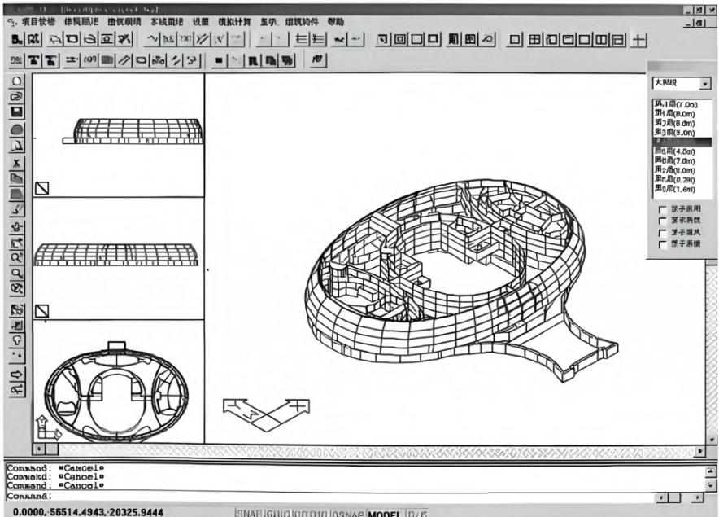  
图9.2-2 DeST的界面

DeST 的基础数据库  
表9.2-3

<table><tr><td>数据库名称</td><td>数据说明</td><td>备注</td></tr><tr><td>气象数据库</td><td>包括全国270个气象台站,覆盖了不同气候区的主要城市;来源于DeST与中国气象局气象信息中心气象资料室合作编制的基于实测气象数据的全年逐时气象数据;气象要素涵盖与建筑热环境分析直接相关的所有参数:空气温度、空气湿度、太阳辐射强度、地表温度、天空有效温度,以及风速、风向等;根据现行行业标准《夏热冬冷地区居住建筑节能设计标准》JGJ 134的规定选取典型气象年;同时提供设计典型年(温度极高年、温度极低年、太阳辐射极大年、太阳辐射极小等和焓值极高年)的逐时气象数据</td><td>源数据来自唯一官方机构</td></tr><tr><td>建筑构件库</td><td>包括外墙、内墙、屋顶、楼板、窗户、门、遮阳等建筑构件</td><td rowspan="4">开放式,可直接选用、可扩充、可自定义</td></tr><tr><td>建筑材料库</td><td>包括普通材料和透光材料;普通材料,如混凝土、金属、木材及其制品、石材、塑料、多孔材料、砌体、各种保温材料等;透光材料,如不同厚度的平板玻璃等。DeST已经内置数十个大类近千种材料</td></tr><tr><td>设备数据库</td><td>包括各种供暖空调设备,例如各种冷热源设备(包括集中冷热源设备、分散冷热源设备)、冷却塔、各种空气处理设备、输配设备(风机、水泵等)等,设备数据主要是指设备的性能参数</td></tr><tr><td>概算定额库</td><td>包括全国统一预算定额和部分地方概算定额,用于各设计阶段的经济性分析</td></tr></table>

**9.2.2.4 DeST使用过程**

DeST 的使用有三个步骤：建立建筑模型、设定参数、模拟计算及输出。

**1. 建立建筑模型**

建立建筑模型就是在 DeST 的界面上画出建筑的简化图，这一过程是建筑图的简化，在不对建筑热环境模拟造成明显影响的前提下，用户可根据模拟的要求进行不同程度的简化。建立建筑模型的主要步骤包括：建立建筑、建立楼层、划分隔墙、识别房间、添加门窗、房间标注。最后进行全楼拓扑检查，通过后即确定建筑构图形式。另外，用户也可通过衬 CAD 底图的方法建立建筑模型。

**2. 设定参数**

建筑及其环境控制系统的模拟结果不仅取决于建筑形式，更与围护结构物理性能、空调系统形式、建筑使用方式、系统运行模式有关。因此，设定参数的正确性将影响计算结果的正确性。DeST 设定参数如表 9.2-4 所示。

DeST 设定参数  
表9.2-4

<table><tr><td>阶段</td><td>定义设计参数和设计方案</td><td>定义使用状况及运行状况</td><td>定义运行调节方式和控制策略</td></tr><tr><td>建筑物本体设计</td><td>各部分围护结构的做法及热工参数;房间温湿度设计要求;房间内人员、灯光、设备的产热产湿量;新风量设计要求</td><td>房间空调作息(房间需要供暖或空调的作息时间表);房间内人员、灯光、设备的作息时间表;房间通风量及渗透风量</td><td>智能围护的控制,如通风窗的风量控制、遮阳控制等</td></tr><tr><td>空调系统方案设计</td><td>空调系统形式,包括全空气系统、空气一水系统、全水系统、直接蒸发机组系统;冷水系统的管路形式,例如两管制、四管制;空调系统分区方式;例如按照朝向分区、按照功能分区;系统设计参数,如定风量空调系统的送风量,变风量空调系统的送风量变化范围等;末端再热装置的容量</td><td>空调系统运行时间表;全年冷热水供应时间表</td><td>系统送风量运行调节和控制方式;系统送风温湿度的控制调节策略;变风量空调系统的控制方式</td></tr><tr><td>空气处理设备方案设计</td><td>空气处理设备的组合方式,例如显热热回收器+混风段+表冷器+加湿器+再热器,二次回风系统;空气处理设备(包括送风机等)的数量、容量、性能参数;空气处理设备的供水温度</td><td>空气处理设备作息时间表;全年冷热水供应时间表</td><td>空气处理设备水量调节和控制;系统新风量控制调节方式;热回收装置的使用时间;冷热水供水温度的变化</td></tr><tr><td>冷热源和水系统设计</td><td>冷源形式,如电制冷离心机组、溴化锂吸收式制冷机组、风冷热泵机组等;冷源设备(包括制冷机、冷却塔)的数量、容量和设备性能参数;热源形式,如燃气锅炉、燃油锅炉、城市热网等;热源设备的台数、容量和设备性能参数;水系统管网形式,如一级泵系统、二级泵系统;水泵的数量、容量和设备性能参数</td><td>-</td><td>制冷机运行调节和控制,如制冷机开停调节策略,制冷机出水温度控制;冷却塔运行调节和控制,如台数控制、一机对一塔、风机变频等;水泵运行调节和控制,如台数控制、变频控制等</td></tr></table>

注：1. 围护结构热物性参数的定义通过从 DeST 的建筑构件库或材料库中选择相应的构件、材料而完成。  
2. 为方便用户进行定义，DeST 将不同使用状况的房间进行归纳，得到不同的房间功能类型。每种房间功能类型集成了房间设计参数，如室内人员、灯光、设备的产热产湿量与作息，房间空调作息等房间信息。用户可以直接从 DeST 的房间库中选择已有的房间类型（如办公室、卧室、餐厅等），在其基础上进行参数调整，也可以自定义新的房间类型。

3. 在 DeST 的不同版本中，要求对通风的描述不同，计算分析模式也不同。通风描述定义每个房间从室外或从其他房间通过通风通道（如门缝、窗缝等）进入的空气。以该房间体积为基础的换气次数为单位定义。通过设定作息时间表可以使换气量在全年逐时变化；还可以定义换气量在一定的范围内根据室内外温度的不同而在一定范围内变化，从而模拟根据室内外环境状况进行人为开窗关窗造成的影响。

4. 在进行空调系统方案设计、空气处理设备的方案设计以及冷热源和水系统的设计时，用户通过对系统、设备、控制等方面的灵活定义，可以组合得到各种系统形式和控制方式，这些系统形式和控制方式可以保存在 DeST 数据库中备用。

另外，DeST 的全过程经济性分析模块（EAM），根据表 9.2-4 中不同设计阶段的设计工作深度提供不同细化程度的初投资、运行费用和寿命周期费用估算。进行经济性分析时，用户只需确认或重新设定设备价格、能源价格，EAM 自动对方案的全面造价（包括设备材料的购置费、安装费以及各种取费和税金）、运行费用、寿命周期费用进行详细估算。

**3. 模拟计算及输出**

完成了建立建筑模型和设定参数的工作，即可进行不同项目的计算。各版本的模拟计算选项和 DeST 的输出内容如表 9.2-5 所示。

DeST 不同版本提供的模拟计算选项和软件输出内容  
表9.2-5

<table><tr><td>版本</td><td>DeST-c</td><td>DeST-r</td><td>DeST-h、DeST-i DeST-s</td><td>DeST-e</td><td>DeST-d</td></tr><tr><td>模拟计算选项</td><td>建筑阴影计算;建筑采光计算;建筑室温计算;建筑负荷计算;系统送风量计算;系统方案分析;风网计算;全年风网计算;水网计算;全年水网计算;空气处理室模拟;水系统模拟</td><td>被评建筑负荷及自然采光计算;参考建筑负荷及自然采光计算;被评建筑空调系统负荷计算;被评建筑空调系统冷热源计算;被评建筑输配系统计算</td><td>建筑阴影计算;建筑采光计算;建筑室温计算;负荷分析</td><td>被评建筑能耗计算;参考建筑能耗计算</td><td>照明电耗计算;室内电器电耗计算;电梯电耗计算;输水泵电耗计算;公用生活类电器(如洗衣机、餐厨电器、电热水器等)电耗计算;通风系统电耗计算;空调系统电耗计算</td></tr><tr><td rowspan="4">输出</td><td>详细数据 Excel 报表</td><td colspan="4">气象数据、阴影计算结果、采光计算结果、房间温度、房间负荷、系统负荷、系统方案分析结果、空气处理设备方案分析结果、冷热源模拟结果、风机和水泵模拟结果、各分项电耗逐时计算结果</td></tr><tr><td>统计数据 Excel 报表</td><td colspan="4">围护结构统计结果、负荷统计结果、各分项电耗统计结果</td></tr><tr><td>经济性分析 Excel 报表</td><td colspan="4">各阶段的经济性分析报表,包括初投资报表、运行费用报表、寿命周期费用报表</td></tr><tr><td>Word 报告</td><td colspan="4">标准格式的节能评估报告</td></tr></table>

**9.2.2.5 DeST与第三方软件的集成**

为实现 DeST 作为计算内核与第三方软件的集成工作，DeST 已建立起复杂数据的数据字典（IDD），并基于此开发了与第三方软件的通用接口。IDD 梳理了 DeST 中建筑基础数据的定义、存储及传输方式等，初步确定了其分类方式、定义方法及调用规律；在数量庞大、错综复杂的数据关系中，梳理了其上下级关系，并绘制了关系图表；对 DeST 中目前所有的簇类、属性、字段等进行了清晰系统的归纳表达。第三方软件可以此为数据字典，对其内核数据进行再定义，使不同软件的模型均可以调用 DeST 内核进行计算。

目前天正、华电源、鸿业和 PKPM 基于原有数据结构与 DeST 内核数据结构进行对比，已建立起仿真平台与 IFC、gbXML 数据之间的对应关系，开发仿真平台的输入/输出接口模块，输出 IFC、gbXML 扩展信息文件，实现对 DeST 的接口调用。

### 9.2.3 EnergyPlus 软件介绍

EnergyPlus 由美国能源部（DOE）和劳伦斯伯克利国家实验室（LBNL）共同开发。美国政府同时出资支持两个建筑能耗分析软件——DOE-2 和 BLAST 的开发，其中 DOE-2 由美国能源部资助，BLAST 由美国国防部资助。这两个软件的主要区别是负荷计算方法：DOE-2 采用传递函数法（加权系数），BLAST 采用热平衡法。这两个软件在世界上的应用都比较广。因为这两个软件各自具有其优缺点，美国能源部于 1996 年决定重新开发一个新的软件——EnergyPlus，并于 1998 年停止 BLAST 和 DOE-2 的开发。EnergyPlus 是一个全新的软件，它不仅吸收了 DOE-2 和 BLAST 的优点，并且具备很多新的功能。EnergyPlus 被认为是用来替代 DOE-2 的新一代建筑能耗分析软件。EnergyPlus 于 2001 年 4 月正式发布，现在已经发布了 EnergyPlus 241.0 版，可以免费下载。

**9.2.3.1 EnergyPlus的负荷模拟**

EnergyPlus 是一个建筑能耗逐时模拟引擎，采用集成同步的负荷、系统、设备的模拟方法。在计算负荷时，时间步长可由用户选择，一般为 10～15min。在系统模拟中，软件会自动设定更短的步长（小至 1min，大至 1h），以便更快地收敛。EnergyPlus 采用 CTF（Conduction Transfer Function）来计算墙体传热，采用热平衡法计算负荷。CTF 实质上是一种反应系数，但它的计算更为精确，因为它是基于墙体的内表面温度，而不同于一般的基于室内空气温度的反应系数。EnergyPlus 采用三维有限差分土壤模型和简化的解析方法对土壤传热进行模拟；采用传热传质模型对墙体的热湿传递进行模拟；采用基于人体活动量、室内温湿度等参数的热舒适模型模拟室内人员舒适性情况；采用各向异性的天空模型以改进倾斜表面的天空散射强度；采用先进的窗户传热模型，可以模拟包括可控的遮阳装置、可调光的电铬玻璃等；可以模拟日光照明，包括室内照度的计算、眩光的模拟和控制、人工照明对负荷及空调系统能耗的影响。在每个时间步长，自建筑内表面开始计算热对流、热辐射和传湿。由于程序计算墙体内表面的温度，可以模拟辐射供热与供冷系统，并对热舒适进行评估。区域之间的气流交换可以通过定义流量和时间表来进行简单的模拟，也可以通过 Airflow Network 模块对自然通风、机械通风及烟囱效应等引起的区域间的气流和污染物的交换进行详细的模拟。Airflow Network 模块替代了 EnergyPlus 早期版本中的 COMIS 以及 ADS（Air Distribution System）模型。COMIS 是 LBNL 开发的用来模拟建筑外围护结构的渗透、区域之间的气流与污染物交换的免费专业分析软件。ADS 模型则用来计算空气输配系统的气流以及由于风管传热和空气泄漏引起的能量损失。Airflow Network 模块最大的不同之处在于多区气流计算时采用空调系统的时间步长来代替先前的热区计算步长。

**9.2.3.2 EnergyPlus的系统模拟**

EnergyPlus 采用模块化的系统模拟方法，时间步长可变。空调系统由很多部件构成，包括风机、冷热水及直接蒸发盘管、加湿器、转轮除湿装置、蒸发冷却装置、变风量末端、风机盘管等。部件的模型有简单的，也有复杂的，输入的复杂性也不同。这些部件由模拟实际建筑管网的水或空气环路连接起来，每个部件的前后都需设定一个节点，以便连接。这些连接起来的部件还可以与房间进行多环路的连接，因此可以模拟双空气环路的空调系统（如独立式新风系统）。一些常用的空调系统类型和配置已做成模块，包括双风道的定风量空气系统和变风量空气系统、单风道的定风量空气系统和变风量空气系统、组合式直接蒸发系统、热泵、辐射式供热和供冷系统、水源热泵、地源热泵等，最新版本的EnergyPlus还可以模拟变制冷剂系统。

**9.2.3.3 EnergyPlus的设备模拟**

EnergyPlus 模拟的冷热源设备包括吸收式制冷机、电制冷机、引擎驱动的制冷机、燃气轮机制冷机、锅炉、冷却塔、柴油发电机、燃气轮机、太阳能电池等。这些设备分别用冷水、热水和冷却水回路连接起来。设备模型采用曲线拟合方法。

**9.2.3.4 EnergyPlus 的用户界面**

EnergyPlus 带有一个简单的 Launch 程序，用来进行相关文档的管理、数据输入和编辑以及输出结果的分析等。建模数据的输入可以采用写字板进行文字输入或用 IDF Editor 程序进行输入。IDF Editor 程序为用户提供了机构化的输入方法，能将输入数据转换为正确的文本文件格式。图 9.2-3、图 9.2-4 分别为 Launch 程序界面和 IDF Editor 输入界面。

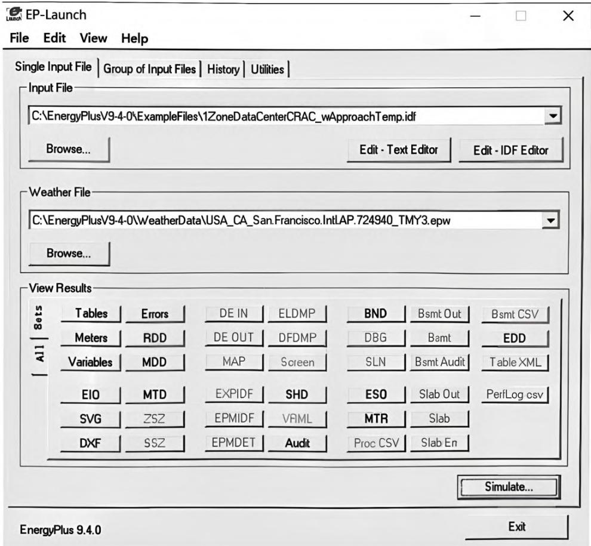  
图9.2-3 Launch程序界面

EnergyPlus 的模拟输入结果是 CSV 格式，Launch 程序由链接到 Excel 的程序打开并进行数据处理。EnergyPlus 的建筑几何模型可以用 DXF 输出，图 9.2-5 为用 Auto CAD 输出的某建筑的三维模型。

除了自带的简单界面外，目前有很多用户界面已经发布或正在开发中，包括 Design-Builder、OpenStudio、Simergy、VisualEPlus 等。DesignBuilder 在建筑几何输入和模型的可视化方面具有很强的功能，包含了所有 EnergyPlus 的建筑构造和照明系统数据输入部分，也移植了所有的材料数据库，图9.2-6为其界面示意图。OpenStudio是Google SketchUp的一个免费插件，使用此插件时可方便地使用SketchUp的三维建模工具，可以轻松实现几何建模，并转化为IDF文件。Simergy则是由LBNL为EnergyPlus专门开发的一款综合性的用户图形界面，可以免费下载。Simergy采用拖拽式的暖通空调系统编辑界面，建筑的几何围护结构不仅可以在Simergy中建立，还可以从CAD或者BIM工具中导入，并支持工业标准协议IFC和gbXML。当然，Simergy还处在不断完善的过程中，如大量的模板和库以及交互式的输出报告框架正在开发。此外，Simergy 还计划开发一系列的应用程序接口，以便第三方软件的开发。

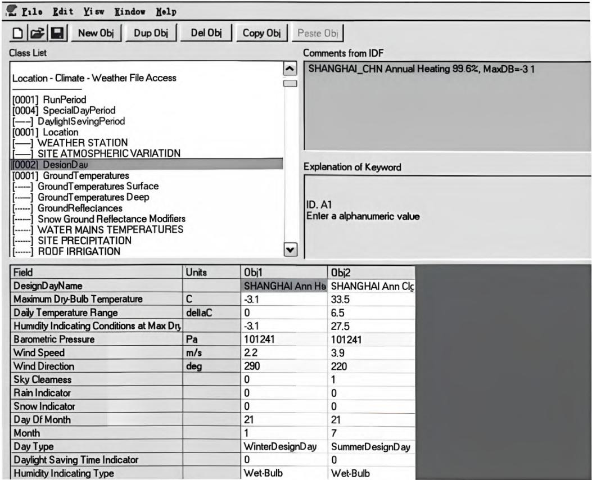  
图9.2-4 IDFEditor输入界面

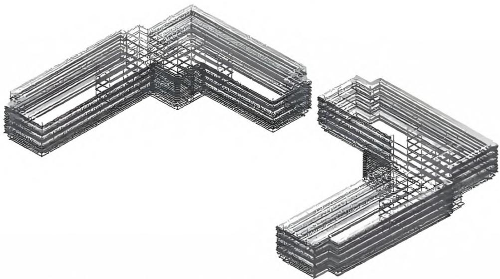  
图9.2-5 用Auto CAD输出的某建筑的三维模型示意图

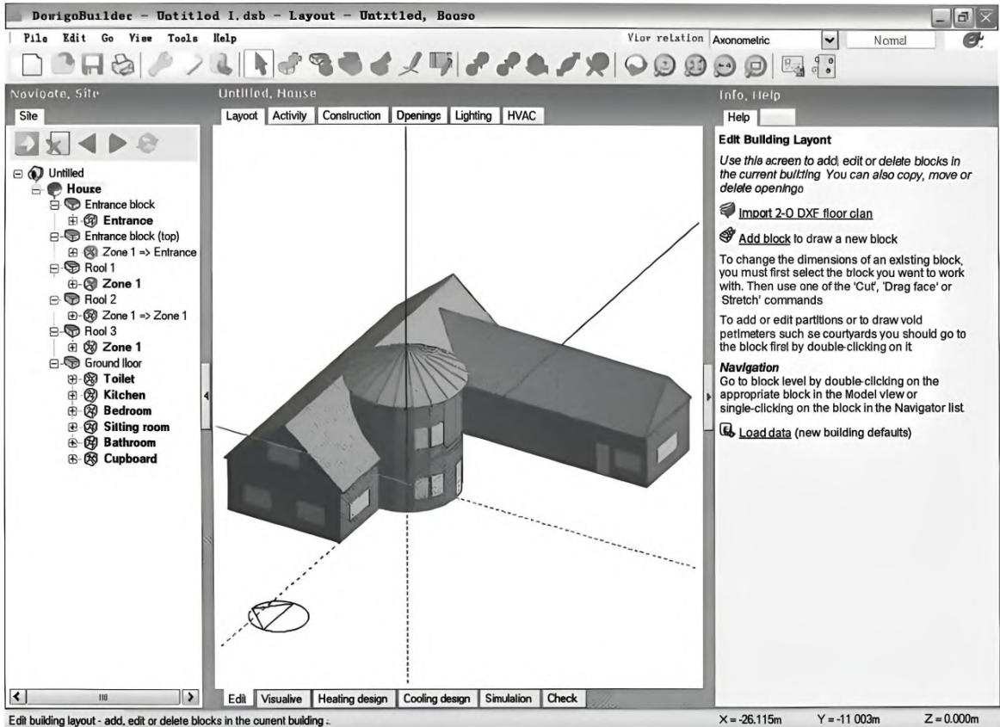  
图9.2-6 DesignBuilder界面示意图

VisualEPlus 是同济大学、山东大学、中国建筑科学研究院、劳伦斯伯克利国家实验室（LBNL）、美国橡树岭国家实验室（ORNL）和美国白盒子咨询公司合作开发的中英文图形化用户界面（GUI），其特点在于空调系统的拖曳式界面，根据 EnergyPlus 从部件到管路再到环路的系统连接方式建立空调系统，从而给予用户最大可能的自由度和灵活度。目前最新的版本是 VisualEPlus 2.0，可免费下载安装包和使用手册。

### 9.2.4 DOE-2 介绍

DOE-2 是一个在一定的气象参数、建筑结构、运行周期、能源费用和暖通空调设备条件下，逐时计算能耗和计算居住和商用建筑能源费用的软件。DOE-2 有完备的技术文档，能够提供新型建筑设计的分析比较，适于研究交流。它的源代码采用 FORTRAN 语言编写，可以在 UNIX、SUN 和 PC 等多种操作系统平台上运行。用该软件，设计者可以迅速选择改善措施，通过程序计算，得到相应的建筑耗能量特性、室内舒适状况和能耗费用。

**9.2.4.1 DOE-2的基本理念和计算流程**

DOE-2 主要可以进行建筑方案设计及节能方案的基础研究，包括以下方面：

1. 建筑方案的概念设计。

2. 围护结构材料的热工性能及保温构造的优化设计分析，建筑物蓄热特性与暖通空调（HVAC）系统的耦合关系模拟分析；分析建筑物内遮阳与外遮阳的节能效果，以及不同类型玻璃（镀膜玻璃、热反射玻璃）的节能效果对比。

3. 室内热源（人员、照明和设备）运行模式的影响分析，判断建筑物本身的节能及用能需求的合理性。

4. 暖通空调（HVAC）设备的间歇运行模式的影响分析。

5. 最小新风需求和过渡季节免费供冷的节能效果分析。

6. 不同空气处理系统、冷热源设备的性能特点分析。

7. 不同机电设备系统（空调冷热源、生活热水热源、风机、水泵、照明）的节能潜力分析。

图 9.2-7 为 DOE-2 的计算流程。一般来讲，DOE-2 包含一个子程序——建筑信息编译器（BDL Processor）、4 个子程序（LOADS、SYSTEMS、PLANT 和 ECON），其中 SYSTEMS 与 PLANT 集成在 HVAC 子程序中。模拟管理器控制整个模拟过程：LOADS 计算热湿负荷；SYSTEMS 管理热平衡计算结果与暖通空调的空气回路和水回路的能耗计算和数据通信。PLANT 管理冷热源（制冷机、锅炉等）及相应辅机之间的能耗计算和数据通信。LOADS、SYSTEMS 和 PLANT 按顺序单向执行，前一个模块的输出为后一个模块的输入，没有反馈。用户不需要自己来“搭建”实际的系统，而是选择预先设置好的系统形式。这种方式对使用者比较方便，不用考虑各个模块之间的信号连接，但另一方面，可供选择的系统方案相对较少。

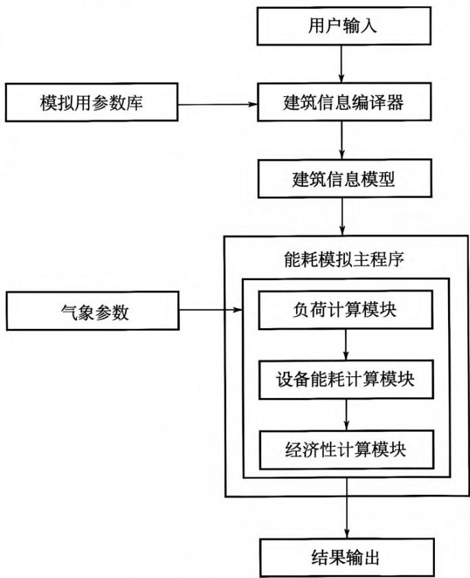  
图9.2-7 DOE-2的计算流程

**1. 建筑信息编译器（BDL Processor）**

建筑信息编译器将使用者任意格式的输入数据转换成计算机认可的格式。处理器还要计算出墙体的热反应系数以及房间的热反应权系数。

在 DOE-2 的早期版本中，建筑描述语言是它的一大特色。DOE-2 将建筑构件变量直接用英语单词或词组来表示，从而简化了冗长繁杂的输入。这一特色明显带有 DOS 操作系统的时代烙印。

**2. 负荷模拟子程序（LOADS）**

假定对象房间处于用户设定的室内温湿度条件下，LOADS 逐时计算供暖和供冷的显热和潜热负荷。LOADS 会从气象资料数据库中读取当地的逐时气象参数和太阳辐射数据。而用户要设定室内人员、照明和设备的运行时间表。负荷计算采用权系数法。

**3. 暖通空调系统模拟子程序（HVAC）**

HVAC 分成两部分：SYSTEMS 和 PLANT。SYSTEMS 处理二次系统，PLANT 处理一次系统。SYSTEMS 计算空气侧设备（如风机、盘管和风道）的特性，根据房间的新风需求、设备运行时间表、设备控制策略以及恒温控制器的设定点，修正由 LOADS 计算出的恒温负荷。SYSTEMS 的输出是风量和盘管负荷。PLANT 计算锅炉、冷水机组、冷却塔和蓄热槽等设备在满足二次系统盘管负荷时的状态。为了计算建筑的电力和燃料耗量，PLANT 也考虑了一次设备的部分负荷效率。

**4. 经济分析子程序（ECON）**

ECON 计算能源费用，它也可以比较不同建筑设计的成本—效益，计算既有建筑节能改造所能产生的经济效益。

**5. 气象数据（Weather Data）**

DOE-2 可以读入包括典型气象年 TMY2 在内的多种气象数据。一个地区的典型气象年参数应包括室外干球温度、湿球温度、大气压、风速和风向、云量以及太阳辐射。DOE-2 提供了世界各国部分城市的典型气象年参数，其中包括我国的北京、上海、南京、成都、西安、哈尔滨和乌鲁木齐等城市的全年气象参数。

另外，随着我国建筑节能设计标准的推广，由中国建筑科学研究院牵头编制了《建筑节能气象参数标准》JGJ/T 346，以标准化方式给出了适应我国气候特点的建筑能耗计算用气象数据，我国 450 个城市的典型气象数据可供用户使用。

**6. 建筑材料数据库（Library）**

DOE-2 提供建筑材料的各种性能数据，包括墙体材料、墙体分层构造和门窗。

**9.2.4.2 DOE-2的应用情况**

由于 DOE-2 在人机界面方面的局限性，许多民营研究机构和商业公司以 DOE-2 为核心进行二次开发，给它加上易于操作的界面投入商业化经营。一部分经二次开发的产品如表 9.2-6 所示。一些其他国家和地区也将 DOE-2 结合到本国的商用建筑设计、分析软件之中，例如欧盟的 COMBINE 软件、芬兰的 RIUSKA 软件。

以DOE-2为核心开发出的部分软件产品  
表9.2-6

<table><tr><td>ADM-DOE2Compare-ITCOMPLY-24DesiCalc</td><td>DOE-PlusEnergyGauge USAEnergyPro</td><td>EZ-DOEFTI/DOEHome Energy Saver(LBNL)Perform 95</td><td>PRC-DOE2RESFEN 3.0VisualDOE</td></tr></table>

由于 DOE-2 经过多次实测验证、在美国的应用有不俗的业绩（例如，曾用 DOE-2 为白宫和已经倒塌的纽约世界贸易中心等标志性建筑进行能耗分析），加上其强大的开发和技术支持背景，逐渐被世界各国所接受，成为具有权威性的建筑能耗分析软件。美国和其他一些国家的建筑节能国家标准，都以 DOE-2 作为技术支撑。我国现行行业标准《夏热冬冷地区居住建筑节能设计标准》JGJ 134、《夏热冬暖地区居住建筑节能设计标准》JGJ 75以及现行国家标准《公共建筑节能设计标准》GB 50189 也引用了 DOE-2 的计算成果。

另外，常说的 DOE-2 实际是 DOE 2.1E 版。2001 年以后，由 LBNL 的 J.J. Hirsch 及其联盟对 DOE-2 进行了升级，开发了以 DOE 2.2 为计算核心的 eQUEST，这是基于 DOE-2 的软件中最为优秀的一款。eQUEST 不仅吸收了 DOE 2.1E 的优点，还增加了很多新功能，使建筑建模过程更加简单，结果输出更加清晰。

## 9.3 建筑能耗动态模拟的基本流程

### 9.3.1 建筑能耗模拟的基本方法

建筑模拟是采用数学模型对实际建筑与系统进行表达、采用现代计算技术得出近似结果的迭代过程。实际建筑和系统是复杂、不确定和非线性的，因此需要在建模过程中采用假设、简化和近似等方法，才能得到计算结果。也就是说，要想得到绝对正确的解几乎是不可能的，只能期望计算结果的准确性在要求的范围之内。要求的准确性越高，模拟的工作量越大，因此在建模时需要考虑两者之间的权衡。随着越来越多的用户加入到建筑模拟中来，软件的不正确使用或超出软件功能范围的应用也有上升的趋势。

有效和准确的建筑模拟有三个要素：熟练的用户、合适的软件、正确的方法。用户是模拟成功与否的决定因素，用户的经验和技巧直接决定了模拟的质量。而模拟软件只是根据输入数据得出结果，对实际建筑进行简化表述、准备输入数据、分析输出结果都是用户的工作。建模用户应在掌握建筑性能和空调系统基本概念和基础知识的前提下，采用正确的方法进行模拟，如表 9.3-1 所示。

建筑能耗模拟的基本方法  
表9.3-1

<table><tr><td>步骤</td><td>方法</td><td>详细介绍</td></tr><tr><td>1</td><td>掌握如何使用程序</td><td>根据软件手册和相关文献,用户应熟悉其应用范围,了解其在计算过程中的重要假设、简化和近似方法,了解输入文件的结构、每个输入参数的意义、格式和取值范围,特别是经验参数和控制准确性的参数。用户应通过运行案例文件来熟悉软件</td></tr><tr><td>2</td><td>对建筑与空调系统进行表述</td><td>实际的建筑和空调系统往往非常复杂,例如,实际建筑可能有上百个或者更多的房间,每个房间的热环境也不相同;建筑或房间的几何外形不规则,如外墙是曲线形的、屋顶为弯形等。完全真实的表述不仅太过繁复,而且没有必要,通常需要作一些简化处理。例如,不规则的几何形状近似为规则的形状,每个热区的温湿度参数一致等。热区的数量往往受程序的限制,即使在程序的限制以内,也不能过多,以防计算速度过慢。因此,分区在建模中是最难的工作。建筑和空调系统的表述也取决于模拟要求的准确度。一般在初步设计阶段可以做较多的简化和近似,随着设计的深化,分区和模型的表述应逐步精细</td></tr><tr><td>3</td><td>准备输入数据</td><td>在准备输入数据时,除了要了解输入参数的意义、格式和结构外,用户还应注意缺省参数、固定参数和一些经验参数,如表面传热系数、换气次数、内部得热的分配比例等。围护结构材料和气象参数数据库的应用也很重要</td></tr><tr><td>4</td><td>运行和控制程序</td><td>在程序运行过程中,用户要随时检查中间结果,控制程序的运行进程。如果发现有错误,用户要及时找出原因,纠正输入参数,然后再进行模拟</td></tr><tr><td>5</td><td>分析输出结果并进行决策</td><td>即使在模拟过程中没有警告,从模拟结果中也没有发现错误,用户还是要根据专业知识和经验来评价模拟结果,并依据结果做出决策</td></tr></table>

### 9.3.2 建筑能耗模拟的规范性建模步骤

为了获得可供分析的模拟结果，需要进行输入数据准备、建筑分区、搭建建筑几何模型、输入热区内部得热数据及空调系统信息、输入能源费率等工作步骤。建模步骤示意图如图 9.3-1。

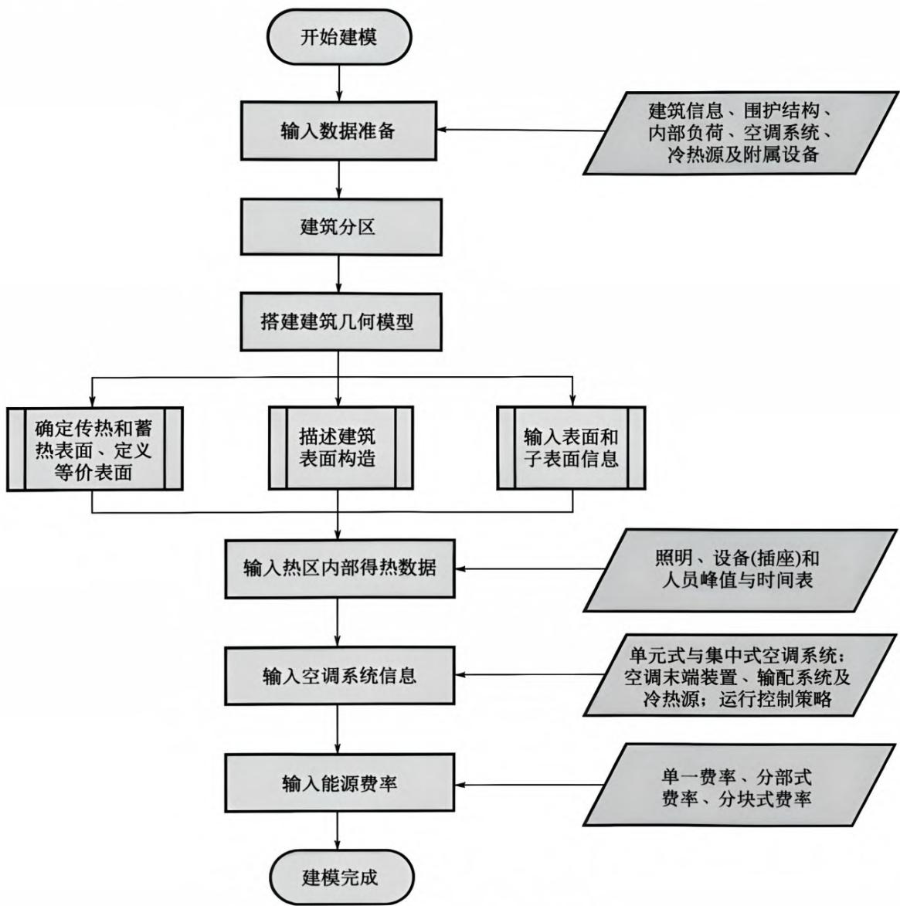  
图9.3-1 建模步骤示意图

**9.3.2.1 输入参数准备**

在创建输入文件前，首先要完成以下数据资料的准备：

1. 建筑所在城市的位置和气象资料。

2. 建筑围护结构信息和数据，包括外墙、内墙、隔墙、地板、顶棚、房顶、窗和门等。

3. 建筑使用信息，包括每个区域的照明、设备（包括电、气等设备）和人数。

4. 建筑内每个区域的温度控制策略。

5. 空调系统运行信息和具体时间表。

6. 冷热源设备的运行信息，包括锅炉、制冷机等。

**9.3.2.2 建筑分区**

建模时的一个重要概念是“区域”（zone）或者“热区”（thermal zone），是指处于相同温度的一定体积的空气和所有构成其边界的传热和蓄热表面，即只有一个温度设定值（温控器）的区域。传热表面是指任意一个分隔两个明显不同温度空间的表面，如外墙、屋顶和地板等；蓄热表面是指其分隔的空间具有相同的温度，如内墙。

一个热区可以包含一个或多个房间（Room）或空间（Space），与建筑中实际的几何分隔并不一定相同。“热区”更多的是一个热的概念，而非几何概念。热区主要包括三种：空调热区、非空调热区（阁楼、吊顶、车库、设备间等）、作为送风或回风静压箱的吊顶或架空地板空间。

分区的主要原则是：在不影响模型完整性的情况下，定义尽可能少的区域。可以用系统（风机系统或辐射系统）的数量来确定热区的数量，即有多少个空气系统（或辐射系统），则最少可以有多少个热区。主要分区规则如表 9.3-2 所示。

主要分区规则  
表9.3-2

<table><tr><td>序号</td><td>分区规则</td><td>具体说明</td></tr><tr><td>1</td><td>使用功能</td><td>合并到一个区域的房间应具有相似的使用功能、内部负荷(人员、照明、设备)和时间表。例如,将一个会议室与一个常规的办公室合并是不合适的</td></tr><tr><td>2</td><td>设定温度</td><td>被合并到一个区域的空间应具有相同的室内设定温度</td></tr><tr><td>3</td><td>太阳辐射得热</td><td>被合并到一个区域的房间应具有相似的太阳辐射得热。有外窗的外区,至少有一个区域来模拟各个朝向的外窗;没有外窗的外区则可以被合并;在分区时要特别注意遮阳</td></tr><tr><td>4</td><td>内区和外区</td><td>体量较大的建筑在建筑分区时需分内、外区,外区的进深一般取外墙内表面向内4~5m;内区全年需要供冷,而外区则在冬季需要供热</td></tr><tr><td>5</td><td>空气输配系统</td><td>由不同空气输配系统服务的房间不能合并到一个区域,例如风机盘管系统和冷辐射吊顶系统。只有空气输配系统相同的房间才能进行合并</td></tr></table>

【例 9.3-1】图 9.3-2（a）所示的建筑内设计有 5 个系统，分为 7 个热区，每个热区的位置如图 9.3-2（b）所示。

区域 1 和区域 2（zone 1 和 zone 2）共用一个四管制风机盘管系统，本可以定义为一个区域，划分为 2 个区域是因为设计者认为侧厅的西南侧有更高的日照负荷，并想确定这个空间内负荷的大小。区域 4 和区域 7（zone 4 和 zone 7）虽然共用一个系统，由于这两个房间不相邻，通常将其定义为两个热区。根据系统类型分区情况如表 9.3-3 所示。

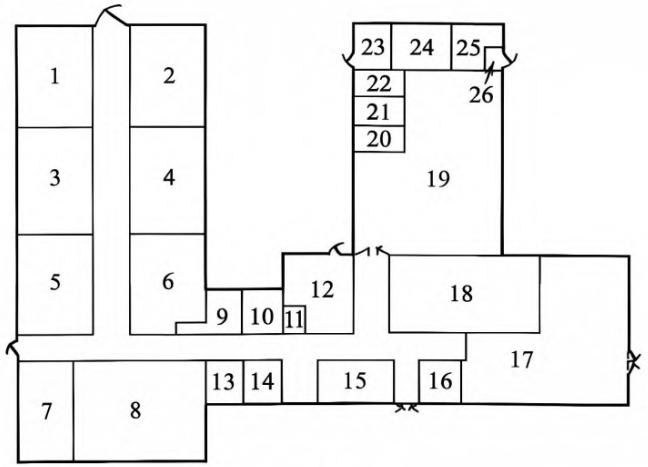  
(a)

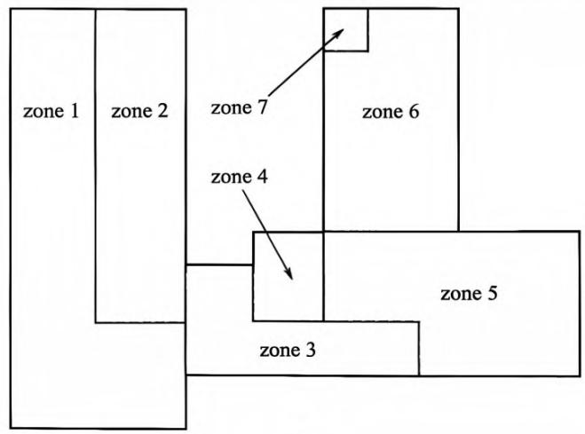  
(b)  
图9.3-2 某建筑平面分区示意  
(a) 平面图；(b) 热区示意图  
注：图 9.3-2（a）中数字为房间编号。

根据系统类型分区情况  
表9.3-3

<table><tr><td>系统序号</td><td>系统名称</td><td>风量( $m^3/s$ )</td><td>系统对应的区域</td></tr><tr><td>1</td><td>四管制风机盘管</td><td>1.84</td><td>zone 1</td></tr><tr><td>1</td><td>四管制风机盘管</td><td>1.18</td><td>zone 2</td></tr><tr><td>2</td><td>全空气系统</td><td>0.66</td><td>zone 3</td></tr><tr><td>3</td><td>全空气系统</td><td>1.06</td><td>zone 5</td></tr><tr><td>4</td><td>全空气系统</td><td>1.15</td><td>zone 6</td></tr><tr><td>5</td><td>单元热风器</td><td>0.087</td><td>zone 4</td></tr><tr><td>5</td><td>单元热风器</td><td>0.019</td><td>zone 7</td></tr></table>

对建筑总负荷计算可采用更加简化的模型——单一热区模型。虽然无法估计建筑内部负荷的分布，但总负荷值可以通过快速计算得到，其结果与详细模型的计算结果相比，也不会有明显不同。这可以用于估计冷热源设备的容量。图 9.3-3 所示为该建筑的单一热区模型。

**9.3.2.3 搭建建筑几何模型**

建筑分区完成后，可在建筑简略图上画出热区，表面尺寸也可在简略图中表示，以方便搭建建筑几何模型。建筑几何模型的搭建分为三个步骤：确定传热和蓄热表面、描述建筑表面构造、输入表面和子表面信息。

1. 确定传热和蓄热表面：定义等价表面，在不显著影响模型完整性的前提下定义尽可能少的表面，可以将一个热区中所有构造相同的蓄热表面定义为一个等价表面，将一面外墙上的所有同一类型的窗合并为一个窗，而遮阳设施也可以进行相应的合并。

2. 描述建筑表面构造：

(1) 非透明围护结构: 采用详细建模方法, 非透明围护结构由多层材料按从室外到室内的顺序组成, 每种材料需输入其导热系数、密度、比热容和厚度等参数, 最内层表面与室内空气之间进行对流换热, 最外层表面与室外空气的对流换热系数根据空气温度、外表面粗糙度和风速在每个时间步长内进行计算。还需输入围护结构外表面的粗糙度、太阳辐射反射率或吸收率。围护结构的传热系数由其材料层的构成决定，在模拟软件中自动计算得出。

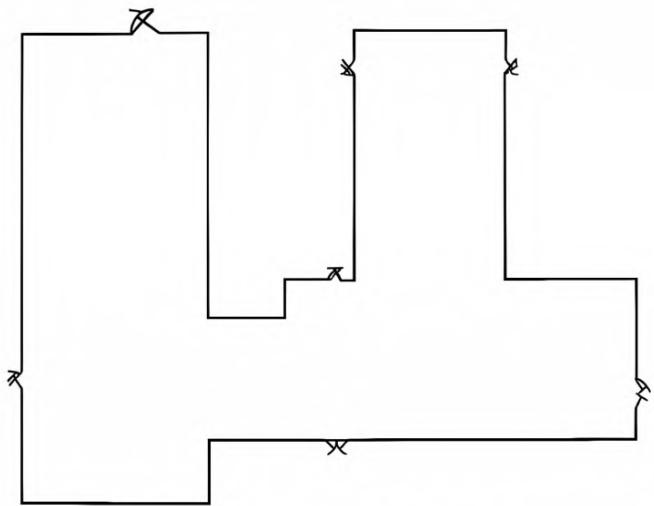  
图9.3-3 单一热区模型

**(2) 透明围护结构：**

1）简化输入：仅输入玻璃的传热系数和太阳辐射得热系数 SHGC（或遮阳系数 SC），不详细输入其构造和材料的传热与光传递特性。

2）从数据库选取：包含光谱数据，太阳辐射得热系数 $SHGC$ 和可见光传导率 $T_{\mathrm{vis}}$ 随太阳入射角而变化。

3）建模：根据实际的窗户建立玻璃和窗框模型，计算出整个窗户的光热特性参数。

(3) 内部隔断: 采用简化算法, 仅输入传热系数和太阳辐射吸收率。

3. 输入表面和子表面信息。

(1) 建筑信息: 指定建筑的一面墙作为建筑的北轴方向, 从而简化建筑的几何描述。建筑模型的北轴是以真实北轴为基准的。表面的角度是指其与建筑北轴的夹角。

(2) 热区信息:

1）墙高：一般只需输入一次，因为通常一个热区所有墙的高度都是相同的。如果各面墙高度不同，则需分别输入。

2）表面信息：包括类型（墙、地板、屋顶、内部蓄热体等）、构造、几何位置、面积等。

3) 子表面信息: 包括类型 (窗、天窗、门等)、构造、几何位置、面积等。

图 9.3-4 显示了单一热区模型的表面和子表面。由于建筑中有两种类型的隔板，因此定义了两个不同构造的等价蓄热体。

建筑表面构造描述时可选择简化输入或详细输入。

简化输入是直接输入整个构件的基本热工参数，并不输入组成构件的各种材料的特性。例如，一面外墙，仅输入传热系数和太阳辐射吸收率；一个外窗，仅输入传热系数、SHGC 和 $T_{\mathrm{vis}}$ 。采用这种输入方式将使围护结构不具有蓄热特性，外窗的 SHGC 和 $T_{\mathrm{vis}}$ 也不会随太阳辐射入射角度而变化。因此，简化输入方法对轻型围护结构（如内墙等）是比较合适的。

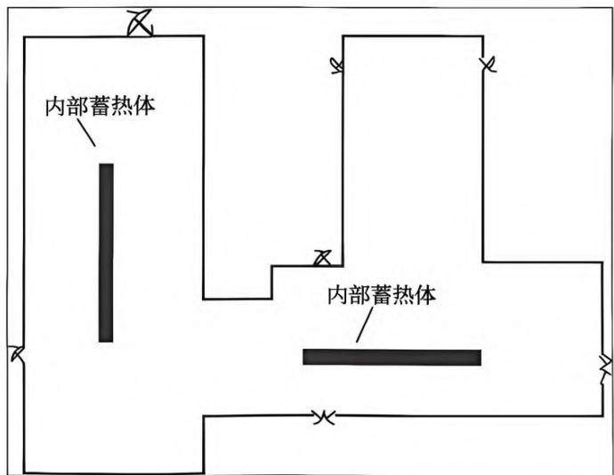  
图9.3-4 单一热区模型的表面和子表面

详细输入更为准确，即详细输入组成围护结构的各种材料的特性，再用这些材料组合成围护结构。这样建立的模型能够较准确地模拟建筑构件的蓄热特性，以及计算围护结构得热的延迟和衰减。

透明围护结构包括外窗、玻璃幕墙和天窗，在输入时需注意四个重要的特性参数，如表 9.3-4 所示。

透明围护结构的主要特性参数  
表 9.3-4

<table><tr><td>序号</td><td>特性参数</td><td>详细说明</td></tr><tr><td>1</td><td>传热系数</td><td>透明围护结构本身的传热系数,不包括窗框</td></tr><tr><td>2</td><td>SHGC SC</td><td>太阳辐射通过外窗传递到室内变为得热的比例,其数值在0到1之间,SHGC越小,则太阳辐射得热越少。SC表示实际玻璃的太阳辐射得热与标准玻璃(3mm厚白色透明玻璃)的太阳辐射得热之比。SC与SHGC有对应关系:SC=1.15SHGC</td></tr><tr><td>3</td><td> $T_{vis}$ </td><td> $T_{vis}$ 为太阳光线传递到室内的可见光的比例,其数值在0到1之间。在计算日光照明的节能量时会用到 $T_{vis}$ </td></tr><tr><td>4</td><td>光热比LSG</td><td> $LSG = T_{vis}/SHGC$ </td></tr></table>

在输入建筑的几何外形和表面信息时，可以在不破坏模型完整性的前提下进行合理的简化。从建筑热工分析，只有三个因素对建筑表面传热是有影响的：表面面积、朝向和倾斜角度。因此，在输入时并不要求完全按照建筑的实际几何外形进行输入，只需保证各个表面具有与实际建筑相同的表面面积、倾斜角度和朝向，各个表面被合理分配到不同的热区中，如图9.3-5所示。目前有些输入界面帮助搭建建筑几何模型，如Sketchup Plugins、Open Studio、IES等。有些模拟软件具有导入CAD文件的功能，或者允许用户以CAD图为底图描出建筑几何外形，BIM软件生成的gbXML文件可以被导入到一些软件中，完成建筑几何输入部分。

**9.3.2.4 输入热区内部得热数据**

人员、灯光、设备负荷共同组成了热区的“内部得热”。在建筑能耗模拟软件中，“得

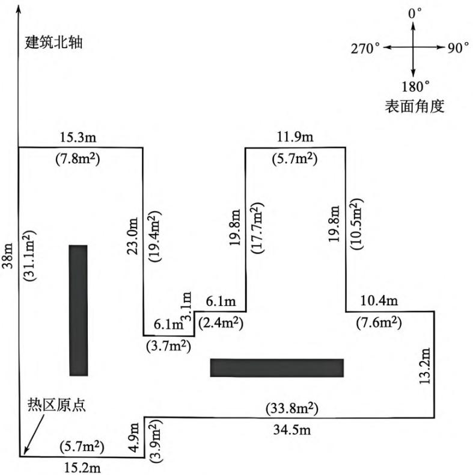  
图9.3-5 单一热区域模型表面信息示意图

热”负荷用设计负荷或峰值负荷及其相应的时间表来描述。

**1. 峰值负荷**

照明峰值负荷包括光源和整流器的功率，也包括应急照明的功率。插座和设备负荷是非规律负荷，包括计算机、复印机、服务器、厨房用电设备等的功率。峰值人数指热区里的最多人数。

峰值负荷可以用总值或者密度（单位为 $\mathrm{W} / \mathrm{m}^2$ 或者 $\mathrm{m}^2/$ 人）输入，可根据设计值进行设定。在没有设计值时，可以根据相关的规范（如《公共建筑节能设计标准》GB50189、ANSI/ASHRAE/IES90.1、ANSI/ASHRAE62.1等）进行设定。但按设计值输入的峰值负荷（尤其是插座和设备负荷）可能会过高，从而造成模拟不准确。为了避免过高的输入值，可以实测或根据铭牌值估算，使输入更准确。

**2. 内部负荷时刻表**

内部负荷时间表为逐时的照明、设备和人员负荷与峰值负荷之比，包括每日、每周、每月、每年的时间表。在《公共建筑节能设计标准》GB 50189 和 ASHRAE 90.1 等规范中给出了典型的时间表，建模时可以采用。当然实际建筑的内部负荷时间表具有随机性和不规律性，要想更准确地建模，需要进行现场调研，尤其是对既有建筑。

如空调系统采用吊顶（静压箱）回风，则照明、设备和人员得热的一部分可能直接进入回风静压箱，在建模时需要进行定义。在模拟置换通风系统时，因为分层作用，进入吊顶的热量比一般的混合通风系统要多。嵌入式和平齐式安装的灯具的热量有 $20\%$ 或更多进入吊顶静压箱，而悬挂式灯具所有的热量全部进入室内。

**3. 日光照明模拟**

采用日光照明调光控制系统会使照明负荷降低，可以有两种模拟方法：

(1) 在能耗模拟软件中直接模拟日光照明。

（2）采用专门的工具模拟日光照明，生成照明负荷时间表，再将该时间表输人能耗模型。

与专门的日光照明模拟工具相比，能耗模拟软件的日光照明模拟功能有限。无论采用哪种工具建模，都要注意照度传感器位置、调光的类型（连续或分级）、眩光控制等的设定。

**9.3.2.5 输入空调系统信息**

空调系统可以分为两大类：单元式（分散式）和集中式。单元式空调系统的送风机、制冷压缩机和热源都在一个机组内，冷凝器可以在机组内，也可以在外面。集中式空调系统包括完全集中的全空气系统和半集中的风机盘管或诱导式系统。在模拟软件中，集中式空调系统的冷热源装置被作为水侧的部件，因为其产生冷热水，再输送到空调系统的空气—水热交换器；而单元式空调系统的机组则被作为风侧的设备模拟。很多模拟软件不能模拟一些新的空调系统，建模者还需做一些近似处理。

**1. 单元式空调系统**

单元式空调系统的冷凝器主要有四种类型：风冷冷凝器、水冷冷凝器、蒸发冷却式冷凝器、土壤源冷凝器。

（1）风冷冷凝器：将热量排到室外空气中，同时冷凝器中的制冷剂被冷却，包括分体式系统、一体式系统和计算机房空调。

（2）水冷冷凝器：直膨盘管与开式或闭式冷却塔相连，通过冷却塔把热量排到空气中。

（3）蒸发冷却式冷凝器：包括两种类型，即直接将水喷到冷却空气中（直接蒸发式），将水喷到用来冷却另一路空气流的空气中（间接蒸发式）。

（4）土壤源冷凝器：热量也可以被排到土壤里或池塘、江河里，因土壤的温度全年基本保持不变，没有极端的温度出现，土壤源是一种能效较高的冷却方式。

单元式供热系统包括散热器、燃油或燃气炉。散热器通过对流换热向室内供热，燃油或燃气炉则需要风机把加热的空气输送到室内。

在模拟单元式空调系统时，要注意不要重复计算风机、压缩机和冷凝器的功率，要清楚地知道 COP（EER）包括哪几部分的效率和能耗，哪些部件需要单独模拟。

**2. 集中式空调系统**

集中式空调系统为多个区域或大面积的单个区域服务。

(1) 制冷机组: 可以是风冷机组、水冷机组 (连接冷却塔) 或蒸发冷却机组。

(2) 供热锅炉: 集中制取热水或蒸汽用来供热。

（3）输配系统：将热水或冷水供到每个区域的空气处理机组和空调末端，如风机盘管、蒸汽或热水散热器、供暖地面、冷吊顶或冷梁等。

**3. 变风量空调系统**

变风量空调（VAV）系统是一种全空气集中式系统，由末端装置（VAV箱）、变频风机和自控系统构成。

**(1) 末端装置**

VAV 系统的末端装置主要有三种：节流型、串联式风机动力箱（串联式 FPB）、并联式风机动力箱（并联式 FPB）。节流型末端装置靠阀门开度调节送入室内的风量；串联式 FPB 的风机一直运转，保持送入室内的风量不变；并联式 FPB 的室内回风量不变，送入室内的风量变化。这些末端装置都可以带再热盘管，用于建筑外区的冬季供热。

VAV 系统的重要参数包括最小新风比、恒温器类型和风机功率。

1）最小新风比：是建模时的重要参数，其值可以根据设计设定，也可以参考相关标准（如ASHRAE90.1）。既有建筑可以在楼宇设备自控系统界面上找到。

2）恒温器类型：是指供热工况时风阀的控制方式。如果在供热时风阀开大，即为“反向控制”；如果风阀在供热时保持在最小风量开度位置，就是“比例控制”。不同的选择决定了再热量的大小，供热工况下的低风量可能使某些区域供热不足。反向控制的VAV箱在以一个最小风量保证通风要求的同时提供足够的供热量。

3）风机功率：对于风机动力箱（FPB），需要输入风机功率，由于小型风机的能效不高，其功率对风机的总能耗影响很大。

**(2) 变频风机**

VAV 系统的风机功率随风量的变化而变化，其关系曲线称为 “风机曲线”，但它不同于设计人员在选择风机时所用的风机曲线。用于模拟的风机曲线一般为二次或三次曲线，X 轴为部分负荷率，Y 轴为风机功率与满负荷功率之比。不同的风机控制方式的部分负荷效率曲线不同。大多数软件允许用户自己输入风机曲线的系数，或曲线上的点，然后由软件进行曲线拟合，计算出系数。

**(3) 制冷机组**

多数能耗模拟软件采用回归拟合公式表达制冷机组性能，即制冷量、输入功率与部分负荷率、冷水出水温度和冷却水回水温度之间的关系曲线。很多软件包含不同类型制冷机组的缺省曲线，用户也可以输入曲线的系数。

制冷机组的性能曲线对能耗的影响是很大的，因此要仔细选择。如果用户需要自己做出性能曲线，则需要额外要求制冷机组厂家提供机组性能数据，再用统计分析软件做出性能曲线。在做性能曲线时要特别注意制冷机组性能数据需涵盖运行工况的全部范围，否则生成的性能曲线公式是不正确的。

在模拟软件中常常自带不同形式制冷机组的性能曲线，但这些性能曲线往往是特定设计工况下的运行性能曲线，如需更加准确、可靠的模型，可利用制冷机组实际运行数据对三条性能曲线中的系数进行校验和修正，常用的方法有最小二乘拟合法、代入验证法等。单元式机组和锅炉也采用相似的模型进行模拟。

**(4) 新风量**

新风量的设定在空调系统建模中非常重要，因为其对能耗影响很大。新风量有三种输入方式：人均新风量、单位面积新风量、总新风量。需根据设计值或相关规范（如《公共建筑节能设计标准》GB 50189、ANSI/ASHRAE 62.1等）进行设定。

**9.3.2.6 输入能源费率**

建模者需输入建筑所处城市或地区的能源费率，能源费率的主要类型如表 9.3-5 所示。不同城市或地区的能源费率构成并不相同，有的简单（如单一制电价），有的复杂（如分部制费率+基本费用，或分块收费等），建模者应按照模型建筑所处地区的实际情况进行输入。

能源费率的主要类型  
表9.3-5

<table><tr><td>序号</td><td>能源费率</td><td>详细说明</td></tr><tr><td>1</td><td>月服务费</td><td>每月交纳的固定费用,用以支付能源供给的设施和服务,包括计费设施、表计设施和维护费用</td></tr><tr><td>2</td><td>能源费用</td><td>按照能源的消耗量交纳的费用,如1元/kWh</td></tr><tr><td>3</td><td>基本费用</td><td>按某个时段(一般为每月)的最大能源需求收取的费用,如30元/kW</td></tr><tr><td>4</td><td>功率因数费用</td><td>对于功率因数较低时收取的额外费用,可以附加在基本费用上收取</td></tr><tr><td>5</td><td>分块收费</td><td>每个块内的费率不同,可以是增长型或下降型。增长型中高能耗块的费率比低能耗块高,下降型则相反。增长型对节能比较有利</td></tr><tr><td>6</td><td>分部制费率</td><td>把一天24h分为不同的时段,如峰时、平时和谷时,能源费率在一天不同的时段、周、季节、年都可以不同,峰时的费率高于谷时和平时,一些削峰填谷的技术(如蓄冷空调)能够节省一定的能耗费用</td></tr><tr><td>7</td><td>其他费用</td><td>根据当地的规范或计划收取的费用或者税费</td></tr></table>

### 9.3.3 模拟结果的合理性检验

模型的合理检查主要包括以下几个方面：

1. 检查输入错误。

2. 检查输出文件。

3. 模拟人员确认理解模拟软件的算法。

4. 确认模型能否模拟实际的系统和过程。

5. 尽可能提高模型的详细程度。

应对输入参数进行逐项核对，并检查中间计算结果是否合理。例如围护结构如果采用逐层材料输入，可检查输出文件中计算得到不同围护构件（墙体、窗等）的传热系数或热阻是否在合理范围内，是否满足规范要求。对于顺序模拟软件，例如 DOE-2、eQUEST，可以对其分步模拟（建筑负荷、系统负荷、设备能耗）输出结果进行检查，例如对于建筑负荷可以计算单位建筑面积负荷，检查其是否在合理范围之内。而对于同步模拟软件（EnergyPlus、DeST），可以输出一些重要节点的参数（如送风温度），检查其是否在合理范围之内。

## 9.4 案例介绍

相关软件（DeST、EnergyPlus、DOE-2）的能耗动态分析与计算案例详见本书增值服务或识别二维码查看。