# 第 10 章 室内气流组织与模拟

## 10.1 室内参数与气流组织预测方法

室内空气环境对于人员的舒适、健康具有重要意义，同时也是保障产品质量、提高生产效率的重要因素。在建筑建造之前，通常都希望知道建成之后室内环境状况能否达到要求，为此就需要有相应的手段对建成后的环境进行预测。采用模型实验能够获得较高的实验精度，但模型实验需要较长的实验周期和较高的实验费用，难以在工程设计中广泛采用，因此本章主要介绍基于射流理论和计算流体力学的预测方法。

### 10.1.1 射流理论与区域模型

自 20 世纪 30 年代起，众多研究者对机械通风房间送风口的射流特性进行了实验和理论研究，并于 20 世纪 50 年代初建立了一系列射流公式用于室内空气分布的预测，成为最经济简单的室内空气分布预测方法。

20 世纪 70 年代比利时的 Lebrun 首先提出区域模型（Zonal Model）概念，用于自然通风风量、温度分布等的预测计算。区域模型最初应用于自然通风条件下的温度分布、能源效率、热舒适度等的计算，后经改进后用于机械通风。区域模型方法的出现，为使用较小代价获得较为详细的分布参数的数值计算方法提供了途径。区域模型假设各区域内环境参数均匀一致，不同区域之间有质量和能量的传递，模拟结果可以让工程人员初步了解室内各种参数的分布情况。

区域模型通常有三种方法（表 10.1-1）。第一种是通过对计算流体力学（CFD）方法计算结果的整理，获得流场信息，然后使用区域模型的关联矩阵计算得到区域环境参数分布情况。该模型不求解非线性质量方程组，因此关联矩阵的求解过程耗时少、速度快。但该方法的适用范围仅限于质量方程和能量方程不耦合或耦合很弱的情况，如机械通风等场合。

一些研究人员在第一种区域模型方法的基础上，提出不依靠 CFD 的质量流量独立求解方法，即第二种方法。该方法假定区域间流动阻力只发生在区域边界，通过边界的质量流量使用平均速度方法求得，符合幂律定律 $\dot{m}=k\rho(\Delta P)^{n}\cdot\mathrm{d}A$ 并建立了一套完整的求解方法，模拟结果与 CFD 以及实验结果有很好的吻合度，成为较经典的区域模型算法。国外已有较成熟的区域模型软件，如 SPARK、COWZ、POMA 等，以及基于 SPARK 的自动分区软件模块 GenSPARK。

2001 年，耶鲁大学的 James W. Axley 提出不同于经典方法的第三种方法。该方法基于剪应力动量平衡模型，模型中考虑靠近壁表面的剪应力传送，在与流体单元相联系的邻近网格间应用动量平衡关系建立方程。相关文献中应用 CONTAM 程序的算例表明，该方法迭代计算速度快、收敛性好，但到目前为止应用还很有限。

三种区域模型方法比较  
表10.1-1

<table><tr><td>区域模型</td><td>简介</td><td>特点</td><td>典型软件</td></tr><tr><td>方法一</td><td>通过对CFD结果的整理,使用区域模型的关联矩阵计算得到分布参数</td><td>适用于质量方程和能量方程耦合很弱的情况,如机械通风等场合</td><td>—</td></tr><tr><td>方法二</td><td>假定区域间流动阻力只发生在区域边界,通过边界的质量流量使用平均速度方法求得</td><td>模拟结果与CFD以及实验结果有很好的吻合度,较经典的区域模型算法</td><td>SPARK、COWZ</td></tr><tr><td>方法三</td><td>基于剪应力动量平衡模型,考虑靠近壁表面的剪应力传送和动量平衡关系建立方程</td><td>该方法迭代计算速度快,收敛性好</td><td>CONTAM</td></tr></table>

### 10.1.2 计算流体力学方法

1933 年，英国人 Thom 首次用手摇计算机数值求解二维黏性流体偏微分方程，计算流体力学由此诞生。此后，Shortley 和 Weller 在 1938 年，Southwell 在 1946 年各自利用松弛方法（Relaxation Method）求解了椭圆形微分方程，即非黏性流体的偏微分方程组，使 CFD 逐渐成为一门学科而被科学家和工程师所研究和认识。在随后短短的几十年内，由于计算机技术和数值计算技术的高速发展，CFD 技术也得到了长足发展，其在工程领域的应用越来越广泛。

1974 年，丹麦的 P. V. Nielsen 首次将 CFD 技术应用于室内通风空调领域，模拟室内空气流动情况，他利用流函数和涡旋公式求解封闭二维流动方程，流体湍流采用 $k-\varepsilon$ 模型进行模拟，计算所得的房间某些断面速度分布和射流轴心速度的衰减与实验数据对比表明，数值计算的结果是可信的。1978 年，Nielsen 采用守恒方程的原始变量形式（Primitive Variable Form）求解三维室内空气流动情况，因为对于三维情形是没有流函数的，故他采用的是原始变量形式，并且他首次提出了描述风口入流边界条件的盒子方法（Box Method）。1979 年，Nielsen 首次报道了有关浮力影响的室内非等温空气流动的数值计算情况；1980 年，Gosman 利用 $k-\varepsilon$ 模型对不同几何形状的房间进行了三维数值模拟，发现不同情形下的湍流动能 k 和湍流长度尺度 l 是一致的，并首次提出指定速度法（Prescribe Velocity Method）来描述风口入口边界条件。1983 年，Markatos 计算了一个大空间（电视播送室）内的三维流动和传热问题，他提出了利用 CFD 技术来改进大空间空调系统设计的过程。1984 年，Ishihu 和 Kaneki 利用流函数和涡旋公式数值求解非稳态二维流动方程，预测室内污染物的分布，借此来研究室内通风效率。1984 年，Reinartz 和 Renz 详细计算了一个利用环形散流器送风的房间速度和温度分布，他们对散流器按照二维情形直接进行模拟，所用网格数为 $50 \times 50$ ；Alamdari 和 Hammond 描述了建筑物表面对流换热系数的计算方法。1986 年，Awbi 和 Setark 利用 TEACH 程序模拟预测了二维贴壁射流的速度分布，从而分析室内障碍物以及墙壁对射流的影响；1987 年，他们进一步对三维情形作了类似的工作。Waters 在 1986 年利用 CFD 方法对许多建筑物（如前庭、洁净室和机场候车厅等）的速度分布和温度梯度进行了模拟计算，尤其对烟气运动进行了模拟分析。1988年，Jones和Reed报道了利用CFD方法对大空间空气流动和温度梯度进行模拟预测的情况，其中利用了贴体坐标。Chen Qingyan则在1988年利用CFD技术对建筑物能耗、室内空气流动以及室内空气品质等问题进行了分析和研究。1990年和1991年，Jones和Waters报道了大量利用CFD技术对前庭、机场候机厅、洁净室以及办公室进行分析的实例，Jones提出利用CFD方法来指导设计，以避免办公类建筑中病态建筑的出现。1989年，ASHRAE专门成立了用CFD方法预测室内空气流动的研究机构，它组织和完成了ASHRAE的第464号（RP464）研究课题“室内空气流动的数值计算”。这项课题比较完整地研究了CFD方法模拟室内空气流动的许多相关问题，其结果发表在1994年的ASHRAE杂志上。至此，CFD技术在室内通风空调领域内推广开来。

近年来，人们开始将更为高级和复杂的数值模拟技术应用于室内通风空调领域。Murakami 等人利用代数应力模型（ASM）和微分应力模型（DSM）等二阶封闭模型对水平非等温射流引起的三维室内空气流动进行模拟，并与经典的 $k-\varepsilon$ 两方程模型的结果作了对比，发现利用二阶封闭模型模拟所得结果较 $k-\varepsilon$ 模型的模拟结果更好；Emmerich 等人则利用大涡模拟（LES）技术对三维房间内热空气流动和烟气传播进行了数值模拟，结果与实验数据吻合得很好。但限于计算机运算速度以及实际工程要求，高级数值模拟技术，尤其是大涡模拟技术和直接数值模拟（DNS）还难以在工程中广泛应用。

我国在 20 世纪 80 年代初也开始了 CFD 在室内供热、通风、空调方面应用的研究。湖南大学的汤广发在 20 世纪 80 年代编写了一套二维层流计算程序，并成功分析了通风墙体和标准工业厂房的自然对流等难度较大的工程问题，之后改进了 SIMPLE 算法，并对计算收敛、一般松弛法、源项松弛法、大空间多风口、多障碍物、室内热源等问题进行了研究，取得了大量基础性研究成果。清华大学的李先庭团队对空调风口入流边界条件和数值算法进行了研究，建立了室内空气流动数值模拟的简洁体系，开发了应用于建筑环境与设备流动与传热问题分析的模拟计算软件 STACH-3；并对地板置换通风、座椅送风等通风系统进行了模拟研究，对以体育场馆为主的高大空间的气流组织设计及其与空调负荷计算的关系进行了数值模拟研究，对形式比较固定的洁净室空调气流组织形式进行数值模拟，可指导工程设计。

简单地说，CFD 方法就是在计算机上虚拟地做实验：依据室内空气流动的数学物理模型，将房间划分为小的控制体，把控制空气流动的连续的微分方程组离散为非连续的代数方程组，结合实际的边界条件在计算机上数值求解离散所得的代数方程组，只要划分的控制体足够小，就可认为离散区域上的离散值代表整个房间内空气分布情况。

表 10.1-2 给出了四种室内空气分布预测方法的比较。可以看出，就其他三种预测室内空气分布的理论方法而言，CFD 方法确实具有无可比拟的优点，且由于当前计算机技术的发展，CFD 方法的计算周期和成本完全可以为工程应用所接受，也越来越多地应用于暖通空调领域。尽管 CFD 方法还存在可靠性和对实际问题的可算性等问题，但这些问题已经逐步得到解决。因此，可以将 CFD 方法应用于室内空气分布的模拟和预测，从而得到房间内空气各种物理量的详细分布情况。这对于保证良好的空调系统气流组织方案设计、提高室内空气品质以及减少建筑物能耗都有着重要的指导意义。

4种空气分布的预测方法的比较  
表10.1-2

<table><tr><td rowspan="2">比较项目</td><td colspan="4">预测方法</td></tr><tr><td>射流公式</td><td>区域模型</td><td>CFD</td><td>模型实验</td></tr><tr><td>房间形状复杂程度</td><td>简单</td><td>较复杂</td><td>基本不限</td><td>基本不限</td></tr><tr><td>对经验参数的依赖性</td><td>几乎完全依赖</td><td>很依赖</td><td>较依赖</td><td>不依赖</td></tr><tr><td>预测成本</td><td>最低</td><td>较低</td><td>较昂贵</td><td>最高</td></tr><tr><td>预测周期</td><td>最短</td><td>较短</td><td>较长</td><td>最长</td></tr><tr><td>结果的完备性</td><td>简略</td><td>简略</td><td>最详细</td><td>较详细</td></tr><tr><td>结果的可靠性</td><td>差</td><td>差</td><td>较好</td><td>最好</td></tr><tr><td>实现的难易程度</td><td>很容易</td><td>很容易</td><td>较容易</td><td>很难</td></tr><tr><td>适用性</td><td>机械通风,且与实际射流条件有关</td><td>机械和自然通风</td><td>机械和自然通风</td><td>机械和自然通风</td></tr></table>

## 10.2 计算流体力学基础理论与常用工具

室内空气流动数值计算基本环节包括：建立流动数理模型，得出流动控制微分方程组；在计算域上对流动控制微分方程组进行离散，将离散结果整理为代数方程组；拟定特定的算法，根据算法对离散所得代数方程组进行求解，得到计算域内空气流动分布信息。本节主要介绍室内气流模拟所需要进行的特殊处理。

### 10.2.1 边界条件和初始条件

对于一个一般性的非稳态问题，定解条件包括边界条件和初始条件。

**10.2.1.1 边界条件**

边界条件一般有如下几类：

(1) 给出变量 $\phi$ 的值: 如壁面的温度、非滑动壁面的速度分量为零等。

(2) 给出 $\phi$ 沿某方向的导数值 $\frac{\partial \phi}{\partial n}$ : 如已知壁面的热流量, 对绝热壁面则 $\frac{\partial \phi}{\partial n} = 0$ 。

（3）给出 $\frac{\partial \phi}{\partial n}$ 和 $\phi$ 的关系式：如通过对流换热系数以及周围流体温度而限定壁面的换热量等。

**10.2.1.2 初始条件**

非稳态问题初始条件为已知 $t = 0$ 时刻的 $\phi$ 。它可以是个常数值，也可以是空间位置的函数。实际应用中，如果只对非稳态问题最终达到的稳定状态感兴趣，而不关心过程中的瞬时细节的话，则初始条件的确定可以有很大的任意性。

### 10.2.2 湍流模型

目前湍流模拟的方法主要有：直接数值模拟（DNS）、大涡模拟（LES）和雷诺平均法（RANS）。DNS 方法就是直接用本书第 2 章中的瞬时 N-S 方程对湍流进行计算，而

LES将大涡旋的控制方程分离出来直接求解，小涡旋利用湍流模型模拟。尽管DNS和LES能够捕捉到更多的流动细节，但由于采用这两种方法求解时计算过于繁琐、计算时间长，目前还很难用于实际工程。从工程应用角度而言，重要的是湍流引起的平均流场的变化而非全部细节。因此，目前对于多数的实际应用工程是求解时均化的N-S方程，而将瞬态的脉动量通过某种模型在时均化的方程中体现，由此产生了RANS方法，可大大缩短计算时间。

根据对雷诺应力作出的简化处理方式不同，存在不同的湍流模型。复杂的如雷诺应力模型 RSM、代数应力模型 ASM 等，广泛应用的有涡黏系数模型 EVM。EVM 根据附加求解紊流黏性系数的微分方程数量主要分为零方程模型、一方程模型、二方程模型等，它们计算量较小，适于工程应用。其中的 $k-\varepsilon$ 模型最为常用。在选择这些模型时，还要考虑模型对初始条件和边界条件的适用性，例如在近壁面处就不能直接使用标准 $k-\varepsilon$ 模型、RNG $k-\varepsilon$ 模型等高雷诺数的湍流模型，必须借助壁面函数法或低雷诺数模型进行处理；对于非等温流动，或者说浮升力较大的流动，通常需要低雷诺数（LRN） $k-\varepsilon$ 模型才能取得较好的模拟结果，而低雷诺数 $k-\varepsilon$ 模型要求近壁区的网格较密。

### 10.2.3 数值计算方法

建立了室内空气流动的数学物理模型之后，需要采用数值计算方法进行求解。数值计算方法包括对相关方程进行离散及对方程进行求解等。

**10.2.3.1 方程的离散**

目前，在数值计算方法中存在三种离散方法：有限差分法、有限容积法及有限元法。有限差分法根据 Taylor 展开得到，从数学上分析误差较为方便，但是物理意义不明显；有限容积法则相反，它通过将计算域划分为离散的控制体，再在控制体上对各个守恒控制微分方程进行积分而得到离散代数方程组，因此该方法物理意义明显，但是难以分析其误差；有限元法则可对不规则形状的计算域进行离散，在局部用连续的函数表达所求的物理量场。在室内空气流动的数值计算中，应用最多的还是有限容积法，这里主要介绍此方法。

**1. 网格的划分方法**

首先，将计算域划分成许多互不重叠的子区域，通过对区域划分，可得到如下几种几何要素：

(1) 节点: 需要求解的未知物理量的几何位置。

(2) 控制容积: 应用控制方程的最小几何单位。

(3) 界面: 各控制容积的分界面。

节点通常被当作控制容积的代表。划分计算域时，一般又有两种做法：外节点法：先划节点后划界面；内节点法：先划界面后划节点，节点位于控制体的中心。下文主要以内节点法为基础介绍有关数值计算方法。

**2. 有限容积法**

有限容积法具有物理意义明显、满足守恒定律的优点。这种方法实际就是在离散控制体内对控制微分方程积分，选择合适的内插函数，用节点值表示有关界面的值以及各阶导数，从而将微分方程离散为一组以各网格节点表示的代数方程：

$$
a _ {\mathrm{p}} \phi_ {\mathrm{p}} = \sum a _ {n \mathrm{b}} \phi_ {n \mathrm{b}} + b\tag{10.2-1}
$$

其中， $a$ 为离散方程的系数， $\phi$ 为各网格节点的变量值， $b$ 为离散方程的源项。下标 $p$ 和 $nb$ 分别表示本网格节点和与 $p$ 相邻的网格节点。所有的动量方程、能量方程、组分方程等均可离散成上述形式。

**3. 数值差分格式**

用有限容积法导出离散方程时，不同的界面函数取值和导数构造方法构成了所谓的数值差分格式。常用的包括中心差分格式、上风格式、幂函数格式、指数格式、乘方格式、混合格式和 QUICK 格式等。低阶格式的计算效率高，但精度要差一些，高阶格式的特点则相反。它们对于不同的问题有不同的适用性，详细情况可参阅相关文献。

**10.2.3.2 离散方程的求解**

在对室内空气流动控制方程进行离散得到代数方程之后，需要对其求解以获得流场各物理量的分布信息。对于这些方程，数学上已有相应的解法。例如，对各节点的控制容积按有限容积法离散后的代数方程经过整理可得代数方程组：

$$
\mathbf {A} \boldsymbol {\Phi} = \mathbf {B}\tag{10.2-2}
$$

式中 A ——系数矩阵；

$\Phi$ ——求解变量；

B——常数列向量。

相应的代数方程（组）的求解可以分为直接求解法和迭代法两大类。常见的基于Cramer法则和Gauss消元法的直接求解法在求解室内空气流动问题时计算耗时较多，因此在流体流动和传热领域，直接求解法很少采用，主要采用迭代法。迭代法又大致可分为点迭代法、块迭代法、交替方向迭代法及强隐迭代法等。目前许多商用CFD软件的求解器往往能提供多种不同的解法。

**10.2.3.3 流场与其他变量的迭代求解：SIMPLE算法**

实际的流场和压力、温度（非等温）以及湍流参数等有关系，它们是相互影响的，计算时需耦合求解。为此，形成了一系列算法，最具代表性、应用最为广泛的是SIMPLE算法。随后，在此基础上发展了很多改进算法，如SIMPLER、SIMPLEC、PISO等，这些算法在一定程度上提高了计算效率。SIMPLE算法的步骤如下：

1. 假设压力场。

2. 求解动量方程的离散方程，得到速度场，速度场一般不满足连续性方程。

3. 求解联立动量方程的离散形式与连续性方程的离散形式后得到压力修正方程，求得压力修正值。

4. 利用压力修正值修正压力场，求得新的速度场。

5. 求解其他影响流场的变量，如温度、湍流动能等。

6. 判断是否收敛，如果收敛则停止迭代，否则以更新后的压力场为新的假设的压力场，跳到第2步继续计算，直至收敛。

7. 求解与速度无关的其他变量。

根据以上算法，再结合代数方程求解方法，即可对室内空气流动和换热、传质的离散方程进行求解，获得目标场分布情况。

以上介绍的数值计算方法是室内空气流动和传热问题中最为常用、成熟，也是较为有效的方法。20世纪70年代以后，随着数值计算方法在工程领域的应用，也有其他数值计算方法应用于气流组织分析，大大推动了计算流体力学在室内气流组织这一领域的应用，如有限元法、边界元法、谱分析方法等，这里就不再介绍了。

### 10.2.4 辐射换热计算

辐射作为暖通空调中的重要换热方式，对流动和热源散热有很大的影响，当辐射传热的作用不可忽略时，必须进行辐射的计算。在实际辐射传热过程中，通常假设空气是辐射的透明体，不吸收辐射的热量，辐射只作用在壁体表面上。目前，可以借助一些经典的辐射模型来处理由辐射引起的加热、冷却等，这些模型主要有 Rossland（Rossland 辐射模型）、P1（P1 辐射模型）、RTRM（离散传播辐射模型）、S2S（表面-表面辐射模型）和 DO（离散坐标辐射模型）等，它们具有较高的计算精度，已经被集成到一些 CFD 软件中，供用户选用。用于建筑室内模拟时，空气的散射和吸收作用通常可以忽略，采用 S2S 就能取得较好的效果。

### 10.2.5 室内颗粒运动和分布计算

室内颗粒运动和分布的模拟方法，主要可分为集总参数法和 CFD 方法。集总参数法是最为简单的模拟室内颗粒运动情况的方法，但不能模拟室内颗粒的空间分布，适合长时间动态分析。CFD 方法可计算室内颗粒的分布情况或者其运动轨迹，能获得相对集总参数法更为详细的信息，但计算较为耗时。采用 CFD 方法研究颗粒运动，主要有两种方法：基于 Lagrange 坐标求解颗粒运动轨迹的方法和基于 Euler 坐标求解颗粒质量浓度分布的方法。

**10.2.5.1 集总参数法**

集总参数法基于室内空气完全混合、颗粒质量浓度均匀的假设，一个典型的通风空调房间内的颗粒质量浓度模型如下：

$$
\frac {\mathrm{d} C _ {\mathrm{i}}}{\mathrm{d} t} = \lambda_ {\mathrm{r}} C _ {\mathrm{o}} - \lambda_ {\mathrm{r}} C _ {\mathrm{i}} - \lambda_ {\mathrm{de}} C _ {\mathrm{i}} + \lambda_ {\mathrm{R}} D _ {\mathrm{i}}\tag{10.2-3}
$$

式中 $C_{i}$ ——室内颗粒质量浓度， $mg/m^{3}$ ;

$C_{0}$ ——室外颗粒质量浓度， $mg/m^{3}$ ;

$\lambda_{r}$ ——房间空气换气次数， $h^{-1}$ ;

$\lambda_{de}$ ——颗粒沉降系数；

$\lambda_{R}$ ——颗粒二次悬浮系数；

$D_{i}$ ——沉降在表面的颗粒质量浓度， $mg/m^{3}$ 。

**10.2.5.2 颗粒轨道模型**

颗粒轨道模型是基于 Lagrange 坐标，通过跟踪颗粒运动的轨迹模拟颗粒运动详细情况的方法。它对于空气-颗粒两相系统中的稀疏颗粒流动较有优势，适用于室内颗粒模拟。该模型基于以下假设：颗粒与空气之间的传热忽略不计；没有颗粒的凝并或分裂；所有颗粒都是球形；忽略颗粒对空气流动的影响。对于室内环境中的颗粒轨道模型，可忽略压力梯度力、虚拟质量力以及 Basset 力，而应考虑流体拽力、重力、Brownian 力以及 Saffman 升力。简化模型如下：

$$
F _ {i} = \frac {1 8 \mu}{\rho_ {\mathrm{p}} d _ {\mathrm{p}} ^ {2}} \frac {C _ {\mathrm{D}} R e}{2 4} (u _ {i} - u _ {\mathrm{p} i}) + g _ {i} \left(1 - \frac {\rho}{\rho_ {\mathrm{p}}}\right) + F _ {\mathrm{b} i} + F _ {\mathrm{s} i}\tag{10.2-4}
$$

式中 $F_{i}$ ——在 $i$ 方向所有施加于颗粒的单位质量力， $\mathrm{m / s^2}$ ；

$u_{i}$ ——流体（空气）速度，m/s；

$u_{pi}$ ——颗粒在 i 方向的速度，m/s；

$\mu$ ——空气的分子动力黏性系数， $\mathrm{kg}/(\mathrm{m}\cdot\mathrm{s})$ ;

$\rho$ ——空气密度， $kg/m^{3}$ ;

$d_{p}$ ——颗粒直径，m；

$\rho_{p}$ ——颗粒密度，kg/m $^{3}$ ;

Re——颗粒雷诺数；

$C_{D}$ ——拽力系数；

$g_{i}$ ——i 方向的重力加速度， $m/s^{2}$ ;

$F_{bi}$ ——作用在颗粒上的 Brownian 力， $m/s^{2}$ ;

$F_{si}$ ——作用在颗粒上的 Saffman 升力， $m/s^{2}$ 。

**10.2.5.3 滑移通量模型**

上述颗粒轨道模型难以获得室内各点颗粒质量浓度分布信息，而基于 Euler 坐标的滑移通量模型可研究室内颗粒质量浓度分布问题。该模型基于以下假设：颗粒对湍流流动的影响忽略不计；运动过程中颗粒由于碰撞、凝聚引起的粒径变化不予考虑；由于气溶胶混合物密度差引起的质量力忽略不计，滑移通量模型既考虑了颗粒不同粒径的差别以及颗粒沉降作用引起的颗粒通量对空气输运的颗粒质量流的影响，又避免了复杂的双流体模型，非常适合实际工程应用的要求。其控制方程如下：

$$
\frac {\partial (\rho C)}{\partial t} + \nabla \cdot [ \rho (\vec {v} + \vec {v} _ {\mathrm{s}}) C ] = \nabla \cdot \left(\frac {\mu_ {\mathrm{eff}}}{\sigma_ {\mathrm{C}}} \nabla C\right) + S _ {\mathrm{C}}\tag{10. 2-5}
$$

式中， $\rho$ 和 $\vec{v}$ 分别为空气密度（ $\mathrm{kg} / \mathrm{m}^3$ ）和速度矢量（ $\mathrm{m} / \mathrm{s}$ ）； $t$ 为运动时间（s）； $\vec{v}_{\mathrm{s}}$ 是颗粒的沉降速度矢量（ $\mathrm{m} / \mathrm{s}$ ）； $C$ 是颗粒质量浓度（ $\mu \mathrm{g} / \mathrm{kg}$ ）；有效动力黏度 $\mu_{\mathrm{eff}}$ 是分子和湍流动力黏度之和 $[\mathrm{kg} / (\mathrm{m} \cdot \mathrm{s})]$ ； $\sigma_{\mathrm{C}}$ 为颗粒湍流扩散率，取1； $S_{\mathrm{C}}$ 是室内颗粒的发生源强度（ $\mu \mathrm{g} / \mathrm{s}$ ）。

### 10.2.6 典型商用 CFD 软件

随着 CFD 技术在工程中的广泛应用，自 20 世纪 80 年代以来，出现了 PHOENICS、FLUENT、CFX、STAR-CD 等多个商用 CFD 软件。表 10.2-1 针对几种常见的商用 CFD 软件进行简单介绍。

几种常见的商用 CAD 软件简介  
表10.2-1

<table><tr><td>软件</td><td>PHOENICS</td><td>FLUENT</td><td>CFX</td><td>STAR-CD</td></tr><tr><td>特点</td><td>世界上第一个投放市场的CFD商用软件(1981年)。由于该软件投放市场较早,其算例库非常丰富</td><td>于1983年推出,在工业领域应用广泛,可以处理结构化和非结构化网格。可计算定常与非定常流动以及不可压缩和可压缩流动。相关资料较丰富</td><td>于1991年推出。它可以基于贴体坐标系、直角坐标系以及柱坐标系,计算不可压缩和可压缩流动</td><td>采用了结构化网格和非结构化网格系统,搭载独创的CD-adapco多面体网格生成技术</td></tr><tr><td>软件</td><td>PHOENICS</td><td>FLUENT</td><td>CFX</td><td>STAR CD</td></tr><tr><td>适用领域</td><td>空气动力学、燃烧器、射流、暖通空调</td><td>流体流动、多相流、流固耦合、动网格、传热与辐射、化学反应、声学和噪声</td><td>耦合传热问题、多相流、颗粒轨道模型、化学反应、气体燃烧、热辐射等多物理场仿真</td><td>导热、对流与辐射换热的流动问题、涉及化学反应的流动与传热问题及多相流</td></tr></table>

## 10.3 室内气流边界和源的处理方法

与常规的流动-传热问题相比，室内的空气流动有一定的特殊性，如空调通风系统的送风口人流边界条件定义、室内热源和污染源的分布特性等问题。

### 10.3.1 风口模型

在对室内空气流动情况进行数值模拟时，一个简单快捷地描述风口人流边界条件的方法就是将形状复杂的风口简化为一个简单的开口，垂直于风口的速度分量按照入口空气体积流量与开口面积之比来计算，但这种方法对于几何形状复杂的风口（外形面积和实际入流面积并不相同），将导致模拟结果有很大的误差。另外，风口的详细描述需要大量网格，对计算机要求高，甚至不可计算。将风口简化为一个简单开口的方法在房间空气流动的数值模拟中常被采用，主要是因为其简单、快速，但是其可信度和准确度却不高。

**10.3.1.1 风口模型概述**

目前常用的风口模型有两类：间接描述类风口模型和直接描述类风口模型。间接描述类风口模型包括盒子模型、指定速度模型和主流区模型等，这类模型把送风口人流边界条件描述转化到包围送风口的一个盒子的边界上，借助实验值或者射流公式描述边界条件，避免了直接描述送风口出口处复杂的流动情况，但这种方法存在实验测量麻烦且无法用于设计阶段的预测，或者射流公式不可靠、受到射流等温与否、受限与否的影响等问题。

直接描述类风口模型包括基本模型、动量模型，这类模型直接在送风口处描述人流边界条件，具有不受送风射流等温与否、受限与否的影响等优点。尽管“基本模型”使得入流动量和速度与实际一致，但是用一矩形开口代替原来风口或散流器的有效开口面积，影响射流特性的特征尺度和湍流特征长度，如风口高度就会不同，且入流速度被一个平均速度所代替，射流特性诸如射流衰减和射流扩展等必定不同，从而导致较大误差。而对于“动量模型”，当出流方向不均匀时，动量方法难以体现其影响，从而带来较大的误差，对于划分很细的计算网格，动量方法也会带来较大的误差。

**10.3.1.2 $N$ 点风口模型**

为了用尽量少的网格较为准确地描述风口的流量、动量及浮力通量，推荐采用适用于工程实际的“N点风口模型（多元三通量风口模型）”。多元三通量风口模型用于风口外形总面积相等的简单开口模拟原风口，对任一个替换原风口的简单开口，其实际人流动量为：

$$
J _ {\mathrm{in}} = m v _ {\mathrm{r}} = \rho A v \cdot v _ {\mathrm{r}}\tag{10. 3- 1}
$$

式中 $J_{in}$ ——入流动量流量， $\mathrm{kg}/(\mathrm{m}\cdot\mathrm{s}^{2})$ ;

m——实际人流质量流量，kg/s；

$v_{r}$ ——实际人流速度，m/s；

A——风口外形总面积， $m^{2}$ ;

v——风口外形总面积在实际人流风量下的送风口出口速度，m/s。

式（10.3-1）可改写为：

$$
J _ {\mathrm{in}} = m v _ {\mathrm{r}} = m \frac {L}{A _ {\mathrm{e}}} = m \cdot \frac {L}{A} / \left(\frac {A _ {\mathrm{e}}}{A}\right) = \rho A v ^ {2} / R _ {\mathrm{fa}}\tag{10. 3-2}
$$

式中 $A_{\mathrm{e}}$ ——风口有效面积， $\mathrm{m}^2$ ；

$R_{fa}$ ——有效面积系数，即风口有效面积和外形总面积之比， $R_{fa} \leqslant 1$ 。

对比式（10.3-1）和式（10.3-2），只需在商用CFD软件或者经典的CFD算法程序中将计算动量源项的式（10.3-1）按照式（10.3-2）附加送风口的有效面积系数 $R_{fa}$ 进行修正，即可实现入流动量流量和实际保持一致。对于多个开口，均可如此实施。

实际空调风口出流方向可能比较复杂，需用 $N$ 个开口替换这些风口，甚至对不同方向的部分进行合并，从而保证合理模拟室内工作区的流动特性。对于常见的各类风口合理的 $N$ 的取值方法，总结如下：

1. 孔板类风口，多元三通量风口模型的 $N = 1$ 。

2. 方形散流器，多元三通量风口模型的 N=9。

3. 百叶类风口，多元三通量风口模型的 $N =$ 送风口出流方向束数，当风口射流动量数 $J_{\mathrm{s}} < 0.004$ 时，可进一步合并不同的出流方向束数。

4. 矢流类送风口，如果 $J_{s}<0.004$ ，多元三通量风口模型的 N= 矢流风口弧长与相同半径的 1/4 弧长的比值；如果 $J_{s}\geqslant0.004$ ，需用阶梯型矩形开口近似。

更为详细的 $N$ 值参考表可查阅文献《室内空气流动数值模拟》（李先庭，赵彬）。使用者也可以根据多元三通量风口模型的基本思想，在实践中对其他形式的空调风口或上述空调风口的具体应用场合，给出不同的多元三通量风口模型中 $N$ 的取值原则，以满足实际应用的需要。

**10.3.1.3 实际连接条件下的 $N$ 点风口模型**

上述各类风口模型均假定送风口前有一段足够长的直管段与送风口相连，气流在达到送风口前经历了足够长的稳定的直管道流动。考虑到风道拐弯的作用，实际连接条件下的风口模型需要进一步修正。图 10.3-1 给出了几种典型的风口前管路连接形式。

(a)  
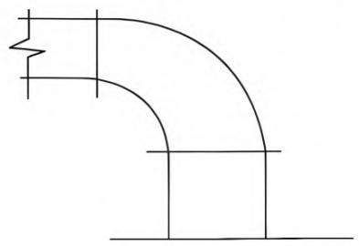

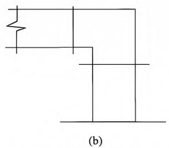

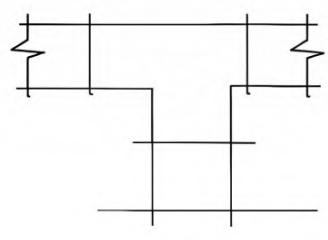  
(c)  
图 10.3-1 典型的风口前管道连接形式  
(a) 方形圆角弯头；(b) 方形方角弯头；(c) 方形三通

经相似准则分析，影响实际连接形式下风口出流速度分布特性的物理量有：单位体积的入流动量 $J$ （等于送风速度 $v_{\mathrm{in}}$ 与空气密度 $\rho$ 的乘积），物性参数 $\nu$ 、 $\rho$ ，管道尺寸 $h$ 、 $d$ 、 $r$ 等，这些为已定物理量；散流器出口表面上任意点速度 $v_{\mathrm{x}}$ ， $v_{\mathrm{y}}$ ， $v_{z}$ 为待定物理量。针对三种典型的实际连接形式，可得相应的相似准则，如表10.3-1所示。

影响实际连接条件下散流器出流特性的相似准则  
表 10.3-1

<table><tr><td>风道连接形式</td><td>相似准则</td></tr><tr><td>圆角弯头</td><td> $\frac{{v}_{\text{in }} \cdot d}{v},\frac{h}{d},\frac{r}{d}$ </td></tr><tr><td>方角弯头</td><td> $\frac{{v}_{\text{in }} \cdot d}{v},\frac{h}{d}$ </td></tr><tr><td>三通</td><td> $\frac{{v}_{\text{in }} \cdot d}{v},\frac{h}{d},\frac{{G}_{1}}{G}$ </td></tr></table>

注：表中三通连接形式的第三个相似准则为干支管流量比，即与风口相连接的支管流量 $G_{1}$ 占干管总流量 $G$ 的比例。

对数值模拟结果进行整理，结合前述 $N$ 点风口模型，可以得到不同组合形式下散流器各点无量纲速度与表10.3-1相应相似准则数之间的关系曲线图，这一系列变化曲线即构成了实际连接条件下的 $N$ 点风口模型。《室内空气流动数值模拟》（李先庭，赵彬）给出了不同组合形式下常用的方形散流器和圆形散流器 $N$ 点速度变化曲线图，可供查阅使用。

### 10.3.2 热源特性

室内热源的种类繁多，形状各异，严格的热源描述需考虑辐射、对流与热源的耦合关系，但考虑这种耦合关系后数值计算量大幅增加，目前计算室内空气流动时多采用解耦的方式进行，即采用简化的热源模型。简化的热源模型是分别对各种热源的散热特性进行研究后，给出的简单易用且具有一定精度的热源模型。常见的室内热源包括人员、灯光和设备三类。

**10.3.2.1 人体的散热特性**

若要描述人体自身的热平衡及各种散热过程，必须首先建立人体热平衡的物理模型，较有代表性的包括 Fanger 的单节点稳态人体热模型、Gagge 等人的两节点瞬态人体热模型和 Stolwijk 的多节点模型。而室内空气流动数值模拟中关心的往往是人体对周围环境的影响，主要是人体的散热量与散湿量，与人员性别、年龄、衣着及环境条件等多种因素有关。

一般情况下，在人体散发的热量中，辐射热、对流热、潜热占比分别在 $40\%$ 、 $20\%$ 、 $40\%$ 左右。至于人员散热中辐射成分在室内各表面积的分配比，可近似采用某内表面面积与室内总内表面面积之比。

**10.3.2.2 设备的散热特性**

目前关于设备实际散热的研究给出的结论多是实验测量不同类型设备的实际散热数据。虽然这些数据还未考虑设备热源散热特性与环境状态的关系，也没有建立起适于 CFD 计算的设备热源模型，但是可作为对传统简化计算方法的补充与修正。在 CFD 计算中，尤其是在环境状态变化不大或设备热源的散热受环境状态变化的影响很小的情况下，往往可以利用这些实验数据给定设备热源的散热量，即给出定热流边界条件。利用这种方法比用简化计算公式描述的设备热源散热特性要精确许多。

对于一些没有测量实际散热量的设备，目前对设备热源散热特性的描述一般是通过计算设备实际消耗的电功率来计算设备的散热量。通常认为机械设备的辐射散热为设备散热的 $20\% \sim 80\%$ ，对于不同种类的设备，其辐射、对流散热量的比例很难给出统一的数据。常见的室内设备大致可分为电动设备、电热设备、电子设备以及燃气设备等。用电设备可以根据其实际功率计算得到散热量。

**10.3.2.3 灯光的散热特性**

目前，有关灯光散热特性的描述存在的问题与设备热源的问题相似，其散发的热量同样由对流和辐射组成，木村建一在《空气调节的科学基础》一书中给出了具有相同发光量的 150W 白炽灯和 40W 荧光灯的能量分配，如表 10.3-2 所示。

灯的能量分配  
表 10.3-2

<table><tr><td>能量形式</td><td>150W 白炽灯</td><td>40W 荧光灯</td></tr><tr><td>可见光</td><td>10%</td><td>18%</td></tr><tr><td>不可见辐射</td><td>70%</td><td>31%</td></tr><tr><td>镇流器损失</td><td>—</td><td>18%</td></tr><tr><td>对流和传导</td><td>20%</td><td>33%</td></tr></table>

当带有灯罩时，灯光中对流与辐射的比例会因灯罩吸热而改变。在美国劳伦斯伯克利实验室（LBL）的 DOE-2 手册中，把灯具分为四种形式，灯光得热中的对流和辐射比例如表 10.3-3 所示。鉴于灯具品种繁多以及理论分析的困难，灯光得热中的辐射比例往往还要靠测定获取。

灯光得热中的对流、辐射比例  
表 10.3-3

<table><tr><td>灯具形式</td><td>辐射比例(%)</td><td>对流比例(%)</td></tr><tr><td>吊装无通风荧光灯</td><td>67</td><td>33</td></tr><tr><td>暗装有回风荧光灯</td><td>59</td><td>41</td></tr><tr><td>暗装有强迫通风荧光灯</td><td>19</td><td>81</td></tr><tr><td>(吊装)白炽灯</td><td>71</td><td>29</td></tr></table>

### 10.3.3 污染源特性

面对当前空调通风设计内容的扩展和人们对室内参数分布的要求，CFD数值模拟也逐渐推广到计算各类污染物的分布，本节主要对气态污染源散发特性进行介绍。

气态污染物一般分为两大类：无机气体，包括 $\mathrm{CO}_{2}$ 、CO、 $\mathrm{SO}_{2}$ 、 $\mathrm{NO}_{x}$ 、 $\mathrm{NH}_{3}$ 、氡气、臭氧等；有机气体，包括甲醛、甲苯等挥发性有机化合物。

无机气体主要是人体的代谢产物和燃料高温燃烧产物或副产品，如 $\mathrm{CO}_{2}$ 、CO 和 $\mathrm{SO}_{2}$ 等；也有一部分来自建筑材料和土壤散发，如 $\mathrm{NH}_{3}$ 和氡气等。 $\mathrm{NO}_{\mathrm{x}}$ 主要存在于汽车尾气之中，并与室外的光化学反应密切相关。而臭氧主要来自高温灼烤过程，如一些激光复印室的臭氧质量浓度往往较高。

挥发性有机化合物（简称 VOC 或 VOCs，其总体也称为 TVOC）是另一类气态污染物。根据世界卫生组织的定义，日常接触到的挥发性有机化合物的熔点一般在室温以下，沸点为 50～260℃。据测定，室内存在的挥发性有机物有几百种之多，但除了新装修的房间外，这些有机物均以极低的质量浓度存在（室内 TVOC 质量浓度大多在 1.0mg/m³ 以下）。建材、家具、地毯、涂料、油漆等室内材料是挥发性有机化合物的主要来源，它们的 VOC 散发特性各不相同。根据实验数据拟合，可得如式（10.3-3）所示的较为常用的室内材料散发特性经验模型，很大一部分源的散发规律都可以用该模型表示。

$$
R (t) = R _ {0} \mathrm{e} ^ {- k t}\tag{10. 3-3}
$$

式中 $R(t)$ ——污染物的逐时散发率， $\mathrm{mg}/(\mathrm{m}^{2}\cdot\mathrm{h})$ ;

$t$ ——时间，h；

$R_{0}$ ——初始散发率， $\mathrm{mg}/(\mathrm{m}^{2} \cdot \mathrm{h})$ ，见表10.3-4；

k——一阶衰减常数， $h^{-1}$ ，见表10.3-4。

一些常见污染源TVOC的散发率常数  
表 10.3-4

<table><tr><td>散发源</td><td> $R_0[mg/(m^2 \cdot h)]$ </td><td> $k(h^{-1})$ </td></tr><tr><td>木材涂料</td><td>17000</td><td>0.4</td></tr><tr><td>聚亚氨酯</td><td>20000</td><td>0.25</td></tr><tr><td>木地板蜡</td><td>20000</td><td>6.0</td></tr><tr><td>防腐晶体</td><td>14000</td><td>0(常散发速率)</td></tr><tr><td>干的干净衣物</td><td>1.6</td><td>0.03</td></tr><tr><td>液态胶黏剂</td><td>10000</td><td>1.0</td></tr></table>

## 10.4 室内环境参数与气流组织评价指标

室内气流组织与环境的评价指标可分成三类，分别为送风有效性指标、污染物去除有效性指标和热舒适指标。设计者可通过评价指标水平进一步调整送风参数等因素，使室内参数满足要求。

### 10.4.1 送风有效性指标

**10.4.1.1 空气龄**

空气龄的概念于 20 世纪 80 年代由 Sandberg 提出，是指空气进入房间的时间。在房间内污染源分布均匀且送风为全新风时，某点的空气龄越小，说明该点的空气越新鲜，空气品质就越好。空气龄还反映了房间排除污染物的能力，平均空气龄小的房间，去除污染物的能力强。早期研究基于概念阐述和测量方法，20 世纪 90 年代后在计算流体力学飞速发展的基础上，用数值方法计算通风空调房间空气龄场的方法逐渐发展起来。由于空气龄的物理意义明显，因此作为衡量通风空调房间空气新鲜程度与换气能力的重要指标而得到

广泛的应用。

从统计角度来看，房间中某一点的空气由不同的空气微团组成，这些微团的空气龄各不相同。因此该点所有微团的空气龄存在一个频率分布函数 $f(\tau)$ 和累计分布函数 $F(\tau)$ 。累计分布函数与频率分布函数之间的关系为：

$$
\int_ {0} ^ {\infty} f (\tau) \mathrm{d} \tau = 1\tag{10.4-1}
$$

$$
\int_ {0} ^ {\tau} f (\tau) \mathrm{d} \tau = F (\tau)\tag{10.4-2}
$$

某一点的空气龄 $\tau_{\mathrm{p}}$ 是指该点所有微团的空气龄的平均值：

$$
\tau_ {\mathrm{p}} = \int_ {0} ^ {\infty} \tau f (\tau) \mathrm{d} \tau = \int_ {0} ^ {\infty} [ 1 - F (\tau) ] \mathrm{d} \tau\tag{10.4-3}
$$

对空气龄可以求出在空间的体平均：

$$
\overline {{{{\tau}}}} _ {\mathrm{p}} = \frac {\int_ {V} \tau_ {\mathrm{p}} \mathrm{d} v}{V} = \frac {\sum \tau_ {\mathrm{p} i} V _ {i}}{V}\tag{10.4-4}
$$

式中 $\tau_{pl}$ ——空间第 i 部分的空气龄，s；

$V_{i}$ ——空间第 i 部分的体积， $m^{3}$ 。

对于一个通风房间来说，体平均的空气龄越小，房间里的空气从整体上来看越新鲜。当认为房间入口（送风口）处的空气龄为0时，得到的各点空气龄和平均空气龄均称为房间空气龄。如果考虑空气在风道中的流动和回风的影响，以空气进入通风系统处的空气龄为0，则所得到的空气龄称为全程空气龄。空气龄可以分别用脉冲法、上升法和下降法这三种方式测得。

采用数值方法计算空气龄时, 可按照示踪气体方法进行计算, 即分别计算脉冲法、上升法和下降法中各点质量浓度的变化过程, 用相应公式得到各点的空气龄, 也可以通过直接求解空气龄的输运方程得到:

$$
\frac {\partial}{\partial t} (\rho \tau_ {\mathrm{p}}) + \frac {\partial}{\partial x _ {j}} (\rho u _ {j} \tau_ {\mathrm{p}}) = \frac {\partial}{\partial x _ {j}} \left(\Gamma_ {\tau} \frac {\partial \tau_ {\mathrm{p}}}{\partial x _ {j}}\right) + \rho\tag{10.4-5}
$$

人口边界条件： $\tau_{p}=0$ 或者给定值；

出口边界条件： $\frac{\partial\tau_{p}}{\partial x_{j}}=0$ 。

需要指出的是，出口空气龄等于房间的名义时间常数。

**10.4.1.2 换气效率**

对于一个具体的房间而言，存在名义时间常数，其定义式为：

$$
\tau_ {\mathrm{n}} = V / Q\tag{10.4-6}
$$

式中 $\tau_{\mathrm{n}}$ ——房间的名义时间常数，s；

V——房间容积， $m^{3}$ ;

Q——通风量， $m^{3}/s$ 。

在理想 “活塞流” 的通风条件下，房间的换气效率最高。此时，房间的平均空气龄最小，它和出口处的空气龄、房间的名义时间常数存在以下的关系：

$$
\overline {{{{\tau_ {\mathrm{p}}}}}} = \frac {1}{2} \tau_ {\circ} = \frac {1}{2} \tau_ {\mathrm{n}}\tag{10.4-7}
$$

因此，可以定义活塞流下房间平均空气龄与实际通风条件下的比值为换气效率（该值不大于1），它反映了新鲜空气置换原有空气的快慢与活塞通风下置换快慢的比例，定义式为：

$$
\eta_ {\mathrm{a}} = \frac {\tau_ {\mathrm{n}}}{2 \overline {{\tau_ {\mathrm{p}}}}} \times 100\tag{10.4-8}
$$

式中 $\overline{\tau_{p}}$ ——房间空气年龄的平均值，s。

$\eta_{a} \leqslant 100\%$ ，由换气效率的定义可知，换气效率越大，房间的通风效果越好。只有在活塞流的情况下， $\eta_{a}=100\%$ ；全面孔板送风接近这种条件， $\eta_{a} \approx 100\%$ ；单风口下送上回情况下的 $\eta_{a}=50\% \sim 100\%$ ，顶送上回和上送上回的 $\eta_{a}$ 均近似等于 50%。

得到名义时间常数和房间平均空气龄之后，即可根据式（10.4-8）得到房间的换气效率。各点的换气效率由各点的空气龄与名义时间常数的比值获得。采用 CFD 方法时，由于各点的空气龄均可求得，容易得到换气效率的值。

### 10.4.2 污染物去除有效性指标

**10.4.2.1 排污效率**

排污效率反映了空间各点的污染程度以及在该点排除污染物的有效性。在进口空气带有相同的污染物，其浓度为 $C_{s}$ 的情况下，排污效率定义为：

$$
\varepsilon = \frac {C _ {\mathrm{e}} - C _ {\mathrm{s}}}{\overline {{{C}}} - C _ {\mathrm{s}}}\tag{10.4-9}
$$

式中 $C_{e}$ ——出口污染物质量浓度；

C——房间污染物平均质量浓度。

排污效率也可定义成基于房间污染物最大质量浓度的形式：

$$
\varepsilon = \frac {C _ {\mathrm{e}} - C _ {\mathrm{s}}}{C _ {\mathrm{max}} - C _ {\mathrm{s}}}\tag{10.4-10}
$$

以上两种排污效率的定义都是对整个房间而言的，对房间内任一点，也可求出各点的排污效率：

$$
\varepsilon = \frac {C _ {\mathrm{e}} - C _ {\mathrm{s}}}{C _ {\mathrm{p}} - C _ {\mathrm{s}}}\tag{10.4-11}
$$

此时 $C_{\mathrm{p}}$ 指房间内任一点的污染物质量浓度。

采用 CFD 进行数值计算时，可以根据污染物质量浓度分布直接得到房间污染物平均质量浓度或最大质量浓度，进而得到排污效率。排污效率是稳态指标，表示送风排除污染物的能力。在相同的污染物、相同的送风量时能维持较低的室内污染物稳态质量浓度，或者能较快地将室内污染物初始质量浓度降下来的气流组织，其排污效率很高。影响排污效率的主要因素是送、排风口的位置（气流组织形式）和污染源所处位置。

**10.4.2.2 余热排除效率**

如果把余热也当成一种污染物，就能得到余热排除效率（又称为投入能量利用系数）。与污染物排除效率不同的是，当考察余热的排除效率时，通常仅关心工作区的温度，而不是整个室内空间的温度。

余热排除效率用温度来定义，用来考察气流组织形式的能量利用有效性。其定义

式为：

$$
\eta_ {\mathrm{t}} = \frac {t _ {\mathrm{e}} - t _ {\mathrm{s}}}{\overline {{t}} _ {\mathrm{n}} - t _ {\mathrm{s}}}\tag{10.4-12}
$$

其中， $\bar{t}_{a}$ ， $t_{c}$ ， $t_{s}$ 分别为工作区平均温度，排风温度和送风温度。

不同的气流组织形式，即使产生相同的舒适性，消耗的能源也存在差异。当 $\overline{t}_{\mathrm{n}} < t_{\mathrm{e}}$ 时， $\eta_{\mathrm{t}} > 1$ ；反之， $\eta_{\mathrm{t}} < 1$ 。在不同的气流组织形式中，下送上回的形式 $\eta_{\mathrm{t}}$ 较高，一般排风温度高于平均温度，因此 $\eta_{\mathrm{t}}$ 一般大于 1，说明下送上回的气流组织形式能量利用效率较高。

### 10.4.3 热舒适指标

**10.4.3.1 平均辐射温度和作用温度**

平均辐射温度的意义是一个假想的等温围合面的表面温度，它与人体间的辐射热交换量等于人体周围实际的非等温围合面与人体之间的换热量。具体计算公式详见本书5.2.1节。

**10.4.3.2 PMV、PD和PPD**

人的舒适状态是由许多因素决定的，如环境的声音、振动、嗅觉、视觉、色调、温度、湿度、气流速度等，而人的热感觉主要由人体的活动情况、着衣情况、空气温度、湿度、风速、平均辐射温度等因素决定。具体计算公式详见本书5.2.3节。

**10.4.3.3 空气分布特性指标（ADPI）**

空气分布特性指标（Air Diffusion Performance Index，ADPI）的定义为满足规定风速和温度要求的测点数与总测点数之比。对舒适性空调而言，相对湿度在较大范围内（30%～70%）对人体舒适性影响较小，可主要考虑空气温度与风速对人体的综合作用。根据实验结果，有效温度差与室内风速之间存在下列关系：

$$
\Delta E T = (t _ {i} - t _ {\mathrm{n}}) - 7. 6 6 (v _ {i} - 0. 1 5)\tag{10.4-13}
$$

式中 $\Delta ET$ ——有效温度差，℃；

$t_{i}$ ， $t_{n}$ ——工作区某点的空气温度和给定的室内设计温度，℃；

$v_{i}$ ——工作区某点的空气流速，m/s。

并且认为当 $\Delta ET$ 在 $-1.7 \sim +1.1$ 之间时，多数人感到舒适。因此，空气分布特性指标（ADPI）应为：

$$
\mathrm{ADPI} = \frac {- 1 . 7 <   \Delta \mathrm{ET} <   1 . 1 \text {的测点数}}{\text {总测点数}} \times 100\tag{10.4-14}
$$

在一般情况下，应使 $\mathrm{ADPI} \geqslant 80\%$ 。ADPI的值越大，说明感到舒适的人群比例越大。

**10.4.3.4 不均匀系数**

在室内各点，气流组织的表现形式为温度、风速等均有不同程度的差异。这种差异可以用“不均匀系数”来评价。在工作区内选择 $n$ 个测点，分别测得各点的温度和风速，求其算术平均值为：

$$
\overline {{{{t}}}} = \frac {\sum t _ {i}}{n}\tag{10.4-15}
$$

$$
\overline {{{v}}} = \frac {\sum v _ {i}}{n}\tag{10.4-16}
$$

均方根偏差为:

$$
\sigma_ {t} = \sqrt {\frac {\sum (t _ {i} - \bar {t}) ^ {2}}{n}}\tag{10.4-17}
$$

$$
\sigma_ {\mathrm{v}} = \sqrt {\frac {\sum (v _ {i} - \overline {{v}}) ^ {2}}{n}}\tag{10.4-18}
$$

则不均匀系数的定义为:

$$
k _ {t} = \frac {\sigma_ {t}}{t}\tag{10.4-19}
$$

$$
k _ {\mathrm{v}} = \frac {\sigma_ {\mathrm{v}}}{u}\tag{10.4-20}
$$

速度不均匀系数 $k_{v}$ 、温度不均匀系数 $k_{t}$ 都是无量纲数。 $k_{t}$ 、 $k_{v}$ 的值越小，表示气流分布的均匀性越好。

### 10.4.4 考虑人员分布的修正

传统的换气效率和排污效率均以整个通风房间为考虑对象，而人员活动区域只占通风房间的一部分。因此不考虑人员的需求而将整个房间作为考虑对象时，所创造的微气候不一定对人最为有利，同时可能导致很大的能量需求，因而需要在传统指标的基础上进一步考虑人员的分布。

**10.4.4.1 人员分布密度**

人员分布密度（Occupied Density，OD）用以描述室内空间的使用状况，其定义如下：在空间内，若某个室内人员（为简单起见，用使用者 $i$ 来表征）停留总时间为 $T_{i}$ ，而该使用者在空间某区域 $\mathrm{Zone}_{j}$ 处的停留时间为 $t_{i}(\mathrm{Zone}_{j})$ ，则使用者 $i$ 在此区域内的分布密度可表达如下：

$$
\mathrm{OD} _ {i} (\text { Zone } _ {j}) = \frac {t _ {i} (\text { Zone } _ {j})}{T _ {i}}\tag{10.4-21}
$$

若对于房间内的所有人群定义，OD 可表达如下：

$$
\mathrm{OD} (\text { Zone } _ {j}) = \frac {\sum_ {i = 1} ^ {K _ {1}} \mathrm{OD} _ {i} (\text { Zone } _ {j})}{K _ {1}}\tag{10.4-22}
$$

其中， $K_{1}$ 为房间内的总人数。

任一区域上的 OD 为无量纲数。无论对于单个人还是房间内的所有人群，空间所有区域的 OD 总和为 1。将 OD 在空间任一点处进行定义，在空间的所有区域 V 上具有如下关系式：

$$
\iiint_ {V} \mathrm{OD} (x, y, z) \mathrm{d} x \mathrm{d} y \mathrm{d} z = 1\tag{10.4-23}
$$

其中，OD 的量纲为 $1/m^{3}$ 。

人员分布密度反映了使用者在室内停留的性质和方式。它既可以描述某一个人在房间各处的时间分配状况，也可以描述房间内所有人员在房间各处的总时间分配关系。它反映了各个位置被使用的状况，建立了环境微观参数和人们对环境的宏观需求之间的联系。将其纳入送风有效性的评价中，将使得评价结果更为全面。

**10.4.4.2 修正换气效率**

传统换气效率的特点是将整个房间的空气龄纳入考虑，然而由于房间不同部位的需求状况不一致，用统一的空气龄平均计算所得的结果并不能反映送风的效果。为此，提出结合人员分布密度的修正换气效率，用以对送风的效果进行综合评价。修正的换气效率定义为时间常数和两倍的修正平均空气龄的比值，此平均空气龄以房间各处的人员分布密度 OD 作为权重来平均。修正的换气效率 $\eta_{a}^{\prime}$ 和修正的房间平均空气龄 $<\tau^{\prime}>$ 的数学描述分别如下：

$$
\eta_ {\mathrm{a}} ^ {\prime} = \frac {\tau_ {\mathrm{n}}}{2 <   \tau^ {\prime} >}\tag{10.4-24}
$$

$$
<   \tau^ {\prime} > = \iiint_ {V} \tau_ {a} (x, y, z) \mathrm{OD} (x, y, z) \mathrm{d} x \mathrm{d} y \mathrm{d} z\tag{10.4-25}
$$

在 CFD 计算中，房间平均空气龄可根据每个网格上的 OD 值以及计算所得的空气龄进行离散加和获得。得到的修正换气效率用于对实际系统送风的评价，能够强调人员所在区域的重要性，辨析传统换气效率无法体现的送风方式差别，从而更好地描述和评价送风有效性。

**10.4.4.3 修正能量利用系数**

能量利用系数的原始定义式中关注的是工作区的平均温度和出口温度的差异，将其推广为结合 OD 的房间加权平均温度，修正的能量利用系数 $\eta_{t}^{\prime}$ 定义为：

$$
\eta_ {\mathrm{t}} ^ {\prime} = \frac {t _ {\mathrm{e}} - t _ {\mathrm{s}}}{<   t > _ {\mathrm{D}} - t _ {\mathrm{s}}}\tag{10.4-26}
$$

其中， $t_{e}$ ， $t_{s}$ 分别为排风温度和送风温度， $<t>_{D}$ 为结合了 OD 的房间加权平均温度：

$$
<   t > _ {\mathrm{D}} = \int_ {V} t _ {i} (x, y, z) D (x, y, z) \mathrm{d} v\tag{10.4-27}
$$

由于排风温度和房间加权平均温度没有永远的大小关系，因此 $\eta_{t}^{\prime}$ 可能大于 1，也可能小于 1。一般来说，修正的能量利用系数 $\eta_{t}^{\prime}$ 越大，说明排风温度越高于房间加权平均温度，能量利用越有效。反之，则说明能量利用有效性不高。

**10.4.4.4 集成PMV**

当空间中各处的 PMV 不同时，由于 PMV 可正可负，可用 IPMV 来衡量空间的总体热舒适效果。IPMV 的定义如下：

$$
\mathrm{IPMV} = \int | \mathrm{PMV} (x, y, z) | D (x, y, z) \mathrm{d} v\tag{10.4-28}
$$

IPMV 反映了当前气流组织形式下热舒适程度。IPMV 越高，说明舒适性满意度越低；反之，IPMV 越低，说明舒适性指标越好，满意度越高。借鉴 PMV 和 PPD 的关系，IPMV 值下的热舒适不满意度 PPD 可用下式计算：

$$
\mathrm{PPD} = 100\% -95\% \mathrm{e}^{(-0.03353\mathrm{IPMV}^4 - 0.2179\mathrm{IPMV}^2)}\tag{10.4-29}
$$

采用人员分布密度修正后的指标更能反映该环境是否满足人的需要，从而更好地实现为人服务的目标并减少系统的能量消耗。

## 10.5 室内空气流动数值模拟的标准做法及典型案例

### 10.5.1 室内空气流动数值模拟的标准做法

CFD 计算在暖通空调领域受到广泛关注。然而，由于工具本身的复杂性和专业性，应用 CFD 计算同一个问题时结果差距可能较大。为保证计算结果的准确性与可靠性，在应用 CFD 计算室内空气流动状况时，应遵循相应的标准做法。运用 CFD 求解室内空气流动的典型流程如图 10.5-1 所示。

**10.5.1.1 根据模拟对象构建合适的物理模型**

室内空气流动数值模拟首先需根据模拟对象构建合适的物理模型。即根据项目特点，寻找数值模拟中的主要矛盾，简化次要矛盾。例如，当需要了解剧场的射流送风时，送风口的位置、风量及热源位置等会对房间温度分布产生主要影响，因此可采用倾斜面代替台阶建模，降低模型的复杂程度。

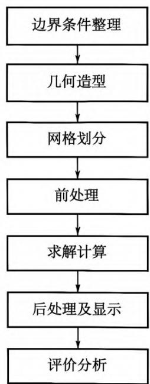

**10.5.1.2 选择适合的计算模型和边界条件**

数值模拟中，合适的计算模型是获得准确计算结果的基础。CFD数值计算软件中包含种类繁多的计算模型，不同模型适用于求解不同的物理问题，因此模型间存在一定的差异。在实际操作中，应选取能够反映实际传热与流动状况的计算模型。例如，

图10.5-1 运用CFD求解室内空气流动的典型流程

CFD 模拟存在诸多湍流模型，如标准 $k-\varepsilon$ 模型、RNG $k-\varepsilon$ 模型等。因此，需根据表征房间特征流动状况的雷诺数进行模型选取。具体来讲，当模拟高大空间低雷诺数的自然对流时，应采取低雷诺数 $k-\varepsilon$ 模型。此外，针对送风风口，可根据其物理特性及房间特性选取合适的模型，如模拟孔板风口流动状况时，由于其有效面积与实际面积差异明显，需采用“动量模型”。

此外，应根据模拟对象的特点选择适宜计算的软件。如需计算房间 PMV 等指标时，可选取带有计算该指标功能的计算软件（如 Airpak 等）。

**10.5.1.3 网格划分及独立性检验**

网格划分就是把模型分成很多小的单元，作为数值模拟前处理的重中之重，网格划分与计算目标的匹配程度、网格质量的好坏，决定了后期计算的质量。网格数量的多少将影响计算结果的精度和计算规模的大小。一般来讲，网格数量增加，计算精度会有所提高，但计算规模也会增加，所以应权衡两者之间的关系。一般来讲，目标建筑或对象模型的网格应至少小于其定型尺寸的 1/20。

划分网格的基本原则是, 根据物理模型的特征和拟选用的湍流模型构建网格, 并根据求解物理问题的特点进行适当的网格加密。①根据物理模型的特征和拟选用的湍流模型构建网格, 例如, 物理模型若是以长方体为主, 可采用结构化网格, 若物理模型以曲面为主, 则可采用非结构化网格; 某些湍流模型本身也对网格提出了要求, 如采用 $k - \epsilon$ 模型时, 还应基于壁面函数对近壁网格进行处理。②对物理量梯度大的区域加密网格。如大空间射流送风，其在射流范围内温度、速度变化较为明显，因此应当适量增加网格密度。此外，可事先用粗糙网格进行初步计算，然后在物理梯度大的区域加密网格，进行精确计算。

网格独立性检验可用于判断网格质量的好坏。对某一网格进行加密时，若计算结果基本不随网格密度的增加而变化，即计算结果与网格数量无关，则该网格质量可满足计算要求。

**10.5.1.4 平衡校验及与实验结果验证**

为判断数值计算过程是否收敛，需对计算结果进行简单的平衡校验，即对质量、能量等参数进行平衡校验。如稳态计算时，对于典型的空调房间，需要校验空调送入室内冷量是否与房间得热量相等。

判断计算已经收敛后，需对结果的可靠性进行校验，即将计算结果与实验数据或经典的模拟结果进行对比验证。该验证能够评价数值模拟过程中选取的计算模型及边界条件等是否合理。当数值计算结果与实验数据或经典模拟结果误差较小时，可认为计算结果合理可信，否则认为该模拟与实际物理过程存在一定的差异，需重新调整计算参数。针对某一模拟对象，当缺乏实验数据用于验证模拟结果时，可选取与其物理特性相似的对象进行验证。

**10.5.1.5 整理数值模拟报告**

完成相应的数值计算后，应当整理气流组织计算分析报告，详细说明数值计算的计算过程，并对结果加以分析。数值计算报告应包括项目的基本情况、计算模型选取、网格划分、边界条件设定等，并对模拟结果进行分析，具体如下：

1. 项目基本情况介绍应包括下列内容:

(1) 项目室内建筑概况、功能、使用方式等。

(2) 应含拟采用气流组织模拟所要分析的问题描述, 以及选用的模拟软件介绍。

2. 计算区域、几何模型、网格划分应满足下列规定：

(1) 应详细描述计算区域选取原则和方法。

(2) 几何模型应反映实际项目的主要特征, 可作合理的简化处理, 应在报告中详细阐明简化处理方法与理由。

(3) 应详细描述网格的划分原则。

3. 边界条件和初始条件应满足下列规定：

（1）气流组织模拟分析主要的边界条件应包括地面、建筑壁面或内部物体表面的速度边界条件及热边界条件。

(2) 气流组织模拟分析的初始条件应包括机械送风口及回风口的温度、湿度、风速、压力等。

4. 计算结果分析应满足下列规定：

(1) 报告应包括主要截面的模拟计算分析图。

（2）报告应有明确的分析结论，结论应与计算结果在逻辑上保持一致。

### 10.5.2 室内空气流动数值模拟的典型案例

**10.5.2.1 办公室模拟**

置换通风在我国日益受到关注，越来越多地应用于工程实际。办公室置换通风常用的风口为半圆柱形、四分之一圆柱形或扁平型。这里采用 Srebric 所做的办公室置换通风测试作为验证算例，如图 10.5-2 所示。这也是 ASHRAE 用于验证数值计算结果的报告中的算例之一。

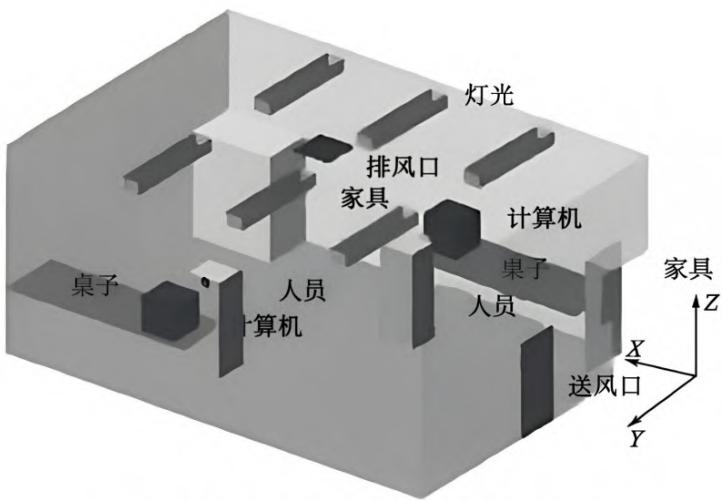  
图10.5-2 某办公室置换通风示意图

**1. 物理模型构建及边界条件整理**

该办公室几何尺寸为： $5.16\mathrm{m} \times 3.65\mathrm{m} \times 2.43\mathrm{m}$ （长×宽×高）。室内有计算机、人员、灯光等热源，还有桌子和壁橱等家具，如图10.5-2所示。所用置换通风风口为扁平型置换通风散流器，宜用 $N = 1$ 的多元三通量风口模型模拟，其几何尺寸为：高 $1.1\mathrm{m}$ 、宽 $0.53\mathrm{m}$ ，有效面积系数 $R_{\mathrm{fa}} = 0.4$ 。送风口中心线与西墙中心线重合，距地面 $0.03\mathrm{m}$ 。回风口为 $0.43\mathrm{m} \times 0.43\mathrm{m}$ 的方形回风口，位于顶板中心。在构建物理模型时，对计算机等房间热源几何尺寸进行简化，将其等效为长方体。

根据实际工况，确定房间送、回风参数，热源大小等边界条件信息（表 10.5-1、表 10.5-2）。

房间送、回风参数  
表 10.5-1

<table><tr><td>送风口</td><td>面积:0.53m×1.1m</td><td>温度:17.0°C</td><td>速度:0.086m/s</td></tr><tr><td>窗户</td><td>面积:3.65m×1.16m</td><td>温度:27.7°C</td><td></td></tr></table>

房间热源情况  
表10.5-2

<table><tr><td>热源</td><td>面积</td><td>散热功率</td></tr><tr><td>加热器</td><td>1.2m×0.1m×0.2m</td><td>1500W</td></tr><tr><td>人员</td><td>0.4m×0.35m×1.1m</td><td>75W</td></tr><tr><td>计算机1</td><td>0.4m×0.4m×0.4m</td><td>108W</td></tr><tr><td>计算机2</td><td>0.4m×0.4m×0.4m</td><td>173W</td></tr><tr><td>顶灯</td><td>0.2m×1.2m×0.15m</td><td>34W</td></tr></table>

**2. 网格划分及模拟结果验证**

完成物理模型构建及边界条件整理后，需对物理模型进行网格划分，并选取合适的数值模型进行模拟计算。然后，将模拟结果与实验数据对比，发现模拟与实验吻合较好，表明网格划分合理且选取的数值模型合理，因此可采用该模型进行后续模拟分析。在后续模拟分析中，对每个算例均进行平衡校验，以验证计算结果的准确性。

**3. 模拟结果分析**

在完成上述所有工作后，可对数值模拟结果进行分析。其中，房间典型截面速度与温度分布结果如图 10.5-3 所示。

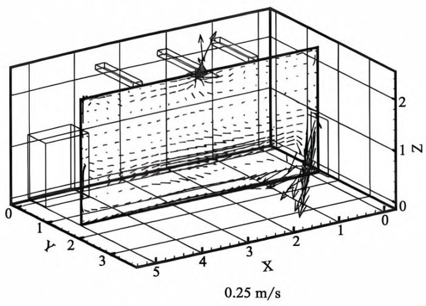  
(a)

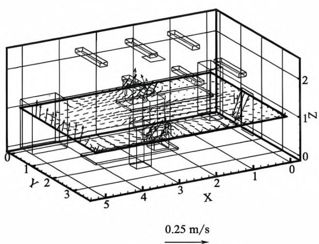  
(b)

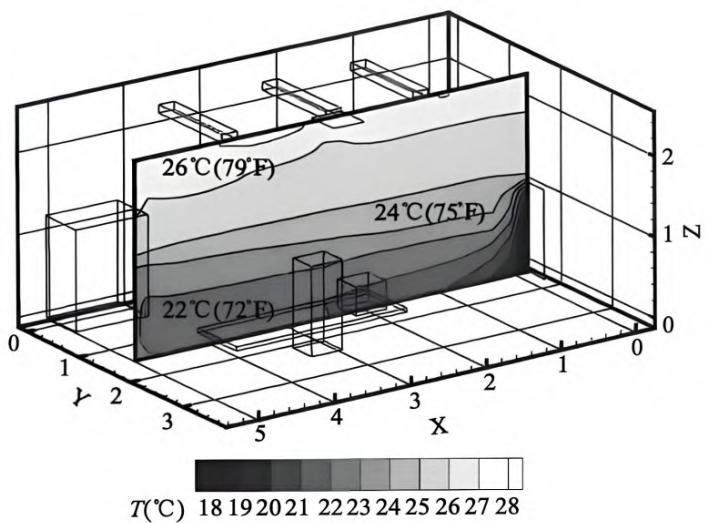  
(c)

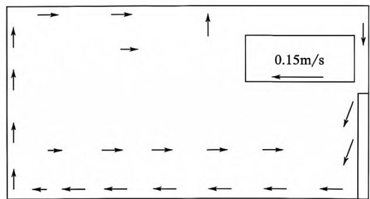  
(d)  
图10.5-3 房间温度、速度分布图  
(a) 垂直截面速度矢量图；(b) 水平截面速度矢量图；(c) 垂直截面温度分布图；(d) 垂直截面测量速度分布

**10.5.2.2 公共交通工具中局部空间气流组织模拟**

公共交通工具中的气流组织会对局部环境产生较大影响。这里以某一局部卧铺为例，探究不同气流组织所形成流场的差异。

**1. 物理模型构建及边界条件整理**

首先构建卧铺空间物理模型，该卧铺模型的几何尺寸为： $5.16\mathrm{m} \times 3.65\mathrm{m} \times 2.43\mathrm{m}$ （长×宽×高）。混合送风、个性化送风和置换通风风口位置和几何尺寸如图10.5-4所示，三种气流组织形式下的回风口位置相同。在几何建模中，人员口部呼吸区域被简化为 $1.4\mathrm{cm}^2$ 的圆形开口。

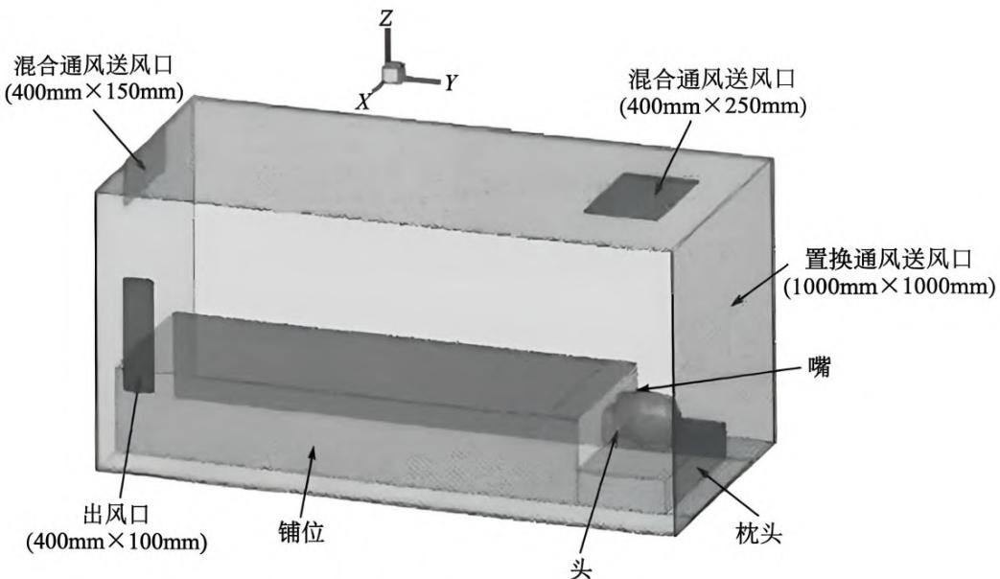  
图10.5-4 公共交通工具中卧铺空间的几何模型

**2. 网格划分及独立性检验**

完成几何模型构建后，划分非结构化网格，并进行网格无关性检验，以选取适宜计算的网格数量。测试网格数量分别为42万个、162万个和654万个，选取乘客头部、心脏处和脚部的垂直速度分布作为检验对象。以个性化送风，风量为 $2m^{3}/min$ 为例，进行网格无关性检验，结果如图10.5-5所示。可见，网格数量为162万个时，可在保证计算精度的同时缩短计算时间，因此选取162万个网格进行后续模拟计算。

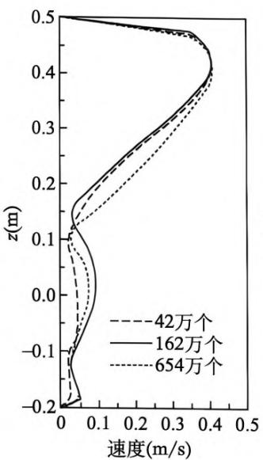  
(a)

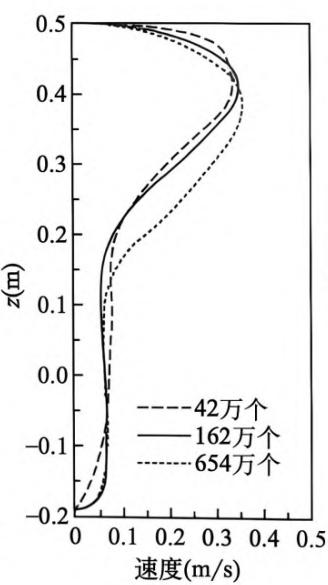  
(b)

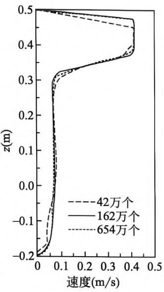  
(c)

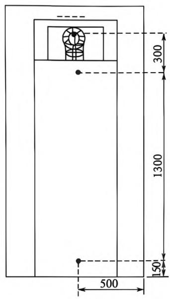  
(d)  
图 10.5-5 不同网格数量下不同高度处速度分布  
(a) 头部；(b) 胸部；(c) 脚部；(d) 测点分布

**3. 模拟结果与实验数据验证**

对个性化送风工况进行实验验证，对比数值模拟结果和 PIV 实测结果，如图 10.5-6 所示。此时，送风风量为 $2 \mathrm{~m}^{3} / \mathrm{min}$ ，送风温度为 $20^{\circ} \mathrm{C}$ 。可见，模拟结果与实验数据吻合

较好，表明模拟结果具有良好精度。

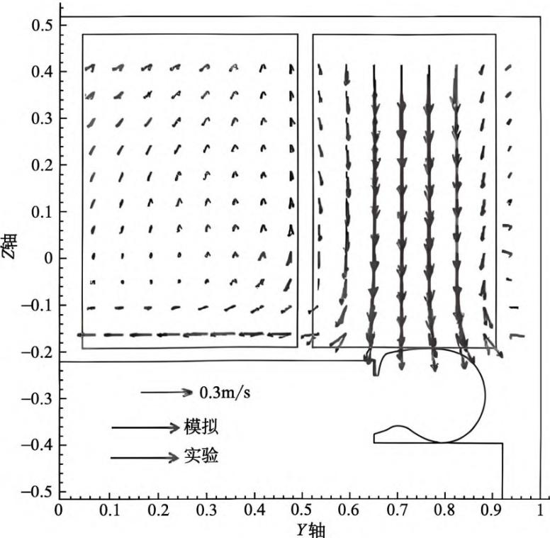  
图10.5-6 个性化送风方案模拟结果与实测结果对比

**4. 模拟结果分析**

进一步研究表明，在三种气流组织形式中，个性化送风的热舒适性和空气品质均优于混合通风和置换送风。

## 10.6 数值模拟中的协作方法

因为实际工程的 CFD 模拟专业性较强、难度较大，暖通空调系统设计者较难单独进行准确的建模和计算分析，通常需要专业技术人员或公司提供模拟技术的支持。为此，本小节针对需求方应提供的材料和预期获得的结果进行介绍，以便需求方与模拟方进行有效沟通，提高 CFD 模拟的协同工作效率。

### 10.6.1 需求方需要准备的材料清单

在进行 CFD 模拟时，需求方需要提供较为详细的模拟区域（建筑）和使用情况信息，表 10.6-1 对其中的基础材料进行了梳理。根据具体工程对象和模拟目的，相应的材料可能有所补充。

CFD 模拟时需要提交的基础材料  
表 10.6-1

<table><tr><td rowspan="4">项目基本情况介绍部分</td><td>室内建筑概况、功能、使用方式等</td></tr><tr><td>需要进行模拟计算的区域(建筑)和模拟的目的</td></tr><tr><td>项目所关注的主要参数和评价指标</td></tr><tr><td>模拟区域(建筑)的图纸,包括平面布置图、立面图和剖面图</td></tr><tr><td rowspan="6">边界条件和初始条件部分</td><td>地面、建筑壁面或内部物体表面的热边界条件</td></tr><tr><td>建筑内部设备的热边界条件</td></tr><tr><td>模拟计算区域(建筑)的空调系统形式、送风边界条件</td></tr><tr><td>包含污染源和相关扩散的边界条件应包括:污染源类型、污染源强度、扩散方式、是否与周围环境有反应或衰减</td></tr><tr><td>需要考虑外部太阳辐射时,包括太阳辐射角度和强度</td></tr><tr><td>动态模拟时,气流组织模拟分析的初始条件应包括机械送风口及回风口的温度、湿度、风速、压力等;室内初始状态下各表面的温度、房间内空气的温度、湿度等;包含污染物扩散的还应提供污染源的状态</td></tr><tr><td rowspan="3">结果呈现部分</td><td>模拟结果中需要展示的内容,如流场、温度场、湿度场等</td></tr><tr><td>模拟结果中需要展示的区域或断面</td></tr><tr><td>模拟结果的呈现方式,如彩图、动画等</td></tr></table>

### 10.6.2 通过 CFD 模拟能够获得的技术支持

CFD 模拟技术本身是利用离散后的网格对空气流动进行计算，能够得到区域内空气的流动方向和速度大小，并能针对温度和污染物的分布进行计算。一般 CFD 模拟工作能够提供如下信息：

1. 模拟区域内主要截面的空气流动速度大小和矢量图。

2. 模拟区域内主要截面的温度、湿度、污染物质量浓度分布图。

3. 模拟区域内主要风口的流线追踪结果。

4. 针对流场内特征的分析结论。

5. 不同边界条件下的结果对比。

下文将以体育场馆内流场模拟分析为例，进行介绍。

### 10.6.3 体育场馆的模拟案例

在体育场馆等高大空间建筑中，气流组织的好坏不仅决定了观众席和比赛区的热湿条件能否满足要求，而且直接关系到体育场馆的使用能耗。在此以五棵松体育文化中心的模拟分析为例进行 CFD 模拟工作的介绍。

**10.6.3.1 项目基本情况介绍**

五棵松体育文化中心位于北京市西长安街延长线，是北京为举办第29届夏季奥运会规划安排的一处重要的比赛场地。其中，主体建筑分为上下两部分：上部为配套商业设施，下部为综合体育馆，建筑面积 $56435\mathrm{m}^2$ ，奥运会期间主要用于篮球比赛。本次对气流组织的模拟和评价针对综合体育馆的大空间部分。建筑平面如图10.6-1所示。观众席座位数，上层约10000个，下层活动席约9000个（其中包括部分活动座椅）。四周呈规则的方形，内部面积 $126\mathrm{m}\times 126\mathrm{m}$ ，高 $31.6\mathrm{m}$ 。室内设计温度 $26^{\circ}\mathrm{C}$ 。

**10.6.3.2 边界条件和初始条件**

送、回风形式如图 10.6-2 所示。对于大空间部分，观众席采用座椅下送风形式，此时活动座椅没有投入使用，因此开启下层观众席下部的送风口，主要负责比赛区的热湿负荷。对在这种使用情况和送、回风模式下的室内热环境情况进行模拟和评价。内部热源和风量分配见表 10.6-2。

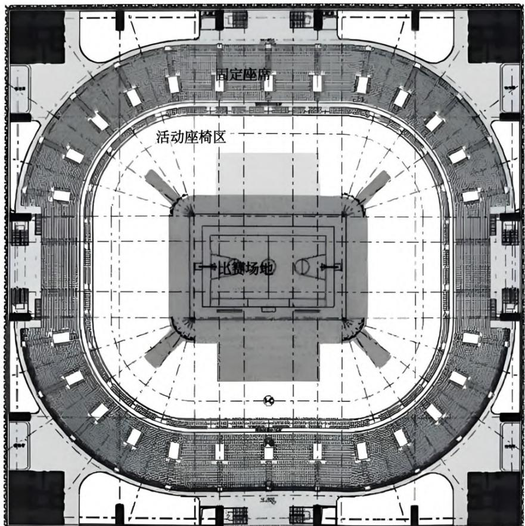  
图 10.6-1 五棵松文化体育中心综合体育馆大空间部分平面示意图

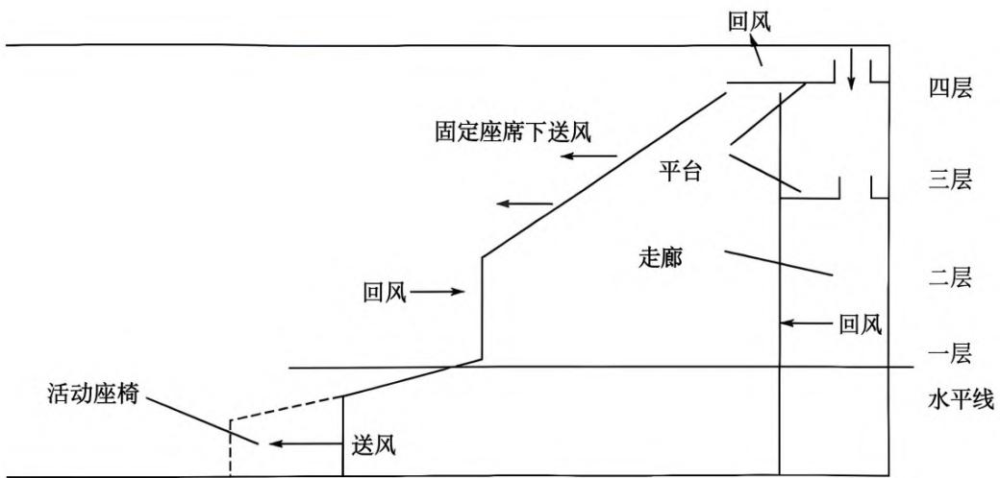  
图10.6-2 送、回风形式示意图

内部热源和风量分配  
表 10.6-2

<table><tr><td colspan="4">内部热源分配</td></tr><tr><td>热源</td><td>观众区</td><td>场地</td><td>灯光</td></tr><tr><td>发热量(kW)</td><td>636.5</td><td>4.884</td><td>122</td></tr><tr><td colspan="4">风量分配</td></tr><tr><td>总送风量( $m^3/h$ )</td><td>场地风量( $m^3/h$ )</td><td>观众席风量( $m^3/h$ )</td><td>走廊风量( $m^3/h$ )</td></tr><tr><td>962500</td><td>180000</td><td>770000</td><td>12500</td></tr></table>

**10.6.3.3 结果呈现部分**

经过物理建模和计算，得到模拟结果。取比赛区正中的典型剖面分析流场，如图10.6-3所示。截取两种典型断面查看比赛区和观众区的温度，如图10.6-4和图10.6-5所示。由于需要对热环境进行评价，特别计算了观众区的PMV，如图10.6-6所示。图10.6-7是典型断面空气龄分布。

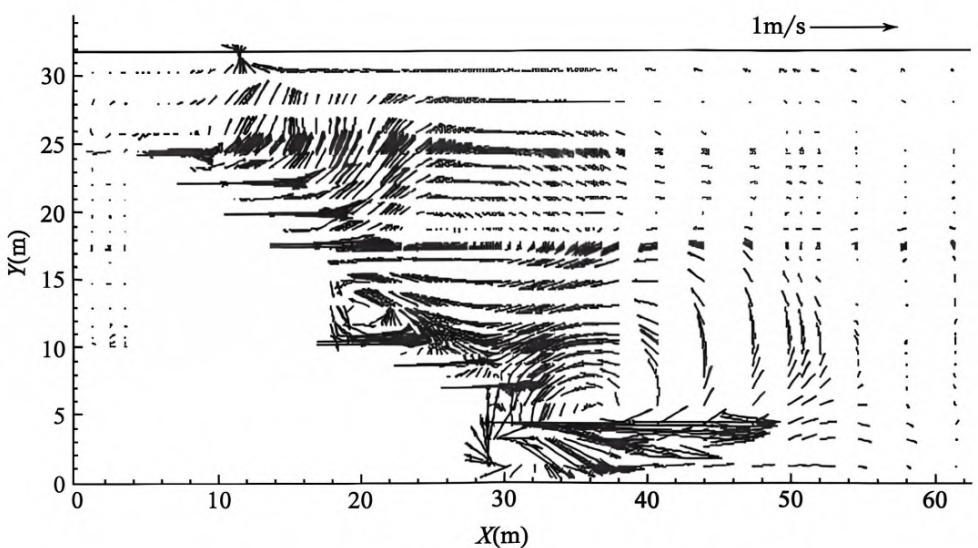  
图 10.6-3 典型断面流场 (Z=6m)

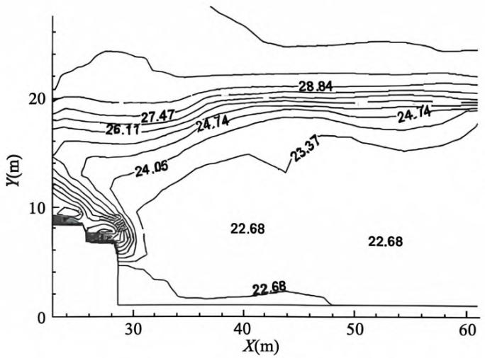  
(a)

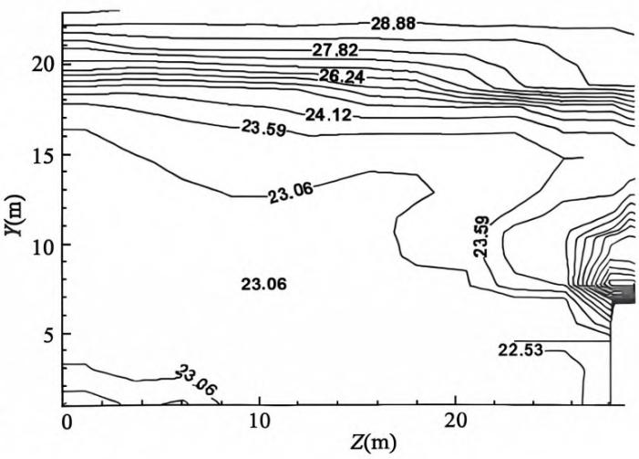  
(b)  
图 10.6-4 比赛区温度截面（单位；℃）  
(a) $Z = 6\mathrm{m}$ ; (b) $X = 58\mathrm{m}$

通过数值模拟计算，从多个方面对空调系统的运行效果进行了评估，为设计方案优化和后期运行控制提供了参考，有力保证了场馆运行效果。

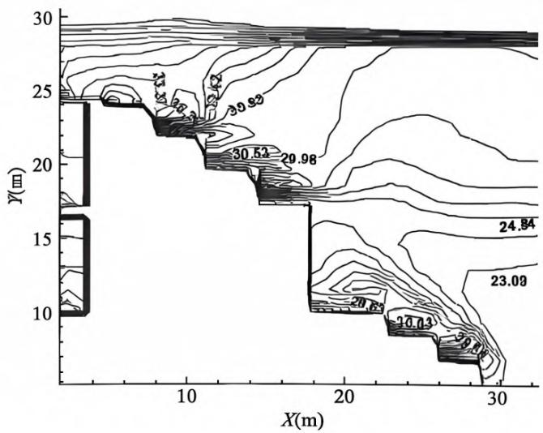  
(a)

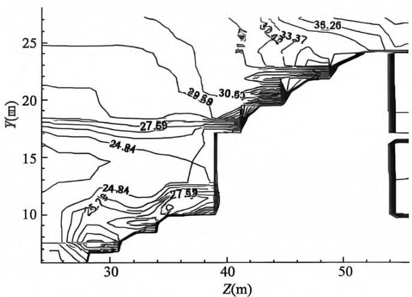  
(b)  
图 10.6-5 观众区温度截面（单位：℃）

(a) $Z = 6\mathrm{m}$ ; (b) $X = 58\mathrm{m}$  
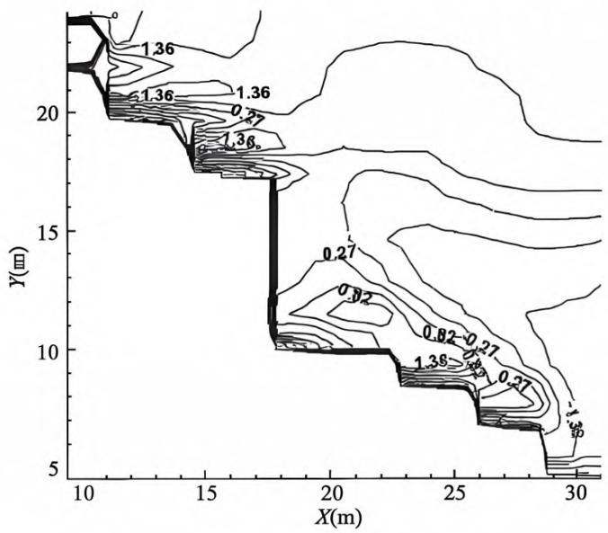  
(a)

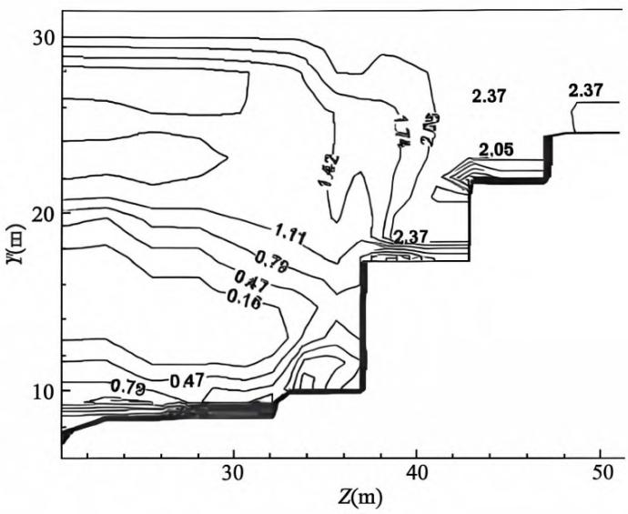  
(b)  
图 10.6-6 观众区 PMV 分布

(a) $Z = 6\mathrm{m}$ ; (b) $X = 58\mathrm{m}$  
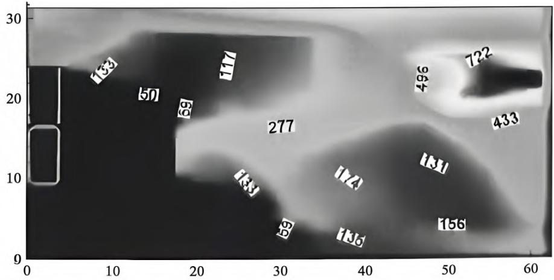  
图 10.6-7 典型断面（Z=6m）空气龄分布（单位；s）

表 11. 1- 1