# 第11章 基础技术原理

## 11.1 通风

通风是指采用自然或机械方法对封闭空间进行换气，以获得安全、健康等适宜的空气环境的技术。通风系统的常用分类、特点、原理和主要应用场合见表 11.1-1。

通风系统的常用分类、特点、原理和主要应用场合

<table><tr><td>分类方法</td><td>通风系统分类及其特点</td><td>通风系统形式及原理</td><td>主要应用场合</td></tr><tr><td rowspan="8">按通风的动力分类</td><td rowspan="3">自然通风:不用通风机械,由热压、风压作用实现室内换气的通风方式。特点:不需要专门的动力,最节省能量,系统简单,投资较小,但空气不能进行处理,通风量和通风气流的方向难以保证,可靠性差、可控性低</td><td>热压通风:温差(密度差)引起的室内外空气压力差导致空气流动的通风</td><td>热车间通风、内热源较大的民用建筑通风、自然排烟系统等</td></tr><tr><td>风压通风:风流经建筑物时,在其周围形成的静压与未受干扰的稳定气流静压的差值导致空气流动的通风</td><td>穿堂风通风,如低层建筑,中小尺寸的办公室、学校、住宅、仓库、轻工业厂房,日光温室、简易养殖场和小型隧道通风等</td></tr><tr><td>热压和风压联合通风:同时受到热压和风压作用导致空气流动的通风</td><td>风压作用下的热车间通风和内热源较大的民用建筑通风等</td></tr><tr><td rowspan="2">机械通风:采用通风机械实现换气,以获得安全、健康等适宜的空气环境的通风方式特点:需要专门的动力,空气可进行处理,通风量和通风气流的方向可以保证,可靠性好,但能耗相对较高,系统相对复杂,投资较大</td><td>机械送风系统:将室外清洁空气或经过处理的空气送入室内的机械通风系统</td><td>空调送风系统;设备用房通风、厨房通风、实验室通风、浴室通风、车库通风、人防通风、空气幕、热风供暖、隧道通风、综合管廊通风和矿井通风、防烟排烟加压等的送风系统和机械补风系统</td></tr><tr><td>机械排风系统:从局部地点或整个空间把含有余热、余湿或有害物的污染空气排至室外的机械通风系统</td><td>空调排风和回风系统;其他场合同机械送风系统</td></tr><tr><td rowspan="3">复合通风(也称多元通风):自然通风和机械通风在一天内的不同时间、不同季节的有机组合,最大限度地利用室外气候环境条件、减少能耗,创造可以接受的热舒适条件及稀释有害物的通风方式,也称多元通风。特点:结合了自然通风和机械通风的优点,优先使用自然通风,增加了自然通风的可靠性,并提高了机械通风系统的节能率;投资大,运行控制较为复杂</td><td>自然通风与机械通风交替运行:自然通风系统与机械通风系统并存,由自控策略实现自然通风系统与机械通风系统的自动切换</td><td rowspan="3">大空间建筑及住宅、办公室和教室等易于在外墙上开窗并通过室内人员自行调节实现自然通风的房间,宜采用自然通风和机械通风结合的复合通风方式。应优先使用自然通风;当控制参数不能满足要求时,启用机械通风;当复合通风系统不能满足要求时,启用空调系统。高度大于15m的大空间采用复合通风系统时,宜考虑温度分层等问题</td></tr><tr><td>带辅助风机的自然通风:以自然通风系统为主,且带有辅助送风机(室内正压)或排风机(室内负压)的系统</td></tr><tr><td>热压/风压强化的机械通风:以机械通风系统为主,并利用热压/风压自然通风辅助的通风系统</td></tr><tr><td rowspan="4">按通风的作用范围分类</td><td>全面通风:采用自然或机械方法对整个房间或厂房进行换气的通风方式。特点:对整个空间进行通风换气,用新鲜空气将有害物稀释到卫生标准限值以下,所需风量大大超过局部排风量,系统和设备庞大,投资也较大,适用于由于条件限制、有害物源不固定等原因,不能采用局部排风,或者采用局部排风后,室内有害物仍然超过卫生标准的场合</td><td>对整个房间或厂房的余热、余湿和有害物进行稀释的通风方式(简称GEV)。房间保持负压:机械排风,自然进风;自然进风,自然排风。房间保持正压:机械进风,自然排风。房间压力可调:机械进风,机械排风</td><td>全室空调、设备用房通风,浴室通风,车库通风,人防通风,隧道通风,综合管廊通风,矿并通风和有害物源较分散的工业车间通风等</td></tr><tr><td rowspan="2">局部通风:为改善局部区域的空气环境,向该区域送人或从该区域排出空气的通风方式。特点:局部送风可将经热湿处理的新鲜空气直接送到人的呼吸区,维持工作岗位的舒适环境,所需风量小;或将未经处理的室外空气直接送到排风罩附近,节省空气处理的冷热量;适用于工作岗位和送吸式排风罩较固定的场合。局部排风在有害物产生地点将有害物直接捕集起来,是防止有害物进一步扩散最好的方法,系统需要的风量小、效果好,设计时应优先采用;但系统相对复杂、造价高,有时会影响工艺操作,不适用于具有不固定或移动污染源的场合</td><td>局部送风:采用送风装置将空气送到指定区域的通风方式</td><td>局部空调送风、空气淋浴、空气幕、岗位送风、送风式排风罩、燃烧补风等</td></tr><tr><td>局部排风:在散发有害物的局部地点设置排风罩捕集有害物质,并将其排至室外的通风方式(简称LEV)</td><td>有害物散发点较集中的工业厂房、厨房、实验室、洗衣机房、人防局部超压和超净工作台等的主要排风系统</td></tr><tr><td>混合通风:优先使用局部通风不能满足卫生要求时,再辅以全面通风的通风方式,两种通风系统同时运行,有别于复合(多元)通风特点:结合了局部通风和全面通风的优点,增加了局部通风系统达到卫生标准的可靠性,并减小了全面通风系统的通风风量,提高了节能率;投资略高,运行控制较为复杂</td><td>局部通风辅以全面通风:在散发有害物的局部地点设置排风罩捕集有害物质,并将其排至室外的同时,对排风罩未能捕集和逸散到整个房间或厂房的余热、余湿和有害物进行稀释的通风方式</td><td>厨房、洗衣机房、实验室、柴油发电机房、印刷车间、制药车间、铸造车间等大多数工业生产车间</td></tr><tr><td rowspan="6">按通风的目的分类</td><td rowspan="3">一般通风:除事故通风、战时通风和防烟排烟通风等特殊通风目的以外的通风</td><td>民用建筑和工业辅助建筑通风:以治理主要由人员及其活动所产生的各种污染物为主,满足人员需氧量及卫生标准的通风</td><td rowspan="3">居住建筑、公共建筑、工业建筑和辅助建筑、构筑物通风。如:住宅通风、公共建筑通风、工业生产车间通风、设备用房通风、厨房通风、实验室通风、浴室通风、车库通风、实验室通风、人防通风、岗位送风、空气幕、热风供暖和隧道、综合管廊及矿井等构筑物通风</td></tr><tr><td>工业建筑通风:以治理各种生产工艺过程产生的有害气体、蒸汽与粉尘为主,保障人体健康,维持正常生产所需环境条件的排毒与除尘通风</td></tr><tr><td>热风供暖:将新风或混合空气经加热等处理,送入建筑物内,用来承担或补充全部或部分热损失,以改善室内热环境的通风</td></tr><tr><td rowspan="3">特殊通风:为预防突然发生事故所产生大量有毒有害物,威胁人生命和环境安全时,设置的应急通风</td><td>事故通风:用于排除或稀释整个房间或厂房内发生事故时突然散发的大量有害物质、有爆炸危险的气体或蒸汽的通风方式。用于事故通风的机械通风系统包括事故送风和事故排风系统</td><td>氟利昂制冷机房、氨制冷机房、燃气溴化锂制冷机房、燃气锅炉房和实验室等可能突然散发大量有害气体或有爆炸危险气体的其他场所</td></tr><tr><td>战时通风:在人防地下室等特殊场所,以防御原子辐射及生化毒物污染,保障战时指挥、通信或医疗、救护等环境安全为目的的通风。战时通风系统包括清洁通风、滤毒通风和隔绝通风三种功能</td><td>用于人民防空工程战时通风,包括单建掘开式工程、坑道工程、地道工程和防空地下室等的战时通风</td></tr><tr><td>防烟排烟通风:防止火灾火势或烟气蔓延至走廊、前室及楼梯间等疏散通道,以保证人员安全疏散及消防人员扑救的防烟排烟通风。包括自然排烟、机械排烟、排烟补风和加压送风系统</td><td>用于现行国家标准《建筑设计防火规范》GB 50016规定的需要设置排烟的场所和防烟楼梯间及其前室、消防电梯间前室或合用前室等需要设置防烟设施的场所</td></tr></table>

本节主要介绍全面通风、自然通风的风量确定原理，通风房间空气质量平衡、热平衡，以及通风排气中污染物的净化机理。有关局部排风罩的设计计算见本手册第二分册。

### 11.1.1 全面通风量的确定

确定全面通风量采用的基本原理是有害物质量平衡原理和热、湿平衡原理。理想情况下，假设有害物在室内均匀散发，室内空气中有害物质量浓度均匀、送风和室内空气的混合在瞬间完成。根据有害物质量守恒定律，室内有害物质量平衡方程为：

$$
L _ {\mathrm{j}} y _ {0} \mathrm{d} \tau + x \mathrm{d} \tau - L _ {\mathrm{p}} y \mathrm{d} \tau = V _ {\mathrm{f}} \mathrm{d} y\tag{11. 1- 1}
$$

式中 $L_{i}$ ——全面通风的送风量， $m^{3}/s$ ;

$y_{0}$ ——送风空气中有害物质量浓度， $g/m^{3}$ ;

x——有害物散发速率，g/s;

$L_{p}$ ——全面通风的排风量， $m^{3}/s$ ;

y——某一时刻室内空气中有害物质量浓度， $g/m^{3}$ ;

$V_{f}$ ——房间容积， $m^{3}$ ;

$\mathrm{d}\tau$ ——任何一个微小的时间间隔，s；

dy——在 $d\tau$ 时间内室内有害物浓度的增量， $g/m^{3}$ 。

式（11.1-1）称为全面通风的基本微分方程式。它反映了任何瞬间室内空气中有害物质量浓度与全面送风量和全面排风量之间的关系。即对体积为 $V_{\mathrm{f}}$ 的房间进行全面通风，稀释室内空气中的有害物时，在任何一个微小的时间间隔 $\mathrm{d}\tau$ 内，室内得到的有害物量与从室内排出的有害物量之差应等于整个房间内增加（或减少）的有害物量。

当送、排风空气温度相差不大，通风时间 $\tau \rightarrow \infty$ 时，室内有害物质量浓度 $y_{2}$ 趋于稳定，其值为：

$$
y _ {2} = y _ {0} + \frac {x}{L}\tag{11. 1-2}
$$

式（11.1-2）称为稳定状态下的全面通风量计算公式。表明当经过相对无限时长的通风后，室内空气中有害物质量浓度与其初始质量浓度无关，且为一定值。

同样，根据热平衡、湿平衡原理和多种有害物共存时的作用机理，可以确定所需的全面通风量，见表11.1-2。实际工程设计中所需的全面通风设计及计算见本手册第二分册。

全面通风量确定原则  
表 11. 1-2

<table><tr><td>有害物种类</td><td>原理</td><td>计算公式</td><td>备注</td></tr><tr><td>m种有害物种任一种有害气体或有害蒸汽或颗粒物</td><td>质量平衡</td><td> $L_{1i}=\frac{x_i}{y_2-y_0}$  $G_{1i}=\rho L_{1i}$  (11.1-3) $i=1,2,3\dots\cdots m$ m为有害物的种类</td><td> $L_{1i}$ ——消除单一有害物所需全面通风量, $m^3/s$ ; $x_i$ ——有害物散发量,g/s; $y_2$ ——室内有害物质量浓度, $g/m^3$ ; $y_0$ ——送风空气中同种有害物质量浓度, $g/m^3$ ; $G_{1i}$ ——消除单一有害物所需全面通风量,kg/s; $\rho$ ——送风空气的密度, $kg/m^3$ </td></tr><tr><td>余热</td><td>热量平衡</td><td> $G_2=\frac{Q}{c(t_p-t_0)}$  (11.1-4)</td><td> $G_2$ ——消除余热所需全面通风量,kg/s; $Q$ ——室内余热量,kJ/s; $c$ ——空气的比热容,kJ/(kg·°C); $t_p$ ——排风空气的温度,°C; $t_0$ ——送风空气的温度,°C</td></tr><tr><td>余湿</td><td>湿量平衡</td><td> $G_3=\frac{W}{d_p-d_0}$  (11.1-5)</td><td> $G_3$ ——消除余湿所需全面通风量,kg/s; $W$ ——室内余湿量,g/s; $d_p$ ——排风空气的含湿量,g/kg干空气; $d_0$ ——送风空气的含湿量,g/kg干空气</td></tr><tr><td>毒性不具有可加性的多种有害物</td><td>质量平衡热量平衡湿量平衡</td><td> $G=\max\{G_{1i},G_2,G_3\}$  (11.1-6) $i=1,2,3,\cdots,m$ m为有害物的种类</td><td>分别计算稀释各种有害物质允许值所需的必要通风量,取最大值。 $G$ ——消除各种有害物所需全面通风量,kg/s</td></tr><tr><td>含n种毒性具有可加性的多种有害物n≤m</td><td>质量平衡热量平衡湿量平衡</td><td>G=max{∑i=1iiG1i,Gn+1......Gm,G2,G3} (11.1-7)i=1,2,3,...,mn为毒性具有可加性的有害物种类;m为有毒有害物种类</td><td>分别计算稀释n种有害物至允许值所需的必要通风量G1i,求和;然后再与消除m-n种其他有害物、余热、余湿所需通风量比较,取最大值。常见的毒性具有相加作用的同类有害物有苯及其同系物,醇类、醋酸类等溶剂蒸气,三氧化二硫、三氧化硫、氯化氢及其盐类等刺激性气体</td></tr></table>

### 11.1.2 自然通风的计算

依靠热压或（和）风压为动力的自然通风是居住建筑、普通办公建筑、工业厂房等保证室内空气品质常用的通风方式。

某单层建筑物如图 11.1-1 所示，在外围护结构的不同高度上设有窗孔 a 和 b，两者的高差为 h。假设窗孔外的静压力分别为 $p_{a}$ 、 $p_{b}$ ，窗孔内的静压力分别为 $p_{a}^{\prime}$ 、 $p_{b}^{\prime}$ ，室内外的空气温度和密度分别为 $t_{n}$ 、 $\rho_{n}$ 和 $t_{w}$ 、 $\rho_{w}$ 。由于 $t_{n} > t_{w}$ ，所以 $\rho_{n} < \rho_{w}$ ；室外未受建筑干扰的风速为 $v_{w}$ 。图中其余符号的意义见表 11.1-3。

热压或（和）风压的作用原理及热压、余压、风压的理论计算公式见表 11.1-3。

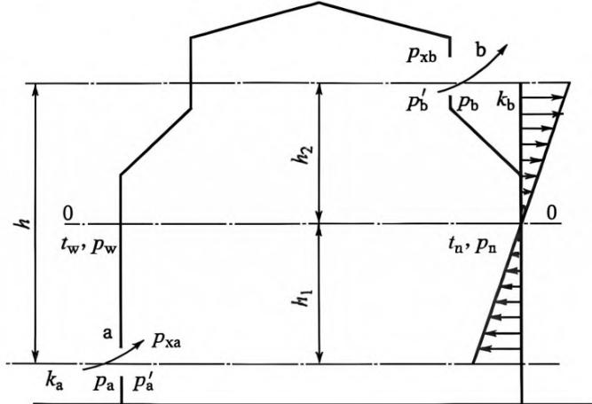  
图11.1-1 热压和风压作用下的自然通风

常用自然通风量的理论计算公式及其示意图见表 11.1-4。

热压或（和）风压的作用原理及单层建筑自然通风压力（见图11.1-1） 表11.1-3

<table><tr><td>作用压力</td><td>作用原理</td><td>计算公式</td><td>备注</td></tr><tr><td>热压作用下的自然通风</td><td>当室内外空气存在温度差和窗孔之间存在高差同时具备时,就会产生热压作用下的自然通风。实际上,如果只有一个窗孔仍然会形成自然通风,这时窗孔的上部排风、下部进风,相当于两个窗孔紧挨在一起</td><td>根据流体静力学原理: $\Delta p_{\mathrm{b}} + (-\Delta p_{\mathrm{a}}) = \Delta p_{\mathrm{b}} + |\Delta p_{\mathrm{a}}|$  $= gh(\rho_{\mathrm{w}} - \rho_{\mathrm{n}})$ (11.1-8)进风窗孔和排风窗孔两侧压差的绝对值之和与两窗孔的高度差 $h$ 和室内外的空气密度差有关,通常把 $gh(\rho_{\mathrm{w}} - \rho_{\mathrm{n}})$ 称为热压</td><td> $\Delta p_{\mathrm{a}} = (p_{\mathrm{a}}^{\prime} - p_{\mathrm{a}}),$  $\Delta p_{\mathrm{b}} = (p_{\mathrm{b}}^{\prime} - p_{\mathrm{b}})$  $\Delta p_{\mathrm{a}}, \Delta p_{\mathrm{b}}$ ——窗孔a和b的内外压差, $\Delta p >0$ 时,该窗孔排风, $\Delta p < 0$ 时,该窗孔进风;由于窗孔a进风, $\Delta p_{\mathrm{a}} < 0$ ;窗孔b排风, $\Delta p_{\mathrm{b}} >0$ </td></tr><tr><td>余压</td><td>室内某一点的压力与室外或邻室同标高处未受扰动的空气压力的差值称为该点的余压</td><td>仅有热压作用时,窗孔内外的压差即为窗孔内的余压; $p_{\mathrm{xb}} = p_{\mathrm{xa}} + gh(\rho_{\mathrm{w}} - \rho_{\mathrm{n}})$ (11.1-9)如果以窗孔a的中心平面作为一个基准面,任何窗孔b的余压等于窗孔a的余压加上窗孔b与窗孔a的高差、重力加速度和室内外空气密度差三者的乘积。窗孔b与窗孔a的高差 $h$ 越大,则余压值越大</td><td> $p_{\mathrm{xb}}$ ——某窗孔的余压,Pa; $p_{\mathrm{xa}}$ ——窗孔a的余压,Pa; $h$ ——窗孔a与某窗孔的高差,m。窗孔b的余压为正,则窗孔排风;窗孔b的余压为负,则窗孔进风</td></tr><tr><td>风压作用下的自然通风</td><td>风流经建筑物时,在其周围形成的静压与未受干扰的稳定气流静压的差值</td><td>风向一定时,建筑物外围护结构上某一点的风压为: $p_{\mathrm{f}} = k \frac{v_{\mathrm{w}}^{2}}{2} \rho_{\mathrm{w}}$ (11.1-10)静压升高,风压为正;静压下降,风压为负。风压为负值的区域称为空气动力阴影。某一建筑物周围的风压分布与该建筑的几何形状和室外的风向有关。不同形状的建筑物在不同方向的风力作用下,空气动力系数k的分布是不同的</td><td>k——空气动力系数; $v_{\mathrm{w}}$ ——室外空气速度,m/s; $\rho_{\mathrm{w}}$ ——室外空气密度, $\mathrm{kg/m^3}$ 。k值为正,该点的风压为正值;k值为负,该点的风压为负值。同一建筑物的外围护结构上,空气动力系数大的窗孔将会进风,空气动力系数小的窗孔将会排风</td></tr><tr><td>风压、热压同时作用下的自然通风</td><td>当建筑物受到风压、热压的同时作用时,外围护结构上各窗孔的内外压差就等于各窗孔的余压和室外风压之差</td><td>对于图11.1-1所示的建筑,窗孔a、b的内外压差为: $\Delta p_{\mathrm{a}} = p_{\mathrm{xa}} - k_{\mathrm{a}} \frac{v_{\mathrm{w}}^{2}}{2} \rho_{\mathrm{w}}$ (11.1-11) $\Delta p_{\mathrm{b}} = p_{\mathrm{xb}} - k_{\mathrm{b}} \frac{v_{\mathrm{w}}^{2}}{2} \rho_{\mathrm{w}}$ (11.1-12) $= p_{\mathrm{xa}} + h g(\rho_{\mathrm{w}} - \rho_{\mathrm{n}}) - k_{\mathrm{b}} \frac{v_{\mathrm{w}}^{2}}{2} \rho_{\mathrm{w}}$ 由于室外风的风速和风向不稳定,为了保证自然通风的设计效果,实际计算时通常不考虑风压。只定性地分析风压对自然通风的影响</td><td> $p_{\mathrm{xa}}$ ——窗孔a的余压,Pa; $p_{\mathrm{xb}}$ ——窗孔b的余压,Pa; $h$ ——窗孔a与b的高差,m; $k_{\mathrm{a}}$ 、 $k_{\mathrm{b}}$ ——窗孔a与b的空气动力系数</td></tr></table>

自然通风量的理论计算  
表 11.1-4

<table><tr><td>窗孔个数及其相互关系</td><td>风量计算</td><td>备注</td><td>窗孔示意图</td></tr><tr><td>单个窗孔自然通风量</td><td> $G = \rho L = \mu F \sqrt{2\rho \Delta p}$ (11.1-13)</td><td> $L$ ——空气体积换气量, $m^{3}/s$ ; $G$ ——空气质量换气量, $kg/s$ ; $F$ ——窗孔的面积, $m^{2}$ ; $\Delta p$ ——窗孔两侧的压力差, $Pa$ ; $\rho$ ——空气的密度, $kg/m^{3}$ ; $\mu$ ——窗孔的流量系数,无量纲,其大小与窗孔的构造有关,一般小于1</td><td>见图11.1-1</td></tr><tr><td>单层建筑并联窗孔风压作用下自然通风量</td><td>假设各窗孔内外压差相等得: $G = \rho L = \mu F \sqrt{2\rho \Delta p}$ (11.1-14) $\mu F = \mu_{1}F_{1} + \mu_{2}F_{2} + \cdots + \mu_{m}F_{m}$ (11.1-15) $\mu F$ 为并联窗孔时的当量有效开口面积,它与窗孔结构有关</td><td> $\mu_{i}$ ——第 $i$ 个窗孔的流量系数,无量纲; $F_{i}$ ——第 $i$ 个窗孔的面积, $m^{2}$ 。 $i=1,2,\cdots,m$ </td><td>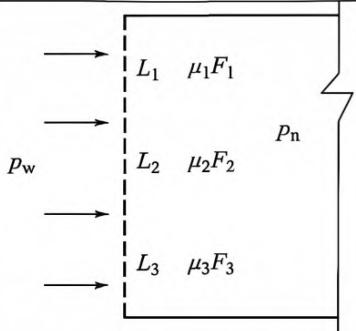图11.1-2 并联窗孔示意</td></tr><tr><td>单层建筑串联窗孔风压作用下自然通风量</td><td> $G = \rho L = \mu F\sqrt{2\rho(p_1 - p_b)}$ (11.1-16) $\left(\frac{1}{\mu F}\right)^2 = \left(\frac{1}{\mu_1F_1}\right)^2 + \left(\frac{1}{\mu_2F_2}\right)^2 + \cdots + \left(\frac{1}{\mu_mF_m}\right)^2$ (11.1-17) $\mu F$ 为串联窗孔的当量有效面积,即串联窗孔空气流动总当量阻力为各窗孔流动当量阻力之和</td><td> $p_f$ ——迎风面窗孔外压力,Pa; $p_b$ ——背面窗孔外压力,Pa</td><td>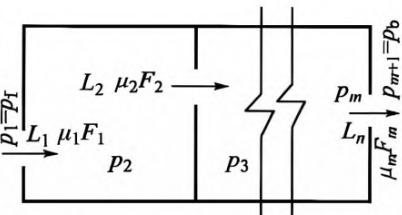图11.1-3 串联窗孔示意</td></tr><tr><td>单层建筑混合窗孔风压作用下自然通风量</td><td> $G = \rho L = \mu F\sqrt{2\rho(p_f - p_b)}$ (11.1-18) $\mu F = \frac{1}{\sqrt{\left(\frac{1}{\mu_1F_1 + \mu_2F_2}\right)^2 + \left(\frac{1}{\mu_3F_3}\right)^2}}$ (11.1-19) $\mu F$ 为并联窗孔和串联窗孔总当量有效开口面积</td><td>根据上述并联窗孔和串联窗孔建筑的自然通风计算基本原理确定混合窗孔在风压作用下自然通风量</td><td>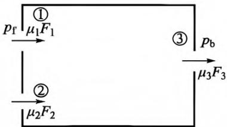图11.1-4 混合窗孔示意</td></tr><tr><td>单层建筑热压作用下自然通风量</td><td> $G_a = (\mu F)_a\sqrt{2\rho_w\Delta p}$ (11.1-20) $G_b = (\mu F)_b\sqrt{2\rho_n\Delta p}$ (11.1-21) $\frac{1}{(\mu F)_a^2} = \left(\frac{1}{\mu_aF_a}\right)^2 + \frac{\rho_w}{\rho_n}\left(\frac{1}{\mu_bF_b}\right)^2$ (11.1-22) $\frac{1}{(\mu F)_b^2} = \frac{\rho_n}{\rho_w}\left(\frac{1}{\mu_aF_a}\right)^2 + \left(\frac{1}{\mu_bF_b}\right)^2$ (11.1-23)</td><td> $(\mu F)_a、(\mu F)_b$ 是以窗孔a和窗孔b为计算依据的当量有效面积。根据 $G_a = G_b = G$ 得到</td><td>见图11.1-1</td></tr><tr><td>多层建筑和高层建筑热压作用下自然通风量</td><td>近似求得多层建筑和高层建筑第i层通过外门窗渗入的空气总量,即渗入量与渗出量的差值: $L_t^i = F_d^i\left[\frac{(\rho_w^i - \rho_l^i)H^ig}{1 + \frac{1}{m^{1.5}}}\right]^{1/1.5}$ (11.1-24)第i层通过外门窗净渗入的室外空气量为: $L_{in}^i = F_d^i\frac{h^i}{Z'}[(\rho_w^i - \rho_n^i)h^ig]^{1/1.5}$ (11.1-25)下标,w—室外;n—室内;i—楼层;l—楼梯间。</td><td> $L_t^i$ ——第i层通过外门窗渗入量与渗出量的差,即渗入的空气总量, $m^3/h$ ; $L_{in}^i$ ——第i层通过外门窗进入到房间的室外空气净化渗入量, $m^3/h$ ;H——计算位置与大中和面的距离,在中和面下面为正值,否则为负值,m;h——计算位置与小中和面的距离,在中和面下面为正值,否则为负,m;Z——外门窗的高度,m; $F_d$ ——外门窗的当量孔口面积, $m^3/(h·Pa^{-1.5})$ ;m——通往楼梯间的内门窗与外门窗的当量孔口面积比</td><td>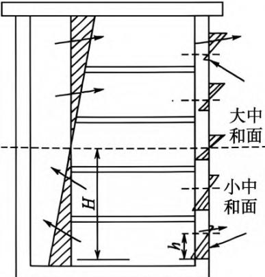图11.1-5 多层建筑热压引起的自然通风</td></tr></table>

资料来源：1. 黄晨，建筑环境学 [M]. 北京；机械工业出版社，2007。  
2. 朱颖心，建筑环境学 [M]. 2 版，北京；中国建筑工业出版社，2005。

### 11.1.3 通风房间的风量平衡和热量平衡

通风房间的风量平衡、热量平衡是自然界的客观规律，设计时不遵循上述规律，实际运行时会在新的室内状态下达到平衡，但此时的室内参数已发生变化，达不到设计的预期要求。

从热量平衡的观点看，由于在供暖设计计算中已考虑了渗透风量所需的耗热量，所以用渗透风量补偿局部排风量不会影响室内温度，只有当局部排风系统风量大于计算渗透风量时，才会导致渗透风量的增加，从而影响室内温度。

要保持室内的湿度和有害物质量浓度不变，必须保持湿平衡和有害物质量的平衡，前文介绍的全面通风通风量计算公式就是建立在风量平衡和热量、湿量、有害物质量平衡基础上的，它们只适用于较简单的情况，实际的通风问题比较复杂，有时送风和排风同时有几种形式和状态；有时要根据排风量确定送风量，有时要根据热平衡条件确定送风参数等，对于这些问题，都必须根据风量平衡、热量平衡条件进行计算。

**11.1.3.1 风量平衡**

要使通风房间保持空气压力不变，不论采用何种通风方式，单位时间内送入室内的空气质量应和同一时间内排出的空气质量保持相等，即通风房间内空气量要保持平衡。空气质量平衡方程的形式为：

$$
G _ {\mathrm{zj}} + G _ {\mathrm{jj}} = G _ {\mathrm{zp}} + G _ {\mathrm{jp}}\tag{11. 1-26}
$$

式中 $G_{zj}$ ——自然进风量，kg/s；

$G_{jj}$ ——机械送风量，kg/s；

$G_{zp}$ ——自然排风量，kg/s；

$G_{jp}$ ——机械排风量，kg/s。

在不设有组织自然通风的房间中，当机械送、排风量相等时，室内压力等于室外大气压力，室内外压差为零。当机械送风量大于机械排风量时，室内压力高于室外大气压力，处于正压状态。反之，室内处于负压状态。由于通风房间不是很严密，处于正压状态时，室内空气会通过房间不严密的缝隙或窗户门洞渗到室外，这部分空气量称为无组织排风。当室内处于负压状态时，室外空气会渗入到室内，这部分空气量称为无组织进风。在工程设计中，为了使相邻房间不受污染，常有意识地利用无组织进风或无组织排风，让清洁度要求高的房间保持正压，产生有害物的房间保持负压。

**11.1.3.2 热量平衡**

要使通风房间温度保持不变，必须使室内的总得热量等于总失热量，保持室内热量平衡，见图 11.1-6，图中假设局部排风罩位于工作区。

热量平衡方程的形式为:

$$
\sum Q _ {\mathrm{b}} + c L _ {\mathrm{jpz}} \rho_ {\mathrm{n}} t _ {\mathrm{n}} + c L _ {\mathrm{jpq}} \rho_ {\mathrm{p}} t _ {\mathrm{p}} + c L _ {\mathrm{zp}} \rho_ {\mathrm{p}} t _ {\mathrm{p}} = \sum Q _ {\mathrm{f}} + c L _ {\mathrm{jj}} \rho_ {\mathrm{j}} t _ {\mathrm{j}} + c L _ {\mathrm{zi}} \rho_ {\mathrm{w}} t _ {\mathrm{w}}\tag{11. 1-27}
$$

其中， $L_{jj}\rho_{j}=L_{xf}\rho_{w}+L_{xh}\rho_{h};\quad cL_{jj}\rho_{j}t_{j}=cL_{xf}\rho_{w}t_{w}+cL_{hx}\rho_{h}t_{h}$

式中 $\sum Q_{b}$ ——围护结构、材料吸热的失热量，kW；

$\sum Q_{f}$ ——生产设备、产品及供暖散热设备的总放热量，kW；

$L_{jpz}$ ——机械通风全面排风风量， $m^{3}/s$ ;

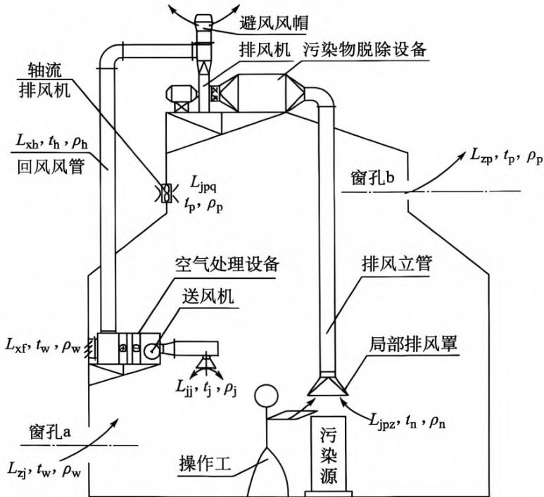  
图 11.1-6 热车间通风室内热量平衡示意图

$L_{jpq}$ ——机械通风局部排风风量， $m^{3}/s$ ;

$L_{jj}$ ——机械通风进风量， $m^{3}/s$ ;

$L_{zj}$ ——自然通风进风量， $m^{3}/s$ ;

$L_{xh}$ ——再循环风量， $m^{3}/s$ ;

$L_{xf}$ ——新风量， $m^{3}/s$ ;

$\rho_{n}$ ——室内工作区空气密度，kg/m $^{3}$ ；

$\rho_{p}$ ——室内排风区空气密度，kg/m $^{3}$ ；

$\rho_{j}$ ——机械送风空气密度，kg/m $^{3}$ ；

$\rho_{w}$ ——室外进风空气密度，kg/m $^{3}$ ；

$\rho_{h}$ ——回风空气密度，kg/m $^{3}$

$t_{n}$ ——室内工作区排出空气温度，℃；

$t_{p}$ ——室内排风区排出空气温度，℃；

$t_{j}$ ——机械送风空气温度，℃；

$t_{h}$ ——回风空气温度，℃；

$t_{w}$ ——室外空气计算温度，℃；选择空气加热器时，采用供暖室外计算温度；补偿全面排风耗热量时，应采用冬季通风室外计算温度；

c——空气的比热容，其值为 $1.01 \, \text{kJ/(kg} \cdot {}^\circ\text{C)}$ 。

### 11.1.4 通风排气中气溶胶粒子的净化机理

气溶胶粒子（又称颗粒或粉尘）的净化机理亦称除尘机理，就是将含尘气体引入具有一种或几种力作用的除尘器，使气溶胶颗粒相对于其运载气流产生一定的位移，并从气流中分离出来，最后沉积到捕集物表面上。气溶胶颗粒的粒径大小和种类不同，所受的作用力和大小不同，颗粒物的动力学行为亦不同。颗粒物捕集过程要考虑的作用力有外力、颗粒间的相互作用力和气流的阻力；外力包括重力、离心力、惯性力、静电力、磁力、热力和泳力等；颗粒间的相互作用力，在颗粒质量浓度不很高时皆可忽略不计。主要除尘机理见图11.1-7和表11.1-5。

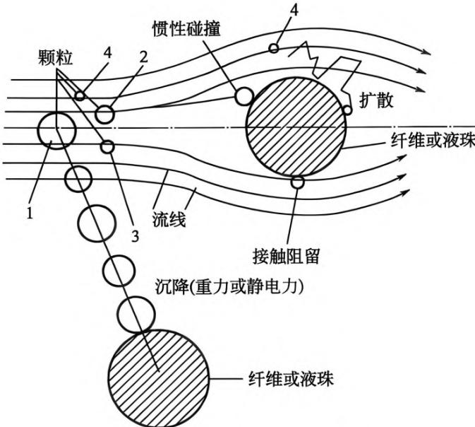  
图11.1-7 除尘机理示意图  
注：1、2、3、4 表示气溶胶粒子。

工程上常用的除尘器，特别是高效除尘器，往往不是简单地依靠某一种除尘机理获得高效率，而是多种除尘机理的复合运用，使其对不同粒径的气溶胶粒子都有较高的分级效率。

主要除尘机理  
表 11. 1-5

<table><tr><td>外力种类</td><td>机理</td><td>计算公式</td><td>主要应用</td></tr><tr><td>重力</td><td>悬浮在气流中的气溶胶粒子在重力作用下,可以自然沉降,从而从气流中分离出来。图11.1-7中气溶胶粒子1在其重力作用下,从气流中缓慢沉降下来</td><td> $F_{\mathrm{D}} = F_{\mathrm{G}} - F_{\mathrm{B}} = \frac{\pi d_{\mathrm{P}}^{2}}{6} (\rho_{\mathrm{P}} - \rho) g$ (11.1-28)式中  $F_{\mathrm{D}}$ ——颗粒所受流体阻力,N; $F_{\mathrm{G}}$ ——颗粒所受重力,N; $F_{\mathrm{B}}$ ——颗粒所受流体浮力,N; $d_{\mathrm{P}}$ ——颗粒直径,m; $\rho_{\mathrm{P}}$ ——粒子密度, $\mathrm{kg/m^3}$ ; $\rho$ ——流体密度, $\mathrm{kg/m^3}$ ;g——重力加速度, $\mathrm{m/s^2}$ </td><td>重力沉降局限于分离50~100μm粗大的气溶胶粒子,它是重力沉降室和惯性除尘器的主要除尘机理</td></tr><tr><td>离心力</td><td>含尘气流作圆周运动时,由于离心力的作用,气溶胶粒子和空气会产生相对运动,使气溶胶粒子从气流中分离出来</td><td> $F_{\mathrm{C}} = \frac{\pi d_{\mathrm{P}}^{3}}{6} \rho_{\mathrm{P}} \frac{v_{\mathrm{t}}^{2}}{R}$ (11.1-29)式中  $F_{\mathrm{C}}$ ——颗粒所受离心力,N;R——旋转气流流线的半径,m; $v_{\mathrm{t}}$ ——R处气流的切向速度,m/s</td><td>离心力沉降主要用于分离10μm以上中等粒径的气溶胶粒子,它是旋风除尘器工作的主要除尘机理</td></tr><tr><td>惯性碰撞</td><td>含尘气流在运动过程中遇到捕集物(如挡板、水滴和纤维等)的阻挡,气流要改变方向进行绕流,细小的气溶胶粒子会沿气体流线一起流动。粗大的气溶胶粒子具有较大的惯性,来不及跟随气流一起绕过捕集物,因而脱离流线,保持自身的惯性运动,可能碰撞在捕集物表面而沉积下来,见图11.1-7中气溶胶粒子</td><td> $St = \frac{x_{\mathrm{S}}C}{D_{\mathrm{C}}/2} = \frac{v_{0} \tau C}{D_{\mathrm{C}}/2} = \frac{d_{\mathrm{p}}^{2} \rho_{\mathrm{P}} v_{0} C}{9 \mu D_{\mathrm{C}}}$ (11.1-30)式中St——斯托克斯粒子碰撞参数,无量纲; $x_{\mathrm{S}}$ ——颗粒惯性运动终止距离,m; $C$ ——肯宁汉修正系数,无量纲; $D_{\mathrm{C}}$ ——捕集体的定性尺寸,m; $v_{0}$ ——无扰动气流时颗粒相对捕集体的流速,m/s; $\tau$ ——颗粒的弛豫时间,s; $\mu$ ——气体动力黏性系数, $\mathrm{Pa} \cdot \mathrm{s}$ </td><td>惯性碰撞是过滤式除尘器、湿式除尘器和惯性除尘器的主要除尘机理</td></tr><tr><td>接触阻留(拦截)</td><td>含尘气流在运动过程中遇到捕集物(如挡板、水滴和纤维等)的阻挡,气流要改变方向进行绕流,细小的气溶胶粒子随气流一起绕流时,如果流线紧靠捕集物表面,有些气溶胶粒子因与捕集物发生接触而被阻留,见图11.1-7中气溶胶粒子3</td><td> $R = \frac{d_{\mathrm{P}}}{D_{\mathrm{C}}}$ (11.1-31)式中R——直接拦截比,表示拦截效率,无量纲</td><td>直接拦截“靶”类除尘器(如过滤器、洗涤器)的主要除尘机理之一</td></tr><tr><td>扩散</td><td>由于气体分子热运动对细微气溶胶粒子的撞击而使气溶胶粒子产生布朗运动,如果细微气溶胶粒子在运动过程中和捕集物表面接触,就会从气流中分离出来,见图11.1-7中气溶胶粒子4</td><td> $\overline{x} = \sqrt{2Dt}$ (11.1-32)式中 $\overline{x}$ ——布朗扩散颗粒在时间t内的均方根位移,m; $D$ ——粒子的扩散系数, $\mathrm{m}^{2}/\mathrm{s}$ ; $t$ ——粒子的扩散时间,s。随着粒径的减小,在相同时间内布朗扩散的平均位移比重力沉降距离大得多</td><td>扩散沉降也是“靶”类除尘器(如过滤器、洗涤器)的主要机理之一</td></tr><tr><td>静电力</td><td>悬浮在气流中的气溶胶粒子,如果带有一定的电荷,当含尘气流流经电场时,静电力可以使带电气溶胶粒子从气流中分离出来。但在自然状态下,气溶胶粒子的带电量很小,为此必须设置专门的高压电场,使所有气溶胶粒子都充分荷电,以获得较好的除尘效果</td><td> $F_{\mathrm{E}} = qE$ (11.1-33)式中 $F_{\mathrm{E}}$ ——颗粒所受静电力,N; $q$ ——颗粒的荷电量,C; $E$ ——颗粒所处位置的电场强度,V/m。 $\omega = \frac{qE}{3 \pi \mu d_{\mathrm{P}}}$ (11.1-34)式中 $\omega$ ——斯托克斯颗粒的驱进速度,m/s</td><td>静电沉降是电除尘器和过滤器的主要除尘机理</td></tr><tr><td>流体阻力</td><td>稳定运动的球形颗粒必须排开其周围的流体,导致其前面的压力较后面的大,即所谓形状阻力;同时,颗粒物与其周围的流体存在摩擦,即所谓摩擦阻力。两种阻力同时考虑称为流体阻力</td><td> $F_{\mathrm{D}} = C_{\mathrm{D}} A \rho v^{2}/2$ (11.1-35)式中 $C_{\mathrm{D}}$ ——阻力系数,无量纲; $A$ ——颗粒物在其运动方向上的投影面积, $\mathrm{m}^{2}$ ; $v$ ——颗粒与流体之间的相对运动速度,m/s</td><td>对所有捕集过程来说,流体阻力都是最基本的作用力</td></tr><tr><td>筛滤</td><td>当气溶胶粒子的直径大于纤维网孔尺寸或“一次粉尘层”的空隙尺寸时,含尘气流通过过滤介质时,气溶胶粒子被阻留,这种现象称为筛滤作用</td><td>—</td><td>筛滤作用是过滤式除尘器的主要除尘机理之一,也是过滤式除尘器获得高效率的主要除尘机理</td></tr><tr><td>凝并</td><td>凝并作用不是一种直接的气溶胶粒子分离机理。它是通过声波、蒸汽凝结、加湿等作用,使细微的气溶胶粒子凝并增大,然后再用一般的除尘机理去除</td><td>—</td><td>凝并作用是各类除尘器细微气溶胶粒子被分离的主要除尘机理之一。从而获得更高的效率</td></tr></table>

续表  
资料来源：马广大．除尘器性能计算[M].北京：中国环境科学出版社，1990。

### 11.1.5 通风排气中气态污染物的净化机理

通风排气中气态污染物的净化机理如表 11.1-6 所示，挥发性有机物治理技术分类如表 11.1-7 所示。

通风排气中气态污染物的净化机理  
表 11.1-6

<table><tr><td>污染物种类</td><td>净化方法</td><td colspan="2">净化机理</td></tr><tr><td rowspan="5">氮氧化物</td><td>烟气再循环技术</td><td colspan="2">烟气再循环技术是减少燃烧中氮氧化物生成的一种有效方法,它利用一部分烟气返回燃烧区,这部分烟气的温度和含氧量较低,可降低燃烧区的温度和含氧量,从而抑制氮氧化物的生成</td></tr><tr><td>空气分级燃烧技术</td><td colspan="2">将燃料分几股流进入炉膛,在第一燃烧区鼓入过量空气,生成燃料型和热力型氮氧化物,第二燃烧区供给的燃料将第一燃烧区残存的氧耗尽,氮氧化物在此区进行还原反应。在第三燃烧区通入过量空气,将未燃烧的燃料完全燃烧。该技术对于低挥发分煤的氮氧化物排放控制具有优势,可解决低氮燃烧器效果差的问题,但系统相对复杂</td></tr><tr><td>低氮燃烧器</td><td colspan="2">低氮燃烧器是根据氮氧化物形成机理,充分利用烟气再循环、分段燃烧及燃料分级燃烧技术相结合的装置。通过特殊设计的燃烧器结构,控制燃烧器喉部燃料和空气的动量和流动方向,使燃烧器出口实现分级送风并与燃料合理配比,降低氮氧化物的生成</td></tr><tr><td>选择性催化还原(SCR)脱硝技术</td><td colspan="2">SCR脱硝是在一定温度条件和催化剂作用下,还原剂有选择地把烟气中的氮氧化物还原为 $N_2$ 和 $H_2O$ 。还原剂主要为液氨、氨水和尿素,应用广泛的催化剂是以 $TiO_2$ 作为载体,以 $V_2O_5$ 或 $V_2O_5-WO_3$ 、 $V_2O_5-MoO_3$ 为活性成分。其主要化学反应方程式如下: $4NH_3+4NO+O_2\longrightarrow 4N_2+6H_2O$  $4NH_3+2NO_2+O_2\longrightarrow 3N_2+6H_2O$  $4NH_3+6NO\longrightarrow 5N_2+6H_2O$  $8NH_3+6NO_2\longrightarrow 7N_2+12H_2O$ </td></tr><tr><td>选择性非催化还原(SNCR)脱硝技术</td><td colspan="2">以氨为还原剂,化学反应方程式为: $4NH_3+4NO+O_2\longrightarrow 4N_2+6H_2O$  $8NH_3+6NO_2\longrightarrow 7N_2+12H_2O$ 以尿素为还原剂,化学反应方程式为: $2CO(NH_2)_2+4NO+O_2\longrightarrow 4N_2+2CO_2+4H_2O$ 烟气中90%~95%的氮氧化物为NO,故以NO还原反应为主。为确保上述三个反应为主要反应,氨或尿素需注入最适宜的温度区。温度太高,容易导致氨气氧化;温度太低,将导致脱硝反应不完全</td></tr><tr><td rowspan="2">硫氧化物</td><td colspan="2">石灰石-石膏法</td><td>从烟气中脱除SO2的过程是在气、液、固三相中进行的,先后或同时发生气-液反应和液-固反应,其主要步骤可用以下化学反应式来描述。1吸收反应。其化学反应方程式为:SO2+H2O→H2SO3H2SO3→H++HSO3-HSO3→H++SO2-2溶解和中和反应。其化学反应方程式为:CaCO3→CaCO3CaCO3+H++HSO3→Ca2++SO2-+H2O+CO2SO3-+H++HSO3-3氧化反应。其化学反应方程式为SO2-+1/2O2→SO4-4结晶反应。其化学反应方程式为Ca2++SO2-+1/2H2O→CaSO3·1/2H2OCa2+(1-x)SO2-+xSO4-+1/2H2O→(CaSO3)(1-x)·(CaSO4)x·1/2H2OCa2++SO4-+2H2O→CaSO4·2H2O式中,x为被吸收的SO2氧化成SO4-的摩尔分率。5总反应式。其化学反应方程式为:CaCO3+1/2H2O+SO2→CaSO3·1/2H2O+CO2CaCO3+2H2O+SO2+1/2O2→CaSO·2H2O+CO2石灰石-石膏湿法脱硫工艺的脱硫反应速率主要取决于上述1~4个控制步骤</td></tr><tr><td>氨法脱硫</td><td>氨-酸法</td><td>1吸收:把SO2尾气和氨水同时通入吸收塔中,SO2即被吸收,化学反应方程式如下:2NH3·H2O+SO2→(NH4)2SO3+H2O(NH4)2SO3+SO2+H2O→2NH4HSO3实际上,吸收SO2的吸收剂是循环的(NH4)2SO3-NH4HSO3水溶液,其中只有(NH4)2SO3具有吸收SO2的能力。随着吸收过程的进行,循环液中NH4HSO3增多,吸收能力下降,需补充氨,使部分NH4HSO3转变为(NH4)2SO3:NH4HSO3+NH3→(NH4)2SO3当被处理的烟气中含有O2和SO3时,可能发生如下副反应:2(NH4)2SO3+O2→2(NH4)2SO42(NH4)2SO3+SO3+H2O→(NH4)2SO4+2NH4HSO32吸收液综合利用:含有(NH4)2SO3-NH4HSO3的循环吸收液,当其S/C[表示溶液中(NH4)2SO3和NH4HSO3的比例]达到0.9(相对密度为1.17~1.18)时,即可自循环系统导出一部分,送入分解塔中用93%~95%浓H2SO4酸化分解,得到浓度SO2和(NH4)2SO4溶液。分解反应为:2NH4HSO3+H2SO4→(NH4)2SO4+2SO2+2H2O(NH4)2SO3+H2SO4→(NH4)2SO4+SO2+H2O分解液中NH4HSO3的质量分数越大,分解时H2SO4的消耗量越低,为了分解完全,H2SO4用量应为理论量的1.3~1.5倍,为此需对多余的酸进行中和,中和剂仍用氨,反应产物(NH4)2SO4作为氮肥产品其反应式为:H2SO4+2NH3→(NH4)2SO4</td></tr><tr><td rowspan="3">硫氧化物</td><td rowspan="2">氨法脱硫</td><td>氨-亚硫酸铵法</td><td>用NH4HCO3铵溶液吸收烟气中SO2,主要反应为:2NH4HCO3+SO2→(NH4)2SO3+H2O+2CO2(NH4)2SO3+SO2+H2O→2NH4HSO3若烟气中含有氧,还会发生如下副反应:(NH4)2SO3+1/2O2→(NH4)2SO4对于H2SO4尾气,因尾气中含有少量SO3,会发生如下副反应:2(NH4)2SO3+H2SO4→(NH4)2SO4+2NH4HSO3吸收SO2后的吸收液主要含NH4HSO3,溶液呈酸性,加固体NH4HCO3中和,可析出亚氨晶体。NH3HSO3+NH4HCO3→(NH4)2SO3·H2O+CO2此反应为吸热反应,溶液温度不经冷却即可降到0°C左右。由于(NH4)2SO3比NH4HSO3在水中的溶解度小,则生成的(NH4)2SO3·H2O过饱和而从溶液中结晶析出,将此悬浮液离心分离可制得固体亚氨</td></tr><tr><td>氨-硫酸铵法</td><td>在脱硫过程中,采用一定质量分数的氨水作为吸收剂,在吸收塔内洗涤SO2,达到烟气净化的目的。为了保证对SO2的吸收能力,吸收液中应保持足够的亚硫酸盐质量分数。因此,亚硫酸盐不可能在吸收塔内完全氧化,在吸收塔后必须设置专门的氧化塔,以保证亚硫酸盐被全部氧化。在吸收液送入氧化塔之前,一般先将吸收液用NH3进行中和,使吸收液中NH4HSO3全部转变为(NH4)2SO3,以防止SO2从溶液中逸出:NH4HSO3+NH3→(NH4)2SO3氧化塔内,用压缩空气将溶液氧化生成(NH4)2SO4溶液:(NH4)2SO3+1/2O2→(NH4)2SO4</td></tr><tr><td>钠碱法脱硫钠碱法脱硫</td><td>亚硫酸钠循环法亚硫酸钠法</td><td>该法是利用Na2CO3或NaOH溶液作为开始的吸收剂,在低温下吸收烟气中SO2,同时生成Na2SO3,Na2SO3还可继续吸收SO2而生成NaHSO3,将含Na2SO3-NaHSO3的吸收液进行加热再生,放出SO2,在加热再生过程中得到的亚硫酸钠结晶经固液分离并用水溶解后返回吸收系统。因此,工艺上分为吸收和再生两个工序。1吸收:采用的Na2CO3或NaOH只作开始的吸收剂,它们吸收SO2后生成Na2SO3,在循环过程中起吸收作用的主要是Na2SO3溶液。吸收反应为:开始阶段:2NaOH+SO2→Na2SO3+H2ONa2CO3+SO2→Na2SO3+CO2反应过程中:Na2SO3+SO2+H2O→2NaHSO3Na2SO3+SO2→Na2S2O5由于烟气中有O2存在,将引起如下副反应:Na2SO3+1/2O2→Na2SO42再生:当循环吸收液中NaHSO3达到一定值(S/C=0.9)时,吸收液就应进行再生。由于吸收液NaHSO3不稳定,受热即可分解,因而含NaHSO3的吸收液可在100°C下加热使其分解,分解反应为:2NaHSO3→Na2SO3+H2O+SO2Na2S2O3→Na2SO3+SO2在NaHSO3分解过程中,可获得高质量分数的SO2气体,并再生出Na2SO3,将再生出的Na2SO3溶解后返回吸收系统继续使用该法用 $Na_{2}CO_{3}$ 或NaOH作吸收剂吸收烟气中 $SO_{2}$ ,首先生成 $NaHSO_{3}$ 溶液,然后再用NaOH中和即得到 $Na_{2}SO_{3}$ 。由于 $Na_{2}SO_{3}$ 的溶解度比 $NaHSO_{3}$ 低,能从溶液中结晶出来,固液分离后,可得副产品 $NaHSO_{3}$ 。其工艺过程可分为吸收和中和、结晶两个工序。1吸收:吸收过程的化学反应方程式为: $2Na_{2}CO_{3} + SO_{2} + H_{2}O \longrightarrow 2NaHCO_{3} + Na_{2}SO_{3}$  $2NaHCO_{3} + SO_{2} \longrightarrow Na_{2}SO_{3} + H_{2}O + 2CO_{2}$  $Na_{2}SO_{3} + SO_{2} + H_{2}O \longrightarrow 2NaHSO_{3}$ 2中和、结晶:中和、结晶的化学反应方程式为: $NaHSO_{3} + NaOH \longrightarrow Na_{2}SO_{3} + H_{2}O$ 烟气含氧量和含尘量较高的情况下容易引起如下副反应: $2Na_{2}SO_{3} + O_{2} \longrightarrow 2Na_{2}SO_{4}$ 加入适量的抗氧化剂,如对苯二胺等,可抑制副反应的进行</td></tr><tr><td rowspan="3">硫氧化物</td><td></td><td></td><td></td></tr><tr><td colspan="2">喷雾干燥法</td><td>在喷雾干燥吸收器中,当喷入的雾化石灰浆液与高温烟气接触后,浆液中的水分开始蒸发,烟气降温并增湿,石灰浆液中的 $Ca(OH)_{2}$ 与 $SO_{2}$ 反应生成的产物呈干粉状。 $SO_{2}$ 被液滴吸收: $SO_{2} + H_{2}O \longrightarrow H_{2}SO_{3}$ 被吸收的 $SO_{2}$ 与吸收剂 $Ca(OH)_{2}$ 反应: $H_{2}SO_{3} + Ca(OH)_{2} \longrightarrow CaSO_{3} + 2H_{2}O$ 液滴中 $CaSO_{3}$ 过饱和,并析出结晶: $CaSO_{3}$ (溶液)→ $CaSO_{3}$ (固体)部分溶液中的 $CaSO_{3}$ 被溶于液滴中的 $O_{2}$ 氧化: $CaSO_{3}$ (溶液)+ $O_{2}$ (气体)→ $CaSO_{4}$ (溶液) $CaSO_{4}$ 难溶于水,从溶液中结晶析出: $CaSO_{4}$ (溶液)→ $CaSO_{4}$ (固体)</td></tr><tr><td colspan="2">循环流化床烟气脱硫(CFB-FGD)</td><td>脱硫反应: $CaO + H_{2}O \longrightarrow Ca(OH)_{2}$  $SO_{2} + H_{2}O \longrightarrow H_{2}SO_{3}$  $Ca(OH)_{2} + H_{2}SO_{3} \longrightarrow CaSO_{3} \cdot 1/2H_{2}O + 1\frac{1}{2}H_{2}O$ 部分 $CaSO_{3} \cdot 1/2H_{2}O$ 被烟气中的 $O_{2}$ 氧化: $CaSO_{3} \cdot 1/2H_{2}O + 1/2O_{2} + 1\frac{1}{2}H_{2}O \longrightarrow CaSO_{4} \cdot 2H_{2}O$ 由上述反应可以看出,在CFB反应器中进行的是气、液、固三相反应,反应产物将沉积在CaO颗粒表面,必定对反应速度产生影响。但流化床中由于颗粒物在流化过程中不断磨损,使颗粒表面形成的产物不断被剥落,未反应的CaO表面就会暴露在气流中不断进行脱硫反应,因而反应速度基本上不受生成产物的影响</td></tr></table>

挥发性有机物治理技术分类  
表 11.1-7

<table><tr><td>技术分类</td><td>回收技术</td><td>销毁技术</td></tr><tr><td>基本原理</td><td>通过物理方法,在一定温度和压力下,用吸收剂、吸附剂或选择性渗透膜等方法回收挥发性有机物</td><td>通过化学或生物反应,在光、热、催化剂和微生物的作用下将有机物转化为水和二氧化碳</td></tr><tr><td>主要方法</td><td>冷凝法、吸附法、吸收法和膜分离法</td><td>燃烧法、生物法、低温等离子分解法、光化学氧化法和催化氧化法等</td></tr></table>

## 11.2 制冷

### 11.2.1 暖通空调常用的制冷循环原理

制冷是指用人工的方法在一定时间和一定空间内将物体冷却，使其温度降低到环境温度以下，保持并利用这个温度。制冷主要应用于人工环境、冷藏与冷冻以及低温与气体工业等领域。按制冷温度范围不同，制冷可分为普通制冷（高于120K）、深度制冷（120～20K）以及低温（20～0.3K）和超低温制冷（0.3K以下）。按物理过程不同，制冷可分为：液体汽化法、气体膨胀法、热电法、固体绝热去磁法等（图11.2-1）。空气调节用制冷技术属于普通制冷范畴，主要采用液体汽化制冷法，以蒸气压缩式和吸收式制冷应用最广。

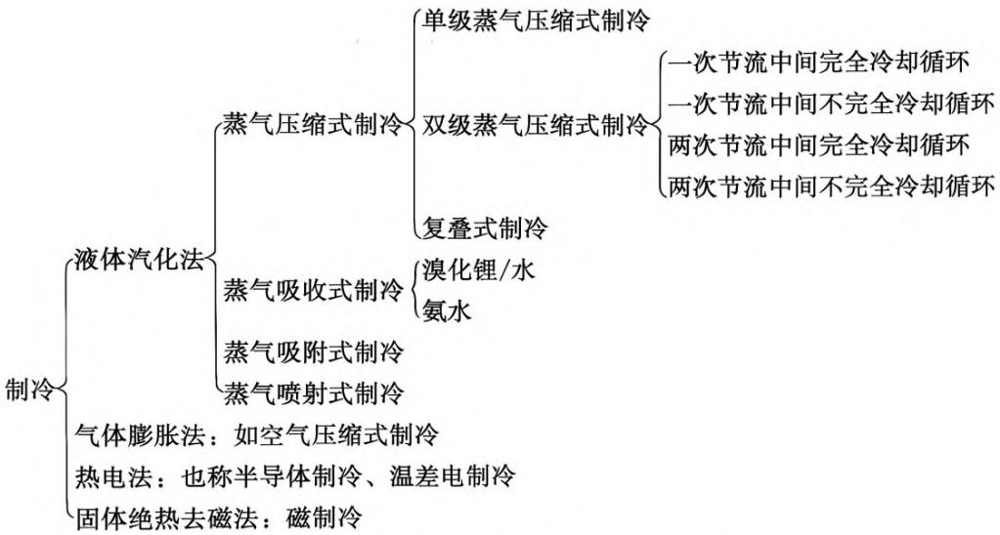  
图11.2-1 制冷按物理过程分类

下面主要介绍暖通空调行业中广泛应用的蒸气压缩式和吸收式制冷循环。

**11.2.1.1 蒸气压缩式制冷循环原理与性能参数**

**1. 蒸气压缩式制冷循环原理与工作流程**

蒸气压缩式制冷循环系统主要由压缩机、蒸发器、冷凝器和节流机构四个主要部件组成，有些还涉及再冷却器、回热器、中间冷却器等换热设备。此外，还有一些辅助设备，如贮液器、气液分离器、过滤器和干燥器、油分离器、集油器、不凝气体分离器以及安全装置（安全阀、熔塞、紧急泄氨阀）等，可以实现制冷剂的储存、分离与净化，润滑油的分离与收集，安全保护等。蒸气压缩式制冷系统示意图与循环工作压焓图见表11.2-1。

近年来，以临界温度较低（31.1℃）、临界压力（7.37MPa）却较高的 $CO_{2}$ 为制冷剂的跨临界制冷循环已得到了应用。单级压缩 $CO_{2}$ 跨临界制冷系统中压缩机的吸、排气压力分别低于和高于临界压力。高压侧换热器为显热放热，无冷凝过程，故称为气体冷却器而非冷凝器。也可以采用带回热器、闪蒸器或经济器的双级跨临界 $CO_{2}$ 制冷循环。此外，鉴于 $CO_{2}$ 低温时的黏度非常小，流动性能和换热特性良好，也可将其作为复叠制冷循环低温级制冷剂，采用 $NH_{3}$ 为高压级制冷剂。在复叠式制冷系统中， $CO_{2}$ 循环在亚临界条件下运行。这种系统也适用于低温冷冻干燥过程。

蒸气压缩式制冷系统示意图与循环工作压焓图  
表 11.2-1

<table><tr><td>制冷循环形式</td><td>系统示意图</td><td>循环工作压焓图</td></tr><tr><td>单级蒸气压缩式理论制冷循环</td><td>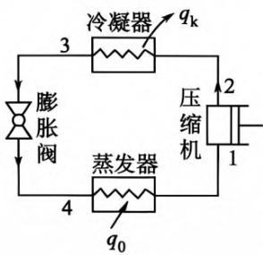</td><td>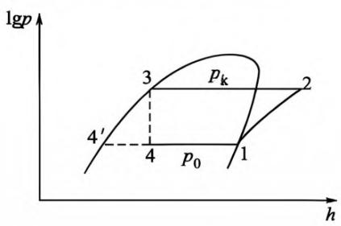</td></tr><tr><td>采用再冷却器的单级蒸气压缩式制冷循环</td><td>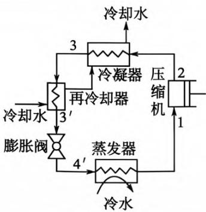</td><td>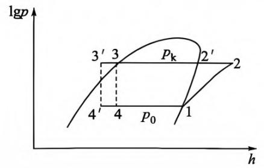</td></tr><tr><td>采用回热器的单级蒸气压缩式制冷循环</td><td>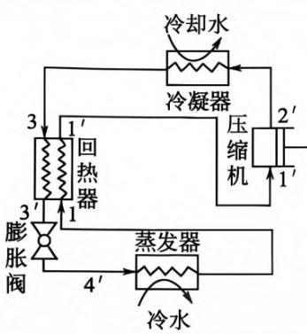</td><td>lgp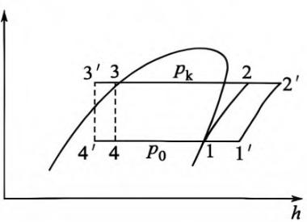</td></tr><tr><td>采用膨胀机的单级蒸气压缩式制冷循环</td><td>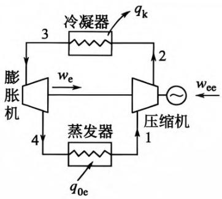</td><td>lgp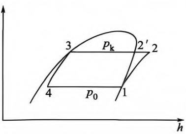</td></tr><tr><td>采用中间冷却器的双级压缩式制冷循环</td><td>高压级压缩机.低压级压缩机.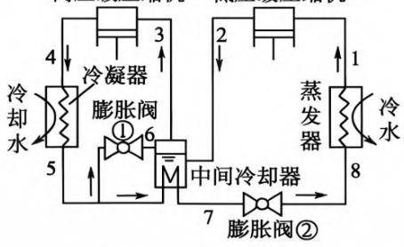</td><td>1⁄2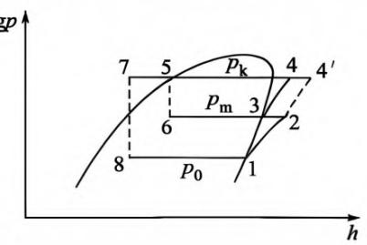</td></tr><tr><td>采用闪发蒸气分离器的双级压缩式制冷循环</td><td>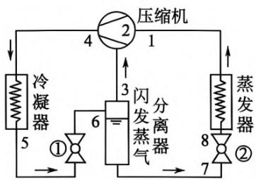</td><td>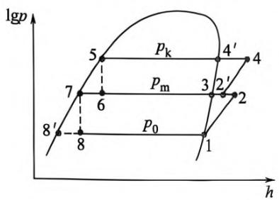</td></tr><tr><td>带回热器的一次节流不完全中间冷却的双级压缩制冷循环</td><td>高压级压缩机 低压级压缩机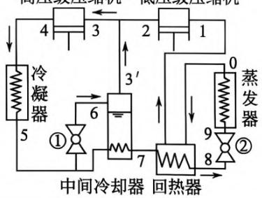</td><td>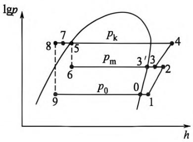</td></tr><tr><td>复叠式蒸气压缩制冷循环(以R22-R23为例)</td><td>冷凝器 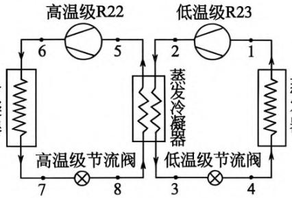 蒸发器</td><td>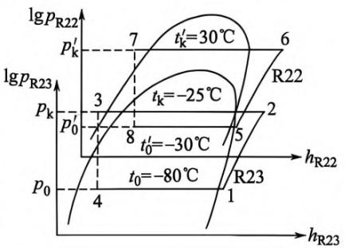</td></tr><tr><td>CO2跨临界单级压缩制冷/热泵循环</td><td>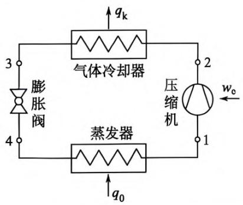</td><td>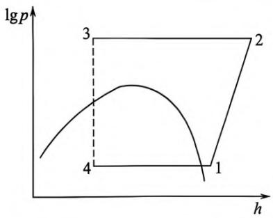</td></tr><tr><td>带回热器的CO2跨临界双级压缩制冷循环</td><td>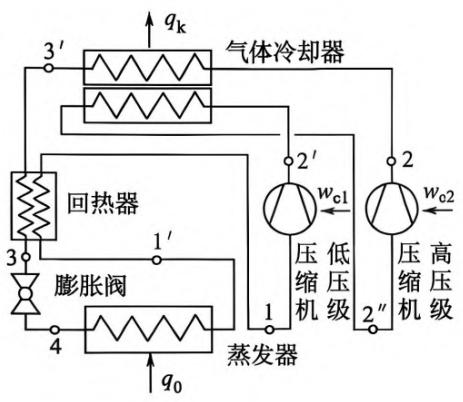</td><td>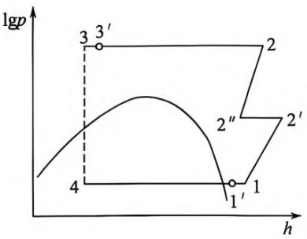</td></tr><tr><td>带闪发器的 $CO_2$ 跨临界双级压缩制冷循环</td><td>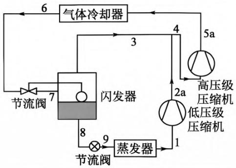</td><td>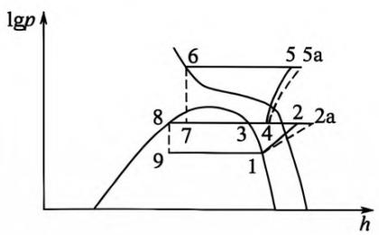</td></tr><tr><td>带经济器的 $CO_2$ 跨临界双级压缩制冷循环</td><td>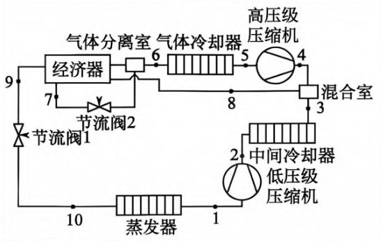</td><td>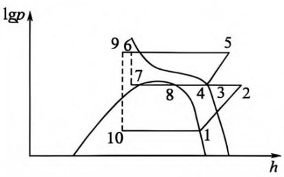</td></tr></table>

2. 蒸气压缩式制冷循环的主要性能参数  
蒸气压缩式制冷循环的主要性能参数见表 11.2-2。

蒸气压缩式制冷循环的主要性能参数  
表 11.2-2

<table><tr><td>参数</td><td>定义</td></tr><tr><td>冷凝温度、冷凝压力</td><td>冷凝器中的饱和制冷剂蒸气的温度和压力</td></tr><tr><td>蒸发温度、蒸发压力</td><td>蒸发器中饱和湿蒸气的温度和压力</td></tr><tr><td>过冷度</td><td>冷凝器中饱和制冷剂与其出口未饱和液态制冷剂的温差</td></tr><tr><td>过热度</td><td>蒸发器出口过热蒸气与蒸发器中饱和蒸气的温差</td></tr><tr><td>单位质量制冷量</td><td>单位质量制冷剂流量所能制取的冷量</td></tr><tr><td>理论比功</td><td>制取1kW冷量的理论耗功量</td></tr><tr><td>单位容积制冷能力</td><td>压缩机吸入 $1m^{3}$ 制冷剂所产生的冷量</td></tr><tr><td>制冷性能系数/制热性能系数</td><td>单位耗功量所制取的冷量/热量</td></tr></table>

**11.2.1.2 蒸气吸收式制冷循环原理与性能参数**

蒸气吸收式制冷系统可采用余热、太阳能等低温热源或其他热源，也可采用燃气加热，无须耗功而实现制冷循环。蒸气吸收式制冷循环以不同沸点的物质组成的二元混合物为工质，即制冷剂—吸收剂工质对，其中低沸点物质为制冷剂，高沸点物质为吸收剂。常用的工质对有溴化锂—水溶液和氨—水溶液。制冷剂在蒸发器和冷凝器中发生相变，吸收剂在吸收器和发生器中发生相变。

**1. 蒸气吸收式制冷循环原理与工作流程**

蒸气吸收式制冷装置由发生器、吸收器、冷凝器、蒸发器、溶液泵、节流阀等部件组成，形成制冷剂与吸收剂两个循环环路，消耗热能，利用液态制冷剂在低温低压下汽化来实现热量从低温物体向高温物体转移，达到制冷的目的。根据热源的利用次数又可以分为单效、双效型蒸气吸收式制冷循环系统，其系统图示和工作原理的 $h - \epsilon$ 图见表11.2-3。

蒸气吸收式制冷系统图示和工作原理的 $h - \varepsilon$ 图  
表 11.2-3

<table><tr><td>分类</td><td colspan="2">系统图示</td><td>吸收式制冷循环的h-ε图</td></tr><tr><td>单效吸收式制冷循环</td><td colspan="2">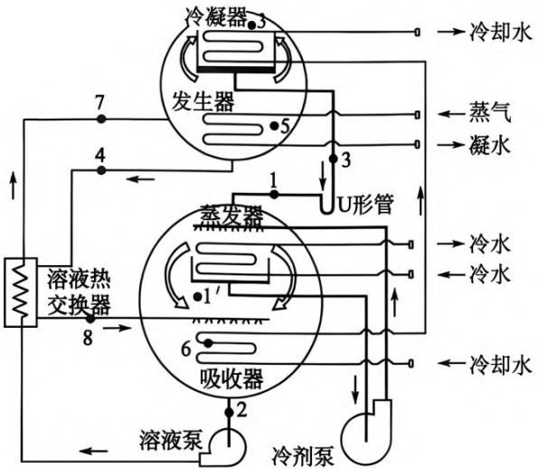</td><td>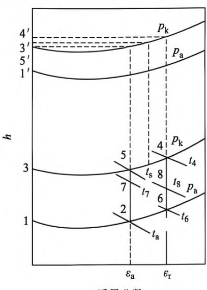质量分数ε</td></tr><tr><td rowspan="2">双效吸收式制冷循环</td><td>并联型</td><td>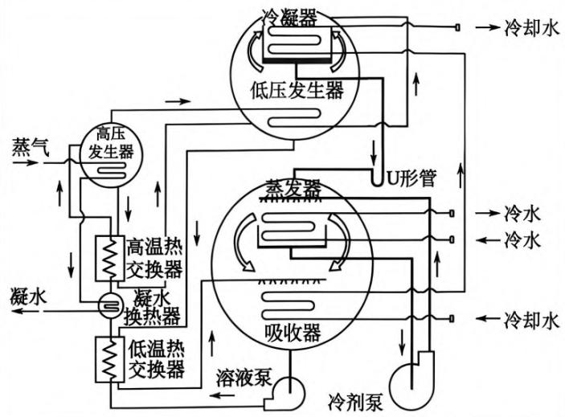</td><td>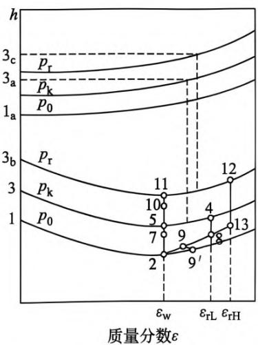</td></tr><tr><td>串联型</td><td>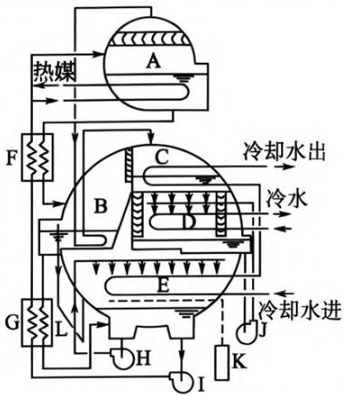A—高压发生器;B—低压发生器;C—冷凝器;D—蒸发器;E—吸收器;F—高温热交换器;G—低温热交换器;H—吸收器泵;I—发生器泵;J—蒸发器泵;K—抽气装置;L—防晶管</td><td>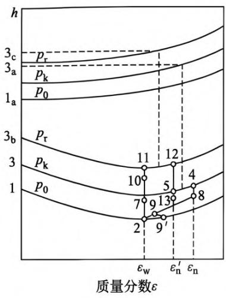</td></tr></table>

**2. 蒸气吸收式制冷循环的主要性能参数**

蒸气吸收式制冷循环的主要性能参数见表 11.2-4。

蒸气吸收式制冷循环的主要性能参数  
表11.2-4

<table><tr><td>参数</td><td>定义</td></tr><tr><td>热力系数ζ</td><td>吸收式制冷机所获得的制冷量 $Q_0$ 与消耗的热量 $Q_g$ 之比,即 $\zeta = \frac{Q_0}{Q_g}$ </td></tr><tr><td>最大热力系数 $\zeta_{\text{max}}$ </td><td> $\zeta_{\text{max}} = \frac{T_g - T_e}{T_g} \cdot \frac{T_0}{T_e - T_0} = \eta_c \varepsilon_c$ 其中, $T_c$ 为环境温度, $T_g$ 为发生器中热媒的温度, $T_0$ 为蒸发器中被冷却介质的温度; $\epsilon_c$ 、 $\eta_c$ 分别为工作在温度 $T_0$ 和 $T_c$ 之间的逆卡诺循环的制冷系数和工作在 $T_g$ 和 $T_e$ 之间的卡诺循环的热效率</td></tr><tr><td>热力学完善度 $\eta_a$ </td><td>热力系数ζ与最大热力系数 $\zeta_{\text{max}}$ 之比,即 $\eta_a = \frac{\zeta}{\zeta_{\text{max}}}$ </td></tr><tr><td>蒸气压力和流量</td><td>蒸气吸收式制冷机热源的蒸气压力和流量</td></tr><tr><td>单位冷量蒸气耗量</td><td>蒸气吸收式制冷机单位制冷量的蒸气消耗量</td></tr><tr><td>直燃机制冷性能系数 $COP_c$ </td><td>制冷量 $Q_0$ 除以耗热量 $Q_g$ 与耗电量P之和,即 $COP_c = \frac{Q_0}{Q_g + P}$ </td></tr><tr><td>直燃机制热性能系数 $COP_h$ </td><td>制热量 $Q_0$ 除以耗热量 $Q_g$ 与耗电量P之和,即 $COP_h = \frac{Q_h}{Q_g + P}$ </td></tr></table>

### 11.2.2 蒸气压缩式制冷机的形式与特征

蒸气压缩式制冷机也可以用于供热，即热泵，热泵的工作原理和技术问题与制冷机完全相同。

### 11.2.2.1 蒸气压缩式制冷机的形式与特点

暖通空调工程中应用的蒸气压缩式制冷机——冷水（热泵）机组，多为活塞式、涡旋式、螺杆式以及离心式，可采用风冷、水冷或风—水冷，大型离心式冷水（热泵）机组都采用水冷。冷（热）水机组分为单冷型和热泵型机组。近年来，涌现出了磁悬浮变频离心式冷水机组。各自的特点和适用场合见表 11.2-5。

不同形式制冷机的性能特点和适用场合  
表11.2-5

<table><tr><td>制冷机形式</td><td>特点</td><td>适用场合</td><td>单机名义制冷量(kW)</td></tr><tr><td>活塞式</td><td>由活塞式压缩机、水冷或风冷冷凝器、节流机构、蒸发器等构成,最多可配置8台压缩机。可通过改变压缩机工作气缸数量或改变工作压缩机数量两种方式进行能量调节。两种方式组合使用,可增加能量调节范围,增强制冷机对空调负荷变化的适应性</td><td>适用于中、小容量的空调制冷与热泵系统,且适用于在空调制冷范围内单级压缩比通常不大于8的情况</td><td>&lt;580kW(常以R22、R407C、R410A为制冷剂)</td></tr><tr><td>涡旋式</td><td>制冷剂在一组涡旋体内几个月牙形空间中同时且连续进行压缩,曲轴转矩变化小,压缩机运转平稳,进、排气的压力脉动很小,振动小,噪声低。容积效率与绝热效率高,体积较小,质量轻。单机容量小。无进、排气阀组,采用轴向和径向间隙的柔性调节机构,可避免液击。高转速下效率和可靠性高。通常配有完善的自动控制系统</td><td>适合小型热泵系统</td><td>&lt;360kW(常以R22、R407C、R410A为制冷剂)</td></tr><tr><td>螺杆式</td><td>由螺杆式压缩机、冷凝器、节流机构、蒸发器、油分离器、自控元件和仪表组成。有单机头与多机头两种,对湿冲程不敏感、允许少量液滴入缸、无液击危险,运行可靠。压缩比可达20,容积效率高且变化不大,COP高,部分负荷性能系数优于活塞式。润滑油系统庞大、复杂,耗油量较大,噪声大。能量调节分为无级调节与有级调节两种,无级调节可以连续输出制冷量,部分负荷时能耗较低,并且冷水出水温度控制精确,常用于单机头制冷机。若多机头制冷机的每台压缩机有3~4档有级控制,则该制冷机运行接近无级调节,且最小负荷可达满负荷的1/10~1/8</td><td>适合于高压缩比场合,以及大、中型空调制冷系统和热泵系统</td><td>&gt;580kW(常以R134a、R22、R407C、R410A为制冷剂)</td></tr><tr><td>离心式</td><td>由离心式压缩机、冷凝器、节流机构和蒸发器等组成。通过叶轮离心力作用吸入气体,并对气体进行压缩;转速高,输气量大,单机容量大,体积小,可实现多级压缩,效率高。运行工况偏离设计工况时效率下降较快。制冷量随蒸发温度的降低而减少,且减少的幅度比活塞式快。制冷量随转速的降低而急剧下降,单级压缩机在低负荷下易发生“喘振”。多级压缩离心式机组有多套节流装置和经济器,在15%~100%的范围内能较经济地实现无级调节,效率可提高10%~20%,并改善低负荷时的“喘振”现象</td><td>适用于大型空调制冷系统,不宜用于高压缩比场合</td><td>≤30000kW(常以R123、R22、R134a为制冷剂)</td></tr></table>

磁悬浮变频离心式冷水机由磁悬浮压缩机（压缩部分和电机部分）、磁悬浮轴承及控制器、变频控制部件组成。其核心是磁悬浮离心压缩机，主要由叶轮、电机、磁悬浮轴承、位移传感器、轴承控制器、电机驱动器等部件组成。其中压缩部分由两级离心叶轮和进口导叶组成，两级叶轮中间预留补气口，可实现中间补气的两级压缩，即采用喷气增焓技术，按表 11.2-1 中的一次节流不完全中间冷却的双级压缩式制冷循环原理工作。低温工况的制热系数和高温工况的制冷系数均明显提高。机组中压缩机的轴与轴承不接触，无机械摩擦，气流摩擦所损耗的能量仅为机械摩擦的 2%；无润滑油，可避免因润滑油失效以及回油而导致的大量故障，且换热器的换热效果也因无油膜阻力而得到改善。磁悬浮变频离心式冷水机组噪声低、部分负荷性能卓越，特别适用于医院、大型酒店、高档办公楼、绿色节能环保建筑等的中央空调系统。其出水温度 3～18℃，可应用于低温送风系统和独立新风系统，COP 很高。

**11.2.2.2 蒸气压缩式冷水（热泵）机组的名义工况及其性能**

1. 蒸气压缩式冷水（热泵）机组的名义工况见表 11.2-6。

蒸气压缩式冷水（热泵）机组的名义工况  
表 11.2-6

<table><tr><td rowspan="3" colspan="2">项目</td><td colspan="2">用户侧</td><td colspan="6">热源侧(或放热侧)</td></tr><tr><td colspan="2">冷、热水</td><td colspan="2">水冷式</td><td colspan="2">风冷式</td><td colspan="2">蒸发冷却式</td></tr><tr><td>进口水温</td><td>出口水温</td><td>进口水温</td><td>出口水温</td><td>干球温度</td><td>湿球温度</td><td>干球温度</td><td>湿球温度</td></tr><tr><td colspan="2">制冷</td><td>12°C</td><td>7°C</td><td>30°C</td><td>35°C</td><td>35°C</td><td>-</td><td>-</td><td>24°C</td></tr><tr><td colspan="2">热泵制热</td><td>40°C</td><td>45°C</td><td>15°C</td><td>7°C</td><td>7°C</td><td>6°C</td><td colspan="2">-</td></tr><tr><td colspan="2">污垢系数</td><td colspan="2">0.086m2·K/kW</td><td colspan="2">0.086m2·K/kW</td><td colspan="2">-</td><td colspan="2">-</td></tr><tr><td rowspan="2">额定电压/频率</td><td>单相交流</td><td colspan="8">220V/50Hz</td></tr><tr><td>三相交流</td><td colspan="8">380V/50Hz、3000V/50Hz、6000V/50Hz或10000V/50Hz</td></tr><tr><td colspan="2">大气压力</td><td colspan="8">101kPa</td></tr></table>

**2. 蒸气压缩式冷水（热泵）机组性能系数与部分负荷性能见表11.2-7。**

蒸气压缩式冷水（热泵）机组的性能系数COP及部分负荷性能系数IPLV表11.2-7

<table><tr><td colspan="2">类型</td><td>名义制冷量(kW)</td><td>性能系数COP</td><td>综合部分负荷性能系数IPLV</td></tr><tr><td rowspan="12">水冷</td><td rowspan="3">活塞式/涡旋式</td><td>&lt;528</td><td>3.80</td><td rowspan="3">-</td></tr><tr><td>528~1163</td><td>4.00</td></tr><tr><td>&gt;1163</td><td>4.20</td></tr><tr><td rowspan="3">螺杆式</td><td>&lt;528</td><td>4.10</td><td>4.47</td></tr><tr><td>528~1163</td><td>4.30</td><td>4.81</td></tr><tr><td>&gt;1163</td><td>4.60</td><td>5.13</td></tr><tr><td rowspan="3">离心式</td><td>&lt;528</td><td>4.40</td><td>4.49</td></tr><tr><td>528~1163</td><td>4.70</td><td>4.88</td></tr><tr><td>&gt;1163</td><td>5.10</td><td>5.42</td></tr><tr><td rowspan="3">磁悬浮离心式</td><td>440~1000</td><td>6.10</td><td rowspan="3">11,2~12.06</td></tr><tr><td>1150~1662</td><td>6.50</td></tr><tr><td>1688~2637</td><td>6.80</td></tr><tr><td rowspan="4">风冷/蒸发冷却</td><td rowspan="4">活塞式/涡旋式螺杆式</td><td>≤50</td><td>2.40</td><td rowspan="2">-</td></tr><tr><td>&gt;50</td><td>2.60</td></tr><tr><td>≤50</td><td>2.60</td><td rowspan="2">-</td></tr><tr><td>&gt;50</td><td>2.80</td></tr></table>

注：电动压缩式冷水（热泵）机组部分负荷性能系数IPLV宜按下式计算和检测条件检测：  
$IPLV=2.3\%\cdot A+41.5\%\cdot B+46.1\%\cdot C+10.1\%\cdot D$  
式中，A、B、C、D 分别表示 100%，75%，50% 和 25% 负荷时的性能系数，水冷机组相应的冷却水进水温度分别为 30℃、26℃、23℃ 和 19℃；风冷机组相应的进口风温分别为 35℃、31.5℃、28℃ 和 24.5℃。

**11.2.2.3 蓄冷空调系统常用冷水机组的空调与蓄冷工况性能对比**

蓄冷空调系统常用冷水机组的空调与蓄冷工况性能对比见表 11.2-8。

蓄冷空调系统常用的冷水机组空调和蓄冷工况特性  
表11.2-8

<table><tr><td rowspan="2">冷水机组</td><td rowspan="2">最低供冷温度(°C)</td><td colspan="2">冷水机组性能系数 COP</td><td colspan="2">典型选用容量范围</td></tr><tr><td>空调工况</td><td>蓄冷工况</td><td>kW</td><td>RT</td></tr><tr><td>往复式</td><td>-12~-10</td><td>4.1~5.4</td><td>2.9~3.9</td><td>90~530</td><td>25~150</td></tr><tr><td>螺杆式</td><td>-12~-7</td><td>4.1~5.4</td><td>2.9~3.9</td><td>180~1800</td><td>50~500</td></tr><tr><td>离心式</td><td>-6.0</td><td>5.0~5.9</td><td>3.5~4.5</td><td>700~7000</td><td>200~2000</td></tr><tr><td>涡旋式</td><td>-9.0</td><td>3.1~4.1</td><td>1.2~1.3</td><td>70~210</td><td>20~60</td></tr><tr><td>吸收式</td><td>4.4</td><td>0.76~1.2</td><td>—</td><td>700~5600</td><td>200~1600</td></tr></table>

**11.2.2.4 螺杆式冷水机组的空调与制冰工况性能对比**

螺杆式冷水机组的空调与制冰工况性能对比见表11.2-9。

螺杆式冷水机组的空调与制冰工况性能对比  
表 11.2-9

<table><tr><td>运行工况</td><td>比较内容</td><td>双工况螺杆机</td></tr><tr><td rowspan="2">空调工况</td><td>制冷量</td><td>180~1900kW</td></tr><tr><td>性能系数COP</td><td>4.1~5.4</td></tr><tr><td rowspan="2">制冰工况</td><td>制冷量</td><td>120~1300kW</td></tr><tr><td>性能系数COP</td><td>2.9~3.9</td></tr><tr><td colspan="2">制冰制冷量/空调制冷量</td><td>63%~72%</td></tr><tr><td colspan="2">制冰COP/空调COP</td><td>65%~70%</td></tr></table>

注：空调工况：乙二醇溶液进/出水温度 $7^{\circ}C/12^{\circ}C$ ，冷却水进/出水温度 $32^{\circ}C/37^{\circ}C$ ；制冰工况：乙二醇溶液出液温度 $-5.5^{\circ}C$ ，冷却水进水温度 $30^{\circ}C$ 。

**11.2.3 蒸气吸收式制冷系统的形式与特点**

**11.2.3.1 蒸气吸收式制冷机的特点和性能**

蒸气吸收式制冷机以热能为驱动力。常用的工质对有氨—水溶液和溴化锂—水溶液。单效溴化锂吸收式制冷机因受溶液结晶条件限制而不能采用温度过高的热源，一般采用0.1～0.25MPa的蒸汽或75～140℃的热水为热源，循环的性能系数一般为0.65～0.75。如果有表压力高于0.4MPa的蒸汽可以利用，可采用双效溴化锂吸收式制冷循环，性能系数可以达到1.0以上。蒸气吸收式制冷机（热驱动）的特点和性能见表11.2-10。

以氨气一水为制冷工质对的吸收式制冷机的性能系数大于 0.6，水一溴化锂（双效）制冷机的单机制冷量为 240～5280kW，性能系数在 1.00～1.23 之间；若为直燃式，其性能系数为 1.00～1.33。

**11.2.3.2 溴化锂吸收式冷（热）水机组的名义工况及其性能**

溴化锂吸收式冷（热）水机组可分为单冷型、冷暖型，也可分为双效型、单/双效型；按燃料分类，有燃气式和燃油式；按安装场所分类，有室内型和室外型。溴化锂吸收式冷（热）水机组的名义工况及其性能参数见表11.2-11。

蒸气吸收式制冷机（热驱动）的特点和性能  
表 11.2-10

<table><tr><td>类型</td><td>主要特点</td><td>最大容量</td><td>工质对</td></tr><tr><td>热水型、蒸汽型</td><td>使用寿命比压缩式短,耗汽量大,热效率低,适于有集中供热,特别是有余热或废热可供利用的场所。按热源的利用次数可以分为单效型和双效型。单效型的热力系数为0.7~0.8,双效型为1.2~1.3,可达1.5左右(对二次能源蒸汽而言)。单效型通常采用0.03~0.15MPa(表压力)的饱和蒸汽、85~100°C的热水或其他低位热源。有表压力为0.4~0.8MPa的蒸汽、高于140°C的热水或燃油、燃气为热源时,应采用双效吸收式制冷机。特殊的低压双效型工作蒸汽压力可低至0.25MPa(表压力)</td><td>最大容量可达11630kW</td><td rowspan="2">溴化锂一水溶液</td></tr><tr><td>直燃型</td><td>利用燃烧重油、煤气或天然气等作为热源。分为冷水、冷温水机组两种。原理与蒸汽热水型相同。减少了中间环节的热能损失,效率提高。冷温水机组的热力系数为1.3(对一次能源)。机组可一机两用、一机三用,节约机房面积,可露天设置,有条件的场所均可使用。若专门修建锅炉或扩容为制冷机提供低位能蒸汽(甚至降压使用),有时一次投资、运行费用虽比较合算,但从能源利用角度而言,燃料燃烧所产生的是高温位能量,是不合理的。若将高温位蒸汽的热能先经汽轮机发电,再将剩余的低温位热能供给吸收式制冷机利用,即按质供应,则较为合理</td><td>单机容量可达23290kW</td></tr></table>

溴化锂吸收式机组名义工况及性能参数  
表 11.2-11

<table><tr><td rowspan="3">机型</td><td colspan="3">名义工况</td><td colspan="3">性能参数</td></tr><tr><td rowspan="2">冷(温)水进/出口温度(°C)</td><td rowspan="2">冷却水进/出口温度(°C)</td><td rowspan="2">蒸汽压力(MPa)</td><td rowspan="2">单位制冷量蒸汽耗量(kg/kWh)</td><td colspan="2">性能系数(W/W)</td></tr><tr><td>制冷</td><td>供热</td></tr><tr><td>蒸汽单效</td><td>12/7</td><td>30(32)/35(40)</td><td>0.10</td><td>2.35</td><td></td><td></td></tr><tr><td rowspan="4">蒸汽双效</td><td>18/13</td><td rowspan="4">30(32)/35(38)</td><td>0.25</td><td rowspan="2">≤1.40</td><td></td><td></td></tr><tr><td rowspan="3">12/7</td><td>0.40</td><td></td><td></td></tr><tr><td>0.60</td><td>≤1.31</td><td></td><td></td></tr><tr><td>0.80</td><td>1.28</td><td></td><td></td></tr><tr><td rowspan="2">直燃型</td><td>12/7</td><td>30/35</td><td></td><td></td><td>≥1.10</td><td></td></tr><tr><td>供热出口60</td><td></td><td></td><td></td><td></td><td>≥0.90</td></tr><tr><td>污垢系数(m2·K/kW)</td><td colspan="6">冷水、冷却水侧均为0.086</td></tr><tr><td>电源</td><td colspan="6">三相交流,380V、50Hz(单相交流220V、50Hz)或用户所在地供电电源</td></tr><tr><td rowspan="5">燃料标准</td><td rowspan="3">燃气</td><td colspan="2">人工煤气</td><td colspan="2">标准按《人工煤气》GB/T 13612</td><td rowspan="5">燃料种类、热值及压力(燃气)以用户和厂家协议为准</td></tr><tr><td colspan="2">天然气</td><td colspan="2">标准按《天然气》GB 17820</td></tr><tr><td colspan="2">液化石油气</td><td colspan="2">标准按《液化石油气》GB 11174</td></tr><tr><td rowspan="2">燃油</td><td colspan="2">轻柴油</td><td colspan="2">-</td></tr><tr><td colspan="2">重柴油</td><td colspan="2">-</td></tr></table>

注：1. 直燃型的性能系数为：制冷量(供热量)/[加热源消耗量(以低位热值计)+电力耗量(折算成一次能)]。  
2. 蒸汽压力指发生器或高压发生器蒸汽进口管箱处的压力。  
3. 表中括号内温度参数值为应用名义工况。

**11.2.3.3 溴化锂吸收式冷（热）水机组的部分负荷性能**

实际运行中，溴化锂吸收式冷（热）水机组并非在名义工况下工作，机组的制冷量、热源耗量和性能系数等均会偏离名义值。气候、负荷和热源参数，如冷水出口温度、冷却水进口温度、热源温度、水量以及传热管的结垢情况等外界条件，均会引起机组性能的变化。掌握外界条件的变化对机组性能的影响以及机组的变工况特性，对合理选用机组，确保机组稳定、经济运行意义重大。

### 11.2.4 冷水机组的选取原则和制冷剂管路设计方法

**11.2.4.1 冷水机组的选取原则**

1. 具有多种能源的地区，大型建筑可采用复合式能源供冷；当有合适的蒸汽热源时，宜采用汽轮机驱动离心式冷水机组，其排汽作为蒸汽型溴化锂吸收式冷水机组的热源，使两种冷水机组联合运行，提高能源的利用率。

2. 电力驱动的制冷机的 COP（能效比）较吸收式制冷机的热力系数高 3 倍以上。电力消耗量由低到高的顺序为：离心式、螺杆式、活塞式、吸收式。因此，在电力缺乏或电价高，但有合适热源的场所，特别是有余热或废热可以利用的场所，或有燃气供应的情况下，应考虑采用燃气直燃型溴化锂吸收式冷水机组。

3. 对大型集中供冷系统以及空调用制冷系统，宜选用结构紧凑、占地面积小的电力驱动的冷水机组；冷冻冷藏用制冷机房，制冷压缩机、冷凝器、蒸发器和其他辅助设备可以选择成套设备或配套机组；对小型供冷系统，可采用直接蒸发式压缩冷凝机组。

4. 设计制冷机房时，应尽量避免选用单台机组，在条件允许的情况下，可选用两台或以上的冷水机组（一般选择 2～4 台制冷机组），台数不宜过多，要考虑机组之间互为备用和轮换使用的可能性。除特殊要求外，可不再设置备用机组。当总冷负荷较小时，也可选择 1 台具有良好容量调节能力的冷水机组。

5. 应根据总制冷量大小和当地条件，确定冷凝器的冷却方式，即水冷、空冷还是蒸发冷却。采用水冷式冷凝器时，则应同时考虑水源和冷却水的系统形式，有天然水等资源可以利用时，建议采用天然水作为冷水机组的冷却水；夏热冬冷地区、干旱缺水地区的中、小型建筑可考虑采用风冷式或地下埋管式地源冷水机组供冷。

6. 选择电力驱动的冷水机组时应综合考虑能耗、单机容量和调节性能等因素，宜结合冷水机组的名义工况、变工况以及部分负荷性能指标及特点来确定。当冷负荷小于 $116 \mathrm{kW}$ 时，宜选用涡旋式冷水机组；当冷负荷小于 $580 \mathrm{kW}$ 时，宜选用活塞式冷水机组或者涡旋多联机组；当冷负荷为 $580 \sim 1163 \mathrm{kW}$ 时，宜选用离心式或螺杆式冷水机组：当冷负荷需求大于 $1163 \mathrm{kW}$ 时，宜选用离心式冷水机组。

7. 一般情况下，离心式制冷机组的高效运行范围多在满负荷的 $40\% \sim 100\%$ 之间，在选择单机制冷量和台数时，应分析用冷负荷特性与变化，使所选用的制冷机组尽可能地在高效区运行；且选择单机制冷量时，尚要考虑用户的最小冷负荷应大于所选制冷机组的“喘振点”——最小负荷极限。采用进口导叶调节的机组，最小负荷极限在满负荷的 $20\% \sim 30\%$ 处；采用进口导叶和无叶扩压器出口宽度双重调节的单级机组、每级均采用进口导叶调节的双级机组，以及采用转速调节的机组，最小负荷极限在满负荷的 $10\%$ 左右。

8. 此外，选择制冷机时应考虑对环境的污染，噪声与振动要满足周围环境的要求；特别要注意制冷剂的禁用时间表，以免制冷剂对大气臭氧层有危害，且产生较强的温室效应。

**11.2.4.2 制冷剂的管路设计方法**

制冷系统中制冷剂的管路设计对于系统正常运行至关重要。最基本的制冷系统包括管、热气管和供液管路三段主管路，另外还有分支管路，基于不同的系统可有可无，比如热力膨胀阀的外平衡管、热气旁通管路、喷液冷却管路、热气化霜管路、并联系统的油平衡管、气平衡管路等。氟利昂管路常采用铜管，容量较大的系统也可采用无缝钢管。空调用制冷系统中，连接管路主要采用紫铜管，分为K型（加厚型）和L型（中型），最常用的是L型；要求管内洁净光滑。氨管路禁止使用铜或铜合金管或管件，而应采用无缝铜管。

吸气管路是从蒸发器出口到压缩机吸气口的管段，其中流动的介质可能包括制冷剂气体、制冷剂液体和润滑油，管路设计的基本原则为：①回油，依靠介质的流速将润滑油带回到压缩机中；②避免压缩机停机时回液引起带液启动；③最小化压降，减少对系统效率的影响；④最小化压缩机振动的传递；⑤气、液、油分离的效果；⑥最小化无效过热。

**1. 制冷剂管道管径的确定原则和方法**

确定制冷剂管道的管径时，首先要保证供应蒸发器所需的制冷剂液体量，以保证制冷能力；并应综合考虑经济、压力降和回油三个因素，配管应尽可能短而直，以减少耗材、制冷剂充灌量和系统的压力降。

管径的确定应基于标准或者设计工况下的制冷量计算制冷剂的系统质量流量；然后，根据系统中处于不同位置的制冷剂的物性，计算该处的制冷剂容积流量；最后，除以管路的截面积，就可以得出不同管径下的制冷剂流速。

（1）管径不宜选得过小，以免导致压力损失增大，压缩机吸气压力降低、排气压力升高，而使制冷能力和制冷系数降低。一般情况下，氟利昂制冷系统吸气和排气管路的压力损失应不超过相当于蒸发温度降低 $1^{\circ}\mathrm{C}$ 或冷凝温度升高 $1^{\circ}\mathrm{C}$ 所对应的损失；而氨制冷系统的吸、排气管路的压力损失均应不超过蒸发或冷凝温度降低 $0.5^{\circ}\mathrm{C}$ 所对应的损失。例如，R22制冷系统的蒸发温度为 $0^{\circ}\mathrm{C}$ 时，吸气管路的压力损失应不超过 $17\mathrm{kPa}$ ；冷凝温度为 $30^{\circ}\mathrm{C}$ 时，排气管路的压力损失应不超过 $31\mathrm{kPa}$ 。压缩机排气管路的设计也应考虑携带润滑油问题，其最低带油流速可查图11.2-2确定。

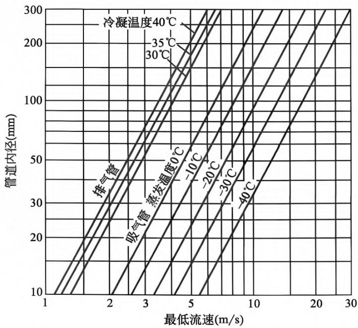  
图 11.2-2 R22 气体上升立管的最低带油流速

(2) 氟利昂制冷系统吸气管径应确保润滑油顺利返回制冷压缩机, 不宜选得过大。向下或水平吸气管中的润滑油依靠重力流回压缩机, 制冷剂流速不低于 $3 \mathrm{~m} / \mathrm{s}$ ; 上升的吸气管 (上升立管), 其中制冷剂流速必须足够大, 应不低于 $5 \mathrm{~m} / \mathrm{s}$ , 一般设计流速在 $8 \mathrm{~m} / \mathrm{s}$ 以上, 根据所使用的润滑油的黏度稍有区别。各种制冷剂上升立管相应的最低气流速度可查阅相关的最低带油流速图, 实际设计中上升立管的气流速度应取图中所给数值的 1.25 倍。

（3）冷凝器流出的液态制冷剂依靠重力自流进入贮液器，因此管路中液体流速应小于0.5m/s；为防止从贮液器流至膨胀阀的管路中的液态制冷剂气化而使膨胀阀供液量不足，一般离开冷凝器的制冷剂均应有3～5℃的过冷度，该管段管内流速可取0.5～1.25m/s，压力损失应不大于50kPa；如果膨胀阀比贮液器的位置高出4m以上时，需有5℃的过冷度。

**2. 制冷剂管路的压力损失计算方法**

制冷剂管路的压力损失包括管段的摩擦阻力和管件的局部阻力。利用计算图表，根据单位当量管长的允许压力降，得出制冷剂管道的管径。将常用各管件局部阻力系数折合成当量管长，见表11.2-12。管路系统某管段的总计算长度应等于直管段的长度 $L$ 与各管件的当量长度 $L_{\mathrm{d}}$ 之和，即该段管路的压力损失为 $\Delta p$ ：

$$
\Delta p = f _ {\mathrm{m}} \frac {L + L _ {\mathrm{d}}}{d _ {\mathrm{i}}} \left(\frac {M _ {\mathrm{r}}}{\frac {\pi}{4} d _ {\mathrm{i}} ^ {2}}\right) ^ {2} \frac {v _ {\mathrm{r}}}{2} = 0. 8 1 f _ {\mathrm{m}} M _ {\mathrm{r}} ^ {2} v _ {\mathrm{r}} \frac {L + L _ {\mathrm{d}}}{d _ {\mathrm{i}} ^ {5}}\tag{11. 2-1}
$$

式中 $f_{\mathrm{m}}$ ——摩擦阻力系数；

$d_{i}$ ——管道内径，m；

$M_{r}$ ——制冷剂的质量流量，kg/s；

$v_{r}$ ——制冷剂的比容， $m^{3}/kg$ 。

常用管件当量长度与管内径比值 $(L_{\mathrm{d}} / d_{\mathrm{i}})$  
表 11.2-12

<table><tr><td colspan="2">管件名称</td><td> $L_{\mathrm{d}}/d_{\mathrm{i}}$ </td><td colspan="2">管件名称</td><td> $L_{\mathrm{d}}/d_{\mathrm{i}}$ </td></tr><tr><td rowspan="5">阀门</td><td>直通截止阀(全开)</td><td>340</td><td rowspan="7">渐扩变径管</td><td rowspan="2"> $d/D=1/4$ </td><td rowspan="2">30</td></tr><tr><td>角阀(全开)</td><td>170</td></tr><tr><td>直通闸阀(全开)</td><td>8</td><td> $d/D=1/2$ </td><td>20</td></tr><tr><td>止回阀(全开)</td><td>80</td><td rowspan="2"> $d/D=3/4$ </td><td rowspan="2">17</td></tr><tr><td>球形阀(全开)</td><td>320</td></tr><tr><td rowspan="2">丝扣弯头</td><td>90°</td><td>30</td><td rowspan="2"></td><td rowspan="2"></td></tr><tr><td>45°</td><td>14</td></tr><tr><td rowspan="5">焊接弯头</td><td>45°</td><td>15</td><td rowspan="5">渐缩变径管</td><td rowspan="2"> $d/D=1/4$ </td><td rowspan="2">15</td></tr><tr><td>60°</td><td>30</td></tr><tr><td>90°(二节)</td><td>60</td><td rowspan="2"> $d/D=1/2$ </td><td rowspan="2">11</td></tr><tr><td>90°(三节)</td><td>20</td></tr><tr><td>90°(四节)</td><td>15</td><td> $d/D=3/4$ </td><td>7</td></tr></table>

在一定压力范围内，液态制冷剂的比容变化很小，若已知制冷剂的质量流量和单位计算长度的允许压力降，即可得出液体制冷剂管道管径；计算气态制冷剂管道管径时，还需知道制冷剂蒸气所处的热力状态。

### 11.2.5 制冷剂

制冷剂的性能直接关系空调、制冷和热泵系统设备性能的优劣，必须满足化学稳定性、不易燃、低毒性等基本要求，且须具有良好的热力学性质和传热性能，还须考虑其泄漏的环境危害，兼顾成本、可用性、效率、与压缩机润滑油和设备材料的兼容性，以及国家和地方法律法规等。应选取导热系数高、黏度低的制冷剂，以增强传热和流动性能。

**11.2.5.1 制冷剂的种类和类别**

制冷剂以字母 R（Refrigerant）和它后面的一组数字与字母作为简写编号，其中的数字或字母依据制冷剂的种类及分子组成按一定的规律进行编写。主要包括无机化合物和卤代烃类物质，如表 11.2-13 所示。

制冷剂的种类  
表 11.2-13

<table><tr><td rowspan="6">制冷剂</td><td colspan="3">无机化合物类</td><td colspan="2">如:空气、氨、水、二氧化碳等</td></tr><tr><td rowspan="5">卤代烃类</td><td rowspan="4">饱和碳氢化合物</td><td rowspan="4">如甲烷( $CH_4$ )、乙烷( $C_2H_6$ )、丙烷( $C_3H_8$ )系</td><td>全氟代烃(PFC)</td><td>饱和烃中的氢元素完全被氟元素置换,如R14,R116等</td></tr><tr><td>氯氟烃(CFC)</td><td>饱和烃中的氢元素完全被氯和氟元素置换,如R11、R12等</td></tr><tr><td>氢氟烃(HFC)</td><td>饱和烃中氢元素部分被氟元素置换,如R32、R134a、R125等</td></tr><tr><td>氢氯氟烃(HCFC)</td><td>饱和烃中氢元素部分被氯、氟元素置换,如R22、R123等</td></tr><tr><td colspan="2">非饱和碳氢化合物</td><td>氢氟烯烃(HFO)</td><td>不饱和烃中氢元素部分被氟元素置换,如R1234yf等</td></tr></table>

注：大多数 CFC 类制冷剂已经被淘汰，包括 R-11、R-12、R-113、R-114、R-141b、R-142b、R-500、R-502、  
注：大多数 CFC 类制冷剂已经被淘汰，包括 R-11、R-12、R-113、R-114、R-141b、R-142b、R-500、R-502、R-503 和 R-720（氖）等。据 2007 年《蒙特利尔议定书》第 19 次缔约方大会达成的共识，发展中国家对 R22 等 HCFC 物质的消费和生产水平于 2013 年已被冻结在基线水平，2015 年削减 10%，2020 年削减 35%，2025 年削减 67.5%，2030 年将完全淘汰，在 2030—2040 年间允许保留年均用量的 2.5%，供维修用。

此外，表 11.2-14 中的近共沸与非共沸混合制冷剂，凝结和气化过程中存在的温度滑移有助于其在变温热源制冷循环中的应用，能减少蒸发器、冷凝器的传热温差，提高制冷装置的运行性能。但是若发生泄漏，则因各组元的泄漏速度不同而不能像常规纯质制冷剂（如 R-22）那样直接灌注式补充，须先回收剩余的制冷剂，再以液态重新充注。

混合制冷剂的分类和特点  
表 11.2-14

<table><tr><td rowspan="3">混合制冷剂</td><td colspan="2">共沸制冷剂</td><td>温度滑移小于0.5°C</td></tr><tr><td rowspan="2">非共沸制冷剂</td><td>近共沸</td><td>温度滑移小于2°C</td></tr><tr><td>非共沸</td><td>温度滑移至少4°C</td></tr></table>

制冷剂依其在标准大气压下的饱和温度（简称标准沸点）和 $30^{\circ}\mathrm{C}$ 所对应的冷凝压力的高低可分为高温、中温和低温三大类，见表11.2-15。各种制冷剂在空调制冷领域的应用情况和所替代的臭氧消耗物质（ODS）见表11.2-16。

制冷剂的分类  
表11.2-15

<table><tr><td>类别</td><td>温度范围(°C)</td><td>压力范围(MPa)</td><td>制冷剂编号</td><td>主要用途</td></tr><tr><td>高温制冷剂(低压制冷剂)</td><td>&gt;0</td><td>≤0.3</td><td>R-123</td><td>空调系统离心式冷水机组</td></tr><tr><td>中温制冷剂(中压制冷剂)</td><td>-60~0</td><td>0.3~2</td><td>R-22,R-717,R-134a,R-142b</td><td>空调系统冷水机组及-70°C以上单级、两级压缩制冷装置</td></tr><tr><td>低温制冷剂(高压制冷剂)</td><td>≤-60</td><td>&gt;2</td><td>R-23,R-1150,R-290</td><td>低于-70°C的低温制冷或复叠式制冷装置的低温部分</td></tr></table>

各种制冷剂在空调制冷领域的应用情况和所替代的臭氧消耗物质（ODS）表11.2-16

<table><tr><td>制冷剂</td><td>ODP值</td><td>GWP值</td><td>主要应用领域</td><td>所替代的 ODS</td></tr><tr><td>R22</td><td>0.055</td><td>1780</td><td>工商制冷(冷库冷柜机组、运输制冷机组、建筑空调等)</td><td>R12、R502</td></tr><tr><td>R134a</td><td>0</td><td>1320</td><td>家用、汽车及工商制冷(汽车空调器、冰箱冰柜机组、运输制冷机组、离心式制冷机、建筑空调等)</td><td>R12、R11、R500</td></tr><tr><td>R152a</td><td>0</td><td>122</td><td>家用制冷、汽车空调、工商制冷(小型设备)</td><td>R12</td></tr><tr><td>R600a</td><td>0</td><td>≈20</td><td>家用及工商制冷(冰箱冷柜机组)</td><td>R12</td></tr><tr><td>R123</td><td>0.02</td><td>76</td><td>工商制冷(离心式制冷机)</td><td>R11</td></tr><tr><td>R718(氨)</td><td>0</td><td>&lt;1</td><td>工商制冷</td><td>R11、R12</td></tr><tr><td>R407C</td><td>0</td><td>1674</td><td>家用及工商制冷(空调设备)</td><td>R22</td></tr><tr><td>R410A</td><td>0</td><td>1997</td><td>家用及工商制冷(空调设备)</td><td>R22</td></tr><tr><td>R411AR411B</td><td>≈0.03≈0.032</td><td>15001600</td><td>工商制冷</td><td>R502、R22</td></tr><tr><td>R425A</td><td>0</td><td>960</td><td>工商制冷</td><td>R22.R502</td></tr><tr><td>R421A</td><td>0</td><td>1200</td><td>家用空调及工商制冷</td><td>R22,R12</td></tr><tr><td>R417A</td><td>0</td><td>1950</td><td>工商制冷(空调设备维修)</td><td>HCFC-22</td></tr><tr><td>R744(CO2)</td><td>0</td><td>0</td><td>家用制冷、汽车空调及热泵</td><td>—</td></tr><tr><td>R290</td><td>0</td><td>≈0</td><td>家用制冷(空调)</td><td>HCFC-22</td></tr></table>

**11.2.5.2 制冷剂的环境友好性、安全性、物理特性和热力学特性**

**1. 制冷剂的环境友好性评价指标**

常用制冷剂的全球变暖潜值（GWP）、臭氧消耗潜值（ODP）以及大气寿命等环境友好性评价指标见表11.2-17。此外，等效变暖影响总量（TWEI）也用于评价设备运行期间以及使用期限结束时工质废弃期间相关温室气体总排放的全球变暖总体影响；生命周期气候变化性能（LCCP）可度量设备整个生命周期内相关温室气体总排放的全球变暖总体影响。

制冷剂的安全分类和环境友好性指标  
表 11.2-17

<table><tr><td>制冷剂编号</td><td>化学名称</td><td>化学公式</td><td>分子量</td><td colspan="2">标准沸点(°C)</td><td>安全等级</td><td>大气寿命</td><td> $ODP^{1}$ </td><td> $GWP_{100}^{2}$ </td></tr><tr><td>R12</td><td>二氯二氟甲烷</td><td> $CCl_2F_2$ </td><td>120.9</td><td colspan="2">-30</td><td>A1</td><td>100</td><td>0.73</td><td>10800</td></tr><tr><td>R22</td><td>氯二氟甲烷</td><td> $CHClF_2$ </td><td>86.5</td><td colspan="2">-41</td><td>A1</td><td>11.9</td><td>0.034</td><td>1760</td></tr><tr><td>制冷剂编号</td><td>化学名称</td><td>化学公式</td><td>分子量</td><td colspan="2">标准沸点(°C)</td><td>安全等级</td><td>大气寿命</td><td>ODP $^{\text{1}}$ </td><td>GWP $_{100}^{\text{2}}$ </td></tr><tr><td>R32</td><td>二氟甲烷</td><td>CH $_{2}$ F $_{2}$ </td><td>52.0</td><td colspan="2">-52</td><td>A2L(A2)</td><td>5.2</td><td>0.00</td><td>677(650)</td></tr><tr><td>R125</td><td>五氟乙烷</td><td>CHF $_{2}$ CF $_{3}$ </td><td>120.0</td><td colspan="2">-48</td><td>A1</td><td>28.2</td><td>0.00</td><td>3170(2800)</td></tr><tr><td>R134a</td><td>1,1,1,2-四氟乙烷</td><td>CH $_{2}$ FCF $_{3}$ </td><td>102.0</td><td colspan="2">-26</td><td>A1</td><td>13.4</td><td>0.00</td><td>1300(1300)</td></tr><tr><td>R290</td><td>丙烷</td><td>C $_{3}$ H $_{8}$ </td><td>44.0</td><td colspan="2">-42</td><td>A3</td><td>0.034 $^{\text{2}}$ </td><td>0.00</td><td>5</td></tr><tr><td>R600a</td><td>2-甲基丙烷(异丁烷)</td><td>CH(CH $_{3}$ ) $_{2}$ CH $_{3}$ </td><td>58.1</td><td colspan="2">-12</td><td>A3</td><td>0.016 $^{\text{2}}$ </td><td>0.00</td><td>~20</td></tr><tr><td>R717</td><td>氨</td><td>NH $_{3}$ </td><td>17.0</td><td colspan="2">-33</td><td>B2L</td><td></td><td>0.00</td><td></td></tr><tr><td>R718</td><td>水</td><td>H $_{2}$ O</td><td>18.0</td><td colspan="2">100</td><td>A1</td><td></td><td></td><td></td></tr><tr><td>R744</td><td>二氧化碳</td><td>CO $_{2}$ </td><td>44.0</td><td colspan="2">-78</td><td>A1</td><td></td><td>0.00</td><td>1(1)</td></tr><tr><td>R1234yf</td><td>2,3,3,3-四氟-1-丙烯</td><td>CF $_{3}$ CF=CH $_{2}$ </td><td>114.0</td><td colspan="2">-29.4</td><td>A2L</td><td>0.029</td><td>0.00</td><td>&lt;1</td></tr><tr><td>R1234ze(E)</td><td>反式1,3,3,3-四氟-1-丙烯</td><td>CF $_{3}$ CH=CHF</td><td>114.0</td><td colspan="2">-19.0</td><td>A2L</td><td>0.045</td><td>0.00</td><td>&lt;1</td></tr><tr><td colspan="2">非(近)共沸混合制冷剂</td><td>组分偏差</td><td></td><td>标准泡点(°C)</td><td>标准露点(°C)</td><td></td><td></td><td></td><td></td></tr><tr><td>R407C</td><td>R32/R125/R134a(23.0/25.0/52.0)</td><td>(±2/±2/±2)</td><td>86.2</td><td>-43.8</td><td>-36.7</td><td>A1(A1/A1)</td><td>0.00</td><td>1770</td><td>1620</td></tr><tr><td>R410A</td><td>R32/R125(50.0/50.0)</td><td>(+0.5,-1.5/+1.5,-0.5)</td><td>72.6</td><td>-51.6</td><td>-51.5</td><td>A1(A1/A1)</td><td>0.00</td><td>2090</td><td>1920</td></tr></table>

① 共沸制冷剂在与其配制时的温度和压力不同的条件下表现出某些组分的分离，分离程度取决于特定的共沸物和硬件系统配置。  
② 根据《京都议定书》中的 $\mathrm{GWP}_{100}$ 整理。

**2. 制冷剂的安全性**

制冷剂的毒性可依据职业暴露极限分为 A 类（低慢性毒性）和 B 类（高慢性毒性），可燃性可依据可燃下限（LFL）、燃烧热（HOC）和燃烧速度（Su）分为 1 类（无火焰传播）、2L 类（弱可燃）、2 类（可燃）和 3 类（可燃易爆）四类；依据毒性和可燃危险程度又分成八个安全等级（A1、AL2、A2、A3、B1、BL2、B2 和 B3），A1 组危害最小，B3 组危害最大。目前常用制冷剂的安全等级见表 11.2-17。对混合制冷剂，相变过程中气液相组分会发生变化，因此采用双安全组别表示，由斜杠（/）分隔最不利成分与最不利分馏成分两个类别。

泄漏的环境危害也是评估制冷剂安全性的指标之一。低压制冷剂（如 R-123），沸点较高（27.82℃），压力较低。正常运行时，设备内的压力低于大气压力，制冷剂一般不会漏出，但空气会渗入。中、高压制冷剂沸点很低（如 R-22 为 -40.81℃；R-134a 为 -26.07℃），压力较高，且其密度大于空气，一旦泄漏，能很快取代室内空气占有的容积，快速超越其安全上限，使室内人员窒息。冷水机组泄漏一半制冷剂所需时间见表 11.2-18。

冷水机组泄漏一半制冷剂所需时间  
表11.2-18

<table><tr><td rowspan="2">制冷剂</td><td colspan="2">高压侧</td><td colspan="2">停机</td><td colspan="2">低压侧</td></tr><tr><td>压力(kPa)</td><td>泄漏时间(min)</td><td>压力(kPa)</td><td>泄漏时间(min)</td><td>压力(kPa)</td><td>泄漏时间(min)</td></tr><tr><td>R123</td><td>42</td><td>25</td><td>-19</td><td>—</td><td>-63</td><td>—</td></tr><tr><td>R134a</td><td>856</td><td>5</td><td>511</td><td>7</td><td>228</td><td>13</td></tr><tr><td>R22</td><td>1351</td><td>3</td><td>867</td><td>4</td><td>452</td><td>8</td></tr><tr><td>R410A</td><td>2183</td><td>2</td><td>1428</td><td>3</td><td>786</td><td>5</td></tr></table>

注：1. 500 冷吨水冷主机，约 680kg 制冷剂。  
2. 裂缝大小或孔洞直径：2.5cm（阀门或连接管道）。

**3. 制冷剂的物理特性和热力学性质**

常用制冷剂的标准沸点、凝固点、临界参数和折射率等主要物理性质见表 11.2-19，其已知压力和温度下的密度、焓、熵、比热容、导热系数、黏度系数等热力学参数和压焓图见本书增值服务（或识别二维码查看）。除了临界温度非常低的水和液体之外（如乙烯和冷冻剂），增值服务中制冷剂的数据均使用 $0^{\circ}$ C 下饱和液体的焓等于 200kJ/kg，熵等于 $1\mathrm{kJ}/(\mathrm{kg}\cdot\mathrm{K})$ 为参考状态计算得到。

常用制冷剂的热力学参数和压焓图

制冷剂的物理性质和临界参数  
表 11.2-19

<table><tr><td colspan="2">制冷剂</td><td rowspan="2">化学公式</td><td rowspan="2">分子量</td><td rowspan="2">标准沸点(°C)</td><td rowspan="2">凝固点(°C)</td><td rowspan="2">临界温度(°C)</td><td rowspan="2">临界压力(kPa)</td><td rowspan="2">临界密度(kg/m3)</td><td rowspan="2">液体折射指数</td></tr><tr><td>编号</td><td>化学名称或组成(质量百分比)</td></tr><tr><td>R23</td><td>三氟甲烷</td><td>CHF3</td><td>70.0</td><td>-82.0</td><td>-155.1</td><td>26.1</td><td>4832</td><td>526.5</td><td>-</td></tr><tr><td>R744</td><td>二氧化碳</td><td>CO2</td><td>44.0</td><td>-78.4</td><td>-56.6</td><td>31.0</td><td>7377.3</td><td>467.6</td><td>1.195(15)</td></tr><tr><td>R32</td><td>二氟甲烷</td><td>CH2F2</td><td>52.0</td><td>-51.7</td><td>-136.8</td><td>78.1</td><td>5782.0</td><td>424.0</td><td>-</td></tr><tr><td>R410A</td><td>R-32/125(50/50)</td><td>-</td><td>72.6</td><td>-51.4</td><td>-</td><td>71.3</td><td>4902.6</td><td>459.5</td><td>-</td></tr><tr><td>R125</td><td>五氟乙烷</td><td>C2HF5</td><td>120.0</td><td>-48.1</td><td>-100.6</td><td>66.0</td><td>3617.7</td><td>573.6</td><td>-</td></tr><tr><td>R407C</td><td>R-32/125/134a(23/25/52)</td><td>-</td><td>86.2</td><td>-43.6</td><td>-</td><td>86.0</td><td>4629.8</td><td>484.2</td><td>-</td></tr><tr><td>R290</td><td>丙烷</td><td>C3H8</td><td>44.0</td><td>-42.0</td><td>-187.6</td><td>96.7</td><td>4251.2</td><td>220.4</td><td>1.3397(-42)</td></tr><tr><td>R22</td><td>氯二氟甲烷</td><td>CHClF2</td><td>86.5</td><td>-40.8</td><td>-157.4</td><td>96.1</td><td>4990.0</td><td>523.84</td><td>1.234(25)</td></tr><tr><td>R717</td><td>氨</td><td>NH3</td><td>17.0</td><td>-33.3</td><td>-77.7</td><td>132.3</td><td>11 333.0</td><td>225.0</td><td>1.325(16.5)</td></tr><tr><td>R12</td><td>二氯二氟甲烷</td><td>CCl2F2</td><td>120.9</td><td>-29.8</td><td>-157.1</td><td>112.0</td><td>4136.1</td><td>565.0</td><td>1288(25)</td></tr><tr><td>R1234yf</td><td>2,3,3,3-四氟丙-1-烯</td><td>CF3CF=CH2</td><td>114.0</td><td>-29.4</td><td>-</td><td>94.7</td><td>3382.2</td><td>475.6</td><td>-</td></tr><tr><td>R134a</td><td>1;1,1,2-四氟乙烷</td><td>CH2FCF3</td><td>102.0</td><td>-26.0</td><td>-103.3</td><td>101.1</td><td>4059.3</td><td>511.9</td><td>-</td></tr><tr><td>R1234ze(E)</td><td>反式1,3,3,3-四氟丙烯</td><td>CF3CH=CHF</td><td>114.04</td><td>-19.0</td><td>-</td><td>109.3</td><td>3636.3</td><td>489.2</td><td>-</td></tr><tr><td>R718</td><td>水</td><td>H2O</td><td>18.0</td><td>100.0</td><td>0.01</td><td>374.0</td><td>22 064</td><td>322.0</td><td>-</td></tr></table>

**4. 制冷剂的理论循环性能**

假设压缩机吸气为饱和蒸气，且压缩过程等熵，常用制冷剂在不同蒸发温度和303K冷凝温度下的理论制冷循环的性能见表11.2-20。对混合制冷剂，蒸发和冷凝温度分别取蒸发器和冷凝器进、出口的平均温度。因压缩机效率和运输特性等因素的影响，实际运行条件和性能与表中的数值会有显著差异。

制冷剂在不同蒸发温度下的理论制冷循环性能  
表11.2-20

<table><tr><td colspan="2">制冷剂</td><td rowspan="2">蒸发压力(MPa)</td><td rowspan="2">冷凝压力(MPa)</td><td rowspan="2">压力比</td><td rowspan="2">制冷量(kJ/kg)</td><td rowspan="2">制冷剂质量流量(g/s)</td><td rowspan="2">液体体积流量(L/s)</td><td rowspan="2">吸入气体比体积(m3/kg)</td><td rowspan="2">压缩机排量(L/s)</td><td rowspan="2">功耗(kW)</td><td rowspan="2">制冷系数</td><td rowspan="2">压缩机排气温度(°C)</td></tr><tr><td>编号</td><td>化学名称或成分(质量%)</td></tr><tr><td colspan="13">蒸发温度-31.7℃/冷凝温度 30℃</td></tr><tr><td>R744</td><td>二氧化碳</td><td>1.349</td><td>7.213</td><td>5.35</td><td>132.1</td><td>7.57</td><td>0.0128</td><td>0.0285</td><td>0.2160</td><td>0.5892</td><td>1.698</td><td>91.3</td></tr><tr><td>R22</td><td>氯二氟甲烷</td><td>0.152</td><td>1.192</td><td>7.81</td><td>155.3</td><td>6.44</td><td>0.0055</td><td>0.1448</td><td>0.9326</td><td>0.3369</td><td>2.967</td><td>65.4</td></tr><tr><td>R717</td><td>氨</td><td>0.110</td><td>1.167</td><td>10.61</td><td>1079.1</td><td>0.93</td><td>0.0016</td><td>1.0425</td><td>0.9643</td><td>0.3327</td><td>3.007</td><td>140.9</td></tr><tr><td colspan="13">蒸发温度-6.7℃/冷凝温度 30℃</td></tr><tr><td>R744</td><td>二氧化碳</td><td>2.909</td><td>7.213</td><td>2.48</td><td>129.5</td><td>7.72</td><td>0.0130</td><td>0.0127</td><td>0.0977</td><td>0.2845</td><td>3.514</td><td>61.3</td></tr><tr><td>R32</td><td>二氟甲烷</td><td>0.653</td><td>1.928</td><td>2.95</td><td>258.6</td><td>3.87</td><td>0.0041</td><td>0.0563</td><td>0.2178</td><td>0.1690</td><td>5.924</td><td>59.7</td></tr><tr><td>R410A</td><td>R32/R125(50/50)</td><td>0.643</td><td>1.886</td><td>2.94</td><td>170.9</td><td>5.85</td><td>0.0057</td><td>0.0406</td><td>0.2381</td><td>0.1728</td><td>5.78</td><td>46.6</td></tr><tr><td>R22</td><td>氯二氟甲烷</td><td>0.399</td><td>1.192</td><td>2.99</td><td>165.9</td><td>6.03</td><td>0.0051</td><td>0.0584</td><td>0.3520</td><td>0.1637</td><td>6.105</td><td>47.8</td></tr><tr><td>R407C</td><td>R32/R125/R134a(23/25/52)</td><td>0.396</td><td>1.267</td><td>3.19</td><td>167.1</td><td>5.98</td><td>0.0053</td><td>0.0588</td><td>0.3518</td><td>0.1686</td><td>5.93</td><td>43.9</td></tr><tr><td>R717</td><td>氨</td><td>0.332</td><td>1.167</td><td>3.51</td><td>1113.0</td><td>0.90</td><td>0.0015</td><td>0.3689</td><td>0.3313</td><td>0.1599</td><td>6.254</td><td>82.1</td></tr><tr><td>R1234yf</td><td>2,3,3,3-四氟-1-丙烯</td><td>0.250</td><td>0.783</td><td>3.13</td><td>120.5</td><td>8.30</td><td>0.0077</td><td>0.0718</td><td>0.5954</td><td>0.1715</td><td>5.835</td><td>30.0</td></tr><tr><td>R134a</td><td>1,1,1,2-四氟乙烷</td><td>0.228</td><td>0.770</td><td>3.37</td><td>153.0</td><td>6.54</td><td>0.0055</td><td>0.0880</td><td>0.5745</td><td>0.1650</td><td>6.063</td><td>34.8</td></tr><tr><td>R1234ze(E)</td><td>反式1,3,3,3-四氟-1-丙烯</td><td>0.168</td><td>0.578</td><td>3.44</td><td>139.6</td><td>7.16</td><td>0.0063</td><td>0.1086</td><td>0.7798</td><td>0.1658</td><td>6.03</td><td>30.0</td></tr><tr><td colspan="13">蒸发温度 7.2℃/冷凝温度 30℃</td></tr><tr><td>R32</td><td>二氟甲烷</td><td>1.018</td><td>1.928</td><td>1.89</td><td>261.1</td><td>3.83</td><td>0.0040</td><td>0.0360</td><td>0.1381</td><td>0.0944</td><td>10.602</td><td>46.9</td></tr><tr><td>R410A</td><td>R32/R125(50/50)</td><td>1.000</td><td>1.886</td><td>1.89</td><td>175.0</td><td>5.71</td><td>0.0055</td><td>0.0260</td><td>0.1484</td><td>0.0965</td><td>10.379</td><td>39.8</td></tr><tr><td>407C</td><td>R32/R125/R134a(23/25/52)</td><td>0.640</td><td>1.267</td><td>1.98</td><td>173.7</td><td>5.76</td><td>0.0051</td><td>0.0367</td><td>0.2112</td><td>0.0939</td><td>10.655</td><td>39.3</td></tr><tr><td>R22</td><td>氯二氟甲烷</td><td>0.626</td><td>1.192</td><td>1.9</td><td>171.0</td><td>5.85</td><td>0.0050</td><td>0.0377</td><td>0.2205</td><td>0.0918</td><td>10.885</td><td>40.3</td></tr><tr><td>R717</td><td>氨</td><td>0.558</td><td>1.167</td><td>2.09</td><td>1127.8</td><td>0.89</td><td>0.0015</td><td>0.2254</td><td>0.1998</td><td>0.0893</td><td>11.186</td><td>58.6</td></tr><tr><td>R1234yf</td><td>2,3,3,3-四氟-1-丙烯</td><td>0.401</td><td>0.783</td><td>1.96</td><td>129.0</td><td>7.75</td><td>0.0072</td><td>0.0453</td><td>0.3514</td><td>0.0941</td><td>10.623</td><td>30.0</td></tr><tr><td>R134a</td><td>1,1,1,2-四氟乙烷</td><td>0.377</td><td>0.770</td><td>2.04</td><td>161.0</td><td>6.21</td><td>0.0052</td><td>0.0542</td><td>0.3364</td><td>0.0918</td><td>10.903</td><td>32.6</td></tr><tr><td>R1234ze(E)</td><td>反式1,3,3,3-四氟-1-丙烯</td><td>0.280</td><td>0.578</td><td>2.06</td><td>149.1</td><td>6.71</td><td>0.0059</td><td>0.0668</td><td>0.4483</td><td>0.0918</td><td>10.899</td><td>30.0</td></tr></table>

**11.2.5.3 吸收式制冷工质对**

组成吸收式制冷循环工质对的物质沸点相差较大，低沸点物质为制冷剂，高沸点物质为吸收剂。

**1. 工质对所需具备的特性**

(1) 制冷剂纯度应较高, 且吸收剂对制冷剂的吸收性能强烈, 如氨一水工质对, $1 \mathrm{~kg}$ 水可吸收 $700 \mathrm{~kg}$ 氨, 基本上可认为是无限溶解。

(2) 工质对的饱和蒸气压由二元溶液的温度和质量分数决定。

(3) 工质对在预期的成分和温度范围内应不凝固, 化学稳定性强, 不易形成有害气体、固体或腐蚀性物质。因为大多数吸收液会腐蚀构造材料, 系统内所有组分的纯度对提高性能和防腐蚀至关重要, 所以有必要使用缓蚀剂。

(4) 工质对的黏度、表面张力、热扩散率和质量扩散率也是很重要的特性。

氨或溴化锂（LiBr）的水溶液是吸收式制冷系统中常用的制冷剂—吸收剂工质对，其中，水是制冷剂，氨和溴化锂溶液分别是吸收剂。溴化锂—和氨—水的 ODP 和 GWP 均为零，对环境不具有已知的危害。氨—水满足上述的大多数要求，但其挥发率低，所需操作压力较高。氨的安全等级为 B2，在室内使用是受限制的。

**2. 溴化锂水溶液的物理性质**

溴化锂是由碱金属元素锂（Li）和卤族元素溴（Br）组成的稳定的物质，常温下是无色晶体，无毒、无臭、有咸苦味，极易溶解于水。溴化锂—水工质对安全性高，挥发性低，有亲和力，潜热大。然而，该工质对常会形成固体，须在深度真空中工作。因制冷剂在0℃时会结冰而不能用于低温制冷，即使在0℃以上也可以观察到除雾器上的结冰现象。风冷冷水机组中溴化锂（LiBr）在中等质量分数下会结晶。因此，该工质对只能用在水冷的吸收器且溴化锂质量分数较低的情况下。然而，使用复合盐作为吸收剂可以减少结晶倾向，但操作压力低、黏度高，不利于吸收过程。相对分子质量较高的醇会增强溴化锂的吸收性。

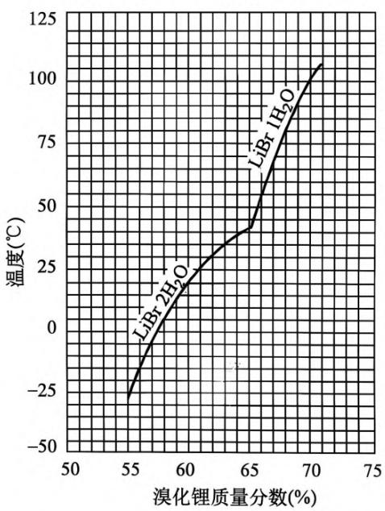

（1）溶解度溴化锂溶液的溶解度曲线，也称结晶线，如图 11.2-3 所示。常温下饱和溶液中溴化锂的质图11.2-3 溴化锂溶液的结晶曲线

量分数可达 60% 左右。结晶线左上方为液相区，右下方是固相区，循环必须运行在液相区。溴化锂质量分数对应的结晶温度见表 11.2-21。

溴化锂质量分数对应的结晶温度  
表11.2-21

<table><tr><td>溴化锂质量分数(%)</td><td>55.0</td><td>55.5</td><td>56.0</td><td>56.5</td><td>57.0</td><td>57.5</td><td>58.0</td><td>58.5</td></tr><tr><td>结晶温度(°C)</td><td>-29.7</td><td>-21.6</td><td>-14.9</td><td>-8.3</td><td>-2.5</td><td>2.5</td><td>6.9</td><td>10.8</td></tr><tr><td>溴化锂质量分数(%)</td><td>59.0</td><td>59.5</td><td>60.0</td><td>60.5</td><td>61.0</td><td>61.5</td><td>62.0</td><td>62.5</td></tr><tr><td>结晶温度(°C)</td><td>14.4</td><td>17.9</td><td>21.3</td><td>24.5</td><td>27.4</td><td>30.2</td><td>32.7</td><td>34.8</td></tr><tr><td>溴化锂质量分数(%)</td><td>63.0</td><td>63.5</td><td>64.0</td><td>64.5</td><td>64.86</td><td>65.0</td><td>65.5</td><td>66.0</td></tr><tr><td>结晶温度(°C)</td><td>36.9</td><td>38.8</td><td>40.6</td><td>42.3</td><td>43.2</td><td>47.0</td><td>56.3</td><td>63.7</td></tr><tr><td>溴化锂质量分数(%)</td><td>66.5</td><td>67.0</td><td>67.5</td><td>68.0</td><td>68.5</td><td>69.0</td><td>69.5</td><td>70.0</td></tr><tr><td>结晶温度(°C)</td><td>70.0</td><td>75.9</td><td>81.7</td><td>87.2</td><td>92.7</td><td>97.7</td><td>102.4</td><td>107.3</td></tr></table>

(2) 密度 溴化锂溶液的密度与温度和质量分数有关, 当温度一定时, 随溴化锂质量分数的增大, 密度也增大; 如果溴化锂质量分数一定, 则温度越高, 密度越小。

（3）定压比热容 溴化锂溶液的定压比热容随温度的升高而增大，随溴化锂质量分数的增大而减小，且比水小得多。

（4）黏度 温度一定时，溴化锂溶液的动力黏度随着溴化锂质量分数的增加而急剧增大；溴化锂质量分数一定时，随着温度降低，黏度增大。

(5) 表面张力 溴化锂溶液的表面张力与温度和溴化锂质量分数有关。溴化锂质量分数不变时, 随温度的升高而降低; 温度不变时, 随溴化锂质量分数的增大而增大。

(6) 导热系数 温度一定时, 溴化锂溶液的导热系数随溴化锂质量分数的增大而减小; 溴化锂质量分数一定, 则随温度的升高而增大。

**3. 溴化锂溶液的热力图表**

溴化锂吸收式冷（热）水机组的理论分析和设计计算需要借助于溴化锂溶液的热力参数图，即压力-温度 $(p-t)$ 图和比焓-质量分数 $(h-\varepsilon)$ 图。溴化锂溶液的p-t图表示处于气液相平衡状态下溴化锂质量分数 $\varepsilon$ 、饱和蒸汽压力p和温度t三者之间的关系。若已知三者中的任何两个参数，则可通过p-t图来确定另一个参数。溴化锂溶液的 $h-\varepsilon$ 图表示溶液处于相平衡的水蒸气压力p、溶液温度t、溴化锂质量分数 $\varepsilon$ 和比焓h四个参数间的关系。 $h-\varepsilon$ 图中，上半区为与溶液处于相平衡的汽相区，一系列斜线为辅助等压线，其上状态点的纵坐标表示水蒸气的比焓，横坐标表示与水蒸气处于相平衡的溴化锂质量分数；下半区为液相区，由一系列等温线和等压线组成。

溴化锂水溶液的热力参数图表见本书增值服务（或识别二维码查看）。

**4. 溴化锂溶液的腐蚀性和缓蚀剂**

溴化锂溶液接触氧气就会腐蚀金属，采取防腐措施可以从根本上隔绝氧气。可添加铬酸锂（ $\mathrm{Li}_2\mathrm{CrO}_4$ ）或钼酸锂（ $\mathrm{Li}_2\mathrm{MoO}_4$ ）等缓蚀剂来有效抑制溴化锂溶液对金属的腐蚀。前者和后者的质量分数分别为 $0.10\% \sim 0.30\%$ 和 $0.01\% \sim 0.02\%$ 。通常首次添加时，前者加到 $0.20\%$ ，后者加到 $0.015\%$ ，运行一段时间后，根据情况逐步添加。

  
溴化锂水溶液的热力参数图

此外，当溶液温度超过 $165^{\circ}$ C 时，其对金属的腐蚀急剧增强；溶液的 pH 处为 9.0～10.5 时，对金属的腐蚀最小；常压下稀溶液的腐蚀性大于浓溶液，而在高真空下对金属的腐蚀性几乎与溶液中溴化锂的质量分数无关。

### 11.2.6 载冷剂

在冰场、食品加工、融雪和防冻以及蓄冰空调系统等制冷应用中，通常采用二次冷却剂（也被称为传热流体、盐水或载冷剂）来转移热量。载冷剂应无毒、无臭、不燃烧、不爆炸、化学稳定性好、不腐蚀金属、不污染环境、价格低廉且易获得；在使用温度范围内不凝固、不气化；密度小、黏度小，以减小流动阻力和输送能耗；比热容大，以减少所需的载冷剂循环量，且载冷剂温度变化不大；导热系数大，以减少换热设备的传热面积。这里主要介绍氯化钠和氯化钙等盐水溶液、乙二醇和丙二醇等有机化合物的水溶液等常见载冷剂的物理特性。

**11.2.6.1 盐水溶液**

**1. 盐水溶液的物理性质**

氯化钠和氯化钙等常见盐水溶液的性质取决于其中盐的质量分数。质量分数较低时，凝固温度随质量分数的增加而降低，而当质量分数高于一定值后，凝固温度随质量分数的增加反而升高，该转折点称为冰盐合晶点。氯化钠水溶液和氯化钙盐水溶液的合晶点温度分别为 $-21.2^{\circ}\mathrm{C}$ 和 $-55^{\circ}\mathrm{C}$ ，相应的质量分数分别为 $23.1\%$ 和 $29.9\%$ 。纯氯化钠盐水的性能见表11.2-22。不同质量分数下氯化钠盐水的密度、比热容、黏度和导热系数随平均温度变化的曲线分别见图11.2-4～图11.2-7。

纯氯化钠盐水的性质  
表 11.2-22

<table><tr><td rowspan="2">纯氯化钠质量分数(%)</td><td rowspan="2">15℃时的比热容[J/(kg·K)]</td><td rowspan="2">开始结晶温度(℃)</td><td colspan="2">15℃时的密度(kg/m3)</td><td colspan="4">不同温度时的密度(kg/m3)</td></tr><tr><td>氯化钠</td><td>盐水</td><td>-20℃</td><td>-10℃</td><td>0℃</td><td>10℃</td></tr><tr><td>0</td><td>4184</td><td>0.0</td><td>0.0</td><td>1000</td><td>-</td><td>-</td><td>-</td><td>-</td></tr><tr><td>5</td><td>3925</td><td>-2.9</td><td>51.7</td><td>1035</td><td>-</td><td>1038.1</td><td>1036.5</td><td>1034.0</td></tr><tr><td>6</td><td>3879</td><td>-3.6</td><td>62.5</td><td>1043</td><td>-</td><td>1045.8</td><td>1043.9</td><td>1041.2</td></tr><tr><td>7</td><td>3836</td><td>-4.3</td><td>73.4</td><td>1049</td><td>-</td><td>1053.7</td><td>1051.4</td><td>1048.5</td></tr><tr><td>8</td><td>3795</td><td>-5.0</td><td>84.6</td><td>1057</td><td>-</td><td>1061.2</td><td>1058.9</td><td>1055.8</td></tr><tr><td>9</td><td>3753</td><td>-5.8</td><td>95.9</td><td>1065</td><td>-</td><td>1069.0</td><td>1066.4</td><td>1063.2</td></tr><tr><td>10</td><td>3715</td><td>-6.6</td><td>107.2</td><td>1072</td><td>-</td><td>1076.8</td><td>1074.0</td><td>1070.6</td></tr><tr><td>11</td><td>3678</td><td>-7.3</td><td>118.8</td><td>1080</td><td>-</td><td>1084.8</td><td>1081.6</td><td>1078.1</td></tr><tr><td>12</td><td>3640</td><td>-8.2</td><td>130.3</td><td>1086</td><td>-</td><td>1092.4</td><td>1089.6</td><td>1085.6</td></tr><tr><td>13</td><td>3607</td><td>-9.1</td><td>142.2</td><td>1094</td><td>-</td><td>1100.3</td><td>1097.0</td><td>1093.2</td></tr><tr><td>14</td><td>3573</td><td>-10.1</td><td>154.3</td><td>1102</td><td>-</td><td>1108.2</td><td>1104.7</td><td>1100.8</td></tr><tr><td>15</td><td>3544</td><td>-10.9</td><td>166.5</td><td>1110</td><td>1119.4</td><td>1116.2</td><td>1112.5</td><td>1108.5</td></tr><tr><td>16</td><td>3515</td><td>-11.9</td><td>178.9</td><td>1118</td><td>1127.6</td><td>1124.2</td><td>1120.4</td><td>1116.2</td></tr><tr><td>17</td><td>3485</td><td>-13.0</td><td>191.4</td><td>1126</td><td>1135.8</td><td>1132.2</td><td>1128.3</td><td>1124.0</td></tr><tr><td>18</td><td>3456</td><td>-14.1</td><td>204.1</td><td>1134</td><td>1144.1</td><td>1140.3</td><td>1136.2</td><td>1131.8</td></tr><tr><td>19</td><td>3427</td><td>-15.3</td><td>217.0</td><td>1142</td><td>1153.4</td><td>1148.5</td><td>1144.3</td><td>1139.7</td></tr><tr><td>20</td><td>3402</td><td>-16.5</td><td>230.0</td><td>1150</td><td>1160.7</td><td>1156.7</td><td>1154.1</td><td>1147.7</td></tr><tr><td rowspan="2">纯氯化钠质量分数(%)</td><td rowspan="2">15°C时的比热容[J/(kg·K)]</td><td rowspan="2">开始结晶温度(°C)</td><td colspan="2">15°C时的密度(kg/m3)</td><td colspan="4">不同温度时的密度(kg/m3)</td></tr><tr><td>氯化钠</td><td>盐水</td><td>-20°C</td><td>-10°C</td><td>0°C</td><td>10°C</td></tr><tr><td>21</td><td>3376</td><td>-17.8</td><td>243.2</td><td>1158</td><td>1169.1</td><td>1165.0</td><td>1160.5</td><td>1155.8</td></tr><tr><td>22</td><td>3356</td><td>-19.1</td><td>256.6</td><td>1166</td><td>1177.6</td><td>1173.3</td><td>1168.7</td><td>1163.9</td></tr><tr><td>23</td><td>3330</td><td>-20.6</td><td>270.0</td><td>1174</td><td>1186.1</td><td>1181.7</td><td>1177.0</td><td>1172.0</td></tr><tr><td>24</td><td>3310</td><td>-15.7</td><td>283.7</td><td>1182</td><td>1194.7</td><td>1190.1</td><td>1185.3</td><td>1180.3</td></tr><tr><td>25</td><td>3289</td><td>-8.8</td><td>297.5</td><td>1190</td><td>—</td><td>—</td><td>—</td><td>—</td></tr><tr><td>25.2</td><td>—</td><td>0.0</td><td>—</td><td>—</td><td>—</td><td>—</td><td>—</td><td>—</td></tr></table>

选择盐水溶液时, 要保证蒸发器中盐水不冻结; 但凝固温度不宜选得过低, 宜比蒸发温度低 $4 \sim 5^{\circ} \mathrm{C}$ (敞开式蒸发器) 或 $8 \sim 10^{\circ} \mathrm{C}$ (封闭式蒸发器), 以至其质量分数不大于合晶点的质量分数。因为盐水溶液的质量分数越大, 其密度也越大, 流动阻力就越大; 质量分数增大, 比热容降低, 输送同样冷量所需的盐水溶液流量增加, 泵的功耗增加。氯化钠水溶液适用于蒸发温度高于 $-16^{\circ} \mathrm{C}$ 的场合, 氯化钙水溶液适用的蒸发温度可低至 $-50^{\circ} \mathrm{C}$ 。

商用氯化钠有粗（岩盐）和精两种等级。商用氯化钙有1型（最低 $77\%$ ）和2型（最低 $94\%$ ），市场上以片状、固态和溶液形式销售，片状使用最广泛。氯化钠或氯化钙中不应出现镁盐，以免形成污泥。

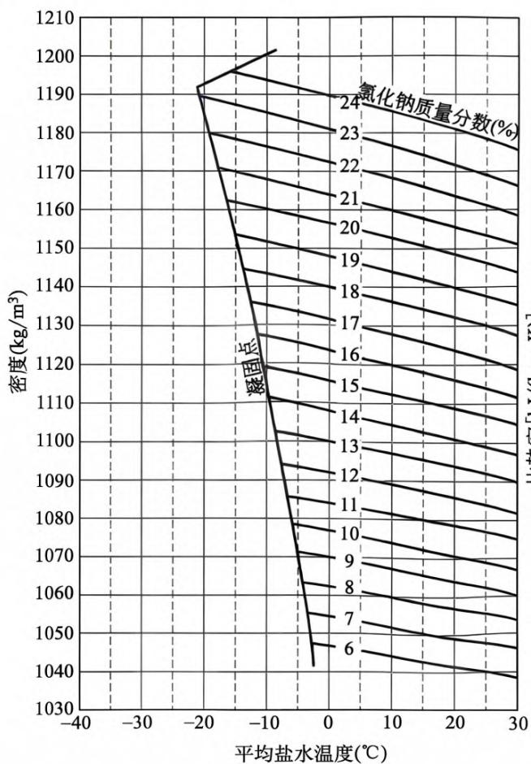  
图11.2-4 氯化钠盐水的密度

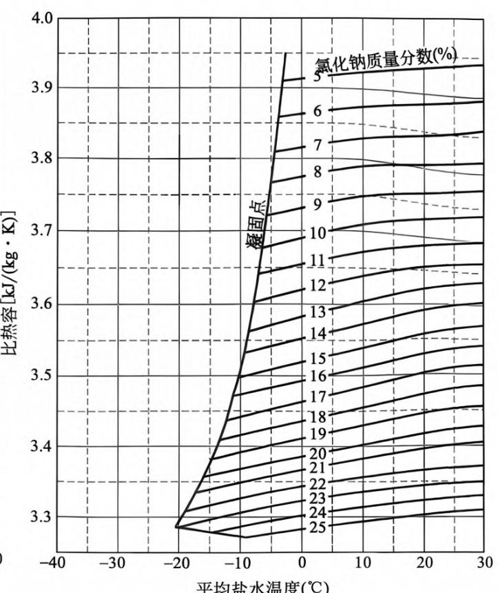  
图11.2-5 氯化钠盐水的比热容

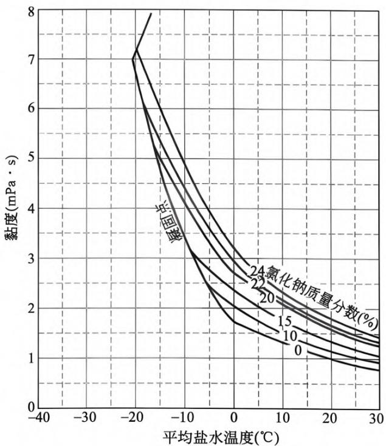  
图 11.2-6 氯化钠盐水的黏度

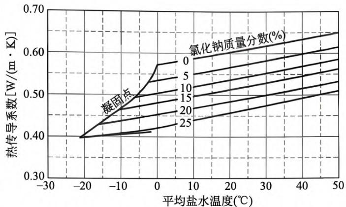  
图11.2-7 氯化钠盐水的导热系数

**2. 盐水溶液的腐蚀性和抑制**

盐水溶液对金属的腐蚀性与盐水纯度及溶液中的含氧量有关。在工业机械和溜冰场制冷中，应用氯化钙水溶液的主要问题是腐蚀，尤其是采用浸镀锌铁罐为制冰罐时。大多数制冷工程中，因氯化钙水溶液冰点较低而更便于应用。氯化钠可用在不能与氯化钙接触的场合（如冷冻鱼和其他食物的盐水喷雾），用作空气冷却机组冷却器的喷雾可防止盘管结霜。

为了减少盐水溶液的腐蚀性，必须对盐水系统采取以下措施：①用纯度高的盐配置盐水溶液；②在盐水箱上加封盖，形成闭式循环系统，以减少溶液与空气的接触；③添加一定量的缓蚀剂，使溶液呈弱碱性（pH 保持在 7.5～8.5）。一般情况下，缓蚀剂可采用氢氧化钠（NaOH）和重铬酸钠（NaCrO $_{7}$ ）。1m $^{3}$ 氯化钙水溶液中加 1.6kg 重铬酸钠、0.45kg 氢氧化钠；1m $^{3}$ 氯化钠水溶液中加 3.2kg 重铬酸钠、0.89kg 氢氧化钠。

**11.2.6.2 有机化合物水溶液**

盐水溶液对金属有强烈的腐蚀性，故某些场合需要采用腐蚀性小的有机化合物，如乙烯乙二醇、丙二醇、乙醇、甲醇、丙三醇等水溶液，作为载冷剂，以有效降低水的冰点，且挥发性低。

**1. 乙二醇和丙二醇的物理性质**

乙二醇和丙二醇是无色、无臭的液体，可与水和许多有机化合物混溶。乙烯乙二醇、丙二醇水溶液广泛应用在工业制冷和冰蓄冷系统中。丙二醇稳定性好，其水溶液无腐蚀性、毒性很小，可与食品直接接触；但应尽量避免使用纯度较低的丙二醇，它可能有毒或含有杂质，也会对其性能产生不利影响（如发泡倾向、腐蚀）。丙二醇的价格及黏度比乙烯乙二醇高。冰蓄冷空调系统中一般采用质量分数为 $25\% \sim 30\%$ 的乙二醇水溶液作为载冷剂。纯乙二醇和纯丙二醇的物理性质见表11.2-23，其凝固点和沸点见表11.2-24。质量分数高于 $60\%$ 的乙二醇，若其质量分数再升高，则溶液的凝固点会提高；质量分数超过 $60\%$ 的丙二醇溶液无凝固点，不再冻结，而是过冷并结晶（一种具有很高黏度和非晶无定形固体外观和性质的液体），在共晶的稀释侧（冷冻产生相同成分的固相混合物）凝结时形成。在浓缩的一侧，固体乙二醇在冷冻时从溶液中分离出来。这种溶液冻结速度很慢，但是随着时间的推移，会变成坚硬的固体。

纯乙二醇和纯丙二醇的物理性质  
表 11.2-23

<table><tr><td>物理性质</td><td>乙二醇</td><td>丙二醇</td></tr><tr><td>相对分子质量</td><td>62.07</td><td>76.10</td></tr><tr><td>20°C时的密度(kg/m3)</td><td>1113</td><td>1036</td></tr><tr><td>101.3kPa下的沸点(°C)</td><td>198</td><td>187</td></tr><tr><td>6.67kPa下的沸点(°C)</td><td>123</td><td>116</td></tr><tr><td>1.33kPa下的沸点(°C)</td><td>89</td><td>85</td></tr><tr><td>20°C时的蒸发压力(Pa)</td><td>6.7</td><td>9.3</td></tr><tr><td>冰点(°C)</td><td>-12.7</td><td>低于-51°C设置为晶体点</td></tr><tr><td>0°C时的黏度(mPa·s)</td><td>57.4</td><td>243</td></tr><tr><td>20°C时的黏度(mPa·s)</td><td>20.9</td><td>60.5</td></tr><tr><td>40°C时的黏度(mPa·s)</td><td>9.5</td><td>18.0</td></tr><tr><td>20°C时的折射率(nD)</td><td>1.4319</td><td>1.4329</td></tr><tr><td>20°C时的比热容[kJ/(kg·K)]</td><td>2.347</td><td>2.481</td></tr><tr><td>-12.7°C时的熔解热(kJ/kg)</td><td>187</td><td>-</td></tr><tr><td>101.3kPa下的汽化潜热(kJ/kg)</td><td>846</td><td>688</td></tr><tr><td>20°C时的燃烧热(MJ/kg)</td><td>19.246</td><td>23.969</td></tr></table>

乙二醇、丙二醇水溶液的凝固点和沸点  
表 11.2-24

<table><tr><td colspan="2">乙二醇</td><td rowspan="2">凝固点(°C)</td><td rowspan="2">100.7kPa下的沸点(°C)</td><td colspan="2">丙二醇</td><td rowspan="2">凝固点(°C)</td><td rowspan="2">100.7kPa下的沸点(°C)</td></tr><tr><td>质量分数(%)</td><td>体积分数(%)</td><td>质量分数(%)</td><td>体积分数(%)</td></tr><tr><td>0.0</td><td>0.0</td><td>0.0</td><td>100.0</td><td>0.0</td><td>0.0</td><td>0.0</td><td>100.0</td></tr><tr><td>5.0</td><td>4.4</td><td>-1.4</td><td>100.6</td><td>5.0</td><td>4.8</td><td>-1.6</td><td>100.0</td></tr><tr><td>10.0</td><td>8.9</td><td>-3.2</td><td>101.1</td><td>10.0</td><td>9.6</td><td>-33</td><td>100.0</td></tr><tr><td>15.0</td><td>13.6</td><td>-5.4</td><td>101.7</td><td>15.0</td><td>14.5</td><td>-5.1</td><td>100.0</td></tr><tr><td>20.0</td><td>18.1</td><td>-7.8</td><td>102.2</td><td>20.0</td><td>19.4</td><td>-7.1</td><td>100.6</td></tr><tr><td>21.0</td><td>19.2</td><td>-8.4</td><td>102.2</td><td>21.0</td><td>20.4</td><td>-7.6</td><td>100.6</td></tr><tr><td>22.0</td><td>20.1</td><td>-8.9</td><td>102.2</td><td>22.0</td><td>21.4</td><td>-8.0</td><td>100.6</td></tr><tr><td>23.0</td><td>21.0</td><td>-9.5</td><td>102.8</td><td>23.0</td><td>22.4</td><td>-8.6</td><td>100.6</td></tr><tr><td>24.0</td><td>22.0</td><td>-10.2</td><td>102.8</td><td>24.0</td><td>23.4</td><td>-9.1</td><td>100.6</td></tr><tr><td>25.0</td><td>22.9</td><td>-10.7</td><td>103.3</td><td>25.0</td><td>24.4</td><td>-9.6</td><td>101.1</td></tr><tr><td>26.0</td><td>23.9</td><td>-11.4</td><td>103.3</td><td>26.0</td><td>25.3</td><td>-10.2</td><td>101.1</td></tr><tr><td>27.0</td><td>24.8</td><td>-12.0</td><td>103.3</td><td>27.0</td><td>26.4</td><td>-10.8</td><td>101.1</td></tr><tr><td>28.0</td><td>25.8</td><td>-12.7</td><td>103.9</td><td>28.0</td><td>27.4</td><td>-11.4</td><td>101.7</td></tr><tr><td>29.0</td><td>26.7</td><td>-13.3</td><td>103.9</td><td>29.0</td><td>28.4</td><td>-12.0</td><td>101.7</td></tr><tr><td>30.0</td><td>27.7</td><td>-14.1</td><td>104.4</td><td>30.0</td><td>29.4</td><td>-12.7</td><td>102.2</td></tr><tr><td>31.0</td><td>28.7</td><td>-14.8</td><td>104.4</td><td>31.0</td><td>30.4</td><td>-13.4</td><td>102.2</td></tr><tr><td>32.0</td><td>29.6</td><td>-15.4</td><td>104.4</td><td>32.0</td><td>31.4</td><td>-14.1</td><td>102.2</td></tr><tr><td>33.0</td><td>30.6</td><td>-16.2</td><td>104.4</td><td>33.0</td><td>32.4</td><td>-14.8</td><td>102.2</td></tr><tr><td>34.0</td><td>31.6</td><td>-17.0</td><td>104.4</td><td>34.0</td><td>33.5</td><td>-15.6</td><td>102.2</td></tr><tr><td>35.0</td><td>32.6</td><td>-17.9</td><td>105.0</td><td>35.0</td><td>34.4</td><td>-16.4</td><td>102.8</td></tr><tr><td>36.0</td><td>33.5</td><td>-18.6</td><td>105.0</td><td>36.0</td><td>35.5</td><td>-17.3</td><td>102.8</td></tr><tr><td>37.0</td><td>34.5</td><td>-19.4</td><td>105.0</td><td>37.0</td><td>36.5</td><td>-18.2</td><td>102.8</td></tr><tr><td>38.0</td><td>35.5</td><td>-20.3</td><td>105.0</td><td>38.0</td><td>37.5</td><td>-19.1</td><td>103.3</td></tr><tr><td>39.0</td><td>36.5</td><td>-21.3</td><td>105.0</td><td>39.0</td><td>38.5</td><td>-20.1</td><td>103.3</td></tr><tr><td>40.0</td><td>37.5</td><td>-22.3</td><td>105.6</td><td>40.0</td><td>39.6</td><td>-21.1</td><td>103.9</td></tr><tr><td>41.0</td><td>38.5</td><td>-23.2</td><td>105.6</td><td>41.0</td><td>40.6</td><td>-22.1</td><td>103.9</td></tr><tr><td>42.0</td><td>39.5</td><td>-24.3</td><td>105.6</td><td>42.0</td><td>41.6</td><td>-23.2</td><td>103.9</td></tr><tr><td>43.0</td><td>40.5</td><td>-25.3</td><td>106.1</td><td>43.0</td><td>42.6</td><td>-24.3</td><td>103.9</td></tr><tr><td>44.0</td><td>41.5</td><td>-26.4</td><td>106.1</td><td>44.0</td><td>43.7</td><td>-25.5</td><td>103.9</td></tr><tr><td>45.0</td><td>42.5</td><td>-27.5</td><td>106.7</td><td>45.0</td><td>44.7</td><td>-26.7</td><td>104.4</td></tr><tr><td>46.0</td><td>43.5</td><td>-28.8</td><td>106.7</td><td>46.0</td><td>45.7</td><td>-27.9</td><td>104.4</td></tr><tr><td>47.0</td><td>44.5</td><td>-29.8</td><td>106.7</td><td>47.0</td><td>46.8</td><td>-29.3</td><td>104.4</td></tr><tr><td>48.0</td><td>45.5</td><td>-31.1</td><td>106.7</td><td>48.0</td><td>47.8</td><td>-30.6</td><td>105.0</td></tr><tr><td>49.0</td><td>46.6</td><td>-32.6</td><td>106.7</td><td>49.0</td><td>48.9</td><td>-32.1</td><td>105.0</td></tr><tr><td>50.0</td><td>47.6</td><td>-33.8</td><td>107.2</td><td>50.0</td><td>49.9</td><td>-33.5</td><td>105.6</td></tr><tr><td>51.0</td><td>48.6</td><td>-35.1</td><td>107.2</td><td>51.0</td><td>50.9</td><td>-35.0</td><td>105.6</td></tr><tr><td>52.0</td><td>49.6</td><td>-36.4</td><td>107.2</td><td>52.0</td><td>51.9</td><td>-36.6</td><td>105.6</td></tr><tr><td>53.0</td><td>50.6</td><td>-37.9</td><td>107.8</td><td>53.0</td><td>53.0</td><td>-38.2</td><td>106.1</td></tr><tr><td>54.0</td><td>51.6</td><td>-39.3</td><td>107.8</td><td>54.0</td><td>54.0</td><td>-39.8</td><td>106.1</td></tr><tr><td>55.0</td><td>52.7</td><td>-41.1</td><td>108.3</td><td>55.0</td><td>55.0</td><td>-41.6</td><td>106.1</td></tr><tr><td>56.0</td><td>53.7</td><td>-42.6</td><td>108.3</td><td>56.0</td><td>56.0</td><td>-433</td><td>106.1</td></tr><tr><td>57.0</td><td>54.7</td><td>-44.2</td><td>108.9</td><td>57.0</td><td>57.0</td><td>-45.2</td><td>106.7</td></tr><tr><td>58.0</td><td>55.7</td><td>-45.6</td><td>108.9</td><td>58.0</td><td>58.0</td><td>-47.1</td><td>106.7</td></tr><tr><td>59.0</td><td>56.8</td><td>-47.1</td><td>109.4</td><td>59.0</td><td>59.0</td><td>-49.0</td><td>106.7</td></tr><tr><td>60.0</td><td>57.8</td><td>-48.3</td><td>119.0</td><td>60.0</td><td>60.0</td><td>-51.1</td><td>107.2</td></tr><tr><td>65.0</td><td>62.8</td><td>*</td><td>112.8</td><td>65.0</td><td>65.0</td><td>#</td><td>108.3</td></tr><tr><td>70.0</td><td>68.3</td><td>*</td><td>116.7</td><td>70.0</td><td>70.0</td><td>#</td><td>110.0</td></tr><tr><td>75.0</td><td>73.6</td><td>*</td><td>120.0</td><td>75.0</td><td>75.0</td><td>#</td><td>113.9</td></tr><tr><td>80.0</td><td>78.9</td><td>-46.8</td><td>123.9</td><td>80.0</td><td>80.0</td><td>#</td><td>118.3</td></tr><tr><td>85.0</td><td>84.3</td><td>-36.9</td><td>133.9</td><td>85.0</td><td>85.0</td><td>#</td><td>125.0</td></tr><tr><td>90.0</td><td>89.7</td><td>-29.8</td><td>140.6</td><td>90.0</td><td>90.0</td><td>#</td><td>132.2</td></tr><tr><td>95.0</td><td>95.0</td><td>-19.4</td><td>158.3</td><td>95.0</td><td>95.0</td><td>#</td><td>154.4</td></tr></table>

\* 表示凝固点低于 $-50^{\circ} \mathrm{C}$ 。  
#表示质量分数超过60%的丙二醇溶液不会凝固，而是变成晶体。

乙二醇水溶液的物理性质（即密度、比热容、导热系数和黏度）分别见表 11.2-25～表 11.2-28 和图 11.2-8。表 11.2-25 和图 11.2-8 中的密度适用于工业抑制乙二醇水溶液，略高于纯乙二醇和水。典型的缓蚀剂不会显著影响其他物理性能。除黏度外，乙二醇水溶液和丙二醇水溶液的物理性质相似，在相同质量分数下，丙二醇水溶液比乙二醇溶液更黏稠，故载冷剂多采用乙二醇。

乙二醇水溶液的密度（单位： $\mathrm{kg/m^3}$ ）  
表 11.2-25

<table><tr><td rowspan="2">温度(°C)</td><td colspan="9">体积分数</td></tr><tr><td>10%</td><td>20%</td><td>30%</td><td>40%</td><td>50%</td><td>60%</td><td>70%</td><td>80%</td><td>90%</td></tr><tr><td>-35</td><td></td><td></td><td></td><td></td><td>1089.94</td><td>1104.60</td><td>1118.61</td><td>1132.11</td><td></td></tr><tr><td>-30</td><td></td><td></td><td></td><td></td><td>1089.04</td><td>1103.54</td><td>1117.38</td><td>1130.72</td><td></td></tr><tr><td>-25</td><td></td><td></td><td></td><td></td><td>1088.01</td><td>1102.36</td><td>1116.04</td><td>1129.21</td><td>1141.87</td></tr><tr><td>-20</td><td></td><td></td><td></td><td>1071.98</td><td>1086.87</td><td>1101.06</td><td>1114.58</td><td>1127.57</td><td>1140.07</td></tr><tr><td>-15</td><td></td><td></td><td></td><td>1070.87</td><td>1085.61</td><td>1099.64</td><td>1112.99</td><td>1125.82</td><td>1138.14</td></tr><tr><td>-10</td><td></td><td></td><td>1054.31</td><td>1069.63</td><td>1084.22</td><td>1098.09</td><td>1111.28</td><td>1123.94</td><td>1136.09</td></tr><tr><td>-5</td><td></td><td>1036.85</td><td>1053.11</td><td>1068.28</td><td>1082.71</td><td>1096.43</td><td>1109.45</td><td>1121.94</td><td>1133.91</td></tr><tr><td>0</td><td>1018.73</td><td>1035.67</td><td>1051.78</td><td>1066.80</td><td>1081.08</td><td>1094.64</td><td>1107.50</td><td>1119.82</td><td>1131.62</td></tr><tr><td>5</td><td>1017.57</td><td>1034.36</td><td>1050.33</td><td>1065.21</td><td>1079.33</td><td>1092.73</td><td>1105.43</td><td>1117.58</td><td>1129.20</td></tr><tr><td>10</td><td>1016.28</td><td>1032.94</td><td>1048.76</td><td>1063.49</td><td>1077.46</td><td>1090.70</td><td>1103.23</td><td>1115.22</td><td>1126.67</td></tr><tr><td>15</td><td>1014.87</td><td>1031.39</td><td>1047.07</td><td>1061.65</td><td>1075.46</td><td>1088.54</td><td>1100.92</td><td>1112.73</td><td>1124.01</td></tr><tr><td>20</td><td>1013.34</td><td>1029.72</td><td>1045.25</td><td>1059.68</td><td>1073.35</td><td>1086.27</td><td>1098.48</td><td>1110.13</td><td>1121.23</td></tr><tr><td>25</td><td>1011.69</td><td>1027.93</td><td>1043.32</td><td>1057.60</td><td>1071.11</td><td>1083.87</td><td>1095.92</td><td>1107.40</td><td>1118.32</td></tr><tr><td>30</td><td>1009.92</td><td>1026.02</td><td>1041.26</td><td>1055.39</td><td>1068.75</td><td>1081.35</td><td>1093.24</td><td>1104.55</td><td>1115.30</td></tr><tr><td>35</td><td>1008.02</td><td>1023.99</td><td>1039.08</td><td>1053.07</td><td>1066.27</td><td>1078.71</td><td>1090.43</td><td>1101.58</td><td>1112.15</td></tr><tr><td>40</td><td>1006.01</td><td>1021.83</td><td>1036.78</td><td>1050.62</td><td>1063.66</td><td>1075.95</td><td>1087.51</td><td>1098.48</td><td>1108.89</td></tr><tr><td>45</td><td>1003.87</td><td>1019.55</td><td>1034.36</td><td>1048.05</td><td>1060.94</td><td>1073.07</td><td>1084.46</td><td>1095.27</td><td>1105.50</td></tr><tr><td>50</td><td>1001.61</td><td>1017.16</td><td>1031.81</td><td>1045.35</td><td>1058.09</td><td>1070.06</td><td>1081.30</td><td>1091.93</td><td>1101.99</td></tr><tr><td>55</td><td>999.23</td><td>1014.64</td><td>1029.15</td><td>1042.54</td><td>1055.13</td><td>1066.94</td><td>1078.01</td><td>1088.48</td><td>1098.36</td></tr><tr><td>60</td><td>996.72</td><td>1011.99</td><td>1026.36</td><td>1039.61</td><td>1052.04</td><td>1063.69</td><td>1074.60</td><td>1084.90</td><td>1094.60</td></tr><tr><td>65</td><td>994.10</td><td>1009.23</td><td>1023.45</td><td>1036.55</td><td>1048.83</td><td>1060.32</td><td>1071.06</td><td>1081.20</td><td>1090.73</td></tr><tr><td>70</td><td>991.35</td><td>1006.35</td><td>1020.42</td><td>1033.37</td><td>1045.49</td><td>1056.83</td><td>1067.41</td><td>1077.37</td><td>1086.73</td></tr><tr><td>75</td><td>988.49</td><td>1003.34</td><td>1017.27</td><td>1030.07</td><td>1042.04</td><td>1053.22</td><td>1063.64</td><td>1073.43</td><td>1082.61</td></tr><tr><td>80</td><td>985.50</td><td>1000.21</td><td>1014.00</td><td>1026.65</td><td>1038.46</td><td>1049.48</td><td>1059.74</td><td>1069.36</td><td>1078.37</td></tr><tr><td>85</td><td>982.39</td><td>996.96</td><td>1010.60</td><td>1023.10</td><td>1034.77</td><td>1045.63</td><td>1055.72</td><td>1065.18</td><td>1074.01</td></tr><tr><td>90</td><td>979.15</td><td>993.59</td><td>1007.09</td><td>1019.44</td><td>1030.95</td><td>1041.65</td><td>1051.58</td><td>1060.87</td><td>1069.53</td></tr><tr><td>95</td><td>975.80</td><td>990.10</td><td>1003.45</td><td>1015.65</td><td>1027.01</td><td>1037.55</td><td>1047.32</td><td>1056.44</td><td>1064.92</td></tr><tr><td>100</td><td>972.32</td><td>986.48</td><td>999.69</td><td>1011.74</td><td>1022.95</td><td>1033.33</td><td>1042.93</td><td>1051.88</td><td>1060.20</td></tr><tr><td>105</td><td>968.73</td><td>982.75</td><td>995.81</td><td>1007.71</td><td>1018.76</td><td>1028.99</td><td>1038.43</td><td>1047.21</td><td>1055.35</td></tr><tr><td>110</td><td>965.01</td><td>978.89</td><td>991.81</td><td>1003.56</td><td>1014.46</td><td>1024.52</td><td>1033.80</td><td>1042.41</td><td>1050.38</td></tr><tr><td>115</td><td>961.17</td><td>974.91</td><td>987.68</td><td>999.29</td><td>1010.03</td><td>1019.94</td><td>1029.05</td><td>1037.50</td><td>1045.29</td></tr><tr><td>120</td><td>957.21</td><td>970.81</td><td>983.43</td><td>994.90</td><td>1005.48</td><td>1015.23</td><td>1024.18</td><td>1032.46</td><td>1040.08</td></tr><tr><td>125</td><td>953.12</td><td>966.59</td><td>979.07</td><td>990.38</td><td>1000.81</td><td>1010.40</td><td>1019.19</td><td>1027.30</td><td>1034.74</td></tr></table>

乙二醇水溶液的比热容 [单位：kJ/(kg·K)]  
表 11.2-26

<table><tr><td rowspan="2">温度(°C)</td><td colspan="9">体积分数</td></tr><tr><td>10%</td><td>20%</td><td>30%</td><td>40%</td><td>50%</td><td>60%</td><td>70%</td><td>80%</td><td>90%</td></tr><tr><td>-35</td><td></td><td></td><td></td><td></td><td>3.068</td><td>2.844</td><td>2.612</td><td>2.370</td><td></td></tr><tr><td>-30</td><td></td><td></td><td></td><td></td><td>3.088</td><td>2.866</td><td>2.636</td><td>2.397</td><td></td></tr><tr><td>-25</td><td></td><td></td><td></td><td></td><td>3.107</td><td>2.888</td><td>2.660</td><td>2.423</td><td>2.177</td></tr><tr><td>-20</td><td></td><td></td><td></td><td>3.334</td><td>3.126</td><td>2.909</td><td>2.685</td><td>2.450</td><td>2.206</td></tr><tr><td>-15</td><td></td><td></td><td></td><td>3.351</td><td>3.145</td><td>2.931</td><td>2.709</td><td>2.477</td><td>2.235</td></tr><tr><td>-10</td><td></td><td></td><td>3.560</td><td>3.367</td><td>3.165</td><td>2.953</td><td>2.733</td><td>2.503</td><td>2.264</td></tr><tr><td>-5</td><td></td><td>3.757</td><td>3.574</td><td>3.384</td><td>3.184</td><td>2.975</td><td>2.757</td><td>2.530</td><td>2.293</td></tr><tr><td>0</td><td>3.937</td><td>3.769</td><td>3.589</td><td>3.401</td><td>3.203</td><td>2.997</td><td>2.782</td><td>2.556</td><td>2.322</td></tr><tr><td>5</td><td>3.946</td><td>3.780</td><td>3.603</td><td>3.418</td><td>3.223</td><td>3.018</td><td>2.806</td><td>2.583</td><td>2.351</td></tr><tr><td>10</td><td>3.954</td><td>3.792</td><td>3.617</td><td>3.435</td><td>3.242</td><td>3.040</td><td>2.830</td><td>2.610</td><td>2.380</td></tr><tr><td>15</td><td>3.963</td><td>3.803</td><td>3.631</td><td>3.451</td><td>3.261</td><td>3.062</td><td>2.854</td><td>2.636</td><td>2.409</td></tr><tr><td>20</td><td>3.972</td><td>3.815</td><td>3.645</td><td>3.468</td><td>3.281</td><td>3.084</td><td>2.878</td><td>2.663</td><td>2.438</td></tr><tr><td>25</td><td>3.981</td><td>3.826</td><td>3.660</td><td>3.485</td><td>3.300</td><td>3.106</td><td>2.903</td><td>2.690</td><td>2.467</td></tr><tr><td>30</td><td>3.989</td><td>3.838</td><td>3.674</td><td>3.502</td><td>3.319</td><td>3.127</td><td>2.927</td><td>2.716</td><td>2.496</td></tr><tr><td>35</td><td>3.998</td><td>3.849</td><td>3.688</td><td>3.518</td><td>3.339</td><td>3.149</td><td>2.951</td><td>2.743</td><td>2.525</td></tr><tr><td>40</td><td>4.007</td><td>3.861</td><td>3.702</td><td>3.535</td><td>3.358</td><td>3.171</td><td>2.975</td><td>2.770</td><td>2.554</td></tr><tr><td>45</td><td>4.015</td><td>3.872</td><td>3.716</td><td>3.552</td><td>3.377</td><td>3.193</td><td>3.000</td><td>2.796</td><td>2.583</td></tr><tr><td>50</td><td>4.024</td><td>3.884</td><td>3.730</td><td>3.569</td><td>3.396</td><td>3.215</td><td>3.024</td><td>2.823</td><td>2.612</td></tr><tr><td>55</td><td>4.033</td><td>3.895</td><td>3.745</td><td>3.585</td><td>3.416</td><td>3.236</td><td>3.048</td><td>2.850</td><td>2.641</td></tr><tr><td>60</td><td>4.042</td><td>3.907</td><td>3.759</td><td>3.602</td><td>3.435</td><td>3.258</td><td>3.072</td><td>2.876</td><td>2.670</td></tr><tr><td>65</td><td>4.050</td><td>3.918</td><td>3.773</td><td>3.619</td><td>3.454</td><td>3.280</td><td>3.097</td><td>2.903</td><td>2.699</td></tr><tr><td>70</td><td>4.059</td><td>3.930</td><td>3.787</td><td>3.636</td><td>3.474</td><td>3.302</td><td>3.121</td><td>2.929</td><td>2.728</td></tr><tr><td>75</td><td>4.068</td><td>3.941</td><td>3.801</td><td>3.653</td><td>3.493</td><td>3.324</td><td>3.145</td><td>2.956</td><td>2.757</td></tr><tr><td>80</td><td>4.077</td><td>3.953</td><td>3.816</td><td>3.669</td><td>3.512</td><td>3.345</td><td>3.169</td><td>2.983</td><td>2.786</td></tr><tr><td>85</td><td>4.085</td><td>3.964</td><td>3.830</td><td>3.686</td><td>3.532</td><td>3.367</td><td>3.193</td><td>3.009</td><td>2.815</td></tr><tr><td>90</td><td>4.094</td><td>3.976</td><td>3.844</td><td>3.703</td><td>3.551</td><td>3.389</td><td>3.218</td><td>3.036</td><td>2.844</td></tr><tr><td>95</td><td>4.103</td><td>3.987</td><td>3.858</td><td>3.720</td><td>3.570</td><td>3.411</td><td>3.242</td><td>3.063</td><td>2.873</td></tr><tr><td>100</td><td>4.112</td><td>3.999</td><td>3.872</td><td>3.736</td><td>3.590</td><td>3.433</td><td>3.266</td><td>3.089</td><td>2.902</td></tr><tr><td>105</td><td>4.120</td><td>4.010</td><td>3.886</td><td>3.753</td><td>3.609</td><td>3.454</td><td>3.290</td><td>3.116</td><td>2.931</td></tr><tr><td>110</td><td>4.129</td><td>4.022</td><td>3.901</td><td>3.770</td><td>3.628</td><td>3.476</td><td>3.315</td><td>3.143</td><td>2.960</td></tr><tr><td>115</td><td>4.138</td><td>4.033</td><td>3.915</td><td>3.787</td><td>3.647</td><td>3.498</td><td>3.339</td><td>3.169</td><td>2.989</td></tr><tr><td>120</td><td>4.147</td><td>4.045</td><td>3.929</td><td>3.804</td><td>3.667</td><td>3.520</td><td>3.363</td><td>3.196</td><td>3.018</td></tr><tr><td>125</td><td>4.155</td><td>4.056</td><td>3.943</td><td>3.820</td><td>3.686</td><td>3.542</td><td>3.387</td><td>3.223</td><td>3.047</td></tr></table>

乙二醇水溶液的导热系数 [单位：W/(m·K)]  
表 11.2-27

<table><tr><td rowspan="2">温度(°C)</td><td colspan="9">体积分数</td></tr><tr><td>10%</td><td>20%</td><td>30%</td><td>40%</td><td>50%</td><td>60%</td><td>70%</td><td>80%</td><td>90%</td></tr><tr><td>-35</td><td></td><td></td><td></td><td></td><td></td><td>0.300</td><td>0.279</td><td>0.262</td><td></td></tr><tr><td>-30</td><td></td><td></td><td></td><td></td><td>0.328</td><td>0.303</td><td>0.282</td><td>0.264</td><td></td></tr><tr><td>-25</td><td></td><td></td><td></td><td></td><td>0.332</td><td>0.306</td><td>0.284</td><td>0.266</td><td>0.252</td></tr><tr><td>-20</td><td></td><td></td><td></td><td>0.366</td><td>0.336</td><td>0.310</td><td>0.287</td><td>0.268</td><td>0.253</td></tr><tr><td>-15</td><td></td><td></td><td></td><td>0.371</td><td>0.340</td><td>0.313</td><td>0.289</td><td>0.270</td><td>0.255</td></tr><tr><td>-10</td><td></td><td></td><td>0.411</td><td>0.376</td><td>0.344</td><td>0.316</td><td>0.292</td><td>0.271</td><td>0.256</td></tr><tr><td>-5</td><td></td><td>0.458</td><td>0.417</td><td>0.381</td><td>0.348</td><td>0.319</td><td>0.294</td><td>0.273</td><td>0.257</td></tr><tr><td>0</td><td>0.512</td><td>0.466</td><td>0.423</td><td>0.386</td><td>0.352</td><td>0.322</td><td>0.297</td><td>0.275</td><td>0.259</td></tr><tr><td>5</td><td>0.520</td><td>0.472</td><td>0.429</td><td>0.391</td><td>0.356</td><td>0.325</td><td>0.299</td><td>0.277</td><td>0.260</td></tr><tr><td>10</td><td>0.528</td><td>0.479</td><td>0.435</td><td>0.395</td><td>0.360</td><td>0.328</td><td>0.301</td><td>0.278</td><td>0.261</td></tr><tr><td>15</td><td>0.535</td><td>0.486</td><td>0.440</td><td>0.400</td><td>0.363</td><td>0.331</td><td>0.303</td><td>0.280</td><td>0.262</td></tr><tr><td>20</td><td>0.543</td><td>0.492</td><td>0.445</td><td>0.404</td><td>0.366</td><td>0.334</td><td>0.305</td><td>0.281</td><td>0.263</td></tr><tr><td>25</td><td>0.550</td><td>0.498</td><td>0.450</td><td>0.408</td><td>0.370</td><td>0.336</td><td>0.307</td><td>0.283</td><td>0.264</td></tr><tr><td>30</td><td>0.556</td><td>0.503</td><td>0.455</td><td>0.412</td><td>0.373</td><td>0.338</td><td>0.309</td><td>0.284</td><td>0.265</td></tr><tr><td>35</td><td>0.563</td><td>0.509</td><td>0.459</td><td>0.415</td><td>0.376</td><td>0.341</td><td>0.311</td><td>0.285</td><td>0.266</td></tr><tr><td>40</td><td>0.569</td><td>0.514</td><td>0.463</td><td>0.419</td><td>0.378</td><td>0.343</td><td>0.312</td><td>0.286</td><td>0.267</td></tr><tr><td>45</td><td>0.574</td><td>0.518</td><td>0.467</td><td>0.422</td><td>0.381</td><td>0.345</td><td>0.314</td><td>0.288</td><td>0.268</td></tr><tr><td>50</td><td>0.579</td><td>0.523</td><td>0.471</td><td>0.425</td><td>0.383</td><td>0.347</td><td>0.315</td><td>0.289</td><td>0.268</td></tr><tr><td>55</td><td>0.584</td><td>0.527</td><td>0.474</td><td>0.427</td><td>0.385</td><td>0.348</td><td>0.316</td><td>0.289</td><td>0.269</td></tr><tr><td>60</td><td>0.588</td><td>0.530</td><td>0.477</td><td>0.430</td><td>0.387</td><td>0.350</td><td>0.317</td><td>0.290</td><td>0.270</td></tr><tr><td>65</td><td>0.592</td><td>0.534</td><td>0.480</td><td>0.432</td><td>0.389</td><td>0.351</td><td>0.318</td><td>0.291</td><td>0.270</td></tr><tr><td>70</td><td>0.596</td><td>0.537</td><td>0.483</td><td>0.434</td><td>0.391</td><td>0.352</td><td>0.319</td><td>0.292</td><td>0.271</td></tr><tr><td>75</td><td>0.599</td><td>0.540</td><td>0.485</td><td>0.436</td><td>0.392</td><td>0.354</td><td>0.320</td><td>0.292</td><td>0.271</td></tr><tr><td>80</td><td>0.602</td><td>0.542</td><td>0.487</td><td>0.438</td><td>0.394</td><td>0.355</td><td>0.321</td><td>0.293</td><td>0.271</td></tr><tr><td>85</td><td>0.605</td><td>0.544</td><td>0.489</td><td>0.439</td><td>0.395</td><td>0.355</td><td>0.322</td><td>0.293</td><td>0.272</td></tr><tr><td>90</td><td>0.607</td><td>0.546</td><td>0.490</td><td>0.440</td><td>0.396</td><td>0.356</td><td>0.322</td><td>0.294</td><td>0.272</td></tr><tr><td>95</td><td>0.609</td><td>0.548</td><td>0.491</td><td>0.441</td><td>0.396</td><td>0.357</td><td>0.322</td><td>0.294</td><td>0.272</td></tr><tr><td>100</td><td>0.610</td><td>0.549</td><td>0.493</td><td>0.442</td><td>0.397</td><td>0.357</td><td>0.323</td><td>0.294</td><td>0.272</td></tr><tr><td>105</td><td>0.612</td><td>0.550</td><td>0.493</td><td>0.443</td><td>0.398</td><td>0.358</td><td>0.323</td><td>0.294</td><td>0.272</td></tr><tr><td>110</td><td>0.613</td><td>0.551</td><td>0.494</td><td>0.443</td><td>0.398</td><td>0.358</td><td>0.323</td><td>0.294</td><td>0.272</td></tr><tr><td>115</td><td>0.614</td><td>0.552</td><td>0.495</td><td>0.444</td><td>0.398</td><td>0.358</td><td>0.323</td><td>0.294</td><td>0.272</td></tr><tr><td>120</td><td>0.614</td><td>0.552</td><td>0.495</td><td>0.444</td><td>0.398</td><td>0.358</td><td>0.323</td><td>0.294</td><td>0.272</td></tr><tr><td>125</td><td>0.615</td><td>0.552</td><td>0.495</td><td>0.444</td><td>0.398</td><td>0.358</td><td>0.323</td><td>0.294</td><td>0.271</td></tr></table>

乙二醇水溶液的黏度（单位：mPa·s）  
表11.2-28

<table><tr><td rowspan="2">温度(°C)</td><td colspan="9">体积分数</td></tr><tr><td>10%</td><td>20%</td><td>30%</td><td>40%</td><td>50%</td><td>60%</td><td>70%</td><td>80%</td><td>90%</td></tr><tr><td>-35</td><td></td><td></td><td></td><td></td><td>66.93</td><td>93.44</td><td>133.53</td><td>191.09</td><td></td></tr><tr><td>-30</td><td></td><td></td><td></td><td></td><td>43.98</td><td>65.25</td><td>96.57</td><td>141.02</td><td></td></tr><tr><td>-25</td><td></td><td></td><td></td><td></td><td>30.50</td><td>46.75</td><td>70.38</td><td>102.21</td><td>196.87</td></tr><tr><td>-20</td><td></td><td></td><td></td><td>15.75</td><td>22.07</td><td>34.28</td><td>51.94</td><td>74.53</td><td>128.43</td></tr><tr><td>-15</td><td></td><td></td><td></td><td>11.74</td><td>16.53</td><td>25.69</td><td>38.88</td><td>55.09</td><td>87.52</td></tr><tr><td>-10</td><td></td><td></td><td>6.19</td><td>9.06</td><td>12.74</td><td>19.62</td><td>29.53</td><td>41.36</td><td>61.85</td></tr><tr><td>-5</td><td></td><td>3.65</td><td>5.03</td><td>7.18</td><td>10.05</td><td>15.25</td><td>22.76</td><td>31.56</td><td>45.08</td></tr><tr><td>0</td><td>2.08</td><td>3.02</td><td>4.15</td><td>5.83</td><td>8.09</td><td>12.05</td><td>17.79</td><td>24.44</td><td>33.74</td></tr><tr><td>5</td><td>1.79</td><td>2.54</td><td>3.48</td><td>4.82</td><td>6.63</td><td>9.66</td><td>14.09</td><td>19.20</td><td>25.84</td></tr><tr><td>10</td><td>1.56</td><td>2.18</td><td>2.95</td><td>4.04</td><td>5.50</td><td>7.85</td><td>11.31</td><td>15.29</td><td>20.18</td></tr><tr><td>15</td><td>1.37</td><td>1.89</td><td>2.53</td><td>3.44</td><td>4.63</td><td>6.46</td><td>9.18</td><td>12.33</td><td>16.04</td></tr><tr><td>20</td><td>1.21</td><td>1.65</td><td>2.20</td><td>2.96</td><td>3.94</td><td>5.38</td><td>7.53</td><td>10.05</td><td>12.95</td></tr><tr><td>25</td><td>1.08</td><td>1.46</td><td>1.92</td><td>2.57</td><td>3.39</td><td>4.52</td><td>6.24</td><td>8.29</td><td>10.59</td></tr><tr><td>30</td><td>0.97</td><td>1.30</td><td>1.69</td><td>2.26</td><td>2.94</td><td>3.84</td><td>5.23</td><td>6.90</td><td>8.77</td></tr><tr><td>35</td><td>0.88</td><td>1.17</td><td>1.50</td><td>1.99</td><td>2.56</td><td>3.29</td><td>4.42</td><td>5.79</td><td>7.34</td></tr><tr><td>40</td><td>0.80</td><td>1.06</td><td>1.34</td><td>1.77</td><td>2.26</td><td>2.84</td><td>3.76</td><td>4.91</td><td>6.21</td></tr><tr><td>45</td><td>0.73</td><td>0.96</td><td>1.21</td><td>1.59</td><td>2.00</td><td>2.47</td><td>3.23</td><td>4.19</td><td>5.30</td></tr><tr><td>50</td><td>0.67</td><td>0.88</td><td>1.09</td><td>1.43</td><td>1.78</td><td>2.16</td><td>2.80</td><td>3.61</td><td>4.56</td></tr><tr><td>55</td><td>0.62</td><td>0.81</td><td>0.99</td><td>1.29</td><td>1.59</td><td>1.91</td><td>2.43</td><td>3.12</td><td>3.95</td></tr><tr><td>60</td><td>0.57</td><td>0.74</td><td>0.90</td><td>1.17</td><td>1.43</td><td>1.69</td><td>2.13</td><td>2.72</td><td>3.45</td></tr><tr><td>65</td><td>0.53</td><td>0.69</td><td>0.83</td><td>1.06</td><td>1.29</td><td>1.51</td><td>1.88</td><td>2.39</td><td>3.03</td></tr><tr><td>70</td><td>0.50</td><td>0.64</td><td>0.76</td><td>0.97</td><td>1.17</td><td>1.35</td><td>1.67</td><td>2.11</td><td>2.67</td></tr><tr><td>75</td><td>0.47</td><td>0.59</td><td>0.70</td><td>0.89</td><td>1.07</td><td>1.22</td><td>1.49</td><td>1.87</td><td>2.37</td></tr><tr><td>80</td><td>0.44</td><td>0.55</td><td>0.65</td><td>0.82</td><td>0.98</td><td>1.10</td><td>1.33</td><td>1.66</td><td>2.12</td></tr><tr><td>85</td><td>0.41</td><td>0.52</td><td>0.60</td><td>0.76</td><td>0.89</td><td>1.00</td><td>1.20</td><td>1.49</td><td>1.90</td></tr><tr><td>90</td><td>0.39</td><td>0.49</td><td>0.56</td><td>0.70</td><td>0.82</td><td>0.92</td><td>1.09</td><td>1.34</td><td>1.71</td></tr><tr><td>95</td><td>0.37</td><td>0.46</td><td>0.52</td><td>0.65</td><td>0.76</td><td>0.84</td><td>0.99</td><td>1.21</td><td>1.54</td></tr><tr><td>100</td><td>0.35</td><td>0.43</td><td>0.49</td><td>0.60</td><td>0.70</td><td>0.77</td><td>0.90</td><td>1.10</td><td>1.40</td></tr><tr><td>105</td><td>0.33</td><td>0.40</td><td>0.46</td><td>0.56</td><td>0.65</td><td>0.71</td><td>0.82</td><td>1.00</td><td>1.27</td></tr><tr><td>110</td><td>0.32</td><td>0.38</td><td>0.43</td><td>0.53</td><td>0.60</td><td>0.66</td><td>0.76</td><td>0.91</td><td>1.16</td></tr><tr><td>115</td><td>0.30</td><td>0.36</td><td>0.41</td><td>0.49</td><td>0.56</td><td>0.61</td><td>0.70</td><td>0.83</td><td>1.07</td></tr><tr><td>120</td><td>0.29</td><td>0.34</td><td>0.38</td><td>0.46</td><td>0.53</td><td>0.57</td><td>0.64</td><td>0.77</td><td>0.98</td></tr><tr><td>125</td><td>0.28</td><td>0.33</td><td>0.36</td><td>0.43</td><td>0.49</td><td>0.53</td><td>0.60</td><td>0.71</td><td>0.90</td></tr></table>

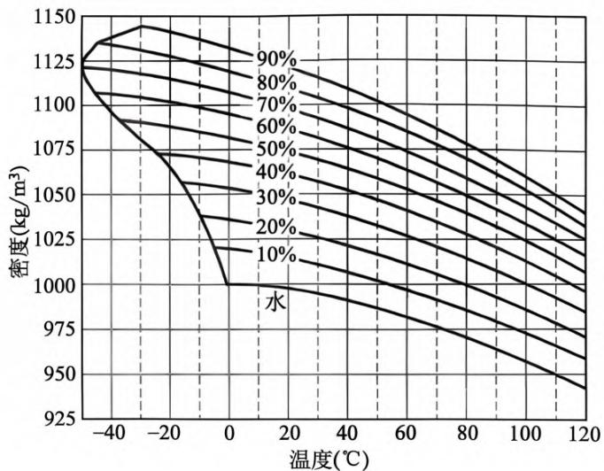  
(a)

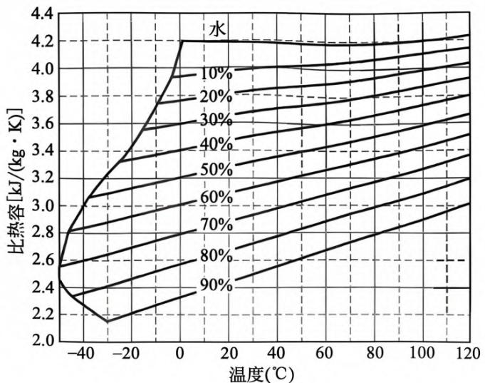  
(b)  
图11.2-8 不同体积分数下工业抑制乙二醇水溶液的密度、比热容、导热系数以及黏度随温度变化的曲线（a）密度；（b）比热容注：图中曲线上的数值表示体积分数。

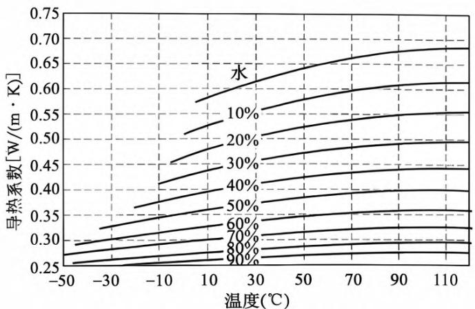  
(c)

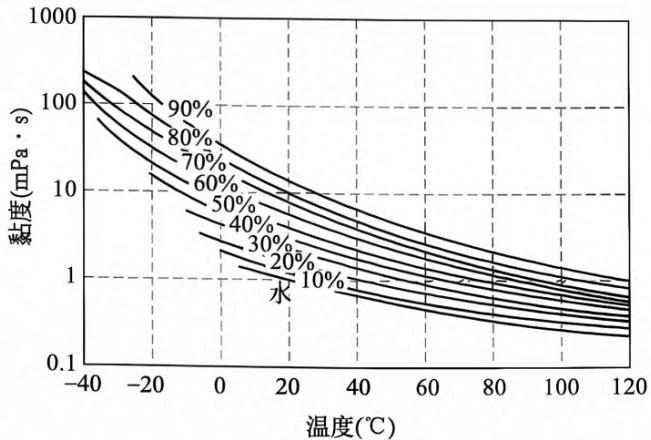  
(d)  
图11.2-8 不同体积分数下工业抑制乙二醇水溶液的密度、比热容、导热系数以及黏度随温度变化的曲线（续）(c）导热系数；(d）黏度注：图中曲线上的数值表示体积分数。

乙二醇体积分数的选择取决于其应用场合所需的保护类型。若被用于防止设备在冬天闲置期间损坏，例如暖通空调系统中的防冻盘管，则采用体积分数为 $30\%$ 的乙二醇水溶液或体积分数为 $35\%$ 的丙二醇水溶液就足够了。这些体积分数下液体会冻结。当流体冻结时，会形成浆而膨胀，并流入任意可用的空间。因此，这种类型的保护必须包括膨胀体积。若应用场合要求流体完全保持液态，则应使用冰点低于最低预期温度（3K）的质量分数。应避免乙二醇质量分数过高，因为这会导致初投资增加，并对流体的物理性质产生不利影响。

**2. 腐蚀抑制**

当不用水稀释时，乙二醇和丙二醇实际上比水对普通建筑金属的腐蚀性小。然而，通常情况下一旦用水稀释，所有乙二醇水溶液比水更具腐蚀性：当使用未被抑制的乙二醇热降解和氧化时，形成酸性降解产物，若不添加腐蚀抑制剂和 $\mathrm{pH}$ 缓冲化合物，腐蚀性就会越来越强。氧化的量受温度、曝气程度和乙二醇水溶液所暴露的金属类型影响。一般来说，与冷水系统相比，热水系统对乙二醇基传热流体的降解作用更大。因此，乙二醇基传热流体不仅需要使用缓蚀剂，以有效保护普通金属免受腐蚀，还需要使用额外的添加剂（如硼砂），来缓冲或中和使用过程中形成的酸性乙二醇降解产物。缓蚀剂形成表面屏障，保护金属免受侵蚀，但其有效性依赖于溶液的 $\mathrm{pH}$ ，无法补偿乙二醇降解所导致的溶液 $\mathrm{pH}$ 的下降，而使某些缓蚀剂（尤其是铸铁和碳钢，还有焊料）失去效用，应该使用被适当抑制的乙二醇产品。

## 11.3 空气净化与洁净

空气净化是指去除空气中的一种或多种污染物质，控制房间或空间内的空气达到洁净要求的技术。室内空气受来自室外的大气污染及室内工艺生产、人员活动等因素影响存在多种不同类型的污染物，这些污染物一般可分为三类：物理污染（如粉尘等颗粒物）、化学污染（如有机挥发性化合物 VOCs、甲醛等）和微生物污染（如霉菌、病毒等）。这些室内污染对人体健康与生产工艺均产生严重危害。针对不同的污染物，应采用适用的净化技术与相关设备。

空气洁净技术（又称洁净室技术或污染控制技术）最初主要是以控制室内空气中悬浮颗粒物为目标的相关技术。悬浮颗粒物的计数浓度以单位体积空气中大于等于某一粒径的颗粒物的允许数量来表示，通常称为空气的洁净度，并以此划分洁净度等级。最初运用洁净技术是为了提高精密产品（如仪器仪表）的成品率或降低其故障率，服务于军事。随着科学技术与工业生产的发展，对生产环境的洁净度提出了严格受控要求，以保证生产过程和产品加工的精密化、微型化、高纯度、高质量和高可靠性及高成品率。控制的对象也从单一的悬浮颗粒物扩展到有害气体。洁净技术在控制空气中悬浮颗粒物的同时，也有效控制了空气中的细菌和病毒等有害微生物，所以其应用范围逐步推广到医疗卫生、制药、生物及食品工业等相关领域。近年来，空气净化技术与措施在民用建筑的室内空气质量控制中也得到应用。

### 11.3.1 基本概念

**11.3.1.1 主要术语与定义**

1. 洁净室。国家标准《洁净厂房设计规范》GB 50073—2013 及《供暖通风与空气调节术语标准》GB/T 50155—2015 将洁净室定义为：空气悬浮粒子浓度受控的空间，它的建造和使用应减少室内诱人、产生及滞留粒子。室内其他有关参数如温度、湿度、压力等按要求进行控制。这一定义与较早版本的国际标准 ISO 14644-1 的定义一致。新版 ISO 14644-1：2015 将洁净室定义为：空气中悬浮粒子的计数浓度受控并划分了洁净等级的房间，其设计、建造、运行方式使房间内进入、产生及滞留的粒子受控。同时给出三条注释：①规定了空气中悬浮粒子计数浓度级别；②其他的洁净度影响因素，如空气中化学物质、活微生物、纳米粒子，以及影响表面洁净度的粒子、纳米粒子、化学物质或微生物，也可予以规定并受控；③其他相关物理参数也可按要求受控，如温度、湿度、压力、振动、静电等。

2. 洁净区。空气悬浮粒子的数量浓度受控并分级的限定空间。其建造和运行使进入、产生和滞留于空间的粒子受控。洁净区可以是限定于洁净室内的空间，也可用隔离装置实现。隔离装置既可设在洁净室内也可在洁净室外。

3. 粒径。颗粒直径通常简称为粒径，指气溶胶颗粒的几何直径（等效球形、光学或空气动力学）。

4. 悬浮粒子。用于空气洁净度分级的空气中粒子尺寸范围在 $0.1 \sim 10 \mu \mathrm{m}$ 的固体和液体粒子。

5. 洁净度。以单位体积空气中大于或等于某粒径粒子的数量来区分的洁净程度。

6. 单向流。通过洁净室（区）整个断面的风速稳定、大致平行的受控气流。

7. 非单向流。洁净室或洁净区的送风以诱导方式与室内或区内空气混合的气流分布类型。

8. 空态。设施已经建成，所有动力接通并运行，但无生产设备、材料及人员的状态。

9. 静态。设施已经建成，生产设备已安装，并按业主及供应商同意的状态运行，但无生产人员的状态。

10. 动态。设施以规定的状态运行，有规定的人员在场，并在商定的状况下进行工作。

11. 高效空气过滤器（HEPA）。在额定风量下，对粒径为 $0.3\mu \mathrm{m}$ 微粒的捕集效率在 $99.95\%$ 以上的空气过滤器，简称HEPA过滤器。

12. 超高效空气过滤器（ULPA）。在额定风量下，对最易穿透粒径（MPPS）的微粒的捕集计数效率在 $99.999\%$ 以上的空气过滤器，简称ULPA过滤器。

**11.3.1.2 污染物质**

洁净室技术的主要控制对象就是对室内洁净环境产生影响的各种污染物质。空气中的污染物质有粉尘、烟、烟雾、各种气体、微生物等。在洁净室设计计算中需要确定室内外各种污染物浓度、污染物发生量等。

**1. 污染物的分类**

空气中污染物按常规或环境卫生学的分类见表 11.3-1，空气洁净技术中的悬浮颗粒包括固态和液态微粒，它与现代测尘技术是相适应的。

空气中污染物按常规或环境卫生学的分类  
表11.3-1

<table><tr><td colspan="2">分类</td><td>特征</td></tr><tr><td rowspan="5">常规</td><td>粉尘</td><td>固态微粒</td></tr><tr><td>烟</td><td>固态微粒和液态微粒凝集而成的微粒(&lt;0.5μm),如香烟的烟、木材的烟、油烟和煤烟等</td></tr><tr><td>烟雾</td><td>包括液态和固态,大小从十分之几微米到几十微米,如大气中烟与雾的混合物、钢厂氧化铁的烟雾</td></tr><tr><td>有毒气体</td><td>SO2、NOx等</td></tr><tr><td>微生物</td><td>指活性微粒,如细菌(一般&gt;1μm),病毒(一般&lt;1μm)</td></tr><tr><td rowspan="5">环境卫生学</td><td>总悬浮尘(TSP)</td><td>悬浮在空气中,空气动力学当量直径≤100μm的颗粒</td></tr><tr><td>可吸入尘(PM10)</td><td>悬浮在空气中,空气动力学当量直径≤10μm的颗粒</td></tr><tr><td>细颗粒物(PM2.5)</td><td>悬浮在空气中,空气动力学当量直径≤2.5μm的颗粒</td></tr><tr><td>可入肺颗粒物(PM1)</td><td>悬浮在空气中,空气动力学当量直径≤1μm的颗粒</td></tr><tr><td>沉降尘</td><td>一定时间内沉积在暴露平面上的落下尘埃</td></tr><tr><td rowspan="2">存在状况</td><td>大气尘</td><td>空气中由自然现象(包括所在地区的生产和生活环境影响)形成的尘埃,城市与郊外不同</td></tr><tr><td>人工尘</td><td>因生产需要对不同物料专门加工而成的颗粒物质,对洁净技术而言,是指人工生产的含不同成分(如包括纤维)的人工尘(用于过滤器试验)</td></tr></table>

**2. 污染物浓度**

对大气而言，所含污染物中以颗粒物质为代表的大气尘的浓度，随测尘方法不同而有不同的计量方法。

（1）质量浓度（单位为 $\mathrm{mg / m^3}$ 或 $\mu \mathrm{g} / \mathrm{m}^3$ ）。是指单位体积空气中所含粒子的质量，常用于一般环境的计量。TSP、 $\mathrm{PM}_{10}$ 、 $\mathrm{PM}_{2.5}$ 通常采用质量浓度。

(2) 计数浓度 (单位为粒/L 或颗/ $\mathrm{m}^{3}$ )。是指单位体积空气中所含粒子的颗粒数, 同

时必须限定为某一粒径或大于等于某一粒径作为计数范围。它用于洁净室计量。

（3）沉降量 [单位为 $g/(m^2 \cdot \text{周})$ 或 $t/(km^2 \cdot \text{月})$ ]。是指单位面积上自然沉降下来的微粒质量。可用于城市大气质量监测。

对大气尘来说，其中粒径小于 $1\mu \mathrm{m}$ 的粒子数约占总粒子数的 $99\%$ ，但其质量分数约占 $3\%$ ；粒径 $10\mu \mathrm{m}$ 以上的粒子数量很少，而其质量分数可达 $80\%$ 。一般要求的洁净室关注的是粒径 $0.5\mu \mathrm{m}$ 的粒子，故其浓度的检测只能采用计数方法。

**3. 污染物来源**

(1) 室外环境的尘源影响洁净室的室外尘源, 实际上就是大气尘 (经洁净空调系统进入室内或渗透进入室内)。在洁净技术中, 在大多数生产工艺和生物医药领域, 最常用的是以含粒径 $\geqslant 0.5 \mu \mathrm{m}$ 的微粒的计数浓度作为控制对象。由于不同地点包含在空气中的自然尘和人工尘源不同, 故其计数浓度差别很大, 即使同一个地点, 随着时间不同也有很大的变动, 这比空气温度、湿度的参数变化复杂得多。只能根据大量的实测数据作出分档。表 11.3-2 是室外大气尘按不同地域、不同计量方法所得出的浓度, 图 11.3-1 给出了典型大气气溶胶粒径分布特征。

不同地域、不同计量方法所得室外大气尘浓度  
表 11.3-2

<table><tr><td>浓度</td><td>工业城市</td><td>市郊</td><td>农村</td></tr><tr><td>粒径 $\geqslant {0.5\mu }\mathrm{m}$ 计数浓度(粒/L)</td><td> $\leqslant 3\times {10}^{5}$ </td><td> $\leqslant 2\times {10}^{5}$ </td><td> $\leqslant 1\times {10}^{5}$ </td></tr><tr><td>质量浓度(mg/m $^{3}$ )</td><td>0.3~1.0</td><td>0.1~0.3</td><td>&lt;0.1</td></tr><tr><td>沉降量[t/(km $^{2}$ ·月)]</td><td>&gt;15</td><td>&lt;15</td><td>&lt;5</td></tr></table>

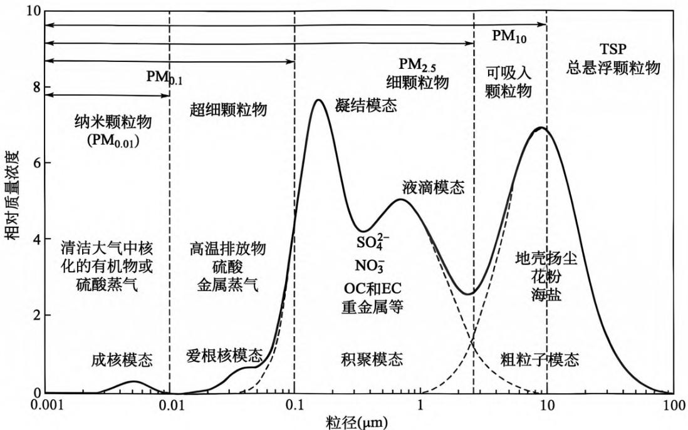  
图 11.3-1 典型大气气溶胶粒径分布特征

微生物粒子也是室外环境的污染源，但其不可见，且附着在尘粒上，故可使其沉降或采集到培养皿上，经培养（24h、37℃）后计数［由显微镜放大所见为细菌繁殖形成的菌落单元数 cfu，与尘埃的计量相似，细菌计数浓度和沉降量的单位为 cfu/L 和 cfu/(Ⅲ·min]。

大气中含细菌的量同样是随地点、季节等而异。表 11.3-3 列出了不同环境中大气含菌量的参考数值。

不同环境中大气含菌量参考值  
表 11.3-3

<table><tr><td>环境</td><td>大气含菌量(粒/ $m^{3}$ )</td></tr><tr><td>清净环境(山区等)</td><td>60~130</td></tr><tr><td>环境良好的住宅区</td><td>250~400</td></tr><tr><td>城市街道中心区</td><td>1400~4000</td></tr></table>

(2) 室内环境的尘源和发尘量室内发尘量主要包括人和建筑表面、工艺设备运转等的发尘。在洁净室中, 人的发尘量相当大, 是室内主要污染源之一。人活动时的发尘量比静止时大好几倍。一般洁净室的发尘量也是针对粒径 $\geqslant 0.5 \mu \mathrm{m}$ 的尘粒来说的。表 11.3-4 列出了洁净室作业人员不同衣着与不同动作的人体发尘量的实测数据。

洁净室作业人员不同衣着、不同动作的人体发尘量（粒径 $\geqslant 0.5\mu \mathrm{m}$ ）[单位：粒/(人·min)]  
表 11.3-4

<table><tr><td rowspan="2">人员动作</td><td rowspan="2">普通工作服</td><td colspan="2">洁净工作服</td></tr><tr><td>分套型</td><td>全套型</td></tr><tr><td>立</td><td>339000</td><td>113000</td><td>5580</td></tr><tr><td>坐</td><td>302000</td><td>112000</td><td>7420</td></tr><tr><td>臂上下运动</td><td>2980000</td><td>298000</td><td>18600</td></tr><tr><td>上体前屈</td><td>2240000</td><td>538000</td><td>24200</td></tr><tr><td>臂自由运动</td><td>2240000</td><td>298000</td><td>20600</td></tr><tr><td>头部运动</td><td>631000</td><td>151000</td><td>11000</td></tr><tr><td>上体转动</td><td>850000</td><td>266000</td><td>14900</td></tr><tr><td>屈身</td><td>3120000</td><td>605000</td><td>37400</td></tr><tr><td>踹步</td><td>2800000</td><td>861000</td><td>44600</td></tr><tr><td>步行</td><td>2920000</td><td>1010000</td><td>56000</td></tr></table>

民用建筑的室内发尘量，则按质量浓度计，如办公室可按表 11.3-5 参考采用。

办公室人员发尘量  
表 11.3-5

<table><tr><td>数据来源</td><td>发尘量[mg/(h・人)]</td></tr><tr><td>藤井正一</td><td>5~7(会议室为该值的2倍)</td></tr><tr><td>东京都卫生局</td><td>6.5~15.2(平均10)</td></tr><tr><td>日本空气清净学会</td><td>9.4~17.3(平均14.5)</td></tr></table>

室内发菌量可由不同场合下菌尘相关关系（经实测整理）转化而来。如发菌量与发尘量之比在 $1:500 \sim 1:1000$ 的范围内。由于试验的局限性，所以设计时应注意提供这些试验的具体条件。根据国外试验资料，也可直接参考以下数据：洁净室内当工作人员穿无菌服时, 静止时发菌量为 $10 \sim 300$ 粒/(人·min), 一般活动时为 $150 \sim 1000$ 粒/(人·min), 快步行走时为 $900 \sim 2500$ 粒/(人·min); 穿非无菌服时为 $3300 \sim 6200$ 粒/(人·min)。国内手术人员发菌量实测数据 $< 1000$ 粒/(人·min), 这与国外的数据相接近。所以静态发菌量 (穿无菌衣) 可采用 $< 1000$ 粒/(人·min)。

**11.3.1.3 洁净技术的相关标准**

当前有关空气洁净技术的相关标准很多，包括设计、施工、产品、产品性能测试、工程项目检测与验收等方面。有国家标准（以 GB 开头）及推荐性国家标准（以 GB/T 开头）；有国际标准（ISO），如关于工业洁净室的 ISO 14644-1～ISO 14644-17 系列和关于生物洁净室的 ISO 14698-1～ISO 14698-2 系列、关于一般通风空气过滤器的 ISO 16890-1～ISO 16890-4 系列以及关于高效/超高效空气过滤器的 ISO 29463-1～ISO 29463-5 系列；此外还有各种行业与团体标准。由于各类标准众多，且在不断修改、更新、增加、制定中，此处不一一列出。

### 11.3.2 洁净度等级标准

洁净室的洁净度等级是以单位体积空气中大于或等于某粒径粒子的数量来区分的洁净程度，过去各国均有各自的标准，是不完全相同的。为了推动洁净技术和标准的国际化，国际污染控制学会联盟（ICCCS）协同国际标准化组织（ISO）完成了洁净室及相关受控环境系列标准的制定工作，ISO 14644-1 是关于洁净度分级标准的等级划分的国际标准，相关内容可参见本手册第 3 分册第 9 章。

### 11.3.3 洁净室原理、构成与分类

**11.3.3.1 洁净室的原理**

从洁净室如何满足工艺使用要求来看，应当以实现“洁净空间”为首要目标。为建立和维持该空间的洁净水平，应在设计、建造、调试和运行管理等方面遵循图11.3-2所示的四个基本原则。

**1. 为防止洁净室外的颗粒物直接侵入室内采取的技术措施**

（1）室内维持正压，防止洁净度比该洁净室低的周围空气携带颗粒物及其他污染物通过围护结构的缝隙和孔洞直接进入室内。

(2) 采用符合要求的空气净化系统对送风进行过滤。经高效过滤器过滤后的空气, 不得被其后的管道、送风口等再污染。同时, 高效过滤器要安装密封设施, 以免未经高效过滤的空气渗漏入室。

(3) 对进入室内的人员和物料采取合格的净化措施, 防止将污染物带入洁净室内。

2. 为防止微粒堆积采取的技术措施

(1) 洁净室围护结构内表面不应有或尽量减少凸出物和沟缝，以免堆积尘埃。

(2) 室内设备、管路、家具等应易于清扫。

(3) 设置真空清扫系统或真空扫除机, 定期清扫。

3. 为防止室内产生微粒采取的技术措施

(1) 洁净室内的建筑与装修材料、设备、家具、用具等应不产尘或尽可能少产尘。

(2) 室内人员应做好个人卫生、穿着合格的洁净服、遵循洁净室操作（动作）规程，

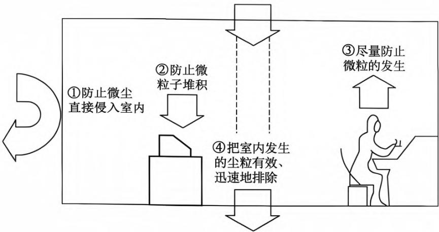  
图11.3-2 洁净工程设计的四个基本原则

以减少发尘。

(3) 提高工艺过程的机械化、自动化程度。这对高级别洁净室尤为重要。

4. 为迅速有效地排除进入室内和室内产生的颗粒物采取的技术措施

(1) 利用经超净（高效）过滤的洁净空气及时排除室内发尘，可以采用“稀释冲淡”或“活塞置换”的手段来排除室内的发尘。

(2) 有足够的风量保证必要的换气次数, 采用合理的气流组织来实现尘粒的排除。气流组织要考虑室内工艺设备和发尘点的位置等实际情况。

(3) 对发尘量比较大的设备可采用局部排风。

这些技术措施的实施需要规划、建筑、工艺、空调净化、设备材料以及运行管理等多方面共同配合。

**11.3.3.2 洁净室的构成**

图11.3-3所示为洁净室的构成。从构成洁净室整体的硬件来说，有以下几部分：

  
图11.3-3 洁净室的构成

(1) 洁净室围护结构 由土建材料现场构筑或工厂预制的构件构筑, 包括洁净厂房的土建结构和在土建结构内分隔出洁净室的建筑装修部分。除了合理的平面、剖面规划布置外, 为满足洁净要求的建筑和装修构造节点的设计和制作, 也是重要的构成部分。

(2) 净化空调系统 除了要满足工艺要求的室内温湿度外, 净化空调系统的显著特点是根据需要采用多级空气过滤器 (通常至少三级过滤)、保证足够的风量和有序的室内压力控制。末级过滤器的性能对洁净室具有关键作用，末端高效过滤器安装的密封性也不可忽视。

（3）附属设备 为保证洁净室的正常使用，应有合理的人流、物流路线与合格的人、物净化设施，如空气吹淋室、传递窗等。此外，还有为工艺需要所敷设的其他工艺管线、用于监测洁净室洁净度与压力的相关仪器设备等。

**11.3.3.3 洁净室的分类**

**1. 按洁净室用途分**

(1) 工业洁净室。以控制室内空气中悬浮粒子为主要目的的洁净室, 如微电子、集成电路、精密仪器等工业生产用的洁净室。

(2) 生物洁净室。以控制室内空气中微生物粒子为主要目的的洁净室, 如生物医药制品、医院洁净手术部等洁净室。

这两类洁净室的比较见表 11.3-6。

工业洁净室与生物洁净室的比较  
表 11. 3-6

<table><tr><td>洁净室类型</td><td>工业洁净室</td><td>生物洁净室</td></tr><tr><td>受控对象</td><td>灰尘等非生物粒子</td><td>微生物等生物粒子</td></tr><tr><td>应用范围</td><td>微电子、光学、化工、精密机械、航天、航空、核工业等部门和行业</td><td>医疗、制药、食品、生物工程、动物饲养等部门和行业</td></tr><tr><td>污染影响</td><td>人和建筑设备等发尘</td><td>主要是人体发菌</td></tr><tr><td>空气过滤</td><td>一般需除去粒径 $\geqslant {0.5\mu }\mathrm{m}$ 的尘粒</td><td>以除菌效率为准</td></tr><tr><td>运行</td><td>定期作一般清扫(如利用真空吸尘系统)</td><td>定期消毒灭菌(因细菌可繁殖增生)</td></tr></table>

**2. 按气流组织形式分**

(1) 单向流洁净室。室内气流流线平行、流向单一, 并且有均匀的断面风速。送出的洁净空气流像活塞一样置换室内污染空气, 使洁净室保持很高的洁净度, 且抗污染能力强。可细分为垂直单向流与水平单向流。

(2) 非单向流洁净室。室内的气流与普通空调送风方式类似, 装有高效过滤器的送风口向室内送风 (通常为上送), 回风口通常设在洁净室下部侧面 (参见表 11.3-12 中的图式), 通过送出的洁净空气来稀释室内的污染物, 以保持室内要求的洁净度。

单向流与非单向流洁净室的比较见表 11.3-7。

单向流与非单向流洁净室的比较

<table><tr><td>洁净室类型</td><td>单向流洁净室</td><td>非单向流洁净室</td></tr><tr><td>图式</td><td></td><td></td></tr><tr><td>作用原理</td><td>活塞作用、置换空气</td><td>稀释作用</td></tr><tr><td>适用洁净级别</td><td>≤5级</td><td>6~9级</td></tr><tr><td>换气次数( $h^{-1}$ )</td><td>500~250</td><td>60~15</td></tr><tr><td>气流组织</td><td>用高效过滤器满布(满布率为60%~90%),垂直或水平平行流</td><td>普通空调送、回风方式</td></tr><tr><td>送风量( $m^3/h$ )</td><td>净化要求的风量远大于热湿处理的风量</td><td>热湿处理的风量小于净化要求的风量</td></tr><tr><td>循环空气</td><td>两次回风+净化循环回风机</td><td>一次或两次回风方式</td></tr><tr><td>自净时间(min)</td><td>2~5</td><td>20~30</td></tr><tr><td>噪声水平[dB(A)]</td><td>60~65</td><td>55~60</td></tr><tr><td>运行能耗( $kW/m^2$ )</td><td>1.2~1.8</td><td>0.1~0.2</td></tr></table>

表 11.3-7

**3. 按洁净设备的布置方式分**

（1）全室型洁净室。一般利用集中式净化空调系统向全室送风，使整个房间获得相同的洁净等级。

（2）局部型洁净室。利用局部净化装置，在生产车间内有工艺需要的地方提供洁净空气，使局部区域的洁净度满足要求。

(3) 混合型洁净室。为降低造价和运行费用, 利用集中式净化空调系统使洁净室整体保证一定的洁净度, 而在关键工艺区域采用局部洁净设施, 以保证较高的洁净等级。现代洁净室大多采用这种形式, 以经济灵活地满足各种使用要求。

### 11.3.4 空气净化方法与技术

目前空气净化的主要方法与技术有：纤维过滤器过滤、静电过滤、吸附净化法、纳米催化降解 VOCs、臭氧法、紫外线照射法、等离子体净化和其他净化技术，不同的净化方法与技术针对的污染物种类不同，需要采用适宜的某种或某几种净化方法的组合去除相应的物理、化学或微生物污染物。表 11.3-8 列出了不同空气净化方法与技术的原理与特点等。

各种空气净化方法与技术的原理与特点

<table><tr><td>净化技术</td><td>适用污染物种类</td><td>原理</td><td>应用效果</td><td>优点</td><td>缺点</td></tr><tr><td>纤维(HEPA)过滤</td><td>颗粒物、微生物</td><td> 拦截效应 惯性效应 扩散效应 静电效应</td><td>技术成熟,应用最为广泛,效果可靠。对于洁净度要求较高的洁净室应用场合,末端均采用此类过滤方式</td><td>技术成熟简单;过滤效率高,容尘量大;无二次污染物</td><td>滤网需定期清洁或更换,后期维护成本较高;无法去除气态污染物</td></tr><tr><td>静电过滤技术</td><td>颗粒物、微生物</td><td>利用高压静电场形成电晕,在电晕区里有自由电子和离子逸出,这些带电粒子使颗粒物(细菌及病毒附着在颗粒物上)带上电荷,荷电后的颗粒物在电场力作用下沉积,从而除去空气中的颗粒物</td><td>本质属于物理净化,有害物质并没有被化学分解;对于颗粒物去除效果好</td><td>阻力小、过滤效率较高、运行费用低;无耗材,清洗后可重复使用</td><td>产生臭氧、氮氧化物等二次污染;使用过程可能存在效率衰减问题;不能去除甲醛、苯等有害物质</td></tr><tr><td>吸附</td><td>气态污染物</td><td>利用多孔性的固体吸附气态污染物,主要分物理吸附(范德华力)与化学吸附(化学键力)</td><td>活性炭、氧化铝、硅胶和分子筛等吸附剂吸附空气中气态污染物,有效去除室内空气中低浓度的气态污染物</td><td>吸附效率高,能力强;维护管理简单;能处理多种污染物</td><td>吸附容量有限,饱和后需更换;对低浓度、小分子量、高极性的物质(如甲醛、甲烷和乙醇)效果有限,存在解吸附、吸附竞争等现象</td></tr><tr><td>紫外线技术臭氧净化</td><td>微生物微生物</td><td>利用具有杀菌作用的C波段紫外线(UV-C)破坏微生物细胞的DNA和RNA的分子结构,造成细胞死亡,达到除菌消毒的效果</td><td>紫外线杀菌灯(低压汞灯254nm及185nm),紫外线强度随着使用时间的增加而减弱,因而消毒灭菌能力不断减弱臭氧可随空气到处渗透,没有消毒死角,对空间环境效果理想</td><td>高效率杀菌;杀菌广谱性;运行维护简单,便于管理与实现自动化灭菌效果强,杀菌彻底;无二次污染</td><td>少量汞污染;紫外线损伤人体皮肤、眼睛;臭氧浓度过高对人体有害;穿透力弱,容易被设备阻挡;需要一定的作用时间臭氧对人体健康有害;具有腐蚀性,不适合家庭长期使用</td></tr><tr><td>光催化氧化</td><td>气态污染物</td><td></td><td>以纳米级二氧化钛为代表,喷涂于基材表面,在紫外线照射下降解污染物,但其净化效果受较多的因素影响,仅为二维层面的净化</td><td>能耗低、操作简单、无二次污染</td><td>利用太阳光的比例低(需紫外线照射);反应速度慢;接触时间短、效率低;性能衰减较快</td></tr><tr><td>等离子体净化</td><td>气态污染物、微生物、颗粒物</td><td>高能电子与空气中的分子碰撞发生一系列基元物化反应,产生多种活性自由基和生态氧,可有效杀菌;借助等离子体中的离子与物体的凝并,可去除细微颗粒物;羟基自由基以及臭氧等高能活性粒子与气态污染物发生氧化、降解化学反应,将气态污染物转变为二氧化碳和水</td><td>等离子体可以处理各类废气(油烟、杀菌、VOCs之类),已经广泛用于VOCs治理</td><td>净化能力强;快速杀菌;高效去除异味</td><td>产生臭氧等有害副产物,存在二次污染;初始投资高,对颗粒物的去除效果不明显</td></tr><tr><td>负离子净化</td><td>微生物、颗粒物</td><td>高浓度的负离子与颗粒物相碰撞而使其带负电,吸引周围带正电的颗粒物,凝聚沉降。同时,负离子对空气中的氧气也有电离成臭氧的作用,可杀灭细菌吸附 聚集 分解负离子吸附PM2.5颗粒物沉降 负离子聚集灰尘沉降 负离子分解病毒、细菌等有机物,生成二氧化碳和水</td><td>负离子空气净化器广泛应用于家居环境中,但其使用空间大大超过设备本身所能净化的空间,因此实际效果并不理想</td><td>调节空气中离子平衡;维护费用低;负离子对人体健康有益;对油烟颗粒物去除效果好</td><td>产生臭氧等二次污染;颗粒物未能清除出室内,二次扬尘;不能去除甲醛、苯等有害物质;负离子寿命短,需持续释放</td></tr></table>

## 11.4 噪声与振动

### 11.4.1 噪声与振动的基本概念

**11.4.1.1 声强、声压与声功率**

声强、声压与声功率的定义如表 11.4-1 所示。

**声强、声压与声功率的定义**

表 11.4-1

<table><tr><td>声学量</td><td>定义</td><td>定义式</td></tr><tr><td>声强与声强级</td><td>声强:声场中某点处,与质点速度方向垂直的单位面积上在单位时间内通过的声能称为瞬时声强,它是一个矢量。声强用I表示,稳态声场中,声强I为瞬时声强在一定时间T内的平均值,单位为W/m2。声强级:声强与基准声强之比的以10为底的对数,单位为贝[尔],B。但通常用dB,基准声强必须指明。注:在自由行波条件下,声功率与声压关系固定,可由声压级求声强级。但在一般情况下,二者关系复杂,无法由声压级求声强级</td><td>瞬时声强: $I(t)=p(t)\cdot u(t)$ (11.4-1)式中 $I(t)$ ——瞬时声强,W/m2; $p(t)$ ——瞬时声压,Pa; $u(t)$ ——瞬时质点速度,m/s。声强: $I=\frac{1}{T}\int_{0}^{T}I(t)dt=\frac{1}{T}\int_{0}^{T}p(t)u(t)dt$ (11.4-2)式中T——周期的整倍数,或长到不影响计算结果的时间,s。注:1.在指定方向n的声强 $I_n$ 等于 $I\cdot n$ ;2.对于在自由平面波或球面波的情况,在传播方向的声强是 $I_0=p^2/\rho_c$ (11.4-3)式中p——有效声压,Pa; $\rho$ ——媒质密度,kg/m3;c——声速,m/s。声强级: $L=10\lg[I/I_0]=10\lg(I/I_0)$ (11.4-4)式中I——声强, $I_0=10W/m^2$ 称为基准声强</td></tr><tr><td>声压与声压级</td><td>声压:有声波时,媒质中的压力与静压的差值,单位为帕[斯卡],Pa。注:1.一般使用时,声压是有效声压的简称。有效声压是在一段时间内瞬时声压的方均根值,这段时间应为周期的整数倍或长到不影响计算结果的程度。2.声压的瞬时值、平均值、峰值、最大值或峰值等应分别注明为瞬时声压、平均声压、峰值声压、最大声压或峰到峰值声压等。声压级:声压与基准声压之比的以10为底的对数乘以2,单位为贝[尔],B。但通常用dB,基准声压必须指明。声压级是声压与基准声压之比的以10为底的对数的20倍</td><td>声压级: $L_p=10\lg[p^2/p_0^2]=20\lg(p/p_0)$ (11.4-5)式中p——声压,Pa; $p_0=2\times10^{-6}Pa$ 称为基准声压</td></tr><tr><td>声功率与声功率级</td><td>声功率;单位时间内通过某一面积的声能。单位为瓦,W。声功率级:声功率与基准声功率之比的以10为底的对数,单位为贝[尔],B。通常用dB,基准声功率必须指明。声功率级是声源声功率与基准声功率之比的以10为底的对数的10倍</td><td>声功率级 $L_w = 10\lg[W/W_0]$ (11.4-6)式中W——声功率,W; $W_0 = 10^{-12}W$ 称为基准声功率</td></tr><tr><td colspan="2">声功率与声强的关系</td><td> $I=W/S$ (11.4-7)式中S——声波垂直通过的面积, $m^2$ </td></tr><tr><td colspan="2">声功率与声压的关系</td><td> $W = (p^2 \times S)/(ρ_c), p^2 = I \cdot ρ_c$ (11.4-8)式中S——声波垂直通过的面积, $m^2$ ; $ρ_c$ ——媒质的特性抗阻, $Pa \cdot s/m$ </td></tr></table>

**11.4.1.2 振动位移、振动速度与振动加速度**

振动基本上是在机械系统中产生的一种振荡运动，它可以是简谐，而大多数机械系统的振动频率不止一个，产生了更为复杂的运动。

在简谐运动中，位移、速度和加速度的定义如表 11.4-2 所示。

振动位移、振动速度与振动加速度的定义  
表 11.4-2

<table><tr><td>声学量</td><td>定义</td></tr><tr><td>振动位移、振动速度与振动加速度</td><td>振动加速度:速度的时间变化率的矢量, $m/s^2$ 。位移: $\chi = \chi_0 \sin(2\pi ft) = \chi_0 \sin\omega t$ (11.4-9)速度: $\dot{\chi} = \chi_0(2\pi f)\cos 2\pi ft = \chi_0\omega \cos\omega t$ (11.4-10)加速度: $\ddot{\chi} = -\chi_0(2\pi f)^2 \sin 2\pi ft = -\chi_0\omega^2 \sin\omega t$ 式中  $f$ ——简谐振动的频率,Hz; $\omega$ ——相应的角频率; $\chi$ ——位移的幅值,m; $t$ ——时间,s</td></tr><tr><td>振动位移级、振动速度级与振动加速度级</td><td>振动位移级:振动位移与基准位移之比的以10为底的对数,再乘以20,单位为dB。其数学表达式为 $L_d=20\lg(d/d_0)$ ,基准位移 $d_0=1\times 10^{-12}m$ 。振动速度级:振动速度与基准速度之比的以10为底的对数,再乘以20,单位为dB。其数学表示式为 $L_v=20\lg(v/v_0)$ ,基准速度 $v_0=1\times 10^{-9}m/s$ 。振动加速度级:振动加速度与基准加速度之比的以10为底的对数乘以20,单位为dB。其数学表示式为 $L_a=20\lg(a/a_0)$ 基准加速度 $a_0=1\times 10^{-6}m/s^2$ </td></tr><tr><td>振动级</td><td>按规定的频率计权曲线对振动加速度级计权修正后得到的单值评价,又称计权振动级</td></tr></table>

**11.4.1.3 频谱与计权**

频谱与计权的定义如表 11.4-3 所示。

频谱与计权的定义  
表11.4-3

<table><tr><td>声学量</td><td colspan="2">定义</td></tr><tr><td>分贝</td><td colspan="2">标度声压级、声强级和声功率级等的单位,以符号dB表示。它是两个功率或类似功率的两个同类量比值的常用对数乘以10的量纲。一般在使用中常取其中一个量作为基准</td></tr><tr><td>频带</td><td>由于人耳可听频率范围为20~20000Hz,实用上不可能测量这个范围内的每一个频率声压级,测量总是在某一频率区间进行的。这个频率区间即称频带,由上限频率 $f_2$ 和下限频率 $f_1$ 规定带宽。在声学中常用的频带宽是倍频带,或称倍频程。一个倍频带是上限频率为下限频率两倍的频带范围,即 $f_2=2f_1$ 。如果对一个噪声频谱需要得到比倍频带更详细的资料,可以用1/3倍频程</td><td>频带</td></tr><tr><td>计权网络与计权声级</td><td colspan="2">由于人耳并非对所有频率一样敏感,所以为了得到比声压级能更好地与人耳响度判别密切相关的级,在声级计中加入了“频率计权网络”。这些网络改变了声级计对不同频率的敏感性,其中A、B、C计权网络分别模仿等响曲线中响度级40方、70方、100方的等响曲线。其中A计权网络得到最广泛的应用,因为它能较好地模仿人耳的频响特性。B计权网络实际应用较少。而对于许多实际情况,C计权网络测出的声级是总声压级的近似值。使用A、B、C计权网络所测得的声级分别称为A计权声级、B计权声级和C计权声级,分别简称A声级、B声级和C声级,单位都是分贝</td></tr><tr><td>倍频带声压级和1/3倍频带声压级</td><td colspan="2">在一个倍频程带宽中的声压级称为倍频带声压级,简称倍频带级,采用倍频程分析仪来测量和分析噪声的倍频带谱。当需要比倍频带谱更详细的频谱资料时,则采用1/3倍频程分析仪来分析噪声的频谱</td></tr><tr><td>中心频率</td><td colspan="2">特指某一频程的中心频率,其值等于该频程上限与下限频率乘积的平方根</td></tr><tr><td>声级叠加原理</td><td colspan="2">由于分贝表示的声级并不是一个线性标度,而是对数标度,所以叠加的声级不是各个声级的代数和。当n个不同声源同时发声时,在某处形成的总声强是各个声强的代数和,即:Ir=I1+I2+···+In当n个相同的声源同时发声时,总声压级应为:Lpr=Lpl+10lgn当n个不同的声源同时发声时,总声压级应为:Lpr=10lg(∑i=1n10Lpt/10)</td></tr><tr><td>从倍频带声级计算A计权声级</td><td colspan="2">由于分贝表示的声级并不是一个线性标度,而是对数标度,所以叠加的声级不是各个声级的代数和</td></tr><tr><td>A计权声级</td><td colspan="2">A声级是由声级计用A计权网络测得的声级。A计权是个宽频带的量度,因此,具有不同功率谱的声音可以具有相同的A声级值。A声级能够较好地反映人对各种噪声的主观评价。A声级同人耳的损伤程度也能够对应得很好,即A声级越高,对人耳的损伤越严重</td></tr><tr><td>等效连续A声级</td><td colspan="2">在声场中的某一位置上,将一段时间内间歇暴露的几个不同A声级,按能量平均方法得出一个A声级表示该段时间内的噪声大小,该声级称为等效连续A声级,简称等效声级</td></tr><tr><td>噪声</td><td colspan="2">紊乱、断续或统计上随机的声振荡;妨碍人们正常生产、生活的声音;不需要的声音</td></tr><tr><td>环境噪声</td><td colspan="2">某一环境下总的噪声,通常是由多个不同位置的声源产生的</td></tr><tr><td>背景噪声</td><td colspan="2">在发生、检查、测量或记录的系统中,与信号存在与否无关的一切声的干扰,也称本底噪声</td></tr><tr><td>噪声评价NC曲线</td><td colspan="2">1957年由白瑞纳克提出的一组噪声标准曲线,作为室内噪声标准的基础数值,适用于稳定噪声。同一曲线上各倍频程的噪声可认为具有相同程度的干扰</td></tr><tr><td>噪声评价PNC曲线</td><td colspan="2">修正NC曲线的优选噪声评价曲线。与NC曲线比较,125Hz、250Hz、500Hz、1000Hz四个频程降低了1dB,其余频程降低了4~5dB</td></tr><tr><td>噪声评价NR曲线</td><td colspan="2">噪声评价NR曲线由国际标准化组织(ISO)提出,简称NR曲线,NR曲线相应的A声级值可近似由 $L_{A}=0.8NR+18$ 或 $L_{A}=NR+5$ 得到。通风空调系统噪声控制设计中常用NR曲线,对应的倍频程声压级可由表11.4-4查得</td></tr></table>

NR 曲线的倍频程声压级（单位：dB）  
表 11.4-4

<table><tr><td rowspan="2">NR</td><td colspan="8">倍频带中心频率 f(Hz)</td></tr><tr><td>63</td><td></td><td>63</td><td></td><td>63</td><td></td><td>63</td><td></td></tr><tr><td>10</td><td>43.4</td><td>10</td><td>43.4</td><td>10</td><td>43.4</td><td>10</td><td>43.4</td><td>10</td></tr><tr><td>15</td><td>47.3</td><td>15</td><td>47.3</td><td>15</td><td>47.3</td><td>15</td><td>47.3</td><td>15</td></tr><tr><td>20</td><td>51.3</td><td>20</td><td>51.3</td><td>20</td><td>51.3</td><td>20</td><td>51.3</td><td>20</td></tr><tr><td>25</td><td>55.2</td><td>25</td><td>55.2</td><td>25</td><td>55.2</td><td>25</td><td>55.2</td><td>25</td></tr><tr><td>30</td><td>59.2</td><td>30</td><td>59.2</td><td>30</td><td>59.2</td><td>30</td><td>59.2</td><td>30</td></tr><tr><td>35</td><td>63.1</td><td>35</td><td>63.1</td><td>35</td><td>63.1</td><td>35</td><td>63.1</td><td>35</td></tr><tr><td>40</td><td>67.1</td><td>40</td><td>67.1</td><td>40</td><td>67.1</td><td>40</td><td>67.1</td><td>40</td></tr><tr><td>45</td><td>71.0</td><td>45</td><td>71.0</td><td>45</td><td>71.0</td><td>45</td><td>71.0</td><td>45</td></tr><tr><td>50</td><td>75.0</td><td>50</td><td>75.0</td><td>50</td><td>75.0</td><td>50</td><td>75.0</td><td>50</td></tr><tr><td>55</td><td>78.9</td><td>55</td><td>78.9</td><td>55</td><td>78.9</td><td>55</td><td>78.9</td><td>55</td></tr><tr><td>60</td><td>82.9</td><td>60</td><td>82.9</td><td>60</td><td>82.9</td><td>60</td><td>82.9</td><td>60</td></tr><tr><td>65</td><td>86.8</td><td>65</td><td>86.8</td><td>65</td><td>86.8</td><td>65</td><td>86.8</td><td>65</td></tr><tr><td>70</td><td>90.8</td><td>70</td><td>90.8</td><td>70</td><td>90.8</td><td>70</td><td>90.8</td><td>70</td></tr><tr><td>75</td><td>94.7</td><td>75</td><td>94.7</td><td>75</td><td>94.7</td><td>75</td><td>94.7</td><td>75</td></tr><tr><td>80</td><td>98.7</td><td>80</td><td>98.7</td><td>80</td><td>98.7</td><td>80</td><td>98.7</td><td>80</td></tr><tr><td>85</td><td>102.6</td><td>85</td><td>102.6</td><td>85</td><td>102.6</td><td>85</td><td>102.6</td><td>85</td></tr><tr><td>90</td><td>106.6</td><td>90</td><td>106.6</td><td>90</td><td>106.6</td><td>90</td><td>106.6</td><td>90</td></tr></table>

注：噪声评价NR曲线是国际上通用的室内噪声评价标准，我国也采用此评价标准。

**11.4.1.4 暖通空调工程中噪声与振动的相关术语及定义**

暖通空调工程中噪声与振动的相关术语及定义如表 11.4-5～表 11.4-8 所示。

噪声控制的术语与定义  
表11.4-5

<table><tr><td>术语</td><td>定义</td></tr><tr><td>噪声控制</td><td>将噪声控制在容许范围内,以获得适宜的声环境的技术</td></tr><tr><td>噪声控制标准</td><td>在不同情况下容许的最高噪声级的标准</td></tr><tr><td>降噪系数</td><td>在250Hz、500Hz、1000Hz、2000Hz四个倍频程频率下测得的吸声系数的平均值,算到小数点后两位,末位取0或5</td></tr><tr><td>低频噪声</td><td>主要噪声成分的频率低于500Hz的噪声</td></tr><tr><td>中频噪声</td><td>主要噪声成分的频率为500~1000Hz的噪声</td></tr><tr><td>高频噪声</td><td>主要噪声成分的频率高于1000Hz的噪声</td></tr><tr><td>空气动力噪声</td><td>高速气流、不稳定气流以及由于气流与物体相互作用产生的噪声</td></tr><tr><td>气流再生噪声</td><td>当气流以一定速度通过直风管、弯头、三通、变径管、阀门和风口等部件时,由于部件受气流的冲击或因气流发生偏斜和涡流,而产生气流再生噪声</td></tr><tr><td>机组噪声</td><td>在额定工况时,机组设备按规定的方法测得的声压级</td></tr></table>

消声的术语与定义  
表 11.4-6

<table><tr><td>术语</td><td>定义</td></tr><tr><td>消声</td><td>通过一定措施,对噪声加以控制,使其降低到允许范围内的技术</td></tr><tr><td>消声量</td><td>消声器两端声压级的差值</td></tr><tr><td>噪声自然衰减量</td><td>通风与空调系统的噪声在传播过程中,由于气流与管壁的摩擦,部分声能转化为热能,以及管道截面变化和构造不同,部分声能反射回声源处,从而使噪声衰减的量</td></tr><tr><td>消声器</td><td>利用声的吸收、反射、干涉等原理,降低通风与空调系统中气流噪声的装置</td></tr><tr><td>阻性消声器</td><td>利用吸声材料的吸声作用,使沿管道传播的噪声,在其中不断被吸收和逐渐衰减的消声装置</td></tr><tr><td>抗性消声器</td><td>内部不装任何吸声材料,仅依靠管道截面积的改变或旁接共振腔等,在声传播过程中引起声阻抗的改变,产生声能的反射与消耗,从而达到消声目的的消声装置</td></tr><tr><td>阻抗复合式消声器</td><td>既具有吸声材料,又有共振腔、扩张室、穿孔板等滤波元件的消声装置</td></tr><tr><td>微穿孔板消声器</td><td>利用微穿孔板吸声结构制成的,具有阻抗复合式消声器的特点,有较宽消声频带的消声装置</td></tr><tr><td>消声弯头</td><td>把吸声材料贴敷于通风弯头构件里制成的弯头式消声装置</td></tr><tr><td>消声静压箱</td><td>把吸声材料贴敷于静压箱体里制成的箱体式消声装置</td></tr></table>

隔声与吸声的术语与定义  
表 11.4-7

<table><tr><td>术语</td><td>定义</td></tr><tr><td>隔声</td><td>利用隔声材料和隔声结构阻挡声能传播、减少噪声传递的措施,使声能在传播途径中受到阻挡而不能直接通过,把声源产生的噪声限制在局部范围内,或在噪声的环境中隔离出相对安静的场所</td></tr><tr><td>吸声</td><td>特指在房间内表面装贴吸声材料或在空间悬挂吸声体,以降低房间噪声的措施</td></tr><tr><td>吸声材料</td><td>由于多孔性、薄膜作用或共振作用而对人射声能有吸收作用的材料</td></tr><tr><td>吸声系数</td><td>分界面或材料吸收和透过的声能与入射总声能的比值</td></tr><tr><td>房间吸声量</td><td>房间内表面和物体的总吸声量加上室内空气对在室内来回反射的声音的吸收</td></tr><tr><td>吸声板</td><td>具有吸声减噪作用的板状材料</td></tr></table>

振动控制的术语与定义  
表 11.4-8

<table><tr><td>术语</td><td>定义</td></tr><tr><td>振动</td><td>物体或物体的一部分沿直线或曲线并经过其平衡位置所作的往复运动</td></tr><tr><td>共振</td><td>系统在受迫振动时,激励的任何频率与振动体固有频率相符合时,振幅急剧增大,从而产生更大的振动现象</td></tr><tr><td>振幅</td><td>物体振动时振动位移幅度的量</td></tr><tr><td>振动加速度</td><td>振动强度的指标,反映冲击力的大小</td></tr><tr><td>固有频率</td><td>系统自由振动时的频率</td></tr><tr><td>扰动频率</td><td>受迫振动中,来自外加的激励频率</td></tr><tr><td>共振频率</td><td>振动体发生共振时的固有频率,是材料的基本属性</td></tr><tr><td>传递率</td><td>振动系统在稳态受迫振动中,响应幅值与激励幅值的比值</td></tr><tr><td>隔振</td><td>利用弹性支撑使受迫振动系统降低对外加激励的响应能力,也称减振</td></tr><tr><td>隔振器</td><td>使系统与稳态激励隔离的弹性支撑,也称减振器</td></tr><tr><td>隔振效率</td><td>振动通过隔振元件而衰减的百分数或百分比</td></tr><tr><td>弹簧隔振器</td><td>利用金属材料的弹性和弹簧结构的特点制成的隔振器</td></tr><tr><td>橡胶隔振器</td><td>利用橡胶制成的隔振器</td></tr><tr><td>空气弹簧隔振器</td><td>由金属盖板及充气橡胶囊组成的隔振器</td></tr><tr><td>隔振软接头</td><td>设置于振动设备的进出口,用于防止设备振动通过水管或风管进行传递的一种柔性连接装置</td></tr><tr><td>静态压缩量</td><td>振动体置于隔振器上,静态时,隔振器原始自然高度的变化量</td></tr><tr><td>缩量</td><td>隔振器受重压时,其自然高度所能改变的最大量</td></tr><tr><td>浮筑双隔振台座</td><td>在噪声要求严格的楼层设置噪声和振动较大的设备时,在地面上增加一承重台座,台座和地面间设一层弹性垫层,起到隔声、隔振作用</td></tr></table>

### 11.4.2 通风与空调系统的噪声与振动产生的基本原理

**11.4.2.1 噪声与振动的危害**

噪声与振动对人的影响是多方面的。当噪声强度大到一定程度时，就会损害听觉和健康、干扰工作、干扰交谈、影响室与室之间的私密性、干扰睡眠、引起人烦躁等。

噪声与振动还对某些设备的正常工作有妨碍，例如精密天平、激光成像以及测量等。所以容许标准与接收者和声源特性均有关，而评价标准也多种多样，各有其适用范围。

有关睡眠、交谈和听力保护的建议噪声标准如表 11.4-9 所示。我国相关规范也分别规定了各类房间室内 A 声级容许范围。

睡眠、交谈和听力保护的建议噪声标准  
表 11.4-9

<table><tr><td>适用范围</td><td>理想值[dB(A)]</td><td>极大值[dB(A)]</td></tr><tr><td>睡眠</td><td>30</td><td>50</td></tr><tr><td>交谈思考(脑力劳动)</td><td>40</td><td>60</td></tr><tr><td>听力保护(体力劳动)</td><td>70</td><td>90</td></tr></table>

振动对人体的影响：振动对人的影响取决于三个方面：①最主要的是振动的强度，它是以加速度幅值（峰值）来计量的，单位为 $\mathrm{m} / \mathrm{s}^2$ ；②频率，单位为 $\mathrm{Hz}$ ；③承受振动的暴露（持续）时间，单位为 min 或 h。实验证明，人对频率为 2～12Hz 的振动最敏感。对于同样强度和频率的振动，由于暴露时间不同而产生的影响也可能不同。

在频率很低时，振动对人体的主要影响是引起头晕，在 0.1～1.0Hz 频率范围内的峰值加速度超过 0.1g～0.15g（ $g = 9.8 \text{m/s}^2$ ）就会引起头晕。容许振动环境的最大加速度值如表 11.4-10 所示。

容许振动环境的最大加速度值（所有数值均以 $\mathrm{m / s^2}$ 计，考虑的频率范围为 $1\sim 80\mathrm{Hz}$ ）  
表 11.4-10

<table><tr><td>地点</td><td>时间</td><td>连续或间歇的均方根加速度幅值</td><td>脉冲冲击激发的峰值加速度幅值</td></tr><tr><td rowspan="2">敏感地区(如医院手术室)</td><td>白天</td><td>0.0036</td><td>0.005</td></tr><tr><td>夜间</td><td>0.0036</td><td>0.005</td></tr><tr><td rowspan="2">住宅</td><td>白天</td><td>0.072/ $\sqrt{t}$ </td><td>0.1/ $\sqrt{n}$ </td></tr><tr><td>夜间</td><td>0.005</td><td>0.01</td></tr><tr><td rowspan="2">办公室、工厂或车间</td><td>任何时间</td><td>0.14/ $\sqrt{t}$ </td><td>0.2/ $\sqrt{n}$ </td></tr><tr><td>任何时间</td><td>0.28/ $\sqrt{t}$ </td><td>0.4/ $\sqrt{n}$ </td></tr></table>

注：1. $t$ ——时间，s，最大为 $100 \mathrm{~s}$ ，超过 $100 \mathrm{~s}$ 的 $t$ 仍用 $100 \mathrm{~s}$ 。  
2. $n$ ——分列的冲击激发次数，持续时间在 1s 或以下。激发次数大于 100 仍用 $n = 100$ 。  
3. 白天时段应为 6:00～22:00，夜间时段应为 22:00～次日 6:00。

**11.4.2.2 通风与空调系统噪声与振动产生的基本原理**

通风与空调系统中的设备，由于其特点各异，在噪声的大小和特性上也有较大的区别。对于相同的设备，由于加工技术和安装的差别，也会使噪声强度有所差异。对于大多数同种设备来说，其频率特性是一样的，也有少数同种设备因为安装的问题，噪声源与其他同种设备不相同，这就需要具体问题具体分析。通风与空调系统设备主要的噪声源有：各种类型的风机、制冷机组、水泵、风机盘管、冷却塔等，其产生噪声的基本原理如图11.4-11所示。

通风与空调系统设备产生噪声的基本原理  
表 11.4-11

<table><tr><td>序号</td><td>来源</td><td>基本原理</td></tr><tr><td>1</td><td>风机噪声</td><td>在通风与空调系统中,风机是主要的噪声源。风机噪声主要由空气动力性噪声和相应的机械噪声两部分组成,空气动力性噪声是由叶片驱动空气,引起气流紊流而产生的宽频带气流噪声。机械噪声有因旋转轴和轴上零件不平衡产生的噪声,也有轴承产生的噪声。在空气动力性噪声和机械噪声两部分噪声源中又以空气动力性噪声为主。风机噪声的大小取决于风机的结构形式、风量、叶片数量、风压及转速等因素</td></tr><tr><td>2</td><td>制冷机组和水泵噪声</td><td>冷水机组和水泵一般安装在建筑地下室的专用机房内。机房内的噪声大致可分为两种:一种是振动噪声,由于机组体形大,在使用很久之后,运行时可能无法保持水平,故而产生较大振动。水泵在使用过程中,有时会因为进出水立管的吊架位置不妥,使管道和阀门压在水泵上,故泵一侧的质量大于电机一侧,橡胶减振器被压扁,使水泵的轴偏移。振动噪声随之而来,以致不能正常运转。振动会通过支撑结构以及围护结构传递到各房间,再释放成为结构噪声,这部分噪声普遍呈现低频特性,也说明了低频噪声较难隔离。机房的第二种噪声呈现中、高频特性,这部分噪声包括压缩机运行时产生的噪声,水泵运行时轴转动的噪声以及机组和水泵机壳振动向周围辐射的噪声。振动噪声通过建筑构件传入泵附近的房间,造成噪声污染</td></tr><tr><td>3</td><td>冷却塔噪声</td><td>冷却塔的安装位置多在建筑附近或者楼顶上,体形大、数量多,其产生的噪声对人的影响更加直接和严重。所以在安装前期就要采取降噪措施,防止或减小其噪声对人们生活和工作产生的影响。冷却塔产生的噪声主要包括三个方面:通风机空气流动涡流声、滴水噪声以及传动部件振动噪声。通风机空气流动涡流噪声是由于冷却塔在运行过程中,采用的是风机带动塔内的空气流动使得冷却水冷却,从而起到换热冷却的效果。如前所述,风机噪声也是冷却塔噪声的主要噪声污染源。冷却塔在运行时,水经过分水盘,流经播水喷嘴,将水均匀溅散在填料中,经过淋水填料进行热交换,直接流入蓄水盘中,滴水噪声主要来源于水滴溅散。传动部件振动噪声主要包括阀体、电动机及冷却水泵的噪声</td></tr><tr><td>4</td><td>风机盘管噪声</td><td>安装在室内的风机盘管系统一般由新风和风机盘管两部分构成。风机盘管产生的噪声取决于本身的噪声状况和配置方式。一般情况下风机噪声占主导因素,只有在特殊情况下水流噪声才会成为主要噪声源(如安装不合理)</td></tr></table>

通风机的噪声随着不同系列或同系列不同型号、不同转速而变化。常用通风机的噪声评价量为声功率级和比声功率级及其频率特性。在没有噪声数据的情况下，通风机的噪声可由经验公式来估算，表 11.4-12 列出了通风机噪声的估算方法。

通风机噪声的估算方法  
表11.4-12

<table><tr><td>方法</td><td>经验计算公式</td></tr><tr><td>进风量风压计算声功率级</td><td> $L_{\mathrm{w}} = L_{\mathrm{wc}} + 10\lg(QH^{2}) - 20$ (11.4-11)式中  $L_{\mathrm{wc}}$  ——比声功率级,dB(定义为同一系列风机在单位风量“m3/h”和单位风压“10Pa”条件下所产生的总声功率级);Q——风量,m3/h;H——全压,Pa。同一台风机的最佳工况点就是其最高效率点,也是比声功率级的最低点。一般中低压离心风机的比声功率级在最佳工况点时可取24dB</td></tr><tr><td>由风机功率计算声功率级</td><td>低压风机:  $L_{\mathrm{w}} = 91 + 10\lg P$ (11.4-12)中高压风机:  $L_{\mathrm{w}} = 87 + 10\lg P + 10\lg H - 10$ (11.4-13)式中 P ——风机功率,kW;H ——风机全压,Pa</td></tr><tr><td>由风机平均声压级计算声功率级</td><td>自由声场条件:  $L_{\mathrm{W}} = \overline{L_{\mathrm{P}}} + 20\lg r + 11$ (11.4-14)半自由声场条件:  $L_{\mathrm{w}} = \overline{L_{\mathrm{P}}} + 20\lg r + 8$ (11.4-15)混响声场:  $L_{\mathrm{w}} = \overline{L_{\mathrm{P}}} + 10\lg V - 10\lg T - 14$ (11.4-16)普通声场:  $L_{\mathrm{W}} = \overline{L_{\mathrm{P}}} - 10\lg \left(\frac{Q}{4\pi r^{2}} + \frac{4}{R}\right)$ (11.4-17)式中 r ——测点离风机距离,m;V ——混响室体积,m3;T ——混响时间,s;R ——房间常数,m2;Q ——声源指向性因数</td></tr><tr><td>风机频带声功率级</td><td>风机各倍频带的声功率级 $L_{\text{wf}}$ : $L_{\text{wf}} = L_{\text{w}} + \Delta L_{\text{w}}$  (11.4-18)式中  $\Delta L_{\text{w}}$  ——风机各倍频带的声功率级修正值,dB,见表11.4-13。离心风机与轴流风机的典型噪声频谱特性如图11.4-1所示。轴流风机的声功率级 $L_{\text{w}}$ : $L_{\text{w}} = 19 + 10\lg Q + 25\lg H + \delta$  (11.4-19)式中  $Q$  ——风量, $m^{3}/h$ ; $H$  ——风压,Pa; $\delta$  ——工况修正值,见表11.4-14</td></tr><tr><td>多台风机串联或并联运行总声功率级</td><td> $L_{\text{w}} = L_{\text{wh}} + \Delta \beta$  (11.4-20)式中  $L_{\text{wh}}$  ——两台风机中噪声较高一台的声功率级值,dB; $\Delta \beta$  ——附加声功率级值,dB,它可根据两台风机声功率级的差值  $\Delta L_{\text{w}}$  查表11.4-15得到</td></tr></table>

  
图 11.4-1 典型风机噪声频谱特性

风机倍频带声功率级修正值（单位：dB）  
表 11.4-13

<table><tr><td rowspan="2">风机类型</td><td colspan="8">倍频带中心频率(Hz)</td></tr><tr><td>63</td><td>125</td><td>250</td><td>500</td><td>1000</td><td>2000</td><td>4000</td><td>8000</td></tr><tr><td>离心风机(叶片前弯)</td><td>-2</td><td>-7</td><td>-12</td><td>-17</td><td>-22</td><td>-27</td><td>-32</td><td>-37</td></tr><tr><td>离心风机(叶片后弯)</td><td>-5</td><td>-6</td><td>-7</td><td>-12</td><td>-17</td><td>-22</td><td>-26</td><td>-33</td></tr><tr><td>轴流风机</td><td>-9</td><td>-8</td><td>-7</td><td>-7</td><td>-8</td><td>-10</td><td>-14</td><td>-18</td></tr></table>

轴流风机声功率级工况修正值 $\delta$  
表 11.4-14

<table><tr><td colspan="2">流量比</td><td colspan="7"> $Q/Q_m$ </td></tr><tr><td>叶片数</td><td>叶片角度</td><td>0.4</td><td>0.6</td><td>0.8</td><td>0.9</td><td>1.0</td><td>1.1</td><td>1.2</td></tr><tr><td>4</td><td> $15^\circ$ </td><td>—</td><td>3.4</td><td>3.2</td><td>2.7</td><td>2.0</td><td>2.3</td><td>4.6</td></tr><tr><td>8</td><td> $15^\circ$ </td><td>-3.4</td><td>5.0</td><td>5.0</td><td>4.8</td><td>5.2</td><td>7.4</td><td>10.6</td></tr><tr><td>4</td><td> $20^\circ$ </td><td>-1.4</td><td>-2.5</td><td>-4.5</td><td>-5.2</td><td>-2.4</td><td>1.4</td><td>3.0</td></tr><tr><td>8</td><td> $20^\circ$ </td><td>4.0</td><td>2.5</td><td>1.8</td><td>1.9</td><td>2.2</td><td>3.0</td><td>—</td></tr><tr><td colspan="2">流量比</td><td colspan="7"> $Q/Q_{m}$ </td></tr><tr><td>叶片数</td><td>叶片角度</td><td>0.4</td><td>0.6</td><td>0.8</td><td>0.9</td><td>1.0</td><td>1.1</td><td>1.2</td></tr><tr><td>4</td><td> $25^{\circ}$ </td><td>4.5</td><td>2.0</td><td>1.6</td><td>2.0</td><td>2.0</td><td>4.0</td><td>—</td></tr><tr><td>8</td><td> $25^{\circ}$ </td><td>9.0</td><td>8.0</td><td>6.4</td><td>8.0</td><td>8.0</td><td>6.4</td><td>—</td></tr></table>

注： $Q_{m}$ 是轴流风机最高效率点的风量，一般应为 $Q/Q_{m}=1$ 。

$\Delta \pmb{\beta}$ 值  
表11.4-15

<table><tr><td> $\Delta {L}_{\mathrm{W}}\left( \mathrm{{dB}}\right)$ </td><td>0</td><td>1</td><td>2</td><td>3</td><td>4</td><td>6</td><td>9</td></tr><tr><td> $\Delta \beta \left( \mathrm{{dB}}\right)$ </td><td>3.0</td><td>2.6</td><td>2.2</td><td>1.8</td><td>1.5</td><td>1.0</td><td>0.5</td></tr></table>

**11.4.2.3 通风与空调系统的降噪措施**

针对通风与空调系统噪声源和振动源的降噪措施包含消声、隔声、吸声和隔振四个方面，一般通风与空调系统的降噪措施汇总见表 11.4-16。

通风与空调系统降噪措施汇总表  
表 11.4-16

<table><tr><td>噪声源</td><td>消声措施</td><td>隔声措施</td><td>隔振措施</td><td>机房吸声及其他注意事项</td></tr><tr><td>通风机</td><td>在风机进出口管段安装消声器</td><td>吊顶内的风机应放置在隔声箱体内,对噪声超标的风机增设隔声罩</td><td>安装隔振装置,风管设隔振吊钩、软接管</td><td>不要使风管局部风速加大或使用不合理的连接件引起涡流</td></tr><tr><td>空调机</td><td>与通风机相同</td><td>高隔声量墙体、隔声门、隔声窗</td><td>与通风机相同</td><td>置于室内时,对选用的机型和运转条件应充分探讨。风冷式对室外也有影响</td></tr><tr><td>空压机</td><td>在空压机吸、排气管段安装消声器</td><td>放在高隔声量的机房内或设置隔声罩</td><td>与通风机相同</td><td>-</td></tr><tr><td>制冷机</td><td>-</td><td>大型制冷机应放在机房内,使用高隔声量墙体、隔声门、隔声窗</td><td>隔振装置,管道软接</td><td>要考虑附属泵的振动影响,做好隔振措施</td></tr><tr><td>泵</td><td>电机做局部隔声罩,进出口配置软接管</td><td>放在高隔声量的机房内</td><td>安装在混凝土台座上,设隔振装置、隔振连接器、管道隔振吊钩</td><td>不要发生气蚀现象,不要使局部流速加大</td></tr><tr><td>冷却塔</td><td>确定设置地点、方位时应考虑对周围环境的影响,设置进风消声器、排风消声器、淋水消声装置</td><td>完全隔声比较困难,可设隔声屏或通风隔声罩</td><td>设备底座隔振、冷却水管隔振</td><td>降低淋水池的水深</td></tr><tr><td>锅炉</td><td>送风、引风机安装消声器</td><td>放在高隔声量的机房内</td><td>设备底座及相连管道隔振</td><td>考虑附属泵和风机的振动</td></tr><tr><td>机房</td><td>根据噪声控制要求确定机房空间位置</td><td>提高机房隔声量的措施:高隔声量墙体、隔声门、隔声窗、通风隔声罩、声闸室、管道穿墙隔声封堵</td><td>提高机房隔振性能措施:加厚楼板、浮筑楼板、房中房</td><td>墙面吸声构造、顶棚吸声降噪;留够风机房内消声器所需空间</td></tr><tr><td>风管及其他管道</td><td>根据噪声控制措施要求确定风管、管道层的位置。确定送、排风口位置时应考虑对周围环境的影响</td><td>风管隔声包裹,隔声吊顶,管道穿墙和楼板隔声封堵</td><td>风管及其他管道设置隔振吊钩</td><td>风管、其他管道的噪声和振动大小不能差别太大</td></tr></table>

### 11.4.3 噪声与振动控制的基本原理

**11.4.3.1 消声的基本原理**

消声是针对暖通空调管道传播途径所采取的降噪措施，通过使用消声装置，降低空调系统的风机噪声、气流再生噪声的影响，同时防止使用同一管道系统相邻房间之间的噪声干扰等。消声器的性能评价如表 11.4-17 所示。

消声器的性能评价  
表 11.4-17

<table><tr><td>消声器的性能</td><td>性能描述与相关计算公式</td></tr><tr><td>消声器的声学性能(消声量)</td><td>消声器的声学性能通常用消声量大小及消声频谱特性来评价。根据测试方法的不同,消声器的声学性能可分别用传声损失、插入损失、末端声压级差等表示。传声损失定义为消声器进口端的声功率级与消声器出口端声功率级之差值。插入损失定义为消声器安装前与安装后在某给定点测得的平均声压级之差值,这是消声器评价和测量中最常用的方法。末端声压级差定义为消声器进口端与出口端测得的平均声压级之差值</td></tr><tr><td>空气动力性能</td><td>消声器的空气动力性能是评价消声器性能的又一重要指标,通常用压力损失及阻力系数来评价。压力损失为气流通过消声器后的压力降低量,若消声器前后端管道内的气流速度相同,压力损失即为消声器前后管道内的平均静压差值。而阻力系数定义为通过消声器前后的压力损失与气流动压之比值,即: $\xi = \frac{\Delta p}{p_v},\quad p_v=10\frac{\rho v^2}{2g}$ (11.4-21)式中 $\Delta p$ ——压力损失值,Pa; $p_v$ ——动压值,Pa; $\rho$ ——空气密度, $kg/m^3$ ; $v$ ——消声器内平均气流速度,m/s; $g$ ——重力加速度, $m/s^2$ ;表11.4-18为常见消声器的阻力系数</td></tr><tr><td>气流噪声特性</td><td>气流噪声是气流以一定速度流经消声器时所产生的湍流噪声及消声器结构振动噪声,其大小取决于消声器的结构形式及气流速度。气流噪声可按以下经验公式估算: $L_{WA}=a+60lgv+10lgs$ (11.4-22)式中 $L_{WA}$ ——气流再生噪声的A计权声功率级,dB(A); $a$ ——由实验测得的不同形式消声器的A计权比声功率级值,如管式为-10~-5dB(A),片式为-5~5dB(A),阻抗复合式为5~10dB(A),折板式为15~20dB(A)等; $v$ ——消声器内平均气流速度,m/s; $s$ ——消声器内气流通道总面积, $m^2$ 。由于气流通过空调通风管道或消声器内都会产生气流再生噪声,影响消声效果,因此必须合理控制管道及消声器内的流速(表11.4-19)</td></tr></table>

常见消声器阻力系数  
表 11.4-18

<table><tr><td>消声器形式</td><td>ξ</td><td>消声器形式</td><td>ξ</td></tr><tr><td>ZDL型片式</td><td>0.8</td><td>T701-6型阻抗复合式</td><td>0.4</td></tr><tr><td>F型阻抗复合式</td><td>1.5</td><td>ZP100型片式</td><td>0.9</td></tr><tr><td>D型阻性折板式</td><td>2.2</td><td>P型圆盘式</td><td>0.6</td></tr></table>

消声器内流速控制值  
表 11.4-19

<table><tr><td>条件</td><td>降噪要求[dB(A)]</td><td>风速范围(m/s)</td></tr><tr><td>特殊安静要求空调消声</td><td> $\leqslant 30$ </td><td>3~5</td></tr><tr><td>较高安静要求空调消声</td><td> $\leqslant 40$ </td><td>5~8</td></tr><tr><td>一般安静要求空调消声</td><td> $\leqslant 50$ </td><td>8~10</td></tr><tr><td>工业通风消声</td><td> $\leqslant 70$ </td><td>10~18</td></tr></table>

**11.4.3.2 隔声的基本原理**

墙体隔声量一般由噪声源声压级一相邻空间室内噪声限值得到。《民用建筑隔声设计规范》GB 50118—2010 中对一般民用建筑功能空间之间的墙体、楼板空气声的隔声性能做了规定。墙体、楼板隔声量的计算方法如表 11.4-20 所示。

墙体、楼板隔声量的计算方法  
表 11.4-20

<table><tr><td>隔声性能</td><td>性能描述与有关计算公式</td></tr><tr><td>质量定律</td><td>隔声量R由构件的面密度与频率的乘积( $f_m$ )决定,图11.4-2中隔声频率曲线的上升斜率为6dB/oct,若面密度增加一倍,则曲线向上平移6dB</td></tr><tr><td>单层匀质无限大墙板的隔声量</td><td>经验公式: $R=23\lg m-9(m\geqslant200kg/m^2)$ (11.4-23) $R=13.5\lg m+13(m<200kg/m^2)$ (11.4-24)式中m——单层匀质构件的面密度, $kg/m^2$ </td></tr><tr><td>双层墙隔声量</td><td>双层墙的隔声仍以质量定律为基础,以空气层的隔声作为附加值计入隔声值中,平均隔声量经验计算公式为: $R=16\lg(m_1+m_2)\times f-30+\Delta R$ (11.4-25)平均隔声量计算的经验公式为:当 $(m_1+m_2)>200kg/m^2$ 时, $R=16\lg(m_1+m_2)+8+\Delta R$ (11.4-26)当 $(m_1+m_2)\leqslant200kg/m^2$ 时, $R=13.5\lg(m_1+m_2)+14+\Delta R$ (11.4-27)式中ΔR——空气层的附加隔声量,一般可取6~12dB</td></tr><tr><td>组合墙隔声量</td><td>组合墙的隔声量计算公式为: $R=10\lg\frac{1}{\tau}=10\lg(\sum F_i/\sum F_i\tau_i)$ (11.4-28) $\tau_i=\frac{\sum F_i\tau_i}{\sum F_i}$ 式中 $\overline{\tau}$ ——组合墙的平均透射系数; $F_i$ ——组合墙各部分的面积, $m^2$ ; $\tau_i$ ——组合墙各部分的透射系数</td></tr></table>

**11.4.3.3 吸声降噪的基本原理**

吸声材料的作用主要包括控制室内混响时间、降低房间内及通风空调系统噪声以及改善隔声构件的隔声效果三个方面。而吸声性能的常用评价量为吸声系数、吸声量及降噪系数。

吸声系数为吸收声能与入射声能之比值，用符号 $\alpha$ 表示。 $\alpha$ 的大小在 0～1 之间变化，0 表示无吸收，1 表示全吸收，通常 $\alpha > 0.2$ 的材料才称为吸声材料。

  
图11.4-2 典型薄板的隔声频率特性曲线

吸声性能与声波入射角度及频率有关，在驻波管中测得的为正入射吸声系数，而在混响室内测得的称为无规入射吸声系数或称混响法吸声系数。一般应测量从 $125\mathrm{Hz}$ 至 $4000\mathrm{Hz}$ 频率范围的不同吸声系数值，平均吸声系数即为各不同频率吸声系数的平均值。而降噪系数NRC值仅为 $250\mathrm{Hz}$ 、 $500\mathrm{Hz}$ 、 $1000\mathrm{Hz}$ 和 $2000\mathrm{Hz}$ 四个频率吸声系数的平均值，即为：

$$
\mathrm{NRC} = \frac {\alpha 2 5 0 + \alpha 5 0 0 + \alpha 1 0 0 0 + \alpha 2 0 0 0}{4}\tag{11. 4-29}
$$

吸声材料的降噪作用既与吸声系数大小有关，也与吸声材料的使用面积有关。吸声量 $A(\mathrm{m}^2)$ 即为吸声材料面积和吸声系数的乘积，即为：

$$
A = S \cdot \alpha\tag{11. 4-30}
$$

式中 S ——吸声材料的面积， $m^{2}$ ;

$\alpha$ ——吸声系数。

由于房间内壁面对声波的反射，使室内的噪声级相对提高，吸声减噪的目的就是要尽可能地降低这个提高量。表11.4-21为室内壁面平均吸声系数 $\overline{\alpha}$ 与声级提高量 $\Delta L$ 的关系。

$\overline{\alpha}$ 与声级提高量的关系表  
表 11.4-21

<table><tr><td>平均吸声系数 $\overline{\alpha}$ </td><td>声级提高量 $\Delta L$  (dB)</td><td>平均吸声系数 $\overline{\alpha}$ </td><td>声级提高量 $\Delta L$  (dB)</td><td>平均吸声系数 $\overline{\alpha}$ </td><td>声级提高量 $\Delta L$  (dB)</td></tr><tr><td>0.01</td><td>20.0</td><td>0.12</td><td>9.2</td><td>0.35</td><td>4.6</td></tr><tr><td>0.02</td><td>17.0</td><td>0.14</td><td>8.5</td><td>0.40</td><td>4.0</td></tr><tr><td>0.03</td><td>15.2</td><td>0.16</td><td>8.0</td><td>0.45</td><td>3.5</td></tr><tr><td>0.04</td><td>14</td><td>0.18</td><td>7.5</td><td>0.50</td><td>3.0</td></tr><tr><td>0.05</td><td>13.0</td><td>0.20</td><td>7.0</td><td>0.55</td><td>2.6</td></tr><tr><td>0.06</td><td>12.2</td><td>0.22</td><td>6.6</td><td>0.60</td><td>2.2</td></tr><tr><td>0.07</td><td>11.6</td><td>0.24</td><td>6.2</td><td>0.70</td><td>1.5</td></tr><tr><td>0.08</td><td>11.0</td><td>0.26</td><td>5.8</td><td>0.80</td><td>1.0</td></tr><tr><td>0.09</td><td>10.5</td><td>0.28</td><td>5.5</td><td>0.90</td><td>0.5</td></tr><tr><td>0.10</td><td>10.0</td><td>0.30</td><td>5.2</td><td>1.00</td><td>0</td></tr></table>

室内吸声处理后，在离声源足够远处吸声减噪量的最大值 $\Delta L_{\mathrm{max}}(\mathrm{dB})$ 为：

$$
\Delta L _ {\max} = 1 0 \lg \frac {R _ {2}}{R _ {1}} = 1 0 \lg \left(\frac {\overline {{\alpha_ {2}}}}{\overline {{\alpha_ {1}}}} \cdot \frac {1 - \overline {{\alpha_ {1}}}}{1 - \overline {{\alpha_ {2}}}}\right)\tag{11.4-31}
$$

式中 $R_{1}$ 、 $R_{2}$ ——吸声处理前、后室内房间常数， $m^{2}$ ;

$\overline{\alpha_{1}}$ 、 $\overline{\alpha_{2}}$ ——吸声处理前、后室内平均吸声系数。

离声源足够远处一般指距离大于临界距离 $r_{\mathrm{L}}(\mathrm{m})$ 的远场范围。

$$
r _ {\mathrm{L}} = 0. 1 4 \sqrt {R Q}\tag{11.4-32}
$$

式中 $Q$ ——由声源在室内位置而定的指向性因数（在房间中央为 1，在一个面中心为 2，在棱线中心为 4，在某一角为 8）。

房间内经吸声处理后的平均吸声减噪量 $\overline{\Delta L}$ (dB): 可按下式计算或查表 11.4-22。

$$
\overline {{{{\Delta L}}}} = 1 0 \lg \frac {\overline {{{{\alpha_ {2}}}}}}{\overline {{{{\alpha_ {1}}}}}} = 1 0 \lg \frac {A _ {2}}{A _ {1}} = 1 0 \lg \frac {T _ {1}}{T _ {2}}\tag{11. 4-33}
$$

式中 $\overline{\alpha_{1}}$ 、 $\overline{\alpha_{2}}$ ——吸声处理前、后室内平均吸声系数；

$A_{1}$ 、 $A_{2}$ ——吸声处理前、后室内总吸面积， $m^{2}$ ;

$T_{1}$ 、 $T_{2}$ ——吸声处理前、后室内混响时间，s。

平均吸声减噪量 $\Delta L$ 计算表  
表 11.4-22

<table><tr><td> $\frac{\overline{\alpha_{2}}}{\overline{\alpha_{1}}}\left(或\frac{A_{2}}{A_{1}}或\frac{T_{1}}{T_{2}}\right)$ </td><td>1</td><td>2</td><td>3</td><td>4</td><td>5</td><td>6</td><td>7</td><td>8</td><td>10</td><td>12</td><td>16</td></tr><tr><td> $\Delta L(dB)$ </td><td>0</td><td>3</td><td>5</td><td>6</td><td>7</td><td>8</td><td>8.5</td><td>9</td><td>10</td><td>11</td><td>12</td></tr></table>

**11.4.3.4 隔振的基本原理**

隔振的基本原理及相关计算公式如表 11.4-23 所示。

隔振的基本原理及相关计算公式  
表 11.4-23

<table><tr><td>隔振系统</td><td>隔振原理</td><td>相关计算公式</td></tr><tr><td>单自由度无阻尼隔振系统单自由度无阻尼隔振系统</td><td>该系统由只能作竖向运动的刚体m和无质量的弹簧组成,见图11.4-3。图11.4-3 单自由度无阻尼隔振系统该系统由只能作竖向运动的刚体m和无质量的弹簧组成,见图11.4-3。图11.4-3 单自由度无阻尼隔振系统</td><td>图11.4-3的数学公式; $m\ddot{Z} + kZ = R_0 \sin\omega t$ (11.4-34) $Z = \frac{R_0}{k - m\omega^2} \sin\omega t$ (11.4-35)式中  $R_0$  ——干扰力,N; $\omega$  ——干扰圆频率,rad/s;t——时间,s;Z——竖向振幅,mm;k——弹簧刚度,N/cm;m——刚体质量,kg。将式(11.4-35)改写如下: $Z = \frac{\frac{R_0}{k}}{1 - \frac{m\omega^2}{k}} \sin\omega t = \frac{\frac{R_0}{k}}{1 - \frac{m\omega^2}{m\omega_n^2}} \sin\omega t = \frac{\frac{R_0}{k}}{1 - \left(\frac{\omega}{\omega_n}\right)^2} \sin\omega t$ (11.4-36) $k = m\omega_{n}^{2}$ (11.4-37)式中  $\omega_{n}$  ——隔振系统固有圆频率, $rad/s$ ; $R_{0}/k$  ——干扰力作用下弹簧静变形。将式(11.4-36)改写如下: $\frac{Z}{R_{0}/k} = \frac{1}{1 - (\omega/\omega_{n})^{2}}$ (11.4-38) $\frac{Z}{R_{0}/k} = \frac{Zk}{R_{0}} = \frac{\text{弹性力}}{\text{干扰力}} = \frac{\text{传到支承结构上的干扰力}}{\text{干扰力}}$ =传递率=η $\therefore \eta = \left| \frac{1}{1 - (\omega/\omega_{n})^{2}} \right| = \left| \frac{1}{1 - (f/f_{n})^{2}} \right| = \left| \frac{1}{1 - \lambda^{2}} \right|$ (11.4-39) $\omega_{n} = 2\pi f_{n}, \quad \omega = 2\pi f, \quad f = n/60$ 式中  $f_{n}$  ——隔振系统的固有频率, $Hz$ ; $f$  ——干扰频率, $Hz$ ; $n$  ——机械设备转速, $r/min$ ; $\lambda$  ——频率比, $\lambda = f/f_{n}$ 。注:当一台设备有几种转速时用最低转速。传到支承结构上的干扰力 $R'$ 为: $R' = Zk = R_{0}\eta$ (11.4-40)隔振系统的隔振效率T为: $T = (1-\eta) \times 100\%$ (11.4-41)说明传递率越小,隔振效率越大,隔振效果越好</td></tr><tr><td>单自由度有阻尼隔振系统</td><td>假设该系统由只能作竖向运动的刚体m、无质量弹簧刚度k(隔振器)与阻尼系数为C的阻尼器组成,并安置在设备与刚性支承结构之间,组成一个单自由度有阻尼隔振系统,见图11.4-4。图11.4-4 单自由度有阻尼隔振系统</td><td>质量m除了有弹性恢复力kz及阻尼力 $\dot{C}Z$ 之外,还作用着一个简谐激振力 $R_{0}\sin\omega t$ ,根据牛顿定律写成系统运动微分方程式: $m\ddot{Z} + C\dot{Z} + kZ = R_{0}\sin\omega t$ (11.4-42) $Z = \frac{R_{0}}{\sqrt{(C\omega)^{2} + (k - m\omega^{2})^{2}}}$  $= \frac{R_{0}/k}{\sqrt{\left(1 - \frac{\omega^{2}}{\omega_{n}^{2}}\right)^{2} + \left(2\frac{C}{C_{k}} \cdot \frac{\omega}{\omega_{n}}\right)^{2}}}$  $= \frac{R_{0}/k}{\sqrt{(1 - \lambda^{2})^{2} + (2\zeta \cdot \lambda)^{2}}}$ (11.4-43)式中 $C_{c}$ ——临界阻尼系数, $N \cdot s/cm$ , $C_{c} = 2m\sqrt{\frac{k}{m}} = 2\sqrt{mk} = 2m\omega_{n}$ ;C——阻尼系数, $N \cdot s/cm$ ; $\zeta$ ——阻尼比, $\zeta = \frac{C}{C_{c}}$ ; $\lambda$ ——频率比, $\lambda = \frac{f}{f_{n}}$ </td></tr><tr><td>阻尼对隔振的影响</td><td>阻尼是振动衰减的因素。在经过共振区时衰减快;在高频时它能使振幅减小,使振动能量消耗。阻尼来自运动体系的内部及接触面之间的摩擦。阻尼力为非弹性力。复合隔振器阻尼分两种,一种是自敷阻尼,另一种为配有阻尼器。一个物体在黏滞介质中运动,当速度很小时,其阻尼力与运动速度成正比,但方向与速度方向相反,与弹性力相位差90°。隔振系统中的各种力见图11.4-5。 $m \cdot {\omega }^{2} \cdot Z$ (惯性力)图11.4-5 隔振系统中力的矢量图</td><td>阻尼比ζ是系统的实际阻尼系数与临界阻尼系数的比值,也称阻尼率。阻尼比一般由实验得出。系统从振动过渡到不振动时的阻尼系数称临界阻尼系数 $C_c$ 。由图11.4-5可知:传递力=Z $\sqrt{k^2+(C·ω)^2}$  $=R_0\frac{\sqrt{1+\left(\frac{C·ω}{k}\right)^2}}{\sqrt{\left(1-\frac{\omega^2}{\omega_n^2}\right)^2+\left(2\frac{C}{C_c}·\frac{\omega}{\omega_n}\right)^2}}$  $=R_0\frac{\sqrt{1+\left(\frac{C·ω}{k}\right)^2}}{\sqrt{(1-\lambda^2)^2+(2ζ·λ)^2}}$ (11.4-44)有阻尼时的传递率: $η_z=\frac{\sqrt{1+\left(2\frac{C}{C_c}·\frac{\omega}{\omega_n}\right)^2}}{\sqrt{\left(1-\frac{\omega^2}{\omega_n^2}\right)^2+\left(2\frac{C}{C_c}·\frac{\omega}{\omega_n}\right)^2}}$  $=\sqrt{\frac{1+(2ζ·λ)^2}{(1-\lambda^2)^2+(2ζ·λ)^2}}$ (11.4-45)有阻尼时的隔振效率: $T_z=(1-\eta_z)×100\%$ (11.4-46)隔振效率是表明隔振后传到基座上的传递力较外界扰动力减小的程度,常用百分数表示传到支承结构上的干扰力: $R' = Zk = R_0η_z$ (11.4-47)</td></tr><tr><td>隔振效率</td><td>隔振效率和传递率是受迫振动的两个方面。隔振效率 $T_z=\frac{传递力}{激发力}×100\%$ ,它表示隔振元件的力传递状态,不仅与外干扰力的频率f和隔振系统的固有频率 $f_n$ 有关,也与阻尼比ζ有关。有阻尼隔振系统的频率比λ、阻尼比ζ、传递率 $n_z$ 、隔振效率 $T_z$ 的关系如图11.4-6所示。在隔振设计中最关心的是 $T_z$ 值的大小,它关系到隔振效果的好坏,但 $T_z$ 值又与频率比λ及阻尼比ζ有关。图11.4-6有不同的频率比和阻尼比。不论阻尼值大小如何,只有当频率比 $\lambda>\sqrt{2}$ 时才有隔振效果。知道上面两个数据,即可查到隔振效率的多少</td><td></td></tr></table>

  
图11.4-6 有阻尼隔振装置系统的 $\lambda$ 、 $\zeta$ 、 $\eta_{z}$ 、 $T_{z}$ 的关系图

在隔振设计前，应先考虑以下几点：

1. 单自由度隔振系统可先不考虑阻尼，因隔振元件的阻尼比较小，一般为 $0.03 \sim 0.08$ ，在隔振效率的计算中数据出入不大。

2. 单自由度隔振系统的固有频率是指隔振元件在静态受荷载压缩变位时的频率，作为隔振系统的固有频率。

3. 隔振元件的频率和阻尼比可在产品的样本中查得。

**11.4.3.5 大剧院、音乐厅噪声与振动的处理**

大剧院、音乐厅等剧院建筑，为保证观众能获得安静的环境，需要严格控制各种设备运转时产生的噪声。

**1. 噪声来源**

剧场内的空调与通风系统的噪声来源主要包括以下方面：

(1) 由于空调系统设计安装而产生的噪声。如果空调系统在设计上存在声学缺陷, 如机房与敏感空间相邻或位于敏感空间上方, 机房设计时没有采取降低噪声的措施, 设备安装的基础没有采取有效的隔声减振措施, 管路的设计存在串音的风险, 设备管道内风速过高, 管道穿墙形成硬连接, 排风口排风截面设计尺寸偏小等, 都会造成运行噪声增大, 从而产生空气动力性噪声、固体传声、局部透声以及管路串声等一系列问题。这就对空调系统的设计提出了更高的要求。不仅要保证系统的安全性和运行经济性，还要保证系统声学结构和安装的合理性。

(2) 由于空调系统运行时产生的运转噪声和固体传声等。热泵、冷水机组风机、水泵及冷却塔等设备在正常运转过程中产生较大的振动, 而振动产生高频噪声; 设备振动通过设备底座、管道与构筑物的连接部分引起建筑结构的振动, 在建筑结构中, 这部分振动能量以声的形式向空间辐射, 产生固体噪声。因此, 在剧场建筑中, 大剧院、音乐厅等噪声敏感的空间, 应尽量远离上述振动较大的设备。

(3) 气流噪声。空调风管内气流压力变化引起风管的振动而产生噪声, 尤其是当气流遇到阀门等障碍物时, 产生的噪声较大, 应确保阀门的位置尽量远离风口。出风口、回风口风速过高时也会有噪声产生。

**2. 噪声与振动处理措施**

噪声控制的基本原则是控制声源的输出和噪声的传播途径。降低空调系统噪声的主要措施是：合理选择设备类型，优先选择低噪声、振动小的设备；使设备正常工作点接近其最高效率点；控制气流速度；转动设备（风机、空调主机等）均应考虑防振隔声措施；管路设置消声器；合理选择末端风口类型，避免产生二次噪声。

为了有效防止各种噪声源对观众厅的干扰，建议对产生噪声的设备或机房与观众厅的相对位置进行合理布局，做到闹静分开。

声学设计要求对主要的观众厅应有一个独立空调系统，这样可以避免通过管道风口引起与其他厅的串声。当多个厅共用同一个系统时，空调系统管路的设计应防止相互间的串声。这里着重指出的是大剧场观众厅与候场休息厅不能共用一个空调系统。各厅空调管路不宜采用串接的方式，空调机组处和其他房间的空调系统都要有独立的送、回风管路。

空调系统的设计及气流组织方式的选择需考虑观众厅的背景噪声要求，对送风管路、回风管路及排风管路采取消声措施，使风机噪声在进入观众厅前的管路上就得到有效控制，防止剩余声透过管壁进入观众厅。独立的消防排烟系统在特殊情况下才采用，系统降噪问题一般不需要考虑。但是系统管路直接与外界相通，为防止外界噪声传入观众厅，需采取有效措施。

设计管路时，不要采用直通的方式，在出口及管路上安装消声装置。为防止产生系统的噪声，应控制各部分风速，空调管路中的风速应自风机至风口逐渐降低，避免急剧转弯和速度回升引起的涡流产生再生噪声。应严格控制风速，各厅风速应控制在空调系统管道内气流速度的允许值范围内，例如对 NR-25 噪声评价曲线，应控制在风口风速不超过 2～3m/s，支管风速不超过 4m/s，主管风速不超过 5～6m/s。具体技术问题应请相关暖通空调设计人员在设计中进行全面考虑。应尽可能避免机房与观众厅相邻，这样有利于空调管道内噪声的衰减与消声器件的安装，并可减小机房噪声对观众厅的影响。空调机组需采取隔振措施，防止振动引起固体传声。

### 11.4.4 噪声与振动测量

**11.4.4.1 测量仪器**

噪声与振动测量仪器及其功能如表 11.4-24 所示。

噪声与振动测量仪器及其功能  
表 11.4-24

<table><tr><td>序号</td><td>测量仪器</td><td>功能描述</td></tr><tr><td>1</td><td>声级计</td><td>声级计是根据国际标准和国家标准按照一定的频率计权和时间计权测量声压级的仪器,它是声学测量中最基本、最常用的仪器,适用于室内噪声、环境保护、机器噪声、建筑噪声等各种噪声的测量</td></tr><tr><td>2</td><td>噪声统计分析仪</td><td>噪声统计分析仪是用来测量噪声级的统计分布,并可直接指示累计百分声级LN的一种噪声测量仪器。它由声级测量及计算处理两大部分构成。它还能测量并显示A声级、等效连续声级及声级的概率分布和累计分布</td></tr><tr><td>3</td><td>滤波器和频谱分析仪</td><td>噪声是由许多频率成分组成的,为了解这些频率成分,需要进行频谱分析,通常采用倍频程滤波器或1/3倍频程滤波器。国家标准《电声学 倍频程和分数倍频程滤波器》GB/T 3241对滤波器的中心频率、带宽及衰减特性等作了规定</td></tr><tr><td>4</td><td>声强测量仪器</td><td>在声学测量中,一般是测量声压(或声压级),测量得声压或声压级后,可以计算得到声强、声强级和声功率、声功率级。但是,声压测量受环境的影响(背景噪声、反射等)较大,往往需要进行修正,有时还需要在特定的声环境(如消声室、混响室)中进行测量</td></tr><tr><td>5</td><td>通用振动计</td><td>通用振动计是用于测量振动加速度、速度、位移的仪器,可以测量机械振动和冲击振动的有效值、峰值等,频率范围从零点几赫兹到几千赫兹。通用振动计由加速度传感器、电荷放大器、积分器、高低通滤波器、检波电路及指示器、校准信号振荡器、电源等组成</td></tr><tr><td>6</td><td>振动传感器</td><td>根据被测振动运动是位移、速度还是加速度,可以将振动传感器分为位移传感器、速度传感器和加速度传感器。由于位移和速度分别可由速度和加速度积分得到,因而速度传感器还可以用于测量位移,加速度传感器也可用来测量速度和位移</td></tr><tr><td>7</td><td>振动前置放大器</td><td>振动前置放大器的基本作用是把压电式加速度计的高阻抗输出转换为低阻抗的信号,以便直接送至测量仪器或分析仪器中。与压电式加速度计配用的前置放大器有两种,即电荷放大器和电压前置放大器</td></tr></table>

**11.4.4.2 机器设备噪声与振动测量**

**1. 机器设备噪声测量**

表征机器噪声值通常有两种方式：声功率级是反映机器辐射噪声能量大小的客观量，它表示了机械特性的不变量，便于同类产品和不同类产品噪声水平的比较。而声压级则与测量距离有关，测点离声源越远，声压级越低，声音越低；反之，声压级越高，声音越高。

测量机器噪声的目的主要有两个：一是表述机器噪声值的大小或验证机器的噪声是否符合规定要求，这时通常只需测定 A 计权声功率级和发射声压级；二是对机器噪声进行比较、分析，鉴别优劣，查明噪声产生的根源，以便采取措施降低噪声，再通过验证，评价减噪措施的实际效果，这时不仅要测定噪声的强度，还需要进行频谱分析。

测量方法的选择主要取决于测试环境、测量仪器、测量目的。表 11.4-25 所示标准的方法中，声强法适用于稳态声源。声强法因受环境和背景噪声影响的程度相对其他方法要小得多，大多数机械设备都可以用声强法测量，也特别适宜于生产车间和机械设备厂的现场测量，测量的准确度较高。

噪声源噪声测定的国家标准  
表 11.4-25

<table><tr><td>序号</td><td>规范名称</td><td>规范编号</td></tr><tr><td>1</td><td>《声学 噪声源声功率级的测定 基础标准使用指南》</td><td>GB/T 14367</td></tr><tr><td>2</td><td>《声学 振速法测定噪声源声功率级 用于封闭机器的测量》</td><td>GB/T 16539</td></tr><tr><td>3</td><td>《声学 声压法测定噪声源声功率级和声能量级 混响室精密法》</td><td>GB/T 6881</td></tr><tr><td>4</td><td>《声学 声压法测定噪声源声功率级和声能量级 反射面上方近似自由场的工程法》</td><td>GB/T 3767</td></tr><tr><td>5</td><td>《声学 声压法测定噪声源声功率级和声能量级 采用反射面上方包络测量面的简易法》</td><td>GB/T 3768</td></tr><tr><td>6</td><td>《声学 声压法测定噪声源声功率级和声能量级 消声室和半消声室精密法》</td><td>GB/T 6882</td></tr><tr><td>7</td><td>《声学 声强法测定噪声源的声功率级 第1部分:离散点上的测量》</td><td>GB/T 16404</td></tr><tr><td>8</td><td>《声学 声强法测定噪声源的声功率级 第2部分:扫描测量》</td><td>GB/T 16404.2</td></tr></table>

**2. 机器设备的振动测量**

机器设备的振动测量如表 11.4-26 所示。

机器设备振动测量  
表 11.4-26

<table><tr><td>测量规范</td><td>测量内容</td></tr><tr><td>《轴中心高为56mm及以上电机的机械振动 振动的测量、评定及限值》GB/T 10068—2020</td><td>本标准适用于轴中心高为45~630mm、转速为600~3600r/min以及轴中心高为630mm以上、转速为150~3600r/min的单台卧式安装的电机。对立式安装的电机亦可参照执行,但应在该电机的标准中规定具体要求</td></tr></table>

## 11.5 自动控制与人工智能

### 11.5.1 自动控制工程基础

**11.5.1.1 自动控制的概念**

自动控制是在无人直接参与下，利用外加的设备（装置），使机器、设备或生产过程的工作状态或参数自动地按照预定的规律与目标运行。

**11.5.1.2 控制系统的基本类型**

控制系统有多种分类方法，本书仅列出在暖通空调工程中常见的控制系统类型，如表 11.5-1 所示。

暖通空调工程中常见的控制系统类型  
表11.5-1

<table><tr><td>类型</td><td>原理</td><td>结构图</td></tr><tr><td>开环控制系统</td><td>控制信号和被控量之间没有反馈回路的控制系统,其被控量的信息不影响控制过程</td><td></td></tr><tr><td>闭环控制系统/反馈控制系统</td><td>根据系统输出变化的信息进行控制的系统,即通过比较系统输出变量与设定值之间的偏差,并消除偏差以获得预期的系统性能。在反馈控制系统中,既存在由输入端到输出端的信号前向通路,也包含从输出端到输入端的信号反馈通路,二者组成一个闭合的回路。因此,反馈控制系统又称为闭环控制系统。反馈控制是自动控制的主要形式</td><td></td></tr><tr><td>顺序控制系统</td><td>根据随时间推移所确定的对应值、预定次序规定和此刻以前的控制结果,对设备或生产过程进行控制的系统。如在暖通空调工程的冷水机组启停过程中,对冷却水泵、冷水泵、冷水机组以及相关阀门的自动控制</td><td>—</td></tr><tr><td>前馈控制系统</td><td>为了克服反馈控制系统对干扰影响的控制滞后,在系统受到干扰尚未形成后果之前引入前馈控制量,以提高控制质量</td><td></td></tr><tr><td>串级控制系统</td><td>串级控制系统是由两个串接工作的控制器构成的双闭环控制系统。通过设置副变量来提前抑制进入副回路的干扰,从而减少干扰对主变量的影响,提高系统的控制质量</td><td></td></tr><tr><td>最优控制系统</td><td>在既有的限定条件下,选择合适的控制规律(数学模型),使受控对象处于最佳状态运行或运行指标处于最优状态的控制系统</td><td>—</td></tr><tr><td>自适应控制系统</td><td>系统在检测到工作条件变化时,能自动调整控制规律或数学模型参数,改变控制变量,从而使受控对象处在最好状态</td><td>—</td></tr><tr><td>定值控制系统</td><td>设定值保持不变的反馈控制系统</td><td>—</td></tr><tr><td>过程控制系统</td><td>被控量为温度、压力、流量、液位等的定值系统</td><td>—</td></tr></table>

**11.5.1.3 自动控制常用术语**

自动控制常用术语及其定义如表 11.5-2 所示。

自动控制常用术语及其定义  
表11.5-2

<table><tr><td>术语名称</td><td>定义</td></tr><tr><td>目标值</td><td>在特定条件下所期望达到的控制效果</td></tr><tr><td>设定值</td><td>要求被控对象在过程中保持的被控变量值</td></tr><tr><td>控制变量</td><td>控制器的输出量</td></tr><tr><td>操纵变量</td><td>被控对象的输入变量</td></tr><tr><td>被控变量</td><td>被控对象的输出变量</td></tr></table>

续表

<table><tr><td>术语名称</td><td>定义</td></tr><tr><td>反馈信号</td><td>取自被控变量并返回到比较元件的信号</td></tr><tr><td>偏差信号</td><td>反馈控制系统中比较元件的输出信号</td></tr><tr><td>扰动/干扰</td><td>除输入信号外,能使控制系统被控量偏离输入信号所要求目标的信号,通常是不希望出现且不可预测的</td></tr><tr><td>过程变量</td><td>用以反映被控制系统状态的参数</td></tr><tr><td>控制器</td><td>按照设定规律处理输入信号,发出控制变量的装置,以此协调和控制设备或整个系统的操作</td></tr><tr><td>执行器</td><td>自动控制系统中的执行机构和控制阀组合体。它在自动控制系统中接收来自控制器发出的信号,改变控制量,从而将被控变量维持在生产过程所要求的范围内</td></tr><tr><td>检测器</td><td>能检测物理、化学、生物等参量及其变化,并转换成信号的装置。其中对检测参量敏感的部分称为传感器,将传感器信号转换成标准化信号的部分称为变送器</td></tr><tr><td>可编程序控制器(PLC)</td><td>用于顺序控制的专用控制器。通过控制器上的编程板或主计算机,利用布尔逻辑或继电器梯形图编程语言来改变其顺序控制逻辑</td></tr><tr><td>直接数字控制器(DDC)</td><td>分散型控制系统中实现过程控制的装置,用以对生产过程或设备进行直接数字控制。DDC可以独立工作,也可与数据通信总线连接组成多级监控系统</td></tr><tr><td>现场总线</td><td>在生产区域应用于智能现场设备/仪表与自动化系统之间的数字式的、串行的、双向的、多节点的数据通信总线</td></tr><tr><td>人工智能(AI)</td><td>用于模拟、延伸和扩展人的智能的理论、方法和应用系统的技术科学</td></tr></table>

**11.5.1.4 控制性能**

控制性能一般是指控制系统的性能，用动态性能指标和稳态性能指标进行评价。系统的动态性能指标用系统稳定性、响应速度及阻尼情况描述。系统的稳态性能指标用稳态误差描述。控制性能可在典型输入信号作用下观测或计算。

控制系统的分析设计需建立描述系统内部物理量（或变量）之间关系的数学模型，通常有分析法和实验法。分析法需要获得系统各部分所依据的物理规律或化学规律来列出相应方程；实验法则是人为地给系统施加某种测试信号，记录其输出响应，并用适当的数学模型去逼近，这种方法又称为系统辨识。

分析控制系统的性能指标时，通常选择一些典型输入信号（单位阶跃函数、单位斜坡函数、单位加速度函数、单位脉冲函数、正弦函数）来测试动态性能指标和稳态性能指标。在典型输入信号作用下，控制系统的时间响应由动态过程和稳态过程两部分组成。

**1. 动态过程**

动态过程又称过渡过程或瞬态过程，是系统在典型输入信号作用下，其输出量从初始状态到最终状态的响应过程。由于实际控制系统具有惯性、摩擦及其他原因，系统输出量不可能完全复现输入量的变化规律。根据系统结构和参数的不同，动态过程表现为衰减、发散、等幅振荡等形式。

**2. 动态性能**

通过系统的动态过程可以了解系统的稳定性、响应速度及阻尼情况。对于定值控制系统，通常采用阶跃函数信号作为输入变量，以此观测或计算系统的动态性能。稳定的系统在单位阶跃函数的作用下，系统的单位阶跃响应如图11.5-1所示，从动态过程随时间 $t$ 的

变化状况可以得到反映动态性能的主要指标。

  
图11.5-1 系统的单位阶跃响

上升时间 $t_{\mathrm{r}}$ ：响应从终值的 $10\%$ 上升到终值的 $90\%$ 所需的时间；对于有振荡的系统，也可定义为响应从零第一次上升到终值所需的时间。上升时间 $t_{\mathrm{r}}$ 是反映系统响应速度的一个变量。上升时间越短，响应速度越快。

峰值时间 $t_{\mathrm{p}}$ ：响应超过其终值达到第一个峰值所需的时间。峰值时间 $t_{\mathrm{p}}$ 也是反映系统响应速度的一个变量。

调节时间 $t_{\mathrm{s}}$ ：响应到达并保持在终值 $\pm 5\%$ （或 $\pm 2\%$ ）的区间内所需的最短时间。调节时间 $t_{\mathrm{s}}$ 是评价系统响应速度和阻尼程度的综合指标。

超调量 $\sigma$ ：响应的最大偏离量 $c(t_{\mathrm{p}})$ 与终值 $c(\infty)$ 的百分比，即：

$$
\sigma = \frac {c (t _ {\mathrm{p}}) - c (\infty)}{c (\infty)} \times 100 \%\tag{11.5-1}
$$

若 $c(t_{\mathrm{p}}) < c(\infty)$ ，则响应无超调。 $\sigma$ 用于评价系统的阻尼程度。

**3. 稳态过程**

稳态过程指系统在典型输入信号作用下, 当时间 t 趋于无穷大时, 系统输出量的表现方式。稳态过程又称为稳态响应, 表征系统输出量最终复现输入量的程度, 提供系统有关稳态误差的信息, 用于稳态性能描述。

**4. 稳态性能——稳态误差**

稳态误差 $e(\infty)$ 是描述系统稳态性能的一个性能指标，通常在阶跃函数、斜坡函数或加速度函数作用下进行测定或计算。若时间趋于无穷大时，系统的输出量不等于输入量或者输入量的确定函数，则系统存在稳态误差。稳态误差 $e(\infty)$ 是反映系统控制精度或抗扰动能力的一个变量。

**11.5.1.5 控制理论概述**

控制理论是关于各种系统一般性控制规律的科学,它研究如何通过信号反馈来调整动态系统的行为和性能,以达到期望的控制目标。工程中的系统往往存在许多不确定的未知因素,为了进行有效的控制,就要对系统进行辨识、建模或跟踪,对获得的信号进行滤波、预测、状态估计等处理,权衡各种因素后设计控制规律,使系统的主要性能达到期望的最优指标。通常称此工作为系统分析与系统综合。

自动控制理论的形成经历了近90年,按照发展的过程,大致可以分为经典控制理论、现代控制理论和智能控制理论。传统分类把智能控制理论归为现代控制理论,但是鉴于近年来智能控制理论的快速发展与应用,呈现了仿脑科学与人机结合的特点,本书将其单独列出,并作较为详细的介绍。

**1. 经典控制理论**

经典控制理论主要研究单输入/单输出线性系统的运动稳定性、在时间域和频率域中系统的运动特性(如过渡过程、频率响应等)和控制系统的设计原理和校正方法,内容包括线性控制理论、采样控制理论和非线性控制理论。经典控制理论的特点是把以拉普拉斯变换建立的输入输出特性(传递函数)作为系统数学模型,采用频率响应法和根轨迹法等图解分析方法,占主导地位的分析和综合方法是频率域方法。单复变函数论和平稳过程理论等是经典控制理论重要的数学工具。

代表性的方法包括直接根据代数方程的系数来判别系统稳定性的准则 Routh-Hurwitz 稳定性判据；运用复变函数理论方法建立的根据频率响应来判断反馈系统稳定性的准则奈奎斯特(Nyquist)稳定判据、Bode 图、Ziegler-Nichols 调节律；通过研究系统参数对反馈控制系统的稳定性和运动特性的影响，用于反馈控制系统设计的根轨迹法和维纳滤波等。

频率响应法和根轨迹法的理论对于分析与设计单变量系统来说是非常有效的工具。设计者只需根据系统的开环频率特性,就能够判断闭环系统的稳定性并给出稳定余量的信息,同时能直观地表示出系统的主要参数,即开环增益与闭环系统稳定性的关系。频率响应法和根轨迹法也可用于研究采样控制系统和简单的非线性控制系统。

系统综合工作是校正和设计,根据期望的性能指标,调整模型的参数,即调整控制器的参数来影响系统的模型参数。工程中常用 PID 控制、超前一滞后校正、前馈控制、串级控制、状态反馈等,都是通过引入校正参数使模型参数发生变化,从而改善系统的性能指标。

经典控制理论的工程应用是成功的,人们还尝试将其推广到像生物控制机理、神经系统、经济及社会过程等非常复杂的系统。

**2. 现代控制理论**

20 世纪 50 年代空间工程迅速发展,面临着大量的非线性系统、时变系统、多变量系统等复杂控制问题,已无法运用经典控制理论来解决,因此新的控制理论——现代控制理论逐步形成。

苏联数学家 JI. C. 庞特里亚金提出的极大值原理的综合控制系统方法、美国数学家 R. 贝尔曼创立的动态规划、美国学者 R. E. 卡尔曼和 R. S. 布什建立的卡尔曼-布什滤波理论以及状态空间法奠定了现代控制理论的基础，成功解决了空间技术中的复杂控制问题。

现代控制理论主要包含线性系统理论、非线性系统理论、最优控制理论和随机控制理论。

线性系统理论研究线性系统中状态的控制和观测问题,其基本的分析和综合方法是状态空间法。

非线性系统理论的研究领域主要限于系统的运动稳定性、双线性系统的控制和观测问题、非线性反馈问题等。

最优控制理论研究受控系统在确定性能指标下实现最优时的控制规律及其综合方法，主要是极大值原理和动态规划，应用范围也被扩展到大系统、分布参数系统等的最优控制。

随机控制理论研究随机控制系统的分析和综合问题,需要应用维纳滤波理论和卡尔曼-布什滤波理论以及动态规划等概念和方法。

**3. 智能控制理论**

20 世纪 60 年代, 自动控制理论界的科学家综合应用计算机、人工智能、自动控制、运筹学、信息论等学科的成果来解决用传统方法难以解决的具有不确定性的数学模型、高度非线性和复杂任务, 在此基础上逐步形成智能控制理论。

智能控制是研究与模拟人类智能活动,探索控制与信息传递过程的规律,来研制具有仿人智能的工程控制与信息处理系统,在结构化或非结构化的、熟悉的或陌生的环境中,自主地或与人交互地执行人类规定的任务。

早期的智能控制应用较多的有模糊逻辑、神经网络、专家系统、遗传算法、自适应控制、自组织控制和自学习控制等理论与技术。应用智能控制时相关技术与控制方式相结合或综合交叉，可构成功能各异的智能控制系统。

模糊逻辑用模糊语言描述系统,借助模糊数学模拟人的思维方法,将工艺操作人员的经验加以总结,运用语言变量和模糊逻辑理论进行推理和决策,对复杂对象进行控制。模糊控制不需要精确的数学模型,其鲁棒性强,控制效果好,容易克服非线性因素的影响,控制方法易于掌握,可适用于任意复杂的对象控制。

神经网络是由神经元单元以并行结构经过可调的连接权构成网络,利用大量的神经元,按一定的拓扑结构进行学习和调整的自适应控制方法,包括并行计算、分布存储、可变结构、高度容错、非线性运算、自我组织、学习或自学习等。神经网络控制是利用神经网络从机理上对人脑进行简单结构模拟的新型控制和辨识方法,它可以描述任意非线性系统,用于非线性系统的辨识和估计,对于复杂不确定性问题具有自适应能力和快速优化计算能力,可实现在线、离线学习。

专家系统是利用专家知识对专门的或困难的问题进行描述的控制系统,它根据某个领域多个人类专家提供的知识和经验进行推理和判断,模拟人类专家的决策过程,来解决那些需要专家决定的复杂问题。专家系统所要解决的问题一般没有算法解,并且往往要在不完全、不精确或不确定的信息基础上作出结论。专家系统应用于实时控制时往往结合模糊逻辑控制和神经网络理论,自适应地管理对象或过程,自动采集过程变量,解释系统的当前状况,预测过程的未来行为,诊断可能发生的问题,修正和执行控制计划。

遗传算法作为一种非确定的拟自然随机优化工具,具有并行计算、快速寻找全局最优解等特点,它往往与其他技术混合使用,用于改变智能控制系统的参数、结构或环境,以实现最优控制。

自适应控制是在模仿生物适应能力的思路上建立的一类可自动调整本身特性的控制系统,它能识别受控对象的动态特性,在此基础上进行决策,并形成反应或动作。

近年来,人工智能(AI)在机器学习和类脑计算领域的研究和应用快速发展,建立了高效学习、类脑记忆机制与计算融合和类脑控制等理论与方法,尤其是基于大数据的智能理论应用了数据驱动与知识引导相结合的方法,通过认知计算理解自然语言和图像图形、深度学习与推理的人工智能理论与方法、建立非完全信息下智能决策基础理论与框架。同时,围绕着应用需求形成了深入的跨媒体感知计算探索,如通过面向真实世界的主动视觉感知及计算、自然声学场景的听/知觉感知及计算、自然交互环境的语言感知及计算、面向异步序列的类人感知及计算、面向媒体智能感知的自主学习等，从而获得超越人类的感知能力。

智能控制理论已进入工程化、实用化的阶段，被综合地用于各类复杂被控对象的控制，如工业过程控制、机器人、现代生产制造、交通控制等，未来将在各专业领域得到更深入的应用和发展。

### 11.5.2 暖通空调控制与人工智能

**11.5.2.1 暖通空调工程的基本控制模式**

**1. 暖通空调工程控制对象的特点**

暖通空调工程改变空气参数以适应人类的需要，是控制流体状态的工程实现。暖通空调工程的控制参数主要有温度、湿度、压力、流量等过程变量，控制对象大多具有迟延、惯性和自平衡的特点。典型的暖通空调工程控制对象可归类于一阶惯性加滞后环节，其阶跃响应如图 11.5-2 所示。

图 11.5-2 中的 $\tau$ 为迟延,也称为延时或延滞,是某些物理系统的一种特性,是系统被施加作用力后却观察不到系统反应的一段时间。例如,暖通空调工程的热交换器向系统输入能量后,增加了能量的空气通

  
图11.5-2 典型一阶惯性加滞后环节的阶跃响应

过风管传输到空调区域需要时间 $\tau$ ，在此时间前该区域的空气状态不会发生变化。

图 11.5-2 中的 T 为时间常数,也称为惯性时间常数,可以反映物理系统被施加作用力后系统状态变化的速度,T 也是系统存储物质或能量的容积描述,在阶跃的能量输入下,是系统状态上升到稳态值的 63.2% 所需要的时间。当暖通空调工程中的空调区域空间体积不大时,T 较小,表明空间的空气状态可以快速变化;空调区域空间体积很大时,则 T 较大,表明空间的空气状态变化缓慢。

由图 11.5-2 可见,典型一阶惯性加滞后环节的阶跃响应最终趋于稳定值,在阶跃输入下,物理系统的输出不是无限增长,而是自行达到了一个平衡状态,这一特性称为自平衡。这对于暖通空调工程是很好理解的,当热交换器向空调区域输入一个稳定的能量后,空间的空气状态发生变化,同时空间能量通过围护结构等向外输出的能量也随之变化,当输入能量与输出能量相等时,空调区域的空气状态参数最终自动地维持在一个稳定的数值。

**2. 开关控制(位式控制)**

暖通空调工程中有不少设备对于控制精度的要求不高,而且允许在运行时设备状态或被控量可以在一定范围(误差带)波动,因而常使用简单的开关控制方式。

以温度控制为例, 图 11.5-3 表示控制量的投入/退出与被控量的关系, 如温度低于 $\theta_{1}$ 时加热器投入, 温度高于 $\theta_{2}$ 加热器退出。这里的动作间隙 $T_{D}$ 是可以人为设定的。

图 11.5-4 描述了温度开关控制的过程。被控量低于 $\theta_{1}$ 时, 加热器投入, 温度上升, 当温度升高到 $\theta_{2}$ 时加热器退出; 由于热量散失, 温度下降, 被控量降低到 $\theta_{1}$ , 加热器投入。

  
图 11.5-3 开关控制量示意图

  
图11.5-4 开关控制下的被控量波动过程

由图11.5-4可见，被控量在一个特定的区间波动，该区域的大小可由开关控制设定值 $\theta_{1}$ 和 $\theta_{2}$ 来调节；其波动的频率由 $T_{\mathrm{D}}$ 决定。控制系统因热惯性存在失控区，所以误差带要比开关动作间隙大一些。

**3. PID 控制**

工程中广泛应用PID控制(图11.5-5)，它结构简单、稳定性好、工作可靠、调整方便，对于难以得到精确数学模型的被控对象，可以有效实行控制。

  
图11.5-5 PID控制系统

PID 控制器由比例单元 P、积分单元 I 和微分单元 D 组成。其输入 $e(t)$ 与输出 $u(t)$ 的关系为：

$$
u (t) = K _ {\mathrm{p}} \left[ e (t) + \frac {1}{T _ {\mathrm{i}}} \int e (t) \mathrm{d} t + T _ {\mathrm{d}} \frac {\mathrm{d} e (t)}{\mathrm{d} t} \right]\tag{11.5-2}
$$

式中,积分的上下限分别是 t 和 0, $K_{p}$ 为比例系数, $T_{i}$ 为积分时间常数, $T_{d}$ 为微分时间常数。

由式(11.5-2)可见，PID控制是根据系统的误差，利用比例、积分、微分计算出控制量进行控制的。

比例控制的输出与输入误差信号呈比例关系,如果仅有比例控制时系统输出存在稳态误差;积分控制的输出与输入误差信号的积分成正比,积分项随时间的增加而增大,控制器的输出增大使稳态误差进一步减小,直到接近于零;微分控制的输出与输入误差信号的微分(即误差的变化率)成正比,能根据误差变化的趋势提前抑制误差。

改变 $K_{\mathrm{p}}$ 、 $T_{\mathrm{i}}$ 和 $T_{\mathrm{d}}$ 的数值能够改善PID控制的效果,这项工作称为工程整定,主要方法有临界比例法、反应曲线法和衰减法,它们虽各有特点,但都是通过试验,按照工程经验公式对控制器参数进行整定,并需要在实际运行中进行调整与完善。在工程中多使用具有PID参数自整定功能的智能调节器,其参数的调整通过智能调整或自校正、自适应算法来实现。

式(11.5-3)是将式(11.5-2)数字化后的算式,其中的 k 为采样的时序,T 为采样的间隔时间。

$$
u (k) = K _ {\mathrm{p}} \left\{e (k) + \frac {T}{T _ {\mathrm{i}}} \sum_ {n = 0} ^ {k} e (n) + \frac {T _ {\mathrm{d}}}{T} [ e (k) - e (k - 1) ] \right\}\tag{11. 5-3}
$$

式（11.5-4）和式（11.5-5）是算法处理过程，可以得到简洁的表达式。

$$
u (k) = K _ {\mathrm{p}} e (k) + \frac {K _ {\mathrm{p}} T}{T _ {\mathrm{i}}} \sum_ {n = 0} ^ {k} e (n) + \frac {K _ {\mathrm{p}} T _ {\mathrm{d}}}{T} [ e (k) - e (k - 1) ]\tag{11. 5-4}
$$

$$
u (k) = K _ {\mathrm{p}} e (k) + K _ {\mathrm{i}} \sum_ {n = 0} ^ {k} e (n) + K _ {\mathrm{d}} [ e (k) - e (k - 1) ]\tag{11. 5-5}
$$

工程中根据控制对象特性和控制系统的性能要求设计 PID 控制器的算法，选择 P 控制、PI 控制、PD 控制及 PID 控制等，它们所构成系统的阶跃响应如图 11.5-6 所示。系统输出的过渡曲线显示：P 控制的稳定值是有误差的， $K_{p}$ 大则稳态误差小；PI 控制的稳定值没有误差， $T_{i}$ 小可加快调节，但系统稳定性降低；PD 控制可以较快地到达期望值， $T_{d}$ 大可加大对输出瞬变的抑制作用，但是系统最终的稳定值是有误差的；而 PID 控制则能兼顾控制精度、稳定性和快速性。

  
图11.5-6 PID控制系统的阶跃响应

(a) PI 控制系统；(b) P 控制系统；(c) PID 控制系统；(d) PD 控制系统；(e) 开关控制

**11.5.2.2 暖通空调工程的智能控制**

暖通空调工程的人工智能实现是从智能控制理论应用开始的，除了解决特定设备控制问题的模糊控制、神经网络控制外，目前应用较多的有两个领域：一个是在现场设置多参数传感器，由智能控制装置实现空气品质、舒适度和能耗的最优控制；另一个是充分利用物联网（IoT）技术，从单台用能设备控制的层面走向楼宇设备系统的运行控制与管理，即建筑管理系统（BMS），实现全局的高效运行和综合管理。

**1. 模糊控制**

模糊控制系统利用计算机模拟人的思维，按照人的操作规则进行控制，它用模糊数学来描述控制器输入量与输出量，以及两者之间的模糊关系，对每一时刻过程变量的检测值用模糊逻辑推理的方法得出该时刻的控制量。

模糊控制系统的结构与反馈控制系统相同，采用如图11.5-7所示的模糊控制器。

  
图11.5-7 模糊控制器结构

模糊控制器将所有的输入量进行模糊化，推理输出的模糊量精确化，推理机从数据与规则库获得输入和输出的模糊关系规则，进行决策判断。二维的模糊控制规则如表 11.5-3 所示，其中使用了输入/输出论域的模糊子集标示符，如 NB（负大）、NM（负中）、NS（负小）、N0（负零）、Z0（零）、P0（正零）、PS（正小）、PM（正中）、PB（正大）等。

二维的模糊控制规则  
表 11.5-3

<table><tr><td rowspan="2" colspan="2">推理机输出u</td><td colspan="7">偏差变化率 $\dot{e}$ </td></tr><tr><td>NB</td><td>NM</td><td>NS</td><td>Z0</td><td>PS</td><td>PM</td><td>PB</td></tr><tr><td rowspan="8">偏差e</td><td>NB</td><td>PB</td><td>PB</td><td>PB</td><td>PB</td><td>PM</td><td>Z0</td><td>Z0</td></tr><tr><td>NM</td><td>PB</td><td>PB</td><td>PB</td><td>PB</td><td>PM</td><td>Z0</td><td>Z0</td></tr><tr><td>NS</td><td>PM</td><td>PM</td><td>PM</td><td>PM</td><td>Z0</td><td>NS</td><td>NS</td></tr><tr><td>N0</td><td>PM</td><td>PM</td><td>PS</td><td>Z0</td><td>NS</td><td>NM</td><td>NM</td></tr><tr><td>P0</td><td>PM</td><td>PM</td><td>PS</td><td>Z0</td><td>NS</td><td>NM</td><td>NM</td></tr><tr><td>PS</td><td>PS</td><td>PS</td><td>Z0</td><td>NM</td><td>NM</td><td>NM</td><td>NM</td></tr><tr><td>PM</td><td>Z0</td><td>Z0</td><td>NM</td><td>NB</td><td>NB</td><td>NB</td><td>NB</td></tr><tr><td>PB</td><td>Z0</td><td>Z0</td><td>NM</td><td>NB</td><td>NB</td><td>NB</td><td>NB</td></tr></table>

例如，在室温控制系统中采用模糊控制器时，可按表 11.5-3 的模糊控制规则执行。当室温偏低很多（NB）而且下降趋势很大（NB）时，则应给予最大的加热量（PB）。当室温偏高一些（PS）而且增加趋势不大（PM）时，则应给予适当的冷量（NM）。

**2. 基于神经网络的解耦控制**

耦合是指两个或两个以上的体系或运动形式之间通过相互作用而彼此影响以至融合的现象。解耦则是用数学方法将这类多个体系或运动分离处理面临的问题。空气的温度与湿度是两个耦合的参数，任何一个变化都对另一个产生影响，所以当要求分别对两者进行精确控制时，需要进行解耦控制。

在过程控制中要求多变量耦合系统安全稳定运行，对每一个变量都具有良好的调节性能，并能以较小的误差跟踪设定值的变化，因而需要对耦合量进行解耦。多变量系统的解耦控制方式可分为传统解耦控制、自适应解耦控制以及智能解耦控制。利用基于神经元网络的智能PID控制，具有自学习和自适应等功能。采用前馈神经网络，能够以高精度逼近解析非线性关系，具有容错性能好、收敛速度快、结构参数可分离学习等特点，能作为处理多变量系统复杂非线性及耦合问题的工具。

基于前馈神经网络辨识的 PID 解耦控制器由两部分组成：参数可调整的 PID 控制器和神经网络辨识器 $NN_{s}$ 。以两输入、两输出的解耦控制系统为例，其系统结构如图 11.5-8 所示。

  
图 11.5-8 基于前馈神经网络辨识的 PID 解耦控制系统结构

根据前馈神经网络算法设定的控制规律在线辨识系统的时变非线性模型，自动调整PID控制器参数，从而分别得到相应各变量的控制量，以实现对系统的解耦控制。基于神经网络解耦的PID控制超调量小、响应速度快、控制精度高，而且具有很强的鲁棒性和自适应能力，使得解耦合后的多变量系统具备良好的动、静态特性。

**3. 智能执行器**

执行器是连接暖通空调末端设备和控制系统的桥梁。智能执行器无须水力平衡阀来提供工作条件，仅通过对其智能装置的简单设定，在动态运行时能够以控制所需的流量为目标，自动调节开度来适时、适量地满足负荷需求，可使系统的振荡小、收敛快、控制精度高。

智能执行器由 2 个测水温的铂电阻温度传感器、1 个高精度流量计、1 套两通控制阀和智能执行机构组成，如图 11.5-9 所示。智能执行机构内置网络服务器，其内含 CPU、存储器，以及 PID 控制算法、温差管理程序等多种现场调试和使用所需的功能。

  
(b)  
图11.5-9 智能执行器构成  
(a) 结构示意；(b) 安装示意

智能执行器对换热器运行数据进行采集传输，量化控制水流量或者热交换量，以准确的流量数值或热交换量数值来响应控制信号，实现与供水压力无关甚至与水温波动无关，按热交换量所需供给。将设备和阀门的设计流量、额定流量等写入智能执行器，当盘管或换热器达到换热极限时，即对当前水流量是否合适加以判断，如果水流量超出换热极限对应的流量，则通过控制逻辑限制水流量，避免系统出现“大流量、小温差”的能量浪费。

智能执行器设有传感装置，以获得末端设备的动态运行数据，在执行控制命令满足负荷需求的同时，将当前的阀门开度、供回水温差、水流量或热交换量等数据上传至控制系统。控制系统对智能执行器传输的数据进行分析，用作水泵变频以及制冷机组变水温控制的依据，以实现整个空调水系统的按需供给，优化控制和高效节能。

**4. 建筑管理系统（BMS）**

建筑管理系统（BMS）本质上属 IoT 应用系统，是以实现事件响应的快速性、设备联动的可靠性和建筑的安全性为目的的信息管理平台，它将原来独立的安全防范系统、火灾自动报警系统与建筑设备监控系统有机地集成起来，对建筑物的空调、通风、给水排水、供配电、消防、保安、交通等设施进行综合监控和协调。BMS 通过汇集建筑设施运营信息的数据库实现资源共享、优化管理、系统联动控制和全局响应，使建筑物的用户获得舒适、高效和安全的环境。BMS 的基本功能如表 11.5-4 所示。

BMS 的基本功能  
表 11.5-4

<table><tr><td>目标</td><td>功能</td></tr><tr><td>集中监控统一管理</td><td>全面掌握建筑设备系统的实时运行状态、报警和故障情况,及时响应各类事件,实行联动控制,以保证建筑物和设备系统的安全运行。例如:当某空调区域温湿度异常时,可在BMS平台上获取该区域的活动安排与现场状况、电力系统的运行数据、冷热源系统的运行数据及该区域空调设备运行状态,分析原因,并处置</td></tr><tr><td>数据联通信息共享</td><td>BMS平台对接不同通信协议的独立智能化系统,通过对被集成系统信息的采集、处理、查询和数据库的管理,实现不同系统之间的信息共享和协同工作。例如:当火灾报警时,联动自动显示现场的图像,以及电力设备的切断与监测、门禁等的控制</td></tr><tr><td>能耗分析</td><td>通过设备系统实时和历史运行数据,统计分析各类设备的运行工况和用能情况</td></tr><tr><td>设备系统维护</td><td>通过统计设备的累计运行时间和工作状态数据,分析及预警设备故障,编制设备维护计划</td></tr><tr><td>降低运营成本</td><td>自动化运行和管理,减少运行管理人员,提高设备管理水平,节约设备的能源消耗,降低建筑物全生命周期的运行成本</td></tr></table>

**11.5.2.3 暖通空调工程的控制系统选择**

**1. 建筑设备监控系统（BAS）**

BAS 对建筑物的冷热源、空调及通风、给水排水、供配电、照明、电梯和自动扶梯等系统的设备运行和建筑能耗进行检测与控制。

建筑设备监控系统的网络架构分为三层网络架构（图 11.5-10）和两层网络架构（图 11.5-11）。图中的 DDC 设置在建筑设备现场接收传感器与设备发出的状态信息，同时按设备运行工艺要求发出控制命令，完成建筑设备系统的监控。建筑设备监控系统 DDC 的监控点数一般可有 8～128 点（不包括软件的监控点数）。

  
图11.5-10 三层网络架构的建筑设备监控系统

服务器对系统的基础数据和实时数据进行处理，并建立建筑设备监控与管理平台，协调整个建筑设备监控系统的运行管理。

根据监控功能与管理需求设置建筑设备监控系统的监控点，系统规模按实时数据库的

  
图 11.5-11 两层网络架构的建筑设备监控系统

硬件点位数量区分，见表 11.5-5。

建筑设备监控系统规模  
表11.5-5

<table><tr><td>系统规模</td><td>实时数据的硬件点位数(点)</td></tr><tr><td>小型系统</td><td>999 及以下</td></tr><tr><td>中型系统</td><td>1000~2999</td></tr><tr><td>大型系统</td><td>3000 及以上</td></tr></table>

**2. 暖通空调工程监控系统的选择**

(1) 住宅与小型公共建筑的暖通空调工程监控系统的硬件点数在 300 点以下时, 一般选用单台 PLC 或 DDC 实行就地控制, 需要时可选用带显示屏的产品, 以了解相关的实时参数。

(2) 中、大型公共建筑的暖通空调工程, 设备监控点数在 300 点以上时, 可选用相应规模的 BA 系统, 在设备现场设置相应的 DDC 或 PLC, 并按需要配置操作站。

（3）根据暖通空调工程的规模也可选用建筑设备一体化监控系统，其网络结构如图11.5-12所示。

建筑设备一体化控制设备是集配电、控制、保护、设备环境监控、节能、计量、安全报警、通信于一体的成套控制箱/柜，具有对建筑物内照明、空调、送/排风机、循环水泵、补水泵、新风机、空调机、热泵机组等的控制及电能数据、状态监测等功能。一体化设备在工厂装配调试后，搬运到现场安装、配置。

**3. 暖通空调工程的现场控制器**

暖通空调工程的现场控制器可选用DDC也可选用PLC，但是随着技术迭代与应用拓

  
图11.5-12 建筑设备一体化监控系统的网络结构

展，两者的差距正在缩小。

BAS 的 DDC 是针对暖通空调设备的控制而设计的，其内部固化的控制策略是在总结业内专家长期实践经验的基础上，根据工程应用的各种工艺要求研发而成，不仅便于解决方案的复用，而且经过严格的工厂测试，运行可靠。因此，其应用程序的配置、修改和维护方便，性价比高。而且，DDC 的 I/O 点数量考虑了各种暖通空调设备的控制要求进行了优化设计，整个系统配置简单，组态标准化程度较高。但是 DDC 的编程灵活性不够，难以实现复杂的控制。一些 DDC 生产厂商的组态软件不开放，使用主流的工业级组态软件困难。数据采集及刷新的时间长（1～5s），抗干扰和恶劣环境的能力差。图 11.5-13 是 DDC 的外形。

  
(a)

  
(b)  
图11.5-13 DDC外形  
(a) 现场可操作与显示的 DDC；(b) 大型 DDC

PLC 是工业级别的通用控制器，它存储容量大，运算能力强，具有运算和分析的指令集系统和通信等专用模块；支持自由编程进行复杂的数学计算和逻辑运算，能够轻松实现现场设备的复杂群控、最优控制等特殊控制要求；国际主流组态软件均支持 PLC 的组态；数据采集及刷新能力较强，控制点的刷新时间可设定在 10ms～1s；因按工业级要求，硬件模块设置电磁兼容、抗振动、抗冲击等措施，提高了可靠性。其与 DDC 相比的弱点是无暖通空调设备专业的控制策略，而且总体价格略高。图 11.5-14 是 PLC 的外形。

**4. 现场控制器选择要点**

(1) 根据暖通空调工程的控制工艺要求, 分析特定设备系统的控制器输入/输出信号

  
(a)

  
(b)  
图11.5-14 PLC外形  
(a) 小型PLC；(b) 大型PLC

的类型（表 11.5-6），统计同类信号的数量。

输入/输出信号的类型  
表11.5-6

<table><tr><td colspan="2">类型</td><td>构成</td></tr><tr><td rowspan="3">输入信号</td><td>开关信号</td><td>水流开关、压差开关、继电器触点、阀位极限开关等</td></tr><tr><td>模拟信号(4~20mA或1~5V)</td><td>温度、湿度、 $CO_2$ 、压力、流量等传感器</td></tr><tr><td>数字信号</td><td>智能传感器的输出数据总线、现场总线等</td></tr><tr><td rowspan="3">输出信号</td><td>开关信号</td><td>控制继电器线圈通断、电磁阀、报警器等</td></tr><tr><td>模拟信号(4~20mA或1~5V)</td><td>控制调节阀、执行器、变频器、调压器等</td></tr><tr><td>数字信号</td><td>按现场总线等通信规约控制的智能执行器、智能调节阀、变频器、调光器等</td></tr></table>

(2) 根据设备系统的控制工艺, 确定被控量的控制规律和控制逻辑。例如: 特定设备系统所需要的 P、PI、最优、前馈等控制规律, 各设备启停的控制逻辑和设备系统状态监视的阈值等。

（3）根据特定设备系统监控所需要的输入/输出信号类型和统计得到同类信号的数量，以及所需的控制规律和控制逻辑，选择满足需求的现场控制器。工程费用较紧张时，可优先采用 BAS 的 DDC；需要复杂控制规律时，可优先采用 PLC。

（4）现场控制器的输入端口和输出端口一般预留 $10\% \sim 30\%$ 的余量，以便端口器件损坏时可以快速更换。

（5）一般情况下，一台现场控制器面对一台设备或一个设备系统。当现场控制器的输入端口和输出端口数量不够时可加扩展模块，以满足需求。

(6) 根据就近控制的原则, 现场控制器与设备的距离不宜超过 $50 \mathrm{~m}$ , 以免引入干扰信号。因此, 不建议使用一台大型现场控制器面对多台设备或多个设备系统, 以及跨楼层、跨机房控制。

**11.5.2.4 人工智能在暖通空调工程中的应用前景**

人工智能在暖通空调工程中的应用前景如表 11.5-7 所示。

人工智能在暖通空调工程中的应用前景  
表11.5-7

<table><tr><td>目标</td><td>应用功能</td></tr><tr><td>负荷预测、优化调度与负荷实时响应</td><td>暖通空调系统是建筑物主要的耗能设施,是电网需求侧的重要负荷。与智能电网的运行和发展相协调,利用AI算法建立精准的负荷预测模型和建筑物的多能源优化调度模型,根据电网供给侧的资源在需求侧实行用户负荷的实时响应等,将是城市与建筑物能源体系的关注重点</td></tr><tr><td>建筑设备与系统的故障诊断</td><td>暖通空调设备与系统基本上都是无人值守的,所有设备都可能发生故障,且大多是渐发性故障,利用AI与大数据技术可以提高设备与系统的故障预报和诊断的准确性,对于大型建筑和高层建筑的暖通空调系统的运维尤为重要</td></tr><tr><td>通过对人的行为分析提高服务质量、降低空调系统能耗</td><td>运用视频图像、红外探测、IC卡等非接触技术定量感知空调区域人的行为方式,分析空调系统的服务质量和负荷特征,利用实时和历史运行数据建立合理的数学模型,指导运行操作和优化工程设计</td></tr><tr><td>利用BIM平台实行设计、建造及设施运行管理</td><td>BIM技术在建筑物的运营中可以支持空间管理、安全管理、设施运行管理、能源管理、资产管理等业务。在BIM平台上嵌入BMS的设施运行数据,实现暖通空调系统3D可视化的运行操作、维护管理、故障查询和应急预案指导等</td></tr></table>

### 11.5.3 智慧能源

物质、能量和信息是构成自然界的基本要素。能源是可产生各种能量（如热量、电能、光能和机械能等）或可做功的物质的统称。

能源亦称能量资源或能源资源，是指能够直接取得或者通过加工、转换而取得有用能的各种资源，如煤炭、原油、天然气、煤层气、水能、核能、风能、太阳能、地热能、生物质能等一次能源和电力、热力、成品油等二次能源，以及其他新能源和可再生能源。

能源是国民经济和社会发展的重要物质基础，其开发和有效利用程度以及人均消费量是生产技术和生活水平的重要标志。

**11.5.3.1 广义智慧能源**

智慧能源是为了实现能源的安全、清洁和可持续利用，在能源开发利用、生产、配送、消费的全过程通过技术创新和制度变革，建立具有自组织、自检查、自平衡、自优化等人类智慧功能的能源技术和能源制度体系，从而形成的一种全新能源系统。

传统的能源系统运行方式如图 11.5-15 所示，其中能量的流向是从能源生产通过能源配送单向流入能源消费的用户。

  
图11.5-15 传统的能源系统运行方式

智慧能源以经济（更低的成本）、高效（更高效的能源利用）和环保（更少的环境污染）为目标，将信息、控制与管理等方面的技术与能源领域业务相结合，实现能源的生产、储存、分配、输送和使用过程的智能化。

智慧能源系统运行方式如图 11.5-16 所示，其中的“智慧能源生产”包括传统能源（火电、水电、核电、热电联产等）和可再生能源；“智慧能源配送”包括电力、冷热水和蒸汽等；“智慧能源消费”的用户（工业、农业、市政、建筑、军事、交通等领域）不仅消耗能量，同时也可以产生能量，作为能源返送到智慧能源配送网络。

  
图11.5-16 智慧能源系统运行方式

图 11.5-16 中的 “智慧能源交易” 是智慧能源系统的核心，它根据能源消费的需求侧信息和能源生产的供应侧资源信息，按照经济、高效和环保的原则进行电力交易和碳排放交易，并实时控制 “智慧能源生产” “智慧能源配送” 和 “智慧能源消费” 的全过程。

智慧能源又被称为能源互联网，能源管理业务和信息技术与能源技术深度融合，以信息为中心运营能源系统。智慧能源可以实现以下功能：多能协调，电力、天然气、热能等各类能源的广域协调控制与最佳匹配；供需互动，通过集中式与分布式能源系统的接入，能量就地消纳，供需双方互动平衡；信息共享，构建开放的能源信息网络，使不同的行业和角色都能自由共享能源信息，支持各类增值服务；交易开放，建立多方平等参与、充分竞争的能源市场交易体系，使能源产销合一；设备智能化，能源系统实行自治控制和故障自愈。

由于智慧能源是多种产业复合共建的革命性产业，是传统能源产业的升级版，它还需要有智慧能源制度来保障其发展。所以，智慧能源不仅包括能源开发和利用技术、传统能源的改造技术、新能源的开发和利用技术，还包括能源生产和消费制度，以及与能源相关的所有社会制度与人类生产生活相关的规则。

**11.5.3.2 微电网**

微电网是指由分布式电源、储能装置、能量转换装置、相关负荷和监控、保护装置汇集而成的小型发配电系统。它能够实现自我控制、保护和管理，既可以孤立运行，也可以与外部电网并网运行。微电网是相对传统大电网的概念，它将多个分布式电源及其相关负载按照一定的拓扑结构组成网络，并通过开关切换至常规电网，实现多种能源的高可靠供给。

微电网与大电网并网，可为城市片区的居民小区、宾馆、医院、商场及办公楼等供电，大电网故障时则与外网断开，微电网进入孤岛运行模式，用以保证所接重要负荷的供电可靠性和电能质量。偏远地区的微电网主要以较低的成本利用当地可再生能源供电。企业的微电网一般分设在石化、钢铁等大型企业，利用传统电源满足企业内部的用电需求。

**1. 微电网的典型结构**

典型的微电网包括集控中心、分布式发电、智能化用户、储能设备和具有自愈（故障重构）能力的电力网络等几部分。图 11.5-17 是美国电力可靠性解决方案协会（CERTS）提出的一种典型的微电网系统结构，通过隔离变压器、隔离装置与大电网相连。微电网中绝大部分的微电源都采用电力电子变换器与大电网和负荷相连。

图 11.5-17 中的微电网内部有三条馈线，其中馈线 A 和馈线 B 接入重要或敏感负荷，馈线 C 接入普通负荷。每个微电源出口处都配有隔离装置和功率与电压控制器，当配电网出现故障时，隔离装置动作，使微电网转入孤岛运行模式，以保证微电网内重要敏感负荷的不间断供电。

  
图11.5-17 一种典型的微电网系统结构  
微电网的构造理念是将分布式电源靠近用户侧进行配置，输电距离相对较短。

**2. 微电网的接入要求**

微电网应具备一定的电力电量自平衡能力，分布式发电年发电量不宜低于微电网总用电量的 30%，微电网模式切换过程中不应中断负荷供电，独立运行模式下向负荷持续供电时间不宜低于 2h。

根据微电网与大电网之间的能量交互关系，微电网的并网运行模式又可以分为两种：微电网可从大电网吸收功率，但不能向大电网输出功率；微电网与大网可以自由双向交换功率。

**3. 运行模式**

微电网具有孤岛运行（即独立运行）和并网运行两种不同的运行模式。

孤岛运行是指微电网与大电网断开连接，只依靠自身内部的分布式电源提供稳定可靠的电力来满足负荷需求。并网运行是指微电网通过公共连接点（PCC）的静态开关接入大电网并网运行。微电网孤岛运行时，应能满足其内部负荷的有功功率和无功功率需求，必要时可采取投入备用分布式电源、切除低级别负荷等措施，以保证内部重要负荷的供电可靠性。

分布式电源能主动控制并维持内部供电电压和频率的稳定，当微电网在大电网全部停电后，可依靠内部分布式电源完成启动过程。

当并网点大电网侧的频率和电压均满足电能质量的要求时，微电网启动并网模式切换。微电网由孤岛运行转入并网运行前，应进行同步控制，在微电网与并网点的电压、频率和相角满足同步条件后方可进行并网模式切换。

微电网由并网运行切换到孤岛运行的情况分为计划性切换和外部扰动导致的非计划性切换。微电网由孤岛运行转并网运行时，不应引起公共连接点电能质量的波动超出规定范围。微电网由孤岛运行转入并网运行时，采用不停电切换方式，且切换时间不超过 20ms。与 10（6）～35kV 电压等级并网的微电网，并网时应按照电网调度机构的指令进行并网模式切换。

微电网正常并网运行时，并网点的电压波动、闪变值、谐波值、间谐波值及相电压不平衡度等应满足相关国家标准的要求。

在公用微电网中，凡是满足一定技术条件的分布式电源和微电网都可以接入，它根据用户对供电可靠性的要求进行负荷分级，紧急情况下首先保证高优先级负荷的供电。微电网的分层结构很好地解决了微电网运行时的归属问题。简单微电网可以由用户所有并管理，公用微电网则可由供电公司运营，多种类设备微电网既可属于供电公司，也可属于用户。对属于用户的微电网，只需要达到公共连接点（PCC）处的并网要求即可并网运行，供电公司则负责监测 PCC 的各种信息量并提供辅助服务。

**4. 分布式电源发电技术**

分布式电源是指接入 35kV 及以下电压等级电网、位于用户附近，并以就地消纳为主的电源。分布式发电可利用的能源包括太阳能、天然气、生物质能、风能、水能、氢能、地热能、海洋能、资源综合利用发电（含煤矿瓦斯发电）和储能等类型。分布式电源的种类如图 11.5-18 所示。

  
图11.5-18 分布式电源的种类

分布式电源发电根据所使用的一次能源种类，可分为基于化石能源的往复式发动机、微型燃气轮机、燃料电池等分布式发电；基于可再生能源的太阳能、风能、生物质能、水能、海洋能、地热能等分布式发电以及混合的分布式发电。分布式储能装置的能量储存方式则有物理储能、化学储能、电磁储能三类。

**5. 冷热电联供系统**

冷热电联供（CCHP）系统是天然气分布式能源的典型形式，它布置在用户附近，以燃气为一次能源进行发电，并利用发电后产生的余热进行制冷或供热，以小规模、小容量、模块化、分散式的方式构成独立地向用户输出电能、热（冷）的分布式能源供应系统，如图 11.5-19 所示。按照供应范围，CCHP 可以分为区域型（DCHP）和楼宇型（BCHP）；按照提供能源种类的不同，还可分为冷热电联供、热电联供、冷电联供等。

  
图 11.5-19 冷热电联供系统

冷热电联供系统能实现能源的梯级利用：高品位的燃气（1000℃以上）首先通过动力设备发电；动力设备排放的中温烟气（400℃）通过余热锅炉产生蒸汽，也可直接驱动溴化锂机组制冷；中温余热被利用后成为低温余热，可直接通过换热或被热泵吸收作为生活热水的热源。冷热电联供系统的能源利用效率一般可以超过80%。能源梯级利用如图11.5-20所示。

  
图11.5-20 能源梯级利用

冷热电联供系统可以按“以冷、热负荷定发电量”的原则确定设备及系统的配置，对于区域供冷系统，明确“应优先考虑利用分布式能源、热电厂余热作为制冷能源”。以热定电是根据用户的热负荷需求选择发电机组的装机容量；以电定热是根据用户的电负荷需求选择发电机组装机容量。

**11.5.3.3 智慧能源需求侧的暖通工程**

智慧能源的目标是通过将供应侧的能力与需求侧的总负荷相匹配，以提高整个能源系统的能效和安全水平。主要的方法是对需求侧的负荷进行预测，通过需求侧用户的历史数据和实时数据，生成供应侧的运行策略，预报峰谷期的能源价格；需求侧则根据供应侧发布的能源价格和用户用能设施等级，在用户侧实施需求侧实时响应，削减或转移用户的部分高峰负荷并降低峰谷差，从而减少系统对发电容量、供热/供冷量和输配系统能力的需求，同时降低用户的能源成本。

建筑物的设备系统是智慧能源需求侧负荷的重要组成部分，暖通空调系统则是建筑设备的主要耗能部分。通过建筑物供热、通风和空调系统运行的历史数据和实时数据，预测设备系统的负荷，然后根据供应侧预报的峰谷期能源价格，结合用户用能设施等级，建筑物用户进行实时响应控制，削减或转移设备系统的部分高峰负荷，在保障服务的前提下，减少对能源的需求，降低运营成本。

### 11.5.4 智慧建筑中的暖通空调工程

**11.5.4.1 智慧建筑的概念**

智能技术和信息技术在建筑中的应用日益深入、广泛，个性化的服务需求更为技术应用创造了无限空间。未来建筑的特征是绿色、健康和智慧，虽然三者的核心、背景和关注对象各不相同，但是应用了相同的智慧技术和方法（表 11.5-8）。

未来建筑的特征  
表11.5-8

<table><tr><td>特征</td><td>核心</td><td>背景</td><td>关注对象</td><td>智慧技术要点</td></tr><tr><td>绿色</td><td>节省资源、保护环境</td><td>绿色发展</td><td>环境、建筑、设施</td><td rowspan="3">全面主动感知,综合分析决策,有效执行</td></tr><tr><td>健康</td><td>改变行为、保护身心健康</td><td>健康中国</td><td>人、建筑、设施</td></tr><tr><td>智慧</td><td>具有学习能力的生命体</td><td>智慧社会</td><td>人、设施、社会</td></tr></table>

智慧建筑以人工智能为核心，综合应用各类智能化系统的信息，集服务、管理及系统优化于一体，具有感知、传输、存储、学习、推理、预测和决策的综合智慧能力，形成人、建筑、环境互为协调的综合体，为人们提供健康、高效、舒适、便利及可持续发展的建筑环境。

智慧建筑是全信息建筑，它的时间维度延伸到建筑全生命周期，空间维度拓展到一体化的天地空网，应用边界涵盖使用者和管理者（人），计算方式结合了认知计算和智能计算。智慧建筑通过全面感知、认知、自主学习、自我进化、人机交互等人工智能技术，构建人、环境、建筑之间的智慧生态体系，“智慧”贯穿了建筑设计、建造、运维、改造等的各阶段。智慧建筑提供的应用与服务，使人们在生活与工作中获得良好的体验和感受，体现了科技为人服务的理念。

**11.5.4.2 建筑物健康诊断与管理**

大型公共建筑对于运营的要求不断提升，其基本目标是安全、舒适、高效、绿色，功能目标则为运行管理、经营管理和防灾管理，以达到智慧运营。在物业管理业务中，设施维护的工作量非常大，有效的维护需要“基于状态的维修（CBM）”的思路，要把传统的对故障和异常事件的被动反应（事后维修）和主动预防（定期维修），提升为事先预测(视情维修)，达到维护规划管理（健康管理决策）的目的。

建筑物健康管理的完整描述是建筑物故障预测与健康管理（B-PHM），PHM是对复杂装备的全生命期进行故障预测、健康状态评估和健康管理的技术思路。

B-PHM 在获得建筑物全面的历史与实时信息、静态与动态信息的基础上，针对空间、结构、设施、环境、服务质量、经营状况、能源成本等运行状态，根据特定的数学模型进行故障预测和健康诊断，除了判断该专项的状态为“健康”“亚健康”“病态”“严重病态”外，还按照诊断结果给出对策建议。当健康诊断专项具有自动控制功能时，则立即形成反馈调整，采取措施。B-PHM 的功能模块如图 11.5-21 所示。

  
图11.5-21 B-PHM的功能模块

这些专项的健康报告是建筑物运行信息处理的结果，其处理过程如图 11.5-22 所示。

  
图11.5-22 B-PHM的信息处理过程

健康评估模块从运营数据库提取空间、结构、设施、环境、服务质量、经营状况、能源成本等系统和设备的特征参数，进行异常分析和推理，给出大型公共建筑内各系统的健康现状报告。

故障预测模块则将健康评估模块所获得的数据和健康现状报告进行进一步研判处理，针对不同的系统/设备采用基于特征参数或基于数理模型的方法，预测系统状态发展趋势以及可能造成的后果。

推理决策模块在故障预测模块提出的系统状态预测趋势和可能后果的基础上进行相关系统的数据融合及故障等级分类，对故障与渐变故障的现象提出调整相关系统运行状态的策略，得以最小的代价获得最有利的效果或最小的损失。在相关系统可以自动调节的场合，则通过系统间的接口发出控制指令。

PHM 过程是个 “PDCA” 循环，首先确定大型建筑物的健康计划（Plan，P），通过运营（Do，D）获得数据，找到亚健康或病态的缺陷（Check，C），提出调整对策（Action，A）和新的健康目标。“PDCA” 是一个无限的循环，它以人工智能驱动，使建筑物的运营螺旋式地向良性方向发展。大型建筑物的健康目标是由空间、结构、设施、环境、服务质量、经营状况、能源成本等构成的多目标矢量，其运营、寻找的缺陷和调整对策都是由相关系统状态构成的多维空间。

**11.5.4.3 基于大数据的智慧运营**

大型公共建筑需要实现智慧运营，防范各类风险，提高运营效率和服务质量的水平，保护环境与节约资源。为此，在建筑内设置了大量的智能化系统。智慧运营的功能、信息与系统如图11.5-23所示。

  
图11.5-23 智慧运营的功能、信息与系统  
(a) 运营内容与信息；(b) 运营设置的智能化系统

大型公共建筑需要适用于运营的 BIM 平台进行空间管理；设置消防、视频监控与门禁控制系统进行安全管理；建立电梯、停车库与标识监控系统进行交通管理；设置照明、通风、空调等的控制系统与环境参数监测系统实行环境管理；设置建筑设备与能源自动监控系统进行设施管理；建筑物需要经营，商业管理系统和资产管理系统是必需的；建立信息发布和自助查询系统，为进入建筑物的人员服务；为使建筑物内信息交流通畅，通信基础移动网络覆盖与固定网络是必需的。

智能建筑管理系统（IBMS）集成管理众多的智能化系统，汇聚建筑物运行的历史与实时、静态与动态等信息，构成统一的数据库，破解信息孤岛，共享数十个信息与控制系统采集的实时和历史信息资源，协同运行。在建筑物各智能化系统正常运行的基础上，利用 IBMS 的数据库，为建筑物智慧运营和 B-PHM 提供基础数据。

智慧运营运用既有规则（法律、制度、政策、方法等）来调整、改变现存的事务，以获得符合特定目标结果的“执行智慧”，这需要根据运营的组织结构和业务流程对运营系统进行顶层设计，建立运营的体制与机制，协调各类人员利益关系，承担经营和管理的责任。

大型公共建筑的运营事务烦琐复杂，人工管理往往顾此失彼，应用信息化与人工智能技术来构建虚拟物业运营总监，不仅可以应对绝大部分的日常工作，而且能够自动分析建筑物/建筑群的运营态势，实行智慧的管理与服务。图11.5-24为IBMS+B-PHM的信息处理过程，IBMS的数据库持续为B-PHM提供齐全的建筑运营数据，B-PHM则综合应用大数据技术、人工智能技术和系统工程方法，为智慧运营提供决策支持。

  
图11.5-24 IBMS+B-PHM的信息处理过程

公共建筑建立 IBMS+B-PHM 系统，能充分利用运营的海量数据，实现智慧运营，提升安全管理水平、运营效率和服务质量，保护环境与节约资源。

智慧运营工作中的环境健康、设施健康、服务质量和能源成本都与暖通空调工程有着密切的关系。以为提供良好的工作环境和降低能耗而设置的工位送风为例，控制系统感知工位区域的温度、湿度、空气质量、照度、噪声和工位人员的动态，协调工位送风与背景空调的工作状态，记忆工位个人的热感觉，通过学习计算主动进行个性化服务，随时调节该工位的风量、风向或温度。当人员离开后，自动关闭工位送风口。同时，控制系统在统计工位投运数量和状态的基础上，调节空调机组运行状态，计算建筑物空调总体的冷热量和水量的需求，自动调整冷热源系统设备的出力。当部分设备出现临近故障或超负荷状态时，控制系统可自行规划并实施预案，以保障建筑物和空调系统的安全运行。

建立 IBMS 的大型公共建筑/建筑群是智慧城市的重要节点，需要通过建筑运营中心和智慧城市运营中心对接进行信息交互，如图 11.5-25 所示。大型公共建筑在运营过程中与城区安全联防，实施大客流对策、火灾疏散、突发事件对应等；与城区能源中心相协调，保障建筑物的能源安全，降低运营成本；与城区的实时交通联动，进行停车资源协调、车辆出入口畅通导引、公共交通利用导向、地下空间交通疏导；向城区发布信息，如节日活动、商业活动信息、商家产品宣传、公益广告、绿色生态信息等；提高为企业、商家和顾客服务的水平；引入政府服务资源（如一站式受理）、社会服务资源（如通信、物流、保洁等）、区域社交平台等。

  
图11.5-25 大型公共建筑IBMS+B-PHM的架构

我国正在通过信息化与城市经济和社会发展的深度融合，来统筹城市发展的物质资源、信息资源和智力资源的利用，促进政务信息共享和业务协同，使城市规划管理信息化、基础设施运行智能化、公共服务便捷化、产业发展现代化、社会治理精细化。IBMS+B-PHM应用大数据技术、人工智能技术和系统工程方法来提升智能应用水平，将是智慧建筑技术发展的方向。同时，建筑运营中心与智慧城市运营中心对接，能使我国的智慧城市运营获得智慧基础，走上可持续发展的道路，促进城市社会、生态与经济的发展。