# 第12章 专项技术原理

## 12.1 置换通风

本节所述“置换通风”是指用于夏季的一种空调形式，从通风方法、气流组织及空气处理方式三个方面进行解读，如图12.1-1所示。

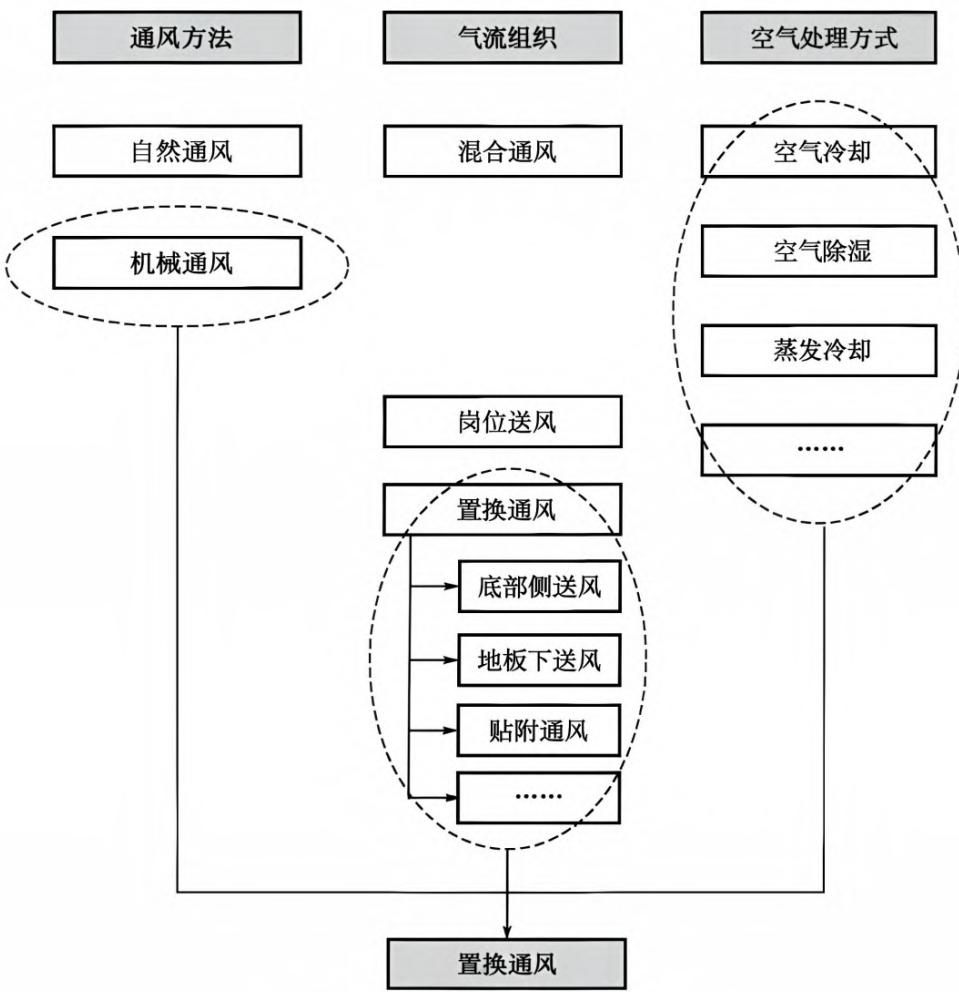  
图12.1-1 “置换通风”的含义

按照应用场合，置换通风分为工业建筑置换通风与民用建筑置换通风，其特征如表 12.1-1 所示。本节以民用建筑置换通风进行介绍，也可为工业建筑置换通风提供参考。

本节内容结构如图12.1-2所示，章节逻辑关系如图12.1-3所示。

置换通风按应用场合的差异特征  
表 12.1-1

<table><tr><td>应用场合</td><td>工业建筑</td><td>民用建筑</td></tr><tr><td>服务对象</td><td>为人服务;减小污染程度,营造舒适环境;为工艺过程/物服务:营造局部操作区域操作工艺环境</td><td>降低二氧化碳质量浓度,提高空气品质,营造人体舒适环境</td></tr><tr><td>建筑室内环境</td><td>对人:厂房中各类生产工艺和操作人员的工作环境需求不同;对工艺过程/物:通常能满足工艺过程中的速度、温度、质量浓度要求,但工艺过程的要求与人工作区不一定一致,且厂房中不同工艺污染物种类众多、特征各异,各参数要求不一定统一,室内环境较为复杂</td><td>民用建筑中人和设备产生的温度场和质量浓度场统一,建筑环境统一</td></tr><tr><td>污染源头</td><td>人排放的热量和二氧化碳;生产过程中排放的热(温度较高的气体)和污染物(密度小的气体)</td><td>人排放的热量和二氧化碳</td></tr></table>

注：工业建筑指的是有人员操作的工厂。

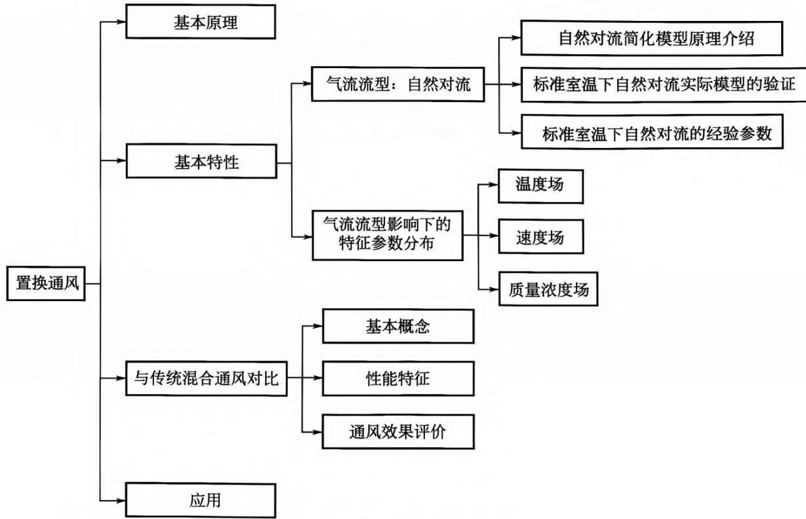  
图12.1-2 章节内容结构

### 12.1.1 基本概念

置换通风是以浮力作用为动力源，借助室内空气的密度差形成自下而上的自然对流的通风空调方式（图 12.1-4），其特点是空气以低风速、小温差的状态送入室内活动区下部，在送风及室内热源形成的上升气流的共同作用下，将室内热浊空气提升至顶部排出。

置换通风常用的术语及定义见表 12.1-2。

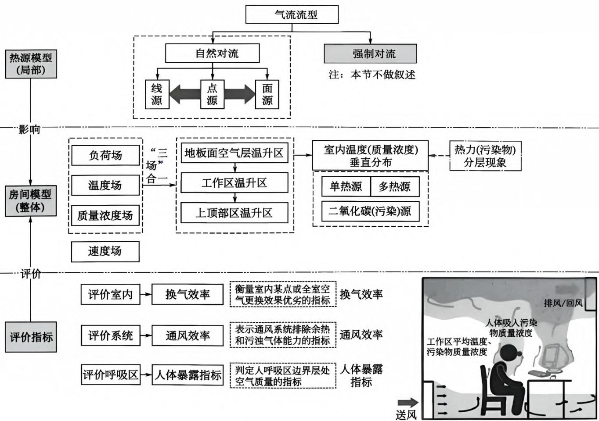  
图12.1-3 章节逻辑关系图

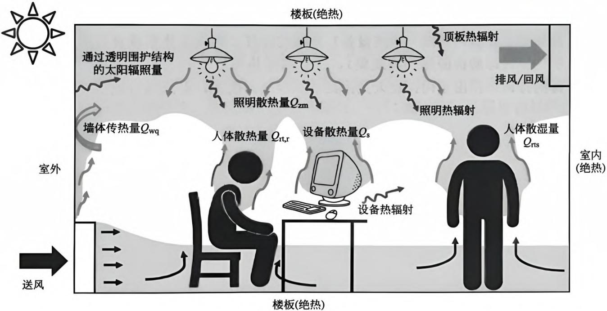  
图12.1-4 置换通风

置换通风常用术语及定义  
表12.1-2

<table><tr><td>分类</td><td>术语名称</td><td>定义</td></tr><tr><td rowspan="10">基本概念</td><td>置换通风</td><td>从房间下部引入温度低于室温的空气来置换室内空气的通风</td></tr><tr><td>换气率</td><td>送至房间的新鲜空气量与房间体积之比,以每小时交换次数计</td></tr><tr><td>换气效率</td><td>房间内实际空气龄和理想空气龄的比值,是衡量室内某点或全室空气更换效果的指标</td></tr><tr><td>通风效率</td><td>室内排风浓度(温度)与送风浓度(温度)的比值,用于判定通风系统排除余热和污浊气体能力的指标</td></tr><tr><td>人体暴露指标</td><td>判定人呼吸区边界层处空气质量的指标</td></tr><tr><td>气流分层</td><td>由于密度差异,在空间内的气流形成不同的层次</td></tr><tr><td>羽流</td><td>从热物体周围升起或从冷物体周围下降的气流,也称热烟羽</td></tr><tr><td>活动区</td><td>建筑空间的一部分,在这个区域范围内空气质量必须满足设计标准的规定,温湿度及气流速度等应符合热舒适要求。对于建筑空间的其余部分(非活动区),空气质量和热环境要求允许低于设计标准</td></tr><tr><td>阿基米德数</td><td>浮力与惯性力之比。用于描述通风房间的垂直温度梯度、分层气流的速度水平、分层水平和通风效率等;其数值大意味着浮力占优势,否则意味着惯性力(速度)占优势[表达式见式(12.1-1)]</td></tr><tr><td>阿基米德比</td><td>置换通风类型的判别依据,以临界阿基米德比作为分界</td></tr></table>

### 12.1.2 置换通风基本原理

如图 12.1-5 所示，置换通风将低于室内空气温度的冷空气送入室内，因送入的冷空气密度大于周围空气的密度，故冷空气自然沉降到地板之上，形成空气湖，扩散至整个室内的地面。在室内热源（人或设备）周围的空气，因为受热形成自下向上的自然射流对流的气流（即所谓的热烟羽现象），并且携带热浊空气一同升至室内顶部，再由设置在顶部的排风口排出室内。在人员停留的工作区高度内，上升的气流为单向流，犹如活塞一样，下部的冷空气将热污染源（散发热量和污浊气体的源头，如人体）周围的热浊空气置换至室内顶部。由于冷热空气流密度差形成的浮力作用，在室内某高度上形成明显的上、下两个区域，此现象即为热力分层现象。室内热力分层后形成的上部区域为紊流混合区，该区域空气温度高并且污浊气体质量浓度大；下部区域为单向自然流动清洁区，该区域空气温度低并且污浊气体质量浓度小（近似于送风质量浓度）。

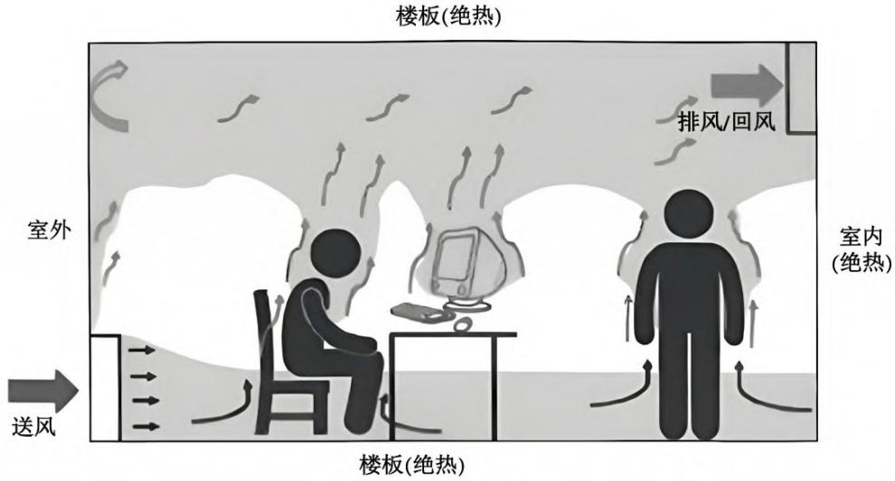  
图12.1-5 置换通风房间的气流示意图

### 12.1.3 置换通风基本特性

本节围绕民用建筑置换通风的基本特性阐述。自然对流流动是置换通风系统中气流运动的动力，在民用建筑中主要考虑到人体作为热源形成的自然对流流动，将人体视为点热源，形成自然对流模型。通过对自然对流模型的提出、验证及实测，给出自然对流量的经验取值。

置换通风与传统混合通风根本上的差异在于阿基米德数（Ar）。通风房间中的垂直温度梯度、分层气流里的速度水平、分层水平和通风效率等都可以通过阿基米德数来描述。阿基米德数是浮力与惯性力之比，其原始形式定义如下：

$$
A r = \frac {\Delta \rho \cdot g \cdot L}{\rho \cdot v ^ {2}} = \frac {\Delta \theta \cdot g \cdot L}{T \cdot v ^ {2}}\tag{12. 1- 1}
$$

式中 $\Delta\rho$ ——冷空气（送风）与热空气（回/排风）之间的密度差， $kg/m^{3}$ ;

$\Delta\theta$ ——冷空气（送风）与热空气（回/排风）之间的温度差，K；

g——重力加速度， $m/s^{2}$ ;

L——特性长度，m；

T——送风绝对温度，K；

$\rho$ ——空气密度，kg/m $^{3}$ ；

v——建筑高度方向上的空气流速（空气流量 q/建筑面积 A），m/s。

在给定的建筑几何结构中，阿基米德数可以表示为 $Ar \sim \frac{\Delta\theta}{v^2}$ 或 $Ar \sim \frac{\Delta\theta}{q^2}$ ，称为阿基米德比 $Ar_{\text{ratio}}$ 。临界阿基米德比是由对阿基米德数影响较大的两个变量——送回风温差 $\Delta\theta$ 和空气流量 $q$ 之比得到的。根据临界阿基米德比，可以通过送回风温差和送风量判定置换通风的适应性和类型，如图 12.1-6 所示。

特征参数指的是能体现出室内环境特征的参数，即温度、速度和质量浓度，其中质量浓度在民用建筑中体现于二氧化碳质量浓度。在自然对流模型的基础上，形成特征参数耦合的室内流场，通过对室内流场进行解耦，分别给出温度场、速度场和二氧化碳质量浓度场的分布特征。

**12.1.3.1 气流流型：自然对流**

热源通常可分为点热源和线热源。面热源属于点热源的扩展，可以将点热源视作假想热源原点进行近似计算。在民用建筑中，房间内的人员、设备均可视为点热源，点热源模型是在民用建筑中应用最广泛的模型（图12.1-7），点热源和线热源上方羽流特性如表12.1-3所示。

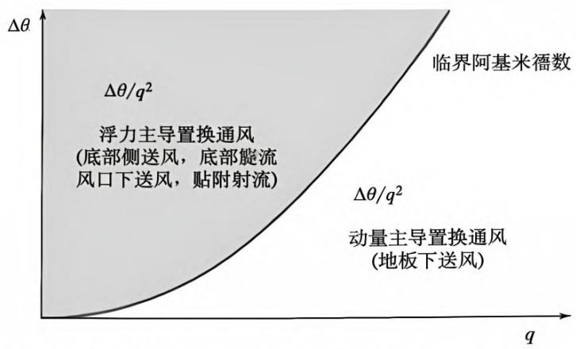  
图12.1-6 根据临界阿基米德比曲线确定浮力、动量主导的置换通风类型

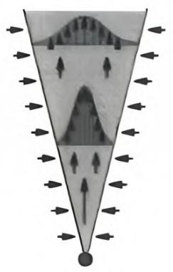

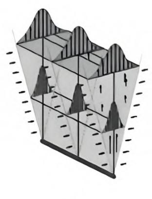

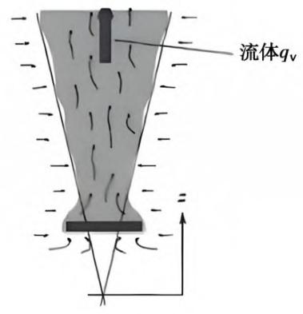  
图12.1-7 自然对流假想源模型  
(a) 点热源；(b) 线热源；(c) 面热源

点热源和线热源上方羽流特性  
表12.1-3

<table><tr><td>热源类型</td><td>轴心速度 $v_z$ (m/s)</td><td>轴心过余温度 $\Delta\theta$ (K)</td><td>流量 $q_{v.a}$ [点热源单位:L/s,线热源单位:L/(s·m)]</td></tr><tr><td>点热源</td><td> $v_z = 0.128 \cdot Q^{\frac{1}{3}} \cdot z^{-\frac{1}{3}}$ (12.1-2)</td><td> $\Delta\theta = 0.329 \cdot Q^{\frac{2}{3}} \cdot z^{-\frac{5}{3}}$ (12.1-4)</td><td> $q_{v.a} = 5 \cdot Q^{\frac{1}{3}} \cdot z^{\frac{5}{3}}$ (12.1-6)</td></tr><tr><td>线热源</td><td> $v_z = 0.067 \cdot Q^{\frac{1}{3}}$ (12.1-3)</td><td> $\Delta\theta = 0.094 \cdot Q^{\frac{2}{3}} \cdot z^{-1}$ (12.1-5)</td><td> $q_{v.a} = 13 \cdot Q^{\frac{1}{3}} \cdot z$ (12.1-7)</td></tr><tr><td colspan="4">式中,Q表示热源的散热量,W或W/m;z表示热源水平线以上的高度,m</td></tr></table>

注；面热源可等效为点热源计算。

热源周围自然对流射流形成阶段见表 12.1-4。

热源周围自然对流射流形成阶段  
表 12.1-4

<table><tr><td>阶段</td><td>假想源羽流图示</td><td>原理</td></tr><tr><td>射流初期形成阶段</td><td rowspan="3">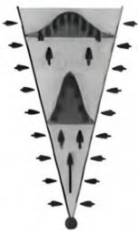</td><td>在热源周围自然对流射流形成的初期阶段,热烟羽流量主要是由置换通风的送风量来补充自然对流射流形成的吸卷周围空气的流量,此时 $l_{\mathrm{r}} < l_{\mathrm{s}}, l_{\mathrm{r}}$ 与高度成正比</td></tr><tr><td>射流中期阶段</td><td>随着热烟羽的不断上升,必有某高度h处,自然对流射流的吸卷周围空气的量与置换通风系统通风量相等,即 $l_{\mathrm{r}} = l_{\mathrm{s}}$ </td></tr><tr><td>射流末期阶段</td><td>当热烟羽继续上升时,送风量已不能满足自然对流射流吸卷的空气量,将有一部分空气回返予以补充,即 $l_{\mathrm{r}} > l_{\mathrm{s}}$ </td></tr></table>

注：1. 上述参数是在假设热源尺寸很小且没有说明实际源尺度的情况下导出的。  
2. 假定置换通风系统通风量为 $l_{s}$ ，热源产生的自然对流射流量即热烟羽流量为 $l_{r}$ 。

**12.1.3.2 标准室温下自然对流实际模型的验证**

在自然对流热射流模型的简化过程中，将体温高于室内温度的人员视为一个点热源，该假设下的模型遵循自然热射流的原理，表 12.1-5 通过模型验证了标准室温下自然对流的实际模型。

室内人员和室内流场的模型验证  
表 12.1-5

<table><tr><td>工况</td><td colspan="2">简图</td><td>说明</td></tr><tr><td>置换通风状态下人体周围空气的自然对流</td><td></td><td>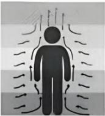</td><td>当室内某物(如人或发热设备)的温度高于其周围室内温度,形成热源时,室内空气将沿着热源周围进行自然对流换热,换热后的热源周围空气如烟羽状自然上升,从而使热源周围空气形成自下而上的自然对流射流,并夹带热源周围空气一起升至室内顶部</td></tr><tr><td>置换通风状态下室内空气的自然对流</td><td colspan="2">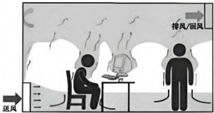</td><td>待人体周围空气的自然对流达到稳态之后,这时就形成了室内下部区域温度低和上顶部区域温度高的现象</td></tr></table>

**12.1.3.3 标准室温下自然对流的经验参数**

置换通风优先到达人体活动范围，并通过浮升力和惯性力将污浊空气向上排出，极大程度上减小了送风量，通过对点、线、水平面和垂直平面形式的热源以及各类热源间的相互影响形成的室内空气流动状况进行深入研究，表 12.1-6 展示了标准室温下各类热源自然对流量的经验值。

**12.1.3.4 气流流型影响下特征参数分布**

本小节内容仅限于民用建筑的应用情况。在自然对流影响下，置换通风系统内的特征

标准室温下各类热源自然对流量的经验值  
表12.1-6

<table><tr><td>热源类型</td><td>经验取值</td><td>备注</td></tr><tr><td>人体</td><td>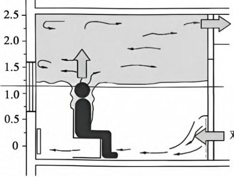寸流量20L/s</td><td>标准室温下人体周围的自然对流量为20L/s</td></tr><tr><td>室内物体</td><td>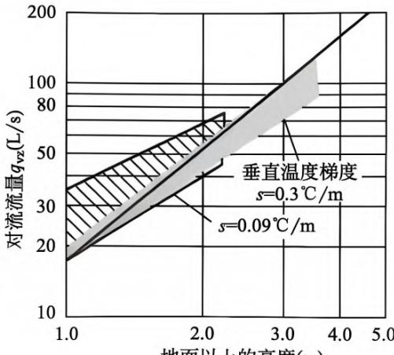地面以上的高度(m)</td><td>不同垂直温度梯度、不同高度下室内物体上方的对流量</td></tr><tr><td>散热设备</td><td>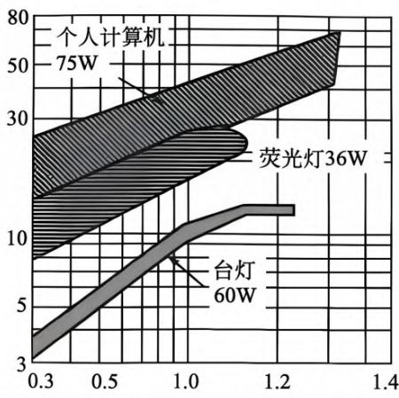物体高度h(m)</td><td>标准室温下75W的笔记本电脑、36W的荧光灯、60W的台灯(白炽灯)的自然对流流量</td></tr><tr><td>外墙</td><td>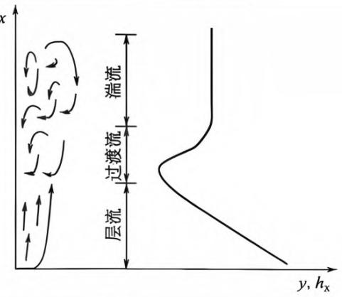</td><td>外墙内表面自然对流传热理论计算公式</td></tr></table>

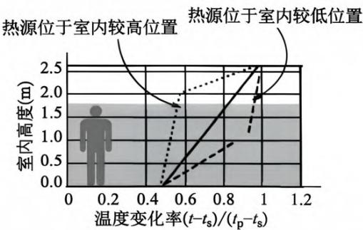

续表

<table><tr><td>热源类型</td><td>经验取值</td><td>备注</td></tr><tr><td>外墙</td><td> $\Phi = hA\Delta t$  (12.1-8) $Nu = C(Gr \cdot Pr)^n$  (12.1-9)式中  $\Phi$  ——外墙内表面自然对流传热量,W; $h$  ——外墙内表面自然对流传热系数, $W/(m^2 \cdot K)$ ; $A$  ——外墙计算面积, $m^2$ ; $\Delta t$  ——墙体内表面与室内空气温差,K; $Nu, Gr, Pr$  ——特征准则数,特征长度为平壁高度H; $C$  ——常数,层流取0.59,过渡流取0.0292,湍流取0.1; $n$  ——常数,层流取1/4,过渡流取0.39,湍流取1/3</td><td>外墙内表面自然对流传热理论计算公式</td></tr></table>

注：表中人员的对流量是按坐姿求解得到的。

参数（温度、速度、质量浓度）共同影响室内环境。当把人体视作热污染源（点源）时，在热羽流上升的过程中，热空气伴随污染物向上流动，形成了宏观上分布规律相似的温度场和质量浓度场；当把人体视为研究对象时，在人体周围形成了较低温度和较低质量浓度的热边界层，形成了微观上分布规律相似的温度场和质量浓度场。在热空气向上流动的过程中，卷吸周围冷空气，速度增加，形成了宏观和微观角度的速度场。三类特征参数耦合影响室内环境，下文将三类参数进行分解，分别叙述其分布规律特征。

**1. 温度场**

置换通风室内空气温度分布特征为：除靠近热源处外，在水平方向同一高度平面上空气温度无差别。不同工况下置换通风室内垂直温度分布见表12.1-7，在垂直方向，室内温度基本上分为三个温升段：地板表面空气层温升段、工作区温升段和上顶部区温升段，其温升段的形成对应三个负荷区，其特征见表12.1-8。

不同工况下置换通风室内垂直温度分布  
表12.1-7

<table><tr><td>类别</td><td>工况</td><td>温度分布曲线</td></tr><tr><td rowspan="2">温度分布</td><td>室内仅人员时空气温度曲线</td><td></td></tr><tr><td>室内热源设置高度不同时的空气温度曲线</td><td>热源位于室内较高位置 热源位于室内较低位置</td></tr></table>

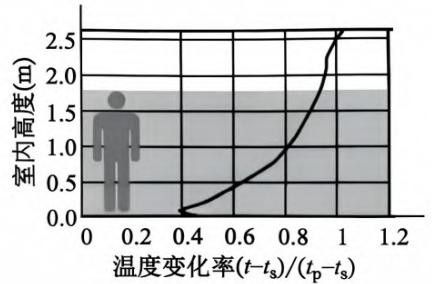

<table><tr><td>类别</td><td>工况</td><td>温度分布曲线</td></tr><tr><td>温度分布</td><td>不同类型热源时的空气温度曲线</td><td>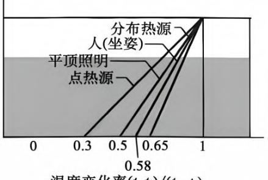温度变化率 $(l-l_s)/(l_p-l_s)$ </td></tr></table>

置换通风三个温升段及对应负荷区的特征  
表12.1-8

<table><tr><td>内容</td><td>温升原因</td><td>负荷区</td><td>表达式</td><td>计算公式</td></tr><tr><td>第一段:地板表面空气层温升</td><td>地板表面接收室内热源辐射热后,变成冷负荷</td><td>地板面区(0~0.1m高度处)</td><td> $\Delta t_{0\sim 0.1} = t_{0.1} - t_0$ (12.1-10)</td><td> $\Delta t_{0\sim 0.1} = t_{0.1} - t_0$ =  $\frac{t_p - t_s}{\rho \frac{c_p \cdot l \cdot 10^{-3}}{F} \left( \frac{1}{\alpha_r} + \frac{1}{\alpha_c} \right) + 1}$ (12.1-13) $K = \frac{t_{0.1} - t_0}{t_p - t_s}$ (12.1-14)</td></tr><tr><td>第二段:工作区温升</td><td>工作区内热源本身冷负荷和围护结构冷负荷</td><td>工作区(温升区)(0~1.1m或1.8m高度处,其中坐姿取1.1m,站姿取1.8m,一般取1.1m)</td><td> $\Delta t_{0\sim 1.1} = t_{1.1} - t_{0.1}$ (12.1-11)</td><td>按标准规定取值: $\Delta t_{0.1\sim 1.1} = t_{1.1} - t_{0.1}$ (12.1-15) $C = \frac{t_{1.1} - t_{0.1}}{t_p - t_s}$ (12.1-16)</td></tr><tr><td>第三段:上顶部区温升</td><td>上顶部区热源(如灯等)和围护结构共同产生的冷负荷</td><td>上顶部区(1.1m~H高度顶棚处)</td><td> $\Delta t_{1.1-H} = t_p - t_{1.1}$ (12.1-12)</td><td>按计算取值: $\Delta t_{1.1-H} = t_p - t_{1.1}$ (12.1-17)</td></tr><tr><td>符号意义</td><td colspan="4"> $t、t_{0.1}、t_{1.1}、t_H$ ——分别为地板处温度、距地0.1m处温度、距地1.1m处温度和室内高度H处顶棚温度,°C; $t_s、t_p$ ——分别为送风温度和排风温度,°C,其中 $t_s \approx t_0$ ;ρ——空气密度, $kg/m^3$ ,取1.2kg/ $m^3$ ; $c_p$ ——空气的比热容,J/(kg·K),取1000J/(kg·K);F——地表面面积, $m^2$ ;L——送风量,L/s; $\alpha_r$ ——辐射转移系数,W/(cm2·K),取值约为5W/(m2·K); $\alpha_c$ ——对流换热系数,W/(cm2·K),取值约为4W/(m2·K);K——地板面区域温升系数,取0.3~0.65或0.2~0.5;C——工作区域温升系数,取0.16~0.4</td></tr></table>

在实际工程中，随着在室内区域不断送入空气以及顶棚处的热空气不断被排出，使室内热烟羽状态稳定下来，形成以 $h$ 高度处为分界的上、下两个区域，该现象称为热力分层，见表12.1-9。

置换通风热力分层现象  
表 12.1-9

<table><tr><td>类别名称</td><td>置换通风热力分层图示</td><td>确定方法</td></tr><tr><td>热力分层现象</td><td rowspan="2">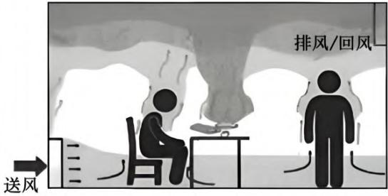</td><td>高度h以下为单向流动的清洁区,h以上为混合紊流的污浊区。在热力分层高度h处,应该还有一个厚度为δ的过渡层,该层是由于对流紊流和热力扩散的平衡作用而形成的,过渡层极不稳定,易受各种外界因素的扰动。对于典型办公室,δ一般为0.25~0.45m</td></tr><tr><td>热力分层的经验参数</td><td>各热源形成的热烟羽既沿高度方向运动,也沿水平方向运动,且相互之间互相影响,但热力分层高度仅与送风量有直接关系:确保室内人员吸入高品质空气的送风量:大于20L/(人·s);最小且最经济的送风量:10L/(人·s)</td></tr></table>

对于不同的功能用房，其地板表面区域的冷负荷占室内总冷负荷的比例和工作区温升系数 C 的数值均有区别，见表 12.1-10。

不同功能用房地板表面区域冷负荷比例及工作区温升系数  
表 12.1-10

<table><tr><td>功能用房</td><td>地板表面区域冷负荷比例(%)</td><td>工作区域温升系数C</td></tr><tr><td>博物馆、演播室等(顶板有照明)</td><td>0~20</td><td>0.16</td></tr><tr><td>办公室</td><td>20~60</td><td>0.25</td></tr><tr><td>置换诱导的房间</td><td>60~100</td><td>0.33</td></tr><tr><td>高负荷办公区、会议室</td><td>60~100</td><td>0.4</td></tr></table>

**2. 速度场**

基于前文所述置换通风的自然对流原理，置换通风在室内沿高度方向的风速分布见图 12.1-8。

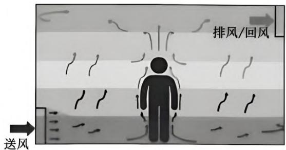  
(a)

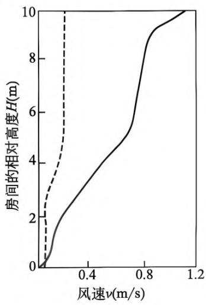  
(b)  
——混合(稀释)气流 ----置换气流
由顶棚至地面 由地面至顶棚  
图 12.1-8 置换通风在室内沿高度方向的风速分布  
(a) 置换气流；(b) 风速分布

相比于混合通风，置换通风在自然对流流动的影响线，呈现近地面处风速较小，远离地面处风速较高的现象。

**3. 浓度场**

随室内污染源的温度和散发出污浊空气的密度不同，置换通风室内污浊空气的浓度分布也不同。在前文中已叙述，本节的研究对象是民用建筑，即污染源主要是室内人员的场所，此时“污染源”主要指的是人体，“污染物浓度”主要指的是人体呼吸产生的 $CO_{2}$ 浓度。对于以工艺污染源为主的工业建筑散发出的污浊空气如氨（氨气密度大于空气密度）等均不是本节研究的对象。

**(1) 人体呼吸区二氧化碳浓度的分布规律**

人在室内吸入的 $\mathrm{CO}_{2}$ 浓度并非同高度人体周围的 $\mathrm{CO}_{2}$ 浓度, 而是比此要低, 这一点在实验室实测中也得以验证。这是因为围绕人体周围的自然对流气流在通过人体时形成一个边界层, 干净而温度低的空气自下而上贴近人体向呼吸区移动, 人体呼出的 $\mathrm{CO}_{2}$ 经过头顶升至室内顶棚。在表 12.1-11 中可看到呼吸区 $\mathrm{CO}_{2}$ 浓度分布与通风量的关系。

呼吸区 $\mathrm{CO}_{2}$ 浓度分布与通风量关系  
表 12.1-11

<table><tr><td>呼吸区CO2浓度比与通风量的关系图</td><td></td></tr><tr><td rowspan="2">人体周围自然对流通风量取值及特征</td><td>≥20L/(人·s)[72m3/(人·h)],呼吸区CO2浓度远远小于周围空气中CO2浓度</td></tr><tr><td>=10L/(人·s)[36m3/(人·h)]时,呼吸区空气中CO2浓度仅为周围空气中CO2浓度的20%,此风量为最经济通风量</td></tr><tr><td>Nielsen和Mundt的验证结论</td><td>当热污染源周围的自然对流流量大于外界通风量时,呼吸区处于置换通风分层的上部区域,即空气中CO2浓度接近于排风中CO2浓度,此时可由上图计算出人体实际呼吸到的污浊空气浓度。当呼吸区在分层的下部区域时,低区内周围环境的污浊空气浓度是上部排风的10%~30%</td></tr></table>

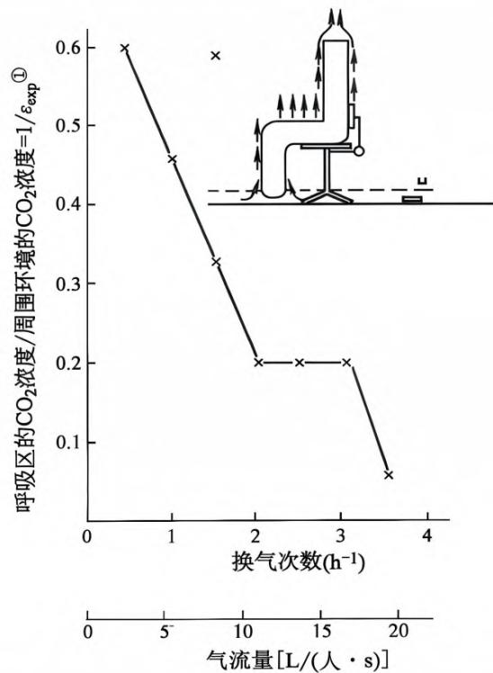  
①指的是人体暴露指标，见表12.1-15。

**(2) 房间内 $\mathrm{CO}_{2}$ 浓度场的分布**

当室内污染源为人体时，污染源与热源将合为一体，称为热污染源。当室内存在其他热源的影响时，房间内 $\mathrm{CO}_{2}$ 浓度的分布见表12.1-12。

其他热源影响下房间内 $\mathrm{CO}_{2}$ 浓度分布和扩散情况  
表 12.1-12

<table><tr><td>工况</td><td>图示</td><td>人体呼吸产生 $CO_{2}$ 扩散情况</td></tr><tr><td>单一热源:仅人体作为热污染源</td><td>-ZH4X- 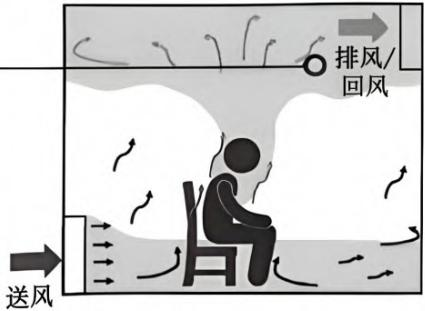</td><td>在理想状况下,热污染源散发出的污浊空气将随着周围空气的对流气流进入上部污染区域,室内将形成明显的上、下两个浓度相差较大的区域</td></tr><tr><td>多热源:人体为非最高发热源</td><td>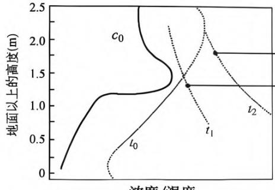- 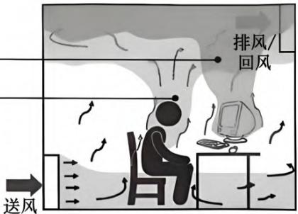浓度/温度 $t_{0}$ —室内温度; $c_{0}$ —室内 $CO_{2}$ 浓度; $t_{1}$ —人体热源温度; $t_{2}$ —高温热源温度</td><td>当污染源均布在室内地板面上且温度较低(如地面水池)时,室内的污浊空气浓度分布将与温度分布一样。当上升的热烟较弱时,污浊空气将在室内较低处扩散开,慢慢地间接由其定热源产生的较强烈上升烟羽带到顶部区域</td></tr></table>

在室内污浊空气的浓度分布中，围护结构的负荷对其影响较大。当围护结构温度低时（如冬季），沉积在上部区域的污浊空气因为温度的降低而密度增大，这将使污浊空气向下沉降，不利于污浊空气的排放。当围护结构温度高时（如屋面太阳光辐射影响），污浊空气则因空气温度提高而密度减小，这将使污浊空气向上升高，使顶棚处浓度增加，有利于污浊空气排放。

### 12.1.4 置换通风与传统混合通风对比

### 12.1.4.1 基本概念

在民用建筑中，将置换通风与传统混合通风进行对比，如表 12.1-13 所示。室内通风的一些现象，如垂直温度梯度、层流状态下的水平流动、分层高度和通风效率都能用阿基米德数予以描述和解释。基于欧盟的分类方式，以力的作用方式对二者进行分类对比，作为其性能特征的基础理论。

<table><tr><td colspan="5">置换通风与传统混合通风的比较 表12.1-13</td></tr><tr><td rowspan="2">比较内容</td><td colspan="3">置换通风</td><td rowspan="2">混合通风(MV)</td></tr><tr><td>地板下送风(UFAD)</td><td>置换通风(DV,按欧洲分类)</td><td>贴附通风(AV)</td></tr><tr><td>简图</td><td>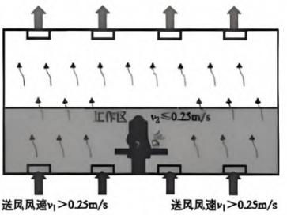</td><td>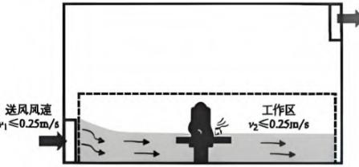(a)底部侧送风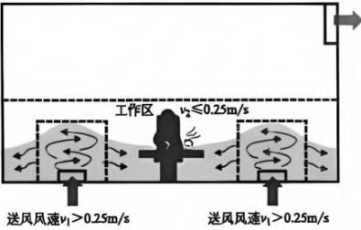(b)下送风(旋流风口)</td><td>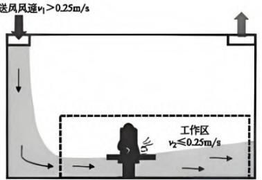</td><td>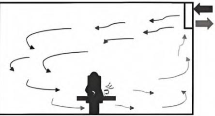</td></tr><tr><td>概念</td><td colspan="3">置换通风是借助送人活动区下部且较室内空气温度低的空气运动,产生室内空气置换从而形成的室内通风方式</td><td>混合通风是利用上部送风形成的射流,带动室内空气的循环井且使二者充分混合,在室内形成各区域内的空气温度、湿度以及污染物质量浓度均匀一致的通风方式</td></tr><tr><td>目标</td><td colspan="3">消除部分室内负荷,室内工作区健康和舒适</td><td>消除全室负荷,室内全室舒适</td></tr><tr><td>机理</td><td>依靠惯性力和少量浮力共同作用,产生室内空气上升气流</td><td>热浮力作用主导,由室内空气的密度差产生上升气流</td><td>惯性力和热浮力共同主导,机械力与热浮力同向流动</td><td>依靠惯性力作用,使室内气流强烈掺混</td></tr><tr><td>气流形式</td><td>活塞式单向流</td><td>自然对流射流</td><td>气流动量扩散,热羽流卷吸</td><td>混合紊流</td></tr></table>

续表

<table><tr><td rowspan="2">比较
内容</td><td colspan="3">置换通风</td><td rowspan="2">混合通风(MV)</td></tr><tr><td>地板下送风(UFAD)</td><td>置换通风(DV,按欧洲分类)</td><td>贴附通风(AV)</td></tr><tr><td>温度、湿度和浓度分布简图</td><td>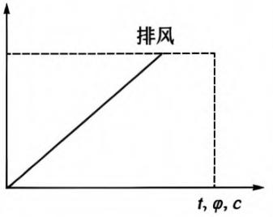送风</td><td>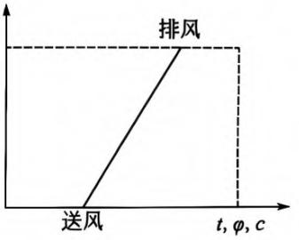</td><td>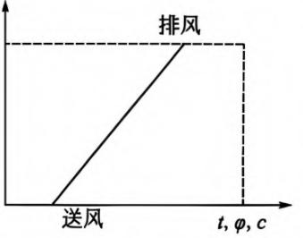</td><td>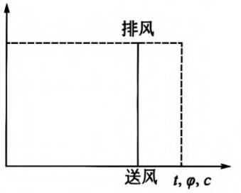</td></tr><tr><td>阿基米德数Ar</td><td>中&lt;360</td><td>大≥360</td><td>大≥360</td><td>小0</td></tr><tr><td>换气效率ξ</td><td>1</td><td>0.5~1.0</td><td>0.5~1.0</td><td>≤0.5</td></tr><tr><td>通风效率ε</td><td>&gt;1</td><td>&gt;1</td><td>&gt;1</td><td>≤1</td></tr><tr><td>空调冷负荷侧重点</td><td>工作区内有效的冷负荷略小于Q</td><td>工作区内有效的冷负荷略小于Q</td><td>工作区内有效的冷负荷略小于Q</td><td>全室冷负荷Q</td></tr><tr><td>送风方式</td><td>地板下送</td><td>室内高度小于0.8m下送</td><td>条缝风口上送</td><td>顶棚顶送</td></tr><tr><td>送风量</td><td>大</td><td>小</td><td>小</td><td>中</td></tr><tr><td>送风速度(m/s)</td><td>≤0.2</td><td>≤0.2(民用建筑)或≤0.5(工业建筑)</td><td>1.0~2.0</td><td>≤5.0</td></tr><tr><td>送风温度(°C)</td><td>≥18</td><td>≥19~21</td><td>≥15</td><td>≥15</td></tr></table>

续表

<table><tr><td rowspan="2">比较内容</td><td colspan="3">置换通风</td><td rowspan="2">混合通风(MV)</td></tr><tr><td>地板下送风(UFAD)</td><td>置换通风(DV,按欧洲分类)</td><td>贴附通风(AV)</td></tr><tr><td>使用场所</td><td>有架空地板或有条件进行下送风的场所;以排除余热为主或排除局部高负荷余热为主的场所;对室内空气品质有效高要求的场所;室内高度较高的场所;房间较小,但需要的送风量很大的场所</td><td>污染源温度高且污浊空气密度小的场所;室内温、湿度要求低且对空气品质要求高的场所;室内高度大于2.4m的场所;室内气流较通畅且没有强烈扰动的场所;以排除余热为主,冷负荷小于 $120W/m^{2}$ 且送风温度低于环境温度的场所</td><td>地铁站、机场、会展中心及大型商超市等存在大面积既有柱体的场所;送风风速和温差较大的场所;人员活动空间与柱体有一定距离且速度限制较宽的场所</td><td>室内高度较低且不大于3.5m的场所;对室内空气品质要求不高或室内不以排除污浊空气为主的场所;对室内全室温度、湿度要求较高的场所</td></tr></table>

**12.1.4.2 性能特征**

置换通风与传统混合通风的性能对比如表 12.1-14 所示。

置换通风与传统混合通风的性能对比  
表 12.1-14

<table><tr><td>性能参数</td><td>置换通风</td><td>传统混合通风</td><td>分析</td></tr><tr><td>新风量及处理新风所需能耗</td><td>新风量较小,能耗较低</td><td>新风量较大,能耗较高</td><td>由置换通风的原理可知,在满足同样室内空气品质的条件下,置换通风的新风量较混合通风要少,从而用于处理新风的能耗也较低</td></tr><tr><td>实际用于室内通风降温的风量及冷量</td><td>风量较小,冷量较小</td><td>风量较大,冷量较大</td><td>置换通风排风(回风)温度高且工作区有效负荷小于全室负荷</td></tr><tr><td>变风量运行的适用性和经济性</td><td>较好</td><td>较差</td><td>无论从室内负荷对送风的要求还是送风装置的风速要求,置换通风均较易实现变风量运行。混合通风由于惯性作用不易实现变风量运行,且实施变风量运行的初投资成本比置换通风要高得多</td></tr><tr><td>制冷机组COP</td><td>较高</td><td>较低</td><td>置换通风的送风温度比混合通风要高4~6°C,故使用室外冷空气自然冷却的时间长。随着送风温度的提高,制冷机组供冷温度可适当提高,从而可提高制冷机组的COP</td></tr><tr><td>风机压力及能耗</td><td>风机压力较小,能耗较低</td><td>风机压力较大,能耗较高</td><td>由于置换通风散流器比混合通风的压降低,故实际需要的送风机压力小,风机能耗相应较低</td></tr></table>

**12.1.4.3 通风效果的评价**

换气效率和通风效率是评价通风系统较为直观的标准，通过换气效率和通风效率对通风效果进行评价，可以直观地表现出系统的优劣。人体暴露指标是评价置换通风下人体呼吸区空气质量的标准。

**1. 评价指标的概念**

置换通风效果评价指标如表 12.1-15 所示。

置换通风效果评价指标  
表 12.1-15

<table><tr><td>名称</td><td>定义</td><td>计算公式</td><td>结论</td></tr><tr><td>换气效率ξ</td><td>换气效率ξ是衡量室内某点或全室空气更换效果优劣的指标</td><td> $\xi = \frac{\tau_0}{\tau_n}$ (12.1-18)</td><td>换气效率ξ越高,室内的空气龄越短,则空气在室内滞留的时间越短,室内空气更新的有效性越好,室内空气新鲜程度越高且室内气流组织越接近“活塞”单向流状态</td></tr><tr><td>通风效率ε</td><td>通风效率ε是表示通风系统排除余热和污浊气体能力的指标</td><td> $\varepsilon = \frac{t_p - t_o}{t_n - t_o} = \frac{C_p - C_o}{C_n - C_o}$ (12.1-19)</td><td>通风效率ε越高,通风系统排除余热和污浊空气的能力越强,用于通风的能量利用的有效性就越高</td></tr><tr><td>人体暴露指标 $\epsilon_{\text{exp}}$ </td><td>人体暴露指标 $\epsilon_{\text{exp}}$ 是判定人体呼吸区边界层处空气质量的指标</td><td> $\epsilon_{\text{exp}} = \frac{C_p - C_o}{C_{\text{exp}} - C_o}$ (12.1-20)</td><td>人体暴露指标 $\epsilon_{\text{exp}}$ 越大,则人体呼吸区吸人的污染物质量浓度越小</td></tr><tr><td>符号意义</td><td colspan="3"> $\tau_n$ ——实际通风状态下,空气在室内工作区内的滞留时间(实际空气龄),s; $\tau_o$ ——理想通风状态下,自下而上单向空气流在室内工作区的滞留时间(理想空气龄),s; $t_p$ 、 $C_p$ ——排风温度,°C、排风中污染物质量浓度, $mg/m^3$ ; $t_o$ 、 $C_o$ ——送风温度,°C、送风中污染物质量浓度, $mg/m^3$ ; $t_n$ 、 $C_n$ ——工作区平均温度,°C、质量浓度, $mg/m^3$ ; $C_{\text{exp}}$ ——人体吸入的污染物质量浓度, $mg/m^3$ </td></tr></table>

**2. 常用通风方式的换气效率和通风效率**

表 12.1-16 给出了常用的四种通风方式的换气效率 $\xi$ 和通风效率 $\varepsilon$ 。

四种通风方式的换气效率 $\xi$ 和通风效率 $\varepsilon$  
表 12.1-16

<table><tr><td colspan="2">通风方式</td><td>换气时间τ</td><td>换气效率ξ</td><td>通风效率ε</td></tr><tr><td colspan="2">单向活塞流</td><td>τ=τ0</td><td>ξ=1.0</td><td>ε&gt;1</td></tr><tr><td colspan="2">置换通风</td><td>τ0&lt;τ&lt;2τ0</td><td>ξ=0.5~1.0</td><td>ε&gt;1</td></tr><tr><td rowspan="2">混合通风</td><td>上送下排</td><td>τ=2τ0</td><td>ξ=0.5</td><td>ε≈1</td></tr><tr><td>上送上排</td><td>τ&gt;2τ0</td><td>ξ&lt;0.5</td><td>ε&lt;1</td></tr></table>

注：单向活塞流通风方式表示以惯性力和少量浮力共同作用产生室内气流单向活塞效应的地板送风方式（这种通风方式，按欧洲的定义，为置换通风的一种方式；按国内的定义，为非置换通风方式。本书按国内的定义确定置换通风形式）。

从表 12.1-16 可知，四种通风方式的通风效果从优到劣的顺序为：单向活塞流和置换通风→上送下排混合通风→上送上排通风。

**12.2 蒸发冷却空调**

### 12.2.1 基本概念

**12.2.1.1 直接蒸发冷却技术基本概念**

直接蒸发冷却，空气和水直接接触，因水蒸发吸收汽化潜热而使空气温度下降。空气与淋水填料表面水膜或雾化水滴表面水膜直接接触，把自身的显热传递给水而实现冷却，因此喷淋水的温度必须低于待处理空气的温度。与此同时，淋水因吸收空气中的热量而不断地蒸发；蒸发后的水蒸气又被气流带走，其结果是空气的温度降低、相对湿度增加（图12.2-1）。所以，这种用空气的显热换得潜热的处理过程，既可称为空气的直接蒸发冷却，又可称为空气的等焓冷却加湿（图12.2-2）。直接蒸发冷却技术的基本概念见表12.2-1。

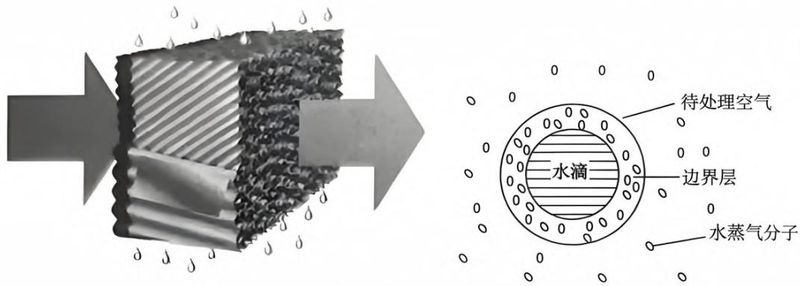  
图12.2-1 直接蒸发冷却热质交换原理图

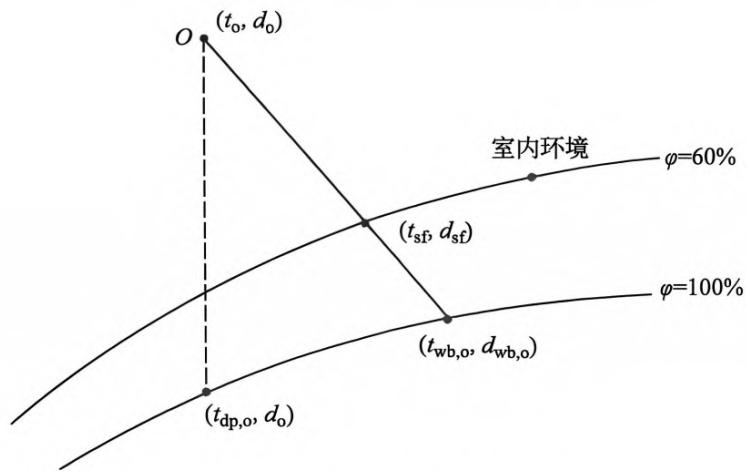  
图12.2-2 直接蒸发冷却焓湿图

直接蒸发冷却技术的基本概念  
表 12.2-1

<table><tr><td>术语名称</td><td>定义</td></tr><tr><td>滴水填料式直接蒸发冷却</td><td>将水淋到填料上,使空气与填料表面形成的水膜直接接触,实现等焓冷却加湿过程</td></tr><tr><td>喷淋式直接蒸发冷却</td><td>通过喷淋雾化装置将水变成水雾,使空气与水滴表面的水膜直接接触,实现等焓冷却加湿过程</td></tr><tr><td>填料</td><td>使水与空气直接接触提供蒸发界面的物质</td></tr><tr><td>干球温度</td><td>由感温包裸露在外的普通温度计测得的空气温度,就是一般所说的“温度”</td></tr><tr><td>湿球温度</td><td>指某一状态的空气在等压绝热条件下与水充分接触,达到稳定热湿平衡时的绝热饱和温度</td></tr><tr><td>含湿量</td><td>湿空气中,所含水蒸气的质量与干空气质量之比</td></tr><tr><td>相对湿度</td><td>空气实际的水蒸气分压力与同温度下饱和状态空气的水蒸气分压力之比,用百分率表示</td></tr><tr><td>全热</td><td>显热与潜热之和</td></tr><tr><td>显热</td><td>在物质的吸热或放热过程中,能使其温度发生变化的热量</td></tr><tr><td>潜热</td><td>在一定温度和压力下,物质发生相变过程中所吸收或放出的热量</td></tr><tr><td>风量</td><td>单位时间通过冷气机的空气体积流量</td></tr><tr><td>绝热加湿/等焓加湿</td><td>湿空气的比焓保持不变的加湿冷却过程</td></tr></table>

**12.2.1.2 间接蒸发冷却技术基本概念**

间接蒸发冷却是二次空气与水直接接触，通过热湿交换降低二次空气干球温度，一次空气通过间接蒸发冷却器被二次空气冷却的过程（图12.2-3）。由此可见，待处理空气通过间接蒸发冷却所实现的不再是等焓冷却加湿过程，而是减焓等湿冷却过程（图12.2-4）。间接蒸发冷却技术的基本概念见表12.2-2。

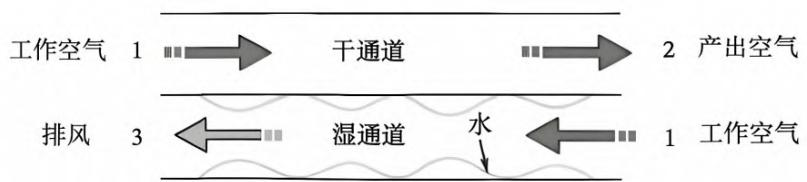  
图12.2-3 间接蒸发冷却原理图

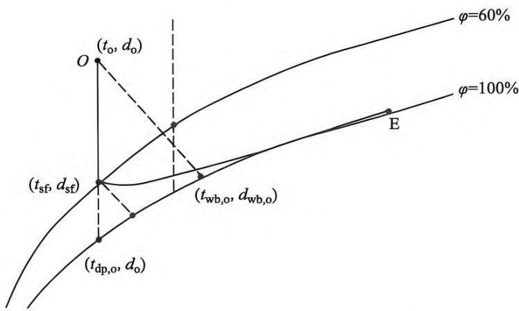  
图12.2-4 间接蒸发冷却焓湿图

间接蒸发冷却技术的基本概念  
表12.2-2

<table><tr><td>分类</td><td>术语名称</td><td>定义</td></tr><tr><td rowspan="9">基本概念</td><td>一次空气</td><td>被冷却后送入房间供冷的空气,也称为产出空气</td></tr><tr><td>二次空气</td><td>与水接触使其蒸发从而降低换热器表面温度以冷却一次空气的辅助空气,称为工作空气</td></tr><tr><td>亚湿球温度</td><td>蒸发冷却设备出风(出水)温度介于室外空气的湿球温度与露点温度之间,把这种状态的温度定义为亚湿球温度</td></tr><tr><td>露点温度</td><td>在含湿量不变的条件下,湿空气达到饱和时的温度,即空气开始结露时的临界温度</td></tr><tr><td>湿球温度</td><td>指某一状态的空气在等压绝热条件下与水充分接触,达到稳定热湿平衡时的绝热饱和温度</td></tr><tr><td>含湿量</td><td>湿空气中,所含水蒸气的质量与干空气质量之比</td></tr><tr><td>相对湿度</td><td>空气实际的水蒸气分压力与同温度下饱和状态空气的水蒸气分压力之比,用百分率表示</td></tr><tr><td>全热</td><td>显热与潜热之和</td></tr><tr><td>显热</td><td>在物质的吸热或放热过程中,能使其温度发生变化的热量</td></tr><tr><td rowspan="3">基本概念</td><td>潜热</td><td>在一定温度和压力下,物质发生相变过程中所吸收或放出的热量</td></tr><tr><td>风量</td><td>单位时间通过间接蒸发冷却器的空气体积流量,单位: $m^{3}/h$ </td></tr><tr><td>绝热加湿/等焓加湿</td><td>湿空气的比焓保持不变的冷却加湿过程</td></tr></table>

**12.2.1.3 蒸发冷却过程的热学分析**

**1. 过程传热传质损失分析**

蒸发冷却过程的基本环节是空气—水直接接触的热湿交换过程，下面以三类典型的空气—水直接接触的热湿交换过程为例，将传热、传质过程分别表示在 T-Q 图和 w-W 图上，其中 T 代表空气或水的温度，Q 代表整个过程的传热量；w 代表空气的含湿量，W 代表过程总的传质量（表 12.2-3）。通过 T-Q 图和 w-W 图初步描述蒸发冷却过程的传热、传质过程耗散的特性。

传热传质过程分析表  
表 12.2-3

<table><tr><td>名称</td><td>焓湿图</td><td>T-Q图</td><td>w-W图</td></tr><tr><td rowspan="2">空气一水沿等焓线的热湿交换过程</td><td>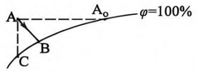</td><td>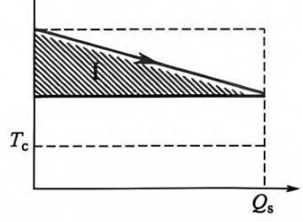</td><td>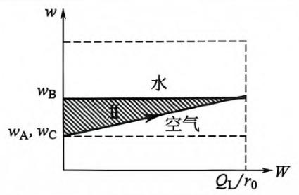</td></tr><tr><td colspan="3">对于空气一水等焓热湿交换过程,其传热过程与传质过程均为“三角形”不匹配传热或传质过程,并且传热、传质方向完全相反,即空气向水传热、水向空气传质。对于该类传热传质过程,增大传热传质过程的面积或者改变传热传质过程的流量比均不能避免传热传质过程的耗散,也无法改变传热传质过程的“三角形”不匹配传递特性。因此,空气一水沿等焓线开展的直接蒸发冷却过程,为不匹配的空气一水热湿交换过程。对于空气一水等焓热湿交换过程,其空气侧显热变化与潜热量相等,即 $Q_S=Q_L$ 。在T-Q图上两股流体所对应的线所包括的面积,为两股流体之间显热换热的燃耗散;在w-W图上两股流体之间包括的面积,为两股流体之间传质的燃耗散</td></tr><tr><td rowspan="2">沿饱和线开展的空气一水直接接触热湿交换过程</td><td>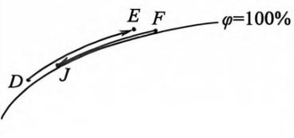</td><td>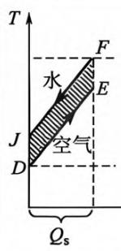→Q</td><td>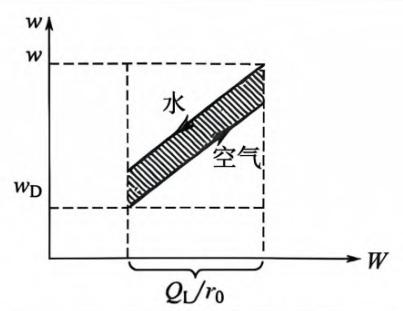</td></tr><tr><td colspan="3">空气与水之间的传热过程与传质过程同向,并且当满足式(12.2-1)~式(12.2-3)所示的流量匹配关系时,传热与传质过程均为匹配的传递过程,过程中驱动力差均匀。并且当空气一水之间的传热传质面积无限大时,最终空气和水的状态可以互置,即空气的出口状态到达F点,水的出口状态到达D点,实现接近可逆的热湿交换过程</td></tr><tr><td rowspan="2">任意点的空气与水直接接触的热湿交换过程</td><td>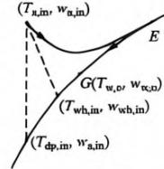</td><td>温度(°C)显热传递绝对值(kW)</td><td>0.04 0.035 0.03 0.025 0.02 0.015 0.01 0.002 0.004 0.006 0.008 0.01 0.012 0.014 0.016 0.018 0.02 传湿量(kg/s)</td></tr><tr><td colspan="3">对于空气处在任意状态与水进行的热湿交换过程,当空气远离饱和线时,空气与水之间的传热过程的方向会发生变化。以空气流动方向为例,前半段空气向水传热,后半段水向空气传热,由此显热传递过程表现出明显的不匹配特性。而传质过程一直为水向空气传质,虽然空气与水之间满足流量匹配关系,但传质过程仍然表现出驱动力不均匀的不匹配特性,这实质是空气—水之间的人口参数不匹配特性所导致</td></tr></table>

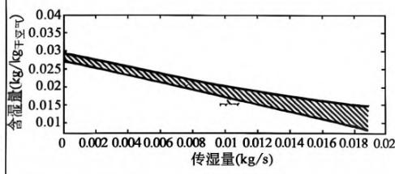

当空气处在饱和线上时，D 点为空气进口状态，E 点为空气出口状态，F 点为水的进口状态，J 点为水的出口状态。空气和水之间进行逆流的直接接触的热湿交换。若 D 点与 F 点在饱和线上的距离较近，则 D、F 之间的饱和线可近似为直线。此时，若空气和水的热容量匹配，即热容量比为 1，此时空气侧的热容量为 $c_{p,ea}$ ，空气—水的热容量比如式（12.2-1）～式（12.2-3）所示：

$$
c _ {\mathrm{p,ea}} = \frac {\mathrm{d} h _ {\mathrm{ea}}}{\mathrm{d} t _ {\mathrm{ea}}} = \frac {h _ {\mathrm{E}} - h _ {\mathrm{D}}}{T _ {\mathrm{E}} - T _ {\mathrm{D}}} = c _ {\mathrm{pa}} + r _ {0} \cdot \frac {\Delta w}{\Delta T}\tag{12.2-1}
$$

$$
m = \frac {G _ {\mathrm{a}} \cdot c _ {\mathrm{p,ea}}}{G _ {\mathrm{w}} \cdot c _ {\mathrm{pw}}}\tag{12.2-2}
$$

$$
m = 1\tag{12.2-3}
$$

**2. 降低损失的原则：流量匹配；入口参数匹配**

由上述对空气一水热湿交换过程的烟分析可见，空气的入口状态不在饱和线上时，无论空气和水之间的流量比多大，空气一水之间的热湿交换面积多大，空气和水之间的热湿交换过程都会存在不可避免的显热烟耗散和湿烟耗散；当空气的入口状态处在饱和线上时，且空气和水之间满足流量匹配（空气和水的热容量比 $m = 1$ ），且当空气和水之间的热湿交换面积无限大时，空气和水之间的热湿交换过程的显热烟耗散和湿烟耗散均为零。因此，将空气的入口状态处在饱和线上与水进行热湿交换称为空气和水的入口参数完全匹配的热湿交换过程，将由于空气的入口状态不处在饱和线上从而与水进行热湿交换而产生的烟耗散称为由于空气和水的入口参数不匹配导致的烟耗散。

热湿交换过程的烟耗散来自三个方面：流量不匹配导致的烟耗散，入口参数不匹配导致的烟耗散，面积有限导致的烟耗散。采用热阻来表示上述烟耗散对热湿交换过程的影响。

$$
R _ {\mathrm{H}} = \frac {\alpha \Delta J _ {\mathrm{d,loss}} + \Delta J _ {\mathrm{s,loss}}}{Q _ {\mathrm{w}} ^ {2}}\tag{12. 2-4}
$$

$$
R _ {\mathrm{H}} = R _ {\mathrm{H,m}} + R _ {\mathrm{H,f}}\tag{12. 2-5}
$$

其中， $\Delta J_{\mathrm{d,loss}}$ 表示整个过程的传质烟耗散， $\Delta J_{\mathrm{s,loss}}$ 表示整个过程的传热烟耗散。 $\alpha$ 为显热烟与湿烟之间的转换系数，是发生热湿转换时水的温度的函数。假设在空气一水热湿交换过程中水温变化不大，所处的饱和线假设为线性时， $\alpha$ 在整个热湿交换过程中为常数。 $Q_{\mathrm{w}}$ 为整个过程水侧热量。 $R_{\mathrm{H}}$ 是过程总的热阻，为不匹配热阻 $R_{\mathrm{H,m}}$ 与热湿交换面积有限热阻 $R_{\mathrm{H,f}}$ 之和。其中 $R_{\mathrm{H,m}}$ 为流量不匹配和入口参数不匹配所导致的燃耗散对应的等效热阻。当满足流量匹配时，图12.2-5给出了焓湿图上空气和水热湿交换的等参数不匹配线。可以看出，空气一水直接接触热湿交换过程的等进口参数不匹配线为一簇近似线性的线，这簇线一端的极限端点为水温进口状态，另一端点为空气入口状态。越接近饱和线，空气一水之间热湿交换过程的参数不匹配热阻越小，并且等参数不匹配线开始变得非线性，非线性趋势与饱和线相似。当空气入口状态在饱和线上时，空气与水进行热湿交换的参数不匹配热阻为零，当空气入口状态与水的入口状态表面的饱和空气处在等焓状态时，空气与水进行热湿交换的参数不匹配热阻无穷大，即饱和线为参数不匹配热阻为零的等参数不匹配热阻线，与水进口表面饱和空气等焓的等焓线为参数不匹配热阻为无穷大的等参数不匹配热阻线。

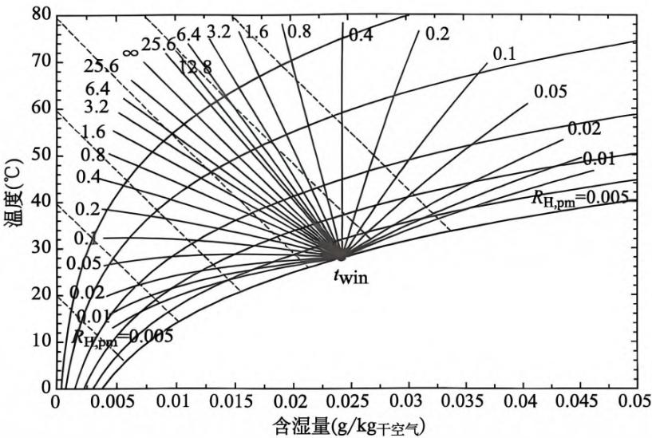  
图12.2-5 等参数不匹配热阻线

空气—水热湿交换过程的设计原则：应该使得空气尽量接近饱和线之后，再与水接触进行热湿交换过程，从而使入口参数不匹配热阻小；空气和水之间满足热容量匹配的原则，此时空气的比热容应为等效比热容。

**12.2.2 系统及构成**

蒸发冷却技术分类及形式如表 12.2-4 所示。

蒸发冷却技术分类及形式  
表 12.2-4

<table><tr><td colspan="2">蒸发冷却技术形式分类</td><td>形式</td><td>原理</td></tr><tr><td rowspan="6">制备冷风</td><td rowspan="2">直接蒸发冷却技术</td><td>冷风型</td><td rowspan="6">采用直接蒸发冷却或间接蒸发冷却方式制备冷风的技术,也可以称为冷风式蒸发冷却技术</td></tr><tr><td>冷雾型</td></tr><tr><td rowspan="4">间接蒸发冷却技术</td><td>板翅式</td></tr><tr><td>管式</td></tr><tr><td>板管式</td></tr><tr><td>露点式</td></tr><tr><td rowspan="6">制备冷水</td><td rowspan="2">直接蒸发冷却技术</td><td>开式</td><td rowspan="6">采用直接蒸发冷却或间接蒸发冷却方式制备冷水的技术,也可以称为冷水式蒸发冷却技术</td></tr><tr><td>闭式</td></tr><tr><td rowspan="4">间接蒸发冷却技术</td><td>板翅式</td></tr><tr><td>管式</td></tr><tr><td>板管式</td></tr><tr><td>露点式</td></tr></table>

**12.2.2.1 直接蒸发冷却制备冷风**

直接蒸发冷却制备冷风的分类如表 12.2-5 所示。

直接蒸发冷却制备冷风分类  
表 12.2-5

<table><tr><td>形式</td><td>分类</td><td>流程图</td></tr><tr><td rowspan="2">冷雾型直接蒸发冷却系统</td><td>主动式</td><td rowspan="2">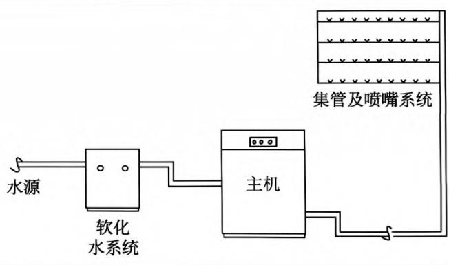</td></tr><tr><td>被动式</td></tr><tr><td>冷风型直接蒸发冷却系统</td><td>—</td><td>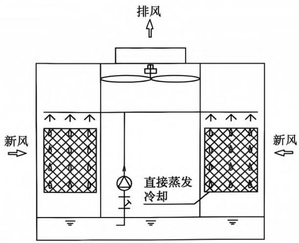</td></tr></table>

**1. 冷雾型直接蒸发冷却系统**

冷雾型直接蒸发冷却系统分为主动式和被动式。主动式的原理是水箱里的水在高压水泵的作用下，输送到均匀布置在该设备空气出口的喷嘴内，通过高压喷嘴产生微小的颗粒（雾）；被动式的原理是水箱中的水经过高压柱塞泵加压至 $4 \mathrm{MPa}$ 以上，再通过高压管路传输到高压喷嘴，水在喷嘴出口处形成液膜，液膜在表面张力及扰动力的作用下破裂形成液带和液丝，在黏性及环境气流的影响下与周围空气流场达到动态平衡，最终形成直径小于 $10 \mu \mathrm{m}$ 的微细水颗粒。

相对于主动式冷雾型直接蒸发冷却设备，被动式设备（系统）的优势：一是可直接将管路布置于待降温加湿区域，例如管路可以沿建筑物顶部均匀布置，在半户外场合也可以沿梁均匀布置，十分灵活；二是主机统一设置于机房或者隐蔽处，管路通常隐藏在顶棚内，相对美观。

**2. 冷风型直接蒸发冷却系统**

理想的直接蒸发冷却：直接蒸发冷却器中，填料被循环水反复喷淋。理想的蒸发冷却是绝热的，过程中空气没有显著的焓升或焓降（表 12.2-6）。

实际的直接蒸发冷却：由于进水带来了显热，所以大多数直接蒸发冷却与理想的绝热饱和过程不同。因此，空气冷却时，其焓值和湿球温度上升而不是不变（表 12.2-6）。

直接蒸发冷却焓湿图  
表 12.2-6

<table><tr><td>类型</td><td>焓湿图</td></tr><tr><td>理想的直接蒸发冷却</td><td></td></tr><tr><td>实际的直接蒸发冷却(情况1)</td><td></td></tr><tr><td>实际的直接蒸发冷却(情况2)</td><td></td></tr></table>

**3. 评价指标**

直接蒸发冷却制备冷风的评价指标如表 12.2-7 所示。

直接蒸发冷却制备冷风的评价指标  
表12.2-7

<table><tr><td>评价指标</td><td>相关因素</td></tr><tr><td rowspan="3">蒸发效率</td><td>水与空气接触面积的大小</td></tr><tr><td>水与空气相互接触的时间</td></tr><tr><td>空气的质量流量</td></tr><tr><td>耗水量</td><td>过大的水量造成空气达到饱和,造成浪费;过小的水量不能满足空气与水的完全接触,影响蒸发效率</td></tr><tr><td>输入功率</td><td>电机及叶片形式对降低功率有显著作用</td></tr><tr><td>噪声</td><td>噪声来源是风机、水泵工作的噪声和水颗粒产生时的噪声</td></tr></table>

**12.2.2.2 直接蒸发冷却制备冷水**

直接蒸发冷却制备冷水分为开式系统和闭式系统，如表 12.2-8 所示。

直接蒸发冷却制备冷水的系统分类  
表12.2-8

<table><tr><td colspan="2">制备冷水方式</td><td>焓湿图</td><td>机组形式</td></tr><tr><td rowspan="2">开式</td><td>直接喷淋</td><td rowspan="2">用户回来的状态点E循环水喷淋到填料形成水膜与空气进行热湿处理,水温被降到状态点G,空气实际情况下发生增焓降温过程,从状态点A降温增焓到状态点C,液态水发生降温冷却过程。实现对循环水的降温,最终获得的冷水温度高于进口空气状态点A的湿球温度</td><td rowspan="2"></td></tr><tr><td>喷淋填料</td></tr><tr><td colspan="2">闭式</td><td>状态点E的喷淋水首先在填料处与状态点D的空气进行热湿交换,状态点E的喷淋水被冷却到状态点F。状态点F的淋水继续往下流动,再冷后变成状态点G的冷水。最终制取的冷水温度低于状态点A的湿球温度,高于B点湿球温度、A点的露点温度</td><td></td></tr></table>

**12.2.2.3 间接蒸发冷却制备冷风**

**1. 二次风来源**

间接蒸发冷却制备冷风系统中，室外新风及室内回风统一经过一个蒸发冷却通风空调机组内部进行降温、加湿处理，该系统由一个或多个功能段组合而成，称为内冷式间接蒸发冷却通风空调机组，含有外接冷源的称为外冷式间接蒸发冷却通风空调机组，含有露点间接蒸发冷却段的称为露点式间接蒸发冷却通风空调机组，如表12.2-9所示。

间接蒸发冷却制备冷风类型  
表 12.2-9

<table><tr><td>类型</td><td>一次风来源</td><td>二次风来源</td><td>结构形式</td><td>处理过程</td></tr><tr><td>内冷式</td><td rowspan="3">室外新风/室内回风</td><td rowspan="2">室外新风/室内回风</td><td>板翅式、管式、板管式</td><td></td></tr><tr><td>外冷式</td><td>高温表冷器</td><td></td></tr><tr><td>露点式</td><td>室外新风/室内回风/被处理过的一次空气</td><td>露点式</td><td></td></tr></table>

**2. 间接蒸发冷却结构形式（表 12.2-10）**

间接蒸发冷却结构形式  
表12.2-10

<table><tr><td>结构形式</td><td>结构原理</td><td>原理图</td></tr><tr><td>板翅式</td><td>一次空气进人干通道,二次空气进入湿通道发生等焓降温过程,并冷却一次空气</td><td></td></tr><tr><td>露点板翅式</td><td>一次空气进入干通道,冷却后的部分一次空气进入湿通道发生等焓降温过程,并冷却一次空气</td><td> 1—干通道;2—湿通道;3—干通道;4—挡板;5—产出空气;6—工作空气</td></tr><tr><td>卧管式</td><td>一次空气在管内,二次空气在管外发生等焓降温过程,并冷却一次空气</td><td></td></tr><tr><td>立管式</td><td>一次空气在管外,二次空气在管内发生等焓降温过程,并冷却一次空气</td><td></td></tr><tr><td>板管式</td><td>一次空气在管内,二次空气在管外发生等焓降温过程,并冷却一次空气</td><td>[一次空气排</td></tr><tr><td>热管式</td><td>一次空气在蒸发端,二次空气在冷凝端,热管内为冷却介质</td><td></td></tr></table>

**3. 空气处理过程（表 12.2-11）**

空气处理过程  
表 12.2-11

<table><tr><td>结构形式</td><td>结构示意图</td><td>焓湿图</td></tr><tr><td rowspan="2">间接蒸发冷却</td><td></td><td></td></tr><tr><td colspan="2">根据换热通道内是否淋水,可以分为干通道和湿通道。在喷淋布水系统的作用下,湿通道内换热板外表面形成均匀的水膜。一般在换热芯体中,干通道和湿通道相间分布。被处理空气(一次空气)流经换热芯体的干通道,被等湿冷却降温后,由送风机送入空调区域。二次空气从换热芯体底部进入湿通道,与湿通道表面的水膜直接接触发生蒸发冷却热质交换,间接吸收干通道内被处理空气所携带的热量,最后被排风机排入大气环境中</td></tr><tr><td rowspan="2">露点式间接蒸发冷却</td><td></td><td></td></tr><tr><td colspan="2">空气首先进入干通道内,向邻近的湿通道内散热,空气被充分地冷却。在干通道的末端,一部分空气(产出空气)被送至所需要的空间,被充分冷却后余下的空气(工作空气)通过小孔进入相邻的湿通道内,湿通道内气流流向与干通道相反</td></tr></table>

**12.2.2.4 间接蒸发冷却制备冷水**

间接蒸发冷却制备冷水，即采用间接蒸发冷却和直接蒸发冷却相结合的方式，将制取的冷水温度降低到空气亚湿球温度，其极限温度为空气的露点温度。其制备冷水也有多种形式，主要有内冷式和外冷式，如表 12.2-12 所示。

间接蒸发冷却制备冷水的处理过程  
表 12.2-12

<table><tr><td>形式</td><td>处理过程</td><td>空气处理焓湿图</td></tr><tr><td>内冷式</td><td>1—末端装置;2—间接蒸发冷却器;3—填料</td><td rowspan="2">室外空气进入间接蒸发冷却器(表冷器)等湿冷却,之后再进入填料下部淋水区和冷却后的冷水进行充分热湿交换,吸收空气和液态水的显热,对循环水进行首次冷却,然后再进入填料进行充分热湿交换,吸收空气和液态水的显热,对循环水再次冷却</td></tr><tr><td>外冷式</td><td>1—末端装置;2—间接蒸发冷却器;3—填料</td></tr></table>

**12.2.3 原理及机理**

**12.2.3.1 蒸发冷却过程的性能表征方法**

蒸发冷却制备冷风和冷水的性能表征方法如表12.2-13所示

蒸发冷却制备冷风和冷水的性能表征方法  
表 12.2-13

<table><tr><td>形式</td><td>蒸发冷却制备冷风</td><td>蒸发冷却制备冷水</td></tr><tr><td rowspan="2">直接蒸发冷却</td><td>出风参数: $t_{\text{sf}} = t_{\text{o}} - \eta_{\text{dp}} \cdot (t_{\text{o}} - t_{\text{dp},\text{o}}) - \varepsilon_{\text{d-t}} \cdot (d_{\text{sf}} - d_{\text{o}})$ (12.2-6) $d_{\text{sf}} = d_{\text{o}} + \eta_{\text{d}} \cdot (d_{\text{wb,in}} - d_{\text{o}})$ (12.2-7)</td><td>为了便于分析和使用,可以近似地把出水温度表达为: $t_{\text{w}} = t_{\text{o}} - \eta_{\text{tower}} \cdot \{t_{\text{o}} - [t_{\text{wb},\text{o}} - \eta_{\text{l}} \cdot (t_{\text{wb},\text{o}} - t_{\text{dp},\text{o}})]\}$ (12.2-13)将回水温度 $t_{\text{w,r}}$ 用室外干球温度 $t_{\text{o}}$ 来代替。由此,式(12.2-13)的应用条件是: $\Delta t = t_{\text{w,r}} - t_{\text{w}} = 5 \sim 7^{\circ}\text{C}$ </td></tr><tr><td>假设饱和线近似线性,则不难得到 $\varepsilon_{\text{d-t}}$ 和 $\eta_{\text{d}}$ : $\varepsilon_{\text{d-t}} = r_{0}/c_{\text{pa}}, \varepsilon_{\text{d-t}} \sim 2350 \sim 2420K$ (12.2-8) $\eta_{\text{d}} = \eta_{\text{dec}} \cdot (1 - \eta_{\text{dp}})$ (12.2-9)</td><td>直接蒸发冷却模块水侧效率: $\eta_{\text{tower}} = (t_{\text{o}} - t_{\text{w}})/(t_{\text{o}} - t_{\text{wb,ain}})$ (12.2-14)</td></tr><tr><td rowspan="2">间接蒸发冷却</td><td>装置的 $\eta_{\text{dp}}$ 和 $\eta_{\text{dec}}$ 的定义: $\eta_{\text{dp}} = (t_{\text{o}} - t_{\text{sfi,i}})/(t_{\text{o}} - t_{\text{dp},\text{o}})$ (12.2-10) $\eta_{\text{dec}} = (d_{\text{o}} - d_{\text{sf}})/(d_{\text{o}} - d_{\text{wb,in}})$ (12.2-11)</td><td> $\eta_{\text{l}}$ 为对新风预冷的显热换热装置以室外露点温度为冷风极限温度的风侧效率: $\eta_{\text{l}} = (t_{\text{o}} - t_{\text{A}})/(t_{\text{o}} - t_{\text{dp},\text{o}})$ (12.2-15)</td></tr><tr><td>对于内冷式或外冷式间接蒸发冷却模块,由式(12.2-10)表示的间接蒸发冷却的露点效率 $\eta_{\text{dp}}$ 取决于一、二次风的比例和直接蒸发冷却过程的风、水流量比,还取决于间接蒸发冷却模块的传热单元数: $NTU = K_{\text{s}} A/(G_{\text{a}} \cdot c_{\text{pa}})$ (12.2-12)其中对于内冷式间接蒸发冷却装置,其传热单元数指的是干、湿通道各自的传热单元数,对于外冷式间接蒸发冷却装置,其传热单元数指的是直接蒸发冷却模块与表冷器各自的传热单元数</td><td>由此,对于直接蒸发冷却和间接蒸发冷却,各效率的取值:直接蒸发冷却: $\eta_{\text{l}} = 0, 0 < \eta_{\text{tower}} < 1$ ;间接蒸发冷却: $0 < \eta_{\text{l}} < 1, 0 < \eta_{\text{tower}} < 1$ </td></tr><tr><td>直接和间接相结合</td><td>对于三种不同的蒸发冷却冷风方式,可得到式(12.2-6)~式(12.2-7)的各系数的不同取值:直接蒸发冷却制备冷风: $\eta_{\text{dp}} = 0, 0 < \eta_{\text{d}} = \eta_{\text{dec}} \leqslant 1$ ;II:间接蒸发冷却制备冷风: $\eta_{\text{d}} = 0, 0 < \eta_{\text{dp}} < 1$ ;III:间接、直接相结合方式制备冷风: $0 < \eta_{\text{dp}} < 1$ , $0 < \eta_{\text{dec}} < 1, \eta_{\text{d}} = \eta_{\text{dec}} \cdot (1 - \eta_{\text{dp}})$ </td><td>—</td></tr><tr><td colspan="2">注: $t_{\text{sf}}$ ——送风温度, $^{\circ}\text{C}$ ; $t_{\text{o}}$ ——室外干球温度, $^{\circ}\text{C}$ ; $\eta_{\text{dp}}$ ——露点效率; $t_{\text{dp},\text{o}}$ ——室外空气露点温度, $^{\circ}\text{C}$ ; $\varepsilon_{\text{d-t}}$ ——直接蒸发冷却过程的热湿转换系数,对空气加单位质量湿使空气降温的程度; $d_{\text{sf}}$ ——送风含湿量, $\text{kg}/\text{kg}_{\text{干空气}}$ ; $d_{\text{0}}$ ——室外含湿量, $\text{kg}/\text{kg}_{\text{干空气}}$ ; $\eta_{\text{d}}$ ——整个过程对空气加湿的效率; $d_{\text{wb},\text{o}}$ ——室外空气湿球温度下的含湿量, $\text{kg}/\text{kg}_{\text{干空气}}$ ; $r_{0}$ ——水蒸气的汽化潜热 $\text{kJ}/\text{kg}$ ,可近似地认为在整个蒸发冷却过程中 $r_{0}$ 为常数; $\eta_{\text{dec}}$ ——加湿效率; $t_{\text{w}}$ ——出水温度, $^{\circ}\text{C}$ ; $\eta_{\text{tower}}$ ——蒸发冷却制备冷水装置中直接蒸发冷却模块的水侧效率; $\eta_{\text{l}}$ ——风侧露点效率; $\Delta t$ ——回水温度与出水温度的温差, $^{\circ}\text{C}$ ; $t_{\text{w},\text{r}}$ ——回水温度, $^{\circ}\text{C}$ ; $t_{\text{wb},\text{ain}}$ ——直接蒸发冷却进风湿球温度, $^{\circ}\text{C}$ ; $t_{\text{wb},\text{o}}$ ——室外空气湿球温度, $^{\circ}\text{C}$ ; $t_{\text{sf},\text{i}}$ ——间接蒸发冷却出风干球温度, $^{\circ}\text{C}$ ; $d_{\text{wb},\text{in}}$ ——直接蒸发冷却段进风的湿球温度下饱和空气的含湿量, $\text{kg}/\text{kg}_{\text{干空气}}$ ; $t_{\text{A}}$ ——间接蒸发冷却冷水装置中显热换热装置的出风温度, $^{\circ}\text{C}$ ;NTU——传热单元数; $Ks$ ——传热系数, $\text{kW}/(\text{m}^{2} \cdot ^{\circ}\text{C})$ ;A——换热器表面积, $\text{m}^{2}$ ;Ga——空气质量流量, $\text{kg/h}$ ; $c_{\text{pa}}$ ——湿空气的显热比热容, $\text{kJ}/\text{kg}$ ,可近似地认为在整个蒸发冷却过程中 $c_{\text{pn}}$ 为常数。</td><td></td></tr></table>

上述分析中所涉及的间接蒸发冷却制备冷风的露点效率 $\eta_{\mathrm{dp}}$ ，直接蒸发冷却制备冷水的效率 $\eta_{\mathrm{tower}}$ ，间接蒸发冷却制备冷水过程中显热换热装置的效率 $\eta_{1}$ 均指的是温度效率，而直接蒸发冷却加湿的效率 $\eta_{\mathrm{dec}}$ 也可以转换为对空气冷却的温度效率，因此各效率仅能表征各蒸发冷却方式出风或出水的品位，效率高则出风或出水的品位高，但各效率并不能表征各蒸发冷却方式的制冷量，效率高制冷量不一定高。各蒸发冷却方式的制冷量不仅取决于出风或出水参数，还取决于冷风或冷水的流量，追求通过蒸发冷却方式向一定品位下的环境提供的冷量大小时，出风或出水的品位与冷风或冷水的流量间存在优化关系。

**12.2.3.2 蒸发冷却技术方式与系统方式的选择原则**

**1. 直接蒸发冷却、间接蒸发冷却技术的气象参数分区**

**(1) 分区原则**

根据室内空气设计参数和设计送风参数，在焓湿图中将室外气象参数分成五个区域，如图 12.2-6 所示，具体分区如表 12.2-14 所示，蒸发冷却空调系统空气处理方式应符合表 12.2-14 的规定。

  
图 12.2-6 蒸发冷却空调系统运行模式设计气象分区

气象分区及空气处理方式  
表 12.2-14

<table><tr><td>分区</td><td>状态点特征</td><td>空气处理方式</td></tr><tr><td>I</td><td> $h_{\text{W}} \leqslant h_{\text{O}}, d_{\text{W}} \leqslant d_{\text{O}}$ </td><td>直接蒸发冷却</td></tr><tr><td>II</td><td> $h_{\text{W}} > h_{\text{O}}, d_{\text{W}} \leqslant d_{\text{O}}$ </td><td>间接蒸发冷却—直接蒸发冷却</td></tr><tr><td>III</td><td> $h_{\text{O}} < h_{\text{W}} \leqslant h_{\text{N}}, d_{\text{W}} > d_{\text{O}}$ </td><td>多级间接蒸发冷却—表冷器</td></tr><tr><td>IV</td><td> $h_{\text{W}} > h_{\text{N}}, d_{\text{W}} \leqslant d_{\text{N}}$ </td><td>多级蒸发冷却—表冷器</td></tr><tr><td>V</td><td> $h_{\text{W}} > h_{\text{N}}, d_{\text{W}} > d_{\text{N}}$ </td><td>新风间接蒸发冷却—表冷器(新回风混合后)</td></tr></table>

注：1. $h_{\mathrm{N}}$ 、 $d_{\mathrm{N}}$ 为室内空气计算焓值及含湿量， $h_{0}$ 、 $d_{0}$ 为送风状态点焓值及含湿量。  
2. 表冷器指利用机械制冷进行空气冷却的表面式冷却器。  
3. 表中 V 区为非直流式全空气空调系统。

当某城市采用蒸发冷却空调系统时，其空调期间室外气象参数会在 I～V 区内变化，而蒸发冷却空调系统为了达到送风状态点，会采用不同的运行模式，见表 12.2-15。

不同运行模式下焓湿图及空气处理过程  
表 12.2-15

<table><tr><td>模式</td><td>焓湿图及空气处理过程</td></tr><tr><td>直接蒸发冷却</td><td>新风: $W \xrightarrow{\text{过滤}} W \xrightarrow{\text{等焓}} O \longrightarrow N$ </td></tr><tr><td>间接蒸发冷却—直接蒸发冷却</td><td>新风: $W \xrightarrow{\text{过滤}} W \xrightarrow{\text{等湿}} M \xrightarrow{\text{等焓}} O \longrightarrow N$ </td></tr><tr><td>间接蒸发冷却—表冷器</td><td>气处理过程:新风: $W \xrightarrow{\text{过滤}} W \xrightarrow{\text{等湿}} M \xrightarrow{\text{减湿}} B_1 \longrightarrow N$ </td></tr></table>

**(2) 实际气象分区结果**

蒸发冷却空调系统的建筑房间冷负荷计算和空气热湿处理的室外参数应符合以下规定：

1) 夏季室外空气调节计算温度应采用累年平均每年不保证 $50 \mathrm{~h}$ 的干球温度。

2）夏季室外空气调节计算湿球温度应采用累年平均每年不保证 $50 \mathrm{~h}$ 的湿球温度。

3) 冬季室外空气调节计算温度应采用累年平均每年不保证 $1 \mathrm{~d}$ 的日平均温度。

4）冬季室外空气调节计算相对湿度应采用历年最冷月月平均相对湿度的平均值。

蒸发冷却空调系统的空气热湿处理室外计算参数应符合以下规定：

1）夏季室外通风计算温度应采用历年最热月14时平均温度的平均值。

2）夏季室外通风计算相对湿度应采用历年最热月14时平均相对湿度的平均值。

3）冬季室外通风计算温度应采用历年最冷月月平均温度的平均值。

夏季室外大气压力应采用历年最热 3 个月各月平均大气压力的平均值；冬季室外大气压力应采用历年最冷 3 个月各月平均大气压力的平均值。

区域划分的关键是分区指标的确定，影响蒸发冷却空调效果的主要因素是室外湿球温度。实际分区临界值分别为室外湿球温度 $23^{\circ}\mathrm{C}$ 、 $28^{\circ}\mathrm{C}$ ，将我国划分为干燥地区、中等湿度地区、高湿度地区，并给出各个地区蒸发冷却设备的换热效率推荐值，如表12.2-16所示。空气处理过程理论计算如表12.2-17所示。

部分城市分区及蒸发冷却效率  
表 12.2-16

<table><tr><td>区域划分</td><td>湿球温度(°C)</td><td>城市名称</td><td>直接蒸发冷却效率</td><td>间接蒸发冷却效率</td></tr><tr><td>干燥地区</td><td> $t_s < 23$ </td><td>拉萨、西宁、乌鲁木齐、昆明、兰州、呼和浩特、银川</td><td>85%</td><td>65%</td></tr><tr><td>中等湿度地区</td><td> $23 < t_s < 28$ </td><td>贵阳、太原、哈尔滨、长春、沈阳、西安、北京、成都、重庆、济南、天津、石家庄、郑州</td><td>80%</td><td>60%</td></tr><tr><td>高湿度地区</td><td> $t_s > 28$ </td><td>南宁、长沙、广州、上海、福州、杭州、南京、合肥、海口、南昌、武汉</td><td>75%</td><td>55%</td></tr></table>

注：1. 表中湿球温度为夏季空调室外计算湿球温度。  
2. 表中直接、间接蒸发冷却效率为推荐值。

空气处理过程理论计算  
表 12.2-17

<table><tr><td>参数</td><td>符号(单位)</td><td>计算公式</td></tr><tr><td>送风量</td><td> $q_{\mathrm{m}}(\mathrm{kg/s})$ </td><td> $q_{\mathrm{m}}=\frac{\sum Q}{h_{\mathrm{N}_{\mathrm{x}}} - h_{\mathrm{L}_{\mathrm{x}}}}$ </td></tr><tr><td>间接蒸发冷却器显热冷量</td><td> $Q_{01}(\mathrm{kW})$ </td><td> $Q_{01}=q_{\mathrm{m}}(h_{\mathrm{W}_{\mathrm{x}}} - h_{\mathrm{L}_{\mathrm{x}}})$ </td></tr><tr><td>直接蒸发冷却器显热冷量</td><td> $Q_{02}(\mathrm{kW})$ </td><td> $Q_{02}=q_{\mathrm{m}}C_{\mathrm{p}}(t_{\mathrm{W}_{1}}-t_{\mathrm{L}_{\mathrm{x}}})$ </td></tr></table>

**2. 间接蒸发冷却制备冷风与间接蒸发冷却制备冷水的比较与选择**

将间接蒸发冷却制备冷风的最佳流程与间接蒸发冷却制备冷水的理想流程进行比较，即选择外冷式间接蒸发冷却制备冷风的装置和外冷式间接蒸发冷却制备冷水的装置进行比较，如表 12.2-18 所示。

间接蒸发冷却制备冷风与制备冷水的比较  
表12.2-18

<table><tr><td>形式</td><td>外冷式逆流式间接蒸发冷却冷风装置变换前</td><td>外冷式逆流式间接蒸发冷却冷风装置变换后</td><td>间接蒸发冷却制备冷水排除室内显热的系统</td></tr><tr><td>系统图</td><td></td><td></td><td></td></tr><tr><td>说明</td><td>—</td><td>由于二次风为一次风出风的一部分,而所有的一次风出风都经过空气冷却器冷却,因此可以将空气冷却器分为两个,其中一个空气冷却器专门冷却作为二次风的一次风,另一个空气冷却器用来冷却作为送风的一次风</td><td>实质上外冷式逆流式间接蒸发冷却冷风装置可以变换为一台间接蒸发冷水机组与一个冷却室外进风的空气冷却器的结合;而当间接蒸发冷水机组制备冷水送入室内的风机盘管等末端时,则为间接蒸发冷水机组制备冷水排除室内显热的系统</td></tr><tr><td>区别</td><td colspan="3">装置变换后和排除显热的系统,二者的本质区别即是间接蒸发冷却制备的冷水是用来冷却新风还是冷却回风。因此,利用间接蒸发冷水制备冷水送入室内排热的系统,系统的制冷量等于房间的显热,而利用间接蒸发冷却制备冷风送入室内排热的系统,当送风温度一致时,冷风系统的制冷量等于房间的显热加上将同样的送风量从新风状态降温到回风状态的制冷量,而这部分送风量对应的新风负荷对于排热是完全没有必要的。这也就导致间接蒸发冷却制备冷风的系统中新风的表冷器换热量增加、填料塔制冷量也增加,相应的表冷器面积和塔板面积要增加</td></tr><tr><td>结论</td><td colspan="3">可见,从排除显热的本质上看,应该用间接蒸发冷却制备冷水来排除显热而不应采用间接蒸发冷却制备冷风来排除显热</td></tr></table>

**12.2.4 基本应用**

**12.2.4.1 全空气系统**

全空气蒸发冷却空调系统是指空调区室内负荷全部由经过蒸发冷却空气处理机组处理后的空气来负担的空调系统，主要由蒸发冷却空调机组和送、排风系统组成。与传统机械制冷空调系统相比，具有以下特点：

1. 空气处理机组增加了间接蒸发冷却器和直接蒸发冷却器，其中间接蒸发冷却器又可分为外冷式和内冷式，间接蒸发冷却器（段）的种类及级数视具体情况而定。

2. 风系统形式多是直流全新风空气系统，而传统的全空气系统多采用混合式系统。特殊建筑或特殊季节全空气蒸发冷却空调系统也会采用混合式或全回风系统，比如热负荷较大的数据机房，冬季时蒸发冷却空调系统也会采用混合式系统。

3. 蒸发冷却空调系统中既有一次空气系统，又有二次空气系统，而传统的全空气空调系统中没有一、二次空气系统之分。

根据系统是否采用回风，全空气系统分为直流式全新风空调系统、混合式空调系统和全回风空调系统（表 12.2-19）。

全空气系统的分类  
表 12.2-19

<table><tr><td>类型</td><td>系统结构示意图</td><td>备注</td></tr><tr><td>全新风系统</td><td></td><td>室外空气(产出空气)首先在蒸发冷却空气处理机组进行热湿处理,然后通过送风机输送到送风系统,通过窗户、门缝或排风系统排出</td></tr><tr><td>全回风系统</td><td></td><td>这种形式一般采用间接蒸发冷却空气处理机组,对不断循环的回风进行等湿冷却,被冷却后的回风到室内吸收热负荷,依次循环</td></tr><tr><td>混合式系统</td><td></td><td>这种形式一般在冬季也需要制冷的建筑中采用,如数据机房。“混合”主要体现在冬季运行状况,室外空气经过蒸发冷却空气处理机组处理后,再与室内回风混合,然后送到室内房间</td></tr></table>

**12.2.4.2 空气—水系统**

空气一水蒸发冷却空调系统借鉴了传统半集中式空调系统的理念，除了设置集中的新风处理设备外，在各个空调区域内还增加处理空气的末端装置。目前，空气一水蒸发冷却空调系统最常见的末端装置为干式风机盘管和辐射末端。末端采用水作为冷媒，仅对室内回风进行处理，依靠蒸发冷却冷水机组制备的 $16 \sim 18^{\circ} \mathrm{C}$ 高温冷水带走房间显热负荷，降低了新风系统负荷，减少了新风管道的断面积，节省建筑空间，可以根据各个空调区或各室负荷情况进行单独调节。

**1. 空气—水系统的分类**

对于空气—水蒸发冷却空调系统，蒸发冷却新风机组有不同的形式，为了利用系统末端回水或冷水机组的出水对新风进行预冷，蒸发冷却冷水机组第一级设置为表冷式或板翅式换热器，根据不同的连接方式，其对应的水系统流程通常有3种方式，如表12.2-20所示。

空气—水系统的分类  
表 12.2-20

<table><tr><td>类型</td><td>系统负荷承担示意图</td><td>备注</td></tr><tr><td>间接蒸发冷却冷水机组与新风机组串联的系统</td><td>房间</td><td>由于流经末端的冷水需要再次进入新风机组预冷室外新风,因此在系统运行中须保证末端承担的负荷与新风表冷器承担的负荷接近,从而保证水系统供回水流量不变的情况下依次进入末端及表冷器。若两者负荷不相匹配或者相差太大,就需要设置旁通调节,系统管路较复杂。因此,在使用串联式系统时,往往考虑新风机组在承担室内潜热负荷的同时需要承担约一半的室内显热负荷</td></tr><tr><td>间接蒸发冷却冷水机组与新风机并联的系统</td><td>房间</td><td>并联式系统中蒸发冷却冷水机组制取的冷水分别进入末端及新风机组,通过显热末端带走室内显热负荷,通过新风机组预冷室外新风。由于蒸发冷却冷水机组制取的冷水没有梯级利用,因此进入新风机组的冷水温度相对于串联式要低,该方式有利于提高新风机组的预冷能力,同时提高了新风机组的降温能力,即新风机组的出风温度相对于串联式更低,理论上提高了新风机组的降温及去湿能力,因此新风机组可以小风量运行来保证去除室内湿负荷的要求</td></tr><tr><td>间接蒸发冷却冷风、冷水一体机系统</td><td>进风→蒸发冷却冷水机组</td><td>冷水机组供给显热末端的冷水直接回到冷水机组,新风机组中不利用末端的回水。该系统中新风机组的风量往往都是按照空调系统要求计算的最小新风量,对于建筑物层高有限制,无法布置较大送风风管的建筑建议采用该方式的空气一水系统</td></tr></table>

**2. 蒸发冷却冷水机组的选用及判定**

蒸发冷却冷水机组判定条件见表 12.2-21。表中， $18^{\circ}\mathrm{C}$ 及 $21^{\circ}\mathrm{C}$ 为蒸发冷却冷水机组出水温度设计值。判定条件（a）为根据蒸发冷却冷水机组出水温度与室外空气调节干湿球温度差值效率综合考虑判定；根据判定条件（a）的效率计算推导可以得出判定条件（b），该条件已知室外空气调节干湿球温度值即可进行判定，主要判定依据为计算空气调节湿球温度值是否满足判定条件。

蒸发冷却冷水机组判定条件  
表 12.2-21

<table><tr><td>冷水机组形式</td><td>直接/间接蒸发冷却冷水机组</td><td>直接一间接蒸发冷却冷水机组</td></tr><tr><td>判定条件(a)</td><td> $\frac{{t}_{\mathrm{w}} - {18}}{{t}_{\mathrm{w}} - {t}_{\mathrm{s}}} \leqslant {80}\%$ </td><td> $80\% \leqslant \frac{{t}_{\mathrm{w}} - {18}}{{t}_{\mathrm{w}} - {t}_{\mathrm{s}}} \leqslant {120}\%$ </td></tr><tr><td>判定条件(b)</td><td> ${t}_{\mathrm{s}} \leqslant \frac{{90} - {t}_{\mathrm{w}}}{4}$ </td><td> $\frac{{105} - {t}_{\mathrm{w}}}{4} \leqslant {t}_{\mathrm{s}} \leqslant \frac{{105} + {t}_{\mathrm{w}}}{6}$ </td></tr></table>

**12.3 温湿度独立控制空调系统**

**12.3.1 基本概念及原理**

**12.3.1.1 空调系统各环节的温差**

室内温度、湿度控制是空调系统的主要任务。从 1904 年发明空调系统至今，100 多年来空调系统一直延续着通过冷凝除湿统一对建筑热湿环境进行调控的方法，但这种调节存在明显不足：①传统空调方式通过冷凝除湿方法统一调控室内温湿度，但冷凝除湿较小范围的热湿比调节特性与建筑实际热湿比大范围变化不相适应，难以同时满足室内温度、湿度的调节需求，如果借助再热等手段，将造成冷热抵消和能量浪费；②传统空调方式利用统一冷源来同时满足降温与除湿需求，降温要求冷源温度低于空气干球温度即可，而除湿则要求冷源温度低于空气的露点温度，占负荷一半以上的降温需求，却与除湿需求一起共用低温冷源，从而限制了空调系统能效水平的提高。此外，空调系统中冷凝除湿过程出现的凝结水容易导致霉菌滋生，严重影响室内空气品质，也是传统空调方式存在的又一重大局限。

图 12.3-1 以风机盘管加新风系统为例，给出了集中空调系统的工作原理。制冷机组制备出冷水（通常为 $7^{\circ}C$ ），经冷水泵输送至新风机组表冷器和室内风机盘管，用于对新风和室内空气降温除湿，之后温度升高的冷水（通常为 $12^{\circ}C$ ）返回制冷机组的蒸发器。制冷机组冷凝器的排热通过冷却塔排放到室外环境中。

图 12.3-2 给出了该集中空调系统中各个环节的温度分布情况，包括从制冷机组到风机盘管的处理过程和从制冷机组到新风机组的处理过程。以风机盘管系统的换热过程为例，蒸发器—冷水—风机盘管空气—室内空气换热过程的换热量即为风机盘管带走的热量 $Q_{FCU}$ ，冷凝器—冷却水—冷却塔空气换热过程的换热量在 $Q_{FCU}$ 的基础上多出了制冷机组压缩机的耗功。在该系统中，室外空气的湿球温度由气象条件决定，室内温度由环境控制需求决定，可认为是两个确定的量。制冷机组的冷凝温度为系统中的最高温度，制冷机组的蒸发温度为系统中的最低温度。在冷凝温度与室外空气湿球温度之间存在两个换热环节（制冷剂与冷却水在冷凝器内的换热、冷却水与室外空气在冷却塔内的热湿交换过程）和两个输配环节（冷却水输配、冷却塔内空气输配）。从显热换热的角度看，室内温度限定了蒸发温度的上限，在室内温度和蒸发温度之间存在三个换热环节（室内空气与风机盘管送风的换热、风机盘管内空气与冷水的换热、冷水与制冷剂在蒸发器内的换热）和两个输配环节（风机盘管内空气输配、冷水输配）。如果采用冷凝除湿方式，则室内空气的露点温度限定了蒸发温度的上限。对新风系统的处理过程进行分析，可以得到与风机盘管系统类似的结论。对整个集中空调系统而言，总的投入包括如下三个部分：

  
(b)  
图 12.3-1 集中空调系统原理图（以风机盘管加新风系统为例）
(a) 系统图；(b) 空气处理过程

(1) 换热器的换热能力或热质交换装置的传热传质能力（蒸发器、冷凝器、风机盘管、表冷器、冷却塔），增大换热面积或提高两侧流体的匹配特性可以提高此部分性能。

（2）输配系统的能耗，包括水循环中冷水泵、冷却水泵的能耗，空气循环中新风机组内风机、风机盘管内风机、冷却塔风机的能耗。输配系统的能耗直接受输配流体流量影响，增大输送温差、减小流量是降低输配系统能耗的有效措施。

（3）制冷系统的能耗，此部分直接受冷凝温度和蒸发温度的影响，降低冷凝温度或者提高蒸发温度是改善制冷系统效率的有效措施。

表 12.3-1 汇总了图 12.3-2 所示的集中空调系统处理过程中各环节的温差以及对应的投入情况。减小制冷机组蒸发温度与室内温度之间的差值（即减小图 12.3-2 中 $\Delta T_{1} + \Delta T_{2} + \Delta T_{3}$ 的数值），以及减小制冷机组冷凝温度与室外空气湿球温度之间的差值（即减小图 12.3-2 中 $\Delta T_{4} + \Delta T_{5} + \Delta T_{6}$ 的数值），可以有效减小制冷机组的工作温差（ $\Delta T_{HP}$ ），提高制冷机组的性能系数 COP。按照图 12.3-1 所示的集中空调系统形式，减小 $\Delta T_{HP}$ ，需要提高系统的传热（或传质）能力，或需要多消耗风机、水泵输配系统的功耗。

  
(a)

  
(b)  
图 12.3-2 集中空调系统各环节温度分布情况

（a）从制冷机组到风机盘管的处理过程；（b）从制冷机组到新风机组的处理过程  
集中空调系统各换热环节的分析  
表 12.3-1

<table><tr><td rowspan="2">环节</td><td rowspan="2">温差</td><td colspan="3">对应的投入情况</td></tr><tr><td>传热(或传质)面积</td><td>输配耗功</td><td>压缩机功耗</td></tr><tr><td rowspan="3">风机盘管处理过程</td><td> $\Delta {T}_{1}$ </td><td></td><td>风机耗功</td><td></td></tr><tr><td> $\Delta {T}_{2}$ </td><td>风机盘管换热面积</td><td>水泵耗功</td><td></td></tr><tr><td> $\Delta {T}_{3}$ </td><td>蒸发器换热面积</td><td></td><td></td></tr><tr><td rowspan="3">新风机组处理过程</td><td> $\Delta {T}_{1\mathrm{a}}$ </td><td></td><td>风机耗功</td><td></td></tr><tr><td> $\Delta {T}_{2\mathrm{a}}$ </td><td>表冷器换热面积</td><td>水泵耗功</td><td></td></tr><tr><td> $\Delta {T}_{3}$ </td><td>蒸发器换热面积</td><td></td><td></td></tr><tr><td rowspan="3">冷凝排热处理过程</td><td> $\Delta {T}_{4}$ </td><td>冷凝器换热面积</td><td></td><td></td></tr><tr><td> $\Delta {T}_{5}$ </td><td></td><td>水泵耗功</td><td></td></tr><tr><td> $\Delta {T}_{6}$ </td><td>冷却塔换热面积</td><td></td><td></td></tr><tr><td>制冷机组</td><td> $\Delta {T}_{\mathrm{{HP}}}$ </td><td></td><td></td><td>压缩机功耗</td></tr></table>

图 12.3-3 给出了建筑空调系统的负荷构成情况，总显热负荷包括围护结构传热，太阳辐射得热，人员、设备、照明产热等建筑显热负荷以及新风显热负荷；总潜热负荷包括室内人员产湿等建筑潜热负荷以及新风潜热负荷。目前空调方式大多采用空气冷却器对空气进行冷却和冷凝除湿，再将冷却干燥的空气送入室内，实现排热排湿的目的。如果空调送风仅需满足室内排热的要求，则冷源的温度低于室内空气的干球温度（25℃）即可，考虑传热温差与介质的输送温差，冷源的温度只需要15～18℃。如果空调送风需满足室内排湿的要求，采用冷凝除湿方法时，冷源的温度需要低于室内空气的露点温度（16℃），考虑传热温差和介质输送温差，冷源的温度需要达到5～7℃，这就是现有集中空调系统大多采用5～7℃冷水的原因。通常情况下，显热负荷在总负荷中占较大比例，潜热负荷仅占较小的比例。占总负荷一半以上的显热负荷，本可以采用高温冷源处理，却与除湿一起共用5～7℃的低温冷源处理，造成能量利用品位上的浪费。

  
图12.3-3 建筑空调系统的负荷构成

从空调系统承担的基本任务即满足排除室内余热、余湿负荷的要求出发，排除余热和排除余湿所需要的冷源温度、可采取的手段等都存在明显差异。对于排热过程，理论上冷源温度低于热源温度即可实现，可采用的手段主要包括对流、辐射等方式；对于排湿过程，通常需要采用干燥的空气作为载体来实现水分的传递，若采用冷凝除湿方式，所需冷源温度需要达到处理空气的露点温度。从空调系统中各环节的温差组成来看，降温、除湿过程的温差主要消耗在热量传递环节，若能有效降低各环节的温差消耗，有助于降低整个降温、除湿过程的温差，为降低机械压缩式制冷循环的工作温差、提高能效等提供支持。因此，现有空调系统中采用的降温、除湿通常利用单一温度的冷源来满足处理需求，为了满足除湿需求而采用更低的冷源温度，在降温（排热）过程中造成了冷源温度品位的浪费。

要从根本上避免上述传统空调系统存在的问题，就需要借助新的空调理念来改变现有空调方式，需要从空调系统的整体结构上进行变革性的创新。只有这样，才有可能实现在满足室内热湿环境调节需求的基础上大幅提高空调系统能效、降低运行能耗。

**12.3.1.2 温湿度独立控制空调系统**

与常规空调系统相比，温湿度独立控制空调系统（简称 THIC 空调系统）采用温度与湿度两套独立的空调子系统，分别控制、调节室内的温度与湿度，从而避免了常规空调系统中热湿联合处理所带来的损失。另外，由于温度、湿度采用独立的控制调节系统，可以满足房间热湿比不断变化的要求，克服了常规空调系统中难以同时满足温、湿度参数的要求，避免了室内湿度过高（或过低）的现象（表 12.3-2）。

温湿度独立控制空调系统的特点分析  
表12.3-2

<table><tr><td>常规系统存在的问题</td><td>温湿度独立控制空调系统</td></tr><tr><td>热湿统一处理的损失</td><td>避免此部分损失</td></tr><tr><td>冷热抵消及除湿加湿抵消造成的损失</td><td>避免此部分损失</td></tr><tr><td>难以适应热湿比的变化</td><td>采用温度控制子系统和湿度控制子系统,分别调节室内温度与湿度,满足建筑热湿比的变化需求</td></tr><tr><td>室内末端装置</td><td>冬夏共用统一的末端装置;为辐射板夏季应用提供了条件</td></tr><tr><td>输送能耗</td><td>系统循环风量仅为满足人员等要求的新风量,远低于全空气系统的循环风量;温度控制系统推荐采用水或者制冷剂作为输送媒介</td></tr><tr><td>对室内空气品质的影响</td><td>室内余热消除末端装置处于干工况运行,无凝结水</td></tr></table>

温湿度独立控制空调系统的基本组成为：温度控制系统与湿度控制系统，两个系统独立调节，分别控制室内的温度与湿度（图 12.3-4）。

  
图12.3-4 温湿度独立控制空调系统工作原理

温度控制系统包括高温冷源、余热消除末端装置，推荐采用水或制冷剂作为输送媒介，尽量不用空气作为输送媒介。由于除湿的任务由独立的湿度控制系统承担，因而显热系统的冷水供水温度不再是常规冷凝除湿空调系统中的7℃，而可以提高到16～18℃，从而为天然冷源的使用提供了条件，即使采用机械制冷方式，制冷机的性能系数也有大幅度提高。消除余热的末端装置可以采用辐射板、干式风机盘管等多种形式，由于供水的温度高于室内空气的露点温度，因而不存在结露的危险。

湿度控制系统同时承担去除室内 $\mathrm{CO}_{2}$ 、异味，以保证室内空气质量的任务。此系统由新风处理机组、送风末端装置组成，采用新风作为能量输送的媒介，并通过改变送风量等方式实现对湿度和 $\mathrm{CO}_{2}$ 的调节。在湿度控制系统中，除了常用的冷凝除湿外，也有新的节能高效方法。由于仅是为了满足新风和湿度的要求，温湿度独立控制空调系统的风量，远小于变风量空调系统的风量。

**12.3.1.3 温湿度独立控制的可能形式**

不同规模建筑的空调系统方案存在很大差异，输送冷量的媒介也不同。从温湿度独立控制的空调理念出发，不同规模、不同功能的建筑有不同的空调解决方案（表 12.3-3、图 12.3-5）。

温湿度独立控制的解决方案举例  
表12.3-3

<table><tr><td>建筑形式</td><td>温湿度独立控制的解决方案</td></tr><tr><td>小规模公共建筑</td><td>利用“高温”多联式空调机组(工作在较高蒸发温度下)实现温度控制,利用单独的新风处理机组处理新风实现湿度控制</td></tr><tr><td>具有一定规模的公共建筑</td><td>采用集中式空调系统时,利用温度控制系统通过输送温度高于常规空调系统的冷媒(如16~18°C的冷水)处理显热负荷,利用湿度控制系统通过向室内输送干燥空气排出湿负荷,实现湿度控制</td></tr></table>

### 12.3.2 常见技术方案

**12.3.2.1 显热末端装置**

显热末端装置为换热装置，高温冷水、制冷剂等冷媒输送到末端换热装置后与室内空气、壁面等通过对流、辐射方式进行换热，实现对室内温度的控制。常见的两种显热去除末端装置为辐射板和干式风机盘管。

  
图12.3-5 温湿度独立控制空调系统的组成形式

**1. 辐射板**

在以辐射板为末端换热装置的系统中，冷媒（热媒）先将能量传递到辐射板表面，其表面再通过对流和辐射（以辐射为主）的方式直接与室内环境进行换热。冷媒通常为水，也可为制冷剂。根据辐射板表面在室内布置位置不同，可构成辐射顶板系统、辐射地板系统、辐射垂直墙壁系统等。辐射末端装置大致划分为两大类：一类是将特制的塑料管或金属管直接埋在水泥楼板中，形成辐射地板或顶板；另一类是以金属或塑料为材料，制成模块化的辐射板产品，安装在室内形成辐射吊顶或墙壁（图 12.3-6）。

  
(a)

  
(b)  
图 12.3-6 常见辐射板形式  
(a) 混凝土辐射地板；(b) 金属辐射吊顶板

辐射板表面传热包括辐射传热和对流传热，其中辐射传热包括短波辐射（例如太阳光透过透明围护结构照射到辐射板表面）和长波辐射（室内围护结构、设备、人员和灯具表面与辐射板表面之间的长波辐射)。辐射板各环节的换热过程计算式如表 12.3-4 所示。

辐射板各环节的换热过程计算式  
表12.3-4

<table><tr><td>换热过程</td><td>计算式</td></tr><tr><td>辐射板表面到室内环境的换热过程</td><td> $q = {q}_{\text{对流 }} + {q}_{\text{长波辐射 }} + {q}_{\text{短波辐射}}$  $= {h}_{\mathrm{c}}\left( {{T}_{\mathrm{a}} - {T}_{\mathrm{s}}}\right) + {h}_{\mathrm{r}}\left( {{AUST} - {T}_{\mathrm{s}}}\right) + {q}_{\text{短波辐射}}$ (12.3-1)</td></tr><tr><td>冷/热媒到辐射板表面的换热过程</td><td> $q = \frac{{T}_{\mathrm{s}} - {\overline{T}}_{\mathrm{w}}}{{R}} = \frac{{T}_{\mathrm{s}} - \left( {{T}_{\mathrm{g}} + {T}_{\mathrm{h}}}\right) /2}{R}$ (12.3-2)</td></tr><tr><td>冷/热媒侧</td><td> $q = \frac{\rho c_{\mathrm{p}}\dot{g}\left( {{T}_{\mathrm{h}} - {T}_{\mathrm{g}}}\right)}{1 + r}$ (12.3-3)</td></tr></table>

注： $q$ ——辐射板单位面积有效供冷量， $\mathrm{W} / \mathrm{m}^{2}$ ； $q_{\text{对流}}$ 、 $q_{\text{长波辐射}}$ 和 $q_{\text{短波辐射}}$ ——分别为单位面积辐射板与周围空气的对流换热量，与室内围护结构、设备等表面的长波辐射换热量，照射到辐射板表面的短波辐射得热量， $\mathrm{W} / \mathrm{m}^{2}$ ；AUST——室内非加热/冷却表面的加权平均温度， ${}^{\circ}\mathrm{C}$ ； $T_{\mathrm{B}}$ ——空气温度， ${}^{\circ}\mathrm{C}$ ； $T_{\mathrm{s}}$ ——辐射板表面平均温度， ${}^{\circ}\mathrm{C}$ ； $\overline{T}_{\mathrm{w}}$ ——为辐射板内冷/热媒平均温度， ${}^{\circ}\mathrm{C}$ ； $T_{\mathrm{g}}$ 和 $T_{\mathrm{h}}$ ——分别为辐射板供水与回水温度， ${}^{\circ}\mathrm{C}$ ； $h_{\mathrm{c}}$ 和 $h_{\mathrm{r}}$ ——分别为对流换热系数和长波辐射换热系数， $\mathrm{W} / (\mathrm{m}^{2}{}^{\circ}\mathrm{C})$ ； $R$ ——辐射板冷/热媒到辐射板表面的热阻， $(\mathrm{m}^{2}{}^{\circ}\mathrm{C}) / \mathrm{W}$ ； $\dot{g}$ ——单位面积辐射板的供水量， $\mathrm{m}^{3} / (\mathrm{s} \cdot \mathrm{m}^{2})$ ； $r$ ——辐射板向邻室传热热损失比例。

**2. 干式风机盘管**

在温湿度独立控制空调系统中，风机盘管仅用于排除室内余热，承担温度控制任务，因而冷水的供水温度提高到 $16 \sim 18^{\circ} \mathrm{C}$ ，高于室内空气露点温度，盘管内并无凝水产生。由于换热温差减小，在承担相同显热负荷时，与湿式风机盘管相比，干式风机盘管需要投入更多的换热面积或更大的风量。

与传统湿式风机盘管相比，由于不需要考虑排除凝水的问题，风机盘管的结构可以大大简化，典型的设计思路是：①选取较大的盘管换热面积和较少的盘管排数，以降低空气侧流动阻力；②选用新的管束排布方式，尽量使空气与冷水逆流换热，改善换热效果；③选用流量大、压力小、电耗低的贯流风机或轴流式风机，或以自然对流方式实现空气侧的流动；④选取灵活的安装布置方式，例如吊扇形式，安装于墙角、工位转角等角落，充分利用无凝水盘和凝水管所带来的灵活性。

表 12.3-5 给出了《干式风机盘管机组》JB/T 11524—2013 中对于干式风机盘管的性能要求。

干式风机盘管性能要求（低静压机组，行业标准）  
表 12.3-5

<table><tr><td rowspan="2">型号</td><td rowspan="2">额定风量(m3/h)</td><td rowspan="2">输入功率(W)</td><td colspan="3">额定供冷工况</td><td colspan="3">额定供热工况</td></tr><tr><td>供冷量(W)</td><td>单位风量供冷量[W/(m3·h)]</td><td>单位风机电耗供冷量(W/W)</td><td>供热量(W)</td><td>单位风量供热量[W/(m3·h)]</td><td>单位风机电耗供热量(W/W)</td></tr><tr><td>FP-34</td><td>340</td><td>37</td><td>680</td><td>2.0</td><td>18</td><td>1240</td><td>3.6</td><td>34</td></tr><tr><td>FP-51</td><td>510</td><td>52</td><td>1020</td><td>2.0</td><td>20</td><td>1860</td><td>3.6</td><td>36</td></tr><tr><td>FP-68</td><td>680</td><td>62</td><td>1360</td><td>2.0</td><td>22</td><td>2480</td><td>3.6</td><td>40</td></tr><tr><td>FP-85</td><td>850</td><td>76</td><td>1700</td><td>2.0</td><td>22</td><td>3100</td><td>3.6</td><td>41</td></tr><tr><td>FP-102</td><td>1020</td><td>96</td><td>2040</td><td>2.0</td><td>21</td><td>3720</td><td>3.6</td><td>39</td></tr><tr><td>FP-136</td><td>1360</td><td>134</td><td>2720</td><td>2.0</td><td>20</td><td>4960</td><td>3.6</td><td>37</td></tr><tr><td>FP-170</td><td>1700</td><td>152</td><td>3400</td><td>2.0</td><td>22</td><td>6200</td><td>3.6</td><td>41</td></tr><tr><td>FP-204</td><td>2040</td><td>189</td><td>4080</td><td>2.0</td><td>22</td><td>7440</td><td>3.6</td><td>39</td></tr><tr><td>FP-238</td><td>2380</td><td>228</td><td>4760</td><td>2.0</td><td>21</td><td>8680</td><td>3.6</td><td>38</td></tr></table>

注：供冷工况：室内干球温度 $26.0^{\circ} \mathrm{C}$ 、湿球温度 $18.7^{\circ} \mathrm{C}$ ；冷水进口温度 $16^{\circ} \mathrm{C}$ 、出水温度 $21^{\circ} \mathrm{C}$ 。  
供热工况：室内干球温度 $21.0^{\circ} \mathrm{C}$ ，热水进口温度 $40.0^{\circ} \mathrm{C}$ ，热水流量与供冷工况冷水流量相同。

相比于传统 $7^{\circ} \mathrm{C}$ 冷水的湿工况风机盘管系统，干式风机盘管系统中制冷机组的性能系数大幅提高，但干式风机盘管的输送系数却大幅降低，在一定程度上制约了整个系统性能的提高。因此，需要充分利用干工况没有凝水的优势，设计适用于干式工况的新颖的结构形式，提高干式风机盘管的输送性能（图12.3-7）。

  
(a)

  
(b)  
图 12.3-7 新结构形式的干式风机盘管  
(a) “仿吊扇式”干式风机盘管；(b) “贯流式”干式风机盘管

**12.3.2.2 新风处理装置**

**1. 新风全年运行参数需求**

新风的基本任务是满足室内人员卫生需求，在温湿度独立控制空调系统中，送入室内的新风还承担着排除室内湿负荷的任务。新风量的选取应当遵循以下几条原则：①选取的新风量应当满足相关标准规范中所规定的满足人员卫生要求的最低新风量需求；②满足排除室内全部湿负荷的需求；③不能超过新风处理装置的处理能力范围。

在温湿度独立控制空调系统中，新风送风承担排除室内湿负荷的任务，送风含湿量应满足排除室内产湿的要求。此时若新风送风温度与室内温度存在差异，就会对室内显热负荷产生影响。当送风温度低于室内温度时，送风还可以承担一部分室内显热负荷，温度控制系统则负责承担剩余的显热负荷。

可以按照室外气候条件的不同，将我国划分成三个区域，其对于新风的全年处理需求情况如表 12.3-6 所示。

我国不同地区新风全年处理需求情况  
表12.3-6

<table><tr><td>分区</td><td>夏季对新风的处理需求</td><td>冬季对新风的处理需求</td></tr><tr><td>I区—西北干燥地区</td><td>降温</td><td>加热、加湿</td></tr><tr><td>II区—潮湿地区(秦岭淮河一线以南)</td><td>降温、除湿</td><td>—</td></tr><tr><td>III区—潮湿地区(秦岭淮河一线以北)</td><td>降温、除湿</td><td>加热、加湿</td></tr></table>

**2. 我国不同地区的新风处理过程**

根据室外新风参数的变化，新风处理装置应当满足不同工况下对新风的处理能力要求。表 12.3-7 和表 12.3-8 为我国不同地区夏季和冬季可以采用的新风处理过程。

我国不同地区夏季的新风处理过程  
表12.3-7

<table><tr><td>分区</td><td colspan="2">空气处理形式</td></tr><tr><td rowspan="2">I区—西北干燥地区此区域夏季室外空气非常干燥,对新风主要是降温的处理过程。可利用蒸发冷却制备冷空气的方式,包括直接蒸发冷却方式、间接蒸发冷却方式,以及间接与直接结合的蒸发冷却方式</td><td>直接蒸发冷却直接蒸发冷却原理图</td><td>空气处理过程</td></tr><tr><td>间接蒸发冷却间接蒸发冷却原理图</td><td>空气处理过程</td></tr></table>

<table><tr><td>分区</td><td>空气处理形式</td></tr><tr><td>I区一西北干燥地区此区域夏季室外空气非常干燥,对新风主要是降温的处理过程。可利用蒸发冷却制备冷空气的方式,包括直接蒸发冷却方式,间接蒸发冷却方式,以及间接与直接结合的蒸发冷却方式</td><td>直接、间接相结合的空气处理过程间接蒸发冷却段 直接蒸发冷却段直接、间接相结合形式原理图[IMAGE]空气处理过程</td></tr><tr><td>II区、III区一潮湿地区这两个区域内夏季室外高温高湿,需要实现对新风的降温除湿处理。如何实现高效的新风除湿过程是此区域新风处理的关键</td><td>(1)冷凝除湿冷凝除湿方法在空调系统中得到了广泛应用,同样也可以应用到温湿度独立控制空调系统中。温湿度独立控制空调系统中通过向室内送入干燥空气来排除室内湿负荷,新风需要被处理到低于室内含湿量、能够排除室内湿负荷的状态。与常规空调系统相比,温湿度独立控制空调系统要求的送风含湿量要更低。利用合理的高温冷源对新风进行预冷,或利用排风进行再热或利用新风自身进行再热可以有效提升冷凝除湿设备的性能。利用排风全热回收预冷新风:系统工作原理图[IMAGE]空气处理过程利用高温冷水预冷新风:[IMAGE]空气处理过程</td></tr></table>

<table><tr><td>分区</td><td colspan="2">空气处理形式</td></tr><tr><td>II区、III区—潮湿地区
这两个区域内夏季室外高温高湿,需要实现对新风的降温除湿处理。如何实现高效的新风除湿过程是此区域新风处理的关键</td><td>利用室内排风再热送风:

系统工作原理图
设置换热装置,利用新风再热送风:

系统工作原理图</td><td>空气处理过程
[40
30
20
10
5
10
15
20
25
含湿量(g/kg干空气)
温度(°C)
N
O
L
E
W
W1
含湿量(g/kg干空气)
空气处理过程
[40
30
20
10
5
10
15
20
25
含湿量(g/kg干空气)
空气处理过程
温度(°C)
N
O
L
W
W1
含湿量(g/kg干空气)
空气处理过程
空气处理过程
(2)溶液除湿
当空气中的水蒸气分压力大于溶液表面的水蒸气分压力时,水蒸气会由气相(空气)向液相(溶液)传递。随着质量传递过程的进行,空气的含湿量减少,即完成对空气的除湿过程。溶液由于吸收水分而被稀释,溶液表面的水蒸气分压力逐渐增大,与空气间的压力差减小而失去了除湿能力。这时,被稀释后的溶液需要进行再生,由此完成“除湿一再生”一个完整的溶液循环处理过程

典型溶液“除湿一再生”过程工作原理</td></tr></table>

续表

<table><tr><td>分区</td><td>空气处理形式</td></tr><tr><td>II区、III区—潮湿地区这两个区域内夏季室外高温高湿,需要实现对新风的降温除湿处理。如何实现高效的新风除湿过程是此区域新风处理的关键</td><td>利用热泵驱动的溶液调湿新风方式:1—全热交换模块;2—压缩机;3—冷凝器I;4—冷凝器II;5—蒸发器I;6—蒸发器II;7—热回收板换I;8—热回收板换II;9—溶液循环泵;10—膨胀阀双级溶液调湿新风机组形式[IMAGE]双级溶液调湿新风机组夏季运行空气处理过程(3)固体除湿转轮除湿:在转轮上布满蜂窝状的通道,通道的壁面含有固体吸湿材料,当空气流过这些通道时,与壁面的吸湿材料进行热湿交换,从而实现对空气的处理过程。对于除湿转轮,通常转轮的3/4扇区为被处理空气通道,剩余的1/4扇区为再生空气通道;除湿转轮的优化转速通常在0.2~0.5r/min(折合12~30r/h)</td></tr></table>

续表

<table><tr><td>分区</td><td>空气处理形式</td></tr><tr><td rowspan="2">II区、III区—潮湿地区
这两个区域内夏季室外高温高湿,需要实现对新风的降温除湿处理。如何实现高效的新风除湿过程是此区域新风处理的关键</td><td>转轮除湿原理图
空气处理过程
吸湿床除湿:
固体吸湿剂经过一定处理后贴附在制冷系统的蒸发器、冷凝器表面,使得蒸发器、冷凝器的冷量、热量可以直接传递给固体吸湿剂。吸附床通过直接切换吸湿侧和再生侧来实现固体吸湿剂吸湿与再生过程的交替。</td></tr><tr><td></td></tr></table>

我国不同地区冬季的新风处理过程  
表12.3-8

<table><tr><td>分区</td><td>空气处理形式</td></tr><tr><td>I区-西北干燥地区</td><td>这一地区冬季室外新风温度、含湿量都较低,新风处理过程同时存在加热、加湿需求。室外低温、干燥的新风首先进入加热器中被加热,之后再进入喷淋塔中被加湿,达到适宜的参数后再送入室内</td></tr></table>

<table><tr><td>分区</td><td>空气处理形式</td></tr><tr><td>I区-西北干燥地区</td><td> 加热段 第一级加湿段 第二级加湿段干燥地区新风冬季加湿处理装置原理图空气处理过程</td></tr><tr><td>III区-潮湿地区(秦岭淮河一线以北)</td><td>这一地区冬季室外新风温度、含湿量都较低,新风处理过程同时存在加热、加湿需求。当夏季新风处理采用冷凝除湿方式时,冬季无法利用同一套设备实现对新风的加湿处理,需要单独设置加湿设备来满足新风处理需求。当夏季新风处理过程采用溶液除湿方式时,冬季可以使用同一套设备实现对新风的加湿处理。</td></tr></table>

**12.3.2.3 高温冷源**

温湿度独立控制空调系统中，所需冷源温度高于常规空调系统，可根据实际情况使用自然冷源，如深井水、通过土壤源换热器获取的冷水、通过自然方法获取的冷水等。当自然冷源无法利用时，可选取高蒸发温度的制冷系统作为人工冷源，满足温度控制的冷源需求。常见的高温冷源系统形式如表 12.3-9 所示。

常见高温冷源系统形式  
表 12.3-9

<table><tr><td colspan="2">类型</td><td colspan="2">常见形式</td></tr><tr><td>自然冷源</td><td>土壤源换热器</td><td>夏季工作原理冬季工作原理示意图U形管埋地示意图多个U形管排列示意图</td><td>在温湿度独立控制空调系统中,由于夏季空调系统处理显热所需要的高温冷源温度一般为16~18°C,这种温度水平的冷源需求使得直接利用土壤源换热器来获得温度适宜的高温冷源成为可能。土壤源换热器夏季工作时,利用埋地换热器从土壤中取冷,再经过换热装置得到温度水平适宜的高温冷源,满足温度控制需求;冬季工作时,利用埋地换热器从土壤中取热,热泵装置的蒸发端与埋地换热器之间进行换热,获得土壤中的热量,热泵系统再产生温度水平合适的热水供冬季供暖使用。对于垂直埋管的系统,根据地下水径流充分与否,有两种极端情况,实际的换热过程介于两种极端情况之间:极端情况1:地下水径流非常少或无地下水径流。这种情况下土壤源换热器可视为周期性的蓄热换热过程,需要保证土壤源换热器冬、夏季换热量一致。极端情况2:地下水径流充分。这种情况下土壤源换热器可视为埋管内流体与土壤(年平均温度)的换热过程,因此不要求土壤源换热器的冬、夏季换热量一致</td></tr></table>

续表

<table><tr><td colspan="2">类型</td><td>常见形式</td></tr><tr><td>自然冷源</td><td>蒸发冷却制取冷水</td><td>在我国新疆等西北地区(I区),夏季室外气候干燥,可以利用空气与水的蒸发冷却过程制备高温冷水,常见形式有直接蒸发冷却制取冷水、间接蒸发冷却制取冷水等</td></tr><tr><td colspan="2">人工冷源</td><td>在温湿度独立控制空调系统中,可以通过“高温制冷机组”制取高温冷源来承担温度控制任务,高温冷源通常是16~18°C的高温冷水或高温制冷剂等冷媒。与常规制冷机组相比,高温制冷机组具有小压缩比、高蒸发温度和高COP的特性。适用于高温制冷工况的制冷机组的基本设计原则为:(1)压缩机:较小内压缩比配置(采用无过压缩问题的离心式或活塞式压缩机,或者设计适用于小压缩比工况的固定容积比压缩机),较大电机额定功率;(2)节流装置:较大容量的节流装置,在小压缩比、小工作压差的情况下依然保持很好的调节性能;(3)蒸发器、冷凝器:大容量、高效换热器,可通过提高换热系数或增加传热面积方式,提高蒸发器和冷凝器的传热能力;(4)回油系统:小压缩比工作情况下,保证系统实现可靠的回油</td></tr></table>

## 12.4 蓄冷与蓄热

本节主要介绍空调供冷、供热常采用的蓄冷（热）方式，着重介绍空调蓄冷（热）涉及的理论基础知识。空调蓄冷（热）的应用及具体设计方法详见本手册第3分册第10章。

### 12.4.1 基本概念与分类

介质在吸热或放热过程中，其温度或物理状态会发生变化。蓄冷（热）就是利用工质状态变化过程中的显热、潜热或化学反应中的反应热来进行能量的储存。

蓄冷（热）流程如图 12.4-1 所示，其热量变化见图 12.4-2。蓄冷（热）系统常用术语及定义见表 12.4-1。

  
图12.4-1 蓄冷（热）流程简图

  
图12.4-2 显热与潜热蓄冷（热）的热量及温度变化

菅冷（热）系统常用术语及定义  
表 12.4-1

<table><tr><td>序号</td><td>分类</td><td>术语名称</td><td>定义与说明</td></tr><tr><td>1</td><td rowspan="11">通用</td><td>蓄能</td><td>某些一次能源获得能量并加以储存的一般方法和专门技术,包括蓄冷、蓄热、蓄电等</td></tr><tr><td>2</td><td>蓄冷(热)</td><td>利用某些工程材料或工作介质的蓄冷(热)特性,储存冷(热)量并加以合理利用的一种蓄能技术</td></tr><tr><td>3</td><td>蓄冷(热)系统</td><td>将冷(热)量储存在某种介质或材料中,在另一时段释放出来的系统</td></tr><tr><td>4</td><td>显热蓄冷(热)</td><td>利用物质的热容和温差的乘积表示的显热进行蓄热的系统。因此,比热容和温差越大越好。蓄热介质有水和固体物质,空调系统采用水为主要介质</td></tr><tr><td>5</td><td>潜热蓄冷</td><td>冷量的储存或释放通常可通过介质相变的吸热及放热来实现,蓄冷的冷量可分为显热部分和潜热部分</td></tr><tr><td>6</td><td>共晶盐蓄冷(热)</td><td>利用共晶盐的相变潜热储存冷(热)量</td></tr><tr><td>7</td><td>化学蓄冷(热)</td><td>一种将热能通过化学反应热一吸附热一吸收热一稀释热一混合热等形式转换为化学能的间接蓄热方法</td></tr><tr><td>8</td><td>蓄冷介质</td><td>利用物质的蓄冷特性,以显热、潜热形式储存制冷机所产生的冷量。常用的蓄冷介质有水、冰等</td></tr><tr><td>9</td><td>载冷剂</td><td>蓄冷系统中,输送制冷机、蓄冷装置所产生冷量的液体</td></tr><tr><td>10</td><td>蓄冷一释冷周期</td><td>蓄冷空调系统经一个蓄冷一释冷循环需要的时间</td></tr><tr><td>11</td><td>释冷特性</td><td>在系统名义工况下,单位时间释冷量随时间变化的规律</td></tr><tr><td>12</td><td rowspan="7">冰蓄冷</td><td>冰蓄冷</td><td>利用水或水溶液作为蓄冷介质,制取冰或冰晶(一种冰水混合物)来蓄存冷量的方法</td></tr><tr><td>13</td><td>冰蓄冷空调系统</td><td>通过制冰方式,以相变潜热储存冷量,并在需要时融冰释放出冷量的空调系统</td></tr><tr><td>14</td><td>盘管式蓄冷系统</td><td>将金属、塑料或复合材料盘管浸没在充满水的蓄冰槽内,通过载冷剂在盘管内流动,使盘管外表面结冰以蓄存冷量的冰蓄冷系统。根据融冰方式,可分为外融冰和内融冰</td></tr><tr><td>15</td><td>外融冰</td><td>温度较高的回水或载冷剂直接进入结满冰的盘管外蓄冰槽内循环流动,使盘管外表面的冰层逐渐融化,融冰速率较高</td></tr><tr><td>16</td><td>内融冰</td><td>温度较高的载冷剂在管内流动,冰层从内表面开始融化,将冷量传给管内的载冷剂。内融冰分为完全冻结式内融冰与非完全冻结式内融冰</td></tr><tr><td>17</td><td>完全冻结式内融冰</td><td>蓄冰时蓄冰槽内无须预留冷水,制冰率达70%以上的一种静态储冰的内融冰蓄冷</td></tr><tr><td>18</td><td>非完全冻结式内融冰</td><td>在制冰过程中有意降低制冰率,使融冰过程中始终有部分冰层直接与盘管接触。因水没有全部冻结成冰,所以其蓄冰率比完全冻结方式低,但具有出口温度低、释冷速率快等优点</td></tr><tr><td>19</td><td rowspan="4">冰蓄冷</td><td>封装冰蓄冷系统</td><td>将封装蓄冷介质(通常为水)的蓄冷容器密集地放置在蓄冰装置中,由低温载冷剂流经蓄冰装置,使蓄冷容器内的蓄冷介质结冰来蓄存冷量的冰蓄冷系统,封装式蓄冰系统又称为冰球式、冰板式蓄冰系统</td></tr><tr><td>20</td><td>蓄冰率 $IPF_1$ (%)</td><td>蓄冰槽内所蓄冰的容积 $V_i$ 与蓄冰槽总容积V之比,即 $IPF_1=(V_i/V)\times 100\%$ </td></tr><tr><td>21</td><td>冰充填率 $IPF_2$ (%)</td><td>冰充填率是蓄冰率的另一种表示方式,其定义为:蓄冰槽内水的最大制冰量 $W_i$ 与充满蓄冰槽容积的总水量W之比,即 $IPF_2=(W_i/W)\times 100\%$ </td></tr><tr><td>22</td><td>融冰效率</td><td>蓄冰槽中实际可用于空调冷负荷的融冰量与总蓄冰量的比值</td></tr><tr><td>23</td><td rowspan="4">水蓄冷(热)</td><td>水蓄冷(热)</td><td>利用水的显热来蓄存冷(热)量的方法</td></tr><tr><td>24</td><td>水蓄冷(热)系统</td><td>利用水的显热储存冷(热)量的系统</td></tr><tr><td>25</td><td>完全混合式水蓄冷(热)</td><td>蓄冷(热)槽内的水是完全混合的状态</td></tr><tr><td>26</td><td>温度分层式水蓄冷(热)</td><td>对单个蓄冷(热)槽内水的混合进行了抑制,水在槽内形成了温度分层,故蓄冷(热)槽整体的热性能可由单个蓄冷(热)槽的性能确定</td></tr></table>

国外关于蓄冷、蓄热的术语定义和表达方式与我国存在差别，表 12.4-2 所示为日本、欧洲/美国对蓄冷、蓄热的定义。

国外蓄冷、蓄热术语及定义  
表 12.4-2

<table><tr><td>国家或地区</td><td>术语名称</td><td>定义</td><td>说明</td></tr><tr><td rowspan="2">日本</td><td>蓄热</td><td>利用各种物质的物理、化学状态的变化而吸热、放热来实现蓄热的系统,状态变化包括温度变化、相变化、化学反应和吸收吸附等</td><td>日本定义的“蓄热”一般包含“蓄冷”与“蓄热”</td></tr><tr><td>蓄冷</td><td>系统储存冷量时称为蓄冷</td><td>在与储存热量做对比时使用,一般包含在蓄热中</td></tr><tr><td rowspan="3">欧洲/美国</td><td>蓄能</td><td>利用某些工程材料或工作介质的蓄冷(热)特性,储存冷(热)量并加以合理利用的一种蓄能技术</td><td>包含“蓄冷”与“蓄热”</td></tr><tr><td>蓄热</td><td>在高于空间或工艺流程的标准温度的温度下储存热能</td><td>蓄热</td></tr><tr><td>蓄冷</td><td>在低于空间或工艺流程的标准温度的温度下储存冷量</td><td>蓄冷</td></tr></table>

蓄冷（热）方式的分类如图12.4-3所示。

  
图 12.4-3 蓄冷（热）方式的分类
注：实线框内为本节重点介绍内容。

### 12.4.2 蓄冷（热）设备原理

**12.4.2.1 蓄冷（热）基本理论**

蓄冷（热）基本理论见表12.4-3。

蓄冷（热）基本理论  
表12.4-3

<table><tr><td>分类</td><td>原理</td><td>蓄冷(热)量及蓄冷(热) 过程的数学表达</td><td>特点</td></tr><tr><td>显热蓄冷(热)</td><td>冷量的蓄存或释放通常通过温度的变化来实现</td><td>Q=m∫T1T2CpdT (12.4-1) Q—储存或释放的冷(热)量;m—介质的质量;T—介质的温度;Cp—介质的比热容</td><td>因蓄冷(热)介质的比热容、质量增加范围及温度变化范围均具有一定的局限性,显热蓄冷(热)方式的蓄冷能力有限</td></tr><tr><td>潜热蓄冷</td><td>冷量的储存或释放通常可通过介质相变的吸热及放热来实现,蓄冷的冷量可分为显热部分和潜热部分</td><td>Q=m∫TsT1CpsdT+mLs+m∫TsT2CpldT (12.4-2) Ts—蓄冷介质的相变温度;Cps/Cpl—蓄冷介质处于固态/液态时的比热容;Ls—蓄冷介质的固化热</td><td>与显热蓄冷相比,蓄存同样的冷量,潜热蓄冷所需体积比显热蓄冷小得多;潜热蓄冷对制冷机要求高,通常需要使用蒸发温度低的制冷机;潜热蓄冷通常与低温送风结合,可降低系统输配能耗</td></tr><tr><td>化学蓄冷(热)</td><td>在化学蓄热以及化学热泵中,基本上都是利用伴随可逆化学反应的吸热、放热现象进行蓄热和放热的</td><td>Q=nQL (12.4-3)n—摩尔数,mol;QL—化学反应热,kJ/mol</td><td>与显热—潜热蓄热相比,化学蓄冷(热)具有蓄热密度大,通过分离、储存反应物质可以实现长期蓄热等优点。另外,该蓄热方式还可以通过组合不同的化学反应,实现升温、生成冷(热)以及增热等改变冷(热)性质,使之具备热泵的功能</td></tr></table>

**12.4.2.2 水蓄冷（热）基本原理**

利用水的显热来蓄存冷（热）量的方法称为水蓄冷（热）。根据蓄冷槽内温度差和混水程度的不同，水蓄冷可分为冷热水独立槽型、完全混合型和温度分层型两大类，具体分类及其基本原理见表 12.4-4。

水蓄冷（热）方式分类及基本原理  
表 12.4-4

<table><tr><td colspan="2">类别</td><td>原理</td><td colspan="2">原理示意图</td><td>特点</td></tr><tr><td rowspan="3">冷热水独立槽型</td><td rowspan="3">双槽式</td><td rowspan="3">系统中设置两个体积相同的高、低温蓄冷槽,蓄冷过程中蓄冷泵不断抽取高温蓄冷槽中的温水,降温后送入低温蓄冷槽;放热时,反之</td><td>高温蓄冷槽</td><td>低温蓄冷槽</td><td rowspan="3">对于采用合适保温的槽体,蓄冷效率能达到很高的水平;蓄冷槽空间利用率低</td></tr><tr><td></td><td></td></tr><tr><td>高温水管</td><td></td></tr></table>

续表

<table><tr><td colspan="2">类别</td><td>原理</td><td>原理示意图</td><td>特点</td></tr><tr><td>冷热水独立槽型</td><td>多槽式</td><td>在系统中设置了多个蓄冷槽,将冷水和热水分别储存在不同的蓄冷槽中,并保证在蓄冷和放冷开始时有一个槽是空的,利用设置的空槽实现冷、热水分离。在蓄冷过程中,热槽中的热水送至冷水机组冷却后进入冷槽。当冷槽充满时,热槽中的热水也刚好倒空。在放冷循环中方向相反</td><td></td><td>蓄冷槽的空间利用率有所提高;系统运行中需要依赖多个阀门的准确操作,运行控制有一定难度</td></tr><tr><td>完全混合型</td><td>串联式(迷宫曲径式)</td><td>串联式完全混合型蓄冷装置采用隔板将大蓄冷槽分成很多单元格,各个单元格之间安装连通口,水流按设计路线依次流过每个单元格,蓄冷槽总体上分为高温侧和低温侧,每个单元格内的水虽然是完全混合的,但蓄冷槽内的多个单元格将不同温度的冷、温水有效分离</td><td>断面图</td><td>能很好地防止冷、温水混合,但水流速过高或过低均会对其蓄冷性能造成较大影响</td></tr><tr><td rowspan="3">温度分层型</td><td>自然分层</td><td>根据不同温度下水的密度不同这一特点,使单个蓄冷槽内的水在垂直方向形成温度分层</td><td></td><td rowspan="2">蓄冷槽整体的热性能由单槽的性能决定;自然分层型水蓄冷受制冷机安全运行的限制且水温为4°C时密度最大,最低蓄水温度不得低于4°C</td></tr><tr><td>物理分层</td><td>在蓄冷槽的中间设置隔膜,从而实现冷水和温水的物理隔离</td><td></td></tr><tr><td>水平连接串联式</td><td>通过在串联式完全混合型蓄冷槽相邻单元格设置折流板(潜流折流板、溢流折流板)或S形连通管的方式,使每个单元格都形成温度分层。一般用于蓄冷槽单元格不足而深度有余的场合</td><td></td><td>做防水比较困难;单元槽数量一般在10~15个之间</td></tr><tr><td rowspan="2">温度分层型</td><td>水平连接并联式</td><td>在蓄冷槽的内部或者外部设计分别用于排出和流入水的连管,连管与蓄冷槽并联连接。放冷时,温度升高后的回水通过上部连管流入蓄冷槽,进入蓄冷槽的回水与未使用的低温冷水不混合,即水位在温度成层的状态下慢慢下降;蓄冷时反之</td><td>[7×28]高温水</td><td>与串联式蓄冷槽相比每个单蓄冷槽内的水位差的变化很小;单元槽数量一般在10个以下</td></tr><tr><td>水平连接平衡式</td><td>在蓄冷槽外部设计立式平衡连管,根据温度差自然换气的原理,以某种温度进入集水器的水,由于和蓄冷槽存在温度差,会自动选择最合适的人口通过上、中、下的连通口进入槽体内,且不会破坏槽体内的温度成层</td><td>—</td><td>不会破坏蓄冷槽内的温度成层,高温下蓄冷槽也能维持其温度成层特性</td></tr></table>

相比其他水蓄冷方式，串联式完全混合型蓄冷和温度分层型蓄冷目前在工程上应用最广泛，下文着重对这两种蓄冷方式的蓄冷特性展开介绍。

**1. 串联式完全混合型蓄冷**

串联式完全混合型蓄冷即曲径迷宫式蓄冷，常利用地下双层楼板结构空间作为蓄冷槽，蓄冷过程中每个单元槽内的水是完全混合的，其蓄冷特性主要和单元槽的数量及单元槽的有效容积率有关。

表 12.4-5 为串联式完全混合型蓄冷槽动态特性的数学模型，通过对其动态特性的分析，可以反映蓄冷槽的性能随单元槽数量的变化情况。

串联式完全混合型蓄冷槽动态特性的数学模型  
表12.4-5

<table><tr><td>条件</td><td>串联式完全混合型蓄冷槽动态特性数学模型</td></tr><tr><td>由N个单元槽组成的槽容量为V的串联式完全混合型蓄冷槽内,第i槽的容积 $V_i$ 中,假定有效容积 $P_i$ 内的水达到完全混合的时间为t,流量为F, $\theta_i$ 为i时刻槽内水的温度</td><td> $P_iV_i\frac{\mathrm{d}\theta_i}{\mathrm{d}t}=F(\theta_{i-1}-\theta_i)$ </td></tr><tr><td>如果 $P_i$ 和 $V_i$ 在所有的单元槽中都相等( $P_i=P,V_i=V/N,i=1,2,N$ ),槽内水的初始温度一致、流量恒定,设槽内的初始温度为0°C,注入水温度为1°C,将时间用无量纲时间 $t''$ (= $F_1/V$ )(换水次数)表示, $\theta_N$ 为蓄冷槽出水温度,°C</td><td> $\theta_N=1-\sum_{i=1}^{N}\frac{(Nt''/P)^{i-1}}{(i-1)!}\mathrm{e}^{(-Nt''/P)}$ </td></tr></table>

根据串联式完全混合型蓄冷槽动态特性分析结果可知（图 12.4-4），当单元槽为一个时，注水温度马上会影响到出水温度，使出水温度上升。随着单元槽数量的增加，出口水温增加的延迟时间越来越长。当单元槽无限多时，在无量纲换水时间为 1 时水温才上升（无量纲换水时间为 1 时，意味着蓄冷槽内的水被完全替换）。这就是说，单元槽数量的增加，使整体蓄冷槽中水的混合被抑制了。此时蓄冷槽与温度成层型蓄冷槽有着相似的特性。

  
图12.4-4 串联式完全混合型蓄冷槽的单元槽数量和出口温度随时间的变化

单元槽的有效容积率和相邻单元槽连通口处的流速直接相关，但是开放型的蓄热槽是通过槽与槽之间的水位差形成水的流动的，连通口的流速如果过大，连通口的阻力就会增加，将导致槽两端的水位差加大，一般为了避免槽两端水位差过大，同时最大限度减少每个单元槽内的死水区域，连通口在槽内以千鸟格的形式，上下左右进行设置。完全混合型蓄热槽连通口的尺寸选择，详见本手册第3分册第10章内容。

**2. 温度分层型蓄冷**

根据不同温度下水的密度不同，水温为 $4^{\circ}\mathrm{C}$ 时密度最大的特点，使单个槽内的水在垂直方向形成温度分层的蓄冷方式称为温度分层型蓄冷。

**(1) 斜温层**

温度分层型蓄冷不论在蓄冷还是取冷的过程中，蓄冷槽内都会出现两种不同温度的水流相互接触。同时还会在蓄冷槽内进行连续的向上（蓄冷过程）或向下（取冷过程）的流动。通过对雷诺数 $Re$ 的控制，尽可能减少在水流动中的冷热水掺混，在冷热水的交界面处生成一个有一定厚度的相对稳定的温度剧变区，俗称斜温层（图12.4-5）。

  
图12.4-5 蓄冷槽中的斜温层

在蓄冷槽内，斜温层的位置会随蓄冷或释冷的过程而相应变化，同时其厚度也会随时间、槽壁的热损失以及槽内水流状况和实际存在的冷温水的温差大小等因素影响逐渐加厚。斜温层的真实厚度占据了蓄冷槽内一定的容积，直接减少了可蓄冷的水容量，影响蓄冷槽的蓄冷和释冷的总量变化，也就是效率的大小。因此在水蓄冷系统的设计中，实际斜温层的厚度 $h$ 与蓄冷槽蓄水深度 $H$ 的比值，可以直观地代表蓄冷槽的释冷效率。

蓄冷槽内部水温分布如图 12.4-6 所示。

  
(a)

  
图12.4-6 蓄冷槽内部水温分布图  
(a) 完全混合型蓄冷槽；(b) 温度分层型蓄冷槽

**(2) 温度分层型蓄冷槽动态特性的数学模型**

表 12.4-6 为温度分层型蓄冷槽动态特性的数学模型，通过对其动态特性的分析，可以反映蓄冷槽的性能。

温度分层型蓄冷槽动态特性的数学模型  
表 12.4-6

<table><tr><td>条件</td><td>温度分层型蓄冷槽动态特性数学模型</td><td>备注</td></tr><tr><td>将蓄冷槽内分割成人水口侧的完全混合区域和出水口侧的活塞流动区</td><td>完全混合区: $VR \frac{d\theta}{dt} = F(\theta_{in} - \theta)$ (12.4-4)活塞流动区; $\frac{\partial \theta}{\partial t} = K \frac{\partial^{2} \theta}{\partial z^{2}} - U \frac{\partial \theta}{\partial z}$ (12.4-5)其中, $R = R_{0} + 0.4t^{*}$ , $R_{0} = \frac{l_{0}}{L_{t}}, t^{*} = \frac{Ft}{V}$ </td><td> $V$ —蓄冷槽容量, $m^{3}$ ; $\theta$ —水温,K; $\theta_{in}$ —输入水温,K; $t$ —时间,s; $F$ —输入流量, $m^{3}/s$ ; $z$ —蓄冷槽深度方向上的距离,m; $K$ —水的温度扩散率,取 $0.0005^{\circ}C/h$ ; $U$ —蓄冷槽截面流速,m/s; $R_{0}$ —完全混合区初始无量纲深度; $l_{0}$ —完全混合区域初始深度,m; $L_{t}$ —蓄冷槽的水深,m; $d_{0}$ —圆管进水口直径,m; $d_{s}$ —槽一堰进水口垂直方向的宽度,m</td></tr><tr><td> $l_0$ 通过以下经验公式获得赋值</td><td>圆管: $l_0 = 0.7d_0Ar_{\text{in}}^{-0.5}$ (12.4-6) $Ar_{\text{in}} = \frac{d_0g(\Delta\rho/\rho_0)}{u^2}, u = \frac{4F}{\pi d_0^2}$ 槽一堰: $l_0 = 2d_sAr_{\text{in}}^{-0.6}$ (12.4-7) $Ar_{\text{in}} = \frac{d_s g(\Delta\rho/\rho_0)}{u^2}, u = \frac{F}{d_s W}$ 水幕型: $l_0 = 1.8d_cAr_{\text{in}}^{-0.5}$ (12.4-8) $Ar_{\text{in}} = \frac{d_c g(\Delta\rho/\rho_0)}{u^2}, u = \frac{F}{d_c \pi D}$ </td><td> $d_c$ —水幕型进水口垂直方向宽度,m; $Ar_{\text{in}}$ —人口阿基米德数; $g$ —重力加速度, $\text{m/s}^2$ ; $\rho_0$ —初始水温下水的密度, $\text{kg/m}^3$ ; $\Delta\rho$ —水的密度差, $\text{kg/m}^3$ ; $u$ —进水口流速,m/s; $W$ —槽一堰进水口水平方向的宽度,m; $D$ —水幕型进水口的直径,m; $A$ —横断面积, $\text{m}^2$ </td></tr></table>

注：1. 上述为 $l_{0}$ 赋值的经验公式仅对应圆管、槽一堰、水幕型三种类型，不能适用于所有类型的进水方式。但是，如果采用的是多孔喷头型和多端口型，由于进水方向几乎是水平的，如果进水流速均一的话，可以将每一个出水孔近似地看作是一个圆管输入，也同样适用上述经验公式。  
2. 这里提到的 $l_{0}$ 赋值经验公式是以每一个进水口的进水流量都能保持均一为前提的。

假定相对初始温度一致、流量恒定，以完全混合区域初始无量纲深度 $R_{0}$ 为变化参数，设蓄冷槽内水初始温度为 $0^{\circ} \mathrm{C}$ ，注水温度为 $1^{\circ} \mathrm{C}$ ，用无量纲时间 $t^{*} (= F t / V)$ （换水次数）表示时，根据对温度分层型蓄冷槽动态特性分析结果可知（图12.4-7），当完全混合区初始无量纲深度 $R_{0}$ 为1时，注水温度马上会影响到出水温度，使出水温度上升。随着 $R_{0}$ 的变小，出口水温增加的延迟时间越长，温度分层效果越明显，蓄冷槽蓄冷性能越好，但随着 $R_{0}$ 的持续变大，性能提升幅度减小。

  
图12.4-7 温度分层型蓄冷槽的 $R_{0}$ 和出口水温的关系

**12.4.2.3 冰蓄冷基本原理**

空调用潜热蓄冷主要指冰蓄冷，冰蓄冷是一种利用水或水溶液作为蓄冷介质，制取冰或冰晶来储存冷量的蓄冷方法。它利用夜间低谷负荷时段电力制冰，储存在蓄冰装置中，白天融冰将所储存的冷量释放出来，以减少电网高峰负荷时段空调用电负荷及空调系统装机容量。常见的冰蓄冷方式有盘管外结冰蓄冷及封装冰蓄冷。具体分类及其原理和特点见表12.4-7。

表 12.4-7

冰蓄冷分类及基本原理

<table><tr><td colspan="4">类别</td><td>原理</td><td colspan="2">融冰过程及特点</td><td>优点</td><td>缺点</td></tr><tr><td rowspan="4">静态型冰蓄冷</td><td rowspan="4">盘管外结冰式</td><td rowspan="2">盘管外融冰</td><td>直接蒸发式</td><td rowspan="2">沉浸在充满水的贮槽中的金属/塑料盘管作为蓄冷介质(水或冰)的换热表面。在蓄冷装置充冷时,制冷剂或载冷剂在盘管内循环,吸收贮槽中水的热量,直至盘管外形成冰层。融冰时,温度较高的回水或载冷剂直接进入结满冰的盘管外蓄冰槽内循环流动,使盘管外表面的冰层逐渐融化</td><td rowspan="2">充冷过程放冷过程水</td><td>盘管换热器浸入水槽,管内通制冷剂</td><td>直接蒸发式系统可采用R22或氨作为制冷剂;供应冷水温度可低至0~1°C;瞬时释冷速率高;组合式制冷效率高</td><td>制冰蒸发温度低;耗电量较高;系统制冷剂充注量大,对管路的密封性要求高;空调供冷系统通常为开式或需采用中间换热形成闭式</td></tr><tr><td>乙二醇水溶液作载冷剂</td><td>盘管换热器浸入水槽,管内通低温乙二醇水溶液</td><td>常采用乙二醇水溶液作为载冷剂;供应冷水温度可低至1~2°C左右;瞬时释冷速率高;塑料盘管耐腐蚀性较好</td><td>制冰蒸发温度低;耗电量高;系统制冷剂充注量少,但需充注载冷剂;空调供冷系统通常为开式或需采用中间换热形成闭式</td></tr><tr><td rowspan="2">盘管内融冰</td><td>完全冻结式</td><td rowspan="2">与盘管外融冰结冰过程一致,盘管内融冰系统融冰时,温度较高的载冷剂在管内流动,冰层从内表面开始融化,将冷量传给管内的载冷剂</td><td rowspan="2">充冷过程</td><td>在蓄冷时蓄冰槽内不需预留空间作为冷水区以便抽水融冰</td><td>蓄冰槽内无需预留冷水,制冰率达70%以上</td><td>释冷后期释冷速率小</td></tr><tr><td>不完全冻结式</td><td>在制冰过程中有意降低制冰率,使融冰过程中的冰层在水的浮力作用下向上浮升,融冰过程中始终有部分冰层直接与盘管接触</td><td>出口温度低、释冷速率快等</td><td>不完全冻结使融冰过程中始终有部分冰层直接与盘管接触,蓄冰率比完全冻结式低</td></tr></table>

续表

<table><tr><td colspan="2">类别</td><td>原理</td><td colspan="2">融冰过程及特点</td><td>优点</td><td>缺点</td></tr><tr><td>静态型冰蓄冷</td><td>封装式蓄冰</td><td>将封闭在冰球、冰板等容器内的水制成固态冰的过程,其内部充满去离子水的冰球沉浸在充满载冷剂的储槽内,容器内的水随着载冷剂温度的变化而结冰或融冰</td><td>充冷过程 乙.</td><td>释冷过程</td><td>维修费用低;故障少;供应冷水温度可低至3°C;耐腐蚀;槽(罐)设置灵活</td><td>冷量损失大;通常用于规模较小的蓄冷系统;系统维护、保养技术要求较高</td></tr><tr><td rowspan="2">动态型冰蓄冷</td><td>片冰滑落式</td><td colspan="3">片冰滑落式又称收冰式,是一种采用在制冷机的板式蒸发器表面上不断冻结薄冰片,然后滑落至蓄冰槽内储存冷量的蓄冷方式</td><td rowspan="2">占地面积小,但一般要求高度不小于4.5m空间;供冷温度为1~2°C;瞬时释冷速率高;运行费用低;负荷适应性强</td><td rowspan="2"></td></tr><tr><td>冰晶或冰泥</td><td colspan="3">冰晶式蓄冷装置是将低浓度载冷剂冷却至0°C以下,产生细小而均匀的冰晶,与载冷剂形成泥浆状的物质储存在蓄冷槽内的蓄冷方式。冰晶是直径约为100μm的冰粒与水的混合物,类似一种泥浆状的液冰,通常可以采用泵输送</td></tr></table>

**1. 盘管外结冰型**

图 12.4-8 为盘管外结冰过程示意图。表 12.4-4 为盘管外结冰过程数学模型，通过其数学模型可以计算盘管外结冰过程的传热特性。

盘管外结冰过程数学模型  
表 12.4-8

<table><tr><td>条件</td><td>盘管外结冰过程数学模型</td><td>备注</td></tr><tr><td>传热过程用圆柱坐标的传热方程式表示,忽略轴向传热</td><td> $\rho \times c \times \frac{\partial r}{\partial \tau} = \frac{\lambda}{r} \times \frac{\partial}{\partial r}(r \times \frac{\partial T}{\partial r})$ (12.4-9)图12.4-8所示的边界条件为: $r = R_1$ ,  $T = T_e$ ;  $r = R_3$ ,  $T = T_w$ </td><td rowspan="2"> $\rho$ ——密度, $kg/m^3$ ; $c$ ——比热容, $kJ/(kg·°C)$ ; $\tau$ ——冻结时间, $h$ ; $\rho_i$ ——冰的密度, $920kg/m^3$ ; $h_i$ ——冰的冻结潜热, $3344kJ/kg$ ; $\lambda_i$ ——冰的导热系数, $225W/(m·°C)$ ; $\lambda_w$ ——水的导热系数,当 $0°C$ 时为 $0.569W/(m·°C)$ ; $T_e$ ,  $T_w$ ——载冷剂和水的温度, $°C$ ; $R_1$ 、 $R_2$ ——盘管的内径和外径, $m$ </td></tr><tr><td>冰水界面能量方程</td><td> $\rho_i \times h_i \frac{dr}{dr} = \lambda_i \frac{dT}{dr} = \lambda_w \frac{dT}{dr}$ (12.4-10)</td></tr></table>

图 12.4-9 所示为冰层厚度与冻结时间的关系曲线图，可以看出，随着冰层厚度不断变厚，结冰速率逐渐变慢。

  
图 12.4-8 盘管外结冰过程示意图

  
图12.4-9 冰层厚度与冻结时间的关系

**2. 封装冰型**

封装式蓄冰装置单个冰球结冰过程可用以下控制方程表示，为使问题简化，进行以下几点假设：①冰球内液体初始温度均匀一致；②冰球外换热系数均匀且为常数；③整个结冰过程认为球体置于某一恒温环境中；④忽略冰球内液相区的自然对流，按照纯导热处理，并认为各相中介质的物性参数为常数；⑤忽略球壁热阻。封装冰型蓄冰（板）结冰过程数学模型如表 12.4-9 所示。

封装冰型蓄冰（板）结冰过程数学模型  
表 12.4-9

<table><tr><td>条件</td><td>封装冰型蓄冰(板)结冰过程数学模型</td><td>备注</td></tr><tr><td>导热方程</td><td> $\rho c\frac{\partial T}{\partial t}=\frac{1}{r^{2}}\frac{\partial}{\partial r}\left(kr^{2}\frac{\partial T}{\partial t}\right)+\frac{1}{r^{2}\sin\phi}\frac{\partial}{\partial\phi}\left(k\sin\phi\frac{\partial T}{\partial\phi}\right)$ (12.4-11)</td><td rowspan="6"> $\rho$ —密度, $kg/m^{3}$ ; $c$ —比热容, $kJ/(kg·°C)$ ; $t$ —时间, $h$ ; $r$ —半径, $m$ ; $r_{ph}$ —冰球半径, $m$ ; $r_{0}$ —冰球初始半径, $m$ ; $\phi$ —角度, $^{\circ}$  $T$ —温度, $^{\circ}C$  $T_{f}$ —结冰温度, $^{\circ}C$ ; $k$ —导热系数, $W/(m·°C)$ ; $Q_{Ph}$ —冰球蓄热量, $kW$ ; $R_{pc}$ —相变半径, $m$ ; $V$ —冰球体积, $m^{3}$ ; $V_{0}$ —冰球初始体积, $m^{3}$ ; $z$ —高度, $m$ ; $H(t)$ —球内液位高度, $m$ </td></tr><tr><td>相界面热平衡方程</td><td> $k_{L}\frac{\partial T}{\partial r}\Big|_{L}+k_{s}\frac{\partial T}{\partial r}\Big|_{s}=\rho s\cdot Q_{Ph}\frac{dr_{ph}}{dt}$ (12.4-12)</td></tr><tr><td>初始条件</td><td> $t=0$ 时: $\begin{cases}T(r,\phi)=0\\R_{pc}(\phi)=L_{0}\end{cases}$ (12.4-13)</td></tr><tr><td>边界条件</td><td> $r=r_{0}$ 处: $-k\frac{\partial T}{\partial r}\Big|_{r=r_{0}}=a(T-T_{f})\big|_{r=r_{0}}$ (12.4-14)</td></tr><tr><td>液面处按绝热处理</td><td> $k\frac{\partial T}{\partial z}\Big|_{z=H(t)}=0$ (12.4-15)</td></tr><tr><td>几何条件</td><td> $(\rho_{L}=\rho_{s})\int_{0}^{\pi}\int_{r_{RC}}^{r_{PCW}}2\pi r^{2}\cdot\sin\phi\cdot dr\cdot d\phi$  $=\rho_{L}[V(t)-V_{0}]$ (12.4-16)</td></tr></table>

式中 $\rho$ ——密度，kg/m $^{3}$ ;

相界面热平衡方程： $k_{L}\frac{\partial T}{\partial r}\bigg|_{L}+k_{s}\frac{\partial T}{\partial r}\bigg|_{s}=\rho s\cdot Q_{Ph}\frac{dr_{ph}}{dt}$

c——比热容，kJ/(kg·℃);

T——温度，℃；

导热方程： $\rho c\frac{\partial T}{\partial t} = \frac{1}{r^2}\frac{\partial}{\partial r}\Big(kr^2\frac{\partial T}{\partial t}\Big) + \frac{1}{r^2\sin\phi}\frac{\partial}{\partial\phi}\Big(k\sin \phi \frac{\partial T}{\partial\phi}\Big)$

k——热扩散率， $m^{2}/s$ ;

$Q_{ph}$ ——相界面换热量，kW;

r——盘管的内径和外径，m。

t——时间，h；

初始条件（t=0 时）： $\left\{\begin{aligned}T(r,\phi)=0\\ R_{\mathrm{pc}}(\phi)=L_{0}\end{aligned}\right.$

边界条件 $(r = r_0$ 处）： $-k\frac{\partial T}{\partial r}\Big|_{r = r_0} = a(T - T_{\mathrm{f}})\big|_{r = r_0}$

液面处按绝热处理： $k\frac{\partial T}{\partial z}\bigg|_{z=H(t)}=0$

(12.4-17)

根据对单个球体进行的冻结实验和数值模拟计算可知，冰层首先在球体内的下部形成，球体内流体逐渐向上、向内移动，最后冰层从上部封顶，进而全部冻结。图 12.4-10 为冰球蓄冰过程模拟图。

(12.4-18)

  
(a)  
(b)  
图12.4-10 冰球蓄冰过程模拟图  
(a) 液面高度随时间的变化；(b) 相界变化

**12.4.2.4 蓄冷（热）效率**

蓄冷（热）效率计算如表 12.4-10 所示。

蓄冷（热）效率计算  
表 12.4-10

<table><tr><td>项目</td><td>定义</td><td>表达公式</td><td>备注</td></tr><tr><td rowspan="2">蓄冷(热)效率</td><td>在蓄冷(热)系统中,一定时间内输入蓄冷(热)槽的热量与输出热量之比</td><td> $\eta_e=\frac{H_{\text{out}}}{H_{\text{in}}}$ (12.4-19)</td><td> $\eta_e$ ——基于输入热量的蓄(冷)热效率; $H_{\text{in}}$ ——某个时间段输入的热量,MJ; $H_{\text{out}}$ ——某个时间段输出的热量,MJ</td></tr><tr><td>以日为单位蓄冷(热)槽热损失率</td><td> $\eta_{\text{loss}}=\frac{Q_s}{H_{\text{T1}}}$ (12.4-20) $Q_s=H_{\text{T1}}-H_{\text{T2}}+(H_{\text{in}}-H_{\text{out}})$ (12.4-21)槽内蓄冷(热)效率: $\eta_s=1-\eta_{\text{loss}}=1-\frac{Q_s}{H_{\text{T1}}}$ (12.4-22)</td><td> $\eta_{\text{loss}}$ ——蓄(冷)热槽热损失率(基于1d循环); $H_{\text{T1}}$ ——某个时间点1的现有蓄热量,MJ; $H_{\text{T2}}$ ——时间从时间点1经过24h后,在时间点2时的蓄热量,MJ; $Q_s$ ——一天的热损失量,MJ; $H_{\text{in}}$ ——24h内输入的热量,MJ; $H_{\text{out}}$ ——24h内输出的热量,MJ</td></tr><tr><td>蓄冷(热)槽容积效率</td><td>假设在使用温度差为 $\Delta\theta_0$ 的状态下,在实际释放过程中可利用热量 $H_{\text{so}}$ 占蓄冷(热)槽中的水的相对标称热量的比例</td><td> $\eta_v=\frac{H_{\text{so}}}{c\rho V\Delta\theta_0}=\frac{H_{\text{ss}}}{H_{\text{sn}}}$ (12.4-23)</td><td> $\eta_v$ ——蓄冷(热)槽容积效率; $H_{\text{so}}$ ——蓄冷(热)槽承担的负荷(实际蓄热量),MJ/d;c——水的比热容,MJ/(kg·K);ρ——水的密度, $kg/m^3$ ;V——蓄冷(热)槽有效体积, $m^3$ ; $\Delta\theta_0$ ——温度差(一般指负荷侧的温度差),K; $H_{\text{sn}}$ ——需要向蓄热槽储存(应从蓄热槽取出的)的热量,MJ/d; $H_{\text{sn}}$ ——温度差 $\Delta\theta_0$ 下槽中的水的标称热量,MJ/d</td></tr></table>

### 12.4.3 蓄冷空调系统及其构成

**12.4.3.1 水蓄冷空调系统**

**1. 水蓄冷空调系统构成、分类及特点**

水蓄冷空调系统利用水的显热来储存冷量，它以空调用冷水机组为制冷设备，以蓄冷槽为蓄冷设备，水经冷水机组冷却后储存于蓄冷槽中。水蓄冷系统一般由如下几部分组成：①常规制冷空调系统，包括冷水机组、冷水泵、冷却水泵、冷却塔等设备；②蓄/释冷系统：包括蓄冷水泵、释冷水泵、换热器等设备和蓄冷槽。在某些特定条件下，水蓄冷系统也可不配置中间换热器，而直接供冷。水蓄冷空调系统分类见表12.4-11。

水蓄冷空调系统分类  
表 12.4-11

<table><tr><td>分类方式</td><td colspan="3">按照冷水机组与蓄冷槽的管道连接方式</td><td colspan="2">按照空调系统形式</td></tr><tr><td rowspan="2">分类</td><td colspan="2">串联式</td><td rowspan="2">并联式</td><td rowspan="2">开式系统(直供式)</td><td rowspan="2">闭式系统(间接供水)</td></tr><tr><td>上游式</td><td>下游式</td></tr><tr><td>特点</td><td>冷水机组与蓄冷槽串联连接,末端用户回水首先回到冷水机组冷却,再进入蓄冷槽</td><td>冷水机组与蓄冷槽串联连接,末端用户回水首先回至蓄冷槽,再进入冷水机组</td><td>冷水机组与蓄冷槽并联连接,冷水机组及蓄冷槽根据一定的运行策略分配供冷比例</td><td>蓄冷槽为开式,蓄冷槽与末端用户采用直供的连接方式</td><td>蓄冷槽为开式,蓄冷槽与末端用户采用间接连接方式,或蓄冷槽为闭式槽</td></tr><tr><td>适合设备类型</td><td>适用于冷热水独立槽型、完全混合型、水平连接温度分层型、独立垂直温度分层型蓄冷槽</td><td>适用于冷热水独立槽型、完全混合型、水平连接温度分层型、平衡式温度分层型、独立垂直温度分层型蓄冷槽</td><td>适用于冷热水独立槽型、完全混合型、水平连接温度分层型、平衡式温度分层型、独立垂直温度分层型蓄冷槽</td><td>适用于冷热水独立槽型、独立垂直温度分层型蓄冷槽</td><td>适用于冷热水独立槽型、水平连接温度分层型、独立垂直温度分层型蓄冷槽</td></tr></table>

2. 常用水蓄冷空调系统运行原理（表 12.4-12）

**12.4.3.2 冰蓄冷空调系统**

**1. 冰蓄冷空调系统构成、分类及特点**

通过制冰方式，以相变潜热储存冷量，并在需要时融冰释放出冷量的空调系统称为冰蓄冷空调系统。冰蓄冷空调系统一般由如下几部分组成：①常规制冷空调系统，包括冷水机组、冷水泵、冷却水泵、冷却塔等设备，但冰蓄冷空调系统的冷水机组通常为双工况冷水机组；②蓄/释冷系统，包括蓄冷泵、释冷泵、换热器等设备和蓄冰槽。在某些特定条件下，冰蓄冷系统也可不配置中间换热器，而直接供冷。冰蓄冷空调系统分类见表12.4-13。

表 12.4-12

常用水蓄冷空调系统运行原理

<table><tr><td>类别</td><td>系统连接方式</td><td>系统原理图</td><td colspan="4">不同工况下电动阀状态表</td><td>特点</td></tr><tr><td rowspan="7">并联直供蓄冷系统</td><td rowspan="7">冷水机组、蓄冷槽与末端用户并联连接,同时末端用户与蓄冷槽采用不经过板式换热器的直接连接方式,系统为开式系统</td><td rowspan="7"></td><td>工况</td><td> $V_1$ </td><td colspan="2"> $V_2$ </td><td rowspan="7">冷水无需经过板式换热器直接供给末端,减少换热损失;末端回水直接进入冷水机组,提高冷水机组能效;系统供冷参数取决于两个冷源,运行控制精度较差;适用于小型水蓄冷系统</td></tr><tr><td>模式I:主机蓄水</td><td>开</td><td colspan="2">开</td></tr><tr><td>模式II:主机供冷+蓄冷槽释冷</td><td>调节</td><td colspan="2">调节</td></tr><tr><td>模式III:主机供冷</td><td>开</td><td colspan="2">关</td></tr><tr><td>模式IV:蓄冷槽释冷</td><td>关</td><td colspan="2">开</td></tr><tr><td>模式V:待机</td><td>关</td><td colspan="2">关</td></tr><tr><td colspan="4"></td></tr><tr><td rowspan="7">冷水机组和蓄冷系统并联且间接连接</td><td rowspan="7">冷水机组与蓄冷系统并联连接,末端用户与蓄冷槽通过板式换热器间接连接,冷水机组与末端用户直接连接,系统为闭式系统</td><td rowspan="7"></td><td>工况</td><td> $V_1$ </td><td> $V_2$ </td><td> $V_3$ </td><td>末端回水直接进入冷水机组,提高冷机能效;当冷水机组使用时间较长时,系统能效较高;系统供冷参数的稳定性同时取决于两个冷源,因此运行控制精度较差</td></tr><tr><td>模式I:主机蓄冷</td><td>开</td><td>关</td><td>关</td><td>开</td></tr><tr><td>模式II:主机供冷+蓄冷槽释冷</td><td>关</td><td>调节</td><td>调节</td><td>关</td></tr><tr><td>模式III:主机供冷</td><td>关</td><td>开</td><td>关</td><td>关</td></tr><tr><td>模式IV:蓄冷槽释冷</td><td>关</td><td>关</td><td>开</td><td>关</td></tr><tr><td>模式V:主机蓄冷+供冷</td><td>调节</td><td>调节</td><td>关</td><td>开</td></tr><tr><td>模式VI:待机</td><td>关</td><td>关</td><td>关</td><td>关</td></tr><tr><td rowspan="7">冷水机组下游串联式间接蓄冷系统</td><td rowspan="7">冷水机组、蓄冷槽采用串联的连接方式,冷水机组位于蓄冷槽的上游,同时末端用户与蓄冷槽通过板式换热器间接连接,系统为闭式系统</td><td rowspan="7"></td><td>工况</td><td> $V_1$ </td><td> $V_2$ </td><td> $V_3$ </td><td> $V_4$ </td></tr><tr><td>模式I:主机蓄冷</td><td>开</td><td>开</td><td>关</td><td>关</td></tr><tr><td>模式II:主机供冷+蓄冷槽释冷</td><td>关</td><td>调节</td><td>调节</td><td>开</td></tr><tr><td>模式III:主机供冷</td><td>关</td><td>关</td><td>开</td><td>开</td></tr><tr><td>模式IV:蓄冷槽释冷</td><td>关</td><td>调节</td><td>调节</td><td>开</td></tr><tr><td>模式V:待机</td><td>关</td><td>关</td><td>关</td><td rowspan="2">关</td></tr><tr><td colspan="4"></td></tr><tr><td rowspan="3">冷水机组上游串联式蓄冷系统</td><td rowspan="3">冷水机组、蓄冷槽采用串联的连接方式,冷水机组位于蓄冷槽的下游,末端用户与蓄冷槽通过板式换热器间接连接,系统为闭式系统</td><td rowspan="3"></td><td>工况</td><td> $V_1$ </td><td> $V_2$ </td><td> $V_3$ </td><td> $V_4$ </td></tr><tr><td>模式I:主机蓄冷</td><td>开</td><td>开</td><td>关</td><td>关</td></tr><tr><td>模式II:主机供冷+蓄冷槽释冷</td><td>关</td><td>调节</td><td>调节</td><td>开</td></tr></table>

注：水泵连接方式仅为示意，具体工程应根据实际情况确定。

冰蓄冷空调系统分类  
表12.4-13

<table><tr><td>分类依据</td><td colspan="2">分类</td><td>系统形式及特点</td></tr><tr><td rowspan="3">按照冷水机组与蓄冰槽的管道连接方式</td><td rowspan="2">串联</td><td>上游式</td><td>冷水机组与蓄冰槽串联连接,末端用户回水首先回至冷水机组冷却,再进入蓄冰槽</td></tr><tr><td>下游式</td><td>冷水机组与蓄冰槽串联连接,末端用户回水首先回至蓄冰槽,再进入冷水机组</td></tr><tr><td colspan="2">并联式</td><td>冷水机组与蓄冰槽并联连接,冷水机组及蓄冰槽根据一定的运行策略分配供冷比例</td></tr><tr><td rowspan="3">冷源</td><td colspan="2">载冷剂循环式</td><td>蓄冰侧通过载冷剂循环制冷</td></tr><tr><td colspan="2">制冷剂直接蒸发式</td><td>蓄冰侧通过制冷剂循环蒸发制冷</td></tr><tr><td colspan="2">冷水直接循环式</td><td>蓄冰侧通过冷水循环制冷</td></tr><tr><td rowspan="2">冷水机组</td><td colspan="2">双蒸发器</td><td>冷水机组采用双蒸发器,制冰工况采用低温蒸发器,空调工况采用高温蒸发器</td></tr><tr><td colspan="2">单蒸发器</td><td>冷水机组采用单蒸发器,双工况运行</td></tr><tr><td rowspan="2">系统构成</td><td colspan="2">开式</td><td>系统直接与大气接触</td></tr><tr><td colspan="2">闭式</td><td>系统不与大气接触</td></tr><tr><td rowspan="2">泵</td><td colspan="2">多级泵</td><td>系统采用两级及以上水泵</td></tr><tr><td colspan="2">单级泵</td><td>系统采用一级水泵</td></tr><tr><td rowspan="2">装置组成</td><td colspan="2">制、蓄冷装配型</td><td>在工厂预制好,现场直接组装</td></tr><tr><td colspan="2">制、蓄冷整装型</td><td>现场安装</td></tr><tr><td rowspan="4">制冰换热器</td><td colspan="2">螺旋管式</td><td>制冰换热器为螺旋管式换热器</td></tr><tr><td colspan="2">蛇管式</td><td>制冰换热器为蛇管式换热器</td></tr><tr><td colspan="2">壳管式</td><td>制冰换热器为壳管式换热器</td></tr><tr><td colspan="2">板式</td><td>制冰换热器为板式换热器</td></tr><tr><td rowspan="2">输送方式</td><td colspan="2">常温输送</td><td>采用7°C/12°C常温供/回水</td></tr><tr><td colspan="2">大温差输送</td><td>供、回水大温差输送</td></tr></table>

2. 常用冰蓄冷空调系统运行原理见表 12.4-14。

### 12.4.4 蓄热技术

蓄热技术是指采用适当的方式，利用特定的装置，将暂时不用或多余的热量通过一定的蓄热材料储存起来，需要时再释放出来加以利用的技术。

各种蓄热系统的工作原理及优缺点见表 12.4-15。

常用冰蓄冷空调系统运行原理  
表 12.4-14

<table><tr><td>分类</td><td>原理</td><td colspan="5">系统原理图</td><td>特点</td></tr><tr><td rowspan="8">蓄冰装置与冷水机组并联系统</td><td rowspan="8">冷水机组、蓄冰装置与末端用户并联连接,同时末端用户与冷水机组、蓄冰装置通过板式换热器间接连接,板式换热器一次侧通过载冷剂与二次侧冷水换热,系统运行时通过阀门1及阀门2的开度调节冷水机组供冷量与蓄冰装置释冷量的比例</td><td colspan="5">不同工况下电动阀状态表-</td><td rowspan="8">用户回水可直接进入冷水机组或蓄冰装置,提高冷水机组及蓄冰装置效率;能达到的供回水温差有限;系统供冷参数的稳定性同时取决于两个冷源,因此运行控制精度较差</td></tr><tr><td>工况</td><td>V1</td><td>V2</td><td>V3</td><td></td></tr><tr><td>模式1:冷水机组蓄冰</td><td>关</td><td>开</td><td>开</td><td></td></tr><tr><td>模式2:冷水机组供冷+蓄冰装置释冷</td><td>调节</td><td>调节</td><td>开</td><td></td></tr><tr><td>模式3:冷水机组供冷</td><td>开</td><td>关</td><td>关</td><td></td></tr><tr><td>模式4:蓄冰装置释冷</td><td>调节</td><td>调节</td><td>开</td><td></td></tr><tr><td>模式5:冷水机组蓄冰+供冷</td><td>调节</td><td>开</td><td>开</td><td></td></tr><tr><td>模式6:待机</td><td>关</td><td>开</td><td>关</td><td></td></tr><tr><td rowspan="7">蓄冰装置与冷水机组串联系统(冷水机组位于上游)</td><td rowspan="7">冷水机组、蓄冰装置与末端用户串联连接,冷水机组位于蓄冰装置上游,同时末端用户与冷水机组、蓄冰装置通过板式换热器间接连接,板式换热器一次侧通过载冷剂与二次侧冷水换热,系统在白天供冷时板式换热器一次侧回水首先回至冷水机组,再通过阀门1及阀门2的开度调节蓄冰装置释冷量</td><td colspan="5">不同工况下电动阀状态表</td><td rowspan="7">系统回水温度较高,首先通过冷水机组,会使冷水机组保持较高的运行效率,适用于用户需求水温较低的情况</td></tr><tr><td>工况</td><td>V1</td><td>V2</td><td>V3</td><td>V4</td></tr><tr><td>模式1:冷水机组蓄冰</td><td>开</td><td>关</td><td>开</td><td>关</td></tr><tr><td>模式2:冷水机组供冷+蓄冰装置释冷</td><td>调节</td><td>调节</td><td>关</td><td>开</td></tr><tr><td>模式3:冷水机组供冷</td><td>关</td><td>开</td><td>关</td><td>开</td></tr><tr><td>模式4:蓄冰装置释冷</td><td>调节</td><td>调节</td><td>关</td><td>开</td></tr><tr><td>模式5:待机</td><td>关</td><td>开</td><td>开</td><td>关</td></tr><tr><td rowspan="7">蓄冰装置与冷水机组串联系统(冷水机组位于下游)</td><td rowspan="7">冷水机组、蓄冰装置与末端用户串联连接,冷水机组位于蓄冰装置下游,同时末端用户与冷水机组、蓄冰装置通过板式换热器间接连接,板式换热器一次侧通过载冷剂与二次侧冷水换热,系统在白天供冷时板式换热器一次侧回水一部分直接回至冷水机组,另一部分首先回至蓄冰装置,通过阀门1及阀门2的开度调节回至蓄冰装置及冷水机组的水流量,控制蓄冰装置释冷量及冷水机组制冷量</td><td colspan="5">不同工况下电动阀状态表</td><td rowspan="7">温度较高的回水首先通过蓄冰装置,可以充分发挥蓄冰装置的功能,冷水机组进、出口水温较低,运行效率有所下降,但可以确保稳定的供冷参数</td></tr><tr><td>工况</td><td>V1</td><td>V2</td><td>V3</td><td>V4</td></tr><tr><td>模式1:冷水机组蓄冰</td><td>开</td><td>关</td><td>开</td><td>关</td></tr><tr><td>模式2:冷水机组供冷+蓄冰装置释冷</td><td>调节</td><td>调节</td><td>关</td><td>开</td></tr><tr><td>模式3:冷水机组供冷</td><td>关</td><td>开</td><td>关</td><td>开</td></tr><tr><td>模式4:蓄冰装置释冷</td><td>调节</td><td>调节</td><td>关</td><td>开</td></tr><tr><td>模式5:待机</td><td>关</td><td>开</td><td>开</td><td>关</td></tr><tr><td rowspan="7">外融冰串联式系统</td><td rowspan="7">冷水机组分别与蓄冰装置和末端用户连接,冷水机组与末端用户的连接是通过板式换热器的间接连接,蓄冰装置与末端用户冷水管直接连接,板式换热器一次侧与蓄冰盘管内为载冷剂溶液,系统在白天供冷时冷水首先与冷水机组的载冷剂换热,再进入蓄冰装置内进一步冷却</td><td colspan="5">载冷剂侧 冷水侧不同工况下电动阀状态表</td><td rowspan="7">容易取得较低的水温,释冷速率允许有较大的变化,常被用于较大规模的集中制冷站或低温供水系统</td></tr><tr><td>工况</td><td>V1</td><td>V2</td><td></td><td></td></tr><tr><td>模式1:冷水机组蓄冰</td><td>开</td><td>关</td><td></td><td></td></tr><tr><td>模式2:冷水机组供冷+蓄冰装置释冷</td><td>关</td><td>开</td><td></td><td></td></tr><tr><td>模式3:冷水机组供冷</td><td>关</td><td>开</td><td></td><td></td></tr><tr><td>模式4:蓄冰装置释冷</td><td>关</td><td>关</td><td></td><td></td></tr><tr><td>模式5:待机</td><td>关</td><td>关</td><td></td><td></td></tr></table>

各种蓄热系统的工作原理及优缺点  
表 12.4-15

<table><tr><td>依据</td><td>分类</td><td>工作原理</td><td>优点</td><td>缺点</td></tr><tr><td rowspan="3">蓄热热源</td><td>电能蓄热系统</td><td>在电力低谷时段,利用电作为能源来加热蓄热介质,并将其储存在蓄热装置中;在用电高峰时段将蓄热装置中的热能释放出来满足供热需要</td><td>平衡电网峰谷差,减轻电厂建设压力;充分利用廉价的低谷电,降低运行费用;系统运行的自动化程度高;无噪声,无污染,无明火,消防要求低</td><td>储能密度较低,蓄热装置体积大;释放能量时,水的温度发生连续变化,若不采用自控技术难以进行稳定的温度控制</td></tr><tr><td>太阳能蓄热系统</td><td>太阳能蓄热是解决太阳能间歇性和不可靠性,有效利用太阳能的重要手段,满足用能连续和稳定供应的需要。太阳能蓄热系统利用集热器将太阳辐射能转换成热能,并将热量传给循环工作的介质(如水),并储存起来</td><td>清洁、无污染,取用方便;节约能源;安全</td><td>集热装置大;应用受季节和地区限制</td></tr><tr><td>工业余热或废热蓄热系统</td><td>利用余热或废热通过换热装置蓄热,需要时释放热量</td><td>缓解热能供给和需求失配的矛盾;廉价</td><td>用热系统受热源的品位、场所等限制</td></tr><tr><td rowspan="3">蓄热介质</td><td>水蓄热</td><td>将水加热到一定的温度,使热能以显热的形式储存在水中;当需要用热时,将其释放出来</td><td>方式简单;清洁、成本低</td><td>蓄能密度较低,蓄热装置体积大;放热时,水的温度发生连续变化,若不采用自控技术难以进行稳定的温度控制</td></tr><tr><td>相变材料蓄热</td><td>蓄热用相变材料一般为共晶盐,利用其凝固或溶解时释放或吸收的相变热进行蓄热</td><td>蓄热密度高,蓄热装置体积小;在释放热量时,可以获得稳定的温度</td><td>价格较高;须考虑腐蚀、老化等问题</td></tr><tr><td>蒸汽蓄热</td><td>将蒸汽蓄成过饱和水的蓄热方式</td><td>蒸汽相变潜热大</td><td>造价高;须采用高温高压装置</td></tr><tr><td rowspan="2">蓄热周期</td><td>短时蓄热</td><td>短期蓄热,蓄热容积较小,充分热循环周期较短(一般为1d)的储热方式</td><td>-</td><td>-</td></tr><tr><td>季节性蓄热</td><td>指长期蓄热,蓄热容积较大,充分热循环周期较长(一般为1a)的储热方式</td><td>可以高效利用可再生能源太阳能和自然界冷热量,减少电能和矿物燃料消耗;热电解耦,增加热电厂灵活性</td><td>-</td></tr></table>