# 第 13 章 泵、通风机及电动机

## 13.1 水 泵

根据工作原理，水泵可分为容积泵、叶片泵等类型。容积泵利用其工作室容积的变化来传递能量；叶片泵利用回转叶片与水的相互作用来传递能量。按流体流动情况，水泵可分为离心泵、轴流泵和混流泵等。按提供的全压高低，水泵分为低压泵（全压小于2MPa）、中压泵（全压在2～6MPa之间）和高压泵（全压大于6MPa）。

暖通空调工程中常用的水泵有单级单吸清水离心泵和管道泵两种。当流量大时，也采用单级双吸离心泵。高层建筑供暖、空调系统的定压、补水泵及锅炉的给水泵，要求高扬程、小流量，一般采用多级泵。

### 13.1.1 单台水泵的工作特性

**13.1.1.1 水泵的性能曲线**

离心泵的性能曲线（G-H 曲线）一般有三种类型，如图 13.1-1 所示。

(1) 平坦型: 流量变化很大时能保持基本恒定的扬程。

(2) 陡降型: 流量变化时, 扬程的变化相对较大。

(3) 驼峰型: 当流量自零逐渐增加时, 相应的扬程最初上升, 达到最高值后开始下降。这种类型的泵, 在一定的运行条件下可能出现工作不稳定的情况。

常用单级单吸离心泵的性能曲线如图 13.1-2 所示。

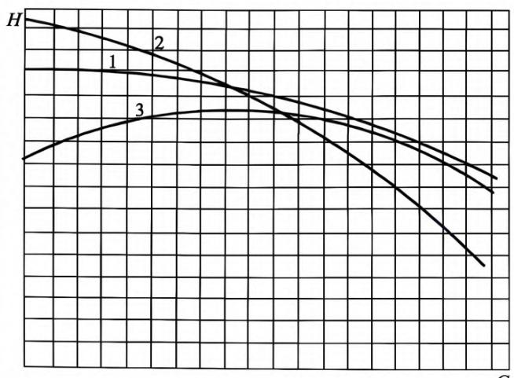  
1—平坦型；2—陡降型；3—驼峰型。

图13.1-1 离心泵的性能曲线  
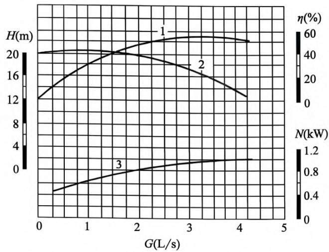  
1—G-y; 2—G-H; 3—G-N。  
图13.1-2 常用单级单吸离心泵的性能曲线

水泵的流量、扬程、轴功率和转速间的关系为：

$$
G / G _ {1} = n / n _ {1}\tag{13.1-1}
$$

$$
H / H _ {1} = (n / n _ {1}) ^ {2}\tag{13. 1-2}
$$

$$
N / N _ {1} = (n / n _ {1}) ^ {2}\tag{13. 1- 3}
$$

式中 n —— 参照水泵叶轮转速，r/min;

$n_{1}$ ——所指水泵叶轮转速，r/min;

G——叶轮转速为 n 时的流量， $m^{3}/h$ ;

$G_{1}$ ——叶轮转速为 $n_{1}$ 时的流量， $m^{3}/h$ ;

H——叶轮转速为 n 时的扬程， $mH_{2}O$ ;

$H_{1}$ ——叶轮转速为 $n_{1}$ 时的扬程， $mH_{2}O$ ;

N——叶轮转速为 n 时的轴功率，kW;

$N_{1}$ ——叶轮转速为 $n_{1}$ 时的轴功率，kW。

IS型系列泵，有其型谱图，可覆盖一大片扬程、流量的区域，如图13.1-3所示。

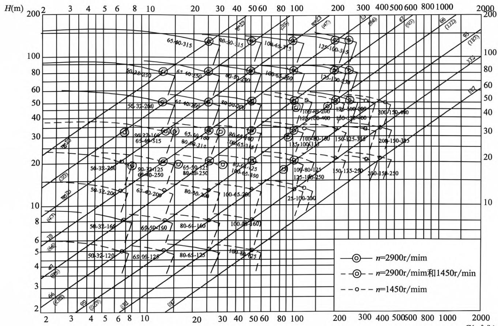  
图13.1-3 IS型系列泵型谱图  
注：带括号的数据表示 $n = 2900\mathrm{r / min}$ 的 $\eta$ 值，不带括号的数据表示 $n = 1450\mathrm{r / min}$ 的 $\eta$ 值。

**13.1.1.2 管路的特性曲线**

水泵总是与一定的管路系统相连接的，在管路系统中，水泵的工作状况不仅取决于其本身的性能，还和管路系统的状况有关。图 13.1-4 所示为管路特性曲线与水泵性能曲线。

$$
H _ {\mathrm{i}} = H _ {\mathrm{p}} + \frac {p _ {0}}{\rho g} + S _ {\mathrm{HI}} G ^ {2}\tag{13. 1-4}
$$

式中 $H_{i}$ ——水泵需要克服的总水头， $mH_{2}O$ ;

$H_{p}$ ——水泵的位置水头， $mH_{2}O$ ;

$p_{0}$ ——大气压，Pa；

$\rho$ ——流体的密度， $kg/m^{3}$ ;

g——重力加速度， $m/s^{2}$ ;

$S_{H}$ ——管路阻抗， $s^{2}/m^{5}$ ;

G ——流量， $m^{3}/s$ 。

其中：

$$
S _ {\mathrm{H}} = \frac {8 \rho \left(\lambda \frac {l}{d} + \sum \zeta\right)}{\pi^ {2} g d ^ {4}}\tag{13. 1-5}
$$

式中 $\lambda$ ——沿程阻力系数；

$l$ ——管路长路， $\mathrm{m}$ ；

d ——管径，m；

$\zeta$ ——局部阻力系数；

其他符号同上式。

对于开式系统，由于水泵两侧都存在大气压强水头 $\frac{p_0}{\rho g}$ ，在计算中可以略去。

将水泵的性能曲线和管路特性曲线按同一比例画在同一张图中（图 13.1-4），可得出两条曲线的交点 A，A 点即为水泵在系统中运行的工作点。

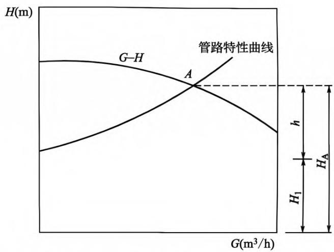  
图13.1-4 管路特性曲线与水泵性能曲线

水泵电机容量安全系数 $K_{\mathrm{A}}$

<table><tr><td>水泵轴功率(kW)</td><td> ${K}_{\mathrm{A}}$ </td></tr><tr><td>&lt;1.0</td><td>1,7</td></tr><tr><td>1~2</td><td>1,7~1.5</td></tr><tr><td>2~5</td><td>1,5~1,3</td></tr><tr><td>5~10</td><td>1,3~1,25</td></tr><tr><td>10~25</td><td>1,25~1.15</td></tr><tr><td>水泵轴功率(kW)</td><td> $K_{A}$ </td></tr><tr><td>25~60</td><td>1.15~1.10</td></tr><tr><td>60~100</td><td>1.10~1.08</td></tr><tr><td>&gt;100</td><td>1.08~1.05</td></tr></table>

表13.1-1

**13.1.1.3 水泵的轴功率**

水泵的轴功率 $N_{z}$ (kW)，可按下式计算：

$$
N _ {z} = \frac {\rho \cdot G \cdot H}{1 0 2 \cdot \eta}\tag{13.1-6}
$$

式中 $\eta$ ——水泵的效率，一般为 0.50～0.90。

水泵配用的电机容量 N（kW）按下式计算：

$$
N = K _ {\mathrm{A}} \cdot N _ {\mathrm{Z}}\tag{13. 1-7}
$$

式中 $K_{\mathrm{A}}$ ——水泵电机容量安全系数，见表13.1-1。

**13.1.1.4 允许吸上真空高度**

一般产品样本给出的允许吸上真空高度 $H_{\mathrm{S}}$ 是指标准状态下（水温 $20^{\circ}\mathrm{C}$ 、水表面为一个标准大气压）运行时，水泵可能有的最大值。如果水泵在非标准状态下工作，其允许吸上真空高度 $H_{\mathrm{S}}^{\prime}(\mathrm{m})$ 应按下式确定：

$$
H _ {\mathrm{s}} ^ {\prime} = H _ {\mathrm{s}} - \left(1 0. 3 3 - \frac {p _ {\mathrm{g}}}{\rho g}\right) + \left(0. 2 4 - \frac {p _ {\mathrm{z}}}{\rho g}\right)\tag{13. 1- 8}
$$

式中 $p_{\mathrm{g}}$ ——水泵安装地点的大气压力， $\mathrm{Pa}$ ；见表13.1-2；

$p_{z}$ ——不同水温下的饱和蒸汽压力，Pa，见表13.1-3；

g——重力加速度，取 $9.807 \, m/s^{2}$ ;

$\rho$ ——不同温度下水的密度， $kg/m^{3}$ ，见表13.1-3。

不同海拔高度的大气压力  
表 13.1-2

<table><tr><td>海拔高度(m)</td><td>-600</td><td>0</td><td>100</td><td>200</td><td>300</td><td>400</td><td>500</td><td>600</td></tr><tr><td>大气压力(MPa)</td><td>0.113</td><td>0.103</td><td>0.102</td><td>0.101</td><td>0.1</td><td>0.098</td><td>0.097</td><td>0.096</td></tr><tr><td>海拔高度(m)</td><td>700</td><td>800</td><td>900</td><td>1000</td><td>1500</td><td>2000</td><td>3000</td><td>4000</td></tr><tr><td>大气压力(MPa)</td><td>0.095</td><td>0.094</td><td>0.093</td><td>0.092</td><td>0.086</td><td>0.084</td><td>0.073</td><td>0.063</td></tr></table>

不同水温时的饱和蒸汽压力和密度  
表 13.1-3

<table><tr><td>水温(°C)</td><td>饱和蒸汽压力(kPa)</td><td>密度(kg/m3)</td></tr><tr><td>0</td><td>0.6</td><td>999.849</td></tr><tr><td>5</td><td>0.9</td><td>999.967</td></tr><tr><td>10</td><td>1.2</td><td>999.701</td></tr><tr><td>15</td><td>1.7</td><td>999.102</td></tr><tr><td>20</td><td>2.4</td><td>998.206</td></tr><tr><td>30</td><td>4.3</td><td>995.651</td></tr><tr><td>40</td><td>7.5</td><td>992.22</td></tr><tr><td>50</td><td>12.5</td><td>998.04</td></tr><tr><td>60</td><td>20.2</td><td>983.2</td></tr><tr><td>70</td><td>31.7</td><td>997.76</td></tr><tr><td>80</td><td>48.2</td><td>971.79</td></tr><tr><td>90</td><td>71.4</td><td>965.31</td></tr><tr><td>100</td><td>103.3</td><td>958.37</td></tr></table>

**13.1.1.5 允许汽蚀余量**

在实际工程中，为确保水泵安全运行，规定了一个安全的汽蚀余量，亦称为允许汽蚀余量，用 NPSH（m）表示。

允许汽蚀余量 NPSH 与允许吸上真空高度 $H_{s}$ 之间的关系为：

$$
H _ {\mathrm{s}} = \frac {p _ {\mathrm{a}} - p _ {\mathrm{z}}}{\rho \mathrm{g}} - N P S H \frac {v _ {\mathrm{s}} ^ {2}}{2 g}\tag{13. 1-9}
$$

式中 $p_{\mathrm{a}}$ ——吸入容器内的压力，敞开容器则为安装地点的大气压力， $\mathrm{Pa}$ ；

$v_{s}$ ——水泵吸入口处的流速，m/s。

**13.1.1.6 比转数**

比转数 $n_{\mathrm{s}}$ 是一个无量纲相似准则数, 是叶片泵叶片的相似特性值, 其表达式为:

$$
n _ {\mathrm{s}} = 3. 6 5 \frac {n \cdot \sqrt {G}}{H ^ {0 . 7 5}}\tag{13. 1-10}
$$

式中，当 $G = 0.075\mathrm{m}^3 /\mathrm{s}$ ， $H = 1\mathrm{m}$ 时，比转数在数值上等于水泵自身的转速，即 $n_{\mathrm{s}} = n$ 。

当水泵转速 n 一定时，同样流量的水泵， $n_{s}$ 越大，扬程越低。扬程相同的水泵， $n_{s}$ 越大，流量也越大。

**13.1.1.7 水泵的变速**

在管路特性曲线不变的情况下，通过调节水泵的运行转速，改变水泵的性能曲线，可以实现水泵的运行工况点调节。水泵通过变速进行调节遵循的是相似定律，其性能曲线见图13.1-5。当水泵转速从 $n_{1}$ 调节到 $n_{2}$ 时，其运行工况点由点1改变到点2，流量由 $G_{1}$ 改变到 $G_{2}$ ，扬程由 $H_{1}$ 改变到 $H_{2}$ 。

由式（13.1-1）～式（13.1-3）可见，流量与转速成正比，扬程与转速的二次方成正比，而轴功率与转速的三次方成正比。水泵变速调节是最经济、节能的流量调节方法。实现转速变化的方法一般有：变频调速、变级调速、液力耦合调速、皮带变速及齿轮变速等。

### 13.1.2 多台水泵的工作特性

**13.1.2.1 水泵的并联**

水泵并联工作的可能性如图 13.1-6 所示。

两台型号相同的水泵并联工作的性能曲线如图 13.1-7 所示。

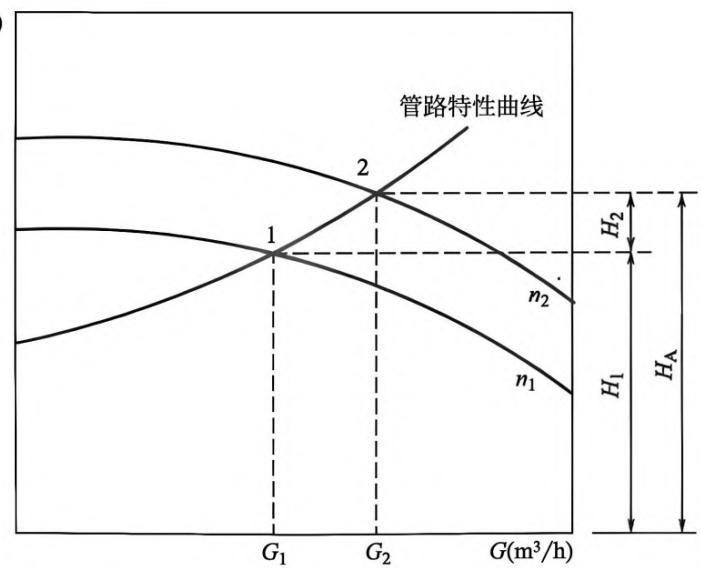  
图13.1-5 水泵变速的性能曲线

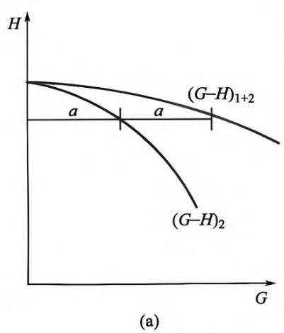

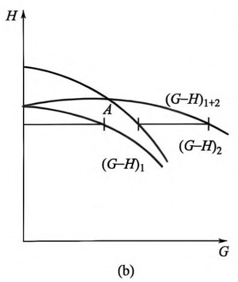

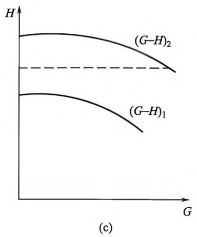  
图13.1-6 泵并联工作的可能性

(a) 完全并联；(b) 局部并联；(c) 不能并联  
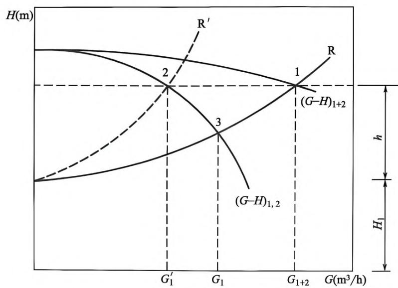  
图 13.1-7 两台型号相同的水泵并联工作的性能曲线注；点 1 为两台水泵并联时的工作点；点 2 为并联工作时，每台水泵的工作点；点 3 为一台水泵单独工作时的工作点。

图 13.1-8 为五台同型号水泵并联的工作性能曲线。

由图 13.1-7 可以看出: $G_{1+2} = 2G' < 2G_1$ , $G' < G_1$ 。这说明一台水泵单独工作时的流量大于并联工作时每台水泵的流量。两台水泵并联工作时, 其并联工作的流量不可能比单台水泵工作时的流量成倍增加。以两台水泵并联工作的系统为例分析两台水泵工作状况, 如表 13.1-4 所示。

两台水泵并联工作状况分析  
表 13.1-4

<table><tr><td>图示</td><td>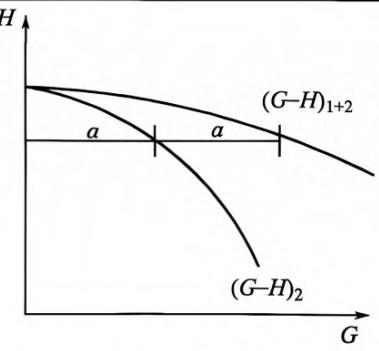两台相同型号的水泵并联</td><td>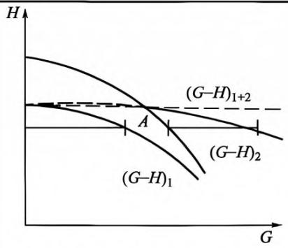两台不同型号的水泵并联</td><td>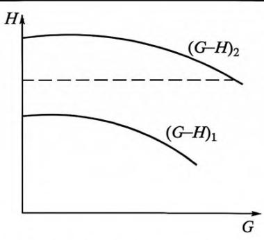两台扬程相差过大的水泵并联</td></tr><tr><td>分析</td><td>因为两台水泵的G-H曲线完全叠加,并联后的性能曲线为各单台水泵等扬程下流量的叠加,这种并联称为性能曲线的完全并联</td><td>一台大、一台小,起始扬程不同,但相差不大,这种水泵的并联,只能在A点以后才开始,称为不完全并联(局部并联)</td><td>大泵任何时候的扬程都比小泵的起始扬程大,这种情况下不能形成并联工作</td></tr></table>

如图 13.1-7 所示，水泵应以系统所需扬程和单台水泵需担负的流量（点 2）为选择依据，显然，这样确定的水泵在并联工作时，均处在高效率工作点。如果在管路特性不变的前提下，仅开启一台水泵，其工作点（点 3）则处在较大流量和较低扬程下，此时水泵的效率很低，消耗功率通常也会更大，要使单台水泵运行处于高效率工作点（点 2），只要改变管路特性曲线 R 至 $R'$ （如阀门节流）。这种情况在多台水泵并联时就更为明显，表 13.1-5 为五台同型号水泵并联的工作性能参数。

五台同型号水泵并联的工作性能参数  
表 13.1-5

<table><tr><td>并联的水泵台数</td><td>并联运行时设计总流量( $m^3/h$ )</td><td>设计工况下单台水泵承担的流量( $m^3/h$ )</td><td>管路特性不变时启运台数的总流量( $m^3/h$ )</td><td>与选泵工况的流量相比偏移量( $m^3/h$ )</td></tr><tr><td>1</td><td rowspan="5">500</td><td rowspan="5">100</td><td>167(1×167)</td><td>67</td></tr><tr><td>2</td><td>317(2×158)</td><td>58.5</td></tr><tr><td>3</td><td>418(3×139)</td><td>39.3</td></tr><tr><td>4</td><td>473(4×118)</td><td>18.2</td></tr><tr><td>5</td><td>500(5×100)</td><td>0</td></tr></table>

对于一个确定的管路系统，其管路特性曲线已定，如果试图通过增加水泵台数的方法来获取系统流量的提高，显然是不合理的。

两台同型号的水泵并联运行的系统，当管路特性不变时（即 R 不变），如果增加一台同型号的水泵，则三台同型号水泵的并联运行的工作点由两台并联的点 1 移至点 4（图

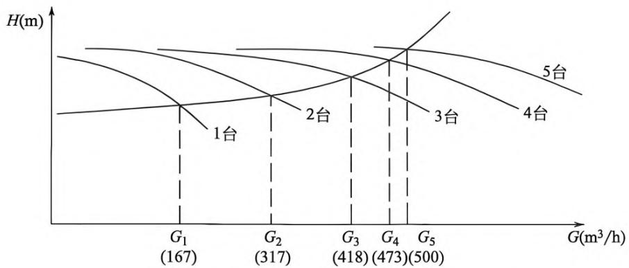  
图 13.1-8 五台同型号水泵并联的工作性能曲线

13.1-9)。此时，单台水泵的工作点（点5）偏离原高效工作点（点2）。显然，三台泵并联运行的流量 $(G_{4})$ 较两台泵并联运行的流量 $(G_{1})$ 增幅有限，单台水泵担负的流量 $(G_{5})$ 比两台水泵并联运行时单台水泵担负的流量 $(G_{2})$ 小。

两台不同型号的水泵并联的工作性能曲线如图 13.1-10 所示。由图可见，当工作扬程大于 A 点时，性能曲线同第 1 台泵，只有当扬程小于 A 点时， $G_{(1+2)} = G_{1}' + G_{2}'$ ，第 2 台泵才能投入工作。

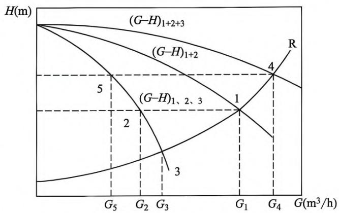  
图 13.1-9 三台同型号水泵并联的工作特性曲线

图 13.1-10 中点 1 为水泵并联工作时的工作点，点 2、点 3 为 2 台水泵联合工作时的工作点，点 4、点 5 为 2 台水泵单独工作时的工作点。在联合工作中，水泵的流量小于单台工作时的流量，即 $G_{1}^{\prime}<G_{1}$ ， $G_{2}^{\prime}<G_{2}$ ， $G_{(1+2)}<G_{1}+G_{2}$ 。

**13.1.2.2 水泵的串联**

当要求加大扬程时，可采用水泵串联的形式，其性能曲线见图 13.1-11。图中点 1 为串联工作点，点 2、点 3 为 2 台水泵单独运行时的工作点，点 4、点 5 为 2 台水泵串联工作时工作点。

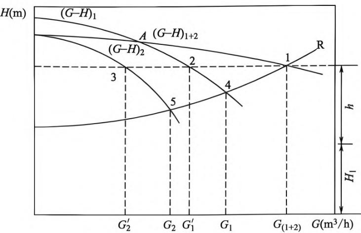  
图13.1-10 两台不同型号水泵并联的工作性能曲线

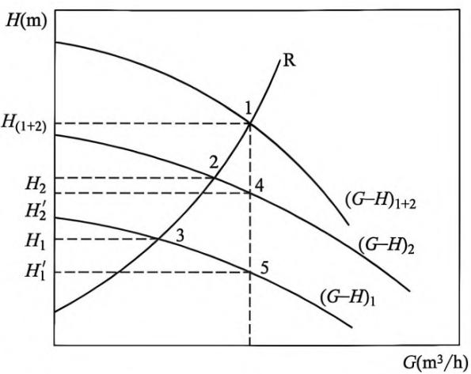  
图13.1-11 串联水泵的工作性能曲线

水泵串联的总扬程等于2台水泵在同一流量时的扬程之和。

$$
H _ {(1 + 2)} = H _ {1} ^ {\prime} + H _ {2} ^ {\prime}
$$

在联合工作中，水泵的扬程小于单台工作时的扬程，即 $H^{\prime}_{1} < H_{1}$ ， $H^{\prime}_{2} < H_{2}$ ， $H_{(1 + 2)} < H_{1} + H_{2}$ 。

两台水泵串联工作时应注意下列事项：

1. 两台水泵的流量应该相近，否则流量较小的一台水泵会严重超负荷。

2. 串联在后面的水泵，构造必须坚固，否则易遭到损坏。

### 13.1.3 管道泵

管道泵是建筑给水中应用较多的一种辅助泵型，在暖通空调领域也可以被使用。在泵站的使用中，它主要起到中途增压的辅助作用，以保证介质在管道中的正常输送。管道泵用于暖通空调的水系统中，有以下优点：

1. 管道泵的体积小、质量轻，进出水均在同一直线上，可直接安装在水管上，不须设置混凝土基础，安装方便，便于维修，占地少。

2. 采用机械密封，性能好，运行时不易泄漏。

3. 效率高、耗电少、噪声低。

常用管道泵的性能曲线如图 13.1-12 所示。

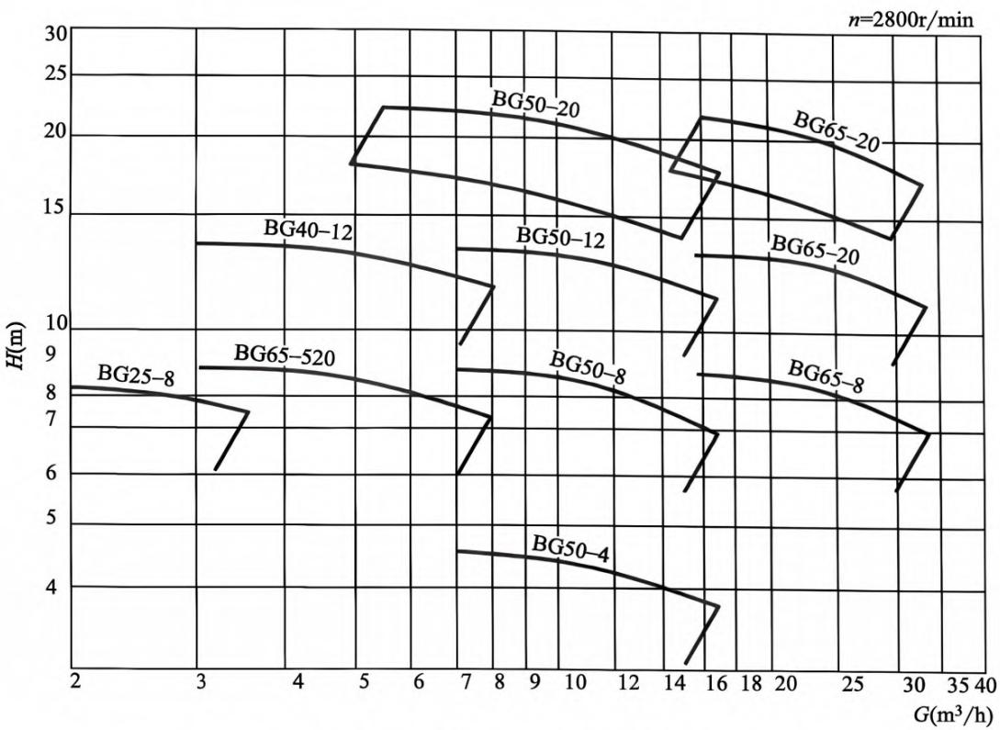  
图13.1-12 常用管道泵的性能曲线

管道泵通常是一种立式结构的泵，例如管道增压泵或者管道离心泵，它们的进出口均是在同一水平线上，可以直接与输送的管道对接，管道泵的电机在泵体上，其进水口和出水口口径一样，泵体下面有一个方形的底座，可以方便安装在混凝土基础上，质量轻的管道泵不需要固定底座，可以直接靠进、出口管道连接支撑固定，不过这种情况下管道泵两端的管道必须要有支撑固定。

### 13.1.4 水泵的选择及运行调节

**13.1.4.1 水泵的选择**

1. 水泵流量的确定

水泵流量 $G(\mathrm{m}^{3} / \mathrm{h})$ 可按下式计算：

$$
G = K \frac {3 . 6 Q}{\Delta t \cdot c \cdot \rho}\tag{13. 1-11}
$$

式中 $Q$ ——系统的总负荷，W；

$\Delta t$ ——系统的供、回水温差， $^{\circ}$ C；

$\rho$ ——水的密度，kg/m $^{3}$ ；

c——水的比热容， $\mathrm{J}/(\mathrm{kg} \cdot ^{\circ}\mathrm{C})$ ;

$K$ ——裕量系数。

2. 水泵压力（扬程） $H(\mathrm{m})$ 按下式确定：

$$
\Delta p = K \sum (\Delta p _ {\mathrm{m}} + \Delta p _ {\mathrm{j}})\tag{13.1-12}
$$

$$
H = \frac {\Delta p}{\rho g}\tag{13.1-13}
$$

式中 $\Delta p$ ——水泵压力， $\mathrm{Pa}$ ；

$\sum(\Delta p_{m}+\Delta p_{j})$ ——系统摩擦阻力和局部阻力的总和，Pa；

$\rho$ ——水的密度， $kg/m^{3}$ ;

g——重力加速度， $m/s^{2}$ ;

$K$ ——裕量系数。

确定 $G$ 和 $h$ 后，可按照水泵性能曲线选择水泵型号和配套电机。

**13.1.4.2 水泵的选择原则及注意事项**

1. 首先要满足最高运行工况的流量和扬程，并使水泵的工作状态点处于高效率范围。

2. 流量和扬程应有 $5 \% \sim 10 \%$ 的裕量。

3. 当流量较大时，宜考虑多台水泵并联运行，但并联台数不宜过多，一般不超过3台。

4. 多台水泵并联运行时，应选择同型号水泵。

5. 多台并联运行的水泵，应考虑部分台数运行时，系统工作状态点变化对水泵工作点的影响，并采取应对措施。

6. 必须考虑系统静压对泵体的作用，在选用水泵时应注明所承受的静压值。

**13.1.4.3 水泵的运行调节方式**

系统最佳工况点的改变由两方面引起：一是管道特性曲线改变，如阀门节流；二是水泵的性能曲线改变，如变频调速、切削叶轮、水泵串联或并联。水泵的运行调节方式见表13.1-6。

水泵的运行调节方式  
表 13.1-6

<table><tr><td>调节方法</td><td>原理</td><td>运行实施</td><td>特点</td></tr><tr><td>改变管路阻力</td><td>通过管道系统中阀门等节流装置的开启程度增减管道阻力,以改变管道特性曲线,达到调节流量的目的</td><td>调节水泵出口阀门的开度,而水泵转速保持不变。关小阀门时,管道局部阻力增加,水泵工况点向左移,相应流量减少。水泵本身的性能曲线不变,管路特性将随阀门开度的改变而改变。阀门全关时,相当于阻力无限大,流量为零,此时管道特性曲线与纵坐标重合</td><td>操作简便、流量连续,可以在最大流量与零之间随意调节,无须额外投资,适于局部流量调节。节流调节是以消耗水泵的多余能量来维持一定的供给量,水泵的效率也将随之下降,耗能大、不经济</td></tr><tr><td>水泵叶片变径</td><td>当转速一定时,水泵的压力、流量均与叶轮直径有关。对同一型号的水泵,可采用切削叶片的方法改变水泵的性能曲线</td><td>变径调节在一定程度上解决了水泵类型、规格的有限性与供水对象要求的多样性之间的矛盾,扩大了水泵的使用范围</td><td>根据切削定律,切削限量与水泵的比转数有关,如果叶轮的切削量控制在一定限度内,则切削前后水泵的效率可视为不变。切削叶片是改变水泵性能的一种简便易行的办法,但切削叶片属不可逆过程,用户必须经过精确计算并衡量经济合理性后方可实施</td></tr><tr><td>变频调速(变级调速、液力耦合调速、皮带变速及齿轮变速等)</td><td>流量与转速成正比,扬程与转速的二次方成正比,而轴功率与转速的三次方成正比</td><td>工况点偏离高效区是水泵需要调速的基本条件。当水泵的转速改变时,阀门开度保持不变,管道特性不变,而水泵的供水能力和扬程随之改变。在所需流量小于额定流量的情况下,变频调速时的扬程比阀门节流小,所以水泵变频调速所需的轴功率也比阀门节流小</td><td>与阀门节流相比,变频调速的节能效果很突出,水泵的工作效率也更高,采用变频调速后不仅有利于降低水泵发生汽蚀的可能性,还可以通过对升速/降速时间的预置来延长开机/停机过程,使动态转矩大为减小,从而在很大程度上消除极具破坏性的水锤效应,延长水泵和管道系统的寿命。变频调速也有局限性,除了投资较大、维护成本较高外,当水泵变速过大时会造成效率下降,因此不可能无限制调速</td></tr><tr><td>水泵串联和并联</td><td>水泵串联和并联与管道特性曲线的平坦程度有关</td><td>水泵串联后扬程的增加大于管道阻力的增加,致使富余的扬程促使流量增加。流量的增加又使阻力增加,抑制了总扬程的升高。水泵并联,在压力相同时增加流量</td><td>水泵串联运行时,必须注意后一台水泵是否能够承受升压。启动前每台水泵的出口阀门都要关闭,然后顺序开启水泵和阀门。采用并联还是串联,应当取决于管道特性曲线的平坦程度。管道特性曲线越平坦,两台相同型号的水泵并联后的流量就越接近于单台水泵运行时的2倍;两台不同型号的水泵并联,并联后的流量就越接近于单台水泵运行的流量之和,从而比串联时的流量更大</td></tr></table>

## 13.2 锅炉燃油输配油泵

燃油系统是为燃油锅炉服务的，其设计范围包括卸油、储油、供（输）油、回油、含油污水处理以及燃油的加热、伴热、清扫、疏放等。锅炉燃油输配油泵的作用是把足够数量和一定压力的燃油提供给高压喷油泵，其输油量应该是全负荷时所需喷油量的 $3 \sim 4$ 倍。油泵的作用是保证柴油在低压油路内循环，并供给足够数量和一定压力的燃油，直燃机房的输油系统原理图如图13.2-1所示。

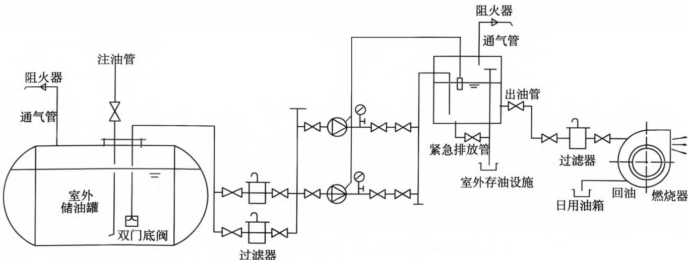  
图 13.2-1 燃烧轻质柴油的锅炉的输油系统原理图

油泵一般采用齿轮泵或螺杆泵，将油加压至一定压力（一般为 0.8MPa 以上）并达到雾化程度的液体油输送到燃烧器。油泵一般选两台（一用一备），应配防爆型电动机。当采用齿轮泵和螺杆泵时，过滤器网孔为 0.2～0.45mm；采用往复泵或离心泵时，过滤器网孔为 0.5～0.8mm。

### 13.2.1 锅炉燃油输配油泵分类

锅炉燃油输配油泵有齿轮式输油泵、膜片式输油泵、管道式输油泵、柱塞式输油泵等几种类型。

### 13.2.2 代号示意及描述

锅炉燃油输配油泵的型号表示方式如下：

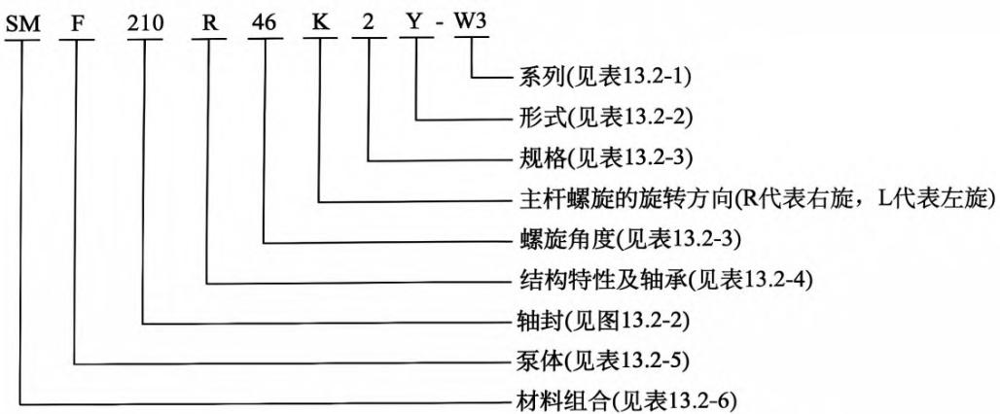

注：从驱动端看，若要求泵轴顺时针转动，则选 R，逆时针转动，则选 L。

锅炉燃油输配油泵的系列代号  
表 13.2-1

<table><tr><td>代号</td><td>主要特征</td><td>最大流量(L/min)</td><td>规格范围(L/min)</td><td>最大排出压力(MPa)</td></tr><tr><td>SM</td><td>中压、单吸轴向力液压平衡</td><td>2200</td><td>40~2200</td><td>10</td></tr></table>

锅炉燃油输配油泵的形式代号  
表13.2-2

<table><tr><td>代号</td><td>结构说明</td></tr><tr><td>H</td><td>卧式地脚安装泵</td></tr><tr><td>F</td><td>端法兰连接泵</td></tr><tr><td>S</td><td>立式柱脚安装泵</td></tr><tr><td>E</td><td>泵转子组件,杆套插装泵</td></tr><tr><td>D</td><td>进口浸没泵</td></tr><tr><td>B</td><td>进、出口同侧法兰连接泵</td></tr></table>

锅炉燃油输配油泵的规格和主杆螺旋角  
表13.2-3

<table><tr><td>规格(L/min)</td><td>40</td><td>80</td><td>120</td><td>210</td><td>280</td><td>440</td><td>660</td><td>940</td><td>1300</td><td>1700</td><td>2200</td></tr><tr><td rowspan="3">主杆螺旋角(°)</td><td>38</td><td>36</td><td>42</td><td>40</td><td>43</td><td>40</td><td>40</td><td>42</td><td>42</td><td>42</td><td>42</td></tr><tr><td>46</td><td>42</td><td>46</td><td>46</td><td>46</td><td>46</td><td>46</td><td>46</td><td>46</td><td>46</td><td>46</td></tr><tr><td></td><td>46</td><td></td><td></td><td></td><td></td><td></td><td></td><td></td><td></td><td></td></tr></table>

锅炉燃油输配油泵的结构特性及轴封代号  
表13.2-4

<table><tr><td>代号</td><td>结构说明</td><td>适用范围</td></tr><tr><td>U2</td><td>内置双列球轴承,填料密封</td><td>介质润滑性较差,黏度大,温度≤150°C</td></tr><tr><td>K2</td><td>外置球轴承,填料密封</td><td>介质润滑性较差,黏度大,温度≤150°C</td></tr><tr><td>U12.1</td><td>内置滚动轴承,轴承由介质润滑机械密封(图13.2-2)</td><td>介质润滑性良好,温度≤80°C</td></tr><tr><td>E6.7</td><td rowspan="2">外置滚动轴承,可用润滑喷嘴注润滑脂机械密封(图13.2-2)</td><td>介质润滑性较差,工作温度≤150°C</td></tr><tr><td>E15</td><td>介质润滑性较差,工作温度≤200°C</td></tr></table>

锅炉燃油输配油泵的泵体代号  
表13.2-5

<table><tr><td>代号</td><td>说明</td><td>适用范围</td></tr><tr><td>无标记</td><td>标准泵体,适用于输送流动性好的润滑性液体</td><td>—</td></tr><tr><td>Y</td><td>双层泵体,可用热蒸汽或热传输液体作载体对介质进行加热,适用于输送高黏度、流动性差的液体,介质温度 $\leqslant 200^{\circ}C$ </td><td>泵安装图与标准型不同,需向厂家索取</td></tr><tr><td>T</td><td>单层焊接泵体,适用于有特殊要求的场所</td><td>泵安装图与标准型不同,需向厂家索取</td></tr></table>

锅炉燃油输配油泵的常用材料组合代号  
表13.2-6

<table><tr><td>材料组合代号</td><td>泵体</td><td>衬套</td><td>适用范围</td></tr><tr><td>W3</td><td>QT42-10</td><td>ZL109</td><td>用于小规格泵和大规格低压泵输送润滑性好的液体,如润滑油等</td></tr><tr><td>W23</td><td>QT42-10</td><td>ZCuSn5Pb5Zn5</td><td>用于小规格泵和大规格低压泵输送润滑性较差的液体,如重油、燃油等</td></tr><tr><td>W27</td><td>ZG35</td><td>ZL109</td><td>用于大规格泵高压输送润滑性较好的液体,如润滑油等</td></tr><tr><td>W28</td><td>ZG35</td><td>ZCuSn5Pb5Zn5</td><td>用于大规格泵输送润滑性较差的液体,如重油燃油等</td></tr><tr><td>W29</td><td>焊接泵体</td><td>ZCuSn5Pb5Zn5</td><td>用于有特殊要求的环境</td></tr></table>

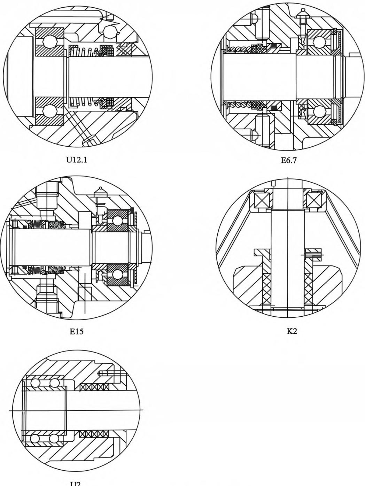  
图13.2-2 机械密封放大图

### 13.2.3 锅炉燃油输配油泵的选型

燃油系统的油泵按用途分为输油泵、卸油泵和供油泵。在锅炉房内设置的为供油泵，主要为燃烧器供一定压力和流量的燃油。供油泵一般要求流量小、压力稳定，连续工作时间长，在中小锅炉中多采用螺杆泵或齿轮泵。锅炉房内有两台以上的锅炉最好集中布置供油泵，便于负荷变化时集中调节。

**13.2.3.1 螺杆泵和齿轮泵的优缺点**

1. 齿轮泵体积小、工作可靠、动力消耗少、设备费用低、结构简单、维修量小、有良好的自吸性能，可连续供油。其缺点是齿轮易磨损，输送杂质油时应在泵口装40～80目的过滤器；供油压力和流量选择范围小，选择某一流量参数的泵其流量是定值。当外界用油量减少时，应在泵的进、出管间连接一旁通管，以调节流量，当系统有回油管时，也可用回油管调节流量，并在泵出口管上安装安全阀。齿轮泵在工作状态下不允许关闭出口阀门，只能用泵进口阀门作调节。

2. 螺杆泵流量及压力波动小、流量均匀、噪声小、运行平稳、体积小、寿命长、比齿轮泵效率稍高、自吸性能好。其缺点与齿轮泵相同，同样要采取进油口安装过滤器和防止压力急剧升高的措施。

供油泵的压力根据燃烧器喷油嘴的要求和管道系统阻力确定，其流量根据锅炉的负荷和负荷的波动情况以及回油量来确定。合理确定回油量对锅炉的稳定运行至关重要，回油量过大，固然对调节油量有利，但影响泵的经济运行，还会造成储油罐的温升；回油量小，会影响调节阀的灵敏度和降低回油管中油的流速，使油品中的杂质和碳化物沉积在管壁上，回油管中油的流速一般控制在 $0.7 \sim 1\mathrm{m / s}$ ，不应低于 $0.7\mathrm{m / s}$ 。喷油嘴的额定回油量由锅炉厂家提供，一般为喷油嘴额定出力的 $15\% \sim 50\%$ 。除利用回油调节阀调节供油量和回油量外，在锅炉房额定出力较大和热负荷波动也大的情况下，还可选择多台供油泵并联运行，以适应流量的变化。

供油泵应有备用泵，重油在常温下就会凝固，备用泵必须是热备用，多台泵并联运行，每一台泵都可能为备用泵，所以要在每台泵出口的止回阀上装设旁通管和旁通回油调节阀。在系统运行时，打开备用泵的旁通回油调节阀，使备用泵缓慢运转，一旦工作泵发生故障，关闭旁通调节阀，很快可投入运行。调节旁通回油量不能过大，以免影响工作泵的运行效率。

**13.2.3.2 供油泵的选择计算**

1. 供油泵的流量应大于锅炉房内各台锅炉的额定耗油量之和加上回油量，其计算见下式：

$$
Q \geqslant q _ {1} + q _ {2} + \dots \dots + q _ {n} + Q _ {2}\tag{13.2-1}
$$

式中 Q ——供油泵的流量， $m^{3}/s$ ;

$q_{1}$ ——第1台锅炉的额定耗油量， $m^{3}/s$ ;

$q_{2}$ ——第2台锅炉的额定耗油量， $m^{3}/s$ ;

$q_{n}$ ——第 n 台锅炉的额定耗油量， $m^{3}/s$ ;

$Q_{2}$ ——回油量， $m^{3}/s$ 。

在锅炉热负荷波动、油量变化时，供油泵的低负荷供油量应在供油调节阀和回油调节阀的调节范围之内，否则应选择小流量多台泵并联运行。

2. 供油泵的扬程按下式计算：

$$
H = 9. 8 \left(p _ {2} - p _ {1}\right) / \rho + \left(h _ {2} - h _ {1}\right) \times 1 0 0 0 + \Delta h _ {1} + \Delta h _ {2} + \left(\omega_ {2} ^ {2} - \omega_ {1} ^ {2}\right) / 2 g\tag{13.2-2}
$$

式中 H ——供油泵的扬程，m；

$p_{1}$ ——吸入罐内液面上的压力，Pa，当罐内通大气时， $p_{1}=0$ ;

$p_{2}$ ——供出压力，当直接供锅炉时为燃烧器要求的压力，Pa；

$h_{1}$ ——吸入罐内最低油位与泵中心的垂直高度，m；

$h_{2}$ ——排出几何高度，直接供锅炉时即喷油嘴与油泵中心线的垂直高度，m；

$\Delta h_{1}$ ——吸入管道的摩擦阻力水头，m；

$\Delta h_{2}$ ——排出管道的摩擦阻力水头，m；

$\omega_{1}$ ——油泵吸入口管道的平均流速，m/s；

$\omega_{2}$ ——油泵排出口管道的平均流速，m/s；

$\rho$ ——油品在运行温度时的密度， $kg/m^{3}$ ;

g——重力加速度， $g=9.8m/s^{2}$ 。

在计算中， $(\omega_{2}^{2}-\omega_{1}^{2})/2g$ 的数值很小，一般可忽略。

选型时要尽可能详尽地了解泵的使用条件，除需要弄清楚运行参数（如流量、压力）之外，输送介质的特性（如介质的腐蚀性、含气量、含固溶物的比率、固体颗粒的大小以及介质的工作温度、黏度和相对密度对泵内过流元件的腐蚀性等），以及对泵的吸入条件、安装条件均要了解。

**3. 确定泵的转速：**

(1) 泵的转速根据输送介质的黏度和泵的规格确定, 一般输送高黏度介质时, 应选低转速; 若黏度低, 相应选择高转速。对于大规格的泵 (主杆外径在 $60 \mathrm{~mm}$ 以上) 时, 介质黏度 $\chi > 20^{\circ} \mathrm{E}$ 时, 转速以 $970 \mathrm{r} / \mathrm{min}$ 或 $720 \mathrm{r} / \mathrm{min}$ 为宜; 若 $\chi > 80^{\circ} \mathrm{E}$ (如黏胶液), 转速可选 $200 \sim 500 \mathrm{r} / \mathrm{min}$ 。对于小规格的泵 (主杆外径在 $60 \mathrm{~mm}$ 以下), $\chi > 20^{\circ} \mathrm{E}$ 时, 转速选 $1450 \mathrm{r} / \mathrm{min}$ 或 $970 \mathrm{r} / \mathrm{min}$ ; $\chi > 80^{\circ} \mathrm{E}$ 时, 转速选 $300 \sim 600 \mathrm{r} / \mathrm{min}$ 。SM 系列螺杆泵的极限转速为 $6000 \mathrm{r} / \mathrm{min}$ 。

(2) 由于泵的转速越高摩擦功率越高, 泵的磨损越大, 寿命越短, 如果输送介质的润滑性较差, 或含有微量杂质, 则应选较低转速, 推荐转速小于 $1450 \mathrm{r} / \mathrm{min}$ 。

4. 泵结构可根据泵的运行环境和安装环境确定，选择合适的安装形式并遵循以下原则：

(1) 输送润滑性油类, 且温度 $\leqslant 80^{\circ} \mathrm{C}$ 时, 选择内置轴承结构的泵。

(2) 输送润滑性较差, 或温度 $> {80}^{ \circ  }\mathrm{C}$ 时,选择外置轴承结构的泵。

（3）输送流动性差、黏度高的介质或对所输送介质进行加热或保温时，选双层加热泵体结构。

（4）输送高温介质时，应选择由耐高温材料制成的泵或局部冷却的泵。

(5) 关于泵的吸入能力可查阅产品样本。

5. 泵的材料组合的选择见表 13.2-6。

泵的吸入真空度性能可以通过降低转速或加热降低介质黏度的方法改善。

6. 配套电机的选配。泵的型号选定后，根据样本数据，可查到泵的轴功率 $N$ ，该轴功率附加一定的功率储备后，作为选配电机的依据，一般电机功率 $N_{\mathrm{m}}$ 不小于泵轴功率 $N$ 乘以功率储备系数 $k$ 所得的值，即： $N_{\mathrm{m}} \geqslant k N$ 。 $k$ 值由表13.2-7查得。

泵的功率储备系数 $k$  
表13.2-7

<table><tr><td>轴功率N(kW)</td><td>功率储备系数k</td></tr><tr><td>N≤5</td><td>1.25</td></tr><tr><td>51.2</td><td>1.2</td></tr><tr><td>101.15</td><td>1.15</td></tr><tr><td>N&gt;50</td><td>1.1</td></tr></table>

7. 为了保证进泵介质的清洁性, 要求泵进口前配备过滤器, 过滤精度为 $40 \sim 80$ 目。另外, 由于样本提供的泵性能参数均以表格形式或特定黏度、转速下性能曲线的形式给出, 所需泵的性能, 有时恰好不能直接读出, 这时可遵循如下原则, 作粗略估算:

(1) 三螺杆泵的流量、压力在相同转速、黏度时近似呈直线关系, 压力越高, 流量越小。

(2) 相同黏度、压力下, 泵的流量与转速近似成正比。

(3) 相同转速、黏度时, 泵的轴功率与压力近似成正比。

(4) 相同黏度、压力下, 泵的轴功率与转速近似成正比。

(5) 黏度增大时, 泵的流量和轴功率均增加。

运行时任何时候均不允许停泵，必须一台泵运行、一台泵备用，即备用率为 $100\%$ 。供油泵的数量宜为三台，两台运行一台备用，备用率为 $50\%$ ，且当其中油量最大的一台供油泵停用时，其余供油泵的总流量应不小于全厂燃油系统耗油量及其回油量之和的 $110\%$ 。

8. 供油泵的形式应根据油品和供油参数确定。当输送的油品黏度小、压力较低且流量较大时，宜采用离心泵；当输送的油品黏度大、压力较高且流量较小时，宜采用往复泵、螺杆泵或齿轮泵。供油泵、再循环油泵可采用定速电机或变频电机驱动。当电厂燃用奥里乳化油时，应采用螺杆泵，变频调节。

9. 离心泵出口应设低负荷再循环管道，泵中心宜低于油罐底部标高。对于汽车卸油，卸油泵入口管段的最高点应低于汽车卸油口。泵出口至第一个关断阀之间的管道（包括关断阀）应考虑承受泵出口最高工作压力，并设置泄压安全阀。泵用作卸油泵上卸时，应增设真空泵。螺杆泵、齿轮泵和电动往复泵等容积式泵的出口管路，应设安全阀（泵本身带有安全阀者除外）。安全阀的放空管应接至泵的人口管路上，并设事故停机联锁。

10. 供油泵、再循环油泵应集中布置在油泵房内，卸油泵可布置在卸油栈台附近或油泵房内。油泵的布置应满足工艺流程的要求，进出口管路的阻力小，并便于运行操作和检修。油泵单排布置时，油泵或电机端部至墙壁（柱子）的净距不宜小于 $1.5 \mathrm{~m}$ ；相邻油泵机座之间的净距，应不小于较大油泵机座宽度的 1.5 倍；油泵房应设有运行通道和检修场地，电机端部应有检修拆卸空间。油泵房内的管道布置应考虑油泵或阀门检修时，拆卸管道分段法兰。清扫管、放油管布置应整齐美观，放气阀和放油阀的排出管出口方向应朝下，并设集油槽回收污油。油泵房按功能分区，应设置油泵区、电气控制室和辅助间。油泵房内应设油泵和电机的检修起吊设施，电动起吊机应采用防爆电机。油泵房应设置必要的泄压设施，安装通风设备和可燃气体报警器，及时排除室内可燃气体。在南方炎热地区，油泵房可采用半露天布置。

## 13.3 空气压缩泵

空气压缩泵是一种以压缩空气作为动力源，增加空气压力，同时提高空气运动速度的设备，其主要作用是把原有气体压力提高到可以供设备使用的压力，利用大面积活塞端的低压气体推动小面积活塞端的气体进行压缩，增压比对应活塞的面积比，面积比越大，增压比越高。驱动力主要用于压缩空气或其他气体，输出压力可通过驱动气压调节。空气压缩泵的种类很多，按工作原理可分为容积式压缩泵和速度式压缩泵。

### 13.3.1 容积式压缩泵

容积式压缩泵的工作原理是：由电动机直接驱动压缩泵，使曲轴产生旋转运动，带动连杆使活塞产生往复运动，引起气缸容积变化，使单位体积内气体分子的密度增加，以提高压缩空气的压力。容积式压缩泵的主要种类如表 13.3-1 所示。

容积式压缩泵的主要种类  
表 13.3-1

<table><tr><td>名称</td><td>种类</td><td>压缩原理</td></tr><tr><td>活塞式空气压缩泵</td><td>往复式</td><td>活塞在气缸内作往复运动</td></tr><tr><td>螺杆式空气压缩泵(双螺杆式和单螺杆式)</td><td>回转容积式</td><td>两个带有螺旋形齿轮的转子相互啮合,从而将气体压缩并排出</td></tr><tr><td>滑片式空气压缩泵</td><td>回转式变容</td><td>轴向滑片在同圆柱缸体偏心的转子上作径向滑动,截留于滑片之间的空气被压缩后排出</td></tr><tr><td>罗茨双转子式空气压缩泵</td><td>液体活塞式、回转容积式</td><td>以水或其他液体当作活塞来压缩气体,然后将气体排出。两个罗茨转子互相啮合,从而将气体截住,没有内部压缩,并将其从进气口送到排气口</td></tr></table>

### 13.3.2 速度式压缩泵

速度式压缩泵的工作原理是提高气体分子的运动速度，使气体分子的动能转化为压力能，从而提高压缩空气的压力。速度式压缩泵是回转式连续气流压缩泵，通过在其中高速旋转的叶片使气体加速，从而将动能转化为压力。这种转化部分发生在旋转叶片上，部分发生在固定的扩压器或回流器挡板上。另外还有特殊用途的凸轮式、膜片式和扩散泵等压缩泵。速度式的压缩泵主要种类如表 13.3-2 所示。

速度式的压缩泵主要种类  
表13.3-2

<table><tr><td>名称</td><td>种类</td><td>压缩原理</td></tr><tr><td>离心式空气压缩泵</td><td>速度式</td><td>一个或多个旋转叶轮(叶片通常在侧面)使气体加速,主气流是径向的</td></tr><tr><td>轴流式空气压缩泵</td><td>速度式</td><td>气体由装有叶片的转子加速,主气流是轴向的</td></tr><tr><td>混合流式空气压缩泵</td><td>速度式</td><td>转子的形状结合了离心式泵和轴流式泵的特点</td></tr></table>

### 13.3.3 二流体喷雾雾化加湿

空气压缩泵压缩的气体和液体在二流体喷嘴中混合后达到喷雾的效果，这就是二流体喷雾雾化加湿的原理，如图 13.3-1 所示。

二流体雾化喷嘴利用蒸汽（或压缩空气）作雾化介质，使油汽（油气）混合物加速，以便在喷口附近继续膨胀，在喷口处以类似压力喷射雾化器的方式将油滴破碎雾化。与压力雾化相比，它的调节性能好，雾化粒度细。常用的蒸汽雾化喷嘴大致可分为内混式、蒸汽压力式和中间混合式。二流体喷雾雾化加湿设备的空气量与压力的关系、功耗与压力的关系如图 13.1-2 和图 13.1-3 所示。

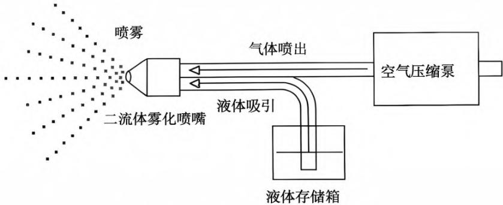  
图13.3-1 二流体喷雾雾化加湿原理

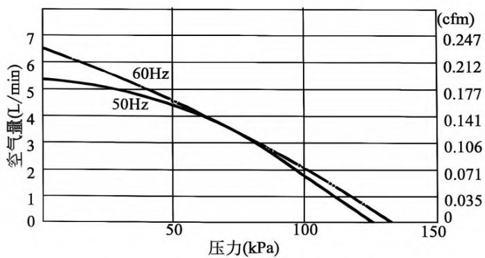  
图13.1-2 二流体喷雾雾化加湿设备的空气量与压力的关系

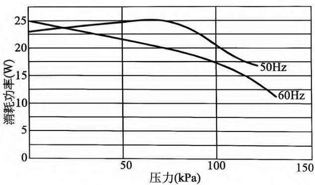  
图13.1-3 二流体喷雾雾化加湿设备的功耗与压力的关系

二流体喷雾雾化加湿设备具有体积小，部分设备用气压力高但不用采购高压空压机，不用改造气体管路，成本低，无噪声污染等多种优点；其缺点是排量较小。

## 13.4 通风机

通风机是输送气体或使气体增压的流体机械，简称风机。通风机能将原动机的机械能或其他外部能量传送给气体，使气体的能量增加。

暖通空调工程中常用的通风机，按其工作原理可分为离心式、轴流式和贯流式三种。在工程中广泛使用的混流式风机以及斜流式风机等均可看成是上述风机派生而来的。从用途上通风机可分为通用型、消防排烟型、屋顶型、诱导型、防腐型、排尘和防爆型等。离心式通风机按其全压高低，分为低压通风机、中压通风机和高压通风机。轴流式通风机按其全压高低，分为低压通风机和高压通风机。

### 13.4.1 通风机的全称

通风机的全称包括名称、型号、机号、传动方式、旋转方向和风口位置六部分。

1. 名称：通风机的名称由三部分组成：

(1) 通风机的用途或输送介质, 其用途代号见表 13.4-1。

(2) 通风机叶轮的作用原理, 有离心式、轴流式等。

(3) 通风机在管网中的作用和压力高低。

常用通风机用途代号  
表 13.4-1

<table><tr><td rowspan="2">用途</td><td colspan="2">代号</td></tr><tr><td>汉字</td><td>简写</td></tr><tr><td>一般通用通风换气</td><td>通用</td><td>T</td></tr><tr><td>防爆气体通风换气</td><td>防爆</td><td>B</td></tr><tr><td>防腐气体通风换气</td><td>防腐</td><td>F</td></tr><tr><td>纺织工业通风换气</td><td>纺织</td><td>FZ</td></tr><tr><td>船舶用通风换气</td><td>船通</td><td>CT</td></tr><tr><td>矿井主体通风</td><td>矿井</td><td>K</td></tr><tr><td>隧道通风换气</td><td>隧道</td><td>CD</td></tr><tr><td>排尘通风</td><td>排尘</td><td>C</td></tr><tr><td>锅炉通风</td><td>锅通</td><td>G</td></tr><tr><td>锅炉引风</td><td>锅引</td><td>Y</td></tr></table>

2. 型号：型号组成顺序见表 13.4-2 和表 13.4-3。

离心式通风机型号组成顺序  
表 13.4-2

<table><tr><td colspan="2">型号</td></tr><tr><td>形式</td><td>品种</td></tr><tr><td>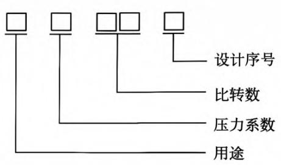</td><td>NO.□机号</td></tr></table>

轴流式通风机型号组成顺序  
表13.4-3

<table><tr><td colspan="2">型号</td></tr><tr><td>形式</td><td>品种</td></tr><tr><td></td><td></td></tr></table>

注：1. 叶轮数代号，单叶轮可不表示，双叶轮用“2”表示。

2. 用途代号见表13.4-4。

3. 叶轮毂比为叶轮底径与外径之比，取两位整数。

4. 转子位置代号，卧式用“A”表示，立式用“B”表示，产品无转子位置变化可不表示。

5. 若产品的形式中有重复代号或派生型时, 则在设计序号前加注序号, 用罗马数字 I , II 等表示。

6. 机号：以风机叶轮直径的 dm 值（尾数四舍五入）冠以符号 “NO.” 表示。

3. 传动方式代号见表 13.3-4 和图 13.4-1。

通风机的六种传动方式  
表13.3-4

<table><tr><td rowspan="2">代号</td><td colspan="2">传动方式</td></tr><tr><td>离心通风机</td><td>轴流通风机</td></tr><tr><td>A</td><td>无轴承,电机直联传动</td><td>无轴承,电机直联传动(电机内置)</td></tr><tr><td>B</td><td>悬壁支承,皮带轮在轴承中间</td><td>联轴器传动(电机外置)</td></tr><tr><td>C</td><td>悬壁支承,皮带轮在轴承外侧</td><td>悬壁支承,皮带轮传动(电机外置)</td></tr><tr><td>D</td><td>悬壁支承,联轴器传动</td><td>外转子电机传动(特殊内置式)</td></tr><tr><td>E</td><td>悬壁支承,联轴器传动,电机在风机侧面</td><td>动叶可调机构传动(大型轴流特有)</td></tr><tr><td>F</td><td>联轴器传动,叶轮在两个轴承之间</td><td>齿轮箱传动(电机外置)</td></tr></table>

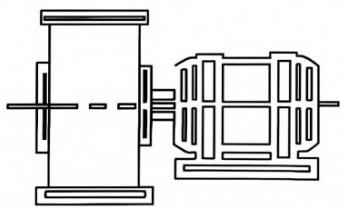  
A式

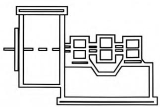  
B式

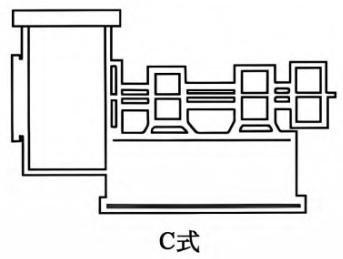

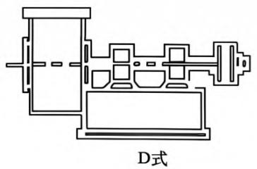

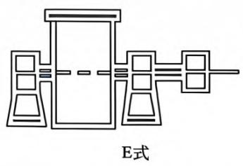  
(a)

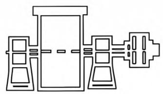  
F式  
图 13.4-1 通风机的传动方式（一）  
(a) 离心式通风机的传动方式

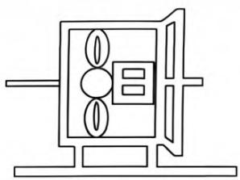  
A式

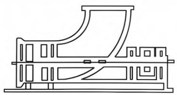  
B式

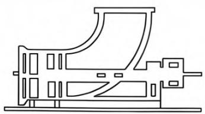  
C式

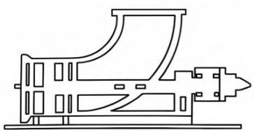  
D式

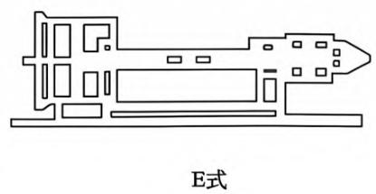  
(b)

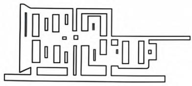  
F式  
图 13.4-1 通风机的传动方式（二）  
(b) 轴流式通风机的传动方式

4. 旋转方向：从主轴槽轮或电动机位置看叶轮旋转方向，顺时针为“右”，逆时针为“左”。

5. 风口位置：离心式通风机的风口位置，以叶轮的旋转方向和进、出风口方向（角度）表示。写法是：右（左）出风口角度/进风口角度。其基本出风口位置为8个，特殊用途时可增加，见图13.4-2和表13.3-5。

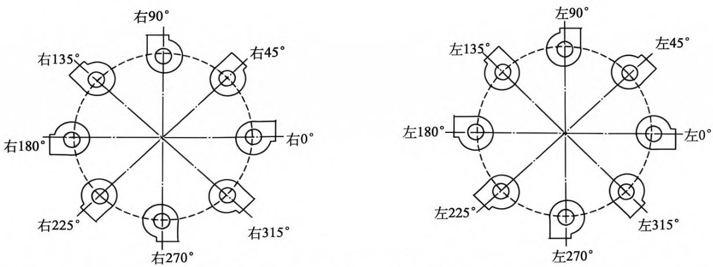  
图 13.4-2 离心式通风机出风口位置

离心式通风机出风口位置  
表 13.4-5

<table><tr><td>基本出风口位置</td><td>0°</td><td>45°</td><td>90°</td><td>135°</td><td>180°</td><td>225°</td><td>270°</td><td>(315°)</td></tr><tr><td rowspan="2">补充出风口位置</td><td>15°</td><td>60°</td><td>105°</td><td>150°</td><td>195°</td><td>(240°)</td><td>(285°)</td><td>(330°)</td></tr><tr><td>30°</td><td>75°</td><td>120°</td><td>165°</td><td>210°</td><td>(255°)</td><td>(300°)</td><td>(345°)</td></tr></table>

6. 轴流式通风机的风口位置，用进（出）若干角度表示，见图 13.4-3。基本风口位置有 4 个，特殊用途时可增加，见表 13.4-6。

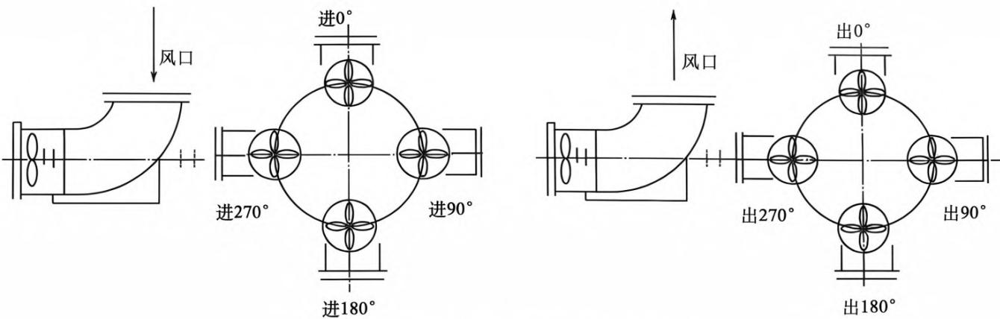  
图 13.4-3 轴流式通风机风口位置  
轴流式通风机出风口位置

表 13.4-6

<table><tr><td>基本风口位置</td><td>0°</td><td>90°</td><td>180°</td><td>270°</td></tr><tr><td>补充风口位置</td><td>45°</td><td>135°</td><td>225°</td><td>315°</td></tr></table>

7. 风机箱：

（1）离心式风机箱。消防、通风（两用）低噪声柜式离心式风机箱有较多的性能参数，以满足不同用户的需要。

消防、通风（两用）低噪声柜式离心式风机箱的形式代号如下：

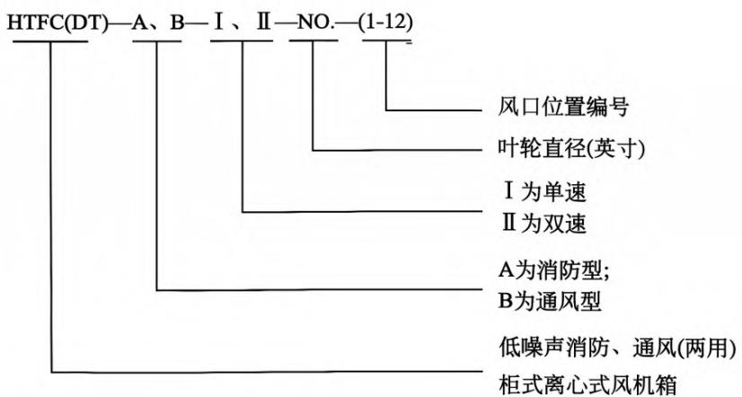

离心式风机箱吸、排风口位置如表 13.4-7 所示。

离心式风机箱吸、排风口位置  
表 13.4-7

<table><tr><td>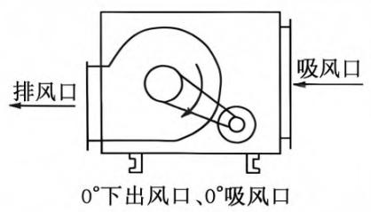</td><td>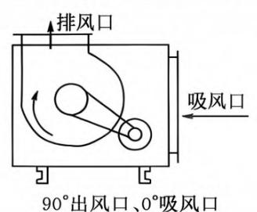</td><td>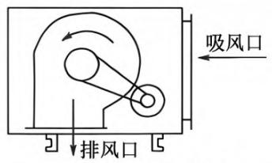270°出风口、0°吸风口</td></tr><tr><td>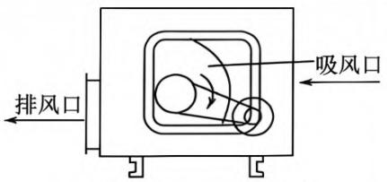0°下出风口、左吸风口</td><td>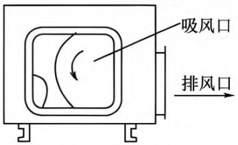0°上出风口、右吸风口</td><td>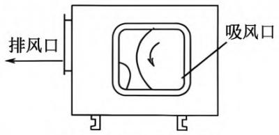0°上出风口、左吸风口</td></tr><tr><td>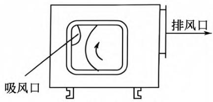0°上出风、右吸风口</td><td>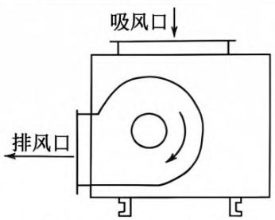0°下出风口、90°吸风口</td><td>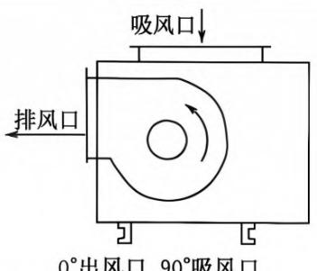0°出风口、90°吸风口</td></tr><tr><td>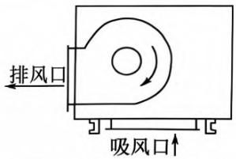0°下出风口、270°吸风口</td><td>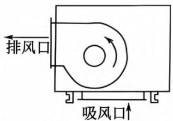0°上出风口、270°吸风口</td><td>0°上出风口、右吸风口</td></tr></table>

(2) 外置电机风机箱。外置电机风机箱根据消防与通风的不同要求分 A 型和 B 型两种 (表 13.4-8); 还可分为 I、II、III、IV 四种类型, 其中 I、III 型为单速型, II、IV 型为双速型, 配用双速型电机, 实现两挡调速, 可满足用户对不同工况点性能调节的需要。

外置电机风机箱的类型  
表 13.4-8

<table><tr><td>类型</td><td>A型</td><td>B型</td></tr><tr><td>特征及用途</td><td>电机装在箱体外面,可与高温气体隔离分开,确保风机在高温下运转,用于消防排烟</td><td>电机装在箱体里面,用于通风换气</td></tr><tr><td>俯视图示意图</td><td></td><td></td></tr><tr><td>左视图示意图</td><td></td><td></td></tr><tr><td>前视图示意图</td><td></td><td></td></tr></table>

### 13.4.2 单台通风机的工作性能

**13.4.2.1 通风机的构造和性能曲线**

暖通空调工程常用的通风机构造和性能曲线如表13.4-9和表13.4-10所示。

常用通风机构造  
表13.4-9

<table><tr><td colspan="2">种类</td><td colspan="2">叶轮设计</td><td colspan="3">外壳设计</td></tr><tr><td rowspan="4">离心式通风机</td><td>流线型</td><td></td><td>离心式通风机中效率最高,一般设10~16片叶片,按旋转方向呈周边离心分布</td><td></td><td colspan="2" rowspan="2">旋涡形,能有效地将动压变成静压。要求叶片和人口喇叭的对中及间隙非常精确,以达到最高效率</td></tr><tr><td>后倾或后弯叶型</td><td></td><td>厚度均匀的后倾或后弯叶片。10~16片叶片沿旋转方向布置,效率比流线型稍低</td><td colspan="2"></td></tr><tr><td>改进径向型</td><td></td><td>有6~10片叶片,径向或带弧弯改进型的径向叶片。效率偏低,但有良好的机械强度,叶轮易更换。宜中速运行</td><td>→</td><td colspan="2">旋涡形,由于效率低些,对外壳的要求没有流线型或后弯叶型严格</td></tr><tr><td>前向叶型</td><td></td><td>效率比流线型或后弯叶型低。有20~64片较小的前弯叶片。质轻、造价低。空气离开叶轮时的速度大于叶片顶部的速度。在相同性能时,在所有离心式通风机中叶轮最小,运行速度最低</td><td>→</td><td colspan="2">旋涡形,叶轮和人口的配合要求没有流线型和后弯叶型严格</td></tr><tr><td>混流式通风机</td><td colspan="2">扭曲机翼型</td><td></td><td>具有子午加速特点的扭曲机翼形叶片,有6、8、10片叶片,效率较高</td><td></td><td>圆筒形机壳出口装的导流叶片使风机压力稳定,气流分布均匀</td></tr><tr><td>斜流式通风机</td><td colspan="2">扭曲机翼型</td><td></td><td>具有子午加速的叶轮子午平面内流线与风机轴线斜交,有4、6、8片斜流叶片</td><td></td><td>渐扩渐缩的鼓形圆筒外壳,出风口带有导流叶片</td></tr><tr><td rowspan="3">轴流式通风机</td><td colspan="2">螺旋桨型</td><td></td><td>构造简单、价廉。2片或更多的厚度均匀的叶片连接在叶轮上。能量的传递主要通过动压力转换来实现</td><td></td><td>外壳为简单的圆筒、孔板或文丘里管。应使圆筒尽可能靠近叶片顶部,以在叶轮处形成一个均匀的人口气流</td></tr><tr><td colspan="2">筒型</td><td></td><td>4~8片流线型或厚度均匀的叶片。轮毂小于叶片端部直径的50%。效率比螺旋桨型略高些,且有可用的静压值</td><td>→</td><td>圆筒形管子,叶轮顶端和套筒间隙紧凑,其性能优于螺旋桨型</td></tr><tr><td colspan="2">叶片型</td><td></td><td>叶片设计良好,效率高,允许中高压时使用。叶片为流线型时效率最高。叶片可以是固定的,也可以是可调整角度的,轮毂多大于叶片顶部直径的50%</td><td></td><td>圆筒紧靠叶片的顶部,并装有导流叶片。导流叶片将旋转的能量用来增加风压,提高效率</td></tr><tr><td>专用通风机</td><td>筒型</td><td>离心式</td><td></td><td>通常采用流线型或后倾(后弯)型叶片,也有用混合型螺旋桨</td><td></td><td>圆筒如叶片型轴流式通风机,但叶轮外径不紧靠圆筒,空气从叶轮径向排出,并经由导流叶片使流向改变90°后排出</td></tr><tr><td rowspan="3">专用通风机</td><td>屋顶通风器</td><td>离心式</td><td></td><td>多数设计采用流线型或后倾(后弯)叶片,以实现低压力、大风量。实际使用中还有各种特殊的离心螺旋桨(如混流)设计</td><td></td><td>通常不带外筒,空气通过螺旋桨呈360°排至大气</td></tr><tr><td>排风扇</td><td>轴流式</td><td></td><td>叶轮形式多种多样,以实现大流量、低压力</td><td></td><td>基本上是一个安装在基座上的螺旋桨推进器,上设防雨及安全罩,空气通过罩下部的环状空间排出</td></tr><tr><td>贯流式通风机</td><td>离心式</td><td></td><td>滚筒形前向式多叶叶轮,叶轮可沿旋转轴方向延长</td><td></td><td>蜗壳形外壳沿旋转轴的两个端面是封闭的,具有扁而平的出风口截面</td></tr><tr><td colspan="7">常用通风机性能曲线 表13.4-10</td></tr><tr><td colspan="3">种类</td><td colspan="2">性能曲线</td><td>性能特性</td><td>应用范围</td></tr><tr><td rowspan="2">离心式通风机</td><td colspan="2">流线型</td><td colspan="2"></td><td>最高效率点在50%~65%的流量范围,压力特性好,耗功率接近最大值。当压力降低并趋向无压时,耗功率因自身限制变小</td><td>低压、中压和高压系统,特别是用在大型系统中,其节能效果明显</td></tr><tr><td colspan="2">后倾或后弯叶型</td><td colspan="2"></td><td>性能特性同流线型,最高效率比流线型稍低些。</td><td>一般通风和空调系统,也可用在由于腐蚀不能采用流线型通风机的场合</td></tr><tr><td colspan="2">种类</td><td colspan="2">性能曲线</td><td>性能特性</td><td colspan="2">应用范围</td></tr><tr><td rowspan="2">离心式通风机</td><td colspan="2">改进径向型</td><td></td><td>压力比前两种高。在最高效率点的左边,性能曲线有个拐点。随风压的降低,风量加大,风机的耗功不断上升</td><td colspan="2">主要用于原料输送和除尘系统。叶片是加固型,且易于在现场维修、更换。很少在通风和空调工程中使用</td></tr><tr><td>前向叶型</td><td></td><td>压力曲线不如后弯叶型陡,该曲线在最高效率点的左边有个低谷。最高效率点在最高压力点的右边,其流量为全流量的40%~50%时,风机应在最高压力点的右边运行。耗功率随着风机运行趋向无压排出时而不断上升,选电机时要考虑此特性</td><td colspan="3">用在低压的供暖、通风及空调系统中,如住宅火炉供暖、中央空调和柜式空调系统、房间空调器及屋顶空调器</td></tr><tr><td>混流式通风机</td><td colspan="2">扭曲机翼型</td><td></td><td>风压高于同机号的轴流式通风机,风量大于同机号的离心式通风机,效率高、高效区宽、噪声低、结构紧凑且安装方便</td><td colspan="2">用于风量较大和风压较高的系统,可替代低压离心式通风机和高压轴流式通风机</td></tr><tr><td>斜流式通风机</td><td colspan="2">扭曲机翼型</td><td></td><td>风量、风压介于轴流式通风机和离心式通风机之间,是混流式通风机的派生产品</td><td colspan="2">用于工矿企业和公共建筑,可替代低压离心式通风机和高压轴流式通风机</td></tr><tr><td>轴流式通风机</td><td colspan="2">螺旋桨型</td><td></td><td>流量大、压力低,最高效率点出现在压力接近无压自由排出的状态。由于叶片的作用和缺少变直能力,气流出口呈环状和旋涡状</td><td colspan="2">用在大流量、低压力系统,例如在一个空间内的气流循环,通过墙面不接风管的通风等</td></tr><tr><td rowspan="2">轴流式通风机</td><td colspan="2">筒型</td><td></td><td>高流量、低压力。由于螺旋桨式的旋转叶轮及缺少导流叶片,出来的环状气流呈旋转或旋涡形。从性能曲线看,最高压力点的左边有个凹谷,应避开</td><td colspan="2">用于对下降气流要求不严格的中、低压供暖、通风和空调系统中;也可用于工业领域,如干燥炉、喷漆柜和燃烧装置的排烟系统</td></tr><tr><td colspan="2">叶片型</td><td></td><td>高压、中流量。从性能曲线可看到,在最高压力点左边有个由于空气停止而引起的低谷,应避开。导流叶片将叶轮传给空气的旋转能量改变方向,以增加压力和提高效率</td><td colspan="2">用于供暖、通风和空调系统。其优点是空气直流,安装方便,下游的气流分布良好。与筒型一样可用在工业建筑中,与离心式通风机相比,其安装紧凑</td></tr><tr><td rowspan="3">专用通风机</td><td>筒型</td><td>离心式</td><td></td><td>性能相似于后弯叶型离心式通风机,但其风压低、风量小。由于气流在筒内要转90°,其效率比后弯叶型低。有些产品会出现如轴流式通风机的低谷</td><td colspan="2">主要用于暖通空调的低压回风系统,气流流形为直通式</td></tr><tr><td>屋顶通风机</td><td>离心式</td><td></td><td rowspan="2">低压头、大流量。这类产品仅表示静压和静压效率</td><td colspan="2">用于一般工厂、厨房、仓库的低压排风以及商业建筑中要求压力较低的系统。初投资及运行费低,比轴流式排风扇安静</td></tr><tr><td>排风扇</td><td>轴流式</td><td></td><td colspan="2">噪声比离心式屋顶通风机大</td></tr><tr><td>专用通风机</td><td>贯流式通风机</td><td>离心式</td><td></td><td>特性曲线呈驼峰形,效率较低。与其他通风机相比动压较高,可获得扁平而高速的气流,气流能到达的距离较长。噪声介于离心式通风机与轴流式通风机之间</td><td colspan="2">用于分体式空调器的室内机、壁挂式风机盘管及大门空气幕等</td></tr></table>

**1. 离心式通风机**

离心式通风机由集流器、叶轮、机壳和传动部件组成。叶轮上叶片的结构形式分为前向式、后向式和径向式，如图 13.4-4 所示。

  
(a)

  
(b)  
图 13.4-4 离心式通风机叶片的结构形式

(c)  
  
(a) 前向式 $(\beta > 90^{\circ})$ ；(b) 后向式 $(\beta = 90^{\circ})$ ；(c) 径向式 $(\beta < 90^{\circ})$

离心式通风机的压力分区：

高压： $p > 3000 \mathrm{~Pa}$ ，用于工业通风或特殊工程通风；

中压： $1000Pa \leqslant p \leqslant 3000Pa$ ，用于工业与民用建筑的通风、空调；

低压： $p<1000\mathrm{Pa}$ ，用于建筑的通风、空调系统。

2. 轴流式通风机

轴流式通风机主要由集风器、叶轮、轮毂、机壳和传动部件组成。

轴流式通风机的压力分区：

低压： $p<500Pa$ ，适宜各种通风换气；

高压： $p \geqslant 500 \text{Pa}$ ，适宜各种通风换气。

**3. 贯流式通风机**

贯流式通风机的机壳部分敞开，使气流直接径向进入叶轮，两次横穿叶片后排出。贯

流式通风机的全压系数较大，效率较低。适宜于空气幕等设备。

**13.4.2.2 通风机的管网特性**

从通风机工作的管网系统看，除了在吸风口和送风口处存在静压差外，管网的特性曲线取决于管网的总阻力和管网排出时的动压。

$$
P = S \cdot G ^ {2}\tag{13.4-1}
$$

式中 P —— 管网的总阻力，Pa；

S——管网的总阻抗， $kg/m^{7}$ ;

G——系统风量， $m^{3}/h$ 。

即管网的特性曲线呈抛物线向上，随流量的增大而增大，如图 13.4-5 所示。通风机性能曲线和管网特性曲线的交点即为该通风机在管网中的工作点。

**13.4.2.3 通风机的功率**

通风机所需的轴功率 $N_{z}$ （kW）为：

图13.4-5 管网特性曲线

$$
N _ {z} = \frac {G \cdot p}{3 6 0 0 \cdot 1 0 0 0 \cdot \eta \cdot \eta_ {\mathrm{m}}}\tag{13.4-2}
$$

式中 G ——通风机所输送的风量， $m^{3}/h$ ;

p——通风机所产生的风压，Pa；

$\eta$ ——通风机的效率，%；

$\eta_{m}$ ——通风机的传动效率，%，见表 13.4-11。

通风机的传动效率 $\eta_{\mathrm{m}}$  
表 13.4-11

<table><tr><td>传动方式</td><td>电动机直联</td><td>联轴器连接</td><td>三角皮带传动</td></tr><tr><td> $\eta_{m}$ </td><td>100%</td><td>98%</td><td>95%</td></tr></table>

配用通风机的功率 N 可按下式计算：

$$
N = K \cdot N _ {z}\tag{13.4-3}
$$

式中 $K$ ——电动机容量安全系数，见表13.4-12。

电动机容量安全系数 K

<table><tr><td>电动机容量(kW)</td><td>0.5</td><td>0.5~1.0</td><td>1~2</td><td>2~5</td><td>&gt;5</td></tr><tr><td>K</td><td>1.5</td><td>1.4</td><td>1.3</td><td>1.2</td><td>1.13</td></tr></table>

表 13.4-12

**13.4.2.4 通风机的比转数**

通风机的比转数 $n_{\mathrm{a}}$ 表示通风机在标准状态下流量 $G$ 、压力 $p$ 和转速 $n$ 之间的关系[式（13.4-4）]，同类型的通风机，其比转数必然相等。

$$
n _ {\mathrm{s}} = \frac {n}{\left(\frac {p}{G}\right) ^ {0 . 5} \cdot p ^ {0 . 2 5}}\tag{13.4-4}
$$

离心式通风机的比转数一般为 15～80，轴流式通风机的比转数一般为 100～500。

### 13.4.3 多台通风机联合工作的特性

通风机并联工作可以提高风量，串联工作可以提高风压；但联合运行与单台运行相比，总会造成经济性和可靠性的降低，因此在非必要的情况下，应尽量不采用。

**13.4.3.1 并联工作**

图 13.4-6 为两台相同的通风机并联运行的性能曲线。

$$
G _ {1 + 2} = 2 G _ {1} ^ {\prime} <   2 G _ {1}
$$

图 13.4-7 为两台不同的通风机并联运行的性能曲线，通风机并联的主要目的是加大风量，在 A 点并联运行工况是良好的。在 B、C 点运行则不好，在 B 点，两台通风机并联运行的风量等于 1 台通风机的风量；在 C 点，并联通风机运行的风量小于 1 台通风机的风量。应注意避免并联通风机在阻力大的情况下运行。

$$
G _ {\mathrm{A}} = G _ {1 \mathrm{A}} + G _ {2 \mathrm{A}} <   G _ {1} + G _ {2}
$$

  
图13.4-6 两台相同的通风机并联运行的性能曲线

  
图13.4-7 两台不同的通风机并联运行的性能曲线

通风机并联工作时，风量小于两台通风机单独运行时的风量之和，但大于单台风机时的风量。

**13.4.3.2 串联工作**

图 13.4-8 为两台性能不同的通风机串联运行的性能曲线。B 点是通风机串联运行的临界点，即串联运行的性能曲线和单台通风机性能曲线的交点。工况点在 B 点的左边，串联运行可增加气体的压力和流量，离 B 点越远，串联运行的效果越好；反之，工况点在 B 点的右边，串联运行没有效果，气体的压力和流量比通风机 2 单独工作时的流量和压力还小。因此，一定要经过综合性能分析后，再确定串联运行是否有效。

### 13.4.4 通风机的气压温度修正

在工程计算中，20℃和1个标准大气压下空气的密度 $\rho_{N}=1.2kg/m^{3}$ 。根据状态方程 $p=\rho RT$ （R为空气气体常数，T为热力学温度）可以得出，标准状态

图13.4-8 两台性能不同的通风机串联运行的性能曲线

下（ $t=0^{\circ}\mathrm{C}$ 、1个大气压）， $\rho_{0}=1.29\mathrm{kg/m^{3}}$ 。一般暖通空调工程中，温度在 $0 \sim 20^{\circ}\mathrm{C}$ 波动的状况下，空气密度也不过从 $1.2\mathrm{kg/m^{3}}$ 波动到 $1.29\mathrm{kg/m^{3}}$ ，偏差为 $(1.29-1.2)/1.2 \times 100\% = 7.5\%$ 。

风管中的空气流动大多处于水力过渡区，通风管道单位长度摩擦阻力线算图表在标准状况下获得，当密度、黏性、温度和大气压力，以及管道粗糙度不同时，需要对单位长度摩擦阻力进行修正，系统的风量计算和风管的压力计算所需的密度也需要修正。

**13.4.4.1 密度和黏性系数的修正**

$$
R _ {\mathrm{m}} = R _ {\mathrm{m0}} (\rho / \rho_ {0}) ^ {0. 9 1} (\nu / \nu_ {0}) ^ {0. 1} \quad (\mathrm{Pa/m})\tag{13.4-5}
$$

式中 $R_{m}$ ——实际的单位长度摩擦阻力，Pa/m；

$R_{m0}$ ——线算图中查得的单位长度摩擦阻力，Pa/m；

$\rho_{0}$ ——标准状态下空气的密度， $kg/m^{3}$ ;

$\nu_{0}$ ——标准状态下空气的运动黏性系数， $m^{2}/s$ ;

$\rho$ ——实际的空气密度， $kg/m^{3}$ ;

$\nu$ ——实际的空气运动黏性系数， $m^{2}/s$ 。

**13.4.4.2 空气温度和大气压力的修正**

$$
\begin{array}{r l} & R _ {\mathrm{m}} = K _ {\mathrm{t}} K _ {\mathrm{b}} R _ {\mathrm{m0}} \quad (\mathrm{Pa/m}) \\ & K _ {\mathrm{t}} = [ (2 7 3 + 2 0) / (2 7 3 + t _ {2}) ] ^ {0. 8 2 5} \\ & K _ {\mathrm{B}} = (B / 1 0 1. 3) ^ {0. 9} \end{array}\tag{13.4-6}
$$

式中 $K_{\mathrm{t}}$ ——温度修正系数；

$K_{B}$ ——大气压力修正系数；

$t_{2}$ ——实际的空气温度，℃；

B——实际的大气压力，kPa。

$K_{t}$ 和 $K_{B}$ 可直接由图 13.4-9 查得。从图 13.4-9 可看出，在 $t=0\sim100^{\circ}C$ 的范围内，可近似把温度和压力的影响看作直线关系。

**13.4.4.3 通风管道的粗糙度修正**

通风管道的粗糙度查阅通风管道单位长度摩擦

图13.4-9 温度和大气压力修正曲线

阻力线算图， $R_{m}$ 是在体积流量已确定的前提下进行的查阅。可先查出 $R_{m0}$ ，再近似按式（13.4-7）和式（13.4-8）修正。

$$
R _ {\mathrm{m}} = K _ {\mathrm{r}} R _ {\mathrm{m0}}\tag{13.4-7}
$$

$$
K _ {\mathrm{r}} = (K v) ^ {0. 2 5} \quad \mathrm{Pa/m}\tag{13.4-8}
$$

式中 $K_{r}$ ——管壁粗糙度修正系数；

K——管壁粗糙度，mm；

v——管内空气流速，m/s。

也就是说，当进行修正时，体积流量已经确定是不变的，则修正按照式（13.4-9）计算。

$$
R _ {\mathrm{m}} = K _ {\mathrm{t}} K _ {\mathrm{B}} R _ {\mathrm{m0}} = \left(\frac {2 3 7 + 2 0}{2 7 3 + t _ {2}}\right) ^ {0. 8 2 5} \cdot \left(\frac {B _ {2}}{1 0 1 . 3}\right) ^ {0. 9} \cdot R _ {\mathrm{m0}} = \frac {\rho_ {2}}{\rho_ {1}} \cdot \left(\frac {v}{v _ {0}}\right) ^ {0. 1} \cdot R _ {\mathrm{m0}}\tag{13.4-9}
$$

式中 $B_{2}$ ——实际大气压力，kPa；

v——实际空气流速，m/s;

$R_{m}$ ——修正后的单位长度摩擦阻力，kPa/m；

$R_{m0}$ ——查线算图得到的单位长度摩擦阻力，kPa/m；

$t_{2}$ ——实际的空气温度，℃；

$\rho_{1}$ ——20℃、1个标准大气压下空气的密度，取1.2kg/m $^{3}$ ;

$\rho_{2}$ ——实际的空气密度，kg/m $^{3}$ 。

风系统中的空气流动处于紊流过渡区，其沿程阻力系数 $\lambda$ 与 K/D、Re 都有关，所以最终的 $\lambda$ 和空气的密度 $\rho$ 是有关的。当压力和温度不同而进行单位长度摩擦阻力修正时，其修正系数是非线性的，指数在 0.8～0.9 之间。

工程计算中可以近似认为空气的流动在阻力平方区内，即认为 $\lambda$ 不变。当地实际的大气密度 $\rho_{2}$ 可按下式计算。

$$
\rho_ {2} = \frac {p _ {1}}{1 0 1 3 2 5} \times 1. 2\tag{13.4-10}
$$

式中 $p_{1}$ ——实际的大气压， $\mathrm{Pa}$ 。

修正后，通风管道单位长度摩擦阻力线算图则为实际大气压力下的图，各个状态点的焓值、相对湿度、含湿量、温度对应的都是其大气压力下的准确值。在此基础上，用计算的总负荷、显热负荷等计算出质量流量，再基于实际的密度计算出实际的体积流量。

**13.4.4.4 通风管道风管尺寸修正及阻力计算**

已知实际空气密度 $\rho_{2}$ 、实际空气体积流量，并按照推荐流速确定风管尺寸，按照式（13.4-11）修正。

$$
R ^ {\prime} = R \cdot \frac {\rho_ {2}}{1 . 2}\tag{13.4-11}
$$

此 $R'$ 为修正后的实际密度下的管道单位长度摩擦阻力, 乘以总长度 $L$ 即可得实际沿程阻力。同样由式 (13.4-12) 可以看到, 在体积流量确定之后, 总局部阻力也与 $\rho$ 成正比。

$$
H _ {\mathrm{j}} = \sum \frac {1}{2} \zeta \rho_ {2} v ^ {2}\tag{13.4-12}
$$

式中 $\zeta$ ——局部阻力系数；

v——空气流速，m/s。

总阻力等于沿程阻力加上局部阻力，根据下式计算：

$$
H = H _ {1} + H _ {\mathrm{j}} = \left(L R ^ {\prime}\right) + \sum \frac {1}{2} \zeta \rho_ {2} v ^ {2} = \left(L R ^ {\prime} \frac {\rho_ {2}}{1 . 2}\right) + \sum \frac {1}{2} \zeta \rho_ {2} v ^ {2}\tag{13.4-13}
$$

式中 $H$ ——管路总阻力， $\mathrm{m}$ ；

$H_{1}$ ——沿程阻力，m；

$H_{j}$ ——局部阻力，m；

L ——管道最不利环路总长度，m。

即在体积流量确定不变后，风系统总阻力和所输送空气的密度成正比。

**13.4.4.5 通风机运行参数修正**

当流体的密度变化时，通风机的体积流量不变，但是压力会发生变化，其耗功也会变

化，见表 13.4-13。

通风机的性能变化关系式  
表 13.4-13

<table><tr><td>空气密度ρ发生变化</td><td>风机转速n发生变化</td><td>空气密度ρ、转速n发生变化</td><td>大气压力 $p_0$ 改变、温度t改变</td></tr><tr><td> $L_2=L_1$ </td><td> $L_2=L_1\frac{n_2}{n_1}$ </td><td> $G=G_0\cdot\frac{n}{n_0}$ </td><td> $G=G_0$ </td></tr><tr><td> $p_2=p_1\frac{\rho_2}{\rho_1}$ </td><td> $p_2=p_1\left(\frac{n_2}{n_1}\right)^2$ </td><td> $p=p_0\cdot\left(\frac{n}{n_0}\right)^2\cdot\frac{\rho}{\rho_0}$ </td><td> $p=p_0\cdot\frac{p_b}{p_{b0}}\cdot\frac{273+20}{273+t}$ </td></tr><tr><td> $N_2=N_1\frac{\rho_2}{\rho_1}$ </td><td> $N_2=N_1\left(\frac{n_2}{n_1}\right)^3$ </td><td> $N=N_0\left(\frac{n}{n_0}\right)^3\cdot\frac{\rho}{\rho_0}$ </td><td> $N=N_0\cdot\frac{p_b}{p_{b0}}\cdot\frac{273+20}{273+t}$ </td></tr><tr><td> $η_2=η_1$ </td><td> $η_2=η_1$ </td><td> $η=η_0$ </td><td> $η=η_0$ </td></tr></table>

注： $G_{0}$ 、 $p_{0}$ 、 $N_{0}$ 、 $\eta_{0}$ 、 $n_{0}$ 、 $p_{b0}$ 为标准状态或性能表中的风量、风压、功率、效率、转速和大气压； $L_{1}$ 、 $p_{1}$ 、 $N_{1}$ 、 $\eta_{1}$ 、 $n_{1}$ 是在标准工况下测得的数值；G、p、N、 $\eta$ 、n、 $p_{b}$ 、t为实际工作条件下的风量、风压、功率、效率、转速、大气压和温度。

通风机的产品样本中，其测试状态常常是在 $20^{\circ}$ C、1 个大气压的标准状态下获得的风量和压力参数。因此，通风机实际能够到达的压力按下式计算：

$$
p _ {2} = p _ {1} \frac {\rho_ {2}}{1 . 2}\tag{13.4-14}
$$

式中， $p_{1}$ 是在标准工况下测得的风压。

通风机在高海拔地区运行时，风压会下降，因此对于空气密度不等于 $1.2 \mathrm{~kg} / \mathrm{m}^{3}$ 的情况，在选型时需要根据我国典型城市气压表进行反修正。假设设计人员已经计算出了实际密度下的风量为 $20000 \mathrm{~m}^{3} / \mathrm{h}$ ，通风机压力为 $1000 \mathrm{~Pa}$ ，该参数是在大气压为 0.85 bar、温度为 $20^{\circ} \mathrm{C}$ 下的参数。

计算风量时通常不会根据各状态点的空气密度不同而调整最后的风量，而是通过安全系数进行补偿，这种不修正密度的方法一般是安全的。但是有两种情况下，则必须修正空气的密度：一是我国西北、西南高海拔地区（比如西宁、拉萨等），应该考虑该地区的海拔高度和空气压力；二是高温空气，最典型的就是消防排烟的排烟量和风机余压的计算，此时如果仍旧采用 $\rho=1.2kg/m^{3}$ 来计算则会产生很大的误差，该误差不仅导致体积流量产生很大误差，也导致阻力计算误差较大。

对于通风机和空调箱的压力，设计人员的设计参数是可以自行反修正的，反修正就是把设计人员计算出的结果转换成 $20^{\circ}C$ 、1 个大气压下的样本值，其计算公式是表 13.4-14 中公式的反函数，即按下式计算：

$$
p _ {\mathrm{f}} = p _ {\mathrm{d}} \frac {1 . 2}{\rho}\tag{13.4-15}
$$

式中 $p_{1}$ ——通风机的选型余压，Pa；

$p_{d}$ ——设计计算的余压，Pa。

如此可以将实际状态下的通风机压力转换成标准状态下的产品样本数值。空调箱的通风机选型，前提是设计人员必须知道机内压力损失，耗功率按下式计算：

$$
N = \frac {G \cdot p}{\eta}\tag{13.4-16}
$$

耗功率计算公式中没有密度项，所以通风机的实际需用功率需要考虑通风机是在高海拔地区下运行的还是在低海拔地区运行的，实际的功耗应该根据设计计算出的该地区的实际风量和实际通风机压力进行计算，并不需要修正，由实际风量和风压计算得到的功耗选型电机即可。对于设备而言，通常给出的电机功率是在额定工况下的风量和压力下的数值。对于这种情况，需要校核实际的功率和额定工况下的功率是否能够满足各自的需求。

对于通风机的选型，首先应该计算实际密度下的体积风量和阻力，并在标注时，说明风量和阻力的计算都是在某密度下计算的。然后对阻力和功率进行反修正，获得标准工况下的阻力和功率，并参照产品样本选型。对于高温烟气，与高海拔地区的情形类似，都是因为密度的不同所导致的修正，因此也可按照上述方法进行修正。

### 13.4.5 通风机的选择及运行调节

**13.4.5.1 通风机的选择**

1. 系统所需风量 $G$ :

$$
G = \eta \frac {Q}{\Delta h} = \eta \frac {Q}{c _ {\mathrm{P}} \Delta T}\tag{13.4-17}
$$

式中 $Q$ ——系统的总负荷，W；

$\Delta T$ ——系统的送、排风温差，℃；

$\Delta h$ ——系统的送、排风焓差，J；

$c_{P}$ ——空气定压比热容， $J/(kg \cdot K)$ ;

$\eta$ ——修正系数，可取1.1。

2. 管路系统和除尘设备阻力所需要的未在标准工况下修正的风机全压：

$$
p = p _ {1} \frac {B}{7 6 0} \cdot \frac {2 7 3 . 1 5 + T _ {2}}{2 7 3 . 1 5 + T _ {1}} = \eta \sum (H _ {1} + H _ {\mathrm{j}})\tag{13.4-18}
$$

式中 $p$ ——工况全压， $\mathrm{Pa}$ ；

$p_{1}$ ——设计标准压力（或计算表中全压），Pa；

B——当地大气压，Pa；

$T_{2}$ ——工况介质温度，℃；

$T_{1}$ ——计算表中或未修正的设计温度，℃；

$\sum (H_{1} + H_{j})$ ——系统摩擦阻力和局部阻力的总和， $\mathrm{Pa}$ 。

确定 G、p 后，可按照通风机性能曲线选择通风机型号和配套电机。

3. 通风机的轴功率可按下式计算：

$$
N = \frac {G}{3 6 0 0} \cdot \frac {p}{1 0 0 0 \cdot \eta_ {0} \cdot \eta_ {1}} = N ^ {\prime} \cdot K\tag{13.4-19}
$$

式中 G ——通风机风量， $m^{3}/h$ ;

p——通风机的全压，Pa；

N——通电机功率，kW；

$N'$ ——通工作机械的轴功率，kW；

$\eta_{0}$ ——通风机的内效率，一般取0.75～0.85，小通风机取低值、大通风机取高值；

$\eta_{1}$ ——传动机械效率，通风机与电机直联取1，用联轴器连接取0.95～0.98，用三

角皮带连接取 0.9～0.95，用平皮带传动取 0.85；

K——电机容量系数，其取值顺结合设备工况：连续平稳运行（如大型离心泵）， $K=1.1\sim1.2$ ；启动频繁、负载波动大（如往复泵、破碎机）， $K=1.2\sim1.5$ （甚至更大，依冲击程度而定）。

4. 通风机的比转数：

$$
n _ {\mathrm{s}} = \frac {\sqrt {q _ {\mathrm{v}}}}{p ^ {\frac {3}{4}}} n\tag{13.4-20}
$$

式中 $q_{v}$ ——流量， $m^{3}/s$ ;

p——全压，Pa;

n——风机的转速，r/min。

5. 根据通风机的压力系数确定叶轮外径:

$$
D = \frac {6 0}{\pi n} \cdot \left(\frac {p}{\psi v _ {2}}\right) ^ {\frac {1}{2}}\tag{13.4-21}
$$

式中 $D$ ——叶轮外径， $\mathrm{mm}$ ；

n ——通风机的转速，r/min;

$\psi$ ——通风机的功率系数，%；

$v_{2}$ ——当地风速，m/s。

**13.4.5.2 通风机的选择原则及注意事项**

1. 根据通风机输送的气体性质和对应管路系统的基本特性，确定通风机的类型。应根据管道连接方式、机房条件注明通风机进出口方向，有外置电机的注明电机位置。

2. 选择通风机时应注意, 性能曲线和产品样本上给出的性能, 均指通风机在标准状态下 (大气压力为 $101.3 \mathrm{kPa}$ 、温度为 $20^{\circ} \mathrm{C}$ 、相对湿度为 $50 \%$ 、密度为 $1.20 \mathrm{~kg} / \mathrm{m}^{3}$ ) 的参数。如果使用条件改变, 应按换算后的性能参数进行选择, 同时应核对通风机配用电动机轴功率是否满足使用条件下的功率要求。

3. 通风机的风量应在系统计算总风量上附加风管和设备的漏风量。一般用于送、排风系统的定转速通风机，风量附加 $5\% \sim 10\%$ ；除尘系统的通风机，风量附加 $10\% \sim 15\%$ ；防排烟系统的通风机，风量附加 $20\%$ 。

4. 采用定转速通风机时，其压力应在系统计算的压力损失上附加 $10\% \sim 15\%$ ，除尘系统附加 $15\% \sim 20\%$ ，排烟系统附加 $10\%$ 。

5. 采用变频调速时, 通风机的压力应以系统计算总压力损失作为额定压力, 但通风机电动机的功率应在计算值上附加 $15 \% \sim 20 \%$ 。

6. 通风机的设计工况效率，不应低于其最高效率的 $90\%$ 。

7. 多台通风机并联或串联运行时，宜选择同型号通风机。

8. 当通风机使用工况与通风机样本工况不一致时，应对其性能进行修正。

**13.4.5.3 通风机的运行调节**

从通风机性能曲线图可知，改变通风机的性能曲线（G-H）和改变管路特性曲线（R）均可调整运行工作点，实现通风机的调节。通风机的流量调节方法如表 13.4-14 所示。

通风机的流量调节方法  
表 13.4-14

<table><tr><td>调节方法</td><td>原理</td><td>特点</td></tr><tr><td>改变管路阻力</td><td>通过管路系统中阀门等节流装置的开启程度增减管路阻力,以改变管路特性曲线,达到调节流量的目的</td><td>适宜小范围的风量调节,操作方便,但耗能、不经济</td></tr><tr><td>通风机入口设置导流器</td><td>通过通风机入口导流叶片角度的调节,改变节流阻力和气流入口流向,达到调节流量的目的</td><td>比较经济的风量调节方法,但无法随时变工况调节</td></tr><tr><td>改变通风机转速(变频调速、变级调速、液力耦合调速、皮带变速及齿轮变速等)</td><td>根据流量、扬程、轴功率和转速的关系可知,随着转速的降低,通风机效率基本保持不变,其功率则由于流量和压力的降低而迅速下降</td><td>改变通风机转速是经济、节能的风量调节方法</td></tr></table>

## 13.5 电动机

暖通空调设备所配用的电动机绝大多数为异步电动机，这种电动机是基于气隙旋转磁场和转子绕组中感应电流相互作用产生电磁转矩，从而实现能量转换的一种交流电动机。异步电动机和其他类型电动机的不同之处在于其转子绕组不需和其他电源相连接，而其定子电流直接取自交流电网。与其他电动机相比，异步电动机具有结构简单，制造、使用和维护方便，运行可靠，以及质量较轻，成本较低等优点。三相异步电动机的质量和成本约为同功率、同转速直流电动机的1/2和1/3，另外，它还便于派生各种防护形式，以适应不同环境条件的需要。异步电动机有较高的效率和较好的工作特性。

### 13.5.1 异步电动机分类

异步电动机的系列、品种、规格繁多。按转子绕组形式，一般可分为笼型和绕线型两类。笼型异步电动机的转子绕组本身自成闭合回路，整个转子形成一个坚实的整体，其结构简单牢固，应用最为广泛，故小型异步电动机大多为笼型。绕线型异步电动机，在其转子回路中通过集电环和电刷接入外加电阻，可以改善启动特性并在必要时可以调节转速。

异步电动机还可按电机的尺寸大小、防护形式、安装条件、绝缘等级和工作定额等进行分类，详见表 13.5-1。

异步电动机有单相和三相两类。单相异步电动机一般为 1kW 以下的小功率电动机。

三相异步电动机的分类  
表13.5-1

<table><tr><td>分类方式</td><td colspan="3">类别</td></tr><tr><td>转子绕组形式</td><td colspan="3">笼(Y)型、绕线(YR)型</td></tr><tr><td>电机尺寸</td><td>大型</td><td>中型</td><td>小型</td></tr><tr><td>中心高度H(mm)</td><td>&gt;630</td><td>355~630</td><td>80~315</td></tr><tr><td>(定子铁芯外径 $D_{1mm}$ )</td><td>(&gt;1000)</td><td>(500~1000)</td><td>(120~500)</td></tr><tr><td>防护形式</td><td colspan="3">开启式(IP11)、防护式(IP22,IP23)、封闭式(IP44)</td></tr><tr><td>通风冷却方式</td><td colspan="3">自冷式、自扇冷式、他扇冷式、管道通风式</td></tr><tr><td>安装结构形式</td><td colspan="3">卧式、立式、带底脚、带凸缘</td></tr><tr><td>绝缘等级</td><td colspan="3">E级、B级、F级、H级</td></tr><tr><td>工作定额</td><td colspan="3">连续、断续、间歇</td></tr></table>

异步电动机的派生和专用产品，一般是按工作环境或拖动特性或特殊性能要求分类，与暖通空调专业有关的包括防爆电动机（YA、YB、YF）、深井泵用异步电动机（YLB）、潜水异步电动机（YQS、YQSY）、屏蔽异步电动机（YP）和电磁调速异步电动机（YCT）。

爆炸性危险场所级别详见表 13.5-2。

具有气体或蒸汽爆炸性混合物的危险场所级别表  
表13.5-2

<table><tr><td>类别</td><td>定义</td><td>防爆安全型</td><td>隔爆型</td><td>防爆通风充气型</td></tr><tr><td>Q-1</td><td>正常情况下即能形成爆炸性混合物的场所</td><td>不适用</td><td>适用</td><td>适用</td></tr><tr><td>Q-2</td><td>仅在不正常情况下才能形成爆炸性混合物的场所</td><td>适用</td><td>适用</td><td>适用</td></tr><tr><td>Q-3</td><td>即使在不正常情况下,形成爆炸性混合物的可能性也很小的场所</td><td>适用</td><td>适用</td><td>适用</td></tr></table>

### 13.5.2 Y系列小型鼠笼转子异步电动机

目前在通风机和水泵上配用的电动机基本上是 Y 系列电动机，该系列电动机是全国统一设计的系列产品，其功率等级和安装尺寸符合国际电工委员会（IEC）标准，适用于驱动无特殊性能要求的各种机械设备。Y 系列电动机额定电压为 380V，额定频率为 50Hz。全系列共有 65 个规格、11 个机座号、19 个功率等级（0.55～90kW）。该系列电动机和老产品 JD 型比较，效率提高 0.415%、启动转矩提高 30%、体积缩小 15%、质量减轻 12%。小于 3kW 的电动机定子绕组为 Y 接法，其他功率的电动机则为 $\Delta$ 接法。

电动机采用 B 级绝缘，外壳保护为 IP 44，即能防护大于 1mm 的固体异物侵入壳内，同时能防溅，冷却方式为 IC0141（全封闭自扇冷式）。

### 13.5.3 无刷直流电动机

无刷直流电动机是随着大功率开关器件、专用集成电路、稀土永磁材料、计算机、新型控制理论及电机理论的发展而迅速发展起来的一种新型电动机。无刷直流电动机是在有刷直流电动机的基础上发展而来的，有刷直流电动机有碳刷，无刷直流电动机则没有。

无刷直流电动机由电动机本体、位置传感器和电子换向线路三大部分组成，其中的定子为电枢，转子为永磁体。

**13.5.3.1 工作原理及基本结构**

无刷直流电动机的工作原理是利用单片机来控制各线圈的电流流动方向和反映转子位置的位置传感器的输出信号，通过电子换向线路驱动与电枢绕组连接的功率开关器件，使电枢绕组依次馈电，从而在定子上产生跳跃式的旋转磁场，拖动永磁式转子旋转。所以它既能用直流电又不用电刷，因而具有直流有刷电动机的特性，同时也是频率变化的装置，但它的驱动电流依然是交流。如图 13.5-1 所示。

  
图 13.5-1 稀土永磁无刷直流电动机原理图

图 13.5-1 中 VF 为逆变器，PS 为与电动机本体同轴连接的转子位置传感器，控制电路对转子位置传感器检测的信号进行逻辑变换后产生脉宽调制 PWM 信号，经过前级驱动电路放大，送至逆变器各功率开关管，从而控制电动机各相绕组按一定顺序工作，在电机气隙中产生跳跃式旋转磁场。同时，随着电动机转子的转动，位置传感器不断地送出信号，以改变电枢绕组的通电状态，使得在某一磁极下导体中的电流方向保持不变。

定子合成磁场在空间不是连续旋转的磁场，而是一种跳跃式旋转磁场，每个跳跃角是 $60^{\circ}$ 电角度。转子每转过 $60^{\circ}$ 电角度，逆变器开关管之间就进行一次换流，定子磁状态就改变一次。可见电机有6个状态，每个状态都是两相导通，每相绕组中流过电流的时间相当于转子旋转 $120^{\circ}$ 电角度。每个开关管的导通角为 $120^{\circ}$ ，故该逆变器为 $120^{\circ}$ 导通型。两相导通星形三相六状态无刷直流电动机相电压波形如图13.5-2所示。

  
图13.5-2 两相导通星形三相六状态无刷直流电动机相电压波形

**13.5.3.2 工作特性**

无刷直流电动机具有和一般有刷直流电动机一样好的控制性能，可以通过改变电源电压实现无级调速。但不能通过改变磁通来实现调速，因为永磁材料励磁的主磁场无法调节。无刷直流电动机的高效率段较宽，当输出转矩在一定范围变化时，仍可得到较高的效率。主要原因在于这类电动机的主磁通受电枢反应的影响较小，故当电动机负载增大时，其电枢电流的增加相对较小，铜损耗较小，最高效率点下降较慢。这种特点有利于变负载场合的应用。

**13.5.3.3 启动方法**

由于无刷直流电动机是以自控式运行的，同步电动机的转子采用直流励磁，不能自行启动，大多采用同步启动和异步启动两种方法，如表 13.5-3 所示。

无刷直流电动机启动方法  
表 13.5-3

<table><tr><td>启动方法</td><td>原理</td><td>特点</td></tr><tr><td>同步启动</td><td>另一辅助电动机将同步电动机拖至同步转速,接上电源同时进行励磁,由定转子磁场牵入同步</td><td>启动方法过于复杂,实际中很少采用</td></tr><tr><td>异步启动</td><td>将电动机转子励磁绕组通过一个电阻短接,当转速接近同步转速时,拆除电阻,同时加入励磁电源,再由定转子磁场牵入同步</td><td>励磁绕组匝数多,重载启动时励磁绕组切割旋转磁场产生高电压,容易击穿绕组和引起触电事故。在转子上另加启动绕组,也不会在负载突变时产生振荡和失步</td></tr></table>

无刷电动机分直流无刷电动机和交流无刷电动机两种电流驱动，其与有刷电动机的比较如表 13.5-4 所示。

无刷电动机与有刷电动机的比较  
表13.5-4

<table><tr><td>启动方法</td><td>原理</td><td>优点</td><td>缺点</td><td>应用场合</td></tr><tr><td>无刷直流电动机</td><td>电流波形为梯形波或方波,原则上梯形波的电压也是一种交流电压,只是与直流电的波形最接近。无刷直流电动机通电时,用单片机不断地控制开合,能使线圈反复处于通电、断电的状态。通电时间长,线圈产生的电磁力强,转子转动就快</td><td rowspan="2">机械特性和调节特性的线性度好,调速范围广,寿命长,维护方便,噪声小。转动惯量小,通常采用细而长的结构形式,无刷直流电动机在质量和体积上要比有刷直流电动机小得多,相应的转动惯量可以减少40%~50%。不会在负载突变时产生振荡和失步</td><td rowspan="2">由于永磁材料的加工问题,无刷直流电动机的容量一般在100kW以下,功率为55~400kW,可满足节电与高性能驱动的需求。控制电路比较复杂,对元件的老化筛选要求比较严格。虽然寿命长,但控制电路容易出现故障,因此选用无刷电动机要经过严格的可靠性试验,以确保质量</td><td rowspan="2">不存在因电刷而引起的一系列问题,在无尘车间等要求高的区域更适用</td></tr><tr><td>无刷交流电动机</td><td>正弦波是交流伺服电动机的一种,加上永磁体做成三相绕组中心转子,就是一个无刷直流电动机了。改变电流换向的次序即可控制无刷直流电机转动的方向,电动机的定子绕组多做成三相对称星形接法,同三相异步电动机</td></tr><tr><td>有刷电动机</td><td>电动机工作时,线圈和换向器旋转,磁钢和碳刷不转,线圈电流方向的交替变化是随电动机转动的换相器和电刷来完成的,有刷电动机分为高速有刷电动机和低速有刷电动机</td><td>性能稳定</td><td>使用寿命比无刷电动机短</td><td>适用于功率大、控制精度低的场合</td></tr></table>

### 13.5.4 电动机的选型及调节控制

**13.5.4.1 电动机的选型**

要使通风机、水泵等设备经济、可靠地运行，必须正确地选择电动机。容量选得太小，电动机长期过载而使其过早地损坏；如果容量过大，电动机不仅得不到充分利用，而且效率低并使感应电动机的功率因数降低。正确地选择电动机的容量，必须从通风机、水泵等设备的负载性质、电动机的工作方式、工作环境、额定电压、额定转速、功率及经济性等方面进行综合考虑。

电动机在运行中，由于内部各种损耗转变为热能而使其温度升高。如果温度过高，则使绕组的绝缘材料老化、变脆而缩短电动机的使用寿命，严重时会烧坏电动机。电动机所用的各级绝缘材料的最高允许温度如表 13.5-5 所示。

电动机中使用的各级绝缘材料的最高允许温度  
表13.5-5

<table><tr><td>绝缘材料等级</td><td>A</td><td>E</td><td>B</td><td>F</td><td>H</td><td>C</td></tr><tr><td>最高允许温度(°C)</td><td>105</td><td>120</td><td>130</td><td>155</td><td>180</td><td>&gt;180</td></tr></table>

因此，电动机容量的选择，首先应该校验电动机运行时实际温度是否超过了绝缘材料的最高允许温度。

**13.5.4.2 调节控制**

由于电动机的负载大多数是变化的，有时是冲击性负载，而电动机的短时过载能力是有限的，所以其短时过载能力应满足以下条件：

$$
\lambda_ {\mathrm{m}} \geqslant \frac {T _ {\mathrm{max}}}{T _ {\mathrm{n}}}\tag{13.5-1}
$$

式中 $T_{max}$ ——电动机在运行中所承受的最大转矩， $N \cdot m$ ;

$\lambda_{m}$ ——电动机的允许过载倍数；

$T_{n}$ ——电动机额定转矩， $N \cdot m$ 。

对于感应电动机， $\lambda_{\mathrm{m}}$ 受电动机最大转矩的限制，考虑到电网电压的下降，一般取 $\lambda_{\mathrm{m}} = (0.8 \sim 0.85)\lambda_{\mathrm{M}}$ ；对于直流电动机，短时过载能力受换向所允许的最大电流 $I_{\max}$ 的限制，其电流过载倍数一般为 $\lambda_{\mathrm{I}} = \frac{I_{\max}}{I_{\mathrm{N}}} = 1.5 \sim 2.0$ ， $I_{\mathrm{N}}$ 为额定电流；对于同步电动机，允许过载倍数一般为 $2.0 \sim 3.0$ 。

1. 对于笼型感应电动机，除发热与过载能力之外，有时还必须检验启动能力。 $n=f(T)$ 为电动机的机械特性， $n=f(T_{z})$ 为生产机械的负载转矩特性。

2. 对于通风机、水泵及油泵等生产机械，其介质（空气、水及油）对机器叶片的阻力基本上与转速 $n$ 的平方成正比。因而其负载转矩 $T_{z}$ 也与 $n$ 的平方成正比，即：

$$
T _ {z} = \frac {6 0 k}{2 \pi n} = k n ^ {2}\tag{13.5-2}
$$

式中 $T_{z}$ ——负载转矩， $\mathrm{N} \cdot \mathrm{m}$ ；

n——转速，r/min。

$k$ ——功率常数。

电动机负载转矩特性如图 13.5-3 中曲线 2 所示，称为通风机型负载转矩特性，实际通风机的负载转矩特性如图 13.5-3 中曲线 3 所示。

3. 电动机连续工作时间 $t \geqslant (3 \sim 4) T$ （ $T$ 为一个周期内持续有效的工作时间），其温升达到稳定值 $\tau_{\mathrm{w}}$ ，称为连续工作制或长期工作制，其功率负载图及温升曲线如图13.5-4所示。属于连续工作制的生产机械有通风机、水泵、机床主轴等。

  
图13.5-3 通风机型负载转矩特性

  
图13.5-4 连续工作制功率负载图与温升曲线

4. 连续恒定负载时电动机容量的选择。一般连续工作制电动机都是按连续恒定负载而设计的。因此，只要电动机所带的连续恒定负载的功率 $P_{\mathrm{Z}}$ 不超过该电动机的额定功率 $P_{\mathrm{N}}$ ，其温升就不会超过允许值，不需要进行热量校核，其容量选择步骤如下：

(1) 计算负载功率 $P_{z}$ ;

(2) 按 $P_{z}$ 选择电动机的额定功率 $P_{N}$ ，使 $P_{N} \geqslant P_{z}$ ;

(3) 如果选用笼型感应电动机, 一般还需校验其启动能力;

(4) 如果环境温度与标准值 ( $40^{\circ}$ C) 相差较大, 应修正电动机的额定功率。

当环境温度降到 $35^{\circ} \mathrm{C}$ 时，E级绝缘电动机的额定功率可以提高 $4.9 \%$ 。相反，在高温车间或热带地区（环境温度 $\geqslant 40^{\circ} \mathrm{C}$ ），电动机的额定功率必须降低使用。

表 14.1-1