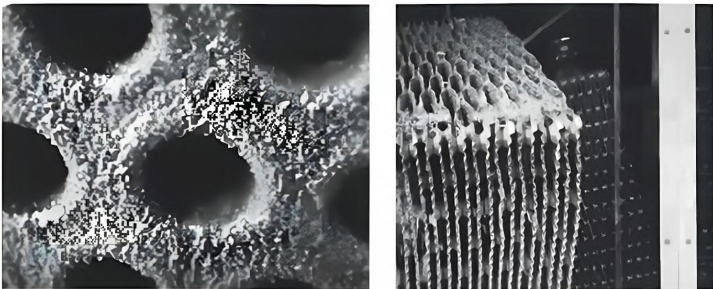
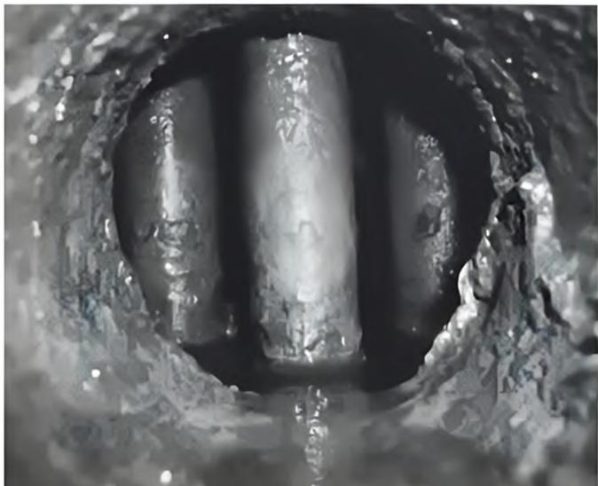
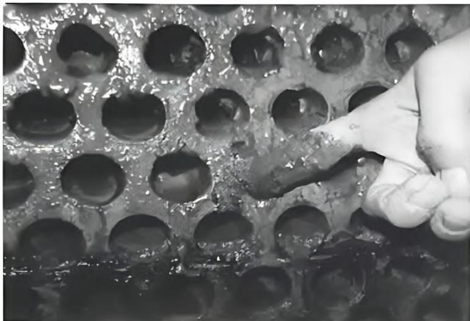
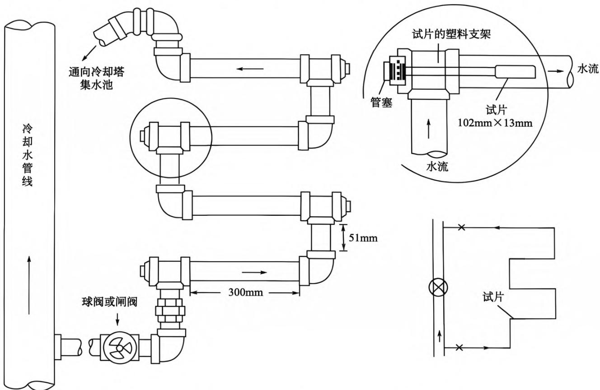
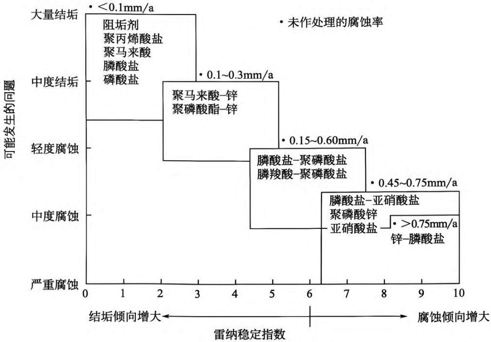

# 第 14 章 水质与水处理

供暖空调系统水质的优劣，直接影响供暖空调系统的供热或供冷效果。若水质不符合要求，会影响系统安全运行，造成供暖空调设备结垢与腐蚀，降低换热器性能和系统能效，缩短系统寿命，因此必须予以重视。

供暖空调系统水处理的直接目的是阻垢、缓蚀、杀菌、灭藻，使之符合相应的水质标准要求。水处理的主要方法为化学法、物理法、物理化学综合法。水处理方法的选择取决于水质标准要求、补水水质、系统特征等。

## 14.1 供暖空调水质要求

供暖空调水系统的水质要求，主要包括以下几点：

1. 为使冷热源、换热器等设备和管道内壁不致结垢而影响安全和高效运行，需要除去水中硬度或破坏致密垢层的形成条件。对于不同形式的冷热源设备，可以有不同的允许残余硬度。例如，对于筒式锅炉，允许残余总硬度 0.12 毫克当量/升，强制循环锅炉为 0.07 毫克当量/升。

2. 供暖空调系统中设备和部件的制作材料绝大部分是钢、不锈钢和铁，但也有少数设备，例如空气加热器、换热器，可能会采用黄铜、青铜或钛合金之类的非铁金属。对于钢、不锈钢和铁来说，高 $\mathrm{pH}$ 能防止腐蚀，但是黄铜和青铜等非铁金属在高 $\mathrm{pH}$ 的水中会因产生除锌作用而引起一种特殊形式的腐蚀。

3. 为了使钢铁材料不受腐蚀, 水的 $\mathrm{pH}$ 应保持 $7.5 \sim 10.0$ 。但对于黄铜和青铜之类的非铁金属 (不包括铝), $\mathrm{pH}$ 最好能提高到 $10.0 \sim 10.5$ , 甚至 $10.5 \sim 11.5$ 。

4. 尽量降低水中气体含量，特别是氧气和二氧化碳。这些气体在对冷水进行化学处理过程的前后，往往都或多或少地存在于水中。

如果满足了上述四点要求，供暖空调系统的腐蚀和结垢问题可基本上得到解决。

### 14.1.1 供暖空调水质主要控制项

供暖空调水质主要控制项是指必须加以管控的系统水所含杂质的品类和数量，即水质标准，如表 14.1-1 所示。

供暖空调水质主要控制项

<table><tr><td>控制项</td><td>介绍</td></tr><tr><td>pH</td><td>pH的定义是水中氢离子浓度(单位:mol/L)倒数的对数。pH过低,水的酸性增强,腐蚀加重;pH过高,水的碱性增强,水垢成分(碳酸钙等)的溶解度变小,容易结垢。</td></tr><tr><td>pH</td><td>一般来说,大部分细菌适合在中性的环境中生长,真菌在酸性环境中生长得较快。总的来说,最适合于微生物生长的pH为6~9</td></tr><tr><td>浊度</td><td>按照国际标准化组织ISO的定义,浊度是由于不溶性物质的存在而引起液体的透明度降低的一种量度。不溶性物质是指悬浮于水中的固体颗粒物(泥沙、腐殖质、浮游藻类等)和胶体颗粒物。较低的浊度对防止黏泥附着和泥渣沉积十分有利。浊度的物理意义是:溶液对光线通过时所产生的阻碍程度,它包括悬浮物对光的散射和溶质分子对光的吸收。浊度的单位与其测量方法有关,如光散射浊度单位NTU(Nephelometric Turbidity Units),表示仪器在与人射光成90°角的方向上测量散射光强度</td></tr><tr><td>电导率</td><td>水溶液的含盐量对钙族碳酸盐水垢和对金属的腐蚀有较大影响。通过对电导率的测定可以确定水中的含盐量。水中的含盐量是水中阴、阳离子的总数,离子浓度越高,电导率越大,反之则越小。水溶液电导率高,意味着金属受到腐蚀时的腐蚀电池回路在水溶液中的电阻小、电流大,易造成电化学腐蚀的强化。电导率高的水溶液含盐量高,此时水系统中的金属表面(换热器、散热器、锅炉管壁以及金属管道等)易形成碳酸盐水垢。碳酸盐水垢的析出与电化学腐蚀会在水溶液中产生较多污泥,造成阀门、仪表甚至小直径管道的堵塞。若系统中水的电导率升高通常要检查软化水处理设备的反冲洗是否正常,排污是否及时、顺畅等。电导率相当于电阻率的倒数,用μS/cm表示。它与水温有关,通常规定25°C为测定的标准温度</td></tr><tr><td>总硬度(以CaCO3计)</td><td>水的总硬度定义为溶解在水中钙离子和镁离子的总量,它包括暂时硬度和永久硬度。水中的钙、镁离子,以酸式碳酸盐形式存在的部分,因其遇热即形成碳酸盐沉淀而被除去,称为暂时硬度;而以硫酸盐、硝酸盐和氯化物等形式存在的部分,因其性质比较稳定,不能通过加热的方式除去,故称为永久硬度。水的总硬度用碳酸钙CaCO3的等价物表示,单位为mg/L。通常把钙离子硬度称作钙硬度,镁离子硬度称作镁硬度,其中钙硬度是产生水垢的主要因素。但钙硬度并非越低越好,因为适当的钙硬度对缓和腐蚀有一定的作用,以磷配方为例,一般钙离子不得少于30mg/L,以形成磷酸钙的保护膜而起到缓蚀的作用,只有控制得当,才能达到缓蚀和阻垢的作用</td></tr><tr><td>总碱度</td><td>水中能够接受氢离子的碱性物质,如氢氧根、碳酸根及重碳酸根等的总含量,其单位为mmol/L</td></tr><tr><td>氯离子(Cl-)</td><td>水中Cl-的存在会对铝、不锈钢和铜等金属构成腐蚀威胁,其中铝制设备和铝塑复合管接头对水中Cl-敏感,有时即使含量很低也有可能造成腐蚀损坏。尽管水中Cl-的存在对系统中某些金属部件会有腐蚀风险,但“加氯”也是改善水质的方式之一,其原理是借助氯水解生成次氯酸HClO,其作为一种强氧化剂,杀菌灭藻、控制循环水中的菌藻微生物的数量。通过监测余氯,可以定性判断循环水中菌藻微生物的数量。因为硫酸盐还原菌繁殖时会产生硫化氢和硫,它们与氯发生反应要消耗氯。如果通氯后仍连续测不出余氯,则说明系统中硫酸盐还原菌大量繁殖</td></tr><tr><td>总铁(Fe2+)</td><td>总铁指水中Fe2+的含量,是循环水的一个重要指标,常用邻菲啰林分光光度法测定。铁在循环水中通常以胶体和离子(Fe2+、Fe3+)形式存在。总铁长期偏高会给循环水系统带来多方面的危害:胶态铁能够稳定地悬浮在水中,但在受热或电荷作用条件下胶体稳定性会被破坏而凝聚沉积,且胶体本身的吸附作用将放大此影响,最终在换热器表面或者低流速处形成污垢淤积,堵塞系统并造成垢下腐蚀</td></tr><tr><td>总铜(Cu2+)氨氮(NH3-N)</td><td>总铜指水中Cu2+的含量,在循环水水质管理中,可以通过测定总铜判断系统铜制部件是否存在腐蚀NH3-N是指以氨或铵离子形式存在的化合氮,即水中以游离氨(NH2)和铵离子(NH4+)形式存在的氮。循环水中氨(NH3)的存在促使硝化菌群的大量繁殖,导致系统pH降低,金属腐蚀加剧,且使系统中各种细菌数量和黏泥量猛增,增加换热热阻、降低换热效率</td></tr><tr><td>游离氧(溶解氧)</td><td>溶解在水中的分子态氧称为溶解氧,通常记作DO,用每升水中氧气的毫克数(mg/L)表示。溶解氧(DO)量受水温、气压和溶质(如盐分)的影响,随水温的升高而减少,与大气中氧分压呈比例增加关系。氧在电化学腐蚀过程中是一种去极化剂,是电化学腐蚀极为重要的因素之一。一般情况下,水中的氧含量越多,金属的腐蚀越严重。由溶解氧造成的腐蚀也称为氧腐蚀,指金属材料(如碳钢)在水中溶解氧的化学作用下发生的破坏。氧腐蚀是锅炉系统中最常见的腐蚀形态。另外,水中游离氧有助于细菌的繁殖,因为需氧菌和真菌利用溶解氧对有机物的氧化分解作用来获取其生长所需的能量</td></tr><tr><td>化学需氧量(CODcr)</td><td>CODcr是在一定的条件下,采用一定的强氧化剂处理水样时所消耗的氧化剂量。它反映了水的污染程度,化学需氧量越大,说明水中受有机物的污染越严重。CODcr的单位为mg/L。由于CODr能够综合性地反映水中所有有机物的数量,此类检测仪器也比较多,检测方法简单,较短时间内就能拿到检测结果,因此被广泛用于水质检测分析,是水质监测的重要指标,也是监测水体环境的重要依据。测量化学需氧量所用的氧化剂一般为高锰酸钾或重铬酸钾,使用不同的氧化剂得出的数值也不同,分别称为重铬酸钾耗氧量(习惯上称为化学需氧量,CODcr)和高锰酸钾耗氧量(习惯上称为耗氧量,OC)。</td></tr><tr><td>生化需氧量(BOD)</td><td>BOD是指在一定条件下,微生物分解存在于水中的可生化降解有机物所进行的生物化学反应过程中所消耗的溶解氧的总数量。它与化学需氧量一样,是反映水质污染度的重要指标,其单位为mg/L</td></tr><tr><td>异养菌总数</td><td>异养菌是指从有机化合物中获取碳营养的一类微生物。异养菌总数为以细菌平皿计数法统计出的每毫升水中异养菌个数,单位为CFU/mL。因为循环水中异养菌的生长繁殖最快,数量也最多,它基本上代表了水中的全部细菌数量,所以一般测定时常以异养菌的数量代表水中细菌总数</td></tr><tr><td>有机磷</td><td>有机磷是含碳-磷键的化合物或含有机基团的磷酸衍生物。循环水中磷的存在有助于在系统管道表面构成缓蚀阻垢膜,因此常以有机磷酸盐和锌盐作缓蚀阻垢剂。水质管理中,通过检测有机磷含量,可以判断系统水自身的缓蚀阻垢能力</td></tr><tr><td>硫酸根离子(SO42-)</td><td>SO42-的存在是造成水中永久硬度高和矿化度高的主要原因。水中的SO42-是硫酸盐还原菌得以快速生长的主要营养源,从而导致其他金属离子特别是重金属离子溶于水中。循环冷却水中的硫酸根离子,会与其中存在的某些离子发生反应,如镁离子与硫酸根离子产生硫酸镁沉淀,钙离子与硫酸根离子会产生硫酸钙沉淀,从而造成管道的结垢、堵塞等,并且硫酸根离子是增大水腐蚀作用的重要因素,其对金属管道的腐蚀程度随浓度的增加而增大</td></tr></table>

### 14.1.2 水质控制项的常用检测方法

水质控制项的检测方法宜选用表 14.1-2 规定的方法，也可采用 ISO 方法体系等其他等效检测方法，但应进行适用性检验。

水质控制项的检测方法  
表 14.1-2

<table><tr><td>序号</td><td>检测项目</td><td>检测方法</td><td>操作方法</td></tr><tr><td>1</td><td>pH(25℃)</td><td>电位法</td><td>《工业循环冷却水及锅炉用水中pH的测定》GB/T 6904</td></tr><tr><td>2</td><td>钙硬度</td><td>离子色谱法</td><td>《工业循环冷却水中钠、铵、钾、镁和钙离子的测定 离子色谱法》GB/T 15454</td></tr><tr><td>3</td><td>总碱度</td><td>滴定法</td><td>《工业循环冷却水 总碱及酚酞碱度的测定》GB/T 15451</td></tr><tr><td>4</td><td>浊度</td><td>散射光法</td><td>《工业循环冷却水中浊度的测定 散射光法》GB/T 15893.1</td></tr><tr><td>5</td><td>电导率(25℃)</td><td>电极法</td><td>《锅炉用水和冷却水分析方法 电导率的测定》GB/T 6908</td></tr><tr><td>6</td><td>氯离子</td><td>滴定法</td><td>《工业循环冷却水和锅炉用水中氯离子的测定》GB/T 15453</td></tr><tr><td>7</td><td>硫酸根离子</td><td>重量法</td><td>《水质 硫酸盐的测定 重量法》GB 11899</td></tr><tr><td rowspan="2">8</td><td rowspan="2">总铁</td><td>1,10-菲罗啉分光光度法</td><td>《锅炉用水和冷却水分析方法 铁的测定》GB/T 14427</td></tr><tr><td>火焰原子吸收分光光度法</td><td>《水质 铁、锰的测定 火焰原子吸收分光光度法》GB 11911</td></tr><tr><td>9</td><td>总铜</td><td>二乙基二硫代氨基甲酸钠分光光度法</td><td>《工业循环冷却水和锅炉用水中铜的测定》GB/T 13689</td></tr><tr><td>10</td><td>氨氮</td><td>纳氏试剂分光光度法</td><td>《水质 氨氮的测定 水杨酸分光光度法》HJ 536</td></tr><tr><td rowspan="2">11</td><td rowspan="2">游离氯</td><td>N,N-二乙基-1,4-苯二胺滴定法</td><td>《水质 游离氯和总氯的测定 N,N-二乙基-1,4-苯二胺滴定法》HJ 585</td></tr><tr><td>N,N-二乙基-1,4-苯二胺分光光度法</td><td>《水质 游离氯和总氯的测定 N,N-二乙基-1,4-苯二胺分光光度法》HJ 586</td></tr><tr><td>12</td><td>溶解氧</td><td>碘量法</td><td>《工业循环冷却水和锅炉用水中溶解氧的测定》GB/T 12157</td></tr><tr><td>13</td><td>化学需氧量(CODcr)</td><td>重铬酸盐法</td><td>《水质 化学需氧量的测定 重铬酸盐法》HJ 828</td></tr><tr><td>14</td><td>菌落总数</td><td>平板菌落计数法</td><td>《生活饮用水标准检验方法 第12部分:微生物指标》GB/T 5750.12</td></tr><tr><td>15</td><td>异养菌总数</td><td>平皿计数法</td><td>《工业循环冷却水中菌藻的测定方法 第1部分:粘液形成菌的测定 平皿计数法》GB/T 14643.1</td></tr><tr><td>16</td><td>有机磷</td><td>气相色谱法</td><td>《水质 有机磷农药的测定 气相色谱法》GB/T 13192</td></tr><tr><td>17</td><td>生化需氧量(BOD)</td><td>稀释与接种法</td><td>《水质 五日生化需氧量(BOD5)的测定 稀释与接种法》HJ 505</td></tr></table>

### 14.1.3 供暖空调水质要求

**14.1.3.1 开式循环水系统**

开式循环水系统中的水与外界空气有直接接触，易受污染，水中含氧量较高，容易产生腐蚀及微生物，一般宜采用化学方法进行水质处理。

开式循环水系统的水质标准可参考现行国家标准《采暖空调系统水质》GB/T 29044，也可参考表14.1-3。

集中空调间接供冷开式循环冷却水系统水质标准  
表14.1-3

<table><tr><td>项目</td><td>单位</td><td>补充水</td><td>循环水</td></tr><tr><td>pH(25°C)</td><td>—</td><td>6.5~8.5</td><td>7.5~9.5</td></tr><tr><td rowspan="2">浊度</td><td rowspan="2">NTU</td><td rowspan="2">≤10</td><td>≤20</td></tr><tr><td>≤10(当换热设备为板式、翅片管式、螺旋板式时)</td></tr><tr><td>电导率(25°C)</td><td>μS/cm</td><td>≤600</td><td>≤2300</td></tr><tr><td>钙硬度(以CaCO3计)</td><td>mg/L</td><td>≤120</td><td>—</td></tr><tr><td>总碱度(以CaCO3计)</td><td>mg/L</td><td>≤200</td><td>≤600</td></tr><tr><td>钙硬度+总碱度(以CaCO3计)</td><td>mg/L</td><td>—</td><td>≤1100</td></tr><tr><td>氯离子</td><td>mg/L</td><td>≤100</td><td>≤500</td></tr><tr><td>总铁</td><td>mg/L</td><td>≤0.3</td><td>≤1.0</td></tr><tr><td>氨氮 $^{\text{1}}$ </td><td>mg/L</td><td>≤5</td><td>≤10</td></tr><tr><td>游离氯</td><td>mg/L</td><td>0.05~0.20(管网末梢)</td><td>0.05~1.00(循环回水总管处)</td></tr><tr><td>化学需氧量</td><td>mg/L</td><td>≤30</td><td>≤100</td></tr><tr><td>异养菌总数</td><td>个/mL</td><td>—</td><td>≤1×10 $^{5}$ </td></tr><tr><td>有机磷(以P计)</td><td>mg/L</td><td>—</td><td>≤0.5</td></tr></table>

① 当补充水水源为地表水、地下水或再生水回用时，应对本指标项进行检测与控制。

**14.1.3.2 闭式循环水系统**

闭式循环水系统管路不与大气相通，纯闭式循环水系统指系统任何环节都不与外界有直接接触，当膨胀水箱、冷却塔等均采用闭式设备时，才能形成真正的闭式循环水系统。与开式循环水系统相比，闭式循环水系统不易产生微生物及氧腐蚀。首次充水与日常补水水质有保证时，可采用闭式定压、排气、除污等物理手段进行水系统密闭性保护和水质管理。

闭式循环水系统的水质标准可参考现行国家标准《采暖空调系统水质》GB/T 29044，也可参考表14.1-4。

集中空调闭式循环水系统水质标准  
表 14.1-4

<table><tr><td>项目</td><td>单位</td><td>补充水</td><td>循环水</td></tr><tr><td>pH(25°C)</td><td>—</td><td>7.5~9.5</td><td>7.5~10.0</td></tr><tr><td>浊度</td><td>NTU</td><td> $\leqslant 5$ </td><td> $\leqslant 10$ </td></tr><tr><td>电导率(25°C)</td><td> $\mu S/cm$ </td><td> $\leqslant 600$ </td><td> $\leqslant 2000$ </td></tr><tr><td>氯离子</td><td>mg/L</td><td> $\leqslant 250$ </td><td> $\leqslant 250$ </td></tr><tr><td>总铁</td><td>mg/L</td><td> $\leqslant 0.3$ </td><td> $\leqslant 1.0$ </td></tr><tr><td>钙硬度(以 $CaCO_{3}$ 计)</td><td>mg/L</td><td> $\leqslant 300$ </td><td> $\leqslant 300$ </td></tr><tr><td>总碱度(以 $CaCO_{3}$ 计)</td><td>mg/L</td><td> $\leqslant 200$ </td><td> $\leqslant 500$ </td></tr><tr><td>溶解氧</td><td>mg/L</td><td>—</td><td> $\leqslant 0.1$ </td></tr><tr><td>有机磷(以P计)</td><td>mg/L</td><td>—</td><td> $\leqslant 0.5$ </td></tr></table>

**14.1.3.3 蒸发式循环冷却水系统**

蒸发式循环冷却水系统是通过水流与空气接触面水的蒸发而使水自身降温的循环冷却水系统，蒸发装置通常为冷却塔，也可为喷水降温池。

直接蒸发式循环冷却水系统，是通过水的蒸发来冷却空气并加湿空气的循环冷却水系统；间接蒸发式循环冷却水系统，是通过水的蒸发来冷却空气（二次空气或称为工作空气），空气（一次空气或称为产出空气）在被冷却时未被加湿的循环冷却水系统。

蒸发式循环冷却水系统的水质标准可参考现行国家标准《采暖空调系统水质》GB/T 29044，也可参考表14.1-5。

蒸发式循环冷却水系统水质标准  
表14.1-5

<table><tr><td rowspan="2">项目</td><td rowspan="2">单位</td><td colspan="2">直接蒸发式</td><td colspan="2">间接蒸发式</td></tr><tr><td>补充水</td><td>循环水</td><td>补充水</td><td>循环水</td></tr><tr><td>pH(25°C)</td><td>—</td><td>6.5~8.5</td><td>7.0~9.5</td><td>6.5~8.5</td><td>7.0~9.5</td></tr><tr><td>浊度</td><td>NTU</td><td>≤3</td><td>≤3</td><td>≤3</td><td>≤5</td></tr><tr><td>电导率(25°C)</td><td>μS/cm</td><td>≤400</td><td>≤800</td><td>≤400</td><td>≤800</td></tr><tr><td>钙硬度(以CaCO3计)</td><td>mg/L</td><td>≤80</td><td>≤160</td><td>≤100</td><td>≤200</td></tr><tr><td>总碱度(以CaCO3计)</td><td>mg/L</td><td>≤150</td><td>≤300</td><td>≤200</td><td>≤400</td></tr><tr><td>氯离子</td><td>mg/L</td><td>≤100</td><td>≤200</td><td>≤150</td><td>≤300</td></tr><tr><td>总铁</td><td>mg/L</td><td>≤0.3</td><td>≤1.0</td><td>≤0.3</td><td>≤1.0</td></tr><tr><td>硫酸根离子(以SO42-计)</td><td>mg/L</td><td>≤250</td><td>≤500</td><td>≤250</td><td>≤500</td></tr><tr><td>氨氮 $^{\text{1}}$ </td><td>mg/L</td><td>≤0.5</td><td>≤1.0</td><td>≤5.0</td><td>≤10.0</td></tr><tr><td>CODcr $^{\text{1}}$ </td><td>mg/L</td><td>≤3</td><td>≤5</td><td>≤30</td><td>≤60</td></tr><tr><td>菌落总数</td><td>CFU/mL</td><td>≤100</td><td>≤100</td><td>—</td><td>—</td></tr><tr><td>异养菌总数</td><td>个/mL</td><td>—</td><td>—</td><td>—</td><td>≤1×10^5</td></tr><tr><td>有机磷(以P计)</td><td>mg/L</td><td>—</td><td>—</td><td>—</td><td>≤0.5</td></tr></table>

① 当补充水水源为地表水、地下水或再生水回用时，应对本指标项进行检测与控制。

**14.1.3.4 采用散热器的供暖水系统**

采用散热器的供暖水系统的水质标准可参考现行国家标准《采暖空调系统水质》GB/T 29044，也可参考表14.1-6。

采用散热器的供暖水系统水质标准  
表14.1-6

<table><tr><td>项目</td><td>单位</td><td>补充水</td><td colspan="2">循环水</td></tr><tr><td rowspan="3">pH(25°C)</td><td rowspan="3">-</td><td>7.0~12.0</td><td>钢制散热器</td><td>9.5~12.0</td></tr><tr><td>8.0~10.0</td><td>铜制散热器</td><td>8.0~10.0</td></tr><tr><td>6.5~8.5</td><td>铝制散热器</td><td>6.5~8.5</td></tr><tr><td>浊度</td><td>NTU</td><td>≤3</td><td colspan="2">≤10</td></tr><tr><td>电导率(25°C)</td><td>μS/cm</td><td>≤600</td><td colspan="2">≤800</td></tr><tr><td rowspan="5">氯离子</td><td rowspan="5">mg/L</td><td>≤250</td><td>钢制散热器</td><td>≤250</td></tr><tr><td>≤80(≤401)</td><td>AISI 304 不锈钢散热器</td><td>≤80 (≤401)</td></tr><tr><td>≤250</td><td>AISI 316 不锈钢散热器</td><td>≤250</td></tr><tr><td>≤100</td><td>铜制散热器</td><td>≤100</td></tr><tr><td>≤30</td><td>铝制散热器</td><td>≤30</td></tr><tr><td>总铁</td><td>mg/L</td><td>≤0.3</td><td colspan="2">≤1.0</td></tr><tr><td>总铜</td><td>mg/L</td><td>-</td><td colspan="2">≤0.1</td></tr><tr><td>钙硬度(以CaCO3计)</td><td>mg/L</td><td>≤80</td><td colspan="2">≤80</td></tr><tr><td>溶解氧</td><td>mg/L</td><td>-</td><td colspan="2">≤0.1(钢制散热器)</td></tr><tr><td>有机磷(以P计)</td><td>mg/L</td><td>-</td><td colspan="2">≤0.5</td></tr></table>

① 当水温大于 $80^{\circ} \mathrm{C}$ 时，AISI 304 不锈钢材质散热器系统的循环水及补充水氯离子浓度不宜大于 $40 \mathrm{mg} / \mathrm{L}$ 。

**14.1.3.5 采用风机盘管供暖的水系统**

采用风机盘管供暖的水系统的水质标准可参考现行国家标准《采暖空调系统水质》GB/T 29044，也可参考表 14.1-7。

采用风机盘管供暖的水系统水质标准  
表 14.1-7

<table><tr><td>项目</td><td>单位</td><td>补充水</td><td>循环水</td></tr><tr><td>pH(25°C)</td><td>—</td><td>7.5~9.5</td><td>7.5~10.0</td></tr><tr><td>浊度</td><td>NTU</td><td>≤5</td><td>≤10</td></tr><tr><td>电导率(25°C)</td><td>μS/cm</td><td>≤600</td><td>≤2000</td></tr><tr><td>氧离子</td><td>mg/L</td><td>≤250</td><td>≤250</td></tr><tr><td>总铁</td><td>mg/L</td><td>≤0.3</td><td>≤1.0</td></tr><tr><td>钙硬度(以CaCO3计)</td><td>mg/L</td><td>≤80</td><td>≤80</td></tr><tr><td>总碱度(以CaCO3计)</td><td>mg/L</td><td>≤200</td><td>≤500</td></tr><tr><td>溶解氧</td><td>mg/L</td><td>—</td><td>≤0.1</td></tr><tr><td>有机磷(以P计)</td><td>mg/L</td><td>—</td><td>≤0.5</td></tr></table>

**14.3.1.6 热力网补给水**

以热电厂和区域锅炉房为热源的热水管网补给水水质标准可参考现行行业标准《城镇供热管网设计标准》CJJ/T 34，也可参考表 14.1-8。

热力网补给水的水质标准  
表 14.1-8

<table><tr><td>项目</td><td>单位</td><td>标准</td></tr><tr><td>浊度</td><td>NTU</td><td> $\leqslant 5.0$ </td></tr><tr><td>硬度</td><td>mmol/L</td><td> $\leqslant 0.60$ </td></tr><tr><td>溶解氧</td><td>mg/L</td><td> $\leqslant 0.10$ </td></tr><tr><td>铁</td><td>mg/L</td><td> $\leqslant 0.30$ </td></tr><tr><td>pH(25°C)</td><td>—</td><td>7.0~11.0</td></tr></table>

当供热系统含有不锈钢设备时，供热介质中 $Cl^{-}$ 浓度不宜高于 25mg/L，否则应对不锈钢设备采取防腐措施。

**14.1.3.7 蒸汽热力网凝结水**

对于蒸汽热力网，由用户热力站返回热源的凝结水水质标准可参考现行行业标准《城镇供热管网设计标准》CJJ/T 34，也可参考表 14.1-9。

蒸汽热力网凝结水水质标准  
表 14.1-9

<table><tr><td>项目</td><td>单位</td><td>标准</td></tr><tr><td>硬度</td><td>mg/L</td><td>≤0.06</td></tr><tr><td>铁</td><td>mg/L</td><td>≤0.60</td></tr><tr><td>油</td><td>mg/L</td><td>≤2.0</td></tr><tr><td>铜</td><td>mg/L</td><td>≤0.10</td></tr></table>

蒸汽热力网的凝结水排放时，水质应符合现行国家标准《污水排入城镇下水道水质标准》GB/T 31962。

当供热系统中有不锈钢设备时，供热介质中 $\mathrm{Cl^-}$ 浓度不宜高于 $25\mathrm{mg / L}$ ，否则应对不锈钢设备采取防腐措施。

**14.1.3.8 污水源热泵源侧水**

污水处理厂出水及再生水用作热泵的热源/热汇时，其水质标准可参考现行行业标准《城镇污水热泵热能利用水质》CJ/T 337，也可参考表 14.1-10。

污水热泵水源水质标准  
表 14.1-10

<table><tr><td colspan="2">项目</td><td>单位</td><td>城镇污水</td><td>污水处理厂出水 $^1$ </td><td>再生水</td></tr><tr><td rowspan="2">温度</td><td>制热工况</td><td>°C</td><td>≥10</td><td>≥8</td><td>≥8</td></tr><tr><td>制冷工况</td><td>°C</td><td>≤28</td><td>≤30</td><td>≤30</td></tr><tr><td colspan="2">pH</td><td>—</td><td>6.5~9.5</td><td>6.0~9.0</td><td>6.5~9.9</td></tr><tr><td colspan="2">悬浮物</td><td>mg/L</td><td>≤300</td><td>≤30</td><td>≤20</td></tr><tr><td colspan="2">浊度</td><td>NTU</td><td>—</td><td>—</td><td>≤5</td></tr><tr><td colspan="2">生化需氧量</td><td>mg/L</td><td>≤150</td><td>≤30</td><td>≤10</td></tr><tr><td colspan="2">氯离子</td><td>mg/L</td><td>≤250(1500) $^{2}$ </td><td>≤250(500) $^{2}$ </td><td>≤250</td></tr><tr><td colspan="2">氨氮(以N计)</td><td>mg/L</td><td>≤25</td><td>≤25(1) $^{3}$ </td><td>≤10(1) $^{3}$ </td></tr><tr><td colspan="2">总氮</td><td>mg/L</td><td>≤45</td><td>≤45</td><td>≤15</td></tr><tr><td colspan="2">总磷(以P计)</td><td>mg/L</td><td>≤5</td><td>≤3</td><td>≤1</td></tr><tr><td colspan="2">溶解性总固体</td><td>mg/L</td><td>≤2000</td><td>≤2000</td><td>≤1000</td></tr><tr><td colspan="2">余氯</td><td>mg/L</td><td>≤8</td><td>≤8</td><td>0.05~8</td></tr><tr><td colspan="2">粪大肠菌群</td><td>个/L</td><td>-</td><td>≤10 $^4$ </td><td>≤2000</td></tr><tr><td colspan="2">含砂量</td><td>体积比</td><td>≤3/100000</td><td>≤1/200000</td><td>≤1/200000</td></tr><tr><td colspan="2">二氧化硅</td><td>mg/L</td><td>-</td><td>-</td><td>≤50</td></tr><tr><td colspan="2">总硬度(以CaCO $_3$ 计)</td><td>mg/L</td><td>-</td><td>≤450</td><td>≤450</td></tr><tr><td colspan="2">总碱度(以CaCO $_3$ 计)</td><td>mg/L</td><td>-</td><td>-</td><td>≤350</td></tr><tr><td colspan="2">硫酸盐</td><td>mg/L</td><td>≤600</td><td>≤450</td><td>≤450</td></tr><tr><td colspan="2">硫化物</td><td>mg/L</td><td>≤1.0</td><td>≤1.0</td><td>≤0.1</td></tr><tr><td colspan="2">石油类</td><td>mg/L</td><td>≤15</td><td>≤5</td><td>≤1</td></tr><tr><td colspan="2">动植物油</td><td>mg/L</td><td>≤5</td><td>≤30</td><td>≤60</td></tr><tr><td colspan="2">菌落总数</td><td>CFU/mL</td><td>≤100</td><td>≤5</td><td>-</td></tr></table>

① 污水处理厂出水指城镇污水处理厂经二级处理后的出水。  
② 当采用 S31603 不锈钢或同等材质的换热器时，可采用括号内数值。  
③ 当采用铜质换热器时，应采用括号内数值。

### 14.1.4 供暖空调水质标准总览

鉴于供暖空调水质对供暖空调系统安全、高效运行的重要性，世界各国均陆续出台了针对性的水质标准。到目前为止，可查阅到的我国及其他国家供暖空调水质标准如下：

1. 我国供暖空调水质标准：《采暖空调系统水质》GB/T 29044；《工业循环冷却水处理设计规范》GB/T 50050；《工业锅炉水质》GB/T 1576；《城镇供热管网设计标准》CJJ/T 34；《生活饮用水卫生标准》GB 5749；《城市污水再生利用 工业用水水质》GB/T 19923 等。

2. 国外供暖空调水质标准：英国标准《民用住宅热水集中供暖系统中水处理实施法规》（Code of practice for Treatment of water in domestic hot water central heating systems）BS 7593、《民用强制循环热水集中供暖系统》（Specification for Forced circulation hot water central heating systems for domestic premises）BS 5449、德国工程师协会标准《在热水供暖装置中损害的预防措施——在热水供应装置和热水供暖装置中水垢的形成》（Prevention of damage in water heating installations-Scale formation in hot water supply installations and water heating installations）VDI 2035 I、《在热水供暖装置中损害的预防措施——在热水供暖装置中的水腐蚀》（Prevention of damage in water heating installationtions-Water corrosion in water heating installations) VDI 2035 II；意大利标准《民用供暖设备用水处理》(Water treatment for heating plant) UNI 8065；奥地利标准《工作温度最高为 $100^{\circ}\mathrm{C}$ 的闭式热水供暖系统中预防腐蚀和结垢》(Prevention of damage by corrosion and scale formation in closed warm-water-heating systems up to $100^{\circ}\mathrm{C}$ operating temperature) ÖNORM H 5195-1；芬兰区域供热协会《热水水质标准》(Water Quality from Suositus) KK3/1988；丹麦区域供热协会 1999 年修订的《补水和循环水水质主要指标推荐值》(Recommended values for feed water and circulating water)；国际能源署技术报告《欧洲和北美水处理回顾》(A review of European and North American water treatment) IEA 1996 N8；国际标准化组织技术报告《太阳能——热水系统——考虑到内部腐蚀的材料选择》(Solar energy—Water heating systems—Guide to material selection with regard to internal corrosion) ISO/TR 10217 等。

## 14.2 结垢与腐蚀倾向的预测

结垢与腐蚀倾向的预测是供暖空调水系统水质管理的重要工作内容。基于此，可以预判结垢与腐蚀发生的可能性、决策化学水处理采用的药剂类型、判别在线水质管理应采用的策略。

目前，结垢与腐蚀倾向预测的常用方法为极限碳酸盐硬度法、兰吉勒饱和指数（Langelier Saturation Index，LSI）法、临界 pH 法以及雷纳稳定指数（Ryznar Stability Index，RSI）法等。

### 14.2.1 极限碳酸盐硬度法

极限碳酸盐硬度指循环水在一定的水质、水温条件下，保持不结垢的水中碳酸盐硬度最高限值，即当水中游离二氧化碳很少时，循环水可能维持碳酸盐硬度的最高限值。影响碳酸钙析出的因素很多，如有机物会干扰碳酸钙的析出，不同的水质、水温条件下，影响的程度均不相同。

极限碳酸盐硬度法可根据相似条件下的实际运行数据或小型试验确定。试验条件应与实际运行相似，如温度、pH、悬浮固体含量、有机物含量、钙离子浓度以及水力条件等。试验时，每隔2～4h取一次水样，测定水温、pH、碳酸盐硬度等，当水的碳酸盐硬度不变时，其值即为极限碳酸盐硬度。极限碳酸盐硬度只能用于判断结垢与否，不可用于腐蚀性的判断。

### 14.2.2 兰吉勒饱和指数法

兰吉勒饱和指数又称饱和指数，以 $I_{L}$ 表示，是水样实测的 pH 减去饱和 pH ( $pH_{s}$ ) 得到的差值。兰吉勒在 20 世纪 30 年代推导了计算 $pH_{s}$ 的公式，在此 $pH_{s}$ 时 $CaCO_{3}$ 既不溶解也不沉淀。

$I_{L}$ 的计算如式（14.2-1）所示，即在一定的溶液体系内，采用相同条件（水温、含盐量、硬度和碱度）下达到 $CaCO_{3}$ 饱和溶解度时的 pH 作为衡量的标准，即 $pH_{s}$ ，水的实际 pH 以 $pH_{0}$ 表示。兰吉勒饱和指数预测如表 14.2-1 所示。

$$
I _ {\mathrm{L}} = \mathrm{pH} _ {0} - \mathrm{pH} _ {\mathrm{s}}\tag{14. 2-1}
$$

式中 $I_{\mathrm{L}}$ ——兰吉勒饱和指数；

$pH_{0}$ ——水的实际 pH;

$pH_{s}$ ——水中 $CaCO_{3}$ 达到平衡时的 pH。

兰吉勒饱和指数预测表  
表 14.2-1

<table><tr><td> $I_{L}$ </td><td>倾向</td><td> $I_{L}$ </td><td>倾向</td></tr><tr><td>+2.0</td><td>形成结垢,可以认为无腐蚀</td><td>-0.5</td><td>无结垢,轻微腐蚀</td></tr><tr><td>+0.5</td><td>轻微结垢,轻微腐蚀</td><td>-2.0</td><td>严重腐蚀</td></tr><tr><td>0.0</td><td>饱和平衡,无结垢,可能有点状腐蚀</td><td></td><td></td></tr></table>

循环水系统的钙硬度与总碱度之和大于 $1000\mathrm{mg / L}$ 、兰吉勒饱和指数 $I_{\mathrm{L}} < 3.3$ 时，应加硫酸或软化处理。

**14.2.3 临界 $\mathbf{pH}$ 法**

用试验方法测得刚刚出现结垢时水的 $\mathrm{pH}$ , 称为临界 $\mathrm{pH}$ , 用 $\mathrm{pH}_{\mathrm{c}}$ 表示。

当水的实际 $\mathrm{pH} > \mathrm{pH}_{\mathrm{c}}$ 时, 循环水有结垢倾向;

当水的实际 pH 值 $< \mathrm{pH}_{\mathrm{c}}$ 时, 循环水有腐蚀倾向, 不结垢。

$\mathrm{pH}_{\mathrm{c}}$ 相当于兰吉勒饱和指数中的 $\mathrm{pH}_{\mathrm{s}}$ ，但与 $\mathrm{pH}_{\mathrm{s}}$ 不同的是， $\mathrm{pH}_{\mathrm{c}}$ 为实测值，比 $\mathrm{pH}_{\mathrm{s}}$ 更能反映真实情况。

### 14.2.4 雷纳稳定指数法

雷纳稳定指数又称稳定指数，以 $I_{R}$ 表示，它是针对兰吉勒饱和指数法的缺陷，概括了大量生产数据提出的一个半经验性指数。雷纳稳定指数预测如表 14.2-2 所示。

$$
I _ {\mathrm{R}} = 2 \mathrm{pH} _ {\mathrm{s}} - \mathrm{pH} _ {0}\tag{14. 2-2}
$$

式中 $I_{R}$ ——雷纳稳定指数。

雷纳稳定指数预测表  
表 14.2-2

<table><tr><td> $I_R$ </td><td>倾向</td><td> $I_R$ </td><td>倾向</td></tr><tr><td>4.0~5.0</td><td>重结垢</td><td>7.0~7.5</td><td>轻腐蚀</td></tr><tr><td>5.0~6.0</td><td>轻结垢</td><td>7.5~9.0</td><td>重腐蚀</td></tr><tr><td>6.0~7.0</td><td>微结垢或微腐蚀</td><td>&gt;9.0</td><td>严重腐蚀</td></tr></table>

## 14.3 结垢控制

### 14.3.1 垢的分类

供暖空调水系统在长期使用过程中会发生结垢现象。对于闭式循环水系统，其结垢现象多源自金属管道系统中水的油污、浮锈，而对于开式冷却水系统则源自金属管壁腐蚀和水中杂质导致的析晶结垢。长期结垢会在管道内壁形成一层软泥或固态状物质。通常，黏附在管壁表面上的沉积物统称为垢，按沉积物的成分可分为水垢、污垢和黏泥。

**14.3.1.1 水垢**

溶于水中的盐类物质，由于温度升高或水在冷却过程中不断蒸发浓缩，使水中的盐类物质超过其饱和溶解度而结晶、析出，沉积在金属与非金属表面上（图 14.3-1）。其中碳酸钙垢最常见，危害最大。

  
图14.3-1 水垢

金属表面水垢的形成除与水中的盐类物质浓度有关外，还与金属表面的温度密切相关，通常当金属表面温度大于或等于 $60^{\circ}$ C 时，结垢趋势明显增强，所以供水温度高于 $50^{\circ}$ C 时，或水硬度较高的地区，应特别重视系统补水的软化处理。

**14.3.1.2 污垢**

污垢是指在金属与非金属表面，含有泥沙、杂物碎屑、腐蚀产物、天然有机物、微生物新陈代谢产生的分泌物、微生物残骸、腐殖物以及凝胶状物质的沉积物（图 14.3-2）。

  
图14.3-2 污垢

**14.3.1.3 黏泥**

如果沉积物的主要成分是微生物的分泌物、残骸、凝胶物质以及有机腐殖物时，所形成的黏浊物称为黏泥（图 14.3-3）。

  
图14.3-3 黏泥

### 14.3.2 常见水垢的类别及特性

常见水垢的类别及特性见表 14.3-1。

常见水垢的类别及特性  
表 14.3-1

<table><tr><td>水垢类别</td><td>特性</td></tr><tr><td>以碳酸盐为主的结垢物</td><td>颜色为灰白色或者白色。在5%~8%的盐酸溶液中,大部分可以溶解,同时会产生大量气泡,反应结束后溶液中酸不溶物较少</td></tr><tr><td>以氧化铁为主的结垢物</td><td>颜色为棕褐色。常温下,在稀盐酸中溶解缓慢,溶液呈黄绿色;加氢氟酸或者在硝酸中能够较快地溶解分散,溶液呈黄色</td></tr><tr><td>以硅酸盐为主的结垢物</td><td>颜色为灰白色或者灰色。常温下,在盐酸溶液中基本不溶解,加热后垢的其他成分缓慢溶解,有透明砂粒沉淀物;加入1%的HF或者NaF可以溶解或大部分溶解分散</td></tr><tr><td>硫酸盐</td><td>颜色为黄白色或者白色。常温下,在盐酸溶液中很少产生气泡,加热后溶解很少;加入10%的氯化钡溶液后,有大量白色沉淀生成。</td></tr></table>

### 14.3.3 水垢和污泥的危害

水垢和污泥的危害主要表现在以下方面：

1. 恶化传热。水垢和污泥的存在造成换热器传热热阻增大、传热效果恶化、制冷制热设备效率降低、能耗增加。水垢和污泥的导热系数见表 14.3-2。

水垢和污泥的导热系数  
表14.3-2

<table><tr><td>水垢和污泥</td><td>组成</td><td>导热系数[W/(m·°C)]</td></tr><tr><td rowspan="3">水垢</td><td>以碳酸盐为主要成分的水垢</td><td>0.4~0.7</td></tr><tr><td>以硅酸盐为主要成分的水垢</td><td>0.2~0.5</td></tr><tr><td>以磷酸盐为主要成分的水垢</td><td>0.6~0.8</td></tr><tr><td>生物污泥</td><td>生物薄层(水分占90%左右)</td><td>0.6~0.7</td></tr><tr><td rowspan="2">腐蚀生成物</td><td> $Fe_{2}O_{3}$ </td><td>3.0~7.0</td></tr><tr><td> $Fe_{3}O_{4}$ </td><td>1.2</td></tr></table>

从表 14.3-2 中可以看出，水垢和污泥的导热系数一般为金属管壁的几百到几千分之一，大大影响了传热效率。水垢和污泥对传热的影响还常用污垢系数来表示，污垢系数越大，则热阻越大，传热性能越差，意味着系统各换热环节传热温差增大，系统能效下降。

2. 导致局部腐蚀。沉积物覆盖在温度较高的换热表面时，阻止了有效换热，使换热表面金属长期处于高温状态，导致金属疲劳。金属表面被沉积物覆盖往往会导致垢下腐蚀，体现为局部腐蚀，其腐蚀速度为常态腐蚀速度的 $4 \sim 5$ 倍，如未得到及时控制，很可能造成管壁穿孔，从而影响系统的正常运行，缩短管道或设备的使用寿命。

3. 系统水阻力增加。管道内水垢和污泥的存在使过水断面变小，同时使管壁粗糙度增大，二者共同作用使系统水阻力增大，水泵能耗增大，继而增加了设备运行费用。

4. 滋生细菌。污泥体积较大、质地疏松稀软，是某些细菌（如厌氧菌）生存和繁殖的温床，而细菌代谢产生的酸性物质会造成金属管壁的垢下腐蚀。这一现象在蒸发冷却循环水系统（开式冷却塔冷却水系统）中尤为明显。

### 14.3.4 水垢的控制方法

水垢控制的核心在于防止水中的微溶盐类 $CaCO_{3}$ 、 $CaSO_{4}$ 、 $Ca_{3}(PO_{4})_{2}$ 和 $CaSiO_{3}$ 等从水中析出，沉积在系统设备和管道的金属表面上。

水垢控制的方法主要有两类：一类是通过降低系统中水的钙镁离子浓度，控制水结垢的可能性或趋势，常用技术措施为：对闭式循环水系统的补水进行软化处理，对开式冷却水系统（如蒸发冷却水系统）可采用排污法。另一类是控制水垢生长速度和形成过程，如通过在水中投加水处理药剂，调节水的 pH 和碱度，从而改变水中盐类的生长过程和生产形态，提高容许的极限碳酸盐硬度，阻碍垢的生成，改变垢的形态（容易去除的“软垢”）。

采用何种控制方法取决于当地水质、系统长期运行工况的水温、系统规模以及对防止结垢与避免酸腐蚀的综合考虑。

**14.3.4.1 排污法**

当补水的碳酸盐硬度小于循环水的极限碳酸盐硬度，且系统水容量小或水源丰富时，可采用排污法进行水垢控制。排污水占循环水量的百分比 $P_{3}$ （%）可按下式计算：

$$
P_{3} = \frac{H_{z}(P_{1} + P_{2}) - H_{jz}P_{2}}{H_{jz} - H_{z}}\times 100\%\tag{14. 3-1}
$$

式中 $P_{3}$ ——排污水占循环水量的百分比，%；

$H_{z}$ ——补充水的碳酸盐硬度，mg/L；

$H_{jz}$ ——循环水的极限碳酸盐硬度，mg/L；

$P_{1}$ ——蒸发损失占循环水量的百分比，%；

$P_{2}$ ——漂水损失占循环水量的百分比，%。

当 $P_{3}$ 为负值时，表明不需排污。通常， $P_{3}$ 不宜超过 $3\% \sim 5\%$ 。

**14.3.4.2 酸化法**

当补水的碳酸盐硬度较大时，可采用加酸措施，控制 pH 处于 7.2～7.8 的范围内。

由于加入盐酸会带入氯离子，增加水的腐蚀性；加入硝酸会带入硝酸根，有利于硝化细菌的繁殖。通常采用在补水中加入硫酸（酸化后生成的硫酸钙应小于其相应水温时的溶解度）的酸化处理法，加酸量可按下式计算：

$$
G = \frac {E (H _ {z} - H _ {z} ^ {\prime}) Q _ {\mathrm{b}}}{1 0 0 0 a}\tag{14. 3-2}
$$

$$
H _ {z} ^ {\prime} = H _ {j z} / N\tag{14. 3-3}
$$

式中 G ——加酸量，kg/h;

E——酸当量（ $H_{2}SO_{4}$ 为 49）；

$H_{z}^{\prime}$ ——补水加酸处理后的碳酸盐硬度，mg/L；

$Q_{b}$ ——补水量， $m^{3}/h$ ;

a——酸浓度，代表工业酸纯度；

N——浓缩倍数。

$$
N = \frac {Q _ {\mathrm{b}}}{Q _ {\mathrm{b}} - Q _ {1}} = \frac {Q _ {\mathrm{b}}}{Q _ {\mathrm{p}} + Q _ {\mathrm{f}}} = \frac {P _ {\mathrm{b}}}{P _ {\mathrm{b}} - P _ {1}}\tag{14. 3-4}
$$

式中 $Q_{1}$ ——酸当量（ $H_{2}SO_{4}$ 为 49，HCl 为 36.5）；

$Q_{p}$ ——补水加酸处理后的碳酸盐硬度，mge/L；

$Q_{f}$ ——补水量， $m^{3}/h$ ;

$P_{b}$ ——补水量占循环水量的百分比，%；

其他符号同前文。

**14.3.4.3 软化法**

所谓水的软化是指通过某种方法降低水中盐类物质的浓度，即通常所说的降低水的硬度。对水进行软化处理的目的在于通过降低水中钙镁离子的总浓度而避免金属表面结垢，或减少结垢。从水质管理角度看，水的硬度以总硬度（以 $CaCO_{3}$ 计）表征，水中有关结垢的盐类物质主要包括 $CaCO_{3}$ 、 $CaSO_{4}$ 、 $MgCO_{3}$ 、 $MgSO_{4}$ 。水的软化方法包括离子交换法、药剂法、电磁法、反渗透法、热力法以及电渗析法等。在供暖空调水处理中，离子交换法、药剂法、电磁法应用较普遍，其中以离子交换法应用最为普遍，特别是在规模较大的水系统中。

**14.3.4.4 离子交换树脂法**

离子交换树脂法，俗称离子交换法，其原理是使水通过离子交换树脂，将钙、镁离子从水中置换出来并结合在树脂上，从而达到降低水硬度的目的。随着软化过程的进行，离子交换树脂去除水中钙、镁离子的能力逐渐减弱，直至失效，此时需要对其进行再生。

软化水的离子交换树脂又称软化树脂，是一种由苯乙烯或丙烯酸（酯）与交联剂二乙烯聚合反应生成的聚合物。离子交换树脂分阳离子和阴离子，用于软化水处理的为钠阳离子交换树脂 RNa。阳离子交换树脂与水中 $Ga^{2+}$ 、 $Mg^{2+}$ 的反应式为：

$$
2 \mathrm{RNa} + \mathrm{Ca} ^ {2 +} \longrightarrow \mathrm{R} _ {2} \mathrm{Ca} + 2 \mathrm{Na} ^ {+}
$$

$$
\text {   或   } \quad 2 \mathrm{RNa} + \mathrm{Mg} ^ {2 +} \longrightarrow \mathrm{R} _ {2} \mathrm{Mg} + 2 \mathrm{Na} ^ {+}
$$

采用 RNa 进行水的软化处理时，其再生过程是使浓度较高的氯化钠溶液通过树脂，置换硬度离子并随再生废液排出，使失效的树脂恢复软化交换功能。

阳离子树脂法软化系统补水，阻垢效果可靠、稳定，运行成本相对较低，适用于补水率控制得较好的供暖空调用户侧水系统。蒸发循环冷却水（冷却塔）系统，由于补水量较大，通常不建议采用。

需要强调的是，采用离子交换树脂法软化补充水时，规模较大的系统的初次水与事故补水均应采用软化水。

**14.3.4.5 投加阻垢剂**

投加阻垢剂是一种运行操作相对容易的阻垢措施，其运行成本与离子交换树脂法相近或略高。

阻垢剂是一种能够有效预防、抑制和去除管道、设备等处积聚的垢的化学制剂，其作用原理是通过改变水中的钙盐晶体生成过程和形态，使水中的碳酸钙等处于过饱和的亚稳状态，提高水的极限碳酸盐硬度，从而将水中的硬度成分转化为不易产生垢积聚的混合物。宏观表象上，阻垢剂可以抑制垢层生成或软化已生成的垢层。常用阻垢剂有以下几种，其特性如表 14.3-3 所示。

1. 聚磷酸盐: 在循环水中使用的是六偏磷酸钠 $\left(\mathrm{Na}_{6} \mathrm{P}_{6} \mathrm{O}_{18}\right)$ 和三聚磷酸钠 $\left(\mathrm{Na}_{5} \mathrm{P}_{3} \mathrm{O}_{10}\right)$ , 它们既有阻垢作用, 又有缓蚀作用。

2. 有机磷酸盐（膦酸盐）：膦酸盐和二膦酸盐能在水中离解出氢离子，成为带负电的阴离子。这些阴离子能与水中的多价金属阳离子形成稳定的络合物，从而提高了碳酸钙的析出饱和度。同时，络合物还会吸附在钙盐晶体表面，阻碍其生长，使之产生畸变，难以形成“厚实”的垢层。

3. 聚羧酸：聚羧酸的阻垢性能与其分子量、羧基的数量和间隔有关。如果分子量相同，碳链上的羧基数越多，阻垢效果越好。这类化合物不仅对碳酸钙水垢具有良好的阻垢作用，而且对泥土、腐蚀生成物等也具有分散作用，使其不易在管道系统表面凝聚而易于随排污水排出。

常用阻垢剂特性  
表14.3-3

<table><tr><td>类别</td><td>名称</td><td>极限碳酸盐硬度(mg/L)</td><td>加药量(mg/L)</td><td>备注</td></tr><tr><td rowspan="2">聚磷酸盐</td><td>六偏磷酸钠( $Na_{6}P_{6}O_{18}$ )</td><td> $H=6-0.15H'$ ( $H'$ 为补水的非碳酸盐硬度,mg/L)</td><td>1~5( $P_{2}O_{2}$ 含量大于50%)</td><td rowspan="2">pH = 6.5 ~ 7.5, $t<45^{\circ}C$ ,药品在水中的停留时间不大于50h</td></tr><tr><td>三聚磷酸钠( $Na_{5}P_{3}O_{10}$ )</td><td>5</td><td>2~5(以100%计)</td></tr><tr><td rowspan="3">膦酸盐</td><td>氨基三亚甲基膦酸盐(ATMP)</td><td>9</td><td>1~5</td><td rowspan="3">有阻垢、缓蚀双重作用,对铜有腐蚀性,热稳定性和抗氧化性良好</td></tr><tr><td>乙二胺四亚甲基膦酸盐(EDTMP)</td><td>8</td><td>1~5</td></tr><tr><td>羟基亚乙基-1,1二膦酸盐(HEDP)</td><td>8</td><td>1~5</td></tr><tr><td>聚羧酸</td><td>聚丙烯酸聚甲基丙烯酸聚马来酸</td><td>—</td><td>1~5</td><td>pH=7~8.5,浓度大于5mg/L时会形成聚丙烯酸钙沉淀</td></tr></table>

阻垢剂的选用应遵循下列原则：  
1. 阻垢效果好。即使在 $\mathrm{Ca}^{+}$ 、 $\mathrm{Mg}^{2+}$ 、 $\mathrm{SiO}_{3}^{2-}$ 含量较大时，仍有较好的阻垢效果。

2. 化学稳定性好。在高浓缩倍率和高温情况下，与缓蚀剂、杀生剂共用时，阻垢效果无明显下降。

3. 符合环保要求。无毒或低毒，易生物降解。

4. 配置、投加、操作等简便。

5. 价格低廉，易于采购，运输储藏方便。

实践表明，绝大多数阻垢剂单独使用时阻垢效果较差，复合使用时效果显著提高。表14.3-4列出了常用阻垢剂单独使用时的性能。

常用阻垢剂单独使用时的性能  
表14.3-4

<table><tr><td rowspan="2">名称</td><td rowspan="2">适宜的pH</td><td rowspan="2">允许钙离子含量(mg/L)</td><td colspan="3">阻垢剂的投加量(mg/L)及情况</td><td rowspan="2">说明</td></tr><tr><td>碳酸钙 $CaCO_3$ </td><td>硫酸钙 $CaSO_4$ </td><td>磷酸钙 $Ca_3(PO_4)_2$ </td></tr><tr><td>聚磷酸盐</td><td>6~7</td><td>&lt;200</td><td>4~6</td><td>无效</td><td>有产生垢的危险</td><td>控制正常磷酸根离子 $PO_4^{3-}$ 指数小于6且磷酸钙指数不大于1</td></tr><tr><td>有机膦酸盐类</td><td>7~9</td><td>400~600</td><td>2~6</td><td>有效</td><td>不易产生垢</td><td>—</td></tr><tr><td>有机膦酸酯类</td><td>8~9</td><td>≤500</td><td>20~25</td><td>有效</td><td>—</td><td>—</td></tr><tr><td>聚丙烯酸(钠)</td><td>8~9</td><td>≤500</td><td>10</td><td>有效</td><td>有效</td><td>对铜及铜合金有腐蚀作用</td></tr><tr><td>水解聚马来酸酐</td><td>8~9</td><td>300~400</td><td>3~5</td><td>有效</td><td>有效</td><td>—</td></tr></table>

### 14.3.5 污垢的控制方法

水系统污垢的控制措施包括以下方面：

1. 降低补充水浊度。水中的泥沙、藻类微生物以及各种悬浮物和胶体等构成水的浊度。系统补水的浊度越低，则循环水杂质越少，越有利于水系统的安全高效运行。因此，当循环水系统的补水浊度较高时，必须对其进行降低浊度的处理。使用最为普遍的降低水浊度的方法为絮凝/凝聚法，即通过添加絮凝剂，使水中的悬浮颗粒聚集成较大的团块后予以分离和去除。常用的絮凝剂包括铝盐类、聚合物等。

2. 预防、抑制、去除水系统的垢积聚。常用措施为向循环水中投加阻垢剂、分散剂。在对循环水进行阻垢、防腐和杀菌灭藻处理时，投加一定量的分散剂，也是控制污垢的有效方法。因为分散剂能将大的泥团分散成悬浮在水中的细小微粒，使其不易沉积成垢。同时，部分悬浮物还可以随排污水排出循环水系统。

3. 旁滤。旁滤即旁流过滤，通过阻滞型水过滤器逐步多次的循环截留作用，将系统中水的杂质过滤，最后通过必要的反冲将杂质排出。具体做法为：在水系统总管上持续引出一部分水流进行过滤，以及时清除循环水中由于空气中灰尘杂物的进入、日常加药处理后造成的部分水垢和锈垢，以及微生物黏泥的脱落、分散形成的大量悬浮物。由于以上悬浮物在水中的溶解度很小，很容易用机械过滤的方式去除，因此，在系统管路上安装旁流过滤设备后，只要控制旁流量和进、出旁流设备的浊度，就可以将系统中水的浊度维持在控制指标内，从而减少污垢的生成。

### 14.3.6 沉积物的现场监测

及时了解水系统内沉积物的沉积程度，是水质管理的前提。了解沉积物沉积程度的常用方法是现场监测，主要是测定由水垢、淤泥、腐蚀产物和微生物黏泥等沉积物引起的污垢热阻或压力降，以及水在热交换器中产生的沉积物量、沉积物层厚度及其组成等。

目前，现场监测沉积物的常用方法有：换热电阻法、电热式污垢热阻法、压力降法，以及钙离子浓度和污垢热阻在线监测法。其中，电热式污垢热阻法可实现在线监测结垢情况及控制阻垢剂的投加量，实现加药管理智能化。另外，也可以通过在线监测水的电导率来判断水中的离子浓度，预测沉积趋势。

## 14.4 腐蚀控制

本节讨论的腐蚀特指发生在水系统管道内表面与换热器表面的金属腐蚀。金属腐蚀的危害体现在威胁系统的安全运行（如穿孔泄漏）、缩短系统的有效寿命、加剧垢层生成而恶化传热并增加水的流动阻力等方面。因此，控制金属腐蚀是供暖空调系统水质管理的重要内容。

### 14.4.1 腐蚀分类

腐蚀是由化学反应或电化学反应引起的一个损坏过程，它会造成系统中金属或非金属部件的损坏。金属腐蚀按腐蚀反应机理可分为化学腐蚀和电化学腐蚀；按腐蚀形态可分为均匀腐蚀和局部腐蚀，而在局部腐蚀中根据形态和形成原因的不同又分为点蚀、缝隙腐蚀、电偶腐蚀、应力腐蚀等。

供暖空调水系统常见的金属腐蚀及其形成的主要原因如下：

1. 氧腐蚀: 一种溶解氧引起的电化学腐蚀, 常见于锅炉供暖系统中。水中的铁和溶解氧形成腐蚀电池, 由于铁的电极电位总是比氧的低, 所以在铁氧腐蚀电池中, 铁是阳极, 遭到腐蚀, 反应式如下: $\mathrm{Fe} \longrightarrow \mathrm{Fe}^{2+} + 2 \mathrm{e}$ 。氧为阴极, 反应式如下: $\mathrm{O}_{2} + 2 \mathrm{H}_{2} \mathrm{O} + 4 \mathrm{e} \longrightarrow 4 \mathrm{OH}^{-}$ , 在这里溶解氧起阴极去极化作用。

造成系统水中溶解氧含量高的原因有：系统补水未进行除氧处理、管道系统存在负压区、采用了无阻氧层塑料管材。

2. 电化学腐蚀：电化学电动势不同的金属或者合金之间接触产生的金属材料与电解质溶液接触，通过电极反应产生的腐蚀。电化学腐蚀反应是一种氧化还原反应。在反应中金属失去电子而被氧化，其反应过程称为阳极反应，反应产物是进入介质中的金属离子或覆盖在金属表面上的金属氧化物。介质中的物质从金属表面获得电子而被还原，其反应过程称为阴极反应。金属或者合金在金属活动性顺序表中的相对位置将影响其活性，因而也就影响其耐腐蚀性能。标准电极电位相对低的金属先腐蚀，比如黄铜与紫铜接触时，黄铜中的锌就会离开黄铜管件；或者钢制散热器与紫铜接触时，钢制散热器中的铁易遭到腐蚀。

由于清洗不彻底，金属表面残存着的一些物质，如焊剂剩余物、填料化合物、或杂质等，在水中与金属构成了腐蚀电池，加剧了金属的电化学腐蚀。

3. 细菌腐蚀: 即微生物腐蚀, 是指在微生物生命活动的参与下发生的腐蚀过程。最有代表性的造成金属细菌腐蚀的是细菌硫酸盐还原菌——一种厌氧性细菌, 所以供暖空调水系统的细菌腐蚀, 即由厌氧性细菌产生的金属酸性腐蚀。正是由于供暖空调水系统中的厌氧性细菌可能造成金属的细菌腐蚀, 因此水质管理需要包括 “杀菌灭藻” 的内容。

4. 氯根腐蚀：水中高活性的氯化物离子可破坏金属氧化膜保护层，使黑色金属和有色金属（如不锈钢、铝和铜）发生点腐蚀或坑蚀，对奥氏体不锈钢会出现晶间腐蚀。供暖空调水系统中氯化物的来源包括采用有余氯的自来水作为补水、水软化装置维护不当造成钠离子交换树脂再生过程残留较多的氯离子、金属焊接剂以及管道清洗剂残留等。

5. 应力腐蚀：材料、机械零件或构件在静应力（主要是拉应力）和腐蚀的共同作用下产生的失效现象，应力腐蚀常归于局部腐蚀。机械应力的存在会使金属的热力稳定性降低，还会破坏氧化保护膜的完整性，引起金属的应力腐蚀。

### 14.4.2 腐蚀形成的影响因素

影响供暖空调水系统腐蚀形成的主要因素，包括14.1.3节给出的不同水系统水质要求与腐蚀相关的各控制项和表14.4-1所列内容。

供暖空调水系统主要腐蚀因素一览表  
表14.4-1

<table><tr><td>腐蚀因素</td><td>与腐蚀的关系</td><td>备注</td></tr><tr><td>悬浮物</td><td>引起浸蚀和机械磨蚀,或沉积于金属表面而形成局部腐蚀</td><td>—</td></tr><tr><td>溶解固体</td><td>影响水的电导率,含盐浓度增加时,水的电导率也增加,加速腐蚀</td><td>—</td></tr><tr><td>氯离子</td><td>破坏金属表面的氧化膜保护层而形成腐蚀,碳钢的腐蚀速度与氯离子浓度成正比</td><td>—</td></tr><tr><td>pH</td><td>pH小于4.3时,腐蚀速度加快</td><td>pH=4.3~10时,一般不影响腐蚀速度</td></tr><tr><td>溶解气体</td><td>氧:作为去极剂时,促进腐蚀;作为钝化剂时,能促进金属表面形成钝化膜而起保护作用;二氧化碳:溶于水而形成碳酸,使pH下降,在 $HCO_{3}^{-}$ 分解时,生成很多小气泡,造成局部浓差电池;氨:对铜及以铜为主的合金有腐蚀作用;硫化氢:加速酸腐蚀,促进电偶化腐蚀</td><td>pH=6~7时,溶解氧无助于钝化膜的形成;腐蚀速度随氧的浓度增加而加速</td></tr><tr><td>温度</td><td>水温升高时,水的黏滞性降低,氧的扩散速度加快,腐蚀将加剧</td><td>金属部件内部温度差异,也会导致腐蚀</td></tr><tr><td>流速</td><td>流速增大时,氧的扩散速度增高,腐蚀随之加快,对金属表面的冲刷腐蚀也增大</td><td>对添加缓蚀剂的系统,适当加大流速,一般不会出现问题</td></tr><tr><td>微生物</td><td>污泥覆盖的金属表面,会形成贫氧区,从而形成氧浓差电池,产生局部腐蚀;微生物的繁殖会造成特殊的腐蚀环境</td><td>—</td></tr></table>

### 14.4.3 腐蚀控制方法

腐蚀控制对象为金属设备与管道，控制方法大致分为两种，一种是被动式腐蚀控制，另一种是主动式腐蚀控制。前者依赖于金属材料自身的耐腐蚀性能，成本较高，仅在海水、地热水等换热系统中采用；后者依赖于通过水处理使水质符合规定，成本较低，被广泛采用。

**14.4.3.1 被动式腐蚀控制**

几种常用耐蚀金属材料的耐腐蚀性及其适用范围如下：

1. Hsn70-1A: 即俗称的海军黄铜, 一种锌锡铜合金, 通常含有 $70 \%$ 的 $\mathrm{Cu}$ 、 $29 \%$ 的 $\mathrm{Zn}$ 、 $1 \%$ 的 $\mathrm{Sn}$ , 广泛应用在海洋船舶和海水淡化工程中, 被称为“耐海水腐蚀之王”。Hsn70-1A 管一般用于溶解固形物含量小于 $1000 \mathrm{mg} / \mathrm{L}$ , 氯离子含量小于 $150 \mathrm{mg} / \mathrm{L}$ 的介质水中。Hsn70-1A 虽有优秀的耐腐蚀性, 但对应力腐蚀破裂较敏感, 须完全退火后才能使用。此外, 在管内表面有沉积物或碳膜时, 容易发生点蚀。

2. HA177-2A: 属于铝黄铜系列, 成分与 HA177-2 相近, 因加入少量的砷、锑, 提高了对海水的耐蚀性, 又因加入少量的铍, 力学性能也有所改进, 一般推荐在溶解固形物含量大于 $1500 \mathrm{mg} / \mathrm{L}$ 的淡水或海水中使用。但因其在清洁淡水中容易发生应力腐蚀, 不推荐使用, 也不宜在浓淡交变的冷却水中使用。

3. B10：为铜镍合金，其化学成分中镍含量在 $10\%$ 左右，具有优异的机械性能和良好的抗腐蚀性，以往多用于海水系统。但因其耐氨蚀及耐应力腐蚀的性能较好，在淡水、污染淡水和咸水中也开始被采用。值得注意的是，B10不适宜用于含硫化物的水中。

4. B30：与B10相同，B30也是铜镍合金，主要成分为铜元素和镍元素，并且含有少量锰元素和铁元素。镍含量越高，铜镍合金的颜色越白，因此镍元素含量为 $30\%$ 左右的B30也被称为镍白铜。B30在流速较高的污染海水环境中有较好的抗腐蚀性能，是国际上公认的耐海水腐蚀和耐海生物污损的材料。值得注意的是，B30管在初期保护膜形成不良及表面有积污的情况下，容易发生孔蚀，因此采用海绵球清洗可明显提高其耐蚀性。

5. 钛：是一种银白色的过渡金属，其特征为质量轻、强度高、具金属光泽，对氯化物、硫化物和氨均有较好的耐蚀性，耐冲击腐蚀的性能也较强，可在受污染的海水或悬浮物含量高的水中及在较高流速下使用。在供暖空调水系统中，钛板换热器常用于海水、具有腐蚀性的地热水的换热。

尽管上述耐腐蚀金属材料理论上可用作供暖空调水系统的被动式腐蚀控制，但由于造价高，通常仅用于系统中的换热器，而对管道系统则主要采用主动式腐蚀控制，即通过水处理措施使水质符合规定，最大限度降低对金属的腐蚀危害。

**14.4.3.2 投加缓蚀剂**

防止金属管道腐蚀的直接方法主要是向系统水中投加缓蚀剂，使之在金属表面形成隔离腐蚀介质的保护膜，从而达到减缓乃至消除金属腐蚀的目的。

按缓蚀剂的化学特性，分无机和聚合物两种类型。前者包括铬酸盐、亚硝酸盐、硅酸盐、钼酸盐、钨酸盐、聚磷酸盐、锌盐等；后者包括聚乙烯类、POCA、聚天冬氨酸等低聚物的高分子化学物。按所形成的保护膜类型，缓蚀剂分为氧化膜型、沉淀膜型和吸附膜型三种基本类型。

1. 氧化膜型缓蚀剂：缓蚀剂直接或间接产生金属氧化物或氢氧化物，在金属表面形成与基体金属紧密结合的致密保护膜，能阻碍溶解氧的扩散，使腐蚀反应速度降低。保护膜形成过程具有厚度自限性，即当其达到一定厚度时，膜厚度的增长自动停止。因此，氧化膜型缓蚀剂的缓蚀效果良好，而且水中存在过剩缓蚀剂时不会产生垢。

亚硝酸盐系列是有效的金属钝化剂，在金属表面形成氧化膜，例如在铁表面上形成 $\gamma-\mathrm{Fe}_{2} \mathrm{O}_{3}$ 氧化膜。因其经济性和高效性，常用于闭式系统。

2. 水中离子沉淀膜型缓蚀剂：缓蚀剂与溶解于水中的离子形成难溶盐或络合物，在金属表面析出沉淀，形成多孔、较厚、较松散且与金属基体结合较差的沉积膜。因此，溶解氧隔离不完全，防腐蚀效果不很理想，且当用量过多时，沉积膜厚度会不断增加而影响传热。

水中离子沉淀膜型缓蚀剂有聚磷酸盐、硅酸盐和锌盐等。聚磷酸盐容易水解成正磷酸盐而使缓蚀效果降低，并且磷还是微生物和藻类的营养成分，所以通常要与其他缓蚀剂联合使用。锌盐是一种阴极缓蚀剂，应注意其中氯化锌会造成水中氯离子含量增加，从而破坏保护膜。锌盐一般不单独使用，与其他缓蚀剂联合使用会有明显的增效作用。作为重金属缓蚀剂，锌盐由于对环境的污染严重，其使用有一定的局限。

3. 金属离子沉淀膜型缓蚀剂：缓蚀剂使金属活化溶解，并在金属离子浓度高的部位与缓蚀剂形成沉淀，产生致密薄膜，缓蚀效果好。一旦防蚀膜形成，即使剂量过剩，薄膜也不再增厚。属于这种类型缓蚀剂的巯基苯并噻唑缓蚀剂（简称 MBT），是铜的很好的阳极缓蚀剂，主要依靠与金属铜表面的活性铜原子或离子产生化学吸附作用或发生螯合作用，形成致密、牢固的保护膜，抑制铜腐蚀。同时，试验表明，加入量为 0.01% 左右时对钢铁也有很好的缓蚀作用。

4. 吸附膜型缓蚀剂：该型缓蚀剂均为有机化合物，其分子中具有亲水性基团和疏水性基团，前者能有效地吸附在清洁的金属表面上，而将后者朝向水侧，阻碍溶解氧和水向金属扩散，抑制腐蚀反应。这类缓蚀剂主要有胺类化合物及其他表面活性剂类有机化合物，其防腐蚀效果与金属表面的洁净程度密切相关。

尽管缓蚀剂有多种类型，但实践中会根据水质要求、长期水温、被防腐金属的化学特征以及水处理过程的阶段进行综合配方，有的缓蚀剂还会兼具阻垢作用。

### 14.4.4 腐蚀鉴定及监测

供暖空调系统腐蚀鉴定及监测的对象为系统循环水（溶液），其目的在于判断循环水（溶液）的腐蚀性大小。

**14.4.4.1 腐蚀鉴定**

供暖空调系统循环水（溶液）的腐蚀性大小以年腐蚀率表示，常用鉴定方法为挂片腐蚀试验。

1. 挂片腐蚀试验装置（以冷却循环水为例）如图 14.4-1 所示。

  
图 14.4-1 挂片腐蚀试验装置（以冷却循环水为例）

2. 腐蚀控制判定值（钢管）详见表 14.4-2。

腐蚀控制判定值（钢管）  
表14.4-2

<table><tr><td>年腐蚀率(mm)</td><td>腐蚀控制效果</td></tr><tr><td>&gt;0.13</td><td>不良</td></tr><tr><td>0.05~0.13</td><td>良</td></tr><tr><td>&lt;0.05</td><td>优</td></tr></table>

注：表列数值系指均匀腐蚀率；点状腐蚀时，即使年腐蚀率小于 $0.05\mathrm{mm}$ ，也应认为属于腐蚀控制效果不良。

3. 腐蚀试验注意事项：

(1) 试样材质须与被防腐对象的材质相同。

(2) 试验周期不应小于 $30 \mathrm{~d}$ 。

（3）取样管壁厚假设为 $6 \mathrm{~mm}$ ，小于此厚度时腐蚀控制判定值应按比例减小。

(4) 对于铜管, 年腐蚀率必须小于 $0.03 \mathrm{~mm}$ 。

(5) 取样管必须与水流保持平行, 该处的水流速度宜保持在 $1 \mathrm{~m} / \mathrm{s}$ 左右。

(6) 安装前, 试片 (腐蚀挂片) 应清洁、干燥并精确称重, 然后密封包装。从取样装置取出后, 必须去除表面的腐蚀物质, 进行清洗和干燥后精确称重, 并根据试片腐蚀前后的质量差和暴露时间及其表面积和密度等, 计算出年腐蚀率。

**14.4.4.2 腐蚀在线监测**

腐蚀在线监测的目的在于及时了解供暖空调系统循环水与其腐蚀性相关的水质状况，判断水质管控的有效性，确定下一步需采取的水质管理措施。腐蚀在线监测的主要项目包括 $\mathrm{Cl}^{-}$ 、 $\mathrm{pH}$ 、电导率、溶解氧等，具体监测项目需根据水质要求、长期水温、被防腐金属的化学特征确定。

腐蚀在线监测通常由多参数水质检测仪实现，对金属腐蚀趋势的判断是间接的。多参数水质分析仪可同时自动测量多个参数，如水温、pH、电导率、溶解氧、浊度、余氯等，通常由传感器模块、控制器模块、数据处理单元、供电模块、采样器等组成，具有分析、显示、报警以及通信功能。多参数水质分析仪可独立使用，也可集成在自动加药装置中。

## 14.5 结垢和腐蚀的综合控制

### 14.5.1 缓蚀阻垢剂介绍

由于结垢和腐蚀两种现象并非孤立存在，而是关联密切。单纯对结垢控制可能增加循环水（溶液）的腐蚀性，而某些缓蚀剂的单独使用，则可能使结垢趋势增加。研究与实践表明，将分别具有缓蚀和阻垢作用的两种或两种以上药剂联合使用，或将阻垢剂和缓蚀剂以物理方法混合配制成复合药剂使用，其缓蚀阻垢效果通常更优，这种复合药剂就是俗称的缓蚀阻垢剂。

缓蚀阻垢剂的具体类型，一般可根据雷纳稳定指数由图 14.5-1 选定。雷纳稳定指数综合反映了循环水（溶液）的结垢和腐蚀倾向。

  
图 14.5-1 缓蚀阻垢剂选择图

缓蚀阻垢剂应根据高效、低毒、稳定、良好复配性以及环境友好的原则选用。采用含锌盐剂配方时，循环水中的锌盐含量应小于 2.0mg/L（以 $Zn^{2+}$ 计）。常用缓蚀阻垢剂如表 14.5-1 和表 14.5-2 所示。

常用缓蚀阻垢剂一览表  
表14.5-1

<table><tr><td>类型</td><td>种类</td><td>特性</td><td>pH范围</td><td>温度(°C)</td><td>投加浓度(mg/L)</td><td>备注</td></tr><tr><td>聚磷酸盐</td><td>六偏磷酸钠三聚磷酸钠</td><td>有阻垢、缓蚀双重作用;有明显的表面活性;易与钙形成络合物;是阴极缓蚀剂;在金属阴极表面以电沉积生成耐久的保护膜</td><td>&lt;7.5</td><td>&lt;50</td><td>用于阻垢为1~5;用于缓蚀为20~25</td><td>易水解成正磷酸盐,作缓蚀使用时要控制钙离子浓度大于50mg/L,是微生物营养源</td></tr><tr><td>膦酸盐</td><td>氨基三亚甲基膦酸盐(AT-MP)乙二胺四亚甲基膦酸盐(EDTMP)1-羟基亚乙基-1,1二膦酸盐(HEDP)</td><td>有阻垢、缓蚀双重作用;有良好的表面活性、化学稳定性和耐高温性;不易水解和降解;有溶解效应和协同效应,用药量小;作为缓蚀剂是阴极型缓蚀剂,作为阻垢剂是和许多金属离子形成络合物;无毒</td><td>7.0~8.5</td><td>50</td><td>用于阻垢为1~5;用于缓蚀为20~25</td><td>与聚磷酸盐同时使用有增效作用;由于使用中pH偏高,水结垢倾向增加,要注意阻垢、分散剂的配合;铜制换热器要注意加强缓蚀措施</td></tr><tr><td rowspan="2">聚羟酸类聚合物</td><td>聚丙烯酸聚甲基丙烯酸</td><td>系金属离子有益的螯合剂</td><td>7.0~8.5</td><td>45~50</td><td>1~3</td><td>阻垢缓蚀效果与分子量密切相关</td></tr><tr><td>聚马来酸(PMA)</td><td>对碳酸有分解作用,耐温度性能好,无毒</td><td></td><td></td><td></td><td>PMA与锌盐复合使用阻垢性能好,且沉淀物是软垢</td></tr><tr><td>钼酸盐</td><td>钼酸钠杂聚钼酸盐</td><td>低毒,毒性比铬酸盐约低1000倍;不会引起微生物滋生</td><td>8.0~8.5</td><td>温度为80°C时仍有90%的缓蚀率</td><td>复合使用量100</td><td>与有机酸盐复合可减少剂量, $Cl^-+SO_4^{2-} \leqslant 400mg/L$ ,价格高</td></tr><tr><td>锌盐</td><td>硫酸锌氯化锌</td><td>阴极缓蚀剂;成膜快</td><td>不大于8.0</td><td>-</td><td>2~4</td><td>对水生物有毒性,pH&gt;8有沉淀,复合使用有明显增效作用</td></tr><tr><td>硅酸盐</td><td>硅酸钠</td><td>阳极缓释作用;成膜慢;无毒</td><td>6.5~7.5</td><td>-</td><td>开始用时浓度较高,正常维持30~40(以 $SiO_2$ 计)</td><td>当镁硬度大于250mg/L时,一般不采用硅酸盐;采用时要求一定的 $SiO_2$ 浓度,但不应大于175mg/L;与氯化锌配合效果更好,但应严格控制用量,否则易生成硅垢;宜复合使用</td></tr><tr><td>亚硝酸盐</td><td>亚硝酸钠亚硝酸铵</td><td>有效的金属钝化剂;在金属表面形成氧化膜,在铁表面上形成r- $Fe_2O_3$ 氧化膜</td><td>3.9~10.0</td><td>-</td><td>300~500</td><td>在开式循环冷却水系统中不宜采用,多用于封闭式系统;水中 $Cl^-$ 、 $SO_4^{2-}$ 过高会促使腐蚀;会促使水中硝化细菌繁殖;与非氧化性杀生剂配合使用</td></tr><tr><td>巯基苯并噻唑(MBT)</td><td>杂环化合物</td><td>与铜离子及铜原子有化学吸附作用、螯合作用,形成保护膜,是铜及铜合金最有效的缓蚀剂</td><td>3.0~10.0</td><td>-</td><td>1~2</td><td>在磷系配方中使用时需加锌,否则会损害聚磷酸盐的缓蚀作用;氧化剂氯和铬酸盐会破坏MBT,投加碱类溶液</td></tr><tr><td>苯并三唑(BTA)</td><td>杂环化合物</td><td>其负离子与亚铜离子形成极稳定的络合物,并吸附在金属表面上,形成稳定而有情性的保护膜,耐氧化</td><td>5.5~10.0</td><td>-</td><td>1</td><td>加氯时会使缓蚀率降低</td></tr></table>

缓蚀阻垢剂的复合配方  
表 14.5-2

<table><tr><td>序号</td><td>配方</td><td>加药量(mg/L)</td><td>pH控制范围</td><td>备注</td></tr><tr><td>1</td><td>膦酸盐+钼酸盐+稀土元素+锌盐+BTA</td><td>-</td><td>7.0~8.5</td><td>含磷量低,减少环境污染,对不同水质适应性强,有较好的缓蚀阻垢效果</td></tr><tr><td>2</td><td>聚天冬氨酸+稀土元素+钼酸盐+乙二胺四乙酸+苯并三唑+锌盐</td><td>-</td><td>7.0~8.5</td><td>无膦配方,对环境无污染,适用范围广</td></tr><tr><td>3</td><td>聚磷酸盐+锌</td><td>-</td><td>7.0~7.5</td><td>成膜快,且较牢固,一般锌占20%</td></tr><tr><td>4</td><td>三聚磷酸钠+EDTMP+聚丙烯酸钠</td><td>-</td><td>7.0~7.5</td><td>使用效果稳定,操作方便</td></tr><tr><td>5</td><td>HEDP+聚马来酸</td><td>-</td><td>不调节</td><td>缓蚀阻垢效果好,加药量少,成本低,药剂稳定,药剂停留时间长,没有因药剂引起的菌藻问题</td></tr><tr><td>6</td><td>钼酸盐+葡萄糖酸盐+锌盐+聚丙烯酸盐</td><td>-</td><td>8.0~8.5</td><td>对不同水质适应性强,有较好的缓蚀阻垢效果,耐热性好,克服了因聚膦酸盐存在而促进菌藻繁殖的问题;要求Cl-+SO42-&lt;400mg/L</td></tr><tr><td>7</td><td>硅酸钠+聚丙烯酸钠(30%)</td><td>-</td><td>不调节</td><td>对环境污染小,价格便宜</td></tr><tr><td>8</td><td>钼酸盐+聚磷酸盐+聚丙烯酸盐+苯并三唑</td><td>10~15</td><td>不调节</td><td>对不同水质适应性较强,操作简单,价格便宜</td></tr></table>

由表 14.5-1 和表 14.5-2 可知，磷酸盐系列缓蚀阻垢剂目前仍然被广泛采用。但从环境保护角度看，由于水体中磷酸盐含量超标会促使菌藻大量繁殖而形成公害（如赤潮），故近几年欧洲一些国家已提出限制使用含磷缓蚀阻垢剂的要求。目前国内外均致力于开发非铬、非磷的低毒无公害水处理药剂，如国外公司开发的羟基磷羧酸（又称 Belcor 575）等新型全有机系缓蚀剂、钼系配方水处理药剂，国内公司开发的含 ECH 稀土元素系列水处理药剂等。

表 14.5-2 所示缓蚀阻垢剂复合配方中，较多地采用了与锌盐复合，这是因为锌盐与其他缓蚀剂复合使用可提高其缓蚀效果。

### 14.5.2 缓蚀阻垢剂的投加量

缓蚀阻垢剂的投加量应结合具体使用环境和水质情况综合考虑，并根据实际情况适时调整。使用过程中，须定期对水质和水垢进行检测和评估，以确保缓蚀阻垢剂的使用效果。常用投加量计算方法为：

1. 标准投加量法：按照使用说明书给出的标准投加量确定方法进行计算。

2. 经验公式法：根据经验公式计算投加量，例如根据管道和设备的体积、水流量、水质等参数综合计算。以下为冷却水缓蚀阻垢剂投加量经验公式，其计算逻辑为：

(1) 缓蚀阻垢剂投加量通常按每日补水量作为依据;

(2) 每日投加量: 每日补水量 $\times$ 药剂投加浓度;

(3) 每日补水量: 蒸发量+漂水损失量+排污量。

体现以上计算逻辑的经验公式：

$$
G = (P _ {3} + P _ {2}) Q C \frac {1}{a}\tag{14.5-1}
$$

$$
P _ {3} = \frac {P _ {1} - P _ {2} (N - 1)}{N - 1}\tag{14.5-2}
$$

式中 G ——投药量，g/h;

$P_{1}$ ——蒸发损失占循环水量的百分比，%；

$P_{2}$ ——漂水损失占循环水量的百分比，%；

$P_{3}$ ——排污量占循环水量的百分比，%；

$Q$ ——循环水量， $\mathrm{m}^{3} / \mathrm{h}$

C——循环水中缓蚀阻垢剂要求浓度，mg/L（有效成分）；

a——阻垢剂浓度；

N——循环水浓缩倍数。

值得注意的是，循环水中缓蚀阻垢剂浓度会随着时间的增加而减少，它们的关系为：

$$
C _ {t} = C _ {0} \cdot e ^ {- \frac {(Q _ {\mathrm{p}} + Q _ {\mathrm{f}}) (t - t _ {0})}{V}}\tag{14. 5-3}
$$

式中 $C_{t}$ —— t 小时后循环水中缓蚀阻垢剂的浓度，mg/L；

$C_{0}$ ——加药完全混合（ $t_{0}$ ）时循环水中缓蚀阻垢剂的浓度，mg/L；

$Q_{p}$ ——排污和渗漏损失水量， $m^{3}/h$ ;

$Q_{f}$ ——风吹损失水量， $m^{3}/h$ ;

V——循环水系统中的额水容量， $m^{3}$ 。

根据以上公式计算所得的缓蚀阻垢剂投加量可视为理论投加量或初始投加量，系统运行时，应根据系统中的水质参数精确计算所需投加量，智能型自动加药装置便具有这一功能。

## 14.6 微生物抑制

微生物的大量繁殖将对供暖空调设备及管道的安全经济运行造成严重影响，其危害体现在：

1. 产生生物黏泥：造成管线、设备及冷却塔的堵塞和结垢，降低换热器的传热效率和冷却塔的冷却效率，压力损失增加。

2. 干扰药剂性能：生物黏泥使缓蚀剂难以在金属表面成膜，等于缓蚀剂失效或部分失效；菌藻的新陈代谢活动使缓蚀剂、阻垢剂发生分解，造成药剂失效。

3. 形成垢下腐蚀: 微生物代谢过程产生的各种类型的酸会形成垢下腐蚀。

综上所述，必须对水（溶液）中的微生物进行控制，遏制其大量繁殖，保证设备及管道的安全经济运行。

### 14.6.1 微生物危害机理

供暖空调水系统中的微生物主要包括病毒、细菌、真菌、藻类和原生动物。其中，真菌一般不构成污塞，但其代谢物可对停运设备造成腐蚀；产黏泥细菌是主要有害细菌；藻类靠光合作用摄取营养并不断繁殖，脱落后成为悬浮沉积物而堵塞管道、影响传热；藻类死亡腐烂后造成水质恶化，同时成为细菌等微生物的养料。

水系统中充分繁殖的好氧菌、真菌和黏菌会生成大量残骸，这些残骸会堵塞管道、影响传热。无论是开式水系统还是闭式水系统，均有厌氧菌的存在，温度适宜且无氧条件下，它们能够在沉淀物下面生存繁殖。一些厌氧菌能够代谢不锈钢中的碳，一些能够生成硝酸、硫酸或者有机酸，从而加速金属的腐蚀。硫酸盐还原细菌（SRB）作为一种厌氧菌，甚至可在 $60^{\circ}\mathrm{C}$ 的温度和无氧的条件下生存繁殖，将硫酸盐还原为硫化物（如硫化氢），硫化氢是导致铜制部件特别是黄铜部件腐蚀的主要原因。

### 14.6.2 常见细菌、真菌、藻类及其危害

供暖空调水系统中常见细菌、真菌、藻类及其危害如表 14.6-1 所示。需要强调的是，开式水系统（如冷却塔冷却水系统），更容易出现微生物危害。

供暖空调水系统中常见细菌、真菌、藻类及其危害  
表14.6-1

<table><tr><td rowspan="2">分类</td><td rowspan="2">类型</td><td colspan="2">生长条件</td><td rowspan="2">危害</td></tr><tr><td>温度(°C)</td><td>pH</td></tr><tr><td rowspan="5">细菌</td><td>好氧荚膜细菌</td><td>20~40</td><td>4.0~8.0(7.4最佳)</td><td>形成细菌黏泥</td></tr><tr><td>好氧芽孢细菌</td><td>20~40</td><td>5.0~8.0</td><td>产生难以灭杀的细菌黏液芽孢</td></tr><tr><td>好氧硫细菌</td><td>20~40</td><td>0.6~6.0</td><td>将硫化物氧化为硫或硫酸</td></tr><tr><td>厌氧硫酸盐还原菌</td><td>20~40</td><td>4.0~8.0</td><td>在好氧菌黏泥下生长,腐蚀导致硫化氢的形成</td></tr><tr><td>铁细菌</td><td>20~40</td><td>7.4~9.5</td><td>在细菌的外膜沉淀氢氧化铁,形成黏泥沉积物</td></tr><tr><td rowspan="2">真菌</td><td>丝状型</td><td>0~38</td><td>2.0~8.0</td><td>产生细菌状黏泥</td></tr><tr><td>酵母型</td><td>0~38</td><td>2.0~8.0</td><td>产生细菌状黏泥,使水变色</td></tr><tr><td rowspan="4">藻类</td><td>绿藻</td><td>30~35</td><td>5.5~8.9</td><td>附着于材料表面或悬浮在水中</td></tr><tr><td>蓝藻</td><td>32~40</td><td>6.0~8.9</td><td>在材料表面形成覆盖物,使水恶臭</td></tr><tr><td>硅藻</td><td>18~36</td><td>5.5~8.9</td><td>形成水花</td></tr><tr><td>裸藻</td><td>—</td><td>—</td><td>出现裸藻,说明水中含氮量增加</td></tr></table>

### 14.6.3 抑制微生物危害的主要方法

抑制供暖空调水系统微生物危害的主要方法为化学法和物理法。前者主要通过向水中投放杀菌灭藻药剂杀灭和抑制微生物，其原理明确、效果易见、应用普遍；后者通过在水系统中安装电子水处理仪杀灭和抑制微生物，其原理不甚清晰，效果不易判断，应用相对较少。

以下以开式冷却水系统为例简单说明用化学法抑制供暖空调水系统微生物危害的具体技术措施，如表 14.6-2 所示。物理法将在第 14.7 节介绍。

用化学法抑制供暖空调水系统微生物危害的主要技术措施 表 14.6-2

<table><tr><td>技术措施</td><td>方法与效果</td></tr><tr><td>防晒</td><td>避免冷却塔填料和接水盘受到阳光照射</td></tr><tr><td>旁滤</td><td>部分系统水经过旁滤装置持续过滤,及时排除微生物死亡形成的悬浮物</td></tr><tr><td>前处理</td><td>对补水进行处理,除去悬浮物和部分浮游生物及细菌</td></tr><tr><td>杀菌剂</td><td>向水中投加杀菌剂,杀灭和抑制微生物生长繁殖</td></tr></table>

注：表中“旁滤”不仅适用于采用化学法抑制微生物危害的水系统，采用物理法的水系统设置“旁滤”同样有良好效果。

### 14.6.4 常用杀菌剂及其特性

水处理杀菌剂，又称杀菌灭藻剂、污泥剥离剂或抗污泥剂，是一类能抑制水中菌藻和微生物的滋长，以防止形成微生物黏泥，对系统造成危害的化学药品，包括杀菌剂（氧化型杀菌剂、非氧化型杀菌剂）、黏泥剥离剂等。

目前常用的水处理杀菌剂及其特性如表 14.6-3 所示。

水处理常用杀菌剂及其特性  
表14.6-3

<table><tr><td>类型</td><td>名称</td><td>特性</td></tr><tr><td rowspan="4">氧化型</td><td>氯、次氯酸钠、次氯酸钙</td><td>pH=6.5~7时杀菌效果好,能与多种缓蚀阻垢剂配合作用,价廉;水中应保持一定的含氯量(0.5~1.0mg/L);含油量大时不宜采用</td></tr><tr><td>氯胺</td><td>能抑制微生物的后期生长;对皮肤、黏膜的刺激小</td></tr><tr><td>三氯异氰尿酸</td><td>高效、广谱;杀菌效果为氯的100倍,并能适应冷却水系统的碱性水处理环境,对各种菌、藻都有有效的杀灭作用</td></tr><tr><td>臭氧</td><td>不仅能杀菌,还有缓蚀阻垢效果;残留的臭氧浓度应不大于0.5mg/L</td></tr><tr><td rowspan="8">非氧化型</td><td>季胺酸类</td><td>易溶于水,不溶于非极化溶液;毒性低,对黏泥有剥离作用;浓度为10~20mg/L时,能达到99%的杀菌效果</td></tr><tr><td>异噻唑啉酮</td><td>具有广谱、迅速的杀菌性能;pH适用范围宽;配伍性好,低浓度下有效,药效长;能有效阻止黏泥的形成;毒性低,对环境无害</td></tr><tr><td>氯酚类</td><td>对细菌、真菌、藻类均有效,对黏泥有较好的剥离作用;其衍生物杀生率可达99.9%</td></tr><tr><td>二硫氰基甲烷</td><td>对黏泥有剥离作用,可与一般药剂共存;在高温和高pH时不稳定,pH大于8时迅速水解;加入非离子表面活性剂后,效果更好</td></tr><tr><td>大蒜素</td><td>一种含硫化合物,杀菌效果好,浓度为300mg/L时杀菌效果达99%;有蒜味污染</td></tr><tr><td>a-甲胺基甲酸萘酯</td><td>对水的溶解性差,使用时须配合一定的溶剂和分散剂;杀菌有广谱性,可与一般药品共存</td></tr><tr><td>烯醛类</td><td>杀菌效果好,在水中能长期稳定存在;无毒性积累问题</td></tr><tr><td>洁尔灭(十二烷基二甲基苄基氯化铵)苯扎溴铵(十二烷基二甲基苄基溴化铵)</td><td>杀菌能力强,使用方便,毒性小,成本低;使用浓度为50~100mg/L,适宜的pH为7~9</td></tr></table>

通常，非氧化型杀菌剂宜选用具有高效、低毒、广谱、pH 适用范围宽、与阻垢剂和缓蚀剂不相互干扰、易于降解、使生物黏泥易于剥离等性能的药剂，并且宜多种药剂交替使用。

### 14.6.5 杀菌剂投加方式与投药量

投加杀菌剂应保持足够的剂量，剂量低了反而会刺激微生物的新陈代谢，促使其生长，因此要保证药剂投入水中一定时间后还有一定的剩余浓度。

投药方式一般有三种：连续投加、定期间歇投加和瞬时投加，其中采用最多的是定期间歇投加方式。在投药量相同的情况下，采用瞬时投加可以造成某一段时间内的高浓度，往往可以得到更好的杀菌效果。连续投加方式的药剂消耗量大，只有当瞬时投加与定期间歇投加均不起作用时采用。

需要指出的是，无论投药方式还是投加量均与拟投加的杀菌剂类型有关，举例说明如下：

1. 次氯酸钠或液氯宜采用连续投加，也可采用瞬时投加。连续投加时，宜控制冷却水中余氯浓度为 $0.1 \sim 0.5 \mathrm{mg} / \mathrm{L}$ ；瞬时投加时，宜每天投加 $1 \sim 3$ 次，每次投加时宜控制水中余氯浓度为 $0.5 \sim 1.0 \mathrm{mg} / \mathrm{L}$ ，保持 $2 \sim 3 \mathrm{~h}$ 。

2. 无机溴化物宜经现场活化后连续投加，循环冷却水的余溴浓度宜为 $0.2 \sim 0.5 \mathrm{mg} / \mathrm{L}$ （以 $\mathrm{Br}_{2}$ 计）。

3. 氧化型杀菌剂连续投加时，加药设备能力应满足瞬时加药量的要求，加药量可按下式计算：

$$
G _ {\mathrm{n}} = \frac {V \cdot g}{1 0 0 0}\tag{14.6-1}
$$

式中 $G_{n}$ ——氧化型杀菌剂加药量，kg。

V——系统容积， $m^{3}$ ;

g——单位体积循环水加药量，mg/L。

4. 卤素杀菌剂连续投加时，宜取 0.2～0.5mg/L；瞬时投加时，宜取 2～4mg/L，以有效氯计。

5. 非氧化型杀菌剂宜根据微生物监测数据不定期投加。

## 14.7 常用水处理方法

本节所述常用水处理法仅指供暖空调循环水系统与补水系统的水处理方法，有三种主要形式，即单纯化学法，如离子交换与加药；单纯物理法，如通过电磁元件产生高频电场、磁场；化学与物理综合法，同时进行化学法与物理法水处理。

单纯化学法的原理在前文中有较详细介绍，这里不再赘述。化学与物理综合法因主要工作方式为同时进行化学与物理处理，无单独介绍的必要。由于物理法存在高频电场、磁场形式多样、电磁元件类型多样、缓蚀阻垢和杀灭微生物机理复杂的原因，本节予以专门介绍。

物理法主要包括澄清过滤、沉淀、吸附、膜分离以及电磁等。其中，过滤法无须赘述，本节仅涉及电磁法。电磁法为利用电磁原理进行水处理方法的统称，其中磁化法、静电法、电子法在供暖空调水系统中应用较多。

采用物理方法进行水处理，除购买设备的一次投资外，其运行费用低、基本无须维保，也无二次污染问题。但与化学法相比，其最大的缺点是不能去除水中溶解盐离子、装置安装位置要求严格、使用效果不明确。

### 14.7.1 常用水处理方法概览

常用水处理方法及设备一览表见表14.7-1。

表 14.7-1

常用水处理方法及设备一览表

<table><tr><td rowspan="3">水处理方法类别</td><td colspan="2">典型水处理方法</td><td colspan="5">代表性水处理设备</td></tr><tr><td rowspan="2">方法名称</td><td rowspan="2">方法原理</td><td rowspan="2">设备名称</td><td rowspan="2">工作原理</td><td colspan="2">适用循环水系统类别</td><td rowspan="2">特点</td></tr><tr><td>开式系统</td><td>闭式系统</td></tr><tr><td rowspan="3">化学法</td><td>离子交换法</td><td>减法处理:通过离子交换原理,树脂上原本吸附的钠离子等阳离子与待处理水中的钙镁离子进行置换,从而使待处理水硬度降低</td><td>全自动软水器</td><td>利用钠阳离子交换树脂去除水中钙镁离子,降低原水硬度的软化和再生过程全自动控制的软水装置</td><td>适用,具体根据补水总硬度情况和浓缩倍数预期值决定是否采用</td><td>适用,根据补水硬度、系统水质对硬度的要求以及其他水处理方案决定是否采用</td><td>是一种从源头降低结垢风险的水处理设备</td></tr><tr><td>电化学方法</td><td>减法处理:去除部分超过饱和度的钙镁硬度;加法处理:产生杀菌灭藻物质,抑制微生物滋生</td><td>电化学旁流水处理器</td><td>阻垢原理:产生具有优异防垢功能的微晶;杀菌原理:产生氧化能力极强的活性氧等,对微生物机体进行灭杀</td><td>适用,开式系统专用旁流处理器</td><td>适用,闭式系统专用旁流处理器</td><td>采用旁流方式安装,通过电化学反应及设备自动清垢过程,实现对循环冷却水中结垢、腐蚀和微生物的控制</td></tr><tr><td>加药</td><td>加法处理:通过阻垢分散剂、缓蚀剂、杀菌剂等化学品对系统进行有效维护,降低系统结垢、腐蚀、沉积以及微生物滋生等</td><td>自动加药设备</td><td>是一种根据既定参数全自动运行的用于投加水处理药剂的设备</td><td>适用</td><td>适用</td><td>可根据用户需求、系统大小和类别、化学品投加种类和数量等情况,对设备配置进行优化和定制</td></tr><tr><td>物理法</td><td>沉淀</td><td>由于悬浮物相对密度高,自然沉降过程中实现固液分离</td><td>沉淀池</td><td>利用水的自然沉淀或混凝沉淀的作用来除去水中的悬浮物的一种构筑物</td><td>不适用</td><td>不适用</td><td>一般是在生化前或生化后进行泥水分离的构筑物,多用于分离颗粒较细的污泥或江河水、地下水中的泥砂</td></tr></table>

续表

<table><tr><td rowspan="3">水处理方法类别</td><td colspan="2">典型水处理方法</td><td colspan="5">代表性水处理设备</td></tr><tr><td rowspan="2">方法名称</td><td rowspan="2">方法原理</td><td rowspan="2">设备名称</td><td rowspan="2">工作原理</td><td colspan="2">适用循环水系统类别</td><td rowspan="2">特点</td></tr><tr><td>开式系统</td><td>闭式系统</td></tr><tr><td rowspan="5">物理法</td><td>澄清过滤、吸附</td><td>筛滤原理加上吸附作用,按颗粒粒径过滤分离悬浮物</td><td>全自动石英砂过滤器、多介质过滤器</td><td>利用级配石英砂作为过滤介质,在设备自带过滤水泵提供的压力下,把浊度较高的循环水通过一定厚度的粒状石英砂,有效截留去除水中的悬浮物、有机物、胶质颗粒等,最终达到降低水浊度、净化水质效果的一种高效过滤设备,过滤干净的水返回系统继续使用</td><td>适用</td><td>适用</td><td>一般采用旁流方式安装,不影响系统运行和整体水头损失</td></tr><tr><td>膜分离(超滤、纳滤)</td><td>利用膜的孔径大小对不同粒径的悬浮物、病菌和分子进行分离,从而得到净化后的优质水源</td><td>超滤/纳滤装置</td><td>在一定的压力下,使小分子溶质和溶剂穿过一定孔径的特制薄膜,从而使大分子溶质不能透过,留在膜的一边,从而使大分子物质得到分离。是以压力为推动力的膜分离技术</td><td>不适用</td><td>适用</td><td>一般作为反渗透纯水机组的预处理或用于闭式循环水的补水</td></tr><tr><td>膜分离(反渗透)</td><td>利用反渗透膜获取纯水</td><td>反渗透机组</td><td>在一定的压力下,使溶剂穿过一定孔径的特制反渗透膜,而大分子溶质、离子、病菌等不能透过,留在膜的一边,从而得到离子浓度低、水质优良的纯水,是以压力为推动力的膜分离技术之一</td><td>不适用,由于运行成本以及水质维护难度,极少用于循环量较大的开式系统(直接蒸发冷却系统除外)</td><td>适用,由于纯水具有一定的腐蚀性,作为闭式系统的补水时,应做好相应的防腐蚀措施</td><td>一般用于对补水电导率有要求的系统</td></tr><tr><td rowspan="2">脱气除污</td><td rowspan="2">释放出闭式系统中的游离气体和溶解气体,降低系统溶解氧腐蚀、气蚀、噪声等</td><td>真空脱气机</td><td>在不改变水温的情况下,通过在真空罐中产生较高真空度,促使水中游离气体和溶解气体释放,并由自动排气阀排出。经脱气处理重新注入系统的水,其对气体的吸收能力显著提高,如此多次循环,而将系统水所含气体基本脱除</td><td>不适用</td><td>适用</td><td></td></tr><tr><td>微泡排气除污装置</td><td>是一种根据物理原理集排气与排污为一体的水处理设备</td><td>不适用</td><td>适用</td><td></td></tr></table>

续表

<table><tr><td rowspan="3">水处理方法类别</td><td colspan="2">典型水处理方法</td><td colspan="6">代表性水处理设备</td></tr><tr><td rowspan="2">方法名称</td><td rowspan="2">方法原理</td><td rowspan="2">设备名称</td><td rowspan="2">工作原理</td><td colspan="3">适用循环水系统类别</td><td rowspan="2">特点</td></tr><tr><td>开式系统</td><td colspan="2">闭式系统</td></tr><tr><td rowspan="4">物理法</td><td rowspan="2">磁化法(见19.7.2节)</td><td rowspan="2">全流量处理,让循环水全部流过强磁场,使之与磁力线相交</td><td>全程多功能水处理器</td><td>装置为多功能射频发生器,它可产生若干不同形式的电磁场,可以更有效地形成阻垢缓蚀、杀菌灭藻能力</td><td>不区分开式和闭式系统</td><td colspan="2">不区分开式和闭式系统</td><td rowspan="2">是一种集过滤、杀菌、除垢、缓蚀等功能于一体的水处理设备</td></tr><tr><td>内刷式全程多功能水处理器</td><td>是强化过滤功能的全程多功能水处理器,其主要特点是内置过滤装置采用了自动内刷式过滤器,能实现自动控制,连续不断地进行超净过滤和自动排污,持续保证水中悬浮物含量处于相对较低水平,从而使缓蚀阻垢、杀菌灭藻功能得以强化</td><td>不区分开式和闭式系统</td><td colspan="2">不区分开式和闭式系统</td></tr><tr><td>静电法(见19.7.3节)</td><td>全流量处理,让循环水全部流过静电场(高电压、无电流)</td><td colspan="6">——</td></tr><tr><td>电子法(见19.7.4节)</td><td>全流量处理,让循环水全部流过低压电场(低电压、高电流)</td><td colspan="6">——</td></tr><tr><td>化学与物理综合法</td><td>又称物理与化学综合法</td><td>同时进行化学法与物理法水处理</td><td>容水处理机组</td><td>一种综合采用物理、化学两种水处理方法的智能型多功能水处理设备。不但针对性地综合采用了物理、化学两种水处理方法,还融合了多种单一功能、单一原理水处理设备的优点,集成了压力补偿、真空脱气、水质在线监测、远程管理等多种功能,实现了水质控制与管理的系统化、产品化、智能化</td><td>适用</td><td colspan="2">适用</td><td>一种物、化结合的多功能水处理器</td></tr></table>

### 14.7.2 磁化法

磁化法的水处理原理是，让水流过磁场，使之与磁力线相交。水受磁场力作用后，内部结晶速度加快，形成可稳定存于水中的悬浮颗粒，从而使盐类在受热面上的直接结晶和坚硬沉积大大减少，起到防垢作用，而这些悬浮颗粒很容易在排污时排出。显然，磁化法的防垢机理是，在不改变水原有化学成分的前提下，使水中矿物质的物理结构发生变化而无法生成坚硬的垢层。

能进行磁化法水处理的设备称为磁水器。按产生磁场的能源和结构方式，磁水器主要分为两类，即水磁式磁水器（靠永磁铁产生磁场）和电磁式磁水器（靠通入电流产生感应磁场）。

实践表明, 磁水器用于处理负硬水效果最为显著, 对总硬度小于 $500 \mathrm{mg} / \mathrm{L}$ (以 $\mathrm{CaCO}_{3}$ 计)、永久硬度小于总硬度的 $1 / 3$ 时, 效果较好。另外, 磁化法水处理也具有一定的杀菌作用。

单纯的磁化法在循环水处理中应用较少，更多的是结合在电子（电磁）类水处理产品中，利用电子（电磁）方式产生的磁场形成上述缓蚀阻垢作用。

### 14.7.3 静电法

静电法的水处理原理与磁化法类似，即利用装置产生的高频电磁场、高压静电或低压电场的作用，使水分子的偶极矩增大，溶解在水中的盐类正负离子被水分子包围，离子间引力降低，有效碰撞次数减少，结晶习性改变，从而无法生成坚硬的垢层，起到防垢作用。

利用静电原理防止循环水结垢的设备称为静电除垢器或静电防垢器，由静电水发生器和高压直流电源两部分组成。静电水发生器的壳体为阴极，由镀锌无缝钢管制成，壳体中心装有一根阳极芯棒，芯棒外套有聚四氟乙烯管，以保障良好的绝缘，被处理的水从阳极和壳体之间的环状空间流过。直流电源采用高压直流电源，或称高压发生器。

实践表明，在某些应用场景中，静电除垢器还具有一定的杀菌灭藻作用。一种解释是：在静电作用下，一方面使水分子极化，引起生物电势变化，改变细胞表面电荷，促使菌体凝聚，阻碍菌细胞的正常代谢，导致菌体死亡；另一方面使水产生一定量的活性氧、过氧化氢、自由基（如 $\mathrm{O}_2$ 、 $\mathrm{H}_2\mathrm{O}_2$ 、 $\mathrm{O}_3$ 等），它们能对细胞膜、细胞中的各种酶类产生破坏作用，导致菌藻死亡。

### 14.7.4 电子法

电子法的水处理原理是：当水流经过电子水处理器时，在低电压、高电流的作用下，水分子中的电子被激励，从低能阶轨道跃迁到高能阶轨道，从而引起水分子的电位能损失，使其电位下降，致使水分子与接触界面（器壁）的电位差减小，甚至趋于零，这样会形成下述效果：

1. 水中所含盐类离子因静电引力减弱而趋于分散，不趋向器壁积聚，从而防止水垢生成。

2. 水中离子的自由活动能力大为减弱，器壁金属离解也将受到抑制，对无垢的新系

统起到防蚀作用。

3. 使水中密度较大的带电粒子或结晶颗粒沉淀，使水部分净化，这也意味着具有部分去除水中有害离子的作用。

电子水处理器的构造与静电除垢器相似，也是由水处理器和直流电源组成，不同之处是它们的电源形式和阳极构造。静电水处理器采用的是高压静电电源，而电子水处理器采用的是低压稳压电源；静电水处理器的阳极是一根金属芯棒，芯棒外面套有聚四氟乙烯套管，不与水接触，而电子水处理器的阳极则是一根与水直接接触的金属电极。

电子防垢（又称电场防垢）技术更适合于循环冷却水除垢。因为循环冷却水中总含有一些腐蚀产物（例如磁性氧化物颗粒），它们在流过磁场时会被磁极吸引，这些铁磁性物质（主要是铁锈）在磁场中的聚集，既增加水流阻力，又可能形成磁短路，从而使磁场处理装置失效。因此，磁场处理装置对水中铁磁性颗粒物质有严格限制，一般希望水中铁、锰的总量不超过 $0.1\mathrm{mg / L}$ 。

水经电场或磁场处理后，可暂时消除碳酸钙的结晶附壁能力，可以防止在热交换器传热表面上结垢。经过电场或磁场处理，水不增加任何污染物质，水的化学成分无任何变化，物理性质也基本无变化，但是水中的成垢物质由结硬垢变成形成不黏附絮团。

为保证电磁法水处理装置的处理效果，首先要保证其有效工作的基本条件。对电场发生装置而言，需要保证静电电压高于7000V；对磁场发生装置而言，则要保证磁感应强度达到0.3～0.6T（特斯拉），能达到1T最好，不能低于200mT。另外，要保持循环水系统必要的排污，使析出的絮状水渣及时排出。

一般认为，水经电场或磁场处理后，能保持不结垢，则菌藻等微生物就失去了栖息、繁殖的场所，而清洁的换热器铜表面的 $Cu^{2+}$ 本身又有抑制菌藻繁殖的作用。因此，电磁法水处理兼有杀菌灭藻和促使黏泥剥离的作用。

以上介绍的三种物理法水处理方式主要适用于循环水处理。尽管市场上冠以磁、电磁、电子、静电、射频、微电子的水处理产品繁多、命名混乱，但基本结构类同，可统称为电磁水处理器。其基本原理均为通过高频电磁场、高压静电或低压电场的作用，使水中的硬度离子被水分子包围，引力降低、有效碰撞次数减少、带电离子结晶习性改变，从而阻碍硬质垢层的生成。同时，水中微电流破坏微生物生存环境，活性氧自由基氧化其细胞膜，达到杀菌灭藻的目的。

基于电磁水处理器的工作原理，它在系统中所处的位置对缓蚀阻垢与杀菌灭藻的效果至关重要，通常建议靠近换热设备安装，如冷水（热泵）机组、锅炉、换热器等。另外，当系统规模较大、较复杂时，不建议单纯采用物理法进行水处理。