# 第 15 章 材 料

## 15.1 风管、材料及附件

### 15.1.1 风管设计的基础知识

在暖通空调工程设计中，风管设计是不可或缺的重要组成部分之一，无论是工业建筑还是民用建筑，进行风管设计时，要考虑可利用的空间、空气渗漏、风量平衡、噪声级等多种因素。风管设计的缺陷会使系统不能正常运行或者造价和运行费用高昂，应予以避免。

**15.1.1.1 风管设计的基本过程**

根据生产工艺和建筑物对通风空调系统的要求，确定风管系统的材料、形式、工作压力；根据风口的布局，确定风管的走向和在建筑空间的位置；根据经济、噪声、除尘、压力等相关指标要求（如经济风速、经济比摩阻等），选择风管的规格、尺寸、厚度以及配套的吊装、密封、加固措施。

**15.1.1.2 风管的基本分类**

**1. 按制作风管的材料分**

(1) 金属风管, 材料包括普通冷轧钢板、镀锌钢板、塑料复合钢板、不锈钢板、铝板等。此外, 还有采用镀锌板钢带经专用的螺旋咬口制管机绕制而成的螺旋圆风管。

(2) 非金属风管, 材料包括无机玻璃钢板、硬聚氯乙烯板、纤维织物布等。

（3）复合材料风管，材料包括酚醛铝箔复合板、聚氨酯铝箔复合板、玻璃纤维复合板、玻镁板、钢板内衬玻璃纤维板、橡塑复合板等。

（4）柔性风管，主要包括铝合金薄带螺旋咬口圆形软管、玻纤布聚酯薄膜铝箔复合金属钢带螺旋软管和铝箔聚酯复合夹丝螺旋软管等，可带保温材料。

**2. 按风管系统的工作压力分**

按工作压力，风管系统可分为微压系统、低压系统、中压系统和高压系统。风管系统的工作压力及密封要求见表 15.1-1。

风管系统的工作压力及密封要求  
表15.1-1

<table><tr><td rowspan="2">类别</td><td colspan="2">风管系统工作压力p(Pa)</td><td rowspan="2">密封要求</td></tr><tr><td>管内正压</td><td>管内负压</td></tr><tr><td>微压</td><td>p≤125</td><td>p≥-125</td><td>接缝及接管连接处严密</td></tr><tr><td>低压</td><td>125&lt;p≤500</td><td>-500≤p&lt;-125</td><td>接缝及接管连接处应严密,密封面宜设在风管正压侧</td></tr><tr><td>中压</td><td>500&lt;p≤1500</td><td>-1000≤p&lt;-500</td><td>接缝及接管连接处增加密封措施</td></tr><tr><td>高压</td><td>1500&lt;p≤2500</td><td>-2000≤p&lt;-1000</td><td>所有的拼接缝及接管连接处,均应采取密封措施</td></tr></table>

**3. 按风管横断面形状分**

按风管断面形状，风管可分为圆形风管、矩形风管、螺旋圆形风管、螺旋扁圆形风管等。

**15.1.1.3 风管的基本要求**

**1. 防火要求**

通风、空调系统的管道等，应采用不燃烧材料制作，但接触腐蚀性介质的风管和柔性接头，可采用难燃材料制作；体育馆、展览馆、候机（车、船）建筑（厅）等大空间建筑，单、多层建筑和丙、丁、戊厂房内通风、空调系统的风管，当不跨越防火分区且在穿越房间隔墙处设置防火阀时，可采用难燃材料制作。所以，在选择通风、空调系统风管的材质时，务必采用不燃烧材料制作。除了防火风管本体以外，风管框架与固定材料、密封垫料等也应采用不燃材料，防火风管的耐火极限应符合防火设计的规定。

**2. 强度要求**

风管强度应为微压和低压风管系统工作压力的 1.5 倍；中压风管系统为工作压力的 1.2 倍且不低于 750Pa；高压风管系统在 1.2 倍的工作压力下保持 5min 及以上，接缝处无开裂，整体结构无永久性的变形及损伤。净化空调系统风管漏风量测试时，空气洁净度等级为 1～5 级的系统应按高压风管系统进行检测，工作压力不大于 1500Pa 的 6～9 级的系统应按中压风管系统进行检测。

**3. 安装要求**

(1) 风管安装前应完成风管位置、标高、走向的测量、定位、放线及技术复核, 且符合设计要求; 建筑结构的预留孔洞位置应正确, 孔洞应大于风管外边尺寸 $100 \mathrm{~mm}$ 或以上。

(2) 风管系统的安装宜在施工区域建筑围护结构施工完毕、安装部位和操作场所清理后进行。净化风管系统应在安装部位地面已完成、墙体面层工序施工完毕、室内无飞尘或有防尘措施且能够满足初级净化后进行安装, 安装过程中产生的杂尘应及时清理并确保符合初级净化的要求, 中断安装时应对管口进行封闭。

（3）风管接口不得安装在墙内或楼板内，风管沿墙体或楼板安装时，距墙面不宜小于200mm，距楼板宜大于150mm。

(4) 风管穿过封闭的防火、防爆的墙体或楼板时, 应设置钢制防护套管, 防护套管厚度不小于 $1.6 \mathrm{~mm}$ , 风管与防护套管之间应采用不燃柔性材料封堵严密, 穿墙套管与墙体两面平齐、穿楼板套管底端与楼板底面平齐, 顶端应高出楼板面 $30 \mathrm{~mm}$ 。风管及部件穿墙、屋面时, 应设置防雨罩, 穿出屋面的风管超过 $1.5 \mathrm{~m}$ 时应拉索, 拉索应镀锌或用钢丝绳, 拉索禁止固定在风管法兰上, 严禁拉在避雷针或避雷网上。

（5）安装在易燃、易爆环境或输送含有易燃、易爆气体的风管系统应设置可靠的防静电接地装置，输送含有易燃、易爆气体的风管系统应在生活区或其他辅助生产房间外部设置接口。

(6) 风管安装还应符合下列规定: 风管内不应有其他管线穿越; 不应利用避雷针或避雷网作为室外风管系统拉索的金属固定件; 输送空气温度高于 $80^{\circ} \mathrm{C}$ 的风管应按设计规定采取安全可靠的防护措施。

(7) 风管与通风设备、配件的连接, 不得缩小其连接部位的连接管。柔性短管的安装应松紧适度, 不得扭曲, 可伸缩性的金属或非金属软风管的长度不宜超过 $2 \mathrm{~m}$ , 并不得有死弯及塌凹。

**4. 漏风量要求**

风管的漏风量等级、允许漏风量、静压限值应符合表15.1-2的规定。

风管漏风量等级、允许漏风量及静压限值  
表 15.1-2

<table><tr><td rowspan="2">风管漏风量等级</td><td rowspan="2">漏风量限值 $[m^3/(m^2 \cdot h)]$ </td><td colspan="2">检测静压限值(Pa)</td></tr><tr><td>正压</td><td>负压</td></tr><tr><td>A级</td><td> $0.1056 \times p^{0.65}$ </td><td>500</td><td>500</td></tr><tr><td>B级</td><td> $0.0352 \times p^{0.65}$ </td><td>1000</td><td>750</td></tr><tr><td>C级</td><td> $0.0117 \times p^{0.65}$ </td><td>2000</td><td>750</td></tr><tr><td>D级</td><td> $0.0036 \times p^{0.65}$ </td><td>2000</td><td>750</td></tr><tr><td>E级</td><td> $0.0010 \times p^{0.65}$ </td><td>2000</td><td>750</td></tr></table>

注：1. 风管系统按其使用类别分为 5 级，中压风管最大漏风量不得大于 B 级，高压风管最大漏风量不得大于 C 级，特殊要求的风管漏风量不得大于 D 级。  
2. 排烟、除尘、低温送风系统的漏风量不得大于 B 级。  
3. 1\~5级净化空调系统的漏风量不得大于C级。  
4. E级仅限用于病毒学实验室等有特殊用途的风管。  
5. $p$ 为风管内承受的检测静压，单位为 $\mathrm{Pa}$ 。

设计未给出风管漏风量等级要求时，风管安装完毕应按系统类别进行漏风量检验，风管系统允许漏风量应符合表 15.1-3 的规定。

风管系统允许漏风量  
表15.1-3

<table><tr><td>压力 $p$ (Pa)</td><td>允许漏风量 $[m^{3}/(m^{2} \cdot h)]$ </td></tr><tr><td>微、低压系统风管( $p \leqslant 500$ )</td><td> $\leqslant 0.1056p^{0.65}$ </td></tr><tr><td>中压系统风管( $500 < p \leqslant 1500$ )</td><td> $\leqslant 0.0352p^{0.65}$ </td></tr><tr><td>高压系统风管( $1500 < p \leqslant 2500$ )</td><td> $\leqslant 0.0117p^{0.65}$ </td></tr></table>

注：1. 试验室加载负荷试验（隔热材料载荷、 $80 \mathrm{~kg}$ 外力载荷）的空气泄漏量应符合本表规定。  
2. 排烟、除尘、低温送风系统的空气泄漏量应符合本表中压系统规定值。  
3. 1～5级净化空调系统的空气泄漏量应符合本表高压系统规定值。  
4. D、E级有特殊要求的风管系统，在做系统漏风量试验时，应按照相应级别的漏风量限值进行测评。

**5. 风管保温、保冷要求**

(1) 具有下列情况之一的设备、管道及附件应进行保温: 设备与管道的外表面温度高于 $50^{\circ} \mathrm{C}$ 时 (不包括室内供暖管道); 热介质必须保持一定状态或参数时; 不保温时热损耗量大, 且不经济时; 安装或敷设在有冻结危险场所时; 不保温时散发的热量会对厂房温度、湿度参数产生不利影响时。

(2) 具有下列情况之一的设备、管道及附件应进行保冷: 冷介质低于常温, 需要减少设备与管道的冷损失时；冷介质低于常温，需要防止设备与管道表面结露时；需要减少冷介质在生产和运输过程中的温升或汽化时；不保冷时散发的冷量会对厂房温度、湿度参数产生不利影响时。

风管保温材料面密度见表 15.1-4。

风管保温材料面密度  
表 15.1-4

<table><tr><td rowspan="2">整体保温型风管</td><td>管口宽≤500mm</td><td>500m&lt;管口宽≤1500mm</td><td>管口宽&gt;1500mm</td></tr><tr><td>≤10.0kg/m2</td><td>≤15.0kg/m2</td><td>≤20.0kg/m2</td></tr><tr><td>组合保温型风管</td><td colspan="3">≤9.0kg/m2</td></tr></table>

### 15.1.2 材料及规格

**15.1.2.1 风管材质的选用及特点**

风管的材质主要决定管道的板材厚度、燃烧性能、强度及适用范围，工程中常见的风管材质、特点及适用范围见表 15.1-5。

工程中常见的风管材质、特点及适用范围  
表 15.1-5

<table><tr><td>风管类别</td><td>保温材料密度(kg/m3)</td><td>板材厚度(mm)</td><td>燃烧性能</td><td>强度(MPa)</td><td>特点</td><td>适用范围</td></tr><tr><td>钢板风管</td><td>-</td><td>0.5~20</td><td>A级</td><td>高</td><td>断面形状为圆形和矩形,矩形断面的长、短边之比不大于4,最大不应大于10;内壁光滑,阻力小,刚度大,不燃;普通冷轧钢板的拼接采用咬口连接和焊接;镀锌钢板或彩色涂层(塑料复合)钢板的拼接,应采用咬口连接或铆接;可用材料:普通冷轧钢板、镀锌钢板、塑料复合钢板和不锈钢板等</td><td>适用于低压、中压、高压通风空调系统,以及有特殊要求的场所和洁净空调系统</td></tr><tr><td>酚醛铝箔复合板风管</td><td>≥60</td><td>≥20</td><td>A级B1级</td><td>≥1.05(弯曲强度)</td><td rowspan="2">断面形状为矩形;采用酚醛铝箔或聚氨酯铝箔复合夹芯板制作,内外表面均为铝箔,内壁中度光滑,阻力较小,难燃;风管板材的拼接,采用45°角黏接或“H”形加固条拼接,在拼接处涂胶黏剂黏合,或在黏接缝两侧贴铝箔胶带,刚度和气密性有保证,具有保温性能;风管质量轻,防结露性能较好</td><td rowspan="2">工作压力≤2000Pa、有保温要求的通风空调系统</td></tr><tr><td>聚氨酯铝箔复合板风管</td><td>≥45</td><td>≥20</td><td>B1级</td><td>≥1.02(弯曲强度)</td></tr><tr><td>玻璃纤维复合板风管</td><td>≥70</td><td>≥25</td><td>A级B1级</td><td>-</td><td>断面形状为矩形;采用离心玻璃纤维板材,外壁贴敷铝箔丝布,内壁贴阻燃的无碱或中碱玻璃纤维布,并用风管特性加强框架及不燃胶黏剂,在高温、高压下黏合而成</td><td>工作压力≤1000Pa、有保温要求的通风空调系统</td></tr></table>

续表

<table><tr><td>风管类别</td><td colspan="2">保温材料密度(kg/m3)</td><td>板材厚度(mm)</td><td>燃烧性能</td><td>强度(MPa)</td><td>特点</td><td>适用范围</td></tr><tr><td rowspan="2">无机玻璃钢风管</td><td>水硬性无机玻璃风管</td><td>≤1700</td><td>-</td><td>A级</td><td>≥70(弯曲强度)</td><td rowspan="2">断面为任意形状;水硬性无机玻璃钢风管,由硫酸盐类为凝胶材料与玻璃纤维网格布制成;由改性氯氧镁水泥为胶凝材料与玻璃纤维网格布制成的称为氯氧镁水泥风管;无机玻璃钢风管可分为整体普通型(非保温)、整体保温型(内、外表面为无机玻璃钢,中间为绝热材料)、组合型(由复合板、专用胶、法兰、加固件等连接成风管)和组合保温型四类;风管内表面较粗糙,阻力较大,密度大,质量大,防火、防潮性好</td><td rowspan="2">适用于低压、中压、高压通风空调和防烟排烟系统,以及潮湿和腐蚀性场所</td></tr><tr><td>氯氧镁水泥风管</td><td>≤2000</td><td>-</td><td>A级</td><td>≥65(弯曲强度)</td></tr><tr><td>柔性风管</td><td colspan="2">-</td><td>-</td><td>-</td><td>-</td><td>包括铝合金薄带螺旋咬口圆形软管、玻纤布聚酯薄膜铝箔复合金属钢带螺旋软管和铝箔聚酯复合夹丝螺旋软管等,可带保温材料</td><td>用于通风空调风管与末端装置的连接</td></tr></table>

**15.1.2.2 风管规格**

风管规格一般按照风管断面形状进行选取，主要包括圆形风管规格、矩形风管规格、螺旋圆风管规格、螺旋扁圆形风管规格、金属圆形柔性风管规格五类。

当有足够的可用空间时，圆形风管的质量、周长均小于矩形风管，具有很好的抗低频噪声的能力，因此圆形风管比矩形或扁圆形风管更可取。矩形风管适合从微压到高压的压力等级，而扁圆形仅在高压时存在构造标准；但是矩形风管的噪声相对大些。

整体普通型风管规格见表 15.1-6。

整体普通型风管规格  
表 15.1-6

<table><tr><td rowspan="3">管口宽度b(mm)</td><td colspan="3">管体</td><td colspan="6">法兰</td><td rowspan="3">长度允许偏差(mm)</td><td rowspan="3">管口边长允许偏差(mm)</td></tr><tr><td rowspan="2">壁厚(mm)</td><td colspan="2">玻璃纤维布厚度(mm)</td><td colspan="2">高度(mm)</td><td colspan="2">厚度(mm)</td><td colspan="2">玻璃纤维布厚度(mm)</td></tr><tr><td>C1</td><td>C2</td><td>值</td><td>偏差</td><td>值</td><td>偏差</td><td>C1</td><td>C2</td></tr><tr><td>b≤300</td><td>3.0</td><td>4</td><td>5</td><td>40</td><td rowspan="6">-1.0+2.0</td><td>10</td><td rowspan="6">-0.5+2.0</td><td>7</td><td>9</td><td rowspan="6">±6</td><td rowspan="2">±2</td></tr><tr><td>300&lt;b≤500</td><td>4.0</td><td>5</td><td>7</td><td>45</td><td>12</td><td>8</td><td>11</td></tr><tr><td>500&lt;b≤1000</td><td>5.0</td><td>6</td><td>8</td><td>45</td><td>14</td><td>9</td><td>12</td><td rowspan="2">±3</td></tr><tr><td>1000&lt;b≤1500</td><td>6.0</td><td>7</td><td>9</td><td>50</td><td>16</td><td>10</td><td>14</td></tr><tr><td>1500&lt;b≤2000</td><td>7.0</td><td>8</td><td>11</td><td>50</td><td>18</td><td>14</td><td>18</td><td rowspan="2">±4</td></tr><tr><td>b&gt;2000</td><td>8.0</td><td>9</td><td>12</td><td>55</td><td>20</td><td>16</td><td>21</td></tr></table>

注：纤维布厚度： $C_{1}=0.4mm,\quad C_{2}=0.3mm$ 。

1. 圆形风管规格（表 15.1-7）：有基本系列和辅助系列，应优先采用基本系列。适用

圆形风管规格  
于钢（铝）制风管、除尘风管、气密性风管和硬聚氯乙烯板风管、无机玻璃钢风管等。  
表 15.1-7

<table><tr><td colspan="4">风管直径 D(mm)</td></tr><tr><td>基本系列</td><td>辅助系列</td><td>基本系列</td><td>辅助系列</td></tr><tr><td>100</td><td>80</td><td>500</td><td>480</td></tr><tr><td>—</td><td>90</td><td>—</td><td>—</td></tr><tr><td>120</td><td>110</td><td>560</td><td>530</td></tr><tr><td>140</td><td>130</td><td>630</td><td>600</td></tr><tr><td>160</td><td>150</td><td>700</td><td>670</td></tr><tr><td>180</td><td>170</td><td>800</td><td>750</td></tr><tr><td>200</td><td>190</td><td>900</td><td>850</td></tr><tr><td>220</td><td>210</td><td>1000</td><td>950</td></tr><tr><td>250</td><td>240</td><td>1120</td><td>1060</td></tr><tr><td>280</td><td>260</td><td>1250</td><td>1180</td></tr><tr><td>320</td><td>300</td><td>1400</td><td>1320</td></tr><tr><td>360</td><td>340</td><td>1600</td><td>1500</td></tr><tr><td>400</td><td>380</td><td>1800</td><td>1700</td></tr><tr><td>450</td><td>420</td><td>2000</td><td>1900</td></tr></table>

2. 矩形风管规格（表 15.1-8）：适用于钢（铝）制风管、硬聚氯乙烯板风管、无机玻璃钢风管、酚醛铝箔复合板风管、聚氨酯铝箔复合板风管、玻璃纤维复合板风管等。

矩形风管规格  
表 15.1-8

<table><tr><td colspan="2">风管边长(mm)(长边×短边)</td><td colspan="2">风管边长(mm)(长边×短边)</td></tr><tr><td>120×120</td><td>630×500</td><td>320×320</td><td>1250×400</td></tr><tr><td>160×120</td><td>630×630</td><td>400×200</td><td>1250×500</td></tr><tr><td>160×160</td><td>800×320</td><td>400×250</td><td>1250×630</td></tr><tr><td>200×120</td><td>800×400</td><td>400×320</td><td>1250×800</td></tr><tr><td>200×160</td><td>800×500</td><td>400×400</td><td>1250×1000</td></tr><tr><td>200×200</td><td>800×630</td><td>500×200</td><td>1600×500</td></tr><tr><td>250×120</td><td>800×800</td><td>500×250</td><td>1600×630</td></tr><tr><td>250×160</td><td>1000×320</td><td>500×320</td><td>1600×800</td></tr><tr><td>250×200</td><td>1000×400</td><td>500×400</td><td>1600×1000</td></tr><tr><td>250×250</td><td>1000×500</td><td>500×500</td><td>1600×1250</td></tr><tr><td>320×160</td><td>1000×630</td><td>630×250</td><td>2000×800</td></tr><tr><td>320×200</td><td>1000×800</td><td>630×320</td><td>2000×1000</td></tr><tr><td>320×250</td><td>1000×1000</td><td>630×400</td><td>2000×1250</td></tr></table>

在某些公共建筑的空调工程中，由于受到层高和吊顶高度的制约，无法采用矩形风管统一规格的标准尺寸，不得不尽量减小矩形断面的高度。为了适当满足这种需要，本书给出“钢板非标准矩形风管规格”（表 15.1-9），其最大的长边与短边之比为 4，并将非标准矩形风管规格纳入钢板矩形风管单位长度沿程压力损失计算表，供设计人员使用。

钢板非标准矩形风管规格  
表 15.1-9

<table><tr><td colspan="2">风管边长(mm)(长边×短边)</td><td colspan="2">风管边长(mm)(长边×短边)</td></tr><tr><td>320×120</td><td>630×200</td><td>1000×320</td><td>2000×500</td></tr><tr><td>400×120</td><td>800×200</td><td>1250×320</td><td>2000×630</td></tr><tr><td>400×160</td><td>800×250</td><td>1600×400</td><td></td></tr><tr><td>500×160</td><td>1000×250</td><td></td><td></td></tr></table>

3. 螺旋圆风管规格：由于该风管及其配件是采用专门的加工机械和生产流水线制作的，其规格由生产厂家提供，见表 15.1-10。

螺旋圆风管规格  
表 15.1-10

<table><tr><td>风管直径D(mm)</td><td>钢板厚度t(mm)</td><td>风管直径D(mm)</td><td>钢板厚度t(mm)</td><td>风管直径D(mm)</td><td>钢板厚度t(mm)</td><td>风管直径D(mm)</td><td>钢板厚度t(mm)</td></tr><tr><td>80</td><td>0.5</td><td>300</td><td>0.6</td><td>600</td><td>0.8</td><td>1200</td><td>1.0</td></tr><tr><td>100</td><td>0.5</td><td>315</td><td>0.6</td><td>630</td><td>0.8</td><td>1250</td><td>1.0</td></tr><tr><td>125</td><td>0.5</td><td>350</td><td>0.6</td><td>650</td><td>0.8</td><td>1300</td><td>1.0</td></tr><tr><td>150</td><td>0.5</td><td>355</td><td>0.6</td><td>700</td><td>0.8</td><td>1350</td><td>1.2</td></tr><tr><td>160</td><td>0.5</td><td>400</td><td>0.8</td><td>800</td><td>0.8</td><td>1400</td><td>1.2</td></tr><tr><td>200</td><td>0.5</td><td>450</td><td>0.8</td><td>900</td><td>0.9</td><td></td><td></td></tr><tr><td>250</td><td>0.6</td><td>500</td><td>0.8</td><td>1000</td><td>0.9</td><td></td><td></td></tr><tr><td>280</td><td>0.6</td><td>550</td><td>0.8</td><td>1100</td><td>0.9</td><td></td><td></td></tr></table>

4. 金属圆形柔性风管：直径 $D \leqslant 250 \mathrm{~mm}$ ，其壁厚 $\delta \geqslant 0.09 \mathrm{~mm}$ ； $D = 250 \sim 500 \mathrm{~mm}$ ， $\delta \geqslant 0.12 \mathrm{~mm}$ ； $D > 500 \mathrm{~mm}$ ， $\delta \geqslant 0.2 \mathrm{~mm}$ 。对于铝箔聚酯膜复合柔性风管，其壁厚 $\delta \geqslant 0.021 \mathrm{~mm}$ ，钢丝表面应有防腐涂层，应符合现行国家标准《胎圈用钢丝》GB/T 14450 的规定。

5. 螺旋扁圆风管及其配件由专用的加工机械制作，其规格示意如图 15.1-1 所示，具体规格参见表 15.1-11。

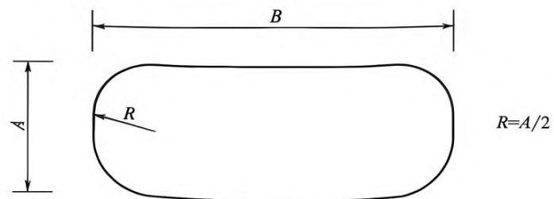  
图15.1-1 螺旋扁圆风管规格示意图

表 15.1-11

螺旋扁圆风管规格

<table><tr><td rowspan="26">公称宽度,即长轴B(mm)(当量直径 $d_c$ )</td><td colspan="15">公称高度,即短轴A(mm)</td></tr><tr><td>板厚(mm)</td><td>75</td><td>100</td><td>125</td><td>150</td><td>175</td><td>200</td><td>225</td><td>250</td><td>300</td><td>350</td><td>400</td><td>450</td><td>500</td><td>600</td></tr><tr><td rowspan="10">0.6</td><td>200(114)</td><td></td><td></td><td></td><td rowspan="3">220(200)</td><td></td><td></td><td></td><td></td><td></td><td></td><td></td><td></td><td></td></tr><tr><td>275(122)</td><td>265(151)</td><td></td><td></td><td></td><td></td><td></td><td></td><td></td><td></td><td></td><td></td><td></td></tr><tr><td>315(125)</td><td>300(156)</td><td></td><td></td><td></td><td></td><td></td><td></td><td></td><td></td><td></td><td></td><td></td></tr><tr><td>350(128)</td><td>340(160)</td><td>325(188)</td><td>310(211)</td><td>300(230)</td><td></td><td>260(245)</td><td></td><td></td><td></td><td></td><td></td><td></td><td></td></tr><tr><td>390(130)</td><td>375(164)</td><td>360(193)</td><td>350(219)</td><td>325(237)</td><td></td><td>305(267)</td><td></td><td></td><td></td><td></td><td></td><td></td><td></td></tr><tr><td>440(132)</td><td>415(167)</td><td>400(198)</td><td>390(226)</td><td>375(249)</td><td></td><td>340(280)</td><td></td><td></td><td></td><td></td><td></td><td></td><td></td></tr><tr><td></td><td>425(167)</td><td>410(199)</td><td>400(227)</td><td>390(252)</td><td></td><td>355(286)</td><td></td><td></td><td></td><td></td><td></td><td></td><td></td></tr><tr><td></td><td>500(172)</td><td>490(206)</td><td>470(236)</td><td>450(263)</td><td></td><td>425(306)</td><td></td><td></td><td></td><td></td><td></td><td></td><td></td></tr><tr><td></td><td></td><td>525(209)</td><td>510(241)</td><td>490(268)</td><td>475(293)</td><td>460(315)</td><td></td><td>415(359)</td><td></td><td></td><td></td><td></td><td></td></tr><tr><td></td><td></td><td></td><td>550(244)</td><td>540(275)</td><td>520(301)</td><td>500(323)</td><td></td><td>460(376)</td><td></td><td></td><td></td><td></td><td></td></tr><tr><td rowspan="9">0.8</td><td></td><td></td><td></td><td>625(250)</td><td>610(282)</td><td>600(312)</td><td>575(337)</td><td>565(361)</td><td>535(400)</td><td></td><td></td><td></td><td></td><td></td></tr><tr><td></td><td></td><td></td><td>700(255)</td><td>690(289)</td><td>675(320)</td><td>660(349)</td><td>650(376)</td><td>615(420)</td><td></td><td></td><td></td><td></td><td></td></tr><tr><td></td><td></td><td></td><td>790(260)</td><td>775(295)</td><td>760(328)</td><td>735(358)</td><td>725(387)</td><td>700(438)</td><td>665(477)</td><td>635(509)</td><td></td><td></td><td></td></tr><tr><td></td><td></td><td></td><td>860(263)</td><td>840(299)</td><td>830(333)</td><td>815(366)</td><td>800(396)</td><td>775(451)</td><td>750(497)</td><td>715(534)</td><td></td><td></td><td></td></tr><tr><td></td><td></td><td></td><td>890(264)</td><td>875(301)</td><td>860(336)</td><td>850(369)</td><td>830(399)</td><td>805(455)</td><td>775(503)</td><td>750(543)</td><td>715(573)</td><td></td><td></td></tr><tr><td></td><td></td><td></td><td>940(266)</td><td>925(303)</td><td>910(339)</td><td>890(372)</td><td>885(404)</td><td>880(466)</td><td>825(512)</td><td>800(556)</td><td>765(589)</td><td>735(615)</td><td></td></tr><tr><td></td><td></td><td></td><td>1020(268)</td><td>100(306)</td><td>990(343)</td><td>975(378)</td><td>960(411)</td><td>935(472)</td><td>910(527)</td><td>875(572)</td><td>850(613)</td><td>825(646)</td><td></td></tr><tr><td></td><td></td><td></td><td>1100(270)</td><td>109(310)</td><td>107(347)</td><td>105(383)</td><td>103(417)</td><td>101(480)</td><td>985(538)</td><td>950(587)</td><td>925(631)</td><td>900(669)</td><td></td></tr><tr><td></td><td></td><td></td><td></td><td>116(312)</td><td>115(350)</td><td>113(387)</td><td>111(422)</td><td>108(487)</td><td>106(547)</td><td>103(601)</td><td>101(649)</td><td>985(691)</td><td></td></tr><tr><td rowspan="3">1.0</td><td></td><td></td><td></td><td></td><td>131(316)</td><td>130(356)</td><td>128(394)</td><td>127(431)</td><td>125(501)</td><td>121(564)</td><td>118(622)</td><td>116(675)</td><td>113(724)</td><td></td></tr><tr><td></td><td></td><td></td><td></td><td>147(319)</td><td>145(360)</td><td>144(399)</td><td>143(438)</td><td>140(510)</td><td>137(578)</td><td>135(641)</td><td>131(698)</td><td>128(750)</td><td></td></tr><tr><td></td><td></td><td></td><td></td><td>162(322)</td><td>161(404)</td><td>160(404)</td><td>158(443)</td><td>156(518)</td><td>153(589)</td><td>150(655)</td><td>147(716)</td><td>145(774)</td><td></td></tr><tr><td rowspan="2">1.2</td><td></td><td></td><td></td><td></td><td>178(324)</td><td></td><td></td><td>175(448)</td><td>171(525)</td><td>168(598)</td><td>166(667)</td><td>163(732)</td><td>160(792)</td><td></td></tr><tr><td></td><td></td><td></td><td></td><td>194(326)</td><td></td><td></td><td>190(452)</td><td>187(531)</td><td>185(606)</td><td>181(677)</td><td>178(744)</td><td>176(808)</td><td></td></tr></table>

注：表中括号内部标注的是当量直径 $d_{c}$ ，螺旋扁圆风管当量直径计算公式为 $d_{c}=\frac{4h}{p}$ ，其中断面积 $F=\frac{\pi A^{2}}{4}+A(B-A)$ ，湿周 $P=\pi A+2(B-A)$ 。

**15.1.2.3 风管板材厚度**

风管板材厚度主要根据风管材质以及风管的密封要求进行选取，主要包括钢板风管板材厚度、不锈钢板风管板材厚度、铝板风管板材厚度、硬聚氯乙烯风管板材厚度、无机玻璃钢风管板材厚度等。

1. 钢板风管板材适用于高压、中压、低压系统，其厚度见表 15.1-12。

钢板风管板材厚度  
表 15.1-12

<table><tr><td rowspan="2">直径D或长边b(mm)</td><td rowspan="2">圆形风管厚度(mm)</td><td colspan="2">矩形风管厚度(mm)</td><td rowspan="2">除尘系统风管厚度(mm)</td></tr><tr><td>中压、低压系统</td><td>高压系统</td></tr><tr><td>D(b)≤320</td><td>0.5</td><td>0.5</td><td>0.75</td><td>1.5</td></tr><tr><td>320&lt;D(b)≤450</td><td>0.6</td><td>0.6</td><td>0.75</td><td>1.5</td></tr><tr><td>450&lt;D(b)≤630</td><td>0.75</td><td>0.6</td><td>0.75</td><td>2.0</td></tr><tr><td>630&lt;D(b)≤1000</td><td>0.75</td><td>0.75</td><td>1.0</td><td>2.0</td></tr><tr><td>1000&lt;D(b)≤1250</td><td>1.0</td><td>1.0</td><td>1.0</td><td>2.0</td></tr><tr><td>1250&lt;D(b)≤2000</td><td>1.2</td><td>1.0</td><td>1.2</td><td>按设计</td></tr><tr><td>2000&lt; D(b)≤4000</td><td>按设计</td><td>1.2</td><td>按设计</td><td>按设计</td></tr></table>

注：1. 螺旋风管的钢板厚度可适当减小 $10\% \sim 15\%$ 。  
2. 排烟系统风管钢板厚度可按高压系统选取。  
3. 特殊除尘系统风管钢板厚度应符合设计要求。  
4. 不适用于地下人防与防火隔墙的预埋管。

2. 不锈钢板风管板材适用于高压、中压、低压系统，其厚度见表 15.1-13。

不锈钢板风管板材厚度  
表 15.1-13

<table><tr><td>风管边长b或直径D(mm)</td><td>不锈钢板厚度(mm)</td></tr><tr><td>1000.5</td><td>0.5</td></tr><tr><td>5000.75</td><td>0.75</td></tr><tr><td>11201.0</td><td>1.0</td></tr><tr><td>20001.2</td><td>1.2</td></tr></table>

注：1. 不锈钢板厚度小于或等于 $1 \mathrm{~mm}$ 时, 板材拼接应采用咬接或铆接; 板材厚度大于 $1 \mathrm{~mm}$ 时, 宜采用氩弧焊或电弧焊焊接, 不得采用气焊。焊接时, 焊材应与母材相匹配, 并应防止焊接飞溅物玷污表面, 焊后应将焊渣及飞溅物清除干净。

2. 不锈钢风管采用法兰连接时，矩形风管法兰材料规格应符合表 15.1-14 的规定；圆形风管法兰材料规格应符合表 15.1-15 的规定。法兰材质为碳素钢时，其表面应进行镀铬或镀锌处理。风管铆接应采用不锈钢铆钉。

3. 矩形不锈钢风管采用薄钢板法兰连接且紧固件材质为碳素钢时，其表面应进行镀铬或镀锌处理。

矩形风管法兰材料规格  
表 15.1-14

<table><tr><td rowspan="2">角钢规格</td><td rowspan="2">螺栓规格</td><td rowspan="2">铆钉规格</td><td colspan="2">螺栓及铆钉间距(mm)</td></tr><tr><td>微、低、中压系统</td><td>高压系统</td></tr><tr><td>∠25×3</td><td>M6</td><td rowspan="2">Φ4</td><td rowspan="4">≤150</td><td rowspan="4">≤100</td></tr><tr><td>∠30×3</td><td rowspan="2">M8</td></tr><tr><td>∠40×4</td><td rowspan="2">Φ5</td></tr><tr><td>∠50×5</td><td>M8或M10</td></tr></table>

圆形风管法兰材料规格  
表 15.1-15

<table><tr><td rowspan="2">风管直径D(mm)</td><td colspan="2">法兰材料规格(mm)</td><td rowspan="2">螺栓规格</td></tr><tr><td>扁钢</td><td>角钢</td></tr><tr><td>D≤140</td><td>20×4</td><td>-</td><td rowspan="3">M6</td></tr><tr><td>140&lt;D≤280</td><td>25×4</td><td>-</td></tr><tr><td>280&lt;D≤630</td><td>-</td><td>25×3</td></tr><tr><td>630&lt;D≤1250</td><td>-</td><td>30×3</td><td rowspan="2">M8</td></tr><tr><td>1250&lt;D≤2000</td><td>-</td><td>40×4</td></tr></table>

3. 铝板风管板材适用于中压、低压系统，其厚度见表 15.1-16。

铝板风管板材厚度  
表 15.1-16

<table><tr><td>风管边长b或直径D(mm)</td><td>铝板厚度(mm)</td></tr><tr><td>1001.0</td><td>1.0</td></tr><tr><td>3201.5</td><td>1.5</td></tr><tr><td>6302.0</td><td>2.0</td></tr><tr><td>2000按设计</td><td>按设计</td></tr></table>

注：1. 铝板厚度小于或等于 $1.5 \mathrm{~mm}$ 时, 板材的连接可采用咬接或铆接, 不得采用按扣式咬口, 板厚大于 $1.5 \mathrm{~mm}$ 时, 应采用氩弧焊或气焊焊接。

2. 铝板矩形风管的法兰材料规格应符合表 15.1-14 的规定。铝板圆形风管法兰材料规格应符合表 15.1-15 的规定。铝板风管与法兰的连接采用铆接时，应采用铝铆钉。风管法兰材质为碳素钢时，其表面应按设计要求做防腐处理。

3. 矩形铝板风管不宜采用 C、S 形平插条连接形式。

4. 硬聚氯乙烯风管板材适用于中压、低压系统，其厚度见表 15.1-17。

硬聚氯乙烯风管板材厚度  
表 15.1-17

<table><tr><td colspan="2">圆形风管</td><td colspan="2">矩形风管</td></tr><tr><td>风管直径D(mm)</td><td>板材厚度(mm)</td><td>风管长边尺寸b(mm)</td><td>板材厚度(mm)</td></tr><tr><td>D≤320</td><td>3.0</td><td>b≤320</td><td>3.0</td></tr><tr><td>3204.03204.0</td><td>4.0</td><td>3204.0</td><td>4.0</td></tr><tr><td>6305.05005.0</td><td>5.0</td><td>5005.0</td><td>5.0</td></tr><tr><td>6306.08006.0</td><td>6.0</td><td>8006.0</td><td>6.0</td></tr><tr><td></td><td></td><td>12508.0</td><td>8.0</td></tr></table>

注：1. 风管板材厚度及内径（或外边长）允许偏差应符合表 15.1-18 或表 15.1-19 的规定。  
2. 矩形风管的四角可采用煨角或焊接连接的方法。当采用煨角时，纵向焊缝距煨角处宜大于80mm。  
3. 风管与法兰连接应采用焊接，法兰端面应垂直于风管轴线。直径或边长大于 500mm 的风管与法兰的连接处，宜均匀设置三角支撑加强板，加强板间距不得大于 450mm。

硬聚氯乙烯圆形风管板材厚度及内径允许偏差  
表 15.1-18

<table><tr><td>风管直径D(mm)</td><td>板材厚度(mm)</td><td>内径允许偏差(mm)</td></tr><tr><td>D≤320</td><td>3</td><td>-1</td></tr><tr><td>3204-1</td><td>4</td><td>-1</td></tr><tr><td>6305-2</td><td>5</td><td>-2</td></tr><tr><td>10006-2</td><td>6</td><td>-2</td></tr></table>

硬聚氯乙烯矩形风管板材厚度及边长允许偏差  
表 15.1-19

<table><tr><td>风管边长b(mm)</td><td>板材厚度(mm)</td><td>外边长允许偏差(mm)</td></tr><tr><td>b≤320</td><td>3</td><td>-1</td></tr><tr><td>3204-1</td><td>4</td><td>-1</td></tr><tr><td>5005-2</td><td>5</td><td>-2</td></tr><tr><td>8006-2</td><td>6</td><td>-2</td></tr><tr><td>12508-2</td><td>8</td><td>-2</td></tr></table>

5. 无机玻璃钢风管板材适用于中压、低压系统，其厚度见表15.1-20。

无机玻璃钢风管板材厚度  
表 15.1-20

<table><tr><td>圆形风管直径D或矩形风管长边尺寸b(mm)</td><td>板材厚度(mm)</td></tr><tr><td>D(b)≤300</td><td>2.5~3.5</td></tr><tr><td>3003.5~4.5</td><td>3.5~4.5</td></tr><tr><td>5004.5~5.5</td><td>4.5~5.5</td></tr><tr><td>10005.5~6.5</td><td>5.5~6.5</td></tr><tr><td>15006.5~7.5</td><td>6.5~7.5</td></tr><tr><td>D(b)&gt;2000</td><td>7.5~8.5</td></tr></table>

**15.1.2.4 风管密封**

系统应根据输送介质及其温度选用适合的法兰垫片材质。一般送、排风及空调系统，即输送温度低于 $70^{\circ} \mathrm{C}$ 的空气的风管，应选用橡胶板、闭孔海绵橡胶板等；锅炉排烟除尘烘干房的送、排风及加热炉的排气系统，即输送温度高于 $70^{\circ} \mathrm{C}$ 的空气或烟气的风管，选用石棉绳或石棉橡胶板等；酸性及碱性气体的塑料或不锈钢排风系统，应选用耐酸碱的橡胶板或软聚氯乙烯板等；印染纺织工厂的送、排风及地下工程的通风系统，即输送产生凝结水或潮湿空气的风管，应选用橡胶板、闭孔海绵胶板等；除尘系统的风管，应选用橡胶板。

插条法兰目前常用的有 U 形、S 形及立筋 S 形等。一般是当矩形风管大边边长为 120～630mm 时，风管的上下两面（大边）采用 S 形连接，风管左右两个立面（小边）采用 U 形连接；当矩形风管大边长为 630～800m 时，其风管的两个立面仍采用 U 形连接，而上下两面采用立筋 S 形连接，以增加其牢固性。两段风管互相连接时，先将风管两平面的 S 形或立筋 S 形插条法兰处插入插条锁紧，再将风管两个立面插入 U 形插条法兰，最后将带舌接头弯折扣紧。采用 U 形插条法兰时，风管末端下料板边量要预留 10mm 并折成 180°翻边。扳边后的角度应准确平整，不得凹凸不平，保证风管板边与 U 形插条连接得严密。为保证插条法兰连接的严密性，一般采用密封胶玻璃丝布胶带及铝管胶带等密封材料密封。

**15.1.2.5 风管加固**

1. 金属风管：矩形风管边长大于或等于 $630 \mathrm{~mm}$ 、保温风管边长大于或等于 $800 \mathrm{~mm}$ ,其管段长度大于 $1250 \mathrm{~mm}$ 或低压风管单边面积大于 $1.2 \mathrm{~m}^{2}$ , 中压、高压风管单边面积大于 $1.0 \mathrm{~m}^{2}$ 时, 均应采取加固措施。圆形风管 (不包括螺旋风管) 直径大于或等于 $800 \mathrm{~mm}$ , 且其管段长度大于 $1250 \mathrm{~mm}$ 或总表面积大于 $4 \mathrm{~m}^{2}$ 时, 均应采取加固措施。高压和中压风管系统的管段, 当长度大于 $1250 \mathrm{~mm}$ 时, 还要有加固框补强。高压系统风管的单咬口缝应有防止咬口缝胀裂的加固措施。

2. 非金属风管：硬聚氯乙烯风管边长大于或等于 $630 \mathrm{~mm}$ 的四角焊接成型的矩形风管，或边长大于或等于 $800 \mathrm{~mm}$ 加热折角成型的矩形风管，或管段长度大于 $1.2 \mathrm{~m}$ 的风管，均应采取加固框与风管相焊接的加固措施。

3. 复合材料风管：复合玻璃纤维板风管采用金属槽形框外加固时，应按规定设置内支撑，并将内支撑与金属槽框紧固为一体。负压风管的加固，应设在风管壁的内侧。

4. 无机玻璃钢风管：无机玻璃钢风管的加固分为整体型矩形风管的加固和组合型矩形风管的加固。采用模具制作整体成型的无机玻璃钢风管，可直接采用本体材料（纤维增强胶凝材料）在最大应力处设置加强筋进行加固，使加强筋与风管成为整体；风管制作完毕后的加固，可采用金属或其他材料进行加固，并进行防腐处理。组合型风管采用角形金属型材（如角钢或角铝）固定四角边时，其紧固件的间距应小于或等于 $200 \mathrm{~mm}$ 。

**15.1.2.6 风管支、吊架的安装**

风管水平安装, 直径或长边尺寸小于或等于 $400 \mathrm{~mm}$ , 支、吊架间距不应大于 $4 \mathrm{~m}$ ; 直径或长边尺寸大于 $400 \mathrm{~mm}$ , 支、吊架间距不应大于 $3 \mathrm{~m}$ 。螺旋风管的支、吊架间距可分别延长至 $5 \mathrm{~m}$ 和 $3.75 \mathrm{~m}$ ; 对于薄钢板法兰的风管, 其支、吊架间距不应大于 $3 \mathrm{~m}$ 。

风管垂直安装，支、吊架间距不应大于 $4 \mathrm{~m}$ ，单根直管至少应有 2 个固定点。

风管支、吊架宜按国家标准图集与相关规范选用强度和刚度相适应的形式和规格。对于直径或边长大于 $2500\mathrm{mm}$ 的超宽、超重等特殊风管的支、吊架，应按设计确定。

支、吊架不宜设置在风口、阀门、检查门及自控机构处，离风口或插接管的距离不宜小于 200mm。

当水平悬吊的主、干风管长度超过 20m 时，应设置防止摆动的固定点，每个系统不应少于 1 个。

吊架的螺孔应采用机械加工。吊杆应平直，螺纹完整、光洁。安装后各副支、吊架的受力应均匀，无明显变形。风管或空调设备使用的可调隔振支、吊架的拉伸或压缩量应按设计的要求进行调整。

抱箍支架，折角应平直，抱箍应紧贴并箍紧风管。安装在支架上的圆形风管应设托座和抱箍，其圆弧应均匀，且与风管外径相一致。

### 15.1.3 弯头、三通等配件

通风与空调工程的风管系统由直风管和各种风管配件（例如弯管、变径管、来回弯管、三通和四通）、各种风量调节阀以及空气分布器（送风口、回风口或排风口）等部件组成。就风管配件而言，弯管用来改变空气的流动方向，使气流转弯 $90^{\circ}$ 或其他角度；来回弯管用来改变风管的升降、躲让或绕过建筑物的梁、柱及其他管道；变径管用来连接断面尺寸不同的风管；天圆地方用来连接圆形与矩形（或方形）两个断面的配件；三通或四通用于风管的分叉和汇合，即气流的分流和合流。

**15.1.3.1 圆形风管的配件**

**1. 圆形弯管**

圆形弯管如图 15.1-2 所示。按照制作方法不同，有冲压成型弯管、皱褶型弯管和分节组合弯管 3 种；按弯管的角度，有 $90^{\circ}$ 弯管、 $60^{\circ}$ 弯管、 $45^{\circ}$ 弯管和 $30^{\circ}$ 弯管；圆形弯管的曲率半径以中心线计。

冲压成型弯管的管径 $D=75\sim250mm$ ，曲率半径 r=1.5D；皱褶型弯管的管径 $D=100\sim400mm$ ，曲率半径 r=1.5D。

分节组合弯管由两个端节和若干个中节组成。工程中常见的五节 $90^{\circ}$ 弯管的管径 $D = 80 \sim 1500 ~mm$ ，曲率半径 r = 1.5D；七节 $90^{\circ}$ 弯管的管径 $D = 80 \sim 1500 ~mm$ ，曲率半径 r = 2.5D。至于三节 $90^{\circ}$ 弯管，由于阻力相对较大，一般不予采用。

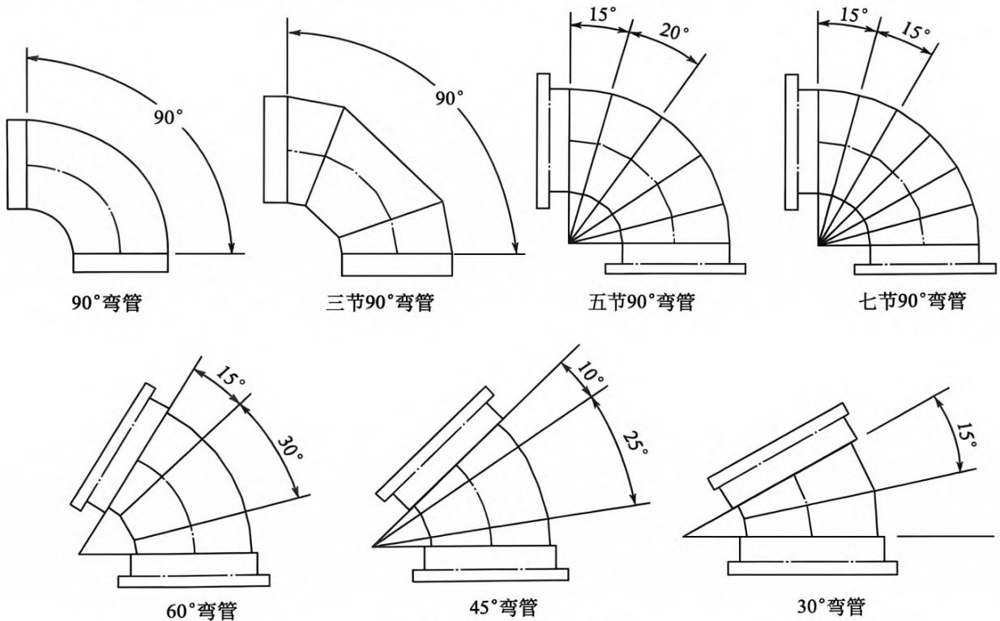  
图 15.1-2 圆形弯管

**2. 圆形变径管、天圆地方和圆形来回弯管**

圆形变径管有双面变径管和单面变径管，前者的夹角 $\theta$ 宜小于 $60^{\circ}$ ，后者的夹角 $\theta$ 宜小于 $30^{\circ}$ ，天圆地方有正心的和偏心的之分，见图15.1-3。

双面变径管的长度 $L=\frac{D_{1}-D_{2}}{2\tan\frac{\theta}{2}}$ ，单面变径管的长度 $L=\frac{D_{2}-D_{1}}{\tan\theta}$ （其中 $D_{1}$ 和 $D_{2}$ 分别代表变径管的大断面、小断面的直径）。

圆形来回弯管由两个相同角度的圆形弯管按相反方向连接而成，见图 15.1-3。

**3. 圆形三通管**

按照主管与支管的夹角不同，有 $\theta = 30^{\circ}$ 、 $\theta = 45^{\circ}$ 圆形三通， $\theta = 30^{\circ}$ 圆形封板式三通和 $\theta = 45^{\circ}$ 圆形燕尾（俗称裤衩）式三通（图15.1-4）。当三通支管的气流方向转 $90^{\circ}$ 时，在支管的出口处应连接角度为（ $90 - \theta$ ）的圆形弯管。圆形四通宜采用两个斜三通的做法。

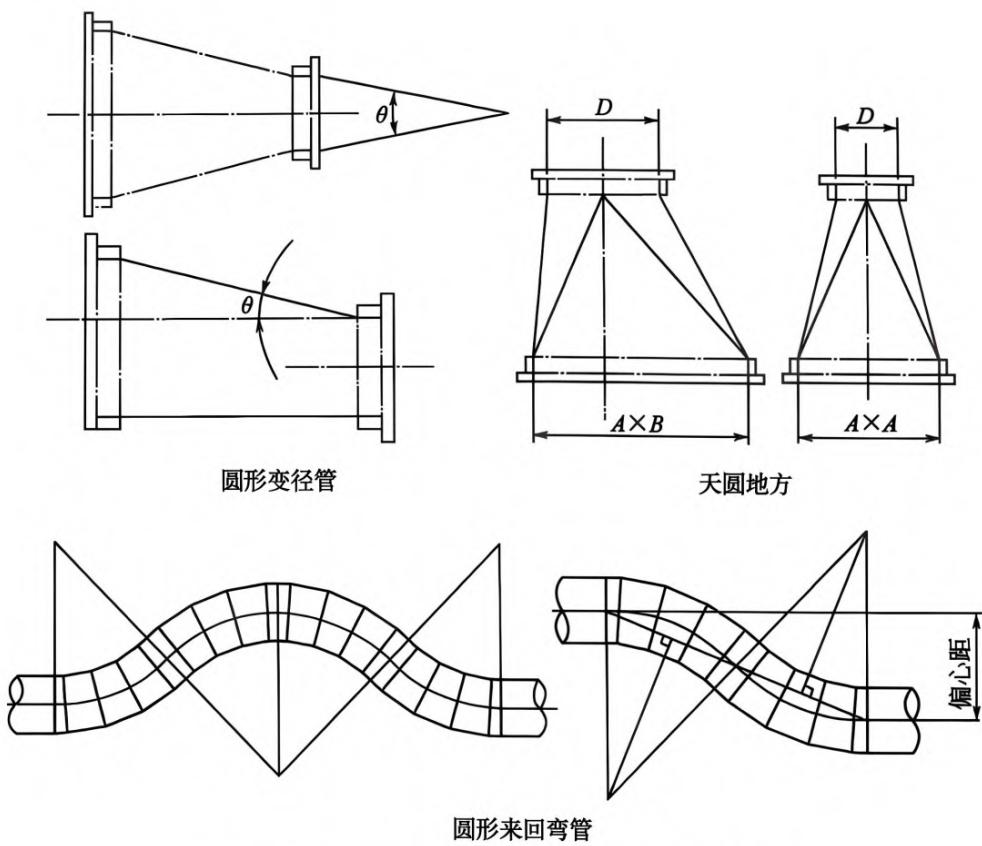  
图15.1-3 圆形变径管、天圆地方和来回弯管

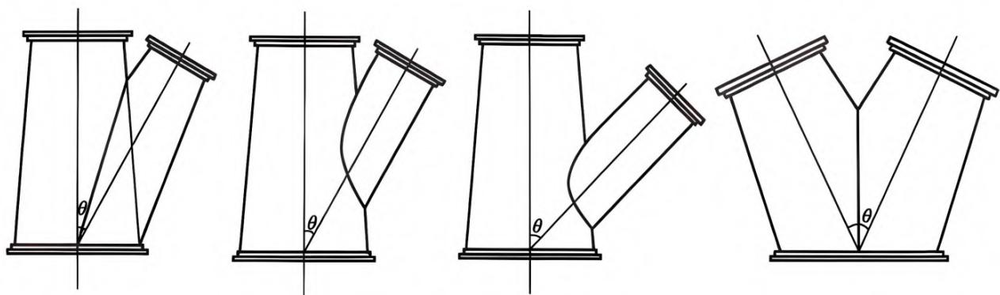  
图15.1-4 圆形三通管

**15.1.3.2 矩形风管的配件**

**1. 矩形弯管**

工程上常见的矩形弯管有: ①内外同心弧形弯管, 见图 15.1-5 (a), 弯管曲率半径宜为一个平面边长; ②内弧外直角形, 见图 15.1-5 (b); ③内斜线外直角形弯管, 见图 15.1-5 (c); ④内外直角形弯管, 见图 15.1-5 (d)。

内外同心弧形矩形弯管，内弧的曲率半径 $r$ 为 $0.5a$ ，外弧形弯管的平面边长大于 $500\mathrm{mm}$ 时，且内弧半径 $r$ 与弯管平面边长 $a$ 之比小于或等于0.25时，应设置导流片（图15.1-6)，以减少气流阻力。导流片的弧度应与弯管弧度相等，迎风边缘应光滑。导流片的间隔是内侧密、外侧疏，其数量及设置位置应符合表15.1-21的规定。

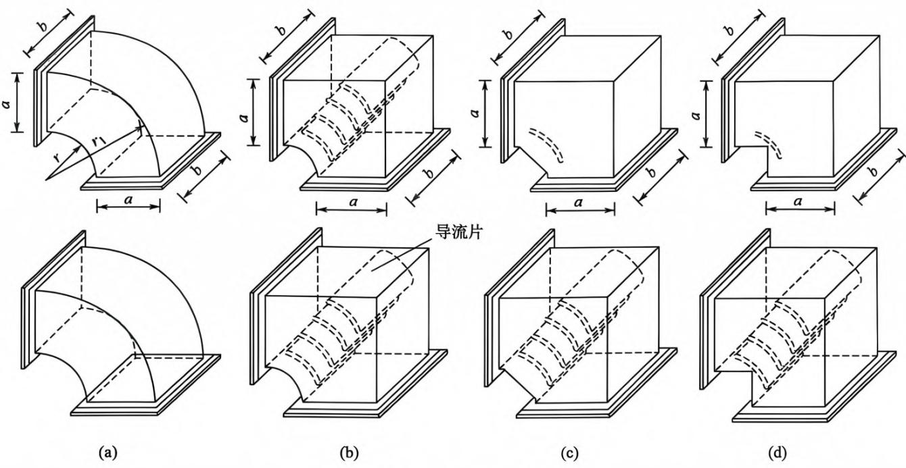

图15.1-5 矩形弯管  
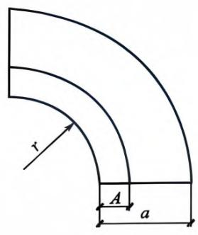

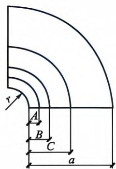  
图15.1-6 内外同心弧形矩形弯管导流片的设置

内外同心弧形矩形弯管导流片片数及设置位置  
表 15.1-21

<table><tr><td rowspan="2">弯管平面边长(mm)</td><td rowspan="2">数量(片)</td><td colspan="3">位置</td></tr><tr><td>A</td><td>B</td><td>C</td></tr><tr><td>50010.33a——</td><td>1</td><td>0.33a</td><td>—</td><td>—</td></tr><tr><td>100020.25a0.5a—</td><td>2</td><td>0.25a</td><td>0.5a</td><td>—</td></tr><tr><td>a&gt;1500</td><td>3</td><td>0.125a</td><td>0.33a</td><td>0.5a</td></tr></table>

内弧外直角形、内斜线外直角形和内外直角形矩形弯管与内外同心弧形矩形弯管相比，占用空间小些，但阻力相对较大。对于内外直角形矩形弯管以及边长大于 $500\mathrm{mm}$ 的内弧外直角形、内斜线外直角形弯管，应设置导流片，以减少气流阻力，如图15.1-7（a）(b）（c）所示。导流片有单弧形[图15.1-7（d）]和双弧形[图15.1-7（e）]两种，它们在弯管内是按等距离设置的。导流片的圆弧半径 $R_{1}$ （或 $R_{2}$ ）及片距 $P$ 宜按表15.1-22确定。

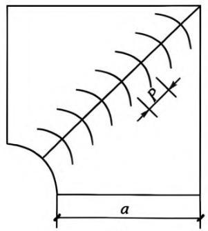  
(a)

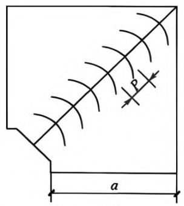  
(b)

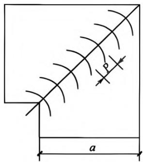  
(c)

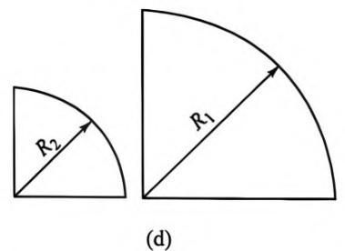

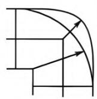

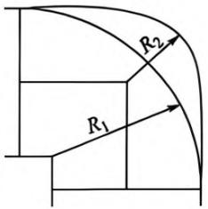  
(e)  
图15.1-7 内弧外直角形、内斜线外直角形和内外直角形矩形弯管导流片的设置

导流片圆弧半径及片距（单位：mm）  
表 15.1-22

<table><tr><td colspan="2">单圆弧形导流片</td><td colspan="2">双圆弧形导流片</td></tr><tr><td> $R_1=50$ </td><td> $R_1=115$ </td><td> $R_1=50$ </td><td> $R_1=115$ </td></tr><tr><td>P=38</td><td>P=83</td><td> $R_2=25$ </td><td> $R_2=51$ </td></tr><tr><td>—</td><td>—</td><td>P=54</td><td>P=83</td></tr><tr><td colspan="2">镀锌板厚度宜为0.8</td><td colspan="2">镀锌板厚度宜为0.6</td></tr></table>

**2. 矩形变径管**

工程中常用的矩形变径管有双面偏和单面偏两种形式。对于双面偏的变径管[图15.1-8（a）]，其夹角 $\theta$ 宜小于 $60^{\circ}$ ；对于单面偏的变径管[图15.1-8（b）]，其夹角 $\theta$ 宜小于 $30^{\circ}$ 。为了减小气流阻力，风管断面缩小部分的收缩角应尽量小于 $45^{\circ}$ ，风管断面扩大部分的扩张角应尽量小于 $20^{\circ}$ 。

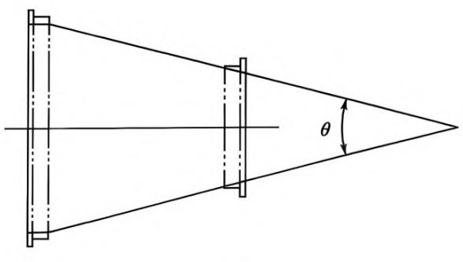  
(a)  
图15.1-8 矩形变径管

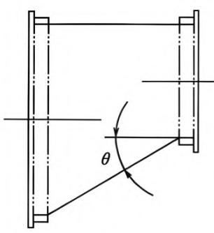  
(b)

矩形变径管的长度计算与圆形变径管相似。

**3. 矩形来回弯管**

矩形来回弯管包括有角接来回弯管、斜接来回弯管和双弧形来回弯管三种，如图15.1-9所示。

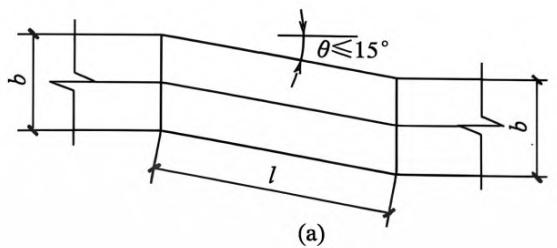

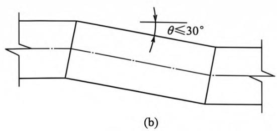

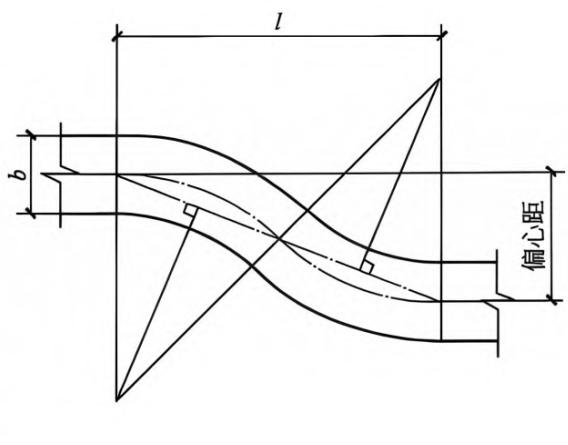  
图15.1-9 矩形来回弯管  
(a) 有角接来回弯管；(b) 斜接来回弯管；(c) 双弧形来回弯管

**4. 矩形三通和四通**

工程中常用的矩形三通和四通有分叉式（图 15.1-10）和分隔式（图 15.1-11）两种形式。分隔式三通由两个 $90^{\circ}$ 弯管或者一个 $90^{\circ}$ 弯管和另一个直风管组合而成，分隔式四通由两个 $90^{\circ}$ 弯管和一根变径管组合而成，气流的汇合或分离各行其道，彼此不互相牵制，风量分配均匀，加工制作工艺简单。因此，就被输送空气的分流和合流而言，分隔式三通、四通的性能要优于分叉式。图 15.1-12 为由常用的弯管组合而成的三通（或四通）。

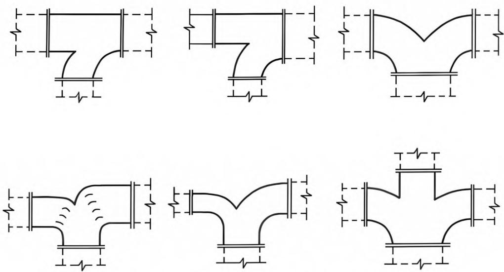  
图15.1-10 分叉式三通、四通

《全国通用通风管道配件图表》推荐的矩形整体式三通和矩形插管式三通或四通，参见图15.1-13；钢板矩形风管配件的正、误做法如图15.1-14所示。

制作方法：三通风管（图 15.1-15）：制作时将支管插入主风管内，用专用胶黏接，然后捆扎固位，清理余胶，填补空隙，放在平整处固化。相同截面的蝴蝶三通（图 15.1-16、图 15.1-17）：制作时切割风管上下、侧面板，用多块小板黏结而成。四通风管参照三通风管制作方法。

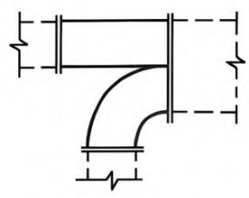

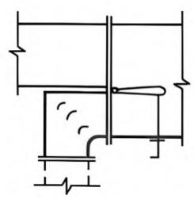

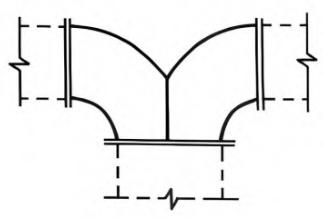

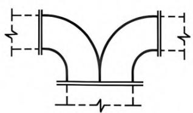

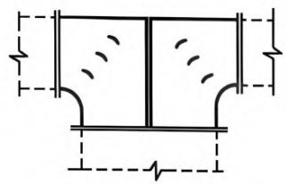  
图15.1-11 分隔式三通、四通

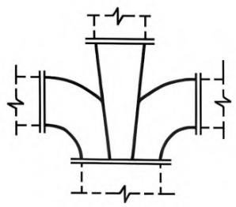

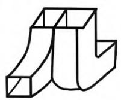

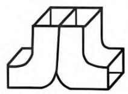

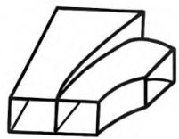

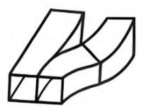

  
图15.1-12 由常用弯管组合而成的三通、四通

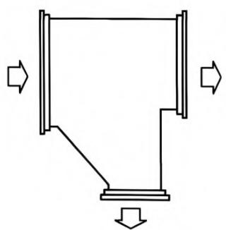

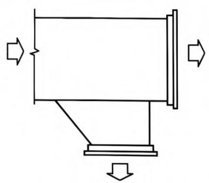

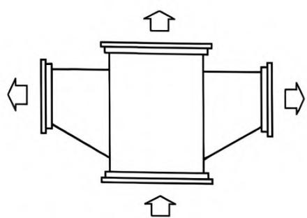  
图15.1-13 矩形整体式三通和矩形插管式三通或四通

**15.1.3.3 螺旋风管的配件**

螺旋风管分为螺旋圆风管和螺旋扁圆风管（图 15.1-18），其配件如图 15.1-19、图 15.1-20 所示。

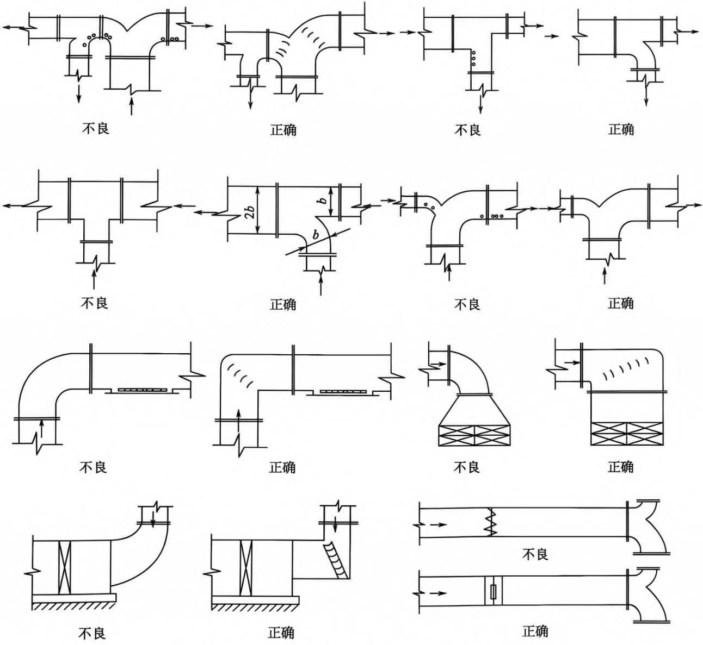  
图15.1-14 钢板矩形风管配件的正、误做法

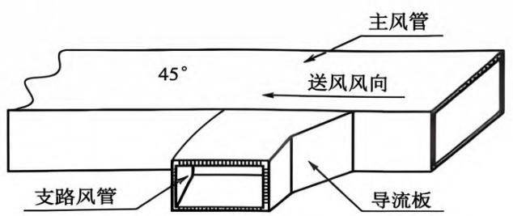  
图15.1-15 三通风管

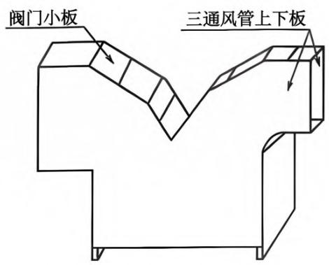  
图15.1-16 蝴蝶三通

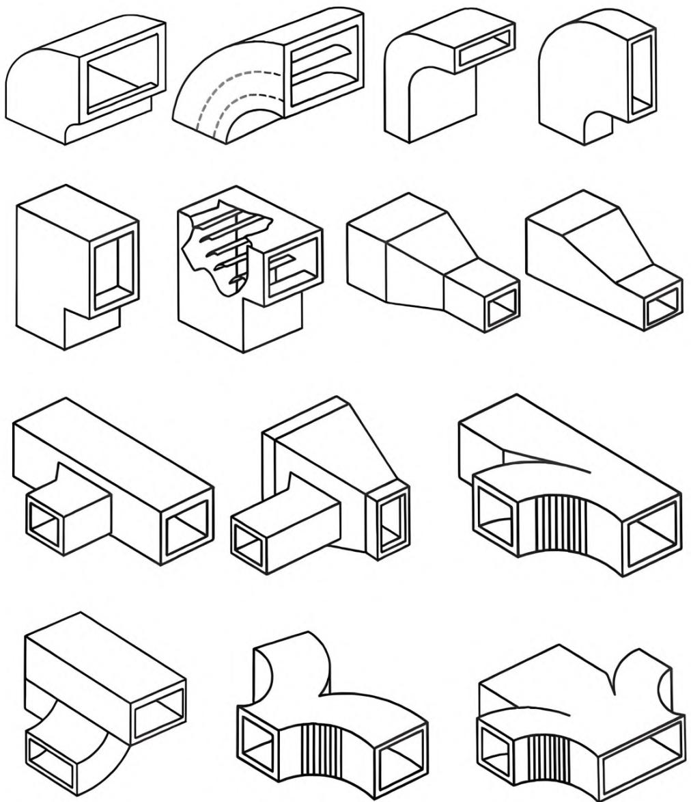  
图 15.1-17 酚醛（或聚氨酯）铝箔复合板风管的配件

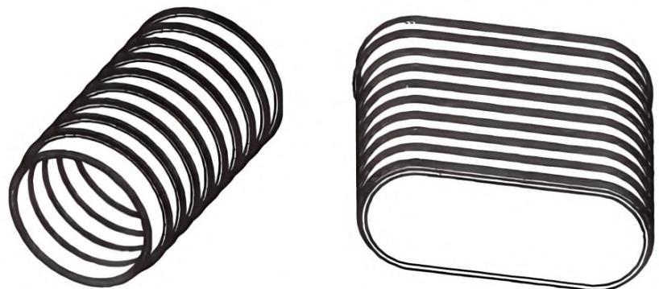  
图 15.1-18 螺旋圆风管和螺旋扁圆风管

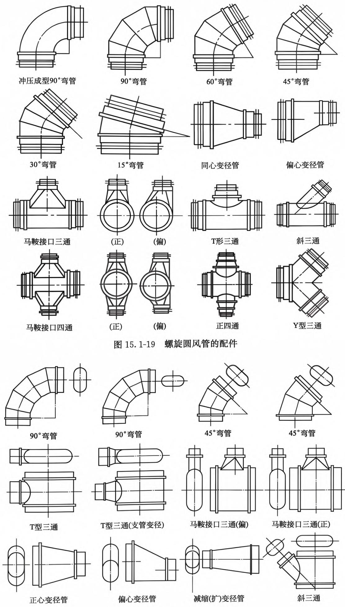  
图15.1-20 螺旋扁圆风管的配件

## 15.2 管道、材料及附件

### 15.2.1 常用术语

用以输送、分配、混合、分离、排放、计量或流体流动的管道组成件统称为“管道”。管道除管道组成件外，还包括管道支承件，但不包括支承构筑物，如建筑框架、管架、管廊和底座（管墩或基础）等。

管道组成件是指用于连接或装配成压力密封的管道系统机械元件，包括管子、管件、法兰、垫片、紧固件、阀门安全保护设施以及诸如膨胀节、挠性接头、耐压软管、过滤器、管路中的仪表、（如孔板）和分离器等。

受相同设计条件制约的相互连接的管道，称为“管道系统”。

用于输送流体或传递流体压力的密封中空连续体称为“管子”；管道的材料称为“管材”，但在塑料管道系统中常用管道的材料直接称呼，如“聚丁烯管”。

管件是管道系统中用于直接连接、转弯、分支、变径以及用作端部等的零部件，包括弯头、三通、四通、异径管接头、管箍、内外螺纹接头、活接头、快速接头、螺纹短接、管堵、管帽、全封闸板等（不包括阀门、法兰、紧固件）。

管件、补偿器、阀门及其组合件等管道的专用部件统称为“管道附件”。

### 15.2.2 管道设计基本知识

管道工程按其服务对象的不同，大体可分为两大类，即公用与民用建筑管道和工业管道。

在设施中或为改变劳动、工作或生活条件输送介质的管道称为公用与民用建筑管道；工业生产中输送介质的管道称为工业管道。

公用与民用建筑管道通常包括饮用水管道、消防给水管道、冷热水管道、污水雨水管道、蒸汽管道、燃气管道、通风管道等。根据压力可分为真空管道、无压管道、常压管道与超常压管道。本节所述管道主要是指建筑物中用于暖通空调工程中输送液体、气体或传递流体压力的管道，都属于公用与民用建筑管道。例如：用于输送供暖空调系统的冷热水、冷却水、压缩空气、燃气、蒸汽及其凝结水等的管道；不包括建筑物中通风空调系统的风管道。

**15.2.2.1 管道设计的基本内容**

在供暖、空调、动力等系统中，管道设计的基本任务是：首先根据生产工艺和供暖、空调、动力等系统的输送要求或压力传递要求，确定管道系统形式、材质、走向布置、附件，并初步确定管径；然后计算管道的沿程压力损失（ $\Delta p_{\mathrm{m}}$ ）和局部压力损失（ $\Delta p_{\mathrm{j}}$ ），根据使用设备的余压要求和压力损失情况，最终确定管径。当需要配置相应输送设备时，再选择相应泵、空气压缩机等设备。

**15.2.2.2 管材的分类**

在管道工程中，管材是用于输送介质的最主要组成部分。用于供暖、空调管道的管材主要按以下两种方式分类。

**1. 按材质分类**

管道按材质分类可分为三类：金属管、非金属管与复合管。

金属管主要有：钢管、铸铁管、铸钢管、铜管、不锈钢管等。供暖、空调系统中常用的是钢管；制冷系统中常用的是铜管，部分采用无缝钢管。

非金属管主要有：塑料管、玻璃钢管等。供暖、空调系统中常用的是建筑给水塑料管。

复合管主要有：衬塑管、衬胶管、铝塑复合管等。在供暖、空调系统中除了铝塑复合管用于地面辐射供暖系统外，其他复合管很少采用。

**2. 按制造方法分类**

管道按制造方法分类，有热轧无缝钢管、冷拔无缝钢管、焊接钢管、砂型离心铸铁管等；供暖、空调系统中常用的是焊接钢管和无缝钢管。建筑给水塑料管道是以热塑性高分子材料为主要原料，经专用机械挤出加工成型的公制外径系列管材；依据各种管材的温度、承压等适用特性，在部分供暖、空调管道系统中应用。

**15.2.2.3 常用介质适用管道**

由于输送介质的不同，以及介质的温度、压力等诸多因素，对管材的要求各异，它们所适用的场合各不相同。在供暖空调系统中，常用介质适用的管材如表15.2-1所示，供暖、空调系统中常用的塑料和复合管道见表15.2-2。管材种类的选择除了受输送介质、使用压力、使用温度的条件限制外，还会受到使用场合和管径条件等的限制。例如，当供水管道采用架空或通行地沟敷设时，选用焊接钢管或无缝钢管；但采用埋地与不通行地沟敷设时，从管道承受的外部条件（外部承压、抗冲击和耐腐蚀）和维修条件出发，常选用供水铸铁管等。

常用介质适用的管材  
表 15.2-1

<table><tr><td rowspan="2">输送介质</td><td colspan="2">使用条件</td><td rowspan="2">适用的管材</td></tr><tr><td>压力(MPa)</td><td>温度(°C)</td></tr><tr><td rowspan="2">生产用水</td><td>≤1.0</td><td>—</td><td>普通焊接钢管、铸铁管、电弧焊钢管</td></tr><tr><td>≤1.6</td><td>—</td><td>加厚焊接钢管、无缝钢管、电弧焊钢管</td></tr><tr><td>室内给水</td><td colspan="2">根据不同材料,有条件使用</td><td>焊接钢管、无缝钢管、塑料管道</td></tr><tr><td rowspan="2">纯水(去离子水)</td><td rowspan="2">—</td><td>常温</td><td>塑料管、不锈钢管</td></tr><tr><td>高温或低温</td><td>不锈钢管</td></tr><tr><td rowspan="2">压缩空气</td><td>≤1.0</td><td rowspan="2">—</td><td>普通焊接钢管</td></tr><tr><td>&gt;1.0</td><td>无缝钢管</td></tr><tr><td rowspan="2">蒸汽</td><td>≤1.0</td><td>≤250</td><td>普通焊接钢管、无缝钢管</td></tr><tr><td>&gt;1.0</td><td>—</td><td>无缝钢管</td></tr><tr><td>液氨、气态氨</td><td>—</td><td>≤200</td><td>无缝钢管</td></tr><tr><td>燃油</td><td>—</td><td>—</td><td>无缝钢管</td></tr></table>

供暖、空调系统中常用的塑料和复合管道  
表15.2-2

<table><tr><td>使用场合</td><td>常用塑料管材</td></tr><tr><td>室内冷水管、空调冷凝水管</td><td>硬聚氯乙烯 PVC-U、丙烯腈-丁二烯-苯乙烯(ABS)</td></tr><tr><td>空调冷热水管(室内)</td><td>无规共聚聚丙烯 PP-R</td></tr><tr><td>地源换热管</td><td>聚乙烯管 PE80、PE100,聚丁烯 PB</td></tr><tr><td>低温辐射供暖管</td><td>聚丁烯 PB、无规共聚聚丁烯 PB-R、改性交联聚乙烯 PE-X、耐热聚乙烯 PE-RT、无规共聚聚丙烯 PP-R、铝塑复合管</td></tr></table>

注：PE80、PE100材料的最小要求强度分别为 $8\mathrm{MPa}$ 和 $10\mathrm{MPa}$ 。

### 15.2.3 常用金属管材的选择与应用

**15.2.3.1 钢管管材**

在暖通空调系统中，常用的金属管材是钢管。钢管通常分为焊接钢管与无缝钢管。

**1. 焊接钢管**

焊接钢管可分为两种：直缝焊接钢管和螺旋缝焊接钢管。

**(1) 直缝焊接钢管**

直缝焊接钢管常有低压流体输送用焊接钢管、直缝卷制电弧焊钢管和直缝卷焊钢管。其中，低压流体输送用焊接钢管采用软钢制造，是工业与民用建筑暖通空调工程中应用最为广泛的一种管道，适用于输送水、燃气、蒸汽、空气等低压介质。按其表面质量不同，分为低压流体输送用镀锌钢管与低压流体输送用焊接钢管；按其壁厚不同，分为薄壁管、普通管与加厚管。薄壁管不宜用作流体输送，普通管工作压力为 1.0MPa，加厚管工作压力为 1.6MPa，其规格尺寸如表 15.2-3 所示。

低压流体输送用焊接（镀锌焊接）钢管规格  
表15.2-3

<table><tr><td colspan="2">公称直径</td><td colspan="2">公称外径(mm)</td><td colspan="3">普通管</td><td colspan="3">加厚管</td></tr><tr><td rowspan="2">mm</td><td rowspan="2">in</td><td rowspan="2">外径</td><td rowspan="2">允许偏差</td><td colspan="2">公称壁厚</td><td rowspan="2">理论质量(kg/m)</td><td colspan="2">公称壁厚</td><td rowspan="2">理论质量(kg/m)</td></tr><tr><td>mm</td><td>允许偏差</td><td>mm</td><td>允许偏差</td></tr><tr><td>8</td><td>1/4</td><td>13.5</td><td rowspan="7">±0.050</td><td>2.5</td><td rowspan="13">+(12%~15%)</td><td>0.68</td><td>2.8</td><td rowspan="13">+(12%~15%)</td><td>0.74</td></tr><tr><td>10</td><td>3/8</td><td>17.2</td><td>2.5</td><td>0.91</td><td>2.8</td><td>0.99</td></tr><tr><td>15</td><td>1/2</td><td>21.3</td><td>2.8</td><td>1.28</td><td>3.5</td><td>1.54</td></tr><tr><td>20</td><td>3/4</td><td>26.9</td><td>2.8</td><td>1.66</td><td>3.5</td><td>2.02</td></tr><tr><td>25</td><td>1</td><td>33.7</td><td>3.2</td><td>2.41</td><td>4.0</td><td>2.93</td></tr><tr><td>32</td><td>11⁄4</td><td>42.4</td><td>3.5</td><td>3.36</td><td>4.0</td><td>3.79</td></tr><tr><td>40</td><td>11⁄2</td><td>48.3</td><td>3.5</td><td>3.87</td><td>4.5</td><td>4.86</td></tr><tr><td>50</td><td>2</td><td>60.3</td><td rowspan="6">±1%</td><td>3.8</td><td>5.29</td><td>4.5</td><td>6.19</td></tr><tr><td>65</td><td>21⁄2</td><td>76.1</td><td>4.0</td><td>7.11</td><td>4.5</td><td>7.95</td></tr><tr><td>80</td><td>3</td><td>88.9</td><td>4.0</td><td>8.38</td><td>5.0</td><td>10.35</td></tr><tr><td>100</td><td>4</td><td>114.3</td><td>4.0</td><td>10.88</td><td>5.0</td><td>13.48</td></tr><tr><td>125</td><td>5</td><td>139.7</td><td>4.0</td><td>13.39</td><td>5.5</td><td>18.20</td></tr><tr><td>150</td><td>6</td><td>168.3</td><td>4.5</td><td>18.18</td><td>6.0</td><td>24.02</td></tr></table>

注：1. 管材钢号：常用《碳素结构钢》GB/T 700—2006规定的Q195、Q215和Q235。  
2. 镀锌钢管与焊接钢管质量之比为 1.03～1.06。  
3. 参考《低压流体输送用焊接钢管》GB/T 3091—2015。

**(2) 螺旋缝焊接钢管**

螺旋缝焊接钢管有自动埋弧焊接和高频焊接两种。按照承压高低，分为甲类管和乙类管。这类钢管采用热轧钢带做管坯，经常温螺旋成形，螺旋缝采用自动埋弧焊焊接，且内外埋弧焊各不少于一道。该钢管管径较大，最小外径为 219mm，壁厚 5～20mm，甚至更厚。

螺旋缝自动埋弧焊接管甲类管用碳素钢 Q235、Q235F 及低合金钢 16Mn 制成，主要用于石油、天然气等高压介质；乙类管采用 Q195、Q215、Q235 等钢材焊制，用作输送低压流体之用。

**2. 无缝钢管**

无缝钢管通常分为 6 种：普通无缝钢管、锅炉用高压无缝钢管、低中压锅炉用无缝钢管、石油裂化用无缝钢管、化肥用无缝钢管和不锈钢无缝管。

无缝钢管一般是指热轧或冷轧（拔）的普通无缝钢管，以示与锅炉用无缝钢管、石油裂化用无缝钢管和化肥用无缝钢管等的差别，它们的技术条件是这些专业无缝钢管技术条件的基础；专用无缝钢管除了须满足普通无缝钢管的技术条件外，尚应满足相应的专门补充技术条件，以满足其特殊用途需要。

在暖通空调工程中常用的是普通无缝钢管。普通无缝钢管冷轧加工的管径较小，热轧加工的管径较大。在管道工程中，凡公称直径 $\geqslant$ DN50 者，一般选用热轧无缝钢管；公称直径 $<$ DN50 者，一般选用冷轧无缝钢管。

《输送流体用无缝钢管》GB/T 8163 适用于输送流体用的一般无缝钢管。此类钢管通常采用 10/20、Q295、Q345 的钢制造；也有经供需双方协商，生产其他牌号的无缝钢管。其外径、壁厚、偏差等应符合现行国家标准《钢管尺寸、外形、重量及允许偏差》GB/T 17395 的要求。无缝钢管的外径和壁厚的允许偏差见表 15.2-4。

无缝钢管的外径和壁厚的允许偏差  
表 15.2-4

<table><tr><td rowspan="2">无缝钢管类型</td><td rowspan="2" colspan="2">钢管尺寸(mm)</td><td colspan="2">允许偏差(mm)</td></tr><tr><td>普通级</td><td>高级</td></tr><tr><td rowspan="2">热轧(挤压、扩)管</td><td>外径D</td><td>全部</td><td>±1%(最小±0.50)</td><td>—</td></tr><tr><td>壁厚S</td><td>全部</td><td>+15% -12.5%</td><td>—</td></tr><tr><td rowspan="7">冷拔(轧)管</td><td rowspan="4">外径D</td><td>6~10</td><td>±0.20</td><td>±0.15</td></tr><tr><td>&gt;10~30</td><td>±0.40</td><td>±0.20</td></tr><tr><td>&gt;30~50</td><td>±0.45</td><td>±0.30</td></tr><tr><td>&gt;50</td><td>±1%</td><td>±0.8%</td></tr><tr><td rowspan="3">壁厚S</td><td>≤1</td><td>±0.15</td><td>±0.12</td></tr><tr><td>&gt;1~3</td><td>+15% -10%</td><td>+12.5% -10%</td></tr><tr><td>&gt;3</td><td>+12.5% -10%</td><td>±10%</td></tr></table>

**3. 金属直管的壁厚计算**

对于内压直管，应根据现行行业标准《石油化工管道设计器材选用规范》SH/T3059的规定确定其壁厚。

当直管的计算壁厚 $t$ 小于管子外径 $D_{0}$ 的 1/6 时, 直管的计算壁厚应按式 (15.2-1) 计算, 管子的名义壁厚 $T$ 应按式 (15.2-2) 计算:

$$
t = \frac {p D _ {0}}{2 [ \sigma ] ^ {\prime} \Phi W + 2 P Y}\tag{15. 2-1}
$$

$$
T = t + C _ {1} + C _ {2} + C _ {3} + C _ {4}\tag{15.2-2}
$$

式中 $t$ ——直管的计算壁厚， $\mathrm{mm}$ ；

p ——设计压力，MPa;

$D_{0}$ ——管子外径，mm；

$\left[\sigma\right]^{t}$ ——设计温度下管子材料的许用应力，MPa；

$\Phi$ ——焊缝系数，焊接钢管的焊缝系数见表15.2-5，无缝钢管取1；

W ——焊缝接头强度降低系数；

Y——温度对于计算管子壁厚公式的修正系数，按表15.2-6取值；

T——名义厚度（标准规定的厚度），mm；

$C_{1}$ ——材料厚度负偏差（按材料标准规定），mm；

$C_{2}$ ——腐蚀、冲蚀裕量，mm；

$C_{3}$ ——机械加工深度 mm，对带螺纹的管道组成件，取公称螺纹深度；对未规定公差的机械加工表面或槽，取规定切削深度加 0.5mm；

$C_{4}$ ——厚度圆整值，mm。

焊接钢管的焊缝系数 $\Phi$  
表 15.2-5

<table><tr><td>焊接方法</td><td>接头形式</td><td>焊缝形式</td><td>检验要求</td><td> $\Phi$ </td></tr><tr><td>锻焊(炉焊)</td><td>对焊</td><td>直缝焊</td><td>按标准要求</td><td>0.6</td></tr><tr><td>电阻焊</td><td>对焊</td><td>直缝焊或螺旋缝焊</td><td>按标准要求</td><td>0.85</td></tr><tr><td rowspan="6">电弧焊</td><td rowspan="3">单面对焊</td><td rowspan="3">直缝焊或螺旋缝焊</td><td>无X射线探伤</td><td>0.8</td></tr><tr><td>10%X射线探伤</td><td>0.9</td></tr><tr><td>100%X射线探伤</td><td>1.0</td></tr><tr><td rowspan="3">双面对焊</td><td rowspan="3">直缝焊或螺旋缝焊</td><td>无X射线探伤</td><td>0.85</td></tr><tr><td>10%X射线探伤</td><td>0.90</td></tr><tr><td>100%X射线探伤</td><td>1.0</td></tr></table>

温度对于计算管子壁厚公式的修正系数 $Y$  
表 15.2-6

<table><tr><td rowspan="2">材料</td><td colspan="6">温度(°C)</td></tr><tr><td> $\leqslant$ 482</td><td>510</td><td>538</td><td>566</td><td>593</td><td> $\geqslant$ 621</td></tr><tr><td>铁素体钢</td><td>0.4</td><td>0.5</td><td>0.7</td><td>0.7</td><td>0.7</td><td>0.7</td></tr><tr><td>奥氏体钢</td><td>0.4</td><td>0.4</td><td>0.4</td><td>0.4</td><td>0.5</td><td>0.7</td></tr></table>

**15.2.3.2 钢管管件**

**1. 管件的分类**

管件是用来连接管材形成管道的重要组成部件，管件的材质一般与所连接的管材材质一致。按照管件的制造方式可分为三种类型：

（1）焊接钢管件 管件加工厂用无缝钢管或焊接钢管经下料焊接加工而成的管件。常见的有焊接弯头、焊接弯头管段、焊接三通和焊接大小头等。

(2) 锻制管件 利用锻压机械的锤头、砧块、冲头或通过模具对管件坯料施加压力,使之产生塑性变形,从而获得所需要的形状和尺寸的管件。

(3) 铸造管件 将金属熔炼成符合一定要求的液体并浇进管件铸型内, 经冷却凝固、清整处理后得到预定形状、尺寸和性能的管件。

低压流体输送用焊接（镀锌焊接）钢管公称尺寸 DN=6～150mm，通常采用管螺纹丝扣连接。这类钢管的钢管件通常采用可锻铸铁管路连接件。

口径较大的焊接钢管和无缝钢管一般情况下采用焊接连接。在暖通空调工程中，这类钢管的钢管件通常采用钢制对焊无缝管件。特殊情况下（如防腐要求高），需要二次镀锌；连接设备和配件部位经常需要拆卸的情况下，采用钢制法兰管件连接，也可采用卡箍连接。

**2. 常用的管件标准**

(1)《可锻铸铁管路连接件》GB/T 3287—2011 该标准适用于 DN6～DN150，输送水、油、空气、煤气、蒸汽的一般管路上连接的管件。管件密封管螺纹应符合现行国家标准《55°密封管螺纹 第1部分：圆柱内螺纹与圆锥外螺纹》GB/T 7306.1、《55°密封管螺纹 第2部分：圆锥内螺纹与圆锥外螺纹》GB/T 7306.2 的规定；管件分为两种：黑品管件（符号 Fe）和热镀锌管件（符号 Zn）。可锻铸铁管件的最大允许工作压力如表 15.2-7 所示，温度为 120～300℃ 的压力值可用线性插入法确定。管件正常使用温度不低于 -20℃。

可锻铸铁管件的最大允许工作压力  
表15.2-7

<table><tr><td>使用温度(°C)</td><td>最大允许工作压力(MPa)</td></tr><tr><td>-20~120</td><td>2.5</td></tr><tr><td>120~300</td><td>内插值</td></tr><tr><td>300</td><td>2</td></tr></table>

常用可锻铸铁管件形式见表 15.2-8。

常用可锻铸铁管件形式

<table><tr><td>形式</td><td colspan="4">外形及名称</td></tr><tr><td>弯头</td><td>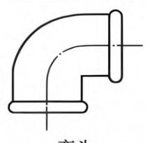弯头</td><td>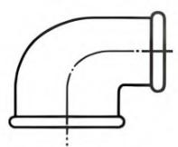异径弯头</td><td>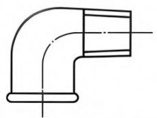内外丝弯头</td><td>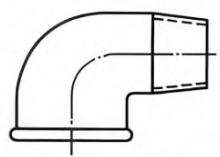异径内外丝弯头</td></tr><tr><td>弯头</td><td colspan="2">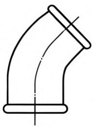45°弯头</td><td colspan="2">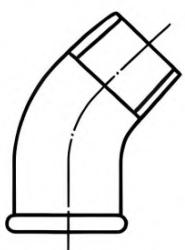45°内外丝弯头</td></tr><tr><td>三通</td><td>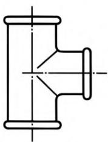三通</td><td>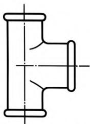中大异径三通</td><td>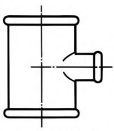中小异径三通</td><td>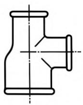异径三通</td></tr><tr><td>四通</td><td colspan="2">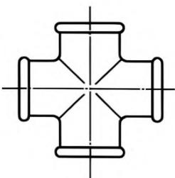四通</td><td colspan="2">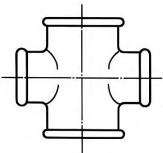异径四通</td></tr><tr><td>月弯</td><td></td><td>内外丝月弯</td><td>45°月弯</td><td>45°内外丝月弯</td></tr><tr><td>单弯三通和双弯弯头</td><td colspan="2">单弯三通</td><td colspan="2">双弯弯头</td></tr><tr><td>外接头</td><td colspan="2">外接头</td><td colspan="2">异径外接头</td></tr><tr><td>内接头</td><td colspan="2">内接头</td><td colspan="2">异径内接头</td></tr><tr><td>内外丝接头</td><td colspan="2">内外丝接头</td><td colspan="2">异径内外丝接头</td></tr><tr><td>管帽、管堵</td><td></td><td>外方管堵</td><td></td><td>内方管堵</td></tr><tr><td>活接头</td><td colspan="2"></td><td colspan="2">内外丝活接头</td></tr></table>

表15.2-8

(2)《钢制对焊管件 类型与参数》GB/T 12459—2017 该标准适用于 DN15～DN1500 钢制对焊无缝和焊接管件。钢制对焊管件的类型与代号见表 15.2-9。常用钢制对焊管件形式见表 15.2-10。

钢制对焊管件的类型与代号  
表 15.2-9

<table><tr><td rowspan="2">品种</td><td rowspan="2">类型</td><td colspan="2">代号</td></tr><tr><td>无缝管件</td><td>焊接管件</td></tr><tr><td rowspan="2">45°弯头</td><td>长半径</td><td>45EL</td><td>W45EL</td></tr><tr><td>3D</td><td>45E3D</td><td>W45E3D</td></tr><tr><td rowspan="4">90°弯头</td><td>长半径</td><td>90EL</td><td>W90EL</td></tr><tr><td>长半径</td><td>90ELR</td><td>W90ELR</td></tr><tr><td>短半径</td><td>90ES</td><td>W90ES</td></tr><tr><td>3D</td><td>90E3D</td><td>W90E3D</td></tr><tr><td rowspan="2">180°弯头</td><td>长半径</td><td>180EL</td><td>W180EL</td></tr><tr><td>短半径</td><td>180ES</td><td>W180ES</td></tr><tr><td rowspan="2">异径管(转换接头)</td><td>同心</td><td>RC</td><td>WRC</td></tr><tr><td>偏心</td><td>RE</td><td>WRE</td></tr><tr><td rowspan="2">三通</td><td>等径</td><td>TS</td><td>WTS</td></tr><tr><td>异径</td><td>TR</td><td>WTR</td></tr><tr><td rowspan="2">四通</td><td>等径</td><td>CRS</td><td>WCRS</td></tr><tr><td>异径</td><td>CRR</td><td>WCRR</td></tr><tr><td>管帽</td><td>—</td><td>C</td><td>WC</td></tr><tr><td rowspan="2">翻边短节</td><td>长型</td><td>LJL</td><td>WLJL</td></tr><tr><td>短型</td><td>LJS</td><td>WLJS</td></tr></table>

常用钢制对焊管件形式  
表 15.2-10

<table><tr><td>品种</td><td colspan="4">外形及名称</td></tr><tr><td>45°弯头</td><td colspan="2">长半径</td><td colspan="2"></td></tr><tr><td>90°弯头</td><td></td><td>长半径</td><td>3D</td><td></td></tr></table>

<table><tr><td>品种</td><td colspan="2">外形及名称</td></tr><tr><td>180°弯头</td><td></td><td></td></tr><tr><td>异径管</td><td></td><td></td></tr><tr><td>三通</td><td></td><td></td></tr><tr><td>四通</td><td></td><td></td></tr><tr><td>管帽</td><td colspan="2"></td></tr></table>

### 15.2.4 常用塑料管材的选择与应用

**15.2.4.1 常用塑料管材的类别及品种**

塑料管材的分类方法很多，有按树脂原料分类、管材用途分类，也有按管材的软硬程度分类等。建筑工程中塑料管材广泛用于建筑给水排水和暖通空调的管道工程中。暖通空调工程中应采用建筑给水用塑料管材。

**1. 塑料管材类别及品种**

(1) 聚氯乙烯 (PVC) 类: 硬聚氯乙烯 (PVC-U) 管、聚氯乙烯物理改性 (PVC-M) 管、聚氯乙烯化学改性 (AGR) 管、氯化聚氯乙烯 (PVC-C) 管等。

(2) 聚烯烃 (PO) 类: 聚乙烯 (PE80、PE100) 管、交联聚乙烯 (PE-X) 管、耐热聚乙烯 (PE-RT) 管、聚丙烯 (PP-R) 管、聚丁烯 (PB) 管及铝塑复合管 (XPAP、PAP) 等。

**(3) 丙烯腈-丁二烯-苯乙烯（ABS）管。**

聚氯乙烯类管材也称硬聚氯乙烯类管材，是采用聚氯乙烯树脂为原材料，不加增塑剂，采用非铅盐稳定剂，加热后用专用机械挤出成型的管材。

聚烯烃类管材是以含碳—碳双键的碳氢化合物单体经聚合反应后成为有机高分子树脂为原料，加入必要的添加剂，加热后经专用机械加工成型的管材。

丙烯腈-丁二烯-苯乙烯（ABS）管是以共聚树脂为原料，加热后用专用机械挤出成型的管材。

**2. 常用塑料管性能**

作为给水管的塑料材料种类繁多，按照管材成型方式一般可以分为以下两种：一种为热塑性材料，主要包括聚乙烯（PE）管、无规共聚聚丙烯（PP-R）管、聚丁烯（PB）管、丙烯腈-丁二烯-苯乙烯共聚物（ABS）管等，这类管材通常可以回收再利用，属于绿色环保型管材，但相比PVC类管材生产成本较高。另一种为热固性管材，常用的有硬聚氯乙烯（PVC-U）管、氯化聚氯乙烯（PVC-C）管、交联聚乙烯（PE-X）管以及铝塑和钢塑等新型复合管等，这类管材为不可回收材料，但是管材硬度和强度比热塑性管材好，同时价格相对低廉，所以热固性管材也是目前应用比较广泛的给水管材料。

在连接性能方面，又可分为极性塑料和非极性塑料，PE 管材和 ABS 管材是极性塑料，极性塑料可采用溶剂型胶黏剂黏接；非极性塑料（如 PO 类管材）采用热熔连接或机械连接。

暖通空调工程中目前常用塑料管输送冷、热水。这些塑料管的长期使用温度除个别稍高外，一般都不宜超过 $60^{\circ}\mathrm{C}$ ，甚至更低；同时，长期使用温度与管道承受的工作压力有关，通常允许工作压力随允许温度的提高而降低。表15.2-11是常用塑料管材的耐温性能。

常用塑料管材的耐温性能  
表 15.2-11

<table><tr><td>管材</td><td>长期使用温度(°C)</td><td>短期使用温度(°C)</td><td>维卡软化温度(°C)</td></tr><tr><td>硬聚氯乙烯(PVC-U)管</td><td>≤45</td><td>—</td><td>80</td></tr><tr><td>聚乙烯(PE)管</td><td>≤40</td><td>≤60</td><td>120~130</td></tr><tr><td>聚丁烯(PB)管</td><td>≤75</td><td>≤95</td><td>113</td></tr><tr><td>丙烯腈-丁二烯-苯乙烯(ABS)管</td><td>≤60</td><td>≤80</td><td>90</td></tr><tr><td>聚丙烯(PP-R/PP-RCT)管</td><td>≤70</td><td>≤90</td><td>120~140</td></tr><tr><td>耐热聚乙烯(PE-RT)管(I型、II型)</td><td>≤70</td><td>≤90</td><td>120~130</td></tr><tr><td>交联聚乙烯(PE-X)管</td><td>≤70</td><td>≤90</td><td>123</td></tr><tr><td>氯化氯乙烯(PVC-C)管</td><td>≤70</td><td>≤80</td><td>110</td></tr><tr><td>铝塑复合(XPAP)管</td><td>≤75</td><td>—</td><td>105</td></tr><tr><td>铝塑复合(PAP)管</td><td>≤40(冷水)≤60(冷热水)</td><td>—</td><td>105</td></tr></table>

**15.2.4.2 塑料管材与管件的产品标准**

1. 建筑给水用塑料冷水管材、管件的产品标准

(1)《给水用硬聚氯乙烯（PVC-U）管材》GB/T 10002.1、《给水用硬聚氯乙烯（PVC-U）管件》GB/T 10002.2。

(2)《给水用聚乙烯（PE）管道系统 第1部分：总则》GB/T 13663.1、《给水用聚乙烯（PE）管道系统 第2部分：管材》GB/T13663.2。

（3）《给水用丙烯酸共聚聚氯乙烯管材及管件》CJ/T218。

（4）《给水用抗冲改性聚氯乙烯（PVC-M）管材及管件》CJ/T272。

(5)《丙烯腈-丁二烯-苯乙烯（ABS）压力管道系统 第1部分：管材》GB/T 20207.1、《丙烯腈-丁二烯-苯乙烯（ABS）压力管道系统 第2部分：管件》GB/T 20207.2。

2. 建筑给水用塑料热水管材、管件产品标准

（1）《冷热水用交联聚乙烯（PE-X）管道系统 第1部分：总则》GB/T 18992.1、《冷热水用交联聚乙烯（PE-X）管道系统 第2部分：管材》GB/T 18992.2。

(2)《冷热水用聚丁烯（PB）管道系统 第1部分：总则》GB/T 19473.1、《冷热水用聚丁烯（PB）管道系统 第2部分：管材》GB/T 19473.2、《冷热水用聚丁烯（PB）管道系统 第3部分：管件》GB/T 19473.3。

(3)《冷热水用耐热聚乙烯（PE-RT）管道系统 第1部分：总则》GB/T 28799.1、《冷热水用耐热聚乙烯（PE-RT）管道系统 第2部分：管材》GB/T 28799.2、《冷热水用耐热聚乙烯（PE-RT）管道系统 第3部分：管件》GB/T 28799.3。

(4)《冷热水用聚丙烯管道系统 第1部分：总则》GB/T 18742.1、《冷热水用聚丙烯管道系统 第2部分：管材》GB/T 18742.2、《冷热水用聚丙烯管道系统 第3部分：管件》GB/T 18742.3。

(5)《冷热水用氯化聚氯乙烯（PVC-C）管道系统 第1部分：总则》GB/T 18993.1；《冷热水用氯化聚氯乙烯（PVC-C）管道系统 第2部分：管材》GB/T 18993.2；《冷热水用氯化聚氯乙烯（PVC-C）管道系统 第3部分：管件》GB/T 18993.3。

**15.2.4.3 管系列与管材标准尺寸比**

在选用塑料管材时，必须根据管材的工作压力、介质、介质工作温度、使用年限等条件确定；选用管材规格时，按照管系列 $S$ 确定。

工程中，为便于设计选用，更为了便于管道系列水力计算，采用管系列 S。标准尺寸比 SDR 是管系列表达的另一种形式。建筑给水塑料管材的管系列 S 是管材环应力 $\sigma$ （MPa）与管内壁承受压力 p（MPa）的比值，也是与公称外径和公称壁厚有关的无量纲数，用于选用管材规格；标准尺寸比 SDR 是管材的公称外径与公称壁厚的比值。它们分别按下列公式计算，并按一定规律调整后确定：

$$
S = \sigma / p = (d n - e n) / 2 e n\tag{15.2-3}
$$

$$
S = (S D R - 1) / 2\tag{15.2-4}
$$

$$
S D R = d n / e n\tag{14.2-5}
$$

式中 dn——管材的公称外径，mm；

en——管材的公称壁厚，mm；

SDR——标准尺寸比。

建筑给水塑料常用管材的 S 与 SDR 对照见表 15.2-12。

建筑给水塑料常用管材的 $S$ 与SDR对照表  
表 15.2-12

<table><tr><td>S</td><td>2</td><td>2.5</td><td>3.2</td><td>4</td><td>5</td><td>6.3</td><td>8</td><td>10</td><td>12.5</td></tr><tr><td>SDR</td><td>5</td><td>6</td><td>7.4</td><td>9</td><td>11</td><td>13.6</td><td>17</td><td>21</td><td>26</td></tr></table>

我国塑料管材采用公制外径系列。建筑给水塑料管常用规格的公称外径（dn）有12mm、16mm、20mm、25mm、32mm、40mm、63mm、75mm、90mm、110mm、160mm、200mm、250mm、315mm等。

**15.2.4.4 塑料管材的选用**

塑料管材和连接方式的选用应以保证工程长期运行的安全可靠为原则，需要根据塑料管许用环应力的大小、抗蠕变能力的强弱、使用介质的温度、工程环境等因素，经综合比较确定。

**1. 冷水系统塑料管材的选用**

本节所述冷水系统塑料管材的选用仅适用于冷水系统长期工作温度不大于 $40^{\circ} \mathrm{C}$ 的管道系统。

(1) 用于冷水系统的塑料管道工程, 管材的公称压力 $\mathrm{PN}$ 应按下式计算:

$$
\mathrm{PN} = C _ {\mathrm{A}} \cdot p _ {\mathrm{m}} / f\tag{15.2-6}
$$

式中 PN——管材的公称压力，MPa；

$C_{A}$ ——工程应用管材的安全系数，可取1.2～1.5；其中，PVC-U管、ABS管、PP-R管及重要工程用管可取1.5；

$p_{m}$ ——系统工作压力，MPa；

$f$ ——管道工作温度的压力折减系数，可按表15.2-13选用。

建筑给水塑料管材在不同工作温度下的压力折减系数 $f$ 表15.2-13

<table><tr><td rowspan="2">管材种类</td><td colspan="3">工作温度(°C)</td></tr><tr><td>20</td><td>30</td><td>40</td></tr><tr><td>PVC-U 管</td><td>1.0</td><td>0.80</td><td>0.63</td></tr><tr><td>AGR 管</td><td>1.0</td><td>0.80</td><td>0.63</td></tr><tr><td>PVC-M 管</td><td>1.0</td><td>0.80</td><td>0.63</td></tr><tr><td>PE80、PE100 管</td><td>1.0</td><td>0.85</td><td>0.74</td></tr><tr><td>ABS 管</td><td>1.0</td><td>0.80</td><td>0.63</td></tr><tr><td>PP-R 管</td><td>1.0</td><td>0.84</td><td>0.70</td></tr><tr><td>PB 管</td><td>1.0</td><td>0.90</td><td>0.80</td></tr><tr><td>PE-RT(I、II)管</td><td>1.0</td><td>0.90</td><td>0.85</td></tr></table>

注：工作温度为 $20 \sim 30^{\circ} \mathrm{C}$ 、 $30 \sim 40^{\circ} \mathrm{C}$ 的压力折减系数宜采用内插法确定。

（2）按照不同公称压力查表15.2-14，选用管材的种类，得到相应材质的管材系列S值。

冷水系统中不同公称压力下的管材系列 $S$ 值选用表  
表 15.2-14

<table><tr><td rowspan="2">管材种类</td><td colspan="5">管材的公称压力(MPa)</td></tr><tr><td>0.60</td><td>0.80</td><td>1.00</td><td>1.25</td><td>1.60</td></tr><tr><td>PVC-U 管</td><td>S12.5</td><td>S12.5</td><td>S10</td><td>S8</td><td>S6.3</td></tr><tr><td>物理改性 PVC-M 管</td><td>S12.5</td><td>S12.5</td><td>S10</td><td>S8</td><td>S6.3</td></tr><tr><td>化学改性 AGR 管</td><td>S12.5</td><td>S12.5</td><td>S10</td><td>S8</td><td>S6.3</td></tr><tr><td>ABS 管</td><td>S12.5</td><td>S10</td><td>S8</td><td>S6.3</td><td>S5</td></tr><tr><td>PE80 管</td><td>S10</td><td>S8</td><td>S6.3</td><td>S5</td><td>S4</td></tr><tr><td>PE100 管</td><td>S12.5</td><td>S10</td><td>S8</td><td>S6.3</td><td>S5</td></tr><tr><td>PE-RT I 管</td><td>S6.3</td><td>S6.3</td><td>S5</td><td>S4</td><td>S3.2</td></tr><tr><td>PE-RT II 管</td><td>S6.3</td><td>S6.3</td><td>S6.3</td><td>S5</td><td>S4</td></tr><tr><td>PB 管</td><td>S6.3</td><td>S6.3</td><td>S6.3</td><td>S6.3</td><td>S5</td></tr><tr><td>PP-R 管</td><td>S6.3</td><td>S5</td><td>S5</td><td>S5</td><td>S4</td></tr></table>

（3）根据塑料管材系列 S（SDR）值，查表 15.2-15 得到管材的公称外径及其壁厚。

建筑塑料管材壁厚（单位：mm）  
表 15.2-15

<table><tr><td rowspan="2">公称外径(dn)</td><td colspan="9">管系列S值(标准尺寸比SDR)</td></tr><tr><td>12.5(26)</td><td>10(21)</td><td>8(17)</td><td>6.3(13.6)</td><td>5(11)</td><td>4(9)</td><td>3.2(7.4)</td><td>2.5(6)</td><td>2(5)</td></tr><tr><td>16</td><td>—</td><td>—</td><td>—</td><td>2.0</td><td>2.0</td><td>2.0</td><td>2.2</td><td>2.7</td><td>3.3</td></tr><tr><td>20</td><td>—</td><td>2.0</td><td>2.0</td><td>2.0</td><td>2.0</td><td>2.3</td><td>2.8</td><td>3.4</td><td>4.1</td></tr><tr><td>25</td><td>—</td><td>2.0</td><td>2.0</td><td>2.0</td><td>2.3</td><td>2.8</td><td>3.5</td><td>4.2</td><td>5.1</td></tr><tr><td>32</td><td>—</td><td>2.0</td><td>2.0</td><td>2.4</td><td>2.9</td><td>3.6</td><td>4.4</td><td>5.4</td><td>6.5</td></tr><tr><td>40</td><td>—</td><td>2.0</td><td>2.4</td><td>3.0</td><td>3.7</td><td>4.5</td><td>5.5</td><td>6.7</td><td>8.1</td></tr><tr><td>50</td><td>2.0</td><td>2.4</td><td>3.0</td><td>3.7</td><td>4.6</td><td>5.6</td><td>6.9</td><td>8.3</td><td>10.1</td></tr><tr><td>63</td><td>2.5</td><td>3.0</td><td>3.8</td><td>4.7</td><td>5.8</td><td>7.1</td><td>8.6</td><td>10.5</td><td>12.7</td></tr><tr><td>75</td><td>2.9</td><td>3.6</td><td>4.5</td><td>5.6</td><td>6.8</td><td>8.4</td><td>10.3</td><td>12.5</td><td>15.1</td></tr><tr><td>90</td><td>3.5</td><td>4.3</td><td>5.4</td><td>6.7</td><td>8.2</td><td>10.1</td><td>12.3</td><td>15.0</td><td>18.1</td></tr><tr><td>110</td><td>4.2</td><td>5.3</td><td>6.6</td><td>8.1</td><td>10.0</td><td>12.3</td><td>15.1</td><td>18.3</td><td>22.1</td></tr><tr><td>125</td><td>4.8</td><td>6.0</td><td>7.4</td><td>9.2</td><td>11.4</td><td>14.0</td><td>17.1</td><td>20.8</td><td>25.1</td></tr><tr><td>160</td><td>6.2</td><td>7.7</td><td>9.5</td><td>11.8</td><td>14.6</td><td>17.9</td><td>21.9</td><td>26.6</td><td>32.1</td></tr><tr><td>200</td><td>7.7</td><td>9.6</td><td>11.9</td><td>14.7</td><td>18.2</td><td>22.4</td><td>27.4</td><td>33.2</td><td>40.1</td></tr><tr><td>250</td><td>9.6</td><td>11.9</td><td>14.8</td><td>18.4</td><td>22.7</td><td>27.9</td><td>—</td><td>—</td><td>—</td></tr><tr><td>315</td><td>12.1</td><td>15.0</td><td>18.7</td><td>23.2</td><td>28.6</td><td>35.2</td><td>—</td><td>—</td><td>—</td></tr></table>

注：用于热熔连接的管材壁厚不得小于 2.0mm。

**2. 热水系统塑料管材的选用**

本节所述热水系统塑料管材的选用仅适用于热水系统长期工作温度不大于 $70^{\circ}$ C 的管道系统。

(1) 用于热水系统的建筑给水塑料管道工程, 管材的设计压力 $p_{\mathrm{D}}$ 应按下式计算:

$$
p _ {\mathrm{D}} = C _ {\mathrm{A}} \cdot p _ {\mathrm{m}}\tag{15.2-7}
$$

式中 $p_{D}$ ——管材设计压力，MPa；

$C_{A}$ ——工程应用管材的安全系数，可取1.2～1.5；PP-R管及重要工程用管可取1.5，其他聚烯烃管及氯化聚氯乙烯管可取1.2；

$p_{m}$ ——系统工作压力，MPa。

（2）按照热水系统中不同设计压力 $p_{\mathrm{D}}$ ，对照选用管材的种类，查表15.2-16，确定管系列 $S$ 值。

热水系统中，不同设计压力 $p_{\mathrm{D}}$ 下的管材系列 $S$ 值选用表 表15.2-16

<table><tr><td rowspan="2">管材种类</td><td colspan="4">管材的设计压力 $p_{D}$ (MPa)</td></tr><tr><td>0.40</td><td>0.60</td><td>0.80</td><td>1.00</td></tr><tr><td>PE-X管</td><td>6.3</td><td>5</td><td>4</td><td>3.2</td></tr><tr><td>PB管</td><td>10</td><td>8</td><td>6.3</td><td>5</td></tr><tr><td>PP-R管</td><td>5</td><td>3.2</td><td>2.5</td><td>2</td></tr><tr><td>PE-RTI管</td><td>5</td><td>4</td><td>3.2</td><td>2.5</td></tr><tr><td>PE-RTII管</td><td>5</td><td>5</td><td>4</td><td>3.2</td></tr><tr><td>PVC-C管</td><td>6.3</td><td>6.3</td><td>5</td><td>4</td></tr></table>

注：热水管材工作温度不高于 $70^{\circ} \mathrm{C}$ 。

(3) 根据塑料管材系列 $S$ (SDR) 值, 查表 15.2-15 得到管材的公称外径及其壁厚。  
3. 按使用条件级别选用塑料管材

当塑料管材应用条件比较复杂时，可以采用按使用条件级别选用塑料管材的方法。

**(1) 热塑性塑料管的使用条件级别**

按使用条件级别选用塑料管材时，首先要确认塑料管材的适用条件。塑料管材的耐压能力是随着管道中使用介质温度的提高而降低的；同样，其使用寿命也与介质温度有关。表 15.2-17 是《冷热水系统用热塑性塑料管材和管件》GB/T 18991—2003 中规定的使用条件级别。它将塑料管的适用条件分为 5 个级别，每个级别对应一个 50a 的设计寿命下的使用条件。通常可按下列规定确定：

1）生活热水供应系统：使用条件级别采用1级或2级；

2）供水温度 $t_{\mathrm{s}} \leqslant 40^{\circ}\mathrm{C}$ 的地面辐射供暖系统：使用条件级别采用3级；

3）供水温度 $t_{\mathrm{s}} \leqslant 60^{\circ} \mathrm{C}$ 的地面辐射供暖系统：使用条件级别采用4级；

4）供水温度 $60^{\circ}\mathrm{C} < t_{\mathrm{s}} \leqslant 85^{\circ}\mathrm{C}$ 的散热器供暖系统：使用条件级别采用5级。

同时，表 15.2-17 中所有加热系统的介质只能是水或经处理的水。当需要考虑氧的渗透性等要求时，应另外提出。

热塑性塑料管的使用条件级别  
表 15.2-17

<table><tr><td rowspan="2">使用条件级别</td><td colspan="2">正常工作温度 $T_o$ </td><td colspan="2">最高工作温度 $T_{max}$ </td><td colspan="2">故障工作温度 $T_m$ </td><td rowspan="2">典型应用范围</td></tr><tr><td> $T_o$ (°C)</td><td> $T_o$ 下的使用时间(a)</td><td> $T_{max}$ (°C)</td><td> $T_{max}$ 下的使用时间(a)</td><td> $T_m$ (°C)</td><td> $T_m$ 下的使用时间(h)</td></tr><tr><td>1</td><td>60</td><td>49</td><td>80</td><td>1</td><td>95</td><td>100</td><td>供热水(60°C)</td></tr><tr><td>2</td><td>70</td><td>49</td><td>80</td><td>1</td><td>95</td><td>100</td><td>供热水(70°C)</td></tr><tr><td>3 $^1$ </td><td>3040</td><td>2025</td><td>50</td><td>4.5</td><td>65</td><td>100</td><td>低温地面辐射供暖</td></tr><tr><td>4</td><td>204060</td><td>2.52025</td><td>70</td><td>2.5</td><td>100</td><td>100</td><td>地面辐射供暖和低温散热器供暖</td></tr><tr><td>5 $^2$ </td><td>206080</td><td>142510</td><td>90</td><td>1</td><td>100</td><td>100</td><td>较高温散热器供暖</td></tr></table>

① 仅适用于故障温度不超过 $65^{\circ} \mathrm{C}$ 的场合。

② 仅适用于 $T_{\circ}$ 、 $T_{\mathrm{max}}$ 和 $T_{\mathrm{m}}$ 都不超过本表规定值的场合。

注：表中各使用条件级别的管道系统均应同时满足在 $20^{\circ}\mathrm{C}$ 、1.0MPa条件下输送冷水具有50a使用寿命的要求。

(2) 管材系列 S 值的确定原则

设计管材系列 $S_{D}$ 按下式计算：

$$
S _ {\mathrm{D}} = \sigma_ {\mathrm{D}} / p _ {\mathrm{D}}\tag{15.2-8}
$$

式中 $\sigma_{D}$ ——管材的许用环应力，MPa；

$p_{D}$ ——管材的设计压力，MPa。

管材系列 S 值应不大于管材系列计算的最大值 $S_{cal,max}$ ；而确定 $S_{cal,max}$ 时应同时满足设计管材系列 $S_{D}$ 值与在 $20^{\circ}C$ 冷水基本条件下的 $S_{cold}$ 值，取其中较小值。

根据设计压力、使用条件级别和 $S_{cal,max}$ 值，按照相应的管道材料，由表 15.2-18～表 15.2-25 直接查出应选用的管材系列 S 值，然后查表 15.2-15 确定管径与壁厚。由于不同塑料管材都有自己的管材系列 S 值范围（表 15.2-26），当选择的管系列 S 值超出范围时，应进行调整，调整后的 S 值不得大于由管系列 S 值选用表查出的 S 值。

PB-H 管的管材系列 S 值选用表  
表 15.2-18

<table><tr><td rowspan="2">设计压力 $p_{\mathrm{D}}(\mathrm{MPa})$ </td><td>使用条件级别</td><td>20°C、50a、 $p_{\mathrm{D}}=1\mathrm{MPa}$ </td><td>1</td><td>2</td><td>3</td><td>4</td><td>5</td></tr><tr><td>许用环应力  $\sigma_{\mathrm{D}}(\mathrm{MPa})$ </td><td>10.91</td><td>5.72</td><td>5.04</td><td>7.83</td><td>5.46</td><td>4.30</td></tr><tr><td rowspan="2">0.4</td><td> $S_{\mathrm{cal},\max }$  值</td><td>10.9</td><td>10.9</td><td>10.9</td><td>10.9</td><td>10.9</td><td>10.7</td></tr><tr><td>应选用的管系列S值</td><td>10</td><td>10</td><td>10</td><td>10</td><td>10</td><td>10</td></tr><tr><td rowspan="2">0.6</td><td> $S_{\mathrm{cal},\max }$  值</td><td>10.9</td><td>9.5</td><td>8.4</td><td>10.9</td><td>9.1</td><td>7.1</td></tr><tr><td>应选用的管系列S值</td><td>10</td><td>8</td><td>8</td><td>10</td><td>8</td><td>6.3</td></tr><tr><td rowspan="2">0.8</td><td> $S_{\mathrm{cal},\max }$  值</td><td>10.9</td><td>7.1</td><td>6.3</td><td>9.7</td><td>6.8</td><td>5.3</td></tr><tr><td>应选用的管系列S值</td><td>10</td><td>6.3</td><td>6.3</td><td>8</td><td>6.3</td><td>5</td></tr><tr><td rowspan="2">1.0</td><td> $S_{\mathrm{cal},\max }$  值</td><td>10.9</td><td>5.7</td><td>5.0</td><td>7.8</td><td>5.4</td><td>4.3</td></tr><tr><td>应选用的管系列S值</td><td>10</td><td>5</td><td>5</td><td>6.3</td><td>5</td><td>4</td></tr></table>

注：1. $p_{\mathrm{D}} < 0.4 \mathrm{MPa}$ 时, 按 $p_{\mathrm{D}} = 0.4$ 取值。

2. 表中使用条件级别下的许用环应力值，已对正常工作温度下的环应力值考虑了1.5倍的使用系数。  
PB-R 管的管材系列 S 值选用表  
表15.2-19

<table><tr><td rowspan="2">设计压力 $p_{\mathrm{D}}(\mathrm{MPa})$ </td><td>使用条件级别</td><td>20°C、50a、 $p_{\mathrm{D}}=1\mathrm{MPa}$ </td><td>1</td><td>2</td><td>3</td><td>4</td><td>5</td></tr><tr><td>许用环应力 $\sigma_{\mathrm{D}}(\mathrm{MPa})$ </td><td>10.92</td><td>5.16</td><td>5.12</td><td>7.81</td><td>4.33</td><td>4.13</td></tr><tr><td rowspan="2">0.4</td><td> $S_{\mathrm{cal},\max }$ 值</td><td>10.9</td><td>10.9</td><td>10.9</td><td>10.9</td><td>10.8</td><td>10.3</td></tr><tr><td>应选用的管系列S值</td><td>10</td><td>10</td><td>10</td><td>10</td><td>10</td><td>10</td></tr><tr><td rowspan="2">0.6</td><td> $S_{\mathrm{cal},\max }$ 值</td><td>10.9</td><td>8.6</td><td>8.5</td><td>10.9</td><td>7.2</td><td>6.8</td></tr><tr><td>应选用的管系列S值</td><td>10</td><td>8</td><td>8</td><td>10</td><td>6.3</td><td>6.3</td></tr><tr><td rowspan="2">0.8</td><td> $S_{\mathrm{cal},\max }$ 值</td><td>10.9</td><td>6.4</td><td>6.4</td><td>9.7</td><td>5.4</td><td>5.1</td></tr><tr><td>应选用的管系列S值</td><td>10</td><td>6.3</td><td>6.3</td><td>8</td><td>5</td><td>5</td></tr><tr><td rowspan="2">1.0</td><td> $S_{\mathrm{cal},\max }$ 值</td><td>10.9</td><td>5.1</td><td>5.1</td><td>7.8</td><td>4.3</td><td>4.1</td></tr><tr><td>应选用的管系列S值</td><td>10</td><td>5</td><td>5</td><td>6.3</td><td>4</td><td>4</td></tr></table>

注：1. $p_{\mathrm{D}} < 0.4 \mathrm{MPa}$ 时，按 $p_{\mathrm{D}} = 0.4$ 取值。  
2. 表中使用条件级别下的许用环应力值，已对正常工作温度下的环应力值考虑了1.5倍的使用系数。

PE-X 管的管材系列 S 值选用表  
表 15.2-20

<table><tr><td rowspan="2">设计压力 $p_{\mathrm{D}}(\mathrm{MPa})$ </td><td>使用条件级别</td><td>20°C、50a、 $p_{\mathrm{D}}=1\mathrm{MPa}$ </td><td>1</td><td>2</td><td>3</td><td>4</td><td>5</td></tr><tr><td>许用环应力 $\sigma_{\mathrm{D}}(\mathrm{MPa})$ </td><td>7.60</td><td>3.85</td><td>3.54</td><td>5.03</td><td>4.0</td><td>3.24</td></tr><tr><td rowspan="2">0.4</td><td> $S_{\mathrm{cal,max}}$ 值</td><td>7.6</td><td>7.6</td><td>7.6</td><td>7.6</td><td>7.6</td><td>7.6</td></tr><tr><td>应选用的管系列S值</td><td>6.3</td><td>6.3</td><td>6.3</td><td>6.3</td><td>6.3</td><td>6.3</td></tr><tr><td rowspan="2">0.6</td><td> $S_{\mathrm{cal,max}}$ 值</td><td>7.6</td><td>6.4</td><td>5.9</td><td>7.6</td><td>6.6</td><td>5.4</td></tr><tr><td>应选用的管系列S值</td><td>6.3</td><td>6.3</td><td>5</td><td>6.3</td><td>6.3</td><td>5</td></tr><tr><td rowspan="2">0.8</td><td> $S_{cal,max}$ 值</td><td>7.6</td><td>4.8</td><td>4.4</td><td>6.3</td><td>5.0</td><td>4.0</td></tr><tr><td>应选用的管系列S值</td><td>6.3</td><td>4</td><td>4</td><td>6.3</td><td>5</td><td>4</td></tr><tr><td rowspan="2">1.0</td><td> $S_{cal,max}$ 值</td><td>7.6</td><td>3.8</td><td>3.5</td><td>5.0</td><td>4.0</td><td>3.2</td></tr><tr><td>应选用的管系列S值</td><td>6.3</td><td>3.2</td><td>3.2</td><td>5</td><td>4</td><td>3.2</td></tr></table>

注：1. $p_{\mathrm{D}} < 0.4 \mathrm{MPa}$ 时，按 $p_{\mathrm{D}} = 0.4$ 取值。

2. 表中使用条件级别下的许用环应力值，已对正常工作温度下的环应力值考虑了1.5倍的使用系数。  
PE-RT I 管的管材系列 S 值选用表  
表 15.2-21

<table><tr><td rowspan="2">设计压力 $p_{\mathrm{D}}(\mathrm{MPa})$ </td><td>使用条件级别</td><td>20°C、50a $p_{\mathrm{D}}=1\mathrm{MPa}$ </td><td>1</td><td>2</td><td>3</td><td>4</td><td>5</td></tr><tr><td>许用环应力 $\sigma_{\mathrm{D}}(\mathrm{MPa})$ </td><td>6.68</td><td>3.29</td><td>2.68</td><td>4.64</td><td>3.25</td><td>2.38</td></tr><tr><td rowspan="2">0.4</td><td> $S_{\mathrm{cal},\max }$ 值</td><td>6.6</td><td>6.6</td><td>6.6</td><td>6.6</td><td>6.6</td><td>6.0</td></tr><tr><td>应选用的管系列S值</td><td>5</td><td>5</td><td>5</td><td>5</td><td>5</td><td>5</td></tr><tr><td rowspan="2">0.6</td><td> $S_{\mathrm{cal},\max }$ 值</td><td>6.6</td><td>5.5</td><td>4.5</td><td>6.6</td><td>5.4</td><td>4</td></tr><tr><td>应选用的管系列S值</td><td>5</td><td>5</td><td>4</td><td>5</td><td>5</td><td>3.2</td></tr><tr><td rowspan="2">0.8</td><td> $S_{\mathrm{cal},\max }$ 值</td><td>6.6</td><td>4.1</td><td>3.3</td><td>5.8</td><td>4.1</td><td>3</td></tr><tr><td>应选用的管系列S值</td><td>5</td><td>4</td><td>3.2</td><td>5</td><td>4</td><td>2.5</td></tr><tr><td rowspan="2">1.0</td><td> $S_{\mathrm{cal},\max }$ 值</td><td>6.6</td><td>3.3</td><td>2.7</td><td>4.6</td><td>3.3</td><td>2.4</td></tr><tr><td>应选用的管系列S值</td><td>5</td><td>3.2</td><td>2.5</td><td>4</td><td>3.2</td><td>-</td></tr></table>

注：1. $p_{\mathrm{D}} < 0.4 \mathrm{MPa}$ 时，按 $p_{\mathrm{D}} = 0.4$ 取值。

2. 表中使用条件级别下的许用环应力值，已对正常工作温度下的环应力值考虑了 1.5 倍的使用系数。  
PE-RTⅡ管的管材系列S值选用表  
表 15.2-22

<table><tr><td rowspan="2">设计压力 $p_{\mathrm{D}}(\mathrm{MPa})$ </td><td>使用条件级别</td><td>20°C、50a、 $p_{\mathrm{D}}=1\mathrm{MPa}$ </td><td>1</td><td>2</td><td>3</td><td>4</td><td>5</td></tr><tr><td>许用环应力 $\sigma_{\mathrm{D}}(\mathrm{MPa})$ </td><td>6.68</td><td>3.70</td><td>3.53</td><td>5.31</td><td>3.55</td><td>3.02</td></tr><tr><td rowspan="2">0.4</td><td> $S_{cal,max}$ 值</td><td>6.6</td><td>6.6</td><td>6.6</td><td>6.6</td><td>6.6</td><td>6.6</td></tr><tr><td>应选用的管系列S值</td><td>5.0</td><td>5.0</td><td>5.0</td><td>5.0</td><td>5.0</td><td>5.0</td></tr><tr><td rowspan="2">0.6</td><td> $S_{cal,max}$ 值</td><td>6.6</td><td>6.1</td><td>5.8</td><td>6.6</td><td>5.9</td><td>5.0</td></tr><tr><td>应选用的管系列S值</td><td>5.0</td><td>5.0</td><td>5.0</td><td>5.0</td><td>5.0</td><td>4.0</td></tr><tr><td rowspan="2">0.8</td><td> $S_{cal,max}$ 值</td><td>6.6</td><td>4.6</td><td>4.4</td><td>6.6</td><td>4.4</td><td>3.7</td></tr><tr><td>应选用的管系列S值</td><td>5.0</td><td>4.0</td><td>4.0</td><td>5.0</td><td>4.0</td><td>3.2</td></tr><tr><td rowspan="2">1.0</td><td> $S_{cal,max}$ 值</td><td>6.6</td><td>3.7</td><td>3.5</td><td>5.3</td><td>3.5</td><td>3.0</td></tr><tr><td>应选用的管系列S值</td><td>5.0</td><td>3.2</td><td>3.2</td><td>5.0</td><td>3.2</td><td>2.5</td></tr></table>

注：1. $p_{\mathrm{D}} < 0.4 \mathrm{MPa}$ 时，按 $p_{\mathrm{D}} = 0.4$ 取值。  
2. 表中使用条件级别下的许用环应力值，已对正常工作温度下的环应力值考虑了 1.5 倍的使用系数。

PP-B 管的管材系列 S 值选用表  
表 15.2-23

<table><tr><td rowspan="2">设计压力 $p_{\mathrm{D}}(\mathrm{MPa})$ </td><td>使用条件级别</td><td>20°C、50a、 $p_{\mathrm{D}}=1\mathrm{MPa}$ </td><td>1</td><td>2</td><td>3</td><td>4</td><td>5</td></tr><tr><td>许用环应力  $\sigma_{\mathrm{D}}(\mathrm{MPa})$ </td><td>6.96</td><td>1.66</td><td>1.19</td><td>4.02</td><td>1.94</td><td>1.19</td></tr><tr><td rowspan="2">0.4</td><td> $S_{cal,max}$  值</td><td>6.9</td><td>4.1</td><td>2.9</td><td>6.9</td><td>4.8</td><td>2.9</td></tr><tr><td>应选用的管系列S值</td><td>5</td><td>4</td><td>2.5</td><td>5</td><td>4</td><td>2.5</td></tr><tr><td rowspan="2">0.6</td><td> $S_{cal,max}$  值</td><td>6.9</td><td>2.8</td><td>2.0</td><td>6.7</td><td>3.2</td><td>2.0</td></tr><tr><td>应选用的管系列S值</td><td>5</td><td>2.5</td><td>2</td><td>5</td><td>3.2</td><td>2</td></tr><tr><td rowspan="2">0.8</td><td> $S_{cal,max}$  值</td><td>6.9</td><td>2.1</td><td>1.5</td><td>5.0</td><td>2.4</td><td>1.5</td></tr><tr><td>应选用的管系列S值</td><td>5</td><td>2</td><td>—</td><td>4</td><td>2</td><td>—</td></tr><tr><td rowspan="2">1.0</td><td> $S_{cal,max}$  值</td><td>6.9</td><td>1.7</td><td>1.2</td><td>4.0</td><td>2</td><td>1.2</td></tr><tr><td>应选用的管系列S值</td><td>5</td><td>—</td><td>—</td><td>3.2</td><td>2</td><td>—</td></tr></table>

注：1. $p_{\mathrm{D}} < 0.4 \mathrm{MPa}$ 时，按 $p_{\mathrm{D}} = 0.4$ 取值。  
2. 表中使用条件级别下的许用环应力值，已对正常工作温度下的环应力值考虑了1.5倍的使用系数。

PP-R 管的管材系列 S 值选用表  
表 15.2-24

<table><tr><td rowspan="2">设计压力 $p_{\mathrm{D}}(\mathrm{MPa})$ </td><td>使用条件级别</td><td>20°C、50a、 $p_{\mathrm{D}}=1\mathrm{MPa}$ </td><td>1</td><td>2</td><td>3</td><td>4</td><td>5</td></tr><tr><td>许用环应力  $\sigma_{\mathrm{D}}(\mathrm{MPa})$ </td><td>7.76</td><td>3.02</td><td>2.12</td><td>4.68</td><td>3.29</td><td>1.89</td></tr><tr><td rowspan="2">0.4</td><td> $S_{\text{cal,max}}$  值</td><td>7.5</td><td>7.5</td><td>5.3</td><td>7.5</td><td>7.5</td><td>4.7</td></tr><tr><td>应选用的管系列S值</td><td>5</td><td>5</td><td>5</td><td>5</td><td>5</td><td>4</td></tr><tr><td rowspan="2">0.6</td><td> $S_{\text{cal,max}}$  值</td><td>7.5</td><td>5.0</td><td>3.5</td><td>7.5</td><td>5.4</td><td>3.2</td></tr><tr><td>应选用的管系列S值</td><td>5</td><td>5</td><td>3.2</td><td>5</td><td>5</td><td>3.2</td></tr><tr><td rowspan="2">0.8</td><td> $S_{\text{cal,max}}$  值</td><td>7.5</td><td>3.8</td><td>2.7</td><td>5.8</td><td>4.1</td><td>2.4</td></tr><tr><td>应选用的管系列S值</td><td>5</td><td>3.2</td><td>2.5</td><td>5</td><td>4</td><td>2</td></tr><tr><td rowspan="2">1.0</td><td> $S_{\text{cal,max}}$  值</td><td>7.5</td><td>3.0</td><td>2.1</td><td>4.6</td><td>3.3</td><td>1.9</td></tr><tr><td>应选用的管系列S值</td><td>5</td><td>2.5</td><td>2</td><td>4</td><td>3.2</td><td>—</td></tr></table>

注：1. $p_{\mathrm{D}} < 0.4 \mathrm{MPa}$ 时，按 $p_{\mathrm{D}} = 0.4$ 取值。  
2. 表中使用条件级别下的许用环应力值，已对正常工作温度下的环应力值考虑了1.5倍的使用系数。

PP-RCT 管的管材系列 S 值选用表  
表 15.2-25

<table><tr><td rowspan="2">设计压力 $p_{\mathrm{D}}(\mathrm{MPa})$ </td><td>使用条件级别</td><td>20°C、50a、 $p_{\mathrm{D}}=1\mathrm{MPa}$ </td><td>1</td><td>2</td><td>3</td><td>4</td><td>5</td></tr><tr><td>许用环应力 $\sigma_{\mathrm{D}}(\mathrm{MPa})$ </td><td>9.23</td><td>3.64</td><td>3.4</td><td>5.72</td><td>3.67</td><td>2.92</td></tr><tr><td rowspan="2">0.4</td><td> $S_{\mathrm{cal},\max }$ 值</td><td>9.0</td><td>9.0</td><td>8.5</td><td>9.0</td><td>9.0</td><td>7.3</td></tr><tr><td>应选用的管系列S值</td><td>6.3</td><td>6.3</td><td>6.3</td><td>6.3</td><td>6.3</td><td>5.0</td></tr><tr><td rowspan="2">0.6</td><td> $S_{\mathrm{cal},\max }$ 值</td><td>9.0</td><td>6.1</td><td>5.7</td><td>9.0</td><td>6.1</td><td>4.9</td></tr><tr><td>应选用的管系列S值</td><td>6.3</td><td>5</td><td>5</td><td>6.3</td><td>5</td><td>4</td></tr><tr><td rowspan="2">0.8</td><td> $S_{\mathrm{cal},\max }$ 值</td><td>9.0</td><td>4.6</td><td>4.3</td><td>7.2</td><td>4.6</td><td>3.7</td></tr><tr><td>应选用的管系列S值</td><td>6.3</td><td>4</td><td>4</td><td>6.3</td><td>4</td><td>3.2</td></tr><tr><td rowspan="2">设计压力 $p_{D}$ (MPa)</td><td>使用条件级别</td><td>20°C、50a、 $p_{D}=1MPa$ </td><td>1</td><td>2</td><td>3</td><td>4</td><td>5</td></tr><tr><td>许用环应力 $\sigma_{D}$ (MPa)</td><td>9.23</td><td>3.64</td><td>3.4</td><td>5.72</td><td>3.67</td><td>2.92</td></tr><tr><td rowspan="2">1.0</td><td> $S_{cal,max}$ 值</td><td>9.0</td><td>3.6</td><td>3.4</td><td>5.7</td><td>3.7</td><td>2.9</td></tr><tr><td>应选用的管系列S值</td><td>6.3</td><td>3.2</td><td>3.2</td><td>5</td><td>3.2</td><td>2.5</td></tr></table>

注：1. $p_{\mathrm{D}} < 0.4 \mathrm{MPa}$ 时，按 $p_{\mathrm{D}} = 0.4$ 取值。  
2. 表中使用条件级别下的许用环应力值，已对正常工作温度下的环应力值考虑了1.5倍的使用系数。

不同管材系列 $S$ 值的范围  
表 15.2-26

<table><tr><td rowspan="2">管材种类</td><td colspan="8">管系列S值</td></tr><tr><td>10</td><td>8</td><td>6.3</td><td>5</td><td>4</td><td>3.2</td><td>2.5</td><td>2</td></tr><tr><td>PB管</td><td>○</td><td>○</td><td>○</td><td>○</td><td>○</td><td>○</td><td></td><td></td></tr><tr><td>PE-X管</td><td></td><td></td><td>○</td><td>○</td><td>○</td><td>○</td><td></td><td></td></tr><tr><td>PE-RTI管</td><td></td><td></td><td></td><td>○</td><td>○</td><td>○</td><td>○</td><td></td></tr><tr><td>PE-RTII管</td><td></td><td></td><td></td><td>○</td><td>○</td><td>○</td><td>○</td><td></td></tr><tr><td>PP-H管</td><td></td><td></td><td></td><td>○</td><td>○</td><td>○</td><td>○</td><td>○</td></tr><tr><td>PP-B管</td><td></td><td></td><td></td><td>○</td><td>○</td><td>○</td><td>○</td><td>○</td></tr><tr><td>PP-R管</td><td></td><td></td><td></td><td>○</td><td>○</td><td>○</td><td>○</td><td>○</td></tr><tr><td>PP-RCT管</td><td></td><td></td><td>○</td><td>○</td><td>○</td><td>○</td><td>○</td><td>○</td></tr></table>

注：“○”表示有此系列。

**4. 铝塑复合压力管材的选用**

铝塑复合压力管是采用嵌入搭接焊或对接焊铝管为增强金属层，通过共挤热熔胶黏剂与内外层塑料复合而成，简称搭焊铝塑管或对焊铝塑管。铝塑复合管独特的优点是能够阻隔气体的渗透，可以防止氧气的渗入，从而可避免系统中的氧化腐蚀。

搭焊铝塑复合压力管按复合组分的材料不同，分为 PAP、XPAP、RPAP 和 PPAP 四类；对焊铝塑复合压力管按复合组分的材料不同，分为 PAP1、XPAP2、RPAP3 和 PPAP4 四类。PAP 的组分为聚乙烯、铝合金、聚乙烯（PE、Al、PE）；XPAP 的组分为交联聚乙烯、铝合金、交联聚乙烯（PE-X、Al、PE-X）；RPAP 的组分为耐热聚乙烯、铝合金、耐热聚乙烯（PE-RT、Al、PE-RT）；PPAP 的组分为无规共聚聚乙烯、铝合金、无规共聚聚乙烯（PP-R、Al、PP-R）。

**(1) 铝塑复合压力管的使用条件级别**

根据《冷热水系统用热塑性塑料管材和管件》GB/T 18991—2003 的规定，铝塑复合管道的使用条件级别见表 15.2-17。每个使用条件级别均对应一个 50a 设计寿命下的使用条件。同样，各使用条件级别的管道系统均应同时满足在 20℃、1.0MPa 条件下输送冷水具有 50a 使用寿命的要求。

**(2) 按使用条件级别与设计压力选用**

按使用条件级别与设计压力选用的铝塑复合管主要为搭焊铝塑管PAP、RPAP、

XPAP 和对焊铝塑管 PAP1、XPAP2、RPAP3 六类。

冷水用 PAP 搭焊铝塑管（dn12～dn75）设计压力 $p_{D}$ 为 1.0MPa；冷水用 PAP1 对焊铝塑管（dn16～dn50）工作压力 $p_{D}$ 为 1.0MPa。

冷热水用 XPAP/RPAP 搭焊铝塑管按表 15.2-27 规定的使用条件级别和对应的设计压力选用。冷热水用 XPAP2/RPAP3 对焊铝塑管按表 15.2-28 规定的使用条件级别和对应的设计压力选用。

冷热水用XPAP/RPAP搭焊铝塑复合管的使用条件级别  
表15.2-27

<table><tr><td>使用条件级别</td><td>搭焊铝塑管代号</td><td>搭焊铝塑管规格</td><td>工作压力 $p_{D}$ (MPa)</td></tr><tr><td rowspan="4">1、2、4</td><td rowspan="2">XPAP</td><td>dn12~dn25</td><td>1.60</td></tr><tr><td>dn32~dn75</td><td>1.25</td></tr><tr><td rowspan="2">RPAP</td><td>dn12~dn25</td><td>1.60</td></tr><tr><td>dn32~dn75</td><td>1.25</td></tr><tr><td rowspan="4">5</td><td rowspan="2">XPAP</td><td>dn12~dn25</td><td>1.60</td></tr><tr><td>dn32~dn75</td><td>1.25</td></tr><tr><td rowspan="2">RPAP</td><td>dn12~dn25</td><td>1.25</td></tr><tr><td>dn32~dn75</td><td>1.00</td></tr></table>

冷热水用 XPAP2/RPAP3 对焊铝塑管的使用条件级别  
表 15.2-28

<table><tr><td>使用条件级别</td><td>对焊铝塑管代号</td><td>对焊铝塑管规格</td><td>工作压力 $p_{D}$ (MPa)</td></tr><tr><td rowspan="2">1</td><td>XPAP2</td><td>dn16~dn50</td><td>1.60</td></tr><tr><td>RPAP3</td><td>dn16~dn50</td><td>1.60</td></tr><tr><td rowspan="3">2</td><td rowspan="2">XPAP2</td><td>dn16~dn25</td><td>1.60</td></tr><tr><td>dn32~dn50</td><td>1.25</td></tr><tr><td>RPAP3</td><td>dn16~dn50</td><td>1.25</td></tr><tr><td rowspan="2">4</td><td>XPAP2</td><td>dn16~dn50</td><td>1.60</td></tr><tr><td>RPAP3</td><td>dn16~dn50</td><td>1.60</td></tr><tr><td rowspan="2">5</td><td>XPAP2</td><td>dn16~dn50</td><td>1.25</td></tr><tr><td>RPAP3</td><td>dn16~dn50</td><td>1.25</td></tr></table>

**(3) 按使用条件级别和设计压力条件确定管系列 $S$ 值**

PPAP 和 PPAP4 铝塑复合压力管按 S 值进行分类，不同使用条件级别和设计压力条件下管系列 S 值的选择见表 15.2-29。

PPAP 搭焊铝塑管和 PPAP4 对焊铝塑管系列 S 值的选择 表 15.2-29

<table><tr><td rowspan="2">设计压力 $p_D$ (MPa)</td><td colspan="4">管系列S值*</td></tr><tr><td>级别1</td><td>级别2</td><td>级别4</td><td>级别5</td></tr><tr><td>0.4</td><td>3.2</td><td>3.2</td><td>3.2</td><td>3.2</td></tr><tr><td>0.6</td><td>3.2</td><td>3.2</td><td>3.2</td><td>3.2</td></tr><tr><td>0.8</td><td>3.2</td><td>2.5</td><td>3.2</td><td>—</td></tr><tr><td rowspan="2">设计压力 $p_{D}$ (MPa)</td><td colspan="4">管系列S值*</td></tr><tr><td>级别1</td><td>级别2</td><td>级别4</td><td>级别5</td></tr><tr><td>1.0</td><td>2.5</td><td>—</td><td>3.2</td><td>—</td></tr></table>

\* 将管材视为一个整体，S 值按《冷热水用聚丙烯管道系统 第 1 部分：总则》GB/T 18742.1—2017 规定的方法计算。应用中管系列 S 值大于 3.2 的 PPAP 搭焊铝塑管和 PPAP4 对焊铝塑管全部用 S3.2 系列代替。

**15.2.4.5 管道水力计算**

1. 管道的压力损失可按下列公式计算：

$$
\Delta p = \Delta p _ {\mathrm{m}} + p _ {\mathrm{j}}\tag{15. 2-9}
$$

$$
\Delta p _ {\mathrm{m}} = \lambda \frac {l}{d} \frac {\rho v ^ {2}}{2}\tag{15.2-10}
$$

$$
\Delta p _ {\mathrm{j}} = \zeta \frac {\rho v ^ {2}}{2}\tag{15.2-11}
$$

式中 $\Delta p$ ——管道的压力损失，Pa；

$\Delta p_{m}$ ——摩擦压力损失，Pa；

$\Delta p_{j}$ ——局部压力损失，Pa;

$\lambda$ ——摩擦阻力系数；

d ——管道内径，m；

$l$ ——管道长度， $\mathrm{m}$ ；

$\rho$ ——水的密度， $kg/m^{3}$ ;

v ——水的流速，m/s;

ζ——局部阻力系数。

2. 管道摩擦阻力系数可按下列公式计算：

$$
\lambda = \left\{\frac {0 . 5 \cdot \left[ \frac {b}{2} + \frac {1 . 3 1 2 (2 - b) \lg \left(\frac {3 . 7 d _ {\mathrm{n}}}{k _ {\mathrm{d}}}\right)}{\lg R e _ {\mathrm{s}} - 1} \right]}{\lg \frac {3 . 7 d _ {\mathrm{n}}}{k _ {\mathrm{d}}}} \right\} ^ {2}\tag{15.2-12}
$$

$$
b = 1 + \frac {\lg R e _ {s}}{\lg R e _ {z}}\tag{15.2-13}
$$

$$
R e _ {\mathrm{s}} = \frac {d _ {\mathrm{n}} v}{\mu_ {\mathrm{t}}}
$$

$$
R e _ {z} = \frac {5 0 0 d _ {\mathrm{n}}}{k _ {\mathrm{d}}}\tag{15.2-14}
$$

(15.2-15)

$$
d _ {\mathrm{n}} = 0. 5 (2 d _ {\mathrm{w}} + \Delta d _ {\mathrm{w}} - 4 \delta - 2 \Delta \delta)\tag{15.2-16}
$$

式中 $\lambda$ ——摩擦阻力系数；

b ——水的流动相似系数；

$Re_{s}$ ——实际雷诺数；

v ——水流速，m/s;

$\mu_{1}$ ——与温度有关的运动黏度， $m^{2}/s$ ;

$Re_{g}$ ——阻力平方区的临界雷诺数；

$k_{d}$ ——管子的当量粗糙度，m，对于塑料管可取 $1 \times 10^{-5}$ （m）；

$d_{n}$ ——管子的计算内径，m；

$d_{w}$ ——管外径，m；

$\Delta d_{w}$ ——管外径允许误差，m；

$\delta$ ——管壁厚，m；

$\Delta\delta$ ——管壁厚允许误差，m。

3. 管件局部阻力系数。由于不同塑料管道生产厂家生产的管配件以及安装连接工艺均有差异，所以厂家提供的管件局部阻力系数较为准确。在缺乏厂家资料情况下，塑料管件的局部阻力系数 $\zeta$ 可按表15.2-30选用。

塑料管件的局部阻力系数 $\zeta$  
表 15.2-30

<table><tr><td>塑料管件</td><td>曲率半径 $\geqslant 5{d}_{0}$ 的90°弯头</td><td>直流三通</td><td>旁流三通</td><td>合流三通</td><td>分流三通</td><td>直流四通</td></tr><tr><td>ζ</td><td>0.3</td><td>0.5</td><td>1.5</td><td>1.5</td><td>3.0</td><td>2.0</td></tr><tr><td>塑料管件</td><td>分流四通</td><td>乙字弯</td><td>括弯</td><td>突然扩大</td><td>突然缩小</td><td></td></tr><tr><td>ζ</td><td>3.0</td><td>0.5</td><td>1.0</td><td>1.0</td><td>0.5</td><td></td></tr></table>

## 15.3 管道与设备的防腐

### 15.3.1 防腐涂料

暖通空调系统中，除了采用硬聚氯乙烯塑料、玻璃纤维增强塑料（玻璃钢）等材料的风管和采用塑料管道的水管外，一般管道与设备的防腐措施通常以涂防腐涂料为主。

常用防腐涂料见表 15.3-1，钢板风管及金属管道的推荐涂料见表 15.3-2。

常用防腐涂料  
表 15.3-1

<table><tr><td>型号</td><td>涂料名称</td><td>特性和用途</td><td>备注</td></tr><tr><td>Y53-1</td><td>红丹防锈漆</td><td>防锈性能好,易涂刷,涂膜有较好的坚韧性、防水性和附着力,且能起阳极阻蚀剂作用。对表面处理要求不高。耐温150°C以下。但干燥慢,且有一定毒性,易沉淀结块,不便喷涂,只能手工涂刷。现已逐渐被铁红酚醛底漆、铝粉铁红酚醛底漆等代替。只适用于涂刷黑色金属,不适用于涂刷铝、锌合金等表面</td><td>油性防锈漆</td></tr><tr><td>Y53-2</td><td>铁红防锈漆</td><td>防锈性能仅次于红丹防锈漆,附着力强。耐温150°C下,可用于室内外要求不高的黑色金属表面防锈打底</td><td>油性防锈漆</td></tr><tr><td>Y53-4</td><td>铁黑防锈漆</td><td>涂刷方便,具有良好的耐晒性和一定的防锈性能。既可用于室内外钢铁结构打底防锈,也可用于面漆</td><td>油性防锈漆</td></tr><tr><td>Y53-5</td><td>锌灰油性防锈漆(底面合一漆)</td><td>耐候性好,不易粉化,防锈性能良好,易涂刷。既可作防锈漆,也可作面漆</td><td>油性防锈漆</td></tr><tr><td>G06-4</td><td>锌黄、铁红过氯乙烯底漆</td><td>具有一定的防锈性及耐化学性,但附着力不强。在60~65°C温度下烘烤2h可增强附着力。涂刷前金属表面应除锈后先涂X06-1磷化底漆一层。耐温60°C,适用于钢铁表面打底</td><td>与各种过氯乙烯面漆配套使用</td></tr><tr><td>X06-1</td><td>乙烯磷化底漆(磷化底漆)</td><td>作为有色及黑色金属底层的防锈涂料,能代替钢铁磷化处理等作为金属表面处理底漆,起到一定的磷化作用,增加有机涂层和金属表面的附着力,延长有机涂料的使用寿命。但不能代替一般用途的底漆。可作金属表面涂刷打底用</td><td>干膜厚度5~8μm</td></tr><tr><td>G52-1</td><td>各色过氯乙烯防腐漆</td><td>具有优良的耐腐蚀性、耐酸碱性,以及防霉、防潮性。但附着力较差(如与其他合适的漆配用得好,可以弥补)。在60~65°C温度下烘烤2h可增强附着力。应与过氯乙烯底漆(G06-4)及过氯乙烯防腐清漆(G52-2)配套使用,喷涂在各种管道、风管等金属表面,以防酸碱等气体侵蚀</td><td></td></tr><tr><td>G52-2</td><td>过氯乙烯防腐清漆</td><td>干燥快,有良好的防化学腐蚀性能,耐无机酸、碱、盐类及煤油。单独使用时附着力差,要求配套使用。耐温60°C。配套要求:喷G06-4一至两遍,再喷G52-1两至三遍,最后喷本漆三至四遍</td><td></td></tr><tr><td>F53-4</td><td>锌黄酚醛防锈漆</td><td>锌黄能使金属表面钝化,故有良好的保护性和防锈性。适用于铝及其他轻金属构件表面涂刷,作防锈打底用</td><td></td></tr><tr><td>F53-8</td><td>铝粉铁红酚醛防锈漆</td><td>漆膜坚韧,附着力强,能受高温烘烤(如装配切割、电焊火工校正等),不会产生有毒气体,其防锈性能与红丹防锈漆相同,并有干燥快速、施工方便等优点。但耐溶剂性较差,不耐酸碱。可作防锈底漆打底涂层和金属结构防锈用</td><td></td></tr><tr><td>Y03-1</td><td>各式油性调合漆</td><td rowspan="2">耐候性较好,但干燥时间较长,漆膜较软。适用于室内外一般金属构配件表面的涂刷作保护和装饰用。T03-1比Y03-1干燥快、硬度大</td><td rowspan="2"></td></tr><tr><td>T03-1</td><td>各式脂胶调合漆(磁性调合漆)</td></tr><tr><td>F60-1</td><td>各式酚醛防火漆</td><td>漆膜中含有耐温颜料与防火剂,燃烧时漆膜内的防火剂受热产生烟气,能起到延迟着火、制止火势蔓延的作用</td><td></td></tr><tr><td>H06-2</td><td>铁红、铁黑、锌黄环氧树脂底漆</td><td>漆膜坚硬耐久,附着力良好。如与磷化底漆配套使用,可提高漆膜的耐潮、耐盐雾性能。铁红、铁黑环氧树脂底漆用于黑色金属表面打底,锌黄环氧树脂底漆用于有色金属表面打底</td><td>涂前去锈、去油后,先涂一层磷化底漆,再涂本漆</td></tr><tr><td>C53-1</td><td>红丹醇酸防锈漆</td><td>防锈性能良好,比红丹防锈漆的附着力及干燥性好。漆膜坚韧,用于钢铁等黑色金属表面打底防锈</td><td>本底漆干燥后应及时涂面漆。自干</td></tr><tr><td>C53-3</td><td>锌黄醇酸防锈漆</td><td>有一定的防锈性,干燥较快。适用于铝金属及其他轻金属表面作防锈打底涂层</td><td></td></tr><tr><td>C06-1</td><td>铁红醇酸底漆</td><td>有良好的附着力和防锈能力,与硝基、醇酸等多种面漆的结合力好,易喷涂,价廉。适用于一切黑色金属表面作打底用,涂膜不宜过厚,涂后最好能在105°C±2°C下烘干</td><td>配套面漆:醇酸磁漆、氨基磁漆、硝基磁漆、沥青漆、过氯乙烯磁漆等</td></tr><tr><td>C06-12</td><td>铁红、锌黄醇酸底漆</td><td>对金属有较好的附着力,锌黄适用于铝、镁合金等轻金属表面打底防锈用,铁红适用于黑色金属表面。需烘干</td><td></td></tr><tr><td>C04-2</td><td>各式醇酸磁漆</td><td>有较好的光泽和机械强度,能常温干燥,耐候性比调和漆及酚醛漆好,适合室外使用。耐水性较差(在60~70°C下烘烤后可提高耐水性)。适宜涂刷金属表面。配套要求:先涂铁红醇酸底漆(C06-1)一至两遍,并以醇酸(C07-1)腻子补平,再涂醇酸底漆(C06-10)两遍,最后涂本漆</td><td></td></tr><tr><td>型号</td><td>涂料名称</td><td>特性和用途</td><td>备汪</td></tr><tr><td>H52-3</td><td>各式环氧防腐漆</td><td>有一定的耐腐蚀和黏接能力。专用于具有涂刷耐腐蚀要求的金属、混凝土、贮槽等表面或用于黏接陶瓷、耐酸砖</td><td></td></tr><tr><td>F50-1</td><td>各式酚醛耐酸漆</td><td>有一定的耐稀酸性,对抗御酸性气体腐蚀较为适宜。但不宜浸渍在稀酸溶液内。只宜用于有酸性气体侵蚀的金属、木材表面作防腐蚀用</td><td></td></tr><tr><td>L 50-1</td><td>沥青耐酸漆</td><td>有一定的耐硫酸腐蚀性能,附着力良好。适用于防硫酸气体侵蚀的金属、木材表面</td><td></td></tr><tr><td>F 83-1</td><td>黑酚醛烟囱漆</td><td>用于钢板烟囱及锅炉等外部表面作防锈防腐蚀用,耐温300°C以下,短时能耐400°C高温不脱落</td><td></td></tr><tr><td>H61-1</td><td>环氧耐热漆</td><td>有较好的耐水性、耐汽油性及耐温变性,尤以耐热性和耐化学腐蚀性较好。可常温干燥,供铝及镁合金等轻金属的防腐用</td><td></td></tr><tr><td></td><td>环氧树脂漆(有烘干型和自干型两种)</td><td>由环氧树脂、溶剂、填料、增塑剂和颜料研磨而成。加胺固化剂后成为白干型。耐碱力强,耐有机溶剂,耐温寒,耐磨。但对苯、丙酮、乙醇、硝基苯、硝酸、硫酸等不耐蚀。耐紫外线照射性能差,适用于室内制品或化学腐蚀环境中制品的涂装。有毒,施工时需注意</td><td></td></tr><tr><td></td><td>酚醛树脂漆</td><td>酚醛树脂为主,掺入不同材料配制而成,有清漆和磁漆两种。能耐酸、碱及盐类腐蚀,且有一定耐稀酸性能,能抗御酸性气体,但不耐浓磷酸、硝酸。适用于涂刷钢材表面</td><td></td></tr><tr><td></td><td>环氧沥青漆</td><td>由601号高分子环氧树脂、煤焦油沥青、颜料、填料及溶剂等配制而成。在使用时加入一定量的胺固化剂,漆膜有极好的抗腐蚀气体性能,坚牢度、柔韧性都突出,能在常温和湿度较高环境下固化成膜。但透水、透汽性很低。适用于涂刷金属、木材、水泥和混凝土表面,室内外均可用</td><td></td></tr><tr><td>T09-16</td><td>漆酚环氧防腐漆</td><td>由天然生漆为漆基,经化学改性工艺改良而成,产品保持了天然生漆的优良性能,消除了生漆的缺陷,且人对其无过敏反应。用于石油贮罐及管道、化工设备、金属制品等的防腐</td><td></td></tr><tr><td>Mxt-8089(企标)</td><td>漆酚耐候耐热重防腐漆</td><td>由天然生漆为漆基,经化学改性工艺改良而成,产品保持了天然生漆的优良性能,消除了生漆的缺陷,且人对其无过敏反应。适用于各种石油化工管道,铁路、桥梁等户外大型钢铁结构及机械设备的防腐蚀</td><td></td></tr></table>

钢板风管及金属管道的推荐涂料  
表15.3-2

<table><tr><td>序号</td><td>风管部位及所输送的气体介质</td><td>油漆类别</td><td>油漆遍数</td></tr><tr><td rowspan="3">1</td><td rowspan="3">不含粉尘且输送空气温度不高于70°C时</td><td>内表面涂防锈底漆</td><td>2</td></tr><tr><td>外表面涂防锈底漆</td><td>1</td></tr><tr><td>外表面涂面漆(调合漆等)</td><td>2</td></tr><tr><td>2</td><td>不含粉尘且输送空气温度高于70°C时</td><td>内外表面各涂耐热漆</td><td>2</td></tr><tr><td rowspan="3">3</td><td rowspan="3">含有粉尘或粉屑的空气</td><td>内表面涂防锈底漆</td><td>1</td></tr><tr><td>外表面涂防锈底漆</td><td>1</td></tr><tr><td>外表面涂面漆</td><td>2</td></tr><tr><td rowspan="2">4</td><td rowspan="2">含有腐蚀性介质的空气</td><td>内外表面涂耐酸底漆</td><td>&gt;2</td></tr><tr><td>内外表面涂耐酸面漆</td><td>&gt;2</td></tr></table>

续表

<table><tr><td>序号</td><td>风管部位及所输送的气体介质</td><td colspan="4">油漆类别</td><td>油漆遍数</td></tr><tr><td rowspan="4">5</td><td rowspan="4">空气洁净系统:中效过滤器前的送风管及回风管(薄铁板)</td><td>内表面</td><td colspan="3">醇酸类底漆醇酸类磁漆</td><td>22</td></tr><tr><td rowspan="3">外表面</td><td colspan="3">保温风管——铁红底漆</td><td>2</td></tr><tr><td rowspan="2" colspan="2">非保温风管</td><td>铁红底漆</td><td>1</td></tr><tr><td>调合漆</td><td>2</td></tr><tr><td rowspan="6">6</td><td rowspan="6">空气洁净系统:中效过滤器后和高效过滤器前的送风管</td><td colspan="4">镀锌钢板;一般不涂漆</td><td rowspan="6">222212</td></tr><tr><td rowspan="2" colspan="2">薄钢板内表面</td><td colspan="2">醇酸类底漆</td></tr><tr><td colspan="2">醇酸类磁漆</td></tr><tr><td colspan="4">薄钢板外表面(保温)铁红底漆</td></tr><tr><td rowspan="2" colspan="2">薄钢板外表面(非保温)</td><td colspan="2">铁红底漆</td></tr><tr><td colspan="2">调合漆</td></tr><tr><td rowspan="4">7</td><td rowspan="4">空气洁净系统:高效过滤器后的送风管</td><td rowspan="3" colspan="2">镀锌钢板内表面</td><td colspan="2">磷化底漆</td><td rowspan="4">122</td></tr><tr><td colspan="2">锌化醇酸类底漆</td></tr><tr><td colspan="2">面漆</td></tr><tr><td colspan="4">镀锌钢板外表面:一般不涂漆</td></tr></table>

### 15.3.2 聚氯乙烯塑料

硬聚氯乙烯塑料板耐腐蚀性能见表 15.3-3。

硬聚氯乙烯塑料板耐腐蚀性能  
表15.3-3

<table><tr><td colspan="2">介质</td><td rowspan="2">温度(°C)</td><td rowspan="2">耐蚀性</td><td colspan="2">介质</td><td rowspan="2">温度(°C)</td><td rowspan="2">耐蚀性</td></tr><tr><td>名称</td><td>质量分数(%)</td><td>名称</td><td>质量分数(%)</td></tr><tr><td>硫酸</td><td>&lt;90</td><td>&lt;40</td><td>耐</td><td>盐酸</td><td>—</td><td>70</td><td>耐</td></tr><tr><td>硫酸</td><td>&gt;90</td><td>&gt;40</td><td>不耐</td><td>次氯酸钠</td><td>任何</td><td>65</td><td>较耐</td></tr><tr><td>亚硫酸</td><td>—</td><td>—</td><td>耐</td><td>磷酸</td><td>100</td><td>60</td><td>耐</td></tr><tr><td>硫酸氟钠</td><td>任何</td><td>—</td><td>耐</td><td>醋酸</td><td>80~100</td><td>40</td><td>较耐</td></tr><tr><td>醋酐</td><td>—</td><td>—</td><td>不耐</td><td>柠檬酸</td><td>任何</td><td>60</td><td>耐</td></tr><tr><td>脂肪酸</td><td>任何</td><td>38</td><td>较耐</td><td>氟硅酸</td><td>&lt;32</td><td>60</td><td>耐</td></tr><tr><td>铬酸</td><td>35</td><td>60</td><td>较耐</td><td>氢氟酸</td><td>60</td><td>38</td><td>耐</td></tr><tr><td>草酸</td><td>任何</td><td>38</td><td>较耐</td><td>氢氧化钠</td><td>&lt;50</td><td>&lt;50</td><td>耐</td></tr><tr><td>硫胺</td><td>任何</td><td>70</td><td>耐</td><td>甲醇</td><td>—</td><td>—</td><td>耐</td></tr><tr><td>亚硫酸酐</td><td>—</td><td>70</td><td>耐</td><td>甲醛</td><td>40</td><td>60</td><td>耐</td></tr><tr><td>硫硝酸混合物</td><td>稀</td><td>65</td><td>较耐</td><td>乙醇</td><td>—</td><td>—</td><td>耐</td></tr><tr><td>硝酸</td><td>&lt;35</td><td>&lt;40</td><td>较耐</td><td>甲苯</td><td>—</td><td>—</td><td>不耐</td></tr><tr><td>硝酸</td><td>&gt;35</td><td>20</td><td>不耐</td><td>乙醚</td><td>100</td><td>20</td><td>不耐</td></tr><tr><td>硫酸钠</td><td>任何</td><td>60</td><td>耐</td><td></td><td></td><td></td><td></td></tr></table>

### 15.3.3 玻璃纤维增强塑料（玻璃钢）

常用的玻璃钢耐腐蚀性能见表 15.3-4。

常用的玻璃钢耐腐蚀性能  
表15.3-4

<table><tr><td colspan="3">玻璃钢类型</td><td>环氧玻璃钢</td><td>酚醛玻璃钢</td><td>呋喃玻璃钢</td><td>聚酯玻璃钢</td></tr><tr><td colspan="3">特点</td><td>机械强度高;收缩率小;耐腐蚀性好;粘接力强;成本较高;耐温性较差</td><td>耐酸性好;成本较低;机械强度较差</td><td>耐酸碱性好;耐温性较好;成本较低,原料来源广泛;机械强度较差;性脆,与钢的粘结力差</td><td>耐候性良好;韧性好;施工方便(冷固化);耐温性差;收缩率大</td></tr><tr><td colspan="3">使用温度(°C)</td><td>90~100</td><td>&lt;120</td><td>&lt;180</td><td>&lt;90</td></tr><tr><td colspan="3">使用情况</td><td>使用广泛</td><td>使用一般</td><td>大多用改性呋喃玻璃</td><td>使用较多</td></tr><tr><td rowspan="22">耐腐蚀性能</td><td>介质</td><td>质量分数(%)</td><td>耐</td><td>耐</td><td>耐</td><td>耐</td></tr><tr><td rowspan="2">硫酸</td><td>10</td><td>较耐</td><td>耐</td><td>耐</td><td>不耐</td></tr><tr><td>30</td><td>不耐</td><td>耐</td><td>耐</td><td>不耐</td></tr><tr><td rowspan="3">盐酸</td><td>10</td><td>耐</td><td>耐</td><td>耐</td><td>耐</td></tr><tr><td>20</td><td>耐</td><td>耐</td><td>耐</td><td>较耐</td></tr><tr><td>30</td><td>较耐</td><td>耐</td><td>较耐</td><td>不耐</td></tr><tr><td rowspan="2">硝酸</td><td>5</td><td>较耐</td><td>不耐</td><td>不耐</td><td>不耐</td></tr><tr><td>10</td><td>不耐</td><td>不耐</td><td>不耐</td><td>不耐</td></tr><tr><td>碳酸钠</td><td>50</td><td>较耐</td><td>不耐</td><td>耐</td><td>不耐</td></tr><tr><td rowspan="2">醋酸</td><td>10</td><td>耐</td><td>耐</td><td>耐</td><td>耐</td></tr><tr><td>30</td><td>较耐</td><td>耐</td><td>耐</td><td>不耐</td></tr><tr><td>磷酸</td><td>50</td><td>耐</td><td>耐</td><td>耐</td><td>不耐</td></tr><tr><td>氢氟酸</td><td></td><td>不耐</td><td>不耐</td><td>不耐</td><td>不耐</td></tr><tr><td>氟硅酸</td><td></td><td>不耐</td><td>不耐</td><td>不耐</td><td>不耐</td></tr><tr><td>稀氨水</td><td></td><td>耐</td><td>较耐</td><td>耐</td><td>不耐</td></tr><tr><td>液氨</td><td></td><td>耐</td><td>不耐</td><td>耐</td><td>不耐</td></tr><tr><td>苯</td><td></td><td>不耐</td><td>耐</td><td>耐</td><td>不耐</td></tr><tr><td>苯胺</td><td></td><td>不耐</td><td>耐</td><td>耐</td><td>不耐</td></tr><tr><td>甲醇</td><td></td><td>耐</td><td>耐</td><td>耐</td><td>耐</td></tr><tr><td rowspan="3">氢氧化钠</td><td>10</td><td>耐</td><td>不耐</td><td>耐</td><td>不耐</td></tr><tr><td>30</td><td>较耐</td><td>不耐</td><td>耐</td><td>不耐</td></tr><tr><td>50</td><td>不耐</td><td>不耐</td><td>耐</td><td>不耐</td></tr></table>

## 15.4 管道和设备的保温

### 15.4.1 保温设计基本原则

在管道与设备的表面进行保温主要为了满足以下三方面的需要：首先是满足用户的使用需要，防止介质温度的过度降低，保障介质的参数；其次是为了节约能源，减少热损失，降低产品成本，提高经济效益；再次是为了改善工作环境，保护操作人员的安全，避免发生烫伤等伤害事故。

管道和设备表面保温是一项花钱不多、收效显著的节能措施。随着能源价格的不断上升，更显现出它的经济性。

**15.4.1.1 设置保温的场合**

1. 环境温度为 $25^{\circ} \mathrm{C}$ , 外表面温度 $\geqslant 50^{\circ} \mathrm{C}$ 且工艺需要减少热损失的管道与设备。

2. 生产中需要减小介质的温降，保持介质温度稳定的管道、设备的外表面。

3. 介质凝固点高于环境温度的设备与管道。

4. 生产中不需要保温的管道与设备，其外表面温度超过 $60^{\circ}$ C，并需经常操作与维护，而又无法采用其他措施防止烫伤的部位。

5. 在由于表面温度过高会引起（燃气、蒸气、粉尘）爆炸起火的场合，运行时表面温度较高的管道与设备。

6. 供暖系统的总立管。

**15.4.1.2 保温材料的选择原则**

1. 保温材料的允许使用温度应高于在正常操作情况下管道介质的最高温度。

2. 保温材料在平均温度为 $70^{\circ} \mathrm{C}$ 时的导热系数不大于 $0.080 \mathrm{~W} / (\mathrm{m} \cdot \mathrm{K})$ 。

3. 材料密度要低，不应大于 $220\mathrm{kg} / \mathrm{m}^3$ ，但应具有一定的机械强度。

4. 不腐蚀金属，易于施工，造价低廉。

5. 在高温条件下，经综合比较后，可选用复合材料。

**15.4.1.3 保护层材料的要求**

1. 保护层材料的允许使用温度应高于在正常操作情况下绝热层外表面的最高温度。

2. 具有防水、防潮、抗大气腐蚀、化学稳定性好等性能。

3. 采用机械强度高，且在使用环境条件下不软化、不脆裂、抗老化的材料。

4. 采用不低于现行国家标准《建筑材料及制品燃烧性能分级》GB 8624 中规定的 C 级材料；对内部介质为易燃、易爆物料的设备与管道及其邻近管道，必须采用 A2 级材料。

5. 施工方便，安装后外观整齐美观。

**15.4.1.4 保温厚度计算原则**

1. 应按经济厚度的方法计算。

2. 在一般情况下应同时满足经济厚度与散热损失的要求，只有在用经济厚度的方法计算无法满足散热要求或无法使用经济厚度方法计算时，允许只按满足散热损失要求进行

计算。

3. 以满足介质输送时允许温降的条件，按热平衡方法计算。

4. 防烫伤计算，计算最外层的表面温度。

### 15.4.2 保温材料及其制品的性能

**15.4.2.1 供热管道常用的保温材料**

供热管道常用的保温材料包括离心玻璃棉、岩棉、矿棉、膨胀珍珠岩以及它们的一些制品等，其主要技术性能见表 15.4-1。

供热管道常用保温材料及其制品的主要技术性能  
表15.4-1

<table><tr><td colspan="2">材料名称</td><td>使用密度(kg/m3)</td><td>常用导热系数(平均温度70°C)[W/(m·K)]</td><td>推荐使用温度(°C)</td><td>抗压强度(MPa)</td><td>吸湿率(%)</td><td>燃烧性</td><td>备注</td></tr><tr><td rowspan="5">岩棉</td><td>岩棉毡</td><td>60~100</td><td>≤0.044</td><td>≤400</td><td rowspan="5">-</td><td rowspan="5">质量吸湿率≤1</td><td rowspan="5">不燃</td><td rowspan="5">适用范围广,密度较小,导热系数较小,价格低,施工简便,但刺激皮肤</td></tr><tr><td>岩棉缝毡</td><td>80~130</td><td>≤0.043</td><td>≤550</td></tr><tr><td rowspan="2">岩棉板</td><td>60~100</td><td>≤0.044</td><td>≤400</td></tr><tr><td>101~160</td><td>≤0.043</td><td>≤450</td></tr><tr><td>岩棉管壳</td><td>80~150</td><td>≤0.044</td><td>≤350</td></tr><tr><td rowspan="5">矿渣棉</td><td rowspan="2">矿棉毡</td><td>80~100</td><td>≤0.044</td><td>≤300</td><td rowspan="5">-</td><td rowspan="5">质量吸湿率≤1</td><td rowspan="5">不燃</td><td rowspan="5">密度较小,耐高温,耐腐蚀,导热系数较小,价格低,货源广,填充后易沉陷,施工时刺激皮肤,且扬尘多</td></tr><tr><td>101~130</td><td>≤0.043</td><td>≤350</td></tr><tr><td rowspan="2">矿棉板</td><td>80~100</td><td>≤0.044</td><td>≤300</td></tr><tr><td>101~130</td><td>≤0.043</td><td>≤350</td></tr><tr><td>矿棉管壳</td><td>≥100</td><td>≤0.044</td><td>≤300</td></tr><tr><td rowspan="12">玻璃棉</td><td rowspan="2">玻璃棉毯</td><td>≤40</td><td>≤0.044</td><td>≤300</td><td rowspan="12">-</td><td rowspan="12">质量吸湿率≤5</td><td rowspan="12">不燃</td><td rowspan="12">密度低,导热系数小,耐酸,抗腐,不蛀,化学性能稳定,无毒无味,价廉,寿命长,施工方便,但对皮肤稍有刺激</td></tr><tr><td>&gt;40</td><td>≤0.042</td><td>≤350</td></tr><tr><td rowspan="3">玻璃棉板</td><td>24~32</td><td>≤0.044</td><td rowspan="2">≤300</td></tr><tr><td>&gt;32~40</td><td>≤0.042</td></tr><tr><td>&gt;40</td><td>≤0.040</td><td>≤350</td></tr><tr><td rowspan="6">玻璃棉毡</td><td>≤12</td><td>≤0.058</td><td rowspan="5">≤300</td></tr><tr><td>&gt;12~16</td><td>≤0.053</td></tr><tr><td>&gt;16~24</td><td>≤0.048</td></tr><tr><td>&gt;24~32</td><td>≤0.044</td></tr><tr><td>&gt;32~40</td><td>≤0.042</td></tr><tr><td>&gt;40</td><td>≤0.040</td><td>≤350</td></tr><tr><td>玻璃棉管壳</td><td>≥48</td><td>≤0.042</td><td>≤300</td></tr><tr><td colspan="2">材料名称</td><td>使用密度(kg/m3)</td><td>常用导热系数(平均温度70℃)[W/(m·K)]</td><td>推荐使用温度(℃)</td><td>抗压强度(MPa)</td><td>吸湿率(%)</td><td>燃烧性</td><td>备注</td></tr><tr><td rowspan="7">膨胀珍珠岩类</td><td rowspan="5">散料</td><td>≤70</td><td>≤0.049(25℃)</td><td rowspan="5">-200~800</td><td rowspan="5">-</td><td rowspan="5">-</td><td rowspan="7">不燃</td><td rowspan="7">密度低,导热系数小,化学性能稳定,不燃,不腐蚀,无毒,无味,价廉,产量大,资源丰富,适用范围广</td></tr><tr><td>&gt;70~100</td><td>≤0.054(25℃)</td></tr><tr><td>&gt;100~150</td><td>≤0.060(25℃)</td></tr><tr><td>&gt;150~200</td><td>≤0.066(25℃)</td></tr><tr><td>&gt;200~250</td><td>≤0.072(25℃)</td></tr><tr><td rowspan="2">膨胀珍珠岩制品</td><td>≤200</td><td>≤0.065(25℃)</td><td>-</td><td>≥0.35</td><td rowspan="2">-</td></tr><tr><td>201~250</td><td>≤0.070(25℃)</td><td>-</td><td>≥0.45</td></tr><tr><td colspan="2" rowspan="5">硅酸铝棉制品</td><td>&lt;64</td><td>≤0.192(500℃)</td><td rowspan="5">根据分类温度号,分别≤800~1350</td><td rowspan="5">-</td><td rowspan="5">-</td><td rowspan="5">不燃</td><td rowspan="5">密度较小、导热系数较小、耐高温,价格较高</td></tr><tr><td>64~95</td><td>≤0.178(500℃)</td></tr><tr><td>96~127</td><td>≤0.161(500℃)</td></tr><tr><td>128~160</td><td>≤0.156(500℃)</td></tr><tr><td>&gt;161</td><td>≤0.153(500℃)</td></tr><tr><td colspan="2" rowspan="5">硅酸钙绝热制品</td><td>150</td><td rowspan="2">≤0.069(200℃)</td><td rowspan="5">I型:≤650;II型:≤1000</td><td rowspan="2">≥0.40平均值</td><td>-</td><td rowspan="5">不燃</td><td rowspan="5">密度较小、强度较高、使用温度高、高温下导热系数小、物理性能稳定,使用寿命长</td></tr><tr><td>170</td><td>-</td></tr><tr><td>220</td><td rowspan="3">≤0.075(200℃)</td><td rowspan="3">≥0.65平均值</td><td>-</td></tr><tr><td>240</td><td>-</td></tr><tr><td>270</td><td>-</td></tr><tr><td colspan="2" rowspan="4">泡沫玻璃</td><td>98~140</td><td>≤0.045(25℃)</td><td rowspan="4">-200~400</td><td>≥0.50</td><td>-</td><td rowspan="4">不燃</td><td rowspan="4">热膨胀系数小,性能稳定性,不吸水,不透湿</td></tr><tr><td>141~160</td><td>≤0.058(25℃)</td><td>≥0.50</td><td>-</td></tr><tr><td>161~180</td><td>≤0.062(25℃)</td><td>≥0.60</td><td>-</td></tr><tr><td>≥181</td><td>≤0.068(25℃)</td><td>≥0.80</td><td>-</td></tr><tr><td rowspan="4">泡沫塑料类</td><td>柔性泡沫橡塑制品</td><td>40~60</td><td>≤0.039(25℃)</td><td>-40~105</td><td></td><td>≤4</td><td>难燃</td><td rowspan="3">密度小,导热系数小,施工方便,不耐高温,燃烧时烟密度较大,须注意应用场合</td></tr><tr><td>硬质聚氨酯(PUR)泡塑制品</td><td>30~55</td><td>≤0.023(25℃)</td><td>-65~80</td><td>≥0.20</td><td>-</td><td>可燃难燃</td></tr><tr><td>聚异氰脲酸酯(PIR)普通型</td><td>40~55</td><td>≤0.029(25℃)</td><td>-183~150</td><td>≥0.22</td><td>-</td><td>难燃</td></tr><tr><td>酚醛泡沫制品</td><td>40~120</td><td>≤0.034(25℃)</td><td>-180~130</td><td>≥0.10</td><td>-</td><td>难燃</td><td>密度小,导热系数小,燃烧时烟密度较小,密度较低时抗压强度较低</td></tr></table>

**15.4.2.2 常用保护层材料**

常用保护层材料有镀锌薄钢板、薄铝板、普通薄钢板（内外须涂刷防锈涂料）、复合铝箔等。

### 15.4.3 保温层厚度计算方法

当管道与圆筒设备的外径大于 $1000 \mathrm{~mm}$ 时, 可按平面形计算绝热层厚度; 其余按圆筒

形计算绝热层厚度。

**15.4.3.1 按经济厚度的方法计算**

1. 平面形绝热层经济厚度计算公式：

$$
\delta = 1. 8 9 7 5 \times 1 0 ^ {- 3} \sqrt {\frac {P _ {\mathrm{E}} \cdot \lambda \cdot t \cdot | T _ {\mathrm{o}} - T _ {\mathrm{a}} |}{P _ {\mathrm{T}} \cdot S}} - \frac {\lambda}{\alpha_ {\mathrm{s}}}\tag{15.4-1}
$$

式中 $\delta$ ——绝热层经济厚度，m；

$P_{E}$ ——能量价格，元/GJ；

$\lambda$ ——绝热材料在平均设计温度下的导热系数，对于软质材料应取使用密度下的导热系数， $\mathrm{W / (m\cdot K)}$

$T_{\circ}$ ——管道或设备的外表面温度，当管道为金属材料时可取管内的介质温度， ${}^{\circ}\mathrm{C}$ ；

$T_{s}$ ——环境温度，取管道或设备运行期间的平均气温，℃；

$P_{T}$ ——绝热结构层单位造价，元/ $m^{3}$ ;

$\alpha_{s}$ ——绝热层外表面放热系数，可按式（15.4-17）计算， $W/(m^{2}\cdot^{\circ}C)$ ;

S ——绝热工程投资贷款年分摊率,%; 一般在设计使用年限内按复利计算, 见式 (15.4-18)。

部分绝热材料导热系数计算公式参见表 15.4-2。由于不同厂家和不同类型绝热材料的加工工艺、材料成分等的差异，导热系数计算公式会有所不同，有的差别还比较大，也有采用温度分段和二次方程进行计算的，因此表中导热系数计算公式仅供参考，实际应用时应按厂家提供的资料确定。

**2. 圆筒形绝热层经济厚度计算**

计算应使绝热层外径 $D_{1}$ 满足下列公式要求：

$$
\begin{array}{r l} D _ {1} \ln \frac {D _ {1}}{D _ {0}} & = 3. 7 9 5 \times 1 0 ^ {- 3} \sqrt {\frac {P _ {\mathrm{E}} \cdot \lambda \cdot t \cdot | T _ {\mathrm{o}} - T _ {\mathrm{a}} |}{P _ {\mathrm{T}} \cdot S}} - \frac {2 \lambda}{\alpha_ {\mathrm{s}}} \\ & \delta = \frac {D _ {1} - D _ {0}}{2} \end{array}\tag{15.4-2}
$$

(15.4-3)

式中 $t$ ——年运行时间，h；

$D_{0}$ ——管道或设备外径，m；

$D_{1}$ ——管道或设备绝热层外径，m。

部分绝热材料导热系数计算公式  
表15.4-2

<table><tr><td>材料分类</td><td>绝热材料</td><td>导热系数计算公式</td></tr><tr><td rowspan="8">岩棉</td><td rowspan="2">岩棉毡</td><td> $\lambda = {0.0337} + {0.000151}{T}_{\mathrm{m}}$ </td></tr><tr><td> $\lambda = {0.0395} + {4.71} \times {10}^{-5}{T}_{\mathrm{m}} + {5.03} \times {10}^{-7}{T}_{\mathrm{m}}^{2}$ </td></tr><tr><td rowspan="2">岩棉缝毡</td><td> $\lambda = {0.0337} + {0.000128}{T}_{\mathrm{m}}$ </td></tr><tr><td> $\lambda = {0.0407} + {2.52} \times {10}^{-5}{T}_{\mathrm{m}} + {3.34} \times {10}^{-7}{T}_{\mathrm{m}}^{2}$ </td></tr><tr><td rowspan="2">岩棉板(密度60~100kg/m3)</td><td> $\lambda = {0.0337} + {0.000151}{T}_{\mathrm{m}}$ </td></tr><tr><td> $\lambda = {0.0395} + {4.71} \times {10}^{-5}{T}_{\mathrm{m}} + {5.03} \times {10}^{-7}{T}_{\mathrm{m}}^{2}{}^{2}$ </td></tr><tr><td rowspan="2">岩棉管壳</td><td> $\lambda = {0.0314} + {0.000174}{T}_{\mathrm{m}}$ </td></tr><tr><td> $\lambda = {0.0384} + {7.13} \times {10}^{-5}{T}_{\mathrm{m}} + {3.51} \times {10}^{-7}{T}_{\mathrm{m}}^{2}$ </td></tr></table>

续表

<table><tr><td>材料分类</td><td colspan="2">绝热材料</td><td>导热系数计算公式</td></tr><tr><td rowspan="10">玻璃棉</td><td rowspan="2">玻璃棉毯</td><td>密度24~40kg/m3</td><td>λ=0.0341+0.00017Tm</td></tr><tr><td>密度41~120kg/m3</td><td>λ=0.0291+0.00017Tm</td></tr><tr><td rowspan="5">玻璃棉板</td><td>密度 24kg/m3</td><td>λ=0.0351+0.00017Tm</td></tr><tr><td>密度 32kg/m3</td><td>λ=0.0321+0.00017Tm</td></tr><tr><td>密度 40kg/m3</td><td>λ=0.0301+0.00017Tm</td></tr><tr><td>密度 48kg/m3</td><td>λ=0.0291+0.00017Tm</td></tr><tr><td>密度 64kg/m3</td><td>λ=0.0281+0.00017Tm</td></tr><tr><td rowspan="2">玻璃棉毡</td><td>密度 24~40kg/m3</td><td>λ=0.0341+0.00017Tm</td></tr><tr><td>密度 48kg/m3</td><td>λ=0.0291+0.00017Tm</td></tr><tr><td>玻璃棉管壳</td><td>密度≥48kg/m3</td><td>λ=0.0291+0.00017Tm</td></tr><tr><td rowspan="3">硅酸铝棉</td><td rowspan="2" colspan="2">硅酸铝棉制品(毯、毡、板、管壳)</td><td>λ=0.03+0.0002Tm</td></tr><tr><td>λ=0.11+0.00036(Tm-400)</td></tr><tr><td colspan="2">硅酸铝树脂结合毡(密度 128kg/m3)</td><td>λ=0.03+0.0002Tm</td></tr><tr><td rowspan="3">硅酸钙制品</td><td>I、II型</td><td>密度 170kg/m3</td><td>λ=0.0479+7.786×10-5Tm+7.8571×10-8Tm2</td></tr><tr><td rowspan="2">I、II型</td><td rowspan="2">密度 220kg/m3</td><td>λ=0.0564+1.0185×10-4Tm+9.65015×10-11Tm2</td></tr><tr><td>λ=0.0937+1.67397×10-10Tm3</td></tr><tr><td>硅酸镁纤维</td><td colspan="2">硅酸镁纤维毯(密度 100kg/m3、130kg/m3)</td><td>λ=0.0397-2.741×10-6Tm+4.526×10-7Tm3</td></tr><tr><td rowspan="2">泡沫玻璃</td><td colspan="2">泡沫玻璃(密度 120kg/m3)</td><td>λ=0.045+0.00015(Tm-25)+3.21×10-7(Tm-25)2</td></tr><tr><td colspan="2">泡沫玻璃(密度 160kg/m3)</td><td>λ=0.064+0.000155(Tm-25)+1.6×10-7(Tm-25)2</td></tr><tr><td>泡沫橡塑</td><td colspan="2">柔性泡沫橡塑(密度 40~60kg/m3)</td><td>λ=0.036+0.0001Tm</td></tr><tr><td>PUR</td><td colspan="2">硬质聚氨酯泡塑制品(密度 45~55kg/m3)</td><td>λ=0.023+0.000122(Tm-25)+3.51×10-7(Tm-25)2</td></tr><tr><td>PIR</td><td colspan="2">聚异氰脲酸酯制品(密度 40~55kg/m3)</td><td>λ=0.029+0.000188(Tm-25)+3.39×10-7(Tm-25)2</td></tr></table>

注： $T_{m}$ 为绝热材料内外表面温度的平均值。

**15.4.3.2 满足散热损失要求的计算**

1. 平面形单层绝热结构散热损失应按下式计算：

$$
Q = \frac {T _ {\mathrm{o}} - T _ {\mathrm{a}}}{\frac {\delta}{\lambda} + \frac {1}{\alpha_ {\mathrm{s}}}}\tag{15.4-4}
$$

式中 Q ——单位面积绝热层外表面的散热损失， $W/m^{2}$ 。

2. 圆筒形单层绝热结构散热损失应按下式计算：

$$
\begin{array}{r l} Q & = \frac {T _ {\mathrm{o}} - T _ {\mathrm{a}}}{\frac {D _ {1}}{2 \lambda} \ln \frac {D _ {1}}{D _ {0}} + \frac {1}{\alpha_ {\mathrm{s}}}} \\ q & = \pi \cdot D _ {1} \cdot Q = \frac {T _ {\mathrm{o}} - T _ {\mathrm{a}}}{\frac {1}{2 \pi \cdot \lambda} \ln \frac {D _ {1}}{D _ {\mathrm{o}}} + \frac {1}{\alpha_ {\mathrm{s}} \cdot \pi \cdot D _ {1}}} \end{array}\tag{15.4-5}
$$

(15.4-6)

式中 q ——单位长度管道的散热损失，W/m。

3. 平面形单层绝热结构最大允许散热损失下的绝热层厚度应按下式计算：

$$
\delta = \lambda \left[ \frac {(T _ {\mathrm{o}} - T _ {\mathrm{a}})}{[ Q ]} - \frac {1}{\alpha_ {\mathrm{s}}} \right]\tag{15.4-7}
$$

式中 $[Q]$ ——以单位面积绝热层外表为单位的最大允许散热损失， $\mathrm{W} / \mathrm{m}^2$ ；保温时，按表15.4-3、表15.4-4取值。

4. 圆筒形单层绝热结构最大允许散热损失下的绝热层厚度计算时，应使其外径满足下式要求：

$$
D _ {1} \ln \frac {D _ {1}}{D _ {0}} = 2 \lambda \left[ \frac {(T _ {\mathrm{o}} - T _ {\mathrm{a}})}{[ Q ]} - \frac {1}{\alpha_ {\mathrm{s}}} \right]\tag{15.4-8}
$$

5. 当工艺要求采用单位长度管道的散热损失进行计算时，应使其外径满足下式要求：

$$
\ln \frac {D _ {1}}{D _ {0}} = 2 \lambda \left[ \frac {\pi (T _ {\mathrm{o}} - T _ {\mathrm{a}})}{[ q ]} - \frac {1}{D _ {1} \alpha_ {\mathrm{s}}} \right]\tag{15.4-9}
$$

式中 $[q]$ ——以单位长度管道为计量单位的最大允许散热损失， $\mathrm{W/m}$ 。

**15.4.3.3 满足介质输送时允许温降（升）的计算**

1. 对于矩形管道，其温降（升）可按下式计算，当温降（升）不满足要求时，需调整绝热材料的厚度。

$$
\Delta t = \frac {3 . 6 K \cdot E \cdot l}{L \cdot \rho \cdot c} (T _ {\mathrm{n}} - T _ {\mathrm{a}})\tag{15.4-10}
$$

$$
K = \frac {1}{\frac {\delta}{\lambda} + \frac {1}{\alpha_ {\mathrm{s}}}}\tag{15.4-11}
$$

式中 $\Delta t$ ——介质通过管道的温降（升），正值为温降，负值为温升，℃；

K ——绝热管道的管壁和绝热层的传热系数， $W/(m^{2} \cdot ^{\circ}C)$ ;

E ——绝热材料外表面周长，m；

$l$ ——管道的长度， $\mathrm{m}$ ；

$T_{n}$ ——通过绝热管道的介质的入口温度，当管道为钢质材料时，可视为管道表面温度 $T_{0}$ ，℃；

L ——介质的流量， $m^{3}/h$ ;

$\rho$ ——介质的密度， $kg/m^{3}$ ，空气一般取 $1.2kg/m^{3}$ ，水取 $1000kg/m^{3}$ ;

c ——介质的比热容，kJ/(kg·℃)，空气一般取 $1.013 \text{kJ}/(\text{kg} \cdot \text{℃})$ ，水取 $4.182 \text{kJ}/(\text{kg} \cdot \text{℃})$ 。

2. 对于圆形管道，其温降（升）可按下式计算，当温降（升）不满足要求时，须调整绝热材料的厚度。

$$
\Delta t = \frac {3 . 6 q \cdot l}{L \cdot \rho \cdot c}\tag{15.4-12}
$$

式中 q ——以单位长度管道为计量单位的散热损失，W/m。

**15.4.3.4 满足防烫伤要求的计算**

为了防止烫伤，要求绝热层外层表面温度不高于 $60^{\circ} \mathrm{C}$ 。

1. 平面形绝热结构防止烫伤绝热层厚度应按下式计算：

$$
\delta = \frac {\lambda}{\alpha_ {\mathrm{s}}} \cdot \frac {T _ {\mathrm{o}} - 6 0}{6 0 - T _ {\mathrm{a}}}\tag{15.4-13}
$$

2. 圆筒形绝热结构防止烫伤绝热层厚度计算中, 绝热层外径应满足下式的要求:

$$
D _ {1} \ln \frac {D _ {1}}{D _ {0}} = \frac {2 \lambda}{\alpha_ {\mathrm{s}}} \cdot \frac {T _ {\mathrm{o}} - 6 0}{6 0 - T _ {\mathrm{a}}}\tag{15.4-14}
$$

3. 绝热结构外表面温度验算：

$$
T _ {\mathrm{s}} = \frac {Q}{\alpha_ {\mathrm{s}}} + T _ {\mathrm{a}}\tag{15.4-15}
$$

**15.4.3.5 防管道内介质凝结的计算**

延迟管道内的介质在停留期间不冻结、凝结和结晶的计算中，应使绝热层外径 $D_{1}$ 满足下式的要求：

$$
\ln \frac {D _ {1}}{D _ {0}} = \frac {7 2 0 0 \cdot K _ {\mathrm{t}} \cdot \pi \cdot \lambda \cdot t _ {\mathrm{fr}}}{(V \cdot \rho \cdot c + V _ {\mathrm{p}} \cdot \rho_ {\mathrm{p}} \cdot c _ {\mathrm{p}}) \cdot \ln \frac {T _ {\mathrm{o}} - T _ {\mathrm{a}}}{T _ {\mathrm{fr}} - T _ {\mathrm{a}}}} - \frac {2 \lambda}{D _ {1} \alpha_ {\mathrm{s}}}\tag{15.4-16}
$$

式中 $K_{\mathrm{t}}$ ——管件及管道支吊架附加热损失系数，取 $1.1 \sim 1.2$ （大管取小值，小管取大值）；

$T_{fr}$ ——介质凝固点，℃；

$t_{fr}$ ——介质在管道内不出现凝固的停留时间，h；

$V 、 V_{\mathrm{p}}$ ——分别为介质体积与管壁体积， $\mathrm{m}^{3}$ ；

$\rho$ 、 $\rho_{p}$ ——分别为介质密度与管壁密度，kg/m $^{3}$ ;

c、 $c_{p}$ ——分别为介质的比热容与管壁的比热容，kJ/(kg·℃)；

$\alpha_{s}$ ——冬季最多风向平均风速下的放热系数， $W/(m^{2}\cdot^{\circ}C)$ 。

**15.4.3.6 保温计算参数的取值要求**

1. 最大允许散热损失标准

管道与设备的最大允许散热损失见表 15.4-3 和表 15.4-4。

2. 金属设备与管道的外表面温度 $T$ 。

当金属设备与管道无内衬时，取介质的正常运行温度；当金属设备与管道有内衬时，应按有外保温层存在的条件下进行传热计算，进而确定其外表面温度。

季节运行工况允许最大散热损失  
表15.4-3

<table><tr><td>设备、管道及附件外表面温度[K(°C)]</td><td>323(50)</td><td>373(100)</td><td>423(150)</td><td>473(200)</td><td>523(250)</td><td>573(300)</td></tr><tr><td>最大允许散热损失(W/m2)</td><td>104</td><td>147</td><td>183</td><td>220</td><td>251</td><td>272</td></tr></table>

常年运行工况允许最大散热损失  
表 15.4-4

<table><tr><td>设备、管道及附件外表面温度[K(°C)]</td><td>323(50)</td><td>373(100)</td><td>423(150)</td><td>473(200)</td><td>523(250)</td><td>573(300)</td><td>623(350)</td><td>673(400)</td><td>723(450)</td><td>773(500)</td><td>823(550)</td><td>873(600)</td><td>923(650)</td></tr><tr><td>最大允许散热损失(W/m2)</td><td>52</td><td>84</td><td>104</td><td>126</td><td>147</td><td>167</td><td>188</td><td>204</td><td>220</td><td>236</td><td>251</td><td>266</td><td>283</td></tr></table>

3. 环境温度 $T_{\mathrm{B}}$

（1）室外保温，经济厚度与热损失计算中，常年运行时，取历年年平均温度的平均值；供暖季节运行时，取历年运行期日平均温度的平均值。

(2) 室内保温, 经济厚度与热损失计算中, 取 $20^{\circ} \mathrm{C}$ 。

（3）在地沟内保温，经济厚度与热损失计算中，当外表温度 $T_{0} \leqslant 80^{\circ}C$ 时， $T_{a}$ 取 $20^{\circ}C$ ；当 $T_{0}$ 在 $81 \sim 110^{\circ}C$ 之间时， $T_{a}$ 取 $30^{\circ}C$ ；当 $T_{0} \geqslant 110^{\circ}C$ 时， $T_{a}$ 取 $40^{\circ}C$ 。

(4) 防烫伤计算中, 取历年最热月平均温度值。

（5）在防止设备管道内介质冷凝、冻结的计算中， $T_{a}$ 应取冬季历年极端平均最低温度。

4. 绝热层外表面放热系数 $\alpha_{\text{B}}$

$$
\alpha_ {s} = 1. 1 6 3 \times (1 0 + 6 \sqrt {W})\tag{15.4-17}
$$

式中 W ——年平均风速，m/s。

（1）在表面散热损失和绝热结构外表面温度的计算中， $\alpha_{\text{B}}$ 用式（15.4-17）计算， $W$ 按年平均风速取值。

（2）在保温结构表面温度现场校核计算中， $\alpha_{\mathrm{B}}$ 用式（15.4-17）计算， $W$ 按现场实际平均风速取值。

(3) 在防烫伤和防结露计算中, $\alpha_{\mathrm{B}}$ 取 $8.141 \mathrm{~W} / (\mathrm{m}^{2} \cdot {}^{\circ} \mathrm{C})$ 。

(4) 防冻计算中, $\alpha_{\mathrm{a}}$ 用式 (15.4-17) 计算, $W$ 取冬季最多风向平均风速。

5. 年运行时间 $t$ 和环境温度 $T_{8}$

全年运行（8000h）的环境平均温度为 $12^{\circ}$ C；

季节运行（4200h），供暖期为175d左右的城市，冬季的环境平均温度为 $-8.5^{\circ}C$ ；

季节运行（3000h），供暖期为125d左右的城市，冬季的环境平均温度为-1.5℃。

6. 绝热工程投资贷款年分摊率 $S$

$$
S = \frac {i \cdot (1 + i) ^ {n}}{(1 + i) ^ {n} - 1} \times 100\tag{15.4-18}
$$

式中 $n$ ——还贷年限，a；

i ——贷款的年利率，%。

还贷年限 $n$ 一般为 $4 \sim 10a$ ; 贷款的年利率 $i$ 根据实际情况取值, 一般为 $5 \% \sim 10 \%$ 。

### 15.4.4 常用保温材料厚度选用表

1. 保温厚度选用表采用的基本数据

（1）保温厚度选用表计算采用的基本参数见表 15.4-5。如果使用环境、条件价格等差异较大时，应重新计算确定。

保温厚度选用表计算采用的基本参数  
表15.4-5

<table><tr><td>项目</td><td>表15.4-7</td><td>表15.4-8</td><td>表15.4-9</td><td>表15.4-10</td><td>表15.4-11</td><td>表15.4-12</td><td>表15.4-13</td></tr><tr><td>计算原则</td><td colspan="4">经济厚度</td><td colspan="2">最大允许散热损失</td><td>防烫伤</td></tr><tr><td>年运行时间(h)</td><td>3000</td><td>8000</td><td>4200</td><td>3000</td><td>8000</td><td>4200</td><td>—</td></tr><tr><td>环境温度(°C)</td><td>20</td><td>12</td><td>-8.5</td><td>-1,5</td><td>12</td><td>-8.5</td><td>30</td></tr><tr><td>介质温度(°C)</td><td>45、60、80</td><td>50、100、150、200、250、300</td><td>50、100、150、200、250、300</td><td>50、100、150、200、250、300</td><td>50、100、150、200、250、300</td><td>50、100、150、200、250、300</td><td>100、150、200、250、300、350</td></tr><tr><td>室外风速(m/s)</td><td>0(室内)</td><td>2(室外)</td><td>2(室外)</td><td>2(室外)</td><td>2(室外)</td><td>2(室外)</td><td>—</td></tr><tr><td>表面放热系数[W/(m2·°C)]</td><td>11.63</td><td>21.50</td><td>21.50</td><td>21.50</td><td>21.50</td><td>21.50</td><td>8.141</td></tr><tr><td>计算年限(a)</td><td colspan="4">6</td><td colspan="3">—</td></tr><tr><td>利率(%)</td><td colspan="4">10</td><td colspan="3">—</td></tr><tr><td>热价1(元/GJ)</td><td colspan="4">95(天然气供热)</td><td colspan="3">—</td></tr><tr><td>热价2(元/GJ)</td><td colspan="4">40(城市热力站)</td><td colspan="3">—</td></tr><tr><td>热价3(元/GJ)</td><td colspan="4">25(产煤区供热)</td><td colspan="3">—</td></tr><tr><td>绝热材料</td><td>橡塑</td><td colspan="3">玻璃棉管壳、板</td><td colspan="2">玻璃棉管壳、板</td><td>玻璃棉管壳、板</td></tr><tr><td>绝热结构单价(元/m3)</td><td>3850</td><td colspan="3">1800</td><td colspan="3">—</td></tr></table>

(2) 热价: 按照燃料和供热方式的差异 (天然气供热、城市集中供热、产煤区燃煤供热), 采用三种价格进行计算。三种价格分别为 95 元/GJ、40 元/GJ、25 元/GJ。由于燃料市场价格的变动, 此价格仅供参考。

（3）贷款年分摊率 S：根据 n 取 6a，i 取 10% 计算得到投资贷款年分摊率 S 为 22.96%。

(4) 计算用绝热材料导热系数方程:

发泡橡塑导热系数方程： $\lambda=0.036+0.0001T_{m}$ ;

离心玻璃棉管壳导热系数方程： $\lambda=0.0291+0.00017T_{m}$ ;

离心玻璃棉板导热系数方程： $\lambda=0.0291+0.00017T_{m}$ ;

离心玻璃棉毡导热系数方程： $\lambda=0.0341+0.00017T_{m}$ 。

(5) 绝热结构价格, 如表 15.4-6 所示。

绝热结构价格  
表 15.4-6

<table><tr><td>绝热材料名称</td><td colspan="2">价格(元/ $m^{3}$ )</td></tr><tr><td>发泡橡塑</td><td>管壳、板材</td><td>3850</td></tr><tr><td>离心玻璃棉</td><td>管壳</td><td>1800</td></tr></table>

注：绝热结构价格包括绝热材料、防潮层、保护层、辅助材料及人工等价格。

(6) 环境温度: 同 15.4.3.6 节第 5 条。

2. 常用保温厚度选用表

(1) 柔性发泡橡塑经济保温厚度选用表, 见表 15.4-7;

(2) $8000 \mathrm{~h}$ 运行, 玻璃棉经济保温厚度选用表, 见表 15.4-8;

(3) $4200 \mathrm{~h}$ 运行, 玻璃棉经济保温厚度选用表, 见表 15.4-9;

（4）3000h 运行，玻璃棉经济保温厚度选用表，见表 15.4-10；

(5) 全年运行, 最大允许散热损失的最小保温厚度表, 见表 15.4-11;

(6) 季节运行, 最大允许散热损失的最小保温厚度表, 见表 15.4-12;

(7) 防烫伤最小保温厚度表, 见表 15.4-13。

表 15.4-7表 15.4-8

发泡橡塑经济保温厚度选用表（室内，运行3000h）

<table><tr><td>内表面温度(℃)</td><td>热价(元/GJ)</td><td>公称直径(mm)</td><td>15</td><td>20</td><td>25</td><td>32</td><td>40</td><td>50</td><td>70</td><td>80</td><td>100</td><td>125</td><td>150</td><td>200</td><td>250</td><td>300</td><td>350</td><td>设备</td></tr><tr><td rowspan="6">45</td><td rowspan="2">95</td><td>保温厚度(mm)</td><td>19.2</td><td>20.1</td><td>20.7</td><td>21.4</td><td>22.0</td><td>23.0</td><td>24.0</td><td>24.6</td><td>25.3</td><td>25.9</td><td>26.4</td><td>27.3</td><td>27.8</td><td>28.1</td><td>28.4</td><td>30.4</td></tr><tr><td>单位热损失(W/m)</td><td>5.5</td><td>6.2</td><td>6.7</td><td>7.4</td><td>8.1</td><td>9.4</td><td>11.4</td><td>12.6</td><td>14.5</td><td>16.9</td><td>19.4</td><td>25.0</td><td>30.1</td><td>34.9</td><td>39.7</td><td>29.1</td></tr><tr><td rowspan="2">40</td><td>保温厚度(mm)</td><td>12.9</td><td>13.5</td><td>13.8</td><td>14.2</td><td>14.6</td><td>15.1</td><td>15.7</td><td>16.0</td><td>16.3</td><td>16.6</td><td>16.9</td><td>17.3</td><td>17.5</td><td>17.6</td><td>17.8</td><td>18.6</td></tr><tr><td>单位热损失(W/m)</td><td>6.7</td><td>7.8</td><td>8.4</td><td>9.4</td><td>10.5</td><td>12.3</td><td>15.2</td><td>17.1</td><td>19.8</td><td>23.5</td><td>27.2</td><td>35.8</td><td>43.5</td><td>50.8</td><td>58.2</td><td>44.9</td></tr><tr><td rowspan="2">25</td><td>保温厚度(mm)</td><td>10.2</td><td>10.7</td><td>10.9</td><td>11.2</td><td>11.5</td><td>11.8</td><td>12.2</td><td>12.4</td><td>12.6</td><td>12.8</td><td>13.0</td><td>13.2</td><td>13.3</td><td>13.4</td><td>13.5</td><td>14.0</td></tr><tr><td>单位热损失(W/m)</td><td>7.6</td><td>8.8</td><td>9.6</td><td>10.8</td><td>12.1</td><td>14.4</td><td>17.9</td><td>20.3</td><td>23.8</td><td>28.3</td><td>33.0</td><td>43.8</td><td>53.5</td><td>62.8</td><td>72.2</td><td>56.9</td></tr><tr><td rowspan="6">60</td><td rowspan="2">95</td><td>保温厚度(mm)</td><td>23.6</td><td>24.9</td><td>25.6</td><td>26.5</td><td>27.4</td><td>28.7</td><td>30.1</td><td>30.9</td><td>31.8</td><td>32.8</td><td>33.5</td><td>34.7</td><td>35.5</td><td>36.0</td><td>36.4</td><td>39.7</td></tr><tr><td>单位热损失(W/m)</td><td>8.1</td><td>9.1</td><td>9.7</td><td>10.6</td><td>11.7</td><td>13.4</td><td>15.9</td><td>17.6</td><td>20.1</td><td>23.2</td><td>26.4</td><td>33.7</td><td>40.2</td><td>46.4</td><td>52.5</td><td>37.2</td></tr><tr><td rowspan="2">40</td><td>保温厚度(mm)</td><td>15.9</td><td>17.0</td><td>17.4</td><td>18.0</td><td>18.5</td><td>19.2</td><td>20.0</td><td>20.5</td><td>21.0</td><td>21.5</td><td>21.8</td><td>22.4</td><td>22.8</td><td>23.0</td><td>23.2</td><td>24.6</td></tr><tr><td>单位热损失(W/m)</td><td>9.9</td><td>11.2</td><td>12.0</td><td>13.3</td><td>14.8</td><td>17.2</td><td>20.9</td><td>23.4</td><td>27.0</td><td>31.7</td><td>36.5</td><td>47.6</td><td>57.4</td><td>66.9</td><td>76.3</td><td>57.4</td></tr><tr><td rowspan="2">25</td><td>保温厚度(mm)</td><td>13.0</td><td>13.6</td><td>13.9</td><td>14.3</td><td>14.7</td><td>15.2</td><td>15.8</td><td>16.1</td><td>16.4</td><td>16.8</td><td>17.0</td><td>17.4</td><td>17.6</td><td>17.8</td><td>17.9</td><td>18.7</td></tr><tr><td>单位热损失(W/m)</td><td>11.0</td><td>12.6</td><td>13.7</td><td>15.2</td><td>17.0</td><td>20.0</td><td>24.6</td><td>27.7</td><td>32.2</td><td>38.0</td><td>44.1</td><td>57.9</td><td>70.4</td><td>82.3</td><td>94.2</td><td>72.7</td></tr><tr><td rowspan="6">80</td><td rowspan="2">95</td><td>保温厚度(mm)</td><td>28.3</td><td>29.8</td><td>20.7</td><td>31.8</td><td>33.0</td><td>34.5</td><td>36.4</td><td>37.4</td><td>38.7</td><td>39.9</td><td>40.9</td><td>42.6</td><td>43.7</td><td>44.4</td><td>45.0</td><td>50.0</td></tr><tr><td>单位热损失(W/m)</td><td>11.4</td><td>12.7</td><td>13.5</td><td>14.7</td><td>16.1</td><td>18.3</td><td>21.6</td><td>23.8</td><td>26.9</td><td>30.9</td><td>34.9</td><td>44.1</td><td>52.2</td><td>60.0</td><td>67.7</td><td>46.2</td></tr><tr><td rowspan="2">40</td><td>保温厚度(mm)</td><td>19.6</td><td>20.6</td><td>21.1</td><td>21.8</td><td>22.5</td><td>23.5</td><td>24.6</td><td>25.2</td><td>25.9</td><td>26.5</td><td>27.1</td><td>28.0</td><td>28.5</td><td>28.8</td><td>29.1</td><td>31.2</td></tr><tr><td>单位热损失(W/m)</td><td>13.7</td><td>15.5</td><td>16.6</td><td>18.3</td><td>20.2</td><td>23.3</td><td>28.0</td><td>31.2</td><td>35.7</td><td>41.6</td><td>47.7</td><td>61.5</td><td>73.8</td><td>85.6</td><td>97.4</td><td>71.2</td></tr><tr><td rowspan="2">25</td><td>保温厚度(mm)</td><td>15.9</td><td>16.6</td><td>17.1</td><td>17.6</td><td>18.1</td><td>18.8</td><td>19.6</td><td>20.0</td><td>20.5</td><td>21.0</td><td>21.3</td><td>21.9</td><td>22.3</td><td>22.5</td><td>22.7</td><td>24.0</td></tr><tr><td>单位热损失(W/m)</td><td>15.2</td><td>17.4</td><td>18.7</td><td>20.7</td><td>23.0</td><td>26.8</td><td>32.6</td><td>36.6</td><td>42.2</td><td>49.6</td><td>57.1</td><td>74.5</td><td>89.9</td><td>104.8</td><td>119.6</td><td>90.2</td></tr></table>

注：保温设备单位热损失的单位为 $W/m^{2}$ 。

玻璃棉经济保温厚度选用表（室外，运行8000h）

<table><tr><td>内表面温度(°C)</td><td>热价(元/GJ)</td><td>公称直径(mm)</td><td>15</td><td>20</td><td>25</td><td>32</td><td>40</td><td>50</td><td>70</td><td>80</td><td>100</td><td>125</td><td>150</td><td>200</td><td>250</td><td>300</td><td>350</td><td>设备</td></tr><tr><td rowspan="6">50</td><td rowspan="2">95</td><td>保温厚度(mm)</td><td>45.1</td><td>47.7</td><td>49.1</td><td>51.1</td><td>53.0</td><td>55.8</td><td>59.3</td><td>61.2</td><td>63.6</td><td>66.1</td><td>68.2</td><td>71.8</td><td>74.2</td><td>76.0</td><td>77.4</td><td>91.4</td></tr><tr><td>单位热损失(W/m)</td><td>5.0</td><td>5.4</td><td>5.8</td><td>6.2</td><td>6.7</td><td>7.4</td><td>8.6</td><td>9.3</td><td>10.4</td><td>11.7</td><td>13.0</td><td>16.0</td><td>18.6</td><td>21.1</td><td>23.5</td><td>14.1</td></tr><tr><td rowspan="2">40</td><td>保温厚度(mm)</td><td>32.1</td><td>33.9</td><td>34.9</td><td>36.2</td><td>37.5</td><td>39.3</td><td>41.6</td><td>42.8</td><td>44.3</td><td>45.8</td><td>47.0</td><td>49.1</td><td>50.5</td><td>51.4</td><td>52.2</td><td>58.8</td></tr><tr><td>单位热损失(W/m)</td><td>5.9</td><td>6.5</td><td>6.9</td><td>7.5</td><td>8.2</td><td>9.2</td><td>10.8</td><td>11.9</td><td>13.4</td><td>15.3</td><td>17.2</td><td>21.6</td><td>25.5</td><td>29.1</td><td>32.8</td><td>21.7</td></tr><tr><td rowspan="2">25</td><td>保温厚度(mm)</td><td>26.6</td><td>28.0</td><td>28.8</td><td>29.9</td><td>30.9</td><td>32.4</td><td>34.1</td><td>35.0</td><td>36.1</td><td>37.3</td><td>38.2</td><td>39.7</td><td>40.6</td><td>41.3</td><td>41.8</td><td>46.2</td></tr><tr><td>单位热损失(W/m)</td><td>6.5</td><td>7.2</td><td>7.7</td><td>8.4</td><td>9.2</td><td>10.5</td><td>12.4</td><td>13.7</td><td>15.5</td><td>17.9</td><td>20.3</td><td>25.7</td><td>30.5</td><td>35.1</td><td>39.7</td><td>27.4</td></tr><tr><td rowspan="6">100</td><td rowspan="2">95</td><td>保温厚度(mm)</td><td>65.5</td><td>69.2</td><td>71.4</td><td>74.3</td><td>77.2</td><td>81.4</td><td>86.8</td><td>89.8</td><td>93.6</td><td>97.7</td><td>101.2</td><td>107.5</td><td>111.7</td><td>114.9</td><td>117.6</td><td>148.2</td></tr><tr><td>单位热损失(W/m)</td><td>10.9</td><td>11.9</td><td>12.5</td><td>13.3</td><td>14.2</td><td>15.7</td><td>17.8</td><td>19.1</td><td>21.0</td><td>23.4</td><td>25.8</td><td>30.9</td><td>35.4</td><td>39.5</td><td>43.6</td><td>22.7</td></tr><tr><td rowspan="2">40</td><td>保温厚度(mm)</td><td>46.7</td><td>49.4</td><td>50.9</td><td>52.9</td><td>54.9</td><td>57.8</td><td>61.5</td><td>63.5</td><td>65.9</td><td>68.6</td><td>70.8</td><td>74.6</td><td>77.1</td><td>79.0</td><td>80.5</td><td>95.6</td></tr><tr><td>单位热损失(W/m)</td><td>12.7</td><td>13.9</td><td>14.7</td><td>15.8</td><td>17.0</td><td>19.0</td><td>21.9</td><td>23.7</td><td>26.4</td><td>29.7</td><td>33.0</td><td>40.5</td><td>47.0</td><td>53.1</td><td>59.1</td><td>35.0</td></tr><tr><td rowspan="2">25</td><td>保温厚度(mm)</td><td>38.8</td><td>41.0</td><td>42.3</td><td>43.9</td><td>45.6</td><td>47.9</td><td>50.8</td><td>52.4</td><td>54.3</td><td>56.3</td><td>58.0</td><td>60.9</td><td>62.7</td><td>64.1</td><td>65.2</td><td>75.3</td></tr><tr><td>单位热损失(W/m)</td><td>13.9</td><td>15.3</td><td>16.2</td><td>17.5</td><td>18.9</td><td>21.2</td><td>24.7</td><td>26.9</td><td>30.1</td><td>34.2</td><td>38.2</td><td>47.4</td><td>55.4</td><td>63.0</td><td>70.6</td><td>44.3</td></tr><tr><td rowspan="6">150</td><td rowspan="2">95</td><td>保温厚度(mm)</td><td>81.3</td><td>85.9</td><td>88.5</td><td>92.1</td><td>95.7</td><td>101.1</td><td>107.9</td><td>111.7</td><td>116.6</td><td>121.9</td><td>126.5</td><td>134.9</td><td>140.6</td><td>145.0</td><td>148.8</td><td>195.8</td></tr><tr><td>单位热损失(W/m)</td><td>17.4</td><td>18.8</td><td>19.7</td><td>20.9</td><td>22.2</td><td>24.4</td><td>27.4</td><td>29.4</td><td>32.1</td><td>35.4</td><td>38.7</td><td>46.0</td><td>52.1</td><td>57.8</td><td>63.4</td><td>29.9</td></tr><tr><td rowspan="2">40</td><td>保温厚度(mm)</td><td>58.0</td><td>61.3</td><td>63.2</td><td>65.7</td><td>68.3</td><td>72.0</td><td>76.7</td><td>79.3</td><td>82.6</td><td>86.1</td><td>89.1</td><td>94.4</td><td>97.9</td><td>100.6</td><td>102.7</td><td>126.5</td></tr><tr><td>单位热损失(W/m)</td><td>20.0</td><td>21.8</td><td>23.0</td><td>24.6</td><td>26.3</td><td>29.2</td><td>33.3</td><td>35.9</td><td>39.6</td><td>44.3</td><td>48.9</td><td>59.1</td><td>68.0</td><td>76.3</td><td>84.5</td><td>46.2</td></tr><tr><td rowspan="2">25</td><td>保温厚度(mm)</td><td>48.3</td><td>51.0</td><td>52.6</td><td>54.7</td><td>56.8</td><td>59.8</td><td>63.5</td><td>65.6</td><td>68.2</td><td>71.0</td><td>73.3</td><td>77.3</td><td>80.0</td><td>81.9</td><td>83.5</td><td>99.7</td></tr><tr><td>单位热损失(W/m)</td><td>21.8</td><td>23.9</td><td>25.2</td><td>27.0</td><td>29.1</td><td>32.4</td><td>37.3</td><td>40.4</td><td>44.9</td><td>50.5</td><td>56.1</td><td>68.6</td><td>79.5</td><td>89.7</td><td>99.9</td><td>58.4</td></tr></table>

续表

<table><tr><td>内表面温度(°C)</td><td>热价(元/GJ)</td><td>公称直径(mm)</td><td>15</td><td>20</td><td>25</td><td>32</td><td>40</td><td>50</td><td>70</td><td>80</td><td>100</td><td>125</td><td>150</td><td>200</td><td>250</td><td>300</td><td>350</td><td>设备</td></tr><tr><td rowspan="6">200</td><td rowspan="2">95</td><td>保温厚度(mm)</td><td>95.1</td><td>100.4</td><td>103.5</td><td>107.7</td><td>112.0</td><td>118.2</td><td>126.2</td><td>130.8</td><td>136.6</td><td>143.0</td><td>148.6</td><td>158.8</td><td>165.8</td><td>171.3</td><td>176.0</td><td>239.8</td></tr><tr><td>单位热损失(W/m)</td><td>24.4</td><td>26.3</td><td>27.5</td><td>29.2</td><td>30.9</td><td>33.8</td><td>37.8</td><td>40.4</td><td>43.9</td><td>48.2</td><td>52.5</td><td>61.7</td><td>69.6</td><td>76.8</td><td>83.9</td><td>36.6</td></tr><tr><td rowspan="2">40</td><td>保温厚度(mm)</td><td>67.9</td><td>71.7</td><td>74.0</td><td>76.9</td><td>80.0</td><td>84.4</td><td>89.9</td><td>93.1</td><td>97.0</td><td>101.3</td><td>105.0</td><td>111.6</td><td>116.0</td><td>119.4</td><td>122.2</td><td>155.1</td></tr><tr><td>单位热损失(W/m)</td><td>28.0</td><td>30.4</td><td>31.9</td><td>34.1</td><td>36.4</td><td>40.1</td><td>45.4</td><td>48.8</td><td>53.6</td><td>59.6</td><td>65.5</td><td>78.5</td><td>89.6</td><td>100.1</td><td>110.3</td><td>56.5</td></tr><tr><td rowspan="2">25</td><td>保温厚度(mm)</td><td>56.5</td><td>59.7</td><td>61.6</td><td>64.0</td><td>66.5</td><td>70.1</td><td>74.6</td><td>77.2</td><td>80.3</td><td>83.7</td><td>86.6</td><td>91.7</td><td>95.1</td><td>97.6</td><td>99.7</td><td>122.3</td></tr><tr><td>单位热损失(W/m)</td><td>30.3</td><td>33.1</td><td>34.8</td><td>37.3</td><td>40.0</td><td>44.3</td><td>50.6</td><td>54.7</td><td>60.4</td><td>67.5</td><td>74.6</td><td>90.4</td><td>104.1</td><td>116.9</td><td>129.5</td><td>71.5</td></tr><tr><td rowspan="6">250</td><td rowspan="2">95</td><td>保温厚度(mm)</td><td>107.8</td><td>113.8</td><td>117.3</td><td>122.0</td><td>126.8</td><td>133.9</td><td>143.0</td><td>148.3</td><td>154.9</td><td>162.2</td><td>168.7</td><td>180.6</td><td>188.8</td><td>195.4</td><td>200.9</td><td>281.8</td></tr><tr><td>单位热损失(W/m)</td><td>32.1</td><td>34.6</td><td>36.0</td><td>38.1</td><td>40.4</td><td>43.9</td><td>49.0</td><td>52.1</td><td>56.5</td><td>61.9</td><td>67.1</td><td>78.4</td><td>88.0</td><td>96.8</td><td>105.3</td><td>43.0</td></tr><tr><td rowspan="2">40</td><td>保温厚度(mm)</td><td>76.9</td><td>81.3</td><td>83.8</td><td>87.2</td><td>90.6</td><td>95.6</td><td>102.1</td><td>105.7</td><td>110.2</td><td>115.2</td><td>119.6</td><td>127.3</td><td>132.6</td><td>136.7</td><td>140.2</td><td>182.4</td></tr><tr><td>单位热损失(W/m)</td><td>36.7</td><td>39.7</td><td>41.6</td><td>44.3</td><td>47.2</td><td>51.8</td><td>58.4</td><td>62.7</td><td>68.5</td><td>75.8</td><td>83.0</td><td>98.8</td><td>112.3</td><td>124.8</td><td>137.1</td><td>66.4</td></tr><tr><td rowspan="2">25</td><td>保温厚度(mm)</td><td>64.0</td><td>67.7</td><td>69.8</td><td>72.6</td><td>75.4</td><td>79.6</td><td>84.8</td><td>87.7</td><td>91.4</td><td>95.4</td><td>98.8</td><td>104.9</td><td>109.0</td><td>112.1</td><td>114.6</td><td>143.8</td></tr><tr><td>单位热损失(W/m)</td><td>39.6</td><td>43.1</td><td>45.3</td><td>48.4</td><td>51.7</td><td>57.1</td><td>64.8</td><td>69.8</td><td>76.8</td><td>85.5</td><td>94.1</td><td>113.2</td><td>129.6</td><td>145.0</td><td>160.1</td><td>84.0</td></tr><tr><td rowspan="6">300</td><td rowspan="2">95</td><td>保温厚度(mm)</td><td>119.7</td><td>126.4</td><td>130.3</td><td>135.5</td><td>140.8</td><td>148.6</td><td>158.8</td><td>164.6</td><td>172.0</td><td>180.3</td><td>187.6</td><td>201.0</td><td>210.4</td><td>218.0</td><td>224.3</td><td>322.6</td></tr><tr><td>单位热损失(W/m)</td><td>40.5</td><td>43.5</td><td>45.3</td><td>47.8</td><td>50.6</td><td>54.8</td><td>60.9</td><td>64.7</td><td>70.0</td><td>76.4</td><td>82.7</td><td>96.1</td><td>107.4</td><td>117.8</td><td>127.8</td><td>49.3</td></tr><tr><td rowspan="2">40</td><td>保温厚度(mm)</td><td>85.4</td><td>90.2</td><td>93.0</td><td>96.8</td><td>100.6</td><td>106.2</td><td>113.4</td><td>117.5</td><td>122.6</td><td>128.3</td><td>133.2</td><td>142.1</td><td>148.2</td><td>153.0</td><td>157.0</td><td>208.9</td></tr><tr><td>单位热损失(W/m)</td><td>46.0</td><td>49.8</td><td>52.1</td><td>55.3</td><td>58.8</td><td>64.3</td><td>72.3</td><td>77.4</td><td>84.3</td><td>93.0</td><td>101.6</td><td>120.2</td><td>136.0</td><td>150.7</td><td>165.0</td><td>76.0</td></tr><tr><td rowspan="2">25</td><td>保温厚度(mm)</td><td>71.1</td><td>75.1</td><td>77.5</td><td>80.6</td><td>83.8</td><td>88.4</td><td>94.3</td><td>97.6</td><td>101.8</td><td>106.3</td><td>110.2</td><td>117.2</td><td>122.0</td><td>125.6</td><td>128.7</td><td>164.8</td></tr><tr><td>单位热损失(W/m)</td><td>49.6</td><td>53.9</td><td>56.5</td><td>60.2</td><td>64.3</td><td>70.7</td><td>80.0</td><td>85.9</td><td>94.2</td><td>104.5</td><td>114.7</td><td>137.1</td><td>156.3</td><td>174.2</td><td>191.7</td><td>96.2</td></tr></table>

注：保温设备的单位热损失的单位为 $W/m^{2}$ 。

表 15.4-9

玻璃棉经济保温厚度选用表（室外，运行4200h）

<table><tr><td>内表面温度(°C)</td><td>热价(元/GJ)</td><td>公称直径(mm)</td><td>15</td><td>20</td><td>25</td><td>32</td><td>40</td><td>50</td><td>70</td><td>80</td><td>100</td><td>125</td><td>150</td><td>200</td><td>250</td><td>300</td><td>350</td><td>设备</td></tr><tr><td rowspan="6">50</td><td rowspan="2">95</td><td>保温厚度(mm)</td><td>40.7</td><td>43.0</td><td>44.3</td><td>46.0</td><td>47.8</td><td>50.3</td><td>53.3</td><td>55.0</td><td>57.0</td><td>59.2</td><td>61.0</td><td>64.1</td><td>66.1</td><td>67.6</td><td>68.8</td><td>79.4</td></tr><tr><td>单位热损失(W/m)</td><td>7.6</td><td>8.4</td><td>8.9</td><td>9.6</td><td>10.4</td><td>11.6</td><td>13.5</td><td>14.7</td><td>16.4</td><td>18.5</td><td>20.7</td><td>25.6</td><td>29.9</td><td>33.9</td><td>37.9</td><td>23.5</td></tr><tr><td rowspan="2">40</td><td>保温厚度(mm)</td><td>28.9</td><td>30.5</td><td>31.4</td><td>32.5</td><td>33.7</td><td>35.3</td><td>37.3</td><td>38.3</td><td>39.6</td><td>40.9</td><td>41.9</td><td>43.7</td><td>44.8</td><td>45.6</td><td>46.2</td><td>51.2</td></tr><tr><td>单位热损失(W/m)</td><td>9.1</td><td>10.1</td><td>10.8</td><td>11.7</td><td>12.8</td><td>14.5</td><td>17.1</td><td>18.8</td><td>21.3</td><td>24.4</td><td>27.6</td><td>34.8</td><td>41.2</td><td>47.3</td><td>53.4</td><td>36.2</td></tr><tr><td rowspan="2">25</td><td>保温厚度(mm)</td><td>23.9</td><td>25.2</td><td>25.9</td><td>26.8</td><td>27.8</td><td>29.0</td><td>30.5</td><td>31.3</td><td>32.2</td><td>33.2</td><td>34.0</td><td>35.2</td><td>36.0</td><td>36.5</td><td>37.0</td><td>40.2</td></tr><tr><td>单位热损失(W/m)</td><td>10.1</td><td>11.3</td><td>12.1</td><td>13.2</td><td>14.5</td><td>16.6</td><td>19.7</td><td>21.8</td><td>24.8</td><td>28.7</td><td>32.7</td><td>41.7</td><td>49.6</td><td>57.3</td><td>64.9</td><td>45.8</td></tr><tr><td rowspan="6">100</td><td rowspan="2">95</td><td>保温厚度(mm)</td><td>54.3</td><td>57.4</td><td>59.2</td><td>61.6</td><td>64.0</td><td>67.4</td><td>71.8</td><td>74.2</td><td>77.2</td><td>80.4</td><td>83.1</td><td>88.0</td><td>91.1</td><td>93.6</td><td>95.5</td><td>115.1</td></tr><tr><td>单位热损失(W/m)</td><td>14.0</td><td>15.3</td><td>16.1</td><td>17.2</td><td>18.5</td><td>20.5</td><td>23.4</td><td>25.3</td><td>28.0</td><td>31.4</td><td>34.7</td><td>42.2</td><td>48.6</td><td>54.7</td><td>60.7</td><td>34.0</td></tr><tr><td rowspan="2">40</td><td>保温厚度(mm)</td><td>38.7</td><td>40.9</td><td>42.1</td><td>43.8</td><td>45.4</td><td>47.7</td><td>50.6</td><td>52.2</td><td>54.1</td><td>56.1</td><td>57.8</td><td>60.7</td><td>62.5</td><td>63.9</td><td>64.9</td><td>74.5</td></tr><tr><td>单位热损失(W/m)</td><td>16.4</td><td>18.1</td><td>19.2</td><td>20.7</td><td>22.4</td><td>25.1</td><td>29.2</td><td>31.9</td><td>35.6</td><td>40.4</td><td>45.2</td><td>56.1</td><td>65.6</td><td>74.6</td><td>83.5</td><td>52.4</td></tr><tr><td rowspan="2">25</td><td>保温厚度(mm)</td><td>32.2</td><td>33.9</td><td>34.9</td><td>36.3</td><td>37.6</td><td>39.4</td><td>41.7</td><td>42.9</td><td>44.4</td><td>45.9</td><td>47.2</td><td>49.3</td><td>50.6</td><td>51.6</td><td>52.3</td><td>58.6</td></tr><tr><td>单位热损失(W/m)</td><td>18.0</td><td>20.0</td><td>21.2</td><td>23.0</td><td>25.1</td><td>28.3</td><td>33.2</td><td>36.4</td><td>41.0</td><td>46.9</td><td>52.8</td><td>66.2</td><td>78.0</td><td>89.3</td><td>100.4</td><td>66.4</td></tr><tr><td rowspan="6">150</td><td rowspan="2">95</td><td>保温厚度(mm)</td><td>65.7</td><td>69.4</td><td>71.6</td><td>74.5</td><td>77.4</td><td>81.7</td><td>87.0</td><td>90.1</td><td>93.9</td><td>98.0</td><td>101.5</td><td>107.8</td><td>112.0</td><td>115.3</td><td>118.0</td><td>146.8</td></tr><tr><td>单位热损失(W/m)</td><td>20.9</td><td>22.7</td><td>23.9</td><td>25.5</td><td>27.2</td><td>30.0</td><td>34.1</td><td>36.7</td><td>40.3</td><td>44.8</td><td>49.4</td><td>59.2</td><td>67.8</td><td>75.7</td><td>83.6</td><td>43.4</td></tr><tr><td rowspan="2">40</td><td>保温厚度(mm)</td><td>46.9</td><td>49.5</td><td>51.0</td><td>53.1</td><td>55.1</td><td>58.0</td><td>61.6</td><td>63.7</td><td>66.1</td><td>68.8</td><td>71.0</td><td>74.9</td><td>77.4</td><td>79.3</td><td>80.8</td><td>95.2</td></tr><tr><td>单位热损失(W/m)</td><td>24.3</td><td>26.7</td><td>28.2</td><td>30.3</td><td>32.6</td><td>36.4</td><td>41.9</td><td>45.5</td><td>50.5</td><td>56.9</td><td>63.3</td><td>77.6</td><td>90.0</td><td>101.7</td><td>113.3</td><td>67.0</td></tr><tr><td rowspan="2">25</td><td>保温厚度(mm)</td><td>39.0</td><td>41.2</td><td>42.4</td><td>44.0</td><td>45.7</td><td>48.0</td><td>50.9</td><td>52.5</td><td>54.4</td><td>56.5</td><td>58.2</td><td>61.1</td><td>62.9</td><td>64.3</td><td>65.4</td><td>75.0</td></tr><tr><td>单位热损失(W/m)</td><td>26.6</td><td>29.4</td><td>31.1</td><td>33.6</td><td>36.3</td><td>40.8</td><td>47.4</td><td>51.7</td><td>57.8</td><td>65.5</td><td>73.3</td><td>90.8</td><td>106.2</td><td>120.8</td><td>135.2</td><td>84.8</td></tr></table>

续表

<table><tr><td>内表面温度(°C)</td><td>热价(元/GJ)</td><td>公称直径(mm)</td><td>15</td><td>20</td><td>25</td><td>32</td><td>40</td><td>50</td><td>70</td><td>80</td><td>100</td><td>125</td><td>150</td><td>200</td><td>250</td><td>300</td><td>350</td><td>设备</td></tr><tr><td rowspan="6">200</td><td rowspan="2">95</td><td>保温厚度(mm)</td><td>75.9</td><td>80.2</td><td>82.7</td><td>86.1</td><td>89.5</td><td>94.4</td><td>100.7</td><td>104.3</td><td>108.8</td><td>113.7</td><td>118.0</td><td>125.6</td><td>130.8</td><td>134.8</td><td>138.2</td><td>176.6</td></tr><tr><td>单位热损失(W/m)</td><td>28.6</td><td>31.0</td><td>32.4</td><td>34.5</td><td>36.8</td><td>40.4</td><td>45.6</td><td>48.9</td><td>53.5</td><td>59.2</td><td>64.9</td><td>77.2</td><td>87.8</td><td>97.7</td><td>107.3</td><td>52.3</td></tr><tr><td rowspan="2">40</td><td>保温厚度(mm)</td><td>54.2</td><td>57.3</td><td>59.0</td><td>61.4</td><td>63.8</td><td>67.2</td><td>71.5</td><td>74.0</td><td>76.9</td><td>80.1</td><td>82.9</td><td>87.7</td><td>90.8</td><td>93.2</td><td>95.2</td><td>114.7</td></tr><tr><td>单位热损失(W/m)</td><td>33.0</td><td>36.1</td><td>38.0</td><td>40.8</td><td>43.7</td><td>48.5</td><td>55.5</td><td>60.1</td><td>66.4</td><td>74.3</td><td>82.3</td><td>100.0</td><td>115.3</td><td>129.6</td><td>143.8</td><td>80.7</td></tr><tr><td rowspan="2">25</td><td>保温厚度(mm)</td><td>45.1</td><td>47.6</td><td>49.1</td><td>51.0</td><td>53.0</td><td>55.7</td><td>59.2</td><td>61.1</td><td>63.5</td><td>66.0</td><td>68.1</td><td>71.7</td><td>74.1</td><td>75.9</td><td>77.3</td><td>90.5</td></tr><tr><td>单位热损失(W/m)</td><td>36.0</td><td>39.5</td><td>41.8</td><td>44.9</td><td>48.4</td><td>54.1</td><td>62.4</td><td>67.8</td><td>75.4</td><td>85.0</td><td>94.7</td><td>116.3</td><td>135.2</td><td>153.0</td><td>170.6</td><td>102.2</td></tr><tr><td rowspan="6">250</td><td rowspan="2">95</td><td>保温厚度(mm)</td><td>85.4</td><td>90.3</td><td>93.1</td><td>96.8</td><td>100.7</td><td>106.3</td><td>113.4</td><td>117.5</td><td>122.7</td><td>128.3</td><td>133.2</td><td>142.1</td><td>148.2</td><td>153.0</td><td>157.0</td><td>205.2</td></tr><tr><td>单位热损失(W/m)</td><td>36.9</td><td>39.9</td><td>41.7</td><td>44.3</td><td>47.1</td><td>51.6</td><td>57.9</td><td>62.0</td><td>67.6</td><td>74.5</td><td>81.4</td><td>96.3</td><td>109.0</td><td>120.7</td><td>132.2</td><td>60.9</td></tr><tr><td rowspan="2">40</td><td>保温厚度(mm)</td><td>61.0</td><td>64.5</td><td>66.5</td><td>69.1</td><td>71.8</td><td>75.8</td><td>80.7</td><td>83.5</td><td>86.9</td><td>90.7</td><td>93.9</td><td>99.6</td><td>103.4</td><td>106.3</td><td>108.6</td><td>133.5</td></tr><tr><td>单位热损失(W/m)</td><td>42.5</td><td>46.3</td><td>48.7</td><td>52.0</td><td>55.7</td><td>61.6</td><td>70.1</td><td>75.6</td><td>83.2</td><td>92.8</td><td>102.4</td><td>123.5</td><td>141.6</td><td>158.7</td><td>175.4</td><td>94.0</td></tr><tr><td rowspan="2">25</td><td>保温厚度(mm)</td><td>50.7</td><td>53.6</td><td>55.3</td><td>57.5</td><td>59.7</td><td>62.9</td><td>66.9</td><td>69.1</td><td>71.9</td><td>74.8</td><td>77.3</td><td>81.7</td><td>84.5</td><td>86.7</td><td>88.4</td><td>105.4</td></tr><tr><td>单位热损失(W/m)</td><td>46.2</td><td>50.6</td><td>53.3</td><td>57.2</td><td>61.5</td><td>68.3</td><td>78.4</td><td>84.9</td><td>94.1</td><td>105.6</td><td>117.2</td><td>142.9</td><td>165.2</td><td>186.3</td><td>207.0</td><td>119.0</td></tr><tr><td rowspan="6">300</td><td rowspan="2">95</td><td>保温厚度(mm)</td><td>94.5</td><td>99.8</td><td>102.9</td><td>107.0</td><td>111.3</td><td>117.5</td><td>125.5</td><td>130.0</td><td>135.7</td><td>142.1</td><td>147.6</td><td>157.7</td><td>164.7</td><td>170.2</td><td>174.9</td><td>233.1</td></tr><tr><td>单位热损失(W/m)</td><td>45.9</td><td>49.6</td><td>51.8</td><td>54.9</td><td>58.3</td><td>63.6</td><td>71.2</td><td>76.0</td><td>82.6</td><td>90.9</td><td>98.9</td><td>116.4</td><td>131.2</td><td>144.9</td><td>158.3</td><td>69.3</td></tr><tr><td rowspan="2">40</td><td>保温厚度(mm)</td><td>67.4</td><td>71.3</td><td>73.5</td><td>76.4</td><td>79.5</td><td>83.8</td><td>89.4</td><td>92.5</td><td>96.4</td><td>100.7</td><td>104.3</td><td>110.8</td><td>115.2</td><td>118.6</td><td>121.4</td><td>151.8</td></tr><tr><td>单位热损失(W/m)</td><td>52.7</td><td>57.3</td><td>60.2</td><td>64.2</td><td>68.5</td><td>75.5</td><td>85.6</td><td>92.1</td><td>101.1</td><td>112.4</td><td>123.6</td><td>148.1</td><td>169.2</td><td>189.0</td><td>208.3</td><td>107.0</td></tr><tr><td rowspan="2">25</td><td>保温厚度(mm)</td><td>56.1</td><td>59.3</td><td>61.2</td><td>63.6</td><td>66.1</td><td>69.7</td><td>74.2</td><td>76.7</td><td>79.8</td><td>83.2</td><td>86.0</td><td>91.1</td><td>94.4</td><td>96.9</td><td>99.0</td><td>120.0</td></tr><tr><td>单位热损失(W/m)</td><td>57.1</td><td>62.4</td><td>65.7</td><td>70.3</td><td>75.4</td><td>83.5</td><td>95.5</td><td>103.1</td><td>113.9</td><td>127.4</td><td>140.9</td><td>170.7</td><td>196.5</td><td>220.8</td><td>244.7</td><td>135.5</td></tr></table>

注：保温设备的单位热损失的单位为 $W/m^{2}$ 。

表 15.4-10

玻璃棉经济保温厚度选用表（室外，运行3000h）

<table><tr><td>内表面温度(°C)</td><td>热价(元/GJ)</td><td>公称直径(mm)</td><td>15</td><td>20</td><td>25</td><td>32</td><td>40</td><td>50</td><td>70</td><td>80</td><td>100</td><td>125</td><td>150</td><td>200</td><td>250</td><td>300</td><td>350</td><td>设备</td></tr><tr><td rowspan="6">50</td><td rowspan="2">95</td><td>保温厚度(mm)</td><td>34.1</td><td>36.0</td><td>37.1</td><td>38.5</td><td>39.9</td><td>41.9</td><td>44.4</td><td>45.7</td><td>47.3</td><td>49.0</td><td>50.4</td><td>52.7</td><td>54.2</td><td>55.3</td><td>56.1</td><td>63.7</td></tr><tr><td>单位热损失(W/m)</td><td>7.5</td><td>8.3</td><td>8.8</td><td>9.5</td><td>10.3</td><td>11.6</td><td>13.6</td><td>14.9</td><td>16.7</td><td>19.1</td><td>21.5</td><td>26.8</td><td>31.5</td><td>36.0</td><td>40.4</td><td>26.3</td></tr><tr><td rowspan="2">40</td><td>保温厚度(mm)</td><td>24.2</td><td>25.4</td><td>26.2</td><td>27.1</td><td>28.0</td><td>29.3</td><td>30.8</td><td>31.6</td><td>32.6</td><td>33.5</td><td>34.3</td><td>35.6</td><td>36.4</td><td>36.9</td><td>37.4</td><td>40.8</td></tr><tr><td>单位热损失(W/m)</td><td>9.0</td><td>10.0</td><td>10.7</td><td>11.7</td><td>12.9</td><td>14.7</td><td>17.5</td><td>19.4</td><td>22.1</td><td>25.5</td><td>29.0</td><td>37.0</td><td>44.0</td><td>50.8</td><td>57.5</td><td>40.6</td></tr><tr><td rowspan="2">25</td><td>保温厚度(mm)</td><td>19.9</td><td>21.0</td><td>21.5</td><td>22.3</td><td>23.0</td><td>23.9</td><td>25.1</td><td>25.7</td><td>26.4</td><td>27.1</td><td>27.7</td><td>28.5</td><td>29.1</td><td>29.5</td><td>29.7</td><td>32.0</td></tr><tr><td>单位热损失(W/m)</td><td>10.0</td><td>11.3</td><td>12.1</td><td>13.3</td><td>14.7</td><td>16.9</td><td>20.3</td><td>22.6</td><td>25.9</td><td>30.2</td><td>34.6</td><td>44.5</td><td>53.4</td><td>61.9</td><td>70.4</td><td>51.3</td></tr><tr><td rowspan="6">100</td><td rowspan="2">95</td><td>保温厚度(mm)</td><td>46.7</td><td>49.3</td><td>50.9</td><td>52.9</td><td>54.9</td><td>57.8</td><td>61.4</td><td>63.4</td><td>65.9</td><td>68.5</td><td>70.7</td><td>74.6</td><td>77.1</td><td>79.0</td><td>80.5</td><td>95.5</td></tr><tr><td>单位热损失(W/m)</td><td>14.2</td><td>15.6</td><td>16.5</td><td>17.7</td><td>19.1</td><td>21.3</td><td>24.5</td><td>26.6</td><td>29.5</td><td>33.3</td><td>37.0</td><td>45.4</td><td>52.6</td><td>59.5</td><td>66.3</td><td>39.2</td></tr><tr><td rowspan="2">40</td><td>保温厚度(mm)</td><td>33.2</td><td>35.1</td><td>36.1</td><td>37.5</td><td>38.8</td><td>40.8</td><td>43.1</td><td>44.4</td><td>45.9</td><td>47.5</td><td>48.9</td><td>51.1</td><td>52.5</td><td>53.5</td><td>54.3</td><td>61.5</td></tr><tr><td>单位热损失(W/m)</td><td>16.8</td><td>18.6</td><td>19.8</td><td>21.5</td><td>23.3</td><td>26.3</td><td>30.8</td><td>33.8</td><td>38.0</td><td>43.4</td><td>48.8</td><td>61.1</td><td>71.9</td><td>82.1</td><td>92.3</td><td>60.5</td></tr><tr><td rowspan="2">25</td><td>保温厚度(mm)</td><td>27.5</td><td>29.0</td><td>29.9</td><td>31.0</td><td>32.0</td><td>33.6</td><td>35.4</td><td>36.4</td><td>37.5</td><td>38.7</td><td>39.7</td><td>41.3</td><td>42.3</td><td>43.0</td><td>43.6</td><td>48.3</td></tr><tr><td>单位热损失(W/m)</td><td>18.5</td><td>20.7</td><td>22.1</td><td>24.0</td><td>26.3</td><td>29.9</td><td>35.3</td><td>38.9</td><td>44.1</td><td>50.7</td><td>57.4</td><td>72.6</td><td>86.1</td><td>98.9</td><td>111.7</td><td>76.6</td></tr><tr><td rowspan="6">150</td><td rowspan="2">95</td><td>保温厚度(mm)</td><td>56.9</td><td>60.2</td><td>62.0</td><td>64.5</td><td>67.0</td><td>70.7</td><td>75.2</td><td>77.8</td><td>81.0</td><td>84.4</td><td>87.3</td><td>92.5</td><td>95.9</td><td>98.5</td><td>100.6</td><td>123.5</td></tr><tr><td>单位热损失(W/m)</td><td>21.6</td><td>23.6</td><td>24.8</td><td>26.5</td><td>28.4</td><td>31.5</td><td>36.0</td><td>38.9</td><td>42.9</td><td>48.0</td><td>53.0</td><td>64.2</td><td>73.8</td><td>82.9</td><td>91.9</td><td>50.6</td></tr><tr><td rowspan="2">40</td><td>保温厚度(mm)</td><td>40.6</td><td>42.8</td><td>44.1</td><td>45.9</td><td>47.6</td><td>50.0</td><td>53.1</td><td>54.8</td><td>56.8</td><td>59.0</td><td>60.8</td><td>63.8</td><td>65.8</td><td>67.3</td><td>68.5</td><td>79.6</td></tr><tr><td>单位热损失(W/m)</td><td>25.3</td><td>27.9</td><td>29.5</td><td>31.8</td><td>34.4</td><td>38.5</td><td>44.7</td><td>48.7</td><td>54.3</td><td>61.5</td><td>68.8</td><td>85.0</td><td>99.2</td><td>112.7</td><td>126.0</td><td>78.0</td></tr><tr><td rowspan="2">25</td><td>保温厚度(mm)</td><td>33.7</td><td>35.5</td><td>36.6</td><td>38.0</td><td>39.4</td><td>41.3</td><td>43.7</td><td>45.0</td><td>46.6</td><td>48.3</td><td>49.6</td><td>51.9</td><td>53.3</td><td>54.4</td><td>55.2</td><td>62.6</td></tr><tr><td>单位热损失(W/m)</td><td>27.7</td><td>30.8</td><td>32.7</td><td>35.4</td><td>38.4</td><td>43.4</td><td>50.7</td><td>55.6</td><td>62.5</td><td>71.2</td><td>80.2</td><td>100.2</td><td>117.9</td><td>134.7</td><td>151.3</td><td>98.8</td></tr></table>

续表

<table><tr><td>内表面温度(°C)</td><td>热价(元/GJ)</td><td>公称直径(mm)</td><td>15</td><td>20</td><td>25</td><td>32</td><td>40</td><td>50</td><td>70</td><td>80</td><td>100</td><td>125</td><td>150</td><td>200</td><td>250</td><td>300</td><td>350</td><td>设备</td></tr><tr><td rowspan="6">200</td><td rowspan="2">95</td><td>保温厚度(mm)</td><td>66.0</td><td>69.8</td><td>72.0</td><td>74.9</td><td>77.8</td><td>82.1</td><td>87.5</td><td>90.5</td><td>94.3</td><td>98.5</td><td>102.0</td><td>108.4</td><td>112.6</td><td>115.9</td><td>118.6</td><td>149.7</td></tr><tr><td>单位热损失(W/m)</td><td>29.6</td><td>32.2</td><td>33.8</td><td>36.1</td><td>38.6</td><td>42.5</td><td>48.3</td><td>52.0</td><td>57.1</td><td>63.5</td><td>69.9</td><td>83.8</td><td>95.9</td><td>107.1</td><td>118.2</td><td>61.2</td></tr><tr><td rowspan="2">40</td><td>保温厚度(mm)</td><td>47.1</td><td>49.8</td><td>51.3</td><td>53.3</td><td>55.4</td><td>58.3</td><td>61.9</td><td>64.0</td><td>66.5</td><td>69.1</td><td>71.4</td><td>75.3</td><td>77.8</td><td>79.7</td><td>81.2</td><td>96.6</td></tr><tr><td>单位热损失(W/m)</td><td>34.5</td><td>37.9</td><td>40.0</td><td>42.9</td><td>46.2</td><td>51.5</td><td>59.4</td><td>64.4</td><td>71.5</td><td>80.5</td><td>89.6</td><td>109.7</td><td>127.3</td><td>143.8</td><td>160.2</td><td>94.5</td></tr><tr><td rowspan="2">25</td><td>保温厚度(mm)</td><td>39.1</td><td>41.3</td><td>42.6</td><td>44.2</td><td>45.9</td><td>48.3</td><td>51.2</td><td>52.8</td><td>54.7</td><td>56.0</td><td>58.5</td><td>61.4</td><td>63.2</td><td>64.6</td><td>65.7</td><td>76.0</td></tr><tr><td>单位热损失(W/m)</td><td>37.7</td><td>41.6</td><td>44.1</td><td>47.6</td><td>51.4</td><td>57.7</td><td>67.0</td><td>73.1</td><td>81.7</td><td>93.6</td><td>103.7</td><td>128.5</td><td>150.2</td><td>170.8</td><td>191.2</td><td>119.7</td></tr><tr><td rowspan="6">250</td><td rowspan="2">95</td><td>保温厚度(mm)</td><td>74.5</td><td>78.7</td><td>81.2</td><td>84.4</td><td>87.8</td><td>92.6</td><td>98.8</td><td>102.3</td><td>106.7</td><td>111.5</td><td>115.6</td><td>123.1</td><td>128.2</td><td>132.1</td><td>135.3</td><td>174.9</td></tr><tr><td>单位热损失(W/m)</td><td>38.4</td><td>41.7</td><td>43.7</td><td>46.5</td><td>49.6</td><td>54.4</td><td>61.5</td><td>66.0</td><td>72.2</td><td>80.0</td><td>87.7</td><td>104.5</td><td>118.9</td><td>132.4</td><td>145.5</td><td>71.5</td></tr><tr><td rowspan="2">40</td><td>保温厚度(mm)</td><td>53.1</td><td>56.2</td><td>57.9</td><td>60.2</td><td>62.5</td><td>65.9</td><td>70.1</td><td>72.5</td><td>75.4</td><td>78.5</td><td>81.2</td><td>85.8</td><td>88.9</td><td>91.2</td><td>93.1</td><td>112.9</td></tr><tr><td>单位热损失(W/m)</td><td>44.5</td><td>48.7</td><td>51.3</td><td>54.9</td><td>59.0</td><td>65.5</td><td>75.0</td><td>81.1</td><td>89.7</td><td>100.6</td><td>111.5</td><td>135.5</td><td>156.4</td><td>176.0</td><td>195.3</td><td>110.4</td></tr><tr><td rowspan="2">25</td><td>保温厚度(mm)</td><td>44.2</td><td>46.7</td><td>48.1</td><td>50.0</td><td>51.9</td><td>54.6</td><td>58.0</td><td>59.9</td><td>62.2</td><td>64.6</td><td>66.6</td><td>70.2</td><td>72.5</td><td>74.2</td><td>75.5</td><td>88.9</td></tr><tr><td>单位热损失(W/m)</td><td>48.5</td><td>53.3</td><td>56.3</td><td>60.6</td><td>65.4</td><td>73.0</td><td>84.3</td><td>91.7</td><td>102.0</td><td>115.2</td><td>128.4</td><td>157.8</td><td>183.6</td><td>207.9</td><td>231.9</td><td>139.8</td></tr><tr><td rowspan="6">300</td><td rowspan="2">95</td><td>保温厚度(mm)</td><td>82.5</td><td>87.1</td><td>89.8</td><td>93.5</td><td>97.2</td><td>102.6</td><td>109.5</td><td>113.4</td><td>118.3</td><td>123.8</td><td>128.5</td><td>137.0</td><td>142.8</td><td>147.4</td><td>151.2</td><td>199.6</td></tr><tr><td>单位热损失(W/m)</td><td>47.9</td><td>51.8</td><td>54.3</td><td>57.6</td><td>61.3</td><td>67.2</td><td>75.6</td><td>80.9</td><td>88.3</td><td>97.5</td><td>106.6</td><td>126.3</td><td>143.2</td><td>158.8</td><td>174.1</td><td>81.6</td></tr><tr><td rowspan="2">40</td><td>保温厚度(mm)</td><td>58.8</td><td>62.2</td><td>64.1</td><td>66.7</td><td>69.3</td><td>73.1</td><td>77.8</td><td>80.5</td><td>83.8</td><td>87.4</td><td>90.4</td><td>95.8</td><td>99.4</td><td>102.2</td><td>104.4</td><td>128.9</td></tr><tr><td>单位热损失(W/m)</td><td>55.2</td><td>60.3</td><td>63.4</td><td>67.8</td><td>72.6</td><td>80.4</td><td>91.6</td><td>98.9</td><td>109.0</td><td>121.7</td><td>134.4</td><td>162.4</td><td>186.6</td><td>209.4</td><td>231.7</td><td>125.9</td></tr><tr><td rowspan="2">25</td><td>保温厚度(mm)</td><td>48.9</td><td>51.7</td><td>53.3</td><td>55.4</td><td>57.6</td><td>60.6</td><td>64.5</td><td>66.6</td><td>69.2</td><td>72.0</td><td>74.4</td><td>78.5</td><td>81.2</td><td>83.2</td><td>84.9</td><td>101.5</td></tr><tr><td>单位热损失(W/m)</td><td>60.0</td><td>65.8</td><td>69.4</td><td>74.6</td><td>80.2</td><td>89.3</td><td>102.6</td><td>111.3</td><td>123.4</td><td>138.8</td><td>154.2</td><td>188.4</td><td>218.1</td><td>246.2</td><td>273.9</td><td>159.5</td></tr></table>

注：保温设备的单位热损失的单位为 $W/m^{2}$ 。

表 15.4-11表 15.4-12表 15.4-13

最大允许散热损失的最小保温厚度表（全年运行，离心玻璃棉材料）（单位：mm）

<table><tr><td>内表面温度(°C)</td><td colspan="2">50</td><td colspan="2">100</td><td colspan="2">150</td><td colspan="2">200</td><td colspan="2">250</td><td colspan="2">300</td></tr><tr><td>最大允许散热损失(W/m2)</td><td colspan="2">52</td><td colspan="2">84</td><td colspan="2">104</td><td colspan="2">126</td><td colspan="2">147</td><td colspan="2">167</td></tr><tr><td>公称直径(mm)</td><td>管壳</td><td>保温毡</td><td>管壳</td><td>保温毡</td><td>管壳</td><td>保温毡</td><td>管壳</td><td>保温毡</td><td>管壳</td><td>保温毡</td><td>管壳</td><td>保温毡</td></tr><tr><td>15</td><td>16</td><td>-</td><td>24</td><td>-</td><td>31</td><td>-</td><td>37</td><td>-</td><td>42</td><td>-</td><td>47</td><td>-</td></tr><tr><td>20</td><td>17</td><td>-</td><td>25</td><td>-</td><td>33</td><td>-</td><td>39</td><td>-</td><td>44</td><td>-</td><td>49</td><td>-</td></tr><tr><td>25</td><td>17</td><td>-</td><td>26</td><td>-</td><td>34</td><td>-</td><td>40</td><td>-</td><td>45</td><td>-</td><td>51</td><td>-</td></tr><tr><td>32</td><td>18</td><td>-</td><td>27</td><td>-</td><td>35</td><td>-</td><td>41</td><td>-</td><td>47</td><td>-</td><td>53</td><td>-</td></tr><tr><td>40</td><td>18</td><td>-</td><td>27</td><td>-</td><td>36</td><td>-</td><td>43</td><td>-</td><td>49</td><td>-</td><td>55</td><td>-</td></tr><tr><td>50</td><td>19</td><td>-</td><td>29</td><td>-</td><td>38</td><td>-</td><td>45</td><td>-</td><td>51</td><td>-</td><td>58</td><td>-</td></tr><tr><td>70</td><td>20</td><td>-</td><td>30</td><td>-</td><td>40</td><td>-</td><td>48</td><td>-</td><td>55</td><td>-</td><td>61</td><td>-</td></tr><tr><td>80</td><td>20</td><td>-</td><td>31</td><td>-</td><td>41</td><td>-</td><td>49</td><td>-</td><td>56</td><td>-</td><td>63</td><td>-</td></tr><tr><td>100</td><td>21</td><td>-</td><td>32</td><td>-</td><td>43</td><td>-</td><td>51</td><td>-</td><td>58</td><td>-</td><td>66</td><td>-</td></tr><tr><td>125</td><td>21</td><td>-</td><td>33</td><td>-</td><td>44</td><td>-</td><td>53</td><td>-</td><td>61</td><td>-</td><td>68</td><td>-</td></tr><tr><td>150</td><td>22</td><td>-</td><td>33</td><td>-</td><td>45</td><td>-</td><td>54</td><td>-</td><td>62</td><td>-</td><td>70</td><td>-</td></tr><tr><td>200</td><td>22</td><td>-</td><td>35</td><td>-</td><td>47</td><td>-</td><td>57</td><td>-</td><td>66</td><td>-</td><td>74</td><td>-</td></tr><tr><td>250</td><td>22</td><td>25</td><td>35</td><td>39</td><td>48</td><td>53</td><td>58</td><td>64</td><td>68</td><td>73</td><td>77</td><td>82</td></tr><tr><td>300</td><td>23</td><td>26</td><td>36</td><td>40</td><td>49</td><td>54</td><td>60</td><td>65</td><td>69</td><td>75</td><td>79</td><td>85</td></tr><tr><td>400</td><td>-</td><td>26</td><td>-</td><td>41</td><td>-</td><td>55</td><td>-</td><td>67</td><td>-</td><td>78</td><td>-</td><td>88</td></tr><tr><td>500</td><td>-</td><td>26</td><td>-</td><td>41</td><td>-</td><td>57</td><td>-</td><td>69</td><td>-</td><td>79</td><td>-</td><td>90</td></tr><tr><td>1000</td><td>-</td><td>27</td><td>-</td><td>43</td><td>-</td><td>59</td><td>-</td><td>72</td><td>-</td><td>84</td><td>-</td><td>95</td></tr><tr><td>设备</td><td>棉板24</td><td>27</td><td>棉板39</td><td>44</td><td>棉板56</td><td>62</td><td>棉板69</td><td>76</td><td>棉板82</td><td>90</td><td>棉板95</td><td>103</td></tr></table>

最大允许散热损失的最小保温厚度表（季节运行，离心玻璃棉材料）（单位：mm）

<table><tr><td>内表面温度(°C)</td><td colspan="2">50</td><td colspan="2">100</td><td colspan="2">150</td><td colspan="2">200</td><td colspan="2">250</td><td colspan="2">300</td></tr><tr><td>允许最大散热损失(W/m2)</td><td colspan="2">104</td><td colspan="2">147</td><td colspan="2">183</td><td colspan="2">220</td><td colspan="2">251</td><td colspan="2">272</td></tr><tr><td>公称直径(mm)</td><td>管壳</td><td>保温毡</td><td>管壳</td><td>保温毡</td><td>管壳</td><td>保温毡</td><td>管壳</td><td>保温毡</td><td>管壳</td><td>保温毡</td><td>管壳</td><td>保温毡</td></tr><tr><td>15</td><td>12</td><td>-</td><td>17</td><td>-</td><td>21</td><td>-</td><td>25</td><td>-</td><td>29</td><td>-</td><td>33</td><td>-</td></tr><tr><td>20</td><td>13</td><td>-</td><td>18</td><td>-</td><td>23</td><td>-</td><td>26</td><td>-</td><td>30</td><td>-</td><td>35</td><td>-</td></tr><tr><td>25</td><td>13</td><td>-</td><td>19</td><td>-</td><td>23</td><td>-</td><td>27</td><td>-</td><td>31</td><td>-</td><td>36</td><td>-</td></tr><tr><td>32</td><td>14</td><td>-</td><td>19</td><td>-</td><td>24</td><td>-</td><td>28</td><td>-</td><td>32</td><td>-</td><td>37</td><td>-</td></tr><tr><td>40</td><td>14</td><td>-</td><td>20</td><td>-</td><td>25</td><td>-</td><td>29</td><td>-</td><td>33</td><td>-</td><td>38</td><td>-</td></tr><tr><td>50</td><td>14</td><td>-</td><td>20</td><td>-</td><td>26</td><td>-</td><td>30</td><td>-</td><td>35</td><td>-</td><td>40</td><td>-</td></tr><tr><td>70</td><td>15</td><td>-</td><td>21</td><td>-</td><td>27</td><td>-</td><td>32</td><td>-</td><td>37</td><td>-</td><td>43</td><td>-</td></tr><tr><td>80</td><td>15</td><td>-</td><td>22</td><td>-</td><td>28</td><td>-</td><td>33</td><td>-</td><td>38</td><td>-</td><td>44</td><td>-</td></tr><tr><td>100</td><td>16</td><td>-</td><td>22</td><td>-</td><td>28</td><td>-</td><td>34</td><td>-</td><td>39</td><td>-</td><td>45</td><td>-</td></tr><tr><td>125</td><td>16</td><td>-</td><td>23</td><td>-</td><td>29</td><td>-</td><td>35</td><td>-</td><td>40</td><td>-</td><td>47</td><td>-</td></tr><tr><td>150</td><td>16</td><td>-</td><td>23</td><td>-</td><td>30</td><td>-</td><td>35</td><td>-</td><td>41</td><td>-</td><td>48</td><td>-</td></tr><tr><td>200</td><td>16</td><td>-</td><td>24</td><td>-</td><td>31</td><td>-</td><td>37</td><td>-</td><td>43</td><td>-</td><td>50</td><td>-</td></tr><tr><td>250</td><td>17</td><td>19</td><td>24</td><td>27</td><td>31</td><td>35</td><td>37</td><td>41</td><td>44</td><td>48</td><td>52</td><td>56</td></tr><tr><td>300</td><td>17</td><td>19</td><td>25</td><td>28</td><td>32</td><td>35</td><td>38</td><td>42</td><td>45</td><td>49</td><td>53</td><td>57</td></tr><tr><td>400</td><td>-</td><td>19</td><td>-</td><td>28</td><td>-</td><td>36</td><td>-</td><td>43</td><td>-</td><td>50</td><td>-</td><td>58</td></tr><tr><td>500</td><td>-</td><td>19</td><td>-</td><td>28</td><td>-</td><td>37</td><td>-</td><td>43</td><td>-</td><td>51</td><td>-</td><td>60</td></tr><tr><td>1000</td><td>-</td><td>20</td><td>-</td><td>29</td><td>-</td><td>38</td><td>-</td><td>45</td><td>-</td><td>53</td><td>-</td><td>62</td></tr><tr><td>设备</td><td>棉板17</td><td>20</td><td>棉板26</td><td>30</td><td>棉板35</td><td>39</td><td>棉板42</td><td>47</td><td>棉板50</td><td>55</td><td>棉板60</td><td>66</td></tr></table>

防烫伤最小保温厚度表（离心玻璃棉材料）（单位：mm）

<table><tr><td>内表面温度(°C)</td><td colspan="2">100</td><td colspan="2">150</td><td colspan="2">200</td><td colspan="2">250</td><td colspan="2">300</td><td colspan="2">350</td></tr><tr><td>计算参数</td><td colspan="12">保温层外表温度60°C 环境温度30°C</td></tr><tr><td>公称直径(mm)</td><td>管壳</td><td>保温毡</td><td>管壳</td><td>保温毡</td><td>管壳</td><td>保温毡</td><td>管壳</td><td>保温毡</td><td>管壳</td><td>保温毡</td><td>管壳</td><td>保温毡</td></tr><tr><td>15</td><td>8</td><td>-</td><td>13</td><td>-</td><td>19</td><td>-</td><td>26</td><td>-</td><td>33</td><td>-</td><td>40</td><td>-</td></tr><tr><td>20</td><td>8</td><td>-</td><td>13</td><td>-</td><td>20</td><td>-</td><td>27</td><td>-</td><td>34</td><td>-</td><td>42</td><td>-</td></tr><tr><td>25</td><td>8</td><td>-</td><td>14</td><td>-</td><td>21</td><td>-</td><td>28</td><td>-</td><td>35</td><td>-</td><td>43</td><td>-</td></tr><tr><td>32</td><td>8</td><td>-</td><td>14</td><td>-</td><td>21</td><td>-</td><td>29</td><td>-</td><td>37</td><td>-</td><td>45</td><td>-</td></tr><tr><td>40</td><td>8</td><td>-</td><td>14</td><td>-</td><td>22</td><td>-</td><td>30</td><td>-</td><td>38</td><td>-</td><td>46</td><td>-</td></tr><tr><td>50</td><td>8</td><td>-</td><td>15</td><td>-</td><td>23</td><td>-</td><td>31</td><td>-</td><td>40</td><td>-</td><td>49</td><td>-</td></tr><tr><td>70</td><td>8</td><td>-</td><td>15</td><td>-</td><td>24</td><td>-</td><td>33</td><td>-</td><td>42</td><td>-</td><td>52</td><td>-</td></tr><tr><td>80</td><td>8</td><td>-</td><td>16</td><td>-</td><td>24</td><td>-</td><td>34</td><td>-</td><td>43</td><td>-</td><td>53</td><td>-</td></tr><tr><td>100</td><td>8</td><td>-</td><td>16</td><td>-</td><td>25</td><td>-</td><td>35</td><td>-</td><td>45</td><td>-</td><td>55</td><td>-</td></tr><tr><td>125</td><td>8</td><td>-</td><td>16</td><td>-</td><td>26</td><td>-</td><td>36</td><td>-</td><td>46</td><td>-</td><td>57</td><td>-</td></tr><tr><td>150</td><td>8</td><td>-</td><td>16</td><td>-</td><td>26</td><td>-</td><td>36</td><td>-</td><td>47</td><td>-</td><td>59</td><td>-</td></tr><tr><td>200</td><td>8</td><td>-</td><td>17</td><td>-</td><td>27</td><td>-</td><td>38</td><td>-</td><td>50</td><td>-</td><td>62</td><td>-</td></tr><tr><td>250</td><td>8</td><td>8</td><td>17</td><td>19</td><td>28</td><td>30</td><td>39</td><td>42</td><td>51</td><td>55</td><td>64</td><td>68</td></tr><tr><td>300</td><td>8</td><td>8</td><td>17</td><td>19</td><td>28</td><td>30</td><td>39</td><td>43</td><td>52</td><td>56</td><td>65</td><td>69</td></tr><tr><td>400</td><td>-</td><td>8</td><td>-</td><td>19</td><td>-</td><td>31</td><td>-</td><td>43</td><td>-</td><td>57</td><td>-</td><td>72</td></tr><tr><td>500</td><td>-</td><td>8</td><td>-</td><td>19</td><td>-</td><td>31</td><td>-</td><td>44</td><td>-</td><td>58</td><td>-</td><td>74</td></tr><tr><td>1000</td><td>-</td><td>8</td><td>-</td><td>19</td><td>-</td><td>32</td><td>-</td><td>46</td><td>-</td><td>59</td><td>-</td><td>77</td></tr><tr><td>设备</td><td>棉板8</td><td>8</td><td>棉板18</td><td>20</td><td>棉板30</td><td>33</td><td>棉板44</td><td>48</td><td>棉板59</td><td>64</td><td>棉板76</td><td>82</td></tr></table>

### 15.4.5 常用保温结构图

常用保温结构图如图 15.4-1 和图 15.4-2 所示。

图 15.4-1 为金属、玻璃钢及铝箔玻璃钢薄板外保护层管道保温结构图，是室外架空管道保温结构的主要形式，也可用于室内保温结构。其中 A—A（2）断面为考虑管子伸缩的连接方式，长 l 由管段伸缩量决定，伸缩缝间距为 3.5～5.0mm。水平管道采用缝毡保温时，其管顶应预先敷设一层 10～30mm 厚的棉毡，宽度为周长的 1/3，然后包扎缝毡，详见保温结构（1）。玻璃钢与铝箔玻璃钢薄板保护层接缝处宜采用胶黏剂黏合密封。

  
图 15.4-1 金属、玻璃钢及铝箔玻璃钢薄板外保护层管道保温结构图

图 15.4-2 为复合包扎涂抹外保护层管道保温结构图。图中保温结构（1）和（2）用于室内架空管道；保温结构（3）和（4）用于室外地沟及潮湿环境；保温结构（3）中，乳化沥青涂层可用不饱和聚酯树脂，待乳化沥青干燥后，缠外层玻璃布；保温结构（4）中，油毡也可用 CPU 防水阻燃涂层；有防火要求时，应选用具有阻燃性的乳化沥青及不饱和聚酯树脂。

  
图15.4-2 复合包扎涂抹外保护层管道保温结构图（一）

  
图 15.4-2 复合包扎涂抹外保护层管道保温结构图（二）

## 15.5 管道和设备的保冷

### 15.5.1 保冷设计基本原则

保冷是绝热工程中用于降低冷载体（如液氮、冷冻盐水）在工作过程中冷量损失的工程技术。

**15.5.1.1 设置保冷的场合**

1. 低于常温的设备与管道，需要减少介质或载冷介质在生产和输送过程中冷损失者。

2. 为防止冷介质或载冷介质在生产和输送过程中温度升高或汽化者。

3. 为防止常温以下、 $0^{\circ} \mathrm{C}$ 以上的设备或管道的外表面结露者。

4. 与低温设备或低温管道相连、表面易结露或冻结的仪表、附件及管道。

**15.5.1.2 保冷材料的选择原则**

1. 保冷材料应是闭孔、憎水、不燃、难燃或阻燃材料，其氧指数不小于 $30\%$ ，在室内使用时应不低于 $32\%$ 。

2. 吸水率及含水率低，其质量分数分别不大于 $3.3\%$ 和 $1\%$ 。

3. 材料应无毒、无味、不腐烂，在低温下能长期使用。

4. 应具有良好的化学稳定性，对设备与管道无腐蚀作用；当遭受火灾时，不至于大量逸散有毒气体，应符合《建筑材料燃烧或分解的烟密度试验方法》GB/T 8627—2007中规定的烟密度等级（SDR）不大于75；或符合《建筑材料及制品燃烧性能分级》GB 8624—2012中规定的B级和C级材料要求。

5. 保冷材料的允许使用温度应低于在正常操作下管道介质的最低温度。

6. 材料的导热系数要低，泡沫塑料及其制品在平均温度为 $25^{\circ}$ C 时的导热系数应不大于 $0.0442 \, \text{W/(m} \cdot \text{K)}$ 。

7. 材料密度要低, 泡沫塑料及其制品的密度不应大于 $60 \mathrm{~kg} / \mathrm{m}^{3}$ , 但应具有一定的机械强度, 有机硬质成型制品的抗压强度不应小于 $0.20 \mathrm{MPa}$ , 无机硬质成型制品的抗压强度不应小于 $0.3 \mathrm{MPa}$ 。

8. 在不稳定导热的情况下，仍能保持热物理与机械性能。

**15.5.1.3 主要辅助材料的选择原则**

1. 防潮层材料的抗蒸汽渗透性要好，防潮、防水能力强，其吸水率不大于 $1\%$ ，具有不燃、难燃或阻燃性能，其氧指数不小于 $30\%$ ；安全使用温度范围大，夏季不起泡，不流淌；冬季不开裂，不脱落。

2. 保护层材料应防水、防潮、抗大气腐蚀性好，强度高，寿命长，具有不燃、难燃或阻燃性能，在室内使用时应为不燃或难燃材料。

3. 胶黏剂、密封剂应根据保冷材料的性能和使用温度选择，在低温范围内保持粘结性能，粘结强度在常温下应大于 $0.15 \mathrm{MPa}$ ，软化温度应大于 $65^{\circ} \mathrm{C}$ ，易固化，对保冷层材料不溶解，对金属壁无腐蚀，密封性好。

4. 需要保冷的碳钢和铁素体合金管道、设备及其附件的外表面，在清洁后应刷防锈涂料。有色金属及非金属材料的保冷管道、设备及其附件的外表面，在清洁后不须刷防锈涂料。

### 15.5.1.4 保冷厚度计算原则

1. 为减少冷量损失，并防止外表面结露的保冷工程，应按经济厚度的方法计算保冷厚度，并以热平衡法校核其外表面温度，该温度应高于环境空气的露点温度，否则需加厚后重新计算，直至满足要求。

2. 为防止外表面结露以及防冻伤，需计算最外层的表面温度时，应采用表面温度法计算保冷厚度。最外层的表面温度应高于环境空气的露点温度，否则需加厚后重新计算。

3. 工艺上要求控制冷损失量时，按满足冷损失要求进行计算，并以热平衡法校核其外表面温度，该温度应高于环境露点温度，否则需加厚后重新计算，直至满足要求。

4. 以满足介质输送时允许温升的条件，按热平衡法计算。

**15.5.2 保冷材料及其制品的性能**

根据消防安全需要，用于管道与设备的保冷材料应具有难燃或不燃性能，再加上保冷材料的闭孔特性要求，使得目前可用的保冷材料不多，常用有：发泡橡塑制品、硬质聚氨酯泡塑制品、聚异氰脲酸酯酚制品和醛泡沫制品等，其主要技术性能见表 15.4-1 和表 15.4-2。

**15.5.3 常用辅助材料**

**15.5.3.1 保护层**

1. 金属保护层

(1) 镀锌薄钢板: 厚度为 $0.3 \sim 0.8 \mathrm{~mm}$ , DN200 以下的, 保护层采用 $0.3 \mathrm{~mm}$ ;

(2) 铝合金板: 厚度为 $0.4 \sim 0.7 \mathrm{~mm}$ , DN200 以下的, 保护层采用 $0.4 \mathrm{~mm}$ ;

（3）不锈钢板：厚度为 $0.3\sim 0.5\mathrm{mm}$ ，DN200以下的，保护层采用 $0.3\mathrm{mm}$ 。

**2. 复合保护层**

(1) 玻璃布或复合铝箔: 适合室内保冷;

(2) 油毡、玻璃布、冷沥青液涂层或玻璃钢：适合室外及地沟保冷。

**15.5.3.2 防潮层**

1. 涂抹防潮层

采用玻璃布沥青胶涂层，即在保冷层外缠玻璃布后涂抹沥青胶。

2. 包缠防潮层

采用聚乙烯薄板、沥青玻璃布油毡、CPUJ卷材、复合铝箔等。

**15.5.4 保冷厚度计算方法**

在 15.4.3 节保温层厚度计算方法中的“按经济厚度的方法计算”“满足散热损失要求的计算”“满足介质输送时允许温降（升）的计算”，都适用于保冷工程中的绝热材料厚度计算，尚需补充的计算公式和计算参数的取值如下：

1. 防保冷层表面结露的保冷层厚度计算公式：

(1) 平面形单层防结露绝热层厚度应按下式计算:

$$
\delta = \frac {B \lambda}{\alpha_ {\mathrm{s}}} \cdot \frac {T _ {\mathrm{s}} - T _ {\mathrm{o}}}{T _ {\mathrm{a}} - T _ {\mathrm{s}}}\tag{15.5-1}
$$

式中 $T_{\mathrm{s}}$ ——绝热层外表面温度，应高于环境露点温度 $T_{\mathrm{d}} 0.3^{\circ} \mathrm{C}$ 以上， $T_{\mathrm{s}} = T_{\mathrm{d}} + 0.3$ ， $^{\circ} \mathrm{C}$ ；

B ——由于吸湿、老化等原因引起的保冷厚度增加的修正系数，视材料而定，见表 15.5-1。

保冷厚度修正系数 $B$  
表 15.5-1

<table><tr><td>材料</td><td>修正系数B</td></tr><tr><td>聚氨酯(PUR)</td><td>1.2~1.4</td></tr><tr><td>聚异氰脲酸酯(PIR)</td><td>1.2~1.35</td></tr><tr><td>泡沫玻璃</td><td>1.1~1.2</td></tr><tr><td>发泡橡塑</td><td>1.2~1.4</td></tr><tr><td>酚醛</td><td>1.2~1.4</td></tr></table>

(2) 圆筒形单层防绝热层外表面结露的绝热层厚度 $\delta$ 计算中, 应使 $D_{1}$ 满足下式要求:

$$
D _ {1} \ln \frac {D _ {1}}{D _ {0}} = \frac {2 \lambda}{\alpha_ {\mathrm{s}}} \cdot \frac {T _ {\mathrm{s}} - T _ {\mathrm{o}}}{T _ {\mathrm{a}} - T _ {\mathrm{s}}}\tag{15.5-2}
$$

$$
\delta = B \cdot \frac {D _ {1} - D _ {0}}{2}\tag{15. 5-3}
$$

式中 $D_{1}$ ——防结露要求的最小绝热层外径， $\mathrm{m}$ 。

2. 保冷管道最大允许冷损失应按下列公式计算：

当 $T_{\mathrm{a}} - T_{\mathrm{d}} \leqslant 4.5^{\circ} \mathrm{C}$ 时：

$$
[ Q ] = - (T _ {\mathrm{a}} - T _ {\mathrm{d}}) \alpha_ {\mathrm{s}}\tag{15.5-4}
$$

当 $T_{\mathrm{a}} - T_{\mathrm{d}} > 4.5^{\circ}\mathrm{C}$ 时：

$$
[ Q ] = - 4. 5 \alpha_ {s}\tag{15. 5- 5}
$$

式中， $T_{a}$ 取当地气象条件下夏季空气调节室外计算干球温度，℃； $T_{d}$ 取当地气象条件下最热月的露点温度，℃； $\alpha_{s}$ 取 $8.141\mathrm{W}/(\mathrm{m}^{2}\cdot\mathrm{K})$ 。

3. 保冷计算参数的取值要求：

(1) 环境温度 $T_{\mathrm{a}}$ 的取值:

1）防结露厚度与最大允许冷损失下的厚度计算时，环境温度 $T_{\mathrm{a}}$ 应取夏季空气调节室外计算干球温度；

2）经济厚度计算时，环境温度 $T_{\circ}$ 应取运行期日平均温度的平均值；

3）表面温度和热损失的计算中， $T_{a}$ 应取厚度计算时的对应值。

（2）露点温度 $T_{d}$ 应根据夏季空气调节室外计算干球温度和最热月平均相对湿度查 h-d 图得到。

（3）导热系数 $\lambda$ 应取绝热材料在平均设计温度下的导热系数，对软质材料应取安装密度下的导热系数。

(4) 保冷结构表面放热系数 $\alpha_{\mathrm{s}}$ 的取值:

1) 防结露绝热层厚度计算和允许冷损失的厚度计算中, 取 $8.141 \mathrm{~W} / (\mathrm{m}^{2} \cdot {}^{\circ} \mathrm{C})$ ;

2）经济厚度计算中， $\alpha_{s}$ 的取值见本章15.4.3.6节第4条的规定；在室内时，风速取0；

3）表面温度、冷损失的计算中， $\alpha_{s}$ 应取厚度计算时的对应值。

（5）年运行时间 t：常年运行按 8000h 计算，间歇运行或按季节运行按设计或实际运行天数计算。

(6) 绝热工程投资贷款年分摊率 $S$ 的计算见式（15.4-18）。

### 15.5.5 常用保冷材料厚度选用图表

1. 常用保冷厚度选用图表采用的基本数据

（1）常用保冷厚度选用图表计算采用的基本数据见表 15.5-2。当使用环境、条件、价格等差异较大时，应重新计算确定。

常用保冷厚度选用图表的计算基本参数  
表15.5-2

<table><tr><td>项目</td><td>图15.5-1</td><td>图15.5-2</td><td>图15.5-3</td><td>表15.5-4</td><td colspan="2">表15.5-5</td><td>表15.5-6</td></tr><tr><td>计算原则</td><td colspan="3">防结露厚度</td><td colspan="4">建筑物内经济厚度</td></tr><tr><td>年运行时间(h)</td><td>-</td><td>-</td><td>-</td><td colspan="4">2880</td></tr><tr><td>环境温度(℃)</td><td rowspan="2" colspan="3">根据潮湿系数θ</td><td colspan="3">29(通风房间)</td><td>29(通风房间)26(空调房间)</td></tr><tr><td>介质温度(℃)</td><td colspan="4">-13、-9、-5、-1、3、7、11、15</td></tr><tr><td>外表面放热系数[W/(㎡·℃)]</td><td colspan="3">8.141</td><td colspan="4">11.63</td></tr><tr><td>计算年限(a)</td><td colspan="2">-</td><td></td><td colspan="4">6</td></tr><tr><td>利率(%)</td><td colspan="2">-</td><td></td><td colspan="4">10</td></tr><tr><td>冷价(元/GJ)</td><td colspan="2">-</td><td></td><td colspan="4">75</td></tr><tr><td>绝热材料</td><td>发泡橡塑</td><td>硬质聚氨酯泡塑</td><td>酚醛泡沫</td><td colspan="2">发泡橡塑</td><td>硬质聚氨酯泡塑</td><td>酚醛泡沫</td></tr><tr><td>导热系数或方程</td><td>0.038</td><td>0.022</td><td>0.032</td><td colspan="2">0.036+0.0001Tm</td><td>0.023+0,000122(Tm-25)+3.51×10-7(Tm-25)2</td><td>0.030+0,00013Tm</td></tr><tr><td>绝热结构单价(元/m3)</td><td>-</td><td>-</td><td>-</td><td colspan="2">3850</td><td>2900</td><td>2500</td></tr></table>

注；1. 图 15.5-1～图 15.5-3 中查得的防结露厚度，均未考虑绝热材料的老化因素（保冷厚度修正系数）。  
2. $T_{\mathrm{m}}$ 为绝热材料内外表面温度的平均值。

(2) 冷价: 以电制冷的螺杆式冷水机组、冷却水塔、冷水泵、冷却水泵的基本组合为计算依据。由于不同地区的电价和水价相差较大, 这里只能按一般情况进行假设, 采用 $75 \mathrm{~元} / \mathrm{GJ}$ 。

（3）贷款年分摊率 S：按还贷年限 n=6a，贷款的年利率 i=10% 计算，投资贷款年分摊率 S 为 22.96%。

（4）年运行时间：大多数公共建筑冷管道绝热用于空调工程，夏季使用，因此年运行时间采用 2880h。

（6）环境温度：采用夏季最热月的平均温度，取 $29^{\circ}$ C，可以满足全国绝大部分城市保冷工程在通风房间内使用时的要求。

由于受风速、太阳辐射等众多因素的影响，只能根据实际条件计算确定保冷的经济厚度。

2. 常用保冷材料的厚度选用图表

(1) 采用保冷材料的最小防结露厚度:

1）我国部分城市的潮湿系数 $\theta$ 计算表，见表15.5-3；

2）发泡橡塑的最小防结露厚度，见图15.5-1；

3）硬质聚氨酯泡塑的最小防结露厚度，见图15.5-2；

4）离心玻璃棉及酚醛泡沫的平面形绝热最小防结露厚度，见图15.5-3。

使用时，首先应根据工程所在地的气象条件和冷介质的温度，查表15.5-3获得对应的潮湿系数 $\theta$ ，然后根据潮湿系数 $\theta$ 查图15.5-1、图15.5-2或图15.5-3获得所需管道或设备的最小绝热厚度。实际选用时，还应将查得的绝热材料厚度乘以保冷厚度修正系数 $B$ 。

潮湿系数 $\theta$ 的计算公式如下：

$$
\theta = \frac {T _ {\mathrm{s}} - T _ {\mathrm{o}}}{T _ {\mathrm{a}} - T _ {\mathrm{s}}}\tag{15. 5-6}
$$

(2) 经济绝热厚度:

1）建筑物内冷管道发泡橡塑的经济绝热厚度，见表15.5-4；

2）建筑物内冷管道硬质聚氨酯泡塑的经济绝热厚度，见表15.5-5；

3）建筑物内发泡橡塑、酚醛泡沫平面形保冷的经济绝热厚度，见表15.5-6。

我国部分城市的潮湿系数 $\theta$ 计算表  
表15.5-3

<table><tr><td rowspan="2">序号</td><td rowspan="2">城市</td><td rowspan="2">干球温度Ta(°C)</td><td rowspan="2">相对湿度φ(%)</td><td rowspan="2">露点温度Td(°C)</td><td rowspan="2">Ts(露点温度+0.3)(°C)</td><td rowspan="2">Ta-Td(°C)</td><td colspan="8">各种介质温度条件下的潮湿系数θ</td></tr><tr><td>-13°C</td><td>-9°C</td><td>-5°C</td><td>-1°C</td><td>3°C</td><td>7°C</td><td>11°C</td><td>15°C</td></tr><tr><td>1</td><td>北京</td><td>35.50</td><td>73.00</td><td>29.91</td><td>30.21</td><td>5.59</td><td>8.17</td><td>7.41</td><td>6.65</td><td>5.90</td><td>5.14</td><td>4.39</td><td>3.63</td><td>2.87</td></tr><tr><td>2</td><td>天津</td><td>33.90</td><td>76.00</td><td>29.07</td><td>29.37</td><td>4.83</td><td>9.34</td><td>8.46</td><td>7.58</td><td>6.70</td><td>5.82</td><td>4.93</td><td>4.05</td><td>3.17</td></tr><tr><td>3</td><td>承德</td><td>32.70</td><td>69.00</td><td>26.26</td><td>26.56</td><td>6.44</td><td>6.44</td><td>5.79</td><td>5.14</td><td>4.49</td><td>3.83</td><td>3.18</td><td>2.53</td><td>1.88</td></tr><tr><td>4</td><td>唐山</td><td>32.90</td><td>77.00</td><td>28.32</td><td>28.62</td><td>4.58</td><td>9.74</td><td>8.80</td><td>7.86</td><td>6.93</td><td>5.99</td><td>5.06</td><td>4.12</td><td>3.19</td></tr><tr><td>5</td><td>石家庄</td><td>35.10</td><td>71.00</td><td>29.04</td><td>29.34</td><td>6.06</td><td>7.35</td><td>6.66</td><td>5.96</td><td>5.27</td><td>4.58</td><td>3.88</td><td>3.19</td><td>2.49</td></tr><tr><td>6</td><td>大同</td><td>30.90</td><td>63.00</td><td>23.02</td><td>23.32</td><td>7.88</td><td>4.79</td><td>4.27</td><td>3.74</td><td>3.21</td><td>2.68</td><td>2.15</td><td>1.63</td><td>1.10</td></tr><tr><td>7</td><td>太原</td><td>31.50</td><td>72.00</td><td>25.83</td><td>26.13</td><td>5.67</td><td>7.29</td><td>6.54</td><td>5.80</td><td>5.05</td><td>4.31</td><td>3.56</td><td>2.82</td><td>2.07</td></tr><tr><td rowspan="2">序号</td><td rowspan="2">城市</td><td rowspan="2">干球温度Ts(°C)</td><td rowspan="2">相对湿度φ(%)</td><td rowspan="2">露点温度Td(°C)</td><td rowspan="2">Ts(露点温度+0.3)(°C)</td><td rowspan="2">Ts-Td(°C)</td><td colspan="8">各种介质温度条件下的潮湿系数θ</td></tr><tr><td>-13°C</td><td>-9°C</td><td>-5°C</td><td>-1°C</td><td>3°C</td><td>7°C</td><td>11°C</td><td>15°C</td></tr><tr><td>8</td><td>运城</td><td>35.80</td><td>63.00</td><td>27.65</td><td>27.95</td><td>8.15</td><td>5.22</td><td>4.71</td><td>4.20</td><td>3.69</td><td>3.18</td><td>2.67</td><td>2.16</td><td>1.65</td></tr><tr><td>9</td><td>海拉尔</td><td>29.00</td><td>70.00</td><td>22.96</td><td>23.26</td><td>6.04</td><td>6.32</td><td>5.62</td><td>4.93</td><td>4.23</td><td>3.53</td><td>2.83</td><td>2.14</td><td>1.44</td></tr><tr><td>10</td><td>二连浩特</td><td>33.20</td><td>47.00</td><td>20.35</td><td>20.65</td><td>12.85</td><td>2.68</td><td>2.36</td><td>2.04</td><td>1.73</td><td>1.41</td><td>1.09</td><td>0.77</td><td>0.45</td></tr><tr><td>11</td><td>呼和浩特</td><td>30.60</td><td>60.00</td><td>21.94</td><td>22.24</td><td>8.66</td><td>4.21</td><td>3.73</td><td>3.26</td><td>2.78</td><td>2.30</td><td>1.82</td><td>1.34</td><td>0.87</td></tr><tr><td>12</td><td>开原</td><td>31.10</td><td>79.00</td><td>27.02</td><td>27.32</td><td>4.08</td><td>10.66</td><td>9.61</td><td>8.55</td><td>7.49</td><td>6.43</td><td>5.37</td><td>4.32</td><td>3.26</td></tr><tr><td>13</td><td>沈阳</td><td>31.50</td><td>77.00</td><td>26.97</td><td>27.27</td><td>4.53</td><td>9.52</td><td>8.57</td><td>7.63</td><td>6.68</td><td>5.74</td><td>4.79</td><td>3.85</td><td>2.90</td></tr><tr><td>14</td><td>锦州</td><td>31.40</td><td>77.00</td><td>26.87</td><td>27.17</td><td>4.53</td><td>9.50</td><td>8.56</td><td>7.61</td><td>6.66</td><td>5.72</td><td>4.77</td><td>3.83</td><td>2.88</td></tr><tr><td>15</td><td>鞍山</td><td>31.60</td><td>73.00</td><td>26.16</td><td>26.46</td><td>5.44</td><td>7.68</td><td>6.90</td><td>6.12</td><td>5.34</td><td>4.56</td><td>3.78</td><td>3.01</td><td>2.23</td></tr><tr><td>16</td><td>大连</td><td>29.00</td><td>81.00</td><td>25.40</td><td>25.70</td><td>3.60</td><td>11.73</td><td>10.52</td><td>9.30</td><td>8.09</td><td>6.88</td><td>5.67</td><td>4.46</td><td>3.24</td></tr><tr><td>17</td><td>吉林</td><td>30.40</td><td>78.00</td><td>26.12</td><td>26.42</td><td>4.28</td><td>9.91</td><td>8.91</td><td>7.90</td><td>6.90</td><td>5.89</td><td>4.88</td><td>3.88</td><td>2.87</td></tr><tr><td>18</td><td>长春</td><td>30.50</td><td>78.00</td><td>26.22</td><td>26.52</td><td>4.28</td><td>9.93</td><td>8.92</td><td>7.92</td><td>6.91</td><td>5.91</td><td>4.90</td><td>3.90</td><td>2.89</td></tr><tr><td>19</td><td>通化</td><td>29.90</td><td>79.00</td><td>25.85</td><td>26.15</td><td>4.05</td><td>10.45</td><td>9.38</td><td>8.32</td><td>7.25</td><td>6.18</td><td>5.11</td><td>4.05</td><td>2.98</td></tr><tr><td>20</td><td>齐齐哈尔</td><td>31.10</td><td>72.00</td><td>25.45</td><td>25.75</td><td>5.65</td><td>7.24</td><td>6.49</td><td>5.74</td><td>4.99</td><td>4.25</td><td>3.50</td><td>2.75</td><td>2.01</td></tr><tr><td>21</td><td>哈尔滨</td><td>30.70</td><td>76.00</td><td>25.97</td><td>26.27</td><td>4.73</td><td>8.87</td><td>7.97</td><td>7.07</td><td>6.16</td><td>5.26</td><td>4.35</td><td>3.45</td><td>2.55</td></tr><tr><td>22</td><td>牡丹江</td><td>31.00</td><td>74.00</td><td>25.81</td><td>26.11</td><td>5.19</td><td>8.00</td><td>7.18</td><td>6.36</td><td>5.55</td><td>4.73</td><td>3.91</td><td>3.09</td><td>2.27</td></tr><tr><td>23</td><td>上海</td><td>34.40</td><td>80.00</td><td>30.44</td><td>30.74</td><td>3.96</td><td>11.96</td><td>10.87</td><td>9.77</td><td>8.68</td><td>7.59</td><td>6.49</td><td>5.40</td><td>4.31</td></tr><tr><td>24</td><td>连云港</td><td>32.70</td><td>83.00</td><td>29.43</td><td>29.73</td><td>3.27</td><td>14.37</td><td>13.03</td><td>11.68</td><td>10.34</td><td>8.99</td><td>7.65</td><td>6.30</td><td>4.95</td></tr><tr><td>25</td><td>南通</td><td>33.50</td><td>83.00</td><td>30.21</td><td>30.51</td><td>3.29</td><td>14.55</td><td>13.21</td><td>11.87</td><td>10.53</td><td>9.20</td><td>7.86</td><td>6.52</td><td>5.19</td></tr><tr><td>26</td><td>南京</td><td>34.80</td><td>80.00</td><td>30.83</td><td>31.13</td><td>3.97</td><td>12.03</td><td>10.94</td><td>9.85</td><td>8.76</td><td>7.67</td><td>6.58</td><td>5.49</td><td>4.40</td></tr><tr><td>27</td><td>杭州</td><td>35.60</td><td>77.00</td><td>30.94</td><td>31.24</td><td>4.66</td><td>10.14</td><td>9.22</td><td>8.31</td><td>7.39</td><td>6.47</td><td>5.56</td><td>4.64</td><td>3.72</td></tr><tr><td>28</td><td>衢州</td><td>35.80</td><td>75.00</td><td>30.67</td><td>30.97</td><td>5.13</td><td>9.10</td><td>8.27</td><td>7.45</td><td>6.62</td><td>5.79</td><td>4.96</td><td>4.13</td><td>3.31</td></tr><tr><td>29</td><td>温州</td><td>33.80</td><td>82.00</td><td>30.29</td><td>30.59</td><td>3.51</td><td>13.58</td><td>12.33</td><td>11.09</td><td>9.84</td><td>8.60</td><td>7.35</td><td>6.10</td><td>4.86</td></tr><tr><td>30</td><td>合肥</td><td>35.00</td><td>78.00</td><td>30.58</td><td>30.88</td><td>4.42</td><td>10.66</td><td>9.69</td><td>8.72</td><td>7.74</td><td>6.77</td><td>5.80</td><td>4.83</td><td>3.86</td></tr><tr><td>31</td><td>芜湖</td><td>35.30</td><td>78.00</td><td>30.87</td><td>31.17</td><td>4.43</td><td>10.71</td><td>9.74</td><td>8.77</td><td>7.80</td><td>6.83</td><td>5.86</td><td>4.89</td><td>3.92</td></tr><tr><td>32</td><td>福州</td><td>35.90</td><td>76.00</td><td>31.00</td><td>31.30</td><td>4.90</td><td>9.63</td><td>8.76</td><td>7.89</td><td>7.02</td><td>6.15</td><td>5.28</td><td>4.41</td><td>3.54</td></tr><tr><td>33</td><td>厦门</td><td>33.50</td><td>81.00</td><td>29.78</td><td>30.08</td><td>3.72</td><td>12.61</td><td>11.44</td><td>10.27</td><td>9.10</td><td>7.93</td><td>6.76</td><td>5.59</td><td>4.42</td></tr><tr><td>34</td><td>九江</td><td>35.80</td><td>73.00</td><td>30.20</td><td>30.50</td><td>5.60</td><td>8.20</td><td>7.45</td><td>6.69</td><td>5.94</td><td>5.19</td><td>4.43</td><td>3.68</td><td>2.92</td></tr><tr><td>35</td><td>南昌</td><td>35.50</td><td>75.00</td><td>30.38</td><td>30.68</td><td>5.12</td><td>9.06</td><td>8.23</td><td>7.40</td><td>6.57</td><td>5.74</td><td>4.91</td><td>4.08</td><td>3.25</td></tr><tr><td>36</td><td>赣州</td><td>35.40</td><td>70.00</td><td>29.08</td><td>29.38</td><td>6.32</td><td>7.05</td><td>6.38</td><td>5.72</td><td>5.05</td><td>4.39</td><td>3.72</td><td>3.06</td><td>2.39</td></tr><tr><td>37</td><td>烟台</td><td>31.10</td><td>79.00</td><td>27.02</td><td>27.32</td><td>4.08</td><td>10.66</td><td>9.61</td><td>8.55</td><td>7.49</td><td>6.43</td><td>5.37</td><td>4.32</td><td>3.26</td></tr><tr><td>38</td><td>济南</td><td>34.70</td><td>66.00</td><td>27.40</td><td>27.70</td><td>7.30</td><td>5.82</td><td>5.25</td><td>4.67</td><td>4.10</td><td>3.53</td><td>2.96</td><td>2.39</td><td>1.82</td></tr><tr><td>39</td><td>青岛</td><td>29.40</td><td>82.00</td><td>26.00</td><td>26.30</td><td>3.40</td><td>12.67</td><td>11.38</td><td>10.09</td><td>8.80</td><td>7.51</td><td>6.22</td><td>4.93</td><td>3.64</td></tr><tr><td rowspan="2">序号</td><td rowspan="2">城市</td><td rowspan="2">干球温度T1(°C)</td><td rowspan="2">相对湿度φ(%)</td><td rowspan="2">露点温度Td(°C)</td><td rowspan="2">Ts(露点温度+0.3)(°C)</td><td rowspan="2">Ts-Td(°C)</td><td colspan="8">各种介质温度条件下的潮湿系数θ</td></tr><tr><td>-13°C</td><td>-9°C</td><td>-5°C</td><td>-1°C</td><td>3°C</td><td>7°C</td><td>11°C</td><td>15°C</td></tr><tr><td>40</td><td>新乡</td><td>34.40</td><td>78.00</td><td>30.00</td><td>30.30</td><td>4.40</td><td>10.56</td><td>9.59</td><td>8.61</td><td>7.64</td><td>6.66</td><td>5.68</td><td>4.71</td><td>3.73</td></tr><tr><td>41</td><td>郑州</td><td>34.90</td><td>73.00</td><td>29.33</td><td>29.63</td><td>5.57</td><td>8.09</td><td>7.33</td><td>6.57</td><td>5.81</td><td>5.06</td><td>4.30</td><td>3.54</td><td>2.78</td></tr><tr><td>42</td><td>南阳</td><td>34.30</td><td>79.00</td><td>30.13</td><td>30.43</td><td>4.17</td><td>11.21</td><td>10.18</td><td>9.15</td><td>8.11</td><td>7.08</td><td>6.05</td><td>5.01</td><td>3.98</td></tr><tr><td>43</td><td>宜昌</td><td>35.60</td><td>77.00</td><td>30.94</td><td>31.24</td><td>4.66</td><td>10.14</td><td>9.22</td><td>8.31</td><td>7.39</td><td>6.47</td><td>5.56</td><td>4.64</td><td>3.72</td></tr><tr><td>44</td><td>武汉</td><td>35.20</td><td>77.00</td><td>30.55</td><td>30.85</td><td>4.65</td><td>10.08</td><td>9.16</td><td>8.24</td><td>7.32</td><td>6.40</td><td>5.48</td><td>4.56</td><td>3.64</td></tr><tr><td>45</td><td>黄石</td><td>35.80</td><td>76.00</td><td>30.90</td><td>31.20</td><td>4.90</td><td>9.61</td><td>8.74</td><td>7.87</td><td>7.00</td><td>6.13</td><td>5.26</td><td>4.39</td><td>3.52</td></tr><tr><td>46</td><td>岳阳</td><td>34.10</td><td>75.00</td><td>29.03</td><td>29.33</td><td>5.07</td><td>8.87</td><td>8.04</td><td>7.20</td><td>6.36</td><td>5.52</td><td>4.68</td><td>3.84</td><td>3.00</td></tr><tr><td>47</td><td>长沙</td><td>35.80</td><td>76.00</td><td>30.90</td><td>31.20</td><td>4.90</td><td>9.61</td><td>8.74</td><td>7.87</td><td>7.00</td><td>6.13</td><td>5.26</td><td>4.39</td><td>3.52</td></tr><tr><td>48</td><td>衡阳</td><td>36.00</td><td>70.00</td><td>29.66</td><td>29.96</td><td>6.34</td><td>7.11</td><td>6.45</td><td>5.79</td><td>5.12</td><td>4.46</td><td>3.80</td><td>3.14</td><td>2.48</td></tr><tr><td>49</td><td>韶关</td><td>35.40</td><td>74.00</td><td>30.05</td><td>30.35</td><td>5.35</td><td>8.58</td><td>7.79</td><td>7.00</td><td>6.21</td><td>5.42</td><td>4.62</td><td>3.83</td><td>3.04</td></tr><tr><td>50</td><td>广州</td><td>34.20</td><td>80.00</td><td>30.25</td><td>30.55</td><td>3.95</td><td>11.93</td><td>10.83</td><td>9.74</td><td>8.64</td><td>7.54</td><td>6.45</td><td>5.35</td><td>4.26</td></tr><tr><td>51</td><td>海口</td><td>35.10</td><td>81.00</td><td>31.34</td><td>31.64</td><td>3.76</td><td>12.91</td><td>11.75</td><td>10.60</td><td>9.44</td><td>8.28</td><td>7.13</td><td>5.97</td><td>4.81</td></tr><tr><td>52</td><td>桂林</td><td>34.20</td><td>77.00</td><td>29.58</td><td>29.88</td><td>4.62</td><td>9.93</td><td>9.01</td><td>8.08</td><td>7.15</td><td>6.23</td><td>5.30</td><td>4.37</td><td>3.45</td></tr><tr><td>53</td><td>梧州</td><td>34.80</td><td>79.00</td><td>30.61</td><td>30.91</td><td>4.19</td><td>11.29</td><td>10.26</td><td>9.24</td><td>8.21</td><td>7.18</td><td>6.15</td><td>5.12</td><td>4.09</td></tr><tr><td>54</td><td>北海</td><td>33.10</td><td>82.00</td><td>29.61</td><td>29.91</td><td>3.49</td><td>13.44</td><td>12.19</td><td>10.93</td><td>9.68</td><td>8.43</td><td>7.18</td><td>5.92</td><td>4.67</td></tr><tr><td>55</td><td>广元</td><td>33.30</td><td>74.00</td><td>28.03</td><td>28.33</td><td>5.27</td><td>8.31</td><td>7.51</td><td>6.70</td><td>5.90</td><td>5.09</td><td>4.29</td><td>3.48</td><td>2.68</td></tr><tr><td>56</td><td>成都</td><td>31.80</td><td>84.00</td><td>28.75</td><td>29.05</td><td>3.05</td><td>15.32</td><td>13.86</td><td>12.41</td><td>10.95</td><td>9.49</td><td>8.03</td><td>6.58</td><td>5.12</td></tr><tr><td>57</td><td>西昌</td><td>30.70</td><td>69.00</td><td>24.35</td><td>24.65</td><td>6.35</td><td>6.22</td><td>5.56</td><td>4.90</td><td>4.24</td><td>3.58</td><td>2.92</td><td>2.25</td><td>1.59</td></tr><tr><td>58</td><td>重庆</td><td>36.30</td><td>75.00</td><td>31.15</td><td>31.45</td><td>5.15</td><td>9.17</td><td>8.34</td><td>7.52</td><td>6.69</td><td>5.87</td><td>5.04</td><td>4.22</td><td>3.39</td></tr><tr><td>59</td><td>遵义</td><td>31.80</td><td>75.00</td><td>26.81</td><td>27.11</td><td>4.99</td><td>8.55</td><td>7.70</td><td>6.85</td><td>5.99</td><td>5.14</td><td>4.29</td><td>3.44</td><td>2.58</td></tr><tr><td>60</td><td>贵阳</td><td>30.10</td><td>74.00</td><td>24.94</td><td>25.24</td><td>5.16</td><td>7.88</td><td>7.05</td><td>6.23</td><td>5.41</td><td>4.58</td><td>3.76</td><td>2.93</td><td>2.11</td></tr><tr><td>61</td><td>兴仁</td><td>28.70</td><td>81.00</td><td>25.11</td><td>25.41</td><td>3.59</td><td>11.67</td><td>10.45</td><td>9.24</td><td>8.02</td><td>6.81</td><td>5.59</td><td>4.38</td><td>3.16</td></tr><tr><td>62</td><td>腾冲</td><td>26.30</td><td>90.00</td><td>24.52</td><td>24.82</td><td>1.78</td><td>25.62</td><td>22.91</td><td>20.20</td><td>17.49</td><td>14.78</td><td>12.07</td><td>9.36</td><td>6.65</td></tr><tr><td>63</td><td>昆明</td><td>26.20</td><td>77.00</td><td>21.84</td><td>22.14</td><td>4.36</td><td>8.65</td><td>7.67</td><td>6.68</td><td>5.70</td><td>4.71</td><td>3.73</td><td>2.74</td><td>1.76</td></tr><tr><td>64</td><td>拉萨</td><td>24.10</td><td>54.00</td><td>14.20</td><td>14.50</td><td>9.90</td><td>2.86</td><td>2.45</td><td>2.03</td><td>1.61</td><td>1.20</td><td>0.78</td><td>0.36</td><td>0.00</td></tr><tr><td>65</td><td>日喀则</td><td>22.60</td><td>57.00</td><td>13.64</td><td>13.94</td><td>8.96</td><td>3.11</td><td>2.65</td><td>2.19</td><td>1.72</td><td>1.26</td><td>0.80</td><td>0.34</td><td>-0.12</td></tr><tr><td>66</td><td>榆林</td><td>32.20</td><td>61.00</td><td>23.71</td><td>24.01</td><td>8.49</td><td>4.52</td><td>4.03</td><td>3.54</td><td>3.05</td><td>2.57</td><td>2.08</td><td>1.59</td><td>1.10</td></tr><tr><td>67</td><td>西安</td><td>35.00</td><td>67.00</td><td>27.95</td><td>28.25</td><td>7.05</td><td>6.11</td><td>5.52</td><td>4.92</td><td>4.33</td><td>3.74</td><td>3.15</td><td>2.55</td><td>1.96</td></tr><tr><td>68</td><td>汉中</td><td>32.30</td><td>79.00</td><td>28.18</td><td>28.48</td><td>4.12</td><td>10.87</td><td>9.82</td><td>8.78</td><td>7.73</td><td>6.68</td><td>5.63</td><td>4.58</td><td>3.53</td></tr><tr><td>69</td><td>兰州</td><td>31.20</td><td>57.00</td><td>21.66</td><td>21.96</td><td>9.54</td><td>3.78</td><td>3.35</td><td>2.92</td><td>2.48</td><td>2.05</td><td>1.62</td><td>1.19</td><td>0.75</td></tr><tr><td>70</td><td>天水</td><td>30.80</td><td>67.00</td><td>23.95</td><td>24.25</td><td>6.85</td><td>5.69</td><td>5.08</td><td>4.47</td><td>3.86</td><td>3.25</td><td>2.63</td><td>2.02</td><td>1.41</td></tr><tr><td>71</td><td>西宁</td><td>26.50</td><td>64.00</td><td>19.12</td><td>19.42</td><td>7.38</td><td>4.58</td><td>4.02</td><td>3.45</td><td>2.89</td><td>2.32</td><td>1.76</td><td>1.19</td><td>0.62</td></tr><tr><td rowspan="2">序号</td><td rowspan="2">城市</td><td rowspan="2">干球温度 ${T}_{\mathrm{o}}\left( {{}^{ \circ }\mathrm{C}}\right)$ </td><td rowspan="2">相对湿度 $\varphi \left( \% \right)$ </td><td rowspan="2">露点温度 ${T}_{\mathrm{d}}\left( {{}^{ \circ }\mathrm{C}}\right)$ </td><td rowspan="2"> ${T}_{\mathrm{o}}$ (露点温度+0.3)(°C)</td><td rowspan="2"> ${T}_{\mathrm{a}} - {T}_{\mathrm{d}}$ (°C)</td><td colspan="8">各种介质温度条件下的潮湿系数θ</td></tr><tr><td>-13°C</td><td>-9°C</td><td>-5°C</td><td>-1°C</td><td>3°C</td><td>7°C</td><td>11°C</td><td>15°C</td></tr><tr><td>72</td><td>格尔木</td><td>26.90</td><td>34.00</td><td>9.69</td><td>9.99</td><td>17.2</td><td>1.36</td><td>1.12</td><td>0.89</td><td>0.65</td><td>0.41</td><td>0.18</td><td>0.00</td><td>0.00</td></tr><tr><td>73</td><td>玉树</td><td>21.80</td><td>67.00</td><td>15.39</td><td>15.69</td><td>6.41</td><td>4.70</td><td>4.04</td><td>3.39</td><td>2.73</td><td>2.08</td><td>1.42</td><td>0.77</td><td>0.11</td></tr><tr><td>74</td><td>银川</td><td>31.20</td><td>63.00</td><td>23.31</td><td>23.61</td><td>7.89</td><td>4.82</td><td>4.29</td><td>3.77</td><td>3.24</td><td>2.71</td><td>2.19</td><td>1.66</td><td>1.13</td></tr><tr><td>75</td><td>固原</td><td>27.70</td><td>68.00</td><td>21.24</td><td>21.54</td><td>6.46</td><td>5.61</td><td>4.96</td><td>4.31</td><td>3.66</td><td>3.01</td><td>2.36</td><td>1.71</td><td>1.06</td></tr><tr><td>76</td><td>克拉玛依</td><td>36.40</td><td>28.00</td><td>14.94</td><td>15.24</td><td>21.50</td><td>1.33</td><td>1.15</td><td>0.96</td><td>0.77</td><td>0.58</td><td>0.39</td><td>0.20</td><td>0.01</td></tr><tr><td>77</td><td>乌鲁木齐</td><td>33.50</td><td>41.00</td><td>18.42</td><td>18.72</td><td>15.10</td><td>2.15</td><td>1.88</td><td>1.61</td><td>1.33</td><td>1.06</td><td>0.79</td><td>0.52</td><td>0.25</td></tr><tr><td>78</td><td>吐鲁番</td><td>40.30</td><td>32.00</td><td>20.42</td><td>20.72</td><td>19.90</td><td>1.72</td><td>1.52</td><td>1.31</td><td>1.11</td><td>0.91</td><td>0.70</td><td>0.50</td><td>0.29</td></tr><tr><td>79</td><td>哈密</td><td>35.80</td><td>40.00</td><td>20.08</td><td>20.38</td><td>15.70</td><td>2.16</td><td>1.91</td><td>1.65</td><td>1.39</td><td>1.13</td><td>0.87</td><td>0.61</td><td>0.35</td></tr><tr><td>80</td><td>和田</td><td>34.50</td><td>40.00</td><td>18.92</td><td>19.22</td><td>15.60</td><td>2.11</td><td>1.85</td><td>1.59</td><td>1.32</td><td>1.06</td><td>0.80</td><td>0.54</td><td>0.28</td></tr></table>

  
图 15.5-1 发泡橡塑的最小防结露厚度

  
图15.5-2 硬质聚氨酯泡塑的最小防结露厚度

  
图15.5-3 离心玻璃棉及酚醛泡沫的平面形绝热最小防结露厚度

表 15.5-4表 15.5-5

建筑物内冷管道发泡橡塑的经济绝热厚度

<table><tr><td rowspan="2">管道表面温度(°C)</td><td>公称直径(mm)</td><td>20</td><td>25</td><td>32</td><td>40</td><td>50</td><td>70</td><td>80</td><td>100</td><td>125</td><td>150</td><td>200</td><td>250</td><td>300</td><td>350</td><td>400</td><td>450</td><td>500</td><td>600</td><td>800</td><td rowspan="2">平面</td><td rowspan="2">单位面积冷量损失(W/m2)</td></tr><tr><td>管道外径(mm)</td><td>27</td><td>32</td><td>38</td><td>45</td><td>57</td><td>76</td><td>89</td><td>108</td><td>133</td><td>159</td><td>219</td><td>273</td><td>325</td><td>377</td><td>426</td><td>480</td><td>530</td><td>630</td><td>830</td></tr><tr><td rowspan="2">-13</td><td>保温层厚度(mm)</td><td>21.7</td><td>22.4</td><td>23.2</td><td>23.9</td><td>25.0</td><td>26.2</td><td>26.8</td><td>27.6</td><td>28.3</td><td>28.9</td><td>29.9</td><td>30.5</td><td>30.9</td><td>31.2</td><td>31.4</td><td>31.6</td><td>31.8</td><td>32.1</td><td>32.4</td><td>33.6</td><td rowspan="2">-41.8</td></tr><tr><td>单位长度冷量损失(W/m)</td><td>-9.2</td><td>-10.1</td><td>-11.1</td><td>-12.2</td><td>-14.0</td><td>-16.9</td><td>-18.7</td><td>-21.4</td><td>-24.9</td><td>-28.5</td><td>-36.6</td><td>-43.9</td><td>-50.8</td><td>-57.7</td><td>-64.2</td><td>-71.4</td><td>-78.0</td><td>-91.2</td><td>-118</td><td>-</td></tr><tr><td rowspan="2">-9</td><td>保温层厚度(mm)</td><td>20.8</td><td>21.5</td><td>22.2</td><td>22.9</td><td>23.9</td><td>25.0</td><td>25.6</td><td>26.3</td><td>27.0</td><td>27.6</td><td>28.5</td><td>29.0</td><td>29.4</td><td>29.7</td><td>29.9</td><td>30.1</td><td>30.3</td><td>30.5</td><td>30.8</td><td>31.9</td><td rowspan="2">-39.9</td></tr><tr><td>单位长度冷量损失(W/m)</td><td>-8.6</td><td>-9.4</td><td>-10.3</td><td>-11.4</td><td>-13.1</td><td>-15.8</td><td>-17.6</td><td>-20.1</td><td>-23.4</td><td>-26.8</td><td>-34.6</td><td>-41.5</td><td>-48.1</td><td>-54.7</td><td>-60.9</td><td>-67.7</td><td>-74.0</td><td>-86.6</td><td>-112</td><td>-</td></tr><tr><td rowspan="2">-5</td><td>保温层厚度(mm)</td><td>19.8</td><td>20.5</td><td>21.2</td><td>21.9</td><td>22.8</td><td>23.8</td><td>24.4</td><td>25.0</td><td>25.7</td><td>26.2</td><td>27.0</td><td>27.5</td><td>27.8</td><td>28.1</td><td>28.3</td><td>28.5</td><td>28.6</td><td>28.8</td><td>29.1</td><td>30.1</td><td rowspan="2">-37.8</td></tr><tr><td>单位长度冷量损失(W/m)</td><td>-7.9</td><td>-8.7</td><td>-9.6</td><td>-10.5</td><td>-12.2</td><td>-14.7</td><td>-16.4</td><td>-18.8</td><td>-21.9</td><td>-25.1</td><td>-32.5</td><td>-39.0</td><td>-45.2</td><td>-51.5</td><td>-57.4</td><td>-63.8</td><td>-69.8</td><td>-81.7</td><td>-106</td><td>-</td></tr><tr><td rowspan="2">-1</td><td>保温层厚度(mm)</td><td>18.8</td><td>19.4</td><td>20.1</td><td>20.7</td><td>21.5</td><td>22.5</td><td>23.0</td><td>23.6</td><td>24.2</td><td>24.7</td><td>25.4</td><td>25.8</td><td>26.2</td><td>26.4</td><td>26.6</td><td>26.7</td><td>26.8</td><td>27.0</td><td>27.3</td><td>28.2</td><td rowspan="2">-35.6</td></tr><tr><td>单位长度冷量损失(W/m)</td><td>-7.2</td><td>-7.9</td><td>-8.7</td><td>-9.7</td><td>-11.2</td><td>-13.5</td><td>-15.1</td><td>-17.4</td><td>-20.3</td><td>-23.3</td><td>-30.2</td><td>-36.4</td><td>-42.2</td><td>-48.1</td><td>-53.6</td><td>-59.7</td><td>-65.3</td><td>-76.6</td><td>-99.0</td><td>-</td></tr></table>

<table><tr><td rowspan="2">管道表面温度(°C)</td><td>公称直径(mm)</td><td>20</td><td>25</td><td>32</td><td>40</td><td>50</td><td>70</td><td>80</td><td>100</td><td>125</td><td>150</td><td>200</td><td>250</td><td>300</td><td>350</td><td>400</td><td>450</td><td>500</td><td>600</td><td>800</td><td rowspan="2">平面</td><td rowspan="2">单位面积冷量损失(W/m2)</td></tr><tr><td>管道外径(mm)</td><td>27</td><td>32</td><td>38</td><td>45</td><td>57</td><td>76</td><td>89</td><td>108</td><td>133</td><td>159</td><td>219</td><td>273</td><td>325</td><td>377</td><td>426</td><td>480</td><td>530</td><td>630</td><td>830</td></tr><tr><td rowspan="2">3</td><td>保温层厚度(mm)</td><td>17.7</td><td>18.2</td><td>18.8</td><td>19.4</td><td>20.2</td><td>21.1</td><td>21.5</td><td>22.1</td><td>22.6</td><td>23.0</td><td>23.7</td><td>24.0</td><td>24.3</td><td>24.5</td><td>24.7</td><td>24.8</td><td>24.9</td><td>25.1</td><td>25.3</td><td>26.0</td><td rowspan="2">-33.3</td></tr><tr><td>单位长度冷量损失(W/m)</td><td>-6.5</td><td>-7.2</td><td>-7.9</td><td>-8.8</td><td>-10.2</td><td>-12.3</td><td>-13.8</td><td>-15.9</td><td>-18.6</td><td>-21.4</td><td>-27.8</td><td>-33.6</td><td>-39.1</td><td>-44.5</td><td>-49.7</td><td>-55.4</td><td>-60.6</td><td>-71.1</td><td>-92.0</td><td>-</td></tr><tr><td rowspan="2">7</td><td>保温层厚度(mm)</td><td>16.4</td><td>16.9</td><td>17.5</td><td>18.0</td><td>18.7</td><td>19.5</td><td>19.9</td><td>20.3</td><td>20.8</td><td>21.2</td><td>21.7</td><td>22.1</td><td>22.3</td><td>22.5</td><td>22.6</td><td>22.7</td><td>22.8</td><td>22.9</td><td>23.1</td><td>23.8</td><td rowspan="2">-30.7</td></tr><tr><td>单位长度冷量损失(W/m)</td><td>-5.8</td><td>-6.3</td><td>-7.0</td><td>-7.8</td><td>-9.1</td><td>-11.1</td><td>-12.4</td><td>-14.3</td><td>-16.8</td><td>-19.4</td><td>-25.3</td><td>-30.6</td><td>-35.6</td><td>-40.7</td><td>-45.4</td><td>-50.7</td><td>-55.5</td><td>-65.2</td><td>-84.5</td><td>-</td></tr><tr><td rowspan="2">11</td><td>保温层厚度(mm)</td><td>15.0</td><td>15.4</td><td>15.9</td><td>16.4</td><td>17.0</td><td>17.7</td><td>18.0</td><td>18.4</td><td>18.8</td><td>19.1</td><td>19.6</td><td>19.9</td><td>20.0</td><td>20.2</td><td>20.3</td><td>20.4</td><td>20.5</td><td>20.6</td><td>20.7</td><td>21.2</td><td rowspan="2">-27.8</td></tr><tr><td>单位长度冷量损失(W/m)</td><td>-5.0</td><td>-5.5</td><td>-6.1</td><td>-6.8</td><td>-8.0</td><td>-9.7</td><td>-10.9</td><td>-12.7</td><td>-14.9</td><td>-17.2</td><td>-22.6</td><td>-27.3</td><td>-31.9</td><td>-36.5</td><td>-40.8</td><td>-45.5</td><td>-49.9</td><td>-58.7</td><td>-76.2</td><td>-</td></tr><tr><td rowspan="2">15</td><td>保温层厚度(mm)</td><td>13.3</td><td>13.7</td><td>14.1</td><td>14.5</td><td>15.0</td><td>15.6</td><td>15.8</td><td>16.2</td><td>16.5</td><td>16.7</td><td>17.1</td><td>17.3</td><td>17.5</td><td>17.6</td><td>17.7</td><td>17.7</td><td>17.8</td><td>17.9</td><td>18.0</td><td>18.4</td><td rowspan="2">-24.6</td></tr><tr><td>单位长度冷量损失(W/m)</td><td>-4.1</td><td>-4.6</td><td>-5.1</td><td>-5.7</td><td>-6.7</td><td>-8.3</td><td>-9.3</td><td>-10.9</td><td>-12.8</td><td>-14.9</td><td>-19.6</td><td>-23.8</td><td>-27.8</td><td>-31.9</td><td>-35.7</td><td>-39.9</td><td>-43.7</td><td>-51.5</td><td>-67.0</td><td>-</td></tr></table>

注：1.采用的发泡橡塑导热系数计算方程为： $\lambda = 0.036 + 0.0001T_{\mathrm{m}}$ ，绝热材料的结构单价为3850元/ $\mathrm{m}^3$ 。2.环境温度为 $29^{\circ}C$ ，室内风速为0，年运行时间按 $2880\mathrm{h}$ 计，冷价按75元/GJ计。

建筑物内冷管道硬质聚氨酯泡塑的经济绝热厚度

<table><tr><td rowspan="2">管道表面温度(°C)</td><td>公称直径(mm)</td><td>20</td><td>25</td><td>32</td><td>40</td><td>50</td><td>70</td><td>80</td><td>100</td><td>125</td><td>150</td><td>200</td><td>250</td><td>300</td><td>350</td><td>400</td><td>450</td><td>500</td><td>600</td><td>800</td><td rowspan="2">平面</td><td rowspan="2">单位面积冷量损失(W/m3)</td></tr><tr><td>管道外径(mm)</td><td>27</td><td>32</td><td>38</td><td>45</td><td>57</td><td>76</td><td>89</td><td>108</td><td>133</td><td>159</td><td>219</td><td>273</td><td>325</td><td>377</td><td>426</td><td>480</td><td>530</td><td>630</td><td>830</td></tr><tr><td rowspan="2">-13</td><td>保温层厚度(mm)</td><td>19.9</td><td>20.6</td><td>21.3</td><td>21.9</td><td>22.9</td><td>23.9</td><td>24.5</td><td>25.1</td><td>25.8</td><td>26.3</td><td>27.1</td><td>27.6</td><td>28.0</td><td>28.2</td><td>28.4</td><td>28.6</td><td>28.7</td><td>29.0</td><td>29.2</td><td>30.2</td><td rowspan="2">-27.4</td></tr><tr><td>单位长度冷量损失(W/m)</td><td>-5.8</td><td>-6.3</td><td>-6.9</td><td>-7.7</td><td>-8.9</td><td>-10.7</td><td>-11.9</td><td>-13.6</td><td>-15.9</td><td>-18.2</td><td>-23.6</td><td>-28.3</td><td>-32.8</td><td>-37.4</td><td>-41.6</td><td>-46.3</td><td>-50.6</td><td>-59.3</td><td>-76.6</td><td>-</td></tr><tr><td rowspan="2">-9</td><td>保温层厚度(mm)</td><td>19.1</td><td>19.8</td><td>20.5</td><td>21.1</td><td>22.0</td><td>23.0</td><td>23.5</td><td>24.1</td><td>24.7</td><td>25.2</td><td>26.0</td><td>26.4</td><td>26.7</td><td>27.0</td><td>27.2</td><td>27.3</td><td>27.4</td><td>27.6</td><td>27.9</td><td>28.8</td><td rowspan="2">-26.2</td></tr><tr><td>单位长度冷量损失(W/m)</td><td>-5.4</td><td>-5.9</td><td>-6.5</td><td>-7.2</td><td>-8.3</td><td>-10.1</td><td>-11.2</td><td>-12.9</td><td>-15.0</td><td>-17.3</td><td>-22.3</td><td>-26.9</td><td>-31.2</td><td>-35.5</td><td>-39.6</td><td>-44.1</td><td>-48.2</td><td>-56.5</td><td>-73.0</td><td>-</td></tr><tr><td rowspan="2">-5</td><td>保温层厚度(mm)</td><td>18.3</td><td>18.9</td><td>19.6</td><td>20.2</td><td>21.0</td><td>21.9</td><td>22.4</td><td>23.0</td><td>23.6</td><td>24.0</td><td>24.7</td><td>25.1</td><td>25.4</td><td>25.6</td><td>25.8</td><td>25.9</td><td>26.1</td><td>26.2</td><td>26.5</td><td>27.3</td><td rowspan="2">-24.9</td></tr><tr><td>单位长度冷量损失(W/m)</td><td>-5.0</td><td>-5.5</td><td>-6.0</td><td>-6.7</td><td>-7.8</td><td>-9.4</td><td>-10.5</td><td>-12.1</td><td>-14.1</td><td>-16.2</td><td>-21.0</td><td>-25.3</td><td>-29.5</td><td>-33.6</td><td>-37.4</td><td>-41.7</td><td>-45.6</td><td>-53.5</td><td>-69.2</td><td>-</td></tr><tr><td rowspan="2">-1</td><td>保温层厚度(mm)</td><td>17.4</td><td>18.0</td><td>18.6</td><td>19.2</td><td>19.9</td><td>20.8</td><td>21.2</td><td>21.8</td><td>22.3</td><td>22.7</td><td>23.3</td><td>23.7</td><td>24.0</td><td>24.2</td><td>24.3</td><td>24.5</td><td>24.6</td><td>24.7</td><td>24.9</td><td>25.7</td><td rowspan="2">-23.6</td></tr><tr><td>单位长度冷量损失(W/m)</td><td>-4.6</td><td>-5.0</td><td>-5.6</td><td>-6.2</td><td>-7.2</td><td>-8.7</td><td>-9.7</td><td>-11.2</td><td>-13.1</td><td>-15.1</td><td>-19.7</td><td>-23.7</td><td>-27.6</td><td>-31.5</td><td>-35.1</td><td>-39.1</td><td>-42.9</td><td>-50.3</td><td>-65.1</td><td>-</td></tr></table>

续表

<table><tr><td rowspan="2">管道表面温度(°C)</td><td>公称直径(mm)</td><td>20</td><td>25</td><td>32</td><td>40</td><td>50</td><td>70</td><td>80</td><td>100</td><td>125</td><td>150</td><td>200</td><td>250</td><td>300</td><td>350</td><td>400</td><td>450</td><td>500</td><td>600</td><td>800</td><td rowspan="2">平面</td><td rowspan="2">单位面积冷量损失(W/m2)</td></tr><tr><td>管道外径(mm)</td><td>27</td><td>32</td><td>38</td><td>45</td><td>57</td><td>76</td><td>89</td><td>108</td><td>133</td><td>159</td><td>219</td><td>273</td><td>325</td><td>377</td><td>426</td><td>480</td><td>530</td><td>630</td><td>830</td></tr><tr><td rowspan="2">3</td><td>保温层厚度(mm)</td><td>16.5</td><td>17.0</td><td>17.5</td><td>18.0</td><td>18.7</td><td>19.5</td><td>20.0</td><td>20.4</td><td>20.9</td><td>21.3</td><td>21.8</td><td>22.2</td><td>22.4</td><td>22.6</td><td>22.7</td><td>22.8</td><td>22.9</td><td>23.1</td><td>23.2</td><td>23.9</td><td rowspan="2">-22.1</td></tr><tr><td>单位长度冷量损失(W/m)</td><td>-4.2</td><td>-4.6</td><td>-5.1</td><td>-5.6</td><td>-6.5</td><td>-8.0</td><td>-8.9</td><td>-10.3</td><td>-12.1</td><td>-14.0</td><td>-18.2</td><td>-22.0</td><td>-25.6</td><td>-29.2</td><td>-32.7</td><td>-36.4</td><td>-39.9</td><td>-46.8</td><td>-60.7</td><td>-</td></tr><tr><td rowspan="2">7</td><td>保温层厚度(mm)</td><td>15.4</td><td>15.8</td><td>16.3</td><td>16.8</td><td>17.4</td><td>18.1</td><td>18.5</td><td>18.9</td><td>19.3</td><td>19.7</td><td>20.2</td><td>20.5</td><td>20.7</td><td>20.8</td><td>20.9</td><td>21.0</td><td>21.1</td><td>21.2</td><td>21.4</td><td>21.9</td><td rowspan="2">-20.4</td></tr><tr><td>单位长度冷量损失(W/m)</td><td>-3.7</td><td>-4.1</td><td>-4.5</td><td>-5.0</td><td>-5.9</td><td>-7.2</td><td>-8.1</td><td>-9.3</td><td>-11.0</td><td>-12.7</td><td>-16.6</td><td>-20.1</td><td>-23.5</td><td>-26.8</td><td>-30.0</td><td>-33.4</td><td>-36.7</td><td>-43.1</td><td>-55.9</td><td>-</td></tr><tr><td rowspan="2">11</td><td>保温层厚度(mm)</td><td>14.1</td><td>14.5</td><td>15.0</td><td>15.4</td><td>15.9</td><td>16.6</td><td>16.9</td><td>17.2</td><td>17.6</td><td>17.9</td><td>18.3</td><td>18.5</td><td>18.7</td><td>18.8</td><td>18.9</td><td>19.0</td><td>19.1</td><td>19.2</td><td>19.3</td><td>19.7</td><td rowspan="2">-18.5</td></tr><tr><td>单位长度冷量损失(W/m)</td><td>-3.2</td><td>-3.6</td><td>-4.0</td><td>-4.4</td><td>-5.2</td><td>-6.4</td><td>-7.2</td><td>-8.3</td><td>-9.8</td><td>-11.3</td><td>-14.9</td><td>-18.1</td><td>-21.1</td><td>-24.2</td><td>-27.0</td><td>-30.2</td><td>-33.1</td><td>-38.9</td><td>-50.6</td><td>-</td></tr><tr><td rowspan="2">15</td><td>保温层厚度(mm)</td><td>12.6</td><td>13.0</td><td>13.4</td><td>13.7</td><td>14.2</td><td>14.7</td><td>15.0</td><td>15.3</td><td>15.6</td><td>15.8</td><td>16.1</td><td>16.3</td><td>16.5</td><td>16.6</td><td>16.6</td><td>16.7</td><td>16.7</td><td>16.8</td><td>16.9</td><td>17.3</td><td rowspan="2">-16.4</td></tr><tr><td>单位长度冷量损失(W/m)</td><td>-2.7</td><td>-3.0</td><td>-3.3</td><td>-3.7</td><td>-4.4</td><td>-5.4</td><td>-6.1</td><td>-7.2</td><td>-8.5</td><td>-9.8</td><td>-13.0</td><td>-15.8</td><td>-18.5</td><td>-21.2</td><td>-23.7</td><td>-26.5</td><td>-29.1</td><td>-34.3</td><td>-44.6</td><td>-</td></tr></table>

注：1. 采用的硬质聚氨酯泡塑导热系数计算方程为： $\lambda=0.023+0.000122(T_{m}-25)+3.51\times10^{-7}(T_{m}-25)^{9}$ ，绝热材料的结构单价为2900元/ $m^{3}$ 。
2. 环境温度为 $29^{\circ}C$ ，室内风速为 0，年运行时间按 2880h 计，冷价按 75 元/GJ 计。

建筑物内发泡橡塑、酚醛泡沫平面形保冷的经济绝热厚度（单位：mm） 表 15.5-6

<table><tr><td colspan="2">保冷材料</td><td colspan="2">发泡橡塑</td><td colspan="2">酚醛泡沫</td></tr><tr><td colspan="2">环境温度(°C)</td><td>29</td><td>26</td><td>29</td><td>26</td></tr><tr><td rowspan="8">设备表面温度(°C)</td><td>-13</td><td>33.6</td><td>32.2</td><td>39.3</td><td>37.6</td></tr><tr><td>-9</td><td>31.9</td><td>30.5</td><td>37.4</td><td>35.6</td></tr><tr><td>-5</td><td>30.1</td><td>28.5</td><td>35.3</td><td>33.5</td></tr><tr><td>-1</td><td>28.2</td><td>26.5</td><td>33.2</td><td>31.2</td></tr><tr><td>3</td><td>26.1</td><td>24.3</td><td>30.8</td><td>28.7</td></tr><tr><td>7</td><td>23.8</td><td>21.8</td><td>28.2</td><td>26.0</td></tr><tr><td>11</td><td>21.2</td><td>19.1</td><td>25.4</td><td>22.8</td></tr><tr><td>15</td><td>18.4</td><td>15.9</td><td>22.1</td><td>19.2</td></tr></table>

注：室内通风房间的环境温度一般可按 $29^{\circ}\mathrm{C}$ 计，空调房间环境温度可按 $26^{\circ}\mathrm{C}$ 计。

### 15.5.6 常用保冷构造图

图 15.5-4 是金属外保护层的管道保冷结构图，适用于室内外架空管道的保冷工程。保护层为镀锌钢板或铝合金板。保冷结构（1）和（2）适用于介质温度为 $-20 \sim 5^{\circ}C$ 的保冷工程。保冷结构（3）适用于介质温度为 $6 \sim 20^{\circ}C$ 的保冷工程。当管道坡度较大时，为防止金属保护层下滑，可按保冷结构（2）在环向搭接缝处设 S 形托板，每道环向搭接缝不得少于 2 块，托板材料与金属保护层相同。

  
图15.5-4 金属外保护层的管道保冷结构图

图 15.5-5 是复合外保护层的管道保冷结构图。保冷结构（1）和（2）适用于室内架空管道，保冷结构（3）适用于地沟或室内较潮湿的环境，也可用于室外。当保冷结构（1）

的表面防火漆改涂不饱和聚酯树脂制作成玻璃钢保护层时，亦适用于保冷结构（3）。采用包缠防潮层时，须用塑料绳捆扎，见保冷结构（3）。

  
图15.5-5 复合外保护层的管道保冷结构图