# 第 16 章 阀门的基础知识

## 16.1 管道阀门

### 16.1.1 阀门的用途和分类

### 16.1.1.1 阀门的用途

阀门是流体输送系统中的控制部件，具有截止、调节、导流、防止逆流、稳压、分流或溢流泄压等功能。阀门可用于控制气体、水、蒸汽、各种腐蚀性介质、泥浆、油品、液态金属和放射性介质等不同类型流体的流动。阀门通常有以下几种用途：

1. 接通或截断管路中的介质，如闸阀、截止阀、球阀、旋塞阀、隔膜阀、碟阀等。

2. 调节控制管路中介质的流量和压力，如节流阀、调节阀、减压阀、安全阀等。

3. 改变管路中介质流动的方向，如分配阀、三通旋塞、三通或四通球阀等。

4. 阻止管路中的介质倒流，如不同结构的止回阀、底阀等。

5. 指示与调节液面高度，如液面指示器、液面调节器等。

6. 分离介质，如不同结构的蒸汽疏水阀、空气疏水阀等。

7. 其他特殊用途，如温度调节阀过流保护、过流保护紧急切断阀等。

**16.1.1.2 阀门的分类**

阀门的品种和规格繁多，随着科学技术的发展，阀门的种类还在不断增加。为简明起见，将常用阀门的分类列于表 16.1-1。

常用阀门分类表  
表 16.1-1

<table><tr><td>序号</td><td>分类依据</td><td>名称</td><td>说明</td></tr><tr><td rowspan="4">1</td><td rowspan="4">公称尺寸 DN</td><td>小口径阀门</td><td>公称尺寸小于 DN40 的阀门</td></tr><tr><td>中口径阀门</td><td>公称尺寸 DN50~DN300 的阀门</td></tr><tr><td>大口径阀门</td><td>公称尺寸 DN350~DN1200 的阀门</td></tr><tr><td>特大口径阀门</td><td>公称尺寸大于等于 DN1400 的阀门</td></tr><tr><td rowspan="5">2</td><td rowspan="5">公称压力 PN</td><td>真空阀</td><td>工作压力低于标准大气压力的阀门</td></tr><tr><td>低压阀门</td><td>公称压力不大于 PN16 的阀门</td></tr><tr><td>中压阀门</td><td>公称压力 PN16~PN100(不含 PN16)的阀门</td></tr><tr><td>高压阀门</td><td>公称压力 PN100~PN1000(不含 PN100)的阀门</td></tr><tr><td>超高压阀门</td><td>公称压力大于 PN1000 的阀门</td></tr><tr><td rowspan="5">3</td><td rowspan="5">介质工作温度</td><td>超低温阀</td><td>t&lt;-100∘C的阀门</td></tr><tr><td>低温阀</td><td>-100∘C≤t≤-29∘C的阀门</td></tr><tr><td>常温阀</td><td>-29∘C&lt;t&lt;120∘C的阀门</td></tr><tr><td>中温阀</td><td>120∘C≤t≤425∘C的阀门</td></tr><tr><td>高温阀</td><td>t&gt;425∘C的阀门</td></tr><tr><td rowspan="7">4</td><td rowspan="7">用途与作用</td><td>切断阀</td><td>用来切断(或接通)管路中的介质,如闸阀、截止阀、球阀、旋塞阀、蝶阀等</td></tr><tr><td>止回阀</td><td>用来防止介质倒流,如止回阀</td></tr><tr><td>调节阀</td><td>用来调节管路中介质的压力和流量,如调节阀、减压阀、节流阀、蝶阀、V形开口球阀、平衡阀等</td></tr><tr><td>分配阀</td><td>用来改变管路中介质流动的方向,起分配介质的作用,如分配阀、三通或四通旋塞阀、三通或四通球阀等</td></tr><tr><td>安全阀</td><td>用于超压安全保护,排放多余的介质,防止压力超过规定值,如安全阀、溢流阀等</td></tr><tr><td>多用途阀</td><td>用于替代2个、3个甚至更多类型的阀门,如止回球阀、过滤球阀等</td></tr><tr><td>特殊用途阀</td><td>具有专门用途的阀门,如蒸汽疏水阀、排污阀、放空阀、呼吸阀、排渣阀、温度调节阀等</td></tr><tr><td rowspan="5">5</td><td rowspan="5">与管道的连接方式</td><td>法兰连接阀</td><td>阀体上带有法兰,与管道采用法兰连接的阀门(图16.1-1)</td></tr><tr><td>螺纹连接阀</td><td>阀体上带有内螺纹或外螺纹,与管道采用螺纹连接的阀门(图16.1-2)</td></tr><tr><td>焊接连接阀</td><td>阀体上带有焊口,与管道采用焊接连接的阀门</td></tr><tr><td>夹箍连接阀</td><td>阀体上带有夹口,与管道采用夹箍连接的阀门(图16.1-3)</td></tr><tr><td>卡套连接阀</td><td>采用卡套与管道连接的阀门(图16.1-4)</td></tr><tr><td rowspan="2">6</td><td rowspan="2">操作方式</td><td>自动阀门</td><td>依靠介质本身的能力而自动进行动作的阀门,如安全阀、止回阀、蒸汽疏水阀、自力式调节阀、温度调节阀等</td></tr><tr><td>驱动阀门</td><td>借助手动、电力、液力或气力进行操纵的阀门,如手动闸阀、电动闸阀、电磁阀、气动球阀等</td></tr><tr><td rowspan="7">7</td><td rowspan="7">结构特征</td><td>截门形</td><td>关闭件沿着阀座的中心线移动(图16.1-5)</td></tr><tr><td>闸门形</td><td>关闭件沿着垂直于阀座中心线的方向移动(图16.1-6)</td></tr><tr><td>球形</td><td>关闭件是球体,围绕本身的轴线旋转(图16.1-7)</td></tr><tr><td>旋启形</td><td>关闭件围绕阀座外的轴线旋转(图16.1-8)</td></tr><tr><td>蝶形</td><td>关闭件为圆盘,围绕阀座内的轴线旋转(中心式)或阀座外的轴线旋转(偏心式)(图16.1-9)</td></tr><tr><td>滑阀形</td><td>关闭件在垂直于通道的方向上滑动(图16.1-10)</td></tr><tr><td>旋塞形</td><td>关闭件是柱塞或锥塞,围绕本身的轴线旋转(图16.1-11)</td></tr><tr><td rowspan="3">8</td><td rowspan="3">阀体材料</td><td>非金属材料</td><td>如玻璃钢阀门、陶瓷阀门、塑料阀门</td></tr><tr><td>金属材料</td><td>如铜合金阀门、铝合金阀门、钛合金阀门、铸铁阀门、合金阀门,不锈钢阀门等</td></tr><tr><td>金属阀体衬里</td><td>如衬塑料阀门、衬铅阀门等</td></tr></table>

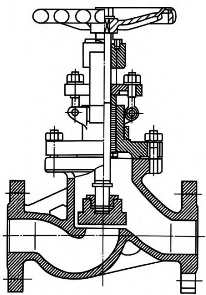  
图16.1-1 法兰连接阀门

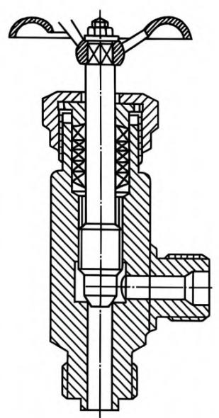  
图16.1-2 外螺纹连接阀门

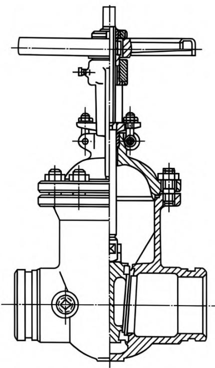  
图16.1-3 夹箍连接阀门

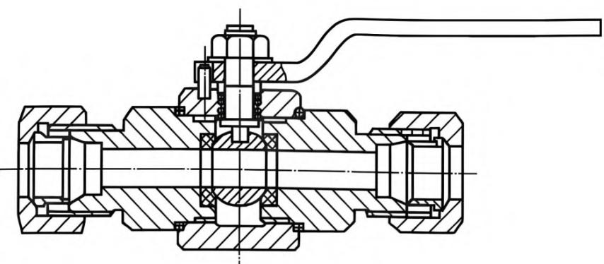  
图16.1-4 卡套连接球阀

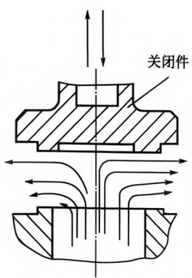  
图16.1-5 截门形结构

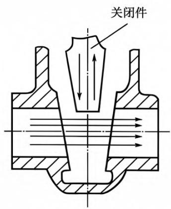  
图16.1-6 闸门形结构

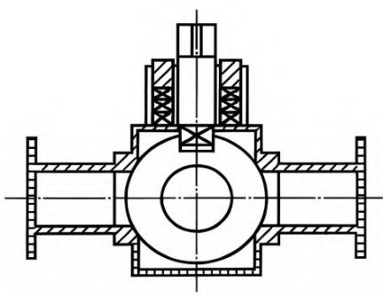  
图16.1-7 球形结构

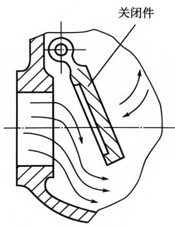  
图16.1-8 旋启形结构

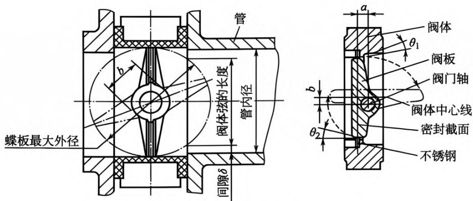  
图16.1-9 蝶形结构

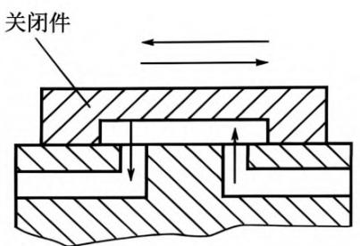  
图16.1-10 滑阀形结构

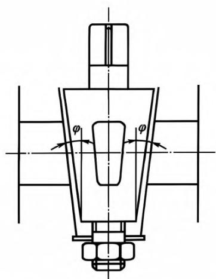  
图16.1-11 旋塞形结构

**16.1.2 阀门的名词术语**

阀门的主要名词术语见表 16.1-2。

阀门的主要名词术语  
表16.1-2

<table><tr><td>序号</td><td>名词术语</td><td>说明</td></tr><tr><td>1</td><td>通用分类</td><td></td></tr><tr><td>1.1</td><td>闸阀</td><td>启闭件(闸板)由阀杆带动,沿阀座(密封面)作直线升降运动的阀门</td></tr><tr><td>1.1.1</td><td>明杆闸阀</td><td>阀杆作升降运动,其传动螺纹在体腔外部的闸阀</td></tr><tr><td>1.1.2</td><td>暗杆闸阀</td><td>阀杆做旋转运动,其传动螺纹在体腔内部的闸阀</td></tr><tr><td>1.1.3</td><td>平行式闸阀</td><td>闸板的两侧密封面相互平行的闸阀</td></tr><tr><td>1.1.4</td><td>楔式闸阀</td><td>闸板的两侧密封面呈楔形的闸阀</td></tr><tr><td>1.2</td><td>截止阀</td><td>启闭件(阀瓣)由阀杆带动,沿阀座(密封面)轴线作直线升降运动的阀门</td></tr><tr><td>1.3</td><td>节流阀</td><td>通过启闭件(阀瓣)的运动,改变通路截面积,用以调节流量、压力的阀门</td></tr><tr><td>1.4</td><td>球阀</td><td>启闭件(球体)由阀杆带动,并绕阀杆的轴线做旋转运动的阀门</td></tr><tr><td>1.4.1</td><td>浮动式球阀</td><td>球体不带有固定轴的球阀</td></tr><tr><td>1.4.2</td><td>固定式球阀</td><td>球体带有固定轴的球阀</td></tr><tr><td>1.5</td><td>蝶阀</td><td>启闭件(蝶板)由阀杆带动,并绕阀杆的轴线做旋转运动的阀门</td></tr><tr><td>1.5.1</td><td>垂直板式蝶阀</td><td>蝶板与阀体通路轴线垂直的蝶阀</td></tr><tr><td>1.5.2</td><td>斜板式蝶阀</td><td>蝶板与阀体通路轴线成一倾斜角的蝶阀</td></tr><tr><td>1.6</td><td>隔膜阀</td><td>启闭件(隔膜)在阀内沿阀杆轴线作升降运动,通过启闭件(隔膜)的变形将动作机构与介质隔开的阀门</td></tr><tr><td>1.6.1</td><td>屋脊式隔膜阀</td><td>阀体流道中以屋脊形结构与隔膜构成密封副的隔膜阀</td></tr><tr><td>1.6.2</td><td>截止式隔膜阀</td><td>阀体与截止阀阀体形状相似的隔膜阀</td></tr><tr><td>1.7</td><td>旋塞阀</td><td>启闭件(塞子)由阀杆带动,并绕阀杆的轴线做旋转运动的阀门</td></tr><tr><td>1.7.1</td><td>填料式旋塞阀</td><td>采用填料为密封圈的旋塞阀</td></tr><tr><td>1.7.2</td><td>油封式旋塞阀</td><td>采用油脂密封的旋塞阀</td></tr><tr><td>1.8</td><td>止回阀</td><td>启闭件(阀瓣)借助介质作用力、自动阻止介质逆流的阀门</td></tr><tr><td>1.8.1</td><td>升降式止回阀</td><td>阀瓣沿阀瓣密封面轴线作升降运动的止回阀</td></tr><tr><td>1.8.2</td><td>升降立式止回阀</td><td>阀瓣沿阀体通路轴线作升降运动的止回阀</td></tr><tr><td>1.8.3</td><td>旋启式止回阀</td><td>阀瓣绕体腔内销轴做旋转运动的止回阀</td></tr><tr><td>1.8.4</td><td>底阀</td><td>安装在泵进口水端,保证泵进口端充满液体的一种止回阀</td></tr><tr><td>1.8.5</td><td>轴流式止回阀</td><td>阀体内腔表面、导流罩、阀瓣等过流表面应有流线形态,且前圆后尖。流体在其表面主要表现为层流,没有或很少有湍流</td></tr><tr><td>1.8.6</td><td>旋启多瓣式止回阀</td><td>具有两个以上阀瓣的旋启式止回阀</td></tr><tr><td>1.8.7</td><td>蝶式止回阀</td><td>形状与蝶阀相似,其阀瓣绕固定轴(无摇杆)做旋转运动的止回阀</td></tr><tr><td>1.9</td><td>安全阀</td><td>当管道或设备内介质压力超过规定值时,启闭件(阀瓣)自动开启排放介质;低于规定值时,启闭件(阀瓣)自动关闭。对管道或设备起保护作用的阀门</td></tr><tr><td>1.9.1</td><td>弹簧式安全阀</td><td>利用压缩弹簧的力来平衡介质对阀瓣的作用力并使其密封的安全阀</td></tr><tr><td>1.9.2</td><td>杠杆式安全阀</td><td>利用杠杆作用力来平衡介质对阀瓣的作用力并使其密封的安全阀</td></tr><tr><td>1.9.3</td><td>先导式安全阀</td><td>依靠从导阀排出介质来驱动和控制主阀的安全阀</td></tr><tr><td>1.9.4</td><td>全启式安全阀</td><td>阀瓣开启高度大于或等于阀座喉径的1/4的安全阀</td></tr><tr><td>1.9.5</td><td>微启式安全阀</td><td>阀瓣开启高度为阀座喉径的1/40~1/20的安全阀</td></tr><tr><td>1.9.6</td><td>波纹管平衡式安全阀</td><td>利用波纹管平衡背压的作用,以保持开启压力稳定的安全阀</td></tr><tr><td>1.9.7</td><td>双联弹簧式安全阀</td><td>将两个弹簧式安全阀并联,具有同一进口的安全阀组</td></tr><tr><td>1.9.8</td><td>直接载荷式安全阀</td><td>一种仅靠直接的机械加载装置(如重锤、杠杆加重锤或弹簧)来克服由阀瓣下介质压力所产生作用力的安全阀</td></tr><tr><td>1.9.9</td><td>带动力辅助装置的安全阀</td><td>该安全阀借助一个动力辅助装置,可以在压力低于正常整定压力时开启。即使该装置失灵,阀门仍能满足对安全阀的所有要求</td></tr><tr><td>1.9.10</td><td>带补充载荷的安全阀</td><td>这种安全阀在其进口压力达到整定压力前始终有一个用于增强密封的附加力。该附加力(补充载荷)可由外部能源提供,而在安全阀进口压力达到整定压力时应可靠地释放。补充载荷的大小应这样设定:假定该载荷未能释放时,安全阀仍能在其进口压力不超过国家法规规定的整定压力百分数的前提下达到额定排量</td></tr><tr><td>1.9.11</td><td>真空安全阀</td><td>用来补充流体以防止容器内过高真空度的安全阀,当正常状况恢复后又重新关闭而阻止介质继续流入</td></tr><tr><td>1.9.12</td><td>敞开式安全阀</td><td>介质会向大气排放的安全阀</td></tr><tr><td>1.10</td><td>减压阀</td><td>通过启闭件(阀瓣)的节流,将介质压力降低,并借助阀门压差的直接作用,使阀后压力自动保持在一定范围内的阀门</td></tr><tr><td>1.10.1</td><td>薄膜式减压阀</td><td>采用薄膜作传感件来带动阀瓣升降运动的减压阀</td></tr><tr><td>1.10.2</td><td>弹簧薄膜式减压阀</td><td>采用弹簧和薄膜作传感件来带动阀瓣升降运动的减压阀</td></tr><tr><td>1.10.3</td><td>活塞式减压阀</td><td>采用活塞机构来带动阀瓣升降运动的减压阀</td></tr><tr><td>1.10.4</td><td>波纹管式减压阀</td><td>采用波纹管机构来带动阀瓣升降运动的减压阀</td></tr><tr><td>1.10.5</td><td>杠杆式减压阀</td><td>采用杠杆机构来带动阀瓣升降运动的减压阀</td></tr><tr><td>1.10.6</td><td>直接作用式减压阀</td><td>利用出口压力变化,直接控制阀瓣运动的减压阀</td></tr><tr><td>1.10.7</td><td>先导式减压阀</td><td>由主阀和导阀组成,出口压力的变化通过导阀放大控制主阀动作的减压阀</td></tr><tr><td>1.11</td><td>疏水阀</td><td>自动排放凝结水并阻止蒸汽随水排出的阀门</td></tr><tr><td>1.11.1</td><td>浮球式疏水阀</td><td>利用在凝结水中浮动的空心球,带动启闭件动作的疏水阀</td></tr><tr><td>1.11.2</td><td>钟形浮子式疏水阀</td><td>利用在凝结水中浮动的钟形罩,带动启闭件动作的疏水阀</td></tr><tr><td>1.11.3</td><td>浮桶式疏水阀</td><td>利用在凝结水中浮动的浮桶,带动启闭件动作的疏水阀</td></tr><tr><td>1.11.4</td><td>双金属片式疏水阀</td><td>利用双金属片受热变形,带动启闭件动作的疏水阀</td></tr><tr><td>1.11.5</td><td>脉冲式疏水阀</td><td>利用蒸汽在两级节流中的二次蒸发,导致蒸汽和凝结水的压力变化,使启闭件动作的疏水阀</td></tr><tr><td>1.11.6</td><td>热动力式疏水阀</td><td>利用蒸汽和凝结水的不同热力性质,及其静压和动压的变化,使阀片动作的疏水阀</td></tr><tr><td>1.11.7</td><td>蒸汽疏水阀</td><td>从储有蒸汽的密闭容器内自动排出凝结水,同时保持不泄漏新鲜蒸汽的一种自动控制装置,在必要时也允许蒸汽按预定的流量通过</td></tr><tr><td>1.12</td><td>排污阀</td><td>用于锅炉、压力容器等设备排污的阀门</td></tr><tr><td>1.13</td><td>调节阀(控制阀)</td><td>将启闭件(阀瓣)预定在关闭与全开启任何位置,通过启闭件(阀瓣)改变通路截面积,以调节流量、压力或温度的阀门</td></tr><tr><td>1.13.1</td><td>自力式控制阀</td><td>无须外加动力源,只依靠被控流体的能量实现自行操作并调节被控变量的阀</td></tr><tr><td>1.14</td><td>分配阀</td><td>通过改变启闭件的位置来影响一个共同进口流量的比例,以形成两个或多个出口流量的阀门</td></tr><tr><td>1.15</td><td>混合阀</td><td>通过改变启闭件的位置来影响两个或多个进口流量的比例,以形成一个共同出口流量的阀门</td></tr><tr><td>1.16</td><td>水力控制阀</td><td>利用水力控制原理,通过不同的构造实现多用途控制功能的阀门总称</td></tr><tr><td>1.16.1</td><td>遥控浮球阀</td><td>利用控制回路中浮球升降来控制主阀的开启和关闭,达到自动控制设定液位目的的阀门</td></tr><tr><td>1.16.2</td><td>水力控制减压阀</td><td>通过启闭件的节流,将进口压力降至某一个需要的出口压力,并能在进口压力及流量变动时,利用本身介质能量保持出口压力基本不变的阀门</td></tr><tr><td>1.16.3</td><td>缓闭止回阀</td><td>利用介质自身压力控制实现延时关闭功能,从而消除或缓解水锤的止回阀</td></tr><tr><td>1.16.4</td><td>持压/泄压阀</td><td>利用阀门自动开启和关闭来稳定阀前管道压力的阀门</td></tr><tr><td>1.16.5</td><td>水泵控制阀</td><td>安装在水泵出口处,有助于水泵的开启和关闭并防止介质倒流的逆止类阀门</td></tr><tr><td>2</td><td>按驱动方式分类</td><td></td></tr><tr><td>2.1</td><td>手动阀门</td><td>借助手轮、手柄、杠杆或链轮等,由人力来操作的阀门</td></tr><tr><td>2.2</td><td>电动阀门</td><td>用电动装置、电磁或其他电气装置操作的阀门</td></tr><tr><td>2.3</td><td>液动或气动阀门</td><td>借助液体(水、油等液体介质)或空气的压力操作的阀门</td></tr><tr><td>3</td><td>按压力分类</td><td></td></tr><tr><td>3.1</td><td>低压阀门</td><td>公称压力不大于PN16的阀门</td></tr><tr><td>3.2</td><td>中压阀门</td><td>公称压力为PN 16~PN 100(不含PN 16)的阀门</td></tr><tr><td>3.3</td><td>高压阀门</td><td>公称压力为PN 100~PN 1000(不含PN 100)的阀门</td></tr><tr><td>3.4</td><td>超高压阀门</td><td>公称压力为大于PN 1000的阀门</td></tr><tr><td>4</td><td>按温度分类</td><td></td></tr><tr><td>4.1</td><td>高温阀门</td><td>用于介质温度t&gt;425°C的阀门</td></tr><tr><td>4.2</td><td>中温阀门</td><td>用于介质温度为120°C≤t≤425°C的阀门</td></tr><tr><td>4.3</td><td>常温阀门</td><td>用于介质温度为-29°C&lt;t&lt;120°C的阀门</td></tr><tr><td>4.4</td><td>低温阀门</td><td>用于介质温度为-100°C≤t≤-29°C的阀门</td></tr><tr><td>4.5</td><td>超低温阀门</td><td>用于介质温度t&lt;-100°C的阀门</td></tr><tr><td>5</td><td>按结构特征分类</td><td></td></tr><tr><td>5.1</td><td>全径阀门</td><td>阀门内所有流道内径尺寸与管道内径尺寸相同的阀门</td></tr><tr><td>5.2</td><td>缩径阀门</td><td>阀门内流道孔通径按规定要求缩小的阀门</td></tr><tr><td>5.3</td><td>缩口阀门</td><td>具有一定缩口比的阀门</td></tr><tr><td>5.4</td><td>单向阀门</td><td>设计为一个介质流动方向密封的阀门</td></tr><tr><td>5.5</td><td>双向阀门</td><td>设计为两个介质流动方向均密封的阀门</td></tr><tr><td>5.6</td><td>双座双向阀门</td><td>阀门有两个密封座,每个阀座的两个介质流动方向均可密封的阀门</td></tr><tr><td>5.7</td><td>双锁紧泄放阀</td><td>在关闭位置时具有两个阀座面的阀门,锁紧阀门两端的流动(两个阀座面之间有一个通过阀体上的接口连接泄放口排气的中腔体)</td></tr></table>

### 16.1.3 阀门型号与表示

我国阀门型号编制方法规定如下：

**1. 型号的编制**

我国的阀门型号由阀门类型、驱动方式、连接形式、结构特点、密封面或衬里材料、阀体材料七部分组成。《阀门 型号编制方法》GB/T 32808—2016 对阀门型号编制的规定见图 16.1-12。

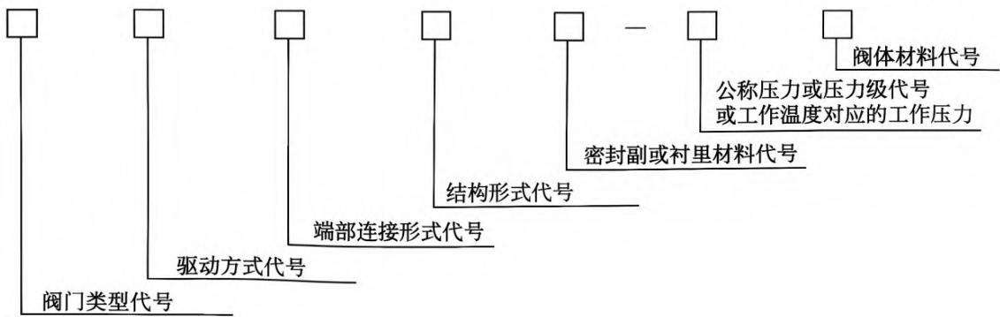  
图16.1-12 阀门型号编制顺序图

阀门的公称尺寸在阀体材料代号后空一格，标注 DN 或 NPS 和公称尺寸数值，且符合现行国家标准《管道元件 公称尺寸的定义和选用》GB/T 1047 的规定。

**2. 代号**

阀门代号的表示方法如下：

(1) 阀门的类型代号如表 16.1-3 所示。

阀门的类型代号  
表16.1-3

<table><tr><td colspan="2">阀门类型</td><td>代号</td><td colspan="2">阀门类型</td><td>代号</td></tr><tr><td rowspan="2">安全阀</td><td>弹簧载荷式、先导式</td><td>A</td><td rowspan="2">球阀</td><td>整体球</td><td>Q</td></tr><tr><td>重锤杠杆式</td><td>GA</td><td>半球</td><td>PQ</td></tr><tr><td colspan="2">蝶阀</td><td>D</td><td colspan="2">蒸汽疏水阀</td><td>S</td></tr><tr><td colspan="2">倒流防止器</td><td>DH</td><td colspan="2">堵阀(电站用)</td><td>SD</td></tr><tr><td colspan="2">隔膜阀</td><td>G</td><td colspan="2">控制阀(调节阀)</td><td>T</td></tr><tr><td colspan="2">止回阀、底阀</td><td>H</td><td colspan="2">柱塞阀</td><td>U</td></tr><tr><td colspan="2">截止阀</td><td>J</td><td colspan="2">旋塞阀</td><td>X</td></tr><tr><td colspan="2">节流阀</td><td>L</td><td colspan="2">减压阀(自力式)</td><td>Y</td></tr><tr><td rowspan="2">进排气阀</td><td>单一进排气口</td><td>P</td><td colspan="2">减温减压阀</td><td>WY</td></tr><tr><td>复合型</td><td>FFP</td><td colspan="2">闸阀</td><td>Z</td></tr><tr><td colspan="2">排污阀</td><td>PW</td><td colspan="2">排渣阀</td><td>PZ</td></tr></table>

当阀门同时具有其他功能或带有其他结构时，在阀门类型代号前加注一个汉语拼音字母，典型功能代号如表 16.1-4 所示。

同时具有其他功能或结构的阀门代号  
表 16.1-4

<table><tr><td>其他功能作用或结构名称</td><td>代号</td><td>其他功能作用或结构名称</td><td>代号</td></tr><tr><td>保温型(夹套伴热结构)</td><td>B</td><td>关闭型</td><td>H</td></tr><tr><td>低温型</td><td>D</td><td>快速型</td><td>Q</td></tr><tr><td>防火型</td><td>F</td><td>波纹管阀杆密封型</td><td>W</td></tr></table>

(2) 阀门的驱动方式代号如表 16.1-5 所示。

阀门的驱动方式代号  
表 16.1-5

<table><tr><td>驱动方式</td><td>代号</td><td>驱动方式</td><td>代号</td></tr><tr><td>电磁动</td><td>0</td><td>锥齿轮</td><td>5</td></tr><tr><td>电磁—液动</td><td>1</td><td>气动</td><td>6</td></tr><tr><td>电—液联动</td><td>2</td><td>液动</td><td>7</td></tr><tr><td>涡轮</td><td>3</td><td>气—液联动</td><td>8</td></tr><tr><td>正齿轮</td><td>4</td><td>电动</td><td>9</td></tr></table>

注：1. 安全阀、减压阀、疏水阀无驱动方式代号，手轮和手柄直接连接阀杆操作形式的阀门，本代号省略。  
2. 对于具有常开或常闭结构的执行机构，在驱动方式代号后加注汉语拼音下标 K 或 B，如常开型用 $6_{K}$ 、 $7_{K}$ ；常闭型用 $6_{B}$ 、 $7_{B}$ 。  
3. 气动执行机构带手动操作的，在驱动方式代号后加注汉语拼音下标，如 $6_{S}$ 。  
4. 防爆型的执行机构，在驱动方式代号后加注汉语拼音 B，如 6B、7B、9B。  
5. 对既是防爆型又是常开或常闭型的执行机构，在驱动方式代号后加注汉语拼音 B，再加注括号的下标 K 或 B，如 $9B_{(B)}$ 、 $6B_{(K)}$ 。  
(3) 阀门连接端连接形式代号如表 16.1-6 所示。

阀门连接端连接形式代号  
表 16.1-6

<table><tr><td>连接端形式</td><td>代号</td><td>连接端形式</td><td>代号</td></tr><tr><td>内螺纹</td><td>1</td><td>对夹</td><td>7</td></tr><tr><td>外螺纹</td><td>2</td><td>卡箍</td><td>8</td></tr><tr><td>法兰式</td><td>4</td><td>卡套</td><td>9</td></tr><tr><td>焊接式</td><td>6</td><td>—</td><td></td></tr></table>

注：各种连接形式的具体结构、采用标准和方式（如法兰标准、连接面形式及密封方式、焊接形式、螺纹形式等），不在连接代号后加符号，应在产品的图样、说明书或订货合同等文件中予以详细说明。

**(4) 阀门结构形式代号**

阀门结构形式用阿拉伯数字表示，如表 16.1-7～表 16.1-21 所示。

闸阀结构形式代号  
表16.1-7

<table><tr><td colspan="3">结构形式</td><td rowspan="2">代号</td></tr><tr><td>闸阀启闭时,阀杆运动方式</td><td colspan="2">闸板结构形式</td></tr><tr><td rowspan="5">阀杆升降移动(明杆)</td><td rowspan="2">闸阀的两个密封面为楔式,单块闸板</td><td>具有弹性槽</td><td>0</td></tr><tr><td>无弹性槽</td><td>1</td></tr><tr><td colspan="2">闸阀的两个密封面为楔式,双块闸板</td><td>2</td></tr><tr><td colspan="2">闸阀的两个密封面平行,单块平板</td><td> $3^{1}$ </td></tr><tr><td colspan="2">闸阀的两个密封面平行,双块闸板</td><td>4</td></tr><tr><td rowspan="3">阀杆仅旋转,无升降移动(暗杆)</td><td rowspan="2">闸阀的两个密封面为楔式</td><td>单块闸板</td><td>5</td></tr><tr><td>双块闸板</td><td>6</td></tr><tr><td colspan="2">闸阀的两个密封面平行,双块闸板</td><td>8</td></tr></table>

① 闸板无导流孔的，在结构形式代号后加汉语拼音 w，如 3w。

截止阀和节流阀结构形式代号  
表 16.1-8

<table><tr><td colspan="2">结构形式</td><td>代号</td><td colspan="2">结构形式</td><td>代号</td></tr><tr><td>直通流道</td><td rowspan="5">单阀瓣</td><td>1</td><td>直通流道</td><td rowspan="2">平衡式阀瓣</td><td>6</td></tr><tr><td>Z形流道</td><td>2</td><td>角式流道</td><td>7</td></tr><tr><td>三通流道</td><td>3</td><td rowspan="3" colspan="2">—</td><td rowspan="3">—</td></tr><tr><td>角式流道</td><td>4</td></tr><tr><td>Y形流道</td><td>5</td></tr></table>

止回阀结构形式代号  
表 16.1-9

<table><tr><td colspan="2">结构形式</td><td>代号</td><td colspan="2">结构形式</td><td>代号</td></tr><tr><td rowspan="4">升降式阀瓣</td><td>直通流道</td><td>1</td><td rowspan="3">旋启式阀瓣</td><td>单瓣结构</td><td>4</td></tr><tr><td>立式结构</td><td>2</td><td>多瓣结构</td><td>5</td></tr><tr><td>Z形流道</td><td>3</td><td>双瓣结构</td><td>6</td></tr><tr><td>Y形流道</td><td>5</td><td colspan="2">蝶形(双瓣)结构</td><td>7</td></tr></table>

球阀结构形式代号  
表 16.1-10

<table><tr><td colspan="2">结构形式</td><td>代号</td><td colspan="2">结构形式</td><td>代号</td></tr><tr><td rowspan="5">浮动球</td><td>直流通道</td><td>1</td><td rowspan="5">固定球</td><td>四通流道</td><td>6</td></tr><tr><td>Y形三通流道</td><td>2</td><td>直流通道</td><td>7</td></tr><tr><td>L形三通流道</td><td>4</td><td>T形三通流道</td><td>8</td></tr><tr><td>T形三通流道</td><td>5</td><td>L形三通流道</td><td>9</td></tr><tr><td>—</td><td>—</td><td>半球直通</td><td>0</td></tr></table>

蝶阀结构形式代号  
表 16.1-11

<table><tr><td colspan="2">结构形式</td><td>代号</td><td colspan="2">结构形式</td><td>代号</td></tr><tr><td rowspan="5">密封副有密封性要求的</td><td>单偏心</td><td>0</td><td rowspan="5">密封副无密封要求的</td><td>单偏心</td><td>5</td></tr><tr><td>中心对称垂直板</td><td>1</td><td>中心垂直板</td><td>6</td></tr><tr><td>双偏心</td><td>2</td><td>双偏心</td><td>7</td></tr><tr><td>三偏心</td><td>3</td><td>三偏心</td><td>8</td></tr><tr><td>连杆机构</td><td>4</td><td>连杆机构</td><td>9</td></tr></table>

旋塞阀结构形式代号  
表 16.1-12

<table><tr><td colspan="2">结构形式</td><td>代号</td><td colspan="2">结构形式</td><td>代号</td></tr><tr><td rowspan="3">填料密封型</td><td>直通流道</td><td>3</td><td rowspan="3">油封型</td><td>直通流道</td><td>7</td></tr><tr><td>三通T形流道</td><td>4</td><td>三通T形流道</td><td>8</td></tr><tr><td>四通流道</td><td>5</td><td>—</td><td>—</td></tr></table>

隔膜阀结构形式代号  
表 16.1-13

<table><tr><td>结构形式</td><td>代号</td><td>结构形式</td><td>代号</td></tr><tr><td>屋脊式流道</td><td>1</td><td>直流式流道</td><td>6</td></tr><tr><td>直流式流道</td><td>5</td><td>Y形角式流道</td><td>8</td></tr></table>

柱塞阀结构形式代号  
表 16.1-14

<table><tr><td>结构形式</td><td>代号</td></tr><tr><td>直通流道</td><td>1</td></tr><tr><td>角式流道</td><td>4</td></tr></table>

减压阀（自力式）结构形式代号  
表 16.1-15

<table><tr><td>结构形式</td><td>代号</td><td>结构形式</td><td>代号</td></tr><tr><td>薄膜式</td><td>1</td><td>波纹管式</td><td>4</td></tr><tr><td>弹簧薄膜式</td><td>2</td><td>杠杆式</td><td>5</td></tr><tr><td>活塞式</td><td>3</td><td>—</td><td>—</td></tr></table>

控制阀（调节阀）结构形式代号  
表 16.1-16

<table><tr><td colspan="2">结构形式</td><td>代号</td><td colspan="2">结构形式</td><td>代号</td></tr><tr><td rowspan="5">直行程,单级</td><td>套筒式</td><td>7</td><td rowspan="3">直行程,两级或多级</td><td>套筒式</td><td>8</td></tr><tr><td>套筒柱塞式</td><td>5</td><td>柱塞式</td><td>1</td></tr><tr><td>针形式</td><td>2</td><td>套筒柱塞式</td><td>9</td></tr><tr><td>柱塞式</td><td>4</td><td colspan="2">角行程,套筒式</td><td>0</td></tr><tr><td>滑板式</td><td>6</td><td colspan="2">—</td><td>—</td></tr></table>

减温减压阀（非自力式）结构形式代号  
表 16.1-17

<table><tr><td colspan="2">结构形式</td><td>代号</td><td colspan="2">结构形式</td><td>代号</td></tr><tr><td rowspan="3">单座</td><td>柱塞阀</td><td>1</td><td rowspan="3">双座或多级</td><td>套筒式</td><td>4</td></tr><tr><td>套筒柱塞式</td><td>2</td><td>柱塞式</td><td>5</td></tr><tr><td>套筒式</td><td>3</td><td>套筒柱塞式</td><td>6</td></tr></table>

堵阀结构形式代号  
表 16.1-18

<table><tr><td>结构形式</td><td>代号</td></tr><tr><td>闸板式</td><td>1</td></tr><tr><td>止回式</td><td>2</td></tr></table>

蒸汽疏水阀结构形式代号  
表 16.1-19

<table><tr><td>结构形式</td><td>代号</td><td>结构形式</td><td>代号</td></tr><tr><td>自由浮球式</td><td>1</td><td>蒸汽压力式或膜盒式</td><td>6</td></tr><tr><td>杠杆浮球式</td><td>2</td><td>双金属片式</td><td>7</td></tr><tr><td>倒置桶式</td><td>3</td><td>脉冲式</td><td>8</td></tr><tr><td>液体或固体膨胀式</td><td>4</td><td>圆盘热动力式</td><td>9</td></tr><tr><td>钟形浮子式</td><td>5</td><td>—</td><td>—</td></tr></table>

排污阀结构形式代号  
表16.1-20

<table><tr><td colspan="2">结构形式</td><td>代号</td><td colspan="2">结构形式</td><td>代号</td></tr><tr><td rowspan="4">液面连接排放</td><td>截止型直通式</td><td>1</td><td rowspan="4">液底间断排放</td><td>截止型直流式</td><td>5</td></tr><tr><td>截止型角式</td><td>2</td><td>截止型直通式</td><td>6</td></tr><tr><td>—</td><td>—</td><td>截止型角式</td><td>7</td></tr><tr><td>—</td><td>—</td><td>浮动闸板型直通式</td><td>8</td></tr></table>

安全阀结构形式代号  
表 16.1-21

<table><tr><td colspan="2">结构形式</td><td>代号</td><td colspan="2">结构形式</td><td>代号</td></tr><tr><td rowspan="4">弹簧载荷弹簧封闭结构</td><td>带散热片全启式</td><td>0</td><td rowspan="4">弹簧载荷弹簧不封闭且带扳手结构</td><td>微启式、双联阀</td><td>3</td></tr><tr><td>微启式</td><td>1</td><td>微启式</td><td>7</td></tr><tr><td>全启式</td><td>2</td><td>全启式</td><td>8</td></tr><tr><td>带扳手全启式</td><td>4</td><td>—</td><td>—</td></tr><tr><td rowspan="2">杠杆式</td><td>单杠杆</td><td>2</td><td colspan="2">带控制机构全启式(先导式)</td><td>6</td></tr><tr><td>双杠杆</td><td>4</td><td colspan="2">脉冲式(全冲量)</td><td>9</td></tr></table>

**(5) 密封副或衬里材料代号**

密封副或衬里材料代号，用两个密封面中起密封作用的密封面材料或衬里材料硬度值较低的材料或耐腐蚀性能较低的材料表示；金属密封面中镶嵌非金属材料的，则表示为非金属/金属。密封面或衬里材料代号用表16.1-22规定的字母表示。

密封面或衬里材料代号  
表16.1-22

<table><tr><td>密封面或衬里材料</td><td>代号</td><td>密封面或衬里材料</td><td>代号</td></tr><tr><td>锡基合金(巴氏合金)</td><td>B</td><td>尼龙塑料</td><td>N</td></tr><tr><td>搪瓷</td><td>C</td><td>渗硼钢</td><td>P</td></tr><tr><td>渗氮钢</td><td>D</td><td>衬铅</td><td>Q</td></tr><tr><td>渗氮钢</td><td>F</td><td>塑料</td><td>S</td></tr><tr><td>陶瓷</td><td>G</td><td>铜合金</td><td>T</td></tr><tr><td>铁基不锈钢</td><td>H</td><td>橡胶</td><td>X</td></tr><tr><td>衬胶</td><td>J</td><td>硬质合金</td><td>Y</td></tr><tr><td>蒙乃尔合金</td><td>M</td><td>铁基合金密封面中镶嵌橡胶材料</td><td>X/H</td></tr></table>

注：阀门密封副材料均为阀门的本体材料时，密封面材料代号用“W”表示。

**(6) 压力代号**

压力级代号采用 PN 后的数字，该数值表示公称压力，其数值是以 MPa 为单位的公称压力值的 10 倍。

采用压力等级的，在型号编制时，采用字母 Class 或 CL（大写），后标注压力级数字，如 Class150 或 CL150。

**(7) 阀体材料代号**

阀体材料代号一般按表 16.1-23 的规定执行。当阀体材料标注具体牌号时，可以写明牌号，如 A105、CF8、316L、ZG20CrMoV 等。

公称压力不大于 PN 16 的灰铸铁阀门的阀体材料代号在型号编制时可以省略；公称压力不小于 PN 25 的碳素钢阀门的阀体材料代号在型号编制时可以省略。

阀体材料代号  
表 16.1-23

<table><tr><td>阀体材料</td><td>代号</td><td>阀体材料</td><td>代号</td></tr><tr><td>碳钢</td><td>C</td><td>铬镍钼系不锈钢</td><td>R</td></tr><tr><td>Cr13 系不锈钢</td><td>H</td><td>塑料</td><td>S</td></tr><tr><td>铬钼系钢(高温钢)</td><td>I</td><td>铜及铜合金</td><td>T</td></tr><tr><td>可锻铸铁</td><td>K</td><td>钛及钛合金</td><td>Ti</td></tr><tr><td>铝合金</td><td>L</td><td>铬钼钒钢(高温钢)</td><td>V</td></tr><tr><td>铬镍系不锈钢</td><td>P</td><td>灰铸铁</td><td>Z</td></tr><tr><td>球墨铸铁</td><td>Q</td><td>镍基合金</td><td>N</td></tr></table>

**3. 型号编制示例**

【例 16.1-1】 阀门采用电动装置操作，法兰连接端，明杆楔式双闸板结构，阀座密封面材料是阀体直接加工的，为本体材料，公称压力 PN10（1.0MPa），阀体材料为灰铸铁的闸阀。

型号表示为：Z942W-10。

【例 16.1-2】 阀门为手动操作，外螺纹连接端，浮动球直通式结构，阀座密封面材料为氟塑料，压力级为 Class300，阀体材料为 1Cr18Ni9Ti 的球阀。

型号表示为：Q21F-Class300P 或 Q21F-CL300P。

**16.1.4 阀门的主要性能参数**

阀门的性能参数主要是公称尺寸、公称压力、工作压力、工作温度等。

**1. 公称尺寸**

阀门的公称尺寸 DN 是用于管道系统元件的由字母与无量纲数字组成的尺寸标识，这个数字与阀门端部连接件的孔径或外径（用 mm 表示）等特征尺寸直接相关；但这个无量纲数字不代表测量值，也不应用于计算。如公称尺寸 150mm，标志为：DN150。

《管道元件 公称尺寸的定义和选用》GB/T 1047—2019 对管道元件优先选用的公称尺寸数值进行了规定，如表 16.1-24 所示。

管道元件优先选用的公称尺寸  
表16.1-24

<table><tr><td>DN6</td><td>DN50</td><td>DN300</td><td>DN700</td><td>DN1100</td><td>DN1800</td><td>DN2600</td><td>DN3800</td></tr><tr><td>DN8</td><td>DN65</td><td>DN350</td><td>DN750</td><td>DN1150</td><td>DN1900</td><td>DN2700</td><td>DN4000</td></tr><tr><td>DN10</td><td>DN80</td><td>DN400</td><td>DN800</td><td>DN1200</td><td>DN2000</td><td>DN2800</td><td>—</td></tr><tr><td>DN15</td><td>DN100</td><td>DN450</td><td>DN850</td><td>DN1300</td><td>DN2100</td><td>DN2900</td><td>—</td></tr><tr><td>DN20</td><td>DN125</td><td>DN500</td><td>DN900</td><td>DN1400</td><td>DN2200</td><td>DN3000</td><td>—</td></tr><tr><td>DN25</td><td>DN150</td><td>DN550</td><td>DN950</td><td>DN1500</td><td>DN2300</td><td>DN3200</td><td>—</td></tr><tr><td>DN32</td><td>DN200</td><td>DN600</td><td>DN1000</td><td>DN1600</td><td>DN2400</td><td>DN3400</td><td>—</td></tr><tr><td>DN40</td><td>DN250</td><td>DN650</td><td>DN1050</td><td>DN1700</td><td>DN2500</td><td>DN3600</td><td>—</td></tr></table>

国际上也有使用 NPS（公称管子规格）标注方法。NPS（Nominal Pipe Size）是指阀门连接端（包括法兰端和焊接端）的公称直径，后面跟的数字单位为英寸，属美标体系标注。公称尺寸和钢管外径见表 16.1-25。

公称尺寸和钢管外径  
表 16.1-25

<table><tr><td rowspan="2" colspan="2">公称尺寸</td><td colspan="2">DN</td><td colspan="2">15</td><td colspan="2">20</td><td colspan="2">25</td><td colspan="2">32</td><td colspan="2">40</td><td colspan="2">50</td><td colspan="2">65</td><td>80</td><td>100</td></tr><tr><td colspan="2">NPS</td><td colspan="2">1/2</td><td colspan="2">3/4</td><td colspan="2">1</td><td colspan="2">1 1/4</td><td colspan="2">1 1/2</td><td colspan="2">2</td><td colspan="2">2 1/2</td><td>3</td><td>4</td></tr><tr><td colspan="4">钢管外径</td><td colspan="2">21.3</td><td colspan="2">26.9</td><td colspan="2">33.7</td><td colspan="2">42.4</td><td colspan="2">48.3</td><td colspan="2">60.3</td><td colspan="2">78.1</td><td>88.9</td><td>114.3</td></tr><tr><td rowspan="2">公称尺寸</td><td colspan="2">DN</td><td colspan="2">125</td><td colspan="2">150</td><td colspan="2">200</td><td colspan="2">250</td><td colspan="2">300</td><td colspan="2">350</td><td colspan="2">400</td><td>450</td><td>500</td><td>600</td></tr><tr><td colspan="2">NPS</td><td colspan="2">5</td><td colspan="2">6</td><td colspan="2">8</td><td colspan="2">10</td><td colspan="2">12</td><td colspan="2">14</td><td colspan="2">16</td><td>18</td><td>20</td><td>24</td></tr><tr><td colspan="3">钢管外径</td><td colspan="2">139.7</td><td colspan="2">168.3</td><td colspan="2">219.1</td><td colspan="2">273.0</td><td colspan="2">323.9</td><td colspan="2">355.6</td><td colspan="2">406.4</td><td>457</td><td>508</td><td>610</td></tr></table>

**2. 公称压力**

阀门的公称压力用 PN 或 Class 标注，它是由与管道系统元件的力学性能和尺寸特性相关的字母和数字组合的标识，由字母 PN 或 Class 和后跟的无量纲数字组成。这个无量纲数字不代表测量值，也不应用于计算。管道元件的最大允许工作压力取决于管道元件的 PN 数值或 Class 数值、材料、元件设计和最高允许工作温度等。公称压力包括 PN 和 Class 两个系列，《管道元件 公称压力的定义和选用》GB/T 1048—2019 进行了规定，如表 16.1-26、表 16.1-27 所示。

公称压力数值PN系列  
表 16.1-26

<table><tr><td>PN2.5</td><td>PN6</td><td>PN10</td><td>PN16</td><td>PN25</td><td>PN40</td></tr><tr><td>PN63</td><td>PN100</td><td>PN160</td><td>PN250</td><td>PN320</td><td>PN400</td></tr></table>

公称压力数值 Class 系列  
表16.1-27

<table><tr><td>Class25 $^{\text{1}}$ </td><td>Class75</td><td>Class125 $^{\text{2}}$ </td><td>Class150</td><td>Class250 $^{\text{2}}$ </td><td>Class300</td></tr><tr><td>(Class400)</td><td>Class600</td><td>Class800 $^{\text{3}}$ </td><td>Class900</td><td>Class1500</td><td>Class2000 $^{\text{4}}$ </td></tr><tr><td>Class2500</td><td>Class3000 $^{\text{6}}$ </td><td>Class4500 $^{\text{6}}$ </td><td>Class6000 $^{\text{5}}$ </td><td>Class9000 $^{\text{7}}$ </td><td>—</td></tr></table>

① 适用于灰铸铁法兰和法兰管件。  
② 适用于铸铁法兰、法兰管件和螺纹管件。  
③ 适用于承插焊和螺纹连接的阀门。  
④ 适用于锻钢制的螺纹管件。  
⑤ 适用于锻钢制的承插焊和螺纹管件。  
⑥ 适用于对焊连接的阀门。  
⑦ 适用于锻钢制的承插焊管件。

注：带括号的公称压力数值不推荐使用。

PN 和 Class 都是压力的一种表示方法，所不同的是，它们所代表承受的压力所对应的参照温度不同。PN 为欧洲体系，是指在 $120^{\circ} \mathrm{C}$ 下所对应的压力，而 Class 为美国体系，是指在较高的温度（四百多摄氏度）下所对应的压力，所以在工程互换中不能只单纯地进行压力换算，压力对照表见表 16.1-28。

压力等级 Class 与公称压力 PN 对照表  
表16.1-28

<table><tr><td>压力等级 Class</td><td>150</td><td>300</td><td>400</td><td>600</td><td>900</td><td>1500</td><td>2500</td></tr><tr><td>公称压力(MPa)</td><td>0.6、1.0、1.6、2.0</td><td>2.5、4.0、5.0</td><td>6.4</td><td>10</td><td>15.0</td><td>25.0</td><td>42.0</td></tr><tr><td>公称压力 PN</td><td>6、10、16、20</td><td>25、40、50</td><td>64</td><td>100</td><td>150</td><td>250</td><td>420</td></tr></table>

**3. 工作压力**

阀门的工作压力一般以 $p_{w}$ 表示。工作压力与公称压力的含义不同，工作压力表示的是该阀门在适用介质温度下的压力，其值随介质温度改变。不同系列和型号的阀门，都有固定的工作压力，具体数值由阀门生产企业根据该阀门的适用介质温度给定。

**4. 工作温度**

阀门的工作温度一般以 $t_{\mathrm{w}}$ 表示。工作温度表示的是该阀门在适用介质下的温度，其值随工作压力和介质种类等改变。不同系列和型号的阀门，都有固定的工作温度，具体数值由阀门生产企业根据该阀门的适用介质给定。

**16.1.5 阀门的选用**

**16.1.5.1 选用阀门的基本原则**

选用阀门，除了要注意阀门的主要性能参数外，还要注意阀门的密闭性能、类型、连接形式、材质、阻力和流量系数等方面。

**1. 阀门的密封性能**

阀门的密闭性是考核阀门质量优劣的主要指标之一。阀门的密闭性主要包括两个方面，即内漏和外漏。内漏是指阀座与关闭件之间对介质达到的密封程度；外漏是指阀杆填料部位的泄漏、法兰垫片部位的泄漏和阀体制造缺陷造成的泄漏。外漏是不允许的。如果外漏不允许排入大气，那么外漏的密封比内漏的密封更为重要，因此阀门的密闭结构对其选用影响很大。

如果没有发现阀门泄漏或者发现阀门的泄漏量在允许范围内，则该阀门被认为对介质是达到密封的。对于某一用途的阀门的最大允许泄漏量即作为阀门的泄漏标准。考核内漏的现行国家标准有《工业阀门 压力试验》GB/T 13927 和《阀门的检验和试验》GB/T 26480。

《工业阀门 压力试验》GB/T 13927—2022规定了工业阀门的压力试验要求与方法，其密封试验最大允许泄漏量见表16.1-29。A级适用于非金属弹性密封阀门，其他等级适用于金属密封阀门。其中B级适用于比较关键的阀门，D级适用于一般的阀门。各类阀门的最大允许泄漏量（等级），应符合有关产品标准的规定，如果有关标准未作具体规定，则非金属弹性密封阀门符合A级要求，金属密闭阀门符合D级要求。

工业阀门密封试验的最大允许泄漏量  
表 16.1-29

<table><tr><td rowspan="2">试验介质</td><td colspan="10">最大允许泄漏量( $mm^3/s$ )</td></tr><tr><td>A级</td><td>AA级</td><td>B级</td><td>C级</td><td>CC级</td><td>D级</td><td>E级</td><td>EE级</td><td>F级</td><td>G级</td></tr><tr><td>液体</td><td rowspan="2">在试验压力持续时间内无可见泄漏</td><td>0.006×DN</td><td>0.01×DN</td><td>0.03×DN</td><td>0.08×DN</td><td>0.1×DN</td><td>0.3×DN</td><td>0.39×DN</td><td>1×DN</td><td>2×DN</td></tr><tr><td>气体</td><td>0.18×DN</td><td>0.3×DN</td><td>3×DN</td><td>22.3×DN</td><td>30×DN</td><td>300×DN</td><td>470×DN</td><td>3000×DN</td><td>6000×DN</td></tr></table>

注：1. 泄漏量是指一个大气压力状态。

2. 阀门的 DN 按《工业阀门 压力试验》GB/T 13927—2022 附录 A 规定的“等同的规格”的公称尺寸取值。

《阀门的检验和试验》GB/T 26480—2011 规定了阀门的检验和压力试验要求。检验项目包括铸件的外观检查、壳体试验、上密封试验、低压密封试验，高压密封试验、高压气体壳体试验等。在试验持续时间内，试验介质通过密封面的最大允许泄漏量见表 16.1-30。

最大允许泄漏量  
表 16.1-30

<table><tr><td rowspan="2">公称尺寸DN</td><td rowspan="2">所有弹性密封副阀门(液滴/min)</td><td colspan="2">除止单回阀外的所有金属密封阀门</td><td colspan="2">金属密封止回阀</td></tr><tr><td>液体试验1</td><td>气体试验(气泡/min)</td><td>液体试验(mL/min)</td><td>气体试验(m3·h)</td></tr><tr><td>≤50</td><td rowspan="4">0</td><td>0</td><td>0</td><td rowspan="4"> $\frac{DN}{25} \times 3$ </td><td rowspan="4"> $\frac{DN}{25} \times 0.042$ </td></tr><tr><td>65~150</td><td>0.75</td><td>24</td></tr><tr><td>200~300</td><td>1.25</td><td>40</td></tr><tr><td>≥350</td><td>2×DN/25</td><td>4×DN/25</td></tr></table>

① 对于试验介质，1mL（1cm $^{3}$ ）相当于16滴。

**2. 阀门的类型**

阀门类型的选择是以对整个生产工艺流程的综合估计为先决条件的。在选择阀门类型的同时，应首先了解每种类型阀门的结构特点及其性能。

阀门启闭件有四种运动方式，即闭合式、滑动式、旋转式和夹紧式。每种运动方式都有其优缺点，如表 16.1-31 所示；不同用途条件下阀门的适用性见表 16.1-32。

阀门启闭件运动方式的优缺点  
表 16.1-31

<table><tr><td>类型</td><td>图示</td><td>优点</td><td>缺点</td></tr><tr><td>闭合式</td><td>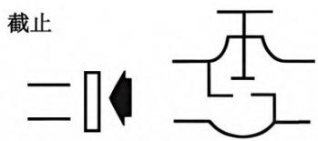</td><td>切断和调节性能最佳</td><td>压力损失大</td></tr><tr><td>滑动式</td><td>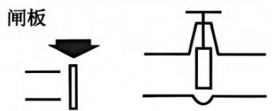</td><td>直流</td><td>动作缓慢,体积大</td></tr><tr><td rowspan="3">旋转式</td><td>旋塞(锥形)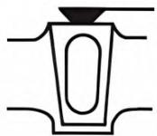</td><td>动作快速;直流</td><td>温度受聚四氟乙烯阀门衬套的限制,而且需要注意带润滑的阀门的“润滑”</td></tr><tr><td> 球 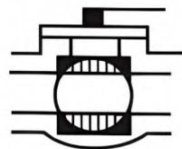</td><td>动作快速;直流;易操作</td><td>温度受阀座材料的限制</td></tr><tr><td>蝶板 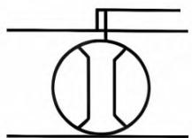</td><td>动作快速;阶段性良好;结构紧凑</td><td>金属密封型阀,切断时不能严密断流。弹性阀座的阀门,工作温度受阀座材料的限制</td></tr><tr><td>夹紧式</td><td>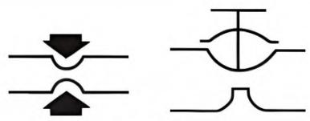</td><td>无填料;对污液断流;可靠</td><td>压力和温度受隔膜材料的限制</td></tr></table>

不同用途条件下阀门的适用性  
表 16.1-32

<table><tr><td>用途</td><td>要求</td><td>阀门及其适用性</td></tr><tr><td rowspan="3">截止与开放介质用</td><td rowspan="3">截止后密闭性能好</td><td>截止阀;流道曲折,流阻高,应用较少</td></tr><tr><td>闸阀、全通径球阀、旋塞阀等;流阻小,用于对流阻要求严格的场合</td></tr><tr><td>蝶阀、缩径球阀;用于安装位置受限,对流阻要求不严格的场合</td></tr><tr><td rowspan="4">控制流量用</td><td rowspan="4">易于调节流量</td><td>调节阀(控制阀):采用动力驱动,专用于控制流体流量的阀门</td></tr><tr><td>旋转阀、夹紧阀:可用于节流控制,但只能在有限的阀门口径范围内适用</td></tr><tr><td>闸阀:只有在接近关闭位置时才能较好地控制流量</td></tr><tr><td>V形开口的球阀和蝶阀:一般粗调时可以选用</td></tr><tr><td rowspan="2">换向分流用</td><td rowspan="2">用于换向分流</td><td>旋塞阀、球阀:较适用</td></tr><tr><td>多通道控制阀:适用</td></tr><tr><td>带有悬浮颗粒的介质用</td><td>关闭件沿密封面的滑动带有擦拭作用</td><td>刀形平板闸阀、直流式泥浆用截止阀、球阀</td></tr><tr><td rowspan="2">气体管路排除凝结水用</td><td rowspan="2">能有效排除气体管路中的凝结水</td><td>蒸汽疏水阀:用于蒸汽管路</td></tr><tr><td>空气疏水阀:用于压缩空气管路</td></tr><tr><td rowspan="2">超压保护用</td><td rowspan="2">及时排放压力容器和管路中的压力</td><td>全启式安全阀:用于气体管路</td></tr><tr><td>微启式安全阀:用于液体压力容器和液体管路</td></tr><tr><td>稳定容器和管道内压力用</td><td>利用介质本身的能量保持出口压力基本不变</td><td>各种形式的减压阀</td></tr></table>

**3. 阀门端部的连接**

阀门可用不同形式的端部和管路连接，其中最主要的连接方式有螺纹连接、法兰连接和焊接连接。

螺纹连接通常分为内螺纹连接和外螺纹连接两种。采用螺纹连接通常是为了便于安装和拆卸螺纹端部的阀门。螺纹连接的管径不会过大。

法兰连接的阀门，安装和拆卸都比较方便，相比螺纹连接显得比较笨重。其适用的公称尺寸和公称压力范围比较广。

焊接连接适用于各种压力和温度。在较高温度和较苛刻的条件下使用时，比法兰连接更为可靠。但焊接连接的阀门的拆卸和重装、更换安装是比较困难的，所以它仅适用于通常能长期可靠地运行或使用条件苛刻、温度较高的场合。

**4. 阀门的材质**

选择阀门主要零件的材质，首先应考虑到工作介质的物理性能（温度、压力）和化学性能（腐蚀性）等。同时，还应了解介质的清洁程度（有固体无颗粒物）。除此以外，还要参照国家和使用部门的有关规定和要求。

正确、合理地选择阀门的材料，可以获得阀门最经济的使用寿命和最佳的性能。阀门的材料种类繁多，适用于不同的工况。阀门的材质通常要考虑的是壳体材质、内件材质和密封面材质。

壳体常用材质有：灰铸铁、球墨铸铁、碳素钢、低温碳钢、合金钢、奥氏体不锈钢、钛合金、塑料、陶瓷、铜合金等。阀门内件常用的材质有：不锈钢、青铜、镍合金、钛合金、丁腈橡胶、氟橡胶、聚四氟乙烯、尼龙、聚乙烯、氯丁橡胶等。

5. 阀门的压力损失与流量系数

(1) 管道中由阀门所造成的压力损失可表示为:

$$
\Delta p = K \frac {v ^ {2} \rho}{2 g}\tag{16. 1- 1}
$$

式中 $\Delta p$ ——管道从阀门造成的压力损失，Pa；

v——介质流速，m/s;

$\rho$ ——介质密度，kg/m $^{3}$ ；

g——重力加速度， $m/s^{2}$ ;

K——阀门的压力损失系数。

阀门的压力损失系数随阀门的种类、类型、规格和结构的不同而不同。阀门在全湍流状况下全开启时的压力损失系数的近似平均范围见表 16.1-33。

阀门全开启时的压力损失系数 $\pmb{K}$ 的近似平均范围  
表 16.1-33

<table><tr><td rowspan="5">截止阀</td><td>全通径阀座,铸造</td><td>4.0~10.0</td><td rowspan="3">旋塞阀(矩形通道)</td><td>全流道面积</td><td>0.3~0.5</td></tr><tr><td>全通径阀座,锻造(小尺寸)</td><td>5.0~13.0</td><td>80%流道面积</td><td>0.7~1.2</td></tr><tr><td>直流 45°,全通径阀座,铸造</td><td>1.0~3.0</td><td>60%流道面积</td><td>0.7~2.0</td></tr><tr><td>角式,全通径阀座,铸造</td><td>2.0~5.0</td><td>旋塞阀(圆形通道)</td><td>全通径</td><td>0.2~0.3</td></tr><tr><td>角式,全通径阀座,锻造</td><td>1.5~3.0</td><td rowspan="2">隔膜阀</td><td>堰式</td><td>2.0~3.5</td></tr><tr><td>闸阀</td><td>全通径</td><td>0.1~0.3</td><td>直通式</td><td>0.6~0.9</td></tr><tr><td>球阀</td><td>全通径</td><td>0.1</td><td rowspan="3">止回阀</td><td>升降式</td><td>同截止阀</td></tr><tr><td>碟阀</td><td>根据蝶板厚度</td><td>0.2~1.5</td><td>旋启式</td><td>1.0</td></tr><tr><td></td><td>—</td><td>—</td><td>斜瓣式</td><td>1.0</td></tr></table>

对于部分开启的截止阀，闸阀、蝶阀和隔膜阀的压力损失系数，可由表16.1-33中的K值乘以图16.1-13～图16.1-16中的 $K_{1}$ 值而得。

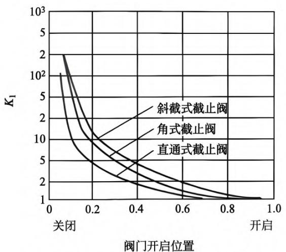  
图 16.1-13 部分开启截止阀压力  
损失系数的近似结果

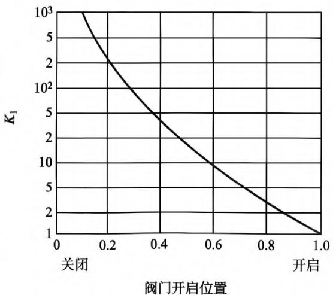  
图16.1-14 部分开启闸阀压力损失系数的近似结果

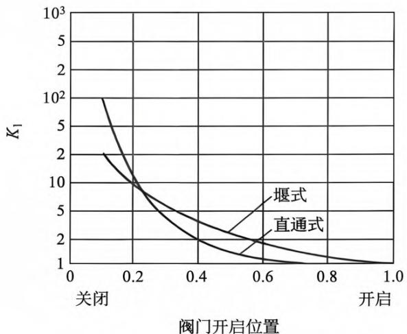  
图16.1-15 部分开启隔膜阀压力损失系数的近似结果

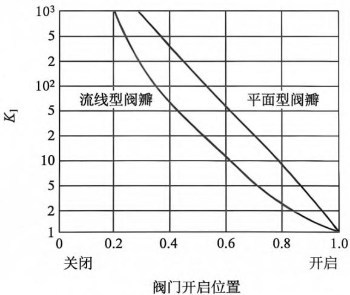  
图16.1-16 部分开启蝶阀压力损失系数的近似结果

在实际应用中，阀门的压力损失是随着开启位置而变化的。为了防止流动介质损坏阀座，控制流量的阀门在用作节流部分的开启位置不得接近阀门的关闭位置；为此，通常会选择比连接管径小的阀门。

**(2) 阀门的流量系数**

阀门的流量系数是指在规定条件下，一定的开启位置上阀门的流通能力。流量系数越大，说明流体通过阀门时的压力损失越小。发达国家生产的阀门，在样本中都把流量系数列入产品样本，供设计和使用单位选用。流量系数随阀门的尺寸、形式、结构而变化，因此对不同类型与规格的阀门，要分别进行试验才能确定其流量系数。

1）美国石油协会的标准《管道与管道阀门规范》API Spec 6D：2014以及ISO标准《石油和天然气工业（含低碳能源）管道输送系统 管道阀门》ISO 14313对流量系数 $K_{v}$ 的定义是：水在5～40℃（40～104°F）之间流经阀门产生0.1MPa（1bar；14.5psi）压力损失的体积流量。

$$
K _ {\mathrm{v}} = q _ {\mathrm{v}} \cdot \sqrt {\frac {\Delta p _ {K _ {\mathrm{v}}}}{\Delta p} \cdot \frac {\rho}{\rho_ {\mathrm{w}}}}\tag{16. 1-2}
$$

式中 $K_{\mathrm{v}}$ ——流量系数， $\mathrm{m}^3/\mathrm{h}$ ；

$\Delta p_{K_{v}}$ ——标准规定的控制阀静压损失，bar，1bar=0.1MPa；

$\Delta p$ ——阀门两端测出的静压损失，bar；

$q_{v}$ ——被测的体积流量， $m^{3}/h$ ;

$\rho$ ——流体密度，kg/m $^{3}$ ;

$\rho_{w}$ ——水的密度，kg/m $^{3}$ 。

上式适用于紊流流体，并且不出现溶化或闪蒸的情况。

2) $C_{\mathrm{v}}$ 值计算式: 流量系数用 $C_{\mathrm{v}}$ 是非国际单位制的表示方法, 即水在温度为 $4 \sim 38^{\circ} \mathrm{C}$ (40\~100°F) 时, 流经阀门产生 1psi 压力损失的体积流量 (USgal/min, 1USgal/min=3.7854dm³)。

$$
C _ {\mathrm{v}} = q _ {\mathrm{v}} \cdot \sqrt {\frac {\rho}{\rho_ {\mathrm{w}}} \cdot \frac {1}{\Delta p}}\tag{16. 1-3}
$$

式中 $C_{\mathrm{v}}$ ——流量系数， $\frac{\mathrm{USgal / min}}{(\mathrm{bf / in}^2)^{0.5}}$

$q_{v}$ ——被测体积流量，USgal/min;

$\rho$ ——流体密度， $b/ft^{3}$ ， $1b/ft^{3}=16kg/m^{3}$ ;

$\rho_{w}$ ——40～100°F（4～38°C）下水的密度，b/ft $^{3}$ ;

$\Delta p$ ——阀门的压力损失，bf/in $^{2}$ 。

上式适用于紊流流体，并且不会出现溶化或闪蒸的情况。

流量系数 $K_{\mathrm{v}}$ 与 $C_{\mathrm{v}}$ 的关系

$$
C _ {\mathrm{v}} = 1. 1 5 6 K _ {\mathrm{v}}\tag{16. 1-4}
$$

3）影响流量系数的因素：

① 阀门的尺寸、形式和结构是影响阀门流量系数的主要因素，图 16.1-17 给出了几种典型阀门的流量系数近似值与阀门直径的关系。

② 同样结构的阀门，当流体流过阀门时的方向不同时，流量系数也有变化，如图 16.1-18 所示。

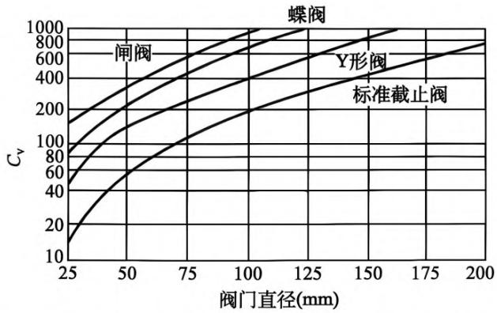  
图16.1-17 流量系数近似值与阀门直径的关系

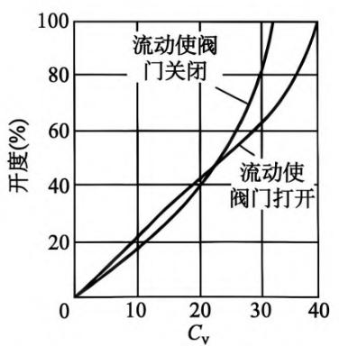  
图16.1-18 单座截止阀（节流阀）流量系数 $C_{\mathrm{v}}$ 与开度的关系

③ 流体方向不同时，之所以会引起流量系数变化，一般是由压力恢复不同而形成的。当流体流过阀门使阀瓣趋于打开时，阀瓣和阀体形成的环形扩散通道能使压力有所恢复。

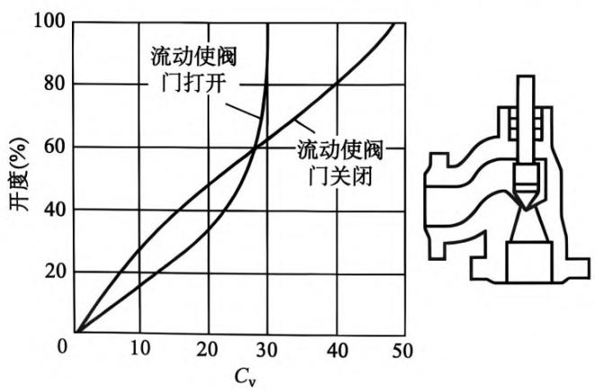  
图16.1-19 角式截止阀（节流阀） $C_{\mathrm{v}}$ 与开度的关系

当流体流过阀门使阀瓣趋于关闭时，阀座对压力恢复的影响很大。

④ 阀门内部的几何形状不同，流量系数的曲线也不同。

⑤ 对于高压角阀，当流体的流动使阀门趋于关闭时，流量系数较高（图 16.1-19）。这是由此时阀座的扩散锥体使流体的压力恢复造成的。

⑥ 阀门的内部压力恢复机理，与文丘里管的收缩与扩散造成的压力损失机理一样。当阀门内部的压降相同时，若阀门内的压力可以恢复，流量系数就较大。

⑦ 阀门内的压力恢复与阀门内腔的几何形状有关，但更取决于阀瓣、阀座的结构。

⑧ 部分阀门的流量系数 $K_{v}$ 参考值见表 16.1-34。 $K_{v}$ 越大，说明相同尺寸的阀门在同样流量下，阻力越小。

部分阀门流量系数 $K_{v}$ 参考值  
表 16.1-34

<table><tr><td rowspan="2">阀门类型</td><td rowspan="2">公称压力</td><td colspan="12">公称尺寸</td></tr><tr><td>DN20</td><td>DN25</td><td>DN32</td><td>DN40</td><td>DN50</td><td>DN65</td><td>DN80</td><td>DN100</td><td>DN150</td><td>DN200</td><td>DN250</td><td>DN300</td></tr><tr><td>闸阀</td><td rowspan="8">PN16、PN25、PN40、PN63</td><td></td><td></td><td></td><td>25</td><td>41</td><td>65</td><td>93</td><td>163</td><td>370</td><td>660</td><td>1020</td><td>1500</td></tr><tr><td>截止阀</td><td>6.1</td><td>9.5</td><td>15.6</td><td>24.4</td><td>38.1</td><td>65</td><td>98</td><td>153</td><td>343</td><td>610</td><td></td><td></td></tr><tr><td>旋启式止回阀</td><td></td><td>10.6</td><td>17.4</td><td>24.5</td><td>41</td><td>65</td><td>93</td><td>169</td><td>381</td><td>685</td><td>1077</td><td>1557</td></tr><tr><td>升降式止回阀</td><td>6</td><td>10</td><td>15</td><td>23</td><td>35</td><td>60</td><td>90</td><td>162</td><td>367</td><td>384</td><td>1080</td><td></td></tr><tr><td>双瓣对夹式止回阀</td><td></td><td></td><td></td><td></td><td>36.6</td><td>58.7</td><td>83.6</td><td>153</td><td>343</td><td>616</td><td>969</td><td>1401</td></tr><tr><td>柱塞阀</td><td></td><td></td><td></td><td></td><td>37</td><td>62.6</td><td>94.8</td><td>148</td><td>333</td><td>593</td><td>926</td><td>1334</td></tr><tr><td>球阀(全径)</td><td></td><td></td><td></td><td></td><td>40.7</td><td></td><td>93</td><td>169</td><td>381</td><td>685</td><td>1077</td><td>1557</td></tr><tr><td>球阀 $^{\text{1}}$ (缩径)</td><td></td><td></td><td></td><td></td><td>38.7</td><td></td><td>88.2</td><td>161</td><td>362</td><td>650</td><td>1023</td><td>1479</td></tr><tr><td>非金属密封双偏心蝶阀</td><td>PN10、PN16、PN25</td><td></td><td></td><td></td><td></td><td></td><td></td><td>67</td><td>108</td><td>253</td><td>440</td><td>646</td><td>957</td></tr><tr><td>多层次密封双偏心蝶阀</td><td>PN6、PN10、PN16、PN25</td><td></td><td></td><td></td><td></td><td></td><td></td><td></td><td></td><td>246</td><td>428</td><td>628</td><td>930</td></tr></table>

① 缩径球阀的 $K_{v}$ 值以两个公称尺寸中较小口径标注。

**16.1.5.2 常用驱动阀门的选择**

驱动阀门是借助手动、电力、气力、液力来开启和关闭阀门。驱动阀门在介质输送系统中起三个作用，即切断和接通介质、控制流量和换向分流。常用驱动阀门的特性和适用场合见表 16.1-35。

常用驱动阀门的特性和适用场合  
表 16.1-35

<table><tr><td>阀门类型</td><td>特性</td><td>适用场合</td></tr><tr><td>闸阀</td><td>流体阻力小;启闭所需力矩较小;介质可双向流动;全开时密封面冲蚀小;外形尺寸和开启高度较大;经常启闭密封面磨损较大;启闭时间长;阀门关闭位置达50%以上时,对流量的控制才比较灵敏</td><td>主要作为切断介质,即全开或全闭;一般不作为调节流量使用;可用于低温低压,也可用于高温高压;可根据阀门的不同材质,用于各种不同的介质;一般不用于输送泥浆等介质</td></tr><tr><td>蝶阀</td><td>结构简单,体积小,质量轻,耗材省;安装尺寸小,驱动力矩小;全开式,流阻较小;操作简便迅速;具有良好的流量调节功能和关闭密封特性;阀板运动时带有擦拭性</td><td>大中型口径,中低压力使用;用于压力损失要求不严的管路系统中;需要进行流量调节的大口径管路中;启闭要求快的场合;可用于带悬浮固体颗粒的介质;不宜用于高温高压管路系统</td></tr><tr><td>球阀</td><td>结构简单紧凑,质量轻,耗材少;驱动力矩小(聚四氟乙烯密封材料);操作简便,不会卡住,易实现快速启闭;全开时,流阻极低;密封性好,在较大的压力和温度范围内,能实现完全封闭;工作压力与工作温度受阀座密封圈材料限制;关闭件能承受关闭式的高压差;全开和全闭时,高速介质不会引起密封面的侵蚀;全焊接阀体的内件不受外界侵蚀;球阀启闭时带有擦拭性</td><td>广泛适用于石油、天然气输送管线中;可用于清水介质,也可用于带悬浮固体颗粒的介质;全焊结构球阀可直埋地下;用于酸碱腐蚀介质时,宜选用聚四氟乙烯阀座密封圈的全不锈钢球阀;需流量调节时,可选用蜗杆传动,气动或电动的带V形开口的调节球阀</td></tr><tr><td>截止阀</td><td>阀座通口的变化与阀瓣的行程成正比例;密封面磨损很小;只有一个密封面,易制造与维修;密封面间易卡住固体颗粒;流阻大</td><td>适用于对流量的调节;适用于需要频繁启闭的场合;适用于流阻要求不严的管路;适用于公称尺寸不大的管路</td></tr><tr><td>旋塞阀</td><td>通过阀塞90°旋转实现阀门的开启与关闭;阀塞启闭时带有擦拭性;可实现多通道结构,简化管道系统</td><td>适用于切断或接通介质;适用于介质分流使用;可用于清水介质,也可用于带悬浮固体颗粒的介质;用于多通阀</td></tr><tr><td>隔膜阀</td><td>隔膜采用软质材料,将操作机构与介质通路隔开,阀杆处不需要任何形式的单独密封;工作温度受隔膜和阀体衬里材料的限制;管径受阀体衬里工艺和隔膜制造工艺的限制;具有良好的防腐性能</td><td>适用于低压与温度不高的场合,一般不超过180°C;管径一般不大于DN200;适用于食品和医药卫生工业生产;适用于具有腐蚀性等危险介质的装置和管路上</td></tr></table>

**16.1.5.3 常用自动阀门的选择**

自动阀门是依靠介质（液体、气体、蒸汽）本身的能力而自行启闭的阀门，如安全阀、蒸汽疏水阀、减压阀、止回阀、调节阀、水力控制阀、紧急切断阀等。它具有调节、控制管路中介质的流量和压力，防止介质倒流，分离介质等功能，可根据不同功能与作用原理进行选择。

**1. 安全阀**

安全阀用在受压设备、容器或管路上，作为超压保护装置。当这些设备、容器和管路内的压力升高超过允许值时，阀门自动开启，继而全量排放；当压力降低到规定值时，阀门应自动关闭，从而保护设备、容器和管路的安全运行。

安全阀的种类很多，通常有以下分类方法：按结构形式分类、按密封副材料分类、按作用原理分类、按动作特性分类、按开启高度分类、按有无背压平衡机构分类、按阀瓣加载方式分类、按公称压力分类、按介质工作温度分类、按与管道的连接方式分类。

安全阀的选择需要注意以下要点：

(1) 公称压力 在同一公称压力下, 当工作温度升高时, 其最大工作压力会相应降低。在选用安全阀时, 应根据阀门材料、工作温度和最大工作压力, 确定阀门的公称压力。

(2) 工作压力级的确定 安全阀的开启压力（整定压力）与所配置弹簧有关，每一种弹簧的开启压力调整范围有限，所以应根据所需要开启压力值，确定阀门的工作压力级。

（3）通径选用须根据必需的排放量来确定。所选用安全阀的额定排放量大于并尽可能接近必需排放量。

（4）额定排放压力 蒸汽用安全阀的排放压力应小于或等于开启压力的 1.03 倍；空气和其他气体用安全阀的排放压力应小于或等于开启压力的 1.10 倍，水和其他液体用安全阀的排放压力应小于或等于开启压力的 1.20 倍。

（5）额定排量 额定排量与阀门的口径、开启高度、排放压力和介质都有关，应根据产品技术参数确定。

(6) 安全阀材质 安全阀的材质包括壳体材料和内件材料, 内件材料包括阀杆、阀瓣、阀座面、密封材料等。确定安全阀材质应考虑工作温度、工作原理、介质性质和经济性等多种因素。

**2. 蒸汽疏水阀**

蒸汽疏水阀是自动排除蒸汽设备中的凝结水的装置，也叫阻汽排水阀。蒸汽疏水阀排放凝结水最基本的原理就是利用蒸汽和水的密度差和温度差来实现疏水的目的。其最重要的功能是：迅速排除凝结水、防止蒸汽泄漏和排除空气及其他不凝气体。

蒸汽疏水阀的种类很多，按启闭件的驱动方式分为三类：由凝结水液位变化驱动的机械型蒸汽疏水阀、由凝结水温度变化驱动的热静力型蒸汽疏水阀、由凝结水动态特性驱动的热动力型蒸汽疏水阀。

蒸汽疏水阀的选择要注意其特性和技术参数。

(1) 各类蒸汽疏水阀的主要特性见表 16.1-36, 选用时注意其适用性。

各类蒸汽疏水阀的主要特性  
表 16.1-36

<table><tr><td rowspan="3" colspan="2">特性</td><td colspan="9">分类</td></tr><tr><td colspan="4">机械性</td><td colspan="3">热静力型</td><td colspan="2">热动力型</td></tr><tr><td>浮球</td><td colspan="2">浮桶</td><td>倒吊桶</td><td>膜盒</td><td>双金属片</td><td>波纹管</td><td>圆盘</td><td>脉冲</td></tr><tr><td colspan="2">排放特性</td><td>连续排出</td><td colspan="3">间隙排出</td><td colspan="3">间隙排出</td><td>间隙排出</td><td>接近间隙排出</td></tr><tr><td rowspan="2">启闭速度</td><td>开启</td><td rowspan="2" colspan="2">快</td><td rowspan="2" colspan="2">较快</td><td rowspan="2" colspan="3">慢</td><td colspan="2">较快</td></tr><tr><td>关闭</td><td colspan="2">快</td></tr><tr><td colspan="2">排水温度</td><td colspan="4">接近饱和温度</td><td colspan="3">低于饱和温度,过冷度一般为10~30°C</td><td colspan="2">稍低于饱和温度,过冷度一般为6~8°C</td></tr></table>

续表

<table><tr><td rowspan="3">特性</td><td colspan="9">分类</td></tr><tr><td colspan="3">机械性</td><td colspan="3">热静力型</td><td colspan="3">热动力型</td></tr><tr><td>浮球</td><td>浮桶</td><td>倒吊桶</td><td>膜盒</td><td>双金属片</td><td>波纹管</td><td>圆盘</td><td colspan="2">脉冲</td></tr><tr><td>最高允许背压</td><td colspan="3">高,不低于进口压力的80%</td><td colspan="3">较高,不低于进口压力的30%</td><td>中,不低于进口压力的50%</td><td colspan="2">低,不低于进口压力的25%</td></tr><tr><td>排空气能力</td><td colspan="2">要设置排空气装置</td><td>有自动排空气能力</td><td colspan="3">有自动排空气能力</td><td>高压时,要设置排空气装置</td><td colspan="2">有自动排空气能力</td></tr><tr><td>蒸汽损失情况</td><td colspan="2">易损失蒸汽</td><td>不易损失蒸汽</td><td colspan="3">不易损失蒸汽</td><td colspan="3">易损失蒸汽</td></tr><tr><td>凝结水排量</td><td colspan="3">大</td><td colspan="3">中</td><td colspan="3">小</td></tr><tr><td>耐水锤性能</td><td colspan="2">不耐水锤</td><td>耐水锤</td><td>不耐水锤</td><td>耐水锤</td><td>不耐水锤</td><td colspan="3">耐水锤</td></tr><tr><td>冻结性能</td><td colspan="3">易冻结,要有防冻措施</td><td>不易冻结</td><td>安装在垂直立管上要有防冻措施</td><td>不易冻结</td><td>安装在垂直立管上要有防冻措施</td><td colspan="2">不易冻结</td></tr><tr><td>安装角度</td><td colspan="3">只限水平安装</td><td>只限水平安装</td><td>水平、垂直安装均可</td><td>只限水平安装</td><td>水平、垂直安装均可</td><td colspan="2">只限水平安装</td></tr><tr><td>耐用性</td><td>不耐用</td><td colspan="2">耐用</td><td>不耐用</td><td>耐用</td><td>不耐用</td><td colspan="3">不耐用</td></tr><tr><td>凝结水显热的利用</td><td colspan="3">不能利用</td><td colspan="3">可利用</td><td colspan="3">不能利用</td></tr><tr><td>体积</td><td colspan="3">大</td><td colspan="3">小</td><td colspan="3">小</td></tr></table>

（2）凝结水排水量：蒸汽疏水阀的排水量等于蒸汽使用设备的凝结水产生量乘以选用倍数。部分使用场合的选用倍数推荐值见表16.1-37。

部分使用场合的选用倍数推荐值  
表 16.1-37

<table><tr><td>使用场合</td><td colspan="2">使用要求</td><td>选用倍数</td></tr><tr><td>分气缸下部</td><td colspan="2">在各种压力下能迅速排出凝结水</td><td>3</td></tr><tr><td>蒸汽主管</td><td colspan="2">每100m管路或控制阀前、管路转弯、主管末端等处应设疏水点</td><td>3</td></tr><tr><td>支管</td><td colspan="2">支管长度大于或等于5m处的各种控制阀前应设疏水点</td><td>3</td></tr><tr><td>气水分离器</td><td colspan="2">在汽水分离器的下部疏水</td><td>3</td></tr><tr><td>伴热管</td><td colspan="2">一般伴热管为DN15,在小于或等于50m处设疏水点</td><td>2</td></tr><tr><td rowspan="4">暖风机</td><td colspan="2">压力不变时</td><td>3</td></tr><tr><td rowspan="3">压力可调时</td><td>&lt;0.1MPa</td><td>2</td></tr><tr><td>0.1~0.2MPa</td><td>2</td></tr><tr><td>0.2~0.6MPa</td><td>3</td></tr><tr><td rowspan="2">单路盘管加热液体</td><td colspan="2">快速加热</td><td>3</td></tr><tr><td colspan="2">不需快速加热</td><td>2</td></tr><tr><td>多路并联盘管加热液体</td><td colspan="2"></td><td>2</td></tr><tr><td rowspan="2">烘干室(箱)</td><td colspan="2">压力不变时</td><td>2</td></tr><tr><td colspan="2">压力可调时</td><td>3</td></tr><tr><td rowspan="2">溴化锂制冷设备蒸发器</td><td colspan="2">单效,压力≤0.1MPa</td><td>2</td></tr><tr><td colspan="2">双效,压力≤1.0MPa</td><td>3</td></tr><tr><td rowspan="4">浸在液体中的加热盘管</td><td colspan="2">压力不变时</td><td>2</td></tr><tr><td rowspan="2">压力可调时</td><td>0.1~0.2MPa</td><td>2</td></tr><tr><td>&gt;0.2MPa</td><td>3</td></tr><tr><td colspan="2">虹吸排水</td><td>5</td></tr><tr><td rowspan="4">列管式加热器</td><td colspan="2">压力不变时</td><td>2</td></tr><tr><td rowspan="3">压力可调时</td><td>&lt;0.1MPa</td><td>2</td></tr><tr><td>0.1~0.2MPa</td><td>2</td></tr><tr><td>&gt;0.2MPa</td><td>3</td></tr><tr><td>夹套锅</td><td colspan="2">在夹套锅上方设排空气阀</td><td>3</td></tr><tr><td>消毒柜</td><td colspan="2">柜上方设排空气阀</td><td>3</td></tr><tr><td rowspan="3">回转干燥圆桶</td><td rowspan="3">表面线速度</td><td>&lt;30m/s</td><td>5</td></tr><tr><td>30~80m/s</td><td>8</td></tr><tr><td>80~100m/s</td><td>10</td></tr><tr><td>二次蒸汽罐</td><td colspan="2">罐体直径应保证二次蒸汽速度≤5m/s,且罐体上部要设排空气阀</td><td>3</td></tr></table>

（3）疏水阀的技术参数：包括公称压力、公称尺寸、最高允许压力、最高允许温度、最高工作压力、最低工作压力、最高背压率、凝结水排量等。

在凝结水回收系统中，若利用工作背压回收凝结水，应选用背压率较高的疏水阀，如机械型疏水阀。如果用汽设备不允许积存凝结水，应当选用能连续排出饱和凝结水的疏水阀，如浮球式疏水阀。用汽设备工作压力经常波动时，应当选用不需要调整工作压力的疏水阀。

（4）各种蒸汽供热设备推荐蒸汽疏水阀类型如表16.1-38所示。

各种蒸汽供热设备推荐蒸汽疏水阀类型  
表 16.1-38

<table><tr><td colspan="2">蒸汽供热设备</td><td>推荐蒸汽疏水阀类型</td></tr><tr><td colspan="2">蒸汽主管、伴热管、蒸汽夹套</td><td>圆盘形、浮球式</td></tr><tr><td colspan="2">气水分离器、暖风机、热风机组</td><td>浮球式</td></tr><tr><td rowspan="2">换热器</td><td>蒸汽进口装有温度调节阀</td><td>浮球式</td></tr><tr><td>蒸汽进口不装温度调节阀</td><td>双金属片式、浮球式</td></tr><tr><td colspan="2">供暖用散热器</td><td>波纹管式、双金属片式、膜盒式</td></tr><tr><td colspan="2">夹套锅</td><td>双金属片式</td></tr><tr><td rowspan="2">浸在液体中的加热盘管</td><td>蒸汽进口装有温度调节阀</td><td>浮球式</td></tr><tr><td>蒸汽进口不装温度调节阀</td><td>双金属片式、膜盒式</td></tr><tr><td colspan="2">滚筒烘干机</td><td>浮球式(带防汽锁装置)、双金属片式</td></tr><tr><td colspan="2">烫平机</td><td>圆盘形、双金属片式、膜盒式</td></tr><tr><td colspan="2">干洗机、烘干室(箱)</td><td>浮球式</td></tr><tr><td colspan="2">消毒器</td><td>波纹管式、双金属片式</td></tr><tr><td colspan="2">硫化机</td><td>浮球式、敞口向下浮子式</td></tr><tr><td colspan="2">层压机</td><td>圆盘形、双金属片式</td></tr><tr><td colspan="2">低于大气压力的蒸汽供热设备</td><td>泵式疏水阀</td></tr></table>

**3. 减压阀**

减压阀是一个局部阻力可以变化的节流元件。它通过改变节流面积，使流速与流体的动能改变，造成不同的压力损失，从而达到减压的目的。依靠控制与调节系统的调节，使阀后压力的波动与弹簧力相平衡，使阀后压力在一定的误差范围内保持恒定。

（1）各类减压阀的性能特点：减压阀按动作原理分为直接作用式减压阀和先导式减压阀。直接作用式减压阀利用出口压力的变化直接控制阀瓣的运动。先导式减压阀由导阀和主阀组成，出口压力的变化通过导阀放大来控制主阀阀瓣的运动。各类减压阀的性能特点见表 16.1-39。

各类减压阀的性能特点  
表 16.1-39

<table><tr><td colspan="3">性能</td><td>精度</td><td>流通能力</td><td>密封性能</td><td>灵敏度</td><td>成本</td></tr><tr><td rowspan="5">类型</td><td rowspan="2">直接作用式</td><td>波纹管</td><td>低</td><td>中</td><td>中</td><td>中</td><td>中</td></tr><tr><td>薄膜</td><td>中</td><td>小</td><td>好 $^{\text{1}}$ </td><td>高</td><td>—</td></tr><tr><td rowspan="3">先导式</td><td>活塞</td><td>高</td><td>大</td><td>中</td><td>低</td><td>高</td></tr><tr><td>波纹管</td><td>高</td><td>大</td><td>中</td><td>中</td><td>高</td></tr><tr><td>薄膜</td><td>高</td><td>中</td><td>中</td><td>高</td><td>较高</td></tr></table>

① 采用非金属材料，如聚四氟乙烯、橡胶等。

(2) 减压阀的选用原则:

1）减压阀进口压力的波动应控制在进口压力给定值的 $80\% \sim 105\%$ ，如果超过该范围，减压阀的性能会受影响。

2）通常减压阀的阀后压力应小于 $50\%$ 的阀前压力。

3）减压阀的每一挡弹簧，只在一定的出口压力范围内适用，超过适用范围应更换弹簧。

4）在介质工作温度比较高的场合，一般选用先导活塞式减压阀或先导波纹管式减压阀。

5）介质为空气和水（液体）的场合，一般宜选用直接作用薄膜式减压阀或先导薄膜式减压阀。

6）介质为蒸汽的场合，宜选用先导活塞式减压阀或先导波纹管式减压阀。

7）为方便操作、调整和维修，减压阀一般在水平管道上安装。

**4. 止回阀**

止回阀又称为逆止阀、背压阀和单向阀，其主要作用是防止介质倒流，防止泵及其驱动电机反转，以及容器内介质的泄放。

根据设计原理和密封原理，止回阀一般分为升降式、旋启式、蝶式、隔膜式、球形等类型。不同类型止回阀的特性与适用场合见表 16.1-40。

不同类型止回阀的特性与适用场合  
表 16.1-40

<table><tr><td>类型</td><td>特性</td><td>适用场合</td></tr><tr><td>升降式</td><td>依靠阀瓣自重关闭,或依靠压缩弹簧弹力关闭;依靠介质逆流压力形成封闭压力;流体阻力较大,动作可靠</td><td>用于口径较小的场合;公称直径50mm及以下的水平管道上都用立式升降止回阀;直通式升降止回阀水平管及垂直管上都用</td></tr><tr><td>旋启式</td><td>依靠介质逆流和阀瓣的自重封闭;流体阻力较小</td><td>一般水平安装,也有垂直或倾斜安装;工作压力大,适用口径大,工作温度范围宽;单瓣式止回阀用于中等口径场合;双瓣式止回阀用于大中等口径场合;多瓣式止回阀用于低压、大口径场合</td></tr><tr><td>隔膜式</td><td>开启时依靠介质压力冲开隔膜,关闭时隔膜依靠自身弹力恢复,并抱紧阀芯密封;隔膜用橡胶或工程塑料制成,工作温度和压力受限;结构简单,防水击性能好,制造成本低</td><td>工作介质温度一般为-29~120°C;公称压力不超过1.6MPa;口径可以较大</td></tr><tr><td>球形</td><td>利用介质流动推力,使球体离开或回复到阀座密封面,实现开启和闭合;可实现单球或多球密封;密封可靠;采用橡胶或工程塑料包裹球体,工作温度受限</td><td>工作介质温度一般为-101~150°C;公称压力≤PN40;多球密封时,公称直径可以较大</td></tr></table>

止回阀的选择原则：

(1) 不可压缩性流体用止回阀: 主要根据其关闭时不会因为突然关闭引起倒流, 因而产生不可接受的高冲击力的性能来选择; 而将此类止回阀的阻力作为次要因素考虑。

(2) 压缩性流体用止回阀: 应使阀瓣的撞击减少到最低程度, 其选择方法通常与不可压缩流体用止回阀类似。如果介质流速波动范围很大, 可使用减速装置, 防止产生快速连续的锤击。对于介质连续不断的快速停止和启动的场合, 如压缩机出口, 可使用一个带弹簧轻量阀瓣的升降式止回阀。

（3）止回阀尺寸：为保证在正常流量情况下止回阀的关闭件能稳定地保持开启状态，必须根据产品技术数据确定止回阀尺寸。

(4) 止回阀类型选择: 见表 16.1-41。

止回阀类型选择  
表 16.1-41

<table><tr><td>止回阀尺寸与承压</td><td>宜选用止回阀类型</td></tr><tr><td>口径≤DN50,高中压</td><td>立式升降式止回阀、直通式升降式止回阀</td></tr><tr><td>口径≤DN50,低压</td><td>蝶式止回阀、立式升降式止回阀、隔膜式止回阀</td></tr><tr><td>DN50≤口径≤DN600,高中压</td><td>旋启式止回阀</td></tr><tr><td>DN200≤口径≤DN1200,中低压</td><td>无磨损球形止回阀</td></tr><tr><td>DN50≤口径≤DN2000,低压</td><td>蝶式止回阀、隔膜式止回阀</td></tr><tr><td>关闭时水冲击小或无冲击的管路</td><td>缓闭旋启式止回阀、缓闭蝶式止回阀</td></tr></table>

**5. 调节（控制）阀**

调节阀又称为控制阀，它是过程系统中用动力操作去改变流体流量的装置。调节阀是控制回路的重要组件，它由两个主要的组合件构成：阀体组合件和执行机构组合件（或执行机构系统）。阀体组合件是调节阀的调节部分，其直接与介质接触，通过执行机构推杆的位移改变调节阀的节流面积，达到调节目的。

按调节阀执行机构驱动能源方式的不同，调节阀主要分为气动调节阀、电动调节阀、液动调节阀三大类。

控制系统的基本框图如图 16.1-20 所示，这是一个控制房间温度的控制回路，传感器感受所测温度，传递给控制器，控制器根据设定值比较实测值，给控制阀执行器一个信号，该信号使执行器动作到相应位置，改变控制阀的开度，从而改变流经末端设备的流量，末端设备输出到房间的热量变化，房间温度达到一个新的状态，传感器获得一个新的温度值。

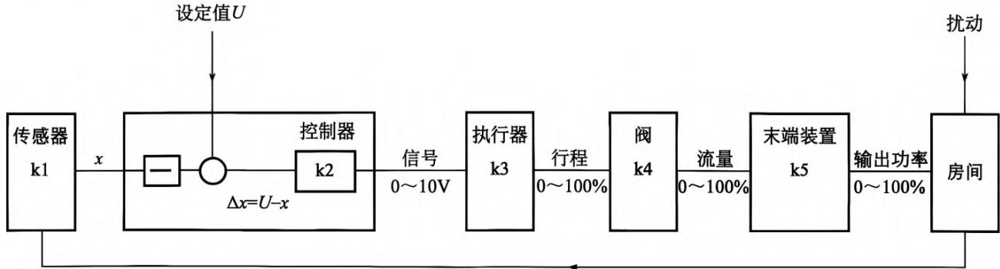  
图16.1-20 控制系统的基本框图

**(1) 调节阀的结构与分类**

调节阀的种类繁多，可以有多种分类方式，这里介绍几个常用分类方式。

1）按行程特点分类：直行程和角行程，见图 16.1-21。直行程包括单座阀、双座阀、套筒阀、笼式阀、角形阀、三通阀、隔膜阀；角行程包括蝶阀、球阀、偏心旋转阀等。

2）根据流通通路分类：常分为两通控制阀和三通控制阀。随着负载切换技术的发展，也出现了适应这种技术而产生的六通控制阀。见图16.1-22。三通控制阀可以分为分流型和合流型，也有同时可以分流/合流使用的类型。

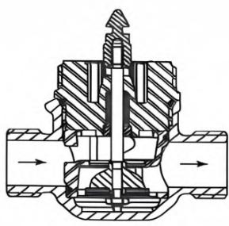  
(a)

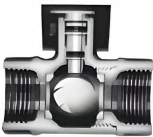  
(b)

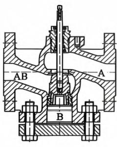  
(a)

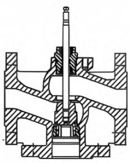  
(b)  
图16.1-21 不同阀芯结构的控制阀

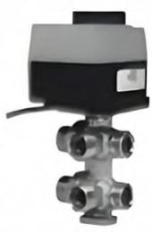  
(c)  
(a) 使用直行程阀芯的控制阀；  
图16.1-22 不同流通通路的控制阀（a）两通控制阀；（b）三通控制阀；（c）六通控制阀  
(b) 使用角行程的球阀芯控制阀

3）按调节形式分类：调节型、切断型、调节切断型。

**(2) 调节阀的流通能力与流量特性**

调节阀在控制回路中产生了一个压降以限制流量，使之达到需要值。流量取决于加在阀门上的压差，根据式（16.1-2），可以得到下式：

$$
q = K _ {\mathrm{v}} \cdot \sqrt {\frac {\Delta p}{\rho} \cdot 1 0 0 0}\tag{16. 1- 5}
$$

式中 $K_{v}$ ——阀门流量系数， $m^{3}/h$ ;

$\rho$ ——液体密度，kg/m $^{3}$ ；

$q$ ——液体流量， $\mathrm{m}^3/\mathrm{h}$ ；

$\Delta p$ ——阀门两端的压差，bar。

阀门全开时， $K_{v}$ 达到最大值，即在压差为 0.1MPa 时相应得到的水流量，用 $m^{3}/h$ 表示，这个 $K_{v}$ 值也称为 $K_{vs}$ 值。

调节阀流量特性是流体流过调节阀的相对流量与相对行程（开度）之间的关系。这两个量均用最大值的百分数表示：

$$
\frac {Q}{Q _ {\mathrm{max}}} = f (l / l _ {\mathrm{max}}) \quad \%\tag{16. 1- 6}
$$

式中 $Q$ ——调节阀在某一开度时的流量；

$Q_{max}$ ——调节阀在全开状态时的流量；

l ——调节阀在某一开度时的行程；

$l_{max}$ ——调节阀在全开状态时的行程。

调节阀的流量特性分为固有流量特性和工作流量特性。固有流量特性是在阀两端为恒定压差时得到的流量特性，也称为理想流量特性。工作流量特性是在工作状况下（压降有变化）调节阀的流量特性。调节阀的流量特性是由阀芯形状决定的，典型固有流量特性有直线流量特性、快开流量特性、等百分比（或对数）流量特性和抛物线流量特性，见图 16.1-23；它们所对应的阀芯形状如图 5.1-24 所示。

直线流量特性阀门的水流量与阀门的行程成正比。单位行程的变化所引起的流量变化是不变的。流量大时，流量相对值变化小，流量小时，则流量相对值变化大。

等百分比流量特性也称为对数流量特性，特性定义为：相对行程的等值增量产生相对

1—直线流量特性（柱塞）；2—对数流量特性（柱塞）；3—快开流量特性（柱塞）；4—抛物线流量特性（柱塞）；5—对数流量特性（开口形）；6—直线流量特性（开口形）

流量系数的等百分比增加的流量特性。即阀门在行程的每一点上单位行程变化所引起的流量的变化与此点的流量成正比，流量变化的百分比是相等的。所以它的优点是流量小时，流量变化小，流量大时，则流量变化大，也就是在不同开度上，具有相同的调节精度。

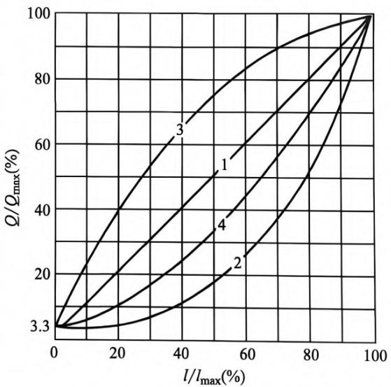  
图16.1-23 固有流量特性  
1—直线流量特性；2—对数流量特性；

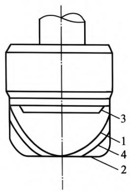  
图 16.1-24 阀芯形状  
3—快开流量特性；4—抛物线流量特性

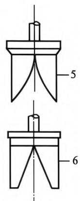

快开流量特性阀门随着开度的增大，相对流量增大很快。此类流量特性很少使用在控制阀中。

抛物线流量特性曲线是一条抛物线，介于直线流量特性曲线和等百分比流量特性曲线之间。

图 16.1-25 是三通阀在直通侧/旁通侧分别为不同流量特性时的流量/热力输出对应行程的特性。

**(3) 调节阀的阀权度与可调比**

这里讨论在暖通空调专业中的应用情况，通常采用的是直通调节阀与管道和设备串联环路。

**1) 阀权度 (β)**

① 阀权度（ $\beta$ ）的定义：调节阀全开时，阀门的压力损失与该调节支路（包括阀门本身）总压力损失的比值。该阀权度也称为设计阀权度或阀门能力，其表达式为：

$$
\beta = \frac {\Delta p _ {1 \mathrm{min}}}{\Delta H}\tag{16. 1-7}
$$

式中 $\Delta p_{1\min}$ ——调节阀全开时，调节阀上的压降，kPa；

$\Delta H$ ——调节阀所在回路的资用压力；两通阀串联环路中，为阀门上的压降加上管道和设备上的压降，kPa。

从理论上说，阀权度越大越好，表明阀门能够对流量进行有效调节，从而对能量输出进行有效控制。但通常情况下，控制阀所在回路的压差并不恒定，实际流量特性与理论流量特性也不一致。在没有其他设施保证其阀权度时，要实现具有较大的阀权度意味着调节

总流量: ---- 直通侧流量: ——  
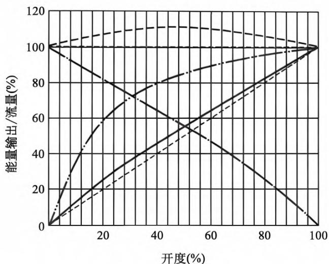  
(a)

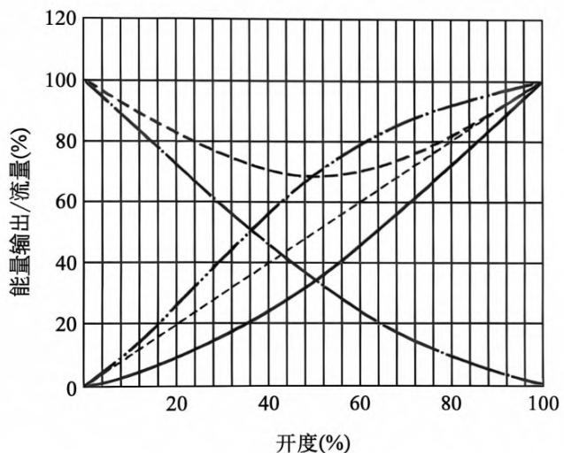  
(b)

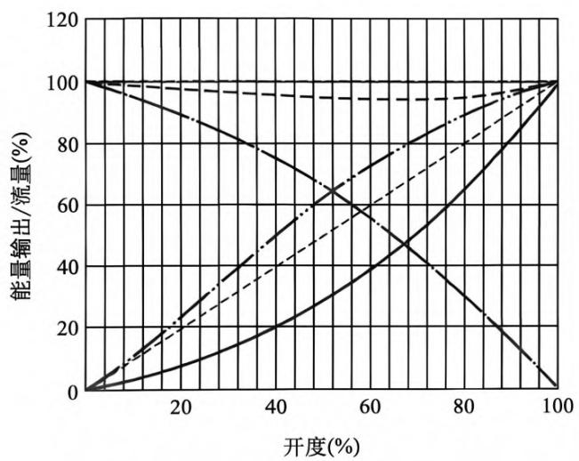  
(c)

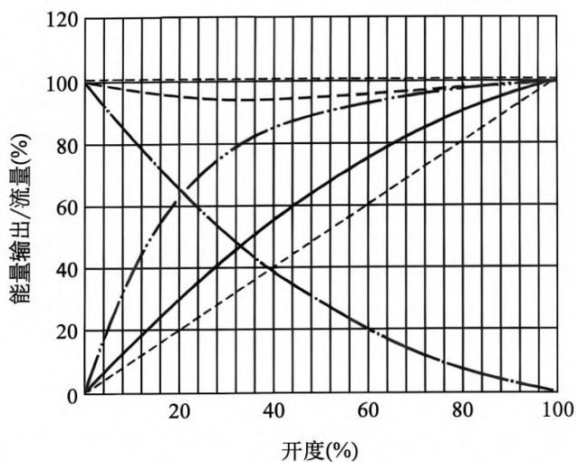  
(d)  
旁通侧流量：——…—— 热力输出：——

图 16.1-25 三通阀流量特性与热力输出特性

(a) 等百分比/线性；(b) 线性/等百分比；(c) 线性/线性；(d) 等百分比/等百分比

阀上的压降要大，这又要消耗较多的水泵扬程，运行不经济。综合考虑，阀权度一般取值为 0.5 左右（没有动态压差平衡阀时）；空调系统中可接受的最小阀权度一般为 0.3，最小值必须大于 0.25。

当调节阀为三通阀时，可把三通阀看作两个反向动作的两通阀（图 16.1-26），因此三通阀的阀权度 $\beta$ 为：

$$
\beta = \frac {\Delta p _ {\mathrm{v}}}{\Delta p _ {\mathrm{v}} + \Delta p _ {\mathrm{c}}}\tag{16. 1-8}
$$

式中 $\Delta p_{v}$ ——三通阀中直通阀的压力降，kPa；

$\Delta p_{c}$ ——三通阀回路中，被控设备的压力降，kPa。

若 $\Delta p_{\mathrm{v}} = \Delta p_{\mathrm{c}}$ ，则阀权度等于0.5。这意味着通过三通阀的压降至少等于末端压降。

调节阀接近关闭时，它就不能精确地遵循其理论流量特性。阀门在一定的开度以下，流量不再受到控制，并迅速降为零。于是，控制回路按开关模式运行。

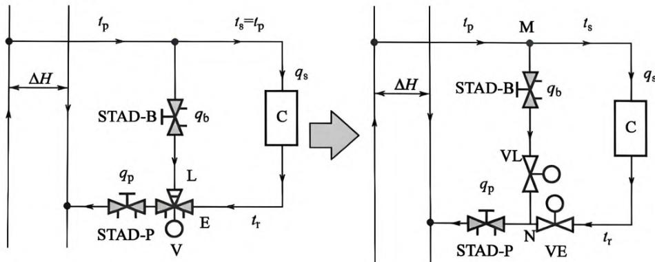  
图16.1-26 三通阀等效图

② 实际阀权度: 由于市场上往往买不到与计算 $K_{\mathrm{v}}$ 值完全一致的调节阀, 实际选取调阀的过程中, 由于受阀门口径规格所限, 选出的阀门往往在全开时的流量会大于设计流量, 这时存在一个全开时的过流量系数 $S_{\mathrm{q}}$ :

$$
S _ {\mathrm{q}} = \frac {q _ {\max}}{q _ {\mathrm{d}}}\tag{16.1-9}
$$

式中 $q_{max}$ ——阀门全开时的最大流量， $m^{3}/h$ ;

$q_{d}$ ——设计流量， $m^{3}/h$ 。

这时，调节阀的实际阀权度应进行如下修正：

$$
\beta^ {\prime} = \frac {\beta}{(S _ {\mathrm{q}}) ^ {2}}\tag{16. 1-10}
$$

式中 $\beta'$ ——调节阀的实际阀权度；

$S_{q}$ ——阀门全开时的过流量系数。

2）调节阀的可调比（ $RF$ ）：是指阀门全开时的最大流量（ $q_{\mathrm{max}}$ ）与最小流量（ $q_{\mathrm{min}}$ ）之比，分为固有可调比和实际可调比。

① 调节阀的固有可调比是指阀门全开时的最大流量（ $q_{\mathrm{max}}$ ）与相同压差下可控制的最小流量（ $q_{\mathrm{min}}$ ）之比：

$$
R F = \frac {q _ {\max}}{q _ {\min}}\tag{16. 1-11}
$$

固有可调比取决于阀门构造特性和制造精度。

如果一个阀门的可调比为 25，这意味着最小可控流量是最大流量的 4%，对应通常的流量—热力输出曲线，它的最小可控容量约为 10%。

② 实际情况下调节阀的调节范围与理想情况有很大差别，随着调节流量的变化，调节阀上的压力也在变化，这时调节阀有一个实际可调比（ $RF_{\mathrm{a}}$ ）：

$$
R F _ {\mathrm{a}} \approx R F \sqrt {\frac {\Delta p _ {1 \max}}{\Delta p _ {1 \min}}}\tag{16. 1-12}
$$

式中 $\Delta p_{1max}$ ——调节阀全开时，阀两端的压差，Pa；

$\Delta p_{1\min}$ ——调节阀全闭时，阀两端的压差，Pa。

实际可调比也取决于阀权度。对于一个可调比为 25、阀权度为 0.5 调节阀，作用于接近关闭状态阀门上的压差为其设计值的 2 倍，根据式（16.1-12）可以得到实际最小流量可调比 $RF_{a}=25\times\sqrt{0.5}=17.7$ 。因而实际最小流量可调比为是 1/17.7，即可控最小流量为调节阀全开流量的 5.7%。

③ 可控最小百分比流量 $q_{\mathrm{min}}$ 可按下式计算：

$$
q_{\min} = \frac{100S_{\mathrm{q}}}{\sqrt{1 + \beta\cdot(RF^{2} - 1)}}\times 100\% \approx \frac{100}{RF\cdot\sqrt{\beta^{\prime}}}\times 100\%\tag{16. 1-13}
$$

式中 $q_{min}$ ——可控最小百分比流量，%。

**(4) 调节阀的选型**

对调节阀的基本要求是动作要平稳，可调比小时调节性能好，流量特性符合控制要求，阻力小，流量较大，调节速度快。同时，还要注意它的泄漏量、可切断压差和耐蚀性能。

调节阀口径的选择，是选择合适的 $K_{\mathrm{vs}}$ 值，以使调节阀在设计工况下获得设计流量。然而，由于调节阀两端的压差取决于很多因素，比如水泵的实际扬程、管路及附件的压降、末端设备的压降，这些因素都会影响调节阀能否获得所需流量，所以调节阀的选型同时还需要校核阀权度是否足够。

调节阀口径的选择和确定，需要经过以下几个步骤：

1）根据工艺（末端）设备的负荷及介质状况，计算最大流量 $q_{\mathrm{max}}$ 和最小流量 $q_{\mathrm{min}}$ 。

2）用资用压力减去其他管路和设备在设计流量下的压降，计算出的压降值用来校核阀权度是否足够。通常希望设计阀权度达到0.5，最小阀权度达到0.25。

3）根据已确定的流量与压降，求取调节阀最大流量时 $K_{\mathrm{vmax}}$ 和最小流量时 $K_{\mathrm{vmin}}$ ；在所选用产品型号标准系列中选用大于 $K_{\mathrm{vmax}}$ ，并与其最接近的那一级 $K_{\mathrm{v}}$ 值。

4）调节阀开度验算：一般要求最大流量下的开度不大于 $90\%$ ；最小流量下的开度不小于 $10\%$ 。

5）调节阀实际可调比验算：一般要求实际可调比不小于10。

6）上述验证妥当后，根据 $K_{v}$ 值确定调节阀口径。

在暖通空调系统中，建议选择等百分比流量特性的调节阀，在阀权度比较高（设计阀权度至少大于0.5）时，直流流量特性的调节阀的流量特性曲线不会严重扭曲，可以酌情考虑使用。如果阀权度太大，会造成流速过高和水泵能耗过大，需注意避免。

**(5) 调节阀的执行器**

按调节阀所配执行机构使用的动力，可以分为气动调节阀、电动调节阀、液动调节阀三种。气动介质一般为压缩空气，液动介质一般为油；在电驱动动力中，可分为热电式和电机式。热电式执行器内部通过通电加热内部的石蜡来驱动；电机式执行器通过内部的电机来驱动。限于动力条件，一般民用建筑中往往采用电动调节阀；工业建筑或机械工程中还会采用气动和液动调节阀。

调节阀的执行机构按调节形式可分为：调节型、开关型、三态浮点型和调节切断型。

连接调节阀的执行器通常与集中控制系统密切相连，用于监测和控制。一些型号的调节阀还可以通过不同的协议接入总线系统，以配合整个系统的控制。

执行器的推力/扭矩表征了执行器的驱动能力。为了避免阀门关不严、打不开、动作不自如的现象，需要考虑执行器的驱动能力/关断力。选择执行器的推力/扭矩应大于阀门

所需要的推力/扭矩，以获得合理的关断压差。

我国常用的执行器的电源信号有 24V 和 220V 两种，输入信号有 0～10V、2～10V、0～20mA、4～20mA 以及相应的反向信号，输出/反馈信号有 0～10V、2～10V 等。

有些执行器还具有断电保护功能，即断电自复位功能。在供电电源断开后，执行器可以运行至预先设置好的安全位置。断电自复位功能有机械式（弹簧）或者电子式（超级电容）两种；通常机械式自复位的执行器可以设置全开或者全关两个复位位置，并且断电后会立即向其中一个位置运行，电子式自复位的执行器能够在整个行程范围内，以10%为单位设置复位的位置，同时还可以设置延时复位的时间。一些执行器也可以提供断信号保持位置的功能，又称失信保位功能。即在电源持续供电的情况下，如果输入（控制）信号丢失，执行器可以保持在当前位置不动作，直至重新接收到输入信号。

直行程执行器电压和行程的特性曲线一般为线性，也有可以调整成等百分比或者反向等百分比特性的型号。

执行器的输入/输出模式或行程特性一般通过拨码开关、跳线等方式切换。随着技术的发展，数字型执行器也越来越多，近距离无线通信和蓝牙通信功能也可应用于执行器，这种类型的执行器大大增加了可设定的参数功能和数量，也简化了设定和调试的过程，还可以显示故障信息。

执行器的防护等级多以 IP 后跟随两个数字来表述，数字用来明确防护的等级。第一位数字表明设备抗微尘的范围，或者是人们在密封环境中免受危害的程度，代表防止固体异物进入的级别，见表 16.1-42；第二位数字表明设备防水的程度，代表防止进水的级别，见表 16.1-43。

防止固体异物进入的级别表  
表 16.1-42

<table><tr><td>数字</td><td>防护范围</td><td>说明</td></tr><tr><td>0</td><td>无防护</td><td>对外界的人或物无特殊的防护</td></tr><tr><td>1</td><td>防止直径大于50mm的固体外物侵入</td><td>防止人体(如手掌)因意外而接触到电器内部的零件,防止较大尺寸(直径大于50mm)的外物侵入</td></tr><tr><td>2</td><td>防止直径大于12.5mm的固体外物侵入</td><td>防止人的手指接触到电器内部的零件,防止中等尺寸(直径大于12.5mm)的外物侵入</td></tr><tr><td>3</td><td>防止直径大于2.5mm的固体外物侵入</td><td>防止直径或厚度大于2.5mm的工具、电线及类似的小型外物侵入而接触到电器内部的零件</td></tr><tr><td>4</td><td>防止直径大于1.0mm的固体外物侵入</td><td>防止直径或厚度大于1.0mm的工具、电线及类似的小型外物侵入而接触到电器内部的零件</td></tr><tr><td>5</td><td>防止外物及灰尘(一)</td><td>完全防止外物侵入,虽不能完全防止灰尘侵入,但灰尘的侵入量不会影响电器的正常运作</td></tr><tr><td>6</td><td>防止外物及灰尘(二)</td><td>完全防止外物及灰尘侵入</td></tr></table>

防止进水的级别表  
表 16.1-43

<table><tr><td>数字</td><td>防护范围</td><td>说明</td></tr><tr><td>0</td><td>无防护</td><td>对水或湿气无特殊的防护</td></tr><tr><td>1</td><td>防止水滴浸入</td><td>垂直落下的水滴(如凝结水)不会对电器造成损坏</td></tr><tr><td>2</td><td>倾斜15°时,仍可防止水滴浸入</td><td>当电器由垂直倾斜至15°时,水滴不会对电器造成损坏</td></tr><tr><td>3</td><td>防止喷洒的水浸入</td><td>防雨或防止与垂直的夹角小于60°的方向所喷洒的水侵入电器而造成损坏</td></tr><tr><td>4</td><td>防止飞溅的水浸入</td><td>防止各个方向飞溅而来的水侵入电器而造成损坏</td></tr><tr><td>5</td><td>防止喷射的水浸入</td><td>防持续至少3min的低压喷水</td></tr><tr><td>6</td><td>防止大浪浸入</td><td>防持续至少3min的大量喷水</td></tr><tr><td>7</td><td>防止浸水时水的浸入</td><td>在深达1m的水中防30min的浸泡影响</td></tr><tr><td>8</td><td>防止沉没时水的浸入</td><td>在深度超过1m的水中防持续浸泡影响。准确的条件由制造商针对不同设备制定</td></tr></table>

(6) 控制阀选型举例（图 16.1-27）

【例 16.1-3】设计负荷：96kW；供/回水温度：70℃/50℃；水泵扬程：100kPa；资用压力 $\Delta H$ ：50kPa；末端盘管压降：10kPa。选用调节阀口径。

解：盘管平均温度： $(70+50)/2=60^{\circ}\mathrm{C}$ 。该温度下，水的密度为 $983.2\mathrm{kg/m^{3}}$ 比热容为 $4.185\mathrm{kJ/(kg\cdot K)}$ 。

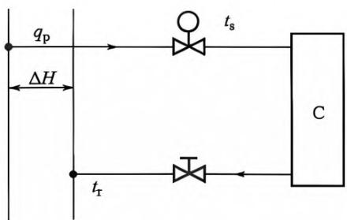

设计流量： $q_{p}=96\times36.105/(20\times983.2\times4185)=4.2m^{3}/h$ （如按水温 $20^{\circ}C$ 计算，则设计流量 $q_{p}=96\times0.86/20=4.14m^{3}/h$ ）。

图16.1-27 控制阀选型举例

控制阀压降：水泵扬程为 $100 \, kPa$ ，最小阀权度须达到 0.25 以上，即控制阀最小压降为 $0.25 \times 100 = 25 \, kPa$ 。

资用压力为 50kPa，末端盘管压降为 10kPa，静态平衡阀最小压降为 3kPa，所以控制阀最大压降为 50-10-3=37kPa=0.37bar。

则控制阀所需 $K_{\mathrm{v}}$ 值最小为： $K_{\mathrm{v}} = \frac{q}{\sqrt{\Delta p}} = \frac{4.2}{\sqrt{0.37}} = 6.90$

根据厂家样本参数，可选择口径为 DN25、 $K_{vs}=8$ 的调节阀，此时调节阀压降 $\Delta p_{v}=27kPa$ 。

则静态平衡阀上需产生 $50 - 10 - 27 = 13\mathrm{kPa}$ 的压降才能消耗掉多余的资用压力，使流量达到设计流量。

验证控制阀的阀权度：

最小阀权度 $\beta_{\min}=\Delta p_{v}/H_{pump}=27/100=0.27>0.25;$

设计阀权度 $\beta_{d}=\Delta p_{v}/\Delta H=27/50=0.54>0.5$ 。

6. 水力控制阀

水力控制阀是利用水压控制的阀门，一般分为隔膜式（图 16.1-28）与活塞式（图 16.1-29）两种。它由一个主阀及附设导管、导阀、针阀、球阀和压力表等组成。根据使用目的、功能和用途的不同，只要改变附设导管的连接和导阀，就可以演变成遥控浮球阀、减压阀、缓闭止回阀、流量控制阀、泄压阀及水力控制阀等多种阀门。

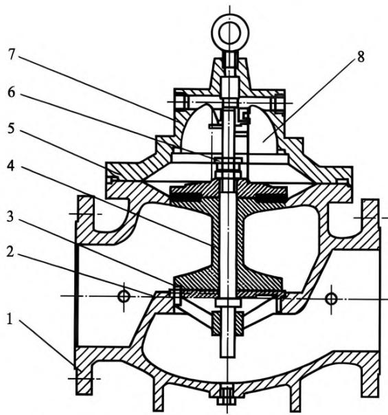  
图 16.1-28 水力控制主阀（隔膜式）结构  
1—阀体；2—阀座；3—密封圈；4—阀盘；  
5—膜片；6—弹簧；7—阀盖；8—控制室

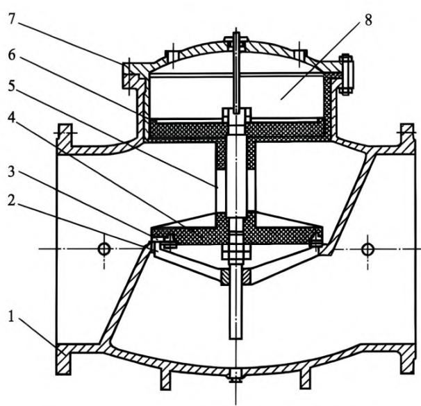  
图 16.1-29 水力控制主阀（活塞式）结构  
1—阀体；2—阀座；3—密封圈；4—阀盘；5—弹簧；6—活塞；7—阀盖；8—控制室

水力控制阀以管路系统上下游压力差为动力，由导阀控制，使隔膜或者活塞液压式差动操作，完全由水力自动调节，从而使主阀阀盘完全开启、完全关闭或处于调节状态。

水力控制阀有两种分类方法：一种是按结构形式分类，一种是按用途分类。按用途分类，有水位控制阀、减压阀、水用安全阀（泄压/持压）、止回阀、电动开关阀、流量控制阀、压差旁通平衡阀、紧急关闭阀、膜片式快开排泥阀、隔膜式池底卸泥阀等。

选择水力控制阀时，主要根据该阀的用途以及使用的介质、温度和工作压力来选择其类型。然后需要确定水力控制阀的结构形式，这主要取决于管路系统中的水质。当水质比较差时，优先选用直流式阀中的隔膜式结构，由于直流式阀的结构特点，阀座在阀体内腔呈倾斜状态，水中的杂质不易停留在密封面上，因此不受水质的影响。最后根据流量和产品技术参数确定口径。

**16.1.6 几种阀门介绍**

**16.1.6.1 焊接球阀**

焊接球阀是球阀的一种类型，其结构如图 16.1-30 所示，通常有焊接与法兰两种连接方式，有直接驱动和通过蜗轮蜗杆驱动两种方式。该阀阀体结构整体焊接而成，不会有外部泄漏现象。阀座由 PTFE（强化聚四氟乙烯）密封环及弹簧组成，对压力和温度的变化适应能力强，在标注的工作压力和温度范围内不易产生泄漏。阀体材料与管道材料相同，不会出现应力不均。阀杆底部和上部都有 PTFE 自封密封垫和 O 形密封圈，确保无泄漏。根据需要，该阀可采用多种材料制作，可适应不同的介质、工作压力和工作温度。

直埋式焊接球阀可以直接埋于地下，不用建高大的阀门井，只需在地面上设置小型浅井（图 16.1-31），大大节省施工费用及时间。同时，可根据管道的施工及设计要求调整阀体的长短和阀杆高度。

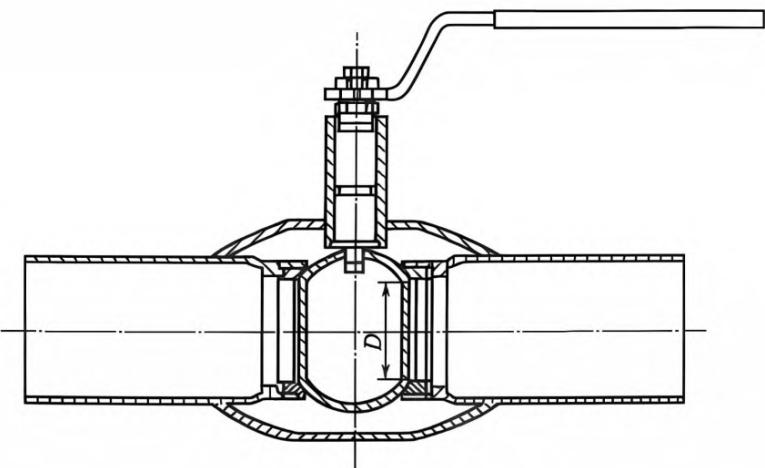  
图16.1-30 焊接球阀结构图

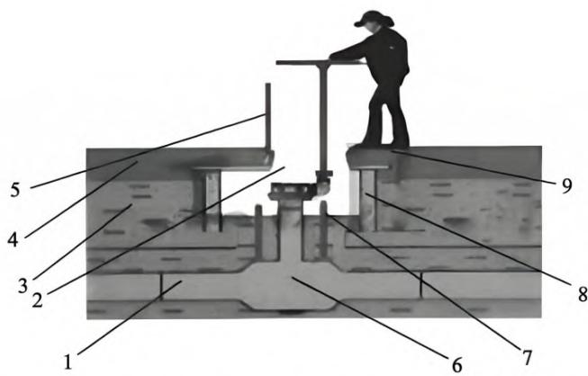  
图 16.1-31 直埋长阀杆焊接球阀地面操作示意图  
1—埋地管线；2—阀室；3—埋地介质；4—水泥浇注面；5—井盖井圈；  
6—阀门；7—放散管；8—砖墙；9—路面

该阀结构简单，质量轻，易于保温，便于安装；同时具有球阀的阻力低、不会卡住、密封性好、适用流体范围宽等众多优点，在各个领域使用都非常广泛。其优越的品质和良好的稳定性是普通铸钢球阀所无法达到的，全焊接球阀使用寿命远大于铸钢球阀，广泛应用于城市燃气、城市供热、石油化工、造船、钢铁、调压站、发电厂等各类管道设备上。

**16.1.6.2 平衡阀**

平衡阀在系统回路中调节阻力，使所有末端可以在需要时至少获得设计流量，其功能包括：限制有利回路的水流量，避免其他回路流量不够；在满负荷时，控制系统总流量在设计值；提供在系统中测量压差、流量、温度的功能，简化诊断。

通常，平衡阀可以分为静态平衡阀和动态平衡阀两个大类。随着技术的发展，也出现了将控制和平衡功能相结合的平衡控制类产品。

**1. 静态平衡阀**

静态平衡阀是调整水力系统中不同部分的阻力以获得所需流量分配的阀门，见图16.1-32。该阀有两个压力（温度）测量口和一个显示开度刻度的手轮，每个开度对应一个 $K_{v}$ 值，见图16.1-33。

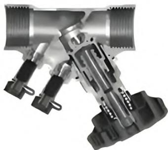

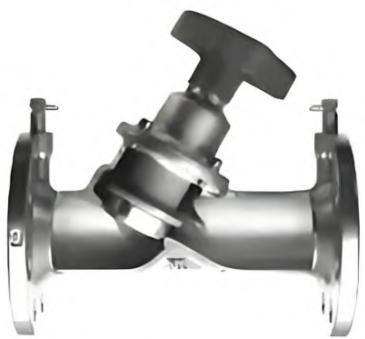  
图16.1-32 静态平衡阀与测压口

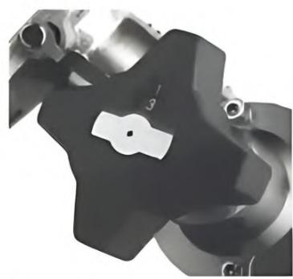  
图16.1-33 静态平衡阀带开度刻度的手轮

通过专业设备测量出两个测量口的实时压差后，可以在设备上直接读出实时的流量。通过转动手轮调节阀门使得流量达到要求。静态平衡阀也称作手动平衡阀。

通过静态平衡阀可以测量压差、流量、温度、资用压力等参数。在使用管路上将该阀门完全关闭（当安装在水泵出口时不可完全关闭），此时测量得到的压差即是关断压差。一般而言，这个压差非常接近于这段回路的资用压力。通过对比实际资用压力，可以判断导致流量不足的位置，以帮助故障诊断。

整个水系统的平衡调试完毕之后，通过静态平衡阀上的锁定功能将开度锁定，此时每个位置的静态平衡阀的最大开度被限制，避免了开度受到其他因素的干扰而影响整体平衡。锁定开度后，阀门仍然可以根据需要关小或关断，不影响系统切断或泄水等功能。

从水力学的角度看，静态平衡阀装在供水管或者回水管上没有不同；通常习惯将静态平衡阀安装在回水管上，特别是阀门具有泄水功能时。安装时，建议让水经阀芯的下面向上流出，这时水循环噪声最小，同时降低了产生气体的可能性。

静态平衡阀测量数据的准确性取决于阀门机械加工的精度、测压设备的精度以及阀门前后的直管段长度。静态平衡阀前后直管段长度如图 16.1-34 所示。不要将产生干扰的部件（如温度探头等）置于静态平衡阀的上游直管段上。

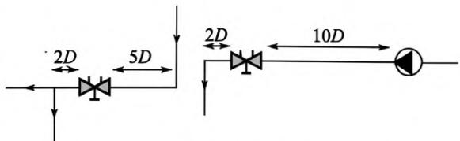  
图 16.1-34 静态平衡阀前后直管段长度  
注： $D$ 为静态平衡阀口径。

静态平衡阀应具有较好的调节特性。它所需的性能应该使阀门的行程/设定变化产生的流量变化越规则越好。通常水回路中的流量会随着两端压差的变化呈非线性变化，当采用具有较好调节特性的静态平衡阀时，能补偿这个非线性特征，可以使得静态平衡阀有较佳的流量控制特性，如图 16.1-35 所示。

静态平衡阀可应用于定流量系统和变流量系统。应用于变流量系统时，经过良好设计和调试的静态平衡阀可以解决系统中的静态失衡问题。静态平衡阀应用的关键在于系统模块化的设计和系统化的调试。

平衡阀设定(%)

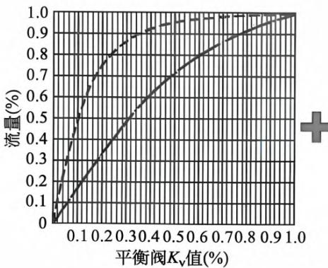

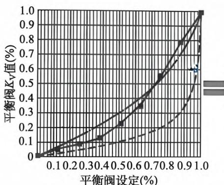  
- - - - 高压差回路： $\Delta H_{d}=100kPa$ ; $\Delta p_{BV,d}=3kPa$ - - - - 低压差回路： $\Delta H_{d}=10kPa$ ; $\Delta p_{BV,d}=3kPa$ - STAD 15/14

  
图16.1-35 静态平衡阀在回路中的补偿作用

**2. 动态平衡阀**

动态平衡阀是指具有自动调节流通面积的功能，保证水管回路的压力差或流量稳定的阀门。通常包括压差控制器（自力式压差控制阀）和动态流量平衡阀（自力式流量控制阀）两种。

**(1) 自力式压差控制阀**

自力式压差控制阀是用于稳定供回水压差的平衡设备，见图 16.1-36。它用于变流量水系统，且通常和静态平衡阀配套使用。

图16.1-36 压差控制器

1—可调设定口；2—手轮；3—毛细管连接口/排气口；4—测量口；5—泄水配件连接

自力式压差控制阀通常通过毛细管与上

游高压侧连通，维持上游连接毛细管处到阀体前的压差恒定。设定口处可以用内六角工具调节设定回路压差 $\Delta p$ 。测量口可以用来测量压力。

在变流量系统中，负荷的变化会导致支路和末端设备处供回水压差的变化。该压差变化得越大，控制阀的阀权越度小，控制质量越差，甚至控制失效。自力式压差控制阀可以恒定供回水压差，避免上述情况的发生。

图 16.1-37 为自力式压差控制阀即自力式压差平衡阀的工作原理图。供水的压力（高压）通过毛细管传递到压差控制器内的高压腔，通过毛细管（大口径）或内部通道，将回水（低压）引到低压腔。当压差阀调试好以后，高压腔和低压腔的压力差和弹簧所产生的拉力平衡，达到稳定状态。当资用压力有所增加时，自力式压差控制阀通过内部弹簧膜片的移动，减小压差控制阀的开度，将增加的资用压力转移到自力式压差控制阀上，保证所控目标压差不变。

对于自力式压差控制阀而言，回路压差 $\Delta p$ 是一个很重要的参数，它指的是所控对象或所控回路的稳定压差值。通常，回路压差值是在某个范围内可供调节，选型时需要选择合适的范围，以满足需要。

自力式压差控制阀的最大压差通常是指该控制器可以正常作用的最大压差值，超过这个值而不超过阀门的承压等级，压差稳定功能会受到影响，但不会出现压力超出承压等级

  
图16.1-37 自力式压差控制阀工作原理图

时的各种现象。

随着技术的发展，同轴式技术和先导阀技术也应用在了自力式压差控制阀上，以获得更稳定的压差控制、更低的噪声和更大的流通能力。该技术往往用在大口径的压差控制器中。

**(2) 自力式流量控制阀**

自力式流量控制阀是通过自动改变阀芯（瓣）的过流面积，以适应阀前后压力的变化，恒定通过阀门流量的阀门。其功能是：当管网中压力发生改变时，经过该阀的流量保持不变，仍然与设计值一致。自力式流量控制阀的名称较多，如动态流量平衡阀、定流量阀、恒流量调节阀等。目前此类阀门较多应用在冷却侧的水系统中。

该阀通常分为两类：定流量阀和恒流量调节阀。

1）定流量阀：定流量阀只有阀芯，根据流量要求可配置一个或多个弹簧阀芯，见图 16.1-38。这些阀芯直接感受阀门的前后差压，执行改变阀芯阻力的动作，它不能在线调节流量，因此使用定流量阀无法实施改变总流量的节能运行。也有采用阀芯直接感受阀门的前后差压，执行改变阀芯流通截面大小的动作，其作用原理与变阀芯阻力是一样的。

  
图16.1-38 定流量阀剖面图与性能曲线  
(a) 剖面图；(b) 性能曲线

2）恒流量调节阀：由一个手动调节阀瓣和一个自动平衡阀瓣组成，见图16.1-39。调节阀瓣的作用是设定流量，自动平衡阀瓣的作用是维持流量恒定。当手动调节阀瓣调到某一位置时，即人为确定了“设定流量” $K_{v}$ （流量系数）。由于流量 $G=K_{v}\circ(p_{2}-p_{3})$ ， $K_{v}$ 设定后，只要 $p_{2}-p_{3}$ 不变，则流量G不变。当系统流量增大时， $p_{2}-p_{3}$ 的实际值超过了允许的给定值，此时通过感压膜和弹簧作用使自动调节阀瓣自动关小，直至流量重新维持到设定流量，反之亦然。

  
图 16.1-39 恒流量调节阀剖面图  
1—弹簧罩；2—弹簧；3—膜片；4—自动阀杆；5—自动阀瓣；6—顶杆；7—流量刻度尺；  
8—手动阀杆；9—手动阀瓣；10—阀体；11—下盖

这类阀门自动调节流量的有效范围取决于工作弹簧的性能。一般流量阀前后压差在20～300kPa的范围内能按设定值有效控制流量。当压差小于20kPa时，流量达不到设定值；当压差超过300kPa时，可能产生噪声。

**16.1.6.3 静态水力平衡阀**

静态水力平衡阀是将控制功能和平衡功能结合在一起的一类阀门。这类阀门既具有控

制阀的调节或开关功能，也集成了平衡功能，在市场上俗称“一体阀”。因为集成了控制功能，所以这类控制阀也需要有执行器，以驱动阀体。当与智能控制设备结合时，又被称为“智能控制一体阀”。

将控制功能和静态平衡功能结合的产品通常在小口径的控制类产品中应用较多。如图 16.1-40 所示，这类产品可以通过设定不同的阀芯开度实现初始阻力的调节，同时具有测量口以供流量测量和故障诊断；当连接到开关型执行器时，可实现开关型的控制；当连接到调节型执行器时，可实现调节型的控制。

  
图 16.1-40 小口径平衡控制阀

对用于小型末端控制的静态水力平衡阀来说，阀体上也可以集成动态平衡功能，即通过机械结构可屏蔽掉外界压力和流量的变化影响，如果接入开关型执行器，则可实现开关型的控制，如果接入调节型执行器，则可实现调节型的控制。这类调节阀的阀体通常通过弹簧/膜片结构实现压差无关，同时具备测量口以供压力、流量、温度测量和故障诊断。

对于大口径的调节阀来说，通常使用的是调节型的控制，同时集成动态平衡部件，实现对外界压力和流量波动的屏蔽，所以这类阀门通常也称为动态平衡电动调节阀，见图 16.1-41。动态平衡的部件通常为内部的弹簧/膜片结构，实现控制部分的压力稳定。测量口用以测量压差、流量、温度，以及故障诊断。

  
图 16.1-41 动态平衡电动调节阀

当控制系统给动态平衡电动调节阀的执行器一个信号时，执行器会动作到某个位置，并带动阀体动作到某个位置，此时通过阀门会有一个流量值，当外界压力变化或工况变化时，保持流量不变。当自控系统给予一个新的信号时，动态平衡电动调节阀又动作到新的位置，保持此时的流量不变。这样既保持压差无关，又可以根据需要进行精准调节。

动态平衡电动调节阀的行程—流量特性应为等百分比特性或接近等百分比特性，用以补偿末端流量—输出特性，获得线性的输入—输出能量特性。

与控制阀一样，动态平衡电动调节阀需要连接执行器。执行器的行程需要匹配阀体的行程，通常是行程相等，也有自适应行程的执行器。

**16.1.6.4 电子式多功能控制阀**

电子式多功能控制阀是由智能执行器控制阀体，使流量可以精准调节的一类控制阀，由超声波流量计、控制球阀以及智能执行器组成，如图 16.1-42 所示。

  
图16.1-42 电子式多功能控制阀

电子式多功能控制阀的工作原理是：通过流量计对系统中的流量进行实时监测并反馈给执行器，执行器对比监测流量与设定流量的差值后对阀门的开度进行调节，从而确保稳定的输出流量。当流量计测得管道内流量小于设定流量时，执行器自动调大调节阀门开度，提高流通面积。当流量计测得管道内流量大于设定流量时，执行器自动调小开度，确保输出流量的稳定。

电子式多功能控制阀具有阀位与流量两种控制模式，阀位控制模式可以通过自控系统

的 2(0)～10V 信号直接对阀门位置进行调节；流量控制模式可通过设定额定流量对输出流量进行控制。电子式多功能控制阀可实现线性与等百分比特性，支持多种通信协议（如 MP-BUS，Modbus、BACnet），可以满足不同应用场合的要求。

电子式多功能控制阀在 30% 左右到 100% 范围内的流量可以实现对应的等百分比特性曲线，如图 16.1-43 所示。应按对应口径流量范围的 30% 左右到 100% 进行选型。

**16.1.6.5 能量（智能）阀**

图16.1-43 电子式多功能控制阀的等百分比特性曲线

这类阀在市场上的名称很多，有能量阀、智能阀或智慧阀等，它是一类具有流量/能量测量、电动调节

结构的多功能新型智能化阀门。可实现流量测量和能量积分，并能根据需要对流量和能量输出进行调节型控制，可通过电动执行机构或智能控制盒进行数据传输和监控。这类阀门在结构上往往包括执行器、阀体（控制部分）、流量测量部件、温度测量部件、积分及通信部件等。一种典型的能量阀外观如图16.1-44所示。

  
图16.1-44 能量阀外观图

传统的控制模式中，电压信号对应执行器一个行程，通过行程的变化来调节控制阀的开度，从而调节经过控制阀的流量，改变经过末端的流量（图 16.1-45）。

  
图16.1-45 能量阀的流量控制模式

在能量阀的流量控制模式（图16.1-45）中，电压信号通过能量器给能量阀一个所需流量，通过流量的变化来调节经过末端的能量。

在能量阀的能量控制模式（图 16.1-46）中，电压信号通过控制器直接给到输出至末端的能量，实现能量按需供应。

  
图16.1-46 能量阀的能量控制模式

在传统电压—阀位控制模式下，控制阀受限于阀两端压差变化对控制精度的影响，在具有合格阀权度的水力条件下，其输出特性如图 16.1-47 所示。

  
图16.1-47 电压一阀位控制模式下传统控制阀的输出特性

  
图 16.1-47 电压—阀位控制模式下传统控制阀的输出特性（续）

在能量阀的流量控制模式下，整体控制结果接近于一个性能良好的压差无关型平衡调节阀，具有接近于理想输出特性，见图 16.1-48。

在能量阀的能量控制模式下，整体控制效果更佳，见图 16.1-49。

这类阀门通常支持各种通信协议，并可通过蓝牙模块等与控制软件连接，具有丰富的连接性和拓展性。通信协议方面，通常均可支持常见的 BACnet 或 Modbus 总线协议。通过 BLE 4.0 或 BLE 5.0 与控制软件进行互联和控制，并具备阀门之间的无线通信和数据远传功能。

能量阀能实时测量流量，结合供回水温差实测能量，实时调节阀门开度控制流量，按需精确输出能量，实时改变局部阻力抗衡压力波动等。因此它具有以下功能：最大流量和能量可以设定以及更改；可以实时反映流量，进行能量测量；可以实现压力无关的流量控制，对能量进行控制，控制供回水温差；可以实时监控，实现与自控系统实时交换数据。

  
图16.1-48 流量控制模式下能量阀的输出特性

  
图16.1-49 能量控制模式下能量阀的输出特性

与云技术结合后，用户可以随时随地对系统的能耗情况进行可视化管理，让设备始终保持在最佳设置状态，使工作更便利。

这类阀可应用在所有使用传统调节阀的场合下，典型的如空气处理机组末端前、板式换热器前、精密空调前、风机盘管前等，均可应用能量阀。在需要调节混水比例的多级系统中的上一级回路中，也可替代传统的调节阀。

在具备高精度测量结果的前提下，这类阀在控制模式上比传统的控制更加直接，匹配低流量下的高精度测量和控制，对于低负荷下的控制更加精准。直接的流量/负荷控制模式，容易满足这类控制目标的现场控制要求。丰富的通信和数据传输能力，更适应了很多场合下实时控制监测和调控的需要。

能量阀是近年来发展的产品（图 16.1-50）。Belparts 在 2009 年推出了 Dynamx valve，具备流量测量和控制的功能。2012 年 Belimo 推出了 Energy valve 系列产品。2017 年 Azbil 推出了 Actival Plus 系列阀门。2019 年，西门子、索特和 Flowcon 也推出了类似功能的能量阀。2021 年，TA 发布了 TA-Smart 系列能量阀。

  
图 16.1-50 各种能量阀外观

**16.2 风管阀门**

**16.2.1 风阀的名词术语与定义**

风阀的主要名词术语见表 16.2-1。

风阀的主要名词术语  
表16.2-1

<table><tr><td>序号</td><td>名词术语</td><td>说明</td></tr><tr><td>1</td><td>通用分类</td><td></td></tr><tr><td>1.1</td><td>蝶阀</td><td>风管内绕轴线转动的单板式风量调节阀</td></tr><tr><td>1.2</td><td>平行式多叶调节阀</td><td>由平行叶片组成的按同一方向旋转的多叶联动风量调节阀</td></tr><tr><td>1.3</td><td>对开式多叶调节阀</td><td>相邻叶片按相反方向旋转的多叶联动风量调节阀</td></tr><tr><td>1.4</td><td>插板阀</td><td>闸板与阀座始终紧密接触密封并能在两个滑轨之间滑动的阀门</td></tr><tr><td>1.5</td><td>三通调节阀</td><td>矩形风管三通调节阀设在三通管的分支节点上,用来调节各支风管的风量,通过改变三通阀板的位置来实现系统各分支的风量分配。它一般与三通管件连体加工,只用于分流,不用于合流</td></tr><tr><td>1.6</td><td>定风量调节器</td><td>定风量调节器是一种机械式自力装置,无须外加动力即可工作,控制阀片由阀体内的轴杆支撑,波动空气产生的动力将阀片定位,使得流量在允许的压差范围内恒定在设定值,作用在控制阀片上的空气阻力使它闭合</td></tr><tr><td>1.7</td><td>止回阀</td><td>气流只能按一个方向流动的阀门</td></tr><tr><td>1.8</td><td>余压阀</td><td>为保持洁净室内静压稳定,设置在侧墙上的可自动开关的阀门。有机械和电动两种</td></tr><tr><td>1.9</td><td>防火阀</td><td>安装在通风、空调系统的送、回风管路上,平时呈开启状态,火灾时当管道内烟气温度达到70°C时关闭,并在一定时间内满足漏烟量和耐火完整性要求,起隔烟阻火作用。一般由阀体、叶片、执行机构和温感器等部件组成</td></tr><tr><td>1.10</td><td>防烟防火阀</td><td>靠感烟火灾探测器控制动作,通过电信号控制关闭阀门(防烟),还可采用70°C温感器自动关闭(防火)。用于通风空调系统风管内,防止烟火蔓延</td></tr><tr><td>1.11</td><td>排烟阀</td><td>安装在机械排烟系统各支管端部(烟气吸入口)处,平时呈关闭状态并满足漏风量要求,火灾或需要排烟时手动或电动打开,起排烟作用。一般由阀体、叶片、执行机构等部件组成</td></tr><tr><td>1.12</td><td>排烟防火阀</td><td>安装在机械排烟系统的管道上,平时呈开启状态,火灾时当排烟管道内烟气温度达到280°C时关闭,并在一定时间内能满足漏烟量和耐火完整性要求,起隔烟阻火作用。一般由阀体、叶片、执行机构和温感器等部件组成</td></tr><tr><td>2</td><td>按驱动方式分类</td><td></td></tr><tr><td>2.1</td><td>手动阀门</td><td>借助手轮、手柄、杠杆或链轮等,由人力来操作的阀门</td></tr><tr><td>2.2</td><td>电动阀门</td><td>用电动装置、电磁或其他电气装置操作的阀门</td></tr><tr><td>2.3</td><td>气动阀门</td><td>借助空气的压力操作的阀门</td></tr></table>

**16.2.2 风阀工作原理与分类**

风阀是空气输配管网的控制、调节机构，其基本功能是关闭或开启空气流通的管路，调节或分配管路流量。

**16.2.2.1 风量调节阀**

常用的风量调节阀有蝶阀 [图 16.2-1 (a)]、多叶调节阀 [图 16.2-1 (b) (c)]、插板阀和三通调节阀 [图 16.2-1 (d)] 等。

  
(a)

  
(b)

  
(c)

  
图 16.2-1 各种风量调节阀  
(a) 蝶阀；(b) 平行式多叶调节阀；(c) 对开式多叶调节阀；(d) 三通调节阀

**1. 蝶阀**

蝶阀是通过启闭件往复回转 $90^{\circ}$ 左右来开启、关闭和调节风量的一种阀门。蝶阀为单板式风阀，其结构简单、加工方便、造价低廉、操作简便，但调节精度差，仅适用于通风与空调系统中作开关或粗调节的场合，可在 $90^{\circ}$ 范围内任意角度固定。另外，对于断面较大的风管，则需要尺寸大的阀板，此时应采用多叶调节阀，以避免开启或关闭时操作困难。

蝶阀启闭件是一个圆形或方形的阀板，在阀体内绕其自身的轴线旋转，从而达到启闭或调节的目的，可以手动、电动或拉链式操作。蝶阀的类型主要有手柄式圆形蝶阀、拉链式圆形蝶阀、拉链式圆形保温蝶阀、手柄式方形蝶阀和拉链式方形蝶阀、拉链式方形保温蝶阀、手柄式矩形蝶阀、拉链式矩形蝶阀、拉链式矩形保温蝶阀等。图16.2-2为手柄式方形蝶阀示意图。

  
图16.2-2 手柄式方形蝶阀示意图

**2. 多叶调节阀**

多叶调节阀是通风空调系统中应用最普遍的阀门，其安装简便、操作方便、调节性能好、阻力特性优良。按构造形式分，有平行式、对开式及轻型对开式；按密闭要求分，有普通型和密闭型；按驱动方式分，有电动型、气动型和手动型。除轻型对开式为齿轮传动外，其余均为连杆传动。

多叶调节阀通过调节叶片的开度达到调节风量的目的。平行式多叶调节阀的叶片转动方向相同（图16.2-3），对开式多叶调节阀的相邻两叶片转动方向相反（图16.2-4）。

  
图16.2-3 平行式多叶调节阀

  
图16.2-4 手动对开式多叶调节阀

**3. 插板阀**

插板阀是一种闸板与阀座紧密接触密封的阀门，其原理是通过闸板沿与风管垂直方向反复运动，达到启闭目的。插板阀靠闸板插入管道的深度调节风量（图 16.2-5）。

**4. 三通调节阀**

  
图16.2-5 插板阀

三通调节阀主要用于主风管的风量初分配，使系统各分支的风量基本符合设计要求（图 16.2-6）。一般与矩形三通管件连体加工，只用于分流，不用于合流。通过改变三通阀板的位置来实现风量初调

节，具有结构简单、调节简便易行、造价低廉的优点。分为手柄式和拉杆式两种。

  
图16.2-6 三通调节阀

**5. 风口调节阀**

对开式多叶风口调节阀（A型），与双层（或单层）百叶风口、算孔回风口、孔板回风口和网板回风口等配套使用，如图 16.2-7 所示。而对开式多叶风口调节阀（B 型），与方形散流器和矩形散流器配套使用，如图 16.2-8 所示。

  
图 16.2-7 对开式多叶风口调节阀（A 型）

  
图 16.2-8 对开式多叶风口调节阀（B型）

对于圆形散流器，常见的有双开板式风口调节阀和单开板式风口调节阀，如图 16.2-9 所示。

  
(a)

  
(b)  
图 16.2-9 双开板式、单开板式风口调节阀  
(a) 圆形双开板式风口调节阀；(b) 圆形单开板式风口调节阀

**16.2.2.2 止回阀**

止回阀是指依靠气流本身流动而自动开、闭阀板，用来防止气流倒流的阀门，在通风系统中尤其是两台或两台以上风机并联安装时，应装止回阀。当气流按规定方向流动时，阀板受到气流的作用而被开启；气流逆流时，因阀板自重和阀板受气流阻力的作用，使阀板与阀座的密封面密合而关闭，达到阻止气流逆流的目的（图 16.2-10）。因此，它的主要性能有两种：气流正向流动时的阻力性能和气流逆向流动时的漏风性能。

止回阀在装配后必须保证阀板与轴转动灵活，矩形止回阀使用温度一般为 $10 \sim 50^{\circ} \mathrm{C}$ ，圆形和方形止回阀使用温度一般为 $0 \sim 95^{\circ} \mathrm{C}$ 。

**16.2.2.3 定风量调节器**

定风量调节器是机械式风量自动调节装置，不需要外加动力即可工作（图 16.2-11）。控制阀片由阀体内的轴杆支撑，流动空气产生的动力将阀片定位，使得流量在允许的压差范围内恒定在设定值。作用在控制阀片上的空气阻力使它闭合，并使充气的气囊压力增强，而气囊又起着振荡阻尼的作用。经过校定的弹簧片产生一个对抗关闭的力，弹簧片由凸轮调节阻力，使得在压差变化时，自动调整阀片的角度，将流量恒定在设定值附近。

  
图16.2-10 止回阀

定风量调节器适用于送风或排风量要求恒定的管道系统，是压力无关型风量调节装置，可根据管径定制并安装，并可附带电动执行器，加选消声外壳，以减少辐射噪声。

**16.2.2.4 防火阀和排烟防火阀**

**1. 防火阀**

为了阻止火焰和有毒高温烟气通过风管蔓延扩散，在通风空调系统的风管上需设置防火阀（图 16.2-12）。防火阀平时呈开启状态，当风管内

图 16.2-11 定风量调节器

气体温度超过设定温度（例如 $70^{\circ}$ C 或 $150^{\circ}$ C）时，温感器动作，阀门自动关闭。同时，输出显示阀门叶片位置的信号。阀门可通过手动或电机复位。

  
图16.2-12 防火阀

**2. 排烟防火阀**

排烟防火阀设置在机械排烟系统的管道上（图 16.2-13），设置位置一般为；在垂直风管与每层水平风管交接处的水平管段上；一个排烟系统负担多个防烟分区的排烟支管上；排烟风机入口处。排烟风机应满足 $280^{\circ}$ C 时连续工作 30min 的要求，且应与风机入口处的排烟防火阀连锁，当该阀关闭时，排烟风机应能停止运转。

  
图16.2-13 排烟防火阀

**16.2.2.5 排烟阀**

排烟阀一般用于排烟系统的风管，平时常闭，可与火灾探测器连锁，特别是与火灾烟感探测器连锁，通过探知火灾初期发生的烟气来开启阀门，进行排烟，也可手动打开阀门，手动复位（图 16.2-14）。排烟阀开启后可发出电信号至消防控制中心。

  
图16.2-14 排烟阀  
注：在排烟阀上不设温度熔断器。

**16.2.2.6 风阀的其他分类**

**1. 按用途分类：**

(1) 一次性调节阀: 如果系统风压不平衡, 为达到所需风量而设的调节阀。如果系统风压平衡的误差在 $10\% \sim 15\%$ 以内, 在分支管上可不设调节阀。一次性调节阀构造可简单一些, 也无密封要求, 可以采用插板阀 (安装在需要关断或调节风量的风管上)、蝶阀、多叶调节阀和三通调节阀等。

(2) 经常开关的调节阀: 对于集中式系统, 主要有新风阀、一次和二次回风阀、排风阀 (包括全面排风和局部排风的排风阀) 等。

（3）自动调节阀：主要用于新风、一次回风和二次回风的自动调节，除应符合经常开关的调节阀的要求外，还应有良好的调节特性。

（4）防火阀：在防火隔断处要在风管上设防火阀。兼作一次性调节性的防火阀，应采用防火调节阀。

2. 按控制方式分类：分为手动阀门、电动阀门、气动阀门和自平衡阀门。

3. 按功能分类：分为开关阀、调节阀和密封阀。

4. 按结构形式类：分为单叶风阀和多叶风阀。

5. 按材料分类：分为碳钢板、镀锌板、铝合金板、不锈钢板等材料。

6. 按与管道的连接方式分类：法兰连接、焊接和与管件一体。

**16.2.2.7 风阀的功能、结构形式和控制方式**

在选配与安装风阀前，应充分了解风阀的功能、结构形式和控制方式（表 16.2-2）。正确地选配与安装风阀，是保证通风空调系统能在设计工况下运行的重要条件。

风阀的功能、结构形式和控制方式  
表16.2-2

<table><tr><td rowspan="2">风阀类别</td><td colspan="3">功能</td><td colspan="2">结构形式</td><td colspan="4">控制方式</td></tr><tr><td>开关</td><td>调节</td><td>密封</td><td>单叶</td><td>多叶</td><td>手动</td><td>电动</td><td>气动</td><td>自平衡</td></tr><tr><td>多叶调节阀</td><td>○</td><td>●</td><td>○</td><td>○</td><td>●</td><td>●</td><td>●</td><td>●</td><td>—</td></tr><tr><td>蝶阀</td><td>●</td><td>○</td><td>○</td><td>●</td><td>—</td><td>●</td><td>●</td><td>●</td><td>—</td></tr><tr><td>定风量调节器</td><td>○</td><td>●</td><td>—</td><td>●</td><td>—</td><td>○</td><td>○</td><td>○</td><td>●</td></tr><tr><td>止回阀</td><td>●</td><td>—</td><td>○</td><td>—</td><td>●</td><td>—</td><td>—</td><td>—</td><td>●</td></tr><tr><td>三通调节阀</td><td>○</td><td>●</td><td>—</td><td>●</td><td>—</td><td>●</td><td>—</td><td>—</td><td>—</td></tr><tr><td>密闭式斜插板阀</td><td>●</td><td>○</td><td>●</td><td>●</td><td>—</td><td>●</td><td>—</td><td>—</td><td>—</td></tr><tr><td>余压阀</td><td>○</td><td>●</td><td>○</td><td>●</td><td>○</td><td>●</td><td>—</td><td>—</td><td>●</td></tr></table>

注：●为推荐符号；○为参考符号。

**16.2.3 风阀型号与表示**

1. 表示方法一

**(1) 型号的编制**

我国的风阀型号由风阀代号、风阀叶片运动方式代号、风阀耐温等级代号、风阀高、风阀宽和风阀驱动方式代号六部分组成，如图 16.2-15 所示。

  
图16.2-15 风阀型号表示方法一

**(2) 代号**

1) 风阀叶片运动方式代号如表 16.2-3 所示。

风阀叶片运动方式代号  
表 16.2-3

<table><tr><td>叶片运动方式</td><td>代号</td><td>叶片运动方式</td><td>代号</td></tr><tr><td>对开式</td><td>D</td><td>菱形</td><td>L</td></tr><tr><td>平行式</td><td>P</td><td>蝶阀</td><td>不表示</td></tr></table>

注：蝶阀无叶片运动方式代号，本代号省略。

2）风阀耐温等级代号如表16.2-4所示。

风阀耐温等级代号  
表16.2-4

<table><tr><td>工作温度</td><td>代号</td><td>工作温度</td><td>代号</td></tr><tr><td>-40~95°C</td><td>1</td><td>-55~205°C</td><td>2</td></tr></table>

3）风阀宽：叶片轴向的内口尺寸，用阿拉伯数字表示，单位为 mm。

4) 风阀高: 叶片数方向的内口尺寸, 用阿拉伯数字表示, 单位为 $\mathrm{mm}$ 。

注：风阀宽和高的公差应符合《一般公差 未注公差的线性和角度尺寸的公差》GB/T1804—2000规定的m级。

5）风阀驱动方式代号如表16.2-5所示。

风阀驱动方式代号  
表16.2-5

<table><tr><td>风阀驱动方式</td><td>代号</td><td>风阀驱动方式</td><td>代号</td></tr><tr><td>电动</td><td>D</td><td>电、手动两用</td><td>DS</td></tr><tr><td>气动</td><td>Q</td><td>气、手动两用</td><td>QS</td></tr><tr><td>手动</td><td>S</td><td>—</td><td>—</td></tr></table>

注：对用手轮（包括驱动装置的手轮）或扳手操作的风阀，面向手轮或扳手顺时针转动风阀应为关。

【例 16.2-1】平行式多叶电动风阀，工作温度为 $-55 \sim 205^{\circ}C$ ，风阀宽 1000mm，风阀高 500mm。

型号表示为：FP2-1000×500D。

**2. 表示方法二**

**(1) 型号的编制**

对开式、平行式和轻型风阀均可配置成电动阀门，只是侧边加装了电动执行机构。电动执行器的品牌较多，以 DKJ 系列为例，该阀门的型号由产品代号、输出力矩代号、电源电压代号、控制方式代号和附加功能代号五部分组成，如图 16.2-16 所示。

  
图16.2-16 风阀型号表示方法二

**(2) 代号**

1）输出力矩代号如表 16.2-6 所示。

输出力矩代号  
表 16.2-6

<table><tr><td>输出力矩</td><td>代号</td><td>输出力矩</td><td>代号</td></tr><tr><td>6(8)N·m</td><td>0</td><td>25(32)N·m</td><td>3</td></tr><tr><td>10N·m</td><td>1</td><td>40N·m</td><td>4</td></tr></table>

2）电源电压代号如表 16.2-7 所示。

电源电压代号  
表 16.2-7

<table><tr><td>电源电压</td><td>代号</td><td>电源电压</td><td>代号</td></tr><tr><td>AC 220V</td><td>1</td><td>AC 110V</td><td>3</td></tr><tr><td>AC/DC 24V</td><td>2</td><td>—</td><td>—</td></tr></table>

3）控制方式代号如表16.2-8所示。

控制方式代号  
表 16.2-8

<table><tr><td>控制方式</td><td>代号</td><td>控制方式</td><td>代号</td></tr><tr><td>开关信号</td><td>K</td><td>模拟信号</td><td>M</td></tr></table>

### 16.2.4 风阀的流量系数与选用

**1. 流量系数的概念**

流量系数 $C$ 又称为流通能力, 其定义是当调节阀全开, 阀前、后的压差为 $1 \mathrm{kgf} / \mathrm{cm}^{2}$ 、流体密度为 $1 \mathrm{~g} / \mathrm{cm}^{3}$ 时, 每小时通过调节阀的流体流量, 以 $\mathrm{m}^{3} / \mathrm{h}$ 为单位。但是在统一执行法定计量单位后改为: 调节阀全开时, 阀前、后的压差 $\Delta p$ 为 $1 \mathrm{bar}$ ( $10^{5} \mathrm{~Pa}$ )、流体密度为 $1 \mathrm{~g} / \mathrm{cm}^{3}$ 时, 每小时流经调节阀的流体流量, 以 $\mathrm{m}^{3} / \mathrm{h}$ 为单位。

**2. 流量系数的计算**

从调节阀的工作原理可知：

$$
Q = F \cdot v = \frac {F}{\sqrt {\zeta}} \sqrt {\frac {2 (p _ {1} - p _ {2})}{\rho}} = \frac {F}{\sqrt {\zeta}} \sqrt {\frac {2 \Delta p}{\rho}}\tag{16. 2-1}
$$

式中 $p_{1}$ 、 $p_{2}$ 、 $\Delta p$ ——阀前、阀后压力及前后压差，Pa；

$Q$ ——流量， $\mathrm{m}^3/\mathrm{s}$ ；

F——风阀接管截面积， $m^{2}$ ;

$\rho$ ——流体的密度， $kg/m^{3}$ ;

v——流体的速度，m/s;

$\zeta$ ——风阀阻力系数。

如根据流量系数的定义, 风阀前后压差 $\Delta p$ 为 $10^{5} \mathrm{~Pa}$ , 流体密度为 $1 \mathrm{~g} / \mathrm{cm}^{3}$ , 换算单位得:

$$
\begin{array}{r l} & {Q = \frac {1 0 ^ {4} F}{\sqrt {\zeta}} \sqrt {\frac {2 \times 1 0 ^ {- 5} \Delta p}{1 0 ^ {- 3} \rho}} \quad \mathrm {cm^ {3} /s}} \\ & {\qquad = 3 6 0 0 \times 1 0 ^ {- 2} \times \sqrt {2 \times 1 0 ^ {- 2}} \frac {F}{\sqrt {\zeta}} \sqrt {\frac {\Delta p}{\rho}} = 5. 0 9 \frac {F}{\sqrt {\zeta}} \sqrt {\frac {\Delta p}{\rho}} \quad \mathrm {m^ {3} /h}} \end{array}\tag{16.2-2}
$$

则流通能力 $C$ 可表示为:

$$
C = 5. 0 9 \frac {F}{\sqrt {\zeta}}\tag{16.2-3}
$$

上述公式是对不可压缩流体而言的，仅适用于液体。气体与液体不同，它具有可压缩性，通过调节阀后的气体密度不等于阀前的密度，如直接引用上述公式，必将引起较大的误差。为此需要引进新的方法，关于气体 C 值的计算方法，目前有阀前密度法、阀后密度法、平均密度法和压缩系数法四种。由于调节阀阻力使阀后压力降低，气体密度发生变化，影响其体积流量，这里着重介绍并推荐阀后密度法。

阀后密度法认为流过调节阀的气体在阀出口断面上的体积流量为：

$$
Q _ {2} = \frac {F}{\sqrt {\zeta}} \sqrt {\frac {2 \Delta p}{\rho_ {2}}}\tag{16. 2-4}
$$

而质量流量为：

$$
G = \rho_ {2} Q _ {2} = \frac {F}{\sqrt {\zeta}} \sqrt {2 \rho_ {2} \Delta p}\tag{16.2-5}
$$

式中 F ——风阀接管截面积， $cm^{2}$ ;

$\rho_{2}$ ——风阀出口断面上的气体密度， $kg/m^{3}$ ， $1kg/m^{3}=10^{-6}kg/cm^{3}$ ;

$\Delta p$ ——阀压差，Pa， $1\mathrm{Pa}=10^{-2}\mathrm{kg}/(\mathrm{s}^{2}\cdot\mathrm{cm})$ 。

把采用的单位代入式（16.2-5）得：

$$
\begin{array}{r l} G = & \frac {F}{\sqrt {\zeta}} \sqrt {\rho_ {2} \Delta p} \sqrt {2 \times 1 0 ^ {- 6} \times 1 0 ^ {- 2}} \quad \mathrm{kg/s} \\ = & \frac {F}{1 . 9 6 4 2 \sqrt {\zeta}} \sqrt {\rho_ {2} \Delta p} \quad \mathrm{kg/h} \end{array}
$$

即

$$
\frac {1 . 9 6 4 2 G}{\sqrt {\rho_ {2} \Delta p}} = \frac {F}{\sqrt {\zeta}}
$$

如前所述，流通能力 $C$ 为：

$$
C = 5. 0 9 \frac {F}{\sqrt {\zeta}} = 5. 0 9 \times \frac {1 . 9 6 4 2 G}{\sqrt {\rho_ {2} \Delta p}} = \frac {1 0 G}{\sqrt {\rho_ {2} \Delta p}}\tag{16.2-6}
$$

如果把式（16.2-6）中在操作状态下阀后的气体密度 $\rho_{2}$ （kg/m $^{3}$ ）换算成标准状态下（0℃，101324.71Pa）的气体密度 $\rho_{N}$ （kg/Nm $^{3}$ ），即：

$$
\rho_ {2} = \rho_ {\mathrm{N}} \frac {T _ {\mathrm{N}} p _ {2}}{T _ {2} p _ {\mathrm{N}}}\tag{16.2-7}
$$

式中 $\rho_{N}$ ——标准状态下的气体密度， $kg/m^{3}$ （在 $0^{\circ}C$ ，101324.71Pa 状态时， $\rho_{N}=1.293kg/m^{3}$ ）；

$T_{N}$ ——标准温度， $T_{N}=273K$ ;

$p_{N}$ ——标准大气压力， $p_{N}=101324.72Pa$ ;

$T_{2}$ ——调节阀后的气体温度， $T_{2}=(273.15+t)$ ，K(t是操作温度，℃)。

将 $\rho_{2}$ 代入式（16.2-6）得：

$$
C = \frac {1 0 G}{\sqrt {\rho_ {\mathrm{N}} \times \frac {2 7 3 p _ {2}}{T _ {2} \times 1 0 1 3 2 4 . 7 2} \times \Delta p}} = \frac {1 9 3 G}{\sqrt {\frac {\rho_ {\mathrm{N}} p _ {2} \Delta p}{T _ {2}}}} = 1 9 3 G \sqrt {\frac {T _ {2}}{\rho_ {\mathrm{N}} p _ {2} \Delta p}}\tag{16.2-8}
$$

应注意的是，上式只适用于 $p_2 > p_1 / 2$ （一般流动）的情况，当气体处于超临界流动状态时，不管阀后气体压力 $p_2$ 多小，阀出口截面上的气体压力 $p_2'$ 保持不变，阀出口截面上的气体密度 $\rho_2'$ 也保持不变，用 $\rho_{\mathrm{N}}$ 和 $p_1$ 来计算 $C$ 值，则有：

$$
C = 1 9 3 G \sqrt {\frac {2 7 3 . 1 5 + t}{\rho_ {\mathrm{N}} \times \frac {p _ {1}}{2} \times \frac {p _ {1}}{2}}} = \frac {3 8 6 G}{p _ {1}} \sqrt {\frac {2 7 3 . 1 5 + t}{\rho_ {\mathrm{N}}}}\tag{16. 2-9}
$$

【例 16.2-2】空气的质量流量 $G = 45000 \, kg/h$ ， $p_{1} = 34.8 \times 10^{5} \, Pa$ ， $p_{2} = 30.5 \times 10^{5} \, Pa$ ，阀后温度 $t = 165^{\circ}C$ ，求流量系数 C 的大小。

解：由于 $p_2 > p_1 / 2 = 17.4 \times 10^5 \mathrm{~Pa}$ ，则有：

$$
C = 1 9 3 G \sqrt {\frac {T _ {2}}{\rho_ {\mathrm{N}} p _ {2} \Delta p}} = 1 9 3 \times 4 5 0 0 0 \times \sqrt {\frac {2 7 3 . 1 5 + 1 6 5}{1 . 2 9 3 \times 3 0 . 5 \times 1 0 ^ {5} \times 4 . 3 \times 1 0 ^ {5}}} = 1 3 9. 6
$$

【例 16.2-3】空气的质量流量 $G=18670kg/h,\ p_{1}=42.4\times10^{5}Pa,\ p_{2}=7.4\times10^{5}Pa$ ，阀后温度 $t=98^{\circ}C$ ，求流量系数 C 的大小。

解：由于 $p_2 < p_1 / 2 = 21.1 \times 10^5 \mathrm{~Pa}$ ，则有：

$$
C = \frac {3 8 6 G}{p _ {1}} \sqrt {\frac {2 7 3 . 1 5 + t}{\rho_ {\mathrm{N}}}} = \frac {3 8 6 \times 1 8 6 7 0}{4 2 . 4 \times 1 0 ^ {5}} \sqrt {\frac {2 7 3 . 1 5 + 9 8}{1 . 2 9 3}} = 2 8. 8
$$

3. 流量系数的影响因素及典型值

(1) 风阀的流量系数与阻力系数, 风阀的尺寸、形式、结构及气体流过阀门时的方向等有关。

（2）以手动对开式多叶调节阀、手柄式矩形蝶阀、手柄式圆形蝶阀的几种阀型为例用式（16.2-6）计算流量系数，结果见表 16.2-9～表 16.2-11。

（3）表 16.2-9～表 16.2-11 只是提供了估值，若对结果有更高要求，可根据式（16.2-8），用阀后温度、阀后压力、阀前后压差等值进行计算。

几种典型规格（ $B \times H$ ）的手动对开式多叶调节阀的流量系数  
表 16.2-9

<table><tr><td colspan="2">开度(°)</td><td>90</td><td>80</td><td>70</td><td>60</td><td>50</td><td>40</td><td>30</td><td>20</td><td>15</td><td>10</td></tr><tr><td colspan="2">阻力系数ζ</td><td>0.4</td><td>0.7</td><td>1.5</td><td>4</td><td>9</td><td>25</td><td>90</td><td>400</td><td>900</td><td>3000</td></tr><tr><td rowspan="7">流量系数C</td><td>160×320</td><td>0.41</td><td>0.31</td><td>0.26</td><td>0.13</td><td>0.09</td><td>0.05</td><td>0.03</td><td>0.01</td><td>0.01</td><td>0</td></tr><tr><td>800×320</td><td>2.06</td><td>1.56</td><td>1.3</td><td>0.65</td><td>0.43</td><td>0.26</td><td>0.14</td><td>0.07</td><td>0.04</td><td>0.02</td></tr><tr><td>630×630</td><td>3.19</td><td>2.41</td><td>2.02</td><td>1.01</td><td>0.67</td><td>0.4</td><td>0.21</td><td>0.1</td><td>0.07</td><td>0.04</td></tr><tr><td>800×630</td><td>4.06</td><td>3.07</td><td>2.57</td><td>1.28</td><td>0.86</td><td>0.51</td><td>0.27</td><td>0.13</td><td>0.09</td><td>0.05</td></tr><tr><td>1250×800</td><td>8.05</td><td>6.08</td><td>5.09</td><td>2.55</td><td>1.7</td><td>1.02</td><td>0.54</td><td>0.25</td><td>0.17</td><td>0.09</td></tr><tr><td>1250×1000</td><td>10.06</td><td>7.6</td><td>6.36</td><td>3.18</td><td>2.12</td><td>1.27</td><td>0.67</td><td>0.32</td><td>0.21</td><td>0.12</td></tr><tr><td>1600×1250</td><td>16.1</td><td>12.17</td><td>10.18</td><td>5.09</td><td>3.39</td><td>2.04</td><td>1.07</td><td>0.51</td><td>0.34</td><td>0.19</td></tr></table>

几种典型规格（ $B \times H$ ）的手柄式矩形蝶阀的流量系数  
表 16.2-10

<table><tr><td colspan="2">叶片开启角度(°)</td><td>0</td><td>10</td><td>20</td><td>30</td><td>40</td><td>50</td><td>60</td><td>全关</td></tr><tr><td colspan="2">矩形蝶阀阻力系数ζ</td><td>0.04</td><td>0.33</td><td>1.2</td><td>3.3</td><td>9</td><td>26</td><td>70</td><td>1665</td></tr><tr><td rowspan="6">流量系数C</td><td>320×250</td><td>2.04</td><td>0.71</td><td>0.37</td><td>0.22</td><td>0.14</td><td>0.08</td><td>0.05</td><td>0.01</td></tr><tr><td>400×320</td><td>3.26</td><td>1.13</td><td>0.59</td><td>0.36</td><td>0.22</td><td>0.13</td><td>0.08</td><td>0.02</td></tr><tr><td>500×250</td><td>3.18</td><td>1.11</td><td>0.58</td><td>0.35</td><td>0.21</td><td>0.12</td><td>0.08</td><td>0.02</td></tr><tr><td>630×320</td><td>5.13</td><td>1.79</td><td>0.94</td><td>0.56</td><td>0.34</td><td>0.20</td><td>0.12</td><td>0.03</td></tr><tr><td>800×500</td><td>10.18</td><td>3.54</td><td>1.86</td><td>1.12</td><td>0.68</td><td>0.40</td><td>0.24</td><td>0.05</td></tr><tr><td>800×630</td><td>12.83</td><td>4.47</td><td>2.34</td><td>1.41</td><td>0.86</td><td>0.50</td><td>0.31</td><td>0.06</td></tr></table>

几种典型规格（D）的手柄式圆形蝶阀的流量系数  
表 16.2-11

<table><tr><td colspan="2">叶片开启角度(°)</td><td>0</td><td>10</td><td>20</td><td>30</td><td>40</td><td>50</td><td>60</td><td>全关</td></tr><tr><td colspan="2">圆形蝶阀阻力系数ζ</td><td>0.2</td><td>0.52</td><td>1.5</td><td>4.5</td><td>11</td><td>29</td><td>108</td><td>1620</td></tr><tr><td rowspan="6">流量系数C</td><td>160</td><td>0.23</td><td>0.14</td><td>0.08</td><td>0.05</td><td>0.03</td><td>0.02</td><td>0.01</td><td>0.00</td></tr><tr><td>200</td><td>0.36</td><td>0.22</td><td>0.13</td><td>0.08</td><td>0.05</td><td>0.03</td><td>0.02</td><td>0.00</td></tr><tr><td>320</td><td>0.91</td><td>0.57</td><td>0.33</td><td>0.19</td><td>0.12</td><td>0.08</td><td>0.04</td><td>0.01</td></tr><tr><td>360</td><td>1.16</td><td>0.72</td><td>0.42</td><td>0.24</td><td>0.16</td><td>0.10</td><td>0.05</td><td>0.01</td></tr><tr><td>400</td><td>1.43</td><td>0.89</td><td>0.52</td><td>0.30</td><td>0.19</td><td>0.12</td><td>0.06</td><td>0.02</td></tr><tr><td>630</td><td>3.55</td><td>2.20</td><td>1.29</td><td>0.75</td><td>0.48</td><td>0.29</td><td>0.15</td><td>0.04</td></tr></table>

**参考文献**

[1] V. S. 阿巴兹, P. S. 拉森. 对流换热 [M]. 顾传保, 罗棣庵, 李心桂, 译. 北京: 高等教育出版社, 1992.

[2] 余其铮．辐射换热原理 [M]. 哈尔滨：哈尔滨工业大学出版社，2000.

[3] 陈启高．建筑热物理基础 [M]. 西安：西安交通大学出版社，1991.

[4] 西安建筑科技大学，华南理工大学，重庆大学，等．建筑物理 [M]. 4 版．北京：中国建筑工业出版社，2009.

[5] 彦启森，赵庆珠．建筑热过程 [M]. 北京：中国建筑工业出版社，1986.

[6] 中华人民共和国住房和城乡建设部．民用建筑热工设计规范：GB 50176—2016 [S]. 北京：中国建筑工业出版社，2017.

[7] 陆耀庆. 实用供热空调设计手册 [M]. 2 版. 北京: 中国建筑工业出版社, 2008.

[8] 冯雅，南艳丽，钟辉智，等．建筑热工与围护结构节能设计手册 [M]. 北京：中国建筑工业出版社，2022.

[9] 中华人民共和国住房和城乡建设部．建筑能耗数据分类及表示办法：JG/T 358—2012 [S]. 北京：中国标准出版社，2012.

[10] 何雅玲. 工程热力学精要解析 [M]. 西安: 西安交通大学出版社, 2014.

[11] 沈维道, 童钧耕. 工程热力学 [M]. 5 版. 北京: 高等教育出版社, 2016.

[12] 傅秦生，何雅玲，赵小明．热工基础与应用 [M]. 北京：机械工业出版社，2001.

[13] 蒋汉文. 热工学 [M]. 2 版. 北京: 高等教育出版社, 1994.

[14] 陶文铨. 传热学 [M]. 5 版. 北京: 高等教育出版社, 2019.

[15] HOLMAN J P. HeatTransfer [M]. Tenth Edition. New York: McGraw-Hill, 2010.

[16] 章熙民, 朱彤, 安青松, 等. 传热学 [M]. 6 版. 北京: 中国建筑工业出版社, 2014.

[17] HE Y L, TAO W Q. Convective Heat Transfer Enhancement: Mechanism, Techniques and Performance Evaluation [C] // International Symposium on Convective in Heat and Mass Transfer, 2014: 1414-1432.

[18] 过增元，黄素逸，等．场协同原理与强化传热新技术 [M]. 北京：中国电力出版社，2004.

[19] 何雅玲，陶文铨．强化单相对流换热的基本机制 [J]. 机械工程学报，2009，45（3）：27-38.

[20] HE Y L, TANG S Z, TAO W Q, et al. A general and rapid method for performance evaluation of enhanced heat transfer techniques [J]. International Journal of Heat and Mass Transfer, 2019, 145: 118780. 1-118780. 13.

[21] 梁新刚，陈群，过增元．传热烟理论及其应用 [M]. 北京：科学出版社，2019.

[22] 陶文铨. 数值传热学 [M]. 2 版. 西安: 西安交通大学出版社, 2001.

[23] 周谟仁．流体力学泵与风机 [M]. 3 版．北京：中国建筑工业出版社，1994.

[24] 刘鹤年．流体力学 [M]. 2 版．北京：中国建筑工业出版社，2004.

[25] 闻德荪．工程流体力学（水力学）[M]. 2版．北京：高等教育出版社，2004.

[26] 尉迟斌. 实用制冷与空调工程手册 [M]. 北京：机械工业出版社，2002.

[27] 贺平，孙刚．供热工程 [M]. 3 版．北京：中国建筑工业出版社，1993.

[28] 符永正．供暖空调水系统稳定性及输配节能 [M]. 北京：中国建筑工业出版社，2014.

[29] 赵亚伟，马最良．空调水系统的优化分析与案例剖析 [M]. 北京：中国建筑工业出版社，2015.

[30] 江亿．管网可调性和稳定性的定量分析 [J]. 暖通空调，1997，27（3）：1-7.

[31] 罗帕特·珀蒂琼．全面水力平衡：暖通空调水力系统设计与应用手册 [M]. 杨国荣，胡仰耋，魏伟，等，译．北京：中国建筑工业出版社，2007.

[32] 清华大学建筑节能研究中心．中国建筑节能年度发展研究报告 2021（城镇住宅专题）[M]. 北京：中国建筑工业出版社，2021.

[33] 张声远，杨秀，江亿．我国建筑能源消耗现状及其比较 [J]. 中国能源，2008，30（7）：37-42.

[34] 江亿，彭琛，胡姗．中国建筑能耗的分类 [J]. 建设科技，2015（14）：22-26.

[35] 中国气象局风能太阳能资源中心．中国风能太阳能资源年景公报 2020 年 [R]. 北京：中国气象局风能太阳能资源中心，2020.

[36] 龙惟定．城区需求侧能源规划和能源微网技术（上册）[M]. 北京：中国建筑工业出版社，2016.

[37] 张军．地热能、余热能与热泵技术 [M]. 北京：化学工业出版社，2014.

[38] 伍小亭，王砚，宋晨，等．基于暖通专业视角的区域能源系统思考——概念、规划、设计 [J]. 暖通空调，2019，49（1）：2-14，24.

[39] 吴大为，王如竹．分布式能源定义及其与冷热电联产关系的探讨 [J]. 制冷与空调，2005，5（5）：1-6.

[40] 刘丽丽，张钟平．基于多能互补的区域综合能源规划研究与应用 [J]. 节能，2019，38（11）：127-129.

[41] 许文发. 加强区域能源规划促进节能减排 [C] // 2012 年中国建筑学会年会论文集, 2012.

[42] 龙惟定，白玮，范蕊，等．低碳城市的区域建筑能源规划 [M]. 北京：中国建筑工业出版社，2011.

[43] 韩昭沧．燃料及燃烧 [M]. 2 版．北京：冶金工业出版社，1994.

[44] 汪军．工程燃烧学 [M]. 北京：中国电力出版社，2008.

[45] 中华人民共和国国家质量监督检验检疫总局，中国国家标准化管理委员会．民用建筑能耗分类及表示方法：GB/T 34913—2017 [S]. 北京：中国标准出版社，2017.

[46] 国家市场监督管理总局，国家标准化管理委员会．综合能耗计算通则：GB/T 2589—2020 [S]. 北京：中国标准出版社，2020.

[47] 田立新，孙梅，肖江，等．能源碳排放系统分析 [M]. 北京：科学出版社，2013.

[48] 张跃军. 碳排放权交易机制：模型与应用 [M]. 北京：科学出版社，2019.

[49] 夏梓耀．碳排放权研究 [M]. 北京：中国法制出版社，2016.

[50] 朱明善，刘颖，林兆庄，等．工程热力学 [M]. 2 版．北京：清华大学出版社，2011.

[51] 龙惟定．建筑节能与建筑能效管理 [M]. 北京：中国建筑工业出版社，2005.

[52] 国家统计局能源统计司．中国能源统计年鉴 2018 [M]. 北京：中国统计出版社，2019.

[53] FRIEDLINGSTEIN P, JONES M W, O'Sullivan M, et al. Global Carbon Budget 2019 [J]. Earth System Science Data, 2019, 11 (4): 1783-1838.

[54] 孙延勋．谐波反应法基本原理 [Z]. 贵阳：贵州省建筑设计院，1982.

[55] 曹叔维．房间热过程和空调负荷 [M]. 上海：上海科学技术文献出版社，1991.

[56] 徐湘波，胡益雄．建筑物及汽车空调负荷 [M]. 北京：国防科技大学出版社，1997.

[57] 陈在康，丁力行．空调过程设计与建筑节能 [M]. 北京：中国电力出版社，2004.

[58] F. C. 麦奎斯顿, J. D. 帕克, J. D. 斯皮特勒. 供暖、通风及空气调节——分析与设计 [M]. 6 版. 俞炳丰, 译. 北京: 化学工业出版社, 2005.

[59] ASHRAE. 2017 ASHARE Handbook: Fundamentals [M]. I-P Edition. Atlanta: American Society of Heating, Refrigerating and Air-Conditioning Engineers, Inc., 2017.

[60] 中华人民共和国住房和城乡建设部．建筑节能气象参数标准：JGJ/T 346—2014 [S]. 北京：中国建筑工业出版社，2015.

[61] 中华人民共和国住房和城乡建设部．夏热冬冷地区居住建筑节能设计标准：JGJ 134—2010 [S].

北京：中国建筑工业出版社，2010.

[62] 中华人民共和国住房和城乡建设部．夏热冬暖地区居住建筑节能设计标准：JGJ 75—2012 [S]. 北京：中国建筑工业出版社，2013.

[63] 中华人民共和国住房和城乡建设部．公共建筑节能设计标准：GB 50189—2015 [S]. 北京：中国建筑工业出版社，2015.

[64] ASHRAE. Energy Standard for Sites and Buildings Except Low-Rise Residential Buildings (SI Edition): ANSI/ASHRAE/IES 90.1: 2022 [S]. Atlanta: American Society of Heating, Refrigerating and Air-Conditioning Engineers, Inc., 2022.

[65] ASHRAE. Ventilation and Acceptable Indoor Air Quality: ANSI/ASHRAE 62.1: 2022 [S]. Atlanta: American Society of Heating, Refrigerating and Air-Conditioning Engineers, Inc., 2022.

[66] Tuve G. L. Air velocities in ventilating jets [J]. ASHVE Transaction, 1953, 59 (2): 261-282.

[67] LEBRUN J, Exigences physiologiques et modalités physiques de la climatisation parsource statique concentrée [D]. Liège: University of Liège, 1970.

[68] INARD C, BUTY D. Simulation of thermal coupling between a radiator and a room with zonal models [R]. Ottawa: Proceeding of 12th AIVC Conference, 1991.

[69] WURTZ E, NATAF J M, Winkelmann F. Two-and three-dimensional natural and mixed convection simulation using modular zonal models in buildings [J]. International Journal of Heat and Mass Transfer, 1999, 42 (5): 923-940.

[70] HAGHIGHAT F, LI Y, MEGRI A C. Development and validation of a zonal model—POMA [J]. Building and Environment, 2021, 36 (9): 1039-1047.

[71] AXLEY J W. Surface-drag flow relations for zonal modeling [J]. Building and Environment, 2001, 36 (7): 843-850.

[72] CHUNG T J. Computational Fluid Dynamics [M]. Cambridge: Cambridge University Press, 2002.

[73] NIELSEN P V, RESTIVO A, WHITELAW J H. The velocity characteristics of ventilated rooms [J]. Journal of Fluids Engineering, 1978, 100 (3): 291-298.

[74] EMMERICH S J, MCGRATTAN K B. Application of a large eddy simulation model to study room airflow [J]. ASHRAE Transaction, 1998, 104 (2): 1128-1136.

[75] 赵彬，李先庭，彦启森．用零方程湍流模型模拟通风空调室内的空气流动 [J]. 清华大学学报（自然科学版），2001，41（10）：109-113.

[76] S. V. 帕坦卡. 传热与流体流动的数值计算 [M]. 张政, 译. 北京: 科学出版社, 1984.

[77] FUNASAKA K, TSURUHO K, TAMURA K, et al. Relationship between indoor and outdoor carbonaceous particulates in roadside households [J]. Environmental Pollution, 2000, 110 (1): 127-134.

[78] 李先庭，赵彬．室内空气流动数值模拟 [M]. 北京：机械工业出版社，2009.

[79] 赵荣义，范存养，薛殿华，等．空气调节 [M]. 3 版．北京：中国建筑工业出版社，1994.

[80] 朱颖心．建筑环境学 [M]. 3 版．北京：中国建筑工业出版社，2010.

[81] SANDBERG M. What is ventilation efficiency? [J]. Building and Environment, 1981, 16 (2): 123-135.

[82] LI X T, LI D J, YANG X D, et al. Total air age: an extension of the air age concept [J]. Building and Environment, 2003, 38 (11): 1263-1269.

[83] DENG Q H, TANG G F. Ventilation effectiveness: physical model and CFD solution [C] // 4th International Conference on Indoor Air Quality, Ventilation and Energy Conservation in Buildings, 2011: 1759-1766.

[84] JELENA S. Simplified methodology for indoor environment design [D]. Cambridge: Massachusetts Institute of Technology, 2000.

[85] ZHANG Y, LI J Y, SUN H T, et al. Evaluation of different air distribution systems for sleeping spaces in transport vehicles [J]. Building and Environment, 2015, 94 (2): 665-675.

[86] 国家市场监督管理总局，国家标准化管理委员会．蒸气压缩循环冷水（热泵）机组 第1部分：工业或商业用及类似用途的冷水（热泵）机组：GB/T 18430.1—2024 [S]. 北京：中国标准出版社，2024.

[87] 中华人民共和国国家质量监督检验检疫总局，中国国家标准化管理委员会、制冷剂编号方法和安全性分类：GB/T 7778—2017 [S]. 北京：中国标准出版社，2017.

[88] 中华人民共和国国家质量监督检验检疫总局，中国国家标准化管理委员会．直燃型溴化锂吸收式冷（温）水机组：GB/T 18362—2008 [S]. 北京：中国标准出版社，2009.

[89] 石文星, 田长青, 王宝龙. 空气调节用制冷技术 [M]. 5 版. 北京: 中国建筑工业出版社, 2016.

[90] 上海市室内环境净化行业协会．洁净工程应用技术 [M]. 北京：中国劳动社会保障出版社，2012.

[91] 中华人民共和国住房和城乡建设部．洁净厂房设计规范：GB 50073—2013 [S]. 北京：中国计划出版社，2013.

[92] 国家市场监督管理总局，国家标准化管理委员会．室内空气质量标准：GB/T 18883—2022 [S]. 北京：中国标准出版社，2022.

[93] 中华人民共和国住房和城乡建设部．医院洁净手术部建筑技术规范：GB 50333—2013 [S]. 北京：中国建筑工业出版社，2014.

[94] 国家市场监督管理总局，国家标准化管理委员会．洁净室及相关受控环境 第1部分：按粒子浓度划分空气洁净度等级：GB/T 25915.1—2021 [S]. 北京：中国标准出版社，2021.

[95] 国家市场监督管理总局，国家标准化管理委员会．洁净室及相关受控环境 第2部分：洁净室空气粒子浓度的监测：GB/T 25915.2—2021 [S]. 北京：中国标准出版社，2021.

[96] 国家市场监督管理总局，国家标准化管理委员会．洁净室及相关受控环境 第3部分：检测方法：GB/T 25915.3—2024 [S]. 北京：中国标准出版社，2024.

[97] 中华人民共和国国家质量监督检验检疫总局，中国国家标准化管理委员会．洁净室及相关受控环境 第4部分：设计、建造、启动：GB/T 25915.4—2010 [S]. 北京：中国标准出版社，2011.

[98] 中华人民共和国国家质量监督检验检疫总局，中国国家标准化管理委员会．洁净室及相关受控环境 第5部分：运行：GB/T 25915.5—2010 [S]. 北京：中国标准出版社，2011.

[99] 中华人民共和国国家质量监督检验检疫总局，中国国家标准化管理委员会．洁净室及相关受控环境 第6部分：词汇：GB/T 25915.6—2010 [S]. 北京：中国标准出版社，2011.

[100] 中华人民共和国国家质量监督检验检疫总局，中国国家标准化管理委员会．洁净室及相关受控环境 第7部分：隔离装置（洁净风罩、手套箱、隔离器、微环境）：GB/T 25915.7—2010 [S]. 北京：中国标准出版社，2011.

[101] 国家市场监督管理总局，国家标准化管理委员会．洁净室及相关受控环境 第8部分：按化学物浓度划分空气洁净度（ACC）等级：GB/T 25915.8—2021 [S]. 北京：中国标准出版社，2021.

[102] 国家市场监督管理总局，国家标准化管理委员会．洁净室及相关受控环境 第9部分：按粒子浓度划分表面洁净度等级：GB/T 25915.9—2018 [S]. 北京：中国标准出版社，2018.

[103] 国家市场监督管理总局，国家标准化管理委员会．洁净室及相关受控环境 第10部分：按化学物浓度划分表面洁净度等级：GB/T 25915.10—2021 [S]. 北京：中国标准出版社，2021.

[104] 国家市场监督管理总局，国家标准化管理委员会．洁净室及相关受控环境 第12部分：监测空气中纳米粒子浓度的技术要求：GB/T 25915.12—2021 [S]. 北京：中国标准出版社，2021.

[105] 国家市场监督管理总局，国家标准化管理委员会．洁净室及相关受控环境 第13部分：达到粒子和化学洁净度要求的表面清洁：GB/T 25915.13—2022 [S]. 北京：中国标准出版社，2022.

[106] 国家市场监督管理总局，国家标准化管理委员会．洁净室及相关受控环境 第14部分：按粒子浓度评估设备适用性：GB/T 25915.14—2022 [S]. 北京：中国标准出版社，2022.

[107] 国家市场监督管理总局，国家标准化管理委员会．洁净室及相关受控环境 第15部分：按气态化学物浓度评定设备及材料的适用性：GB/T 25915.15—2022 [S]. 北京：中国标准出版社，2022.

[108] 中华人民共和国国家质量监督检验检疫总局，中国国家标准化管理委员会．洁净室及相关受控环境 生物污染控制 第1部分：一般原理和方法：GB/T 25916.1—2010 [S]. 北京：中国标准出版社，2011.

[109] 中华人民共和国国家质量监督检验检疫总局，中国国家标准化管理委员会．洁净室及相关受控环境 生物污染控制 第2部分：生物污染数据的评估与分析：GB/T 25916.2—2010 [S]. 北京：中国标准出版社，2011.

[110] 中华人民共和国住房和城乡建设部．公共建筑室内空气质量控制设计标准：JGJ/T 461—2019 [S]. 北京：中国建筑工业出版社，2019.

[111] 国家市场监督管理总局，国家标准化管理委员会．空气过滤器：GB/T 14295—2019 [S]. 北京：中国建筑工业出版社，2019.

[112] 国家市场监督管理总局，国家标准化管理委员会．高效空气过滤器：GB/T 13554—2020 [S]. 北京：中国标准出版社，2020.

[113] 国家市场监督管理总局，国家标准化管理委员会．高效空气过滤器性能试验方法 效率和阻力：GB/T 6165—2021 [S]. 北京：中国标准出版社，2021.

[114] CEN. Particulate air filters general for ventilation-Determination filtration performances: EN 779:2012 [S]. Brussels: European Committee for Standardization, 2012.

[115] CEN. High efficiency air filters (EPA, HEPA and ULPA) -Part 1: Classification, performance testing, marking: EN 1822-1: 2019 [S]. Brussels: European Committee for Standardization, 2019.

[116] ASHRAE. Method of Testing General Ventilation Air-Cleaning Devices for Removal Efficiency by Particle Size: ANSI/ASHRAE 52.2-2017 [S]. Atlanta: American Society of Heating, Refrigerating and Air-Conditioning Engineers, Inc., 2017.

[117] ASHRAE. 2015 ASHRAE Handbook: HVAC Applications [M]. Atlanta: American Society of Heating, Refrigerating and Air-Conditioning Engineers, Inc., 2015.

[118] ASHRAE. 2016 ASHRAE Handbook: HVAC Systems and Equipment [M]. Atlanta: American Society of Heating, Refrigerating and Air-Conditioning Engineers, Inc., 2016.

[119] ISO. High efficiency filters and filter media for removing particles from air — Part 1: Classification, performance, testing and marking: ISO/DIS 29463-1: 2011 [S]. Geneva: International Organization for Standardization, 2011.

[120] ISO. High-efficiency filters and filter media for removing particles in air-Part 4: Test method for determining leakage of filter elements-Scan method: ISO/DIS 29463-4:2011 [S]. Geneva: International Organization for Standardization, 2011.

[121] ISO. Air filters for general ventilation-Part 1: Technical specifications, requirements and classification system based upon particulate matter efficiency: ISO/DIS 16890-1:2016 [S]. Geneva: International Organization for Standardization, 2016.

[122] ISO. Air filters for general ventilation-Part 2: Measurement of fractional efficiency and air flow resistance; ISO/DIS 16890-2: 2016 [S]. Geneva: International Organization for Standardization, 2016.

[123] ISO. Air filters for general ventilation-Part 3: Determination of the gravimetric efficiency and the air flow resistance versus the mass of test dust captured: ISO/DIS 16890-3:2016 [S]. Geneva: International Organization for Standardization, 2016.

[124] ISO. Air filters for general ventilation-Part 4: Conditioning method to determine the minimum fractional test efficiency: ISO/DIS 16890-4:2016 [S]. Geneva: International Organization for Standardization, 2016.

[125] 涂有, 涂光备, 王晨, 等. 述评 Eurovent 4/23-2018《一般通风中按 EN ISO 16890 评级的空气过滤器之选用》[J]. 暖通空调, 2019, 49 (9): 1-6.

[126] ISO. Test method for assessing the performance of gas-phase air cleaning media and devices for general ventilation-Part 1: Gas-phase air cleaning media: ISO 10121-1: 2014 [S]. Geneva: International Organization for Standardization, 2014.

[127] ISO. Test methods for assessing the performance of gas-phase air cleaning media and devices for general ventilation-Part 2: Gas-phase air cleaning devices (GPACD): ISO 10121-2: 2013 [S]. Geneva: International Organization for Standardization, 2013.

[128] 严浩．紫外线消毒灭菌（UVGI）与（过滤+UVGI）洁净技术 [J]. 机电信息，2009（29）：1-7.

[129] 赵雷，周中平，葛伟，等．室内空气净化器及其应用前景 [J]. 环境与可持续发展，2006（1）：4-7.

[130] 谢焕玲. VOCs 去除技术综述 [C] // “十四五” VOCs 减排策略与监测治理研讨会暨挥发性有机物污染防治专业委员会第七届年会论文集，2019：1-4.

[131] 钱惠国, 沈恒根. 纳米 $\mathrm{TiO}_2$ 等离子体放电催化洁净技术在空气净化中的应用研究 [J]. 上海应用技术学院学报 (自然科学版), 2007, 7 (4): 241-244.

[132] 张乐．室内空气净化技术综述 [J]. 广东化工，2020，47（3）：161-166.

[133] ASHRAE. ASHRAE Position Document on Filtration and Air Cleaning [M]. Atlanta: American Society of Heating, Refrigerating and Air-Conditioning Engineers, Inc., 2015.

[134] 李强民．置换通风原理、设计及应用 [J]. 暖通空调，2000，30（5）：41-46.

[135] 中国建筑学会暖通空调委员会．暖通空调新技术3[M].北京：中国建筑工业出版社，2001.

[136] YUAN X X, CHEN Q Y, LEON R G. Performance evaluation and design guidelines for displacement ventilation [J]. ASHRAE Transactions, 1999, 105 (1): 298-309.

[137] YUAN X X, CHEN Q Y, LEON R G. A critical review of displacement ventilation [J]. ASHRAE Transactions, 1998, 104 (1a): 78-90.

[138] BAUMAN F. Underfloor Air Distribution (UFAD) Design Guide [M]. Atlanta: American Society of Heating, Refrigerating and Air-Conditioning Engineers, Inc., 2003.

[139] 约翰·瓦特（John R. Watt, P. E），威尔·布朗（Will K. Brown, P. E）。蒸发冷却空调技术手册[M]. 黄翔，武俊梅，等，译．北京：机械工业出版社，2009.

[140] 黄翔．蒸发冷却空调原理与设备 [M]. 北京：机械工业出版社，2019.

[141] 夏青．蒸发冷却空调术语标准若干问题的研究 [D]. 西安：西安工程大学，2013.

[142] 黄翔，等．蒸发冷却空调理论与应用 [M]. 北京：中国建筑工业出版社，2010.

[143] 黄翔，白延斌，汪超，等．全空气蒸发冷却空调系统的设计方法 [J]. 流体机械，2014，42（1）：68-74.

[144] 黄翔．蒸发冷却通风空调系统设计指南 [M]. 北京：中国建筑工业出版社，2016.

[145] 黄翔．空调工程 [M]. 3 版．北京：机械工业出版社，2017.

[146] 宣静雯．西北地区蒸发冷却空调系统水质问题的研究 [D]. 西安：西安工程大学，2016.

[147] 安苗苗．干燥地区蒸发冷却空调用水情况的综合分析 [D]. 西安：西安工程大学，2019.

[148] 刘晓华，江亿，张涛．温湿度独立控制空调系统 [M]. 2 版．北京：中国建筑工业出版社，2013.

[149] 潘云钢，刘晓华，徐稳龙．温湿度独立控制（THIC）空调系统设计指南 [M]. 北京：中国建筑工业出版社，2016.

[150] 中华人民共和国住房和城乡建设部．蓄能空调工程技术标准：JGJ 158—2018 [S]. 北京：中国建筑工业出版社，2018.

[151] 中华人民共和国住房和城乡建设部．供暖通风与空气调节术语标准：GB/T 50155—2015 [S]. 北京：中国建筑工业出版社，2015.

[152] 中华人民共和国住房和城乡建设部．民用建筑供暖通风与空气调节设计规范：GB 50736—2012 [S]. 北京：中国建筑工业出版社，2012.

[153] 方贵银．蓄冷空调工程实用新技术 [M]. 北京：人民邮电出版社，2000.

[154] 赵庆珠．蓄冷技术与系统设计 [M]. 北京：中国建筑工业出版社，2012.

[155] 章学来．空调蓄冷蓄热技术 [M]. 大连：大连海事大学出版社，2006.

[156] 严德隆，张维君．空调蓄冷应用技术 [M]. 北京：中国建筑工业出版社，1997.

[157] 空気調和・衛生工学会．空気調和・衛生工学会便覧2：機械と材料編[M].14版．東京：空気調和・衛生工学会，2010.

[158] 空気調和・衛生工学会．空気調和・衛生工学会便覧3：空気調和設備編[M].14版．東京：空気調和・衛生工学会，2010.

[159] CIBSE. CIBSE Guide A: Environmental design [M]. London: The Chartered Institution of Building Services Engineers, 2015.

[160] CIBSE. CIBSE Guide B3: Air conditioning and refrigeration [M]. London: The Chartered Institution of Building Services Engineers, 2016.

[161] 周伟坤，李海军，陈国邦．内融式冰盘管完全冻结与不完全冻结的比较 [J]. 暖通空调，2005，35（8）：96-98，131.

[162] 陈林．不完全冻结方式的导热塑料蓄冰盘管传热性能研究 [D]. 杭州：浙江大学，2002.

[163] 邓育涌．温度分层型水蓄冷槽混合特性研究 [D]. 上海：同济大学，2007.

[164] 张永铨．国内外冰蓄冷技术的发展与应用 [J]．制冷技术，1999（2）：21-24，28.

[165] 付祥钊. 流体输配管网 [M]. 4 版. 北京: 中国建筑工业出版社, 2018.

[166] 中华人民共和国住房和城乡建设部，国家市场监督管理总局．锅炉房设计标准：GB 50041—2020 [S]. 北京：中国计划出版社，2020.

[167] 彭圣浩．建筑工程质量通病防治手册 [M]. 2 版．北京：中国建筑工业出版社，1990.

[168] 艾为学．全国勘察设计注册公用设备工程师暖通空调专业考试复习教材（2020年版）[M]. 北京：中国建筑工业出版社，2020.

[169] 林瑞光．电机与拖动基础 [M]. 3 版．杭州：浙江大学出版社，2012.

[170] 中华人民共和国住房和城乡建设部．工业设备及管道绝热工程设计规范：GB 50264—2013 [S]. 北京：中国计划出版社，2013.

[171] 中华人民共和国住房和城乡建设部．辐射供暖供冷技术规程：JGJ 142—2012 [S]. 北京：中国建设工业出版社，2013.

[172] 中华人民共和国住房和城乡建设部．建筑给水塑料管道工程技术规程：CJJ/T 98—2014 [S]. 北京：中国建设工业出版社，2015.

[173] 王天富，买宏金．空调设备 [M]. 北京：科学出版社，2003.

[174] 中华人民共和国国家质量监督检验检疫总局，中国国家标准化管理委员会．阀门型号编制方法：GB/T 32808—2016 [S]. 北京：中国标准出版社，2017.

[175] 中华人民共和国国家质量监督检验检疫总局，中国国家标准化管理委员会．阀门术语：GB/T 21465—2008 [S]. 北京：中国标准出版社，2008.

[176] 陆培文，孙晓霞，杨炯良．阀门选用手册 [M]. 3 版．北京：机械工业出版社，2016.

[177] 龚飞鹰，刘传君，何衍庆．控制阀实用手册 [M]. 北京：化学工业出版社. 2015.

[178] 陈友明，王衍金，郭猛．双层皮幕墙传热计算理论及应用 [M]. 北京：科学出版社，2021.

**致谢**

本手册首版以来，历经半个多世纪的沉淀与迭代，凝聚了我国暖通空调行业数代专家、学者与工程师的共同智慧与心血。在第三版付梓之际，我们怀着深深的敬意与感激，向所有为本手册的诞生、发展与完善做出贡献的各方人士，致以最诚挚的谢意。

由衷感谢王天富、王唯国、孙延勋、胡仰耆、中原信生、江亿、罗继杰、潘云钢等专家。在本轮修编工作中，各位专家从整体框架的构建、内容方向的定位，到专业深度的把控，始终以严谨的治学精神和前瞻的行业眼光，给予我们持续且宝贵的指导。你们不仅以渊博的学识和前瞻的视野引领方向，更慷慨提供了大量珍贵的历史文献与一手资料，确保了本手册在传承中的历史厚度与学术高度。

衷心感谢历版手册的编写者与贡献者。从《采暖通风设计手册》（1967年，1972年）、《供暖通风设计手册》（1987年）到《实用供热空调设计手册》（1993年，2008年），一代又一代前辈专家在艰苦的条件下奠基立业，在改革的浪潮中开拓体系，在技术的快速发展中守正创新。他们以非凡的学识、严谨的态度和无私的奉献，构筑了本手册“简明实用”的鲜明风格与坚实内核，为行业的规范化、专业化发展奠定了不可磨灭的基石。他们的名字与功绩，已深深镌刻在本手册的发展历程之中。

诚挚感谢参与手册第三版编撰工作的全体成员。从前期的资料调研与案例筛选，到中期的内容撰写与图文编排，再到后期的多轮交叉审核，以及在“纸数融合”新模式下的资源开发与整合，每一个环节都倾注了大家的心血与智慧。在无数个并肩作战的日子里，大家共同激发创意、攻克难关，相互支持、彼此成就。正是各位高度的专业素养与紧密的团队协作，才使得这项复杂的编撰工作得以高效推进，也令手册的内容更为扎实、更具可读性。

郑重感谢为本手册提供宝贵案例支持、技术数据和专业咨询的众多设计院所、企业及行业专家。特别感谢清华大学的刘效辰、康旭源、王欢，中国建筑西北设计研究院有限公司的李文涛、杨若溪、赵志军，仲恺农业工程学院的栗艳，东华大学的钱明杨，同济大学的李玉明，中国建筑科学研究院的姜思航，陕西启迪瑞行清洁能源研究院有限公司的屈悦滢等同仁。你们将工程实践中的真知灼见、创新解决方案和宝贵经验无私分享，使手册内容得以紧密贴合工程实际，有效破解设计难题。你们的贡献，是本书从“理论手册”走向“实践利器”的关键桥梁。

手册的编撰如同一个精密的系统工程，同样离不开中国建筑工业出版社相关领导、编辑、设计、印制等全体工作人员的全程支持与辛勤付出，在此一并致以谢意。

谨以此书，献给所有为中国暖通空调事业发展奋斗的同行者。

《实用供热空调设计手册（第三版）》编委会

**本书增值服务使用说明**

为了增加本书的内容价值，本书提供增值服务，读者可通过以下方式获取：

方式一：通过中国建筑出版在线（https://www.cabplink.com/indexs）获取。打开中国建筑出版在线网页 $\rightarrow$ 登录/注册用户 $\rightarrow$ 搜索“实用供热空调设计手册（第三版）第1分册：技术基础” $\rightarrow$ 进入本书增值服务专属页面 $\rightarrow$ 点击“立即兑换” $\rightarrow$ 按提示输入本书封面增值服务二维码涂层下的卡号（ID）及密码（SN）进行绑定 $\rightarrow$ 打开对应的增值服务内容。

方式二：识别本书封底增值服务二维码获取。识别本书封底增值服务二维码 $\rightarrow$ 登录/注册用户 $\rightarrow$ 搜索“实用供热空调设计手册（第三版）第1分册：技术基础” $\rightarrow$ 进入本书增值服务专属页面 $\rightarrow$ 点击“立即兑换” $\rightarrow$ 按提示输入本书封面增值服务二维码涂层下的卡号（ID）及密码（SN）进行绑定 $\rightarrow$ 打开对应的增值服务内容。

方式三：识别书中增值服务二维码获取。识别书中增值服务二维码 $\rightarrow$ 进入本书增值服务专属页面 $\rightarrow$ 登录/注册用户 $\rightarrow$ 点击“立即兑换” $\rightarrow$ 按提示输入本书封面增值服务二维码涂层下的卡号（ID）及密码（SN）进行绑定 $\rightarrow$ 打开对应的增值服务内容。

温馨提示：

1. 每本书均有不同的增值服务卡号（ID）及密码（SN），并且每组号码只能绑定一个账户。为了账户安全和能够正常获得增值服务，请妥善保管该组号码，切勿泄露。

2. 增值服务的内容将根据最新技术进展以及相关标准规范的改版情况进行更新。因此，本书增值服务内容的有效期为本书出版后五年。

3. 使用过程中遇到任何问题，请及时与我社联系。客服电话：4008-188-688（工作日9:00—17:00），客服邮箱：jzs@cabp.com.cn。

(42977) 定价: 228.00 元 (附增值服务)